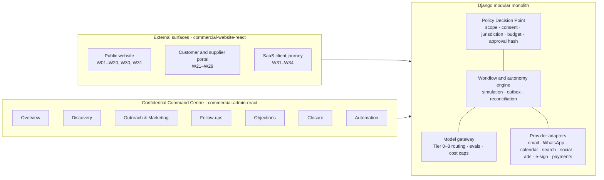

# AI Growth Engine: Employee Sales & Marketing Automation
## Application Blueprint: PART 2 (Batch 2.1), Functional Design: Capability Map, Module Catalogue and Functional Requirement Register

| Field | Value |
|---|---|
| Document | Part 2, Batch 1 of 5 |
| Version | 1.0 · 27 Nov 2026 |
| Part 2 batches | **2.1 Capability map, module catalogue, FR register** · 2.2 Process flows · 2.3 Business rules, RBAC/ABAC, state machines · 2.4 Notifications, reporting, search, configuration, audit, multi-tenancy, localization · 2.5 UX/UI |
| Baseline | BRD, FRD, Parts 0, 0A (DEC-001…065), 1 |
| Roles applied | BSA (lead), Solutions Architect, Principal Engineer, UX Lead, Security, QA Lead |

---

## 2.1 Capability map

### 2.1.1 Level-0 capability map

### 2.1.2 Level-1 capability domains (mapped to the seven Command Centre views)

| Cap ID | Capability domain | Command Centre view (BRD §3) | Primary BRs | Django app (modular monolith, FRD OPT-07-01) |
|---|---|---|---|---|
| CAP-01 | Tenancy, identity and access | Automation (admin) | M01, B-TENANT | `core.tenancy`, `core.identity` |
| CAP-02 | Product truth and knowledge | Overview / Automation | M02, M03, M66 | `catalog`, `knowledge` |
| CAP-03 | Governance: consent, eligibility, privacy, compliance, jurisdiction | Automation / Outreach | M04, M24, M56, M57 | `governance` |
| CAP-04 | Integration registry and provider adapters | Automation | M05 | `integrations` |
| CAP-05 | Events, audit, outbox, jobs, observability | Automation | M06, M58 | `core.events`, `core.audit`, `ops` |
| CAP-06 | AI gateway, evaluation, cost and quality | Automation | M08, M53, M54 | `ai` |
| CAP-07 | Market intelligence (sources, research, evidence, organizations, signals, needs, matching, social, competitors) | Discovery | M07, M10–M16, M33, M59 | `intelligence` |
| CAP-08 | Qualification (scoring, roles, contacts, verification, review) | Discovery | M17–M20 | `intelligence.qualification` |
| CAP-09 | CRM (pipeline, leads, forms, Customer 360) | Overview / Closure | M21–M23 | `crm` |
| CAP-10 | Engagement (drafting, email, WhatsApp, inbox, sequences, routing, chat) | Outreach / Follow-ups | M25–M28, M31, M32, M41 | `engagement` |
| CAP-11 | Meetings and events | Follow-ups | M29, M40 | `engagement.meetings`, `marketing.events` |
| CAP-12 | Marketing (content, claims, social, SEO, landing pages, campaigns, ads, referrals) | Outreach & Marketing | M34–M39, M42 | `marketing` |
| CAP-13 | Commercial conversion (proposals, quotes, negotiation, contracts, bids, orders, fulfilment) | Objections / Closure | M43–M46; A104, A105 | `commerce` |
| CAP-14 | Payments, closure, ledgers, revenue and attribution | Closure / Overview | M47, M52 | `commerce.finance`, `analytics` |
| CAP-15 | Customer lifecycle (onboarding, deployments, renewal, feedback, expansion pilots) | Follow-ups / Closure | M48–M51, M63–M65 | `lifecycle` |
| CAP-16 | Analytics and Command Centre (dashboards, forecast, projections, action centre, Copilot) | Overview | M30, M60, M61 | `analytics`, `commandcentre` |
| CAP-17 | Workflow and autonomy (builder, plans, triggers, runs, conflicts, templates, config change) | Automation | M55, B-AUTO | `automation` |
| CAP-18 | Website publishing and external portal | Outreach & Marketing (admin side) | B-WEB | `web` |
| CAP-19 | SaaS service lifecycle and portability | Automation | B-SVC | `saas` |
| CAP-20 | Release readiness and DevSecOps | Automation | M09, M62, B-QA | `ops.release` |

---

## 2.2 Module catalogue (66 source modules)

Columns: **Module** · **Django app** · **Core responsibilities** · **Key entities** (named in the FRD; *DERIVED* additions per DEC-016 in italics) · **Key operations** (FRD §6 named API; additional operations in Part 3) · **Automation trigger → response** (FRD §6) · **Screens** · **Tools/adapters** (FRD §6; decisions applied).

| Module (BR) | App | Core responsibilities | Key entities | Key operations | Trigger → response | Screens | Tools / adapters |
|---|---|---|---|---|---|---|---|
| M01 Identity & access | core.identity | Reused login/MFA, product audience, role-aware navigation, invite/revoke, object filtering | User, Role, Membership, *SupportAccessGrant* | POST /auth/login; GET /me | Manual invite; automatic scope enforcement | A001–A003, W21 | Existing Django auth/DRF (DEC-003, DEC-019) |
| M02 Product knowledge catalog | catalog | Versioned products/capabilities, readiness, claims, price versions, availability | Product, Capability, Claim, PriceVersion, *Offering, OfferingVersion, TaxProfile* | GET /products; POST /admin/claims/approve | Publish version → invalidate cache | A004, A005 | Claude API (embeddings optional), pgvector optional |
| M03 Knowledge ingestion | knowledge | Upload validation, scan, text extraction, versions, chunking, indexing, citation search | Document, Chunk, Embedding | POST /knowledge/uploads; GET /knowledge/search | Upload → scan → parse → index → review | A005, A006 | S3; OSS parsers; embeddings via gateway |
| M04 Consent & suppression | governance | Consent ledger, suppression, policy versions, immediate cancellation of queued messages | Consent, Suppression, PolicyVersion | POST /consents; POST /opt-out | Opt-out → cancel queued messages immediately | A007, W29 | Internal deterministic |
| M05 Integration registry | integrations | Adapter interface, secret references, token refresh, scopes, quotas, health | Integration, CredentialRef, Quota | GET /integrations; POST /admin/integrations/test | Health poll → disable failing connector | A008 | AWS Secrets Manager |
| M06 Event & audit | core.events | Atomic outbox, Celery retry, append-only audit, job runs, replay of failed jobs | Outbox, AuditEvent, JobRun | GET /events; POST /admin/jobs/{id}/retry | Commit → publish → idempotent consumer | A009 | Celery + Valkey (no Zapier/Make) |
| M07 Source permissions | intelligence.sources | Allowlist, purpose, terms review, quotas, expiry | Source, SourcePolicy | GET /sources; POST /admin/sources | Policy expiry → stop collection | A010, A049, A086 | Custom; licensed search |
| M08 AI gateway & evaluation | ai | Model routing, JSON schema validation, unsupported-claim rejection, prompt versions, eval cases | PromptVersion, ModelRun, EvalCase | POST /internal/ai/run; GET /admin/ai/runs | Validate JSON; reject unsupported claims | A011 | Claude API primary (DEC-007); eval harness |
| M09 DevSecOps | ops.release | CI/CD, environments, health/ready, secret scan, restore drill | Release, Incident | GET /health; GET /ready | CI → staging → approved deploy | A090, A014 | GitHub, AWS, Sentry |
| M10 Search query planner | intelligence.research | Translate capabilities into scoped search plans within source and cost bounds | SearchPlan, QueryRun | POST /research/plans; POST /research/run | Scheduled query → queue | A015, A023 | Tavily/Exa adapter (trial) |
| M11 Public web discovery | intelligence.research | Search, URL normalization, metadata storage, blocked-host rejection | SourceRecord, FetchLog | GET /research/results | Search → normalize URL → store metadata | A016 | Search API; Firecrawl (self-host first) |
| M12 Evidence extraction | intelligence.evidence | Fetch, clean, structured extraction, prompt-injection isolation | Evidence, SourceRecord | GET /evidence/{id} | Fetch → clean → structured extract | A017 | Extraction + gateway |
| M13 Account discovery | intelligence.orgs | Canonical organization upsert, aliases, locations, safe merge | Organization, Location, Alias | GET/POST /organizations | Evidence → upsert canonical account | A018 | Custom; licensed directories |
| M14 Buying signal classification | intelligence.signals | Classify evidence into signal types; review queue | Signal, SignalType | GET /signals; POST /signals/{id}/review | New evidence → classification → queue | A019 | Gateway (Tier 1a) |
| M15 Business need discovery | intelligence.needs | Explicit vs inferred needs; reviewer routing | Need, NeedEvidence | GET /needs; POST /needs/{id}/verify | Signal → need → reviewer if uncertain | A020 | Gateway |
| M16 Solution matching | intelligence.matching | Need + catalogue ranking, readiness gate, exclusions | Match, ProductCapability | POST /matches/recompute | Need + catalogue → rank → validate readiness | A021 | pgvector / custom |
| M17 Opportunity scoring | intelligence.qualification | Weighted score (DEC-011), recalculation, version | Opportunity, ScoreVersion | GET /opportunities; POST /opportunities/{id}/score | Match → score → high-confidence review | A022, A023 | Custom |
| M18 Decision-maker discovery | intelligence.contacts | Role hypotheses from published sources | Contact, RoleHypothesis, ContactSource | GET /organizations/{id}/contacts | Qualified account → role hypothesis → verify | A024, A026 | Official websites; Hunter candidate (B18, off by default) |
| M19 Contact verification | intelligence.contacts | Channel/provenance verification, freshness expiry | ContactVerification, ContactSource | POST /contacts/{id}/verify | Verify → freshness expiry → recheck | A025 | Optional licensed API |
| M20 Research review & alerts | intelligence.qualification | Human review, qualification, owner alerts | Review, Notification | POST /opportunities/{id}/review; GET /alerts | Review → qualify → alert owner | A027, A028 | Custom |
| M21 CRM pipeline | crm | Deals, stages, controlled transitions, activities, assignment | Deal, Stage, Activity | GET/POST /deals; POST /deals/{id}/transition | Qualified → deal → owner assignment | A029, A030 | Custom CRM |
| M22 Lead capture & forms | crm.leads | Versioned forms, submission, dedupe, consent, routing | Lead, Form, Submission, Consent | POST /public/leads | Submit → dedupe → consent → route | A031, W10–W20 | React forms |
| M23 Customer 360 | crm | Account projection, unified timeline | AccountProjection, Activity | GET /organizations/{id}/360 | Domain events → projection | A032 | PostgreSQL projections |
| M24 Engagement eligibility | governance.eligibility | Fail-closed eligibility decisions (consent, suppression, jurisdiction, caps, quiet hours) | EligibilityDecision, PolicyVersion, *JurisdictionRule* | POST /engagement/check | Evaluate before action; fail closed | (service) A032, A034 | Custom PDP (RECOMMENDATION-012) |
| M25 Message drafting | engagement.drafting | Evidence-based drafts, claim check, approval | Template, MessageDraft, Claim | POST /messages/draft | Opportunity → draft → policy check → approval | A034, A035 | Claude (Tier 1b) |
| M26 Email integration | engagement.email | Send approved eligible messages, receipts, bounces | Message, DeliveryEvent, Thread | POST /messages/send; POST /webhooks/email | Approved eligible message → send → receipt | A036, A037 | Amazon SES (DEC-025) |
| M27 Unified inbound | engagement.inbound | Inbound normalization, intent classification, STOP, human handoff | InboundEvent, Intent, Thread | POST /webhooks/inbound; GET /threads | Inbound → classify → approved reply or handoff | A037 | Rules + gateway |
| M28 Follow-up sequences | engagement.sequences | Enrolment, schedule, recheck, stop on reply | Sequence, Enrollment, Step | POST /sequences/{id}/enroll | Eligible → schedule → recheck → send; stop on reply | A038, A039 | Celery Beat |
| M29 Meeting & calendar | engagement.meetings | Slot offers, booking, conflict prevention, reminders | Meeting, CalendarLink | POST /meetings/book; POST /webhooks/calendar | Positive intent → offer slots → confirmation | A040, A041, W18 | Google Calendar (DEC-024) |
| M30 Growth dashboard | analytics | Funnel KPIs, tasks | MetricSnapshot, Task | GET /metrics/funnel | Event → aggregate → dashboard | A042, A043 | PostgreSQL |
| M31 WhatsApp Business | engagement.whatsapp | WABA, templates, service window, opt-in gate | ChannelAccount, Template, Message | POST /webhooks/whatsapp; POST /messages/send | Inbound → intent → approved reply; template when required | A044, A045 | Meta Cloud API |
| M32 Website assistant | engagement.chat | Grounded public FAQ answers, handover, consented lead | ChatSession, Thread, Lead | POST /public/chat | Question → approved answer → consented lead | W11, A046 | RAG via gateway |
| M33 Social listening | intelligence.social | Permitted organizational posts → evidence pipeline | SocialPost, Signal, Source | GET /social/signals | Allowed posts → evidence pipeline | A048, A049 | Platform APIs (where licensed) |
| M34 Content studio | marketing.content | Briefs, drafts, versions, claims evidence, brand | ContentAsset, ContentVersion | POST /content/draft; POST /content/{id}/approve | Brief → draft → review → ready | A050, A051 | Gateway |
| M35 Social publishing | marketing.social | Schedule approved posts; idempotent publish; receipts | SocialPublication, ChannelAccount | POST /social/posts; GET /social/status | Approved asset → schedule → publish → receipt | A052, A053 | Postiz candidate / platform APIs |
| M36 SEO | marketing.seo | Audits, keywords, issues, metrics from authorized sources | Keyword, SEOIssue, PageMetric | GET /seo/audit; POST /seo/tasks | Weekly audit → prioritized fixes | A054, A055 | Search Console |
| M37 Landing pages & attribution | marketing.landing / web | Pages, forms, first-party attribution, no health events to pixels | LandingPage, AttributionEvent | GET /public/pages/{slug}; POST /public/events | Page → form → attribution | A056, A057, W10 | React; first-party analytics |
| M38 Campaign management | marketing.campaigns | Campaign versions, audience, simulation, approval, execution-time suppression | Campaign, Audience, CampaignVersion | POST /campaigns; POST /campaigns/{id}/approve | Approved campaign → eligible audience → queue | A058, A059 | Custom |
| M39 Paid ads | marketing.ads | Drafts, approved spend caps, launch/pause, metrics | AdCampaign, SpendEvent | POST /ads/drafts; GET /ads/metrics | Approved creative + budget → launch via authorized API | A060, A061 | Meta/Google Ads (B12) |
| M40 Webinars & demos | marketing.events | Events, registration, attendance, reminders | Event, Registration, Attendance | POST /events/register; POST /webhooks/events | Opt-in register → reminders → follow-up if eligible | A062, A063, W19 | Zoom candidate |
| M41 Omnichannel routing | engagement.routing | Identity links, routing rules, single thread, no duplicate replies | Thread, IdentityLink, RoutingRule | GET /inbox; POST /threads/{id}/assign | Inbound any channel → route → approved reply or human | A037, A046 | Custom adapters |
| M42 Referral & partner leads | marketing.referrals | Referral capture, consent, attribution, partner approval | Referral, Partner, Lead | POST /public/referrals | Referral → consent → CRM | A064, W20 | Custom |
| M43 Proposal builder | commerce.proposals | Draft from approved templates and price snapshot, versions, approval | Proposal, ProposalVersion | POST /deals/{id}/proposals | Meeting completed → draft → approval | A065, A066, W23 | Gateway (drafting) |
| M44 Quote & pricing | commerce.quotes | Price snapshots, Decimal lines, discounts within policy, tax | Quote, QuoteLine, PriceVersion | POST /quotes; POST /quotes/{id}/approve | Approved proposal → quote → eligible delivery | A067, A068, W23 | Custom (DEC-027) |
| M45 Negotiation & objections | commerce.negotiation | Objection capture, approved answers, concession limits, exception escalation | Objection, Negotiation, Approval | POST /deals/{id}/objections | Reply → FAQ or exception → owner | A069, A070 | Gateway |
| M46 Contract & MoU | commerce.contracts | Draft agreements, legal approval, signature evidence, hash | Contract, SignatureEvent | POST /contracts; POST /webhooks/esign | Approved contract → signature → verified receipt | A071, A072, W24 | E-sign adapter (DEC-023) |
| M47 Payment & closure | commerce.finance | Invoices, payment evidence, verification, closure policy, ledgers | Payment, Invoice, Deal, *ReceivableEntry, PayableEntry* | POST /webhooks/payment; POST /deals/{id}/close | Verified payment or executed contract per policy → won | A073, A074, W26 | Payment adapter (DEC-022) |
| M48 Onboarding & handoff | lifecycle.onboarding | Offering-specific onboarding templates, tasks, handoff, SLA | Onboarding, Task, Handoff | GET /onboarding; POST /onboarding/{id}/complete | Deal won → welcome → onboarding | A075, A076, W27 | Custom |
| M49 Partner deployment | lifecycle.deployments | Partner due diligence, pilot stages, readiness approval | Partner, Pilot, Deployment | POST /partners; POST /pilots/{id}/status | Qualified partner → due diligence → pilot → review | A077, A078 | Custom |
| M50 Retention & renewal | lifecycle.renewals | Renewal calendar, policies, eligible reminders, review | Renewal, Subscription, AccountMetric | GET /renewals; POST /renewals/{id}/review | Onboard → renewal due → permitted engagement | A079, A080, W28 | Custom |
| M51 Lost deal & feedback | lifecycle.feedback | Loss taxonomy, stop sequences, feedback aggregation, learning actions | Outcome, Feedback | POST /deals/{id}/lost; POST /feedback | Lost → reason → stop sequence → aggregate | A081 | Custom |
| M52 Revenue & attribution | analytics.revenue | Ledger-derived revenue, attribution models, KPI definitions | MetricSnapshot, AttributionEvent, Payment | GET /metrics/revenue | Event → attribution → report | A082, A083 | PostgreSQL |
| M53 Cost & usage control | ai.cost | Reserve-before-call, reconcile, caps, emergency pause | Usage, CostLedger, Budget | GET /admin/costs; POST /admin/budgets | Reserve before call → reconcile → stop on cap | A012 | CloudWatch alarms |
| M54 AI quality & feedback | ai.quality | Eval datasets, regression gate, human feedback, model comparison | EvalCase, EvalRun, Feedback | POST /admin/evals/run | Feedback → test → approve → deploy | A084 | Eval harness (DeepEval candidate) |
| M55 Workflow control center | automation | Workflow definitions, executions, steps, pause/stop | Workflow, Execution, StepRun | GET /workflows; POST /admin/workflows/pause | Trigger → step policy → event → retry/stop | A033 | Celery |
| M56 Privacy & retention | governance.privacy | Requests, identity verification, execution, retention, legal hold | PrivacyRequest, RetentionPolicy | POST /privacy/requests | Request → verify → execute → audit | A013, W29, W30 | Custom |
| M57 Compliance monitoring | governance.compliance | Violations, complaints, containment (pause), incidents | ComplianceIncident, PolicyDecision | GET /admin/compliance | Violation → pause channel → alert | A047 | Custom |
| M58 Observability | ops | Job failures, DLQ, incidents, health | JobRun, Incident | GET /admin/health | Failure → alert → retry or DLQ | A014 | CloudWatch, Sentry, OpenTelemetry |
| M59 Competitor watch | intelligence.market | Permitted competitor/market events, internal alerts | Competitor, MarketEvent | GET /market/competitors | Monitor → summarize → internal alert | A085, A086 | Search adapter |
| M60 Forecast | analytics.forecast | Stage-weighted forecast, backtests, assumptions, estimate labelling | Forecast, StageMetric | GET /metrics/forecast | Outcome → recalibrate → report | A087, A088 | Custom |
| M61 Admin command center | commandcentre | Aggregate projections, approvals, exception queue | AdminProjection, Approval, AuditEvent | GET /admin/dashboard; POST /admin/approvals/{id}/decide | All events → projections → exception queue | A089, A106 | Separate React admin |
| M62 E2E release | ops.release | Release evidence, gates, synthetic journeys, rollback | Release, TestRun | GET /admin/releases | CI → staging synthetic journey → approved release | A090 | pytest, Playwright |
| M63 Insurance pilot | lifecycle.pilots | Organization-level pilots, data restrictions, approval | Pilot, Contract | POST /pilots | Insurer signal → pilot → approved contract | A091, A092 | Custom |
| M64 Technology licensing | lifecycle.licensing | Licensing enquiries, technical/legal review, entitlements | IntegrationDeal, Contract | POST /integration-enquiries | Qualified → technical review → contract | A093, A094 | Custom |
| M65 Phygital expansion | lifecycle.deployments | Location rollout, readiness checklists | Deployment, Partner | GET /deployments | Pilot success → approved rollout | A095, A096 | Custom |
| M66 Future product commercialization | catalog | Readiness gate (W0), launch approval workflow (W6) | Product, LaunchApproval | POST /admin/products/{id}/launch | Approved readiness → enable marketing | A097, A098 | Feature flag |
| *Cross-cutting (DERIVED)* | tenancy, web, commerce, saas, automation | Tenants/startups, websites/portal, bids, orders, plans/billing, triggers/runs/conflicts/templates/config | *Tenant, Startup, Domain, Publication, Bid, Order, OrderLine, FulfillmentEvent, Plan, Entitlement, UsageMeterReading, ServiceInvoice, Trigger, WorkflowTemplate, NodeTemplate, ConfigRevision, ApplicationDraft, ConflictCase, ExportJob, ImportJob, ApprovalPolicy, FxSnapshot* | Part 3 catalogue | Per screen | A099–A113, W31–W34 | Internal |

---

## 2.3 Common acceptance profiles (applied to every FR)

To avoid repeating identical acceptance text 150 times, every FR inherits one or more **acceptance profiles**, which are as binding as the FR's own text. They consolidate FRD §5, §8, §10, §11.1, §12 and BRD §9.

| Profile | Applies to | Mandatory acceptance conditions (each becomes a test condition in Part 6) |
|---|---|---|
| **CA-ALL** | Every FR | Normal, validation, denied, timeout, duplicate, stale-revision and recovery paths implemented (FRD §10). Loading, empty, expired-grant, denied, invalid, throttled, pending and verified-result UI states (FRD §8.1). Request ID and correlation ID on every call. Audit event for every state change. No provider call or secret from browser code (FRD §9). |
| **CA-PUB** | Public website screens | Verified host resolves to exactly one tenant/startup; unknown host → 404. Only the approved immutable publication snapshot is served; drafts, previews, private records, internal metrics and Admin routes are never exposed. CDN cache keyed by tenant/startup/locale/revision and invalidated on publish/rollback. Rate limiting and bot/abuse controls on any input. WCAG 2.2 AA (DEC-001/RECOMMENDATION-001) |
| **CA-INTAKE** | Public/portal forms creating records | Versioned form schema validation with field allowlist. Consent notice and purpose recorded with policy revision. Idempotency key → **one lead per duplicate submission** (M22). Creates a scoped durable event plus outbox entry only, **never a direct approval** (BRD §9). Workers recheck identity, eligibility, policy, budget and duplicates before any acknowledgement or routing. No medical records; minors handled per DEC-030. Uploads scanned and authenticated |
| **CA-PORTAL** | Authenticated external portal screens | External identity with product audience `growth-engine` and client `growth-website`. Object-level grant checked per request; tokens and links are not authorization by themselves. Field-minimized DTO (own record only). Expired grant → explicit expired state. No private data in shared/CDN cache. External users cannot change stage, approval or receipt state (FRD §8.1) |
| **CA-ADMIN** | Every Admin screen | Product audience, tenant, startup scope and assigned role enforced **before each action** (server side, including nested FKs, search, vector retrieval, exports, notifications). Scope switch cancels stale requests and clears cached records (FRD §2). Portfolio scope is read-only (DEC-055). Stale revision → 409 with reload/compare (FRD §11.1). Saved views scoped to user/product/tenant/startup |
| **CA-APPROVE** | Approval screens and actions | Approver ≠ author (separation of duties); approver holds the required role and policy threshold (DEC-038). Approval binds to an **exact content/price/terms hash** and expires. A changed revision voids the approval. A decision reason is required for rejection and for overrides. The approval record is immutable |
| **CA-DISPATCH** | Any action with an external side effect (send, publish, launch ad, book, submit, sign request, charge) | Policy Decision Point rechecks scope, role, consent/suppression, jurisdiction, quiet hours, frequency caps, entitlement, **budget reservation** and **approved hash at execution time**. Idempotency key per provider action. Transactional outbox. A provider timeout after submission = **uncertain**, which is reconciled before any retry (FRD §11.1). Simulation mode produces zero live effects. Emergency stop prevents future external calls |
| **CA-AI** | Any AI-assisted function | Gateway only (no direct provider calls). Structured output validated against a JSON schema; invalid → rejected and retried within cap, then Tier 3. Citations to approved knowledge/evidence required for factual claims; abstain when evidence is missing. Unsupported claims rejected (M08). Cost reserved before call. Prompt and model version recorded. Restricted data never routed to free-tier models (DEC-007) |
| **CA-FIN** | Quotes, invoices, payments, ledgers, billing | Decimal arithmetic with ISO-4217 currency and ROUND_HALF_UP per line (DEC-027). Server recomputes all totals from approved price versions. Maker-checker for verification. Append-only ledgers with separate receivables and payables. Duplicate provider events have no effect. No closure without route-specific evidence (DEC-054) |
| **CA-CONFIG** | Configuration, policy, template, rule screens | Versioned revisions with diff. Validation report and simulation before activation. Approval for loosening (DEC-038). Running workflows keep their pinned revision (A112). Rollback to a prior revision. No secrets displayed (references only) |

---

## 2.4 Functional requirement register

**ID scheme.** `FR-W##` / `FR-A###` alias the FRD's `SM-FR-…` (and `SM-UX-FR-…` for field specs). The FRD test references (`SM-UT-…`, `SM-UAT-…`, `SM-UX-UAT-…`) are retained as aliases for Part 6 (DEC-017). The FRD's per-screen "Current declared fields / Add or standardize / Remove or replace" decisions (FRD §16.2) are binding and summarized in the *Key fields* column; full field-level specs appear in Batch 2.5 (UX/UI).

### 2.4.1 Website: public, intake and portal (34)

| FR | Interface | Surface | Functional requirement (FRD §11 + §16.2) | Key fields (FRD §16.2, standardized) | Automation | Profiles | Traces (BR / DEC) | Wave · Epic |
|---|---|---|---|---|---|---|---|---|
| FR-W01 | Business growth platform homepage | Public | Approved business introductions, contact and enquiry paths; SaaS client entry | Language, region, business search, SaaS entry, accessibility preferences | Render approved tenant-specific homepage and acquisition CTA | CA-ALL, CA-PUB | BR-WEB; BR-S106 | W2 · EP-19 |
| FR-W02 | Company and startup directory | Public | Published businesses filtered by sector and geography | Sector, country, capability, offering search, location, sort | Load published directory dynamically | CA-ALL, CA-PUB | BR-WEB, BR-TENANT | W2 · EP-19 |
| FR-W03 | Individual startup website | Public | Approved brand, capabilities, locations, contact | Brand identity, business units, published offerings, contact channel, last updated | Render approved business-specific site | CA-ALL, CA-PUB | BR-WEB, BR-TENANT | W2 · EP-19 |
| FR-W04 | Product/service/programme catalogue | Public | Published offerings and facets by startup and business line | Business line, offering, delivery model, category, availability, region, currency, search, sort (startup derived when locked) | Filter approved catalogue by availability and capability | CA-ALL, CA-PUB | BR-WEB, BR-M02, BR-M66 | W2 · EP-19 |
| FR-W05 | Offering details | Public | Approved specifications, delivery model, availability claims | Offering revision, price basis, eligibility, availability, request type | Show approved details; route eligible enquiry | CA-ALL, CA-PUB | BR-WEB, BR-M02 | W2 · EP-19 |
| FR-W06 | Approved pricing and packages | Public / Portal | Publish approved price only; negotiated/private pricing requires identity and grant | Offering, allowed currency, price revision, tax inclusion, validity, region, request quote | Render current approved prices and expiry | CA-ALL, CA-PUB, CA-PORTAL, CA-FIN | BR-WEB, BR-M44 | W3 · EP-19 |
| FR-W07 | Industry and solution pages | Public | Approved need-to-solution explanations and enquiry CTAs | Industry, offering (dynamic), use case, capability, geography, outcome evidence | Match industry to approved solutions | CA-ALL, CA-PUB | BR-WEB | W3 · EP-19 |
| FR-W08 | Blog, articles, knowledge centre | Public | Published content and search; no internal research evidence | Topic, language (available translations), search, content type, published date, evidence revision | Serve approved content | CA-ALL, CA-PUB | BR-WEB, BR-M34 | W3 · EP-11 |
| FR-W09 | Case studies and testimonials | Public | Only approved and consented claims/media | Industry, offering, evidence reference, publication permission, date, outcome context | Publish only authorized claims and evidence | CA-ALL, CA-PUB | BR-WEB, BR-S067 | W3 · EP-11 |
| FR-W10 | Campaign landing pages | Public | Published content, approved forms and first-party attribution | Campaign attribution ID, locale, offer expiry, consent notice, CTA | Route qualified leads with attribution | CA-ALL, CA-PUB, CA-INTAKE | BR-M37, BR-WEB | W3 · EP-12 |
| FR-W11 | AI website chat assistant | Public | Approved FAQ/knowledge retrieval, rate limits, human handover, lead capture with permission; clinical questions routed, no medical data | Session ID, language, knowledge revision, consent, handover, evidence links | Ground responses; route unresolved questions | CA-ALL, CA-PUB, CA-INTAKE, CA-AI | BR-M32, BR-WEB | W3 · EP-10 |
| FR-W12 | General business enquiry | Public | Validate contact and requirement; enqueue scoped lead | Name, organization, email, country, message, preferred channel, timezone, consent, enquiry ID, attribution (startup/offering derived) | Qualify and assign; permitted acknowledgement | CA-ALL, CA-PUB, CA-INTAKE | BR-M22, BR-WEB | W2 · EP-07 |
| FR-W13 | Demo and partnership enquiry | Public | Capture demo/partnership interest with consent | Request type (by capability), meeting preference, partnership category, company size band, consent, reference | Route demo/partner workflow and eligible scheduling | CA-ALL, CA-PUB, CA-INTAKE | BR-M22, BR-M29, BR-M49 | W2 · EP-07 |
| FR-W14 | Request for quotation | Public / Portal | Line items, quantity, unit, delivery region, requirements; no automatic quote approval | SKU/service ID, quantity and unit (conditional), quote currency, required-by date, delivery terms, enquiry ID | Validate; create scoped quotation draft | CA-ALL, CA-INTAKE, CA-PORTAL, CA-FIN | BR-M22, BR-M44, BR-S004 | W4 · EP-14 |
| FR-W15 | Project requirement submission | Public / Portal | AppNAI project intake; uploads only after authentication and scan | Technology (dynamic), delivery model, deadline (timezone-aware), budget (optional) + currency, scope, attachments, procurement reference, eligibility, consent | Route owned AI projects to AppNAI; block ineligible capability | CA-ALL, CA-INTAKE, CA-PORTAL | BR-M22, BR-S001, DEC-052 | W4 · EP-14 |
| FR-W16 | Supplier registration and supply enquiry | Public / Portal | OrganicSpec supplier requirements, categories, units, verification initiation | Supplier legal name, SKU (dynamic), quantity, unit, product grade, certification (optional by product) + expiry, delivery terms, lead time | Route supplier review; verify attachments and eligibility | CA-ALL, CA-INTAKE, CA-PORTAL | BR-M22, BR-S004 | W4 · EP-14 |
| FR-W17 | Student training and institutional enquiry | Public | EduVerse programme, age/grade band, institution, cohort; guardian/authorized contact where required | Enquiry audience, learner age band, programme, domain, grade band (conditional), mode, cohort, guardian permission (conditional for minors), institution type, preferred language, intake consent | Route education enquiry; avoid unnecessary minor data | CA-ALL, CA-PUB, CA-INTAKE | BR-M22, BR-S003, DEC-030 | W3 · EP-07 |
| FR-W18 | Meeting and appointment booking | Public / Portal | Public request or token-bound booking; no private calendar exposure | Slot ID (available slot only), meeting purpose, duration, timezone, booking status, reschedule link | Reserve verified slot; trigger reminders | CA-ALL, CA-INTAKE, CA-PORTAL, CA-DISPATCH | BR-M29, BR-M22 | W2 · EP-09 |
| FR-W19 | Webinar and event registration | Public | Approved event information and eligible registration | Event revision, consent, attendance state, registration reference, accessibility needs, institution (conditional) | Register; approved reminders; attendance tracking | CA-ALL, CA-PUB, CA-INTAKE | BR-M40 | W3 · EP-09 |
| FR-W20 | Partner referral form | Public | Authorized referral with source and consent; avoid unnecessary third-party data | Referrer relationship, referral consent, attribution code, partner status | Qualify and assign referral; prevent duplicates | CA-ALL, CA-PUB, CA-INTAKE | BR-M42 | W3 · EP-12 |
| FR-W21 | Customer registration, login, recovery | Portal | Reuse identity; separate external audience and recovery | Email, MFA method, recovery method, terms revision, identity provider; password never persisted outside IdP | Reuse identity service; scope customer access | CA-ALL, CA-PORTAL | BR-M01, BR-WEB, DEC-019 | W2 · EP-19 |
| FR-W22 | Customer self-service dashboard | Portal | Own requests, orders and permitted documents only | Active offering, open tasks, next milestone, unpaid verified invoices, last updated | Project the customer journey from scoped records | CA-ALL, CA-PORTAL | BR-WEB | W2 · EP-19 |
| FR-W23 | Proposal and quotation review | Portal | Read approved recipient-specific proposal/quote; accept or request changes without modifying terms | Quote revision, valid until, currency, approval state (read-only), accept/request revision | Validate current quote; route customer response | CA-ALL, CA-PORTAL, CA-FIN | BR-WEB, BR-M43, BR-M44 | W4 · EP-13 |
| FR-W24 | Agreement review and e-signature | Portal | Identity-bound signing; token is not authorization; reject stale document | Document type, signature authority, document revision, terms hash, expiry, sign status (read-only) | Route authorized e-sign; reject stale document | CA-ALL, CA-PORTAL, CA-DISPATCH | BR-M46, BR-WEB, DEC-023 | W4 · EP-13 |
| FR-W25 | Order, project and service status | Portal | Own orders, milestones, delivery and status | Order/project reference, milestone, delivery ETA, exception, last update (status read-only) | Reflect verified fulfilment and service events | CA-ALL, CA-PORTAL | BR-WEB, BR-S004 | W4 · EP-14 |
| FR-W26 | Payment and invoice status | Portal | Own invoices, verified payment instructions and status; no raw bank secrets | Invoice ID, currency, amount due, receipt verification, instruction expiry | Show verified transactions | CA-ALL, CA-PORTAL, CA-FIN | BR-M47, BR-WEB, DEC-022 | W4 · EP-15 |
| FR-W27 | Onboarding and document exchange | Portal | Own onboarding tasks, requested files, scan state | Onboarding case, task due, file scan state, document revision, recipient scope, attachment (conditional) | Route documents and update checklist | CA-ALL, CA-PORTAL | BR-M48, BR-WEB | W4 · EP-16 |
| FR-W28 | Support, feedback and renewal requests | Portal | Own support/feedback/renewal interest; no automatic contract alteration | Case ID, request type (by capability), offering reference, severity, SLA, contact preference | Classify support and renewal requests; escalate | CA-ALL, CA-PORTAL | BR-WEB, BR-M50, DEC-044 | W4 · EP-16 |
| FR-W29 | Communication preferences and opt-out | Public / Portal | Signed opt-out token or authenticated preferences; no contact lookup; immediate suppression | Consent scope, channel, effective suppression, policy revision, confirmation reference (email derived from verified identity) | Apply scoped opt-out; stop scheduled messages | CA-ALL, CA-PORTAL | BR-M04, BR-M56, BR-WEB | W2 · EP-03 |
| FR-W30 | Contact, privacy, terms, help centre | Public | Published legal pages; scoped privacy/support intake | Request ID, request type, tenant contact, privacy notice revision, response deadline (full name optional for general info) | Route privacy and support requests | CA-ALL, CA-PUB, CA-INTAKE | BR-M22, BR-M56, BR-WEB | W2 · EP-03 |
| FR-W31 | SaaS introduction, plans and demo | Public | SaaS service entry separate from the customer journey; approved service terms only; no fundraising offers or implied outcomes | Service plan, included features, usage limits, service model, pricing basis, currency, demo slot, terms revision | Select plan; request demo; begin registration | CA-ALL, CA-PUB | BR-SVC, BR-S110, DEC-047 (new FR, DEC-033) | W5 · EP-20 |
| FR-W32 | Startup and third-party client registration | Public (applicant) | Independent client application; prove administrator authority; no provisioning before verified identity and approval; isolated expiring draft (FRD §16.3) | Legal business name, legal identifier, country, business email, administrator name, website, service model, plan, terms consent, verification status | Submit application; verify administrator; resume registration | CA-ALL, CA-INTAKE | BR-SVC, BR-S111 (DEC-033) | W5 · EP-20 |
| FR-W33 | AI business onboarding and configuration wizard | Applicant / client admin | Configure business without core code; AI proposals unverified; no dispatch or spend during onboarding; activation only when authorized | Business description, source documents, industry template, capabilities, business units, offerings and commercial objectives (DEC-002), markets, language, channel permissions, objectives, workflow templates, budget proposal, readiness, configuration revision | Generate draft; edit; simulate; submit for approval; activate only when authorized | CA-ALL, CA-AI, CA-CONFIG | BR-SVC, BR-S112, AP-01 (DEC-033) | W5 · EP-20 |
| FR-W34 | SaaS client service portal | Client portal | Subscription and service lifecycle; client-only scoped billing; no cross-tenant records | Tenant, authorized startups, plan, entitlements, onboarding progress, usage, invoice, renewal, support case, export request, Admin workspace link | View invoices; request support/plan change; open authorized Admin | CA-ALL, CA-PORTAL, CA-FIN | BR-SVC, BR-S113 (DEC-033) | W5 · EP-20 |

### 2.4.2 Admin: identity, catalogue, governance, platform (A001–A014)

| FR | Interface | Functional requirement (operations from FRD §11) | Key fields (FRD §16.2) | Automation | Profiles | Traces | Wave · Epic |
|---|---|---|---|---|---|---|---|
| FR-A001 | Login, MFA, recovery | Reuse authentication; current user and permitted navigation; session revocation | Identity provider, recovery method, MFA method, session scope; password/MFA never persisted or displayed | Reuse identity; enforce session boundary | CA-ALL, CA-ADMIN | BR-M01, DEC-019 | W0 · EP-01 |
| FR-A002 | User and role administration | Invite, assign role/team/startup grants, revoke, MFA requirement, membership expiry | User, role, team, startup, tenant, membership expiry, grant scope, invite status, role revision, MFA requirement (scoped grants replace broad flag) | Invite and revoke; invalidate permissions | CA-ALL, CA-ADMIN, CA-CONFIG | BR-M01, BR-TENANT | W0 · EP-01 |
| FR-A003 | Growth workspace navigation | Scope selector (tenant → startup → business line → offering/objective), seven views, saved views | Tenant, startup (dynamic authorized directory), capability, objective, offering, active runs, freshness | Restore permitted context; clear stale scoped cache | CA-ALL, CA-ADMIN | BR-M01, BR-S124, DEC-062 | W0 · EP-17 |
| FR-A004 | Product and capability editor | List catalogue and readiness; product detail; create product, draft capabilities; version changes; approval | Offering, business line, category (dynamic taxonomy), delivery model, region, capability codes, SKU/service ID, price revision, tax profile, lifecycle state | Generate approved offering config and publish options | CA-ALL, CA-ADMIN, CA-CONFIG, CA-APPROVE | BR-M02, BR-M66, DEC-060 | W0 · EP-02 |
| FR-A005 | Product knowledge catalogue | List approved catalogue and readiness; search approved knowledge only | Knowledge ID, claim references, scope, freshness SLA, embedding revision, status (computed) | Refresh authorized knowledge only | CA-ALL, CA-ADMIN, CA-AI | BR-M02, BR-M03 | W0 · EP-02 |
| FR-A006 | Knowledge documents and approval | Validate upload and enqueue indexing; list documents and ingestion state; approve/reject version; search approved knowledge | Document, offering, revision, source (validated provenance), reviewer, file scan, classification, content hash, access grant, expiry, approval evidence | Scan, classify, route approval, refresh index | CA-ALL, CA-ADMIN, CA-APPROVE | BR-M03 | W0 · EP-02 |
| FR-A007 | Consent and communication policies | Record consent evidence; list policy versions and suppression; publish approved policy version; read scoped suppression | Policy, channel, jurisdiction, consent scope, quiet hours, channel permission, suppression ID, policy revision, frequency cap (explicit period) | Enforce unified suppression and cross-workflow caps | CA-ALL, CA-ADMIN, CA-CONFIG | BR-M04, DEC-029 | W0 · EP-03 |
| FR-A008 | Integration connections | List safe connector metadata; configure via secret reference; test; disable | Provider (never tokens), channel, connection scope, credential reference, capability grant, auth expiry, webhook health, fallback, quota | Validate entitlement; suspend failing connection | CA-ALL, CA-ADMIN, CA-CONFIG | BR-M05, NFR-004 | W0 · EP-01 |
| FR-A009 | Audit and job activity | Read redacted audit/event state; list job status; idempotent retry | Event, actor, action, timestamp, outcome (immutable), correlation ID, run ID, tenant/startup, policy revision, evidence digest | Correlate events; surface anomalies | CA-ALL, CA-ADMIN | BR-M06 | W0 · EP-01 |
| FR-A010 | Source permissions and registry | List eligible sources; register and approve scope; revise/expire approval | Source, access method, usage licence, permitted purpose, refresh schedule, access scope, review owner, expiry, category | Block expired or unauthorized source | CA-ALL, CA-ADMIN, CA-APPROVE, CA-CONFIG | BR-M07 | W0 · EP-05 |
| FR-A011 | AI configuration and evaluation | Inspect redacted runs; version prompts and fixtures; model adapter with structured output and bounded token budget | Model revision, task route, token budget, quality threshold (task specific), evaluation sample size, cost ceiling, guardrail result, fallback, rollback | Route lower-cost model only if quality gates pass | CA-ALL, CA-ADMIN, CA-AI, CA-CONFIG | BR-M08, BR-M54, DEC-007 | W0 · EP-04 |
| FR-A012 | API cost and budget dashboard | Read actual and reserved cost; set daily/monthly caps; emergency pause of controlled spend | Provider, usage, reserved spend, actual spend, objective cost, budget remaining, forecast, hard stop | Enforce budgets before provider execution | CA-ALL, CA-ADMIN, CA-CONFIG | BR-M53, DEC-008 | W0 · EP-04 |
| FR-A013 | Privacy request queue | Submit scoped request; list verified requests and deadlines; resolve after identity verification; versioned retention | Request, type, received, deadline, owner, subject scope, proof, legal hold, data categories, fulfilment evidence (status controlled) | Route requests and suppression; prevent unauthorized deletion | CA-ALL, CA-ADMIN | BR-M56, DEC-028 | W0 · EP-03 |
| FR-A014 | System health and incidents | Job status; operational health and failures; acknowledge/resolve incident | Service, latency, availability, error rate, queue depth, SLO, run correlation, recovery state, severity | Detect incident; pause impacted workflows | CA-ALL, CA-ADMIN | BR-M06, BR-M58 | W0 · EP-21 |

### 2.4.3 Admin: Discovery and qualification (A015–A028)

| FR | Interface | Functional requirement | Key fields | Automation | Profiles | Traces | Wave · Epic |
|---|---|---|---|---|---|---|---|
| FR-A015 | Research planner | List sources and plans; create scoped plan; enqueue run; update schedule and approved query scope; no personal-health targeting | Plan name, objective, country, industry, organization type, source policy set, frequency (conditional), schedule timezone, max results, freshness SLA, budget | Schedule research within approved source and cost bounds | CA-ALL, CA-ADMIN, CA-CONFIG | BR-M07, BR-M10, BR-M11, BR-S052 | W1 · EP-05 |
| FR-A016 | Market discovery results | List permitted discovered records; research progress; single authorized search API; cache and source checks | Organization, country, industry, buying signal, source, evidence ID, signal confidence, objective, canonical organization, last verified, freshness, status (derived stage) | Deduplicate; trigger qualification | CA-ALL, CA-ADMIN | BR-M11, BR-M12 | W1 · EP-05 |
| FR-A017 | Evidence detail panel | Inspect provenance and excerpt; filter evidence; redacted run records | Evidence, source, observed and retrieved date, content hash, source permission revision, expiry, claim link, confidence (evidence score, not permission) | Refresh evidence; invalidate stale derived scores | CA-ALL, CA-ADMIN, CA-AI | BR-M08, BR-M12 | W1 · EP-05 |
| FR-A018 | Organization directory | List/filter; create or upsert canonical account; profile; controlled merge with referential checks | Canonical organization ID, industry taxonomy, region, size (verified band), identity match, source provenance | Resolve duplicates in authorized scope | CA-ALL, CA-ADMIN | BR-M13 | W1 · EP-05 |
| FR-A019 | Buying signals board | Read signals; review observed signal | Signal type, organization, source, expiry, evidence ID, trigger event, assigned objective, priority (computed with override reason), observed date | Create eligible opportunity from verified signals | CA-ALL, CA-ADMIN | BR-M14, DEC-001 | W1 · EP-05 |
| FR-A020 | Business need review | List needs and verification state; confirm/reject need with evidence | Need category, evidence revision, urgency basis (derived with reason), budget confidence, reviewer | Classify need; route uncertain evidence | CA-ALL, CA-ADMIN | BR-M15 | W1 · EP-05 |
| FR-A021 | Product solution matching | Read matches with limitations; recompute readiness-gated matching | Organization, offering, capability match, match explanation, exclusion rule, pricing revision, score revision, fit score (computed) | Match approved offerings; block unsupported capability | CA-ALL, CA-ADMIN, CA-AI | BR-M16, BR-M08 | W1 · EP-05 |
| FR-A022 | Opportunity shortlist and scoring | Read prioritized opportunities; recalculate score | Opportunity ID, score components, priority (computed), next action, conflict state, freshness | Prioritize eligible leads; deduplicate | CA-ALL, CA-ADMIN | BR-M17, DEC-011 | W1 · EP-06 |
| FR-A023 | Research rules and scoring settings | Plans, schedule, scope, progress, evidence filters, scoring versions, simulation before activation | Rule, scoring version, validation dataset, weight sum (= 100%), exclusions, fit threshold (validated domain), approval | Simulate rules; approve version before activation | CA-ALL, CA-ADMIN, CA-CONFIG, CA-APPROVE | BR-M10–M17 | W1 · EP-06 |
| FR-A024 | Decision-maker and contact discovery | List professional contacts and sources; queue permitted discovery; optional licensed API pilot (off by default) | Contact ID, organization, role, channel (capability-gated), source entitlement, verified identity, consent scope, preferred language | Discover only permitted professional contacts | CA-ALL, CA-ADMIN | BR-M18 | W1 · EP-06 |
| FR-A025 | Contact verification queue | List verification work; verify provenance and channel; correct contact record | Verification method, evidence revision, verified at, expiry, failure reason, status (computed) | Verify allowed channels; refresh evidence | CA-ALL, CA-ADMIN | BR-M19 | W1 · EP-06 |
| FR-A026 | Contact quality and role mapping | Controlled merge; update role hypotheses and mappings | Role taxonomy, identity match confidence, source revision, decision authority, reviewer | Normalize role; route uncertain matches | CA-ALL, CA-ADMIN | BR-M13, BR-M18, BR-M19, BR-QA | W1 · EP-06 |
| FR-A027 | Qualified opportunity review | Read prioritized opportunities; accept/reject with evidence; alerts | Qualification reason, objective ID, consent readiness, assignment rule, evidence expiry, fit score (read-only), owner | Advance eligible opportunities; assign owner | CA-ALL, CA-ADMIN | BR-M17, BR-M20, BR-S039 | W1 · EP-06 |
| FR-A028 | Research approval and alert rules | Read alerts; set approval thresholds | Trigger condition, schedule timezone, dedup window, alert recipient, alert channel (approved eligible), rule revision | Fire qualified alerts; suppress duplicates | CA-ALL, CA-ADMIN, CA-CONFIG | BR-M20 | W1 · EP-06 |

### 2.4.4 Admin: CRM, engagement, meetings, dashboards (A029–A047)

| FR | Interface | Functional requirement | Key fields | Automation | Profiles | Traces | Wave · Epic |
|---|---|---|---|---|---|---|---|
| FR-A029 | CRM sales pipeline | List pipeline; create qualified deal; deal timeline; controlled stage transitions; verified closure; assign owner | Deal, organization, offering, opportunity ID, stage (controlled), amount + currency (required), stage event, active workflows, hold reason, next action + due | Update pipeline from business events | CA-ALL, CA-ADMIN | BR-M21 | W2 · EP-07 |
| FR-A030 | Pipeline and assignment rules | Stage configuration; versioned stage/assignment policies; audited assignment | Stage (configurable), entry/exit rule, assignment, rule revision, capability scope, SLA, conflict priority, test fixture | Validate transitions; route eligible assignment | CA-ALL, CA-ADMIN, CA-CONFIG | BR-M21 | W2 · EP-07 |
| FR-A031 | Lead form and routing configuration | List form versions; publish forms and routing rules | Form, offering (dynamic), form revision, field schema, consent revision, source attribution, duplicate strategy, owner | Generate adaptive forms; route inbound leads | CA-ALL, CA-ADMIN, CA-CONFIG, CA-APPROVE | BR-M22 | W2 · EP-07 |
| FR-A032 | Customer 360 profile | Deal and account timeline; eligibility check (no send); scoped external invitation for verified contacts | Canonical relationship, identity links, timeline, consent history, open orders, active runs, eligibility (computed, read-only) | Unify history; stop conflicting outreach | CA-ALL, CA-ADMIN | BR-M21, BR-M23, BR-M24 | W2 · EP-07 |
| FR-A033 | Workflow control centre | Emergency pause; list workflows and executions; version definitions; pause executions and pending actions | Workflow, trigger (registry), mode (policy-bounded), node library, edge conditions, revision, step budget, retry, test fixture | Edit graph; validate; simulate; version and publish | CA-ALL, CA-ADMIN, CA-CONFIG, CA-APPROVE | BR-M53, BR-M55, BR-AUTO | W2 · EP-18 |
| FR-A034 | Personalized outreach editor | Eligibility check; evidence-based draft; approve/reject; queue approved message with recheck at execution | Relationship ID, channel, template revision, evidence citations, consent result, schedule, cost estimate (eligibility and approval computed gates) | Draft and run channel/action preflight | CA-ALL, CA-ADMIN, CA-AI, CA-APPROVE, CA-DISPATCH | BR-M24, BR-M25, BR-M26, BR-M08 | W2 · EP-08 |
| FR-A035 | Message templates and approval queue | Approved template inventory; versioned templates; approval queue | Template, channel, language, variable schema, claims references, provider template ID, expiry, locale fallback, status (derived) | Validate templates and permitted localization | CA-ALL, CA-ADMIN, CA-APPROVE | BR-M25, BR-M27 | W2 · EP-08 |
| FR-A036 | Email channel configuration | Configure via secret reference; test; SES or approved equivalent | Sender, domain, credential reference, domain verification, SPF/DKIM/DMARC result, daily limit (provider-bounded), bounce rate, suppression | Check sender health; pause invalid connection | CA-ALL, CA-ADMIN, CA-CONFIG | BR-M05, BR-M26, DEC-025 | W2 · EP-08 |
| FR-A037 | Unified inbox and outbox | Queue approved message (recheck at execution); verify and dedupe provider receipts; unified threads (email, later WhatsApp, chat) | Conversation ID, contact, channel, identity match, direction, intent, delivery receipt, human takeover, linked runs (inbound and draft split) | Unify channels; cancel inappropriate follow-ups | CA-ALL, CA-ADMIN, CA-DISPATCH | BR-M26, BR-M27, BR-M41 | W2 · EP-08 |
| FR-A038 | Follow-up sequences and tasks | List sequences/enrolments; enrol eligible contact; stop; pending actions; outstanding tasks | Task, contact, sequence revision, run ID, wait event, stop reason, due date (conditional), deadline timezone, SLA, priority | Trigger follow-up only if eligible; cancel on reply | CA-ALL, CA-ADMIN, CA-DISPATCH | BR-M28, BR-M30 | W2 · EP-08 |
| FR-A039 | Follow-up policies | Versioned allowed sequences; stop | Policy, channel, interval (conditional), max attempts, stop condition, frequency-cap scope, quiet hours, consent check, max cumulative contacts, revision | Coordinate timing and suppression | CA-ALL, CA-ADMIN, CA-CONFIG | BR-M28 | W2 · EP-08 |
| FR-A040 | Meeting calendar and agenda | List appointments; book approved slot with conflict prevention; verify calendar updates | Meeting, organization, slot ID, provider, booking state, attendees, timezone, outcome, approved notes | Booking, reminders and action items | CA-ALL, CA-ADMIN, CA-DISPATCH | BR-M29 | W2 · EP-09 |
| FR-A041 | Calendar configuration | Configure authorized calendar; free/busy and conflicts | Calendar identity, provider, OAuth grant reference, sync health, work hours, buffer, conflict policy, timezone | Sync slots; prevent double booking | CA-ALL, CA-ADMIN, CA-CONFIG | BR-M29, DEC-024 | W2 · EP-09 |
| FR-A042 | Growth dashboard | Funnel KPIs; outstanding tasks; update task outcome | Tenant, startup (dynamic), objective, offering, qualified leads, pipeline, verified revenue + basis, conversion, cost per outcome, freshness | Project scoped KPIs; drill down | CA-ALL, CA-ADMIN | BR-M30 | W2 · EP-17 |
| FR-A043 | Management dashboard | Funnel KPIs and tasks for teams | Team (authorized), target, pipeline, verified revenue, conversion, capacity, SLA, budget variance, intervention rate | Aggregate scoped team metrics and alerts | CA-ALL, CA-ADMIN | BR-M30 | W2 · EP-17 |
| FR-A044 | WhatsApp channel and templates | List WABA/template metadata; connect WABA; sync approved templates; opt-in and template rules | Business account ID, verified sender, provider template ID, category, language, opt-in evidence, service window, health | Check template and conversation eligibility | CA-ALL, CA-ADMIN, CA-CONFIG | BR-M31 | W3 · EP-10 |
| FR-A045 | WhatsApp conversations | Queue approved message on the same route as A037; provider verification challenge; dedupe receipts | Shared thread ID, service window, consent, delivery receipt, handover (reuse unified composer) | Same state as A037; no duplicate messaging engine | CA-ALL, CA-ADMIN, CA-DISPATCH | BR-M26, BR-M31, BR-M41 | W3 · EP-10 |
| FR-A046 | Chat FAQ and omnichannel routing | Approved FAQ and retention; unified inbox; assign thread; versioned routing rules | FAQ, channel, offering, intent taxonomy, knowledge revision, confidence gate, routing priority, handover SLA, answer (approved revision only) | Route eligible conversations; abstain on unknowns | CA-ALL, CA-ADMIN, CA-AI, CA-CONFIG | BR-M32, BR-M41 | W3 · EP-10 |
| FR-A047 | Compliance incident dashboard | Read incidents; resolve after review | Incident, channel, severity (rule-derived with override), policy revision, affected run, containment action, evidence, resolution deadline | Suspend violating actions; escalate | CA-ALL, CA-ADMIN | BR-M57 | W3 · EP-03 |

### 2.4.5 Admin: Marketing (A048–A064)

| FR | Interface | Functional requirement | Key fields | Automation | Profiles | Traces | Wave · Epic |
|---|---|---|---|---|---|---|---|
| FR-A048 | Social listening feed | Permitted organizational social signals; licensed public data only | Mention, platform, permitted source ID, timestamp, topic, sentiment (model inference label), attribution, freshness, review gate | Ingest permitted mentions; alert eligible owners | CA-ALL, CA-ADMIN, CA-AI | BR-M33 | W3 · EP-05 |
| FR-A049 | Social source permissions | Configure permitted social sources | Platform, source, provider capability grant, permitted purpose, data retention, review expiry, revocation | Block unsupported collection | CA-ALL, CA-ADMIN, CA-CONFIG, CA-APPROVE | BR-M33 | W3 · EP-05 |
| FR-A050 | Content studio | List content and versions; approved-knowledge draft; revised version | Title, offering, channel, audience, format, claim references, brand revision, locale, channel requirements, schedule | Generate drafts; verify evidence and brand | CA-ALL, CA-ADMIN, CA-AI | BR-M34 | W3 · EP-11 |
| FR-A051 | Content and claims approval | Approval queue; approve a specific content version | Content, claim ID, source, evidence expiry, risk class, approved content hash, reviewer, decision reason | Hold unsupported claims; version approvals | CA-ALL, CA-ADMIN, CA-APPROVE | BR-M25, BR-M34 | W3 · EP-11 |
| FR-A052 | Social publishing calendar | Scheduled publications; schedule approved; provider status; cancel pending | Post revision, platform, provider account, schedule timezone, delivery result, retry state, approval (immutable revision) | Schedule approved publishing; reconcile unknown outcome | CA-ALL, CA-ADMIN, CA-DISPATCH | BR-M35 | W3 · EP-11 |
| FR-A053 | Social account and publishing controls | Configure social account; cancel pending; publish status | Account, platform, credential reference, ownership, capability grant, revocation, rate remaining, daily limit | Enforce account permissions and quotas | CA-ALL, CA-ADMIN, CA-CONFIG | BR-M35 | W3 · EP-11 |
| FR-A054 | SEO and visibility dashboard | SEO issues and metrics; queue permitted audit; authorized metrics only | Property ID, page, keyword, period, locale, impressions, clicks, rank (sourced, not editable), indexability, freshness | Collect authorized metrics; identify tasks | CA-ALL, CA-ADMIN | BR-M36 | W3 · EP-11 |
| FR-A055 | SEO review backlog | Assign approved SEO action | Page, issue evidence, impact estimate, page revision, validation method, change approval, priority (derived), owner | Queue proposed fixes; verify after change | CA-ALL, CA-ADMIN | BR-M36 | W3 · EP-11 |
| FR-A056 | Landing page builder | Read pages; create draft page | Page, offering, audience (approved segment), locale, brand revision, CTA route, form schema, tracking consent, preview URL, claim references | Generate drafts; capture permitted attribution | CA-ALL, CA-ADMIN, CA-AI | BR-M37 | W3 · EP-12 |
| FR-A057 | Landing page approvals | Publish approved page | Content hash, accessibility result, privacy review, claim check, publish decision, expiry | Gate publication and rollback | CA-ALL, CA-ADMIN, CA-APPROVE | BR-M37 | W3 · EP-12 |
| FR-A058 | Campaign builder and audience | List campaigns; create draft | Campaign, objective ID, offering, audience permission (permitted segment), channel eligibility, schedule, spend cap (hard limit), conversion event | Simulate; hold until approval | CA-ALL, CA-ADMIN | BR-M38 | W3 · EP-12 |
| FR-A059 | Campaign approval and budgets | Approval queue; approve campaign version and spending; suspend | Budget reservation, approved campaign hash, risk review, decision reason, expiry | Reserve authorized budget; block stale changes | CA-ALL, CA-ADMIN, CA-APPROVE | BR-M25, BR-M38 | W3 · EP-12 |
| FR-A060 | Paid advertising dashboard | Ad drafts; spend and performance; explicit launch/pause | Provider account, campaign, attribution window, conversion source, cost per conversion, spend variance, conversions (measured, read-only) | Detect spend anomalies; reconcile metrics | CA-ALL, CA-ADMIN | BR-M39 | W3 · EP-12 |
| FR-A061 | Advertising spend controls | Launch within cap; pause via authorized provider | Account, daily/monthly limits, reserved spend, actual spend, effective cap, account currency, emergency stop | Enforce caps before chargeable actions | CA-ALL, CA-ADMIN, CA-DISPATCH, CA-APPROVE | BR-M39 | W3 · EP-12 |
| FR-A062 | Webinar and demo event manager | List events; create; verify attendance | Event, offering, capacity, format, host, registration ID, attendance, approved content revision, registrations (derived) | Schedule event and permitted follow-up | CA-ALL, CA-ADMIN | BR-M40 | W3 · EP-09 |
| FR-A063 | Event and reminder settings | Reminder policy | Channel, interval, quiet hours, channel eligibility, attendance trigger, stop rule, policy revision, consent (scoped) | Send eligible reminders; stop on cancellation | CA-ALL, CA-ADMIN, CA-CONFIG | BR-M40 | W3 · EP-09 |
| FR-A064 | Referral and partner approvals | Review; approve or reject referral | Partner ID, referral consent, attribution code, commission approval (record only, DEC-046), duplicate check, source provenance | Validate referrals; assign qualified opportunity | CA-ALL, CA-ADMIN, CA-APPROVE | BR-M42 | W3 · EP-12 |

### 2.4.6 Admin: Commercial conversion and closure (A065–A076)

| FR | Interface | Functional requirement | Key fields | Automation | Profiles | Traces | Wave · Epic |
|---|---|---|---|---|---|---|---|
| FR-A065 | Proposal builder and preview | Read versions; generate draft | Proposal ID, organization, offering, price version, validity, scope version, terms revision, evidence links, amount (computed from approved pricing) | Generate draft; route scope and pricing approval | CA-ALL, CA-ADMIN, CA-AI, CA-FIN | BR-M43 | W4 · EP-13 |
| FR-A066 | Proposal approval queue | Approve exact version | Proposal hash, risk class, decision reason, expiry, reviewer scope, amount (read-only) | Approve exact revision; block stale proposals | CA-ALL, CA-ADMIN, CA-APPROVE | BR-M25, BR-M43 | W4 · EP-13 |
| FR-A067 | Quotation builder | Read quotes; create price snapshot | SKU/service line, quantity, unit price and discount (policy-bounded), price-list revision, tax jurisdiction, rounding rule, total, validity, currency | Calculate exact Decimal totals; route exceptions | CA-ALL, CA-ADMIN, CA-FIN | BR-M44, DEC-027 | W4 · EP-13 |
| FR-A068 | Price and discount approval | Approve quote and discount | Discount rule, margin floor, approved quote hash, decision reason, expiry, amount (computed) | Hold excessive discount; approve exact quote version | CA-ALL, CA-ADMIN, CA-APPROVE, CA-FIN | BR-M44, DEC-038 | W4 · EP-13 |
| FR-A069 | Negotiation and objections | Negotiation state; record objection or proposed terms | Relationship ID, concern, category, objection evidence, response revision (draft until approved), concession limit, next action | Retrieve evidence; route concessions | CA-ALL, CA-ADMIN, CA-AI | BR-M45 | W4 · EP-13 |
| FR-A070 | Negotiation exception queue | Review non-standard terms | Exception, risk class, linked negotiation, SLA, decision evidence, resolution condition | Escalate non-routine negotiation | CA-ALL, CA-ADMIN, CA-APPROVE | BR-M45 | W4 · EP-13 |
| FR-A071 | Contracts and MoUs | List contracts/signatures; generate draft; verify signature receipt | Agreement, type, revision, signer authority, agreement hash, effective date, expiry, signature evidence (verified provider state) | Route review and authorized signing | CA-ALL, CA-ADMIN, CA-DISPATCH | BR-M46, DEC-023 | W4 · EP-13 |
| FR-A072 | Contract and legal approvals | Approve legal version | Legal jurisdiction, required checks, approved hash, decision expiry, reason | Enforce legal approval before execution | CA-ALL, CA-ADMIN, CA-APPROVE | BR-M46 | W4 · EP-13 |
| FR-A073 | Payment and deal closure | Payment reconciliation; create approved invoice; verify receipt and amount; close only on verified evidence | Payment, deal, invoice reference, external payment ID, currency match, verified receipt, closure gate, amount (verified, not editable) | Reconcile receipt; close only eligible deal | CA-ALL, CA-ADMIN, CA-FIN, CA-APPROVE | BR-M47, DEC-054 | W4 · EP-15 |
| FR-A074 | Payment reconciliation | Verify receipt; reconcile events; prevent double allocation | Receipt ID, idempotency key, allocation balance, FX evidence, discrepancy reason, match (computed) | Prevent double allocation; escalate mismatch | CA-ALL, CA-ADMIN, CA-FIN | BR-M47 | W4 · EP-15 |
| FR-A075 | Customer onboarding checklist | List onboarding; complete authorized step | Customer, offering, onboarding template, task dependencies, entitlement, customer acknowledgment, risk flag, stage (controlled) | Instantiate offering-specific onboarding | CA-ALL, CA-ADMIN | BR-M48 | W4 · EP-16 |
| FR-A076 | Onboarding assignment | Assign handoff owner and SLA | Task, owner, due date (timezone-aware), dependency, SLA, required evidence, assignment rule, escalation | Assign, remind, escalate overdue | CA-ALL, CA-ADMIN | BR-M48 | W4 · EP-16 |

### 2.4.7 Admin: Lifecycle, analytics, expansion (A077–A098)

| FR | Interface | Functional requirement | Key fields | Automation | Profiles | Traces | Wave · Epic |
|---|---|---|---|---|---|---|---|
| FR-A077 | Partner deployment pipeline | Partner pipeline; create partner; pilot record; approved stage transitions | Partner, offering, deployment template, milestone evidence, capacity, region eligibility, block reason, stage (controlled) | Coordinate partner readiness and deployment | CA-ALL, CA-ADMIN | BR-M49 | W4 · EP-16 |
| FR-A078 | Deployment readiness approval | Approved pilot stage transition | Checklist revision, evidence digest, capability checks, decision reason, expiry | Block deployment if checks fail | CA-ALL, CA-ADMIN, CA-APPROVE | BR-M49 | W4 · EP-16 |
| FR-A079 | Renewal and retention calendar | Renewal calendar; review renewal opportunity | Renewal ID, customer, offering, contract expiry, entitlement, consent, next action, risk score (no medical data), amount (approved renewal price) | Eligible reminders and renewal review | CA-ALL, CA-ADMIN | BR-M50 | W4 · EP-16 |
| FR-A080 | Renewal policies | Approved renewal reminder policy | Policy revision, contract notice period, consent scope, trigger, frequency cap, interval (conditional), stop condition | Stop reminders on renewal, opt-out or cancellation | CA-ALL, CA-ADMIN, CA-CONFIG | BR-M50 | W4 · EP-16 |
| FR-A081 | Lost deal and feedback | Record loss and stop follow-ups; authorized correction; feedback history | Loss reason taxonomy, feedback permission, reopen eligibility, evidence, learning action (sensitive data redacted) | Classify loss; recommend improvements | CA-ALL, CA-ADMIN, CA-AI | BR-M51 | W4 · EP-16 |
| FR-A082 | Revenue and attribution dashboard | Realized revenue and attribution | Channel, campaign, attribution model revision, currency basis, outcome ID, cost allocation, freshness, verified revenue (ledger-derived) | Reconcile attribution against verified revenue | CA-ALL, CA-ADMIN | BR-M52 | W5 · EP-15 |
| FR-A083 | Revenue reconciliation and KPI settings | Versioned KPI definitions | Metric definition, denominator, FX date, evidence reference, calculation version, amount (computed, read-only) | Validate KPI formula and provenance | CA-ALL, CA-ADMIN, CA-CONFIG | BR-M52 | W5 · EP-15 |
| FR-A084 | AI quality and feedback review | Capture correction; feedback history; queue evaluation; results | Model, dataset revision, sample size, baseline quality, accuracy (benchmark-defined), latency, cost, gate result, rollback | Compare quality, cost and latency | CA-ALL, CA-ADMIN, CA-AI | BR-M51, BR-M54, BR-QA | W5 · EP-04 |
| FR-A085 | Competitor and market watch | Read competitor events | Organization, signal taxonomy, permitted source, freshness, region, alert condition, status (evidence lifecycle) | Monitor allowed signals; route review | CA-ALL, CA-ADMIN | BR-M59 | W5 · EP-05 |
| FR-A086 | Competitor source review | Register approved monitor | Source, licence, permitted purpose, expiry, evidence digest, decision reason | Block disallowed competitor source | CA-ALL, CA-ADMIN, CA-APPROVE | BR-M59 | W5 · EP-05 |
| FR-A087 | Sales forecasting dashboard | Forecast and assumptions (labelled estimate) | Team, period, currency basis, forecast as-of, scenario, model revision, confidence interval, weighted forecast (computed) | Recalculate from pipeline and assumptions | CA-ALL, CA-ADMIN | BR-M60 | W5 · EP-17 |
| FR-A088 | Forecast model settings | Versioned assumptions | Training period, backtest results, stage-weights version, calibration, approval | Backtest; approve or roll back | CA-ALL, CA-ADMIN, CA-CONFIG | BR-M60 | W5 · EP-17 |
| FR-A089 | Unified admin command centre | Scoped approval queue; aggregate administration view; record scoped approval decisions | Tenant, objective, offering, concurrent runs, held actions, budget remaining, freshness, qualified leads, pipeline, verified revenue | Aggregate seven views; drill down; no portfolio mutation | CA-ALL, CA-ADMIN, CA-APPROVE | BR-M25, BR-M61, DEC-055 | W2 shell / W5 · EP-17 |
| FR-A090 | Production release readiness | Release readiness; approve only after gates | Release ID, required control ID, evidence digest, environment, independent reviewer, blocking gate, severity, status (computed) | Fail closed on incomplete evidence | CA-ALL, CA-ADMIN, CA-APPROVE | BR-M62, BR-QA | W0 / W5 · EP-21 |
| FR-A091 | Insurance institutional pilot | Organization-level insurance pilots; create | Pilot scope revision, institution type, offering (capability-gated), eligibility, data restrictions, milestone evidence | Route eligible pilot and approvals | CA-ALL, CA-ADMIN | BR-M63 | W6 · EP-16 |
| FR-A092 | Insurance pilot approval | Approve lawful institutional pilot | Pilot revision, data agreement, risk review, approval expiry, evidence | Block unapproved pilot deployment | CA-ALL, CA-ADMIN, CA-APPROVE | BR-M63 | W6 · EP-16 |
| FR-A093 | Technology licensing enquiries | Read opportunities; record request | Technology ID, licence model, permitted use, region, requested API capabilities, scope (restricted) | Qualify enquiry; route legal review | CA-ALL, CA-ADMIN | BR-M64 | W6 · EP-16 |
| FR-A094 | Licensing and API scope approval | Approve integration scope | Licence revision, entitlement set, security review, expiry, approved hash, API scope (approved list) | Provision only approved entitlements | CA-ALL, CA-ADMIN, CA-APPROVE | BR-M64 | W6 · EP-16 |
| FR-A095 | Phygital expansion tracker | Read rollout; update deployment progress | Location ID, partner grant, delivery capacity, milestone evidence, risk flag, stage (controlled) | Deployment tasks and exceptions | CA-ALL, CA-ADMIN | BR-M65 | W6 · EP-16 |
| FR-A096 | Phygital readiness approval | Approve readiness for expansion | Checklist revision, regional permissions, evidence digest, decision reason, expiry | Gate site activation on readiness | CA-ALL, CA-ADMIN, CA-APPROVE | BR-M65 | W6 · EP-16 |
| FR-A097 | Future product catalogue view | Read planned offerings internally | Capability code, launch dependency, evidence revision, publication status, target region, readiness (computed) | Track readiness without publishing draft claims | CA-ALL, CA-ADMIN | BR-M66 | W6 · EP-02 |
| FR-A098 | Future product launch approval | Approve launch after readiness validation | Launch revision, claims evidence, pricing approval, release gate, rollback | Publish approved offering version only | CA-ALL, CA-ADMIN, CA-APPROVE | BR-M66 | W6 · EP-02 |

### 2.4.8 Admin: Tenancy, SaaS, vertical desks, automation, website (A099–A113)

| FR | Interface | Functional requirement | Key fields | Automation | Profiles | Traces | Wave · Epic |
|---|---|---|---|---|---|---|---|
| FR-A099 | Tenant, startup and membership administration | List authorized tenants; provision tenant; activate/suspend/offboard; list and provision startups | Tenant, startup (dynamic), ownership type, legal ID, tenant slug, service model, admin invite, capability profile, lifecycle state, scoped grants | Provision owned and third-party workspaces with independent data | CA-ALL, CA-ADMIN, CA-CONFIG, CA-APPROVE | BR-TENANT, BR-S019, DEC-065 | W0 · EP-01 |
| FR-A100 | Business profile templates and branding | List templates; create draft; validate, approve, apply, retire; domain status; request verified brand domain | Template, business line, industry taxonomy, capability set, field schema, objective templates, workflow bindings, locale + fallback, brand (separate approved theme revision) | Generate reusable business config; review before activation | CA-ALL, CA-ADMIN, CA-CONFIG, CA-APPROVE | BR-TENANT, AP-01, AP-07 | W5 · EP-20 |
| FR-A101 | Service subscriptions, usage and billing | List plans; approve rate revision; list subscriptions; start/change/suspend/cancel; list service invoices | Tenant, plan, entitlement revision, usage meter, reserved spend, budget (limit separate from consumption), currency, billing cycle, renewal date, invoice, suspension reason | Meter use; enforce plan; notify billing | CA-ALL, CA-ADMIN, CA-FIN, CA-APPROVE | BR-SVC, BR-S139, DEC-047 | W5 · EP-20 |
| FR-A102 | Autonomous commercial planner and simulation | List plans; generate or dry-run; approve/start/pause/stop | Plan, startup, objective ID, mode (policy-bounded), plan revision, template IDs, concurrency limit, budget, simulation cost, stop policy, approval gate | Generate plan; simulate; launch eligible runs | CA-ALL, CA-ADMIN, CA-AI, CA-APPROVE, CA-DISPATCH | BR-AUTO, BR-S018 | W2 (simulation) / W5 (L3) · EP-18 |
| FR-A103 | Import, export and client portability | List jobs; create intent; validate artefact; approve/cancel/expire; export link | Request type, entity (authorized selection), format + version, scope, data classification, export scope, redaction, expiry, legal hold, reason, approval | Export scoped records; controlled offboarding; validated imports (DEC-039) | CA-ALL, CA-ADMIN, CA-APPROVE | BR-SVC, BR-S060 | W1 (import) / W5 (portability) · EP-20 |
| FR-A104 | Global project bid and tender desk | List bids; create bid; update checklist; approve, record human submission, withdraw, record award | Tender ID, organization, technology, deadline + timezone, delivery model, budget, capability grant, eligibility (computed) + evidence, bid revision, submission gate, stage | Route owned AI projects to AppNAI; eligible external clients by capability; deadline guard | CA-ALL, CA-ADMIN, CA-APPROVE | BR-TENANT, BR-S001, BR-S013, BR-M43, BR-M44, BR-M46 (DEC-010, DEC-053) | W4 · EP-14 |
| FR-A105 | Purchase, sales order and fulfilment desk | List orders; create; edit draft; approve/issue/cancel/complete; record actual fulfilment | Order ID, organization, direction (permitted capability), SKU, quantity, unit, capability grant, price revision, inventory/reservation, amount (calculated), tax currency, fulfilment event, invoice reference | Validate stock/order; update fulfilment state; separate ledgers | CA-ALL, CA-ADMIN, CA-FIN, CA-APPROVE | BR-TENANT, BR-S004, BR-S015, BR-M44, BR-M47, BR-M48 (DEC-010, DEC-045) | W4 · EP-14 |
| FR-A106 | Persistent action and notification centre | List own notifications; mark read/archive | Notification, severity, action + link, due date, owner, event/run ID, scope, acknowledgement, SLA, dedup key, status (lifecycle-derived) | Deduplicate and prioritize interventions | CA-ALL, CA-ADMIN | BR-AUTO, BR-S124, DEC-036 | W2 · EP-17 |
| FR-A107 | Website configuration and content management | Configure template, verified domain, locales, page blocks, claims, forms, draft revisions | Page, domain (verified selection), locale + fallback, template, brand revision, domain verification, config schema, publication target, claim evidence, revision, approval | Generate white-label pages from scoped config | CA-ALL, CA-ADMIN, CA-CONFIG | BR-WEB, BR-TENANT, BR-S127 | W2 · EP-19 |
| FR-A108 | Website preview, approval, publishing, analytics | Private preview; separation of duties; approve immutable hash; atomic publication pointer; rollback; scoped analytics | Page, revision, immutable hash (read-only), reviewer, approval, publication environment, preview URL, publish schedule, rollback revision, access policy | Publish immutable approved snapshot; safe rollback | CA-ALL, CA-ADMIN, CA-APPROVE, CA-DISPATCH | BR-WEB, BR-TENANT | W2 · EP-19 |
| FR-A109 | Event & Trigger Management Centre | Define events, timers, webhooks independently of workflow design; test synthetic event; sandbox replay; enable/pause | Trigger ID, event type, source, event schema version, startup scope, objective, schedule, timezone, condition, workflow version, dedup window, enabled, last/next fire, credential reference | Create; test; sandbox replay; enable; pause. **Never replay a live side effect** | CA-ALL, CA-ADMIN, CA-CONFIG | BR-AUTO, BR-S114 (DEC-033) | W2 · EP-18 |
| FR-A110 | Live Automation Execution Monitor | Inspect concurrent runs and step history; pause/resume (revalidate policy); request retry only after reconciliation; cancel; export evidence | Run ID, workflow revision, trigger event ID, startup, objective, mode, current node, progress, started, wait reason, cost reserved/actual, retry count, outcome certainty (DEC-050), evidence, owner | Filter; inspect; pause; resume; retry; cancel; export | CA-ALL, CA-ADMIN, CA-DISPATCH | BR-AUTO, BR-S115 (DEC-033) | W2 · EP-18 |
| FR-A111 | Automation Coordination & Conflict Resolution | Resolve conflicting actions across workflows on the same relationship; hold, merge, choose, escalate | Conflict ID, scope, relationship ID, candidate runs, action type, duplicate key, priority, frequency count, suppression, budget reservation, conflict rule, resolution, reviewer | Hold; merge; choose eligible action; escalate; audit. No unrelated tenant data | CA-ALL, CA-ADMIN, CA-DISPATCH | BR-AUTO, BR-S116 (DEC-033) | W3 · EP-18 |
| FR-A112 | Business Configuration Change Centre | Govern post-onboarding changes: compare, simulate, approve, publish, revert future config | Configuration ID, tenant, startup, active and candidate revision, field/capability diff, affected UI and workflows, risk, validation report, approval, effective date, rollback revision | Compare; simulate; approve; publish; revert. Running revisions immutable; no authorization expansion without review | CA-ALL, CA-ADMIN, CA-CONFIG, CA-APPROVE | BR-TENANT, BR-S117 (DEC-033) | W5 · EP-20 |
| FR-A113 | Automation Template & Node Library | Govern reusable templates and node schemas: search, clone, configure, test, approve, publish, deprecate | Template ID, business capability, objective, version, node types, input/output schema, allowed channels, required permissions, risk class, cost estimate, test fixtures, approval, deprecation status | Approved nodes only; no arbitrary code or secrets; immutable published versions (DEC-051) | CA-ALL, CA-ADMIN, CA-CONFIG, CA-APPROVE | BR-AUTO, BR-S118 (DEC-033) | W2 · EP-18 |

### 2.4.9 Non-screen operations (FRD §11)

| FR | Operation | Requirement | Acceptance | Profiles | Traces | Wave |
|---|---|---|---|---|---|---|
| FR-OP001 | `POST /api/v1/internal/ai/run` | Internal model call with cost reservation | 200/201/202 + state; 400 validation; 403 permission; 409 conflict. Allowed entitlement and remaining budget required; exhausted quota and disabled paid fallback rejected; cost atomically reserved; unapproved provider calls rejected | CA-ALL, CA-AI | BR-M08, BR-M53 | W0 |
| FR-OP002 | `GET /api/v1/health` | Liveness without database | 200 healthy or 503; no secret details | CA-ALL | BR-M09, BR-M58 | W0 |
| FR-OP003 | `GET /api/v1/ready` | Readiness without sensitive detail | 200 ready or 503; dependencies summarized without secrets | CA-ALL | BR-M09, BR-M58 | W0 |

### 2.4.10 Cross-cutting functional requirements

| FR | Requirement | Source |
|---|---|---|
| FR-FLT-01 | **Scope filter:** tenant → startup → business line → offering / commercial objective → opportunity type → contextual filters; authorized aggregate read-only (DEC-002, DEC-055) | FRD §2 |
| FR-FLT-02 | **Geography:** country, state, city, location, delivery geography, currency, language, timezone | FRD §2 |
| FR-FLT-03 | **Evidence:** source, permission, observed/published date, freshness, verified status, confidence | FRD §2 |
| FR-FLT-04 | **Engagement:** owner/team, priority, stage, channel, eligibility, response, follow-up, meeting, objection, escalation | FRD §2 |
| FR-FLT-05 | **Operations:** workflow state, approval, cost, quota, deadline, task, error, as_of | FRD §2 |
| FR-FLT-06 | **Marketing:** campaign, audience, content, channel, sender reputation, spend, source, attribution, conversion window | FRD §2 |
| FR-FLT-07 | **Commercial:** offering, customer/supplier type, need, bid, quotation, order direction, fulfilment, renewal, receivable/payable | FRD §2 |
| FR-FLT-08 | **AppNAI:** technology, RFP/portal, eligibility, project budget/deadline, remote/onsite/hybrid, award | FRD §2 |
| FR-FLT-09 | **MedMaarg:** organization type, preventive healthcare need, Scanner/Planner/Advisor, Doctor/Lab Connect, demo/pilot, deployment | FRD §2 |
| FR-FLT-10 | **EduVerse:** GenAI/ML/DL/NLP/CV, frontend/backend/cloud, learner/grade band, institution, mode, cohort, product/service, guardian permission | FRD §2 |
| FR-FLT-11 | **OrganicSpec:** buy/sell/service/training, SKU, unit, quantity, certification, buyer/supplier, price, delivery region | FRD §2 |
| FR-FLT-RULES | OR within a multi-select, AND across fields; Unknown distinct from zero; allowlisted fields, validated ranges and currency units; reset invalid child filters on scope change; cancel stale queries; clear cache and selections; saved views scoped to user/product/tenant/startup; stable cursor sort plus ID; KPIs use matching distinct records with as_of and original currency; server rechecks exports and bulk actions | FRD §2 |
| FR-STD-01 | Scope switch: clear dependent filters and cancel stale requests; server checks scope for every endpoint, worker and export | FRD §11.1 |
| FR-STD-02 | External result uncertainty: provider timeout after submission = uncertain; reconcile before replay | FRD §11.1 |
| FR-STD-03 | Review and change: stale revision → conflict; never silently overwrite approved state; re-approval when relevant | FRD §11.1 |
| FR-STD-04 | Fault and recovery: persist exception with correlation ID; scoped operator retries only after policy recheck | FRD §11.1 |
| FR-DM-01 | Quotation: 2 units × INR 150.00, 10% discount, before tax → **270.00 INR**; server recomputes from approved price version; reject invalid discount/price | FRD §12.1 |
| FR-DM-02 | Bid expiry: deadline 2030-06-01 09:00 UTC; submission at/after deadline rejected; exception created; no false award or external call | FRD §12.1 |
| FR-DM-03 | Fulfilment: order 2 kg; deliver 1 kg twice with the same event key → accepted once; duplicate no effect; additional 2 kg rejected (over-delivery) | FRD §12.1 |
| FR-DM-04 | Routing: external AI development request → AppNAI; school AI education request → EduVerse; client templates configured independently | FRD §12.1 |
| FR-UIS-01 | Scope change: cancel pending loads, clear stale cache, reauthorize server-side, keep only valid filters | FRD §12.2 |
| FR-UIS-02 | No evidence: display "Unknown / Review required"; never an invented score or claim | FRD §12.2 |
| FR-UIS-03 | Unapproved action: show the exact approval requirement; do not execute or spend | FRD §12.2 |
| FR-UIS-04 | Provider uncertain: mark uncertain; reconcile provider reference; no blind retry | FRD §12.2 |
| FR-ENG-01 | Engineering contract: REST/JSON/HTTPS; typed I/O; allowlisted filters; cursor pagination; request ID; version/revision; idempotency key + body hash; status codes 200/201/202/400/401/403/404/409/429/503; `transaction.atomic` + row locks; state and outbox written together; verified callbacks persisted then acknowledged; dedupe by provider account + event ID; exponential backoff with jitter; capped retries; exception queue | FRD §5 |
| FR-PUB-01 | Publication lifecycle: Draft → Validated → Approval pending → Approved → Published → Retired; rejected drafts stay private; publish/rollback require the current approved hash; concurrent mismatch → 409 | FRD §8.1 |
| FR-ADP-01 | Provider-independent adapters: every automation calls an internal typed adapter with normalized output, correlation ID, scope, entitlement, cost estimate and failure classification; paid/regulated fallback only if pre-authorized and within reserved budget; no silent degradation | FRD §9 |
| FR-CSM-01 | Commercial state machines are configurable per opportunity type: project bid, healthcare pilot, education enrolment, product purchase/sale, service, training (Batch 2.3) | FRD §9 |
| FR-COP-01 | Admin Copilot: grounded, cited, read-only answers within the user's scope; drafts only (L1); no approvals, sends, spend or configuration changes; refusal when no evidence; every turn logged (DEC-035) | BRD §3; DEC-035 |
| FR-SRCH-01 | Scoped global search across organizations, contacts, deals, bids, orders, documents and content with RLS; permitted fields only (DEC-037) | DEC-037 |
| FR-NEG-01 | No fundraising/investor capability, route, entity, filter or term exists in the product (permanent negative requirement) | BRD §1; DEC-002 |

### 2.4.11 FRD optimization items mapped (FRD §13)

| OPT | Requirement | Realized by |
|---|---|---|
| OPT-01-01 | Authentication and privileged sessions | FR-A001, FR-A002, FR-W21; NFR-003 |
| OPT-04-01 | Daily planning and discovery | FR-A015, FR-A016; AU catalogue (Part 7) |
| OPT-04-02 | Qualification and verification ≥ 90% | FR-A022, FR-A025, FR-A027; DEC-001 |
| OPT-04-03 | Outreach and response | FR-A034, FR-A037, FR-A038; CA-DISPATCH |
| OPT-04-04 | Objections and meetings | FR-A069, FR-A040 |
| OPT-04-05 | Documents and approvals | FR-A065–A072; CA-APPROVE |
| OPT-04-06 | Financial and business closure | FR-A073, FR-A074; CA-FIN |
| OPT-04-07 | Exception and learning | FR-A110, FR-A084; DEC-032 |
| OPT-04-08 | Autonomy and stop controls | FR-A033, FR-A102; DEC-064 |
| OPT-07-01 | Modular monolith | §2.1.2 apps; ADRs in Part 3 |
| OPT-10-01 | Rules-first model routing | FR-A011, FR-OP001; DEC-007 |
| OPT-11-01 | Provenance and source rights | FR-A010, FR-A017; NFR-028 |
| OPT-15-01 | Adaptive navigation | FR-A003; Batch 2.5 |

### 2.4.12 Register totals and coverage

| Group | Count | With ≥ 1 BR trace | With acceptance profile | With wave and epic |
|---|---|---|---|---|
| Website FRs (W01–W34) | 34 | 34 | 34 | 34 |
| Admin FRs (A001–A113) | 113 | 113 | 113 | 113 |
| Non-screen operations (OP001–OP003) | 3 | 3 | 3 | 3 |
| **Interface and operation FRs** | **150** | **150 (100%)** | **150 (100%)** | **150 (100%)** |
| Cross-cutting FRs (FLT 11 + rules, STD 4, DM 4, UIS 4, ENG, PUB, ADP, CSM, COP, SRCH, NEG) | 33 | 33 | n/a | Inherit |
| **Total FRs in register** | **183** | | | |

**Reverse coverage check (BR → FR):** every primary BR (71) has at least one FR. BR-M24 (eligibility) is realized as a service consumed by FR-A032, FR-A034 and FR-A037–A039 plus the PDP, so it has no dedicated screen; this is acceptable because the FRD lists no screen for it. BR-M61 maps to FR-A089 and FR-A003. BR-QA maps to FR-A090, FR-A026 and FR-A084, plus Part 6.

---

## 2.5 Quality gate: Batch 2.1

| # | Check | Result | Notes |
|---|---|---|---|
| 1 | Every requirement traced to source | Pass | FR rows cite FRD §11/§16.2 content; BR traces given |
| 2 | Assumptions/gaps tagged | Pass | DERIVED entities flagged; DEC references used |
| 3 | IDs unique and consistent | Pass | FR IDs alias SM-FR; 9 new FRs created per DEC-033 |
| 4 | No requirement without a test basis | Pass (basis) | Acceptance profiles plus FR-specific acceptance; tests in Part 6 |
| 5 | Negative/edge/security/accessibility | Pass | CA-* profiles encode denied, stale, duplicate, uncertain, WCAG |
| 6 | Agents: guardrails/fallback/KPI/cost | N/A | Part 7 (CA-AI baseline defined) |
| 7 | Time-sensitive facts flagged | Pass | Providers referenced by decision; "candidate" labels kept |
| 8 | No restricted data to free tier | Pass | CA-AI |
| 9 | Consistent with earlier parts | Pass | Waves/epics match Part 1; A104/A105 traces fixed (DEC-010) |

**Status: Part 2 Batch 2.1 complete. Next: Batch 2.2 (end-to-end process flows).**
