# AI Growth Engine: Employee Sales & Marketing Automation
## Application Blueprint: PART 2 (Batch 2.2), End-to-End Process Flows

| Field | Value |
|---|---|
| Document | Part 2, Batch 2 of 5 |
| Version | 1.0 · 27 Nov 2026 |
| Scope | The universal execution engine, all 14 workflows (WF-01…WF-14, BRD §5), the four vertical routes (BRD §4), and five cross-cutting flows (opt-out, privacy request, website publication, SaaS client onboarding, uncertain-outcome reconciliation) |
| Notation | Mermaid flowcharts and sequence diagrams. Each flow has a step table, alternate/exception paths, events emitted, stop conditions and KPIs. Business rules are cited by **rule domain** (`BRL-<domain>`), and Batch 2.3 numbers every rule within its domain |

**Rule domains referenced:** BRL-TEN (tenancy and scope) · BRL-ELG (eligibility, consent, jurisdiction, caps) · BRL-SRC (source and provenance) · BRL-SCR (scoring and qualification) · BRL-AI (AI use) · BRL-APR (approvals and separation of duties) · BRL-SEQ (sequences and follow-up) · BRL-MTG (meetings) · BRL-MKT (marketing, claims, spend) · BRL-BID (bids and tenders) · BRL-QTE (quotes and pricing) · BRL-CTR (contracts) · BRL-ORD (orders and fulfilment) · BRL-FIN (payments, ledgers, closure) · BRL-LCY (lifecycle and renewal) · BRL-PUB (publication) · BRL-AUT (automation and autonomy) · BRL-PRV (privacy and retention) · BRL-SVC (SaaS service).

---

## 2.6 Universal execution engine (applies to every flow below)

Source: BRD §5 engine statement; FRD §5, §9, §11.1; DEC-050, DEC-064; RECOMMENDATION-012/-015.

### 2.6.1 Dispatch sequence

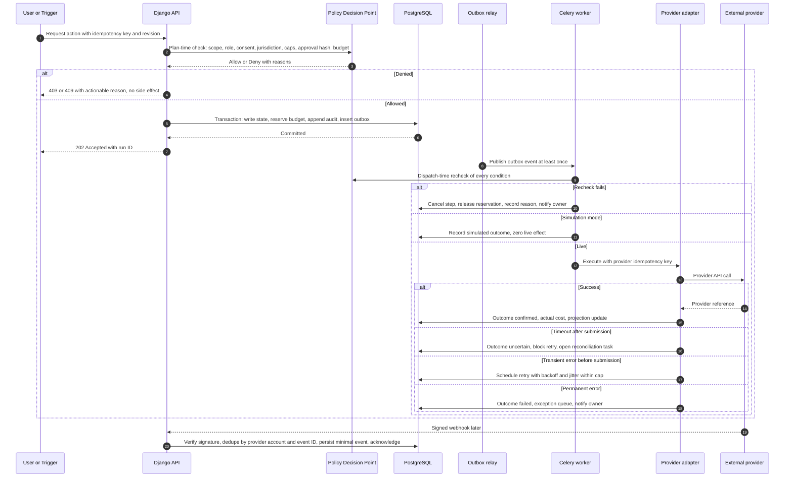

### 2.6.2 Engine invariants (tested for every flow)

| # | Invariant | Source |
|---|---|---|
| E-1 | Scope (product, tenant, startup) is resolved from current membership, never from browser-supplied IDs | BRD §2 |
| E-2 | State change, audit append, budget reservation and outbox insert happen in **one database transaction** | FRD §5 |
| E-3 | Every external action is checked **twice**: at plan time and at dispatch time | BRD §1.2, §5, §16 |
| E-4 | Duplicate delivery of any event or webhook has exactly one effect | M06 |
| E-5 | Timeout after submission is **uncertain**, never failed; no retry before reconciliation | FRD §11.1 |
| E-6 | Simulation has zero live effects (no send, publish, sign, spend, transfer) | BRD §1.2 |
| E-7 | Emergency stop / pause blocks all future external calls in scope within 60 s | M55, B-AUTO |
| E-8 | Actions capped at L1 by DEC-064 (contracts, quotes, discounts, bid submission, legal terms) never execute without a human approval bound to the exact hash | DEC-064 |
| E-9 | Every step stores correlation ID, attempt, error class and actual side effect | BRD §5 |

---

## 2.7 WF-01 Startup catalogue (product truth)

**Purpose:** approve offering, price, claims, segment, customer roles, pipeline and workflow; no unapproved offerings or unscoped access (BRD §5). **Actors:** P02 Startup Head (author), P09 Legal/Compliance (claims approver), P08 Finance (price approver), P11 Tenant admin (template). **Screens:** A004, A005, A006, A051, A098, A100.

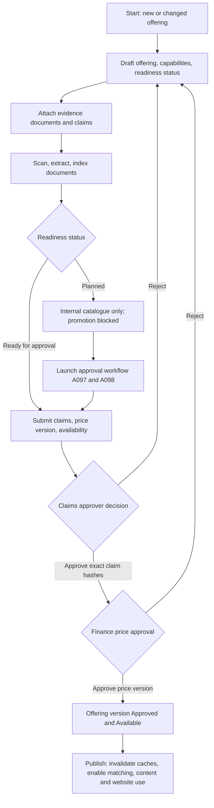

| Step | Actor | System behaviour | Rules | Screen |
|---|---|---|---|---|
| 1 | P02 | Create offering draft with capability codes, SKU/service ID, delivery model, region, tax profile | BRL-TEN, BRL-PUB | A004 |
| 2 | P02 | Upload brochure/FAQ/deck; file scanned; text extracted; content hash stored | BRL-SRC | A006 |
| 3 | System | Readiness defaults to *Planned*; planned offerings are excluded from matching, content, website and outreach | M66, DEC-060 | A097 |
| 4 | P09 | Approve each claim against evidence (approver ≠ author); claims with expiry | BRL-APR, BRL-MKT | A051 |
| 5 | P08 | Approve price version (currency, tax inclusion, validity) | BRL-QTE | A004/A068 |
| 6 | System | On approval: new immutable offering version; caches invalidated; downstream modules see only the approved version | BRL-PUB | n/a |

**Alternate/exception paths:** evidence expires → claim auto-suspended, dependent content and pages flagged for review · offering withdrawn → matching excludes it, open quotes get an "offering withdrawn" exception · stale revision on approval → 409, reload.
**Events:** `offering.version_approved`, `claim.approved`, `claim.expired`, `price.version_approved`. **Stop conditions:** none (configuration flow). **KPIs:** time from draft to approval; % offerings with complete claims evidence.

---

## 2.8 WF-02 Market discovery

**Purpose:** plan source query → evidence → signals/need → solution match → qualify, with allowed sources, review, freshness and confidence (BRD §5). **Actors:** P04 Research Analyst, scheduler (P16), AI agents (Part 7). **Screens:** A015–A023.

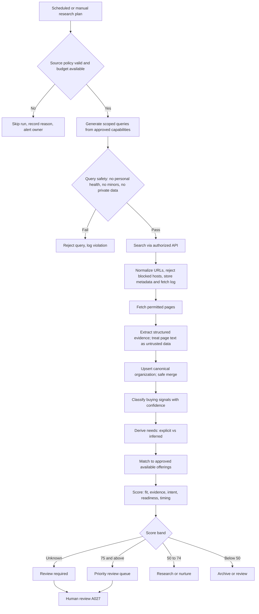

| Step | Actor | System behaviour | Rules |
|---|---|---|---|
| 1 | Scheduler / P04 | Plan has objective, source policy set, country/industry/org type, schedule timezone, max results, freshness SLA, budget | BRL-SRC, BRL-AI |
| 2 | System | Check every source permission (purpose, licence, expiry) and reserve search budget | BRL-SRC, M53 |
| 3 | AI (Tier 1a) / rules | Generate queries from approved capability codes; reject health-targeting or personal queries | M10, BRL-AI |
| 4 | Adapter | Search; normalize URLs; block hosts; store URL, title, published/observed date, licence | M11 |
| 5 | Adapter + AI | Fetch and extract to schema; prompt-injection text ignored; provenance and content hash stored | M12, BRL-AI |
| 6 | System | Organization upsert by domain + location + alias with merge safety checks | M13 |
| 7 | AI (Tier 1a) | Signal classification with confidence; below threshold → review | M14, DEC-001 |
| 8 | AI + rules | Need extraction; inferred needs labelled *inferred* | M15 |
| 9 | Rules + vectors | Match only *Approved and Available* offerings; explanation and exclusions | M16 |
| 10 | Rules | Score per DEC-011; Unknown when known weight < 0.60 | M17 |

**Exceptions:** source policy expires mid-run → stop collection immediately (M07 trigger) · search budget exhausted → stop, mark partial · missed schedule → recover once (OPT-04-01) · duplicate organization conflict → merge proposal task.
**Events:** `research.run_completed`, `evidence.created`, `signal.classified`, `need.derived`, `opportunity.scored`. **KPIs:** KPI-02, KPI-08, KPI-27, AI cost per signal.

---

## 2.9 WF-03 Professional contacts

**Purpose:** find organization decision-makers, verify channel/source, deduplicate, eligibility; no private scraping; contact score ≠ permission (BRD §5). **Screens:** A024–A026, A032.

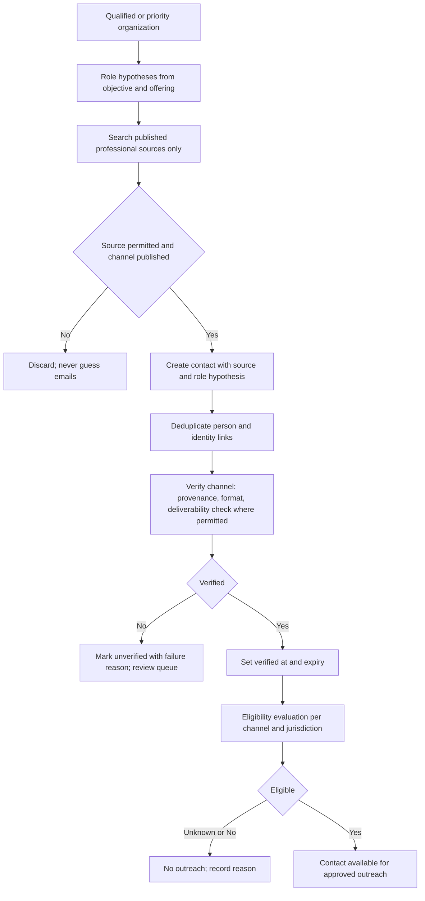

**Rules:** BRL-SRC (published professional sources only), BRL-ELG (verified ≠ consent; jurisdiction rule pack DEC-029), BRL-PRV (data minimization). **Exceptions:** verification expiry → automatic recheck job; paid verification adapter (B18) disabled unless approved. **KPIs:** KPI-03.

---

## 2.10 WF-04 Inbound acquisition

**Purpose:** landing page, chat, email, WhatsApp, social, event or referral → lead and attribution, with scope, consent and dedupe; no medical records or minor targeting (BRD §5). **Screens:** W10–W20, W11, A031, A037, A046.

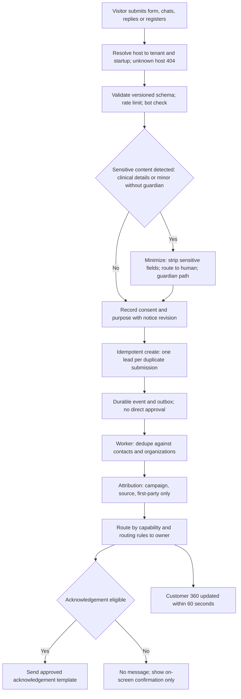

**Vertical routing (DEC-052):** external AI project → AppNAI · healthcare partnership → MedMaarg · education → EduVerse · organic trade/supply → OrganicSpec · SaaS interest → B-SVC journey. **Exceptions:** duplicate submission → same lead, attribution appended · unknown startup context → generic routing queue · ad pixels never receive health events (M37). **KPIs:** KPI-26.

---

## 2.11 WF-05 Content and campaign

**Purpose:** generate approved content, SEO, social, ad/landing plan, audience and budget, with claim and channel approval, cost caps and actual publication (BRD §5). **Screens:** A050–A061, A107, A108.

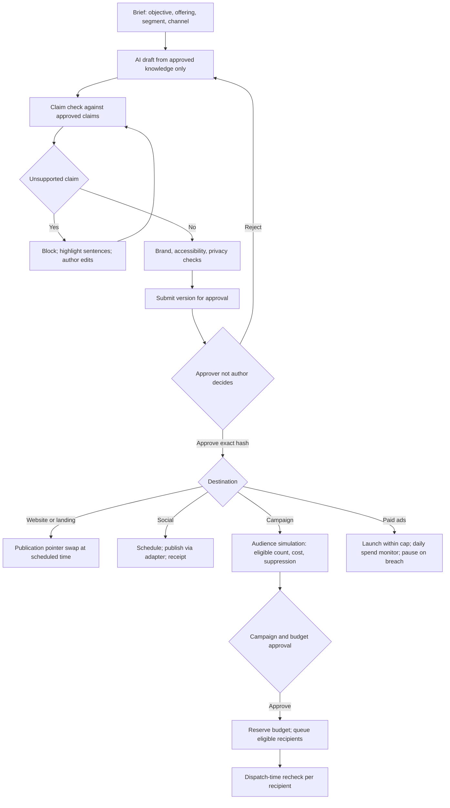

**Rules:** BRL-MKT (claims, brand, spend caps), BRL-APR (separation of duties), BRL-ELG (suppression at execution), BRL-PUB. **Exceptions:** budget exceeded → automatic pause (M39) · complaint spike → M57 pauses campaign · uncertain publish → reconcile before retry. **KPIs:** cost per conversion, KPI-18, KPI-26.

---

## 2.12 WF-06 Outreach and replies

**Purpose:** preview eligible contacts → approved messages → callback → classify intent; opt-out/complaint stop; a response halts the generic sequence (BRD §5). **Screens:** A034, A035, A037, A045.

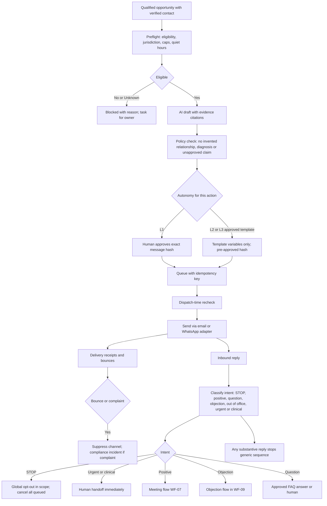

**KPIs:** KPI-04, KPI-05, KPI-17, KPI-18.

---

## 2.13 WF-07 Follow-up and meetings

**Purpose:** schedule tasks by intent, preference and local time; verify calendar; caps, rejection and suppression stop (BRD §5). **Screens:** A038–A041, W18.

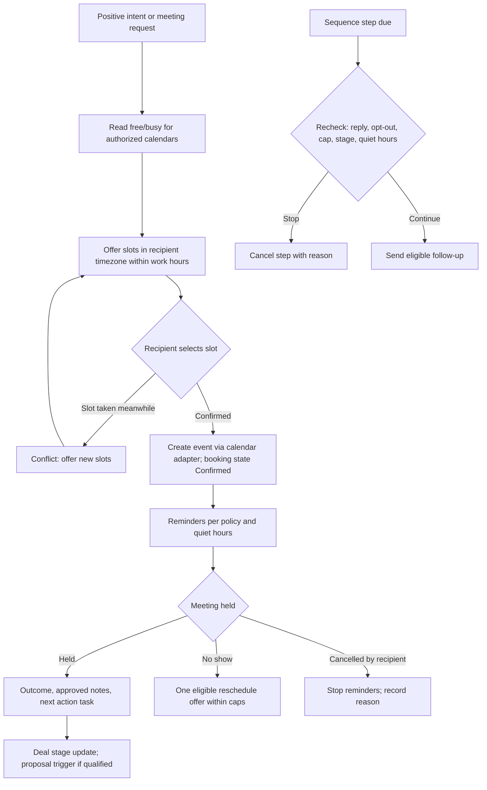

**Rules:** BRL-MTG (no invented availability; double-booking prevention), BRL-SEQ (stop on reply/opt-out/loss; caps). **KPIs:** KPI-06, KPI-20.

---

## 2.14 WF-08 Project bid (AppNAI route, BRD §4 and BR-S001)

**Screens:** A104, A016, A017, A065–A068, A071, A072. **Actors:** P06 Bid Manager, P02 Startup Head, P09 Legal, P08 Finance.

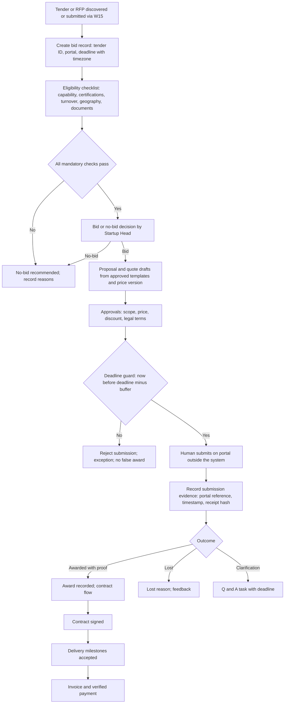

**Rules:** BRL-BID (deadline in UTC with a display timezone; default submission buffer 24 h, configurable; mandatory checks; human submission only, DEC-053), BRL-APR, BRL-FIN. **Decision matrix FR-DM-02:** submission at or after 2030-06-01 09:00 UTC is rejected. **KPIs:** KPI-11, on-time submission rate (100%).

---

## 2.15 WF-09 Proposal, quote and negotiation

**Screens:** A065–A070, W23. **Actors:** P03, P02, P08, P09, P14.

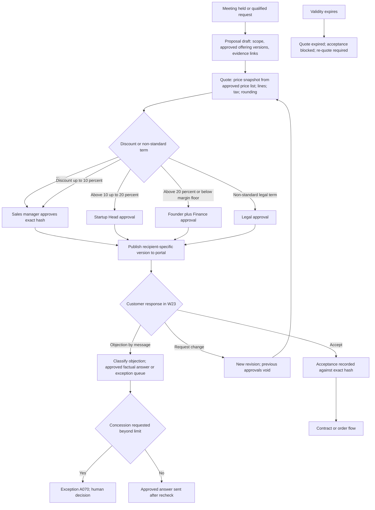

**Rules:** BRL-QTE (Decimal, HALF_UP per line, server recompute, FR-DM-01 = 270.00 INR), BRL-APR thresholds (DEC-038). **KPIs:** proposal turnaround, KPI-09, KPI-28.

---

## 2.16 WF-10 Order and fulfilment (OrganicSpec route, BR-S004)

**Screens:** A105, A067, A073, A074, W14, W16, W25.

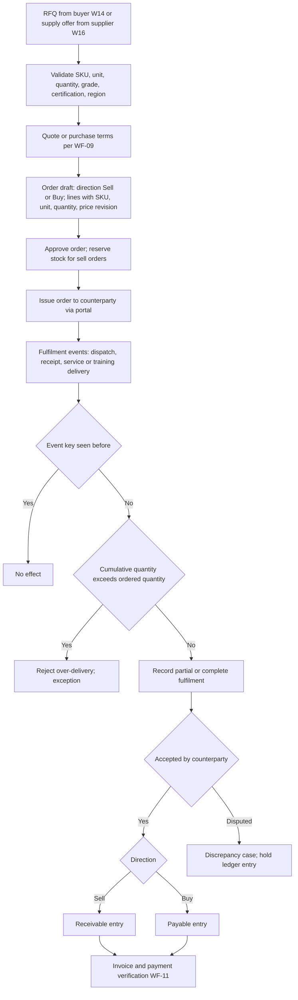

**Decision matrix FR-DM-03:** order 2 kg; two 1 kg deliveries with the same event key → one accepted; a further 2 kg → rejected. **Rules:** BRL-ORD, BRL-FIN (receivables and payables never netted automatically). **KPIs:** KPI-12, KPI-14.

---

## 2.17 WF-11 Commercial closure (all routes)

**Screens:** A073, A074, W26. **Actors:** P08 maker, P08 checker (different person), P01.

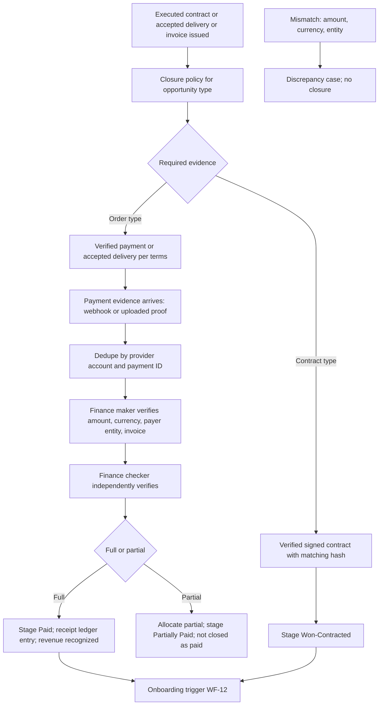

**Acceptance procedure AP-04:** partial receipt then completion → ledger and closure states are correct and no premature closure occurs. **Rules:** BRL-FIN (maker ≠ checker; no FX conversion of actuals; replay has no effect). **KPIs:** KPI-13, KPI-31.

---

## 2.18 WF-12 Retention and renewal

**Screens:** A075–A081, W27, W28.

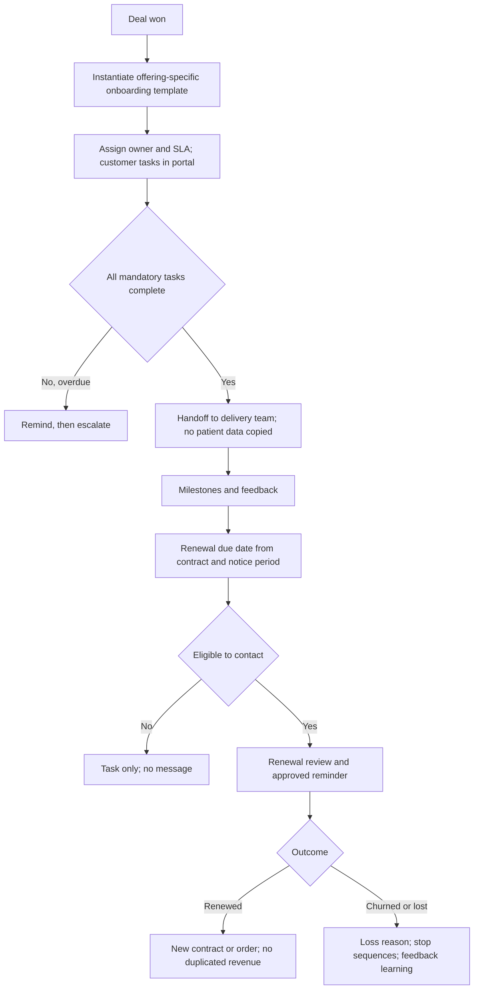

**Rules:** BRL-LCY (no medical data in risk scoring; no re-contact after loss without policy, M51). **KPIs:** KPI-15.

---

## 2.19 WF-13 Autonomous plan

**Screens:** A102, A033, A109–A111, A012. **Actors:** P10 designs, P01/P02 approve.

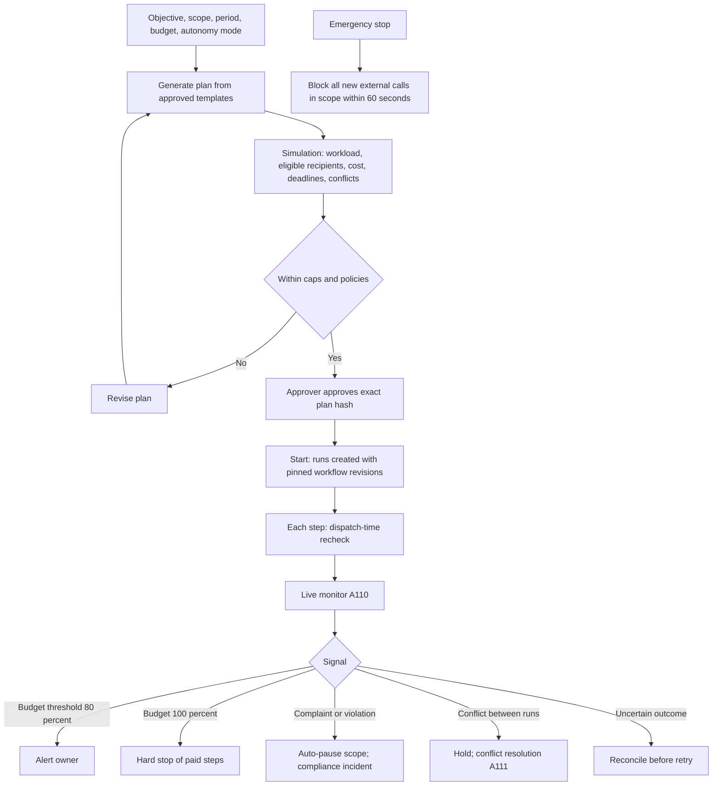

**Rules:** BRL-AUT (autonomy caps DEC-064; plan hash binding; loop and runaway prevention per Part 7). **KPIs:** KPI-19, KPI-20.

---

## 2.20 WF-14 Suspend and offboard (tenant or startup)

**Screens:** A099, A101, A103, W34.

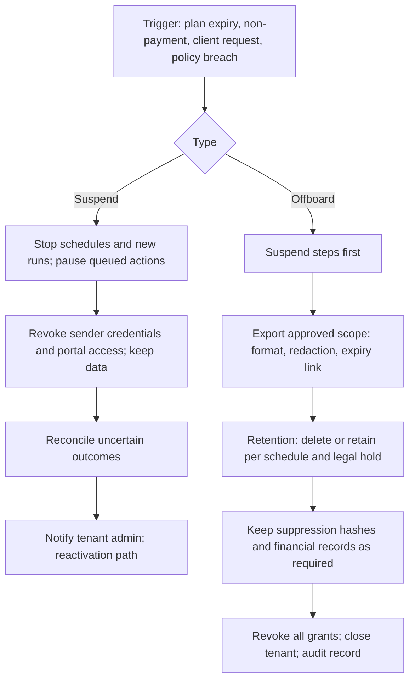

**Rules:** BRL-SVC, BRL-PRV, BRL-TEN (no effect on any other tenant; AP-10). **KPIs:** offboarding completion time; reconciliation completeness 100%.

---

## 2.21 Vertical routes not covered by a single workflow

### 2.21.1 MedMaarg institutional partnership (BR-S002, BR-S035)

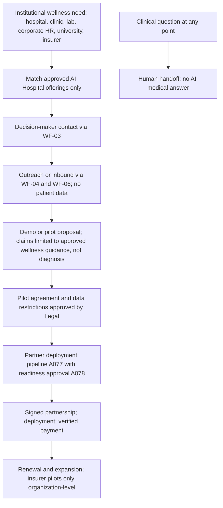

### 2.21.2 EduVerse education (BR-S003, BR-S036; DEC-030)

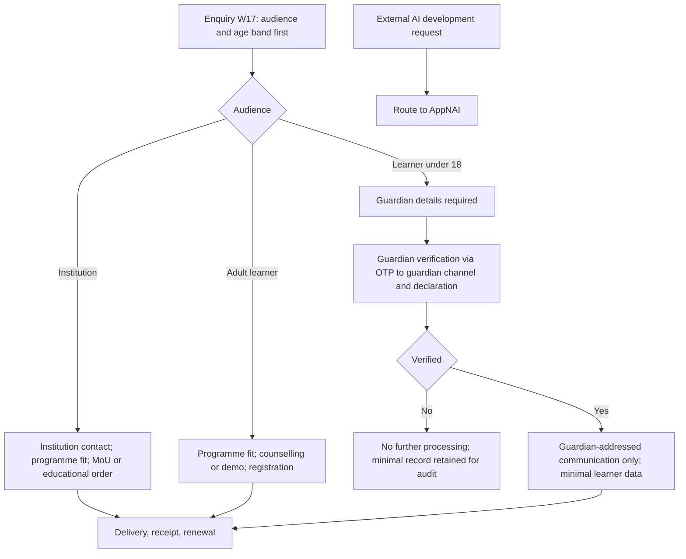

---

## 2.22 Cross-cutting flows

### 2.22.1 Opt-out and preference change (M04, W29)

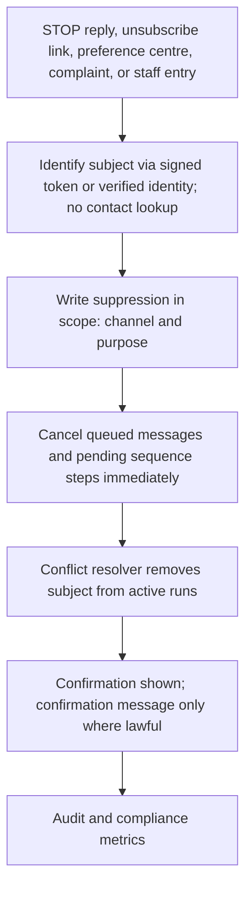

### 2.22.2 Privacy request (M56)

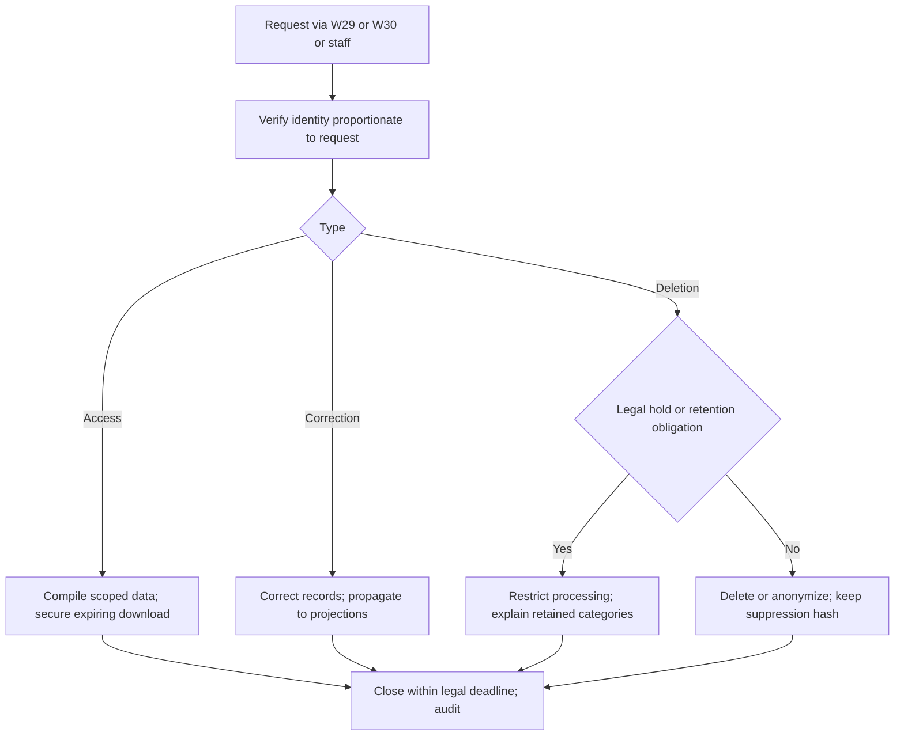

### 2.22.3 Website publication (FR-PUB-01; A107, A108)

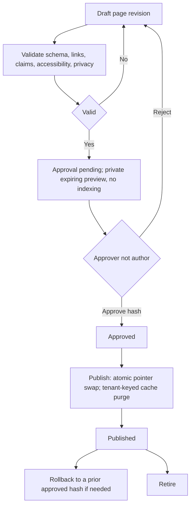

### 2.22.4 SaaS client onboarding (W31–W34; FRD §16.3)

```mermaid
flowchart TD
  A["Plans and demo W31"] --> B["Application W32: isolated expiring draft"]
  B --> C["Verify administrator authority and business identity"]
  C --> D["AI onboarding wizard W33: proposals are drafts; no dispatch or spend"]
  D --> E["Simulation of configuration and budgets"]
  E --> F["Platform approval"]
  F --> G["Transactional idempotent provisioning: tenant, startup, roles, plan"]
  G --> H["Service portal W34 and Admin workspace"]
  H --> I["Metering, invoices, renewal"]
```

### 2.22.5 Uncertain-outcome reconciliation (FR-STD-02; RECOMMENDATION-015)

```mermaid
flowchart TD
  A["Provider timeout after submission"] --> B["Outcome uncertain; retries blocked"]
  B --> C["Query provider by idempotency key or reference"]
  C --> D{"Provider result"}
  D -- "Found success" --> E["Reconciled confirmed; record cost"]
  D -- "Found failure" --> F["Reconciled failed; eligible retry after recheck"]
  D -- "Unavailable" --> G["Scheduled re-query with backoff; human task after 3 attempts"]
```

---

## 2.23 Flow-to-requirement traceability

| Flow | Primary BRs | FRs (screens) | Rule domains | KPIs |
|---|---|---|---|---|
| Engine 2.6 | M06, M24, M53, M55, B-AUTO | OP001, A009, A110 | BRL-AUT, BRL-ELG | KPI-20 |
| WF-01 | M02, M03, M66 | A004–A006, A051, A097, A098 | BRL-PUB, BRL-APR, BRL-MKT | — |
| WF-02 | M07, M10–M17 | A015–A023 | BRL-SRC, BRL-SCR, BRL-AI | KPI-02, KPI-08, KPI-27 |
| WF-03 | M18, M19, M24 | A024–A026 | BRL-SRC, BRL-ELG | KPI-03 |
| WF-04 | M22, M31, M32, M37, M40, M42 | W10–W20, A031 | BRL-ELG, BRL-PRV | KPI-26 |
| WF-05 | M34–M39 | A050–A061, A107, A108 | BRL-MKT, BRL-PUB | KPI-18 |
| WF-06 | M24–M28, M31, M41 | A034–A037, A045 | BRL-ELG, BRL-AI, BRL-SEQ | KPI-04, KPI-05, KPI-17 |
| WF-07 | M28, M29 | A038–A041, W18 | BRL-MTG, BRL-SEQ | KPI-06 |
| WF-08 | M43, M44, M46, M47 | A104 | BRL-BID | KPI-11 |
| WF-09 | M43–M45 | A065–A070, W23 | BRL-QTE, BRL-APR | KPI-09, KPI-28 |
| WF-10 | M44, M47 | A105, W14, W16, W25 | BRL-ORD, BRL-FIN | KPI-12, KPI-14 |
| WF-11 | M46, M47 | A073, A074, W26 | BRL-FIN, BRL-CTR | KPI-13, KPI-31 |
| WF-12 | M48, M50, M51 | A075–A081, W27, W28 | BRL-LCY | KPI-15 |
| WF-13 | M55, B-AUTO | A102, A033, A109–A111 | BRL-AUT | KPI-19, KPI-20 |
| WF-14 | B-SVC, B-TENANT | A099, A101, A103 | BRL-SVC, BRL-PRV | — |
| MedMaarg | BR-S002, BR-S035 | A077, A078 | BRL-AI, BRL-LCY | — |
| EduVerse | BR-S003, BR-S036 | W17 | BRL-PRV, BRL-ELG | — |
| Opt-out | M04 | W29, A007 | BRL-ELG | KPI-17 |
| Privacy | M56 | A013, W29, W30 | BRL-PRV | — |
| Publication | B-WEB | A107, A108 | BRL-PUB | — |
| SaaS onboarding | B-SVC | W31–W34, A099 | BRL-SVC | KPI-25 |
| Reconciliation | M06, M58 | A110 | BRL-AUT | — |

## 2.24 Quality gate: Batch 2.2

| Check | Result | Notes |
|---|---|---|
| Traced to source | Pass | All 14 workflows and 4 vertical routes cite BRD §4/§5 |
| Tagged additions | Pass | Bid submission buffer (24 h default) is a configurable rule added under DEC-053; OTP guardian verification per DEC-030 |
| IDs consistent | Pass | Rule domains declared; numbered in 2.3 |
| Negative/edge cases | Pass | Every flow lists exceptions; FR-DM-01…04 embedded |
| Restricted data | Pass | Clinical and minor paths route to humans; no free-tier use |
| Consistency | Pass | Approval thresholds match DEC-038; closure matches DEC-054 |

**Status: Part 2 Batch 2.2 complete. Next: Batch 2.3 (business rules catalogue, RBAC/ABAC matrix, state machines).**
