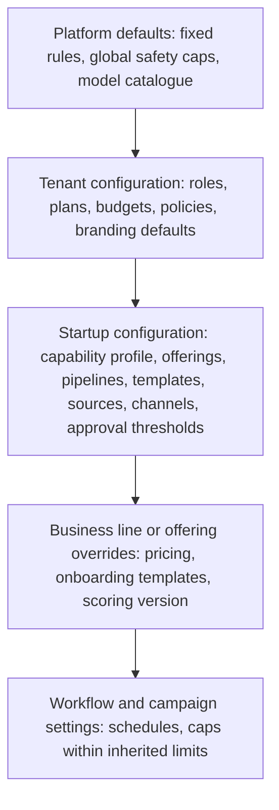
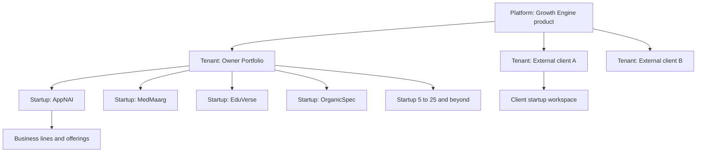

# AI Growth Engine: Employee Sales & Marketing Automation
## Application Blueprint: PART 2 (Batch 2.4), Cross-Cutting Functions: Notifications, Reporting & Analytics, Search, Configuration & Administration, Audit Trail, Multi-Tenancy, Localization

| Field | Value |
|---|---|
| Document | Part 2, Batch 4 of 5 |
| Version | 1.0 · 27 Nov 2026 |
| Baseline | BRD, FRD, Parts 0, 0A, 1, 2.1–2.3 |
| Roles applied | BSA (lead), UX Lead, Data Architect, Security & Compliance, SRE, FinOps |

---

## 2.30 Notifications

### 2.30.1 Principles

| # | Principle | Source |
|---|---|---|
| N-P1 | **Internal notifications** go to the in-app Action Centre (A106) and an email digest. No WhatsApp/SMS to staff in W0–W5 | DEC-036 |
| N-P2 | **External notifications** to customers, prospects and applicants are *messages*. They pass the full eligibility and dispatch rules (CA-DISPATCH, BRL-ELG). Transactional notices (invoice issued, contract sent, meeting confirmed, privacy response) are flagged `transactional` and exempt only from marketing caps and quiet-hour deferral, never from suppression of that channel where the law requires it | BRL-ELG-02, -08 |
| N-P3 | Every notification has a **dedup key**, an **actionable link** to the exact object, a severity, an owner and an SLA | FRD §16.2 A106 |
| N-P4 | A notification never reveals data the recipient cannot open; the link re-authorizes | BRL-TEN-04 |
| N-P5 | Notifications are generated from domain events via the outbox; losing an event is not acceptable (M58) | M06, M58 |
| N-P6 | Unacknowledged High/Critical notifications escalate along a defined chain; nothing auto-approves on timeout | BRL-APR-10 |

### 2.30.2 Severity, delivery and escalation

| Severity | Examples | In-app | Email | Escalation if unacknowledged |
|---|---|---|---|---|
| **Critical** | Emergency stop triggered; cross-scope access alert; payment discrepancy > ₹1 lakh; complaint threshold breach; provider outage affecting dispatch | Immediate, pinned | Immediate | 30 min → Startup Head; 2 h → Founder |
| **High** | Approval pending past SLA; bid deadline < 72 h with open checklist; budget at 100%; uncertain outcome awaiting reconciliation; privacy request at 70% of deadline | Immediate | Immediate | 1 business day → next approver level |
| **Normal** | New qualified opportunity assigned; meeting booked; quote accepted; task due today | Immediate | Hourly digest (default) | None (task SLA applies) |
| **Low** | Weekly research summary; SEO backlog updates; evidence going stale in 7 days | Immediate | Daily digest | None |

### 2.30.3 Internal notification catalogue

| ID | Event (source) | Recipients | Severity | Dedup key | SLA / escalation | FR |
|---|---|---|---|---|---|---|
| NT-001 | Opportunity qualified and assigned (M20) | Owner (R03), Startup Head digest | Normal | opportunity_id | Owner action ≤ 2 business days | A027 |
| NT-002 | Research run completed / partial (M10–M11) | Plan owner (R04) | Low | run_id | n/a | A015 |
| NT-003 | Source permission expiring in 14 days / expired (M07) | R04, R10 | High at expiry | source_id + phase | Renew before expiry | A010 |
| NT-004 | Evidence stale for a priority opportunity (BRL-SRC-06) | Owner | Low | opportunity_id | n/a | A017 |
| NT-005 | Contact verification failed/expired (M19) | R04 | Low | contact_id | n/a | A025 |
| NT-006 | Inbound reply received (M27) | Thread owner | Normal | thread_id + message_id | Response ≤ 1 business day | A037 |
| NT-007 | Urgent/clinical/complaint inbound routed to human (M27, M32) | Owner + R10 (complaint) | High | thread_id | ≤ 4 business hours | A037, A047 |
| NT-008 | STOP / opt-out processed (M04) | Owner (info), compliance metrics | Low | subject + scope | n/a | A007 |
| NT-009 | Draft awaiting approval (message/content/proposal/quote/contract/campaign/page/plan) | Eligible approvers by threshold | Normal → High after SLA | object_id + revision | 1 business day → escalate | A035, A051, A059, A066, A068, A072, A057, A108, A102 |
| NT-010 | Approval decided (approved/rejected with reason) | Author | Normal | object_id + revision + decision | n/a | same |
| NT-011 | Meeting booked / rescheduled / cancelled (M29) | Owner, attendees | Normal | meeting_id + state | n/a | A040 |
| NT-012 | Meeting outcome missing 24 h after end (BRL-MTG-05) | Owner | Normal | meeting_id | Escalate to Startup Head at 72 h | A040 |
| NT-013 | Sequence stopped (reason) (M28) | Owner | Low | enrolment_id | n/a | A038 |
| NT-014 | Quote viewed / accepted / change requested / expired (M44) | Owner, Startup Head | Normal | quote_id + state | Respond to change ≤ 2 business days | A067 |
| NT-015 | Contract signed / declined / expired (M46) | Owner, R10, R08 | Normal (High if declined) | contract_id + state | n/a | A071 |
| NT-016 | Payment evidence received; maker verification needed (M47) | R08 pool | Normal | payment_id | 1 business day | A073 |
| NT-017 | Checker verification needed | R09 pool (excluding maker) | Normal | payment_id | 1 business day | A074 |
| NT-018 | Payment discrepancy (BRL-FIN-03) | R08, R09, owner | High (Critical > ₹1 lakh) | payment_id | 1 business day | A074 |
| NT-019 | Deal won / paid (M47) | Owner, Startup Head, R01 digest | Normal | deal_id + state | n/a | A029 |
| NT-020 | Bid deadline in 7 days / 72 h / 24 h with open checklist (BRL-BID-01) | R06, R02 | Normal → High → Critical | bid_id + threshold | Escalate per phase | A104 |
| NT-021 | Bid submission evidence missing after deadline | R06, R02 | High | bid_id | Same day | A104 |
| NT-022 | Order over-delivery rejected / dispute raised (BRL-ORD-02) | R07, R08 | High | order_id + event | 1 business day | A105 |
| NT-023 | Onboarding task overdue (M48) | Task owner → Startup Head | Normal → High | task_id | Escalate at SLA | A076 |
| NT-024 | Renewal due in 90/60/30 days (M50) | Owner, R02 | Normal | renewal_id + threshold | n/a | A079 |
| NT-025 | Budget at 80% / 100% (agent, tenant, campaign, ads) (M53, M39) | R01, R08, R11; campaign owner | High at 80, Critical at 100 | budget_id + threshold | Immediate | A012, A061 |
| NT-026 | Spend anomaly > 150% expected (BRL-MKT-05) | Campaign owner, R08 | High | campaign_id + day | Immediate | A060 |
| NT-027 | Complaint threshold breached; campaign auto-paused (M57) | R10, R05L, R02 | Critical | campaign_id | 30 min | A047 |
| NT-028 | Compliance incident opened / due (M57) | R10 | High | incident_id | Per incident SLA | A047 |
| NT-029 | Privacy request received / 70% of deadline (M56) | R10 | Normal → High | request_id + phase | Legal deadline | A013 |
| NT-030 | Workflow run failed / uncertain outcome (A110) | R11, run owner | High | run_id + step | Reconcile ≤ 1 business day | A110 |
| NT-031 | Conflict held between runs (A111) | R11, relationship owner | Normal | conflict_id | 1 business day | A111 |
| NT-032 | Emergency stop activated / lifted | R01, R02, R11, R10 | Critical | scope + action | Immediate | A033 |
| NT-033 | Integration degraded/disabled (M05) | R11, R12 | High | integration_id + state | 4 h | A008 |
| NT-034 | Provider outage / DLQ growth / SLO burn (M58) | R11, on-call engineer | Critical | service + alert | Per incident process (Part 4) | A014 |
| NT-035 | AI regression gate failed / quality drift (M54) | R11, AI lead | High | eval_run_id | Before next release | A084 |
| NT-036 | Claim/evidence expiring in 14 days (BRL-MKT-01) | Claim owner, R10 | Normal | claim_id | Renew before expiry | A051 |
| NT-037 | Content/page publication succeeded/failed/rolled back (BRL-PUB) | Author, approver | Normal / High on failure | publication_id + revision | n/a | A108 |
| NT-038 | Support access grant requested / activated / expired (BRL-TEN-09) | R12 (tenant), R13 | High on request | grant_id + state | Decide ≤ 4 business hours | A099 |
| NT-039 | Membership expiring in 7 days (BRL-TEN-07) | R12, user | Low | membership_id | n/a | A002 |
| NT-040 | Tenant usage at 80/100% of entitlement (BRL-SVC-03) | R12 (client), R14 | Normal / High | tenant + meter + threshold | n/a | A101, W34 |
| NT-041 | Trial expiring in 3 days / expired (BRL-SVC-05) | R12 (client) | Normal / High | tenant + phase | n/a | W34 |
| NT-042 | Export ready / expiring (A103) | Requester | Normal | export_id | Link expiry 72 h | A103 |
| NT-043 | Release gate failed / release deployed / rolled back (M62) | Engineering, R01 digest | High on failure | release_id | Per release process | A090 |
| NT-044 | Config revision scheduled/activated/rolled back (A112) | R12, R11, affected owners | Normal | config_id + revision | n/a | A112 |
| NT-045 | New application awaiting platform approval (W32) | Platform approver | Normal | application_id | 1 business day | A099 |

### 2.30.4 External (customer-facing) notification catalogue

| ID | Event | Recipient | Channel | Type | Template approval | FR |
|---|---|---|---|---|---|---|
| NX-01 | Enquiry acknowledgement (if eligible) | Submitter | Email (WhatsApp if opted in) | Transactional | Startup content approver | W12–W20 |
| NX-02 | Meeting confirmation / reschedule / reminder (24 h, 1 h) | Attendee | Email + calendar invite (WhatsApp if opted in) | Transactional | Yes | W18 |
| NX-03 | Event registration and reminders | Registrant | Email | Transactional | Yes | W19 |
| NX-04 | Proposal/quote available for review | Customer contact | Email with portal link | Transactional | Yes | W23 |
| NX-05 | Agreement ready to sign / signed copy | Signers | Email / e-sign provider | Transactional | Legal | W24 |
| NX-06 | Order issued / dispatched / delivered / acceptance requested | Counterparty | Email / portal | Transactional | Yes | W25 |
| NX-07 | Invoice issued / payment received / receipt | Customer | Email / portal | Transactional | Finance | W26 |
| NX-08 | Onboarding task requested / overdue | Customer | Email / portal | Transactional | Yes | W27 |
| NX-09 | Support case updates | Customer | Email / portal | Transactional | Yes | W28 |
| NX-10 | Opt-out / preference change confirmation | Subject | Same channel where lawful | Transactional | Legal | W29 |
| NX-11 | Privacy request acknowledgement and response | Subject | Email / portal | Transactional (statutory) | Legal | W30 |
| NX-12 | Application received / verification / approved / rejected | SaaS applicant | Email | Transactional | Service owner | W32 |
| NX-13 | Trial/plan/usage/invoice/suspension notices | SaaS client admin | Email / W34 | Transactional | Service owner | W34 |
| NX-14 | Renewal reminder | Customer | Email (eligible) | Marketing-transactional hybrid → treated as **marketing** for caps unless contractually required | Yes | A079 |
| NX-15 | Guardian verification OTP (EduVerse) | Guardian | Email/SMS OTP | Transactional | Legal | W17 |

### 2.30.5 Preferences, digests and delivery rules

| Rule | Detail |
|---|---|
| User preferences | Per user: digest frequency (immediate/hourly/daily) for Normal/Low; cannot mute Critical; mute per notification type up to 30 days except Critical/High |
| Working hours | Internal email digests respect the user's timezone working hours; Critical always immediate |
| Grouping | Same dedup key within 15 min → one notification with a count |
| Lifecycle | Unread → Read → Acknowledged → Resolved (auto-resolved when the underlying object reaches the target state) → Archived (after 90 days) |
| Delivery failure | Email bounce for internal user → in-app banner + tenant admin notified |
| Audit | Every Critical/High notification and acknowledgement is audited |

---

## 2.31 Reporting and analytics

### 2.31.1 Analytics architecture (functional view)

| Layer | Purpose | Implementation intent (detailed in Part 3) |
|---|---|---|
| Event capture | Domain events from the outbox (deal transitions, messages, payments, attribution events) | Append-only `DomainEvent` stream |
| Projections | Read-optimized tables per dashboard (funnel, pipeline, revenue, costs) | PostgreSQL projections refreshed by consumers; freshness target ≤ 60 s for Customer 360 (NFR-008), ≤ 15 min for dashboards |
| Metric layer | **Single versioned definition per KPI** (formula, numerator, denominator, filters, currency basis); A083 governs changes | `MetricDefinition` with revision and approval |
| Presentation | Dashboards A042, A043, A082, A087, A089; report exports | React charts with numerator/denominator/as-of display |
| Exports | CSV/XLSX/PDF with scope, as-of, metric version in the header | Server-side, rechecked permissions (FR-FLT-RULES) |

### 2.31.2 Reporting rules (binding)

| ID | Rule | Source |
|---|---|---|
| RPT-R1 | Every figure shows its **as-of time**, **scope**, **metric version** and, for money, **original currency** (no silent FX) | FRD §2; DEC-027 |
| RPT-R2 | **Unknown ≠ 0**: missing data shown as "Unknown" with count of unknown records | FRD §2 |
| RPT-R3 | Distinct, de-duplicated records only; qualified ≠ raw contacts | BRD §12.1 |
| RPT-R4 | **Forecasts and estimates are labelled** and never summed with actuals | M60, BRD §13 |
| RPT-R5 | Revenue figures are **ledger-derived** from verified entries; SaaS fees, procurement payments and investment excluded from commercial receipts | M52, BRD §13.1 |
| RPT-R6 | Awarded, signed, delivered and paid are always separate columns | BRD §13.1; DEC-054 |
| RPT-R7 | Simulated records excluded from all metrics | BRL-AUT-04 |
| RPT-R8 | Portfolio views aggregate only startups within one tenant and the viewer's grants; never cross-tenant | DEC-065 |
| RPT-R9 | Attribution reports state the model and its caveat ("attribution is an estimate of contribution, not causation") | M52 |
| RPT-R10 | Exports and scheduled reports re-check permissions at generation time and carry the classification label | FR-FLT-RULES; BRL-PRV-07 |

### 2.31.3 Report and dashboard catalogue

| ID | Report / dashboard | View | Audience | Key measures (KPI refs) | Dimensions / filters | Freshness | FR |
|---|---|---|---|---|---|---|---|
| RP-01 | Portfolio overview | Overview | R01 | Qualified pipeline, meetings held, awarded/signed/delivered/paid, receipts, payables, AI and channel cost, compliance status (KPI-07, 06, 13, 14, 17, 21) | Startup, period, currency | 15 min | A089 |
| RP-02 | Startup growth dashboard | Overview | R02, R03 | Funnel stage counts and conversion with numerator/denominator (KPI-05, 06, 07, 09) | Business line, offering, owner, channel, geography | 15 min | A042 |
| RP-03 | Management / team dashboard | Overview | R01, R02 | Team capacity, SLA adherence, intervention rate, budget variance | Team, owner | 15 min | A043 |
| RP-04 | Discovery performance | Discovery | R04, R02 | Signals reviewed, precision (KPI-02), qualified rate, source coverage (KPI-27), cost per qualified opportunity (KPI-22) | Source, country, sector, objective | Daily | A016, A019 |
| RP-05 | Contact quality | Discovery | R04 | Verified contact rate (KPI-03), verification failures by reason, stale contacts | Source, role, country | Daily | A025, A026 |
| RP-06 | Outreach performance | Outreach | R03, R05 | Eligible delivery (KPI-04), replies (KPI-05), positive intent, opt-outs, complaints (KPI-17, 18), blocked-by-policy counts with reasons | Channel, template, sequence, campaign | 15 min | A037, A038 |
| RP-07 | Eligibility and suppression report | Outreach | R10 | Blocked sends by rule (BRL-ELG ID), suppression growth, jurisdiction denials | Rule, jurisdiction, channel | Daily | A007, A047 |
| RP-08 | Campaign and content performance | Outreach & Marketing | R05, R02 | Reach, qualified enquiries (KPI-26), conversion, cost per conversion, spend vs cap | Campaign, channel, content, locale | Hourly (ads), daily (other) | A058–A061 |
| RP-09 | SEO and website analytics | Outreach & Marketing | R05 | Impressions, clicks, enquiries per page, portal completion (KPI-26) | Page, locale, startup | Daily | A054, A108 |
| RP-10 | Follow-up and meetings | Follow-ups | R03, R02 | Meetings booked vs held, no-show rate, follow-up timeliness (KPI-20) | Owner, channel | 15 min | A038, A040 |
| RP-11 | Objections and negotiation | Objections | R02 | Objection categories, resolution rate and time (KPI-28), exceptions | Category, offering | Daily | A069, A070 |
| RP-12 | Proposals and quotes | Closure | R02, R08 | Turnaround, approval cycle time, acceptance rate, discount distribution vs thresholds, margin | Offering, approver | Daily | A065–A068 |
| RP-13 | Bid performance (AppNAI) | Closure | R06, R02 | Bids by stage, on-time submission (100% target), award rate (KPI-11), no-bid reasons | Portal, technology, region | Daily | A104 |
| RP-14 | Orders and fulfilment (OrganicSpec) | Closure | R07, R08 | Fulfilment accuracy (KPI-12), disputes, receivables/payables ageing | SKU, direction, counterparty | 15 min | A105 |
| RP-15 | Receipts and reconciliation | Closure | R08, R01 | Receipts (KPI-13), payables (KPI-14), discrepancies, partial payments, closure integrity (KPI-31) | Startup, currency, period | 15 min | A073, A074 |
| RP-16 | Revenue and attribution | Overview | R01, R08 | Verified revenue by channel/campaign/source with model caveat (M52) | Attribution model, period | Daily | A082 |
| RP-17 | Forecast (estimate) | Overview | R01, R02 | Weighted pipeline, scenario, confidence interval, forecast error (KPI-29) | Team, period | Daily | A087 |
| RP-18 | Onboarding and renewal | Follow-ups | R02 | Onboarding time, overdue tasks, renewal rate (KPI-15), churn reasons | Offering | Daily | A075–A081 |
| RP-19 | Lost-deal analysis | Closure | R02 | Loss reasons, stage of loss, re-open rate | Offering, owner | Weekly | A081 |
| RP-20 | AI quality and cost | Automation | R11, AI lead | Precision/recall per agent, abstention rate, schema failures, fallback rate, cost per task (KPI-21), latency | Agent, model, prompt version | Daily | A011, A084 |
| RP-21 | Cost and budget | Automation | R01, R08, R11 | Reserved vs actual by provider/agent/startup/tenant; burn rate; forecast to month-end (labelled) | Provider, agent, budget | Hourly | A012 |
| RP-22 | Automation operations | Automation | R11 | Runs by state, timeliness (KPI-20), automation rate (KPI-19), conflicts, uncertain outcomes, DLQ | Workflow, trigger, startup | 5 min | A110, A111 |
| RP-23 | Compliance | Automation | R10 | Incidents by type/severity, complaint rate, privacy SLA, suppression breaches (must be 0) | Channel, jurisdiction | Daily | A047, A013 |
| RP-24 | Audit activity | Automation | R10, R15 | Privileged actions, approvals, overrides, support grants, exports | Actor, action type | Real time | A009 |
| RP-25 | System health and SLO | Automation | R11, SRE | Availability, latency, error budget burn, queue depth | Service | 1 min | A014 |
| RP-26 | Release readiness | Automation | Engineering, R01 | Gate status, evidence completeness, open critical defects | Release | Real time | A090 |
| RP-27 | SaaS tenant economics | Automation | Service owner, R14 | Contribution margin per tenant (KPI-23), usage vs entitlement, reconciliation (KPI-24), onboarding time (KPI-25), churn | Tenant, plan | Daily | A101 |
| RP-28 | Client usage and invoices (client view) | W34 | R12 (client) | Own usage, entitlements, invoices | Period | Daily | W34 |
| RP-29 | Customer portal summary (customer view) | W22 | R16 | Own open items, milestones, invoices | n/a | Real time | W22 |
| RP-30 | Expansion pilots tracker | Closure | R01, R02 | Pilot stages, readiness approvals, outcomes | Pilot type, region | Weekly | A091–A096 |

### 2.31.4 Attribution and forecasting methods

| Topic | Decision | Rationale / source |
|---|---|---|
| Attribution models offered | First-touch, last non-direct touch (**default**), linear, position-based (40/20/40) | M52 "attribution caveat"; default chosen for simplicity and explainability [RECOMMENDATION-022] |
| Touch sources | First-party events only (landing pages, forms, campaign codes, referral codes, outbound sequences); no third-party cookies; no health events to ad platforms | M37; BRL-MKT-06 |
| Attribution window | Default 90 days before qualification; configurable per startup | A060 field "attribution window" |
| Forecast method | Stage-weighted pipeline. Weights = **historical stage-to-won conversion** per startup and offering type when ≥ 30 closed deals exist; otherwise **configured weights** (approved in A088). Backtest required for weight changes | M60; A088 "backtest results" |
| Forecast presentation | Always "Estimate" badge, scenario (base/low/high), confidence interval, assumptions panel; never included in revenue totals | RPT-R4 |

### 2.31.5 Scheduled reports and exports

| Capability | Rule |
|---|---|
| Scheduled email reports | User subscribes to RP-xx with scope and frequency; content generated at send time with permission recheck; Restricted fields excluded from email bodies (link to the app instead) |
| Export formats | CSV, XLSX, PDF; header includes scope, filters, as-of, metric version, classification |
| Export limits | Default max 50,000 rows per export; larger → async job via A103 with approval if Restricted |
| Board pack | Monthly portfolio PDF (RP-01, RP-15, RP-16, RP-17 labelled estimate) generated for R01 |

---

## 2.32 Search

| ID | Search capability | Users | Corpus | Technique | Permission enforcement | FR |
|---|---|---|---|---|---|---|
| SR-01 | **Global Admin search** (Ctrl/Cmd+K) | All Admin roles | Organizations, contacts, deals, opportunities, bids, orders, quotes, proposals, contracts (metadata), documents (titles), content, campaigns, tasks | PostgreSQL full-text (`tsvector`, language-aware) + trigram for names/domains; typed result groups | RLS + serializer field masks; results never include objects outside scope; counts per group only for permitted objects | FR-SRCH-01 |
| SR-02 | **List filtering** | Admin | Each list screen | Typed filters (FR-FLT-01…11) with OR within / AND across; cursor pagination | Server-side allowlists | FR-FLT-RULES |
| SR-03 | **Saved views** | Admin | Any list | Persisted filter + sort + columns; scoped to user/product/tenant/startup; optionally shared with team | Saved view re-evaluated under the viewer's permissions | FRD §2 |
| SR-04 | **Approved knowledge search** | Admin, Copilot, AI agents | Approved document chunks and claims | Hybrid: full-text + vector similarity (pgvector) with re-ranking; citations returned | Only approved versions in scope; vector namespace per tenant/startup (§2.35) | M03, A005 |
| SR-05 | **Evidence search** | R04 and reviewers | Evidence excerpts and metadata | Full-text + filters (source, date, confidence) | Scope; provenance shown | A017 |
| SR-06 | **Public site search** | Visitors | Published snapshot content for that startup/locale | Full-text over the publication index only | Host-to-startup mapping; never drafts or portal content | W04, W08 |
| SR-07 | **Portal search** | External users | Own records | Simple filters | Object grants | W22 |
| SR-08 | **Duplicate detection** (system) | System | Organizations, contacts, leads | Normalized domain, email hash, phone E.164, fuzzy name (trigram ≥ 0.85) + location | Within tenant/startup scope only | M13, M22 |

**Search non-functional targets:** p95 global search ≤ 700 ms for ≤ 1 M indexed records per tenant; index lag ≤ 60 s [RECOMMENDATION-002 family].

---

## 2.33 Configuration and administration

### 2.33.1 Configuration hierarchy and inheritance

**Inheritance rule:** a lower level may only **tighten** an inherited limit unless the Founder approves loosening (BRL-APR-11). Fixed platform rules cannot be overridden at any level.

### 2.33.2 Configuration catalogue

| ID | Configuration item | Level | Screen | Who changes | Approval | Versioned | Source |
|---|---|---|---|---|---|---|---|
| CFG-01 | Tenant profile, lifecycle, plan | Tenant | A099, A101 | R12 / platform | Platform for plan changes | Yes | B-TENANT, B-SVC |
| CFG-02 | Users, roles, grants, MFA requirement | Tenant | A002 | R12 | — (audited) | Yes | M01 |
| CFG-03 | Startup creation from template; capability profile | Tenant → Startup | A099, A100 | R12 | R01 | Yes | AP-01 |
| CFG-04 | Business templates (industry taxonomy, field schema, objective templates, workflow bindings) | Tenant | A100 | R12, R11 | R01 | Yes | A100 |
| CFG-05 | Branding / theme revision, domain verification | Startup | A100, A107 | R05L, R12 | R02 | Yes | A107 |
| CFG-06 | Offerings, capabilities, claims, price versions, tax profile | Startup / offering | A004, A051 | R02, R05 | R10 (claims), R08 (price) | Yes | M02 |
| CFG-07 | Consent policies, quiet hours, frequency caps, jurisdiction packs | Tenant / startup | A007, A039 | R10 | Tighten: R10; loosen: R01 | Yes | BRL-ELG |
| CFG-08 | Source registry and permissions | Startup | A010, A049, A086 | R04 | R10 | Yes | M07 |
| CFG-09 | Research plans and schedules | Startup | A015 | R04 | — (within source/cost bounds) | Yes | M10 |
| CFG-10 | Scoring versions and thresholds | Startup | A023 | R04 | R02 (after simulation) | Yes | M17 |
| CFG-11 | Pipelines, stages, entry/exit rules, assignment rules | Startup | A030 | R02 | R01 for new pipeline type | Yes | M21 |
| CFG-12 | Forms and routing rules | Startup | A031 | R05, R03 | R02 | Yes | M22 |
| CFG-13 | Message templates (all channels, locales) | Startup | A035, A044 | R03, R05 | R05L/R02 + R10 for claims | Yes | M25, M31 |
| CFG-14 | Sequence and follow-up policies | Startup | A039 | R03L | R02 | Yes | M28 |
| CFG-15 | Calendar configuration (work hours, buffers) | User / startup | A041 | User / R02 | — | Yes | M29 |
| CFG-16 | FAQ, chat knowledge, routing rules, handover SLA | Startup | A046 | R05, R03 | R02 + R10 | Yes | M32, M41 |
| CFG-17 | Approval thresholds (discount, margin floor, contract value) | Tenant / startup | A068 policy panel | R01 | R01 | Yes | DEC-038 |
| CFG-18 | Closure policy per opportunity type | Startup | A030 | R02 | R01 + R08 | Yes | DEC-054 |
| CFG-19 | Onboarding templates | Offering | A075 | R02 | — | Yes | M48 |
| CFG-20 | Renewal policies | Startup | A080 | R02 | R10 (contact rules) | Yes | M50 |
| CFG-21 | KPI and metric definitions; attribution model | Tenant / startup | A083 | R08 | R01 | Yes | M52 |
| CFG-22 | Forecast model settings | Startup | A088 | R02 | R01 after backtest | Yes | M60 |
| CFG-23 | Budgets and caps (AI, providers, ads, campaigns) | Tenant / startup / agent | A012, A061 | R01, R08 | R01 for increases | Yes | M53 |
| CFG-24 | Integrations (connections, secret references, scopes, quotas) | Tenant / startup | A008 | R11, R12 | R12 + R01 for paid adapters | Yes | M05 |
| CFG-25 | AI routing, prompts, thresholds, Tier 2 opt-in | Tenant / agent | A011 | R11 | R01 + R10 for Tier 2 opt-in | Yes | DEC-007 |
| CFG-26 | Workflows, triggers, node templates | Tenant / startup | A033, A109, A113 | R11 | R02/R01 for enabling | Yes | M55 |
| CFG-27 | Autonomy mode per workflow | Workflow | A033, A102 | R11 | R01 (L3), R02 (L2) | Yes | DEC-064 |
| CFG-28 | Retention schedule overrides (stricter only) | Tenant | A013 | R10 | R10 | Yes | DEC-028 |
| CFG-29 | Website: template, pages, locales, forms | Startup | A107 | R05 | R02 (+R10 privacy) | Yes | B-WEB |
| CFG-30 | Notification preferences | User | Profile | User | — | No (audited) | DEC-036 |
| CFG-31 | Feature flags (channels, adapters, autonomy, Tier 2) | Platform / tenant | Ops console | Platform engineering | Change record | Yes | RECOMMENDATION-005 |
| CFG-32 | Reference data (countries, currencies, units, HSN/SAC, industry taxonomy, loss reasons, objection categories) | Platform / tenant | Reference data admin (within A100) | Platform / R12 | Platform for global lists | Yes | §2.33.4 |

### 2.33.3 Configuration change governance (A112)

| Step | Rule |
|---|---|
| Draft | Candidate revision created from the active revision; field-level diff |
| Validate | Schema validation, referential checks (e.g. template references an approved offering), conflict detection |
| Impact | List of affected screens, forms, workflows, running runs (which stay pinned), users and metrics |
| Simulate | For rules/policies: replay last 30 days of decisions in simulation and show differences (e.g. how many sends would now be blocked) |
| Approve | Per CFG approval column; loosening requires R01 |
| Schedule | Effective date/time; communication to affected users (NT-044) |
| Activate | Atomic switch; cache invalidation |
| Rollback | One-click revert to the previous active revision (future-effective); running runs unaffected |

### 2.33.4 Reference and master data

| Dataset | Owner | Source / maintenance | Used by |
|---|---|---|---|
| Countries, states, cities (ISO 3166) | Platform | Standard list; annual review | Filters, jurisdiction rules |
| Currencies (ISO 4217) and minor units | Platform | Standard list | Money fields |
| FX rates (snapshot, reporting only) | Finance | Recorded source and date per use (DEC-027) | Reports |
| Units of measure (kg, quintal, tonne, litre, piece, hour, session…) | Platform + OrganicSpec | Curated; conversions defined | Orders, quotes |
| HSN/SAC codes and GST rates | Finance | Maintained per startup TaxProfile; verify periodically | Quotes, invoices |
| Industry taxonomy | Platform; tenant extensions | Curated tree | Discovery, templates |
| Role taxonomy (decision-maker roles) | Platform | Curated | Contacts |
| Signal types, need categories | Platform; tenant extensions | Curated with examples for AI | Discovery |
| Loss reasons, objection categories | Tenant | Curated | Lifecycle |
| Jurisdiction rule packs | Legal | Versioned (BRL-ELG-05) | PDP |
| Public holidays per region | Platform | Annual load | Quiet hours, SLAs |
| Technology taxonomy (AppNAI), programme/domain taxonomy (EduVerse), SKU catalogue (OrganicSpec), organization types (MedMaarg) | Startup | Startup-owned | Vertical filters FR-FLT-08…11 |

### 2.33.5 Administrative functions (summary)

| Function | Screens |
|---|---|
| User lifecycle: invite, activate, change role, expire, revoke, access review (quarterly attestation) [RECOMMENDATION-023] | A002 |
| Tenant/startup lifecycle and support grants | A099 |
| Templates, branding, domains | A100, A107 |
| Policies and approvals | A007, A039, A068 (policy), A080 |
| Integrations, budgets, AI | A008, A011, A012 |
| Automation governance | A033, A102, A109–A113 |
| Data operations: import, export, privacy, retention | A013, A103 |
| Health, incidents, releases, audit | A009, A014, A090 |

---

## 2.34 Audit trail

### 2.34.1 What is audited

| Category | Examples | Source |
|---|---|---|
| Authentication and sessions | Login, MFA, failures, lockouts, session revocation, step-up | M01 |
| Authorization | Denied access (403/404 uniform), role/grant changes, support-access grants, delegation | BRL-TEN, BRL-APR-09 |
| Data changes | Create/update/delete of business records with field-level before/after for configured sensitive fields; state transitions | FRD §5 |
| Approvals and decisions | Every approval/rejection with hash, threshold, reason; overrides | BRL-APR |
| External actions | Every send/publish/book/launch/submit-evidence/e-sign request/payment verification with provider reference and outcome certainty | BRD §5 |
| Policy decisions | Every PDP decision (allow/deny + rule IDs) for external actions | RECOMMENDATION-012 |
| AI decisions | Agent, model, prompt version, input/output digests, citations, cost, guardrail results, human acceptance/rejection | M08; prompt §7.6 |
| Configuration | Every CFG revision activation and rollback | A112 |
| Data access to Restricted data | Views/exports of personal, children's, financial evidence data | ABAC-05 |
| Privacy | Requests, verification, fulfilment, legal holds | M56 |
| Operations | Emergency stops, pauses, retries, reconciliations, releases | M55, M62 |

### 2.34.2 Audit event schema

| Field | Description |
|---|---|
| `event_id` | UUIDv7 (time-ordered) |
| `occurred_at` | UTC timestamp (ms) |
| `tenant_id`, `startup_id` | Scope (nullable for platform events with explicit scope type) |
| `actor_type` / `actor_id` | user, service, ai_agent, provider, anonymous |
| `actor_role`, `session_id`, `mfa_at` | Context |
| `on_behalf_of` | Delegation or support grant reference |
| `action` | Verb from controlled vocabulary (e.g. `deal.transition`, `quote.approve`, `message.dispatch`) |
| `object_type` / `object_id` / `object_revision` | Target |
| `outcome` | success, denied, failed, uncertain, simulated |
| `reason_codes` | Rule IDs (e.g. `BRL-ELG-02`) or decision reasons |
| `before_digest` / `after_digest` | Hashes; field diffs stored only for configured sensitive fields |
| `correlation_id`, `run_id`, `request_id` | Traceability |
| `ip`, `user_agent` (hashed for external users) | Security forensics |
| `prev_hash`, `hash` | **Hash chain** per tenant for tamper evidence [RECOMMENDATION-024] |

### 2.34.3 Audit controls

| Control | Specification |
|---|---|
| Immutability | Append-only table; no UPDATE/DELETE grants to the application role; corrections are new events |
| Tamper evidence | Per-tenant hash chain; daily anchor hash exported to WORM-capable object storage (S3 Object Lock, verify configuration) |
| Retention | 7 years (DEC-028); AI payload bodies 90 days, digests retained |
| Access | R10, R15 full (tenant); R01 summary; R13 metadata only; external users see their own activity history in the portal (subset) |
| Search and export | A009 with filters (actor, action, object, outcome, period); exports audited |
| Privacy | Personal data in audit minimized; erasure requests do not delete audit events but pseudonymize personal fields where legally allowed |
| Monitoring | Alerts on anomalous patterns: bulk exports, repeated denials, off-hours privileged actions, approval of own content attempts |

---

## 2.35 Multi-tenancy

### 2.35.1 Tenancy model

### 2.35.2 Isolation layers

| Layer | Mechanism | Test |
|---|---|---|
| Identity | Product audience; membership-derived claims; per-surface OAuth clients | Wrong-audience token rejected (AP-10) |
| Application | DRF permission classes + object-level checks; scoped querysets by default (no unscoped manager in business code) | Static check: unscoped query usage fails CI [RECOMMENDATION-025] |
| Database | `tenant_id` + `startup_id` on every operational table; composite FKs; **PostgreSQL RLS** using session variables set per request/worker job | RLS policy tests with two-tenant fixture |
| Object storage | Per-tenant prefix with IAM policy conditions; signed URLs scoped and short-lived (≤ 15 min) | Cross-prefix access denied |
| Vector index | Namespace (tenant, startup) as mandatory filter in every retrieval; separate tables or partitions per tenant at scale | Retrieval cannot return foreign chunks |
| Queues and workers | Job payload carries scope; worker sets RLS context before any query; per-tenant concurrency limits | Job with forged scope rejected |
| Caches | Keys prefixed with tenant/startup/locale/revision; no shared cache for portal data | Cache poisoning tests |
| Sender identities | Separate email domains/configuration sets and WhatsApp numbers per startup; reputation isolated | Bounce in one startup does not affect another |
| Budgets and ledgers | Separate budget, cost, receivable, payable ledgers per startup; tenant-level budget for SaaS clients | Exhausted tenant budget blocks only that tenant |
| Logs and traces | Tenant/startup IDs as fields; log access scoped; no business content in logs | Log redaction tests |
| Backups and export | Full-cluster backups (platform); tenant-scoped logical export for portability (A103) | Restore drill; tenant export completeness |
| Analytics | Projections scoped; no cross-tenant aggregates | RPT-R8 |

### 2.35.3 Noisy-neighbour and fairness controls

| Control | Default |
|---|---|
| API rate limits | Per user 600 req/min; per tenant 3,000 req/min (Admin); public intake per IP 30 req/min, per startup site 600 req/min |
| Worker concurrency | Per tenant max 20 concurrent runs (BRL-AUT-06); priority queues: transactional > interactive > batch |
| AI budget | Per agent / startup / tenant caps (BRL-AI-08) |
| Storage quotas | Per plan (DEC-047) |
| Large exports/imports | Async, queued, off-peak preference |

### 2.35.4 Tenant provisioning (functional)

| Step | Outcome |
|---|---|
| 1 | Tenant record (slug, legal identity, ownership type, service model, plan) |
| 2 | Default roles and the first administrator (R12) invitation |
| 3 | Storage prefix, vector namespace, budget ledgers, default policies (copied from platform defaults, then tightened by tenant) |
| 4 | Startup(s) from template with capability profile |
| 5 | Sender identities and integrations configured later by the tenant (never shared) |
| 6 | Audit chain genesis event |
| 7 | Idempotent: re-running provisioning with the same application ID has no duplicate effect (FRD §16.3) |

### 2.35.5 Data residency and portability

| Topic | Decision |
|---|---|
| Residency | All tenant data stored in AWS ap-south-1 (India); backups in a second Indian region (DEC-040). Model providers process prompts outside India; disclosed in privacy notices, with Restricted-data minimization (verify contractual terms) |
| Portability | Tenant export: all business records in documented JSON/CSV schemas + documents + audit summary (A103, BRL-PRV-07) |
| Offboarding | WF-14; retention per DEC-028 |

---

## 2.36 Localization and internationalization

### 2.36.1 Scope (DEC-026)

| Surface | Launch | Wave 5+ |
|---|---|---|
| Admin UI chrome | English (en-IN) | English only (externalized strings ready) |
| Website/portal UI chrome | en-IN | i18n-ready; hi-IN, ta-IN, or-IN chrome when demanded (L-04) |
| Content (pages, templates, WhatsApp templates, FAQs) | en-IN | **hi-IN, ta-IN, or-IN** per startup with approved translations |
| Inbound processing | Language detection for any language; replies only in approved template/content languages; otherwise human handover | Same |

### 2.36.2 Internationalization requirements

| ID | Requirement |
|---|---|
| I18N-01 | All UI strings externalized (ICU MessageFormat); no concatenated sentences; pluralization rules per locale |
| I18N-02 | Unicode (UTF-8) everywhere; fonts supporting Devanagari, Tamil and Odia scripts on public pages |
| I18N-03 | **Dates/times** stored in UTC; displayed in the user's timezone (Admin) or the recipient/startup timezone (Website); ISO-8601 in APIs; both timezones shown for cross-timezone meetings and deadlines |
| I18N-04 | **Numbers** formatted per locale; **en-IN uses Indian digit grouping** (1,00,000) with an option for international grouping in Admin; lakh/crore labels in INR summaries [RECOMMENDATION-026] |
| I18N-05 | **Currency**: ISO-4217 code + symbol; minor units per currency; amounts never converted silently (DEC-027) |
| I18N-06 | **Units**: SKU-defined units with explicit unit labels; no implicit conversion |
| I18N-07 | **Names and addresses**: single full-name field plus optional given/family; international address formats; phone numbers stored E.164 |
| I18N-08 | Locale fallback chain per publication (e.g. ta-IN → en-IN) and per template; fallback clearly indicated to authors |
| I18N-09 | Locale-aware full-text search configuration (English stemming; simple config for Indic scripts) |
| I18N-10 | Right-to-left not required (no RTL locales in scope); layout uses logical CSS properties for future readiness |
| I18N-11 | Email and WhatsApp templates are versioned per language; WhatsApp template language codes match provider-approved templates (verify provider language list) |

### 2.36.3 Translation workflow

| Step | Rule |
|---|---|
| Source | The approved English version is the source of truth |
| Draft translation | AI-assisted (Tier 1a/1b) or human translator; marked "Draft – translation" |
| Review | Bilingual reviewer from the startup; claims must match the approved source claims (no new claims) |
| Approval | Same approval rules as source content (BRL-APR-01/02); hash per locale version |
| Publication | Locale version published independently; source change marks translations "Outdated" and blocks re-publication until updated or the fallback is used |

---

## 2.37 Traceability of this batch

| Section | Requirements realized |
|---|---|
| 2.30 Notifications | A106, BRD §3 (persistent action centre), DEC-036, BRL-APR-10, M58, CA-DISPATCH |
| 2.31 Reporting | M30, M52, M60, M61, A042, A043, A082, A083, A087–A089, KPI-01…31, BRD §12.1, §13.1 |
| 2.32 Search | FRD §2, FR-SRCH-01, M03, M13, M22, W04, W08 |
| 2.33 Configuration | BRD §1.1, §17.1; A099–A101, A112, A113; AP-01, AP-07; DEC-038 |
| 2.34 Audit | M06, BRD §5, FRD §5, A009, prompt §7.6 (AI audit) |
| 2.35 Multi-tenancy | B-TENANT, BRD §1–2, FRD §5, AP-10, NFR-031/032 |
| 2.36 Localization | FRD §2, W01, W08, A107, DEC-026 |

## 2.38 Quality gate: Batch 2.4

| Check | Result | Notes |
|---|---|---|
| Traced to source | Pass | §2.37 |
| Additions tagged | Pass | RECOMMENDATION-022 (default attribution model), -023 (quarterly access review), -024 (audit hash chain), -025 (unscoped-query CI check), -026 (Indian digit grouping) |
| IDs unique and consistent | Pass | NT-001–045, NX-01–15, RP-01–30, SR-01–08, CFG-01–32, I18N-01–11 |
| Negative/edge/security/accessibility | Pass | Permission rechecks on notifications, exports, search; RLS; hash chain |
| Time-sensitive facts | Pass | S3 Object Lock, WhatsApp language list, GST rates marked verify |
| Restricted data | Pass | Restricted fields excluded from email digests and scheduled reports |
| Consistency | Pass | Matches DEC-026/028/036/037/065 and BRL sets |

**Status: Part 2 Batch 2.4 complete. Next: Batch 2.5 (UX/UI: information architecture, 147-screen inventory with wireframe-level descriptions, navigation, design system, WCAG 2.2 AA, error/empty/loading states, responsive behaviour).**
