# AI Growth Engine: Employee Sales & Marketing Automation
## Application Blueprint: PART 2 (Batch 2.5), UX/UI Design

| Field | Value |
|---|---|
| Document | Part 2, Batch 5 of 5 |
| Version | 1.0 · 27 Nov 2026 |
| Scope | Information architecture, navigation, layout patterns, 147-screen inventory with wireframe-level descriptions, key wireframes, design system, accessibility (WCAG 2.2 AA), UI state catalogue, responsive behaviour, content style |
| Baseline | BRD §3, §9; FRD §2, §3, §8, §12.2, §16.2; Parts 1, 2.1–2.4 |
| Roles applied | Lead UX/UI Designer (lead), Product Owner, Frontend Lead, Accessibility specialist, Security |

---

## 2.39 UX principles

| # | Principle | Design consequence | Source |
|---|---|---|---|
| UX-01 | **Scope first** | Every Admin page starts from an explicit scope (tenant → startup → business line → offering/objective); scope is always visible in the header; changing it resets dependent filters | FRD §2, OPT-15-01 |
| UX-02 | **Seven views, not 113 menus** | Primary navigation = the seven Command Centre views; screens are sub-pages, tabs, drawers or panels | BRD §3; FRD OPT-15-01 |
| UX-03 | **Evidence beside every decision** | Scores, signals, drafts and approvals always show their evidence/citations in a side panel | PP-05 |
| UX-04 | **Explain every block** | A blocked or disabled action always states the rule and what would unblock it (e.g. "Blocked: recipient opted out of email (BRL-ELG-02)") | FRD §12.2 |
| UX-05 | **Truthful states** | Unknown, Estimate, Simulated, Uncertain, Stale and Pending are visually distinct and never styled like confirmed values | FRD §12.2; RPT-R2/R4 |
| UX-06 | **Inline action, minimal navigation** | Reusable drawers and inline actions; scope kept on navigation | BRD §3 |
| UX-07 | **Safe by default** | Destructive and external actions use confirmation with a preview of the exact effect (recipients, cost, hash) | CA-DISPATCH |
| UX-08 | **Public pages are fast, simple and accessible** | Mobile-first, content-led, minimal JavaScript, no Admin code | BRD §1; NFR-001 |
| UX-09 | **Same component, same behaviour** | One design system across both apps (separate builds, shared tokens/components package) | BRD §1 ("shared code libraries allowed") |

---

## 2.40 Information architecture

### 2.40.1 Admin Command Centre (`commercial-admin-react`)

```mermaid
flowchart LR
  ROOT["Command Centre"] --> OV["Overview"]
  ROOT --> DI["Discovery"]
  ROOT --> OM["Outreach and Marketing"]
  ROOT --> FU["Follow-ups"]
  ROOT --> OB["Objections"]
  ROOT --> CL["Closure"]
  ROOT --> AU["Automation"]
  OV --> OV1["Command Centre home A089"]
  OV --> OV2["Growth A042 and Management A043"]
  OV --> OV3["Pipeline A029, Accounts A018, Customer 360 A032"]
  OV --> OV4["Revenue and attribution A082, Forecast A087"]
  DI --> DI1["Research planner A015, Results A016, Evidence A017"]
  DI --> DI2["Signals A019, Needs A020, Matching A021"]
  DI --> DI3["Opportunities A022, Review A027"]
  DI --> DI4["Contacts A024 to A026"]
  DI --> DI5["Social listening A048, Market watch A085"]
  OM --> OM1["Inbox A037 and WhatsApp A045"]
  OM --> OM2["Outreach editor A034, Templates A035"]
  OM --> OM3["Content A050, Claims A051, Social A052"]
  OM --> OM4["SEO A054 and A055"]
  OM --> OM5["Landing pages A056 and A057, Website A107 and A108"]
  OM --> OM6["Campaigns A058 and A059, Ads A060 and A061"]
  OM --> OM7["Events A062, Referrals A064"]
  FU --> FU1["Sequences and tasks A038"]
  FU --> FU2["Meetings A040"]
  FU --> FU3["Onboarding A075 and A076"]
  FU --> FU4["Renewals A079, Lost deals A081"]
  FU --> FU5["Partner deployments A077, Pilots A091 to A096"]
  OB --> OB1["Objections A069"]
  OB --> OB2["Exceptions A070"]
  OB --> OB3["Chat FAQ and routing A046"]
  CL --> CL1["Proposals A065 and A066"]
  CL --> CL2["Quotes A067 and A068"]
  CL --> CL3["Bids and tenders A104"]
  CL --> CL4["Contracts A071 and A072"]
  CL --> CL5["Orders and fulfilment A105"]
  CL --> CL6["Payments A073 and A074"]
  AU --> AU1["Workflows A033, Planner A102"]
  AU --> AU2["Triggers A109, Live monitor A110, Conflicts A111"]
  AU --> AU3["Templates and nodes A113, Config changes A112"]
  AU --> AU4["Governance: policies, sources, AI, costs, privacy, compliance"]
  AU --> AU5["Administration: users, tenants, templates, integrations, billing, import and export"]
  AU --> AU6["Operations: audit, health, releases"]
```



**Admin navigation assignment (every A-screen has one home):**

| View | Screens |
|---|---|
| **Overview** | A089 (home), A042, A043, A029, A030, A031 (also under Automation › Forms), A018, A032, A082, A083, A087, A088, A097, A098 |
| **Discovery** | A015, A016, A017, A019, A020, A021, A022, A023, A024, A025, A026, A027, A028, A048, A049, A085, A086 |
| **Outreach & Marketing** | A034, A035, A036, A037, A044, A045, A050, A051, A052, A053, A054, A055, A056, A057, A058, A059, A060, A061, A062, A063, A064, A107, A108 |
| **Follow-ups** | A038, A039, A040, A041, A075, A076, A077, A078, A079, A080, A081, A091, A092, A093, A094, A095, A096 |
| **Objections** | A046, A069, A070 |
| **Closure** | A065, A066, A067, A068, A071, A072, A073, A074, A104, A105 |
| **Automation** | A033, A102, A109, A110, A111, A112, A113 · *Governance:* A004, A005, A006, A007, A010, A011, A012, A013, A047, A084 · *Administration:* A002, A008, A099, A100, A101, A103 · *Operations:* A009, A014, A090 |
| **Global (always available)** | A001 (login), A003 (workspace shell and scope selector), A106 (action centre), Copilot panel, global search |

**Count check:** Overview 14 + Discovery 17 + Outreach & Marketing 23 + Follow-ups 17 + Objections 3 + Closure 10 + Automation 26 + Global 3 = **113** ✔.

### 2.40.2 Website and portal (`commercial-website-react`)

| Area | Screens | Notes |
|---|---|---|
| Platform site | W01, W02, W31, W32 | Platform-level domain |
| Startup site (per verified domain) | W03–W11, W30 | Header: logo, Offerings, Solutions, Insights, Case studies, Contact; footer: privacy, terms, preferences, accessibility statement |
| Intake | W12–W20 | Reachable from CTAs; contextual (startup/offering locked when known) |
| Portal (authenticated) | W21–W29 | Left nav on desktop, bottom tab bar on mobile: Home, Quotes and agreements, Orders, Invoices, Onboarding, Support, Preferences |
| SaaS client | W33, W34 | W33 wizard (applicant), W34 client service portal with link to own Admin |

---

## 2.41 Global shell and navigation (Admin)

```text
┌────────────────────────────────────────────────────────────────────────────────────────────┐
│ [≡] Growth Engine │ Scope: Owner Portfolio ▸ MedMaarg ▸ Hospitals ▸ Wellness Scanner ▾ │🔍 Ctrl+K│🔔3│✦ Copilot│👤│
├──────────────┬─────────────────────────────────────────────────────────────────┬───────────┤
│ Overview     │  Page title                          [Primary action] [⋯]       │ Context   │
│ Discovery    │  Breadcrumb · as-of 10:42 IST · Scope badge                     │ panel     │
│ Outreach &   │ ┌ Filter bar: saved view ▾ │ chips │ + filter │ reset ────────┐  │ (drawer): │
│  Marketing   │ │                                                           │  │ evidence, │
│ Follow-ups   │ │   Main content (list / board / detail / editor / chart)   │  │ timeline, │
│ Objections   │ │                                                           │  │ approvals,│
│ Closure      │ └───────────────────────────────────────────────────────────┘  │ Copilot   │
│ Automation   │  Status bar: Automation ● Running │ Budget 62% │ ■ STOP (role-gated) │           │
└──────────────┴─────────────────────────────────────────────────────────────────┴───────────┘
```

| Element | Behaviour |
|---|---|
| Scope selector | Searchable tree of tenant → startup → business line → offering/objective; "All startups" shows the **Portfolio (read-only)** badge; change cancels pending requests and clears caches (FR-UIS-01) |
| Left navigation | Seven views; collapsible; badges for pending items (approvals, uncertain outcomes) |
| Global search | Ctrl/Cmd+K; grouped results; keyboard navigable (SR-01) |
| Action centre | Bell with count; drawer with tabs: To do, Approvals, Alerts, Mentions (A106) |
| Copilot | Right drawer; shows scope; citations; "Create draft" buttons only (DEC-035) |
| Status bar | Automation status for the scope, budget usage, emergency STOP (visible only to R01/R02/R10/R11; two-step confirm) |
| As-of indicator | On every data page; turns amber when data is older than its freshness target |

---

## 2.42 Layout patterns

Each screen in §2.43 references one pattern. Patterns define regions, standard actions and standard states.

| Pattern | Regions | Standard actions | Used for |
|---|---|---|---|
| **LP-DASH** Dashboard | KPI tiles (value, delta, numerator/denominator tooltip, as-of); charts; exceptions list; drill-down links | Change period, export, schedule report | A042, A043, A082, A087, A089, A012, A014, A054, A060 |
| **LP-LIST** List + drawer | Filter bar; data table (sortable, column chooser, row selection); right drawer for quick view; bulk action bar | Create, bulk actions (permission-checked), export, saved view | Most register screens |
| **LP-BOARD** Kanban board | Columns per state; cards with key fields and badges; WIP counts | Drag = request transition (validated; invalid drop shows reason) | A029, A019, A077, A104 (alt), A105 (alt) |
| **LP-DETAIL** Record detail | Header (identity, state badge, owner, key amounts); tabs; right context panel (evidence, timeline, approvals) | State transitions (only valid ones shown), edit, assign | A018, A032, A071, A104, A105 |
| **LP-EDITOR** Editor with checks | Left: editor/form; centre: live preview (per channel/locale); right: checks panel (claims, eligibility, accessibility, cost) with pass/fail | Save draft, run checks, submit for approval | A034, A050, A056, A065, A067, A107 |
| **LP-QUEUE** Approval queue (split view) | Left: queue list with SLA timers; right: item under review showing diff vs previous approved, evidence, risk class, hash | Approve (step-up MFA), reject with reason, request changes, delegate | A035, A051, A057, A059, A066, A068, A070, A072, A078, A092, A094, A096, A098, A027 |
| **LP-INBOX** Three-pane inbox | Threads list; conversation with channel badges and intent labels; context panel (Customer 360 summary, eligibility, active runs) | Reply (approved template/draft), assign, human takeover, stop sequence | A037, A045 |
| **LP-CAL** Calendar / timeline | Month/week/agenda; item popovers | Create, reschedule (conflict-checked) | A040, A052, A062, A079 |
| **LP-CONFIG** Versioned settings | Form grouped by section; revision header (active vs draft); diff view; validation report; simulation results | Save draft, validate, simulate, submit, schedule, rollback | A007, A023, A030, A031, A039, A041, A063, A080, A083, A088, A100, A112 |
| **LP-GRAPH** Workflow graph editor | Canvas with node library (approved nodes only); properties panel; validation panel; simulation console | Add node, connect, validate, simulate, publish | A033, A113 |
| **LP-MONITOR** Live monitor | Real-time table of runs/events with status chips; step timeline; certainty badge; cost meter | Pause, resume, request retry (only after reconciliation), cancel, export evidence | A110, A109, A111, A009 |
| **LP-WIZARD** Stepper | Steps with progress; save-and-resume; review step | Next, back, save draft, submit | W32, W33, A099 (provisioning), A103 |
| **PP-HOME / PP-CATALOG / PP-DETAIL / PP-ARTICLE** Public content | Hero, sections, cards, facets, CTAs; minimal JS | Navigate, enquire | W01–W09, W31 |
| **PP-FORM** Public form | Single column; progressive disclosure; consent notice; inline validation; success page with reference | Submit | W10–W20, W30, W32 |
| **PP-CHAT** Chat widget | Launcher, transcript, citations, handover button, consent prompt | Ask, request human, leave details | W11 |
| **PT-DASH / PT-DOC** Portal | Summary cards; document viewer with version and hash; action bar | Accept, request change, sign, upload, pay instructions | W21–W29, W34 |

---

## 2.43 Screen inventory (147) with wireframe-level descriptions

Notation: **Regions** list the main content blocks. **Key actions** are the primary buttons. **Notes** cover screen-specific states, validations and accessibility points beyond the pattern defaults. Field lists are in FR rows (Part 2.1).

### 2.43.1 Website: public (W01–W11, W30, W31)

| ID | Screen | Pattern | Regions (wireframe-level) | Key actions | Notes |
|---|---|---|---|---|---|
| W01 | Business growth platform homepage | PP-HOME | Hero with value statement; language/region selector; business search; featured startups grid; "For businesses (SaaS)" band; trust/privacy band; footer | Search businesses, Explore startup, Start as a client | Accessibility preferences link (text size, reduced motion) in header |
| W02 | Company and startup directory | PP-CATALOG | Facets (sector, country, capability, location); results cards (logo, summary, capabilities); sort; pagination | Open startup site | Empty: "No published businesses match"; facets show counts |
| W03 | Individual startup website | PP-HOME | Brand hero; business units; featured offerings; locations; contact channels; "last updated" | Explore offerings, Contact, Book a meeting | Served only on verified domain; unknown host → 404 page |
| W04 | Offering catalogue | PP-CATALOG | Facets (business line, category, delivery model, availability, region, currency); offering cards with availability badge | View details, Request quote/demo | Planned offerings never listed (BRL-MKT-02) |
| W05 | Offering details | PP-DETAIL | Title, summary, specifications, delivery model, eligibility, availability, approved claims with evidence links, pricing link, related offerings, CTA panel (sticky on desktop) | Enquire, Request quote, Book demo | Claims show "management claim" label where applicable (BRL-MKT-03) |
| W06 | Approved pricing and packages | PP-DETAIL | Package comparison table; tax inclusion, currency, validity; footnotes; "private pricing requires login" notice | Request quote, Log in | Expired price → hidden with "Contact us" |
| W07 | Industry and solution pages | PP-DETAIL | Industry hero; use cases; matched solutions; outcome evidence; CTA | Enquire | Evidence references visible |
| W08 | Blog and knowledge centre | PP-ARTICLE | Search; topic/language filters; article list; article page with date, author, evidence revision | Read, Share, Enquire | Only available translations listed |
| W09 | Case studies and testimonials | PP-ARTICLE | Case cards; case page with context, outcome evidence, permission statement | Enquire | Only consented material (BRL-MKT-09) |
| W10 | Campaign landing pages | PP-HOME + PP-FORM | Campaign hero; offer with expiry; benefits; embedded form; consent notice | Submit enquiry | Attribution ID captured; no health events to pixels |
| W11 | AI website chat assistant | PP-CHAT | Launcher button; consent/notice on first open; transcript with citation chips; "Talk to a person"; leave-details form | Ask, Request human, Share details | Clinical/legal/pricing questions → handover message; rate-limit message; transcript retention notice |
| W30 | Contact, privacy, terms, help centre | PP-ARTICLE + PP-FORM | Legal pages; contact options; privacy request form; help FAQ | Submit privacy/support request | Privacy notice revision displayed |
| W31 | SaaS introduction, plans and demo | PP-HOME | Service overview; plan archetype comparison (features, limits; prices only if approved); demo booking; FAQ; terms link | Book demo, Start application | No implied outcomes (BR-S110) |

### 2.43.2 Website: intake forms (W12–W20, W32)

| ID | Screen | Pattern | Regions | Key actions | Notes |
|---|---|---|---|---|---|
| W12 | General business enquiry | PP-FORM | Name, organization, email, country, message, preferred channel, timezone; consent notice; success page with enquiry reference | Submit | Startup/offering locked from context |
| W13 | Demo and partnership enquiry | PP-FORM | Request type (by capability); meeting preference; partnership category; company size band; consent | Submit, Choose a slot | If eligible, inline slot picker (W18) |
| W14 | Request for quotation | PP-FORM | Line-item builder (SKU/service, quantity, unit, required by, delivery region/terms); currency; notes | Add line, Submit | Unit dropdown per SKU; quantity validation; "no automatic quote" note |
| W15 | Project requirement submission | PP-FORM (multi-step) | Step 1 organization and contact; Step 2 scope, technology, delivery model; Step 3 deadline (timezone), budget (optional), procurement reference; Step 4 attachments (after sign-in) | Next, Sign in to upload, Submit | Upload shows scan progress; files rejected if unsafe |
| W16 | Supplier registration | PP-FORM (multi-step) | Supplier legal name; product lines (SKU, grade, unit, quantity, lead time); certifications with expiry; delivery terms; documents | Submit | Certification required only for listed products |
| W17 | Student training and institutional enquiry | PP-FORM (branching) | First question: "Who is enquiring?" (institution / adult learner / parent or guardian / learner under 18); then programme, domain, mode, cohort, language | Submit | Under-18 branch requires guardian details and starts guardian verification (DEC-030); minimal learner data |
| W18 | Meeting and appointment booking | PP-FORM + LP-CAL (mini) | Purpose; duration; timezone selector; available slots grid; confirmation screen with add-to-calendar and reschedule link | Select slot, Confirm | Slot held 15 min with countdown; conflict → refreshed slots |
| W19 | Webinar and event registration | PP-FORM | Event summary, date/time in visitor timezone, capacity; registration fields; accessibility needs; consent | Register | Full → waitlist option |
| W20 | Partner referral form | PP-FORM | Referrer details; referral organization; relationship; minimal referred-person details; consent attestation | Submit | Warning not to include unnecessary personal details |
| W32 | Startup and third-party client registration | LP-WIZARD | Steps: business identity (legal name, ID, country, website) → administrator (name, business email, verification) → plan and service model → terms → review | Next, Verify email, Submit application | Save-and-resume via expiring reference; status page shows verification state |

### 2.43.3 Portal (W21–W29, W33, W34)

| ID | Screen | Pattern | Regions | Key actions | Notes |
|---|---|---|---|---|---|
| W21 | Registration, login, recovery | PP-FORM | Sign in; register (invite or self); MFA prompt; recovery | Sign in, Register, Recover | Uses reused identity service with portal audience |
| W22 | Customer dashboard | PT-DASH | Summary cards: active offering, open tasks, next milestone, unpaid verified invoices; recent activity; support shortcut | Open item | Only own records; last-updated time |
| W23 | Proposal and quotation review | PT-DOC | Document viewer (proposal/quote revision, validity countdown, currency, lines, tax, total); terms; version and hash; actions bar | Accept, Request changes (comment), Download PDF | Expired → actions disabled with explanation; stale version → "A newer version exists" |
| W24 | Agreement review and e-signature | PT-DOC | Agreement viewer; signer authority declaration; terms hash; signature status per party | Sign (via provider or signed upload), Decline | Identity re-verification before signing |
| W25 | Order, project and service status | PT-DASH | Orders/projects list; detail with milestones timeline, fulfilment events, ETA, exceptions; acceptance request | Accept delivery, Raise discrepancy | Quantities shown with units; partial deliveries visible |
| W26 | Payment and invoice status | PT-DASH | Invoices table (ID, amount, currency, due, status); invoice detail; verified payment instructions with expiry; receipts | Download invoice, View instructions, Upload payment proof | Never shows raw bank credentials beyond verified instruction |
| W27 | Onboarding and document exchange | PT-DASH | Checklist with due dates; requested documents; upload area with scan status; messages | Upload, Mark task done | Rejected file reason shown |
| W28 | Support, feedback and renewal requests | PT-DASH + PP-FORM | Cases list; new case form (type, offering, severity); renewal interest; feedback | Create case, Reply | Support hours and response targets displayed (DEC-044) |
| W29 | Communication preferences and opt-out | PP-FORM | Channel × purpose toggles; global opt-out; confirmation reference | Save, Unsubscribe from all | Works via signed link without login; immediate effect message |
| W33 | AI business onboarding wizard | LP-WIZARD + LP-EDITOR | Steps: describe business / upload documents → AI-proposed profile (capabilities, offerings, objectives, markets, channels) with "Unverified proposal" badges → edit → workflow templates → budget proposal → simulation summary → submit for approval | Generate proposal, Accept/edit item, Simulate, Submit | No dispatch or spend; every AI field editable and marked until confirmed |
| W34 | SaaS client service portal | PT-DASH | Plan and entitlements; usage meters (bars with limits); invoices; renewal; support cases; export requests; "Open Admin workspace" | Request plan change, Request export, Open Admin | Client-only data |

### 2.43.4 Admin: global and identity (A001–A003, A106)

| ID | Screen | Pattern | Regions | Key actions | Notes |
|---|---|---|---|---|---|
| A001 | Login, MFA, recovery | Auth page | Sign-in; MFA (TOTP/WebAuthn); recovery; session-scope notice | Sign in, Verify | Lockout and rate-limit messages; no password storage in this app |
| A003 | Workspace navigation shell | Shell (§2.41) | Scope selector; nav; search; action centre; Copilot; status bar | Change scope, STOP (role-gated) | Restores last valid scope; clears stale cache |
| A106 | Action and notification centre | Drawer + LP-LIST | Tabs: To do, Approvals, Alerts, Mentions; items with severity, SLA, link | Open, Acknowledge, Snooze (not Critical), Archive | Grouped duplicates show count |

### 2.43.5 Admin: Overview (A089, A042, A043, A029–A032, A018, A082, A083, A087, A088, A097, A098)

| ID | Screen | Pattern | Regions | Key actions | Notes |
|---|---|---|---|---|---|
| A089 | Unified Admin command centre | LP-DASH | Seven-view summary tiles (each with counts and alerts); approval queue preview; exceptions (uncertain outcomes, held conflicts, compliance); budget; active runs | Open view, Decide approval (single startup only) | Portfolio scope = read-only badge; drill-down by startup |
| A042 | Growth dashboard | LP-DASH | Funnel chart (qualified → engaged → meeting held → proposal → committed → won → paid) with numerator/denominator; tasks list; cost per outcome | Change period, Drill down, Update task | Unknown counts shown separately |
| A043 | Management dashboard | LP-DASH | Team table (capacity, SLA, conversion, intervention rate); budget variance; alerts | Drill to owner | Team scope only |
| A029 | CRM sales pipeline | LP-BOARD + LP-LIST toggle | Board by stage with amount + currency; hold indicators; active workflow chips; next action due; list view alternative | New deal (from qualified), Transition, Assign | Invalid drag → reason toast; amounts never summed across currencies without a currency filter |
| A030 | Pipeline and assignment rules | LP-CONFIG | Stage list with entry/exit rules; assignment rules; SLA; test fixtures; diff | Save, Validate, Simulate, Submit | Pinned-revision note for active deals |
| A031 | Lead form and routing configuration | LP-CONFIG + LP-EDITOR | Form schema builder (allowed field types); consent text revision; routing rules table; preview | Save, Preview, Submit | Only allowlisted fields; sensitive-field warnings |
| A018 | Organization directory | LP-LIST + LP-DETAIL | Table (name, domain, country, industry, size band, signals, owner); profile with aliases, locations, sources | Create, Merge (review), Open 360 | Merge preview with referential impact |
| A032 | Customer 360 | LP-DETAIL | Header (organization, relationship owner, stage, eligibility badge per channel); tabs: Timeline, Contacts, Deals, Orders/Bids, Documents, Consent history, Active runs; context panel | Invite to portal, Start outreach (opens A034), Stop conflicting run | Eligibility computed/read-only; freshness ≤ 60 s indicator |
| A082 | Revenue and attribution | LP-DASH | Verified revenue by channel/campaign; model selector with caveat; awarded/signed/delivered/paid columns; cost allocation | Change model, Export | "Attribution is an estimate" banner |
| A083 | Revenue reconciliation and KPI settings | LP-CONFIG | Metric definitions (formula, numerator, denominator, filters); FX basis; versions | Edit draft, Submit | Approval R01 |
| A087 | Sales forecasting | LP-DASH | Forecast chart (base/low/high) with "Estimate" badge; assumptions panel; error history | Change scenario | Never combined with actuals |
| A088 | Forecast model settings | LP-CONFIG | Stage weights; training period; backtest results chart | Run backtest, Submit | Approval after backtest |
| A097 | Future product catalogue | LP-LIST | Planned offerings with readiness checklist and dependencies | Open, Request launch | Internal-only badge |
| A098 | Future product launch approval | LP-QUEUE | Launch revision; claims evidence; pricing approval; release gate | Approve, Reject | Approver ≠ requester |

### 2.43.6 Admin: Discovery (A015–A028, A048, A049, A085, A086)

| ID | Screen | Pattern | Regions | Key actions | Notes |
|---|---|---|---|---|---|
| A015 | Research planner | LP-LIST + LP-CONFIG | Plans table (objective, sources, schedule, budget, last run); plan editor with source policy set, max results, freshness SLA; cost estimate | New plan, Run now, Pause | Query preview shows generated queries; blocked queries flagged |
| A016 | Market discovery results | LP-LIST | Results table (organization, signal, source, freshness, confidence, stage); progress bar for running jobs | Open evidence, Send to review, Dismiss | Partial-run banner if budget stopped |
| A017 | Evidence detail panel | Drawer | Source URL, retrieved/observed dates, licence, excerpt with highlights, content hash, confidence, linked claims; "untrusted content" notice | Mark irrelevant, Refresh | Injection-flagged text shown as quoted, never executed |
| A019 | Buying signals board | LP-BOARD | Columns: New, In review, Confirmed, Rejected, Expired; cards with signal type, confidence, evidence count | Confirm, Reject (reason), Override priority (reason) | Precision tracker widget (KPI-02) |
| A020 | Business need review | LP-QUEUE | Need with category, explicit/inferred label, urgency basis, evidence | Confirm, Reject | Inferred cannot be confirmed without evidence selection |
| A021 | Product solution matching | LP-LIST | Matches with capability match explanation, exclusions, score revision | Recompute | Unavailable offerings shown greyed with reason |
| A022 | Opportunity shortlist and scoring | LP-LIST | Score with component breakdown bars; band; Unknown badge; next action; conflict state | Recalculate, Open | Hover shows formula and weights version |
| A023 | Research rules and scoring settings | LP-CONFIG | Weights editor (sum must equal 100%); thresholds; exclusions; validation dataset; simulation results (how bands change) | Simulate, Submit | Blocks save if weights ≠ 100% |
| A024 | Decision-maker and contact discovery | LP-LIST | Contacts per organization with role hypothesis, source entitlement, channel availability | Queue discovery, Open | Personal fields masked per ABAC |
| A025 | Contact verification queue | LP-QUEUE | Contact, method, evidence, failure reason, expiry | Verify, Correct, Mark failed | "Verified ≠ consent" banner |
| A026 | Contact quality and role mapping | LP-LIST | Role taxonomy mapping, identity match confidence, duplicates | Merge, Remap role | Merge preview |
| A027 | Qualified opportunity review | LP-QUEUE | Opportunity summary; need; offering fit; eligible contacts; evidence; score breakdown; owner assignment | Accept (assign owner), Reject (reason) | All four qualification criteria shown as checklist (BRL-SCR-06) |
| A028 | Research approval and alert rules | LP-CONFIG | Trigger conditions; recipients; dedup window | Submit | Simulation of alert volume |
| A048 | Social listening feed | LP-LIST | Mentions with platform, permitted source, topic, sentiment label (marked "model inference") | Promote to evidence, Dismiss | Only permitted sources |
| A049 | Social source permissions | LP-CONFIG | Platform sources with capability grant, purpose, retention, expiry | Submit | Approval R10 |
| A085 | Competitor and market watch | LP-LIST | Events by competitor/region with freshness | Review, Alert | "Internal only — not for publication" banner |
| A086 | Competitor source review | LP-QUEUE | Source licence, purpose, expiry | Approve, Reject | |

### 2.43.7 Admin: Outreach & Marketing

| ID | Screen | Pattern | Regions | Key actions | Notes |
|---|---|---|---|---|---|
| A034 | Personalized outreach editor | LP-EDITOR | Left: recipient (relationship, channel, eligibility badge), template picker; centre: draft with citation chips and channel preview; right: checks (eligibility with rule IDs, claims, prohibited content, quiet hours, cost estimate, autonomy level) | Generate draft, Edit, Submit for approval / Queue (if pre-approved) | Send button absent if any check fails; shows exact block reason |
| A035 | Message templates and approval queue | LP-LIST + LP-QUEUE | Template inventory (channel, language, version, status); approval split view with variable schema and claims references | New template, Approve, Reject | Locale fallback indicator |
| A036 | Email channel configuration | LP-CONFIG | Sender identities; domain verification and SPF/DKIM/DMARC results; bounce rate; daily limit | Add sender, Test, Disable | Never shows secrets |
| A037 | Unified inbox and outbox | LP-INBOX | Threads (channel icons, intent labels, SLA); conversation; composer (approved drafts/templates only); context panel (eligibility, active runs, 360) | Reply, Assign, Human takeover, Stop sequence | Outbox tab shows queued/uncertain messages with certainty badges |
| A044 | WhatsApp channel and templates | LP-CONFIG | WABA status, sender, template list with provider status, opt-in evidence counts | Connect, Sync templates | Template language codes shown |
| A045 | WhatsApp conversations | LP-INBOX (same component as A037, channel filter) | Service-window timer per thread | Reply within window; template outside window | No separate engine |
| A050 | Content studio | LP-EDITOR | Brief panel; draft editor; channel/locale preview; checks (claims, brand, accessibility); versions | Generate, Revise, Submit | Unsupported sentences highlighted |
| A051 | Content and claims approval | LP-QUEUE | Diff vs last approved; claims with evidence and expiry; risk class | Approve hash, Reject | Approver ≠ author enforced |
| A052 | Social publishing calendar | LP-CAL | Scheduled posts per platform; status chips (scheduled, published, uncertain, failed) | Schedule, Cancel, Reconcile | Timezone shown per post |
| A053 | Social account and publishing controls | LP-CONFIG | Accounts, ownership, capability grants, rate remaining | Connect, Revoke | |
| A054 | SEO and visibility dashboard | LP-DASH | Metrics by page/keyword (sourced, read-only); indexability issues | Queue audit | Metric source shown |
| A055 | SEO review backlog | LP-LIST | Issues with evidence, impact estimate, owner | Assign, Verify fix | |
| A056 | Landing page builder | LP-EDITOR | Block-based editor (approved blocks); form embed; preview by device and locale; checks | Save, Preview link, Submit | Preview link expiring and noindex |
| A057 | Landing page approvals | LP-QUEUE | Rendered preview; accessibility result; privacy review; claims check | Approve, Reject | |
| A058 | Campaign builder and audience | LP-EDITOR | Objective, offering, audience definition (permitted segments), channels, schedule, spend cap, conversion event; simulation panel (eligible count, excluded by rule, cost) | Simulate, Submit | Excluded counts by rule ID |
| A059 | Campaign approval and budgets | LP-QUEUE | Campaign hash, budget reservation, risk review | Approve, Reject, Suspend | |
| A060 | Paid advertising dashboard | LP-DASH | Spend vs caps, conversions (read-only), anomalies | Create draft, Pause | Spend anomaly banner |
| A061 | Advertising spend controls | LP-CONFIG | Daily/monthly caps, reserved vs actual, emergency stop | Launch within cap, Pause | Two-step confirm for launch |
| A062 | Webinar and demo event manager | LP-CAL + LP-DETAIL | Events calendar; event detail with registrations, attendance, content revision | Create, Verify attendance | |
| A063 | Event and reminder settings | LP-CONFIG | Reminder policy, quiet hours, stop rules | Submit | |
| A064 | Referral and partner approvals | LP-QUEUE | Referral, consent status, attribution, duplicate check, commission (record only) | Approve, Reject | |
| A107 | Website configuration and content management | LP-EDITOR + LP-CONFIG | Site settings (template, domain status, locales, brand revision); page tree; block editor; forms | Save draft, Request domain verification, Submit | Domain verification instructions panel |
| A108 | Website preview, approval, publishing, analytics | LP-QUEUE + LP-DASH | Preview frame; hash; reviewer; schedule; rollback list; analytics tab | Approve, Publish, Schedule, Roll back | Atomic publish confirmation shows affected URLs and cache purge |

### 2.43.8 Admin: Follow-ups

| ID | Screen | Pattern | Regions | Key actions | Notes |
|---|---|---|---|---|---|
| A038 | Follow-up sequences and tasks | LP-LIST (tabs: Enrolments, Tasks) | Enrolments with current step, wait reason, stop reason; tasks with due, SLA | Enrol (eligible only), Stop, Complete task | Stop reason mandatory |
| A039 | Follow-up policies | LP-CONFIG | Sequence steps, intervals, max attempts, stop conditions, caps, quiet hours | Submit | Simulation of contact volume |
| A040 | Meeting calendar and agenda | LP-CAL | Calendar with bookings; meeting drawer (attendees, purpose, outcome, approved notes, next action) | Book slot, Reschedule, Record outcome | Outcome required within 24 h (NT-012) |
| A041 | Calendar configuration | LP-CONFIG | Connected calendar, work hours, buffers, conflict policy, sync health | Connect, Test sync | |
| A075 | Customer onboarding checklist | LP-DETAIL | Checklist by phase with dependencies; customer-visible vs internal tasks | Complete step, Request document | Handoff blocked until mandatory complete |
| A076 | Onboarding assignment | LP-LIST | Tasks with owner, SLA, escalation | Assign, Escalate | |
| A077 | Partner deployment pipeline | LP-BOARD | Pilot stages with readiness indicators | Create partner/pilot, Transition | |
| A078 | Deployment readiness approval | LP-QUEUE | Checklist evidence digest | Approve, Reject | |
| A079 | Renewal and retention calendar | LP-CAL + LP-LIST | Upcoming renewals 90/60/30; risk score (no medical data); next action | Review, Start renewal | |
| A080 | Renewal policies | LP-CONFIG | Notice periods, reminder cadence, stop conditions | Submit | |
| A081 | Lost deal and feedback | LP-LIST | Lost deals with reason taxonomy, feedback, reopen eligibility | Record loss, Recommend action | Recording loss stops sequences (confirmation shows which) |
| A091 | Insurance institutional pilot | LP-DETAIL | Pilot scope, institution type, data restrictions, milestones | Create, Update | "Organization-level only" banner |
| A092 | Insurance pilot approval | LP-QUEUE | Data agreement, risk review | Approve, Reject | |
| A093 | Technology licensing enquiries | LP-LIST | Enquiries with requested API capabilities | Record, Route to legal | |
| A094 | Licensing and API scope approval | LP-QUEUE | Approved capability list, security review | Approve, Reject | |
| A095 | Phygital expansion tracker | LP-BOARD | Locations by stage with milestones | Update progress | |
| A096 | Phygital readiness approval | LP-QUEUE | Regional permissions, evidence digest | Approve, Reject | |

### 2.43.9 Admin: Objections

| ID | Screen | Pattern | Regions | Key actions | Notes |
|---|---|---|---|---|---|
| A069 | Negotiation and objections | LP-LIST + drawer | Objections with category, evidence, approved answer suggestion, concession limit, next action | Record, Use approved answer, Escalate | Concession beyond limit auto-routes to A070 |
| A070 | Negotiation exception queue | LP-QUEUE | Exception detail, linked negotiation, SLA, risk class | Approve, Reject, Counter-propose | |
| A046 | Chat FAQ and omnichannel routing | LP-CONFIG + LP-LIST | FAQ entries (approved revision), intent taxonomy, confidence gates, routing rules, handover SLA | Add FAQ, Submit | Test console: ask a question, see grounded answer or abstention |

### 2.43.10 Admin: Closure

| ID | Screen | Pattern | Regions | Key actions | Notes |
|---|---|---|---|---|---|
| A065 | Proposal builder and preview | LP-EDITOR | Sections from approved templates; offering versions; evidence links; price snapshot; preview PDF | Generate draft, Submit | Amount read-only (computed) |
| A066 | Proposal approval queue | LP-QUEUE | Diff vs prior, hash, risk class | Approve, Reject | |
| A067 | Quotation builder | LP-EDITOR | Lines table (SKU/service, qty, unit, unit price from price list, discount %, tax, line total); totals panel; validity; currency; threshold indicator showing required approver | Add line, Submit | Live Decimal recompute; discount above threshold shows approver chip |
| A068 | Price and discount approval | LP-QUEUE | Quote, discount rule, margin vs floor, hash | Approve, Reject | Step-up MFA |
| A071 | Contracts and MoUs | LP-LIST + LP-DETAIL | Contracts with state; detail with versions, signatories, authority, hashes, signature evidence | Generate draft, Send for signature (after legal approval), Record signed upload | Hash mismatch blocks Executed state |
| A072 | Contract and legal approvals | LP-QUEUE | Clause deviations highlighted vs template; jurisdiction; checks | Approve, Reject | |
| A073 | Payment and deal closure | LP-DETAIL | Invoice, payments, allocations, evidence, closure gate checklist | Create invoice draft, Verify (maker), Close (if gate passes) | Closure button disabled with reasons until evidence complete |
| A074 | Payment reconciliation | LP-QUEUE | Unmatched receipts; match suggestions; discrepancies | Match, Verify (checker), Raise discrepancy | Maker cannot act as checker on same item |
| A104 | Global project bid and tender desk | LP-LIST + LP-DETAIL | Bids list with deadline countdown (UTC + local); detail: eligibility checklist, decision, documents, approvals, submission evidence, award | Create, Decide bid/no-bid, Record submission, Record award | Submission disabled after deadline − buffer; red countdown < 24 h |
| A105 | Purchase, sales order and fulfilment desk | LP-LIST + LP-DETAIL | Orders (direction badge Sell/Buy); detail: lines, reservations, fulfilment events timeline, acceptance, ledger entries | Create, Approve, Issue, Record fulfilment, Cancel | Over-delivery rejected inline; units always displayed |

### 2.43.11 Admin: Automation (workflow, governance, administration, operations)

| ID | Screen | Pattern | Regions | Key actions | Notes |
|---|---|---|---|---|---|
| A033 | Workflow control centre | LP-LIST + LP-GRAPH | Workflows list (mode, status, last run); graph editor; validation; simulation console; revision history | Create, Simulate, Submit, Enable, Pause, STOP | Mode selector limited by DEC-064 caps |
| A102 | Autonomous commercial planner | LP-WIZARD + LP-DASH | Objective → templates → budget → concurrency → stop policy → simulation report (recipients, cost, deadlines, conflicts) → approval | Generate, Simulate, Submit, Start, Pause, Stop | Plan hash shown; budget meter |
| A109 | Event & Trigger Management Centre | LP-LIST + LP-CONFIG | Triggers (type, source, schedule, dedup, enabled, last/next fire); test console with synthetic events | Create, Test, Sandbox replay, Enable, Pause | Sandbox replay labelled "no live effects" |
| A110 | Live Automation Execution Monitor | LP-MONITOR | Runs table (live), step timeline, certainty badge, cost reserved/actual, wait reason | Pause, Resume, Request retry, Cancel, Export evidence | Retry disabled while Uncertain |
| A111 | Automation Coordination & Conflict Resolution | LP-QUEUE | Conflict case: relationship, candidate runs side-by-side, rule applied, suppression | Hold, Merge, Choose, Escalate | No unrelated tenant data shown |
| A112 | Business Configuration Change Centre | LP-CONFIG | Active vs candidate revision diff; impacted screens/workflows; validation report; simulation; schedule; rollback | Validate, Simulate, Submit, Schedule, Roll back | Running revisions remain pinned (banner) |
| A113 | Automation Template & Node Library | LP-LIST + detail | Templates and node types with schemas, risk class, permissions, cost estimate, fixtures | Clone, Configure, Test, Submit, Deprecate | No code nodes exist |
| A004 | Product and capability editor | LP-EDITOR | Offering form; capabilities; readiness; price versions; tax profile | Save, Submit | Planned status badge blocks promotion |
| A005 | Product knowledge catalogue | LP-LIST | Approved offerings and knowledge with freshness | Search approved knowledge | |
| A006 | Knowledge documents and approval | LP-LIST + LP-QUEUE | Documents with scan/ingestion state; approval with extracted text preview | Upload, Approve, Reject | Quarantined files flagged |
| A007 | Consent and communication policies | LP-CONFIG | Policies per channel/jurisdiction; quiet hours; caps; suppression list search | Submit, Search suppression | Loosening requires R01 |
| A010 | Source permissions and registry | LP-LIST + LP-CONFIG | Sources with licence, purpose, expiry, status | Register, Approve, Expire | |
| A011 | AI configuration and evaluation | LP-CONFIG + LP-DASH | Task routes, model revision, budgets, thresholds, Tier 2 opt-in (off), eval results | Edit, Run eval, Submit | Tier 2 opt-in shows data-classification warning |
| A012 | API cost and budget dashboard | LP-DASH + LP-CONFIG | Reserved vs actual by provider/agent/startup; caps; forecast (estimate) | Set caps, Emergency pause | |
| A013 | Privacy request queue | LP-QUEUE | Requests with deadline timers, verification state, legal hold | Verify, Fulfil, Restrict | |
| A047 | Compliance incident dashboard | LP-DASH + LP-LIST | Incidents by severity; containment actions; deadlines | Contain, Resolve | |
| A084 | AI quality and feedback review | LP-DASH + LP-LIST | Eval runs; precision/recall; feedback items; gate results | Queue eval, Accept feedback | |
| A002 | User and role administration | LP-LIST + drawer | Users with roles, grants, MFA status, expiry | Invite, Change grants, Revoke | Access review mode (quarterly) |
| A008 | Integration connections | LP-LIST + LP-CONFIG | Connections with health, scopes, quotas, auth expiry | Connect, Test, Disable | Secrets never displayed |
| A099 | Tenant, startup and membership admin | LP-LIST + LP-WIZARD | Tenants/startups lifecycle; provisioning wizard; support grants | Provision, Suspend, Offboard | Lifecycle state badges |
| A100 | Business profile templates and branding | LP-CONFIG | Template schema, capability set, objectives, workflow bindings, theme revision | Create, Validate, Submit, Apply | |
| A101 | Service subscriptions, usage and billing | LP-LIST + LP-DASH | Plans, subscriptions, usage meters, invoices | Change plan, Suspend, Approve rate revision | |
| A103 | Import, export and client portability | LP-WIZARD | Choose type/entity → upload or scope → validation report → approval → run | Validate, Submit, Download | Imported contacts flagged "not eligible until consent verified" |
| A009 | Audit and job activity | LP-MONITOR | Audit search; job list; retry | Filter, Export, Retry job | Hash-chain verification indicator |
| A014 | System health and incidents | LP-DASH | Services, SLOs, error budgets, queues, incidents | Acknowledge, Resolve | |
| A090 | Production release readiness | LP-DASH + LP-QUEUE | Gates with evidence status; open defects; reviewer | Approve release | Disabled until all blocking gates pass |

**Inventory count check:** Website 34 (13 public + 10 intake + 11 portal/SaaS) + Admin 113 = **147** ✔.

---

## 2.44 Key wireframes

### 2.44.1 A034 Personalized outreach editor

```text
┌ Outreach editor · MedMaarg ▸ Hospitals ────────────────────────────────────────────────────────────┐
│ Recipient: Dr. A. Rao, Director Ops · City Hospital    Channel: [Email ▾]   Template: [Pilot intro v3]│
├───────────────────────────────┬───────────────────────────────────────┬─────────────────────────────┤
│ DRAFT                         │ PREVIEW (email, en-IN)                │ CHECKS                      │
│ Subject: Wellness pilot for   │ ┌───────────────────────────────────┐ │ ✔ Eligible (India, B2B,     │
│ staff wellbeing [¹]           │ │ Dear Dr. Rao, ...                 │ │   lawful basis recorded)    │
│ Body ... noted your new       │ │ ...                               │ │ ✔ Quiet hours: sends 10:00  │
│ corporate wellness programme  │ │ Unsubscribe link (auto)           │ │ ✔ Claims: 2/2 approved      │
│ [²] ... Scanner provides      │ └───────────────────────────────────┘ │ ✖ "reduces disease risk"    │
│ wellness guidance [³]         │                                       │   unsupported → remove      │
│ [¹][²][³] citation chips      │ Cost estimate: ₹0.02 (AI) · Autonomy L1│ ⓘ Frequency: 1 of 2 / 7 days│
├───────────────────────────────┴───────────────────────────────────────┴─────────────────────────────┤
│ [Regenerate]  [Save draft]                         [Submit for approval] (disabled: 1 check failing) │
└─────────────────────────────────────────────────────────────────────────────────────────────────────┘
```

### 2.44.2 A029 CRM pipeline (board)

```text
┌ Pipeline · AppNAI ▸ All lines   Currency: INR ▾   View: [Board|List]   Saved: My deals ▾ ───────────┐
│ Qualified (12) │ Engaged (9) │ Meeting (5) │ Proposal (4) │ Negotiation (2) │ Committed (2) │ Won… │
│ ┌────────────┐ │ ┌─────────┐ │             │ ┌──────────┐ │                 │               │      │
│ │Acme Corp   │ │ │Beta Ltd │ │             │ │Gamma Inc │ │                 │               │      │
│ │₹18,00,000  │ │ │⏸ Hold   │ │             │ │Quote v2  │ │                 │               │      │
│ │Next: call  │ │ │2 runs ⚙ │ │             │ │⏳ approval│ │                 │               │      │
│ │due today ⚠ │ │ └─────────┘ │             │ └──────────┘ │                 │               │      │
│ └────────────┘ │             │             │              │                 │               │      │
└──────────────────────────────────────────────────────────────────────────────────────────────────────┘
 Drag Qualified → Won: ✖ "Invalid transition: Won requires verified contract or payment (BRL-FIN-01)"
```

### 2.44.3 A110 Live automation monitor

```text
┌ Live runs · Owner Portfolio ▸ OrganicSpec   Filter: [Uncertain ▾]  ● 14 running  ⚠ 2 uncertain ────┐
│ Run      Workflow rev  Node           Mode  Started   Wait reason     Cost res/act  Certainty  Actions│
│ R-8812   RFQ-followup  send_whatsapp  L2    10:02     —               ₹0.40/—       UNCERTAIN  [Reconcile]│
│ R-8809   Renewal v4    wait_reply     L3    09:40     reply 48h       ₹0.10/₹0.10   confirmed  [Pause]│
├──────────────────────────────────────────────────────────────────────────────────────────────────────┤
│ R-8812 timeline: trigger ▸ eligibility ✔ ▸ budget reserved ✔ ▸ dispatch ▸ provider timeout (uncertain)│
│ Retry: disabled until reconciled (FR-STD-02)        [Query provider]  [Mark confirmed/failed (R11)]   │
└──────────────────────────────────────────────────────────────────────────────────────────────────────┘
```

### 2.44.4 W23 Portal quote review (mobile)

```text
┌──────────────────────────────┐
│ ◀ Quotes        OrganicSpec  │
│ Quote Q-2031 · v2            │
│ Valid until 12 Jan 2027 (16d)│
│ ──────────────────────────── │
│ Organic turmeric 5 kg        │
│   2 × ₹150.00  −10%  ₹270.00 │
│ GST (IGST 5%)        ₹13.50  │
│ Total (INR)         ₹283.50  │
│ ──────────────────────────── │
│ Terms ▸   Document hash ▸    │
│ [ Accept quote ]             │
│ [ Request changes ]          │
└──────────────────────────────┘
```
*(Tax figures are illustrative only; actual rates per TaxProfile, verify.)*

### 2.44.5 A089 Command centre home

```text
┌ Command Centre · Owner Portfolio (read-only)  as-of 10:45 IST ─────────────────────────────────────────┐
│ Overview: Qualified 48 │ Meetings held 11 │ Signed ₹42L │ Paid ₹19L │ Payables ₹6L │ Forecast ₹60L (EST)│
│ Discovery: 132 signals in review · precision 84%     Outreach: 0 suppression breaches · complaints 0.02%│
│ Follow-ups: 7 overdue · 3 meetings w/o outcome       Objections: 2 exceptions (SLA 4h)                  │
│ Closure: 1 discrepancy (High) · 2 bids due < 72h      Automation: 14 runs · 2 uncertain · budget 62%     │
│ Approvals waiting (select a startup to decide): MedMaarg 3 · AppNAI 2 · EduVerse 1                     │
└────────────────────────────────────────────────────────────────────────────────────────────────────────┘
```

---

## 2.45 Design system

### 2.45.1 Foundations (tokens)

| Token group | Specification |
|---|---|
| Colour (semantic) | `primary`, `neutral-0…900`, `success`, `warning`, `danger`, `info`, plus **state colours**: `state-unknown` (grey, hatched pattern), `state-estimate` (purple outline + "EST" label), `state-simulated` (teal dashed border), `state-uncertain` (amber with ? icon), `state-stale` (amber clock icon). Contrast ≥ 4.5:1 text, ≥ 3:1 UI components; never colour-only meaning |
| Per-startup theming | Brand primary/secondary per approved theme revision (A100) applied to **Website/Portal only**; Admin uses a neutral product theme with a small startup colour chip in the scope selector |
| Typography | System UI stack + Noto Sans family for Devanagari/Tamil/Odia; base 16 px (public), 14 px (Admin dense tables, minimum 12 px); line height 1.5 |
| Spacing | 4-px base grid; density modes (comfortable/compact) in Admin |
| Elevation | 3 levels (base, raised, overlay) |
| Motion | ≤ 200 ms; respects `prefers-reduced-motion` |
| Icons | Single open-source icon set (e.g. Lucide/Material Symbols, licence verified) with text labels on actions |
| Dark mode | Admin: supported via tokens; Website: per startup theme option [RECOMMENDATION-027] |

### 2.45.2 Component library (shared package, used by both apps)

| Category | Components |
|---|---|
| Layout | AppShell (Admin only), ScopeSelector, PageHeader (title, as-of, scope badge), SplitView, Drawer, Tabs, Stepper |
| Data display | DataTable (virtualized, sortable, column chooser, row selection, sticky header, keyboard nav), KanbanBoard, Timeline, KeyValueList, MoneyDisplay (amount + currency + locale grouping), QuantityDisplay (value + unit), DateTimeDisplay (dual timezone), ScoreBreakdown, CitationChip, EvidenceCard, DiffViewer, HashBadge, Chart (line/bar/funnel; dataviz palette, accessible tables behind every chart) |
| Status | StateBadge (lifecycle states), CertaintyBadge (confirmed/uncertain/failed/reconciled), EstimateBadge, SimulatedBadge, UnknownValue, FreshnessIndicator, EligibilityBadge (per channel with rule tooltip), AutonomyBadge (L0–L3) |
| Inputs | TextField, TextArea, Select, MultiSelect with search, DatePicker/TimePicker with timezone, MoneyInput (Decimal-safe), QuantityInput with unit, FileUpload (scan status), ConsentNotice, FormSchemaRenderer (versioned schemas), RuleBuilder (typed conditions) |
| Feedback | Toast, InlineAlert, BlockedReason (rule ID + explanation + "how to unblock"), ConfirmDialog with effect preview, StepUpMFA dialog, EmptyState, ErrorState, SkeletonLoader |
| AI | CopilotPanel, DraftWithCitations, AIProposalField ("Unverified proposal" chip; accept/edit), ChecksPanel |
| Public | Hero, OfferingCard, FacetPanel, CTA panel, ChatWidget, CookieAndConsentBanner (first-party analytics only) |

### 2.45.3 Data visualization rules

| Rule | Detail |
|---|---|
| DV-1 | Every chart has an accessible data table alternative and a text summary |
| DV-2 | Estimates drawn with dashed lines/hatched bars and the EST label; actuals solid |
| DV-3 | Money charts are per currency; mixed-currency totals prohibited unless converted with a labelled FX snapshot (reporting only) |
| DV-4 | Funnel charts show numerator/denominator for each step; Unknown shown as a separate grey segment |
| DV-5 | Colour palette validated for colour-blind safety; series labelled directly where possible |

---

## 2.46 Accessibility (WCAG 2.2 AA, RECOMMENDATION-001 accepted)

| Area | Requirement | Verification |
|---|---|---|
| Perceivable | Text alternatives for images; captions for videos on public pages; contrast thresholds; content reflows at 320 CSS px without horizontal scroll (except data tables, which scroll within their container); text resize to 200% | axe-core in CI; manual zoom tests |
| Operable | Full keyboard operation including board drag (keyboard "Move to stage" menu as alternative); visible focus (≥ 2 px, 3:1 contrast); **target size ≥ 24×24 CSS px (2.5.8)**; no keyboard traps; skip links; **dragging alternatives (2.5.7)**; focus not obscured by sticky headers/drawers (2.4.11) | Keyboard-only test scripts |
| Understandable | Labels and instructions; error identification with suggestions; consistent help location (3.2.6); **redundant entry avoided (3.3.7)**: forms reuse known data; **accessible authentication (3.3.8)**: no cognitive-function tests, password managers and passkeys supported | Manual review |
| Robust | Semantic HTML first; ARIA only where needed; live regions for async status (toasts, run updates) with polite/assertive levels | NVDA + Chrome, VoiceOver + Safari passes per release |
| Time limits | Slot holds and session timeouts warn ≥ 60 s before expiry with option to extend (2.2.1) | Manual |
| Public site statement | Accessibility statement page per startup with contact for barriers | W30 |
| Gates | Automated checks block publication (BRL-PUB-06) and CI merges on critical violations; manual audit per wave on top 20 journeys | Part 6 |

---

## 2.47 UI state catalogue

| State | Trigger | Visual | Copy pattern | Actions |
|---|---|---|---|---|
| Loading (initial) | First fetch | Skeleton matching layout (no spinners for > 300 ms) | (none) | — |
| Loading (refresh) | Background refresh | Subtle progress bar; content stays | "Updating…" (screen-reader polite) | — |
| Empty (no data yet) | No records in scope | Illustration-free empty state | "No qualified opportunities in MedMaarg yet. Run a research plan to discover organizations." | Primary next step |
| Empty (filtered) | Filters exclude all | Inline message | "No results match these filters." | Clear filters |
| Unknown | Missing data | Grey hatched value | "Unknown – review required" | Open review |
| Denied | 403/404 | Neutral message without object details | "You don't have access to this item, or it doesn't exist in your current scope." | Switch scope, Request access |
| Expired grant / link | Portal grant or preview expired | Info panel | "This link has expired. Request a new one." | Request link |
| Invalid input | Validation failure | Inline field errors + summary at top | "Quantity must be between 1 and 500 kg." | Fix |
| Conflict (stale) | 409 revision mismatch | Modal with diff | "This record changed since you opened it." | Reload, Compare, Re-apply changes |
| Blocked by rule | PDP deny | BlockedReason component | "Blocked: recipient's jurisdiction (Brazil) is not enabled for outbound email (BRL-ELG-05)." | Learn more, Request policy change |
| Pending approval | Awaiting approver | Badge + approver chips + SLA | "Waiting for Startup Head approval · due in 6 h" | Remind, Withdraw |
| Throttled | 429 | Toast with retry time | "Too many requests. Try again in 30 seconds." | Retry (auto) |
| Provider uncertain | Uncertain outcome | Amber certainty badge | "Delivery status unknown. We are confirming with the provider; no retry until confirmed." | Reconcile (role-gated) |
| Simulated | Simulation mode | Teal dashed frame + "SIMULATION" ribbon | "Simulation: no messages were sent." | Exit simulation |
| Estimate | Forecast values | EST badge | "Estimate based on stage weights v3" | View assumptions |
| Stale data | As-of beyond freshness target | Amber clock on as-of | "Data last updated 25 min ago." | Refresh |
| Offline / network error | Fetch failure | Error state with retry | "We couldn't load this page. Check your connection and retry." | Retry |
| Server error | 5xx | Error state with reference ID | "Something went wrong (ref 7F3A…). Our team has been notified." | Retry, Copy reference |
| Emergency stop active | STOP in scope | Red banner on all pages in scope | "Automation is stopped for OrganicSpec since 10:12 by A. Kumar." | View, Resume (role-gated) |
| Portfolio read-only | Multi-startup scope | Blue banner | "Portfolio view is read-only. Select one startup to make changes." | Select startup |

---

## 2.48 Responsive behaviour

| Breakpoint | Width | Website / portal | Admin |
|---|---|---|---|
| XS | 360–599 px | Single column; bottom tab bar in portal; sticky CTA; collapsible facets in a sheet | Not targeted; approval, notification, inbox reply and meeting outcome screens usable (DEC-043) |
| SM | 600–899 px | Two-column cards; facets in a sheet | Same as XS plus read-only dashboards |
| MD | 900–1279 px | Full layout | Left nav collapses to icons; context panel becomes an overlay drawer |
| LG | 1280–1679 px | Full layout | Full three-region layout |
| XL | ≥ 1680 px | Max content width 1200 px | Context panel pinned; wider tables |

**Tables on small screens:** convert to stacked cards with key fields; full table available via horizontal scroll inside the container. **Boards on small screens:** stage selector + list.

**Performance budgets (public):** LCP ≤ 2.5 s (p75, mid-range mobile on 4G), INP ≤ 200 ms, CLS ≤ 0.1; JS ≤ 150 KB gzip per public route [RECOMMENDATION-028].

---

## 2.49 Content and microcopy guidelines

| Rule | Example |
|---|---|
| Plain, specific language; say what happened and what to do | "Quote expired on 12 Jan. Create a new revision to resend." |
| Name the rule for blocks; link to the policy | "(BRL-ELG-08 Quiet hours)" |
| Never imply certainty the system doesn't have | "Estimate", "Unknown", "Delivery not confirmed" |
| No blame on users; no jargon in public pages | "We couldn't verify this file. Please upload a PDF under 20 MB." |
| Consistent verbs: Submit (for approval), Approve, Publish, Send, Schedule, Pause, Stop | Buttons use verb + object |
| Amounts with currency code on first mention in tables | "INR 2,70,000.00" (en-IN grouping) |
| AI-generated text labelled until approved | "AI draft – not yet approved" |

---

## 2.50 Traceability and quality gate: Batch 2.5

| Requirement source | Realized in |
|---|---|
| BRD §3 seven views, persistent action centre, Copilot, saved views, budget, automation status, stop control | §2.40, §2.41, A106, Copilot panel, status bar |
| BRD §9 surfaces and publication rules | §2.40.2, W-screens, A107/A108 |
| FRD §2 filters and scope behaviour | Shell, LP-LIST filter bar, state catalogue |
| FRD §8.1 external UI states | §2.47 |
| FRD §12.2 global UI states | §2.47 (Unknown, Unapproved action, Provider uncertain, Scope change) |
| FRD §16.2 field decisions (147 screens) | §2.43 inventory (fields in Part 2.1 FR rows) |
| FRD OPT-15-01 adaptive navigation | §2.39 UX-01/02, §2.40 |
| WCAG 2.2 AA (RECOMMENDATION-001) | §2.46 |

| Check | Result | Notes |
|---|---|---|
| Traced to source | Pass | Table above |
| Additions tagged | Pass | RECOMMENDATION-027 (dark mode), -028 (public performance budgets) |
| IDs consistent | Pass | 147 screens exactly once; navigation homes count = 113 Admin |
| Negative/edge/security/accessibility | Pass | State catalogue; WCAG 2.2-specific criteria; denied states reveal nothing |
| Consistency | Pass | Matches BRL, state machines, DEC-035/043/055 |

---

## 2.51 Part 2 summary

| Batch | Content | Key counts |
|---|---|---|
| 2.1 | Capability map, module catalogue, FR register | 20 capabilities, 66 modules, 10 acceptance profiles, 183 FRs |
| 2.2 | Process flows | 1 engine sequence, 14 workflows, 2 vertical routes, 5 cross-cutting flows (23 diagrams) |
| 2.3 | Business rules, RBAC/ABAC, state machines | 162 rules, 20 roles, 12 ABAC policies, 17 state diagrams + 21 lifecycles |
| 2.4 | Notifications, reporting, search, configuration, audit, multi-tenancy, localization | 45 + 15 notifications, 30 reports, 8 search capabilities, 32 configuration items |
| 2.5 | UX/UI | 9 principles, 17 layout patterns, 147 screens, 5 wireframes, design system, WCAG 2.2 AA, 20 UI states |

**Status: Part 2 of 10 complete (all five batches). Next: Part 3 (Architecture, data and integration design). Reply "continue".**
