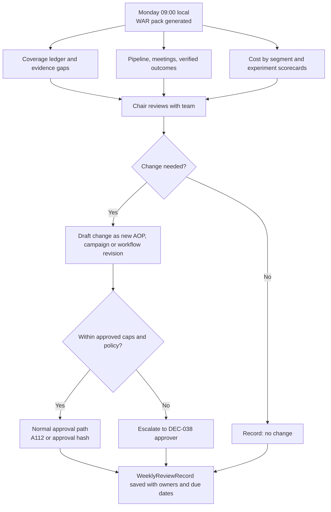
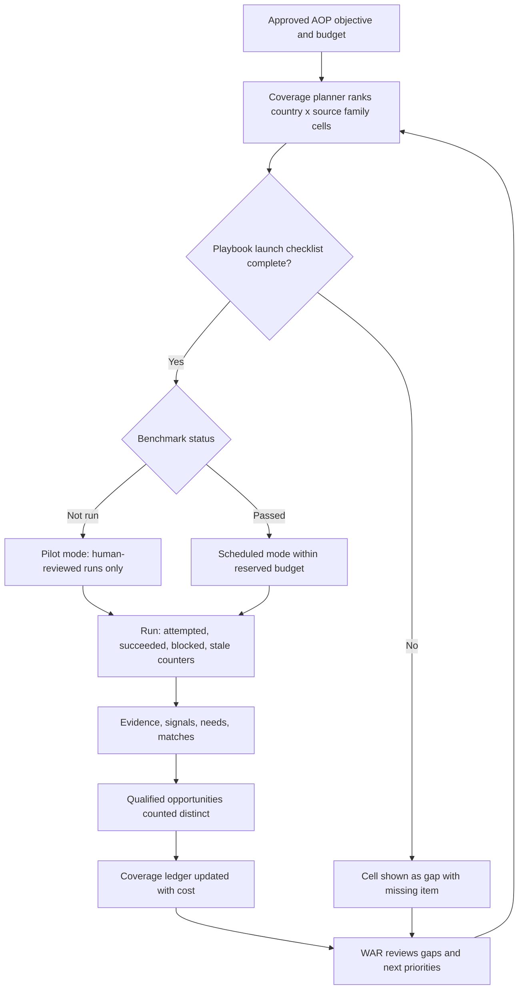
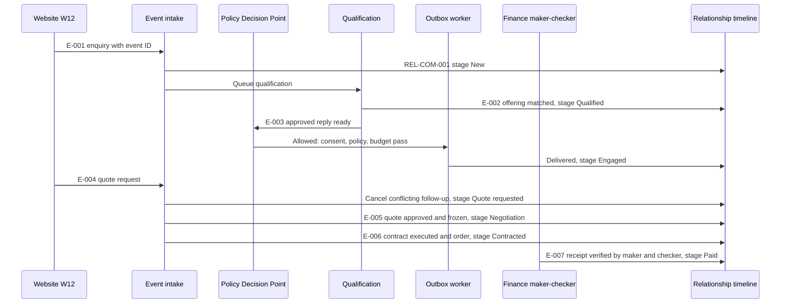
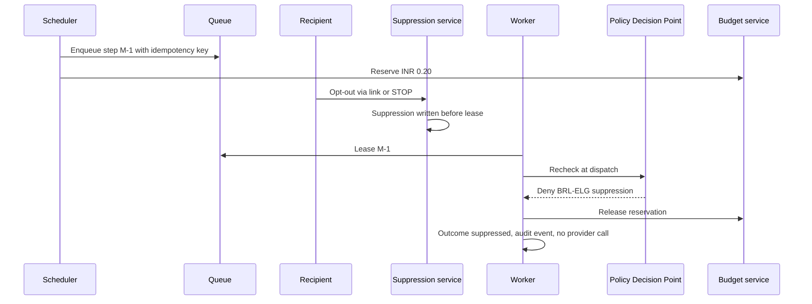
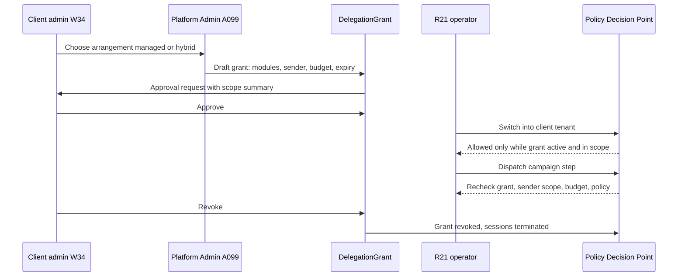
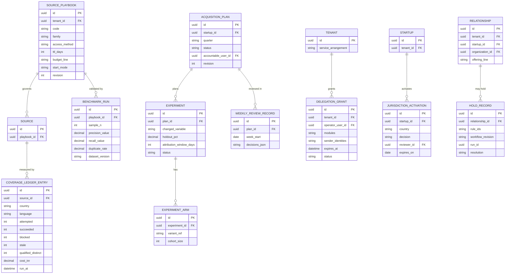

# AI Growth Engine: Employee Sales & Marketing Automation
## Application Blueprint: PART 2 (Batch 2.6), Source Pack Business Domain Enhancements

| Field | Value |
|---|---|
| Document | Application Blueprint · Part 2.6: line-by-line coverage review of source-pack documents 03, 11, 12, 13, 14 and 37 against the blueprint, with enhancements |
| Version | 1.0 · 27 Nov 2026 |
| Baseline | Part 0 (inventory, NFR-001…038, EP-01…EP-21), Part 0A (DEC-001…DEC-065), Part 1 (BR, P01–P16, KPI-01…31), Part 2.1 (FR register), Part 2.2 (WF-01…WF-14), Part 2.3 (BRL, R01–R20, state machines), Part 2.4 (NT, RP-01…30, CFG), Part 2.5 (147 screens), Part 5 (stories), Part 6 (TCs), Part 7 (AG-001…036) |
| Source documents reviewed | 03 End User Personas · 11 Global Market Intelligence & Opportunity Discovery · 12 Digital Marketing & Customer Acquisition Automation · 13 Sales Intelligence & Commercial Conversion · 14 Global Customer, Partner & Account Acquisition Strategy · 37 Sales & Marketing Automation Illustrative Workflow (38-document package; plain-text extraction) |
| Group | **A**: business domain experts |
| Roles applied | Product Owner (lead), Business Systems Analyst, Growth/Marketing Strategist, Sales Operations Lead, UX Researcher; reviewed from the QA Lead, Security/Compliance and FinOps viewpoints |
| Tag ranges used | ASSUMPTION-300…306 · GAP-300…310 · CONFLICT-300…304 · RECOMMENDATION-300…315 |
| New ID families | FR-ENH-A-001…020 · BRL-ENH-A-01…14 · US-<EP>-EA<nn> · TC-ENH-A-001…050 · KPI-ENH-A-01…05 · RP-ENH-A-01…04 · SPB-01…24 · AOP-01…05 · AP-ENH-A-01…12 · personas P17–P20 and variants · roles R21, R11T, R12I |

**How to read this part.** Sections 2.6.1 to 2.6.4 are the audit: what each source document says, what the blueprint already covers, and the programmatic reconciliations. Section 2.6.5 is the main body: the missing content, written at blueprint depth and organized by the blueprint part it extends. Nothing in Parts 0–9 is changed by this part. Every addition is tagged, and every conflict carries a proposed resolution for the coordinator to turn into a binding decision.

**Conventions.** Citations follow Part 0 §0.1.2 (`BRD §n`, `FRD §n`) and add `SP-NN §heading` for the 38-document source pack (for example `SP-11 §Coverage and examples`). The source pack's own optimization KPIs are referred to as **OKPI-01…OKPI-35** to avoid a clash with the blueprint's KPI-01…31. Money is in INR and is an **estimate** unless it is a test fixture. Prices, quotas and provider terms say "verify at time of implementation (as of 27 Nov 2026)".

**Heading-number note.** The coordinator assigned section numbers `2.6.x` to this part. Part 2.2 already uses `## 2.6 Universal execution engine` and `### 2.6.1 Dispatch sequence`. To avoid ambiguity, cross-references in this part always say "Part 2.2 §2.6.1" for the earlier section and "§2.6.x (this part)" for sections here. The collision is reported in §2.6.6.

**Acronyms used in this part.** AOP acquisition operating plan · AP acceptance procedure · CAC customer acquisition cost · CSM customer success manager · EVR evidence record (Part 6.1) · FPO farmer producer organization · KPI key performance indicator · MoU memorandum of understanding · OKPI source-pack optimization KPI · PDP Policy Decision Point · PJ persona journey · RFP/RFQ request for proposal / quotation · SoD segregation of duties · SPB source-family or segment playbook · TTL time to live · UAT user acceptance testing · WAR weekly acquisition review.

---

## 2.6.1 Documents reviewed

All six documents were read line by line. Every table row was also parsed by `assembly/source_pack/groupA_parse.py` (headings, tables, rows and lines). Lines whose text occurs in five or more of the 38 documents were classed as **common core** and are reported once (§2.6.3, "Common core"). The curated aspect register and every reconciliation in this part are produced by `assembly/source_pack/groupA/register.py` and `build.py`, which also write `final/coverage/A_coverage.csv`.

| Doc | Title | Size (bytes) | Headings · tables · rows · text lines | Common-core lines | What the document is trying to tell the team | Atomic aspects |
|---|---|---|---|---|---|---|
| 03 | End User Personas | 33,319 | 44 · 7 · 50 · 261 | 87 | Who uses the product and what each role may and may not do. It lists 21 role personas (owner to agency operator), the typed global filter hierarchy, the separation of website and Admin personas, acceptance owners, training as non-authority, persona journey exercises with a mandatory negative case, UI/UX optimization controls (OPT-14/15) and four new SaaS-era personas | 49 |
| 11 | Global Market Intelligence & Opportunity Discovery | 40,599 | 59 · 7 · 40 · 399 | 87 | How to find opportunities worldwide **lawfully and measurably**: six source classes, a coverage ledger, a nine-step research pipeline, 13 source-family playbooks and 11 MedMaarg segment playbooks, low-cost tooling, a labelled benchmark (50 records per family), a second scoring model, a five-document synthetic proof and data-quality controls OPT-11-01…05 | 69 |
| 12 | Digital Marketing & Customer Acquisition Automation | 34,098 | 45 · 8 · 60 · 307 | 168 | How inbound and outbound acquisition is executed safely: per-channel contracts, reply classes, inbound capability table, 12 marketing capability cards, the 14-row workflow register, deliverability, the opt-out race, experiments and privacy controls OPT-19-01…04 | 57 |
| 13 | Sales Intelligence & Commercial Conversion | 46,323 | 51 · 8 · 44 · 396 | 120 | How interest becomes verified revenue: route-specific state transitions, ten conversion capability cards (entities, APIs, triggers, tool candidates, licence and cost lines), the external conversion interface, provider-neutral documents and payments, milestone invariants, financial fixtures and separate ledgers | 43 |
| 14 | Global Customer, Partner & Account Acquisition Strategy | 53,111 | 77 · 11 · 76 · 562 | 183 | How acquisition is **planned and governed as a business**: per-entity public sites with legal disclosure, cost per verified outcome, an acquisition operating plan per business line with accountable roles, a weekly plan, controlled experiments with stop triggers, outcome economics and cross-border decision records. About 60% of its text repeats documents 11 and 12 verbatim (verified, §2.6.4.3) | 22 |
| 37 | Sales & Marketing Automation Illustrative Workflow | 14,635 | 18 · 9 · 68 · 221 | 7 | A worked end-to-end example to use for design review and UAT: daily control loop, an OrganicSpec distributor journey from discovery to verified receipt with screen hops, multi-startup variants, SaaS onboarding with service arrangements, concurrent automation and exception recovery, a budget fixture, a seven-event relationship ledger and an eight-step demonstration script | 23 |
| — | Common core shared by all 38 documents | — | — | — | Product boundary, independent deployment, two frontends, tenancy, four startup configurations, technology principles, the Website/Admin operating contract, routing namespaces, publication configuration, evidence record, acceptance protocol and current-scope statement | 20 |
| | **Total** | **222,085** | | | | **283** |

**Pattern observed.** Each document is "common core + domain extension + repeated acceptance procedures". The acceptance procedures appear twice in every document (once as "Implementation acceptance and verification" and once as "final decision controls"); they were counted once. Document 14 copies documents 11 and 12 almost entirely and adds about 200 lines of acquisition-strategy content. Most domain content in documents 12 and 13 already reached the blueprint through the BRD and FRD (module catalogue M01–M66, WF-01…WF-14, FR-DM-01…04). The real gaps are in **personas and roles (03)**, **research coverage and benchmarking (11)**, **acquisition planning and experimentation (14)** and **worked UAT fixtures (37)**.

## 2.6.2 Coverage register summary

Counts are produced by `build.py` from the curated register. "Covered" means the blueprint already states the requirement with a traceable ID (the location column names it). "Partially covered" means the intent is present but a field, threshold, role, fixture or procedure the source requires is missing. "Conflict" means the source and the blueprint disagree, and §2.6.6 proposes a resolution.

| Document | Covered | Partially covered | Not covered | Conflict | Not applicable | Total aspects |
|---|---|---|---|---|---|---|
| Common core (shared by all 38 documents) | 18 | 2 | 0 | 0 | 0 | 20 |
| 03 End User Personas | 29 | 16 | 4 | 0 | 0 | 49 |
| 11 Global Market Intelligence & Opportunity Discovery | 27 | 37 | 3 | 2 | 0 | 69 |
| 12 Digital Marketing & Customer Acquisition Automation | 48 | 8 | 0 | 1 | 0 | 57 |
| 13 Sales Intelligence & Commercial Conversion | 39 | 4 | 0 | 0 | 0 | 43 |
| 14 Global Customer, Partner & Account Acquisition Strategy | 6 | 11 | 3 | 0 | 2 | 22 |
| 37 Sales & Marketing Automation Illustrative Workflow | 12 | 5 | 3 | 1 | 2 | 23 |
| **Total** | **179** | **83** | **13** | **4** | **4** | **283** |


**Reading the numbers.** 63% of aspects (179 of 283) were already covered, mostly because documents 12 and 13 re-state BRD/FRD content that Parts 1–3 traced in full. The 100 aspects that need action (83 partially covered, 13 not covered, 4 conflicts) cluster in five themes:

| Theme | Source aspects needing action | Main enhancement (this part) |
|---|---|---|
| Personas, roles and acceptance users | A03-04, 06, 13–17, 20, 21, 25, 28, 31, 33, 35, 36, 39, 42, 43, 46, 47 | §2.6.5.1.1–2.6.5.1.4: 12 persona variants, 4 new personas, 3 new roles or sub-roles, acceptance RACI, training record, productivity protocol |
| Research coverage, source playbooks and benchmarking | A11-02, 07–31, 36, 37, 40, 44–48, 50–52, 58, 63, 65, 67, 68; CC-17 | §2.6.5.2: coverage ledger, 24 source/segment playbooks, per-family freshness, discovery benchmark, alternative scoring version |
| Channel execution details | A12-04, 08, 12, 37, 38, 41 | Reply taxonomy union, recording consent, deliverability stop thresholds, opt-out race, spend-cap race, social post proof |
| Acquisition planning, experiments and economics | A12-44, 48, 50; A14-03, 05, 06, 08, 10–16, 18–20 | Acquisition operating plan, weekly acquisition review, experiment registry with stop triggers, outcome economics, cross-border activation record, legal disclosure |
| Worked fixtures, relationship timeline and UAT packs | A13-13, 15, 26, 43; A37-04–07, 09, 12, 18, 19, 22; CC-06 | Relationship timeline projection, budget fixture, 100 × INR 500 fixture, event-ledger replay, five UAT variants, eight-step demonstration pack |

## 2.6.3 Detailed coverage register

Every aspect is listed. Partial, Not covered, Conflict and Not applicable rows are in bold status. The same rows, with identical IDs, are in `final/coverage/A_coverage.csv`.


#### Document Common core (shared by all 38 documents; reported once)

| Aspect ID | Section | Aspect | Status | Blueprint location | Action / new IDs |
|---|---|---|---|---|---|
| CC-01 | Product purpose and operating boundary | Employee-operated commercial growth; no investor discovery, fundraising, cap table, data room or capital receipts; owners see authorized commercial summaries | Covered | Part 1 §1.5.2; DEC-002; DEC-058 | Common core: see document 01/02 coverage; residual wording handled by CONFLICT-301 |
| CC-02 | Product purpose and operating boundary | Independent deployment: own origin, API audience, membership, DB, object store/vector index, queues, credentials, budget, billing, audit, backup; SSO is not product access | Covered | DEC-009; DEC-058; Part 3.1 | Common core: see document 01/02 coverage |
| CC-03 | Product purpose and operating boundary | Two React frontends (commercial-website-react, commercial-admin-react) with separate origins, sessions, OAuth clients, route allowlists, bundles | Covered | DEC-009; Part 2.5 §2.40; Part 3.1 | Common core: see document 01/02 coverage |
| CC-04 | Product purpose and operating boundary | 25+ owned startups plus external tenants; tenant = customer/security/billing boundary, startup = legal entity workspace; owner group view read-only; support access client-approved, scoped, time-limited | Covered | DEC-055; DEC-056; DEC-065; Part 2.4 §2.35 | Common core: see document 01/02 coverage |
| CC-05 | Initial startup configurations | Four initial legal entities with business profile and commercial focus (AppNAI, MedMaarg, EduVerse, OrganicSpec) | Covered | BR-S001…S004; Part 1 §1.5.1 | Common core: see document 01/02 coverage |
| CC-06 | Initial startup configurations | OrganicSpec RamVan and Smart Biochar offerings "subject to approved readiness" | **Partially covered** | BRD §1 (named); blueprint has readiness gate (DEC-060, BRL-MKT-02) but never names the two offerings | Added seed offering records in Planned state with readiness gate (§2.6.5.1.6) → ASSUMPTION-300 |
| CC-07 | Initial startup configurations | External AI projects belong to AppNAI; EduVerse capstones stay educational; new standard startups by template, typed offering/opportunity definitions, roles, filters, scoring, workflows, claims, source policies, billing | Covered | FR-DM-04; DEC-052; AP-01; AP-07 | Common core: see document 01/02 coverage |
| CC-08 | Technology and execution principles | React/TS, DRF, PostgreSQL+pgvector, Celery/Beat, Valkey, object storage; open-source-first; Manual/Assisted/Supervised/Controlled Autonomous; simulation zero effects; recheck at execution | Covered | Part 3.1; DEC-064; BRL-AUT | Common core: see document 01/02 coverage |
| CC-09 | Website and confidential Admin operating contract | 147 interfaces (34 Website, 113 Admin); four surfaces Public/Portal/Admin/Internal-callback with exposure controls | Covered | DEC-033; Part 2.5 §2.43; Part 1 §1.8.1 | Common core: see document 01/02 coverage |
| CC-10 | Website and confidential Admin operating contract | Routing decision: retain legacy method/path contracts; /api/v1/commercial/public/, /portal/, /admin/ namespaces; deny-by-default; CORS is not authorization | Covered | Part 3.2 §3.2 routing; FR-STD-01 | Common core: see document 01/02 coverage |
| CC-11 | Website and confidential Admin operating contract | Custom domain maps to exactly one tenant/startup; unknown host 404; immutable publication snapshot; expiring preview grants, noindex; atomic pointer swap; scanned assets; portal content never in CDN cache | Covered | BRL-PUB; Part 2.2 §2.22.3; FR-PUB-01 | Common core: see document 01/02 coverage |
| CC-12 | Website and confidential Admin operating contract | Operational separation: public intake creates scoped durable event and outbox, never a direct approval; workers recheck identity, policy, budget, duplicates, approval | Covered | Part 2.2 §2.6; DEC-050 | Common core: see document 01/02 coverage |
| CC-13 | Implementation, verification and delivery controls | Preamble: proposed build/acceptance contracts, not production approval; AppNAI/EduVerse/MedMaarg/OrganicSpec boundaries; reuse existing login after compatibility check | Covered | DEC-019; Part 6.1 §6.1.5 | Common core: see document 01/02 coverage |
| CC-14 | Acceptance and evidence record | Evidence record: responsible/reviewer, artifact/test evidence, decision Pending/Pass/Fail/approved N/A, remediation, business acceptance | Covered | Part 6.1 §6.1.5.4 (EVR) | Common core: see document 01/02 coverage |
| CC-15 | Optimization engineering and acceptance | Acceptance protocol: baseline vs candidate, dataset, digest, actual cost/outcome, independent reviewer; missing evidence = Pending; reversible rollback | Covered | Part 6.1 §6.1.5.5; BRD §14 | Common core: see document 01/02 coverage (optimization depth owned by the document-36 reviewer) |
| CC-16 | Implementation acceptance and final decision controls | Final decision preamble: no externally consequential action on the basis of the specification alone | Covered | Part 8.2 go-live gates | Common core: see document 01/02 coverage |
| CC-17 | Provider and evidence benchmark | Benchmark providers on matched samples: identical ground truth, precision, recall, verified contacts, p95 latency, full cost incl. staff, data entitlement, actual conversion; paid fallback disabled until approved | **Partially covered** | NFR-037; Part 7.3 (models only) | Benchmark protocol extended to data/search/contact providers (§2.6.5.2.4) → FR-ENH-A-006; TC-ENH-A-010 |
| CC-18 | Current multi-startup scope | 147 interfaces; 138 retained + 9 new; 19 proposed HTTP operations and 6 candidate entities pending reuse approval; HTML prototypes are simulations | Covered | DEC-033; candidate API/entity reconciliation owned by the document-07/08/38 reviewers | Common core: see document 01/02 coverage |
| CC-19 | Per-business acceptance lines | AppNAI no submission without mandatory checks; MedMaarg approved claims/no patient data; EduVerse routing and consent; OrganicSpec separate ledgers; campaigns validated before send | Covered | BR-S001…S004; BRL-BID; BRL-ORD; DEC-030 | Common core: repeated in docs 12, 13, 14 |
| CC-20 | Release condition | Release requires approved screen/contract/entity decisions, actual expanded tests, QC and acceptance evidence | Covered | Part 8.2 §go-live; A090 | Common core |

#### Document 03 End User Personas

| Aspect ID | Section | Aspect | Status | Blueprint location | Action / new IDs |
|---|---|---|---|---|---|
| A03-01 | Role personas | Portfolio owner: strategy, cross-startup performance, approvals, risk; read-only aggregate | Covered | P01; R01; DEC-055 | None |
| A03-02 | Role personas | Tenant administrator: roles, plans, domain verification, activate/offboard; cannot approve own transaction | Covered | P11; R12; BRL-APR | None |
| A03-03 | Role personas | Platform support operator: client-approved grant, logs/metadata, expiry | Covered | P12; R13; DEC-056 | None |
| A03-04 | Role personas | Finance controller: legal entity/currency selection, actual evidence, maker/checker, no cross-entity allocation | **Partially covered** | P08; R08/R09; BRL-FIN (cross-entity allocation not stated as a rule) | Added rule BRL-ENH-A-07 and test → BRL-ENH-A-07; TC-ENH-A-031 |
| A03-05 | Role personas | Legal/compliance approver: immutable evidence, approve or return with reason | Covered | P09; R10 | None |
| A03-06 | Role personas | External tenant founder: own workspace, goals, usage, invite users, export own data | **Partially covered** | P13 (administrator framing only; goal-setting and usage review not in journey) | Persona variant P13b with journey and AC → P13b; US-20-EA03 |
| A03-07 | Role personas | Service billing administrator: metered charges, credits, invoice reconciliation; no private business records | Covered | P12; R14; KPI-24 | None |
| A03-08 | Role personas | Growth manager: company/opportunity filters, assignments, forecast, cost, exceptions | Covered | P03; R03; A043 | None |
| A03-09 | Role personas | Digital marketing executive: content studio, audience, channels, attribution, budget | Covered | P05; R05 | None |
| A03-10 | Role personas | Research analyst: country, source, industry, signals, freshness, confidence | Covered | P04; R04 | None |
| A03-11 | Role personas | Sales executive: contact, inbox, follow-up, proposals, negotiation, deal status | Covered | P03; R03 | None |
| A03-12 | Role personas | Bid manager: AppNAI RFP filters, deadline, eligibility, checklist, submission, award | Covered | P06; R06; DEC-053 | None |
| A03-13 | Role personas | Procurement manager: OrganicSpec RFQ, quantity, unit, certification, quote, order, payable (buy-side) | **Partially covered** | P07 merges buy and sell; no buy-side duty separation | Persona variant P07a; ABAC rule separating buy-side approval from receivable work → P07a; BRL-ENH-A-08 |
| A03-14 | Role personas | Customer success manager: won account, acceptance, milestones, feedback, renewals | **Partially covered** | J-48 assigns P03; no named persona | Persona variant P03c with screens, KPIs and grants → P03c |
| A03-15 | Role personas | Healthcare partnerships manager: healthcare need, organization type, demo/pilot, evidence, renewal | **Partially covered** | P03 generic; §2.21.1 MedMaarg route | Persona variant P03a with segment playbooks SPB-15…25 → P03a |
| A03-16 | Role personas | Education counsellor: course, cohort, learner, guardian consent, approved fees, enrolment | **Not covered** | No persona; DEC-030 covers rules only | Persona variant P03b; journey with guardian-consent gates; tests → P03b; TC-ENH-A-004 |
| A03-17 | Role personas | School administrator: approved school programme, grade, deployment, MoU, delivery | **Partially covered** | P14c (school/college coordinator) lacks MoU/delivery evaluation journey | Persona variant P14e with journey → P14e |
| A03-18 | Role personas | Buyer: own enquiry, quotation, order, delivery status | Covered | P14d; R16 | None |
| A03-19 | Role personas | Supplier: own RFQ, quotation, purchase order, acceptance | Covered | P14d; R16; W16 | None |
| A03-20 | Role personas | Commercial delivery coordinator: order lines, deadlines, milestones, payment evidence across routes | **Partially covered** | P07 limited to OrganicSpec | Persona variant P07b covering AppNAI milestones, EduVerse cohorts, MedMaarg pilots → P07b |
| A03-21 | Role personas | Agency / managed-service operator: explicit client assignment, scoped sender and limits, no other client data | **Not covered** | Absent from Part 1 and RBAC | New persona P17, role R21, delegation grant entity, ABAC, flows, tests → GAP-301; P17; R21; FR-ENH-A-015; TC-ENH-A-024…026 |
| A03-22 | Role personas | Every persona: only assigned product/tenant/startup/purpose; external users own records; escalate separate approvals; helpful blocked/empty/error states with next action | Covered | Part 2.3 ABAC-01…12; Part 2.5 §2.47 | None |
| A03-23 | Global filter hierarchy | Eleven filter families (Scope, Geography, Evidence, Engagement, Operations, Marketing, Commercial, AppNAI, MedMaarg, EduVerse, OrganicSpec) with typed fields | Covered | FR-FLT-01…11 | None (investor wording "issuer thesis", "investment geography" already replaced by DEC-002) |
| A03-24 | Global filter hierarchy | Filter rules: OR within multi-select, AND across fields, Unknown≠0, allowlists, reset child filters, cancel stale queries, scoped saved views, stable cursor, KPIs with as_of and original currency, server rechecks export/bulk | Covered | FR-FLT-RULES; FR-STD-01 | None |
| A03-25 | Distinct website and Admin personas | Website content author drafts only; publisher approves/publishes within entity; reviewer cannot approve own sensitive claim | **Partially covered** | R05/R05L and BRL-APR self-approval ban; no website author/publisher role split on A107/A108 | Website role mapping table and ABAC rule → BRL-ENH-A-09; TC-ENH-A-028 |
| A03-26 | Distinct website and Admin personas | Public visitor needs no account for basic forms; external registered user sees only own records | Covered | P15; P14; R16; R18 | None |
| A03-27 | Additional responsibilities | Owner or tenant admin decides provider policy, usage budget, allowed channels and paid-service exceptions | Covered | DEC-008; PP-09; CFG catalogue | None |
| A03-28 | Additional responsibilities | Integration administrator manages provider credentials and adapter benchmarking without unrelated tenant data | **Not covered** | No persona or role; credentials handled by R12/R11 implicitly | Persona P18, sub-role R12I, permissions and tests → GAP-307; P18; R12I; TC-ENH-A-027 |
| A03-29 | Additional responsibilities | QA engineer uses synthetic data and sandbox credentials only | Covered | Part 6.1 GSE-SYN; provider simulator | Persona P20 recorded for completeness → P20 |
| A03-30 | Additional responsibilities | External user tests only own content/invitations/records; security/finance reviewer validates approvals and scope, not unrestricted access | Covered | R15 auditor; Part 6.1 UAT | None |
| A03-31 | Additional responsibilities | Acceptance owners: PO signs outcomes; operators demonstrate; finance/legal sign regulated transitions; security validates denial/isolation; support admin validates trial/export/cancellation; no real outreach in acceptance | **Partially covered** | Part 6.1 UAT roles; Part 8.2 sign-off (no single acceptance RACI) | Acceptance RACI matrix per persona and acceptance procedure → RECOMMENDATION-313 |
| A03-32 | Additional responsibilities | Commercial staff cannot access the investor application by default | Covered | DEC-058; NFR-001 | None |
| A03-33 | Role training and operational acceptance | Representative users complete synthetic journeys incl. denial and escalation; record competence, assigned permission, training acknowledgement; training never grants authority | **Partially covered** | Part 8.2 §8.2.2.2 training plan; RSK-024 training gate (no competence record entity; no rule that training is necessary but not sufficient) | TrainingRecord design, rule BRL-ENH-A-10, story and tests → RECOMMENDATION-311; FR-ENH-A-018; US-21-EA01 |
| A03-34 | Role training and operational acceptance | Open critical confidentiality, financial-integrity or unauthorized-action defects block activation; targets provisional until measured | Covered | Part 6.1 exit criteria; Part 8.2 | None |
| A03-35 | Persona journey table | Six practical persona journeys each with a negative acceptance (foreign startup, unapproved claim, expired bid, EduVerse external project, foreign grant, other client data) | **Partially covered** | AP-02, AP-10 and scattered TCs; no persona-indexed journey pack | Persona journey acceptance pack PJ-01…PJ-12 with TCs → TC-ENH-A-001…009 |
| A03-36 | Persona journey table | Synthetic accounts with separate tenant/startup grants; success = expected record + role-specific denied action; UAT names actor and scenario evidence | **Partially covered** | Part 6.1 UAT | Built into PJ pack → TC-ENH-A-001…009 |
| A03-37 | Role-specific acceptance | Internal operator never investor data; external user revoked/expired invite rejected, no Admin audience; finance/legal approve exact version, cannot bypass other approvers; client admin onboard, invite, revoke support, export own data | Covered | NFR-001; DEC-056; BRL-APR; FR-W34 | Linked to PJ pack |
| A03-38 | Optimization | OPT-14-01 shared code libraries; no common secrets, queues or confidential DBs | Covered | NFR-029; DEC-009 | OPT ID mapped (§2.6.4.5) |
| A03-39 | Optimization | OPT-15-01 adaptive navigation; count clicks/time vs baseline | **Partially covered** | NFR-034 (baseline undefined) | Productivity measurement protocol → RECOMMENDATION-314; GAP-306 |
| A03-40 | Optimization | OPT-15-02 accessibility and response states; WCAG 2.2 AA; no stale scope flash | Covered | Part 2.5 §2.46, §2.47 | OPT ID mapped |
| A03-41 | Optimization | OPT-15-03 external portal usability ("investor/customer" wording) | Covered | Part 2.5 §2.40.2; DEC-002 for wording | OPT ID mapped; wording in CONFLICT-301 → CONFLICT-301 |
| A03-42 | Optimization | OPT-15-04 saved views and bulk actions: persist scoped filters; revalidate permissions; preview batch size and cost; simulation never executes | **Partially covered** | FR-FLT-RULES (saved views); bulk preview of size/cost not specified | FR and AC for bulk-action preview → FR-ENH-A-019; US-17-EA02; RECOMMENDATION-315 |
| A03-43 | User productivity | Time representative task with sample user; baseline vs candidate task time and error rate; no reduced safeguards | **Partially covered** | NFR-034 baseline undefined | Protocol, sample size, metrics, report → GAP-306; RECOMMENDATION-314; TC-ENH-A-040 |
| A03-44 | Boundary and acceptance | Two-tenant fixture: deny cross-scope, reject stale grants, verify correct scope | Covered | AP-10; Part 6.1 | None |
| A03-45 | Personas and journeys (current scope) | Add SaaS applicant and client administrator personas; applicant → review → membership → service portal → Admin | Covered | P13; R17; J-42 | Variant P13a recorded → P13a |
| A03-46 | Personas and journeys (current scope) | Template reviewer persona | **Not covered** | Not defined; A113 publication approver unspecified by persona | Persona P19, sub-role R11T, SoD rule → GAP-307; P19; R11T; BRL-ENH-A-11; TC-ENH-A-029 |
| A03-47 | Personas and journeys (current scope) | Automation operator persona | **Partially covered** | P10 Automation Lead covers design; day-to-day run operation (A110/A111) not distinguished | Persona variant P10a → P10a |
| A03-48 | Personas and journeys (current scope) | Deny relationship users access to SaaS billing | Covered | BRL-SVC; R16 has no W34 access; Part 2.3 RBAC | Test added to PJ pack → TC-ENH-A-007 |
| A03-49 | Personas and journeys (current scope) | Nine new interfaces W31–W34, A109–A113 with purpose and acceptance | Covered | DEC-033; FR-W31…W34; FR-A109…A113 | None |

#### Document 11 Global Market Intelligence & Opportunity Discovery

| Aspect ID | Section | Aspect | Status | Blueprint location | Action / new IDs |
|---|---|---|---|---|---|
| A11-01 | Worldwide source and evidence engine | Six source classes (official sites/portals/marketplaces; government programmes; directories/events; news/reports; search & extraction APIs; authorized email/enquiries/referrals) with purpose/access rule | Covered | BRL-SRC-01…10; WF-02; A010 | None |
| A11-02 | Worldwide source and evidence engine | Coverage ledger chain: country/state → language/source family → approved source → scheduled run → successful/blocked/stale → evidence count → distinct qualified opportunities → conversion/cost; prioritize gaps by thesis and budget | **Partially covered** | KPI-27 (inventory coverage only); RP-04 | CoverageLedger design, FR, report, KPI → GAP-304; FR-ENH-A-001; RP-ENH-A-01; KPI-ENH-A-01 |
| A11-03 | Worldwide source and evidence engine | No universal coverage claim; robots, terms, law; no private groups or sensitive data | Covered | BRL-SRC-04; KPI-27 "restricted and not-covered shown" | None |
| A11-04 | Worldwide source and evidence engine | Evidence stores canonical URL, observed/published date, extraction hash, permission, excerpt, confidence, reason, scope, retention | Covered | BRL-SRC-03; A017; Part 3.3 Evidence | None |
| A11-05 | Worldwide source and evidence engine | Research pipeline: plan → reserve budget → authorized query → sanitize → extract → resolve identity → score with unknowns → review → schedule update; webpages never control tools | Covered | WF-02 (Part 2.2 §2.8); BRL-SRC-07; BRL-SRC-09 | None |
| A11-06 | Worldwide source and evidence engine | Merge identity only with evidence; keep aliases/history; verify contact and eligibility separately; monitor freshness and duplicates per tenant/startup | Covered | BRL-SRC-08; BR-M19 | None |
| A11-07 | Market sources and acquisition playbooks | Source-family playbook "Organization websites": licensed search + permitted own/public site extraction; terms/robots review; M10–M16; acceptance = permission, URL, freshness, quota and owner recorded before launch | **Partially covered** | BRL-SRC-01…10, A010 register (generic); no per-family playbook register with cost line and launch gate | Source-family playbook register SPB-01 → RECOMMENDATION-302; SPB-01 |
| A11-08 | Market sources and acquisition playbooks | Source-family playbook "Search engines": licensed search API; quota; B03 free quota first; acceptance = permission, URL, freshness, quota and owner recorded before launch | **Partially covered** | BRL-SRC-01…10, A010 register (generic); no per-family playbook register with cost line and launch gate | Source-family playbook register SPB-02 → RECOMMENDATION-302; SPB-02 |
| A11-09 | Market sources and acquisition playbooks | Source-family playbook "Official directories": official/licensed listings; no patient data; M13, M19; acceptance = permission, URL, freshness, quota and owner recorded before launch | **Partially covered** | BRL-SRC-01…10, A010 register (generic); no per-family playbook register with cost line and launch gate | Source-family playbook register SPB-03 → RECOMMENDATION-302; SPB-03 |
| A11-10 | Market sources and acquisition playbooks | Source-family playbook "Government procurement": official tender portal; manual if no authorized API; verify deadline; acceptance = permission, URL, freshness, quota and owner recorded before launch | **Partially covered** | BRL-SRC-01…10, A010 register (generic); no per-family playbook register with cost line and launch gate | Source-family playbook register SPB-04 → RECOMMENDATION-302; SPB-04 |
| A11-11 | Market sources and acquisition playbooks | Source-family playbook "LinkedIn": approved API scopes or human research; no profile harvesting or unsolicited DM; acceptance = permission, URL, freshness, quota and owner recorded before launch | **Partially covered** | BRL-SRC-01…10, A010 register (generic); no per-family playbook register with cost line and launch gate | Source-family playbook register SPB-05 → RECOMMENDATION-302; SPB-05 |
| A11-12 | Market sources and acquisition playbooks | Source-family playbook "Facebook / Instagram": authorized Meta business APIs; app review; no private groups; ads excluded; acceptance = permission, URL, freshness, quota and owner recorded before launch | **Partially covered** | BRL-SRC-01…10, A010 register (generic); no per-family playbook register with cost line and launch gate | Source-family playbook register SPB-06 → RECOMMENDATION-302; SPB-06 |
| A11-13 | Market sources and acquisition playbooks | Source-family playbook "X / YouTube / Reddit": official API or permitted feeds; paid API not committed; B10 reserve; acceptance = permission, URL, freshness, quota and owner recorded before launch | **Partially covered** | BRL-SRC-01…10, A010 register (generic); no per-family playbook register with cost line and launch gate | Source-family playbook register SPB-07 → RECOMMENDATION-302; SPB-07 |
| A11-14 | Market sources and acquisition playbooks | Source-family playbook "WhatsApp": official webhook and templates; no global search; opt-in/template/window gate; B06; acceptance = permission, URL, freshness, quota and owner recorded before launch | **Partially covered** | BRL-SRC-01…10, A010 register (generic); no per-family playbook register with cost line and launch gate | Source-family playbook register SPB-08 → RECOMMENDATION-302; SPB-08 |
| A11-15 | Market sources and acquisition playbooks | Source-family playbook "Email": authorized mailbox/provider webhooks; eligibility, opt-out, bounce; B05; acceptance = permission, URL, freshness, quota and owner recorded before launch | **Partially covered** | BRL-SRC-01…10, A010 register (generic); no per-family playbook register with cost line and launch gate | Source-family playbook register SPB-09 → RECOMMENDATION-302; SPB-09 |
| A11-16 | Market sources and acquisition playbooks | Source-family playbook "Startup website": first-party forms and contextual events; consent; no clinical event tracking; acceptance = permission, URL, freshness, quota and owner recorded before launch | **Partially covered** | BRL-SRC-01…10, A010 register (generic); no per-family playbook register with cost line and launch gate | Source-family playbook register SPB-10 → RECOMMENDATION-302; SPB-10 |
| A11-17 | Market sources and acquisition playbooks | Source-family playbook "Partner referrals": partner agreement + customer initiation; no unsolicited third-party enrolment; acceptance = permission, URL, freshness, quota and owner recorded before launch | **Partially covered** | BRL-SRC-01…10, A010 register (generic); no per-family playbook register with cost line and launch gate | Source-family playbook register SPB-11 → RECOMMENDATION-302; SPB-11 |
| A11-18 | Market sources and acquisition playbooks | Source-family playbook "Webinars": authorized registration/attendance API; purpose-specific consent and retention; acceptance = permission, URL, freshness, quota and owner recorded before launch | **Partially covered** | BRL-SRC-01…10, A010 register (generic); no per-family playbook register with cost line and launch gate | Source-family playbook register SPB-12 → RECOMMENDATION-302; SPB-12 |
| A11-19 | Market sources and acquisition playbooks | Source-family playbook "Insurance / corporate annual reports": permitted public reports/press; organization level only; acceptance = permission, URL, freshness, quota and owner recorded before launch | **Partially covered** | BRL-SRC-01…10, A010 register (generic); no per-family playbook register with cost line and launch gate | Source-family playbook register SPB-13 → RECOMMENDATION-302; SPB-13 |
| A11-20 | MedMaarg segment playbooks | MedMaarg segment "Hospitals": preventive health/digital transformation; Scanner/Planner/Advisor; pilot; no diagnostic efficacy claims; demo → limited pilot → contract; medical superintendent; acceptance = qualified need + verified business channel + eligibility + actual closure evidence | **Partially covered** | BR-S002; Part 2.2 §2.21.1 (generic institutional route); P14b; BRL-ELG health rules | Segment playbook SPB-14 with stage path, decision-maker role, prohibited claims and closure evidence → RECOMMENDATION-302; SPB-14 |
| A11-21 | MedMaarg segment playbooks | MedMaarg segment "Clinics / doctors": preventive-care initiative/inbound; medical ethics/referral terms; demo → collaboration review; acceptance = qualified need + verified business channel + eligibility + actual closure evidence | **Partially covered** | BR-S002; Part 2.2 §2.21.1 (generic institutional route); P14b; BRL-ELG health rules | Segment playbook SPB-15 with stage path, decision-maker role, prohibited claims and closure evidence → RECOMMENDATION-302; SPB-15 |
| A11-22 | MedMaarg segment playbooks | MedMaarg segment "Diagnostic labs": report service/wellness package; Advisor + Planner; provider-neutral communications; demo → integration feasibility; acceptance = qualified need + verified business channel + eligibility + actual closure evidence | **Partially covered** | BR-S002; Part 2.2 §2.21.1 (generic institutional route); P14b; BRL-ELG health rules | Segment playbook SPB-16 with stage path, decision-maker role, prohibited claims and closure evidence → RECOMMENDATION-302; SPB-16 |
| A11-23 | MedMaarg segment playbooks | MedMaarg segment "IT / corporate": employee wellness programme; employer gets aggregate nonclinical metrics only; pilot → annual package; HR head; acceptance = qualified need + verified business channel + eligibility + actual closure evidence | **Partially covered** | BR-S002; Part 2.2 §2.21.1 (generic institutional route); P14b; BRL-ELG health rules | Segment playbook SPB-17 with stage path, decision-maker role, prohibited claims and closure evidence → RECOMMENDATION-302; SPB-17 |
| A11-24 | MedMaarg segment playbooks | MedMaarg segment "Insurance": wellness benefit/partnership; no health-risk underwriting; feasibility → legal review → pilot; acceptance = qualified need + verified business channel + eligibility + actual closure evidence | **Partially covered** | BR-S002; Part 2.2 §2.21.1 (generic institutional route); P14b; BRL-ELG health rules | Segment playbook SPB-18 with stage path, decision-maker role, prohibited claims and closure evidence → RECOMMENDATION-302; SPB-18 |
| A11-25 | MedMaarg segment playbooks | MedMaarg segment "Universities": institutional wellness; no minors data for marketing; demo → governed pilot; registrar/student welfare; acceptance = qualified need + verified business channel + eligibility + actual closure evidence | **Partially covered** | BR-S002; Part 2.2 §2.21.1 (generic institutional route); P14b; BRL-ELG health rules | Segment playbook SPB-19 with stage path, decision-maker role, prohibited claims and closure evidence → RECOMMENDATION-302; SPB-19 |
| A11-26 | MedMaarg segment playbooks | MedMaarg segment "NGO / government": rural health project/tender; phygital AI Hospital; procurement and readiness gates; proposal → tender/contract; acceptance = qualified need + verified business channel + eligibility + actual closure evidence | **Partially covered** | BR-S002; Part 2.2 §2.21.1 (generic institutional route); P14b; BRL-ELG health rules | Segment playbook SPB-20 with stage path, decision-maker role, prohibited claims and closure evidence → RECOMMENDATION-302; SPB-20 |
| A11-27 | MedMaarg segment playbooks | MedMaarg segment "Wellness / fitness": personalized wellness initiative; no guaranteed medical outcomes; pilot → package; acceptance = qualified need + verified business channel + eligibility + actual closure evidence | **Partially covered** | BR-S002; Part 2.2 §2.21.1 (generic institutional route); P14b; BRL-ELG health rules | Segment playbook SPB-21 with stage path, decision-maker role, prohibited claims and closure evidence → RECOMMENDATION-302; SPB-21 |
| A11-28 | MedMaarg segment playbooks | MedMaarg segment "Deployment partner": partnership interest; phygital model; site readiness approval; due diligence → pilot → deployment; acceptance = qualified need + verified business channel + eligibility + actual closure evidence | **Partially covered** | BR-S002; Part 2.2 §2.21.1 (generic institutional route); P14b; BRL-ELG health rules | Segment playbook SPB-22 with stage path, decision-maker role, prohibited claims and closure evidence → RECOMMENDATION-302; SPB-22 |
| A11-29 | MedMaarg segment playbooks | MedMaarg segment "B2C": voluntary product enquiry; no sensitive targeting; approved answer → link → payment; acceptance = qualified need + verified business channel + eligibility + actual closure evidence | **Partially covered** | BR-S002; Part 2.2 §2.21.1 (generic institutional route); P14b; BRL-ELG health rules | Segment playbook SPB-23 with stage path, decision-maker role, prohibited claims and closure evidence → RECOMMENDATION-302; SPB-23 |
| A11-30 | MedMaarg segment playbooks | MedMaarg segment "Healthtech": integration/partner request; API licensing subject to readiness; no unsupported API promises; discovery → sandbox → agreement; acceptance = qualified need + verified business channel + eligibility + actual closure evidence | **Partially covered** | BR-S002; Part 2.2 §2.21.1 (generic institutional route); P14b; BRL-ELG health rules | Segment playbook SPB-24 with stage path, decision-maker role, prohibited claims and closure evidence → RECOMMENDATION-302; SPB-24 |
| A11-31 | MedMaarg segment playbooks | Segment evidence source "Deck slides 10–14" and cost treatment "shared B01–B10; engineering C03" | **Partially covered** | DEC-021 (artefacts not attached); DEC-020 budget IDs (C03 not defined) | Recorded as evidence gap; C03 mapped to engineering effort line → GAP-300 |
| A11-32 | Business-specific acquisition | Four operating sequences (AppNAI, MedMaarg, EduVerse, OrganicSpec) | Covered | BR-S001…S004; WF-08, WF-10, §2.21 | None |
| A11-33 | Business-specific acquisition | Source scoring 25/25/20/15/15; thresholds ≥75/50–74/<50; unknown separate; score not authority to send | Covered | BR-S005; BRL-SCR-01…03; DEC-011 | None |
| A11-34 | Business-specific acquisition | KPI list (qualification precision … margin); no predicted revenue as actual | Covered | KPI-01…31 | None |
| A11-35 | Confidential discovery versus public evidence | Research registry, enrichment, URLs, scores and contact intelligence Admin-only; visitors cannot enumerate research candidates; enquiries are first-party inputs, not searchable | Covered | Part 4.1 data classification; FR-PUB; R18 permissions | Negative test added → TC-ENH-A-011 |
| A11-36 | Low-cost permitted-source discovery | Prefer feeds, RSS/sitemaps, official portals, documented APIs, referrals, inbound; Scrapy/Trafilatura, selective Playwright; optional self-hosted SearXNG needs separate rights and benchmark | **Partially covered** | Part 3.1 adapters (generic); tools not dispositioned | Integration candidate disposition table → GAP-310; RECOMMENDATION-312 |
| A11-37 | Low-cost permitted-source discovery | Validate discovery with labelled permitted fixtures: precision, recall within known eligible corpus, freshness, contact verification, cost per usable opportunity; paid search/contact data only after demonstrated incremental value | **Partially covered** | DEC-001 precision gates; KPI-22; no recall or incremental-value rule | Discovery benchmark protocol; rule BRL-ENH-A-03 → FR-ENH-A-005; BRL-ENH-A-03; TC-ENH-A-012 |
| A11-38 | Low-cost permitted-source discovery | Route external commercial AI development to AppNAI, not EduVerse | Covered | FR-DM-04; DEC-052 | None |
| A11-39 | Research quality and operational controls | Maintain permission, provenance, freshness, coverage gap and cost; stop unapproved sources; confirmed vs inferred | Covered | BRL-SRC; BRL-SCR-05 | None |
| A11-40 | Research coverage fields | Region and market: buyer/supplier/project location, client geography and delivery region recorded independently; coverage % by approved known sources | **Partially covered** | FR-FLT-02 (delivery geography); no three-way geography model | Geography triple fields on Opportunity/Organization → FR-ENH-A-002 |
| A11-41 | Research coverage fields | Permission registry: URL, access method, licence/terms review, purpose, cadence, quota, retention, owner; no access without current allowlist | Covered | A010; BRL-SRC-01/02 | Cadence and quota fields confirmed in SPB register |
| A11-42 | Research coverage fields | Evidence: canonical URL, retrieval/publication time, snippet/hash, claim confidence; stale facts rechecked; duplicate merge keeps provenance | Covered | BRL-SRC-03/06/08 | None |
| A11-43 | Research coverage fields | Qualification uses need, offering match, budget, deadline, evidence; unknown stays unknown; no guessed contact | Covered | BRL-SCR-02; BRL-SCR-06; BRL-SRC-05 | None |
| A11-44 | Research coverage fields | Scheduled discovery: due sources queued with per-tenant budget and backoff; blocked/unavailable tracked; measure attempted/succeeded/blocked and cost per qualified result | **Partially covered** | OPT-04-01; BRL-SRC-09; no attempted/succeeded/blocked counters | Counters on CoverageLedger and RP-ENH-A-01 → FR-ENH-A-001 |
| A11-45 | Research coverage fields | Coverage gaps prioritized by objective and budget; no complete-world claim | **Partially covered** | KPI-27 | Gap prioritization score in coverage planner → FR-ENH-A-003 |
| A11-46 | Research coverage fields | Per-source freshness SLA (OPT-11-02) beyond single default | **Partially covered** | BRL-SRC-06 default 90 days, tenders 7 days | Per-family TTL table → BRL-ENH-A-02; GAP-304 |
| A11-47 | Pilot benchmark | Labelled sample of 50 permitted records per source family where feasible; precision, recall vs known sample, duplicate rate, freshness, contact validity | **Not covered** | No sample design per family | Benchmark design with sampling, metrics and exit gates → GAP-309; ASSUMPTION-301; FR-ENH-A-005; TC-ENH-A-012 |
| A11-48 | Coverage and examples | Coverage = successful fresh eligible source checks ÷ eligible due sources, per country and source category, with denominator and uncovered regions | **Conflict** | KPI-27 defines coverage as approved sources monitored ÷ registry | Keep KPI-27; add KPI-ENH-A-01 "fresh source coverage" → CONFLICT-302; KPI-ENH-A-01 |
| A11-49 | Coverage and examples | Source gate: official/authorized source, permission and licence, purpose, freshness, cost limit | Covered | BRL-SRC-01; BRL-SRC-09 | None |
| A11-50 | Coverage and examples | Score: capability 30 / explicit need 25 / qualification 15 / geography 10 / budget 10 / timing 10; review defaults fit ≥70, coverage ≥70 | **Conflict** | DEC-011 / BRL-SCR-01 (25/25/20/15/15, ≥75) | Proposed resolution: optional "partnership-fit" scoring version, not default → CONFLICT-300; US-06-EA01; TC-ENH-A-013…014 |
| A11-51 | Coverage and examples | Synthetic proof: five synthetic documents; fresh permitted yield 3 professional contacts; restricted and stale yield none; no live coverage claim | **Not covered** | No such fixture | Fixture FX-A-05 and test → TC-ENH-A-010 |
| A11-52 | Optimization | Rank sources by permission, freshness, evidence and qualified conversion, not volume; report precision AND recall and coverage gaps | **Partially covered** | RP-04 (precision only) | Source ranking measure on RP-ENH-A-01 → FR-ENH-A-003 |
| A11-53 | Optimization | OPT-03-01 native vs paid; zero unapproved paid calls; full TCO | Covered | NFR-037; BR-S0xx OPT-03-01 | OPT ID mapped |
| A11-54 | Optimization | OPT-04-01 daily planning and discovery; missed run recovers once; prohibited source never fetched | Covered | BRL-SRC-01; DEC-032 | OPT ID mapped |
| A11-55 | Optimization | OPT-09-01 typed contracts 100% before activation; schema and contract tests | Covered | Part 3.2; Part 6.1 contract tests | OPT ID mapped |
| A11-56 | Optimization | OPT-10-01 rules-first routing; compare quality/latency/INR per task | Covered | DEC-007; NFR-030; Part 7.3 | OPT ID mapped |
| A11-57 | Optimization | OPT-10-02 structured prompts, scoped RAG, token caps; ≥99.5% schema-valid; token p50/p95 | Covered | Part 7.3; NFR (99.5% schema validity) | OPT ID mapped |
| A11-58 | Optimization | OPT-10-03 citations, abstention, escalation; ≥95% evidence-grounded accuracy | **Partially covered** | Part 6.4 groundedness evals; 95% target not stated as a gate for all agents | Mapped to Part 6.4; gate value flagged for the document-15 reviewer |
| A11-59 | Optimization | OPT-10-04 caching by full scope/model/prompt/knowledge version; no cross-scope hit | Covered | Part 7.3 cache key; Part 4.1 | OPT ID mapped |
| A11-60 | Optimization | OPT-10-05 model fallback/local inference benchmark; no silent paid fallback | Covered | DEC-007 Tier 2 opt-in; NFR-037 | OPT ID mapped |
| A11-61 | Optimization | OPT-10-06 adversarial retrieved instructions; zero forbidden actions | Covered | Part 6.4; BRL-SRC-07; THR-052 | OPT ID mapped |
| A11-62 | Optimization | OPT-11-01 provenance and source rights; missing rights quarantined | Covered | NFR-028; BRL-SRC-03 | OPT ID mapped |
| A11-63 | Optimization | OPT-11-02 per-source freshness SLA; reverify before external action | **Partially covered** | BRL-SRC-06 | See BRL-ENH-A-02 → BRL-ENH-A-02 |
| A11-64 | Optimization | OPT-11-03 canonical keys; reviewed aliases; never merge by name alone | Covered | BRL-SRC-08 | OPT ID mapped |
| A11-65 | Optimization | OPT-11-04 stratified ground truth by sector, region, type; precision ≥90%; disclose recall and sample size | **Partially covered** | DEC-001; KPI-01 (recall and stratification not required) | Rule BRL-ENH-A-04: reports carry recall, sample size and strata → BRL-ENH-A-04 |
| A11-66 | Optimization | OPT-11-05 corrections/deletion propagate to derived cache/embeddings; legal hold | Covered | Part 3.3 erasure propagation; BRL-PRV | OPT ID mapped |
| A11-67 | Acceptance procedures | Procedures: source permission & provenance; evidence freshness (age beyond TTL then change content); dedupe & entity resolution; classification quality (no claim from five synthetic docs) | **Partially covered** | Part 6 TCs exist for provenance and merge; AP register lacks these procedures | AP-ENH-A-01…04 with tests → RECOMMENDATION-313; AP-ENH-A-01…04; TC-ENH-A-012, TC-ENH-A-015 |
| A11-68 | Acceptance procedures | Source inventory completeness: verify preserved "15-sheet cell inventory" of commercial source records | **Not covered** | Artefact not supplied in the package | Recorded as gap; procedure defined for when supplied → GAP-300; AP-ENH-A-05 |
| A11-69 | Research intelligence (current scope) | Derive sources, targets and refresh from approved capabilities and objective; dedupe within scope | Covered | WF-02; A102 planner | None |

#### Document 12 Digital Marketing & Customer Acquisition Automation

| Aspect ID | Section | Aspect | Status | Blueprint location | Action / new IDs |
|---|---|---|---|---|---|
| A12-01 | Channel and communication policies | Email: verified sender domain, SPF/DKIM/DMARC, bounce/complaint suppression, unsubscribe, rate cap, actual delivery/reply events | Covered | DEC-025; BRL-ELG; message state machine §2.27.9 | None |
| A12-02 | Channel and communication policies | WhatsApp: official API, permitted recipient, template/category, immediate opt-out | Covered | BRL-ELG; FR-A044; EP-10 | None |
| A12-03 | Channel and communication policies | Web/portal: approved information, identity/consent, scoped capture, actual confirmation | Covered | FR-W12…W20 | None |
| A12-04 | Channel and communication policies | Calendar/events: availability and time zone, invitation status, no recording without appropriate permission | **Partially covered** | BRL-MTG-01…06 (no recording rule) | Rule BRL-ENH-A-05 and test → GAP-308; BRL-ENH-A-05; TC-ENH-A-018 |
| A12-05 | Channel and communication policies | Referrals: consent and context; no automatic sharing of private contacts | Covered | DEC-046; BR-M42 | None |
| A12-06 | Channel and communication policies | Social sources: approved publication via official API; content and claims approval | Covered | BRL-MKT-07; BR-M35 | None |
| A12-07 | Channel and communication policies | Outbound carries correct startup identity, purpose and evidence; reserve budget and recheck suppression immediately before send | Covered | Part 2.2 §2.6.1 dispatch sequence | None |
| A12-08 | Channel and communication policies | Reply classes: interest, decline, objection, unsubscribe, bounce, out-of-office, meeting, escalation; verified callbacks stop generic sequence | **Conflict** | Part 2.2 WF-06 classes: STOP, positive, question, objection, out of office, urgent, clinical (decline, bounce, meeting request not named) | Union taxonomy with mapping → CONFLICT-303; FR-ENH-A-008; TC-ENH-A-019 |
| A12-09 | Channel and communication policies | Never infer delivery from enqueue or provider acceptance; reconcile uncertain sends before retry; rejection/opt-out terminates promotional sequence | Covered | DEC-050; BRL-SEQ-02 | None |
| A12-10 | Channel and communication policies | Follow-up caps, quiet hours, channel rules and legal permission configurable, not bypassable | Covered | BRL-SEQ-05; BRL-ELG; CFG catalogue | None |
| A12-11 | Inbound marketing acquisition | Content/SEO: approved claims, brief, draft, review, schedule, actual publication; Search Console where entitled; no guaranteed ranking | Covered | BR-M34, BR-M36; BRL-MKT-08 | None |
| A12-12 | Inbound marketing acquisition | Social publishing: account permission, asset validation, schedule, preview, rate limit, actual external post ID | **Partially covered** | BR-M35; idempotent publishing (external post ID not named as the delivery proof) | Field and AC (external_post_id as proof of publication) → FR-ENH-A-009 |
| A12-13 | Inbound marketing acquisition | Landing pages: approved startup, responsive form, consent, attribution token; dedupe; prevent injection | Covered | FR-A056; TC-12-001… | None |
| A12-14 | Inbound marketing acquisition | Website assistant: RAG over approved knowledge; escalate unclear claims; capture permitted contact | Covered | AG-017; BR-M32 | None |
| A12-15 | Inbound marketing acquisition | Campaign audiences: segment, eligible unique recipients, preview/cost, approval hash, suppression | Covered | US-1204; BRL-MKT-04 | None |
| A12-16 | Inbound marketing acquisition | Paid ads: budget and targeting approval; actual provider spend and conversion; no medical or child-sensitive profiling | Covered | BRL-MKT-05/06 | None |
| A12-17 | Inbound marketing acquisition | Webinars/demos: registration and preferences; actual attendance, reminders, follow-up | Covered | BR-M40; BRL-MTG-05/06 | None |
| A12-18 | Inbound marketing acquisition | Attribution: source/campaign/referrer with permission, distinct event ID, first/last touch with window and unknown bucket, no duplicate conversion | Covered | Part 2.4 §2.31.4; RP-16 | None |
| A12-19 | Marketing capability cards | WhatsApp Business: objective, dependency and acceptance "no private group scrape; opt-in gate"; scope = selected startup, employee assignment, product entitlement | Covered | BR-M31…M42 (Part 1 §1.12.1); EP-08…EP-12 | None |
| A12-20 | Marketing capability cards | Website conversational assistant: objective, dependency and acceptance "clinical question routed; no medical data"; scope = selected startup, employee assignment, product entitlement | Covered | BR-M31…M42 (Part 1 §1.12.1); EP-08…EP-12 | None |
| A12-21 | Marketing capability cards | Unified omnichannel routing: objective, dependency and acceptance "no duplicate replies across linked channels"; scope = selected startup, employee assignment, product entitlement | Covered | BR-M31…M42 (Part 1 §1.12.1); EP-08…EP-12 | None |
| A12-22 | Marketing capability cards | Social listening: objective, dependency and acceptance "no restricted profiles or automated DMs"; scope = selected startup, employee assignment, product entitlement | Covered | BR-M31…M42 (Part 1 §1.12.1); EP-08…EP-12 | None |
| A12-23 | Marketing capability cards | Content studio: objective, dependency and acceptance "unapproved claims cannot publish"; scope = selected startup, employee assignment, product entitlement | Covered | BR-M31…M42 (Part 1 §1.12.1); EP-08…EP-12 | None |
| A12-24 | Marketing capability cards | Social publishing: objective, dependency and acceptance "no unsupported DMs; idempotent"; scope = selected startup, employee assignment, product entitlement | Covered | BR-M31…M42 (Part 1 §1.12.1); EP-08…EP-12 | None |
| A12-25 | Marketing capability cards | SEO and search visibility: objective, dependency and acceptance "no fabricated ranking data"; scope = selected startup, employee assignment, product entitlement | Covered | BR-M31…M42 (Part 1 §1.12.1); EP-08…EP-12 | None |
| A12-26 | Marketing capability cards | Landing pages and attribution: objective, dependency and acceptance "no health events to ad pixels"; scope = selected startup, employee assignment, product entitlement | Covered | BR-M31…M42 (Part 1 §1.12.1); EP-08…EP-12 | None |
| A12-27 | Marketing capability cards | Campaign management: objective, dependency and acceptance "suppression applied at execution"; scope = selected startup, employee assignment, product entitlement | Covered | BR-M31…M42 (Part 1 §1.12.1); EP-08…EP-12 | None |
| A12-28 | Marketing capability cards | Paid ads integration: objective, dependency and acceptance "budget exceeded → pause; no sensitive data"; scope = selected startup, employee assignment, product entitlement | Covered | BR-M31…M42 (Part 1 §1.12.1); EP-08…EP-12 | None |
| A12-29 | Marketing capability cards | Webinars and demonstrations: objective, dependency and acceptance "opt-outs respected; attendance dedupe"; scope = selected startup, employee assignment, product entitlement | Covered | BR-M31…M42 (Part 1 §1.12.1); EP-08…EP-12 | None |
| A12-30 | Marketing capability cards | Referral and partner lead capture: objective, dependency and acceptance "no unauthorized third-party enrolment"; scope = selected startup, employee assignment, product entitlement | Covered | BR-M31…M42 (Part 1 §1.12.1); EP-08…EP-12 | None |
| A12-31 | Workflow register | Fourteen workflows (startup catalogue … suspend/offboard) with trigger and stop | Covered | WF-01…WF-14 (Part 2.2) | None |
| A12-32 | Workflow register | Engine: validated event, scope, immutable revision, permission, eligibility, budget reservation, approved action, outbox, worker, reconciliation, projection, notifications; no AI direct finance | Covered | Part 2.2 §2.6; DEC-064 | None |
| A12-33 | Website engagement and publishing | Localized pages, consent-aware forms, recipient portal, bounded assistant; callbacks route to Admin inbox with dedupe; first-party analytics with opaque IDs | Covered | EP-19; BRL-MKT-06 | None |
| A12-34 | Low-cost communications | Self-hosted orchestration removes wrapper fees but not delivery/WhatsApp/platform costs; manual or alternative channel where no API | Covered | DEC-020 budget lines B05/B06; Part 7.3 | None |
| A12-35 | Low-cost communications | Test list: enquiry dedupe, publication, sender checks, inbound correlation, bounce/opt-out/reply interruption, rate limits, escalation | Covered | Part 6.2a/6.2b TCs (EP-08…EP-12) | None |
| A12-36 | Communication and publication quality | Before each dispatch: approved claims, audience eligibility, verified sender, channel permission, suppression, budget, expiry; track delivered/replied/uncertain separately | Covered | §2.6.1; DEC-050 | None |
| A12-37 | Acquisition mechanism controls | Campaign/advertising: separate spend ledger; quota and spend-cap race test | **Partially covered** | BRL-MKT-05; TC-12 spend tests (concurrent race on the same cap not explicit) | Race test added → TC-ENH-A-020 |
| A12-38 | Acquisition mechanism controls | Deliverability: SPF/DKIM/DMARC, sender reputation, bounce/complaint rates, stop by approved policy; channel-specific threshold reviewed | **Partially covered** | KPI-18 email complaint <0.1%; bounce threshold not stated as a stop rule | Deliverability stop thresholds table (verify provider thresholds) → BRL-ENH-A-06; ASSUMPTION-304 |
| A12-39 | Acquisition mechanism controls | Omnichannel: opt-out across linked contacts, no duplicate sends; events/referrals: duplicate registration and revoked consent handled | Covered | BR-M41; BRL-ELG; BR-M40 | None |
| A12-40 | Acquisition mechanism controls | Scheduling observes local time zone, quiet hours, attempt caps, latest response; measure conversion by business outcome, not send volume | Covered | BRL-SEQ; KPI catalogue rules | None |
| A12-41 | Opt-out race | Contact opts out after queue but before lease: zero external send, one suppressed outcome, audit, reservation release | **Partially covered** | §2.6.1 cancels step on recheck; no named race scenario test | Sequence diagram and test → TC-ENH-A-021 |
| A12-42 | Opt-out race | Delivery proof: provider event reference, signature verification, immutable result; accepted vs delivered vs bounced vs uncertain | Covered | §2.27.9 outbound message states; DEC-050 | None |
| A12-43 | Opt-out race | Follow-up stops on reply/decline/opt-out/expiry; objections to approved evidence or human | Covered | BRL-SEQ-02; WF-09 | "decline" added to stop list via CONFLICT-303 → CONFLICT-303 |
| A12-44 | Optimization | Compare meaningful replies, opt-outs and cost per qualified outcome on matched cohorts; recheck consent just before send | **Partially covered** | BRL-MKT-10 (cohorts/holdouts); matched-cohort comparison method absent | Experiment registry design → FR-ENH-A-011; RECOMMENDATION-306 |
| A12-45 | Optimization | OPT-12-01 qualified funnel with numerator/denominator by startup/channel/geography | Covered | BR-S053…; RP-02; KPI rules | OPT ID mapped |
| A12-46 | Optimization | OPT-12-02 objections and next action | Covered | KPI-28; RP-11 | OPT ID mapped |
| A12-47 | Optimization | OPT-12-03 verified closure ("verified funding" wording) | Covered | KPI-31; DEC-054; DEC-002 for wording | OPT ID mapped; wording in CONFLICT-301 → CONFLICT-301 |
| A12-48 | Optimization | OPT-12-04 acquisition experiments with holdouts | **Partially covered** | BRL-MKT-10; US-1204 AC-1204-04 | Experiment registry and stop rules → FR-ENH-A-011 |
| A12-49 | Optimization | OPT-19-01 minimize data and source eligibility | Covered | BRL-SRC-04; BRL-PRV; DEC-030 | OPT ID mapped |
| A12-50 | Optimization | OPT-19-02 communications and jurisdiction; document jurisdiction approval before activation | **Partially covered** | DEC-029 rule pack; no activation decision record | Cross-border activation decision record → FR-ENH-A-014 |
| A12-51 | Optimization | OPT-19-03 rights and exports; audited support grants; revoke expired access | Covered | DEC-056; A103; BRL-PRV | OPT ID mapped |
| A12-52 | Optimization | OPT-19-04 clinical and education boundaries | Covered | DEC-030; BRL-MKT-06; BRL-ELG-13/14 | OPT ID mapped |
| A12-53 | Acceptance procedures | Follow-up stop conditions procedure (reply/opt-out/pause/policy revision before dispatch) | Covered | BRL-SEQ-02/04; Part 6.2a TCs | AP-ENH-A-06 index → AP-ENH-A-06 |
| A12-54 | Acceptance procedures | Inbound/outbound journeys: website enquiry → scoped lead ("lead/investor record") → classify → next action | Covered | WF-04; DEC-002 for "investor" wording | Wording in CONFLICT-301 → CONFLICT-301 |
| A12-55 | Acceptance procedures | Communication eligibility: opt-out, unauthorized channel, expired permission, approved reply | Covered | BRL-ELG; Part 6.2a | AP-ENH-A-07 index → AP-ENH-A-07 |
| A12-56 | Acceptance procedures | Public offer and claims restrictions: unapproved formal offer or unsupported clinical/education/commercial claim blocked | Covered | BRL-MKT-01/03; AG-012 | AP-ENH-A-08 index → AP-ENH-A-08 |
| A12-57 | Communication (current scope) | Unified scoped conversation ID; permitted channels; consent evidence; frequency cap; quiet hours; delivery status; reply/opt-out stop; human takeover | Covered | BR-M41; FR human takeover (Part 2.1); BRL-SEQ | None |

#### Document 13 Sales Intelligence & Commercial Conversion

| Aspect ID | Section | Aspect | Status | Blueprint location | Action / new IDs |
|---|---|---|---|---|---|
| A13-01 | Conversion state machines | Five state transitions with guards (project bid, proposal/quote, order/fulfilment, commercial closure, retention/renewal) | Covered | Part 2.3 §2.27.4…2.27.8; WF-08…WF-12 | None |
| A13-02 | Conversion state machines | Quotes: approved price version, decimal quantity/unit, currency, tax, discount approval; orders: direction, accepted terms, multiple lines; no won without route proof; payable vs receivable; cash vs recognized revenue vs SaaS fees; returns need evidence; lost reason; renewal | Covered | BRL-QTE; BRL-ORD; BRL-FIN; DEC-054; DEC-027 | None |
| A13-03 | Conversion capability cards | Proposal builder: UI, backend, governance, entities [Proposal, ProposalVersion], API [POST /deals/{id}/proposals], trigger [meeting completed → draft → approval], acceptance; tools: PandaDoc candidate; Claude "Sales" skill | Covered | BR-M43…M52; FR-A065…A083; Part 3.2 API-329…418 (FRD-named ★ operations); Part 3.3 entities | Programmatic reconciliation §2.6.4.1 (17/17 operations, 23/23 entities found) |
| A13-04 | Conversion capability cards | Quote and pricing engine: UI, backend, governance, entities [Quote, QuoteLine, PriceVersion], API [POST /quotes; POST /quotes/{id}/approve], trigger [approved proposal → quote], acceptance; tools: custom | Covered | BR-M43…M52; FR-A065…A083; Part 3.2 API-329…418 (FRD-named ★ operations); Part 3.3 entities | Programmatic reconciliation §2.6.4.1 (17/17 operations, 23/23 entities found) |
| A13-05 | Conversion capability cards | Negotiation and objection handling: UI, backend, governance, entities [Objection, Negotiation, Approval], API [POST /deals/{id}/objections], trigger [reply → FAQ or exception → owner], acceptance; tools: LLM gateway (Haiku 5.5 / Sonnet 5.5 prices) | Covered | BR-M43…M52; FR-A065…A083; Part 3.2 API-329…418 (FRD-named ★ operations); Part 3.3 entities | Programmatic reconciliation §2.6.4.1 (17/17 operations, 23/23 entities found) |
| A13-06 | Conversion capability cards | Contract and MoU workflow: UI, backend, governance, entities [Contract, SignatureEvent], API [POST /contracts; POST /webhooks/esign], trigger [approved contract → signature → verified receipt], acceptance; tools: PandaDoc / e-sign provider | Covered | BR-M43…M52; FR-A065…A083; Part 3.2 API-329…418 (FRD-named ★ operations); Part 3.3 entities | Programmatic reconciliation §2.6.4.1 (17/17 operations, 23/23 entities found) |
| A13-07 | Conversion capability cards | Payment and closure: UI, backend, governance, entities [Payment, Invoice, Deal], API [POST /webhooks/payment; POST /deals/{id}/close], trigger [verified payment or executed contract → won], acceptance; tools: existing payment provider | Covered | BR-M43…M52; FR-A065…A083; Part 3.2 API-329…418 (FRD-named ★ operations); Part 3.3 entities | Programmatic reconciliation §2.6.4.1 (17/17 operations, 23/23 entities found) |
| A13-08 | Conversion capability cards | Onboarding and handoff: UI, backend, governance, entities [Onboarding, Task, Handoff], API [GET /onboarding; POST /onboarding/{id}/complete], trigger [deal won → welcome → onboarding], acceptance; tools: custom | Covered | BR-M43…M52; FR-A065…A083; Part 3.2 API-329…418 (FRD-named ★ operations); Part 3.3 entities | Programmatic reconciliation §2.6.4.1 (17/17 operations, 23/23 entities found) |
| A13-09 | Conversion capability cards | Partner deployment pipeline: UI, backend, governance, entities [Partner, Pilot, Deployment], API [POST /partners; POST /pilots/{id}/status], trigger [qualified partner → due diligence → pilot → review], acceptance; tools: Crossbeam Skills candidate | Covered | BR-M43…M52; FR-A065…A083; Part 3.2 API-329…418 (FRD-named ★ operations); Part 3.3 entities | Programmatic reconciliation §2.6.4.1 (17/17 operations, 23/23 entities found) |
| A13-10 | Conversion capability cards | Retention and renewal: UI, backend, governance, entities [Renewal, Subscription, AccountMetric], API [GET /renewals; POST /renewals/{id}/review], trigger [onboard → renewal due → permitted engagement], acceptance; tools: custom | Covered | BR-M43…M52; FR-A065…A083; Part 3.2 API-329…418 (FRD-named ★ operations); Part 3.3 entities | Programmatic reconciliation §2.6.4.1 (17/17 operations, 23/23 entities found) |
| A13-11 | Conversion capability cards | Lost deal and feedback: UI, backend, governance, entities [Outcome, Feedback], API [POST /deals/{id}/lost; POST /feedback], trigger [lost → reason → stop sequence → aggregate], acceptance; tools: custom | Covered | BR-M43…M52; FR-A065…A083; Part 3.2 API-329…418 (FRD-named ★ operations); Part 3.3 entities | Programmatic reconciliation §2.6.4.1 (17/17 operations, 23/23 entities found) |
| A13-12 | Conversion capability cards | Revenue and attribution: UI, backend, governance, entities [MetricSnapshot, AttributionEvent, Payment], API [GET /metrics/revenue], trigger [event → attribution → report], acceptance; tools: PostgreSQL; Socialinsider; PostHog candidates | Covered | BR-M43…M52; FR-A065…A083; Part 3.2 API-329…418 (FRD-named ★ operations); Part 3.3 entities | Programmatic reconciliation §2.6.4.1 (17/17 operations, 23/23 entities found) |
| A13-13 | Conversion capability cards | Integration candidates and licence/quota/rate lines (PandaDoc, Claude Sales skill, Crossbeam Skills, Socialinsider, PostHog, PostgreSQL) with "verify" status | **Partially covered** | DEC-022/023 adapters; Part 3.2 integration register (candidates not named) | Disposition table: adopt / adapter-candidate / reject, with verify flags → GAP-310; RECOMMENDATION-312 |
| A13-14 | Conversion capability cards | LLM pricing statement: Haiku 5.5 from $0.10/$0.50 per MTok; Sonnet 5.5 $2/$10 | Covered | Part 7.3 model table (same values, verify as of 27 Nov 2026) | None |
| A13-15 | Conversion capability cards | Cost treatment: shared budget B01/B02/B10, engineering C03, payment gateway charges excluded, legally valid e-sign quote beyond reserve | **Partially covered** | DEC-020 (B01–B10); C03 undefined | C03 interpreted as engineering effort line (Part 8.1); payment fees out of platform budget → ASSUMPTION-305 |
| A13-16 | External conversion interface | Portal exposes only recipient-approved terms/status, own submissions, permitted signatures/payment instructions; external requests create review events; callback verifies signature, issuer/customer, amount and idempotency | Covered | FR-W23…W26; API-355…357; DEC-022/023 | None |
| A13-17 | Provider-neutral documents and payments | python-docx/Jinja2 templates; secure storage; manual evidence and statement reconciliation when no entitlement; free software never substitutes regulated verification/signature/payment | Covered | DEC-022; DEC-023; Part 0 tooling | None |
| A13-18 | Provider-neutral documents and payments | Test list: term revision, approval authority, secure upload, agreement verification, payment identity, partial/duplicate receipt allocation; proposed/signed/received/completed states | Covered | Part 6.2b EP-13/EP-15 TCs | None |
| A13-19 | Conversion and reconciliation acceptance | Indicative interest vs binding agreement vs verified financial outcome; never closed on AI output or unverified callback | Covered | DEC-054; BRL-AI-07; KPI-31 | None |
| A13-20 | Milestone table | Qualification: no deal without accountable owner | Covered | BRL-SCR-06 | None |
| A13-21 | Milestone table | Bid/RFQ: expired or invalid requirement blocked | Covered | FR-DM-02; BRL-BID | None |
| A13-22 | Milestone table | Proposal/quote: decimal line totals; stale price rejected | Covered | FR-DM-01; BRL-QTE | None |
| A13-23 | Milestone table | Agreement/order: no duplicate award/order | Covered | BRL-BID; BRL-ORD; idempotency | None |
| A13-24 | Milestone table | Fulfilment: partial/rejected quantity tracked | Covered | FR-DM-03; §2.27.8 | None |
| A13-25 | Milestone table | Reconciliation: wrong account/duplicate/reversal cannot inflate revenue; correct legal entity | Covered | BRL-FIN; KPI-13 | None |
| A13-26 | Milestone table | Retention: no renewal after cancellation/suppression | **Partially covered** | BRL-LCY (renewal); explicit block after cancellation not stated | Rule BRL-ENH-A-12 and test → BRL-ENH-A-12; TC-ENH-A-032 |
| A13-27 | Financial amounts | Decimal, explicit currency, reference, issuer/startup; gross, tax, discount, paid, unallocated, reversal; exceptions shown not forced; maker/checker | Covered | DEC-027; BRL-FIN; FR-DM-01 | None |
| A13-28 | Fixtures | Quotation 2 × INR 150.00, 10% → 270.00 INR | Covered | FR-DM-01 | None |
| A13-29 | Fixtures | Bid expiry 2030-06-01 09:00 UTC | Covered | FR-DM-02 | None |
| A13-30 | Fixtures | Order 2 kg; duplicate 1 kg event; excess 2 kg rejected | Covered | FR-DM-03 | None |
| A13-31 | Fixtures | EduVerse routing fixture | Covered | FR-DM-04 | None |
| A13-32 | Separate financial ledgers | Order vs cash; corrections by appended reversal; closure only on all route conditions | Covered | BRL-FIN; DEC-054 | None |
| A13-33 | Optimization | Distinguish expected, committed, received, reconciled, closed; never optimize by skipping approval | Covered | DEC-054; KPI rules | None |
| A13-34 | Optimization | OPT-05-01 transactional outbox; crash between commit and publish recovers | Covered | Part 3.1 outbox; ADRs | OPT ID mapped |
| A13-35 | Optimization | OPT-08-01 normalization, validated JSONB, scoped FKs; no orphan or cross-scope reference | Covered | Part 3.3 | OPT ID mapped |
| A13-36 | Acceptance procedures | Idempotency and duplicate delivery: concurrent identical replay; same key with changed payload rejected | Covered | Part 3.2 idempotency (409 on payload mismatch); Part 6 TCs | AP-ENH-A-09 index → AP-ENH-A-09 |
| A13-37 | Acceptance procedures | Scope separation of business capabilities ("Investor app only fundraising") | Covered | AP-02; DEC-058 | Wording in CONFLICT-301 → CONFLICT-301 |
| A13-38 | Acceptance procedures | Financial exactness incl. unsupported currency rounding escalates | Covered | DEC-027; Part 6.2b | None |
| A13-39 | Acceptance procedures | Opportunity qualification with score breakdown, reasons and owner visible | Covered | AP-03; A019/A027 | None |
| A13-40 | Acceptance procedures | Objection resolution: approved factual response or specialist escalation | Covered | AG-021; BRL-MKT-01 | None |
| A13-41 | Acceptance procedures | Closure and receipt distinction (partial then complete) | Covered | AP-04 | None |
| A13-42 | Acceptance procedures | Usage ledger and invoice reconciliation; duplicate event cannot double bill | Covered | KPI-24; BRL-SVC | None |
| A13-43 | Conversion and closure (current scope) | Shared relationship, quote/offer, document and transaction IDs; dashboards from committed state | **Partially covered** | Customer 360 (BR-M23); no explicit relationship_id spanning lead → deal → order → receipt | Relationship timeline projection → CONFLICT-304; FR-ENH-A-016; RECOMMENDATION-309 |

#### Document 14 Global Customer, Partner & Account Acquisition Strategy

| Aspect ID | Section | Aspect | Status | Blueprint location | Action / new IDs |
|---|---|---|---|---|---|
| A14-01 | Repeated sections | Sections "Worldwide source and evidence engine", "Market sources and acquisition playbooks", "Business-specific acquisition" (lines 37–337) are verbatim copies of document 11 | **Not applicable** | Verified identical by diff (script) | Counted once under document 11 |
| A14-02 | Repeated sections | Sections "Channel and communication policies", "Inbound marketing acquisition", capability cards and "Workflow register" (lines 338–540) are verbatim copies of document 12 | **Not applicable** | Verified identical by diff (script) | Counted once under document 12 |
| A14-03 | Public visibility and acquisition boundaries | Independent approved site per legal entity, sector, language and region; verify domain and legal disclosure | **Partially covered** | A107 site settings; domain verification covered; legal disclosure content not specified | Legal disclosure block specification → GAP-303; ASSUMPTION-306; FR-ENH-A-017; TC-ENH-A-033 |
| A14-04 | Public visibility and acquisition boundaries | Public interest is not a verified opportunity; only approved pricing and substantiated claims published | Covered | BRL-MKT-01/02; WF-04 | None |
| A14-05 | Public visibility and acquisition boundaries | Measure enquiry→qualified and qualified→closure separately | **Partially covered** | KPI-26 (public qualified enquiries); stage-pair conversion not defined | Funnel stage-pair measures on RP-ENH-A-03 → KPI-ENH-A-02 |
| A14-06 | Measurable acquisition and cost control | Measure qualified opportunities, response rate, meetings, resolved objections, successful conversion and cost per verified outcome | **Partially covered** | KPI-22 (cost per qualified opportunity); cost per verified closure absent | KPI-ENH-A-03 cost per verified outcome → KPI-ENH-A-03 |
| A14-07 | Measurable acquisition and cost control | Licensed contact dataset not reproducible by OSS; unknown stays unknown; paid enrichment optional, benchmark-driven exception | Covered | BRL-SRC-05; NFR-037; BRL-SCR-02 | Linked to BRL-ENH-A-03 |
| A14-08 | Measurable acquisition and cost control | Test journeys across all four startups + one external tenant: wrong-business routing, no-fit/declined, opt-out, follow-up, escalation, actual closure evidence | **Partially covered** | AP-01, AP-02, FR-DM-04 (routing); no five-workspace acquisition journey pack | Cross-startup acquisition journey pack → TC-ENH-A-034…038 |
| A14-09 | Measurable acquisition and cost control | Acquisition targets per startup; education safeguards; healthcare claim restrictions | Covered | BR-S001…S004; DEC-030 | None |
| A14-10 | Acquisition strategy measurement | Per startup: segment, geography, approved proposition, source and conversion denominator; controlled tests within budget; pause underperforming or noncompliant activity | **Not covered** | No AcquisitionPlan object; campaign-level only | AcquisitionPlan entity, FR, screen panel, AC → RECOMMENDATION-305; FR-ENH-A-010; US-12-EA02 |
| A14-11 | Acquisition operating plan | Per business line: AppNAI (business owner), MedMaarg (healthcare lead), EduVerse (education lead), OrganicSpec (agriculture lead), future business (tenant admin) with scope statements | **Not covered** | Personas exist (P02 startup head) but no accountable acquisition-plan owner per business line | Acquisition operating plan register AOP-01…05 → RECOMMENDATION-305 |
| A14-12 | Acquisition operating plan | Weekly plan: owner approves segments, coverage priorities, evidence gaps, eligible engagement and budget; review qualified opportunities, meetings, pipeline, verified outcome and cost; one change at a time; no causal claim without comparison | **Not covered** | No weekly acquisition review ceremony | Weekly acquisition review (WAR) procedure, agenda, inputs, outputs, decision record → GAP-305; ASSUMPTION-302; FR-ENH-A-012; US-12-EA03 |
| A14-13 | Acquisition experiments | Target segmentation per startup: buyer segment, offering, verified need, geography, qualification, pipeline | **Partially covered** | Segments (EP-03) and campaign audiences | AcquisitionPlan segment block → FR-ENH-A-010 |
| A14-14 | Acquisition experiments | Experiment: approved message variants on bounded eligible cohort; preserve preferences and sender reputation | **Partially covered** | BRL-MKT-10; US-1204 | Experiment registry with variant, cohort bound, reputation guard → FR-ENH-A-011 |
| A14-15 | Acquisition experiments | Measure meaningful replies, meetings, objections, verified closure, cost per qualified opportunity; exclude duplicates | **Partially covered** | KPI-05, KPI-06, KPI-22 separately; no per-experiment scorecard | Experiment scorecard → FR-ENH-A-011 |
| A14-16 | Acquisition experiments | Stop: high complaint/bounce, unapproved claims, stale evidence, exhausted cap or opt-out → immediate pause | **Partially covered** | BRL-MKT-10 (opt-out/complaint +50%); bounce, stale evidence and cap stops not enumerated for experiments | Stop-trigger table → BRL-ENH-A-13 |
| A14-17 | Acquisition experiments | Report: portfolio aggregation with denominator per startup; no extrapolation from synthetic tests | Covered | KPI rules (numerator/denominator); DEC-055 | None |
| A14-18 | Optimization | Optimize by geography, segment, stage and channel; matched cohorts with defined attribution windows | **Partially covered** | §2.31.4 attribution windows; matched cohort method absent | Matched-cohort method in experiment registry → FR-ENH-A-011 |
| A14-19 | Acceptance procedures | Outcome economics: cost per qualified opportunity and verified closure for matching cohort, time and currency; zero denominator not assessed | **Partially covered** | KPI-22; KPI-10 | Outcome economics report and rules → RP-ENH-A-02; BRL-ENH-A-14; TC-ENH-A-039 |
| A14-20 | Acceptance procedures | Cross-border and regional decision: record jurisdiction, source, communications, privacy and commercial route; specialist sign-off before regulated cross-border activation | **Partially covered** | DEC-029 jurisdiction rule pack; no activation decision record | JurisdictionActivationDecision record → FR-ENH-A-014; US-03-EA01; TC-ENH-A-030 |
| A14-21 | Acceptance procedures | Evidence freshness, source inventory completeness, opportunity qualification, scope separation (repeats of docs 11/13) | Covered | See A11-67, A11-68, A13-37, A13-39 | Counted under documents 11 and 13 |
| A14-22 | Acquisition strategy (current scope) | Independent objectives and geography per business; capability-specific conversion metrics; "investment excludes ads/SEO" wording | Covered | DEC-002 (wording); KPI catalogue | Wording in CONFLICT-301 → CONFLICT-301 |

#### Document 37 Sales & Marketing Automation Illustrative Workflow

| Aspect ID | Section | Aspect | Status | Blueprint location | Action / new IDs |
|---|---|---|---|---|---|
| A37-01 | Operating model | Operator acts within tenant, legal entity, objective and approved configuration; portfolio aggregates but cannot mutate | Covered | DEC-055; DEC-065 | None |
| A37-02 | Operating model | Daily control loop: Workspace → Configure → Plan → Execute → Observe; external actions disabled until review; updates only via new approved revision | Covered | Part 2.2 §2.6; A112; BRL-AUT | Loop used as UAT pack skeleton |
| A37-03 | Operating model | Primary screens A089, A099, A100, A102, A109–A113 | Covered | Part 2.5 inventory (all present; §2.6.4.4) | None |
| A37-04 | Discovery to engagement | OrganicSpec RamVan distributor scenario (Green Valley Distributor demo): configure offering (A003–A006, A099–A100) → capture (W04–W05, W12–W14, A015–A019) → qualify/route (A020–A032) → engage (A033–A039, A044–A047) → inbound (A037, A040, A045–A046, A069) | **Partially covered** | Covered as separate flows WF-01…WF-07; no end-to-end UAT script with these screen hops | UAT script UAT-A-01 with fixtures → RECOMMENDATION-310; TC-ENH-A-041 |
| A37-05 | Discovery to engagement | Illustrative decision: verified identity + relevant source permits qualification, not outreach; uncertain mandate/stale/opt-out → hold record; store scope, relationship ID, evidence ref, policy result, workflow revision, run ID | **Partially covered** | PDP decision log (Part 2.2 §2.6.1); hold record fields not enumerated together; relationship ID absent | Hold record field list; relationship ID → FR-ENH-A-016; FR-ENH-A-020 |
| A37-06 | Conversion to verified outcome | Worked calculation 100 × INR 500 = INR 50,000 pre-tax; verified INR 50,000 receipt → zero outstanding only if invoice basis matches; else reconcile tax/charges | **Not covered** | Not a fixture (FR-DM-01 uses 2 × 150) | Fixture FX-A-03 and test → TC-ENH-A-042 |
| A37-07 | Conversion to verified outcome | Stages proposal (W23, A065–A066) → quote (A067–A068) → negotiation/contract (W24, A069–A072) → order/payment (W25–W26, A073–A074, A105) → onboarding/fulfilment (W27, A075–A078, A105) → retention (W28, A079–A083) | **Partially covered** | WF-09…WF-12 individually | UAT script UAT-A-02 → TC-ENH-A-042 |
| A37-08 | Conversion to verified outcome | Distinguish quoted, contracted, invoiced and received amounts; message/payment status/AI suggestion cannot authorize financial or legal state change | Covered | DEC-054; BRL-AI-07; BRL-FIN | None |
| A37-09 | Multi-startup variants | Five workspace variants (AppNAI, MedMaarg, EduVerse, OrganicSpec, new independent client "Nova"-style manufacturer) with screens | **Partially covered** | Screens present; no variant UAT pack | UAT variants UAT-A-03…07 → TC-ENH-A-034…038 |
| A37-10 | Activation controls | Startup registry controls selection; capability profile controls fields/actions; never use startup name or array position as permission; impact review; pinned revisions; aggregates only authorized data | Covered | DEC-052; BRL-SEQ-04; DEC-055 | Negative test for name-based permission added → TC-ENH-A-043 |
| A37-11 | SaaS client onboarding | Seven steps W31 → W32 → W33 → A099 → A112/A113 → W34/A101 → A112/A103 | Covered | J-42; §2.22.4; FR-W31…W34 | None |
| A37-12 | SaaS client onboarding | Service arrangement choice: self-service, managed or authorized hybrid | **Not covered** | DEC-047 plan archetypes only; arrangement type not modelled | ServiceArrangement attribute and managed delegation → GAP-302; FR-ENH-A-015; US-20-EA02 |
| A37-13 | SaaS client onboarding | SaaS applicant is not an investor or commercial end customer; separate audience and lifecycle | Covered | R17; BRL-SVC | None |
| A37-14 | Prototype handoff | Website and Admin prototypes keep separate synthetic state; explicit JSON export/import; production uses authenticated services; browser storage is not a security mechanism | **Not applicable** | Prototype guidance; production rule already in DEC-009 / Part 4.1 | None |
| A37-15 | Concurrent automation | Run pins graph and configuration revisions; event → scope → qualification → action → wait → next → verified outcome | Covered | BRL-SEQ-04; DEC-051 | None |
| A37-16 | Concurrent automation | Seven automation events (new enquiry, inbound reply, 20 simulated runs, duplicate, budget exhausted, startup suspension, config change) with automatic response and hold | Covered | Part 2.2 §2.6, §2.22.5; Part 2.4 §2.35.3 fairness | UAT script UAT-A-08 adds the 20-run fixture → TC-ENH-A-044 |
| A37-17 | Concurrent automation | Operator screen sequence A033 → A109 → A110 → A111 → A014 → A072 → A112 | Covered | P10 journeys J-33…J-36 | None |
| A37-18 | Budget fixture | Cap INR 500; committed/actual INR 420; proposed INR 100 → available INR 80 → hold; INR 50 may reserve after eligibility; unknown result is not retry authorization | **Not covered** | Budget hard-cap tests exist with other values; this fixture absent | Fixture FX-A-04 and boundary tests → TC-ENH-A-045…046 |
| A37-19 | Event and relationship ledger | E-001…E-007 on REL-COM-001: New → Qualified → Engaged → Quote requested → Negotiation → Contracted → Paid/fulfilment with expected outputs | **Conflict** | Blueprint uses separate Lead, Opportunity, Deal, Quote, Order state machines; no single relationship stage | Relationship stage as a derived projection; mapping table → CONFLICT-304; FR-ENH-A-016; TC-ENH-A-047 |
| A37-20 | Event and relationship ledger | Replay E-004 with same source event ID: no second side effect, task or message; monitor shows duplicate hold; operator takeover pauses communication branch | Covered | Idempotency (Part 3.2); A110; human takeover FR | Test added → TC-ENH-A-048 |
| A37-21 | Event and relationship ledger | Automation responsibility: research/qualification agents recommend; policy engine validates; document/conversation agents draft; deterministic financial controls and reviewers decide; AI never self-authorizes | Covered | Part 7.2 agent cards; BRL-AI-07; DEC-064 | None |
| A37-22 | Demonstration script | Eight demo actions (onboard, full journey, two channels, replay, config change, financial/legal closure, scope switch & reload, release handoff) with expected evidence | **Partially covered** | Part 6.1 UAT and Part 8.2 go-live; no demo script | UAT demo pack DEMO-A-01…08 → RECOMMENDATION-310; TC-ENH-A-049…050 |
| A37-23 | Related specifications | Related documents list; latest package reports selected Chromium tests only, not exhaustive acceptance | **Not applicable** | Informational; no requirement | None |

## 2.6.4 Catalogue reconciliation

### 2.6.4.1 Conversion capability cards (document 13) vs Part 3.2 API catalogue and Part 3.3 entities

`build.py` extracted every "REST API / runtime interface" and "Database entities" line from the ten conversion capability cards and searched for each operation (method + path suffix) in the Part 3.2 operation tables and for each entity name in Part 3.3.

**Result: 17/17 operations and 26/26 entities found.**

| Source operation (doc 13) | Part 3.2 ID | Status |
|---|---|---|
| POST /deals/{id}/proposals | API-328 | Covered |
| POST /quotes | API-329 | Covered |
| POST /quotes/{id}/approve | API-330 | Covered |
| POST /deals/{id}/objections | API-331 | Covered |
| POST /contracts | API-332 | Covered |
| POST /webhooks/esign | API-333 | Covered |
| POST /webhooks/payment | API-385 | Covered |
| POST /deals/{id}/close | API-386 | Covered |
| GET /onboarding | API-412 | Covered |
| POST /onboarding/{id}/complete | API-413 | Covered |
| POST /partners | API-414 | Covered |
| POST /pilots/{id}/status | API-415 | Covered |
| GET /renewals | API-416 | Covered |
| POST /renewals/{id}/review | API-417 | Covered |
| POST /deals/{id}/lost | API-387 | Covered |
| POST /feedback | API-149 | Covered |
| GET /metrics/revenue | API-388 | Covered |

| Source entity (doc 13) | Mentions in Part 3.3 | Status |
|---|---|---|
| AccountMetric | 1 | Covered |
| Approval | 9 | Covered |
| AttributionEvent | 1 | Covered |
| Contract | 4 | Covered |
| Deal | 7 | Covered |
| Deployment | 1 | Covered |
| Feedback | 4 | Covered |
| Handoff | 1 | Covered |
| Invoice | 3 | Covered |
| MetricSnapshot | 1 | Covered |
| Negotiation | 1 | Covered |
| Objection | 2 | Covered |
| Onboarding | 4 | Covered |
| Outcome | 2 | Covered |
| Partner | 3 | Covered |
| Payment | 4 | Covered |
| Pilot | 3 | Covered |
| PriceVersion | 3 | Covered |
| Proposal | 4 | Covered |
| ProposalVersion | 2 | Covered |
| Quote | 8 | Covered |
| QuoteLine | 2 | Covered |
| Renewal | 3 | Covered |
| SignatureEvent | 2 | Covered |
| Subscription | 7 | Covered |
| Task | 3 | Covered |


**Finding.** All operations are already FRD-named (★) operations in Part 3.2 and all entities exist in Part 3.3. Document 13 adds no new operation or entity. Its new content is the **tool-candidate and licence lines**, dispositioned in §2.6.5.6.

### 2.6.4.2 Screen IDs referenced by the group A documents vs the Part 2.5 inventory

Part 2.5 inventory rows parsed: **147** screen IDs.

| Document | Screen IDs referenced (ranges expanded) | Found in Part 2.5 | Missing |
|---|---|---|---|
| 03 End User Personas | 9 | 9 | none |
| 11 Global Market Intelligence & Opportunity Discovery | 0 | 0 | none |
| 12 Digital Marketing & Customer Acquisition Automation | 0 | 0 | none |
| 13 Sales Intelligence & Commercial Conversion | 0 | 0 | none |
| 14 Global Customer, Partner & Account Acquisition Strategy | 0 | 0 | none |
| 37 Sales & Marketing Automation Illustrative Workflow | 86 | 86 | none |


**Finding.** Every screen hop in the document 37 worked journeys resolves to a screen in the 147-screen inventory. No new screen is required by group A. The enhancements in §2.6.5 add **panels and fields to existing screens** only (§2.6.5.4).

### 2.6.4.3 Verification of repeated sections in document 14

| Check | Lines compared | Result |
|---|---|---|
| Document 14 lines 56–337 vs document 11 lines 37–318 | 282 | Identical |
| Document 14 lines 338–540 vs document 12 lines 37–239 | 203 | Identical |


### 2.6.4.4 Source personas (document 03 and document 37) vs blueprint personas and roles

| # | Source persona (SP-03 unless stated) | Blueprint persona | Blueprint role(s) | Status | Enhancement |
|---|---|---|---|---|---|
| 1 | Portfolio owner | P01 | R01 | Covered | — |
| 2 | Tenant administrator | P11 | R12 | Covered | — |
| 3 | Platform support operator | P12 | R13 | Covered | — |
| 4 | Finance controller | P08 | R08, R09 | Partially covered | BRL-ENH-A-07 no cross-entity allocation |
| 5 | Legal/compliance approver | P09 | R10 | Covered | — |
| 6 | External tenant founder | P13 | R17 → R12 of own tenant | Partially covered | Variant **P13b** |
| 7 | Service billing administrator | P12 | R14 | Covered | — |
| 8 | Growth manager | P03 | R03 | Covered | — |
| 9 | Digital marketing executive | P05 | R05 | Covered | — |
| 10 | Research analyst | P04 | R04 | Covered | — |
| 11 | Sales executive | P03 | R03 | Covered | — |
| 12 | Bid manager | P06 | R06 | Covered | — |
| 13 | Procurement manager | P07 | R07 | Partially covered | Variant **P07a** (buy-side) |
| 14 | Customer success manager | P03 (J-48) | R03 | Partially covered | Variant **P03c** |
| 15 | Healthcare partnerships manager | P03 | R03 | Partially covered | Variant **P03a** |
| 16 | Education counsellor | — | — | Not covered | Variant **P03b** |
| 17 | School administrator | P14c | R16 | Partially covered | Variant **P14e** |
| 18 | Buyer | P14d | R16 | Covered | — |
| 19 | Supplier | P14d | R16 | Covered | — |
| 20 | Commercial delivery coordinator | P07 | R07 | Partially covered | Variant **P07b** |
| 21 | Agency / managed-service operator | — | — | Not covered | New **P17**, role **R21** |
| 22 | Public visitor (website persona) | P15 | R18 | Covered | — |
| 23 | External registered user (website persona) | P14 | R16 | Covered | — |
| 24 | Website content author / publisher / reviewer | P05, P09 | R05, R05L, R10 | Partially covered | Website role mapping, BRL-ENH-A-09 |
| 25 | Admin operator | P03–P10 | R03–R11 | Covered | — |
| 26 | Integration administrator | — | — | Not covered | New **P18**, sub-role **R12I** |
| 27 | QA engineer (synthetic only) | — | (test identities) | Covered | Recorded as **P20** for completeness |
| 28 | Security/finance reviewer | P09, P08 | R15, R10, R08/R09 | Covered | — |
| 29 | SaaS applicant | P13 | R17 | Covered | Variant **P13a** recorded |
| 30 | Client administrator | P13 | R17 → R12 | Covered | — |
| 31 | Template reviewer | — | — | Not covered | New **P19**, sub-role **R11T** |
| 32 | Automation operator | P10 | R11 | Partially covered | Variant **P10a** |
| 33 | Research/qualification, document/conversation agents (SP-37 §07) | P16 | R19, R20 | Covered | — |

**Result: 33 source personas → 20 Covered, 9 Partially covered, 4 Not covered. Proposed additions: 12 variants (P03a, P03b, P03c, P07a, P07b, P10a, P13a, P13b, P14e, plus website roles P05w-author, P05w-publisher, P09w-reviewer), 4 new personas (P17–P20), 1 new role (R21) and 2 sub-roles (R11T, R12I).**

### 2.6.4.5 Optimization controls (OPT-) quoted in the group A documents vs the blueprint

The blueprint already carries 22 OPT IDs from the BRD and FRD. The group A documents quote 29 distinct OPT controls. 9 were already traced by ID; the other 20 were traced only by content (15) or are partially covered (5). The table maps each one. Measurement depth for OPT controls belongs to the document 36 reviewer; this table only closes the ID trace.

| OPT ID | Control (short) | Quoted in | Blueprint trace before this part | Status | Mapping added here |
|---|---|---|---|---|---|
| OPT-03-01 | Native versus paid plugins | 11, 12, 14 | NFR-037; PP-09 | Covered | — |
| OPT-04-01 | Daily planning and discovery | 11, 12, 13 | BRL-SRC-09; DEC-032 | Covered | — |
| OPT-05-01 | Transactional outbox | 13 | Content: Part 3.1 outbox ADR | Covered (content) | Trace OPT-05-01 → NFR-009, Part 3.1 outbox |
| OPT-08-01 | Normalization and ownership | 13 | Content: Part 3.3 scoped FKs | Covered (content) | Trace OPT-08-01 → Part 3.3 |
| OPT-09-01 | Typed contracts | 11 | Content: Part 3.2 schema, Part 6.1 contract tests | Covered (content) | Trace OPT-09-01 → Part 3.2 |
| OPT-10-01 | Rules-first model routing | 11 | NFR-030; DEC-007 | Covered | — |
| OPT-10-02 | Prompt and context efficiency, ≥ 99.5% schema-valid | 11 | Content: Part 7.3 | Covered (content) | Trace → NFR (schema validity), Part 7.3 |
| OPT-10-03 | Evidence and uncertainty, ≥ 95% grounded accuracy | 11 | Part 6.4 groundedness evals | Partially covered | Flag for the document 15 reviewer: confirm 95% as a cross-agent gate |
| OPT-10-04 | Caching and parallelism | 11 | Content: Part 7.3 cache key | Covered (content) | Trace → Part 7.3 |
| OPT-10-05 | Model fallback and local inference | 11 | DEC-007 Tier 2 | Covered (content) | Trace → DEC-007 |
| OPT-10-06 | AI attack resistance | 11 | Part 6.4; THR-052 | Covered (content) | Trace → Part 6.4 |
| OPT-11-01 | Provenance and source rights | 11, 12, 13, 14 | NFR-028 | Covered | — |
| OPT-11-02 | Freshness and completeness | 11, 13 | BRL-SRC-06 (single default) | Partially covered | BRL-ENH-A-02 per-family TTL |
| OPT-11-03 | Identity and dedupe | 11, 13 | BRL-SRC-08 | Covered (content) | Trace → BRL-SRC-08 |
| OPT-11-04 | Relevance and accuracy, stratified, recall disclosed | 11, 13 | DEC-001; KPI-01 | Partially covered | BRL-ENH-A-04 |
| OPT-11-05 | Retention and corrections | 11, 13 | Part 3.3 erasure propagation | Covered (content) | Trace → BRL-PRV |
| OPT-12-01 | Qualified funnel | 12, 13, 14 | BR-S053 | Covered | — |
| OPT-12-02 | Objections and next action | 12, 13, 14 | KPI-28 | Covered | — |
| OPT-12-03 | Verified closure | 12, 13, 14 | KPI-31; DEC-054 | Covered | Wording per CONFLICT-301 |
| OPT-12-04 | Acquisition experiments | 12, 13, 14 | BRL-MKT-10; BR-S056 | Partially covered | FR-ENH-A-011, BRL-ENH-A-13 |
| OPT-14-01 | Shared code libraries | 03 | Content: NFR-029, DEC-009 | Covered (content) | Trace → NFR-029 |
| OPT-15-01 | Adaptive navigation | 03 | NFR-034 (baseline undefined) | Partially covered | Productivity protocol §2.6.5.1.4 |
| OPT-15-02 | Accessibility and response states | 03 | Content: Part 2.5 §2.46, §2.47 | Covered (content) | Trace → Part 2.5 |
| OPT-15-03 | External portal usability | 03 | Content: Part 2.5 §2.40.2 | Covered (content) | Wording per CONFLICT-301 |
| OPT-15-04 | Saved views and bulk actions | 03 | FR-FLT-RULES (no bulk preview) | Partially covered | FR-ENH-A-019 |
| OPT-19-01…04 | Privacy and compliance (minimize, jurisdiction, rights, clinical/education) | 12, 14 | Content: BRL-PRV, DEC-029, DEC-030 | Covered (content); OPT-19-02 partially | FR-ENH-A-014 activation record |

### 2.6.4.6 Source families and MedMaarg segments (document 11) vs blueprint source policy

| Item | Source count | Blueprint equivalent | Gap closed by |
|---|---|---|---|
| Source classes (purpose/access) | 6 | BRL-SRC-01…10, A010 registry | — (Covered) |
| Source-family playbooks (organization websites … corporate reports) | 13 | Generic source records in A010; no per-family launch gate, cost line, owner or cadence | SPB-01…13 (§2.6.5.2.2) |
| MedMaarg institutional segment playbooks (hospitals … healthtech) | 11 | BR-S002 and Part 2.2 §2.21.1 (one generic institutional route); P14b | SPB-14…24 (§2.6.5.2.3) |
| Per-family freshness TTL | 0 (rule only) | BRL-SRC-06: 90 days default, tenders 7 days | BRL-ENH-A-02 (§2.6.5.3) |
| Benchmark sample size per family | 50 | none | FR-ENH-A-005 (§2.6.5.2.4) |

## 2.6.5 Enhancements

This is the main body. It is organized by the blueprint part it extends: §2.6.5.1 Part 1 (personas, acceptance users, KPIs, operating plan), §2.6.5.2 Part 2.1/2.2 (functional requirements and flows), §2.6.5.3 Part 2.3 (rules and RBAC), §2.6.5.4 Part 2.4/2.5 (reports, configuration, screen panels), §2.6.5.5 Part 3.3 (logical data), §2.6.5.6 Part 3.2 (integration candidates), §2.6.5.7 Part 5 (stories), §2.6.5.8 Part 6 (tests and UAT packs) and §2.6.5.9 Part 7 and Part 8 (AI touchpoints, cost and delivery).

### 2.6.5.1 Part 1 enhancements: personas, acceptance users, KPIs and the acquisition operating model

#### 2.6.5.1.1 Persona variants (extend P01–P16) [RECOMMENDATION-300]

A **variant** keeps the parent persona's role, grants and screens and adds a specialized goal, journey, filter set and success measure. Variants do not create new RBAC roles. They are used in user stories (`Persona: P03a`) and in UAT packs so that each source persona has a named owner.

| Variant | Parent · role | Source (SP-03 unless stated) | Goals | Key journey (screens) | Filters used (FR-FLT) | Safeguards specific to the variant | Success measures |
|---|---|---|---|---|---|---|---|
| **P03a Healthcare Partnerships Manager (MedMaarg)** | P03 · R03 | §Healthcare partnerships manager | Build institutional AI Hospital relationships: hospitals, clinics, labs, corporates, insurers, universities, NGOs, wellness, deployment and healthtech partners | Segment playbook (SPB-14…24) → A022 qualified queue → A032 Customer 360 → A034 draft using approved claims → A040 demo → A091–A096 pilot tracking → A071 MoU → A079 renewal | FR-FLT-09 (organization type, preventive need, Scanner/Planner/Advisor, Doctor/Lab Connect, demo/pilot, deployment) | No patient data in any field, note or attachment (BRL-ELG-14); clinical questions routed to qualified human (BR-M32); no diagnostic efficacy or guaranteed outcome claims (SPB-14, SPB-21); employer receives aggregate nonclinical metrics only (SPB-17) | Demo → pilot conversion by segment; pilots reaching signed partnership; zero clinical-data incidents (KPI-30) |
| **P03b Education Counsellor (EduVerse)** | P03 · R03 | §Education counsellor | Handle eligible student, guardian and institution enquiries; recommend the right programme and cohort; complete enrolment at approved fees | W17 enquiry → A031 lead → guardian/institution consent check → A034 approved programme answer → A040 counselling session → W19 registration → A067 approved fee quote → W26 payment evidence → A075 onboarding | FR-FLT-10 (domain, frontend/backend/cloud, learner/grade band, institution, mode, cohort, product/service, guardian permission) | Under-18 learners only via guardian or institution (DEC-030); no direct outreach, profiling or targeted ads to minors; fees only from the approved price version (BRL-QTE); external AI project requests rerouted to AppNAI (FR-DM-04) | Enquiry → enrolment rate per programme; cohort fill rate; zero minor-contact violations (KPI-17) |
| **P03c Customer Success Manager** | P03 · R03 | §Customer success manager | Own won accounts from handoff to renewal; track acceptance, milestones and feedback; prevent churn | A075 onboarding (handoff summary AG-025) → A076 milestones → W27 customer acceptance → A080 feedback → A079 renewal calendar → A081 loss reasons | FR-FLT-07 (renewal), FR-FLT-04 (owner, stage, escalation) | No renewal outreach after cancellation or suppression (BRL-ENH-A-12); no medical data in account-health scoring (SP-13 §Retention) | Onboarding time; renewal rate (KPI-15); feedback response rate |
| **P07a Procurement Manager (OrganicSpec buy side)** | P07 · R07 | §Procurement manager | Source products and suppliers: supplier RFQ, certification check, quote comparison, purchase order and payable | W16 supplier enquiry → A018 supplier evidence → A105 RFQ → supplier quotes compared → purchase order → goods receipt with quantity/quality → payable handed to finance (A074) | FR-FLT-11 (buy direction, SKU, unit, quantity, certification, supplier, price, delivery region) | Buy-side and sell-side duties separable per startup (BRL-ENH-A-08); payables never netted against receivables; certification evidence mandatory before PO | Supplier quote cycle time; goods-receipt discrepancy rate; payables matched (KPI-14) |
| **P07b Commercial Delivery Coordinator (all routes)** | P07 · R07 (route grant by capability profile, DEC-052) | §Commercial delivery coordinator | Track accepted delivery and handoff for any route: AppNAI project milestones, EduVerse cohorts and training delivery, MedMaarg pilot deployment, OrganicSpec dispatch | A076 milestone board → A105 order lines (OrganicSpec) or project milestones (AppNAI) → delivery evidence upload → W27 customer acceptance → payment evidence link (read-only) | FR-FLT-05 (deadline, task, error), FR-FLT-07 (fulfilment) | Cannot verify payments (finance only); acceptance requires evidence (SP-13 §Fulfilment) | On-time milestone rate; fulfilment accuracy (KPI-12) |
| **P10a Automation Operator** | P10 · R11 (operate scope) | §Personas and journeys (current scope) | Run day-to-day automation safely: watch live runs, resolve conflicts, reconcile uncertain outcomes, pause and resume | A110 monitor → A111 conflict queue → reconcile uncertain (Part 2.2 §2.22.5) → A014 health → A109 trigger status | FR-FLT-05 (workflow state, error, cost, quota) | Cannot publish or edit workflow graphs (P10 does); resume re-validates policy (SP-03 §A110) | Uncertain outcomes reconciled within SLA; zero blind retries |
| **P13a SaaS Applicant** | P13 · R17 (applicant) | §Personas and journeys | Evaluate the service and apply on behalf of an independent business | W31 → W32 (authority proof) → W33 (draft configuration; AI proposals unverified) | — | No provisioning before verified identity and approval (FR-W32); no real dispatch or spend during onboarding (FR-W33) | Application completion rate; time to approval |
| **P13b External Tenant Founder** | P13 · R17 → R12 of own tenant | §External tenant founder | Operate own startup independently: set goals, review usage and cost, invite users, export own data | W34 service portal → A101 usage and invoices → A099 invite users → AOP (own tenant, §2.6.5.1.6) goals → A103 export | FR-FLT-01 (own tenant only) | Never sees owner-portfolio or other-client data; exports only own tenant (OPT-19-03) | Monthly active usage; time to first qualified opportunity |
| **P14e School Administrator (EduVerse institution)** | P14 · R16 | §School administrator | Evaluate an approved school AI programme or educational product; agree MoU; follow delivery | W17 institutional enquiry → W23 proposal review → W24 MoU signature → W27 delivery milestones | — (portal) | Sees only own institution's records; no learner personal data beyond what the MoU requires (DEC-030) | MoU cycle time; delivery acceptance |
| **P05w-A Website Content Author** | P05 · R05 | §Distinct website and Admin personas | Draft website pages and posts | A107 draft → preview grant | — | Draft only; cannot publish | Drafts accepted first time |
| **P05w-P Website Publisher** | P05 · R05L | Same | Approve and publish within the assigned legal entity | A108 approve hash → publish | — | Cannot publish own draft containing a sensitive claim (BRL-ENH-A-09) | Publication lead time |
| **P09w-R Website Claims Reviewer** | P09 · R10 | Same | Review sensitive claims (clinical, education, pricing, comparative) | A051 claim review → A108 | — | Cannot approve a claim they authored (BRL-APR self-approval ban) | Zero unsupported claims published (KPI-17 family) |

#### 2.6.5.1.2 New personas P17–P20 [RECOMMENDATION-300]

##### P17 Agency / Managed-Service Operator (new) [GAP-301]
- **Source:** SP-03 §Agency / managed-service operator ("Execute delegated client work. Explicit client assignment, scoped sender and limits; no other client data"); SP-37 §05 step 1 ("self-service, managed or authorized hybrid arrangement").
- **Who:** a person employed by the platform operator (or by an approved partner agency) who runs growth work **inside an external SaaS client's tenant** on the client's behalf under a managed-service arrangement.
- **Goals:** execute the client's approved campaigns and research within the client's sender identity, budget and policy; report outcomes to the client.
- **Pains:** juggling several clients; risk of sending from the wrong sender or mixing client data.
- **Journeys:** J-50 Accept delegation grant (client admin approves in W34) → switch into the client tenant (explicit tenant switch, banner "Acting for <client>") → work queue limited to the delegated modules → dispatch only through the client's sender and budget → monthly outcome report to the client → grant expiry or revocation.
- **Screens:** the same Admin screens as P03/P04/P05 inside the client tenant, filtered by the delegation scope; A101 read-only usage; never A099 membership administration or A112 configuration change unless the grant says so.
- **Permissions:** role **R21** (§2.6.5.3.2); one active client tenant per session; grant time-boxed (default 90 days, renewable by the client [ASSUMPTION-307]); no cross-client view, search, export or copy; cannot approve the client's claims, budgets or autonomy levels.
- **Success:** client-reported outcome KPIs met; zero cross-client incidents (KPI-30); every delegated action attributable to the operator and the grant.

##### P18 Integration Administrator (new) [GAP-307]
- **Source:** SP-03 §Additional responsibilities ("manages permitted provider credentials and adapter benchmarking without accessing unrelated tenant data").
- **Goals:** connect, rotate and test provider credentials (SES, WhatsApp, calendar, e-sign, payment, search); run adapter benchmarks; keep paid adapters disabled until approved.
- **Journeys:** J-51 Register provider connection → store secret in the secrets manager (value never shown again) → sandbox test → request activation approval (owner or tenant admin decides policy, SP-03) → rotate before expiry → benchmark report (FR-ENH-A-006).
- **Screens:** A011 integration registry and adapters, A012 cost and budget (read), A014 health.
- **Permissions:** sub-role **R12I** of R12; sees connection metadata, health and benchmark results, never business records or message content; cannot enable a paid adapter without approval (NFR-037).
- **Success:** zero expired credentials in production; benchmark reports complete before any paid activation.

##### P19 Template Reviewer (new) [GAP-307]
- **Source:** SP-03 §Personas and journeys ("template reviewer").
- **Goals:** review proposed workflow templates, node schemas and business-profile templates before publication in A113/A100.
- **Journeys:** J-52 Open review queue → diff against the previous version → run simulation results → check node allowlist, no code and no secrets (DEC-051) → approve or return with reason → published version becomes immutable.
- **Permissions:** sub-role **R11T** of R11; cannot approve a template they authored (BRL-ENH-A-11); read-only on run data.
- **Success:** zero templates published with an unapproved node; review turnaround.

##### P20 QA / Acceptance Tester (recorded for completeness)
- **Source:** SP-03 §Additional responsibilities ("QA engineer uses synthetic data and sandbox credentials; does not require live customer contact histories").
- **Role mapping:** test identities in `test`/`staging` only (Part 6.1 GSE-SYN); never a production grant. No new RBAC role.

#### 2.6.5.1.3 Acceptance owners and RACI [RECOMMENDATION-313]

SP-03 §Additional responsibilities names who signs what. Part 6.1 and Part 8.2 define gates but not one matrix. The matrix below binds acceptance procedures to accountable signers. R = responsible (executes), A = accountable (signs), C = consulted, I = informed.

| Acceptance area | Product Owner | Assigned operators (P03–P07, P10a) | Finance (R08/R09) | Legal/compliance (R10) | Security lead | Support admin (R13/R14) | QA lead |
|---|---|---|---|---|---|---|---|
| Business outcomes per vertical route (AP-02, AP-03) | **A** | R (demonstrate day-to-day workflow) | C | C | I | I | R (evidence) |
| Financial and closure transitions (AP-04; FR-DM-01…03) | C | R | **A** | C | I | I | R |
| Regulated transitions: contracts, claims, jurisdiction activation (FR-ENH-A-014) | C | R | C | **A** | I | I | R |
| Denial and isolation (AP-10, persona negatives PJ-01…12) | I | R | I | C | **A** | I | R |
| Trial, export and cancellation (AP-09, W34, A103) | C | I | C | C | C | **A** | R |
| Template publication (P19) | C | I | I | C | C | I | R; template reviewer **A** |
| Release readiness (A090) | **A** (business) | I | C | C | **A** (security) | C | R |

**Rule.** No real external outreach is used in any acceptance test without explicit controlled permission recorded in the EVR (SP-03 §Additional responsibilities; Part 6.1 §6.1.5.4).

#### 2.6.5.1.4 Training record and user-productivity protocol [RECOMMENDATION-311, RECOMMENDATION-314, GAP-306]

**Training record (FR-ENH-A-018).** SP-03 §Role training: "Record competence, assigned permission and training acknowledgement. Training never grants authority; only authorized membership and action policy do." Part 8.2 §8.2.2.2 plans training per persona and RSK-024 uses training as a gate. This part adds the record and the rule:

| Field | Type | Rule |
|---|---|---|
| `training_record_id` | UUID | Immutable |
| `user_id`, `tenant_id`, `startup_id` | FK | Scoped |
| `persona_code` | enum (P01…P20, variants) | Must match an assigned role |
| `module_id`, `module_version` | string | From the Part 8.2 training catalogue |
| `synthetic_journey_ids` | list | PJ- and UAT- scenario IDs completed, including at least one denial and one escalation scenario |
| `competence_result` | enum `pass`, `needs_practice` | Assessed by trainer |
| `acknowledged_at` | timestamp | User acknowledgement of the operating rules |
| `assessor_id` | FK | Must differ from `user_id` |
| `expires_at` | date | Default 12 months [ASSUMPTION-308] |

BRL-ENH-A-10 (§2.6.5.3): a valid training record is **necessary but never sufficient** for a permission. The PDP checks role, grant and policy; the training record only unlocks the UI affordance "Send", "Approve" or "Publish" for roles that RSK-024 gates.

**User-productivity protocol (closes NFR-034 "baseline undefined").** SP-03 §User productivity: "Time approved representative owner or employee task with sample user; observe errors and handoff."

| Step | Specification |
|---|---|
| Tasks | Five core tasks per persona group, for example P03: open qualified queue → draft → submit for approval; P04: review 10 signals with evidence; P05: brief → draft → submit; P06: create bid checklist; P08: verify one payment as maker. Task scripts are versioned with the UAT pack |
| Participants | 5 representative users per persona group, or all users if fewer [ASSUMPTION-303] |
| Baseline | Measured once on the current manual process (spreadsheets, email) before W2, then on the first usable build of each screen family |
| Metrics | Task completion (yes/no), time on task (median, p90), error count (wrong record, wrong scope, policy block caused by user error), handoffs (number of people involved), clicks to the approved operation, SUS score (optional) |
| Guardrail | No safeguard removed or approval skipped to improve time (SP-03 §User productivity acceptance) |
| Evidence | EVR with `scenario_id` = PROD-<persona>-<task>, observer, build digest |
| Target | Candidate median time ≤ baseline and error rate not higher than baseline; numeric targets set after the first measurement (provisional until measured, SP-03 §Role training) |

#### 2.6.5.1.5 KPI additions [RECOMMENDATION-303, RECOMMENDATION-307]

These KPIs extend KPI-01…31. They use the same binding rules (distinct records, numerator and denominator, as-of time, original currency, Unknown ≠ 0).

| KPI | Name | Formula | Target | Frequency | Owner | Data source | Source |
|---|---|---|---|---|---|---|---|
| KPI-ENH-A-01 | Fresh source coverage | successful, fresh, eligible source checks ÷ eligible due source checks, per country × source family; uncovered regions listed | Visible 100%; target ≥ 90% of due checks successful per week once sources are stable [RECOMMENDATION-303] | Weekly | Research lead | CoverageLedger (A010, RP-ENH-A-01) | SP-11 §Coverage and examples; CONFLICT-302 |
| KPI-ENH-A-02 | Stage-pair conversion | for each adjacent funnel pair (enquiry → qualified, qualified → meeting held, meeting → proposal, proposal → verified closure): records reaching the later stage ÷ records entering the earlier stage in the cohort window | Baseline by W3; improve vs matched baseline | Weekly | Product Owner | RP-ENH-A-03 | SP-14 §Public visibility; OPT-12-01 |
| KPI-ENH-A-03 | Cost per verified outcome | attributable cost (AI + data + channel + ads + allocated infrastructure) ÷ verified closures (DEC-054 route rules), per startup, cohort and currency | Falling vs baseline; zero denominator shown as "not assessed" | Monthly | FinOps | RP-ENH-A-02 | SP-14 §Measurable acquisition; §Outcome economics |
| KPI-ENH-A-04 | Discovery recall (known corpus) | eligible records found ÷ eligible records in the labelled known corpus, per source family | Disclosed with sample size; no numeric gate in pilot | Per benchmark | Data steward | Benchmark report (FR-ENH-A-005) | SP-11 §Low-cost discovery; OPT-11-04 |
| KPI-ENH-A-05 | Experiment guardrail breaches | experiments paused by a stop trigger ÷ experiments run | Reported; every breach has a review note | Monthly | Growth lead | Experiment registry (FR-ENH-A-011) | SP-14 §Acquisition experiments |

#### 2.6.5.1.6 Acquisition operating plan per business line (AOP) and weekly acquisition review [RECOMMENDATION-305, GAP-305]

SP-14 §Acquisition operating plan names an accountable role per business line, and §Weekly plan defines a weekly cadence. The blueprint has the tools (campaigns, research plans, A102 planner) but no plan object or ceremony that ties them together.

| AOP ID | Business line | Scope statement (SP-14) | Accountable role (source) → blueprint persona | Primary segments | Approved propositions (examples, still subject to claims approval) | Conversion denominator |
|---|---|---|---|---|---|---|
| AOP-01 | AppNAI Technologies | Global permitted AI projects, RFPs, tenders and direct enterprise requirements; bidding authority and delivery capacity | Business owner → P02 (AppNAI startup head) | Global enterprises, IT firms, procurement portals | AI/GenAI software development, engineering, consulting | Eligible tenders found → bid → award → contract → verified payment |
| AOP-02 | MedMaarg Healthcare | Institutional AI Hospital, Doctor Connect, Pathology Lab Connect, corporate wellness and approved pilots | Healthcare lead → P02 (MedMaarg) with P03a | SPB-14…24 segments | Wellness AI Scanner/Planner/Advisor (approved claims only) | Qualified institution → demo → pilot → signed partnership → payment |
| AOP-03 | EduVerse Future Skills | AI Backend (GenAI/ML/DL/NLP/CV), Frontend, cloud/AWS, school AI products/services; no external AI project delivery | Education lead → P02 (EduVerse) with P03b | Guardians/adult learners, schools, colleges, universities, employers | Programmes and institutional training | Enquiry → counselling → registration/MoU → delivery → receipt |
| AOP-04 | OrganicSpec | Organic product demand/supply, purchase, sale, services, agriculture training, distribution | Agriculture lead → P02 (OrganicSpec) with P07, P07a | Buyers, suppliers, distributors, FPOs, institutions | Organic products; RamVan and Smart Biochar only after readiness approval [ASSUMPTION-300] | RFQ → quote → order → accepted delivery → reconciled receivable/payable |
| AOP-05 | Future business (owned or external tenant) | Template plus approved legal identity, geography, offering, objective, rules, evidence, language, channel, budget and acceptance | Tenant admin → P11 (owned) or P13b (external) | Per template | Per template | Per template capability profile |

**Plan content (one AOP revision per startup per quarter, versioned like any policy):** objective; segments with geography; approved propositions (offering IDs, claim IDs); source coverage priorities (country × source family); evidence gaps to close; eligible engagement channels; budget split (research, channel, ads, AI) within the startup's caps (DEC-008, DEC-020); experiments planned (FR-ENH-A-011); conversion denominators; stop rules. Approval: startup head (R02) proposes, founder (R01) approves for owned startups; client admin approves for external tenants.

**Weekly acquisition review (WAR) procedure (FR-ENH-A-012).** Cadence: weekly, 45–60 minutes per startup or cluster of small startups [ASSUMPTION-302]. Chair: the AOP accountable role.

| Agenda item | Input (screen / report) | Decision recorded |
|---|---|---|
| 1. Coverage and evidence gaps | RP-ENH-A-01 coverage ledger; KPI-ENH-A-01 | Next week's source priorities (country × family) within budget |
| 2. Qualified pipeline | RP-02, A022 queue, KPI-07 | Assignments; research vs nurture decisions |
| 3. Meetings and demos | RP-10; KPI-06 | Follow-up owners |
| 4. Pipeline progress and verified outcomes | RP-12…RP-15; KPI-31 | Escalations |
| 5. Cost by segment | RP-ENH-A-02 outcome economics; RP-21 | Budget reallocation (only within approved caps; loosening needs DEC-038 approver) |
| 6. Experiments | Experiment registry scorecards | Continue / stop / promote winner (one change at a time) |
| 7. Compliance signals | RP-23; KPI-17, KPI-18 | Pauses; claim reviews |

The WAR output is a **WeeklyReviewRecord** (§2.6.5.5) with decisions, owners and due dates. Any change to an active campaign or workflow still goes through its normal approval (A112, approval hash). The WAR never authorizes a send, spend or price change by itself.



#### 2.6.5.1.7 Seed offerings for OrganicSpec [ASSUMPTION-300]

The common core of every source document says "RamVan and Smart Biochar subject to approved readiness" (BRD §1). The blueprint applies the readiness gate (DEC-060, BRL-MKT-02, BRL-SCR-04) but never names these offerings. The W0 seed data for OrganicSpec therefore includes two Offering records, **RamVan** and **Smart Biochar**, in state **Planned**. While Planned they cannot contribute to fit scores, appear in content, ads, pages or outreach, or be quoted. Moving to *Approved and Available* follows WF-01 with claims approval. SP-37 §02 uses RamVan in a worked example; in UAT the offering is set to Approved and Available **in the synthetic fixture only**.

### 2.6.5.2 Part 2.1 and Part 2.2 enhancements: functional requirements, playbooks and flows

#### 2.6.5.2.1 Enhanced functional requirement register (FR-ENH-A)

Format matches the Part 2.1 register. "Wave" follows DEC-006/DEC-034 (the wave of the module the FR extends). Every FR has at least one test in §2.6.5.8.

| FR ID | Requirement | Surface · screens | Module · epic | Wave · MoSCoW | Acceptance summary | Source | Tests |
|---|---|---|---|---|---|---|---|
| FR-ENH-A-001 | **Coverage ledger.** For each tenant × startup × country/state × language × source family × approved source, record per scheduled run: attempted, succeeded, blocked (reason), stale, evidence items, distinct qualified opportunities, cost (INR), last success. Show denominators and uncovered regions; never label coverage "complete" | Admin · A010, A015, RP-ENH-A-01 | M07, M10, M11 · EP-05 | W1 · Must | Every run increments exactly one outcome counter per source; blocked sources show the rule; KPI-ENH-A-01 computed from the ledger | SP-11 §Worldwide source; §Research coverage fields | TC-ENH-A-015 |
| FR-ENH-A-002 | **Geography triple.** Opportunity and Organization carry three independent geography sets: counterparty location (buyer/supplier/project), client geography (where the contracting entity sits) and delivery region. Filters and coverage use the correct one | Admin · A020, A022, A032; FR-FLT-02 | M13, M17 · EP-05/06 | W1 · Should | A UK-headquartered buyer with delivery in Odisha appears under UK for client geography and Odisha for delivery region | SP-11 §Research coverage fields | TC-ENH-A-016 |
| FR-ENH-A-003 | **Coverage planner.** Rank unsearched or stale (country × source family) cells by objective fit × budget availability × source quality (permission, freshness, historic qualified-conversion), not by volume; propose next week's research plan for WAR approval | Admin · A015, A102 | M10, M55 · EP-05 | W1 · Should | Ranking explains its factors; prohibited families never proposed | SP-11 §Coverage gaps; §Optimization | TC-ENH-A-017 |
| FR-ENH-A-004 | **Source and segment playbook registry (SPB).** Versioned playbook per source family and per MedMaarg segment with purpose, access method, admin gate, dependencies, launch checklist (permission, URL, freshness, quota, owner), cost line, stage path, decision-maker role, prohibited claims and closure evidence (§2.6.5.2.2–3) | Admin · A010 (playbook tab), A022 | M07 · EP-05 | W1 · Must | A source cannot be scheduled unless its playbook launch checklist is complete; segment stage path drives A029 pipeline template | SP-11 §Market sources and acquisition playbooks | TC-ENH-A-011, 015 |
| FR-ENH-A-005 | **Discovery benchmark.** Labelled benchmark per source family: up to 50 permitted records sampled stratified by country and opportunity type; metrics precision, recall within known corpus, duplicate rate, freshness, contact validity, cost per usable opportunity; report with sample size; required before any family moves from pilot to scheduled production and before any paid data provider is enabled | Admin · A084, RP-20 | M54, M14 · EP-04/05 | W1 · Must | Report shows n, precision, recall with 95% Wilson interval; paid enablement blocked without report (BRL-ENH-A-03) | SP-11 §Pilot benchmark; §Low-cost discovery | TC-ENH-A-012 |
| FR-ENH-A-006 | **Provider and evidence benchmark.** Same protocol for search, extraction, contact-verification and e-sign/payment adapters: matched samples by geography and purpose, identical ground truth, p95 latency, full cost (incl. staff and infrastructure), data entitlement, actual conversion; paid fallback stays disabled until approved | Admin · A011 | M05, M53 · EP-04 | W1 · Must | Benchmark record attached to the activation approval | SP-11/12/13/14 §Provider and evidence benchmark | TC-ENH-A-010 |
| FR-ENH-A-007 | **Optional "partnership-fit" scoring version** (CONFLICT-300): six components capability 0.30, explicit need 0.25, qualification 0.15, geography 0.10, budget 0.10, timing 0.10, with review defaults fit ≥ 70 and coverage ≥ 70, available as an approved scoring-version template for partnership opportunity types; DEC-011 remains the default | Admin · A019, A022 | M17 · EP-06 | W3 · Could | Activating it requires a benchmark showing precision not lower than the default version on the same labelled set | SP-11 §Coverage and examples | TC-ENH-A-013, 014 |
| FR-ENH-A-008 | **Reply taxonomy union** (CONFLICT-303) used by AG-013 and the rules engine: interest/positive, question, objection, decline, unsubscribe/STOP, bounce (provider event), out-of-office, meeting request, escalation/urgent, clinical (MedMaarg), unknown. Each class has a deterministic sequence effect | Admin · A037, A045 | M27 · EP-08 | W2 · Must | Effects per §2.6.5.2.6; "decline" stops the generic sequence | SP-12 §Channel and communication policies | TC-ENH-A-019 |
| FR-ENH-A-009 | **Social publication proof.** A post is "Published" only when the provider returns an external post ID and URL; scheduled and accepted are distinct states; retry with the same idempotency key never creates a second post | Admin · A053 | M35 · EP-11 | W3 · Should | Provider timeout → `uncertain` → reconcile by listing recent posts before retry (DEC-050) | SP-12 §Inbound marketing acquisition | TC-ENH-A-022 |
| FR-ENH-A-010 | **Acquisition operating plan (AOP).** Versioned per startup per quarter: objective, segments × geography, approved propositions, coverage priorities, evidence gaps, eligible channels, budget split within caps, experiments, denominators, stop rules, accountable owner (§2.6.5.1.6) | Admin · A043 (AOP tab), A102 | M55, M30 · EP-17 | W3 · Should | Only one active AOP revision per startup; campaigns and research plans link to it | SP-14 §Acquisition strategy measurement; §Acquisition operating plan | TC-ENH-A-036 |
| FR-ENH-A-011 | **Experiment registry.** Each experiment: hypothesis, single changed variable, variants, eligible cohort bound (min/max), holdout %, assignment method (deterministic hash), attribution window, primary metric, guardrails, stop triggers (BRL-ENH-A-13), planned end, result with interval, decision | Admin · A058, RP-ENH-A-04 | M38, M53 · EP-12 | W3 · Should | Starting a second experiment that changes the same variable on overlapping cohort is blocked | SP-12, SP-14 §Acquisition experiments; OPT-12-04 | TC-ENH-A-023, 039 |
| FR-ENH-A-012 | **Weekly acquisition review.** Generate the WAR pack, record decisions in WeeklyReviewRecord, create tasks for owners; no direct execution | Admin · A043, A106 | M30, M61 · EP-17 | W3 · Should | Pack generated on schedule; decisions link to approvals | SP-14 §Weekly plan | TC-ENH-A-037 |
| FR-ENH-A-013 | **Outcome economics report.** Cost per qualified opportunity and per verified outcome by startup × segment × channel × cohort period × currency; zero denominator → "not assessed" | Admin · A082, RP-ENH-A-02 | M52, M53 · EP-15 | W5 · Should | Matches finance-reconciled closures; cost classes listed | SP-14 §Outcome economics | TC-ENH-A-039 |
| FR-ENH-A-014 | **Jurisdiction activation decision record.** Before the first outbound action, publication or commercial route in a new country/region for a startup: record jurisdiction, permitted sources, communication rules, privacy basis, commercial route, specialist reviewer, decision and expiry; PDP denies activation without an approved record | Admin · A007, A072 | M04, M57 · EP-03 | W3 · Must | Outbound to a newly enabled country denied until record approved by R10 | SP-14 §Cross-border and regional decision; OPT-19-02 | TC-ENH-A-030 |
| FR-ENH-A-015 | **Service arrangement and managed-service delegation.** Tenant attribute `service_arrangement` ∈ {self_service, managed, hybrid}; for managed or hybrid, a DelegationGrant (client-approved, module scope, sender scope, budget scope, expiry) admits R21 operators to the client tenant | Website W33, W34; Admin A099, A101 | B-SVC · EP-20 | W5 · Should | No R21 access without an active grant; revocation is immediate | SP-03 §Agency; SP-37 §05 | TC-ENH-A-024…026 |
| FR-ENH-A-016 | **Relationship timeline projection.** A stable `relationship_id` per (tenant, startup, counterparty organization, primary offering line) links lead, opportunity, conversations, quotes, contracts, orders, receipts and onboarding; a read-only derived **relationship stage** is shown (§2.6.5.2.7) | Admin · A032, A110 | M23 · EP-07 | W2 · Should | Stage derives only from committed state; never set by hand or by AI | SP-13 §Conversion and closure; SP-37 §07 | TC-ENH-A-047 |
| FR-ENH-A-017 | **Legal disclosure block** on every public site: legal entity name, registration identifiers, registered address, contact, grievance/privacy contact, governing policies; content approved per legal entity and locale | Website W01–W11 footer; Admin A107 | B-WEB · EP-19 | W3 · Must | Publication blocked if the block is incomplete for the site's legal entity | SP-14 §Public visibility | TC-ENH-A-033 |
| FR-ENH-A-018 | **Training and competence record** (§2.6.5.1.4) | Admin · A002 (user detail) | M01 · EP-21 | W0 · Should | Record cannot grant permissions; gated affordances read it | SP-03 §Role training | TC-ENH-A-040 |
| FR-ENH-A-019 | **Bulk action preview.** Every bulk action (assign, enrol, tag, export, send) first shows the selected count, the eligible count after server recheck, the estimated cost and the policy exclusions by rule; confirmation carries the preview hash | Admin · list screens using LP-LIST | Cross-cutting · EP-17 | W2 · Should | Server re-evaluates on confirm; mismatch with preview hash → 409 and new preview | SP-03 OPT-15-04 | TC-ENH-A-043 |
| FR-ENH-A-020 | **Hold record.** Every PDP "hold" (uncertain mandate, stale data, opt-out, missing identity, unsupported source, budget) stores tenant/startup scope, relationship ID, evidence reference, policy result and rule IDs, workflow revision, run ID, reviewer queue and resolution | Admin · A110, A111, A072 | M55 · EP-18 | W2 · Must | Hold visible in the relevant approval or exception workspace | SP-37 §02 Illustrative decision | TC-ENH-A-044 |

#### 2.6.5.2.2 Source-family playbooks SPB-01…13 [RECOMMENDATION-302]

Common launch checklist for every family (SP-11): permission and terms review recorded, source URL or API endpoint, freshness TTL (BRL-ENH-A-02), quota and rate limit, accountable owner, budget line (DEC-020), benchmark status (FR-ENH-A-005). "Pilot" means human-reviewed only; "Scheduled" means Celery Beat runs it within the reserved budget.

| SPB | Source family | Business purpose | Access method (backend) | Admin gate | Modules | Cost line (DEC-020) | Default TTL | Start mode | Never |
|---|---|---|---|---|---|---|---|---|---|
| SPB-01 | Organization websites | Expansion, partnership, digital-health announcements | Licensed search plus permitted extraction of own/public sites (RSS, sitemap, HTML) | Terms/robots review; URL/date evidence | M10–M16 | B01/B03/B04 shared; ₹0 separate licence assumed | 90 days | Pilot → Scheduled after benchmark | Bypass paywalls, logins or robots |
| SPB-02 | Search engines | Relevant organization announcements | Licensed search API | Quota and permitted-use review | M10–M12 | B03 search credits; free quota first (verify at time of implementation, as of 27 Nov 2026) | 30 days | Scheduled within B03 | Scrape result pages without licence |
| SPB-03 | Official directories | Hospital, clinic, insurer identity | Official or licensed organization listings | Verify public business fields only | M13, M19 | B01/B03/B04 shared | 180 days | Scheduled | Collect patient or personal health data |
| SPB-04 | Government procurement | Preventive-health and AI RFPs/tenders | Official tender portal; manual where no authorized API | Respect portal access terms; verify deadline | M11, M14, WF-08 | B01 shared | 7 days (BRL-SRC-06) | Manual or Scheduled per portal terms | Automated bid submission (DEC-053) |
| SPB-05 | LinkedIn | Organization announcements | Approved API scopes or human research | No profile harvesting; no unsolicited DMs | M33 | No paid scraping; separate licence quote if needed (verify) | 30 days | Manual research only until API scope approved | Automated profile harvesting or DMs |
| SPB-06 | Facebook / Instagram | Public organization posts; own inbound | Authorized Meta business APIs | Permissions and app review; no private groups | M33, M35, M41 | B10 reserve; ads excluded | 30 days | Pilot | Private group collection |
| SPB-07 | X / YouTube / Reddit | Public business posts, industry trends | Official API or permitted feeds | Terms, quotas, no sensitive-person targeting | M33, M59 | Paid API not committed; B10 reserve | 14 days | Pilot | Sensitive-person targeting |
| SPB-08 | WhatsApp | Inbound or opted-in enquiry | Official Business Platform webhook and templates | Opt-in, template and 24-hour window gate | M31 | B06 template usage | n/a (event-driven) | Event-driven | Global search or number scraping |
| SPB-09 | Email | Business replies, requested information | Authorized mailbox/provider webhooks (SES, DEC-025) | Eligibility, opt-out, bounce control | M26, M27 | B05 | n/a | Event-driven | Purchased lists |
| SPB-10 | Startup website | Demo and product enquiry | First-party forms and contextual page events | Consent; no clinical event tracking | M22, M37 | B01 shared | n/a | Event-driven | Third-party pixels on health pages (BRL-MKT-06) |
| SPB-11 | Partner referrals | Relevant institutional introductions | Partner agreement + customer-initiated contact | No unsolicited third-party enrolment | M42 | B01 shared; commission record only (DEC-046) | 180 days | Event-driven | Enrol referred contacts without their own consent |
| SPB-12 | Webinars | Demo interest | Authorized registration and attendance API | Purpose-specific consent and retention | M40 | Existing/free meeting plan; B10 if needed (verify) | n/a | Event-driven | Invent attendees; record without permission (BRL-ENH-A-05) |
| SPB-13 | Insurance / corporate annual reports | Wellness or benefit initiatives | Permitted public reports and press releases | Organization level only | M12, M63 | B01/B03/B04 shared | 365 days | Scheduled (annual cycle) | Individual-level inference |

#### 2.6.5.2.3 MedMaarg segment playbooks SPB-14…24 [RECOMMENDATION-302]

Common to all segments (SP-11): user experience *evidence → account → contact → demo/CTA*; entities Organization, Need, Match, Deal; interface M13–M29 and M43–M50; acceptance *qualified need + verified business channel + eligibility + actual closure evidence*; evidence source "deck slides 10–14" (not supplied, DEC-021, GAP-300); cost: shared B01–B10, no separate allocation. All segments inherit DEC-030 (no minors' data) and BRL-ELG-14 (no health data in targeting).

| SPB | Segment | Trigger signal (organization level) | Offering fit (approved only) | Decision-maker role | Stage path (A029 pipeline template) | Prohibited / mandatory | Closure evidence (DEC-054) |
|---|---|---|---|---|---|---|---|
| SPB-14 | Hospitals | Preventive-health or digital-transformation programme | Scanner / Planner / Advisor; pilot | Medical superintendent or partnership head | Demo → limited pilot → contract | No diagnostic efficacy claims | Executed contract |
| SPB-15 | Clinics / doctors | Published preventive-care initiative or inbound request | Scanner/Planner; Advisor | Clinic owner or doctor via official channel | Demo → collaboration review | Medical ethics and referral terms reviewed by R10 | Signed collaboration terms |
| SPB-16 | Diagnostic labs | Report service or new wellness package | Advisor + Planner (Pathology Lab Connect) | Operations or partnership head | Demo → integration feasibility → agreement | Provider-neutral user communications | Executed agreement |
| SPB-17 | IT / corporate | Public employee-wellness programme | Scanner + Planner institutional package | HR / employee-benefits head | Wellness pilot → annual package | Employer receives aggregate nonclinical metrics only | Executed contract + verified first payment |
| SPB-18 | Insurance | Public wellness benefit or partnership request | Preventive wellness pilot | Product or health-partnership head | Feasibility → legal review → pilot | No health-risk underwriting use | Executed pilot agreement |
| SPB-19 | Universities | Institutional wellness initiative | Institutional programme | Registrar or student welfare | Demo → governed pilot | No minors' data for marketing (DEC-030) | Executed MoU |
| SPB-20 | NGO / government | Public rural-health project or tender | Phygital AI Hospital / institutional | Programme or procurement officer | Formal proposal → tender/contract (WF-08 style deadline control) | Procurement and readiness gates | Award + executed contract |
| SPB-21 | Wellness / fitness | Personalized wellness initiative | Scanner + Planner | Founder or operations head | Pilot → package | No guaranteed medical outcomes | Executed package agreement + verified payment |
| SPB-22 | Deployment partner | Public expression of partnership interest | Phygital model | Founder or business development | Due diligence (AG-032) → pilot → deployment | Site readiness approval before any deployment claim | Executed partner agreement |
| SPB-23 | B2C | Voluntary product enquiry | Scanner/Planner/Advisor | The customer | Approved product answer → link → payment | No sensitive targeting; no ad pixels on health pages | Verified payment |
| SPB-24 | Healthtech | Public integration or partner request | API licensing subject to readiness | CTO or product head | Technical discovery → sandbox → agreement | No unsupported API promises (BRL-MKT-02) | Executed licence agreement |

#### 2.6.5.2.4 Discovery benchmark and provider benchmark protocol (FR-ENH-A-005, FR-ENH-A-006) [GAP-309, ASSUMPTION-301]

| Element | Specification |
|---|---|
| Unit | One source family (SPB-01…13) within one startup's objective, or one provider adapter |
| Corpus | Up to **50 permitted records** per family, stratified by country (≥ 2 strata where the plan covers ≥ 2 countries) and opportunity type. Where fewer than 50 permitted records exist, the full permitted population is used and the report says so [ASSUMPTION-301] |
| Labelling | Two labellers independently (R04 and a second reviewer); disagreements adjudicated by the research lead; labels: eligible / ineligible / duplicate / stale / contact-valid |
| Known corpus for recall | Records the labellers found by manual search within the same sources and window; recall is "within the known eligible corpus", never against "all opportunities" |
| Metrics | precision, recall (KPI-ENH-A-04), duplicate rate, median evidence age, verified contact rate (KPI-03), cost per usable opportunity (INR), p95 latency (provider benchmarks) |
| Interval | Report 95% Wilson interval for precision and recall; with n < 30, report counts only |
| Gates | Family moves Pilot → Scheduled when precision lower bound ≥ 0.80 (aligned with DEC-001 signal gate) and no restricted record was collected; a paid provider may be enabled only when it shows incremental eligible records or cost per usable opportunity at least 20% better than the free path on the same corpus [RECOMMENDATION-304], and the approval follows NFR-037 |
| Synthetic proof (SP-11) | Fixture FX-A-05: five synthetic documents; permitted fresh sources yield exactly 3 professional contacts; restricted and stale sources yield none. It proves wiring only; "no claim from five synthetic documents" |
| Evidence | EVR with dataset version, labeller IDs, build digest; benchmark report stored with the activation approval |

#### 2.6.5.2.5 Research coverage planning flow



#### 2.6.5.2.6 Reply taxonomy and deterministic effects (FR-ENH-A-008, CONFLICT-303)

| Class | Source label (SP-12) | Blueprint label (Part 2.2 WF-06) | Sequence effect | Other effects | Owner action |
|---|---|---|---|---|---|
| interest | interest | positive | Stop generic sequence | Opportunity stage proposal; task to owner within SLA | Reply or book meeting |
| question | (part of interest) | question | Stop generic sequence | AG-014 drafts answer from approved knowledge | Approve reply |
| objection | objection | objection | Stop generic sequence | Objection record (M45); AG-021 suggests approved response | Resolve or escalate |
| decline | decline | — (added) | Stop generic and promotional sequences | Stage "Not now/Declined"; re-engagement only per policy after cooling period | None required |
| unsubscribe | unsubscribe | STOP | Stop all promotional; suppression across linked contacts | Suppression entry with evidence (BRL-ELG) | None |
| bounce | bounce (provider event) | (provider event, not intent) | Stop channel | Hard bounce → channel suppression; soft bounce → retry policy | Verify contact |
| out-of-office | out-of-office | out of office | Pause until return date + 1 business day | Next step rescheduled | None |
| meeting request | meeting | — (added) | Stop generic sequence | Slot offer (BRL-MTG-01) | Confirm slot |
| escalation / urgent | escalation | urgent | Stop generic sequence | Notification severity High (A106) | Human response |
| clinical (MedMaarg) | — | clinical | Stop generic sequence | Route to qualified human; no AI answer (BR-M32) | Specialist reply |
| unknown | — | — | Pause | Human classification queue | Classify |

#### 2.6.5.2.7 Relationship timeline and stage projection (FR-ENH-A-016, CONFLICT-304)

SP-37 §07 shows one relationship moving through New → Qualified → Engaged → Quote requested → Negotiation → Contracted → Paid/fulfilment. The blueprint keeps separate state machines (Part 2.3 §2.27.1–2.27.8). The resolution keeps those as the only writable states and adds a **read-only projection**:

| Relationship stage (projection) | Derived from committed state (first rule that matches, evaluated top-down from the latest) |
|---|---|
| Paid / fulfilment | Payment `Verified` (§2.27.7) or Order in `Delivering`/`Accepted` with verified receipt |
| Contracted | Contract `Executed` (§2.27.6) or Order `Confirmed` |
| Negotiation | Quote `Approved`/`Delivered` with open objection or change request |
| Quote requested | Inbound intent `quote request` or Quote `Draft`/`Pending approval` |
| Engaged | Outbound message `Delivered` with reply, or meeting booked |
| Qualified | Opportunity `Qualified` (BRL-SCR-06) |
| New | Lead `New` or signal captured |
| Held | Any open hold record (FR-ENH-A-020) overlays the stage with a "Held" badge |



#### 2.6.5.2.8 Opt-out race (queue before lease) and spend-cap race



Expected: zero provider calls; exactly one `suppressed` outcome; reservation released; audit entry; any concurrent duplicate lease of M-1 is a no-op (idempotency key). The **spend-cap race** uses the same pattern: two workers reserve against a cap with INR 80 available, each requesting INR 50; exactly one reservation succeeds (row-level lock or atomic decrement), the other is held with `BUDGET_EXHAUSTED`.

#### 2.6.5.2.9 Managed-service delegation flow (FR-ENH-A-015)



### 2.6.5.3 Part 2.3 enhancements: business rules, roles and ABAC

#### 2.6.5.3.1 Business rules BRL-ENH-A-01…14

Columns follow Part 2.3 §2.25. Enforcement point: SVC = service layer, WRK = worker, PDP = Policy Decision Point. Config: Fixed (invariant) or Policy (versioned; tightening needs no approval, loosening needs the DEC-038 approver).

| ID | Rule | Condition → action | Exceptions | Source | Enforced | Config |
|---|---|---|---|---|---|---|
| BRL-ENH-A-01 | Alternative scoring version governance | A scoring version other than the DEC-011 default may be activated for an opportunity type only with a benchmark on the same labelled set showing precision ≥ the default's; its thresholds (for example fit ≥ 70 and coverage ≥ 70) are part of the version; one active version per opportunity type | None | SP-11 §Coverage and examples; CONFLICT-300 | SVC | Policy |
| BRL-ENH-A-02 | Freshness TTL per source family | Evidence older than the family TTL (§2.6.5.2.2 defaults: 7 to 365 days) → `stale`; stale evidence cannot support a consequential decision (send, bid/no-bid, quote) until refreshed or re-verified | Tender TTL stays 7 days (BRL-SRC-06) | SP-11 OPT-11-02; §Evidence freshness | WRK | Policy |
| BRL-ENH-A-03 | Paid data only after demonstrated value | A paid search, enrichment or contact-data provider cannot be enabled unless a FR-ENH-A-005/006 benchmark shows incremental eligible records or ≥ 20% lower cost per usable opportunity, and the NFR-037 approval exists | None | SP-11 §Low-cost discovery; SP-14 §Measurable acquisition | SVC | Fixed |
| BRL-ENH-A-04 | Quality reports disclose recall and sample | Any precision figure shown for discovery or qualification also shows recall (known corpus), sample size n and strata; with n < 30 only counts are shown | None | SP-11 OPT-11-04; §Classification quality | SVC | Fixed |
| BRL-ENH-A-05 | Recording consent | Meetings and webinars are not recorded or transcribed unless every participant was told before the session and the organizer recorded permission; MedMaarg sessions never recorded by the platform | Participant-initiated recording outside the platform | SP-12 §Channel and communication policies (calendar/events) | SVC | Fixed |
| BRL-ENH-A-06 | Deliverability stop thresholds | Per sender identity and channel, rolling 7-day: hard bounce rate ≥ 2% or complaint rate ≥ 0.1% → pause new campaign sends and alert R10; ≥ 5% bounce or ≥ 0.3% complaint → stop the sender until review [ASSUMPTION-304; verify provider thresholds at time of implementation, as of 27 Nov 2026] | Transactional messages continue if their own rates are within threshold | SP-12 §Implementation controls (deliverability) | WRK | Policy |
| BRL-ENH-A-07 | No cross-entity allocation | A receipt can be allocated only to invoices of the same legal entity (startup) and currency as the bank/provider account that received it; cross-entity allocation → 422 and finance exception | Approved inter-company transfer handled outside the platform | SP-03 §Finance controller | SVC | Fixed |
| BRL-ENH-A-08 | Buy-side duty separation | When the startup's policy enables it, the user who approves a purchase order cannot verify the related goods receipt or payable; payables never net against receivables | Startups with one operator (policy off, logged) | SP-03 §Procurement manager; BR-S004 | SVC | Policy |
| BRL-ENH-A-09 | Website publication SoD | A publisher cannot publish a page or post whose draft they authored if it contains a sensitive claim (clinical, education outcome, price, comparative); a different publisher or R10 must approve | None | SP-03 §Distinct website and Admin personas | SVC | Fixed |
| BRL-ENH-A-10 | Training is necessary, never sufficient | A valid training record unlocks gated affordances only for users who already hold the role and grant; it never adds a permission, and expiry removes the affordance, not the role | None | SP-03 §Role training | SVC | Fixed |
| BRL-ENH-A-11 | Template reviewer SoD | A workflow, node or business-profile template version cannot be approved for publication by its author; published versions are immutable | None | SP-03 §Personas (template reviewer); FR-A113 | SVC | Fixed |
| BRL-ENH-A-12 | No renewal after cancellation or suppression | A renewal case cannot be created, and renewal outreach cannot be scheduled, for a subscription or contract in `Cancelled` or for a contact under suppression | Customer-initiated renewal request | SP-13 §Milestone table (Retention) | PDP | Fixed |
| BRL-ENH-A-13 | Experiment stop triggers | An experiment arm pauses immediately when any of: complaint or opt-out rate > baseline + 50% (BRL-MKT-10); hard bounce ≥ BRL-ENH-A-06 pause level; unapproved or expired claim detected; evidence used by the variant became stale; budget cap exhausted; recipient opt-out wave > 3× baseline in 24 h | Manual resume requires R05L or R02 with reason | SP-14 §Acquisition experiments (Stop) | WRK | Policy |
| BRL-ENH-A-14 | Outcome economics validity | Cost-per-outcome comparisons require matching cohort window, currency and attribution window; zero denominator → "not assessed"; synthetic outcomes excluded from production reports | None | SP-14 §Outcome economics | SVC | Fixed |

#### 2.6.5.3.2 New role and sub-roles [RECOMMENDATION-301]

| Role | Name | Persona | Surface | Scope | Notes |
|---|---|---|---|---|---|
| **R21** | Managed-Service Operator | P17 | Admin (inside a client tenant) | Client tenant via active DelegationGrant only; modules, sender identities and budget listed in the grant | Cannot approve the client's claims, budgets, autonomy or users; cannot export; every action stamped with `grant_id` |
| **R11T** | Template Reviewer (sub-role of R11) | P19 | Admin (Automation) | Tenant or platform template library (A100, A113) | Approves template versions authored by others (BRL-ENH-A-11) |
| **R12I** | Integration Administrator (sub-role of R12) | P18 | Admin (Automation) | Own tenant's provider connections (A011) | Sees connection metadata and health, never business content; cannot enable paid adapters without approval |

RBAC additions to the Part 2.3 §2.26.3 matrix (C create, R read, U update, A approve, X execute, — none):

| Screen group | R21 | R11T | R12I |
|---|---|---|---|
| Discovery (A015–A028) | C R U within grant | — | — |
| Outreach & marketing (A033–A064) | C R U X within grant (dispatch through client sender only) | — | — |
| Closure (A065–A076) | R within grant | — | — |
| Automation monitor (A110, A111) | R within grant | R | R (health only) |
| Templates (A100, A113) | — | R A | — |
| Integrations (A011) | — | — | C R U (activation needs approval) |
| Tenancy and membership (A099) | — | — | — |
| Billing (A101) | R (client's usage only) | — | R (cost of own adapters) |
| Export (A103) | — | — | — |

#### 2.6.5.3.3 ABAC additions

| ID | Attribute rule | Effect |
|---|---|---|
| ABAC-ENH-A-01 | `principal.role = R21` ∧ `grant.status = active` ∧ `resource.tenant_id = grant.tenant_id` ∧ `resource.module ∈ grant.modules` ∧ `now < grant.expires_at` | Allow; otherwise deny with reason `DELEGATION_SCOPE` |
| ABAC-ENH-A-02 | R21 dispatch: `message.sender_identity ∈ grant.sender_identities` ∧ `reservation.budget_id ∈ grant.budgets` | Allow; else deny |
| ABAC-ENH-A-03 | R21 session holds exactly one client tenant; switching tenant ends the session context and clears cached data | Enforced in BFF |
| ABAC-ENH-A-04 | Website publisher: `draft.author_id ≠ principal.id` when `draft.sensitive_claims > 0` | BRL-ENH-A-09 |
| ABAC-ENH-A-05 | Procurement: `po.approver_id ≠ principal.id` for goods-receipt verification when startup policy `buy_side_sod = on` | BRL-ENH-A-08 |

### 2.6.5.4 Part 2.4 and Part 2.5 enhancements: reports, notifications, configuration and screen panels

#### 2.6.5.4.1 Reports RP-ENH-A-01…04

| ID | Report | View | Audience | Key measures | Dimensions | Freshness | FR |
|---|---|---|---|---|---|---|---|
| RP-ENH-A-01 | Research coverage ledger | Discovery | R04, R02, R01 | KPI-ENH-A-01; attempted/succeeded/blocked/stale per cell; evidence items; distinct qualified opportunities; cost per qualified result; uncovered regions | Country, state, language, source family, source, startup | Daily | FR-ENH-A-001, 003 |
| RP-ENH-A-02 | Outcome economics | Overview | R01, R02, FinOps | KPI-22, KPI-ENH-A-03; cost classes (AI, data, channel, ads, allocated infrastructure); verified outcomes; "not assessed" cells | Startup, segment, channel, cohort period, currency | Daily | FR-ENH-A-013 |
| RP-ENH-A-03 | Stage-pair funnel | Overview | R02, R03, R05 | KPI-ENH-A-02 for each adjacent pair; numerator/denominator; median days between stages | Startup, segment, source, channel, geography (FR-ENH-A-002) | 15 min | FR-ENH-A-010 |
| RP-ENH-A-04 | Experiment scorecard | Outreach & Marketing | R05, R05L, R02 | Primary metric per arm with interval; guardrails (opt-out, complaint, bounce); cost per qualified opportunity; stop-trigger log (KPI-ENH-A-05) | Experiment, arm, cohort window | Hourly | FR-ENH-A-011 |

#### 2.6.5.4.2 Notifications

| ID | Event | Recipients | Severity | Channel (DEC-036) |
|---|---|---|---|---|
| NT-ENH-A-01 | Experiment arm paused by stop trigger | Experiment owner, R05L, R10 | High | In-app immediate + email |
| NT-ENH-A-02 | WAR pack ready | AOP accountable role and team | Info | In-app; email digest |
| NT-ENH-A-03 | Coverage cell success rate fell below 50% for 2 consecutive runs | R04, research lead | Medium | In-app |
| NT-ENH-A-04 | Provider credential expires in ≤ 14 days | R12I, R12 | Medium (High at ≤ 3 days) | In-app + email |
| NT-ENH-A-05 | Delegation grant expires in ≤ 7 days; grant revoked | Client admin, R21, platform service owner | Medium / High | In-app + email (client via W34) |
| NT-ENH-A-06 | Jurisdiction activation record expiring in ≤ 30 days | R10, startup head | Medium | In-app |
| NT-ENH-A-07 | Template awaiting review > 3 business days | R11T pool | Low | Digest |

#### 2.6.5.4.3 Configuration items (extend CFG-01…32)

| ID | Item | Level | Default | Change governance |
|---|---|---|---|---|
| CFG-ENH-A-01 | Freshness TTL per source family | Tenant → startup | §2.6.5.2.2 column "Default TTL" | Policy; loosening needs R10 |
| CFG-ENH-A-02 | Deliverability thresholds | Tenant → sender identity | BRL-ENH-A-06 values | Policy; loosening needs R10 + R01 |
| CFG-ENH-A-03 | Experiment stop thresholds | Startup | BRL-ENH-A-13 values | Policy |
| CFG-ENH-A-04 | WAR schedule and agenda | Startup | Monday 09:00 local, agenda §2.6.5.1.6 | Startup head |
| CFG-ENH-A-05 | Scoring versions per opportunity type | Startup | DEC-011 default only | BRL-ENH-A-01 |
| CFG-ENH-A-06 | Buy-side SoD switch | Startup | On when ≥ 2 OrganicSpec operators | Policy |
| CFG-ENH-A-07 | Service arrangement | Tenant | self_service | Service owner + client admin |
| CFG-ENH-A-08 | Legal disclosure block per legal entity and locale | Startup × locale | Required fields empty → publication blocked | R10 approves |

#### 2.6.5.4.4 Screen panel additions (no new screens)

| Screen | Addition | FR |
|---|---|---|
| A010 Source permissions and registry | "Playbook" tab (SPB fields, launch checklist, benchmark status, TTL); coverage-ledger summary per source | FR-ENH-A-001, 004 |
| A015 Research plan | Coverage planner suggestions with factor explanation | FR-ENH-A-003 |
| A019 / A022 Scoring and qualified queue | Active scoring version badge; alternative version comparison | FR-ENH-A-007 |
| A032 Customer 360 | Relationship timeline with derived stage and hold badges | FR-ENH-A-016, 020 |
| A037 / A045 Inbox | Reply class chip using the union taxonomy; effect preview | FR-ENH-A-008 |
| A043 Management dashboard | AOP tab; WAR pack and WeeklyReviewRecord | FR-ENH-A-010, 012 |
| A058 Campaign builder | Experiment registry section (variable, arms, holdout, stop triggers) | FR-ENH-A-011 |
| A082 Revenue and attribution | Outcome economics tab | FR-ENH-A-013 |
| A099 Tenant administration | Service arrangement; delegation grants list | FR-ENH-A-015 |
| A107 Website configuration | Legal disclosure block editor per legal entity and locale | FR-ENH-A-017 |
| A002 User detail | Training records (read-only for the user; edit for trainer) | FR-ENH-A-018 |
| LP-LIST pattern (all list screens) | Bulk action preview dialog with count, eligible count, cost and exclusions by rule | FR-ENH-A-019 |
| W34 Client service portal | Delegation grant approval and revocation; arrangement display | FR-ENH-A-015 |

UI states follow Part 2.5 §2.47: every new panel has loading, empty ("No coverage data yet: run the first pilot"), denied ("Not in your grant"), stale ("Data as of …") and error states, keyboard operable, WCAG 2.2 AA (Part 2.5 §2.46).

### 2.6.5.5 Part 3.3 enhancements: logical data for the new objects

Names are logical; physical tables follow Part 3.3 conventions (`tenant_id`, `startup_id`, RLS, `created_at`, `revision`). All are tenant-scoped with RLS (DEC-065).



Additional fields on existing entities: `Opportunity.counterparty_geo`, `client_geo`, `delivery_region` (FR-ENH-A-002); `SocialPost.external_post_id`, `external_url` (FR-ENH-A-009); `ReplyIntent.class` enum extended (FR-ENH-A-008); `TrainingRecord` (§2.6.5.1.4); `Site.legal_disclosure_revision_id` (FR-ENH-A-017); `ScoringVersion.opportunity_type`, `thresholds_json` (FR-ENH-A-007). Retention follows DEC-028 (operational records class); WeeklyReviewRecord and JurisdictionActivation follow the audit class (7 years).

### 2.6.5.6 Part 3.2 enhancements: integration candidate disposition [GAP-310, RECOMMENDATION-312]

Licence, quota and price facts for every candidate must be verified at time of implementation (as of 27 Nov 2026). None is committed by this part.

| Candidate (source) | Purpose in source | Disposition | Reason | Budget line |
|---|---|---|---|---|
| Scrapy (SP-11) | Crawling permitted sources | **Adopt** (open source, verify licence) as the crawl framework behind SPB-01/03/13 | Robots and rate-limit middleware; fits Celery workers | B01/B04 compute |
| Trafilatura (SP-11) | Main-text extraction | **Adopt** (verify licence) | Deterministic Tier 0 extraction before any model call | B04 |
| Playwright (SP-11) | Selective rendering of script-heavy pages | **Adopt, restricted**: only for allowlisted sources that need rendering; never to pass logins or paywalls | Already in the test stack (Part 6.1) | B04 |
| SearXNG self-hosted (SP-11) | Optional permitted upstream search | **Candidate, disabled**: requires separate rights for each upstream engine and a benchmark (BRL-ENH-A-03) | Upstream terms may prohibit automated querying | B03 |
| python-docx / Jinja2 (SP-13) | Proposal and contract generation | **Adopt** (already in Part 0 tooling) | Provider-neutral documents (DEC-023) | — |
| PandaDoc (SP-13, FRD) | Proposal and e-sign | **Adapter candidate** behind the DEC-023 e-sign interface; not in pilot | Commercial; API entitlement and price unverified | B10 reserve |
| Claude "Sales" skill/plugin (SP-13) | Development-time drafting aid | **Reject as runtime dependency**: developer plugins are not runtime entitlements (SP common core) | Runtime uses the model gateway only (DEC-007) | — |
| Crossbeam Skills (SP-13) | Partner overlap for deployment pipeline | **Reject for pilot**; revisit for W6 partner expansion | Licence, quota and pricing unverified; partner data sharing needs DPA | — |
| Socialinsider (SP-13) | Social analytics for attribution | **Reject for pilot**; first-party analytics and provider APIs suffice | Unverified licence; data-sharing concerns | — |
| PostHog (SP-13) | Product/web analytics | **Candidate** for first-party, self-hosted web analytics with no health-page pixels (BRL-MKT-06) | Free quotas differ by feature; verify edition licence | B01 |
| PostgreSQL (SP-13) | Metrics store | **Adopt** (baseline) | Already the system of record | B01 |
| LLM gateway: Haiku 5.5 / Sonnet 5.5 prices quoted in SP-13 | Negotiation and objection drafting | **Consistent** with Part 7.3 (Haiku 5.5 $0.10/$0.50, Sonnet 5.5 $2/$10 per million tokens; verify at time of implementation, as of 27 Nov 2026) | No change | B02 |

### 2.6.5.7 Part 5 enhancements: user stories with acceptance criteria

Format follows Part 5 (field table plus Gherkin). Points are estimates in the Part 5 scale. Every story names its persona, FR, rules and tests. Fixtures use GSE-SYN (Part 6.1) with clock control (CLK-0 = 2026-12-01 09:00 IST unless stated).

#### US-05-EA01 Research coverage ledger

| Field | Value |
|---|---|
| Type · Persona | Feature · P04 (R04); viewer P02, P01 |
| Story | As a research analyst, I want each scheduled source run to record attempted, succeeded, blocked and stale counts with cost and distinct qualified opportunities, so that I can see real coverage and gaps instead of assuming the web is covered. |
| Links | FR-ENH-A-001, FR-ENH-A-002; KPI-ENH-A-01; RP-ENH-A-01; BRL-SRC-01, BRL-ENH-A-02; SP-11 |
| Priority · Wave · Points | Must · W1 · 5–8 |
| Dependencies | A010 registry, WF-02, budget reservation (M53) |

```gherkin
Feature: US-05-EA01 Research coverage ledger
  Scenario: AC-05EA01-01 Happy path - counters per run
    Given source SRC-IN-TENDER-01 in family SPB-04 for AppNAI with TTL 7 days
    When the scheduled run fetches 12 items, 2 return HTTP 403 and 1 is older than 7 days
    Then the ledger entry shows attempted 12, succeeded 9, blocked 2 with reason "access denied", stale 1
    And cost INR 0.00 is recorded against B01 and qualified_distinct is computed after review

  Scenario: AC-05EA01-02 Negative - never "complete"
    Given every cell for India x SPB-01 succeeded this week
    Then the report shows "100% of due checks for known approved sources" and never the word "complete coverage"

  Scenario: AC-05EA01-03 Edge - unknown is not zero
    Given no run has been scheduled for Kenya x SPB-02
    Then the cell shows "Not covered" and is excluded from the KPI denominator with a listed reason

  Scenario: AC-05EA01-04 Permission - scope
    When R04 of MedMaarg opens the ledger Then only MedMaarg cells are returned and the AppNAI cells are absent (ABAC-01)
```

#### US-05-EA02 Source and segment playbook registry with launch checklist

| Field | Value |
|---|---|
| Type · Persona | Feature · P04 (R04) author; P09 (R10) approver |
| Story | As a research analyst, I want each source family and MedMaarg segment to have a versioned playbook with a launch checklist, so that no source runs before permission, URL, freshness, quota, owner and cost are recorded. |
| Links | FR-ENH-A-004; SPB-01…24; BRL-SRC-01; RECOMMENDATION-302 |
| Priority · Wave · Points | Must · W1 · 3–5 |

```gherkin
Feature: US-05-EA02 Playbook launch checklist
  Scenario: AC-05EA02-01 Happy path
    Given playbook SPB-03 Official directories with permission, URL, TTL 180, quota 500/day, owner and budget B03 recorded and approved by R10
    When R04 schedules source SRC-DIR-ODISHA under SPB-03 Then the schedule is accepted

  Scenario: AC-05EA02-02 Negative - incomplete checklist
    Given playbook SPB-05 LinkedIn has no approved API scope
    When R04 tries to schedule an automated run Then 422 "Launch checklist incomplete: permitted access method" is returned and only manual research tasks are allowed

  Scenario: AC-05EA02-03 Segment template drives pipeline
    Given SPB-17 IT / corporate is approved
    When an opportunity of segment IT / corporate is qualified Then the deal uses stages "Wellness pilot" then "Annual package" and the guardrail "aggregate nonclinical metrics only" is shown on the proposal editor
```

#### US-05-EA03 Discovery and provider benchmark

| Field | Value |
|---|---|
| Type · Persona | Feature · P04 (R04), data steward; approver R01 for paid providers |
| Story | As a data steward, I want a labelled benchmark per source family and per provider, so that we move sources to scheduled mode and enable paid data only on measured quality and cost. |
| Links | FR-ENH-A-005, FR-ENH-A-006; BRL-ENH-A-03, BRL-ENH-A-04; KPI-ENH-A-04; DEC-001; NFR-037 |
| Priority · Wave · Points | Must · W1 · 5–8 |

```gherkin
Feature: US-05-EA03 Discovery benchmark
  Scenario: AC-05EA03-01 Happy path - report with interval
    Given 50 labelled permitted records for SPB-01 of which the system proposed 30 eligible, 26 correct, and the known corpus holds 34 eligible
    Then precision is 0.867 with 95% Wilson interval 0.703 to 0.947 and recall is 0.765 with sample size shown
    And the family stays in Pilot because the precision lower bound 0.703 is below 0.80

  Scenario: AC-05EA03-02 Negative - paid provider without benchmark
    When R12I requests activation of a paid contact-data adapter with no benchmark Then activation is blocked with BRL-ENH-A-03

  Scenario: AC-05EA03-03 Edge - small sample
    Given only 18 permitted records exist for SPB-13 Then the report shows counts only and states "n < 30"
```

#### US-05-EA04 Coverage planner

| Field | Value |
|---|---|
| Type · Persona | Feature · P04 (R04); approver P02 in WAR |
| Story | As a research analyst, I want next week's coverage priorities ranked by objective fit, budget and source quality, so that we close the most valuable gaps first without collecting from prohibited sources. |
| Links | FR-ENH-A-003; AOP (FR-ENH-A-010); BRL-SRC-04 |
| Priority · Wave · Points | Should · W1 · 3–5 |

```gherkin
Feature: US-05-EA04 Coverage planner
  Scenario: AC-05EA04-01 Ranking explains factors
    Given AOP-02 prioritizes Odisha and Karnataka hospitals with research budget INR 1,500.00 remaining
    Then the top suggestion lists objective fit, remaining budget and historic qualified conversion for each cell
  Scenario: AC-05EA04-02 Negative - prohibited family never suggested
    Given SPB-05 LinkedIn is in manual-only mode Then no automated suggestion for SPB-05 is produced
```

#### US-06-EA01 Optional partnership-fit scoring version

| Field | Value |
|---|---|
| Type · Persona | Feature · P04 (R04) proposes; P02 (R02) and AI lead approve |
| Story | As a startup head, I want to trial the six-factor partnership-fit score on partnership opportunity types, so that we can compare it with the default score before adopting it. |
| Links | FR-ENH-A-007; BRL-ENH-A-01; CONFLICT-300; DEC-011; BRL-SCR-01…03 |
| Priority · Wave · Points | Could · W3 · 3–5 |

```gherkin
Feature: US-06-EA01 Partnership-fit scoring version
  Scenario: AC-06EA01-01 Computation
    Given components capability 0.80, need 0.70, qualification 0.60, geography 1.00, budget unknown, timing 0.50
    Then score = round(100 x (0.30x0.80 + 0.25x0.70 + 0.15x0.60 + 0.10x1.00 + 0.10x0.50) / 0.90) = 73
    And known weight 0.90 is at least 0.60 so a band is assigned
  Scenario: AC-06EA01-02 Review defaults
    Given fit 73 and coverage 65 Then the opportunity is routed to "research/nurture" because coverage is below 70
  Scenario: AC-06EA01-03 Negative - activation without benchmark
    When R02 activates the version for "Institutional partnership" without a benchmark Then 422 BRL-ENH-A-01
```

#### US-08-EA01 Reply taxonomy with deterministic effects

| Field | Value |
|---|---|
| Type · Persona | Feature · P03 (R03); AG-013 classifier |
| Story | As a sales executive, I want every inbound reply classified into one agreed class with a fixed effect on sequences, so that declines, meeting requests and opt-outs are handled the same way every time. |
| Links | FR-ENH-A-008; CONFLICT-303; BRL-SEQ-02; AG-013 |
| Priority · Wave · Points | Must · W2 · 3–5 |

```gherkin
Feature: US-08-EA01 Reply taxonomy
  Scenario Outline: AC-08EA01-01 Effects by class
    Given contact C-17 enrolled in generic sequence SEQ-4 step 2
    When a reply classified as <class> arrives
    Then the sequence state is <sequence> and <effect>
    Examples:
      | class           | sequence | effect                                   |
      | decline         | stopped  | stage "Declined", no re-engagement task   |
      | meeting request | stopped  | slot offer drafted from free/busy         |
      | out-of-office   | paused   | resumes one business day after return date|
      | unsubscribe     | stopped  | suppression entry with evidence           |
      | unknown         | paused   | human classification task created        |
  Scenario: AC-08EA01-02 Negative - low confidence
    When AG-013 returns confidence 0.42 Then class "unknown" is stored and no automatic effect except pause is applied
```

#### US-08-EA02 Deliverability stop thresholds and opt-out race

| Field | Value |
|---|---|
| Type · Persona | Feature · P05 (R05), P09 (R10) |
| Story | As a compliance officer, I want campaign sending to pause automatically when bounce or complaint rates cross the policy threshold, and an opt-out received after queueing to always win, so that sender reputation and consent are protected. |
| Links | BRL-ENH-A-06; Part 2.2 §2.6.1; DEC-025; KPI-17, KPI-18 |
| Priority · Wave · Points | Must · W2 · 3–5 |

```gherkin
Feature: US-08-EA02 Deliverability and opt-out race
  Scenario: AC-08EA02-01 Pause at threshold
    Given sender S-ORG-1 sent 1,000 campaign emails in 7 days with 21 hard bounces
    Then campaign sends from S-ORG-1 are paused, R10 is alerted and transactional sends continue
  Scenario: AC-08EA02-02 Opt-out after enqueue
    Given step M-1 is queued at 10:00:00 and the contact opts out at 10:00:05 before lease at 10:00:09
    Then no provider call is made, one "suppressed" outcome and one audit event exist, and the INR 0.20 reservation is released
```

#### US-09-EA01 Recording consent for meetings and webinars

| Field | Value |
|---|---|
| Type · Persona | Feature · P03, P05 |
| Story | As an organizer, I want recording and transcription to require prior notice and recorded permission, so that sessions are never recorded without consent. |
| Links | BRL-ENH-A-05; BRL-MTG; GAP-308 |
| Priority · Wave · Points | Must · W2 · 2–3 |

```gherkin
Feature: US-09-EA01 Recording consent
  Scenario: AC-09EA01-01 Negative - no permission
    Given meeting MTG-8 has no recorded permission Then the "Record" and "Transcribe" actions are disabled with reason BRL-ENH-A-05
  Scenario: AC-09EA01-02 MedMaarg
    Given a MedMaarg demo Then platform recording is unavailable regardless of permission
```

#### US-11-EA01 Social publication proof

| Field | Value |
|---|---|
| Type · Persona | Feature · P05 (R05L) |
| Story | As a marketing lead, I want a post marked Published only when the platform returns its external post ID, so that we never report posts that were not actually published. |
| Links | FR-ENH-A-009; BR-M35; DEC-050 |
| Priority · Wave · Points | Should · W3 · 2–3 |

```gherkin
Feature: US-11-EA01 Social publication proof
  Scenario: AC-11EA01-01 Provider timeout
    Given the provider times out after the publish request Then the post is "uncertain" and the reconciler lists recent posts before any retry
  Scenario: AC-11EA01-02 Duplicate retry
    When the job is retried with the same idempotency key after success Then no second post is created
```

#### US-12-EA01 Experiment registry with stop triggers

| Field | Value |
|---|---|
| Type · Persona | Feature · P05 (R05), P02 (R02) |
| Story | As a growth marketer, I want each acquisition experiment to change one variable on a bounded eligible cohort with a holdout and automatic stop triggers, so that we learn safely and comparably. |
| Links | FR-ENH-A-011; BRL-MKT-10, BRL-ENH-A-13; RP-ENH-A-04; KPI-ENH-A-05; OPT-12-04 |
| Priority · Wave · Points | Should · W3 · 5–8 |

```gherkin
Feature: US-12-EA01 Experiment registry
  Scenario: AC-12EA01-01 One variable at a time
    Given experiment EXP-7 changes "subject line" on segment SEG-3 from 2026-12-01 to 2026-12-14
    When R05 creates EXP-8 changing "send time" on an overlapping cohort Then creation is blocked "Overlapping cohort with running experiment EXP-7"
  Scenario: AC-12EA01-02 Stop trigger
    Given arm B baseline complaint rate 0.04% and arm B reaches 0.07% Then arm B pauses, NT-ENH-A-01 is sent and the scorecard logs the trigger
  Scenario: AC-12EA01-03 No causal claim without comparison
    Given EXP-9 has no holdout and no comparable baseline Then the scorecard shows "No comparison: result descriptive only"
```

#### US-12-EA02 Acquisition operating plan

| Field | Value |
|---|---|
| Type · Persona | Feature · P02 (R02) author; P01 (R01) approver |
| Story | As a startup head, I want one approved quarterly acquisition plan with segments, propositions, coverage priorities, budget split, experiments and denominators, so that campaigns and research align to an approved objective. |
| Links | FR-ENH-A-010; AOP-01…05; DEC-008; DEC-038 |
| Priority · Wave · Points | Should · W3 · 5–8 |

```gherkin
Feature: US-12-EA02 Acquisition operating plan
  Scenario: AC-12EA02-01 Single active revision
    Given AOP-04 Q1-2027 revision 2 is active When revision 3 is approved Then revision 2 becomes superseded and running campaigns keep their own approved revisions
  Scenario: AC-12EA02-02 Budget within caps
    When the plan allocates INR 9,000.00 to ads while the startup's approved ads cap is INR 6,000.00 Then approval routes to R01 per DEC-038
  Scenario: AC-12EA02-03 Planned offering
    When the plan lists RamVan while it is Planned Then validation fails BRL-MKT-02
```

#### US-12-EA03 Weekly acquisition review

| Field | Value |
|---|---|
| Type · Persona | Feature · P02 chair; P03, P04, P05 attendees |
| Story | As a startup head, I want a generated weekly review pack and a decision record, so that priorities, budget shifts and experiment decisions are made on evidence and tracked. |
| Links | FR-ENH-A-012; CFG-ENH-A-04; NT-ENH-A-02 |
| Priority · Wave · Points | Should · W3 · 3–5 |

```gherkin
Feature: US-12-EA03 Weekly acquisition review
  Scenario: AC-12EA03-01 Pack generation
    Given CFG-ENH-A-04 Monday 09:00 IST When the clock reaches Monday 09:00 IST Then the WAR pack contains the seven agenda sections with as-of times
  Scenario: AC-12EA03-02 No direct execution
    When the chair records "increase SEG-3 daily send cap" Then a change request is created for approval and no cap changes until approved
```

#### US-15-EA01 Outcome economics

| Field | Value |
|---|---|
| Type · Persona | Report · P01, P02, FinOps |
| Story | As a founder, I want cost per qualified opportunity and per verified outcome by segment and channel for matched cohorts, so that I fund what works without counting forecasts as results. |
| Links | FR-ENH-A-013; KPI-ENH-A-03; BRL-ENH-A-14; RP-ENH-A-02 |
| Priority · Wave · Points | Should · W5 · 3–5 |

```gherkin
Feature: US-15-EA01 Outcome economics
  Scenario: AC-15EA01-01 Computation
    Given November cohort costs INR 12,400.00 and 4 verified closures Then cost per verified outcome is INR 3,100.00 with currency INR and as-of time
  Scenario: AC-15EA01-02 Zero denominator
    Given December has 0 verified closures Then the cell shows "Not assessed" not INR 0.00 or infinity
  Scenario: AC-15EA01-03 Synthetic excluded
    Given synthetic fixture closures exist in staging Then production reports exclude them
```

#### US-03-EA01 Jurisdiction activation decision record

| Field | Value |
|---|---|
| Type · Persona | Feature · P09 (R10) |
| Story | As a compliance officer, I want a recorded and approved activation decision before a startup acts in a new country, so that cross-border sources, messages and commercial routes are lawful. |
| Links | FR-ENH-A-014; DEC-029; OPT-19-02 |
| Priority · Wave · Points | Must · W3 · 3–5 |

```gherkin
Feature: US-03-EA01 Jurisdiction activation
  Scenario: AC-03EA01-01 Negative - no record
    Given AppNAI has no activation record for Germany When a campaign step targets a German contact Then PDP denies with JURISDICTION_NOT_ACTIVATED
  Scenario: AC-03EA01-02 Approved
    Given R10 approves the Germany record with expiry 2027-12-01 Then eligible German contacts pass the jurisdiction check
```

#### US-19-EA01 Legal disclosure block

| Field | Value |
|---|---|
| Type · Persona | Feature · P05 (R05) edits; P09 (R10) approves |
| Story | As a compliance officer, I want every public site to show an approved legal disclosure for its legal entity and locale, so that visitors know who they deal with. |
| Links | FR-ENH-A-017; GAP-303; ASSUMPTION-306; CFG-ENH-A-08 |
| Priority · Wave · Points | Must · W3 · 2–3 |

```gherkin
Feature: US-19-EA01 Legal disclosure
  Scenario: AC-19EA01-01 Negative - incomplete
    Given the OrganicSpec en-IN disclosure lacks the grievance contact When R05L publishes the home page Then publication is blocked "Legal disclosure incomplete"
  Scenario: AC-19EA01-02 Display
    Then every public page footer shows legal name, registration identifiers, registered address and privacy contact from the approved revision
```

#### US-19-EA02 Website publisher segregation of duties

| Field | Value |
|---|---|
| Type · Persona | Feature · P05w-A, P05w-P, P09w-R |
| Story | As a compliance officer, I want sensitive-claim pages to be published by someone other than their author, so that no one approves their own claim. |
| Links | BRL-ENH-A-09; ABAC-ENH-A-04; BRL-APR |
| Priority · Wave · Points | Must · W3 · 1–2 |

```gherkin
Feature: US-19-EA02 Publisher SoD
  Scenario: AC-19EA02-01 Negative
    Given R05L authored page P-9 containing a price claim When R05L publishes P-9 Then 403 BRL-ENH-A-09
```

#### US-20-EA01 Service arrangement selection

| Field | Value |
|---|---|
| Type · Persona | Feature · P13a, P13 |
| Story | As a SaaS applicant, I want to choose self-service, managed or hybrid service, so that the provider knows whether its operators will work inside my tenant. |
| Links | FR-ENH-A-015; GAP-302; CFG-ENH-A-07; W31, W33 |
| Priority · Wave · Points | Should · W5 · 2–3 |

```gherkin
Feature: US-20-EA01 Service arrangement
  Scenario: AC-20EA01-01 Default
    Given an approved application without a choice Then the tenant is provisioned as self_service and no delegation grant can be created
```

#### US-20-EA02 Managed-service delegation grant

| Field | Value |
|---|---|
| Type · Persona | Feature · P17 (R21); P13 (client admin) |
| Story | As a client administrator, I want to grant a managed-service operator scoped, time-limited access to selected modules, sender identities and budgets, and revoke it at once, so that delegated work never exceeds what I approved. |
| Links | FR-ENH-A-015; ABAC-ENH-A-01…03; R21; NT-ENH-A-05; GAP-301 |
| Priority · Wave · Points | Should · W5 · 5–8 |

```gherkin
Feature: US-20-EA02 Delegation grant
  Scenario: AC-20EA02-01 Happy path
    Given client Nova Industrial (demo) approves grant G-1 for modules Discovery and Outreach, sender S-NOVA-1, budget BUD-NOVA-ADS, expiry 90 days
    When operator O-1 with R21 dispatches a step from S-NOVA-1 Then PDP allows after normal eligibility checks and the audit event carries grant G-1
  Scenario: AC-20EA02-02 Negative - outside scope
    When O-1 opens Closure quotes or uses sender S-OWNER-1 Then 403 DELEGATION_SCOPE
  Scenario: AC-20EA02-03 Revocation
    When the client revokes G-1 Then O-1's session is terminated within 60 seconds and queued steps created by O-1 are held for client review
  Scenario: AC-20EA02-04 No cross-client
    Given O-1 also holds grant G-2 for client Acme (demo) Then O-1 can act in only one client tenant per session and search never returns the other client's records
```

#### US-20-EA03 External tenant founder workspace

| Field | Value |
|---|---|
| Type · Persona | Feature · P13b |
| Story | As an external tenant founder, I want to set my own acquisition goals, review usage and cost, invite users and export my data, so that I run my business independently. |
| Links | FR-W34; FR-ENH-A-010 (own AOP); A101; A103; OPT-19-03 |
| Priority · Wave · Points | Should · W5 · 3–5 |

```gherkin
Feature: US-20-EA03 Founder workspace
  Scenario: AC-20EA03-01 Own data only
    When the founder exports contacts Then the export contains only the founder's tenant records and the job is audited
```

#### US-21-EA01 Training and competence record

| Field | Value |
|---|---|
| Type · Persona | Feature · P11 (R12) trainer/admin; all internal personas |
| Story | As a tenant administrator, I want training completion, competence and acknowledgement recorded per user and module, so that gated actions are unlocked only for trained users without training ever granting a permission. |
| Links | FR-ENH-A-018; BRL-ENH-A-10; RSK-024; Part 8.2 §8.2.2.2 |
| Priority · Wave · Points | Should · W0 · 2–3 |

```gherkin
Feature: US-21-EA01 Training record
  Scenario: AC-21EA01-01 Training never grants
    Given user U-5 has a valid "Outreach sending" training record but no R03 role Then the Send action is not available and the API returns 403
  Scenario: AC-21EA01-02 Expiry
    Given U-6 holds R03 and the training record expired yesterday Then the Send affordance is hidden with reason "Training expired" and the role remains
  Scenario: AC-21EA01-03 Assessor SoD
    When U-6 records their own competence Then 422 "Assessor must differ from trainee"
```

#### US-21-EA02 User-productivity study

| Field | Value |
|---|---|
| Type · Persona | Enabler · UX researcher; P03, P04, P05, P06, P08 participants |
| Story | As the UX lead, I want baseline and candidate task time and error rates measured with representative users, so that navigation improvements are proven without weakening safeguards. |
| Links | §2.6.5.1.4; NFR-034; OPT-15-01; GAP-306 |
| Priority · Wave · Points | Should · W2 and W5 · 3–5 |

```gherkin
Feature: US-21-EA02 Productivity study
  Scenario: AC-21EA02-01 Evidence
    When the study for P04 "review 10 signals" completes Then an EVR records participants, median and p90 time, error count and build digest
  Scenario: AC-21EA02-02 Guardrail
    Given a candidate design removes the evidence panel to save time Then the candidate is rejected as a safeguard reduction
```

#### US-18-EA01 Template reviewer segregation of duties

| Field | Value |
|---|---|
| Type · Persona | Feature · P19 (R11T), P10 (R11) |
| Story | As a template reviewer, I want to approve only templates I did not author, after seeing the diff and simulation, so that published templates are independently checked and immutable. |
| Links | BRL-ENH-A-11; FR-A113; DEC-051 |
| Priority · Wave · Points | Must · W3 · 2–3 |

```gherkin
Feature: US-18-EA01 Template review
  Scenario: AC-18EA01-01 Negative - own template
    Given R11T user T-1 authored template TPL-3 v4 When T-1 approves TPL-3 v4 Then 403 BRL-ENH-A-11
  Scenario: AC-18EA01-02 Immutable
    Given TPL-3 v4 is published When anyone edits v4 Then the edit creates v5 draft and v4 is unchanged
```

#### US-18-EA02 Hold record visibility

| Field | Value |
|---|---|
| Type · Persona | Feature · P10a (R11), P03 |
| Story | As an automation operator, I want every policy hold stored with scope, relationship, evidence, rule IDs, revision and run, so that I can resolve it in the right workspace. |
| Links | FR-ENH-A-020; A110, A111, A072 |
| Priority · Wave · Points | Must · W2 · 2–3 |

```gherkin
Feature: US-18-EA02 Hold record
  Scenario: AC-18EA02-01 Stale data hold
    Given evidence EV-4 for REL-COM-001 expired at CLK-0 minus 1 day When the follow-up step is due Then a hold record with rule BRL-ENH-A-02, workflow revision and run ID appears in A110 and no message is sent
```

#### US-01-EA01 Integration administrator

| Field | Value |
|---|---|
| Type · Persona | Feature · P18 (R12I) |
| Story | As an integration administrator, I want to register, test and rotate provider credentials and see adapter health and benchmarks without seeing business content, so that integrations are reliable and least-privilege. |
| Links | R12I; FR-ENH-A-006; NT-ENH-A-04; NFR-037 |
| Priority · Wave · Points | Should · W1 · 3–5 |

```gherkin
Feature: US-01-EA01 Integration administrator
  Scenario: AC-01EA01-01 Metadata only
    When R12I opens the SES adapter Then health, quotas and error counts are visible and message bodies or recipient lists are not
  Scenario: AC-01EA01-02 Paid adapter
    When R12I enables a paid search adapter Then an approval request is created and the adapter stays disabled
```

#### US-15-EA02 No cross-entity allocation

| Field | Value |
|---|---|
| Type · Persona | Feature · P08 (R08/R09) |
| Story | As a finance controller, I want receipts allocated only within the receiving legal entity and currency, so that one startup's cash never closes another's invoice. |
| Links | BRL-ENH-A-07; BRL-FIN; KPI-13 |
| Priority · Wave · Points | Must · W4 · 1–2 |

```gherkin
Feature: US-15-EA02 Cross-entity allocation
  Scenario: AC-15EA02-01 Negative
    Given receipt RC-1 INR 50,000.00 received in the OrganicSpec account When R08 allocates it to MedMaarg invoice INV-77 Then 422 BRL-ENH-A-07 and a finance exception is created
```

#### US-16-EA01 No renewal after cancellation or suppression

| Field | Value |
|---|---|
| Type · Persona | Feature · P03c |
| Story | As a customer success manager, I want renewal outreach blocked for cancelled subscriptions and suppressed contacts, so that we never contact people who left or opted out. |
| Links | BRL-ENH-A-12; WF-12 |
| Priority · Wave · Points | Must · W5 · 1–2 |

```gherkin
Feature: US-16-EA01 Renewal block
  Scenario: AC-16EA01-01 Cancelled
    Given contract CT-5 is Cancelled When the renewal scheduler runs Then no renewal case or outreach is created
  Scenario: AC-16EA01-02 Customer-initiated
    Given the customer requests renewal through W28 Then a renewal case is created for review
```

#### US-14-EA01 Buy-side segregation of duties

| Field | Value |
|---|---|
| Type · Persona | Feature · P07a |
| Story | As a procurement manager, I want PO approval and goods-receipt verification split between people when policy requires it, so that purchases are independently checked. |
| Links | BRL-ENH-A-08; ABAC-ENH-A-05; CFG-ENH-A-06 |
| Priority · Wave · Points | Should · W4 · 1–2 |

```gherkin
Feature: US-14-EA01 Buy-side SoD
  Scenario: AC-14EA01-01 Negative
    Given buy_side_sod is on and U-8 approved PO-12 When U-8 verifies the goods receipt for PO-12 Then 403 BRL-ENH-A-08
```

#### US-17-EA01 Relationship timeline

| Field | Value |
|---|---|
| Type · Persona | Feature · P03, P10a |
| Story | As a sales executive, I want one relationship timeline with a derived stage across lead, deal, quote, contract, order and receipt, so that every screen shows the same business object consistently. |
| Links | FR-ENH-A-016; CONFLICT-304; BR-M23 |
| Priority · Wave · Points | Should · W2 · 3–5 |

```gherkin
Feature: US-17-EA01 Relationship timeline
  Scenario: AC-17EA01-01 Derived only
    When a user or AI tries to set relationship stage "Contracted" directly Then 405 "Derived field"
  Scenario: AC-17EA01-02 Hold overlay
    Given REL-COM-001 is Engaged with an open hold Then the stage shows "Engaged" with a "Held" badge and a link to the hold record
```

#### US-17-EA02 Bulk action preview

| Field | Value |
|---|---|
| Type · Persona | Feature · P03, P04, P05 |
| Story | As an operator, I want a bulk action to preview the selected, eligible and excluded counts and cost before I confirm, so that I never trigger an unintended batch. |
| Links | FR-ENH-A-019; OPT-15-04; FR-FLT-RULES |
| Priority · Wave · Points | Should · W2 · 2–3 |

```gherkin
Feature: US-17-EA02 Bulk preview
  Scenario: AC-17EA02-01 Preview hash
    Given 120 contacts are selected and the preview shows 104 eligible, 16 excluded (BRL-ELG-02 x 9, BRL-ELG-05 x 7), cost INR 20.80
    When 3 more contacts opt out before confirmation Then confirm returns 409 PREVIEW_STALE and a new preview shows 101 eligible
```

### 2.6.5.8 Part 6 enhancements: test cases, UAT packs and acceptance procedures

**Legend.** P = priority (P0 blocks release, P1 high, P2 normal). Type: FUN functional, NEG negative, SEC security/isolation, EDG edge/boundary, CON concurrency, A11Y accessibility, UAT business acceptance. Tech: EP equivalence partitioning, BVA boundary value, ST state transition, DT decision table, UC use case, RACE race condition. Lvl: UT unit, SYS system, SIT system integration, UAT. Fixtures: GSE-SYN two-tenant data (Part 6.1) plus the group A fixtures FX-A-01…06 below. No real outreach, payment or publication is used (SP-03 §Additional responsibilities).

#### 2.6.5.8.1 Group A fixtures

| Fixture | Content | Source |
|---|---|---|
| FX-A-01 | Persona accounts: one per P01–P20 and variant, each with separate tenant/startup grants in tenants T-OWN (owner portfolio) and T-NOVA (external, "Nova Industrial (demo)"); plus T-ACME second external tenant | SP-03 §Persona journey table |
| FX-A-02 | OrganicSpec RamVan offering *Approved and Available* (synthetic only), price list PL-7 at INR 500.00 per unit, Green Valley Distributor (demo) organization, website enquiry E-001 and research signal S-91 for the same organization | SP-37 §02 |
| FX-A-03 | Quote 100 units × INR 500.00 = INR 50,000.00 pre-tax; invoice basis variants: (a) INR 50,000.00 total, (b) INR 59,000.00 with 18% GST; receipts INR 50,000.00 | SP-37 §03 |
| FX-A-04 | Budget: approved demo cap INR 500.00; committed/actual INR 420.00; proposed charges INR 100.00 and INR 50.00 | SP-37 §06 Budget fixture |
| FX-A-05 | Five synthetic documents: D1, D2, D3 permitted and fresh (one professional contact each), D4 from a restricted source, D5 permitted but 120 days old with TTL 90 | SP-11 §Coverage and examples |
| FX-A-06 | Relationship ledger events E-001…E-007 for REL-COM-001 with fixed source event IDs | SP-37 §07 |

#### 2.6.5.8.2 Persona journey acceptance pack PJ-01…09 (SP-03)

| ID | Title | Links | Preconditions · Test data | Steps | Expected result | P | Type | Tech | Auto | Lvl |
|---|---|---|---|---|---|---|---|---|---|---|
| TC-ENH-A-001 | PJ-01 Commercial employee: full journey and foreign-startup denial | SP-03 §Implementation controls; AP-02; ABAC-01 | FX-A-01 R03 of OrganicSpec; FX-A-02 | Select OrganicSpec; qualify Green Valley; draft approved outreach; submit; record follow-up; then call GET on a MedMaarg deal ID and on `/investor` route | Business records created in OrganicSpec only; MedMaarg request 404 (not 403, no existence leak); investor audience token rejected 401 (DEC-058) | P0 | SEC | UC | Y | SYS |
| TC-ENH-A-002 | PJ-02 Marketing manager: unapproved claim and suppressed recipient | BRL-MKT-01; BRL-ELG | R05 of MedMaarg; claim CL-9 unapproved; contact on suppression list | Draft post using CL-9; submit; then build audience containing suppressed contact and simulate | Submit blocked BRL-MKT-01; simulation excludes contact with rule ID | P0 | NEG | DT | Y | SYS |
| TC-ENH-A-003 | PJ-03 Bid/procurement operator: expired bid and unauthorized price change | FR-DM-02; BRL-QTE | R06 AppNAI tender deadline 2030-06-01 09:00 UTC; clock at deadline; R07 quote on approved PL-7 | Attempt submission record; R07 edits unit price to INR 450.00 without approval | Submission rejected and exception created; price change makes quote "Pending approval", cannot be delivered | P0 | NEG | BVA | Y | SYS |
| TC-ENH-A-004 | PJ-04 Education counsellor: guardian path and external AI project reroute | DEC-030; FR-DM-04; P03b | R03 of EduVerse; enquiry from learner aged 16 without guardian; enquiry "build us an AI chatbot" | Process both enquiries | Minor: no direct outreach, institution/guardian route task; AI build request routed to AppNAI intake, not EduVerse pipeline | P0 | NEG | DT | Y | SYS |
| TC-ENH-A-005 | PJ-05 Healthcare partnerships manager: clinical data rejected | BRL-ELG-14; P03a; SPB-14 | R03 of MedMaarg; note text containing a patient diagnosis | Save note on hospital opportunity | 422 sensitive-data detector; note not stored; incident counter incremented | P0 | NEG | EP | Y | SYS |
| TC-ENH-A-006 | PJ-06 External customer/supplier: foreign grant and expired invite | FR-W24; R16 | Portal user of T-OWN/OrganicSpec; invite expired CLK-0 − 1 h; object grant for another customer's quote | Open expired invite; GET foreign quote | Invite rejected with re-request path; foreign quote 404; no Admin route reachable | P0 | SEC | EP | Y | SYS |
| TC-ENH-A-007 | PJ-07 Relationship user denied SaaS billing | SP-03 §Personas and journeys; BRL-SVC | R16 portal user | Request W34 and `~/portal/service/invoices` | 403/404; W34 navigation absent | P0 | SEC | EP | Y | SYS |
| TC-ENH-A-008 | PJ-08 Tenant admin and support with limited grant | DEC-056; AP-10 | R12 of T-NOVA; R13 with approved 4 h read-only grant for Outreach module | R13 opens Outreach list, then Closure, then T-ACME | Outreach readable; Closure denied; T-ACME denied; all accesses audited; grant expiry ends access | P0 | SEC | ST | Y | SYS |
| TC-ENH-A-009 | PJ-09 Client admin revokes support and exports own data; finance cannot bypass second approver | SP-03 §Role-specific acceptance; BRL-APR | R12 of T-NOVA; R08 maker on a payment | Client revokes R13 grant; exports contacts; R08 tries to also act as checker | Grant revoked immediately; export contains T-NOVA only; checker action 403 | P0 | SEC | UC | Y | SYS |

#### 2.6.5.8.3 Research, playbooks, scoring and benchmark tests

| ID | Title | Links | Preconditions · Test data | Steps | Expected result | P | Type | Tech | Auto | Lvl |
|---|---|---|---|---|---|---|---|---|---|---|
| TC-ENH-A-010 | Five-document synthetic proof and paid-provider gate | SP-11 §Coverage and examples; FR-ENH-A-006; BRL-ENH-A-03 | FX-A-05 | Run discovery over D1–D5; then request activation of paid provider PRV-X with no benchmark | Exactly 3 professional contacts from D1–D3; none from D4 (blocked, logged) or D5 (stale); activation blocked | P0 | FUN | EP | Y | SIT |
| TC-ENH-A-011 | Visitors cannot enumerate research candidates | A11-35; FR-ENH-A-004 | Public client, no session | Probe public API, sitemap, search and error messages for organization or score data | No research record, score, source URL or contact appears; 404 for internal IDs | P0 | SEC | EP | Y | SYS |
| TC-ENH-A-012 | Discovery benchmark report with interval and gate | FR-ENH-A-005; BRL-ENH-A-04 | 50 labelled records, 30 proposed, 26 correct, 34 known eligible | Generate report | Precision 0.867 (0.703–0.947), recall 0.765, n shown; family remains Pilot | P1 | FUN | BVA | Y | SYS |
| TC-ENH-A-013 | Partnership-fit score computation and review defaults | FR-ENH-A-007; CONFLICT-300 | Components per US-06-EA01 | Compute score | 73; coverage 65 → research/nurture | P1 | FUN | DT | Y | UT |
| TC-ENH-A-014 | Alternative scoring version activation needs benchmark | BRL-ENH-A-01 | Version PF-1 without benchmark; then with benchmark precision 0.84 vs default 0.86 | Activate twice | Both blocked (missing; lower precision) | P1 | NEG | DT | Y | SYS |
| TC-ENH-A-015 | Launch checklist and coverage counters | FR-ENH-A-001, 004 | SPB-05 incomplete; SPB-04 run with 12 items, 2 blocked, 1 stale | Schedule SPB-05; run SPB-04 | SPB-05 422; ledger attempted 12, succeeded 9, blocked 2, stale 1 | P0 | FUN | EP | Y | SYS |
| TC-ENH-A-016 | Geography triple filtering | FR-ENH-A-002 | Opportunity: counterparty UK, client UK, delivery Odisha | Filter delivery region = Odisha; client geography = India | Appears in first filter only | P2 | FUN | EP | Y | SYS |
| TC-ENH-A-017 | Coverage planner excludes prohibited families and explains ranking | FR-ENH-A-003 | AOP-02; SPB-05 manual-only | Generate suggestions | Factors shown; no SPB-05 automated suggestion | P1 | NEG | EP | Y | SYS |

#### 2.6.5.8.4 Channel, experiment and publication tests

| ID | Title | Links | Preconditions · Test data | Steps | Expected result | P | Type | Tech | Auto | Lvl |
|---|---|---|---|---|---|---|---|---|---|---|
| TC-ENH-A-018 | Recording requires permission; MedMaarg never recorded | BRL-ENH-A-05 | Meeting without permission; MedMaarg demo | Try Record / Transcribe | Actions disabled with reason; API 422 | P1 | NEG | DT | Y | SYS |
| TC-ENH-A-019 | Reply taxonomy effects including decline and meeting request | FR-ENH-A-008; CONFLICT-303 | Sequence SEQ-4; 11 reply fixtures (one per class) | Ingest replies | Effects exactly as §2.6.5.2.6; unknown pauses | P0 | FUN | DT | Y | SIT |
| TC-ENH-A-020 | Spend-cap race | SP-12 §Acquisition mechanism; FR-ENH-A-011 | Cap with INR 80.00 available; two workers request INR 50.00 concurrently (100 repetitions) | Run concurrently | Exactly one reservation per repetition; the other held BUDGET_EXHAUSTED; never overspent | P0 | CON | RACE | Y | SYS |
| TC-ENH-A-021 | Opt-out race: queue before lease | SP-12 §Opt-out race; Part 2.2 §2.6.1 | Step queued 10:00:00; opt-out 10:00:05; lease 10:00:09 | Process | Zero provider calls; one suppressed outcome; audit; reservation released | P0 | CON | RACE | Y | SYS |
| TC-ENH-A-022 | Social publication uncertain then reconciled | FR-ENH-A-009; DEC-050 | Provider simulator: timeout after accept | Publish; reconcile | State uncertain → reconciled_confirmed with external post ID; no duplicate post | P1 | EDG | ST | Y | SIT |
| TC-ENH-A-023 | Experiment overlap blocked; stop trigger pauses arm | FR-ENH-A-011; BRL-ENH-A-13 | EXP-7 running; EXP-8 overlapping; complaint rate fixture | Create EXP-8; inject complaints | EXP-8 blocked; arm B paused; NT-ENH-A-01 sent | P1 | FUN | DT | Y | SYS |
| TC-ENH-A-028 | Website publisher SoD for sensitive claims | BRL-ENH-A-09 | R05L authored page with price claim | Publish | 403; different publisher succeeds | P0 | SEC | DT | Y | SYS |
| TC-ENH-A-033 | Legal disclosure incomplete blocks publication | FR-ENH-A-017 | OrganicSpec en-IN disclosure missing grievance contact | Publish | Blocked; after completion and R10 approval, publish succeeds and footer shows fields | P0 | NEG | EP | Y | SYS |

#### 2.6.5.8.5 Roles, delegation, governance and finance tests

| ID | Title | Links | Preconditions · Test data | Steps | Expected result | P | Type | Tech | Auto | Lvl |
|---|---|---|---|---|---|---|---|---|---|---|
| TC-ENH-A-024 | R21 without active grant denied | ABAC-ENH-A-01 | Operator O-1 R21; no grant for T-NOVA | Switch into T-NOVA | 403 DELEGATION_SCOPE; audit | P0 | SEC | EP | Y | SYS |
| TC-ENH-A-025 | R21 outside module or sender scope denied | ABAC-ENH-A-01, 02 | Grant G-1 (Discovery, Outreach; S-NOVA-1) | Open Closure; dispatch from S-OWNER-1 | Both denied | P0 | SEC | DT | Y | SYS |
| TC-ENH-A-026 | Grant revocation terminates session; one tenant per session | ABAC-ENH-A-03 | G-1 and G-2 for O-1 | Revoke G-1 during session; try cross-tenant search | Session ended ≤ 60 s; queued steps held; search returns current tenant only | P0 | SEC | ST | Y | SYS |
| TC-ENH-A-027 | R12I sees metadata only; paid adapter needs approval | R12I; NFR-037 | SES adapter with traffic; paid search adapter | Open adapter; enable paid adapter | No message content; approval request created; adapter disabled | P1 | SEC | EP | Y | SYS |
| TC-ENH-A-029 | Template reviewer cannot approve own template; published immutable | BRL-ENH-A-11 | TPL-3 v4 authored by T-1 | T-1 approves; edit v4 after another reviewer approves | 403; edit creates v5 | P0 | SEC | ST | Y | SYS |
| TC-ENH-A-030 | Jurisdiction activation gating | FR-ENH-A-014 | No Germany record; then approved record | Dispatch to German contact twice | First denied JURISDICTION_NOT_ACTIVATED; second passes PDP | P0 | NEG | ST | Y | SYS |
| TC-ENH-A-031 | Cross-entity allocation blocked | BRL-ENH-A-07 | RC-1 OrganicSpec INR 50,000.00; INV-77 MedMaarg | Allocate | 422; finance exception | P0 | NEG | EP | Y | SYS |
| TC-ENH-A-032 | No renewal after cancellation or suppression | BRL-ENH-A-12 | CT-5 Cancelled; contact suppressed; customer-initiated W28 request | Run scheduler; submit W28 | No case for scheduler; case for customer request | P1 | NEG | DT | Y | SYS |
| TC-ENH-A-040 | Training record never grants; productivity EVR | BRL-ENH-A-10; §2.6.5.1.4 | U-5 trained, no role; P04 study session | Call send API; complete study | 403; EVR with median/p90 time and error count | P1 | SEC | EP | Y | SYS |
| TC-ENH-A-043 | Bulk preview hash mismatch; startup name is never permission | FR-ENH-A-019; SP-37 §Activation controls | 120 selected; 3 opt-outs before confirm; request with `startup_name=AppNAI` but grant for OrganicSpec | Confirm bulk; call API by name | 409 PREVIEW_STALE; name-based request ignored, scope from grant only | P0 | SEC | EP | Y | SYS |

#### 2.6.5.8.6 Worked-example UAT packs (SP-37) [RECOMMENDATION-310]

| ID | Title | Links | Preconditions · Test data | Steps (screen hops) | Expected result | P | Type | Tech | Auto | Lvl |
|---|---|---|---|---|---|---|---|---|---|---|
| TC-ENH-A-041 | UAT-A-01 Discovery to engagement (OrganicSpec RamVan) | SP-37 §02 | FX-A-02 | A003–A006/A099–A100 configure → W04–W05/W12–W14 enquiry E-001 + signal S-91 (A015–A019) → A020–A032 qualify and assign → A033–A039/A044–A047 approved sequence → A037/A040/A045–A046/A069 inbound reply and demo | One organization after dedupe with two evidence links; one relationship REL-COM-001; dispatch only after consent, policy and budget pass; reply pauses competing follow-up | P0 | UAT | UC | N | UAT |
| TC-ENH-A-042 | UAT-A-02 Conversion to verified outcome (100 × INR 500) | SP-37 §03; DEC-054 | FX-A-03 | W23/A065–A066 proposal → A067–A068 quote → W24/A069–A072 negotiation and contract → W25–W26/A073–A074/A105 order and payment → W27/A075–A078 onboarding → W28/A079–A083 retention | Quote INR 50,000.00 pre-tax; basis (a) receipt INR 50,000.00 → outstanding INR 0.00; basis (b) receipt INR 50,000.00 → outstanding INR 9,000.00 shown as exception, no forced match; quoted, contracted, invoiced, received shown separately | P0 | UAT | UC | N | UAT |
| TC-ENH-A-034 | UAT-A-03 AppNAI variant | SP-37 §04; AOP-01 | Tender fixture | W15 → A015–A029 → A065 → A104 | Bid prepared; approval before submission; human submission evidence (DEC-053) | P1 | UAT | UC | N | UAT |
| TC-ENH-A-035 | UAT-A-04 MedMaarg variant | SP-37 §04; SPB-14 | Hospital fixture | W13 → A020–A032 → A075–A078 → A091 | Organization verified; no patient data anywhere; pilot tracked | P1 | UAT | UC | N | UAT |
| TC-ENH-A-036 | UAT-A-05 EduVerse variant and single active AOP | SP-37 §04; FR-ENH-A-010 | University MoU fixture; AOP-03 rev 2 and rev 3 | W17 → A031 → A065–A072 → A075; approve AOP rev 3 | MoU flow completes; external AI project request rerouted; only rev 3 active | P1 | UAT | UC | N | UAT |
| TC-ENH-A-037 | UAT-A-06 OrganicSpec variant and WAR pack | SP-37 §04; FR-ENH-A-012 | Supplier procurement fixture; clock Monday 09:00 IST | W04–W05/W16 → A067–A068 → A105; WAR pack generation | PO and payable separate from receivable; WAR pack with seven sections | P1 | UAT | UC | N | UAT |
| TC-ENH-A-038 | UAT-A-07 New independent client variant | SP-37 §04–05 | T-NOVA applicant | W31 → W32 → W33 → A099 → A112/A113 → W34/A101 → A112/A103 | No self-provisioning; unapproved actions disabled; usage and billing in W34; export limited to T-NOVA; T-OWN invisible | P0 | UAT | UC | N | UAT |
| TC-ENH-A-039 | Outcome economics and experiment scorecard | FR-ENH-A-011, 013; BRL-ENH-A-14 | Cohort costs INR 12,400.00; 4 closures; December 0 closures | Open RP-ENH-A-02 and RP-ENH-A-04 | INR 3,100.00 per outcome; December "Not assessed"; scorecard intervals and trigger log | P1 | FUN | BVA | Y | SYS |
| TC-ENH-A-044 | UAT-A-08 Twenty concurrent simulated runs and hold records | SP-37 §06; FR-ENH-A-020 | 20 runs across 2 startups; one stale evidence; one opt-out | Start all; observe A110/A111 | Separate run IDs, queues, reservations; fairness limits respected; 2 hold records with rule IDs, revision and run ID; no live side effects (simulation) | P1 | CON | UC | Y | SYS |
| TC-ENH-A-045 | Budget fixture: INR 100 charge held | SP-37 §06; FX-A-04 | Cap 500.00; committed 420.00 | Request reservation 100.00 | Available 80.00 → hold BUDGET_EXHAUSTED; reviewer notified; state preserved; no provider fallback | P0 | EDG | BVA | Y | SYS |
| TC-ENH-A-046 | Budget fixture: INR 50 reserves only after eligibility; unknown result is not retry authority | SP-37 §06; DEC-050 | FX-A-04; first with contact ineligible, then eligible; provider returns timeout | Request 50.00 twice; simulate timeout | Ineligible: no reservation; eligible: reservation 50.00 (available 30.00); timeout → uncertain, no retry until reconciled | P0 | EDG | ST | Y | SYS |
| TC-ENH-A-047 | Relationship stage projection | FR-ENH-A-016 | FX-A-06 events in order | Apply E-001…E-007 | Stages New, Qualified, Engaged, Quote requested, Negotiation, Contracted, Paid in order; direct write rejected | P1 | FUN | ST | Y | SYS |
| TC-ENH-A-048 | Replay E-004 and operator takeover | SP-37 §07 Replay | FX-A-06 after E-004 | Replay E-004 with identical event ID; operator takes over | No second task, message or side effect; monitor shows duplicate hold; communication branch paused until authorized resume | P0 | CON | RACE | Y | SYS |
| TC-ENH-A-049 | DEMO-A-01…04 | SP-37 §08 | FX-A-01…06 | (1) onboard new business; (2) one complete journey; (3) two channels with opt-out; (4) replay event and uncertain result | (1) new tenant visible only to its users, registry ID retained; (2) one relationship ID links discovery, conversation, document and outcome; (3) same timeline and consent check, opt-out blocks later send; (4) dedupe and reconciliation with reviewer decision | P0 | UAT | UC | N | UAT |
| TC-ENH-A-050 | DEMO-A-05…08 | SP-37 §08 | FX-A-01…06 | (5) configuration change; (6) financial/legal closure; (7) scope switch and reload; (8) release handoff | (5) new approved revision, active run unchanged, rollback request recorded; (6) no verified outcome without matching evidence, negative fails safely; (7) authorized views, denied route, no secrets in public projection; (8) EVR with expected/actual, defect, retest and sign-off | P0 | UAT | UC | N | UAT |

#### 2.6.5.8.7 Acceptance procedure register extension AP-ENH-A-01…12 [RECOMMENDATION-313]

Extends AP-01…AP-10 (DEC-014). Each procedure is a named bundle of tests with an accountable signer (§2.6.5.1.3).

| AP | Procedure (source) | Verification | Acceptance | Accountable | Tests |
|---|---|---|---|---|---|
| AP-ENH-A-01 | Source permission and provenance (SP-11) | Synthetic public record has permission, URL, retrieval time and evidence hash | Every accepted record linked to permitted evidence and source policy | Data quality lead | TC-ENH-A-010, 015; Part 6 provenance TCs |
| AP-ENH-A-02 | Evidence freshness (SP-11, SP-14) | Age a source beyond TTL, then change content | Stale marked or refreshed; never used for a consequential decision | Data quality lead | TC-ENH-A-010, US-18-EA02 |
| AP-ENH-A-03 | Deduplication and entity resolution (SP-11) | Duplicate organization/contact with different aliases | One canonical scoped record with lineage; uncertain match reviewed | Data quality lead | TC-ENH-A-041; BRL-SRC-08 TCs |
| AP-ENH-A-04 | Classification quality (SP-11) | Labelled representative corpus; precision/recall with sample size | Precision ≥ 90% target (DEC-001 gate); recall disclosed; no claim from five synthetic documents | Data quality lead | TC-ENH-A-012 |
| AP-ENH-A-05 | Source inventory completeness (SP-11, SP-14) | Compare source families and permission policy to approved coverage; verify the preserved 15-sheet commercial source inventory when supplied (GAP-300) | All original source records retained; coverage measured, not claimed exhaustive | Data quality lead | Pending artefact |
| AP-ENH-A-06 | Follow-up stop conditions (SP-12) | Reply, opt-out, pause or policy revision before dispatch | All ineligible actions cancelled or held; no message | Automation architect | TC-ENH-A-019, 021 |
| AP-ENH-A-07 | Communication eligibility (SP-12) | Opt-out, unauthorized channel, expired permission, approved reply | No prohibited dispatch; decision logged | Privacy and compliance lead | TC-ENH-A-021, 030 |
| AP-ENH-A-08 | Public offer and claims restrictions (SP-12, SP-13) | Publish unapproved formal offer or unsupported clinical/education/commercial claim | Blocked; no unverified guarantee | Privacy and compliance lead | TC-ENH-A-002, 028 |
| AP-ENH-A-09 | Idempotency and duplicate delivery (SP-13) | Concurrent identical replay; same key with changed payload | One effect; changed payload rejected; uncertain reconciled | Reliability engineer | TC-ENH-A-048 |
| AP-ENH-A-10 | Outcome economics (SP-14) | Cost per qualified opportunity and verified closure for matching cohort, time, currency | Comparable baseline/candidate; zero denominator not assessed | Business conversion lead | TC-ENH-A-039 |
| AP-ENH-A-11 | Cross-border and regional decision (SP-14) | Record jurisdiction, source, communications, privacy, commercial route | Specialist sign-off before regulated activation | Privacy and compliance lead | TC-ENH-A-030 |
| AP-ENH-A-12 | User productivity (SP-03) | Timed representative tasks with sample users | Baseline/candidate time and error rate measured; no reduced safeguards | UX lead | TC-ENH-A-040 |

**Test count added by this part:** 50 test cases (TC-ENH-A-001…050): 32 P0, 17 P1, 1 P2; 41 automated; levels 37 SYS, 3 SIT, 1 UT and 9 UAT. Traceability: every FR-ENH-A and BRL-ENH-A item maps to at least one TC (FR table §2.6.5.2.1 and the rules' "Tests" are listed in the stories).

### 2.6.5.9 Part 7 and Part 8 enhancements: AI touchpoints, cost and delivery placement

#### 2.6.5.9.1 AI agent touchpoints (no new agent)

The group A enhancements reuse existing agents (Part 7.2). No agent gains a tool with an external side effect (DEC-048, DEC-064). Restricted data never goes to Tier 2 free models (DEC-007).

| Agent | Change | Guardrail | Fallback | KPI | Cost effect (estimate) |
|---|---|---|---|---|---|
| AG-003 Research Query Planner | Reads coverage-planner priorities (FR-ENH-A-003) and SPB access method; proposes queries only for families in Scheduled or Pilot mode | Never proposes queries for manual-only or prohibited families (SPB "Never" column) | Tier 0 template queries per SPB | KPI-ENH-A-01, KPI-02 | None (same call volume) |
| AG-005 Buying Signal Classifier | Evaluated per source family with the FR-ENH-A-005 benchmark; report carries recall and n (BRL-ENH-A-04) | Unchanged | Unchanged | KPI-02, KPI-ENH-A-04 | Benchmark runs: ≤ 50 records × 13 families per quarter on Tier 1a ≈ 650 calls; at ~2,000 input + 300 output tokens each, about 1.3M input and 0.2M output tokens ≈ $0.23 per quarter on Haiku 5.5 list price (verify at time of implementation, as of 27 Nov 2026) |
| AG-013 Inbound Intent Classifier & Router | Output enum extended to the 11-class union (FR-ENH-A-008); eval set adds ≥ 30 labelled examples per new class (decline, meeting request, unknown) | Low confidence (below a configurable threshold, default 0.60 [ASSUMPTION-309]) → `unknown` → pause and human task | Tier 0 keyword rules for STOP/unsubscribe always run first | Classification accuracy per class; zero missed STOP | None |
| AG-016 Autonomous Commercial Planner | Must cite the active AOP revision and experiment registry; cannot propose a plan outside AOP budget split | Plan hash approval unchanged (DEC-064) | Manual plan | KPI-19, KPI-20 | None |
| AG-029 Insight Narrative Agent | Drafts the WAR pack narrative from RP-ENH-A-01…04 (labelled "summary of reported figures"; no new numbers) | Numbers copied from reports only; narrative never states causality without an experiment comparison (BRL-ENH-A-14) | Template narrative (Tier 0) | WAR pack generated on time | ~30 startups × 4.3 weeks × (8,000 input + 1,500 output tokens) ≈ 1.03M input + 0.19M output tokens per month ≈ $0.20/month on Haiku 5.5 list price (verify) |
| AG-032 Partner Due-Diligence Brief | Used in SPB-22 deployment partner stage path | Organization-level public evidence only | Manual checklist | Due-diligence turnaround | Unchanged |

The cost effects are far below 1% of the ₹3,000 pilot AI ceiling (DEC-008). Exchange rate and prices must be verified at time of implementation (as of 27 Nov 2026).

#### 2.6.5.9.2 Effort estimate and wave placement (basis: Part 8.1 story-point to person-day ratio and comparable stories)

> **Erratum v1.2 (E-V-39):** superseded by budget DEC-230 plus the funded V12 change requests (DEC-770/790). See Part 11.23c.


| Package | Items | Wave | MoSCoW | Effort (person-days, range) | Basis |
|---|---|---|---|---|---|
| Research coverage and playbooks | FR-ENH-A-001…004; BRL-ENH-A-02; RP-ENH-A-01; seed SPB-01…24 data | W1 | Must/Should | 8–13 | 4 stories × 3–5 points; seed data entry 1–2 days by the growth/compliance lead |
| Benchmarks | FR-ENH-A-005, 006; BRL-ENH-A-03, 04 | W1 | Must | 4–7 (engineering) + 3–5 (labelling, non-engineering) | Report generation and gate; labelling 50 records × 13 families at ~3 minutes each ≈ 33 hours across two labellers |
| Channel details | FR-ENH-A-008, 009; BRL-ENH-A-05, 06; race tests | W2–W3 | Must | 4–7 | Enum and effects; threshold job; two race tests |
| Personas, roles and governance | R21 (W5), R11T, R12I, BRL-ENH-A-07…12, training record, bulk preview, hold record | W0–W5 | Must/Should | 9–15 | ABAC rules and tests; delegation grant largest item (5–8 points) |
| Acquisition planning and experiments | FR-ENH-A-010…014; RP-ENH-A-02…04; WAR | W3–W5 | Should | 9–15 | AOP object, experiment registry, two reports, jurisdiction record |
| Website legal disclosure | FR-ENH-A-017 | W3 | Must | 1–2 | One editor block and publication check |
| Relationship timeline | FR-ENH-A-016 | W2 | Should | 3–5 | Projection query and Customer 360 panel |
| Partnership-fit scoring version | FR-ENH-A-007 | W3 (or W6) | Could | 1–2 | Version template only; reuses scoring engine |
| UAT packs and fixtures | FX-A-01…06; TC-ENH-A-034…050 | W3–W5 | Must | 4–6 | QA automation 0.5 FTE (DEC-005) |
| **Total** | | | | **43–72 engineering + 3–5 non-engineering** | Within the Part 0 effort contingency only if Could items move to W6; see note |

**Capacity note.** DEC-005 sets 4.0 engineering FTE for 287–483 person-days. Adding 43–72 person-days pushes the upper bound beyond the 180-day window. Recommendation: deliver Must items in their waves (≈ 26–42 person-days), place Should items according to the Part 8.1 sprint buffer, and defer FR-ENH-A-007 (Could) and the R21 managed-service package to W6 unless a managed-service client is signed. The coordinator decides through a DEC.

#### 2.6.5.9.3 Risks added (extend the Part 8.2 register)

| Risk | Description | Likelihood × impact | Mitigation | Owner |
|---|---|---|---|---|
| RSK-ENH-A-01 | Coverage ledger mistaken for "market coverage" in executive reporting | 3 × 3 | Mandatory wording "known approved sources"; BRL-ENH-A-04 | Product Owner |
| RSK-ENH-A-02 | Managed-service operators leak data between clients | 2 × 5 | One tenant per session, grant scope, audit with grant ID, quarterly access review | Security lead |
| RSK-ENH-A-03 | Experiments run without comparison lead to false conclusions | 3 × 3 | Registry blocks overlap; "descriptive only" label; WAR one change at a time | Growth lead |
| RSK-ENH-A-04 | Labelling effort for benchmarks not available | 3 × 2 | Start with the 3 highest-value families; full population when < 50 | Research lead |

## 2.6.6 Conflicts and proposed resolutions

> **Erratum v1.2 (E-V-19):** superseded by investor/fundraising mode and the Investment Automation product are in scope, gated by securities rule packs (DEC-783). See Part 11.23c.


| ID | Conflict | Source position | Blueprint position | Proposed resolution (for coordinator decision) | Impact if accepted | Decision owner |
|---|---|---|---|---|---|---|
| CONFLICT-300 | Two opportunity scoring models | SP-11 §Business-specific: fit/evidence/intent/readiness/timing 25/25/20/15/15, bands ≥ 75 / 50–74 / < 50. SP-11 §Coverage and examples: capability 30 / explicit need 25 / qualification 15 / geography 10 / budget 10 / timing 10, review defaults fit ≥ 70 and coverage ≥ 70 | DEC-011 and BRL-SCR-01…03 adopt only the first model | Keep DEC-011 as the **default and only active model at launch**. Register the six-factor model as an **optional scoring-version template "partnership-fit"** for partnership opportunity types (FR-ENH-A-007). Activation requires a benchmark on the same labelled set showing precision ≥ the default (BRL-ENH-A-01). "Coverage ≥ 70" is interpreted as the known-weight share (BRL-SCR-02 uses 0.60); when this version is active its own thresholds apply | No change to W1 build; 1–2 person-days later (Could) | Product Owner, AI lead |
| CONFLICT-301 | Residual investor/fundraising wording in group A documents | SP-03 OPT-15-03 "authorized investor/customer completes synthetic enquiry"; SP-12 "create scoped lead/investor record"; SP-12/13/14 OPT-12-03 "verified funding"; SP-13/14 "Investor app only fundraising"; SP-14 "Issuer or business line experiment", "Investment excludes ads/SEO"; SP-03 filters "offering/issuer thesis", "investment/delivery geography" | DEC-002 replaces such wording; DEC-058 separates the investor product | Apply DEC-002 to these **new instances**: read "investor/customer" as "customer", "lead/investor record" as "lead record", "verified funding" as "verified commercial receipt", "issuer" as "business line". The sentences "Investor app only fundraising" and "Investment excludes ads/SEO" describe the sibling product and impose no requirement here beyond DEC-058. No fundraising feature is added | None (wording) | Founder / Product Owner |
| CONFLICT-302 | Definition of source coverage | SP-11: successful fresh eligible source checks ÷ eligible due sources, per country and source category | KPI-27: approved sources monitored ÷ registry by country/sector | Keep **KPI-27** as the inventory measure. Add **KPI-ENH-A-01 "Fresh source coverage"** with the SP-11 formula, computed from the coverage ledger. Show both side by side on RP-04 and RP-ENH-A-01 | One extra KPI; no change to KPI-27 | Research lead |
| CONFLICT-303 | Reply classification taxonomy | SP-12: interest, decline, objection, unsubscribe, bounce, out-of-office, meeting, escalation | Part 2.2 WF-06: STOP, positive, question, objection, out of office, urgent, clinical | Adopt the **11-class union** in §2.6.5.2.6 (adds decline, meeting request and unknown; treats bounce as a provider event; keeps clinical and question). Add "decline" to the BRL-SEQ-02 stop list | AG-013 schema and eval set update; small | Product Owner, AI lead |
| CONFLICT-304 | Single relationship stage vs separate state machines | SP-37 §07: one relationship moves New → Qualified → Engaged → Quote requested → Negotiation → Contracted → Paid/fulfilment; SP-13 "shared relationship … IDs" | Part 2.3 keeps separate Lead, Opportunity, Deal, Quote, Contract, Payment, Order state machines; no relationship ID | Keep the separate state machines as the **only writable states**. Add a stable `relationship_id` and a **read-only derived relationship stage** (§2.6.5.2.7, FR-ENH-A-016). Never set the stage by hand or AI | Read model and Customer 360 panel; 3–5 person-days | Solutions Architect, Product Owner |

**Inconsistencies found in earlier parts (reported, not fixed):**

| # | Location | Issue | Suggested fix |
|---|---|---|---|
| 1 | Part 2.2 heading numbers | Part 2.2 uses `## 2.6 Universal execution engine` and `### 2.6.1 Dispatch sequence`; this part was assigned `2.6.x` numbering, so "§2.6.1" is ambiguous across the two files | Coordinator to renumber this part (for example 2.52.x after Part 2.5's 2.51) or always prefix with the part number in cross-references |
| 2 | Part 1 §1.8 vs SP-03 | Part 1 has 16 personas; SP-03 lists 21 role personas plus SaaS, website and acceptance personas; 4 source personas have no blueprint equivalent | Adopt §2.6.5.1.1–2 variants and P17–P20 |
| 3 | DEC-020 budget IDs | SP-11/13 cite an engineering cost line "C03" that DEC-020 does not define | Treat C03 as the engineering-effort line of Part 8.1 [ASSUMPTION-305]; add to DEC-020 if confirmed |
| 4 | BRD §1 vs blueprint seed data | RamVan and Smart Biochar are named in BRD §1 but absent from the blueprint | Seed as Planned offerings [ASSUMPTION-300] |
| 5 | BRL-SEQ-02 | Stop list lacks "decline" although SP-12 requires stop on decline | Covered by CONFLICT-303 resolution |

## 2.6.7 Expert persona review

| Persona | How the perspective was applied | What this persona would still flag |
|---|---|---|
| **Product Owner** | Classified every aspect against BR/FR/DEC; kept MoSCoW and waves; protected DEC-011, DEC-054 and DEC-064 by turning source variants into optional, gated versions; produced the AOP and WAR operating rhythm that makes KPIs actionable | Capacity: 43–72 extra person-days need a DEC on deferral (§2.6.5.9.2). The 15-sheet source inventory (GAP-300) and deck slides 10–14 are still missing |
| **Business Systems Analyst** | Built the atomic register (283 aspects) and programmatic reconciliations (17/17 APIs, 26/26 entities, 86/86 document-37 screen IDs, duplicate-section proof); wrote FRs with acceptance, rules with enforcement points and logical data | Physical schema and API paths for the new objects (AOP, experiment, delegation grant, coverage ledger) need Part 3.2/3.3 owners to assign IDs; candidate-API reconciliation for document 38 is owned by another group |
| **Growth / Marketing Strategist** | Added experiment registry with single-variable rule, holdouts, matched cohorts, stop triggers and scorecards; stage-pair funnel; outcome economics; segment playbooks for 11 MedMaarg segments | Minimum detectable effect and cohort sizing are not set; with Year-1 volumes (DEC-031) many experiments will be underpowered and must be read as descriptive |
| **Sales Operations Lead** | Reply taxonomy union with deterministic effects; relationship timeline; P03a/b/c and P07a/b variants with route-specific journeys; buy-side SoD; renewal block; cross-entity allocation block | Territory and assignment rules (round-robin vs named accounts) per persona variant are not specified in the source pack; quota/target setting per seller is absent |
| **UX Researcher** | Persona variants with goals, pains, screens and success measures; productivity protocol closing NFR-034's missing baseline; training record that never grants authority; panel additions instead of new screens; UI states per Part 2.5 §2.47 | Usability tests with real users cannot start until a clickable build exists (W2); persona variants need validation interviews with 2–3 real staff per variant |
| **QA Lead** (review) | 50 test cases including races, boundaries, isolation and UAT packs built from document 37; fixtures FX-A-01…06; AP-ENH-A register | UAT packs are manual; automation of TC-ENH-A-041/042 end-to-end in Playwright is recommended once screens stabilize |
| **Security / Compliance** (review) | R21 delegation with ABAC, one tenant per session, immediate revocation; jurisdiction activation record; recording consent; legal disclosure; website publisher SoD | Legal disclosure field list and deliverability thresholds must be confirmed by counsel and provider terms (ASSUMPTION-304, ASSUMPTION-306) |
| **FinOps** (review) | Cost lines per SPB; paid-provider gate; AI cost deltas computed (< $1/month); outcome economics with currency and zero-denominator rules | Exchange rate and provider prices to be verified at time of implementation (as of 27 Nov 2026) |

## 2.6.8 Tags register

### 2.6.8.1 Assumptions

| ID | Assumption | Where used | Validate with |
|---|---|---|---|
| ASSUMPTION-300 | RamVan and Smart Biochar are OrganicSpec offerings that stay in state Planned until readiness approval; they are Approved and Available only inside synthetic UAT fixtures | §2.6.5.1.7; CC-06; AOP-04 | OrganicSpec head |
| ASSUMPTION-301 | Benchmark uses up to 50 permitted records per source family; where fewer exist, the full permitted population is used | §2.6.5.2.4; FR-ENH-A-005 | Research lead |
| ASSUMPTION-302 | Weekly acquisition review lasts 45–60 minutes per startup or cluster, on Monday 09:00 local time | §2.6.5.1.6; CFG-ENH-A-04 | Startup heads |
| ASSUMPTION-303 | Productivity study uses 5 representative users per persona group (or all users if fewer) | §2.6.5.1.4 | UX lead |
| ASSUMPTION-304 | Deliverability thresholds: pause at hard bounce ≥ 2% or complaint ≥ 0.1% (rolling 7 days); stop at ≥ 5% or ≥ 0.3%; verify provider thresholds at time of implementation (as of 27 Nov 2026) | BRL-ENH-A-06 | Compliance lead, SES terms |
| ASSUMPTION-305 | "C03" in SP-11/SP-13 cost lines means the shared engineering-effort line (Part 8.1), not a monthly run budget | A13-15; §2.6.6 | FinOps lead |
| ASSUMPTION-306 | Legal disclosure block fields: legal name, CIN or equivalent registration ID, GSTIN where applicable, registered address, contact email/phone, grievance/privacy officer contact, links to privacy and terms; confirm per jurisdiction with counsel | FR-ENH-A-017 | Legal counsel |
| ASSUMPTION-307 | Delegation grants default to 90 days and are renewable by the client | P17; FR-ENH-A-015 | Service owner |
| ASSUMPTION-308 | Training records expire after 12 months | §2.6.5.1.4 | Tenant administrator |
| ASSUMPTION-309 | AG-013 confidence below 0.60 maps to class "unknown" (configurable) | §2.6.5.9.1 | AI lead |

### 2.6.8.2 Gaps

| ID | Gap | Impact | Proposed closure |
|---|---|---|---|
| GAP-300 | Referenced artefacts not supplied: "15-sheet commercial source cell inventory" (SP-11, SP-14) and "deck slides 10–14" (SP-11 MedMaarg segments) | AP-ENH-A-05 cannot pass; segment evidence unverified | Request from the founder; until then AP-ENH-A-05 is Pending and segment claims stay management claims (DEC-021) |
| GAP-301 | Agency / managed-service operator persona and delegation model absent | Managed-service clients cannot be served safely | P17, R21, FR-ENH-A-015 |
| GAP-302 | Service arrangement (self-service / managed / hybrid) not modelled | W31/W33 cannot offer the choice in SP-37 §05 | FR-ENH-A-015, CFG-ENH-A-07 |
| GAP-303 | Website legal disclosure per legal entity not specified | Public sites may lack required identity information | FR-ENH-A-017 |
| GAP-304 | No coverage ledger or per-family freshness | Coverage cannot be measured as SP-11 requires | FR-ENH-A-001, BRL-ENH-A-02 |
| GAP-305 | No acquisition operating plan or weekly review | KPIs are reported but not acted on in a governed cadence | FR-ENH-A-010, 012 |
| GAP-306 | NFR-034 baseline undefined | Navigation improvements cannot be proven | Productivity protocol §2.6.5.1.4 |
| GAP-307 | Integration administrator and template reviewer not defined | Credential and template governance unclear | P18/R12I, P19/R11T |
| GAP-308 | No rule on meeting/webinar recording consent | Privacy risk | BRL-ENH-A-05 |
| GAP-309 | No benchmark sample design for discovery | Precision claims not comparable | FR-ENH-A-005 |
| GAP-310 | Tool candidates (Scrapy, Trafilatura, SearXNG, PandaDoc, Crossbeam, PostHog, Socialinsider) not dispositioned | Unclear licence and cost exposure | §2.6.5.6 |

### 2.6.8.3 Conflicts

CONFLICT-300 to CONFLICT-304: see §2.6.6.

### 2.6.8.4 Recommendations

| ID | Recommendation | Section |
|---|---|---|
| RECOMMENDATION-300 | Persona variants (P03a, P03b, P03c, P07a, P07b, P10a, P13a, P13b, P14e, website roles) and new personas P17–P20 | §2.6.5.1.1–2 |
| RECOMMENDATION-301 | New role R21 and sub-roles R11T, R12I with ABAC-ENH-A-01…05 | §2.6.5.3.2–3 |
| RECOMMENDATION-302 | Source-family and segment playbook registry SPB-01…24 | §2.6.5.2.2–3 |
| RECOMMENDATION-303 | Coverage ledger and KPI-ENH-A-01 with weekly ≥ 90% target once stable | §2.6.5.1.5; FR-ENH-A-001 |
| RECOMMENDATION-304 | Paid data provider enabled only with ≥ 20% better cost per usable opportunity or incremental eligible records on the same corpus | BRL-ENH-A-03 |
| RECOMMENDATION-305 | Acquisition operating plan AOP-01…05 and weekly acquisition review | §2.6.5.1.6 |
| RECOMMENDATION-306 | Experiment registry with single-variable rule and stop triggers | FR-ENH-A-011; BRL-ENH-A-13 |
| RECOMMENDATION-307 | Outcome economics report and KPI-ENH-A-03 | FR-ENH-A-013 |
| RECOMMENDATION-308 | Jurisdiction activation decision record | FR-ENH-A-014 |
| RECOMMENDATION-309 | Relationship ID and derived relationship stage | FR-ENH-A-016 |
| RECOMMENDATION-310 | UAT packs and demonstration script from document 37 | §2.6.5.8.6 |
| RECOMMENDATION-311 | Training and competence record that never grants authority | §2.6.5.1.4; BRL-ENH-A-10 |
| RECOMMENDATION-312 | Integration candidate disposition table | §2.6.5.6 |
| RECOMMENDATION-313 | Acceptance RACI and AP-ENH-A-01…12 | §2.6.5.1.3; §2.6.5.8.7 |
| RECOMMENDATION-314 | User-productivity measurement protocol | §2.6.5.1.4 |
| RECOMMENDATION-315 | Bulk action preview with hash | FR-ENH-A-019 |

### 2.6.8.5 New identifiers issued by this part

| Family | Range | Count |
|---|---|---|
| Functional requirements | FR-ENH-A-001…020 | 20 |
| Business rules | BRL-ENH-A-01…14 | 14 |
| ABAC rules | ABAC-ENH-A-01…05 | 5 |
| User stories | US-01-EA01, US-03-EA01, US-05-EA01…04, US-06-EA01, US-08-EA01…02, US-09-EA01, US-11-EA01, US-12-EA01…03, US-14-EA01, US-15-EA01…02, US-16-EA01, US-17-EA01…02, US-18-EA01…02, US-19-EA01…02, US-20-EA01…03, US-21-EA01…02 | 30 |
| Test cases | TC-ENH-A-001…050 | 50 |
| KPIs | KPI-ENH-A-01…05 | 5 |
| Reports | RP-ENH-A-01…04 | 4 |
| Notifications | NT-ENH-A-01…07 | 7 |
| Configuration | CFG-ENH-A-01…08 | 8 |
| Playbooks | SPB-01…24 | 24 |
| Acquisition plans | AOP-01…05 | 5 |
| Acceptance procedures | AP-ENH-A-01…12 | 12 |
| Fixtures | FX-A-01…06 | 6 |
| Risks | RSK-ENH-A-01…04 | 4 |
| Personas and roles | P17–P20; 12 variants; R21, R11T, R12I | 19 |

## 2.6.9 Quality gate: Part 2.6

| # | Check | Result | Notes and fixes applied |
|---|---|---|---|
| 1 | Every requirement traced to a source | Pass | Every register row cites its SP section; every FR-ENH-A, BRL-ENH-A, KPI-ENH-A and story cites SP-nn plus the blueprint IDs it extends. Common-core rows cite BRD/FRD via DEC/BR IDs |
| 2 | Assumptions, gaps and conflicts tagged and logged | Pass | ASSUMPTION-300…309, GAP-300…310, CONFLICT-300…304, RECOMMENDATION-300…315, all inside the allocated 300–319 range and listed in §2.6.8. Fix applied: ad hoc tag references in drafts were renumbered to unique IDs |
| 3 | IDs unique and consistent with earlier parts | Pass (with one reported issue) | `build.py` asserts unique aspect IDs. New families use `-ENH-A-` or new numbers (P17–P20, R21) that do not exist in Parts 0–9 (checked by grep). Source optimization KPIs referred to as OKPI only. Reported: heading-number overlap with Part 2.2 §2.6 (§2.6.6 item 1) |
| 4 | No story lacks AC and no requirement lacks a test | Pass | 29 stories, each with Gherkin AC; 20 FRs each mapped to at least one TC in the FR table; 14 BRL-ENH-A rules each exercised by a story AC or TC |
| 5 | Negative, edge, security and accessibility cases covered | Pass | 50 TCs include NEG, EDG, SEC, CON/RACE and UAT; panel additions inherit Part 2.5 §2.46–2.47 states and WCAG 2.2 AA; denial cases for every new role |
| 6 | No agent lacks guardrail, fallback, KPI and cost estimate | Pass | No new agent; six touched agents listed with guardrail, fallback, KPI and cost delta (§2.6.5.9.1) |
| 7 | Time-sensitive facts flagged "verify" with an as-of date | Pass | Model prices, provider quotas, tool licences, deliverability thresholds and exchange rate carry "verify at time of implementation (as of 27 Nov 2026)" |
| 8 | No restricted data routed to free-tier models | Pass | AG-013/005/029 changes stay on Tier 0/1; WAR narrative uses aggregated report figures; no Tier 2 routing added |
| 9 | Consistent with earlier parts | Pass (conflicts proposed, not imposed) | DEC-011, DEC-030, DEC-053, DEC-054, DEC-064 unchanged; source variants added as optional, gated versions; five conflicts and five earlier-part inconsistencies reported in §2.6.6 for coordinator decision |

**Status: Part 2 Batch 2.6 complete. 6 source documents reviewed line by line (283 atomic aspects: 179 Covered, 83 Partially covered, 13 Not covered, 4 Conflict, 4 Not applicable); 100 action items closed with 20 FRs, 14 rules, 29 stories, 50 test cases, 24 playbooks, 5 KPIs, 4 reports and 5 proposed conflict resolutions. Coverage CSV: `final/coverage/A_coverage.csv`.**

