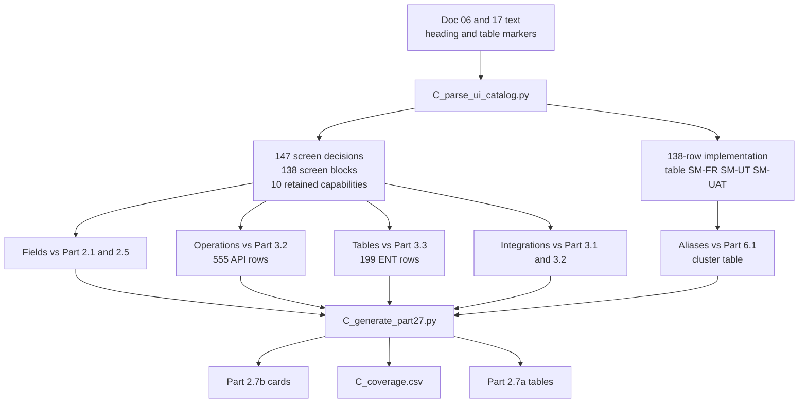
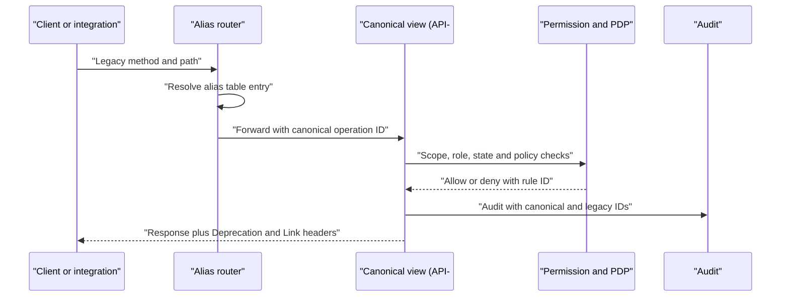

# AI Growth Engine: Employee Sales & Marketing Automation
## Application Blueprint: PART 2 (Batch 2.7a), Source Pack UI Catalog and UX Enhancements

| Field | Value |
|---|---|
| Document | Application Blueprint · Part 2.7 (Batch 2.7a of 2; per-screen contract cards in Batch 2.7b) |
| Version | 1.0 · 27 Nov 2026 |
| Baseline | Source pack documents **06** "UI Screen, Filter, API and Table Catalog" and **17** "Unified Sales and Marketing Command Centre UI/UX and Interaction Design"; compared against Part 2.1 (FR register, field specs), Part 2.4, Part 2.5 (147 screens), Part 3.2 (API catalogue), Part 3.3 (entities), Part 6.1 (alias test mapping); binding decisions DEC-001…DEC-065 |
| Roles applied | Lead UX/UI Designer (lead), Frontend Lead, Accessibility Specialist, Business Systems Analyst (BSA); reviewed from Security and Solution Architect perspectives |
| Tag ranges used | ASSUMPTION-340…345, GAP-340…349, CONFLICT-340…351, RECOMMENDATION-340…349 |

**Acronyms used in this part.** BSA Business Systems Analyst · DTO data transfer object · ENT blueprint entity ID (Part 3.3) · IP interaction pattern · LCP/INP/CLS Largest Contentful Paint / Interaction to Next Paint / Cumulative Layout Shift · OI Optimization Intelligence · OKPI pack optimization KPI (renamed from the pack's KPI-01…35, see Source Pack brief) · PDP Policy Decision Point · RUM real-user monitoring · SR screen reader · SoD separation of duties · TC test case · UAT user acceptance test · WCAG Web Content Accessibility Guidelines.

---

## 2.7.1 Documents reviewed

### 2.7.1.1 Document 06: UI Screen, Filter, API and Table Catalog

| Attribute | Value |
|---|---|
| Size | 458,074 bytes of extracted text; 3,514 lines; 10 tables; 147 screen-decision blocks; 138 implementation-register blocks; 10 retained website capability blocks |
| What it is trying to tell | It is the **screen-to-contract register**: for every one of the 147 interfaces it names the access class, behaviour, build/reuse class, business modules, the exact legacy REST/adapter operations, the PostgreSQL tables, the plugin/provider associations with licence, quota, rate, budget line and verification status, the SM-FR / SM-UT / SM-UAT test associations, interaction checks, and the field-level "current / add / remove" decisions with automation, acceptance and related screens |
| Pattern | Common core (purpose and boundary, startups, technology principles, operating contract, implementation controls, optimization, final decision controls) + domain catalogue (Part A Website W01–W30, retained website capabilities, Part B Admin A001–A108, nine new interfaces, screen-specific decisions for all 147) |
| Atomic aspects found | 2939 (field decisions 1733, screen operations 444, tables 155, test associations 138, integration associations 86, related-screen sets 147, automation statements 147, retained capabilities 10, global and optimization aspects 79) |

| # | Section (heading 1/2) | Lines | Aspect family | Shared core? |
|---|---|---|---|---|
| 1 | Product purpose and operating boundary; initial startup configurations; technology and execution principles | 7–36 | Boundary, 4 startups, stack | Yes: common core, see document 01/02 coverage |
| 2 | Global filter hierarchy and contextual filters | 37–76 | 11 filter families + rules | Partly (also FRD §2) |
| 3 | Unified Command Centre: seven primary views | 77–104 | 7 views + persistent controls | Partly (also BRD §3) |
| 4 | Interface implementation register; Part A Website W01–W30; retained website capabilities 008…085 | 105–439 | 30 screen blocks, 10 capability blocks | No |
| 5 | Part B Confidential Admin A001–A108 | 440–2103 | 108 screen blocks with plugin/licence/budget rows | No |
| 6 | Website and confidential Admin operating contract; replacement options; interface acceptance and mapping | 2104–2137 | Surfaces, routing, configuration, separation | Partly |
| 7 | Implementation, verification and delivery controls (138-row table), global interaction contract, acceptance and evidence record | 2138–2743 | SM-FR / SM-UT / SM-UAT per screen | No |
| 8 | Frontend acceptance and contract gating (four-state UI matrix, engineering mapping) | 2744–2775 | UI gating | No |
| 9 | Optimization engineering and acceptance (OPT-02, OPT-09, OPT-15, OI integration points) | 2776–2823 | 16 optimization items + 7 OI integration points | Partly (doc 36 owns OPT catalogue) |
| 10 | Implementation acceptance and verification; final decision controls | 2824–2878 | 7 procedures (each stated twice) | Yes (duplicated, DEC-014 pattern) |
| 11 | Current multi-startup scope: UI catalog (9 new interfaces) and screen-specific field and automation decisions (147) | 2879–3514 | 1,733 field rows, 147 automation, 147 related, 444 screen-operation rows | No |

### 2.7.1.2 Document 17: Unified Sales and Marketing Command Centre UI/UX and Interaction Design

| Attribute | Value |
|---|---|
| Size | 186,090 bytes of extracted text; 1,621 lines; 13 tables; 147 screen-decision blocks; 138 interaction blocks |
| What it is trying to tell | It is the **interaction-design layer** of the same catalogue: the reusable shell (nine persistent regions), the website/portal/Admin layout compositions, breakpoints, interaction-state and accessibility specification, interaction rules, design handoff and release evidence, design-side optimization items (OPT-02, OPT-06-01, OPT-14-01, OPT-15, OPT-19-01) and acceptance procedures (adds public responsiveness, inbound/outbound journeys, accessibility, user productivity); per screen it adds an *Intent* line and one of three interaction patterns |
| Pattern | Same common core as document 06; per-screen field decisions are byte-identical to document 06 and document 02 (parser diff = 0, [ASSUMPTION-342]) |
| Atomic aspects found | 341 (screen intents/interaction 147, field-decision sets 147 [common with 06], global design aspects 47) |

| # | Section | Lines | Aspect family | Shared core? |
|---|---|---|---|---|
| 1 | Purpose, startups, technology; seven views; filters | 7–104 | as doc 06 | Yes: common core / common with doc 06 |
| 2 | Interaction design and reusable shell | 105–138 | 9 persistent regions + interaction list | No |
| 3 | Screen-specific interaction index (W01–W30, capabilities, A001–A108) | 139–822 | Intent + interaction pattern per screen | No |
| 4 | Operating contract; website layout and interaction wireframe; layout compositions (public homepage, portal, Command Centre) | 823–928 | Layout regions, breakpoints, indexing | Partly |
| 5 | Replacement controls; design quality and release evidence | 929–934 | Adapter display, evidence | No |
| 6 | Interaction state and accessibility specification; design handoff; acceptance and evidence record; UI interaction rules | 935–1017 | 7 + 5 rules, handoff list | No |
| 7 | Optimization engineering (Performance, Scalability, Reusability, UI/UX, Privacy) and OI | 1018–1063 | 13 OPT items + 7 OI points | Partly |
| 8 | Acceptance procedures and final decision controls (9, duplicated) | 1064–1132 | Procedures | Yes (duplicated) |
| 9 | Current scope: UI interaction; nine new interfaces; screen-specific decisions (147) | 1133–1621 | Identical to doc 06 §11 | Common with doc 06 |

---

## 2.7.2 Coverage register summary

Statuses follow the Source Pack brief. "Not applicable" is used for shared-core text, layout-only placeholders and development-time plugins that have no runtime meaning.

| Document | Covered | Partially covered | Not covered | Conflict | Not applicable | Total |
|---|---|---|---|---|---|---|
| 06 | 2118 | 541 | 242 | 4 | 34 | 2939 |
| 17 | 184 | 148 | 3 | 5 | 1 | 341 |
| **Total** | **2302** | **689** | **245** | **9** | **35** | **3280** |

**Headline findings.**

1. **Screens:** all 147 IDs exist in Part 2.1 and Part 2.5 with identical names (parser check 147/147). Document 06/17 field decisions equal FRD §16.2 word for word, so Part 2.1's traces remain valid.
2. **Fields:** of 1733 field rows, 1448 are named in the blueprint, **278 retained-baseline fields were never specified** (Part 2.5 delegates field lists to Part 2.1; Part 2.1 lists only standardized/added fields). Largest gaps: Outreach & Marketing 54; Follow-ups 51; Discovery 36; Website intake 30; Automation 27; Overview 27; Closure 22; Portal 11; Objections 11; Global 5; Website public 4. Closed by the 147 contract cards in Batch 2.7b [GAP-340].
3. **Operations:** document 06 names **299 distinct legacy operations** (444 screen-operation rows). Only 103 match a blueprint operation exactly, 113 have an equivalent DERIVED operation under another path, and **83 have no equivalent** [GAP-342]. This is the first time the "retained 302" catalogue is visible at screen level (Part 3.2 GAP-103).
4. **Tables:** 155 source tables (152 named + 3 "existing" identity tables = the pack's 149 + 6 entities): 103 map by name, 50 by judged synonym, **2 have no blueprint entity** (`sales_business_template`, `sales_ui_service_request`) [GAP-349].
5. **Tests:** the SM-UAT-S numbering rule of Part 6.1 §6.1.12.5 is confirmed mechanically (S001–S030 = W01–W30, S031–S138 = A001–A108), and the FR-count of every SM-UT alias equals Part 6.1's cluster table (001/002 = 138, 003 = 26, 004 = 22, 015 = 69, …).
6. **Integrations:** 86 distinct plugin/provider names on screens: 37 runtime adapters, 16 open-source dependencies, 8 unverified commercial services, **23 development-time plugins that doc 06 attaches to runtime screens** [CONFLICT-346], 2 internal.
7. **Navigation:** document 06 defines **435 related-screen links**; Part 2.5 shows 3 [GAP-343].
8. **Design layer (doc 17):** the shell, states and accessibility are covered; breakpoints conflict [CONFLICT-342]; status footer, focus restoration, design handoff, design evidence, Optimization Intelligence view and productivity measurement are missing or partial.

---

## 2.7.3 Detailed coverage register

The full atomic register (3280 rows) is `final/coverage/C_coverage.csv`. This section lists every global aspect individually and groups per-screen rows; every Partial, Not covered and Conflict per-screen item is listed individually in §2.7.4 (operations, tables, integrations) or in its Batch 2.7b card (fields, related screens).

### 2.7.3.1 Global aspects: document 06

| ID | Section | Aspect | Status | Blueprint location | Action / new IDs |
|---|---|---|---|---|---|
| C06-G01 | Product purpose and operating boundary | Employee-operated commercial scope; no investor/fundraising capability; independent deployment | Not applicable | Common core: see document 01/02 coverage (Part 1; DEC-002; FR-NEG-01) | None |
| C06-G02 | Initial startup configurations | Four startup profiles (AppNAI, MedMaarg, EduVerse, OrganicSpec) and routing of AI projects to AppNAI | Not applicable | Common core: see document 01/02 coverage (Part 1; DEC-052) | None |
| C06-G03 | Technology and execution principles | Stack, open-source first, autonomy modes, recheck at execution, implementation validation | Not applicable | Common core: see document 01/02 coverage (Part 3.1; DEC-064) | None |
| C06-G04 | Global filter hierarchy | Scope family: tenant → startup → business line → offering → opportunity type; aggregate read-only | Covered | Part 2.1 FR-FLT-01; DEC-002 ("issuer thesis" replaced); DEC-055 | None |
| C06-G05 | Global filter hierarchy | Geography family (country, state, city, location, delivery geography, currency, language, timezone) | Covered | FR-FLT-02; DEC-002 ("investment geography" removed) | None |
| C06-G06 | Global filter hierarchy | Evidence family | Covered | FR-FLT-03 | None |
| C06-G07 | Global filter hierarchy | Engagement family | Covered | FR-FLT-04 | None |
| C06-G08 | Global filter hierarchy | Operations family | Covered | FR-FLT-05 | None |
| C06-G09 | Global filter hierarchy | Marketing family | Covered | FR-FLT-06 | None |
| C06-G10 | Global filter hierarchy | Commercial family | Covered | FR-FLT-07 | None |
| C06-G11 | Global filter hierarchy | AppNAI family | Covered | FR-FLT-08 | None |
| C06-G12 | Global filter hierarchy | MedMaarg family | Covered | FR-FLT-09 | None |
| C06-G13 | Global filter hierarchy | EduVerse family | Covered | FR-FLT-10; DEC-030 | None |
| C06-G14 | Global filter hierarchy | OrganicSpec family | Covered | FR-FLT-11 | None |
| C06-G15 | Global filter hierarchy | Filter rules (OR/AND, Unknown ≠ 0, allowlists, reset, cancel, saved views, cursor, distinct KPIs, server recheck of export/bulk) | Covered | FR-FLT-RULES; FR-UIS-01 | Per-screen family assignment added in 2.7b cards; ASSUMPTION-343 |
| C06-G16 | Seven primary views | Overview view purpose | Covered | Part 2.5 §2.40.1 | None |
| C06-G17 | Seven primary views | Discovery view purpose | Covered | Part 2.5 §2.40.1 | None |
| C06-G18 | Seven primary views | Outreach & Marketing view purpose | Covered | Part 2.5 §2.40.1 | None |
| C06-G19 | Seven primary views | Follow-ups view purpose | Covered | Part 2.5 §2.40.1 | None |
| C06-G20 | Seven primary views | Objections view purpose | Covered | Part 2.5 §2.40.1 | None |
| C06-G21 | Seven primary views | Closure view purpose | Covered | Part 2.5 §2.40.1 | None |
| C06-G22 | Seven primary views | Automation view purpose (connected separate admin workspace) | Covered | Part 2.5 §2.40.1 (Automation: governance, administration, operations) | None |
| C06-G23 | Seven primary views | Persistent action centre, notifications, Copilot, saved views, budget, automation status, stop control; reusable drawers | Covered | Part 2.5 §2.41; DEC-035; DEC-036 | None |
| C06-G24 | Interface implementation register | 138 proposed items; preserve source identities for engineering tracking | Partially covered | Part 2.5 §2.43 (IDs) — legacy numbers absent | Legacy crosswalk §2.7.4.1; FR-ENH-C-001; GAP-341 |
| C06-G25 | Part A Website | Public pages use published snapshot only; portal requires external auth and object grant; internal filters excluded | Covered | CA-PUB; CA-PORTAL; NFR-020 | None |
| C06-G26 | Part B Admin | All Part B items Admin-only; legacy identifiers in brackets do not denote extra screens | Covered | CA-ADMIN; §2.7.4.1 | None |
| C06-G27 | Operating contract | 147 = 34 Website + 113 Admin; 138 retained + 9 new; templates not per-startup code | Covered | Part 2.5 §2.43 count check; DEC-033 | None |
| C06-G28 | Operating contract | Surface table (Website public, Website portal, Admin, Internal/callback) | Covered | Part 3.2 §3.2.1.1; NFR-001 | None |
| C06-G29 | Operating contract | Routing decision: retain legacy contracts; separate ingress allowlists; new endpoints in /api/v1/commercial/{public,portal,admin} | Conflict | Part 3.2 §3.2.2 (FRD-named only retained) | Alias layer §2.7.5.3; CONFLICT-343; FR-ENH-C-003 |
| C06-G30 | Operating contract | Legacy token routes under /public/ are restricted portal endpoints; deny-by-default website routes; CORS not authorization | Partially covered | Part 3.2 §3.2.1.12 (CORS, allowlist); token routes not mapped | Token-route classification; FR-ENH-C-013 |
| C06-G31 | Operating contract | Verified domain → one tenant/startup; unknown host 404; immutable snapshot; expiring preview grants; atomic pointer; cache invalidation; scanned assets; no portal content in CDN | Covered | CA-PUB; NFR-020; NFR-021; FR-PUB-01 | None |
| C06-G32 | Operating contract | Intake creates scoped event and outbox, not approval; workers recheck; synthetic tests | Covered | CA-INTAKE; CA-DISPATCH | None |
| C06-G33 | Replacement options | Integration/cost/workflow/approval/exception panels show adapter, licence status, free capacity, residual cost, limits, benchmark, fallback approval; no keys or budgets on public pages | Partially covered | Part 2.5 A008/A012 regions (partial) | AdapterCard spec; FR-ENH-C-009; RECOMMENDATION-343; GAP-344 |
| C06-G34 | Replacement options | Verify role, inputs, loading/empty/validation/denied/retry/success per UI item; scoped operations; sandbox adapters | Covered | CA-ALL; Part 6.1 | None |
| C06-G35 | Interface acceptance and mapping | Scoped role, validated input, safe states, keyboard and mobile, API contract and persistence mapping per interface | Partially covered | CA-ALL; Part 2.5 (persistence mapping per screen absent) | Per-screen tables mapping in 2.7b; FR-ENH-C-002 |
| C06-G36 | Interface acceptance and mapping | Counts: 302 operations, 149 entities, 624 tests retained; 19 + 6 + 175 candidates | Partially covered | Part 3.2 GAP-103; Part 3.3 §3.3.3.4; Part 6.1 GAP-167 | Screen-level operation and table maps (§2.7.4); GAP-342 |
| C06-G37 | Interface acceptance and mapping | Delivery evidence against build, environment, scope, reviewer; critical defects block activation; targets provisional | Covered | Part 6.1 EVR; Part 8.2 | None |
| C06-G38 | Implementation controls | Shared implementation-controls preamble | Not applicable | Common core: see document 01/02 coverage | None |
| C06-G39 | Global interaction contract | Filter hierarchy row (server returns allowed vocabulary) | Covered | FR-FLT-01; Part 3.2 §3.2.1.6 | None |
| C06-G40 | Global interaction contract | Object scope row (no Admin panels in Website bundle) | Covered | NFR-001 | None |
| C06-G41 | Global interaction contract | Mutations row (preview object, cost and approval; revision and idempotency key) | Covered | UX-07; CA-DISPATCH; NFR-015 | None |
| C06-G42 | Global interaction contract | Access changes row (abort, clear cache and drafts on revoke) | Covered | FR-UIS-01; NFR-050 | None |
| C06-G43 | Acceptance and evidence record | Five evidence fields (responsible/reviewer, artefact, decision, remediation, business acceptance) | Covered | Part 6.1 EVR | None |
| C06-G44 | Four-state UI matrix | Public Website row | Covered | CA-PUB | None |
| C06-G45 | Four-state UI matrix | External portal row | Covered | CA-PORTAL; Part 2.5 §2.47 expired grant | None |
| C06-G46 | Four-state UI matrix | Admin row | Covered | CA-ADMIN; DEC-055 | None |
| C06-G47 | Four-state UI matrix | Workflow action row (preview count, blocked, max spend; queued/held/failed/uncertain) | Covered | UX-07; DEC-050; Part 2.5 §2.47 | None |
| C06-G48 | Engineering mapping | Interface owner confirms exact method/path and entities; website calls no Admin API | Partially covered | Part 3.2 FR/screen column (DERIVED paths only) | Per-screen legacy op maps; Website allowlist; FR-ENH-C-003; FR-ENH-C-013 |
| C06-G49 | Engineering mapping | Acceptance evidence: build digest, screenshots, network payload evidence, reviewer | Partially covered | Part 6.1 EVR (screenshots per role absent) | Evidence pack; FR-ENH-C-011; GAP-347 |
| C06-G50 | Optimization: Performance | OPT-02-01 public assets (LCP/INP/CLS p75) | Covered | NFR-042; NFR-043; Part 2.5 §2.48 | None |
| C06-G51 | Optimization: Performance | OPT-02-02 React rendering and filters (latest filter wins, no scope flash) | Partially covered | FR-UIS-01; NFR-044 | Filter performance behaviours; FR-ENH-C-015; TC-ENH-C-017 |
| C06-G52 | Optimization: Performance | OPT-02-03 payload and pagination; dashboard p95 ≤ 2 s / ≤ 2.5 s | Partially covered | NFR-039; Part 3.2 §3.2.1.6 | Dashboard latency scenario; FR-ENH-C-017; GAP-346 |
| C06-G53 | Optimization: Performance | OPT-02-04 read projections refresh ≤ 60 s | Conflict | NFR-047 (≤ 15 min); NFR-008 (≤ 60 s 360) | Freshness tiers; CONFLICT-348; RECOMMENDATION-348 |
| C06-G54 | Optimization: Performance | OPT-02-05 async acknowledgement p95 ≤ 2 s | Covered | NFR-040 (stricter ≤ 800 ms) | None |
| C06-G55 | Optimization: Performance | OPT-02-06 database and network profiling | Covered | Part 4.2 load tests LT-01…08 | None |
| C06-G56 | Optimization: Performance | OPT-02-07 parallel and batch operations | Covered | Part 4.2 LT; Part 3.1 worker design | None |
| C06-G57 | Optimization: API & Integration | OPT-09-01 typed contracts | Covered | Part 3.2 §3.2.5; NFR-015 | None |
| C06-G58 | Optimization: API & Integration | OPT-09-02 consolidation and batching | Covered | Part 3.2 §3.2.2 step 4 | None |
| C06-G59 | Optimization: API & Integration | OPT-09-03 adapter reliability | Covered | Part 3.2 §3.2.7 | None |
| C06-G60 | Optimization: API & Integration | OPT-09-04 webhook processing p95 ACK ≤ 2 s | Covered | NFR-051 (stricter); Part 3.2 §3.2.6 | None |
| C06-G61 | Optimization: API & Integration | OPT-09-05 API cost metering | Covered | NFR-014; NFR-037 | None |
| C06-G62 | Optimization: UI/UX | OPT-15-01 adaptive navigation | Covered | Part 2.1 §2.4.11; NFR-034; NFR-090 | None |
| C06-G63 | Optimization: UI/UX | OPT-15-02 accessibility and response states | Covered | Part 2.5 §2.46, §2.47 | None |
| C06-G64 | Optimization: UI/UX | OPT-15-03 external portal usability ("authorized investor/customer") | Conflict | Part 2.5 portal; DEC-002 | Wording fix; CONFLICT-340; TC-ENH-C-020 |
| C06-G65 | Optimization: UI/UX | OPT-15-04 saved views and bulk actions | Covered | FR-FLT-RULES; UX-07; NFR-038 | None |
| C06-G66 | Optimization Intelligence | OI contextual Admin panel; unassessed when no denominator; stale labels; no public access | Not covered | — | OI panel spec; FR-ENH-C-004; GAP-345 |
| C06-G67 | Optimization Intelligence | Seven OI integration points (A089, A009, A012, A014, A084, A042, A082) with persistence sources | Partially covered | Part 3.2 operations (mapped in §2.7.4) | Operation maps; panel placement; FR-ENH-C-004 |
| C06-G68 | Optimization Intelligence | Acceptance protocol (baseline, candidate, dataset, digest, cost, outcome, reviewer; missing = Pending) | Partially covered | Part 6.1 EVR | Included in FR-ENH-C-004/011; FR-ENH-C-011 |
| C06-G69 | Acceptance procedures | Dashboard latency 50/250 staff, 100k/1m opportunities | Partially covered | NFR-039; NFR-044 | LT-ENH-C-01; FR-ENH-C-017; CONFLICT-349 |
| C06-G70 | Acceptance procedures | Independent products and frontends ("two products, four frontends") | Conflict | DEC-009; DEC-058; NFR-001 | Interpretation; CONFLICT-341 |
| C06-G71 | Acceptance procedures | Catalog integrity (138 UI, 302 ops, 149 entities preserved; 147 reconcile) | Partially covered | Part 3.2 GAP-103; Part 3.3 GAP-112 | This batch parser = integrity check for UI and screen-level ops/tables; GAP-342 |
| C06-G72 | Acceptance procedures | UI component reuse | Covered | UX-09; Part 2.5 §2.45.2 | None |
| C06-G73 | Acceptance procedures | Public/portal/Admin separation | Covered | NFR-001; CA-PUB; CA-PORTAL | None |
| C06-G74 | Acceptance procedures | Adaptive filters and saved views | Covered | FR-FLT-RULES; FR-UIS-01 | None |
| C06-G75 | Acceptance procedures | Loading, empty and error states | Covered | Part 2.5 §2.47 | None |
| C06-G76 | Final decision controls | Same seven procedures restated with owner and evidence rule | Covered | DEC-014 (duplicated procedures consolidated) | None |
| C06-G77 | Final decision controls | Boundary: two-tenant fixture, deny cross-scope, reject stale grants | Covered | Part 6.1 negative packs | None |
| C06-G78 | Current scope | Nine new interfaces table (W31–W34, A109–A113) purpose and acceptance | Covered | DEC-033; FR-W31…W34; FR-A109…A113 | Investor wording handled by CONFLICT-340; CONFLICT-340 |
| C06-G79 | Current scope | Release condition: no production approval implied | Covered | Part 8.2 go-live gates | None |

### 2.7.3.2 Global aspects: document 17

| ID | Section | Aspect | Status | Blueprint location | Action / new IDs |
|---|---|---|---|---|---|
| C17-G01 | Purpose, startups, technology, views, filters | Shared with document 06 and 01/02 | Not applicable | Common core: see document 01/02 coverage and doc 06 rows | None |
| C17-G02 | Reusable shell | Header region (product, tenant, startup, role, scope, user, notification) | Partially covered | Part 2.5 §2.41 (role chip absent) | Role chip; FR-ENH-C-007 |
| C17-G03 | Reusable shell | Navigation region (seven views, context-aware labels) | Covered | Part 2.5 §2.40, §2.41 | None |
| C17-G04 | Reusable shell | Filter toolbar (clear/apply/save, result count, as_of) | Partially covered | Part 2.5 §2.41 (result count absent) | Result count; FR-ENH-C-008; GAP-348 |
| C17-G05 | Reusable shell | KPI cards (distinct verified outcomes; forecast not as actual) | Covered | Part 2.5 DV-2; FR-FLT-RULES | None |
| C17-G06 | Reusable shell | Results (stable-cursor table or pipeline; confidence and status) | Covered | LP-LIST; LP-BOARD | None |
| C17-G07 | Reusable shell | Detail drawer (profile, chronology, evidence, actions, approval state) | Covered | LP-DETAIL; context panel | None |
| C17-G08 | Reusable shell | Action centre (mark read affects own notification only) | Covered | FR-A106 | None |
| C17-G09 | Reusable shell | Copilot (read/draft/propose; exact scope; confirmation before live effect) | Covered | DEC-035; FR-COP-01 | None |
| C17-G10 | Reusable shell | Footer/status (last refresh, degraded provider, pending job, support) | Partially covered | Part 2.5 status bar (automation, budget, STOP) | Status footer; FR-ENH-C-007; GAP-348 |
| C17-G11 | Reusable shell | Interaction list: keyboard, focus restoration, visible focus, labels, non-colour status, contrast, table-to-card, virtualization, accessible validation, abort on switch, no success on queue acceptance, bulk preview | Partially covered | Part 2.5 §2.46, §2.47, §2.48 (focus restoration absent) | Focus restoration; FR-ENH-C-008 |
| C17-G12 | Operating contract | Same as doc 06 (surfaces, routing, configuration, separation) | Covered | See doc 06 rows | None |
| C17-G13 | Layout wireframe | Header/Body/Portal/Footer regions for Website and Admin | Covered | Part 2.5 §2.40.2, §2.41 | None |
| C17-G14 | Layout wireframe | Breakpoints desktop ≥ 1200, tablet 768–1199, mobile < 768 | Conflict | Part 2.5 §2.48; DEC-043 | Mapping and test matrix; CONFLICT-342; FR-ENH-C-005 |
| C17-G15 | Layout wireframe | WCAG 2.2 AA, focus, error announcements, reduced motion | Covered | Part 2.5 §2.46 | None |
| C17-G16 | Layout wireframe | Index only after approval; portal/Admin noindex plus auth, not robots.txt security | Covered | Part 2.3/3.1 noindex rules; CA-PUB | None |
| C17-G17 | Layout compositions | Public homepage composition | Covered | Part 2.5 W01, W03 | None |
| C17-G18 | Layout compositions | Authenticated external portal composition | Covered | Part 2.5 §2.40.2 portal navigation | None |
| C17-G19 | Layout compositions | Command Centre composition | Covered | Part 2.5 §2.41 | None |
| C17-G20 | Replacement controls | Adapter preference, capability, entitlement, estimated cost, metering, paid fallback approval; no misleading free/verified badge | Partially covered | Part 2.5 A008, A011, A012 | AdapterCard; FR-ENH-C-009; RECOMMENDATION-343 |
| C17-G21 | Replacement controls | Per-screen verification (keyboard, SR, responsive, focus, labels, filter persistence, states); synthetic UAT | Covered | Part 2.5 §2.46; Part 6.1 | Per-screen TC-ENH-C-1nn |
| C17-G22 | Design quality and release evidence | Role-based screenshots and user walkthroughs after implementation | Not covered | — | Evidence pack; FR-ENH-C-011; GAP-347 |
| C17-G23 | Interaction state and accessibility spec | Responsive shell; test 360/768/1440 and keyboard flow | Conflict | Part 2.5 §2.48 | Test matrix; CONFLICT-342; FR-ENH-C-005 |
| C17-G24 | Interaction state and accessibility spec | Scoped global controls; no aggregate mutation | Covered | FR-FLT-01; DEC-055 | None |
| C17-G25 | Interaction state and accessibility spec | Loading/empty/error with retry and correlation ID | Covered | Part 2.5 §2.47 | None |
| C17-G26 | Interaction state and accessibility spec | Action preview (affected, excluded, effect, cost, approval) | Covered | UX-07 | None |
| C17-G27 | Interaction state and accessibility spec | External portal (own grant; expired grant recovery path) | Covered | CA-PORTAL; §2.47 | None |
| C17-G28 | Interaction state and accessibility spec | Forms (labels, requiredness, privacy purpose, opaque reference) | Covered | PP-FORM; CA-INTAKE | None |
| C17-G29 | Interaction state and accessibility spec | Quality acceptance (exact UAT, keyboard, contrast) | Covered | Part 6.1 | None |
| C17-G30 | Design handoff | Component, breakpoints, states, filter types, labels, role/mutation permission, exact API operation, visible fields | Not covered | — | Handoff record from 2.7b cards; FR-ENH-C-010; GAP-347 |
| C17-G31 | UI interaction rules | Startup switch resets queries and filters ("no stale previous issuer/company data") | Conflict | FR-UIS-01; DEC-002 | Wording fix; CONFLICT-340 |
| C17-G32 | UI interaction rules | Persistent command controls (role-based action, preview, confirmation, cost, approval) | Covered | UX-07; CA-APPROVE | None |
| C17-G33 | UI interaction rules | Accessibility (keyboard, focus, labels, contrast, 360/768/1440) | Partially covered | Part 2.5 §2.46 | Test matrix; FR-ENH-C-005 |
| C17-G34 | UI interaction rules | Portal privacy (no internal search, forecast, employee records, private AI knowledge) | Covered | CA-PORTAL; NFR-001 | None |
| C17-G35 | UI interaction rules | Publishing (draft preview behind Admin auth; immutable DTO; unpublish invalidates cache) | Covered | FR-PUB-01; NFR-020 | None |
| C17-G36 | Optimization | Optimization view Admin-only; measured vs proposed targets; no fictitious scores | Not covered | — | OI panel; FR-ENH-C-004; GAP-345 |
| C17-G37 | Optimization | OPT-06-01 startup templates and tenants (25+10 initial; 50+ and 100 external growth) | Conflict | DEC-031 | Stress-level interpretation; CONFLICT-349 |
| C17-G38 | Optimization | OPT-14-01 shared code libraries; independent runtime configs | Covered | UX-09; Part 3.1 | None |
| C17-G39 | Optimization | OPT-19-01 minimize data and source eligibility | Covered | Part 4.1; DEC-030; BRL-SRC | None |
| C17-G40 | Optimization | OPT-02-01…07 and OPT-15-01…04 (same as doc 06) | Covered | See doc 06 rows | None |
| C17-G41 | Acceptance procedures | Public website responsiveness (RUM or lab proxy labelled) | Partially covered | NFR-042 (lab proxy labelling absent) | Labelling rule; FR-ENH-C-017 |
| C17-G42 | Acceptance procedures | Inbound and outbound journeys ("lead/investor record") | Conflict | Part 6 E2E packs; DEC-002 | Wording fix; CONFLICT-340 |
| C17-G43 | Acceptance procedures | Accessibility review (automated plus manual) | Covered | Part 2.5 §2.46 | None |
| C17-G44 | Acceptance procedures | User productivity (baseline vs candidate task time and errors) | Partially covered | NFR-090 | Protocol; FR-ENH-C-016; RECOMMENDATION-347 |
| C17-G45 | Acceptance procedures | Dashboard latency, component reuse, separation, filters, states (same as doc 06) | Covered | See doc 06 rows | None |
| C17-G46 | Current scope: UI interaction | Distinguish HTML demo interactions from declared field enhancements; simulation never authenticates production users | Partially covered | Not stated | Handoff rule; FR-ENH-C-010 |
| C17-G47 | Screen interaction index | Three interaction patterns across 138 blocks | Partially covered | Part 2.5 layout patterns (interaction checklist absent) | IP-PUB/IP-PORTAL/IP-ADMIN; FR-ENH-C-006 |

### 2.7.3.3 Per-screen aspect groups

| Aspect group | Rows | Covered | Partial | Not covered | N/A | Where the items are listed |
|---|---|---|---|---|---|---|
| Doc 06 field decisions (current/add/replace) | 1733 | 1448 | 278 | 0 | 7 | Part 2.7b cards (each P row individually) |
| Doc 06 screen operations | 444 | 172 | 180 | 92 | 0 | §2.7.4.3 (N), §2.7.4.4 (P), cards |
| Doc 06 tables | 155 | 103 | 50 | 2 | 0 | §2.7.4.5 |
| Doc 06 test associations (SM-FR/UT/UAT) | 138 | 138 | 0 | 0 | 0 | §2.7.4.6 |
| Doc 06 retained website capabilities | 10 | 0 | 10 | 0 | 0 | §2.7.4.1 |
| Doc 06 integration associations (distinct names) | 86 | 53 | 10 | 0 | 23 | §2.7.4.7 |
| Doc 06 related-screen sets | 147 | 0 | 0 | 147 | 0 | Part 2.7b cards; FR-ENH-C-012 |
| Doc 06 automation/acceptance statements | 147 | 147 | 0 | 0 | 0 | Part 2.1 FR rows |
| Doc 17 screen intent and interaction | 147 | 9 | 138 | 0 | 0 | Part 2.7b cards; §2.7.5.2 |
| Doc 17 field decisions (common with doc 06) | 147 | 147 | 0 | 0 | 0 | Doc 06 rows |
| Doc 06 global aspects | 79 | 57 | 13 | 5 | 4 | §2.7.3.1 |
| Doc 17 global aspects | 47 | 28 | 10 | 8 | 1 | §2.7.3.2 |

---

## 2.7.4 Catalogue reconciliation



Scripts: `assembly/source_pack/C_parse_ui_catalog.py` (parse and reconcile) and `assembly/source_pack/C_generate_part27.py` (cards, fragments, coverage). Matching rules: fields match when ≥ 50% of the field's normalized tokens occur in the screen's Part 2.1 FR row or Part 2.5 row; operations match exactly on method + normalized path (legacy paths without `/api/v1` are prefixed), else on the same screen with the same final resource noun, else anywhere in the catalogue with the same method and resource; tables match on the name suffix after the `growth_`/`sales_` prefix, else on a judged synonym list in the script.

### 2.7.4.1 Screen identity reconciliation and legacy screen IDs

All 147 IDs and names agree between documents 02, 06, 17 and Parts 2.1/2.5. Document 06 preserves the **original 116-item numbering** ("existing NNN"): A001–A106 carry 106 of them and the ten retained website capabilities carry the other ten [ASSUMPTION-344]. A107/A108 and W01–W30 have no legacy number; W31–W34 and A109–A113 are the nine additions. The crosswalk is now part of the blueprint (FR-ENH-C-001):

| Screen | Legacy | Screen | Legacy | Screen | Legacy | Screen | Legacy |
|---|---|---|---|---|---|---|---|
| A001 | 001 | A002 | 002 | A003 | 003 | A004 | 004 |
| A005 | 005 | A006 | 006 | A007 | 007 | A008 | 009 |
| A009 | 010 | A010 | 011 | A011 | 012 | A012 | 013 |
| A013 | 014 | A014 | 015 | A015 | 016 | A016 | 017 |
| A017 | 018 | A018 | 019 | A019 | 020 | A020 | 021 |
| A021 | 022 | A022 | 023 | A023 | 024 | A024 | 025 |
| A025 | 026 | A026 | 027 | A027 | 028 | A028 | 029 |
| A029 | 030 | A030 | 031 | A031 | 033 | A032 | 034 |
| A033 | 035 | A034 | 036 | A035 | 037 | A036 | 038 |
| A037 | 039 | A038 | 040 | A039 | 041 | A040 | 042 |
| A041 | 044 | A042 | 045 | A043 | 046 | A044 | 047 |
| A045 | 048 | A046 | 050 | A047 | 051 | A048 | 052 |
| A049 | 053 | A050 | 054 | A051 | 055 | A052 | 056 |
| A053 | 057 | A054 | 058 | A055 | 059 | A056 | 060 |
| A057 | 062 | A058 | 063 | A059 | 064 | A060 | 065 |
| A061 | 066 | A062 | 067 | A063 | 069 | A064 | 071 |
| A065 | 072 | A066 | 073 | A067 | 074 | A068 | 075 |
| A069 | 076 | A070 | 077 | A071 | 078 | A072 | 080 |
| A073 | 081 | A074 | 083 | A075 | 084 | A076 | 086 |
| A077 | 087 | A078 | 088 | A079 | 089 | A080 | 090 |
| A081 | 091 | A082 | 092 | A083 | 093 | A084 | 094 |
| A085 | 095 | A086 | 096 | A087 | 097 | A088 | 098 |
| A089 | 099 | A090 | 100 | A091 | 101 | A092 | 102 |
| A093 | 103 | A094 | 104 | A095 | 105 | A096 | 106 |
| A097 | 107 | A098 | 108 | A099 | 109 | A100 | 110 |
| A101 | 111 | A102 | 112 | A103 | 113 | A104 | 114 |
| A105 | 115 | A106 | 116 |  |  |  |  |

**Retained website capabilities (doc 06 "Existing capability NNN") mapped to W-screens:**

| Legacy capability | Behaviour (doc 06) | Business modules | Original operations | Mapped W-screen(s) | Status |
|---|---|---|---|---|---|
| 008 | Manage preferences and submit privacy requests | Consent and suppression; Privacy requests and retention | GET /api/v1/public/preferences/{token}; POST /api/v1/consents; POST /api/v1/opt-out; POST /api/v1/privacy/requests | W29, W30 | Partial: function in FR-W29; legacy number tracked (FR-ENH-C-001); operations in §2.7.4.3–4 |
| 032 | Capture consented enquiries | Lead capture and forms | GET /api/v1/public/forms/{slug}; POST /api/v1/public/leads | W12–W17 | Partial: function in FR-W12; legacy number tracked (FR-ENH-C-001); operations in §2.7.4.3–4 |
| 043 | Select available appointment slots | Meeting and calendar | GET /api/v1/public/meeting-slots/{token}; POST /api/v1/meetings/book; ADAPTER Calendar availability / booking | W18 | Partial: function in FR-W18; legacy number tracked (FR-ENH-C-001); operations in §2.7.4.3–4 |
| 049 | Answer approved product FAQs and collect enquiries | Website conversational assistant | POST /api/v1/public/chat | W11 | Partial: function in FR-W11; legacy number tracked (FR-ENH-C-001); operations in §2.7.4.3–4 |
| 061 | Show approved offers and enquiry forms | Landing pages and attribution | GET /api/v1/public/pages/{slug}; POST /api/v1/public/events | W10 | Partial: function in FR-W10; legacy number tracked (FR-ENH-C-001); operations in §2.7.4.3–4 |
| 068 | Register and view event details | Webinars and demonstrations | GET /api/v1/public/events/{id}; POST /api/v1/events/register; ADAPTER Webinar provider API | W19 | Partial: function in FR-W19; legacy number tracked (FR-ENH-C-001); operations in §2.7.4.3–4 |
| 070 | Submit authorized referrals | Referral and partner lead capture | POST /api/v1/public/referrals | W20 | Partial: function in FR-W20; legacy number tracked (FR-ENH-C-001); operations in §2.7.4.3–4 |
| 079 | Open authorized signing workflow | Contract and MoU workflow | GET /api/v1/public/agreements/{token}; POST /api/v1/public/agreements/{token}/sign; ADAPTER E-sign provider API | W24 | Partial: function in FR-W24; legacy number tracked (FR-ENH-C-001); operations in §2.7.4.3–4 |
| 082 | View approved payment link and confirmation | Payment and closure | GET /api/v1/public/payment-status/{token}; POST /api/v1/invoices/{id}/payment-link; ADAPTER Payment gateway API | W26 | Partial: function in FR-W26; legacy number tracked (FR-ENH-C-001); operations in §2.7.4.3–4 |
| 085 | Access approved product links and next steps | Onboarding and handoff | GET /api/v1/public/onboarding/{token}; POST /api/v1/onboarding/{id}/complete | W27 | Partial: function in FR-W27; legacy number tracked (FR-ENH-C-001); operations in §2.7.4.3–4 |

### 2.7.4.2 Operation reconciliation summary

| Measure | Count |
|---|---|
| Screen-operation rows in doc 06 (incl. retained capabilities and OI integration points) | 444 |
| Distinct method + path pairs | 299 |
| Exact match to a blueprint operation (Covered) | 103 |
| Equivalent DERIVED operation exists (Partial: alias route needed) | 113 |
| No equivalent (Not covered: alias or new DERIVED operation needed) | 83 |
| Of which generic `…/{id}/control` endpoints | 12 |
| Of which per-object `approve`/`review` endpoints | 10 |
| Of which `/api/v1/sales/…` or `/api/v1/commercial/workspace/…` namespace | 61 |

Exactly matched operations: GET `/api/v1/public/pages/{slug}`, POST `/api/v1/public/events`, POST `/api/v1/public/chat`, POST `/api/v1/public/leads`, POST `/api/v1/meetings/book`, POST `/api/v1/events/register`, POST `/api/v1/public/referrals`, POST `/auth/login`, GET `/me`, GET `/api/v1/commercial/portal/orders/{id}`, POST `/api/v1/onboarding/{id}/complete`, POST `/api/v1/consents`, POST `/api/v1/opt-out`, POST `/api/v1/privacy/requests`, GET `/api/v1/products`, POST `/api/v1/admin/claims/approve`, GET `/api/v1/knowledge/search`, POST `/api/v1/knowledge/uploads`, GET `/api/v1/integrations`, POST `/api/v1/admin/integrations/test`, GET `/api/v1/events`, POST `/api/v1/admin/jobs/{id}/retry`, GET `/api/v1/sources`, POST `/api/v1/admin/sources`, GET `/api/v1/admin/ai/runs`, GET `/api/v1/admin/costs`, POST `/api/v1/admin/budgets`, GET `/api/v1/admin/health`, POST `/api/v1/research/plans`, POST `/api/v1/research/run`, GET `/api/v1/research/results`, GET `/api/v1/evidence/{id}`, GET `/api/v1/organizations`, POST `/api/v1/organizations`, GET `/api/v1/signals`, POST `/api/v1/signals/{id}/review`, GET `/api/v1/needs`, POST `/api/v1/needs/{id}/verify`, POST `/api/v1/matches/recompute`, GET `/api/v1/opportunities`, POST `/api/v1/opportunities/{id}/score`, GET `/api/v1/organizations/{id}/contacts`, POST `/api/v1/contacts/{id}/verify`, POST `/api/v1/opportunities/{id}/review`, GET `/api/v1/alerts`, GET `/api/v1/deals`, POST `/api/v1/deals`, POST `/api/v1/deals/{id}/transition`, GET `/api/v1/organizations/{id}/360`, POST `/api/v1/engagement/check`, GET `/api/v1/workflows`, POST `/api/v1/admin/workflows/pause`, POST `/api/v1/messages/draft`, POST `/api/v1/messages/send`, POST `/api/v1/webhooks/email`, POST `/api/v1/webhooks/inbound`, GET `/api/v1/threads`, GET `/api/v1/inbox`, POST `/api/v1/sequences/{id}/enroll`, POST `/api/v1/webhooks/calendar`, GET `/api/v1/metrics/funnel`, GET `/api/v1/webhooks/whatsapp`, POST `/api/v1/webhooks/whatsapp`, POST `/api/v1/threads/{id}/assign`, GET `/api/v1/admin/compliance`, GET `/api/v1/social/signals`, POST `/api/v1/content/draft`, POST `/api/v1/content/{id}/approve`, POST `/api/v1/social/posts`, GET `/api/v1/social/status`, GET `/api/v1/seo/audit`, POST `/api/v1/seo/tasks`, POST `/api/v1/campaigns`, POST `/api/v1/campaigns/{id}/approve`, POST `/api/v1/ads/drafts`, GET `/api/v1/ads/metrics`, POST `/api/v1/webhooks/events`, POST `/api/v1/deals/{id}/proposals`, POST `/api/v1/quotes`, POST `/api/v1/quotes/{id}/approve`, POST `/api/v1/deals/{id}/objections`, POST `/api/v1/contracts`, POST `/api/v1/webhooks/esign`, POST `/api/v1/webhooks/payment`, POST `/api/v1/deals/{id}/close`, GET `/api/v1/onboarding`, POST `/api/v1/partners`, POST `/api/v1/pilots/{id}/status`, GET `/api/v1/renewals`, POST `/api/v1/renewals/{id}/review`, POST `/api/v1/deals/{id}/lost`, POST `/api/v1/feedback`, GET `/api/v1/metrics/revenue`, POST `/api/v1/admin/evals/run`, GET `/api/v1/market/competitors`, GET `/api/v1/metrics/forecast`, GET `/api/v1/admin/dashboard`, POST `/api/v1/admin/approvals/{id}/decide`, GET `/api/v1/admin/releases`, POST `/api/v1/pilots`, POST `/api/v1/integration-enquiries`, GET `/api/v1/deployments`, POST `/api/v1/admin/products/{id}/launch`.

### 2.7.4.3 Operations with no blueprint equivalent (Not covered, listed individually)

| # | Method | Source path | Screens | Status | Blueprint op(s) | Action |
|---|---|---|---|---|---|---|
| 1 | GET | `/api/v1/public/meeting-slots/{token}` | W18, CAP043 | N | — | Add ★ legacy alias as new DERIVED op (§2.7.5.3) |
| 2 | GET | `/api/v1/commercial/portal/overview` | W22 | N | — | Add ★ legacy alias as new DERIVED op (§2.7.5.3) |
| 3 | GET | `/api/v1/commercial/portal/quotations/{id}` | W23 | N | — | Add ★ legacy alias as new DERIVED op (§2.7.5.3) |
| 4 | POST | `/api/v1/commercial/portal/quotations/{id}/respond` | W23 | N | — | Add ★ legacy alias as new DERIVED op (§2.7.5.3) |
| 5 | GET | `/api/v1/public/payment-status/{token}` | W26, CAP082 | N | — | Add ★ legacy alias as new DERIVED op (§2.7.5.3) |
| 6 | POST | `/api/v1/commercial/portal/documents/{id}/complete` | W27 | N | — | Add ★ legacy alias as new DERIVED op (§2.7.5.3) |
| 7 | POST | `/admin/users/{id}/roles` | A002 | N | — | Add ★ legacy alias as new DERIVED op (§2.7.5.3) |
| 8 | POST | `/api/v1/admin/products` | A004 | N | — | Add ★ legacy alias as new DERIVED op (§2.7.5.3) |
| 9 | PATCH | `/api/v1/admin/products/{id}` | A004 | N | — | Add ★ legacy alias as new DERIVED op (§2.7.5.3) |
| 10 | POST | `/api/v1/knowledge/documents/{id}/review` | A006 | N | — | Alias → Approval decide (CONFLICT-345) |
| 11 | PATCH | `/api/v1/admin/sources/{id}` | A010 | N | — | Add ★ legacy alias as new DERIVED op (§2.7.5.3) |
| 12 | GET | `/api/v1/admin/ai/eval-cases` | A011 | N | — | Add ★ legacy alias as new DERIVED op (§2.7.5.3) |
| 13 | POST | `/api/v1/admin/privacy/requests/{id}/resolve` | A013 | N | — | Add ★ legacy alias as new DERIVED op (§2.7.5.3) |
| 14 | POST | `/api/v1/admin/retention-policies` | A013 | N | — | Add ★ legacy alias as new DERIVED op (§2.7.5.3) |
| 15 | POST | `/api/v1/admin/signal-types` | A023 | N | — | Add ★ legacy alias as new DERIVED op (§2.7.5.3) |
| 16 | POST | `/api/v1/admin/scoring-rules` | A023 | N | — | Add ★ legacy alias as new DERIVED op (§2.7.5.3) |
| 17 | GET | `/api/v1/contacts/verification-queue` | A025, A026 | N | — | Add ★ legacy alias as new DERIVED op (§2.7.5.3) |
| 18 | POST | `/api/v1/alerts/{id}/read` | A027 | N | — | Add ★ legacy alias as new DERIVED op (§2.7.5.3) |
| 19 | POST | `/api/v1/admin/research-review-rules` | A028 | N | — | Add ★ legacy alias as new DERIVED op (§2.7.5.3) |
| 20 | GET | `/api/v1/admin/pipeline-stages` | A030 | N | — | Add ★ legacy alias as new DERIVED op (§2.7.5.3) |
| 21 | POST | `/api/v1/admin/pipeline-stages` | A030 | N | — | Add ★ legacy alias as new DERIVED op (§2.7.5.3) |
| 22 | POST | `/api/v1/admin/workflows/{id}/resume` | A033 | N | — | Add ★ legacy alias as new DERIVED op (§2.7.5.3) |
| 23 | GET | `/api/v1/workflows/{id}/executions` | A033 | N | — | Add ★ legacy alias as new DERIVED op (§2.7.5.3) |
| 24 | POST | `/api/v1/messages/drafts/{id}/review` | A034, A035 | N | — | Alias → Approval decide (CONFLICT-345) |
| 25 | GET | `/api/v1/admin/message-templates` | A035 | N | — | Add ★ legacy alias as new DERIVED op (§2.7.5.3) |
| 26 | POST | `/api/v1/admin/message-templates` | A035 | N | — | Add ★ legacy alias as new DERIVED op (§2.7.5.3) |
| 27 | POST | `/api/v1/threads/{id}/handoff` | A035, A037 | N | — | Add ★ legacy alias as new DERIVED op (§2.7.5.3) |
| 28 | GET | `/api/v1/messages/{id}` | A037 | N | — | Add ★ legacy alias as new DERIVED op (§2.7.5.3) |
| 29 | GET | `/api/v1/threads/{id}/messages` | A037 | N | — | Add ★ legacy alias as new DERIVED op (§2.7.5.3) |
| 30 | POST | `/api/v1/admin/calendar-links` | A041 | N | — | Add ★ legacy alias as new DERIVED op (§2.7.5.3) |
| 31 | GET | `/api/v1/admin/whatsapp/accounts` | A044 | N | — | Add ★ legacy alias as new DERIVED op (§2.7.5.3) |
| 32 | GET | `/api/v1/whatsapp/conversations` | A045 | N | — | Add ★ legacy alias as new DERIVED op (§2.7.5.3) |
| 33 | POST | `/api/v1/admin/chat/settings` | A046 | N | — | Add ★ legacy alias as new DERIVED op (§2.7.5.3) |
| 34 | PATCH | `/api/v1/content/{id}` | A050 | N | — | Add ★ legacy alias as new DERIVED op (§2.7.5.3) |
| 35 | POST | `/api/v1/campaigns/{id}/pause` | A059 | N | — | Add ★ legacy alias as new DERIVED op (§2.7.5.3) |
| 36 | GET | `/api/v1/events/business` | A062, A063 | N | — | Add ★ legacy alias as new DERIVED op (§2.7.5.3) |
| 37 | POST | `/api/v1/events/business` | A062 | N | — | Add ★ legacy alias as new DERIVED op (§2.7.5.3) |
| 38 | POST | `/api/v1/admin/events/{id}/settings` | A063 | N | — | Add ★ legacy alias as new DERIVED op (§2.7.5.3) |
| 39 | POST | `/api/v1/admin/referrals/{id}/review` | A064 | N | — | Alias → Approval decide (CONFLICT-345) |
| 40 | POST | `/api/v1/proposals/{id}/review` | A066 | N | — | Alias → Approval decide (CONFLICT-345) |
| 41 | POST | `/api/v1/negotiations/{id}/review` | A070 | N | — | Alias → Approval decide (CONFLICT-345) |
| 42 | POST | `/api/v1/contracts/{id}/approve` | A072 | N | — | Alias → Approval decide (CONFLICT-345) |
| 43 | POST | `/api/v1/partner-pilots` | A077 | N | — | Add ★ legacy alias as new DERIVED op (§2.7.5.3) |
| 44 | POST | `/api/v1/admin/renewal-policies` | A080 | N | — | Add ★ legacy alias as new DERIVED op (§2.7.5.3) |
| 45 | POST | `/api/v1/admin/kpi-definitions` | A083 | N | — | Add ★ legacy alias as new DERIVED op (§2.7.5.3) |
| 46 | POST | `/api/v1/admin/competitor-sources` | A086 | N | — | Add ★ legacy alias as new DERIVED op (§2.7.5.3) |
| 47 | POST | `/api/v1/admin/forecast-settings` | A088 | N | — | Add ★ legacy alias as new DERIVED op (§2.7.5.3) |
| 48 | GET | `/api/v1/insurance/pilots` | A091, A092 | N | — | Add ★ legacy alias as new DERIVED op (§2.7.5.3) |
| 49 | POST | `/api/v1/insurance/pilots/{id}/approve` | A092 | N | — | Alias → Approval decide (CONFLICT-345) |
| 50 | POST | `/api/v1/integration-enquiries/{id}/approve` | A094 | N | — | Alias → Approval decide (CONFLICT-345) |
| 51 | POST | `/api/v1/deployments/{id}/approve` | A096 | N | — | Alias → Approval decide (CONFLICT-345) |
| 52 | POST | `/api/v1/sales/tenants/{id}/control` | A099 | N | — | Alias with `action` discriminator → per-action ops (CONFLICT-344) |
| 53 | PATCH | `/api/v1/sales/startups/{id}` | A099 | N | — | Alias route to DERIVED op (CONFLICT-343) |
| 54 | POST | `/api/v1/sales/memberships` | A099 | N | — | Alias route to DERIVED op (CONFLICT-343) |
| 55 | POST | `/api/v1/sales/templates/{id}/control` | A100 | N | — | Alias with `action` discriminator → per-action ops (CONFLICT-344) |
| 56 | POST | `/api/v1/sales/domains/{id}/control` | A100 | N | — | Alias with `action` discriminator → per-action ops (CONFLICT-344) |
| 57 | GET | `/api/v1/sales/service-plans` | A101 | N | — | Alias route to DERIVED op (CONFLICT-343) |
| 58 | POST | `/api/v1/sales/service-plans` | A101 | N | — | Alias route to DERIVED op (CONFLICT-343) |
| 59 | GET | `/api/v1/sales/service-subscriptions` | A101 | N | — | Alias route to DERIVED op (CONFLICT-343) |
| 60 | POST | `/api/v1/sales/service-subscriptions/{id}/control` | A101 | N | — | Alias with `action` discriminator → per-action ops (CONFLICT-344) |
| 61 | GET | `/api/v1/sales/usage-charges` | A101 | N | — | Alias route to DERIVED op (CONFLICT-343) |
| 62 | POST | `/api/v1/sales/usage-charges/{id}/adjust` | A101 | N | — | Alias route to DERIVED op (CONFLICT-343) |
| 63 | GET | `/api/v1/sales/action-plans` | A102 | N | — | Alias route to DERIVED op (CONFLICT-343) |
| 64 | POST | `/api/v1/sales/action-plans` | A102 | N | — | Alias route to DERIVED op (CONFLICT-343) |
| 65 | POST | `/api/v1/sales/action-plans/{id}/control` | A102 | N | — | Alias with `action` discriminator → per-action ops (CONFLICT-344) |
| 66 | GET | `/api/v1/sales/data-transfers` | A103 | N | — | Alias route to DERIVED op (CONFLICT-343) |
| 67 | POST | `/api/v1/sales/data-transfers` | A103 | N | — | Alias route to DERIVED op (CONFLICT-343) |
| 68 | POST | `/api/v1/sales/data-transfers/{id}/complete` | A103 | N | — | Alias route to DERIVED op (CONFLICT-343) |
| 69 | POST | `/api/v1/sales/data-transfers/{id}/control` | A103 | N | — | Alias with `action` discriminator → per-action ops (CONFLICT-344) |
| 70 | POST | `/api/v1/sales/bids/{id}/control` | A104 | N | — | Alias with `action` discriminator → per-action ops (CONFLICT-344) |
| 71 | POST | `/api/v1/sales/orders/{id}/control` | A105 | N | — | Alias with `action` discriminator → per-action ops (CONFLICT-344) |
| 72 | POST | `/api/v1/sales/orders/{id}/milestones` | A105 | N | — | Alias route to DERIVED op (CONFLICT-343) |
| 73 | PATCH | `/api/v1/sales/notifications/{id}` | A106 | N | — | Alias route to DERIVED op (CONFLICT-343) |
| 74 | POST | `/api/v1/commercial/admin/website/pages/{id}/control` | A108 | N | — | Alias with `action` discriminator → per-action ops (CONFLICT-344) |
| 75 | POST | `/api/v1/commercial/workspace/client/service-requests` | W34 | N | — | Alias route to DERIVED op (CONFLICT-343) |
| 76 | POST | `/api/v1/commercial/workspace/admin/triggers/{id}/control` | A109 | N | — | Alias with `action` discriminator → per-action ops (CONFLICT-344) |
| 77 | GET | `/api/v1/commercial/workspace/admin/executions` | A110 | N | — | Alias route to DERIVED op (CONFLICT-343) |
| 78 | GET | `/api/v1/commercial/workspace/admin/configurations` | A112 | N | — | Alias route to DERIVED op (CONFLICT-343) |
| 79 | POST | `/api/v1/commercial/workspace/admin/configurations` | A112 | N | — | Alias route to DERIVED op (CONFLICT-343) |
| 80 | POST | `/api/v1/commercial/workspace/admin/configurations/{id}/control` | A112 | N | — | Alias with `action` discriminator → per-action ops (CONFLICT-344) |
| 81 | GET | `/api/v1/commercial/workspace/admin/automation-templates` | A113 | N | — | Alias route to DERIVED op (CONFLICT-343) |
| 82 | POST | `/api/v1/commercial/workspace/admin/automation-templates` | A113 | N | — | Alias route to DERIVED op (CONFLICT-343) |
| 83 | POST | `/api/v1/commercial/workspace/admin/automation-templates/{id}/control` | A113 | N | — | Alias with `action` discriminator → per-action ops (CONFLICT-344) |

### 2.7.4.4 Operations with an equivalent under another path (Partial, listed individually)

| # | Method | Source path | Screens | Status | Blueprint op(s) | Action |
|---|---|---|---|---|---|---|
| 1 | GET | `/api/v1/commercial/public/site/pages/{slug}` | W01, W02, W03, W04, W05, W06, W07, W08, W09, W30 | P | API-290 | Mount legacy path as alias of listed op |
| 2 | GET | `/api/v1/public/forms/{slug}` | W12, W13, W14, W15, W16, W17, CAP032 | P | API-228 | Mount legacy path as alias of listed op |
| 3 | GET | `/api/v1/public/events/{id}` | W19, CAP068 | P | API-326 | Mount legacy path as alias of listed op |
| 4 | POST | `/auth/logout` | W21, A001 | P | API-012 | Mount legacy path as alias of listed op |
| 5 | POST | `/api/v1/commercial/portal/external-grants/accept` | W21 | P | API-151;API-356 | Mount legacy path as alias of listed op |
| 6 | GET | `/api/v1/public/agreements/{token}` | W24, CAP079 | P | API-358 | Mount legacy path as alias of listed op |
| 7 | POST | `/api/v1/public/agreements/{token}/sign` | W24, CAP079 | P | API-359 | Mount legacy path as alias of listed op |
| 8 | POST | `/api/v1/invoices/{id}/payment-link` | W26, CAP082, A073 | P | API-398 | Mount legacy path as alias of listed op |
| 9 | GET | `/api/v1/public/onboarding/{token}` | W27, CAP085 | P | API-437 | Mount legacy path as alias of listed op |
| 10 | POST | `/api/v1/commercial/portal/documents` | W27 | P | API-424 | Mount legacy path as alias of listed op |
| 11 | POST | `/api/v1/commercial/portal/requests` | W28, W30 | P | API-069 | Mount legacy path as alias of listed op |
| 12 | GET | `/api/v1/public/preferences/{token}` | W29, CAP008 | P | API-081;API-083 | Mount legacy path as alias of listed op |
| 13 | GET | `/admin/users` | A002 | P | API-019 | Mount legacy path as alias of listed op |
| 14 | GET | `/api/v1/products/{id}` | A004, A005 | P | API-048 | Mount legacy path as alias of listed op |
| 15 | POST | `/api/v1/admin/products/{id}/prices` | A004 | P | API-057 | Mount legacy path as alias of listed op |
| 16 | GET | `/api/v1/knowledge/documents` | A006 | P | API-061;API-062 | Mount legacy path as alias of listed op |
| 17 | GET | `/api/v1/admin/policies` | A007 | P | API-071 | Mount legacy path as alias of listed op |
| 18 | POST | `/api/v1/admin/policies` | A007 | P | API-072;API-073 | Mount legacy path as alias of listed op |
| 19 | GET | `/api/v1/admin/suppressions` | A007 | P | API-074 | Mount legacy path as alias of listed op |
| 20 | POST | `/api/v1/admin/integrations` | A008, A036 | P | API-096;API-097;API-099 | Mount legacy path as alias of listed op |
| 21 | POST | `/api/v1/admin/integrations/{id}/disable` | A008 | P | API-099 | Mount legacy path as alias of listed op |
| 22 | GET | `/api/v1/admin/jobs` | A009, A014, OPT-INT | P | API-124;API-125 | Mount legacy path as alias of listed op |
| 23 | POST | `/api/v1/admin/ai/prompts` | A011 | P | API-142 | Mount legacy path as alias of listed op |
| 24 | POST | `/api/v1/admin/budgets/{id}/pause` | A012, A033, OPT-INT | P | API-144 | Mount legacy path as alias of listed op |
| 25 | GET | `/api/v1/admin/privacy/requests` | A013 | P | API-084 | Mount legacy path as alias of listed op |
| 26 | POST | `/api/v1/admin/incidents/{id}/resolve` | A014, OPT-INT | P | API-130 | Mount legacy path as alias of listed op |
| 27 | GET | `/api/v1/research/plans` | A015, A023 | P | API-160 | Mount legacy path as alias of listed op |
| 28 | PATCH | `/api/v1/research/plans/{id}` | A015, A023 | P | API-181 | Mount legacy path as alias of listed op |
| 29 | GET | `/api/v1/research/runs/{id}` | A016, A023 | P | API-183 | Mount legacy path as alias of listed op |
| 30 | GET | `/api/v1/evidence` | A017, A023 | P | API-163;API-186 | Mount legacy path as alias of listed op |
| 31 | GET | `/api/v1/organizations/{id}` | A018 | P | API-164;API-189 | Mount legacy path as alias of listed op |
| 32 | POST | `/api/v1/organizations/{id}/merge` | A018, A026 | P | API-190;API-191 | Mount legacy path as alias of listed op |
| 33 | GET | `/api/v1/matches` | A021, A023 | P | API-192 | Mount legacy path as alias of listed op |
| 34 | POST | `/api/v1/organizations/{id}/contacts/discover` | A024 | P | API-196 | Mount legacy path as alias of listed op |
| 35 | PATCH | `/api/v1/contacts/{id}` | A025, A026 | P | API-197 | Mount legacy path as alias of listed op |
| 36 | POST | `/api/v1/admin/role-mappings` | A026 | P | API-199 | Mount legacy path as alias of listed op |
| 37 | GET | `/api/v1/deals/{id}` | A029, A032 | P | API-209;API-214;API-217 | Mount legacy path as alias of listed op |
| 38 | POST | `/api/v1/deals/{id}/assign` | A029, A030 | P | API-216 | Mount legacy path as alias of listed op |
| 39 | GET | `/api/v1/admin/forms` | A031 | P | API-221 | Mount legacy path as alias of listed op |
| 40 | POST | `/api/v1/admin/forms` | A031 | P | API-222;API-223 | Mount legacy path as alias of listed op |
| 41 | POST | `/api/v1/admin/workflows` | A033 | P | API-445;API-446;API-448;API-449 | Mount legacy path as alias of listed op |
| 42 | GET | `/api/v1/admin/approvals` | A035, A051, A059, A066, A089, OPT-INT | P | API-540;API-542 | Mount legacy path as alias of listed op |
| 43 | GET | `/api/v1/sequences` | A038, A039 | P | API-261 | Mount legacy path as alias of listed op |
| 44 | POST | `/api/v1/enrollments/{id}/stop` | A038, A039 | P | API-264 | Mount legacy path as alias of listed op |
| 45 | GET | `/api/v1/enrollments` | A038 | P | API-263 | Mount legacy path as alias of listed op |
| 46 | GET | `/api/v1/tasks` | A038, A042, A043, OPT-INT | P | API-265 | Mount legacy path as alias of listed op |
| 47 | PATCH | `/api/v1/tasks/{id}` | A038, A042, OPT-INT | P | API-266 | Mount legacy path as alias of listed op |
| 48 | POST | `/api/v1/admin/sequences` | A039 | P | API-262 | Mount legacy path as alias of listed op |
| 49 | GET | `/api/v1/meetings` | A040 | P | API-268 | Mount legacy path as alias of listed op |
| 50 | POST | `/api/v1/admin/whatsapp/accounts` | A044 | P | API-107 | Mount legacy path as alias of listed op |
| 51 | POST | `/api/v1/admin/whatsapp/templates` | A044 | P | API-108 | Mount legacy path as alias of listed op |
| 52 | POST | `/api/v1/admin/routing-rules` | A046 | P | API-283 | Mount legacy path as alias of listed op |
| 53 | POST | `/api/v1/admin/compliance/{id}/resolve` | A047 | P | API-094 | Mount legacy path as alias of listed op |
| 54 | POST | `/api/v1/admin/social/sources` | A049 | P | API-206 | Mount legacy path as alias of listed op |
| 55 | GET | `/api/v1/content` | A050, A051 | P | API-299;API-300 | Mount legacy path as alias of listed op |
| 56 | GET | `/api/v1/social/posts` | A052, A053 | P | API-286 | Mount legacy path as alias of listed op |
| 57 | POST | `/api/v1/social/posts/{id}/cancel` | A052, A053 | P | API-303 | Mount legacy path as alias of listed op |
| 58 | POST | `/api/v1/admin/social/accounts` | A053 | P | API-113;API-114 | Mount legacy path as alias of listed op |
| 59 | POST | `/api/v1/seo/audit/run` | A054 | P | API-134;API-138;API-161;API-533 | Mount legacy path as alias of listed op |
| 60 | GET | `/api/v1/landing-pages` | A056, A057 | P | API-308 | Mount legacy path as alias of listed op |
| 61 | POST | `/api/v1/landing-pages` | A056 | P | API-309 | Mount legacy path as alias of listed op |
| 62 | POST | `/api/v1/landing-pages/{id}/publish` | A057 | P | API-073;API-223 | Mount legacy path as alias of listed op |
| 63 | GET | `/api/v1/campaigns` | A058, A059 | P | API-292 | Mount legacy path as alias of listed op |
| 64 | POST | `/api/v1/ads/{id}/launch` | A061 | P | API-318 | Mount legacy path as alias of listed op |
| 65 | POST | `/api/v1/ads/{id}/pause` | A061 | P | API-319 | Mount legacy path as alias of listed op |
| 66 | GET | `/api/v1/admin/referrals` | A064 | P | API-327 | Mount legacy path as alias of listed op |
| 67 | GET | `/api/v1/deals/{id}/proposals` | A065, A066 | P | API-328 | Mount legacy path as alias of listed op |
| 68 | GET | `/api/v1/quotes` | A067, A068 | P | API-329 | Mount legacy path as alias of listed op |
| 69 | GET | `/api/v1/deals/{id}/objections` | A069, A070 | P | API-331 | Mount legacy path as alias of listed op |
| 70 | GET | `/api/v1/contracts` | A071, A072 | P | API-332 | Mount legacy path as alias of listed op |
| 71 | GET | `/api/v1/deals/{id}/payments` | A073, A074 | P | API-393 | Mount legacy path as alias of listed op |
| 72 | POST | `/api/v1/deals/{id}/invoices` | A073 | P | API-390;API-392 | Mount legacy path as alias of listed op |
| 73 | POST | `/api/v1/payments/{id}/reconcile` | A074 | P | API-154;API-254;API-304 | Mount legacy path as alias of listed op |
| 74 | POST | `/api/v1/onboarding/{id}/assign` | A076 | P | API-425 | Mount legacy path as alias of listed op |
| 75 | GET | `/api/v1/partners` | A077, A078 | P | API-414 | Mount legacy path as alias of listed op |
| 76 | GET | `/api/v1/feedback` | A081, A084, OPT-INT | P | API-418 | Mount legacy path as alias of listed op |
| 77 | GET | `/api/v1/admin/evals/results` | A084, OPT-INT | P | API-162 | Mount legacy path as alias of listed op |
| 78 | POST | `/api/v1/admin/releases/{id}/approve` | A090 | P | API-132 | Alias → Approval decide (CONFLICT-345) |
| 79 | GET | `/api/v1/integration-enquiries` | A093, A094 | P | API-420 | Mount legacy path as alias of listed op |
| 80 | PATCH | `/api/v1/deployments/{id}` | A095 | P | API-435 | Mount legacy path as alias of listed op |
| 81 | GET | `/api/v1/admin/products/planned` | A097, A098 | P | API-064 | Mount legacy path as alias of listed op |
| 82 | GET | `/api/v1/sales/tenants` | A099 | P | API-026 | Alias route to DERIVED op (CONFLICT-343) |
| 83 | POST | `/api/v1/sales/tenants` | A099 | P | API-027;API-028 | Alias route to DERIVED op (CONFLICT-343) |
| 84 | GET | `/api/v1/sales/startups` | A099 | P | API-029 | Alias route to DERIVED op (CONFLICT-343) |
| 85 | POST | `/api/v1/sales/startups` | A099 | P | API-030 | Alias route to DERIVED op (CONFLICT-343) |
| 86 | POST | `/api/v1/sales/support-grants` | A099 | P | API-024 | Alias route to DERIVED op (CONFLICT-343) |
| 87 | GET | `/api/v1/sales/templates` | A100 | P | API-033 | Alias route to DERIVED op (CONFLICT-343) |
| 88 | POST | `/api/v1/sales/templates` | A100 | P | API-034;API-035;API-036;API-037 | Alias route to DERIVED op (CONFLICT-343) |
| 89 | GET | `/api/v1/sales/domains` | A100 | P | API-044 | Alias route to DERIVED op (CONFLICT-343) |
| 90 | POST | `/api/v1/sales/domains` | A100 | P | API-045 | Alias route to DERIVED op (CONFLICT-343) |
| 91 | GET | `/api/v1/sales/service-invoices` | A101 | P | API-526 | Alias route to DERIVED op (CONFLICT-343) |
| 92 | POST | `/api/v1/sales/service-invoices/{id}/reconcile` | A101 | P | API-154;API-254;API-304 | Alias route to DERIVED op (CONFLICT-343) |
| 93 | GET | `/api/v1/sales/data-transfers/{id}/download` | A103 | P | API-535 | Alias route to DERIVED op (CONFLICT-343) |
| 94 | GET | `/api/v1/sales/bids` | A104 | P | API-362;API-364 | Alias route to DERIVED op (CONFLICT-343) |
| 95 | POST | `/api/v1/sales/bids` | A104 | P | API-363;API-366;API-367;API-368 | Alias route to DERIVED op (CONFLICT-343) |
| 96 | PATCH | `/api/v1/sales/bids/{id}` | A104 | P | API-365 | Alias route to DERIVED op (CONFLICT-343) |
| 97 | GET | `/api/v1/sales/orders` | A105 | P | API-370;API-372 | Alias route to DERIVED op (CONFLICT-343) |
| 98 | POST | `/api/v1/sales/orders` | A105 | P | API-371;API-374;API-375;API-376 | Alias route to DERIVED op (CONFLICT-343) |
| 99 | PATCH | `/api/v1/sales/orders/{id}` | A105 | P | API-373 | Alias route to DERIVED op (CONFLICT-343) |
| 100 | POST | `/api/v1/sales/milestones/{id}/accept` | A105 | P | API-151;API-356 | Alias route to DERIVED op (CONFLICT-343) |
| 101 | GET | `/api/v1/sales/notifications` | A106 | P | API-549 | Alias route to DERIVED op (CONFLICT-343) |
| 102 | GET | `/api/v1/commercial/admin/website/pages` | A107, A108 | P | API-486 | Mount legacy path as alias of listed op |
| 103 | POST | `/api/v1/commercial/admin/website/pages` | A107 | P | API-487;API-489 | Mount legacy path as alias of listed op |
| 104 | GET | `/api/v1/commercial/workspace/public/plans` | W31 | P | API-501 | Alias route to DERIVED op (CONFLICT-343) |
| 105 | POST | `/api/v1/commercial/workspace/public/applications` | W32 | P | API-503;API-505;API-506 | Alias route to DERIVED op (CONFLICT-343) |
| 106 | GET | `/api/v1/commercial/workspace/onboarding/{id}` | W33 | P | API-412;API-422;API-437 | Alias route to DERIVED op (CONFLICT-343) |
| 107 | PATCH | `/api/v1/commercial/workspace/onboarding/{id}` | W33 | P | API-509 | Alias route to DERIVED op (CONFLICT-343) |
| 108 | POST | `/api/v1/commercial/workspace/onboarding/{id}/submit` | W33 | P | API-511 | Alias route to DERIVED op (CONFLICT-343) |
| 109 | GET | `/api/v1/commercial/workspace/client/service` | W34 | P | API-513;API-514;API-515;API-518 | Alias route to DERIVED op (CONFLICT-343) |
| 110 | GET | `/api/v1/commercial/workspace/admin/triggers` | A109 | P | API-459 | Alias route to DERIVED op (CONFLICT-343) |
| 111 | POST | `/api/v1/commercial/workspace/admin/triggers` | A109 | P | API-460;API-462;API-463;API-464 | Alias route to DERIVED op (CONFLICT-343) |
| 112 | GET | `/api/v1/commercial/workspace/admin/conflicts` | A111 | P | API-473;API-474 | Alias route to DERIVED op (CONFLICT-343) |
| 113 | POST | `/api/v1/commercial/workspace/admin/conflicts/{id}/resolve` | A111 | P | API-475 | Alias route to DERIVED op (CONFLICT-343) |

### 2.7.4.5 Table reconciliation (155 source tables)

| # | Source table | Screens (count) | Blueprint ENT | Blueprint table | Status | Basis |
|---|---|---|---|---|---|---|
| 1 | `growth_account_metric` | 2 | ENT-152 | `lcy_account_metric` | C | suffix match |
| 2 | `growth_account_projection` | 1 | ENT-193 | `ana_account_projection` | C | suffix match |
| 3 | `growth_activity` | 8 | ENT-088 | `crm_activity` | C | suffix match |
| 4 | `growth_ad_campaign` | 2 | ENT-118 | `mkt_ad_campaign` | C | suffix match |
| 5 | `growth_admin_projection` | 2 | ENT-194 | `ana_admin_projection` | C | suffix match |
| 6 | `growth_approval` | 31 | ENT-034 | `gov_approval` | C | suffix match |
| 7 | `growth_attribution_event` | 5 | ENT-124 | `mkt_attribution_event` | C | suffix match |
| 8 | `growth_audience` | 2 | ENT-117 | `mkt_audience` | C | suffix match |
| 9 | `growth_audit_event` | 30 | ENT-172 | `ops_audit_event` | C | suffix match |
| 10 | `growth_budget` | 12 | ENT-052 | `ai_budget` | C | suffix match |
| 11 | `growth_calendar_link` | 4 | ENT-104 | `eng_calendar_link` | C | suffix match |
| 12 | `growth_campaign` | 3 | ENT-115 | `mkt_campaign` | C | suffix match |
| 13 | `growth_campaign_version` | 2 | ENT-116 | `mkt_campaign_version` | C | suffix match |
| 14 | `growth_channel_account` | 5 | ENT-089 | `eng_channel_account` | C | suffix match |
| 15 | `growth_chat_session` | 2 | ENT-099 | `eng_chat_session` | C | suffix match |
| 16 | `growth_competitor` | 2 | ENT-061 | `intel_competitor` | C | suffix match |
| 17 | `growth_compliance_incident` | 1 | ENT-039 | `gov_compliance_incident` | C | suffix match |
| 18 | `growth_consent` | 18 | ENT-027 | `gov_consent` | C | suffix match |
| 19 | `growth_contact` | 7 | ENT-074 | `intel_contact` | C | suffix match |
| 20 | `growth_contact_source` | 3 | ENT-076 | `intel_contact_source` | C | suffix match |
| 21 | `growth_contact_verification` | 5 | ENT-077 | `intel_contact_verification` | C | suffix match |
| 22 | `growth_content_asset` | 2 | ENT-105 | `mkt_content_asset` | C | suffix match |
| 23 | `growth_contract` | 10 | ENT-131 | `com_contract` | C | suffix match |
| 24 | `growth_cost_ledger` | 6 | ENT-051 | `ai_cost_ledger` | C | suffix match |
| 25 | `growth_credential_ref` | 4 | ENT-041 | `int_credential_ref` | C | suffix match |
| 26 | `growth_deal` | 29 | ENT-086 | `crm_deal` | C | suffix match |
| 27 | `growth_delivery_event` | 4 | ENT-094 | `eng_delivery_event` | C | suffix match |
| 28 | `growth_deployment` | 4 | ENT-155 | `lcy_deployment` | C | suffix match |
| 29 | `growth_enrollment` | 5 | ENT-102 | `eng_enrollment` | C | suffix match |
| 30 | `growth_eval_case` | 3 | ENT-047 | `ai_eval_case` | C | suffix match |
| 31 | `growth_eval_run` | 2 | ENT-048 | `ai_eval_run` | C | suffix match |
| 32 | `growth_evidence` | 8 | ENT-059 | `intel_evidence` | C | suffix match |
| 33 | `growth_fetch_log` | 4 | ENT-058 | `intel_fetch_log` | C | suffix match |
| 34 | `growth_forecast` | 2 | ENT-196 | `ana_forecast` | C | suffix match |
| 35 | `growth_form` | 14 | ENT-080 | `crm_form` | C | suffix match |
| 36 | `growth_handoff` | 4 | ENT-149 | `lcy_handoff` | C | suffix match |
| 37 | `growth_identity_link` | 3 | ENT-097 | `eng_identity_link` | C | suffix match |
| 38 | `growth_inbound_event` | 16 | ENT-095 | `eng_inbound_event` | C | suffix match |
| 39 | `growth_incident` | 3 | ENT-176 | `ops_incident` | C | suffix match |
| 40 | `growth_integration` | 7 | ENT-040 | `int_integration` | C | suffix match |
| 41 | `growth_integration_deal` | 2 | ENT-156 | `lcy_integration_deal` | C | suffix match |
| 42 | `growth_intent` | 2 | ENT-096 | `eng_intent` | C | suffix match |
| 43 | `growth_invoice` | 8 | ENT-140 | `com_invoice` | C | suffix match |
| 44 | `growth_job_run` | 12 | ENT-173 | `ops_job_run` | C | suffix match |
| 45 | `growth_keyword` | 2 | ENT-108 | `mkt_keyword` | C | suffix match |
| 46 | `growth_landing_page` | 4 | ENT-111 | `mkt_landing_page` | C | suffix match |
| 47 | `growth_lead` | 21 | ENT-079 | `crm_lead` | C | suffix match |
| 48 | `growth_market_event` | 2 | ENT-062 | `intel_market_event` | C | suffix match |
| 49 | `growth_meeting` | 7 | ENT-103 | `eng_meeting` | C | suffix match |
| 50 | `growth_message` | 8 | ENT-093 | `eng_message` | C | suffix match |
| 51 | `growth_message_draft` | 9 | ENT-091 | `eng_message_draft` | C | suffix match |
| 52 | `growth_metric_snapshot` | 6 | ENT-192 | `ana_metric_snapshot` | C | suffix match |
| 53 | `growth_model_run` | 8 | ENT-046 | `ai_model_run` | C | suffix match |
| 54 | `growth_need` | 3 | ENT-068 | `intel_need` | C | suffix match |
| 55 | `growth_need_evidence` | 2 | ENT-069 | `intel_need_evidence` | C | suffix match |
| 56 | `growth_negotiation` | 2 | ENT-130 | `com_negotiation` | C | suffix match |
| 57 | `growth_notification` | 3 | ENT-174 | `ops_notification` | C | suffix match |
| 58 | `growth_objection` | 2 | ENT-129 | `com_objection` | C | suffix match |
| 59 | `growth_onboarding` | 5 | ENT-147 | `lcy_onboarding` | C | suffix match |
| 60 | `growth_opportunity` | 5 | ENT-072 | `intel_opportunity` | C | suffix match |
| 61 | `growth_organization` | 7 | ENT-063 | `intel_organization` | C | suffix match |
| 62 | `growth_outbox` | 6 | ENT-169 | `ops_outbox` | C | suffix match |
| 63 | `growth_page_metric` | 2 | ENT-110 | `mkt_page_metric` | C | suffix match |
| 64 | `growth_partner` | 9 | ENT-153 | `lcy_partner` | C | suffix match |
| 65 | `growth_payment` | 8 | ENT-142 | `com_payment` | C | suffix match |
| 66 | `growth_pilot` | 6 | ENT-154 | `lcy_pilot` | C | suffix match |
| 67 | `growth_policy_decision` | 1 | ENT-032 | `gov_policy_decision` | C | suffix match |
| 68 | `growth_policy_version` | 17 | ENT-029 | `gov_policy_version` | C | suffix match |
| 69 | `growth_privacy_request` | 6 | ENT-036 | `gov_privacy_request` | C | suffix match |
| 70 | `growth_prompt_version` | 7 | ENT-045 | `ai_prompt_version` | C | suffix match |
| 71 | `growth_proposal` | 4 | ENT-125 | `com_proposal` | C | suffix match |
| 72 | `growth_proposal_version` | 3 | ENT-126 | `com_proposal_version` | C | suffix match |
| 73 | `growth_query_run` | 3 | ENT-056 | `intel_query_run` | C | suffix match |
| 74 | `growth_quote` | 5 | ENT-127 | `com_quote` | C | suffix match |
| 75 | `growth_quote_line` | 3 | ENT-128 | `com_quote_line` | C | suffix match |
| 76 | `growth_referral` | 3 | ENT-123 | `mkt_referral` | C | suffix match |
| 77 | `growth_release` | 3 | ENT-177 | `ops_release` | C | suffix match |
| 78 | `growth_renewal` | 4 | ENT-150 | `lcy_renewal` | C | suffix match |
| 79 | `growth_retention_policy` | 1 | ENT-037 | `gov_retention_policy` | C | suffix match |
| 80 | `growth_review` | 2 | ENT-078 | `intel_review` | C | suffix match |
| 81 | `growth_role_hypothesis` | 2 | ENT-075 | `intel_role_hypothesis` | C | suffix match |
| 82 | `growth_routing_rule` | 3 | ENT-098 | `eng_routing_rule` | C | suffix match |
| 83 | `growth_search_plan` | 3 | ENT-055 | `intel_search_plan` | C | suffix match |
| 84 | `growth_seo_issue` | 2 | ENT-109 | `mkt_seo_issue` | C | suffix match |
| 85 | `growth_sequence` | 2 | ENT-100 | `eng_sequence` | C | suffix match |
| 86 | `growth_sequence_step` | 2 | ENT-101 | `eng_sequence_step` | C | suffix match |
| 87 | `growth_signal` | 4 | ENT-067 | `intel_signal` | C | suffix match |
| 88 | `growth_signal_type` | 2 | ENT-066 | `intel_signal_type` | C | suffix match |
| 89 | `growth_signature_event` | 6 | ENT-132 | `com_signature_event` | C | suffix match |
| 90 | `growth_social_post` | 2 | ENT-060 | `intel_social_post` | C | suffix match |
| 91 | `growth_social_publication` | 2 | ENT-107 | `mkt_social_publication` | C | suffix match |
| 92 | `growth_source` | 6 | ENT-053 | `intel_source` | C | suffix match |
| 93 | `growth_source_policy` | 4 | ENT-054 | `intel_source_policy` | C | suffix match |
| 94 | `growth_source_record` | 6 | ENT-057 | `intel_source_record` | C | suffix match |
| 95 | `growth_stage` | 3 | ENT-084 | `crm_stage` | C | suffix match |
| 96 | `growth_stage_metric` | 2 | ENT-197 | `ana_stage_metric` | C | suffix match |
| 97 | `growth_step_run` | 2 | ENT-163 | `aut_step_run` | C | suffix match |
| 98 | `growth_submission` | 9 | ENT-082 | `crm_submission` | C | suffix match |
| 99 | `growth_suppression` | 7 | ENT-028 | `gov_suppression` | C | suffix match |
| 100 | `growth_task` | 16 | ENT-148 | `lcy_task` | C | suffix match |
| 101 | `growth_test_run` | 1 | ENT-178 | `ops_test_run` | C | suffix match |
| 102 | `growth_thread` | 8 | ENT-092 | `eng_thread` | C | suffix match |
| 103 | `growth_workflow` | 4 | ENT-159 | `aut_workflow` | C | suffix match |
| 104 | `sales_business_template` | 1 | — | — | N | no blueprint entity |
| 105 | `sales_ui_service_request` | 1 | — | — | N | no blueprint entity |
| 106 | `existing membership table` | 4 | ENT-008 | `ten_membership` | P | judged synonym |
| 107 | `existing role table` | 4 | ENT-007 | `ten_role` | P | judged synonym |
| 108 | `existing user table` | 6 | ENT-006 | `ten_user` | P | judged synonym |
| 109 | `growth_ad_spend_event` | 2 | ENT-119 | `mkt_spend_event` | P | judged synonym |
| 110 | `growth_api_usage` | 22 | ENT-050 | `ai_usage` | P | judged synonym |
| 111 | `growth_business_event` | 4 | ENT-170 | `ops_domain_event` | P | judged synonym |
| 112 | `growth_capability` | 4 | ENT-018 | `cat_capability` | P | judged synonym |
| 113 | `growth_claim` | 7 | ENT-020 | `cat_claim` | P | judged synonym |
| 114 | `growth_content_version` | 8 | ENT-106 | `mkt_content_version` | P | judged synonym |
| 115 | `growth_deal_outcome` | 3 | ENT-158 | `lcy_outcome` | P | judged synonym |
| 116 | `growth_document` | 4 | ENT-024 | `cat_document` | P | judged synonym |
| 117 | `growth_document_chunk` | 2 | ENT-025 | `cat_chunk` | P | judged synonym |
| 118 | `growth_eligibility_decision` | 5 | ENT-031 | `gov_eligibility_decision` | P | judged synonym |
| 119 | `growth_embedding` | 6 | ENT-026 | `cat_embedding` | P | judged synonym |
| 120 | `growth_event_attendance` | 3 | ENT-122 | `mkt_attendance` | P | judged synonym |
| 121 | `growth_event_registration` | 4 | ENT-121 | `mkt_registration` | P | judged synonym |
| 122 | `growth_feedback` | 3 | ENT-157 | `lcy_feedback` | P | judged synonym |
| 123 | `growth_launch_approval` | 2 | ENT-023 | `cat_launch_approval` | P | judged synonym |
| 124 | `growth_message_template` | 7 | ENT-090 | `eng_message_template` | P | judged synonym |
| 125 | `growth_org_alias` | 3 | ENT-065 | `intel_alias` | P | judged synonym |
| 126 | `growth_org_location` | 2 | ENT-064 | `intel_location` | P | judged synonym |
| 127 | `growth_price_version` | 3 | ENT-021 | `cat_price_version` | P | judged synonym |
| 128 | `growth_product` | 10 | ENT-016 | `cat_offering` | P | judged synonym |
| 129 | `growth_quota` | 2 | ENT-042 | `int_quota` | P | judged synonym |
| 130 | `growth_score_version` | 3 | ENT-073 | `intel_score_version` | P | judged synonym |
| 131 | `growth_solution_match` | 4 | ENT-070 | `intel_match` | P | judged synonym |
| 132 | `growth_subscription` | 2 | ENT-151 | `lcy_customer_subscription` | P | judged synonym |
| 133 | `growth_website_publication` | 12 | ENT-112 | `mkt_publication` | P | judged synonym |
| 134 | `growth_workflow_execution` | 4 | ENT-162 | `aut_run` | P | judged synonym |
| 135 | `sales_action_plan` | 1 | ENT-164 | `aut_autonomy_plan` | P | judged synonym |
| 136 | `sales_bid` | 1 | ENT-133 | `com_bid` | P | judged synonym |
| 137 | `sales_brand_domain` | 13 | ENT-005 | `ten_domain` | P | judged synonym |
| 138 | `sales_data_transfer` | 1 | ENT-189 | `saas_export_job` | P | judged synonym |
| 139 | `sales_external_access_grant` | 9 | ENT-009 | `ten_portal_grant` | P | judged synonym |
| 140 | `sales_fulfillment` | 2 | ENT-137 | `com_fulfillment_event` | P | judged synonym |
| 141 | `sales_membership` | 1 | ENT-008 | `ten_membership` | P | judged synonym |
| 142 | `sales_order` | 2 | ENT-135 | `com_order` | P | judged synonym |
| 143 | `sales_order_line` | 2 | ENT-136 | `com_order_line` | P | judged synonym |
| 144 | `sales_service_invoice` | 2 | ENT-184 | `saas_service_invoice` | P | judged synonym |
| 145 | `sales_service_plan` | 2 | ENT-179 | `saas_plan` | P | judged synonym |
| 146 | `sales_service_subscription` | 2 | ENT-182 | `saas_subscription` | P | judged synonym |
| 147 | `sales_startup` | 16 | ENT-002 | `ten_startup` | P | judged synonym |
| 148 | `sales_support_grant` | 1 | ENT-188 | `saas_support_access_grant` | P | judged synonym |
| 149 | `sales_tenant` | 2 | ENT-001 | `ten_tenant` | P | judged synonym |
| 150 | `sales_ui_application` | 2 | ENT-187 | `saas_application_draft` | P | judged synonym |
| 151 | `sales_ui_config_revision` | 2 | ENT-168 | `aut_config_revision` | P | judged synonym |
| 152 | `sales_ui_conflict` | 1 | ENT-165 | `aut_conflict_case` | P | judged synonym |
| 153 | `sales_ui_template_revision` | 1 | ENT-167 | `aut_workflow_template` | P | judged synonym |
| 154 | `sales_ui_trigger_revision` | 1 | ENT-161 | `aut_trigger` | P | judged synonym |
| 155 | `sales_usage_charge` | 2 | ENT-183 | `saas_usage_meter_reading` | P | judged synonym |

### 2.7.4.6 Test-association reconciliation

| Check | Source (doc 06 implementation table) | Blueprint | Result |
|---|---|---|---|
| Rows | 138 (W01–W30, A001–A108) | Part 6.1: SM-UAT-S001…S138 one per SM-FR row | Equal |
| SM-UAT numbering | Parsed per row | S001–S030 = FR-W01…W30; S031–S138 = FR-A001…A108 | Rule holds for 138/138 rows |
| SM-UT distinct IDs | 63 (037, 049, 050 absent) | 63 (GAP-167) | Equal |
| SM-UT FR-counts | 001/002 = 138; 003 = 26; 004 = 22; 005/006 = 10; 007 = 17; 008/009 = 19; 010–012 = 26; 013 = 44; 014 = 19; 015 = 69; 016–019, 047 = 15; 020–022 = 14; 023 = 23; 024 = 41 … | Part 6.1 cluster table | Equal for every listed cluster |
| SM-UX-UAT-<screen> | 147 | Part 2.1 / Part 6.1, 147 | Equal |
| SM-UX-FR-<screen> | 147 | Aliased by scheme in Part 2.1 §2.4 ("SM-UX-FR-… for field specs") | Covered by scheme; each card now names its alias |
| Interaction checks column | 138 texts (5 check templates by surface/domain) | CA-PUB, CA-PORTAL, CA-ADMIN, CA-FIN, CA-DISPATCH | Covered |

### 2.7.4.7 Integration associations on screens

Classes: **INT** internal; **OSS** open-source runtime or test dependency (B01 shared); **ADP** provider adapter behind a feature flag (Part 3.2 §3.2.4); **CMU** commercial, unverified, ₹0 committed until procurement approval; **DEV** development-time plugin, no runtime entitlement. Every price, quota and licence statement in document 06 (for example per-million-token model rates, per-credit search rates and hosted-plan fees) is time-sensitive: **verify at time of implementation (as of 27 Nov 2026)** [CONFLICT-347]. Counts by class: INT 2, OSS 16, CMU 8, ADP 37, DEV 23.

| Integration (doc 06 spelling) | Class | Screens | Blueprint treatment |
|---|---|---|---|
| Internal / no direct plugin | INT | CAP008, CAP082, CAP085, A007, A010, A013, A022, A027, A028, A048, A049, A067, A068, A073, A074, A075, A076, A079, A080, A081, A085, A086, A087, A088, A091, A092, A093, A094, A095, A096, A097, A098 | Internal React/Django; no plugin |
| react forms | OSS | CAP032, A031 | Open-source runtime/test dependency (B01 shared) |
| react | OSS | CAP032, CAP061, A031, A056, A057, A089 | Open-source runtime/test dependency (B01 shared) |
| Common Room | CMU | CAP032, A019, A023, A031 | Commercial, unverified; ₹0 committed; disabled until procurement approval |
| calendar api | ADP | CAP043, A040, A041 | Provider adapter (Part 3.2 §3.2.4) behind feature flag; quota and price verify at implementation (as of 27 Nov 2026) |
| rag | ADP | CAP049, A046 | Provider adapter (Part 3.2 §3.2.4) behind feature flag; quota and price verify at implementation (as of 27 Nov 2026) |
| Leadfeeder | CMU | CAP061, A018, A023, A056, A057 | Commercial, unverified; ₹0 committed; disabled until procurement approval |
| PostHog | ADP | CAP061, A056, A057, A082, A083 | Provider adapter (Part 3.2 §3.2.4) behind feature flag; quota and price verify at implementation (as of 27 Nov 2026) |
| zoom | ADP | CAP068, A062, A063 | Provider adapter (Part 3.2 §3.2.4) behind feature flag; quota and price verify at implementation (as of 27 Nov 2026) |
| Zoom | ADP | CAP068, A062, A063 | Provider adapter (Part 3.2 §3.2.4) behind feature flag; quota and price verify at implementation (as of 27 Nov 2026) |
| Crossbeam Skills | CMU | CAP070, A064, A077, A078 | Commercial, unverified; ₹0 committed; disabled until procurement approval |
| PandaDoc | ADP | CAP079, A065, A066, A071, A072 | Provider adapter (Part 3.2 §3.2.4) behind feature flag; quota and price verify at implementation (as of 27 Nov 2026) |
| django auth | OSS | A001, A002, A003 | Open-source runtime/test dependency (B01 shared) |
| django | OSS | A001, A002, A003 | Open-source runtime/test dependency (B01 shared) |
| drf | OSS | A001, A002, A003 | Open-source runtime/test dependency (B01 shared) |
| postgresql | OSS | A003, A026, A032, A042, A043, A082, A083 | Open-source runtime/test dependency (B01 shared) |
| claude api | ADP | A004, A005, A034, A035 | Provider adapter (Part 3.2 §3.2.4) behind feature flag; quota and price verify at implementation (as of 27 Nov 2026) |
| pgvector | OSS | A004, A005, A021, A023 | Open-source runtime/test dependency (B01 shared) |
| PubMed | ADP | A004, A005, A050, A051 | Provider adapter (Part 3.2 §3.2.4) behind feature flag; quota and price verify at implementation (as of 27 Nov 2026) |
| document skills dev | DEV | A006 | Development-time aid only; no runtime entitlement, no screen control (CONFLICT-346) |
| document skills | DEV | A006 | Development-time aid only; no runtime entitlement, no screen control (CONFLICT-346) |
| s3 | ADP | A006 | Provider adapter (Part 3.2 §3.2.4) behind feature flag; quota and price verify at implementation (as of 27 Nov 2026) |
| aws secrets manager | ADP | A008 | Provider adapter (Part 3.2 §3.2.4) behind feature flag; quota and price verify at implementation (as of 27 Nov 2026) |
| aws | ADP | A008, A014 | Provider adapter (Part 3.2 §3.2.4) behind feature flag; quota and price verify at implementation (as of 27 Nov 2026) |
| MCP Server Dev | DEV | A008 | Development-time aid only; no runtime entitlement, no screen control (CONFLICT-346) |
| celery | OSS | A009, A033, A038, A039 | Open-source runtime/test dependency (B01 shared) |
| redis | OSS | A009 | Open-source runtime/test dependency (B01 shared) |
| claude/openai api | ADP | A011, A017 | Provider adapter (Part 3.2 §3.2.4) behind feature flag; quota and price verify at implementation (as of 27 Nov 2026) |
| deepeval | OSS | A011, A017, A084 | Open-source runtime/test dependency (B01 shared) |
| Agent SDK Dev | DEV | A011, A017 | Development-time aid only; no runtime entitlement, no screen control (CONFLICT-346) |
| Pydantic AI | OSS | A011, A017 | Open-source runtime/test dependency (B01 shared) |
| cloudwatch | ADP | A012, A014 | Provider adapter (Part 3.2 §3.2.4) behind feature flag; quota and price verify at implementation (as of 27 Nov 2026) |
| github | DEV | A014 | Development-time aid only; no runtime entitlement, no screen control (CONFLICT-346) |
| sentry | ADP | A014 | Provider adapter (Part 3.2 §3.2.4) behind feature flag; quota and price verify at implementation (as of 27 Nov 2026) |
| Playwright | OSS | A014, A090 | Open-source runtime/test dependency (B01 shared) |
| AWS Core | ADP | A014 | Provider adapter (Part 3.2 §3.2.4) behind feature flag; quota and price verify at implementation (as of 27 Nov 2026) |
| Claude Code Setup | DEV | A014 | Development-time aid only; no runtime entitlement, no screen control (CONFLICT-346) |
| CLAUDE.md Management | DEV | A014 | Development-time aid only; no runtime entitlement, no screen control (CONFLICT-346) |
| Postman | DEV | A014, A090 | Development-time aid only; no runtime entitlement, no screen control (CONFLICT-346) |
| GitHub | DEV | A014 | Development-time aid only; no runtime entitlement, no screen control (CONFLICT-346) |
| Security Guidance | DEV | A014, A047 | Development-time aid only; no runtime entitlement, no screen control (CONFLICT-346) |
| Figma | DEV | A014 | Development-time aid only; no runtime entitlement, no screen control (CONFLICT-346) |
| Plugin Developer Toolkit | DEV | A014 | Development-time aid only; no runtime entitlement, no screen control (CONFLICT-346) |
| AWS Serverless | ADP | A014 | Provider adapter (Part 3.2 §3.2.4) behind feature flag; quota and price verify at implementation (as of 27 Nov 2026) |
| Sentry | ADP | A014 | Provider adapter (Part 3.2 §3.2.4) behind feature flag; quota and price verify at implementation (as of 27 Nov 2026) |
| tavily | ADP | A015, A023 | Provider adapter (Part 3.2 §3.2.4) behind feature flag; quota and price verify at implementation (as of 27 Nov 2026) |
| exa | ADP | A015, A023 | Provider adapter (Part 3.2 §3.2.4) behind feature flag; quota and price verify at implementation (as of 27 Nov 2026) |
| Tavily | ADP | A015, A016, A023 | Provider adapter (Part 3.2 §3.2.4) behind feature flag; quota and price verify at implementation (as of 27 Nov 2026) |
| firecrawl | ADP | A016, A017, A023 | Provider adapter (Part 3.2 §3.2.4) behind feature flag; quota and price verify at implementation (as of 27 Nov 2026) |
| Firecrawl | ADP | A016, A017, A023 | Provider adapter (Part 3.2 §3.2.4) behind feature flag; quota and price verify at implementation (as of 27 Nov 2026) |
| Clay | CMU | A018, A023, A025, A026 | Commercial, unverified; ₹0 committed; disabled until procurement approval |
| llm gateway | ADP | A019, A020, A023, A069, A070 | Provider adapter (Part 3.2 §3.2.4) behind feature flag; quota and price verify at implementation (as of 27 Nov 2026) |
| llm | ADP | A019, A020, A023, A035, A037, A069, A070 | Provider adapter (Part 3.2 §3.2.4) behind feature flag; quota and price verify at implementation (as of 27 Nov 2026) |
| hunter | ADP | A024, A025, A026 | Provider adapter (Part 3.2 §3.2.4) behind feature flag; quota and price verify at implementation (as of 27 Nov 2026) |
| Apollo.io | ADP | A024, A025, A026 | Provider adapter (Part 3.2 §3.2.4) behind feature flag; quota and price verify at implementation (as of 27 Nov 2026) |
| Endgame | CMU | A024, A026, A034, A035 | Commercial, unverified; ₹0 committed; disabled until procurement approval |
| Hunter | ADP | A025, A026 | Provider adapter (Part 3.2 §3.2.4) behind feature flag; quota and price verify at implementation (as of 27 Nov 2026) |
| customer-sales-automation | DEV | A029, A030, A038, A039 | Development-time aid only; no runtime entitlement, no screen control (CONFLICT-346) |
| Sales | DEV | A034, A035, A038, A039, A065, A066 | Development-time aid only; no runtime entitlement, no screen control (CONFLICT-346) |
| resend | ADP | A036, A037 | Provider adapter (Part 3.2 §3.2.4) behind feature flag; quota and price verify at implementation (as of 27 Nov 2026) |
| ses | ADP | A036, A037 | Provider adapter (Part 3.2 §3.2.4) behind feature flag; quota and price verify at implementation (as of 27 Nov 2026) |
| Resend | ADP | A036, A037 | Provider adapter (Part 3.2 §3.2.4) behind feature flag; quota and price verify at implementation (as of 27 Nov 2026) |
| celery beat | OSS | A038, A039 | Open-source runtime/test dependency (B01 shared) |
| meta cloud api | ADP | A044, A045 | Provider adapter (Part 3.2 §3.2.4) behind feature flag; quota and price verify at implementation (as of 27 Nov 2026) |
| content studio | DEV | A050, A051 | Development-time aid only; no runtime entitlement, no screen control (CONFLICT-346) |
| Content Studio | DEV | A050, A051 | Development-time aid only; no runtime entitlement, no screen control (CONFLICT-346) |
| content-marketing | DEV | A050, A051, A058, A059 | Development-time aid only; no runtime entitlement, no screen control (CONFLICT-346) |
| Marketing | DEV | A050, A051, A058, A059 | Development-time aid only; no runtime entitlement, no screen control (CONFLICT-346) |
| seo-content-creation | DEV | A050, A051, A054, A055 | Development-time aid only; no runtime entitlement, no screen control (CONFLICT-346) |
| Skill Creator | DEV | A050, A051, A084 | Development-time aid only; no runtime entitlement, no screen control (CONFLICT-346) |
| Canva | ADP | A050, A051 | Provider adapter (Part 3.2 §3.2.4) behind feature flag; quota and price verify at implementation (as of 27 Nov 2026) |
| postiz | ADP | A052, A053 | Provider adapter (Part 3.2 §3.2.4) behind feature flag; quota and price verify at implementation (as of 27 Nov 2026) |
| Postiz | ADP | A052, A053 | Provider adapter (Part 3.2 §3.2.4) behind feature flag; quota and price verify at implementation (as of 27 Nov 2026) |
| social-publishing | DEV | A052, A053 | Development-time aid only; no runtime entitlement, no screen control (CONFLICT-346) |
| Socialinsider | CMU | A052, A053, A082, A083 | Commercial, unverified; ₹0 committed; disabled until procurement approval |
| search console | ADP | A054, A055 | Provider adapter (Part 3.2 §3.2.4) behind feature flag; quota and price verify at implementation (as of 27 Nov 2026) |
| seo-analysis-monitoring | DEV | A054, A055 | Development-time aid only; no runtime entitlement, no screen control (CONFLICT-346) |
| seo-technical-optimization | DEV | A054, A055 | Development-time aid only; no runtime entitlement, no screen control (CONFLICT-346) |
| Writesonic | CMU | A054, A055 | Commercial, unverified; ₹0 committed; disabled until procurement approval |
| Adspirer | CMU | A060, A061 | Commercial, unverified; ₹0 committed; disabled until procurement approval |
| pandadoc | ADP | A065, A066 | Provider adapter (Part 3.2 §3.2.4) behind feature flag; quota and price verify at implementation (as of 27 Nov 2026) |
| DeepEval | OSS | A084 | Open-source runtime/test dependency (B01 shared) |
| Langfuse | ADP | A084 | Provider adapter (Part 3.2 §3.2.4) behind feature flag; quota and price verify at implementation (as of 27 Nov 2026) |
| playwright | OSS | A090 | Open-source runtime/test dependency (B01 shared) |
| pytest | OSS | A090 | Open-source runtime/test dependency (B01 shared) |
| Internal React/Django | INT | A099, A100, A101, A102, A103, A104, A105, A106 | Internal React/Django; no plugin |

### 2.7.4.8 Related-screen graph

Document 06 lists 435 directed "Related" links across 147 screens (mean 3.0 per screen). Most-referenced targets: A032 (15), A029 (11), W21 (9), W22 (9), A102 (9), W12 (8), W13 (8), A037 (8), A051 (7), A065 (7), A056 (7), A075 (7). Every link is reproduced in its Batch 2.7b card and becomes an in-context navigation requirement (FR-ENH-C-012).

### 2.7.4.9 Location class versus navigation home

Document 06 tags Admin screens "Admin", "Workspace" or "Existing". Cross-tabulated with Part 2.5 navigation homes: Admin→Automation: 19; Website→Website public: 13; Workspace→Discovery: 12; Website→Portal: 11; Admin→Outreach & Marketing: 11; Website→Website intake: 10; Workspace→Outreach & Marketing: 10; Workspace→Follow-ups: 9; Admin→Follow-ups: 8; Workspace→Overview: 7; Admin→Overview: 7; Workspace→Closure: 6; Admin→Discovery: 5; Admin-new→Automation: 5; Admin→Closure: 4; Workspace→Global: 2; Admin→Objections: 2; Admin-new→Outreach & Marketing: 2; Existing→Global: 1; Existing→Automation: 1; Workspace→Automation: 1; Workspace→Objections: 1. The tag does not align with the seven views (for example "Admin" screens sit in all seven), so it is read as a **permission/workspace class** (configuration and approval screens restricted to administrative roles) and not as a navigation instruction; Part 2.5 navigation stands [ASSUMPTION-340].

---

## 2.7.5 Enhancements

Organized by blueprint part. Every item is additive; no earlier part is edited.

### 2.7.5.1 Part 2.1 additions: functional requirements

| FR | Requirement | Source | Profiles | Wave · Epic | Tests |
|---|---|---|---|---|---|
| FR-ENH-C-001 | **Legacy screen identity.** Every screen record (route manifest, telemetry, test evidence, RTM) carries its legacy number from §2.7.4.1 where one exists; the ten retained website capabilities are tracked as sub-features of their W-screens. Legacy numbers are labels, never routes | Doc 06 Part A/B headings; §"Interface implementation register" | CA-ALL | W0 · EP-01 | TC-ENH-C-001 |
| FR-ENH-C-002 | **Per-screen field contracts are binding.** Each screen implements exactly the fields of its Batch 2.7b card: label, origin, type, control, validation, editability. Computed, lifecycle-derived and read-only fields are rejected on write by the serializer (400 `FIELD_READ_ONLY`). Replace rules ("Status: controlled transition", "Password and MFA code: never persist", "Email: derive verified identity where possible") are enforced server-side | Doc 06/17 "Screen-specific field and automation decisions"; FRD §16.2 | CA-ALL, CA-CONFIG | Per screen wave | TC-ENH-C-002, TC-ENH-C-101…247 |
| FR-ENH-C-003 | **Legacy operation aliases.** Every operation in §2.7.4.3/§2.7.4.4 is reachable at its legacy method/path as an alias of the canonical blueprint operation (same view, serializer, permission class, rate-limit class and audit), so that retained integrations keep working (BRD §9 "retain canonical legacy method/path contracts"). Aliases return `Deprecation` and `Link: <canonical>; rel="successor-version"` headers. Generic `/control` aliases accept `{"action": …}` and dispatch only to actions valid for the current state (CONFLICT-344). Per-object `approve`/`review` aliases create and decide the same Approval record (CONFLICT-345) | Doc 06 operating contract "Routing decision"; Part 3.2 §3.2.2 | CA-ALL, CA-ADMIN | W0 framework; per module wave | TC-ENH-C-003, TC-ENH-C-004 |
| FR-ENH-C-004 | **Optimization Intelligence (OI) contextual panel** in A089, A009, A012, A014, A084, A042 and A082 (no new route, no new table count): filters tenant, startup, time window, workflow and provider (only when authorized); shows measured value, target, measurement period, denominator and evidence link; shows **Unassessed** when no denominator or evidence exists; labels stale metrics; displays measured vs proposed targets, never a fictitious score; no public/portal access; no secrets, private payloads or other tenants | Doc 06 "Optimization Intelligence"; doc 17 "Optimization view is Admin-only" | CA-ALL, CA-ADMIN | W2 (panel) · EP-17 | TC-ENH-C-005, TC-ENH-C-006 |
| FR-ENH-C-005 | **Responsive and viewport test matrix.** Every screen is verified at 360, 768, 1280 and 1440 CSS px (plus 320 px reflow for public/portal); breakpoint tiers of Part 2.5 §2.48 remain, with doc 17's mobile/tablet/desktop vocabulary mapped as in CONFLICT-342 | Doc 17 "Responsive shell", "Accessibility" | CA-ALL | W0 · EP-17 | TC-ENH-C-007 |
| FR-ENH-C-006 | **Interaction patterns.** Every screen implements one of three interaction patterns (§2.7.5.2): IP-PUB, IP-PORTAL or IP-ADMIN; the pattern's checklist is part of the screen's definition of done | Doc 17 screen interaction index | CA-ALL | W0 · EP-17 | TC-ENH-C-008 |
| FR-ENH-C-007 | **Status footer.** The Admin status bar (Part 2.5 §2.41) additionally shows last refresh time, degraded-provider indicator (per adapter in scope), pending job count with link to A009, and support entry; public/portal footers show contact, privacy, accessibility and support | Doc 17 "Footer/status"; Website layout wireframe | CA-ADMIN, CA-PUB | W2 · EP-17 | TC-ENH-C-009 |
| FR-ENH-C-008 | **Filter toolbar and focus behaviour.** Filter toolbar shows result count and as_of next to Apply; after a drawer, dialog or route return closes, focus returns to the invoking control (focus restoration); after scope switch, focus moves to the page heading and an SR announcement states the new scope | Doc 17 shell table and interaction list | CA-ADMIN | W0 · EP-17 | TC-ENH-C-010 |
| FR-ENH-C-009 | **Adapter and plugin display.** A008, A011, A012, workflow simulation (A033/A102), approval and exception panels show for each capability: selected adapter, licence status, entitlement, free/self-host capacity, residual external cost (estimate), capability limits, benchmark result, fallback approval state, disabled state, retry and exception details. A "free" or "verified" badge appears only when evidence exists; incomplete free coverage shows a human-readable warning. DEV-class plugins never appear as runtime options. Public and portal pages never show provider keys, internal budgets or debug logs | Doc 06 "Interface behavior for replacement options"; doc 17 "Replacement controls" | CA-ADMIN, CA-CONFIG | W0 · EP-04 | TC-ENH-C-011 |
| FR-ENH-C-010 | **Design handoff record** per screen: component names, breakpoint behaviour, loading/empty/error/denied/success states, filter types, accessible labels, role and mutation permission, exact API operations and visible fields (all available from the Batch 2.7b card). HTML prototypes and browser simulations are labelled "simulation" and never authenticate production users | Doc 17 "Design handoff"; "UI interaction" | CA-ALL | W0 · EP-17 | TC-ENH-C-012 |
| FR-ENH-C-011 | **Design and delivery evidence pack.** For each wave, role-based screenshots per screen (one per permitted role and one denied), recorded user walkthroughs for top journeys, network-payload evidence that the Website bundle calls no Admin API, build digest and reviewer; stored as EVR evidence (Part 6.1). Missing evidence = Pending | Doc 06 "Engineering mapping"; doc 17 "Design quality and release evidence" | CA-ALL | Every wave · EP-21 | TC-ENH-C-013 |
| FR-ENH-C-012 | **Related-screen navigation.** Each card's related screens are reachable from a "Related" menu or contextual link that carries the current tenant/startup scope and the selected record ID where the target accepts it; the target re-authorizes and shows a denied state if the record is outside the user's grant | Doc 06 "Related" lists | CA-ADMIN, CA-PORTAL | W2 · EP-17 | TC-ENH-C-014 |
| FR-ENH-C-013 | **Browser-callable allowlist for the Website.** The Website bundle may call only operations classified public or portal in §2.7.4 and Part 3.2; legacy token routes under `/api/v1/public/…/{token}` are restricted portal endpoints (signed, expiring, single-object); provider callbacks and adapters are server-only; Admin operations listed against retained capabilities (for example `POST /api/v1/invoices/{id}/payment-link`) are Admin-only (CONFLICT-350) | Doc 06 retained capabilities; operating contract | CA-PUB, CA-PORTAL | W2 · EP-19 | TC-ENH-C-015 |
| FR-ENH-C-014 | **Build class.** Each screen carries doc 06's build class (Reuse 2, New shell 1, New 72, New growth-specific view 1, Extension 22, Contextual panel 8, template-configured Website 34 + new Admin 7) for estimation and test depth: Reuse/Extension screens require regression of the reused component plus contract tests; New screens require full component, contract, E2E and accessibility tests | Doc 06 Build/reuse rows | — | W0 planning · EP-21 | TC-ENH-C-016 |
| FR-ENH-C-015 | **Filter performance behaviours.** Debounce free-text search (250–300 ms); cancel stale requests with AbortController; latest filter wins; virtualize lists above 200 rows; query cache keyed by product, tenant, startup, permission revision and filters; no scope flash on startup switch | OPT-02-02, OPT-02-04 | CA-ADMIN | W0 · EP-17 | TC-ENH-C-017 |
| FR-ENH-C-016 | **Productivity measurement.** For each core scenario (Part 4.2 NFR-090) record baseline and candidate task time, click count and error rate with a named representative user; approval safeguards may not be reduced to improve time | Doc 17 "User productivity" | — | W2, W5 · EP-17 | TC-ENH-C-018 |
| FR-ENH-C-017 | **Dashboard latency acceptance.** Identical scoped workload at 50 and 250 concurrent staff over 100,000 and 1,000,000 opportunities: dashboard first render p95 ≤ 2.0 s (initial scale) and ≤ 2.5 s (growth scale) with correct results and zero isolation failures; per-call targets of NFR-039/NFR-044 continue to apply | Doc 06/17 "Dashboard latency" | CA-ADMIN | W2, W5 · EP-21 | TC-ENH-C-019 |

### 2.7.5.2 Part 2.5 additions: interaction patterns, shell and states

**Interaction patterns** (one per screen, from doc 17; assignment in each Batch 2.7b card):

| Pattern | Screens | Mandatory behaviour checklist (each item is a test step in TC-ENH-C-008) |
|---|---|---|
| **IP-PUB** Public content and intake | W01–W20, W30 and W31–W33 public/applicant steps | Responsive public header and breadcrumb; one clear primary action; mobile stacked form; visible labels; error summary at top linked to fields (focus moves to summary on submit); published content only; consent notice visible before submit; safe enquiry confirmation with opaque reference |
| **IP-PORTAL** Identity-bound portal | W21–W29, W34 | Responsive header and breadcrumb; identity-bound navigation (own records only); status chips with text; secure document actions (view, download, sign, upload with scan state); expired/revoked grant shows recovery invitation path |
| **IP-ADMIN** Scoped Command Centre | A001–A113 | Current permitted scope visible; relevant typed filters; exact result status; scoped detail drawer; preview and confirm consequential actions (affected records, excluded count, business effect, cost, approval); approval, pending, failed and actual outcome states; no success shown on mere queue acceptance |

**Shell additions** (doc 17 "Interaction design and reusable shell" compared with Part 2.5 §2.41):

| Region | Doc 17 | Part 2.5 | Addition |
|---|---|---|---|
| Header | Product identity, tenant, startup, role, scope indicator, user, notification | Scope selector, search, bell, Copilot, avatar | Show **role** chip next to scope (FR-ENH-C-007) |
| Filter toolbar | Global hierarchy, typed filters, clear/apply/save, **result count**, as_of | Saved view, chips, add filter, reset | Result count + as_of (FR-ENH-C-008) |
| Action centre | Mark read only affects own notification | A106 own notifications | Covered (FR-A106) |
| Copilot | Read/draft/propose; exact scope, evidence, confirmation before live effect | Drafts only (DEC-035) | Consistent: "propose" = draft only; no live effect from Copilot |
| Footer/status | Last refresh, degraded provider, pending job, support | Automation status, budget, STOP | FR-ENH-C-007 |

**New UI state** (adds to Part 2.5 §2.47) [RECOMMENDATION-344]:

| State | Trigger | Visual | Copy pattern | Actions |
|---|---|---|---|---|
| Unassessed | Metric has no denominator or no evidence for the period | Grey outline, "UNASSESSED" label, no number | "Not assessed: no measured data for 1–30 Nov." | View measurement plan |

### 2.7.5.3 Part 3.2 additions: legacy operation alias layer



| Rule | Specification [RECOMMENDATION-340] |
|---|---|
| Alias table | One row per legacy operation: legacy method, legacy path, canonical API-###, surface (public/portal/admin/internal), action discriminator (for `/control`), sunset date (none until the retained integrations are inventoried) |
| Handler | Aliases never have their own code path; they resolve to the canonical view and serializer so authorization and validation cannot diverge |
| `/control` mapping | Body `{"action": "approve" | "issue" | "cancel" | "suspend" | "activate" | "pause" | "resume" | "stop" | "retire" | "publish" | "rollback" …}`; allowed set per resource state from Part 2.3; any other value → 409 `INVALID_TRANSITION` |
| `approve`/`review` mapping | Creates the Approval (if absent) for the current object revision and decides it through `POST /api/v1/admin/approvals/{id}/decide`; SoD and hash binding apply (CA-APPROVE) |
| Namespaces | `/api/v1/sales/*` and `/api/v1/commercial/workspace/*` are admitted to the Admin ingress only; `/api/v1/commercial/workspace/public/*` and `/client/*` to the Website ingress with public or portal serializers respectively |
| Website ingress | Only aliases whose canonical operation is public or portal; everything else denied by default (doc 06 routing decision) |
| Contract tests | Each alias has a contract test proving identical status codes and response schema to its canonical operation (TC-ENH-C-003) |
| Ownership | Group D (document 07) owns the final operation IDs; this batch supplies screen-level evidence; any conflict is resolved in favour of document 07's operation catalogue mapping |

### 2.7.5.4 Part 3.3 additions: entity gaps

| Source table | Screen(s) | Proposal | Tag |
|---|---|---|---|
| `sales_business_template` | A100 | Add **BusinessTemplate** (versioned, scope X: platform default or tenant): `template_id`, `name`, `industry_taxonomy_ref`, `capability_set`, `field_schema` (JSON Schema), `objective_templates`, `workflow_bindings`, `locale`, `fallback_locale`, `theme_revision_ref`, `status` (draft, validated, approved, retired), `approved_hash`, `revision`. Until added, A100 stores templates as `aut_config_revision` rows with `config_kind = 'business_template'` | GAP-349 |
| `sales_ui_service_request` | W34 (and W28 support cases) | Add **ServiceRequest** (scope T): `request_type` (plan_change, support, export, renewal), `subject`, `body`, `severity`, `sla_due_at`, `status`, `requester_user_id`, `assigned_to`, `linked_object` (polymorphic), `revision`. Part 3.2 already exposes support cases (API-440, API-442) without an entity: inconsistency reported | GAP-349 |
| `sales_data_transfer` | A103 | Keep the blueprint split `saas_import_job` / `saas_export_job`; expose a read-only union view `v_data_transfer` for the legacy list alias | CONFLICT-351 |
| `sales_ui_trigger_revision`, `sales_ui_template_revision` | A109, A113 | Map to `aut_trigger` and `aut_workflow_template`, both versioned (Imm. V); the source "revision" tables are the version rows of these entities | CONFLICT-351 |

### 2.7.5.5 Part 4.2 additions: performance and responsiveness acceptance

| Item | Specification | Basis |
|---|---|---|
| Dashboard latency scenario LT-ENH-C-01 | Workload: identical scoped dashboard mix (A089, A042, A043, A082, A087) at 50 then 250 concurrent staff; data 100,000 then 1,000,000 opportunities across 2 tenants; report p95, throughput, errors, isolation failures | FR-ENH-C-017; CONFLICT-349 (250 staff is a stress level above the DEC-031 Year 2 design point) |
| Public responsiveness | RUM p75 LCP ≤ 2.5 s, INP ≤ 200 ms, CLS ≤ 0.1 (NFR-042); lab results labelled "lab proxy" with device, network and cache condition | Doc 17 procedure |
| Projection freshness tiers [RECOMMENDATION-348] | Tier O (operational, p95 ≤ 60 s): A032 Customer 360, A029 board, A106 action centre, A110 live monitor, A089 exception tiles. Tier A (analytical, ≤ 15 min, NFR-047): A042, A043, A082, A087 and reports | CONFLICT-348 |

### 2.7.5.6 Part 6 additions: test cases

| TC | Title | Type | Priority | Steps and expected result | Links |
|---|---|---|---|---|---|
| TC-ENH-C-001 | Legacy screen ID present in route manifest and evidence | Unit/static | P2 | Generate route manifest; every screen with a legacy number in §2.7.4.1 carries it; no legacy number is a route | FR-ENH-C-001 |
| TC-ENH-C-002 | Read-only field rejection | API | P0 | For each card field marked computed/read-only/lifecycle-derived, PATCH with a changed value → 400 `FIELD_READ_ONLY`; record unchanged; audit shows rejected attempt | FR-ENH-C-002 |
| TC-ENH-C-003 | Alias parity | Contract | P0 | For every alias row, call legacy and canonical paths with identical inputs under 4 roles × 2 tenants; status codes and response schemas identical; `Deprecation` header present on alias | FR-ENH-C-003 |
| TC-ENH-C-004 | `/control` invalid action | API negative | P1 | POST `/api/v1/sales/orders/{id}/control` `{"action":"complete"}` on a Draft order → 409 `INVALID_TRANSITION`; no state change | FR-ENH-C-003; CONFLICT-344 |
| TC-ENH-C-005 | OI panel Unassessed | E2E | P1 | Metric with zero denominator in period → "Unassessed" state, no number; stale metric shows amber as-of | FR-ENH-C-004 |
| TC-ENH-C-006 | OI panel isolation | Security | P0 | User in tenant T1 filters provider X; panel never shows T2 data, payloads or secrets; portal user receives 404 for panel endpoints | FR-ENH-C-004 |
| TC-ENH-C-007 | Viewport matrix | Visual/a11y | P1 | Each screen at 360/768/1280/1440 (+320 reflow public/portal): no horizontal page scroll except data tables in their container; no clipped action; drawer preserves filters | FR-ENH-C-005 |
| TC-ENH-C-008 | Interaction pattern checklist | E2E | P1 | Run IP checklist for the screen's pattern; every item passes | FR-ENH-C-006 |
| TC-ENH-C-009 | Status footer | E2E | P2 | Simulate adapter degradation → degraded indicator within 60 s; pending jobs count links to A009 | FR-ENH-C-007 |
| TC-ENH-C-010 | Focus restoration | A11y | P1 | Open drawer from row 7, close → focus on row 7 action; switch scope → focus on H1 and live-region announcement | FR-ENH-C-008 |
| TC-ENH-C-011 | No misleading "free" badge | E2E | P1 | Adapter with partial free coverage → warning text; no "free" badge; DEV-class plugin absent from adapter selectors | FR-ENH-C-009; CONFLICT-346 |
| TC-ENH-C-012 | Handoff record completeness | Static | P2 | Every screen's handoff record contains all ten fields; prototype pages carry "simulation" banner | FR-ENH-C-010 |
| TC-ENH-C-013 | Evidence pack per wave | Process | P1 | For the wave's screens, screenshots per role + denied, walkthrough recordings, network evidence, build digest present; missing → Pending | FR-ENH-C-011 |
| TC-ENH-C-014 | Related link scope carry | E2E | P1 | From A029 deal open related A065 → same startup scope; record outside grant → denied state, no data | FR-ENH-C-012 |
| TC-ENH-C-015 | Website allowlist | Security | P0 | Website bundle and runtime calls compared with allowlist; zero Admin operations; token routes reject expired/altered tokens | FR-ENH-C-013 |
| TC-ENH-C-016 | Build-class test depth | Process | P2 | Test plan for each screen matches its build class | FR-ENH-C-014 |
| TC-ENH-C-017 | Latest filter wins | Component | P1 | Type three filter changes within 500 ms with delayed responses; only last result rendered; no prior-scope flash | FR-ENH-C-015 |
| TC-ENH-C-018 | Productivity record | UAT | P2 | Task time, clicks and errors recorded for baseline and candidate; approval steps unchanged | FR-ENH-C-016 |
| TC-ENH-C-019 | Dashboard latency | Performance | P1 | LT-ENH-C-01 meets p95 ≤ 2.0 s / ≤ 2.5 s; 0 isolation failures | FR-ENH-C-017 |
| TC-ENH-C-020 | Residual investor wording | Static/negative | P0 | Scan UI strings, routes, filters, help text: no "investor", "issuer", "fundraising", "capital" term (extends DEC-002 regression test) | CONFLICT-340; FR-NEG-01 |

### 2.7.5.7 Part 5 additions: user stories

```gherkin
Feature: US-17-EC01 Optimization Intelligence panel
  As a Platform Owner (P01, R01) I want measured optimization metrics inside existing Admin screens
  so that I can see real effect versus target without a new screen.

  Scenario: Metric shown with evidence
    Given startup MedMaarg is in scope and metric OKPI-07 has 240 measured events in November
    When I open the OI panel in A089
    Then the panel shows the measured value, target, period 1-30 Nov, denominator 240 and an evidence link

  Scenario: No denominator
    Given metric OKPI-12 has no events in the period
    When I open the OI panel
    Then it shows "Unassessed" and no number

  Scenario: Portfolio scope is read-only
    Given scope is "All startups"
    Then the OI panel shows aggregates with the Portfolio read-only badge and no edit controls
```

```gherkin
Feature: US-01-EC01 Legacy operation aliases
  As the service identity of a retained integration (P16, R19) I want legacy paths to keep working so that retained integrations do not break.

  Scenario: Alias behaves like the canonical operation
    Given a tenant admin token for tenant T1
    When I call GET /api/v1/sales/orders
    Then the response equals GET /api/v1/commercial/admin/orders for the same scope
    And the response carries a Deprecation header and a successor link

  Scenario: Control action not valid for state
    Given order O-1 is Draft
    When I POST /api/v1/sales/orders/O-1/control with action "complete"
    Then I receive 409 INVALID_TRANSITION and O-1 stays Draft
```

```gherkin
Feature: US-17-EC02 Related screens keep scope
  As a growth manager (P03, R03) I want to jump from a deal to its proposal and payment screens
  so that I do not re-select scope and filters.

  Scenario: Navigate to related screen
    Given I am on A029 in scope AppNAI with deal D-9 selected
    When I choose Related > Proposal builder
    Then A065 opens in scope AppNAI with deal D-9 preselected

  Scenario: Related record outside grant
    Given deal D-10 belongs to startup EduVerse where I have no role
    When I follow a related link for D-10
    Then I see the denied state and no EduVerse data
```

```gherkin
Feature: US-17-EC03 Status footer and focus
  As a growth manager (P03, R03) I want to see data freshness, provider health and pending jobs
  so that I know whether what I see is current.

  Scenario: Degraded provider
    Given the email adapter for OrganicSpec is degraded
    When I view any Admin page in scope OrganicSpec
    Then the footer shows "Email provider degraded" with a link to A014 within 60 seconds

  Scenario: Focus returns after drawer
    Given I opened the detail drawer from row 7 of A016
    When I close the drawer with Escape
    Then keyboard focus returns to the row 7 "Open" control
```

```gherkin
Feature: US-04-EC01 Honest adapter display
  As an automation lead (P10, R11) I want each adapter's licence, capacity and residual cost shown truthfully
  so that nobody assumes a paid service is free.

  Scenario: Partial free coverage
    Given the search adapter has a free quota that covers 60 percent of the planned volume
    When I open A008
    Then the adapter card shows "Free quota covers about 60% of planned volume; residual cost estimated" and no "Free" badge

  Scenario: Development-only plugin
    Given "Skill Creator" is a development-time plugin
    Then it is absent from every runtime adapter selector
```

```gherkin
Feature: US-19-EC01 Website calls only allowlisted operations
  As legal/compliance (P09, R10) I want the Website to call only public and portal operations.

  Scenario: Admin operation blocked at the Website ingress
    Given the Website origin
    When a browser request is made to POST /api/v1/invoices/I-1/payment-link
    Then the Website ingress returns 404 and no handler runs

  Scenario: Expired token route
    Given an onboarding token expired yesterday
    When the portal page calls GET /api/v1/public/onboarding/{token}
    Then the expired-grant state is shown with a request-new-link action
```

```gherkin
Feature: US-21-EC01 Design evidence per wave
  As the founder approving releases (P01, R01) I want screenshots, walkthroughs and network evidence per screen
  so that release acceptance is evidence-based.

  Scenario: Missing evidence keeps the gate pending
    Given screen A105 lacks the denied-role screenshot
    When the wave gate is evaluated in A090
    Then the A105 evidence item shows Pending and the gate cannot pass
```

```gherkin
Feature: US-17-EC04 Responsive and accessible shell
  As a startup head (P02, R02) using a tablet I want approval screens usable at 768 px.

  Scenario: Approval at 768 px
    Given I open A068 at 768 px width
    Then the queue and item panes stack, all actions are reachable by keyboard and touch targets are at least 24 by 24 px
```

### 2.7.5.8 Part 8 / Part 9 notes

> **Erratum v1.2 (E-V-39):** superseded by budget DEC-230 plus the funded V12 change requests (DEC-770/790). See Part 11.23c.


| Item | Note |
|---|---|
| Estimation (Part 8.1) | Build classes (FR-ENH-C-014) allow screen-level effort weighting: Reuse ≈ 0.25×, Extension ≈ 0.5×, Contextual panel ≈ 0.6×, New ≈ 1.0×, New shell ≈ 1.5× of a standard screen; to be calibrated in W0 [RECOMMENDATION-349]. Does not change the 287–483 person-day range (DEC-012) |
| Glossary (Part 9.2) | Add: Legacy screen ID; Alias route; Interaction pattern (IP-PUB/IP-PORTAL/IP-ADMIN); Unassessed; Build class; Field origin (B/A/R) |

---

## 2.7.6 Conflicts and proposed resolutions

> **Erratum v1.2 (E-V-27):** superseded by one responsive Admin build with a compact layout (DEC-623). See Part 11.23c.


| Tag | Conflict | Sources | Proposed resolution (for coordinator decision) |
|---|---|---|---|
| CONFLICT-340 | Residual investor wording not in DEC-002's replacement list: "separate from investor/customer journey" (W31), "not a marketplace investor or customer" (W32), "separately from investor/customer portal", "no … investor/customer records" (W34), "Authorized investor/customer completes synthetic enquiry" (OPT-15-03), "create scoped lead/investor record" (doc 17 inbound journeys), "no stale previous issuer/company data" (doc 17 startup switch) | Doc 06 §UI catalog, OPT-15-03; doc 17 §UI interaction rules, acceptance procedures | Extend DEC-002: "investor/customer journey/portal" → "customer journey/portal"; "marketplace investor or customer" → "marketplace customer"; "investor/customer records" → "customer records"; "investor/customer" (OPT-15-03) → "customer"; "lead/investor record" → "lead record"; "issuer/company" → "company". Add these strings to the DEC-002 negative regression test (TC-ENH-C-020) |
| CONFLICT-341 | "Inspect … two products, four frontends" vs DEC-009 "two frontends only" | Doc 06/17 "Independent products and frontends" | The sentence counts the two-product estate (this product + the separate investor application, DEC-058), each with two frontends. For this product the acceptance check is: two frontends, separate credentials and data; the investor application's two frontends are out of scope and must share no confidential runtime dependency |
| CONFLICT-342 | Breakpoints: doc 17 desktop ≥ 1200, tablet 768–1199, mobile < 768, tests at 360/768/1440; Part 2.5 §2.48 five tiers (360–599, 600–899, 900–1279, 1280–1679, ≥ 1680); DEC-043 Admin desktop-first 1280 px, usable to 768 px for review/approval | Doc 17 §Website layout and interaction wireframe; Part 2.5 §2.48; DEC-043 | Keep Part 2.5 tiers (finer control). Map doc 17 terms: mobile = XS+SM (< 768 effective for Admin), tablet = 768–1279 (Admin "review and approval usable", DEC-043), desktop = ≥ 1280. Adopt the test matrix 360/768/1280/1440 (+320 reflow) [RECOMMENDATION-342]. Admin below 768 px stays "not targeted" except DEC-043's approval, notification, inbox reply and meeting outcome screens |
| CONFLICT-343 | API namespaces: doc 06 uses `/api/v1/sales/*` (A099–A106) and `/api/v1/commercial/workspace/{public,client,onboarding,admin}/*` (W31–W34, A109–A113); Part 3.2 uses `~/admin/*`, `~/portal/*`, `~/public/*` | Doc 06 Part B, §Current scope; Part 3.2 §3.2.2 | Blueprint namespaces stay canonical (one ingress model, NFR-001); source paths become aliases (FR-ENH-C-003). Final IDs per Group D (document 07) |
| CONFLICT-344 | Generic `POST …/{id}/control` (12 resources) vs per-action endpoints in Part 3.2 (approve, issue, cancel, suspend, pause, resume, publish, rollback …) | Doc 06 A099–A113 | Per-action endpoints canonical (clear authorization per action); `/control` alias with validated `action` discriminator (§2.7.5.3) |
| CONFLICT-345 | Legacy per-object approve/review routes (e.g. `/contracts/{id}/approve`, `/proposals/{id}/review`, `/messages/drafts/{id}/review`, `/insurance/pilots/{id}/approve`) vs Part 3.2's single Approval resource with only four retained aliases | Doc 06 A006, A034–A035, A066, A070, A072, A092, A094, A096; Part 3.2 §3.2.2.3 | Keep the single Approval resource; add the remaining legacy approve/review routes as aliases that create/decide the Approval for the current revision |
| CONFLICT-346 | Development-time Claude plugins (for example CLAUDE.md Management, Claude Code Setup, Plugin Developer Toolkit, Skill Creator, Figma, Postman, document skills) are listed as integrations of runtime screens (A006, A008, A011, A014, A017, A029–A039, A047, A050–A059, A065–A066, A084, A090), while the same document states "developer plugins are not runtime entitlements" | Doc 06 Part B integration rows; doc 06 §Technology and execution principles | Treat DEV-class associations as development aids for building that screen only. No runtime adapter, entitlement, budget line or UI control is created for them; budget B09 (developer seats) only |
| CONFLICT-347 | Doc 06 states provider prices as facts (for example a per-million-token rate for a named Claude model, per-credit search pricing, hosted plan fees) | Doc 06 Part B "Production rate" rows; DEC-042 | DEC-042 applies: all such rates are unverified; verify at time of implementation (as of 27 Nov 2026). The UI shows cost as "estimate (rate card revision N)" and never as a confirmed price |
| CONFLICT-348 | OPT-02-04 "read projections refresh ≤ 60 s" vs NFR-047 dashboards ≤ 15 min (A110 monitor ≤ 5 min) | Doc 06/17 OPT-02-04; Part 4.2 NFR-047, NFR-008 | Two tiers [RECOMMENDATION-348]: operational projections (A032, A029, A106, A110, A089 exception tiles) p95 ≤ 60 s; analytical dashboards stay ≤ 15 min with as-of label. Cost impact: event-driven projection updates for tier O only |
| CONFLICT-349 | Scale figures: OPT-06-01 "25 owned + 10 external initial; 50+ owned + 100 external growth"; dashboard procedure "50/250 concurrent staff, 100k/1m opportunities" vs DEC-031 (Year 1: 25–40 workspaces, 2–10 tenants, 15–60 users; Year 2: 100 workspaces, 30 tenants, 200 internal users) | Doc 17 OPT-06-01; doc 06/17 dashboard latency; DEC-031 | DEC-031 remains the capacity design point. 100 external tenants and 250 concurrent staff are **stress-validation levels** for load tests (LT-ENH-C-01), not sizing commitments; infrastructure cost estimates are not changed |
| CONFLICT-350 | Retained capability 082 (website) lists `POST /api/v1/invoices/{id}/payment-link`, an Admin operation, among its operations | Doc 06 retained capability 082 | Website calls only `GET /api/v1/public/payment-status/{token}`; payment-link creation is Admin-only (A073) under CA-FIN and DEC-022 (FR-ENH-C-013) |
| CONFLICT-351 | Source single table `sales_data_transfer` vs blueprint `saas_import_job` + `saas_export_job`; source `sales_ui_trigger_revision` / `sales_ui_template_revision` vs blueprint versioned `aut_trigger` / `aut_workflow_template` | Doc 06 A103, A109, A113; Part 3.3 | Keep blueprint entities; legacy names become read views/aliases (§2.7.5.4) |

---

## 2.7.7 Expert persona review

| Persona | How the perspective was applied | What the persona would still flag |
|---|---|---|
| Lead UX/UI Designer | Reconciled all 147 screens; turned doc 06 field decisions into typed field contracts; mapped doc 17 interaction text to three testable patterns; added status footer, result count, Unassessed state and related-screen navigation | Field types are inferred from names (ASSUMPTION-341); a design review per epic must confirm control choices, especially multi-value fields (for example "Offerings", "Business units") and conditional fields on W15–W17 |
| Frontend Lead | Specified alias-independent frontend (canonical operations only), filter performance (debounce, abort, latest-wins, virtualization), viewport matrix, build classes for planning | Alias layer must not leak into the frontend; generate typed clients from canonical OpenAPI only. 435 related links need a route-parameter convention agreed in W0 |
| Accessibility Specialist | Added focus restoration, scope-switch announcement, error-summary focus, 320 px reflow, touch target checks at 768 px, Unassessed state with text (not colour) | Data-dense Admin tables at 768 px need a manual SR audit per wave; charts in the OI panel need table alternatives (DV-1) |
| Business Systems Analyst | Parsed every row programmatically; produced crosswalks (legacy IDs, capabilities, operations, tables, tests); logged 278 unspecified baseline fields, 83 unmapped operations and 2 missing entities | Final operation IDs depend on Group D; entity additions depend on Group E (document 08). The 83 Not-covered operations need an owner decision whether each becomes an alias or a new DERIVED operation |
| Security (review) | Website allowlist and token-route classification; DEV plugins excluded from runtime; alias layer shares canonical permission classes | Alias routes increase attack surface; contract tests and route inventory must be part of every BOLA/BFLA suite (NFR-002) |
| Solution Architect (review) | Namespaces kept canonical; `/control` mapped to state-validated actions; projection freshness tiers | Tier O projections add event-driven load; confirm against NFR-045 dispatch budget |

---

## 2.7.8 Tags register

> **Erratum v1.2 (E-V-27):** superseded by one responsive Admin build with a compact layout (DEC-623). See Part 11.23c.


| Tag | Type | Statement | Section |
|---|---|---|---|
| ASSUMPTION-340 | Assumption | Doc 06 "Admin role / location" (Admin, Workspace, Existing) is a permission/workspace class, not a navigation home; Part 2.5 navigation stands | §2.7.4.9 |
| ASSUMPTION-341 | Assumption | Field type, control and validation in Batch 2.7b are inferred by rule set R-FLD from field names; the Part 3.3 data dictionary prevails on conflict | 2.7b §2.7.10 |
| ASSUMPTION-342 | Assumption | Doc 06 and doc 17 field decisions are identical to FRD §16.2 (parser diff = 0), so Part 2.1 traces apply to all three documents | §2.7.1 |
| ASSUMPTION-343 | Assumption | Filter-family applicability per screen follows the screen's Command Centre view; vertical families appear only when enabled by the capability profile | 2.7b cards |
| ASSUMPTION-344 | Assumption | "Existing NNN" is the original 116-item numbering: A001–A106 hold 106 numbers and the ten retained website capabilities hold the other ten | §2.7.4.1 |
| ASSUMPTION-345 | Assumption | Doc 06 SM-FR/SM-UT/SM-UAT associations are those of FRD §11 (counts identical), so Part 6.1 §6.1.12.5 alias mapping holds without change | §2.7.4.6 |
| GAP-340 | Gap | 278 retained-baseline fields had no field-level specification in the blueprint | Closed by Batch 2.7b |
| GAP-341 | Gap | No legacy screen ID crosswalk or retained website capability mapping | Closed §2.7.4.1, FR-ENH-C-001 |
| GAP-342 | Gap | 83 distinct legacy operations have no blueprint equivalent; 113 only an equivalent under another path | §2.7.4.3–4; FR-ENH-C-003 |
| GAP-343 | Gap | 435 related-screen links not represented in navigation | FR-ENH-C-012 |
| GAP-344 | Gap | Per-screen integration associations, licence and capacity display not specified | FR-ENH-C-009; §2.7.4.7 |
| GAP-345 | Gap | Optimization Intelligence panel not specified | FR-ENH-C-004 |
| GAP-346 | Gap | Dashboard latency load scenario (50/250 staff, 100k/1m opportunities) missing | FR-ENH-C-017; LT-ENH-C-01 |
| GAP-347 | Gap | Design handoff record and design evidence pack missing | FR-ENH-C-010, FR-ENH-C-011 |
| GAP-348 | Gap | Status footer items, filter result count and focus restoration missing | FR-ENH-C-007, FR-ENH-C-008 |
| GAP-349 | Gap | No entity for `sales_business_template` or `sales_ui_service_request`; Part 3.2 support-case operations (API-440, API-442) have no entity | §2.7.5.4 |
| CONFLICT-340…351 | Conflict | See §2.7.6 | §2.7.6 |
| RECOMMENDATION-340 | Recommendation | Legacy alias routing layer (single canonical handler, Deprecation/Link headers, alias table) | §2.7.5.3 |
| RECOMMENDATION-341 | Recommendation | Generate a machine-readable field-contract registry (YAML per screen) from Batch 2.7b to drive FormSchemaRenderer, serializers and tests | §2.7.5.1 |
| RECOMMENDATION-342 | Recommendation | Viewport test matrix 360/768/1280/1440 plus 320 reflow | CONFLICT-342 |
| RECOMMENDATION-343 | Recommendation | AdapterCard component (licence, capacity, residual cost, benchmark, fallback approval) reused in A008, A011, A012, A033, A102 | FR-ENH-C-009 |
| RECOMMENDATION-344 | Recommendation | Add the Unassessed UI state | §2.7.5.2 |
| RECOMMENDATION-345 | Recommendation | "Related" menu component carrying scope and record ID | FR-ENH-C-012 |
| RECOMMENDATION-346 | Recommendation | Design evidence pack per wave stored as EVR evidence | FR-ENH-C-011 |
| RECOMMENDATION-347 | Recommendation | Productivity benchmark protocol (baseline vs candidate, named user, no safeguard reduction) | FR-ENH-C-016 |
| RECOMMENDATION-348 | Recommendation | Projection freshness tiers O (≤ 60 s) and A (≤ 15 min) | CONFLICT-348 |
| RECOMMENDATION-349 | Recommendation | Build-class weighting for screen-level estimation | §2.7.5.8 |

**Inconsistencies found in earlier parts (reported, not fixed):** (1) Part 2.5 §2.43 says "Field lists are in FR rows (Part 2.1)" while Part 2.1 §2.4 says "full field-level specs appear in Batch 2.5"; neither holds the full lists (GAP-340). (2) Part 3.2 API-440/API-442 expose support cases with no Part 3.3 entity (GAP-349). (3) Part 2.5 §2.48 breakpoints differ from DEC-043 wording "Admin desktop-first (1280 px+, usable down to 768 px)" only in the 768–899 px band, where Part 2.5 tier SM says "read-only dashboards" (CONFLICT-342 resolution applies).

---

## 2.7.9 Quality gate

| # | Check | Result | Notes and fixes applied |
|---|---|---|---|
| 1 | Every requirement traced to a source | Pass | Every FR-ENH-C, TC, conflict and gap cites doc 06/17 sections and blueprint IDs; CSV carries section per row |
| 2 | Assumptions, gaps, conflicts tagged and logged | Pass | 6 assumptions, 10 gaps, 12 conflicts, 10 recommendations, all within 340–359; register §2.7.8 |
| 3 | IDs unique and consistent | Pass | FR-ENH-C-001…017, TC-ENH-C-001…020 and 101…247, US-xx-EC01…04, LT-ENH-C-01; OKPI naming used for pack KPIs |
| 4 | No story lacks AC; no requirement lacks a test | Pass | Each FR-ENH-C has a TC; each story has Gherkin scenarios |
| 5 | Negative, edge, security, accessibility cases | Pass | TC-ENH-C-002/004/006/015/020 negative and security; 007/010 accessibility |
| 6 | Agents: guardrail, fallback, KPI, cost | N/A | No agent added; Copilot reading consistent with DEC-035 |
| 7 | Time-sensitive facts flagged | Pass | Provider prices in doc 06 not restated as fact; CONFLICT-347; "verify at time of implementation (as of 27 Nov 2026)" |
| 8 | No restricted data routed to free-tier models | Pass | No routing change; DEV plugins excluded from runtime |
| 9 | Consistent with earlier parts | Pass | Additive only; conflicts carry proposed resolutions; earlier-part inconsistencies reported in §2.7.8 |

**Status: Part 2 Batch 2.7a complete. Documents 06 and 17 reviewed line by line and parsed programmatically: 3280 atomic aspects; 147/147 screens reconciled; 299 operations, 155 tables and 138 test associations mapped; 17 enhanced FRs, 20 global test cases plus 147 per-screen conformance tests, 8 user stories; 12 conflicts with proposed resolutions. Per-screen contract cards: Batch 2.7b.**
