# AI Growth Engine: Employee Sales & Marketing Automation
## Application Blueprint: PART 3 (Batch 3.1), Architecture: Principles, C4 Views, Deployment, Runtime Views, Technology Stack, ADRs, Capacity, HA/DR and Environments

| Field | Value |
|---|---|
| Document | Part 3, Batch 1 of 3 (3.1 Architecture · 3.2 API and integration · 3.3 Data model, written in parallel) |
| Version | 1.0 · 27 Nov 2026 |
| Baseline | BRD, FRD, Parts 0, 0A (DEC-001…065), 1, 2.1–2.5 |
| Roles applied | Solutions/Technical Architect (lead), Principal Engineer, DevOps/SRE Lead, Security/Compliance/AI Governance Lead, Data Architect/DBA, FinOps Lead, QA Lead |
| Tags issued in this batch | ADR-001…ADR-043 · RECOMMENDATION-029, -030, -035 · ASSUMPTION-101…106, -109, -110 · GAP-101, -102, -104, -107 · CONFLICT-101, -102 · RSK-301…RSK-312 (register in §3.1.16) |
| Entity naming | Entities are referred to by the names in Part 2.1 §2.2 and the DERIVED entities of DEC-016; where Batch 3.3 fixed a more precise logical name (for example ServicePlan, ServiceSubscription, WorkflowRun, AutonomyPlan, IdempotencyKey, LandingPage, ProviderEvent) that name is used. Physical tables, columns, keys, RLS policies, partitioning and retention are **detailed in Part 3.3** |
| Section numbering | `3.1.x` (batch-scoped, matching Batch 3.3's `3.3.x`; Batch 3.2 uses `3.2.x`) |

**Acronyms used in this batch.** ADR architecture decision record · ALB Application Load Balancer · AZ Availability Zone · BFF Backend-for-Frontend · C4 Context/Containers/Components/Code model · CDN content delivery network · DLQ dead-letter queue · DR disaster recovery · EC2/ECS/ECR Elastic Compute Cloud / Elastic Container Service / Elastic Container Registry · IaC infrastructure as code · IdP identity provider · KMS Key Management Service · KVS CloudFront KeyValueStore · OIDC OpenID Connect · OTel OpenTelemetry · PDP Policy Decision Point · PITR point-in-time recovery · PKCE Proof Key for Code Exchange · RDS Relational Database Service · RLS row-level security · RPO/RTO recovery point/time objective · SLO service level objective · SSR server-side rendering · VPC virtual private cloud · WAF web application firewall.

**Cost and version convention.** Every cloud price, quota, model name and library version in this batch is an **estimate to verify at time of implementation (as of 27 Nov 2026)**. Currency conversion uses **₹90 per USD** [ASSUMPTION-101] (the same rate BRD §6 uses for the developer-seat line). AWS invoices in India carry GST; taxes are **excluded** from all figures, as in BRD §6.

---

## 3.1.1 Architecture principles and drivers

### 3.1.1.1 Architecture drivers (quality attributes that shape the design)

| Driver ID | Driver | Measurable target | Source | Primary architectural response |
|---|---|---|---|---|
| AD-01 | **Tenant and startup isolation** | Zero cross-scope disclosure or side effect on the two-tenant fixture | NFR-031, NFR-032, BRD §2, DEC-065 | Shared schema with composite tenant/startup keys and PostgreSQL RLS (ADR-002); scope-carrying jobs; per-tenant cache keys; per-tenant storage prefixes |
| AD-02 | **Surface separation** | No Admin route, bundle or private data reachable from the website origin | NFR-001, BRD §9, DEC-009 | Two frontends on separate origins (ADR-006); three Django ingress process groups with **different URL configurations** (§3.1.3.2); BFF per origin (ADR-005) |
| AD-03 | **Safe external action** | Every external action checked at plan time and dispatch time; duplicates have one effect; uncertain outcomes reconciled before retry | NFR-005, NFR-006, NFR-026, BRD §5, FRD §5 | Transactional outbox (ADR-003); deterministic PDP (ADR-004); provider adapters with idempotency and failure classes (ADR-009) |
| AD-04 | **AI cost and safety** | Cost cap enforced before every paid call; restricted data never sent to Tier 2 | NFR-014, NFR-030, DEC-007, DEC-008 | Single model gateway with reserve-before-call (ADR-008); classification-aware routing |
| AD-05 | **Low run cost** | Pilot hosting within B01 ≈ ₹5,000/month; open-source first | CN-05, CN-06, DEC-020, BRD §10 | Single-instance pilot topology (ADR-013, RECOMMENDATION-030); self-hosted Valkey, extraction and analytics; managed PostgreSQL only |
| AD-06 | **Small team, fast delivery** | 4.0 engineering FTE, W0–W5 in 180 days | DEC-005, CN-07, CN-08 | Modular monolith (ADR-001); one language per tier; managed services where they remove toil |
| AD-07 | **Availability and recovery** | 99.5% pilot → 99.9% public at scale gate; RPO ≤ 15 min; RTO ≤ 4 h | DEC-018, DEC-040 | PITR database, immutable images, IaC rebuild, cross-region backup copies (§3.1.13) |
| AD-08 | **Performance** | API p95 ≤ 500 ms reads / ≤ 800 ms writes; public TTFB p95 ≤ 800 ms (≤ 200 ms cached); outbox lag p95 ≤ 60 s; Customer 360 freshness ≤ 60 s | DEC-018, NFR-008 | CDN-served snapshots (ADR-010); projections; priority queues (ADR-021) |
| AD-09 | **Auditability** | Immutable approval, financial and audit records; hash-chained audit | NFR-018, §2.34 | Append-only tables, per-tenant hash chain, daily anchor to object-locked storage |
| AD-10 | **Configurability without code** | 26th synthetic startup onboarded by configuration only | AP-01, BRD §1, FRD §1.1 | Typed configuration revisions (ConfigRevision), templates, capability profiles, declarative workflows (ADR-027) |
| AD-11 | **Provider independence** | Any provider replaceable behind a typed adapter; paid fallback only if pre-authorized | FRD §9, FR-ADP-01, NFR-037 | Ports-and-adapters with registry and contract tests (ADR-009) |
| AD-12 | **Scalability headroom** | 10× pilot volume without re-architecture; Year 2 design point of DEC-031 | DEC-018, DEC-031 | Stateless API and workers, horizontal scale on ECS, read replica and partitioning paths (§3.1.12) |

### 3.1.1.2 Architecture principles (binding for every design and code review)

| ID | Principle | Rationale | How it is checked |
|---|---|---|---|
| ARP-01 | **One deployable backend, many bounded modules.** Each Django app owns its models; other apps use its service interface or its domain events, never its tables | Delivery speed without a distributed-systems tax (FRD OPT-07-01) | `import-linter` contracts in CI; no cross-app ORM joins outside read projections |
| ARP-02 | **Scope is derived, never trusted.** Tenant and startup come from the session's current membership and are set as database session variables before any query | BRD §2, NFR-002 | RLS policy tests; forged-scope job tests |
| ARP-03 | **State and intent commit together.** State change, audit append, budget reservation and outbox row are written in one transaction | FRD §5, NFR-006 | Transaction tests; outbox invariant checks |
| ARP-04 | **No external effect without the PDP, twice.** Plan-time and dispatch-time checks; the dispatch decision wins | BRD §5, E-3 | Dispatch-recheck tests in every adapter suite |
| ARP-05 | **Fail closed.** Unknown host, unknown jurisdiction, missing evidence, missing consent, unavailable policy data or budget service → deny or hold | Part 0A principle 2 | Negative tests per CA profile |
| ARP-06 | **Providers sit behind ports.** Business code calls typed internal adapters; no provider SDK outside `integrations` | FRD §9 | Import-linter forbids provider SDK imports elsewhere |
| ARP-07 | **Immutable published artefacts.** Publications, approvals, prompts, workflow revisions and price versions are immutable once approved; change = new revision | FRD §8.1, BRL-AUT-03 | Database triggers deny UPDATE on approved rows (Part 3.3) |
| ARP-08 | **Rules first, AI second, humans for consequence.** Tier 0 deterministic logic before any model; AI never approves, signs, pays, submits or sets prices | DEC-007, DEC-064, BRL-AI-07 | Tool registry has no consequential tools; PDP denies AI actor on capped actions |
| ARP-09 | **Asynchronous by default for side effects.** APIs that cause external effects return 202 with a run ID | FRD §5 | API catalogue side-effect class (Part 3.2) |
| ARP-10 | **Managed where it removes toil, self-hosted where it saves money.** Managed PostgreSQL (backups, PITR); self-hosted Valkey, extraction and analytics at pilot | AD-05, AD-06 | ADR cost section; FinOps review per wave |
| ARP-11 | **Everything as code.** Infrastructure, configuration schemas, policies, prompts, workflows, event schemas and dashboards are versioned in Git | RECOMMENDATION-010 | CI drift detection |
| ARP-12 | **Observable by construction.** Every request, job and provider call carries request ID, correlation ID, tenant, startup and run ID | CA-ALL, BRL-AI-10 | Log schema lint; trace sampling tests |
| ARP-13 | **Same code in every environment; only adapters and data differ.** Non-production uses sandbox adapters and synthetic data | ABAC-12, RECOMMENDATION-017 | Environment guard in adapter registry |
| ARP-14 | **Least privilege per process.** Each container has its own IAM role, database role and secret set | NFR-004, BRD §2 | IAM policy review; database role tests |
| ARP-15 | **Cost is a first-class signal.** Every paid call is reserved, attributed to tenant/startup/agent and reconciled | NFR-014, NFR-035 | Cost ledger reconciliation job; FinOps dashboard (A012) |

### 3.1.1.3 Architectural constraints carried from the baseline

| Constraint | Effect on architecture | Source |
|---|---|---|
| Mandated stack | React/TypeScript, Django REST Framework, PostgreSQL (+pgvector), Celery/Beat, Valkey, object storage | CN-01, BRD §1.2 |
| Independent product | Own database cluster, storage, queues, credentials, budgets, billing, audit, backups; no shared tables with the investor product | CN-02, NFR-031, DEC-009 |
| Reused identity | Existing AppNAI identity as IdP; new audience `growth-engine`; clients `growth-website`, `growth-admin` | CN-04, DEC-003, DEC-019 |
| Region | AWS ap-south-1; backups copied to a second Indian region | DEC-040, §2.35.5 |
| Legacy contracts | FRD-named method/path contracts retained; new endpoints under `/api/v1/commercial/{public,portal,admin}/` | CN-15, BRD §9 |
| No orchestration SaaS | No Zapier/Make; automation runs in Celery | CN-05, FRD §6 M06 |
| Budget | B01 hosting ₹5,000; B07 monitoring/CI ₹500; B19–B22 ₹0 until approved | DEC-020 |

---

## 3.1.2 System context (C4 level 1)

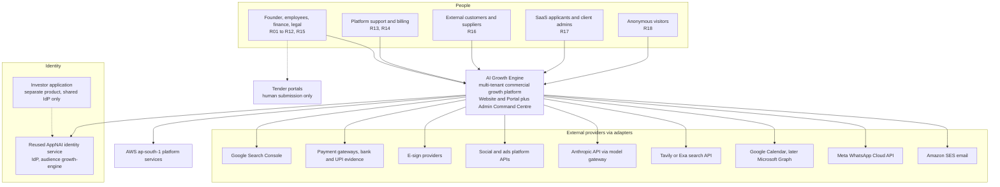

| Element | Relationship with the system | Data crossing the boundary | Trust and control | Source |
|---|---|---|---|---|
| Employees (R01–R12, R15) | Use the Admin Command Centre | All Admin data within scope | OIDC via BFF; MFA for privileged roles; step-up for approvals (ABAC-11) | BRD §2, §3 |
| Platform support/billing (R13, R14) | Operate metadata; tenant content only with a SupportAccessGrant | Metadata; granted content | Time-boxed grant ≤ 72 h, tenant-visible audit | DEC-056 |
| External customers/suppliers (R16) | Portal: own quotes, agreements, orders, invoices, onboarding, cases | Own records only, field-minimized | Object grants (ABAC-09); identity re-verification before signing | CA-PORTAL |
| SaaS applicants/clients (R17) | Plans, application, onboarding wizard, service portal | Application draft; own tenant service data | Isolated expiring draft; no provisioning before approval | FRD §16.3 |
| Anonymous visitors (R18) | Published snapshots; bounded intake; chat | Form payloads; chat questions | Rate limits, abuse controls, consent capture | CA-PUB, CA-INTAKE |
| Reused identity service | Authentication, MFA, recovery, session revocation | Identity claims, tokens (server-side only) | Separate audience; wrong-audience tokens rejected | DEC-003, DEC-019, DEC-058 |
| Investor application | **No data relationship.** Shares only the IdP | None | Tokens for its audience are rejected | DEC-058, AMB-10 |
| Providers (SES, WhatsApp, calendar, search, Anthropic, social, ads, e-sign, payment, Search Console) | Outbound calls through adapters; inbound signed webhooks | Classified minimum data (adapter catalogue, Part 3.2) | Secret references; PDP; budget reservation; signature verification | FRD §9, DEC-022…025 |
| Tender portals | **No integration.** A human submits and records evidence | None (evidence recorded manually) | DEC-053 | DEC-053 |
| AWS platform | Hosting, storage, CDN, secrets, monitoring | All tenant data at rest in ap-south-1 | IAM least privilege, KMS encryption | DEC-040 |

---

## 3.1.3 Container view (C4 level 2)

### 3.1.3.1 Container diagram

```mermaid
flowchart TD
  subgraph EDGE["Edge · CloudFront"]
    CFW["Website distribution<br/>startup domains, portal paths"]
    CFA["Admin distribution<br/>admin origin"]
    CFH["Hooks distribution<br/>provider callbacks"]
    KVS["KeyValueStore<br/>host to tenant, startup, revision"]
  end
  subgraph FE["Frontends · S3 static"]
    WEB["commercial-website-react<br/>SPA plus prerendered snapshots"]
    ADM["commercial-admin-react<br/>Command Centre SPA"]
  end
  subgraph APP["Django modular monolith · one image, separate process groups"]
    APIW["api-web<br/>public, portal, BFF-web"]
    APIA["api-admin<br/>admin, BFF-admin, Copilot"]
    APIH["api-hooks<br/>webhooks, internal"]
    REL["outbox-relay"]
    WTX["worker-tx<br/>dispatch, transactional, notify"]
    WBT["worker-batch<br/>research, ai, projections, reports"]
    BEAT["beat<br/>scheduler"]
    RND["renderer<br/>Node prerender task"]
  end
  subgraph DATA["Data stores"]
    PG["PostgreSQL 17 with pgvector<br/>RLS, outbox, audit"]
    VK["Valkey<br/>broker, cache, rate limits, locks"]
    S3["S3 buckets<br/>documents, snapshots, exports, backups"]
  end
  EXTR["extractor<br/>self-hosted Firecrawl, scheduled"]
  SEC["Secrets Manager and KMS"]
  CFW --> WEB
  CFW --> APIW
  CFA --> ADM
  CFA --> APIA
  CFH --> APIH
  CFW -.-> KVS
  APIW --> PG
  APIA --> PG
  APIH --> PG
  REL --> VK
  WTX --> PG
  WBT --> PG
  WBT --> EXTR
  BEAT --> VK
  WTX --> SEC
  RND --> S3
  APIA --> VK
```

### 3.1.3.2 Container catalogue

| ID | Container | Technology | Responsibilities | Exposed on | Scales by | Pilot placement | Source |
|---|---|---|---|---|---|---|---|
| C01 | `commercial-website-react` | React 19 + TypeScript + Vite; prerendered HTML per publication snapshot | Public pages (W01–W11, W30, W31), intake forms (W12–W20, W32), portal (W21–W29, W33, W34) | Startup custom domains and the platform domain, via CloudFront | CDN | S3 + CloudFront | DEC-009, BRD §9 |
| C02 | `commercial-admin-react` | React 19 + TypeScript + Vite SPA | 113 Admin screens, seven views, Copilot panel | Admin origin (e.g. `admin.<platform-domain>`), CloudFront | CDN | S3 + CloudFront | DEC-009, BRD §3 |
| C03 | `api-web` | Django + DRF, gunicorn; **URLconf `urls_web`** containing only `public`, `portal` and `bff/web` routes | Public intake, chat, portal APIs, website BFF session | `/bff/web/*`, `/api/v1/commercial/public/*`, `/api/v1/commercial/portal/*`, admitted legacy public routes | Container count | ECS task on the pilot host | BRD §9 "denied by default", NFR-001 |
| C04 | `api-admin` | Same image; **URLconf `urls_admin`** | Admin APIs, admin BFF session, Copilot | `/bff/admin/*`, `/api/v1/commercial/admin/*`, legacy Admin routes | Container count | ECS task | NFR-001, NFR-002 |
| C05 | `api-hooks` | Same image; **URLconf `urls_hooks`** | Signed provider webhooks, internal service endpoints (CI evidence, metering) | `/api/v1/webhooks/*`, `/api/v1/internal/*` (private network or signed) | Container count | ECS task | FRD §8 "Internal / callback" |
| C06 | `outbox-relay` | Django management command (long-running loop) | Reads committed outbox rows with `FOR UPDATE SKIP LOCKED`, publishes to Celery, marks relayed | None | 1 active (leader lock), standby optional | ECS task | ADR-003 |
| C07 | `worker-tx` | Celery worker | Queues `dispatch`, `transactional`, `notify`, `webhook_process`, `reconcile` | None | Concurrency and container count | ECS task | ADR-021 |
| C08 | `worker-batch` | Celery worker | Queues `research`, `ai`, `projections`, `reports`, `imports_exports`, `render`, `maintenance` | None | Concurrency and container count | ECS task | ADR-021 |
| C09 | `beat` | Celery Beat with database scheduler | Timers, scheduled research, reminders, reconciliation sweeps, retention jobs | None | Exactly 1 (lock) | ECS task | ADR-028 |
| C10 | `renderer` | Node 22 + React server rendering of the website components | Builds prerendered HTML and JSON for a publication snapshot; writes to S3 under an immutable revision prefix | None (invoked by a Celery task through ECS RunTask or a local subprocess) | On demand | On-demand task | ADR-010 |
| C11 | `extractor` | Self-hosted Firecrawl (AGPL-3.0, unmodified) + headless browser | Fetches and cleans permitted pages for evidence extraction | Private network only | Scheduled instance | Scheduled spot/on-demand instance under budget B04 | ADR-018, DEC-020 |
| C12 | PostgreSQL | Amazon RDS for PostgreSQL 17 with pgvector | System of record, RLS, outbox, audit, projections, vectors, full-text search | Private subnet only | Vertical, then read replica | RDS Single-AZ (pilot) → Multi-AZ (scale) | DEC-040, ADR-002, ADR-007 |
| C13 | Valkey | Valkey 8 (container at pilot; ElastiCache for Valkey at scale) | Celery broker and result backend (short TTL), caches, rate-limit buckets, distributed locks, idempotency fast path | Private only | Vertical, then replica | Container on pilot host | ADR-003, ADR-031 |
| C14 | Object storage | S3 (SSE-KMS), versioning on documents and snapshots | Documents (quarantine and clean prefixes), publication snapshots, exports, audit anchors (Object Lock), logical backups | Private; presigned URLs ≤ 15 min | Managed | S3 | §2.35.2, ADR-024 |
| C15 | Edge | CloudFront (3 distributions), CloudFront Functions, KeyValueStore | TLS, caching, host-to-snapshot resolution, security headers, path allowlists | Internet | Managed | CloudFront | ADR-010, RECOMMENDATION-029 |
| C16 | Secrets and keys | AWS Secrets Manager, KMS customer-managed keys, SSM Parameter Store (non-secret) | Provider credentials as references; envelope keys; configuration parameters | IAM only | Managed | Managed | ADR-014, FRD §6 M05 |
| C17 | Observability | OpenTelemetry SDK, Sentry, CloudWatch Logs/Metrics/Alarms | Traces, errors, logs, SLO metrics, alarms | Internal | Managed | Managed | DEC-041, ADR-025 |

**Why three API process groups from one image.** BRD §9 requires separate website and Admin ingress allowlists and says "any route not explicitly admitted to the website is denied by default". Loading a URL configuration that simply does not contain Admin routes into the website process makes that rule structural rather than a permission check that could be misconfigured. Each process group also has its own database role (Part 3.3), IAM role and secret set (ARP-14). The cost is three small gunicorn pools instead of one, which the pilot memory budget in §3.1.6.2 absorbs.

---

## 3.1.4 Component views (C4 level 3) of the Django modular monolith

Each diagram shows one app group from Part 2.1 §2.1.2. Arrows mean "calls the service interface of" (solid) or "consumes domain events of" (dashed). Entities named in the tables are the Part 2.1 §2.2 names and the DEC-016 DERIVED names; their physical design is **detailed in Part 3.3**. Every component inherits the shared kernel: scope middleware, RLS session context, audit writer, outbox writer, idempotency store, problem+json errors, OTel tracing.

### 3.1.4.1 Core: tenancy, identity, events, audit (`core.tenancy`, `core.identity`, `core.events`, `core.audit`, `ops`)

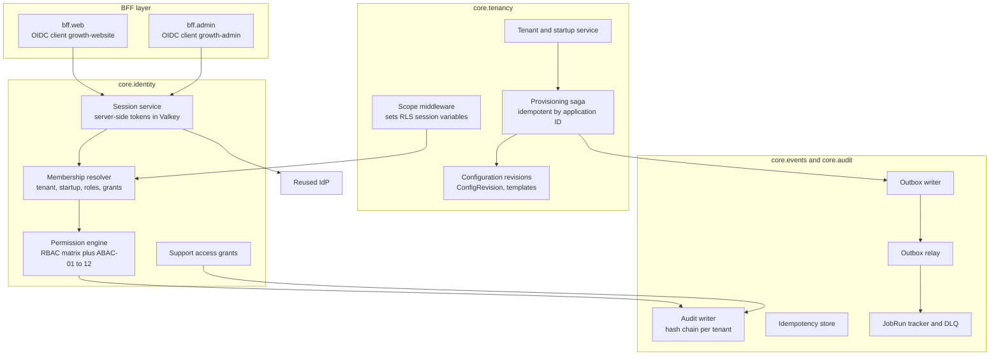

| Component | Responsibility | Key entities (Part 2.1 / DEC-016) | Interfaces offered | FR / BR |
|---|---|---|---|---|
| bff.web / bff.admin | OIDC authorization code + PKCE with the reused IdP; token exchange and refresh **server-side**; issue `HttpOnly; Secure; SameSite=Strict` session cookie; CSRF token; logout propagation | User, Membership | `/bff/{web,admin}/login`, `/callback`, `/session`, `/logout`, `/step-up` | FR-A001, FR-W21, DEC-019 |
| Session service | Server-side session (encrypted refresh token, audience, client, MFA time, expiry) held in Valkey; loss of Valkey forces re-login, never data loss; revocation check ≤ 60 s | Session record in Valkey (not a database entity); User, Membership | `get_session()`, `revoke(user)` | NFR-003, DEC-019 check 6 |
| Membership resolver | Resolves current tenant, startup grants, roles and capability profile from membership (never from the browser) | Membership, Role, CapabilityProfile | `resolve(subject, requested_scope)` | ARP-02, ABAC-01 |
| Permission engine | DRF permission classes, object-level checks, field masks (§2.26.5), portfolio read-only (ABAC-06) | Role, Membership | `authorize(action, resource)` | NFR-002, DEC-055 |
| Support access grants | Request, approve, scope, expire (≤ 72 h), audit visible to tenant | SupportAccessGrant | Service + Admin API | DEC-056 |
| Tenant and startup service | Lifecycle (Provisioning → Active → Suspended → Offboarding → Closed, §2.27.16) | Tenant, Startup, Domain, CapabilityProfile | Service + Admin API | FR-A099, BR-TENANT |
| Provisioning saga | Transactional, idempotent provisioning of tenant, startup, roles, storage prefix, vector namespace, budget ledgers, audit genesis (§2.35.4) | Tenant, Startup, ApplicationDraft | `provision(application_id)` | FR-W32, FR-A099 |
| Configuration revisions | Versioned typed configuration with diff, validation, simulation, approval, schedule, rollback; running workflows pinned | ConfigRevision, WorkflowTemplate (binding only) | Service + Admin API | FR-A112, CA-CONFIG |
| Scope middleware | Per request/job, first statement of the transaction: transaction-local `app.tenant_id`, `app.startup_ids`, `app.write_startup_id` (empty in portfolio mode), `app.actor_id`, `app.actor_kind` (variables defined in Part 3.3 §3.3.9.1); cancels on scope mismatch | — | Middleware, Celery task base class | ARP-02 |
| Outbox writer / relay | Insert outbox row in the business transaction; relay publishes at least once | Outbox | `emit(event)` | NFR-006, ADR-003 |
| Audit writer | Append-only audit with hash chain; daily anchor to S3 Object Lock | AuditEvent | `audit(action, object, outcome, reasons)` | NFR-018, §2.34 |
| Idempotency store | Key + body hash + response replay window; also used by event consumers (`scope_key = consumer:<name>`, key = `event_id`) | IdempotencyKey (Part 3.3 ENT-171) | Decorator on mutating views and tasks | NFR-015, Part 3.2 §3.2.1 |
| JobRun tracker and DLQ | Run/attempt records, error class, DLQ, scoped retry after recheck | JobRun | Admin API (A009) | FR-A009, BR-M06 |

### 3.1.4.2 Governance and Policy Decision Point (`governance`, `governance.eligibility`, `governance.privacy`, `governance.compliance`)

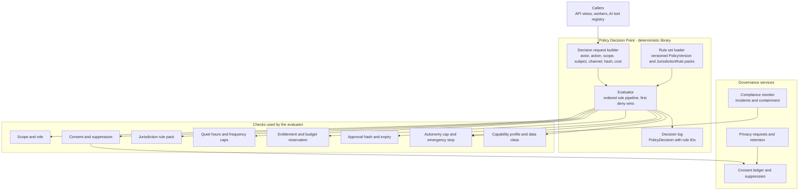

| Component | Responsibility | Key entities | Interfaces | FR / BR / rule |
|---|---|---|---|---|
| Decision request builder | Normalizes a request into a typed `DecisionRequest` (actor type incl. AI agent, action class, scope, subject identity hash, channel, purpose, jurisdiction, approval hash, estimated cost, autonomy level, environment) | — | `pdp.decide(request) -> Decision` | RECOMMENDATION-012 |
| Rule set loader | Loads the **active** PolicyVersion, JurisdictionRule pack, ApprovalPolicy, caps; caches in-process for ≤ 30 s keyed by revision; on load failure → deny | PolicyVersion, JurisdictionRule, ApprovalPolicy | Internal | DEC-029, DEC-038 |
| Evaluator | Pipeline order: environment → scope/role → emergency stop → capability → autonomy cap → approval hash → consent/suppression → jurisdiction → quiet hours/caps → entitlement → budget. **First deny wins**; all reasons collected for display | — | Internal | BRL-ELG, BRL-AUT-01/05, BRL-APR |
| Decision log | Persists every external-action decision with rule IDs, inputs digest and policy revision | PolicyDecision, EligibilityDecision | Read API (A032, A034, A047) | §2.34.1 |
| Consent ledger and suppression | Append-only consent events; suppression by hashed identifier; opt-out cancels queued messages in the same transaction | Consent, Suppression | `POST /consents`, `POST /opt-out` | BR-M04, NFR-036 |
| Privacy requests and retention | Verify identity, execute, legal hold, retention schedules (DEC-028) | PrivacyRequest, RetentionPolicy | `POST /privacy/requests`, Admin API | BR-M56, FR-A013 |
| Compliance monitor | Detects violations (complaint thresholds, bounce spikes, cross-scope alerts) and triggers containment (pause channel/workflow) | ComplianceIncident, PolicyDecision | `GET /admin/compliance`, Admin API | BR-M57, FR-A047 |

**PDP placement decision.** The PDP is an **in-process library with a database-backed rule store** (ADR-004), not a network service, so dispatch rechecks add no network hop and stay within the same transaction boundary. It is pure: it reads state through a narrow read interface and never writes business state other than its decision log.

### 3.1.4.3 Intelligence (`intelligence.*`)

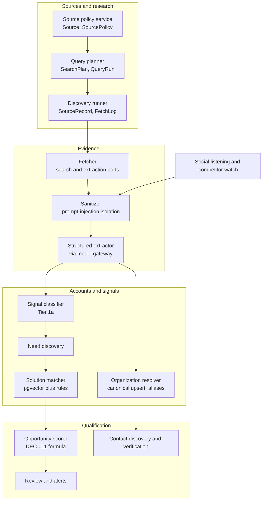

| Component | Responsibility | Key entities | FR / BR |
|---|---|---|---|
| Source policy service | Allowlist, purpose, licence, quotas, expiry; expiry stops collection | Source, SourcePolicy | FR-A010, BR-M07 |
| Query planner | Converts capabilities and objectives into scoped queries within source and cost bounds; blocks personal-health targeting | SearchPlan, QueryRun | FR-A015, BR-M10 |
| Discovery runner | Runs searches via the search port, normalizes URLs, rejects blocked hosts, caches results | SourceRecord, FetchLog | FR-A016, BR-M11 |
| Fetcher / sanitizer / extractor | Fetch through extraction port; strip active content; wrap untrusted text in data-only delimiters; extract structured fields through the model gateway with JSON schema | Evidence, SourceRecord | FR-A017, BR-M12 |
| Organization resolver | Canonical upsert, aliases, locations, safe merge with referential checks | Organization, Location, Alias | FR-A018, BR-M13 |
| Signal classifier | Tier 1a classification, review queue, precision tracking (DEC-001 ≥ 80%) | Signal, SignalType | FR-A019, BR-M14 |
| Need discovery | Explicit vs inferred needs; reviewer routing | Need, NeedEvidence | FR-A020, BR-M15 |
| Solution matcher | Hybrid: rule filters (readiness, exclusions) then vector similarity over approved capability chunks | Match, ProductCapability | FR-A021, BR-M16 |
| Opportunity scorer | DEC-011 formula; "Unknown – review required" below 0.60 known weight; versioned | Opportunity, ScoreVersion | FR-A022, BR-M17 |
| Contact discovery and verification | Role hypotheses from published sources; channel/provenance verification; freshness expiry; optional licensed APIs off by default | Contact, RoleHypothesis, ContactSource, ContactVerification | FR-A024–A026, BR-M18, BR-M19 |
| Review and alerts | Human qualification, owner assignment, alert rules with dedup | Review, Notification | FR-A027, FR-A028, BR-M20 |
| Social listening and competitor watch | Permitted organizational posts and market events into the same evidence pipeline | SocialPost, Competitor, MarketEvent | FR-A048, FR-A085, BR-M33, BR-M59 |

### 3.1.4.4 Engagement (`crm`, `crm.leads`, `engagement.*`)

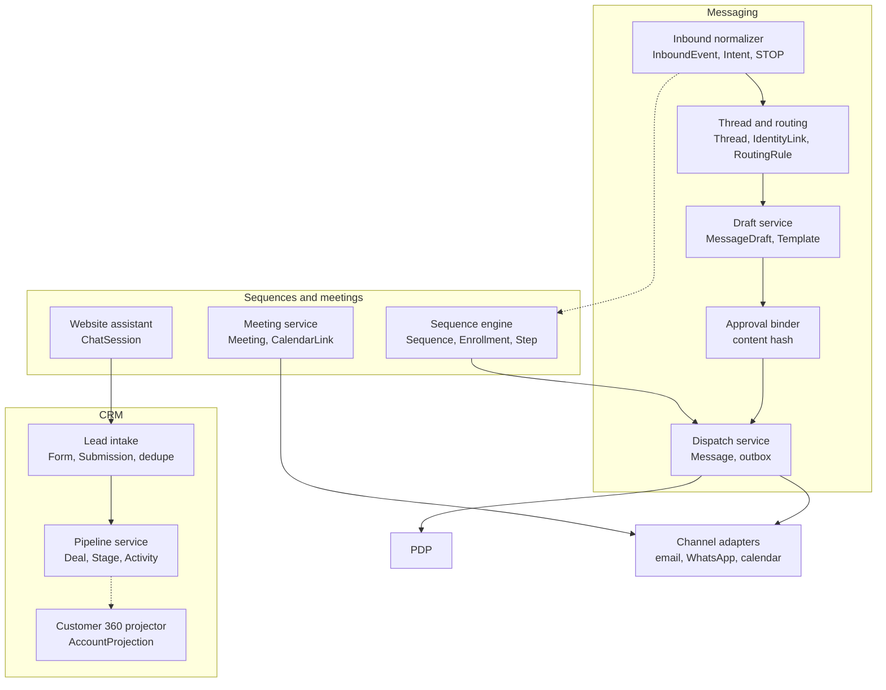

| Component | Responsibility | Key entities | FR / BR |
|---|---|---|---|
| Pipeline service | Deals, configurable stages, controlled transitions (409 `INVALID_TRANSITION`), assignment | Deal, Stage, Activity | FR-A029, FR-A030, BR-M21 |
| Lead intake | Versioned form schema validation, field allowlist, idempotent submission (one lead per duplicate), consent capture, outbox only (no direct approval) | Lead, Form, Submission, Consent | FR-W12–W20, FR-A031, BR-M22 |
| Customer 360 projector | Consumes domain events; projection freshness ≤ 60 s | AccountProjection, Activity | FR-A032, NFR-008 |
| Draft service | Evidence-cited drafts via model gateway (Tier 1b for customer-facing); claim check | MessageDraft, Template, Claim | FR-A034, FR-A035, BR-M25 |
| Approval binder | Binds approval to exact content hash and expiry; voids on change | Approval | CA-APPROVE |
| Dispatch service | Queues approved eligible messages; one outbound state machine for all channels (§2.27.9) | Message, DeliveryEvent | FR-A037, BR-M26, BR-M31 |
| Thread and routing | Single thread across channels; identity links; assignment; human takeover; no duplicate replies | Thread, IdentityLink, RoutingRule | FR-A037, FR-A046, BR-M41 |
| Inbound normalizer | Normalizes email/WhatsApp/chat inbound; STOP handling; intent classification (rules then Tier 1a) | InboundEvent, Intent | BR-M27 |
| Sequence engine | Enrolment, schedule, recheck at each step, stop on reply/opt-out/loss | Sequence, Enrollment, Step | FR-A038, FR-A039, BR-M28 |
| Meeting service | Free/busy, slot holds (15 min), booking, reminders, conflict prevention | Meeting, CalendarLink | FR-A040, FR-A041, FR-W18, BR-M29 |
| Website assistant | Grounded public answers from approved public knowledge; handover; consented lead | ChatSession, Thread, Lead | FR-W11, FR-A046, BR-M32 |

### 3.1.4.5 Commerce and finance (`commerce.*`, `commerce.finance`, `analytics.revenue`)

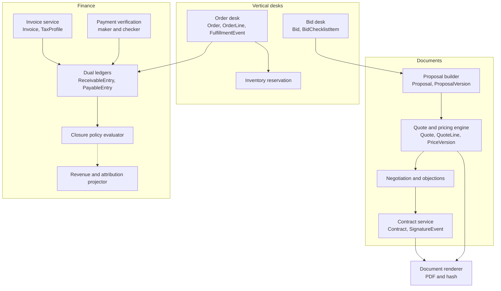

| Component | Responsibility | Key entities | FR / BR / rule |
|---|---|---|---|
| Proposal builder | Drafts from approved templates and price snapshot; versioned; approval of exact hash | Proposal, ProposalVersion | FR-A065, FR-A066, BR-M43 |
| Quote and pricing engine | Decimal lines, ROUND_HALF_UP per line, document total = sum of rounded lines; discount thresholds route approvers (DEC-038); tax by TaxProfile/HSN/SAC | Quote, QuoteLine, PriceVersion, TaxProfile | FR-A067, FR-A068, FR-DM-01, DEC-027 |
| Negotiation and objections | Objections, approved answers, concession limits, exceptions to A070 | Objection, Negotiation, Approval | FR-A069, FR-A070, BR-M45 |
| Contract service | Drafts, legal approval of hash, signature requests through e-sign port or signed-PDF upload with SHA-256, verification | Contract, SignatureEvent | FR-A071, FR-A072, FR-W24, DEC-023 |
| Bid desk | Eligibility checklist, bid/no-bid, deadline guard (UTC with buffer), human submission evidence, award | Bid, BidChecklistItem | FR-A104, FR-DM-02, DEC-053 |
| Order desk and inventory | Buy/sell direction, reservation on approval (DEC-045), fulfilment events idempotent by event key, over-delivery rejection | Order, OrderLine, FulfillmentEvent | FR-A105, FR-DM-03 |
| Invoice service | Proforma/commercial invoices (no IRN generation, DEC-027) | Invoice, TaxProfile | FR-A073 |
| Payment verification | Gateway webhooks and manual evidence; maker ≠ checker; double-allocation prevention | Payment | FR-A073, FR-A074, DEC-022 |
| Dual ledgers | Append-only receivable and payable ledgers; adjustments as new entries | ReceivableEntry, PayableEntry, FxSnapshot | RECOMMENDATION-018, CA-FIN |
| Closure policy evaluator | DEC-054 closure per opportunity type; derived states only | Deal, ClosurePolicy (CFG-18) | FR-A073, DEC-054 |
| Revenue and attribution projector | Ledger-derived revenue; attribution models with caveat | MetricSnapshot, AttributionEvent | FR-A082, BR-M52 |
| Document renderer | Deterministic PDF rendering of approved versions with embedded hash | — | CA-APPROVE |

### 3.1.4.6 Automation engine (`automation`)

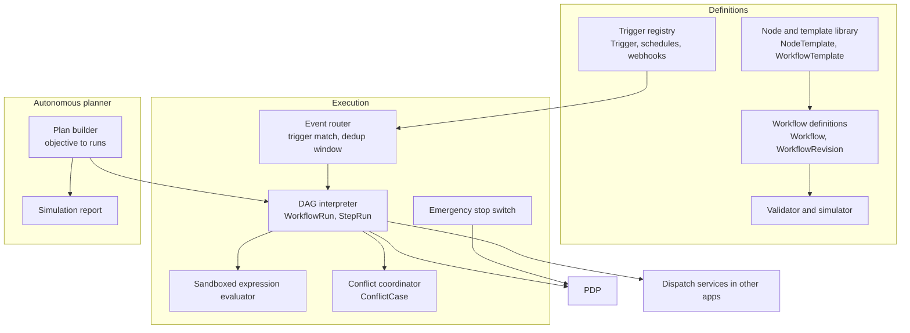

| Component | Responsibility | Key entities | FR / BR / rule |
|---|---|---|---|
| Workflow definitions | Declarative DAGs from approved node types; immutable published revisions; runs pin revision | Workflow, WorkflowRevision, WorkflowRun | FR-A033, BRL-AUT-02/03, DEC-051 |
| Node and template library | Typed node schemas (input/output), risk class, permissions, cost estimate, fixtures; **no code nodes** | NodeTemplate, WorkflowTemplate | FR-A113 |
| Trigger registry | Event, timer and webhook triggers independent of workflow design; dedup window; sandbox replay without live effects | Trigger | FR-A109, BRL-AUT-08 |
| Validator and simulator | Static validation (types, reachability, caps), simulation with sandbox adapters producing zero live effects | — | NFR-038, BRL-AUT-04 |
| Event router | Matches domain events and webhooks to enabled triggers within scope | Trigger | FR-A109 |
| DAG interpreter | Executes steps as Celery tasks; step budget (≤ 50), retries (≤ 3), concurrency per startup (≤ 20); outcome certainty (DEC-050) | WorkflowRun (FRD "Execution"), StepRun | FR-A110, BRL-AUT-06 |
| Sandboxed expression evaluator | Conditions over typed fields; no attribute access, no imports, bounded time | — | DEC-051 |
| Conflict coordinator | Detects competing actions on the same relationship; priority compliance > transactional > sales > marketing | ConflictCase | FR-A111, BRL-AUT-09 |
| Emergency stop switch | Tenant/startup/workflow/channel scope; PDP denies within 60 s | — (flag in Valkey + database) | BRL-AUT-05, E-7 |
| Plan builder and simulation | Objective → templates → budget → concurrency → stop policy → simulation report → approval → runs | AutonomyPlan (CFG-27 bound) | FR-A102, WF-13 |

### 3.1.4.7 AI gateway (`ai`, `ai.cost`, `ai.quality`)

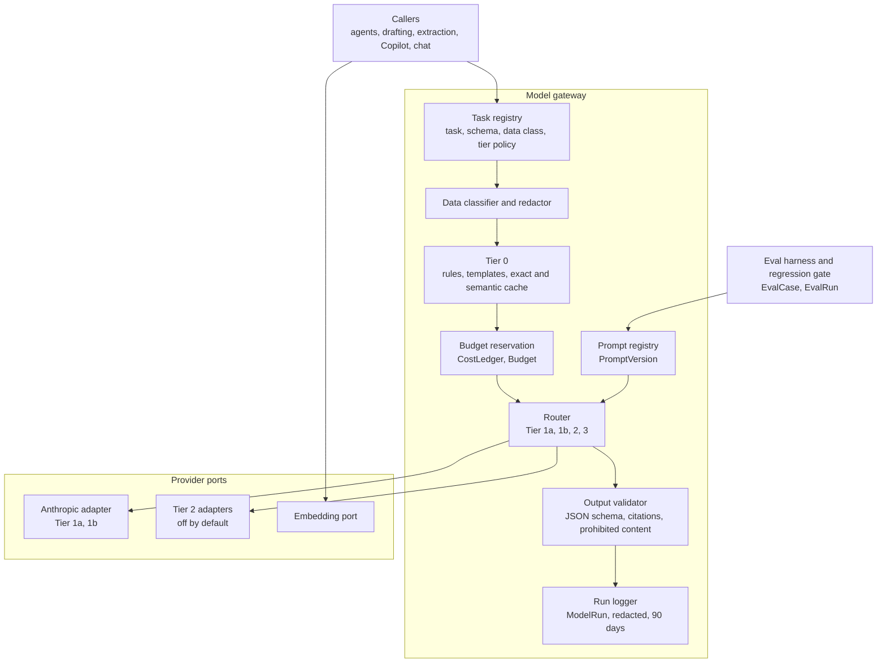

| Component | Responsibility | Key entities | FR / BR / rule |
|---|---|---|---|
| Task registry | Each AI task declares input/output JSON schema, allowed data classes, tier policy, max tokens, timeout, eval suite | — (code + PromptVersion) | BRL-AI-01, CA-AI |
| Data classifier and redactor | Classifies payload (Public / Internal / Confidential / Restricted); removes fields not needed; blocks Tier 2 for anything above Internal-non-personal | — | DEC-007, BRL-AI-06 |
| Tier 0 | Deterministic rules/templates; exact cache (hash of task + prompt version + normalized input); semantic cache only for Public data | — | DEC-007 |
| Budget reservation | Atomic reserve before call (agent, startup, tenant, global); reconcile actual; 80% alert; 100% stop | Usage, CostLedger, Budget | FR-OP001, BRL-AI-08, NFR-014 |
| Router | Chooses Tier 1a/1b per task policy and eval parity; Tier 2 only if tenant opted in and data class permits; Tier 3 degrade (queue, cached, human task) | — | DEC-007 |
| Prompt registry | Versioned prompts; approval; eval gate before activation | PromptVersion | BR-M08, BRL-AI-09 |
| Output validator | JSON schema validation (≤ 2 repair retries), citation presence, prohibited-content filters, unsupported-claim rejection | — | BRL-AI-02/03/05 |
| Run logger | Redacted inputs/outputs, digests, cost, latency, model and prompt version | ModelRun | BRL-AI-10, DEC-028 |
| Eval harness | Regression suite in CI (W0) and human feedback loop (W5) | EvalCase, EvalRun, Feedback | DEC-061, NFR-033 |

Agent definitions, the tool registry, model prices and per-agent cost sizing are in **Part 7** (DEC-048, DEC-042).

### 3.1.4.8 Web publishing (`web`, `marketing.landing`)

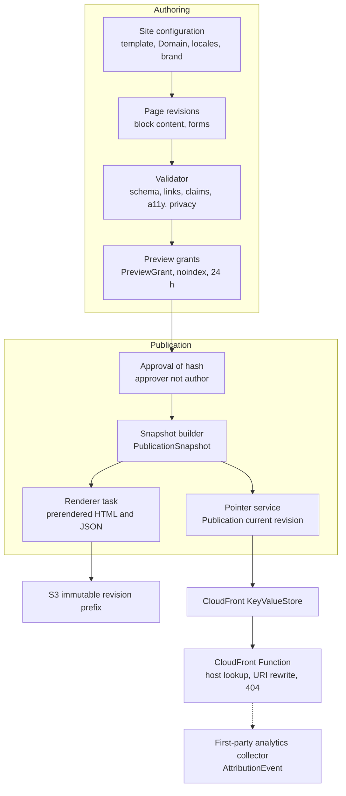

| Component | Responsibility | Key entities | FR / BR / rule |
|---|---|---|---|
| Site configuration | Template, verified Domain (one domain → one tenant/startup), locales with fallback, brand revision | Domain, ConfigRevision | FR-A107, CFG-05, CFG-29 |
| Page revisions | Block-based content from approved blocks; forms from Form versions; claim references | LandingPage (site or landing page, Part 3.3 ENT-111) | FR-A056, FR-A107 |
| Validator | Schema, broken links, claim evidence, automated WCAG 2.2 AA check, privacy (no health events to pixels) | — | BRL-PUB-06, FR-PUB-01 |
| Preview grants | Admin-authorized, expiring, `noindex` previews | PreviewGrant | BRL-PUB-03 |
| Approval of hash | Approver ≠ author; binds exact content hash | Approval | CA-APPROVE, BRL-PUB-01 |
| Snapshot builder | Freezes approved content, offerings, prices, claims and assets into an immutable PublicationSnapshot | PublicationSnapshot | FR-A108 |
| Renderer task | Server-renders the website React components into HTML + JSON under `s3://…/snapshots/{tenant}/{startup}/{publication}/{revision}/` | — | ADR-010 |
| Pointer service | Atomic swap of `Publication.current_snapshot` in PostgreSQL (authoritative), mirrored to KVS; rollback = swap to prior approved revision | Publication | BRL-PUB-02, NFR-020 |
| CloudFront Function | Looks up host in KVS; unknown host → 404; rewrites URI to the revision prefix; adds security headers | — | CA-PUB, RECOMMENDATION-029 |
| First-party analytics collector | `POST /public/events` beacon; consent-aware; no third-party pixels for health content | AttributionEvent | BR-M37, ADR-011 |

### 3.1.4.9 SaaS service lifecycle (`saas`)

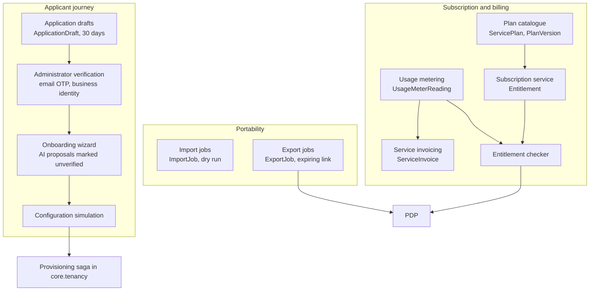

| Component | Responsibility | Key entities | FR / BR / rule |
|---|---|---|---|
| Application drafts | Isolated expiring drafts (30 days, DEC-028); resume with expiring reference | ApplicationDraft | FR-W32, FRD §16.3 |
| Administrator verification | Business email OTP, legal identifier format checks, authority declaration | ApplicationDraft | FR-W32 |
| Onboarding wizard | AI proposes profile, offerings, objectives, channels, templates; every item "Unverified" until confirmed; no dispatch or spend | ApplicationDraft, ConfigRevision (candidate) | FR-W33, CA-AI |
| Configuration simulation | Runs validator and simulator over candidate configuration | — | FR-W33, AP-01 |
| Plan catalogue | Plan archetypes; no published price until Service Owner approval | ServicePlan (DEC-016 "Plan"), PlanVersion | DEC-047, FR-A101 |
| Subscription service | Start/change/suspend/cancel; entitlement revisions | ServiceSubscription, Entitlement | FR-A101, FR-W34 |
| Usage metering | Meter dimensions: workspaces, users, AI tasks, outbound messages, research fetches, storage GB | UsageMeterReading | DEC-047, NFR-035 |
| Service invoicing | Service invoices for SaaS tenants (separate from startup commercial invoices) | ServiceInvoice | BR-SVC |
| Entitlement checker | Feeds PDP check C5 (ABAC-10) | Entitlement | BRL-SVC-03 |
| Import / export jobs | Versioned CSV/JSON templates, dry-run report, approval, consent-gated contacts (DEC-039); scoped exports with expiry and redaction | ImportJob, ExportJob | FR-A103 |

### 3.1.4.10 Module dependency rules (enforced by `import-linter`)

| Layer (top may call below) | Apps | May depend on | Must not depend on |
|---|---|---|---|
| L5 Interfaces | `bff`, API view modules of every app, `commandcentre` | Any app's service layer | Another app's models directly |
| L4 Orchestration | `automation`, `saas` | L3, L2, L1 | Interfaces |
| L3 Business domains | `crm`, `engagement`, `marketing`, `commerce`, `lifecycle`, `intelligence`, `web`, `analytics` | L2, L1; other L3 apps **only through service interfaces or events** | Provider SDKs |
| L2 Platform services | `governance` (PDP), `ai`, `integrations`, `knowledge`, `catalog` | L1 | L3, L4, L5 |
| L1 Kernel | `core.tenancy`, `core.identity`, `core.events`, `core.audit`, `ops` | Django, libraries | Everything above |

Cycles between L3 apps are resolved with domain events (for example `commerce` emits `commerce.payment.verified.v1`; `crm` reacts by deriving deal closure) rather than mutual imports.

---

## 3.1.5 Logical view

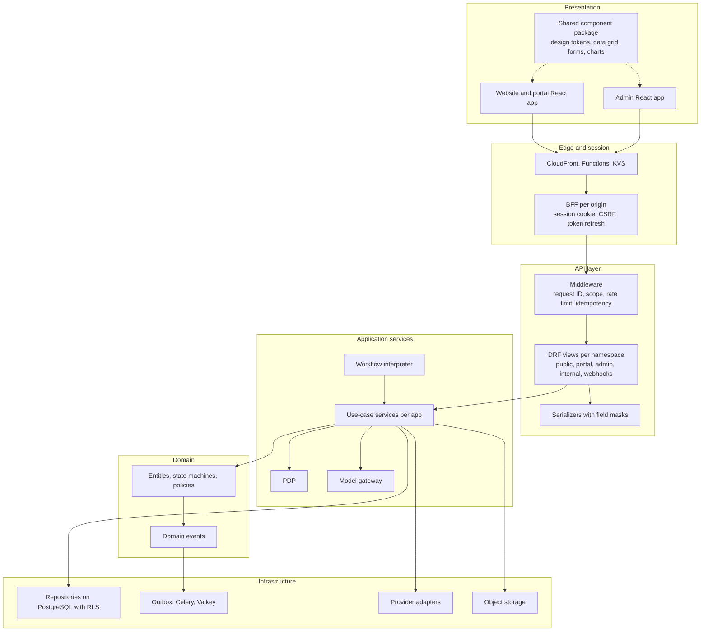

| Layer | Contains | Rules |
|---|---|---|
| Presentation | Two React apps and one shared package (`@growth/ui`) | No provider SDKs or secrets; Admin code never imported by the website build (bundle check in CI, NFR-001) |
| Edge and session | CloudFront, BFF | Tokens never reach the browser; cookies are host-only, `SameSite=Strict` |
| API layer | Views, serializers, middleware | Allowlisted filters, cursor pagination, idempotency, problem+json (Part 3.2 §3.2.1) |
| Application services | Use-case services, PDP, gateway, interpreter | Transaction boundaries live here; one use case = one transaction + outbox |
| Domain | Entities, state machines (Part 2.3 §2.27), value objects (Money, Quantity+Unit, ScopeRef) | No I/O; pure functions where possible |
| Infrastructure | Repositories, adapters, queues, storage | RLS context required; adapters return normalized results with failure class |

---

## 3.1.6 Deployment view (AWS ap-south-1)

### 3.1.6.1 Account, network and naming baseline (both topologies)

| Item | Decision | Source / tag |
|---|---|---|
| AWS accounts | Three accounts under AWS Organizations: `growth-prod`, `growth-nonprod` (staging and ephemeral test), `growth-shared` (ECR, CI OIDC roles, audit log archive). Separate from any investor-product account | CN-02, NFR-031 |
| Region | ap-south-1 (Mumbai) for all workloads and data; ap-south-2 (Hyderabad) for backup copies only (verify service availability) | DEC-040 |
| VPC | One VPC per environment, /20; public and private subnets in **two AZs created from day one** (no cost until used) so the scale gate needs no re-addressing | AD-12 |
| Ingress | Only CloudFront reaches origins. Pilot: security group allows 443 only from the CloudFront origin-facing managed prefix list. Scale: ALB security group the same; instances accept traffic only from the ALB | NFR-001 |
| Admin access to hosts | No SSH. AWS Systems Manager Session Manager with IAM, MFA and session logging | ARP-14 |
| Encryption | TLS 1.2+ everywhere; RDS, EBS, S3 encrypted; AWS-managed keys at pilot, customer-managed KMS keys at scale gate | ADR-014 |
| DNS | Route 53 for the platform domain; startup custom domains point a CNAME at the website distribution after verification (FR-A107) | GAP-107 |
| Tags | `env`, `app=growth-engine`, `component`, `cost-centre` (budget ID B01, B04, B07, B19–B22), `data-class` | DEC-020, ARP-15 |

### 3.1.6.2 Topology A: cost-minimal pilot (fits B01 ≈ ₹5,000/month with commitments) [RECOMMENDATION-030]

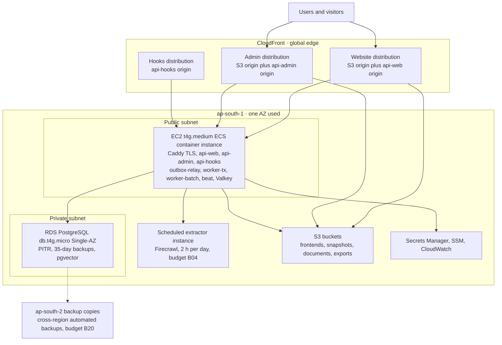

**Design choices that make the pilot fit B01.**
1. **No ALB and no NAT gateway.** CloudFront is the only ingress, terminating viewer TLS; Caddy on the instance terminates origin TLS (certificate from ACME) and routes by host to the three gunicorn process groups. The instance has a public IPv4 address for outbound provider calls, so no NAT gateway is needed. Inbound is restricted to the CloudFront prefix list.
2. **One ECS container instance.** ECS on EC2 (no control-plane charge) gives task definitions, rolling restarts, health checks and IAM task roles from day one, so the scale gate changes capacity, not tooling (ADR-013).
3. **Valkey as a container** with append-only file persistence on EBS. It is not the system of record: the outbox in PostgreSQL is (ADR-003), so losing Valkey loses no business event.
4. **Managed PostgreSQL only.** PITR and automated backups are the main reason for RDS (RPO ≤ 15 min, DEC-018).
5. **Extraction on a separate scheduled instance** charged to B04 (₹1,000), so Firecrawl's headless browser never competes with the API for memory.
6. **Static frontends and published pages on S3 + CloudFront**, inside the CloudFront always-free allowance at pilot volumes (verify).

**Pilot memory budget on the t4g.medium (4 GiB) [ASSUMPTION-105]**

| Process | Workers / concurrency | Estimated RSS | Notes |
|---|---|---|---|
| OS, ECS agent, Caddy | — | 450 MiB | |
| api-web | gunicorn 2 workers × 2 threads | 320 MiB | Public intake and portal |
| api-admin | gunicorn 3 workers × 2 threads | 480 MiB | Admin is the heaviest interactive load |
| api-hooks | gunicorn 1 worker × 4 threads | 170 MiB | Webhooks persist-and-ack only |
| outbox-relay | 1 | 120 MiB | |
| worker-tx | Celery prefork concurrency 2 | 380 MiB | `dispatch`, `transactional`, `notify`, `webhook_process`, `reconcile` |
| worker-batch | Celery prefork concurrency 2, `max-tasks-per-child=50` | 420 MiB | `research`, `ai`, `projections`, `reports`, `imports_exports`, `maintenance` |
| beat | 1 | 110 MiB | |
| Valkey | `maxmemory 256mb`, `allkeys-lru` only on cache DB; broker DB `noeviction` via separate instance config | 280 MiB | Two logical instances on one container are not possible; use **two Valkey containers** (broker 128 MiB noeviction; cache 128 MiB LRU) |
| renderer (on demand) | 1 Node process during publication | 300 MiB peak | Runs only during publish |
| **Total** | | **≈ 3.0 GiB peak** | 1 GiB headroom plus 2 GiB swap file as a safety net; CloudWatch alarm at 85% memory |

**Pilot cost lines (production environment).** Prices are approximate public on-demand rates for ap-south-1 — **verify at implementation (as of 27 Nov 2026)**. ₹ = USD × 90 [ASSUMPTION-101]. Month = 730 hours.

| Line | Resource | Formula | Est. USD/month | Est. ₹/month | Budget |
|---|---|---|---|---|---|
| P-01 | EC2 t4g.medium (on-demand) | 730 h × ≈ $0.034–0.038/h | 24.8–27.7 | 2,230–2,500 | B01 |
| P-01c | Same with 1-year Compute Savings Plan, no upfront (≈ 25–35% lower, verify) | P-01 × 0.65–0.75 | 16.1–20.8 | 1,450–1,870 | B01 |
| P-02 | EBS gp3 30 GiB | 30 × ≈ $0.09/GiB | 2.7 | 245 | B01 |
| P-03 | RDS PostgreSQL db.t4g.micro Single-AZ (on-demand) | 730 h × ≈ $0.018–0.020/h | 13.1–14.6 | 1,180–1,310 | B01 |
| P-03c | Same with 1-year reserved instance, no upfront (verify) | P-03 × 0.65–0.75 | 8.5–11.0 | 770–985 | B01 |
| P-04 | RDS gp3 storage 20 GiB; backup storage up to DB size included (verify) | 20 × ≈ $0.13/GiB | 2.6 | 235 | B01 |
| P-05 | Public IPv4 address (one) | 730 h × $0.005/h | 3.65 | 330 | B01 |
| P-06 | S3 standard ≈ 20 GiB + requests | 20 × ≈ $0.025 + ≈ $0.3 | 0.8 | 70 | B01 |
| P-07 | CloudFront 3 distributions, Functions, KVS | Within always-free tier: 1 TB transfer, 10 M requests, 2 M function invocations (verify); KVS reads ≈ negligible at < 1 M/month | 0–0.5 | 0–45 | B01 (B21 later) |
| P-08 | Route 53 hosted zones (platform + up to 3) and queries | 4 × $0.50 + queries | 2.1 | 190 | B01 |
| P-09 | Secrets Manager (≈ 6 secrets: one JSON secret per provider group) | 6 × $0.40 + API calls | 2.5 | 225 | B01 |
| P-10 | CloudWatch logs (≤ 5 GB ingest free), 10 alarms free, ≈ 10 custom metrics | ≈ (ingest − 5 GB) × ≈ $0.7 + metrics | 1.0–3.0 | 90–270 | B07 overlap; charged B01 |
| P-11 | ECR images (shared account) | ≈ 2 GiB × $0.10 | 0.2 | 20 | B01 |
| P-12 | Malware scan of uploads (GuardDuty Malware Protection for S3) | GB scanned × rate (verify); pilot ≈ 2 GB | 0.2–1.5 | 20–135 | B01 [RECOMMENDATION-035, Part 3.2] |
| P-13 | RDS cross-Region automated backups to ap-south-2 (snapshots + transaction logs, 7-day window) | ≈ 10–15 GB × backup storage rate + inter-region transfer of changed data (verify) | 1.0–2.0 | 90–180 | **B20 (₹0 today) → GAP-101** |
| P-14 | Egress to providers (API calls, not via CloudFront) | First 100 GB/month to internet free across services (verify) | 0–0.5 | 0–45 | B01 |
| | **Production subtotal, on-demand** | Σ P-01…P-14 | **≈ 55–64** | **≈ 4,920–5,790** | |
| | **Production subtotal, with P-01c and P-03c** | Σ with P-01c, P-03c in place of P-01, P-03 | **≈ 41–54** | **≈ 3,720–4,850** | |
| | **Production subtotal, committed, excluding P-13 (funded from B20)** | | **≈ 40–52** | **≈ 3,630–4,670** | B01 |

**Staging (pilot) cost lines.** Staging mirrors production containers but runs PostgreSQL as a container on its own instance and is scheduled on only during working hours [ASSUMPTION-106].

| Line | Resource | Formula | Est. USD/month | Est. ₹/month |
|---|---|---|---|---|
| S-01 | EC2 t4g.small, scheduled ≤ 60 h/week | 60 × 4.35 × ≈ $0.017–0.019/h | 4.4–5.0 | 400–450 |
| S-02 | EBS gp3 30 GiB (always) | 30 × ≈ $0.09 | 2.7 | 245 |
| S-03 | Public IPv4 while running | 261 h × $0.005 | 1.3 | 120 |
| S-04 | Secrets (sandbox credentials), logs, S3 | ≈ 3 × $0.40 + ≈ $0.8 | 2.0 | 180 |
| | **Staging subtotal** | | **≈ 10.4–11.0** | **≈ 945–995** |

**Pilot verdict (FinOps).** Production (committed, P-13 on B20) + staging ≈ **₹4,570–5,660/month**; fully on-demand ≈ **₹5,760–6,600/month**; all before GST [ASSUMPTION-110]. B01 (₹5,000) therefore fits at the low-to-mid end only if (a) the Savings Plan and RDS reservation are bought once usage is stable (end of W0), (b) staging is scheduled (≤ 60 h/week), and (c) the cross-region backup replication is funded from B20 rather than B01. Otherwise the overrun is ≈ ₹700–1,600/month. This is logged as **CONFLICT-102** (budget B01 vs the DEC-040 pilot topology plus a staging environment) and **RSK-301**. Proposed resolution: approve B20 at ≈ ₹200/month, state that B01 covers staging (GAP-102), and draw on contingency B11 for the first quarter until commitments apply. Non-production `dev` runs locally (Docker Compose, ₹0) and `test` runs in CI (B07).

**Not in B01 at pilot (by design):** AWS WAF (B21, ₹0 — GAP-104; compensating controls in §3.1.11 and Part 3.2 §3.2.1.7), Multi-AZ, ALB, NAT, ElastiCache, customer-managed KMS keys, interface VPC endpoints.

### 3.1.6.3 Topology B: scale-gate topology (DEC-040)

Activated when the BRD §8 scale gate passes (measured cost per qualified opportunity, consent compliance, conversion) **and** at least one trigger in §3.1.6.4 fires. Required elements per DEC-040: Multi-AZ database and two application instances behind a load balancer; public availability target 99.9% (DEC-018).

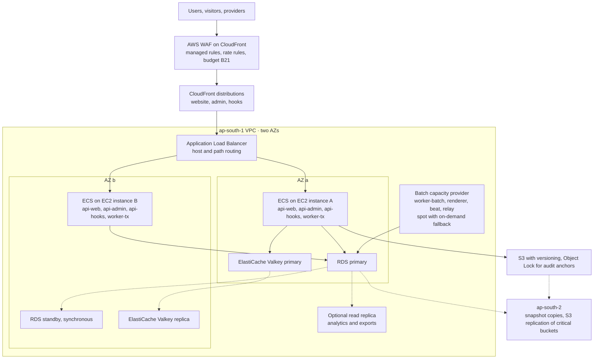

**Scale-gate placement rules.** `beat` and `outbox-relay` run as single active tasks with a Valkey/PostgreSQL leader lock and automatic replacement by ECS. `worker-tx` runs in both AZs. Instances sit in public subnets with **no inbound except from the ALB security group** and outbound through their own IPv4 addresses (avoids NAT gateway cost); a NAT gateway is introduced only if policy requires private-only instances (cost line B-09).

**Scale-gate cost lines (estimates; verify at implementation).**

| Line | Resource | Year 1 scale gate (10× pilot) | Year 2 design point (DEC-031) | Formula basis |
|---|---|---|---|---|
| B-01 | ALB + LCUs | ≈ $23 | ≈ $30 | 730 h × ≈ $0.024 + LCU-hours |
| B-02 | ECS EC2 instances (interactive) | 2 × t4g.medium ≈ $52 | 3 × t4g.large ≈ $158 | n × 730 × hourly rate |
| B-03 | Batch capacity (spot, verify spot discount) | ≈ $10 | 1 × m7g.large spot ≈ $25 | hours used × spot rate |
| B-04 | RDS PostgreSQL Multi-AZ | db.t4g.small ≈ $54 | db.m7g.large ≈ $250 | 2 × single-AZ hourly × 730 |
| B-05 | RDS storage gp3 Multi-AZ | 50 GiB ≈ $13 | 200 GiB ≈ $52 | GiB × rate × 2 |
| B-06 | Read replica (optional) | — | db.t4g.medium ≈ $55 | single-AZ hourly × 730 |
| B-07 | ElastiCache for Valkey, primary + replica | cache.t4g.micro × 2 ≈ $20 | cache.t4g.small × 2 ≈ $40 | n × 730 × rate (verify Valkey pricing) |
| B-08 | Public IPv4 (instances + ALB) | 4 × $3.65 ≈ $15 | 6 × $3.65 ≈ $22 | n × 730 × $0.005 |
| B-09 | NAT gateway (only if private-only instances are required) | ($41 + data) | ($82 for two AZs) | 730 × ≈ $0.056 per gateway |
| B-10 | AWS WAF | ≈ $14 | ≈ $20 | $5 per ACL + $1 per rule + requests (B21) |
| B-11 | KMS customer-managed keys | ≈ $4 | ≈ $6 | $1 per key |
| B-12 | Logs, metrics, alarms, Secrets, Route 53, S3, ECR, malware scan | ≈ $25 | ≈ $60 | Usage-based |
| B-13 | Backups and DR copies (B20) | ≈ $5 | ≈ $20 | Snapshot GB × rate + transfer |
| | **Total (without B-09)** | **≈ $235 ≈ ₹21,000/month** | **≈ $740 ≈ ₹66,600/month** | |

**FinOps note.** The scale-gate topology exceeds B01 by design; DEC-040 and DEC-008 tie it to a passed scale gate, and from Year 2 the SaaS tenants' metered plans carry their attributable share (DEC-047, NFR-035). Increasing B01 requires Founder approval through change control (BRD §11). Logged as **RSK-302**.

### 3.1.6.4 Triggers for moving from Topology A to Topology B

| Trigger | Threshold (sustained 7 days unless stated) | Measured by |
|---|---|---|
| T-1 Business gate | BRD §8 scale gate passed and growth AI budget (₹12,000) unlocked | DEC-008 decision record |
| T-2 Availability | Monthly public availability < 99.5% twice in a quarter, or contractual SaaS need for 99.9% | SLO dashboard (A014) |
| T-3 CPU / memory | Instance CPU > 60% p95 or memory > 85% p95 | CloudWatch |
| T-4 Database | RDS CPU credit balance trending to 0, or freeable memory < 150 MiB, or connections > 70% of max | CloudWatch / Performance Insights |
| T-5 Latency | API p95 > 500 ms reads or > 800 ms writes outside provider latency | OTel metrics |
| T-6 Queue lag | Outbox dispatch lag p95 > 60 s, or transactional runs started > 15 min late (DEC-032) | Relay metrics |
| T-7 Tenancy | > 10 external tenants or > 60 internal users (DEC-031 Year 1 upper bound) | Tenant registry |

Intermediate steps are allowed before the full topology: vertical resize (t4g.medium → t4g.large; db.t4g.micro → db.t4g.small) costs ≈ ₹1,500–2,500/month more and needs no architectural change.

---

## 3.1.7 Runtime views

### 3.1.7.1 External action dispatch with dispatch-time recheck (example: approved outreach email)

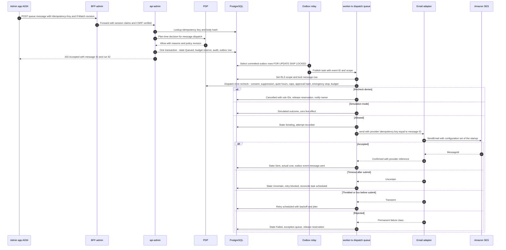

**Recheck guarantees.** The recheck uses the policy revision *current at dispatch*; if the approval hash no longer matches the message content hash (content edited after approval), the PDP denies with `BRL-APR-02`. An opt-out committed between plan and dispatch wins because the opt-out transaction also cancels queued messages (BR-M04) and the recheck reads the suppression table under the same RLS scope.

### 3.1.7.2 Webhook ingestion (example: WhatsApp inbound and delivery status)

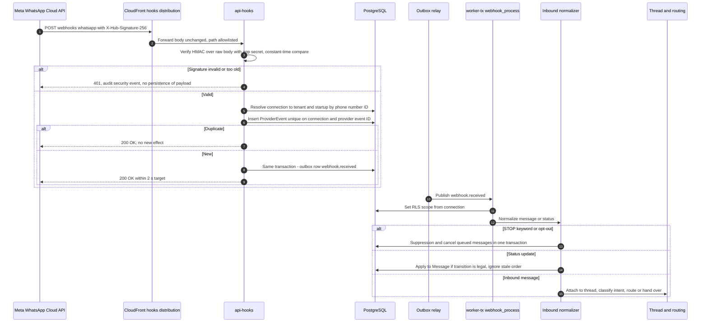

**Ingestion rules.** Persist minimal event first, acknowledge fast, process asynchronously (FRD §5). Ordering is not assumed: status updates apply only if they move the state machine forward (§2.27.9). Raw bodies are stored for 30 days for dispute and replay in sandbox only (BRL-AUT-08), then reduced to digests.

### 3.1.7.3 Publication (website page or landing page)

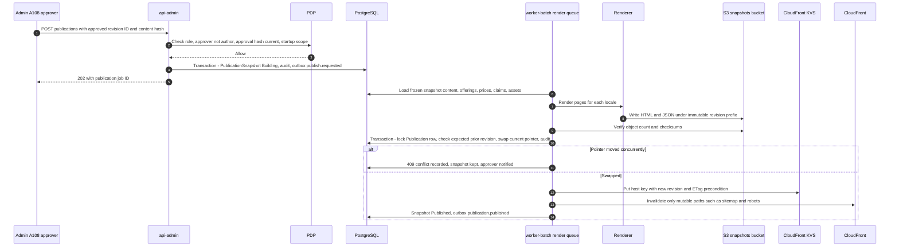

**Why this is atomic for visitors.** Every snapshot lives under its own immutable prefix, so a visitor either resolves the old revision or the new one; there is never a half-written site. The KVS update is a single key write (propagation in seconds; verify). If the KVS write fails after the database swap, a reconciler compares PostgreSQL (authoritative) with KVS every minute and repairs, and the publication shows "Propagating" in A108 until consistent. Rollback is the same flow pointing at a prior approved revision (BRL-PUB-02).

### 3.1.7.4 AI gateway call (example: evidence extraction, Tier 1a)

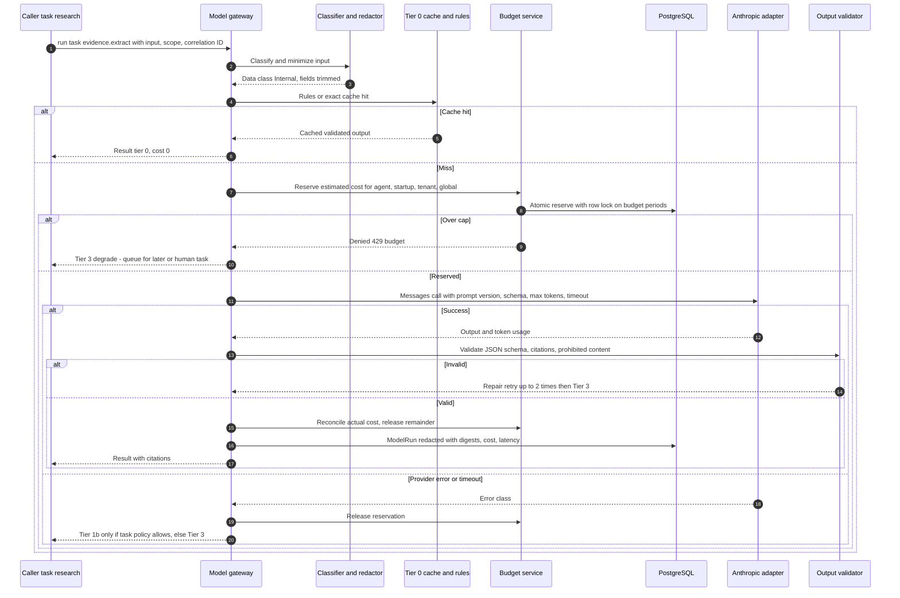

**Tier 2 path.** Only reached when the task policy allows it, the tenant has opted in (CFG-25, default OFF) and the classifier returned Public or Internal-non-personal (DEC-007). Restricted or Confidential payloads can never take this branch; a unit test asserts the router has no code path from those classes to Tier 2 adapters.

### 3.1.7.5 BFF authentication flow (DEC-019)

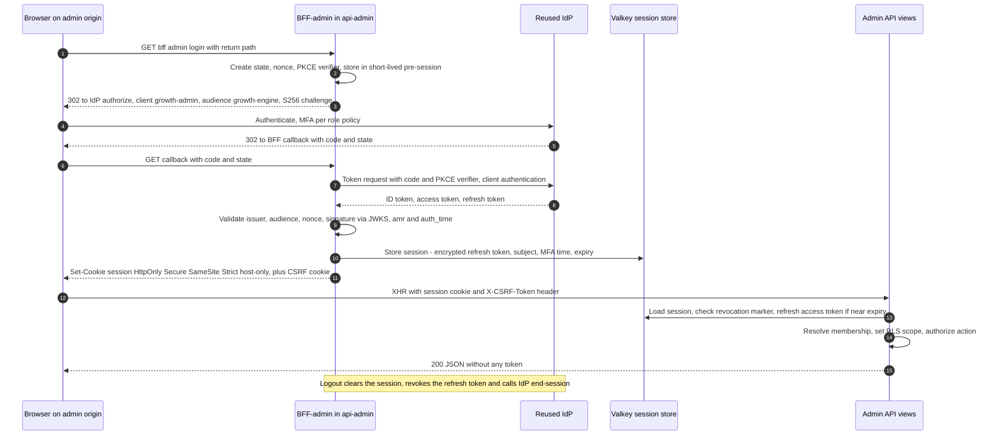

**Controls asserted by the Sprint 0 spike (DEC-019, 12 checks).** Wrong audience or client → reject (DEC-058); refresh token rotation on every use; revocation propagation ≤ 60 s through a revocation marker checked per request (cached ≤ 30 s in Valkey); step-up for approvals when `mfa_at` is older than 12 h (ABAC-11) by re-running authorize with `max_age` and `acr_values`; portal sessions use client `growth-website` on the website origin and can never call Admin routes because `api-web` does not load them. If the IdP lacks a capability (for example token revocation endpoint), the fallback in DP-01 applies and a change request is raised [ASSUMPTION-104].

---

## 3.1.8 Technology stack

All versions are **targets to verify at time of implementation (as of 27 Nov 2026)**: pick the latest patch of the named line that is supported for the whole of W0–W6, and pin it in lock files. "Mandated" means fixed by CN-01 / BRD §1.2.

| Layer | Technology | Target version (verify) | Licence | Rationale | Alternatives rejected | ADR |
|---|---|---|---|---|---|---|
| Backend language | Python | 3.12 or 3.13 | PSF | Mandated Django ecosystem; 3.12+ performance and typing | — | ADR-001 |
| Web framework | Django | 5.2 LTS (support to April 2028; verify) | BSD-3 | Mandated; LTS covers the delivery horizon | Django 6.x (shorter support window for a small team) | ADR-001 |
| API framework | Django REST Framework | 3.16.x | BSD-3 | Mandated; serializers enforce field masks | Django Ninja (not mandated) | ADR-022 |
| OpenAPI | drf-spectacular | 0.28.x | BSD-3 | OpenAPI 3.1 generation for contracts and client generation | Hand-written specs (drift) | ADR-022 |
| App server | gunicorn (gthread workers) | 23.x | MIT | Simple, proven, memory-predictable | uvicorn/ASGI everywhere (not needed until streaming) | ADR-034 |
| Task queue | Celery + Celery Beat (django-celery-beat) | Celery 5.5.x | BSD-3 | Mandated; routing, retries, priorities | Dramatiq, RQ (not mandated) | ADR-003, ADR-028 |
| Broker / cache | Valkey | 8.1.x | BSD-3 | Mandated; open-source fork of Redis | Redis (licence change), RabbitMQ (extra service) | ADR-003, ADR-031 |
| Database | PostgreSQL on Amazon RDS | 17.x (18 if RDS GA and extensions supported; verify) | PostgreSQL | Mandated; RLS, JSONB, full-text, partitioning | Aurora (cost floor), self-managed (toil) | ADR-002 |
| Vector search | pgvector | 0.8.x | PostgreSQL | Mandated "where justified"; keeps RLS on vectors | OpenSearch, Pinecone, Qdrant | ADR-007 |
| Text search | PostgreSQL full-text + pg_trgm | built-in | PostgreSQL | DEC-037 | OpenSearch (cost, second store) | ADR-029 |
| Validation | Pydantic | 2.x | MIT | Typed adapter DTOs and AI output schemas | Marshmallow | ADR-009 |
| Module boundaries | import-linter | 2.x | BSD-2 | Enforces ARP-01, ARP-06 in CI | Separate services | ADR-001 |
| PDF rendering | WeasyPrint | 6x/66.x line (verify numbering) | BSD-3 | Deterministic HTML-to-PDF for proposals, quotes, invoices | Headless Chrome (memory) | ADR-032 |
| Frontend language | TypeScript | 5.x | Apache-2.0 | Mandated | — | ADR-006 |
| UI library | React | 19.x | MIT | Mandated | — | ADR-006 |
| Build tool | Vite | 6.x or 7.x | MIT | Fast builds, SSR/prerender API for snapshots | Next.js (server runtime cost, framework lock-in) | ADR-006, ADR-010 |
| Routing / data | React Router 7, TanStack Query 5 | 7.x / 5.x | MIT | Cancel stale requests on scope switch (NFR-027) | Redux Toolkit Query | ADR-006 |
| Forms | React Hook Form + Zod | 7.x / 3.x or 4.x | MIT | Schema-driven forms aligned with server JSON Schema | Formik | ADR-006 |
| Component package | `@growth/ui` (in-house on Radix primitives) | internal | MIT (deps) | Accessible primitives, shared tokens (Part 2.5 §2.45) | Proprietary UI kits | ADR-006 |
| Node runtime (renderer, tooling) | Node.js | 22 LTS (or 24 LTS; verify) | MIT | Snapshot prerendering, frontend builds | Deno | ADR-010 |
| Monorepo | pnpm workspaces (+ Turborepo optional) | pnpm 9.x/10.x | MIT | Two apps + shared package + generated API client | Nx (heavier) | ADR-006 |
| Containers | Docker images, distroless or slim base | — | — | Same image for api-web/admin/hooks/workers | Separate images per process (drift) | ADR-013 |
| Orchestration | Amazon ECS on EC2 | — | — | No control-plane fee; IAM task roles | EKS (≈ $73/month control plane, verify), Fargate (cost per task) | ADR-013 |
| Edge | Amazon CloudFront, CloudFront Functions, KeyValueStore | — | — | Free tier covers pilot; atomic host mapping | Cloudflare (second vendor), Nginx-only | ADR-010 |
| IaC | OpenTofu | 1.9.x or 1.10.x | MPL-2.0 | Open-source first; Terraform-compatible providers | Terraform (BSL licence), AWS CDK | ADR-012 |
| CI/CD | GitHub Actions with OIDC to AWS | — | — | Existing repository host (M09 "GitHub"); no static keys | Jenkins, CodePipeline | ADR-026 |
| Secrets | AWS Secrets Manager, SSM Parameter Store, KMS | — | — | FRD §6 M05 names Secrets Manager | Vault (operational cost) | ADR-014 |
| Observability | OpenTelemetry SDKs, Sentry, CloudWatch | OTel 1.x; Sentry SDK 2.x | Apache-2.0 / MIT | DEC-041 | Datadog (cost) | ADR-025 |
| Email | Amazon SES v2 API | — | — | DEC-025 | Resend (alternative adapter only) | ADR-016 |
| Extraction | Firecrawl self-hosted (unmodified), trafilatura fallback | pin release (verify) | AGPL-3.0 / Apache-2.0 | BRD §6 self-host first | Firecrawl cloud (B04 fallback only) | ADR-018 |
| Search API | Tavily (primary), Exa (alternative adapter) | API versions verify | Proprietary | BRD §6 free credits; FRD M10 | SerpAPI | ADR-017 |
| LLM | Anthropic Claude via gateway (Tier 1a Haiku-class, Tier 1b Sonnet latest GA) | model IDs verify (Part 7) | Proprietary | DEC-007 | OpenAI (disabled by default) | ADR-008 |
| Testing | pytest, pytest-django, factory_boy, Hypothesis, Schemathesis, Playwright, axe-core, Vitest, Testing Library | current | OSS | Part 6; contract and accessibility testing | — | ADR-026 |
| Malware scanning | Amazon GuardDuty Malware Protection for S3 (pilot) → ClamAV container (option at scale) | — | — / GPL-2.0 | Memory budget of the pilot host | ClamAV on pilot host (≈ 1.2 GiB RAM) | ADR-024 |

---

## 3.1.9 Architecture decision records (ADR-001 … ADR-043)

**Status legend.** *Accepted (baseline)* = the decision is already fixed by a DEC or the source documents; the ADR records the reasoning and consequences. *Proposed* = an architect decision in this blueprint, to be confirmed by the Product Owner/architect in Sprint 0 (ADR review is a W0 exit criterion). *Deferred* = recorded now, decided at a named trigger. Every ADR is revisited if its listed review trigger fires.

### ADR-001 Modular monolith on Django

| Field | Content |
|---|---|
| Status | Accepted (baseline): FRD OPT-07-01, NFR-029, CN-01 |
| Context | 66 modules, 147 screens, 4.0 engineering FTE (DEC-005), 180 days to W5. Strong transactional coupling (state + outbox + audit + budget in one transaction, FRD §5) |
| Decision | One Django codebase and one container image, organized into the apps of Part 2.1 §2.1.2 with layered dependency rules (§3.1.4.10) enforced by import-linter. Separate **process groups** (api-web, api-admin, api-hooks, relay, workers, beat) from the same image |
| Alternatives | (a) Microservices per capability: rejected, distributed transactions and operational load exceed team capacity. (b) Separate monoliths for website and admin: rejected, duplicates domain logic and PDP |
| Consequences | + One transaction boundary, simple local development, one deploy. − Risk of a "big ball of mud" (mitigated by import-linter contracts and code ownership per app). − Whole backend deploys together (mitigated by feature flags, ADR-015) |
| Review trigger | A module needs an independent scaling or release cadence that process groups cannot provide (for example extraction at 100× volume) |

### ADR-002 Shared-schema multi-tenancy with composite keys and PostgreSQL RLS

| Field | Content |
|---|---|
| Status | Accepted (baseline): FRD §5, DEC-009, DEC-065, §2.35.2 |
| Context | Owner Portfolio tenant with 25+ startups plus 2–30 external tenants (DEC-031). Cross-tenant disclosure is the top security risk |
| Decision | One PostgreSQL cluster for this product; every operational table carries `tenant_id` and (where applicable) `startup_id` with composite foreign keys; RLS policies use transaction-local settings (`app.tenant_id`, `app.startup_ids`, `app.write_startup_id`, `app.actor_kind`; Part 3.3 §3.3.9) set by middleware and the Celery task base; application roles have no `BYPASSRLS`; a separate migration role owns tables. Default scoped managers in code (RECOMMENDATION-025). Physical policies **detailed in Part 3.3** |
| Alternatives | (a) Schema per tenant: rejected, migration fan-out with 30+ schemas and cross-startup aggregates within a tenant become hard. (b) Database per tenant: rejected on cost (B01). (c) Application-only filtering: rejected, single bug = breach |
| Consequences | + Defence in depth; cheap tenants. − Every query path must set context (enforced by a connection-checkout hook that refuses queries without context in business roles). − Connection pooling must use transaction-scoped `SET LOCAL` (no session-level leakage) |
| Review trigger | A tenant contract requires physical isolation → dedicated cluster offered as a priced plan option (Scale archetype, DEC-047) |

### ADR-003 Transactional outbox with Celery and Valkey

| Field | Content |
|---|---|
| Status | Accepted (baseline): FRD §5, M06, NFR-005/006/007 |
| Context | External effects must follow committed state exactly once in effect; provider outages must not lose events |
| Decision | Business transactions insert an `Outbox` row. `outbox-relay` polls with `FOR UPDATE SKIP LOCKED` (batch 100, poll 250 ms when busy, 2 s idle; LISTEN/NOTIFY as a wake-up hint), publishes Celery tasks carrying `event_id`, marks `relayed_at`. Consumers are idempotent by `event_id` (processed-event table). Valkey is broker only; it is not the source of truth. Celery `acks_late=True`, `task_reject_on_worker_lost=True`, visibility timeout > longest task |
| Alternatives | (a) Publish to broker inside the request: rejected, dual-write problem. (b) Debezium/CDC + Kafka: rejected, cost and ops. (c) Amazon SQS as broker: viable later; Valkey is mandated and cheaper at pilot |
| Consequences | + At-least-once delivery with idempotent effect; replayable. − Relay is a single active process (leader lock + ECS restart, lag alarm at 60 s, DEC-018). − Outbox table growth (weekly partitions, dropped 30 days after dispatch, per Part 3.3) |
| Review trigger | Sustained > 200 events/s or relay lag SLO breach after tuning |

### ADR-004 Deterministic Policy Decision Point as an in-process library

| Field | Content |
|---|---|
| Status | Accepted (baseline concept): RECOMMENDATION-012, DEC-029, DEC-038, DEC-064. Placement: Proposed |
| Context | Scope, consent, jurisdiction, quiet hours, caps, entitlement, budget, approval hash and autonomy must be checked at plan time and dispatch time, identically, by API views, workers and the AI tool registry |
| Decision | `governance.pdp` Python library: typed `DecisionRequest` → `Decision(allow, reasons[rule_id], policy_revision, obligations)`. Rules are code (fixed rules) plus versioned data (PolicyVersion, JurisdictionRule, ApprovalPolicy). Evaluation order fixed (§3.1.4.2), first deny wins, all reasons reported. Every external-action decision logged. 100% branch coverage required; property tests over generated requests |
| Alternatives | (a) OPA/Rego sidecar: rejected for pilot memory and an extra language; reconsider if policies must be shared across products. (b) Cedar: same. (c) Checks scattered in views: rejected, drift between plan and dispatch |
| Consequences | + No network hop; same code at plan and dispatch. + Explainable denials with rule IDs (FR-UIS-03). − Policy changes to fixed rules need a deploy (intended: fixed rules are non-negotiable) |
| Review trigger | A second product needs the same policies, or non-engineers must author rules beyond the data-driven parameters |

### ADR-005 Backend-for-Frontend authentication with the reused IdP

| Field | Content |
|---|---|
| Status | Accepted (baseline): DEC-003, DEC-019, DEC-058, NFR-001, NFR-003 |
| Context | Browser token storage exposes tokens to XSS; two frontends on separate origins with separate OAuth clients; product audience `growth-engine` |
| Decision | A Django BFF per origin (`bff.web` client `growth-website`, `bff.admin` client `growth-admin`) runs OIDC authorization code + PKCE, keeps tokens server-side (encrypted at rest), issues host-only `HttpOnly; Secure; SameSite=Strict` cookies, double-submit CSRF token on mutating calls, refresh rotation, revocation check per request (≤ 60 s propagation) |
| Alternatives | (a) SPA with tokens in memory/local storage: rejected (XSS exposure, BRD §2). (b) Django-native auth instead of the IdP: fallback only if the spike fails (DP-01) |
| Consequences | + Tokens never reach JavaScript. + CORS not needed (same-origin `/bff`, `/api` via CloudFront path behaviours). − CloudFront must forward cookies only on API behaviours and never cache them (cache policy per behaviour). − Sessions live in Valkey (encrypted); a Valkey loss signs everyone out but loses no business data |
| Review trigger | Spike check fails, or a native mobile client is added (then add a token-based client with its own audience) |

### ADR-006 Two frontends with a shared component package in a monorepo

| Field | Content |
|---|---|
| Status | Accepted (baseline): DEC-009, CN-03; package structure Proposed |
| Context | Public website/portal and confidential Admin must have separate origins, bundles and sessions, yet share the design system (Part 2.5 §2.45) |
| Decision | pnpm monorepo: `apps/website`, `apps/admin`, `packages/ui` (tokens, primitives, data grid, forms, charts), `packages/api-client` (generated from OpenAPI, split per namespace so the website client contains no admin endpoints), `packages/i18n`. CI asserts the website bundle contains no `admin` package imports or admin route strings |
| Alternatives | (a) One SPA with role-based routes: rejected by NFR-001. (b) Micro-frontends: rejected, complexity |
| Consequences | + Consistent UX, one accessibility implementation. − Shared package versioning discipline (workspace protocol, changesets) |
| Review trigger | — |

### ADR-007 pgvector instead of an external vector database

| Field | Content |
|---|---|
| Status | Accepted (baseline "pgvector where justified", BRD §1.2); index choice Proposed |
| Context | Approved knowledge retrieval (SR-04), solution matching (M16), semantic cache; corpus Year 1 ≈ 320k chunks, Year 2 ≈ 1.6 M (Part 3.3 §3.3.10) [ASSUMPTION-103] |
| Decision | pgvector in the same cluster, HNSW indexes, mandatory `tenant_id`/`startup_id` filter predicates under RLS, embeddings dimension per chosen model (Part 7). Iterative index scans (pgvector 0.8) to keep filtered recall |
| Alternatives | (a) OpenSearch/Elastic: rejected, ≈ $100+/month floor and a second ACL model. (b) Pinecone/Qdrant Cloud: rejected, data leaves the RLS boundary and adds cost (B19 ₹0) |
| Consequences | + RLS applies to vectors (NFR-002 "vector retrieval"). − Memory pressure on small instances (mitigate with partial indexes per tenant at scale, B19 for overage) |
| Review trigger | > 5 M vectors, p95 retrieval > 300 ms, or recall@10 < 0.9 on eval set |

### ADR-008 Single model gateway with tiered routing

| Field | Content |
|---|---|
| Status | Accepted (baseline): DEC-007, DEC-008, DEC-042, FR-OP001 |
| Context | Many AI tasks, strict ceilings (₹3,000/₹12,000/₹40,000), data-classification constraints, eval gates |
| Decision | In-process `ai` app is the only code allowed to import model SDKs. Task registry, classifier/redactor, Tier 0 cache, budget reservation, router, validator, run logger (§3.1.4.7). `POST /internal/ai/run` exposes the same path to internal callers (FR-OP001) |
| Alternatives | (a) Third-party LLM proxy (LiteLLM, hosted gateways): rejected for pilot (extra service, data path); revisit for multi-provider at scale. (b) Direct SDK calls per feature: rejected (NFR-014) |
| Consequences | + One place for cost, safety and evals. − Gateway is critical path: Tier 3 degradation keeps business flows alive |
| Review trigger | More than two paid model providers approved |

### ADR-009 Provider adapter pattern (ports and adapters) with a registry

| Field | Content |
|---|---|
| Status | Accepted (baseline): FRD §9, FR-ADP-01, RECOMMENDATION-011 |
| Context | 13 provider families, sandbox vs production, replaceable vendors, paid fallbacks only when pre-authorized |
| Decision | `integrations` defines ports (`EmailPort`, `MessagingPort`, `CalendarPort`, `SearchPort`, `ExtractionPort`, `SocialPort`, `AdsPort`, `ESignPort`, `PaymentPort`, `SecretsPort`, `LLMPort`, `SEOPort`, `EnrichmentPort`). Each adapter returns `AdapterResult(status, provider_ref, normalized, cost, failure_class ∈ {transient, rate_limited, auth, permanent, uncertain, unsupported})`. Registry resolves adapter by (tenant, startup, capability, environment); production credentials are only resolvable by production service identities (ABAC-12). Adapter catalogue in Part 3.2 §3.2.4 |
| Alternatives | Direct SDK use; iPaaS (Zapier/Make, excluded by CN-05) |
| Consequences | + Swappable, testable with contract fixtures. − Some provider features need port extensions (versioned) |
| Review trigger | New provider category |

### ADR-010 Publication snapshots on S3 + CloudFront with an atomic pointer

| Field | Content |
|---|---|
| Status | Accepted (baseline intent): BRD §9, FRD §8.1, NFR-020; mechanism Proposed [RECOMMENDATION-029] |
| Context | Immutable approved snapshots, atomic publish/rollback, unknown host → 404, tenant-keyed cache invalidation, SEO for public pages, TTFB p95 ≤ 800 ms |
| Decision | At publish, the renderer prerenders each page (React server rendering of the same website components) into HTML + JSON under an immutable S3 prefix per revision. PostgreSQL `Publication.current_snapshot` is authoritative; CloudFront KeyValueStore maps `host → {tenant, startup, revision, locale default}`; a viewer-request CloudFront Function resolves host, returns 404 for unknown hosts and rewrites the URI to the revision prefix. Dynamic parts (forms, chat, portal) call `/bff/web` and `/api/v1/commercial/public|portal` which are never cached |
| Alternatives | (a) Django renders pages per request: rejected, origin load and TTFB. (b) Next.js/SSR server: rejected, cost of a Node server fleet. (c) Path-based invalidation only: rejected, not atomic across many objects |
| Consequences | + Atomic, cheap, cache-friendly; rollback in seconds. − Publish latency = render time (target ≤ 5 min for a 50-page site [ASSUMPTION-109]). − KVS size limits and propagation must be verified |
| Review trigger | > 500 hosts, or KVS limits reached → CloudFront multi-tenant distribution features or Lambda@Edge lookup |

### ADR-011 First-party analytics only

| Field | Content |
|---|---|
| Status | Accepted (baseline): FR-W10 "first-party attribution", M37 "no health events to pixels" |
| Context | Attribution and funnel KPIs needed; MedMaarg/EduVerse sensitivities; consent requirements |
| Decision | Website beacon `POST /public/events` (sendBeacon) with consent state; events land in an append-only AttributionEvent table (partitioned), aggregated into projections. No third-party pixels by default; any ad-platform conversion upload happens server-side, only for consented, non-health events, through the Ads adapter |
| Alternatives | Google Analytics/Meta pixel (privacy and DPDP risk); self-hosted Matomo/Plausible (extra service; could be added later) |
| Consequences | + Data stays in ap-south-1 under RLS. − Fewer out-of-the-box reports (covered by RP catalogue §2.31) |
| Review trigger | Marketing needs cohort analysis beyond projections |

### ADR-012 Infrastructure as code with OpenTofu

| Field | Content |
|---|---|
| Status | Proposed (refines RECOMMENDATION-010 "Terraform/OpenTofu") |
| Context | Reproducible environments, drift detection, open-source first |
| Decision | OpenTofu with the AWS provider; modules: `network`, `edge`, `ecs-cluster`, `rds`, `valkey`, `s3`, `observability`, `iam`, `secrets`; remote state in S3 with native state locking (verify) and KMS; plans in CI on every PR, apply on approval |
| Alternatives | Terraform (BSL licence), AWS CDK (TypeScript; good but ties IaC to AWS constructs), CloudFormation (verbose) |
| Consequences | + MPL licence, Terraform-compatible ecosystem. − Watch provider compatibility on new AWS features (CloudFront KVS resources) |
| Review trigger | Provider gap blocks a required resource |

### ADR-013 Hosting on Amazon ECS on EC2 (single instance at pilot)

| Field | Content |
|---|---|
| Status | Proposed [RECOMMENDATION-030]; scale gate per DEC-040 |
| Context | B01 ≈ ₹5,000; need deploy primitives, health checks and IAM task roles; scale gate needs two instances and an ALB |
| Decision | ECS on EC2 with one t4g.medium container instance (Graviton) at pilot, Caddy for origin TLS, no ALB/NAT. At scale gate: Auto Scaling group across two AZs behind an ALB; batch capacity provider on spot |
| Alternatives | (a) Fargate: ≈ 3–4× the pilot compute cost for 8 always-on tasks (verify). (b) EKS: control-plane fee alone ≈ B01 share. (c) Lightsail / single VM with docker compose: cheapest but weak path to scale gate and IAM task roles. (d) Elastic Beanstalk: less control |
| Consequences | + Same task definitions from pilot to scale. − Single instance is a single point of failure at pilot (accepted: 99.5% target, RTO ≤ 4 h, rebuild by IaC in < 30 min) |
| Review trigger | §3.1.6.4 triggers |

### ADR-014 Secrets and keys

| Field | Content |
|---|---|
| Status | Accepted (baseline): FRD §6 M05 "AWS Secrets Manager", NFR-004 |
| Decision | Provider credentials live in Secrets Manager; the database stores only **credential references** (CredentialRef: ARN + version stage + scope). One secret per provider group per environment to limit cost; per-tenant OAuth tokens (calendar, social, ads) stored as KMS-encrypted columns with envelope encryption, keyed per tenant (Part 3.3), because per-token secrets would cost $0.40 each. Rotation: automatic where provider supports it; refresh tokens rotated on use. Non-secret configuration in SSM Parameter Store (standard tier, no charge) |
| Alternatives | HashiCorp Vault (ops cost); environment variables (leak risk) |
| Consequences | + No secret ever returned by an API (NFR-004). − Envelope encryption code must be reviewed (Security) |
| Review trigger | Compliance requirement for HSM-backed per-tenant keys |

### ADR-015 Feature flags in-house, OpenFeature-compatible

| Field | Content |
|---|---|
| Status | Proposed (CFG-31, RECOMMENDATION-005) |
| Decision | Feature flags stored as ConfigRevision items of kind `feature_flag` (CFG-31; Part 3.3 ENT-168) with targeting by platform/tenant/startup/role/environment, evaluated server-side, cached in Valkey 30 s, exposed to frontends through `/bff/*/session` as a boolean map. An OpenFeature provider wraps it so a hosted service could replace it. Every flag has an owner and expiry date; flags never bypass PDP checks |
| Alternatives | Unleash/Flagsmith self-hosted (extra service, memory), LaunchDarkly (cost) |
| Consequences | + Zero cost; audited changes (CFG-31). − Limited experimentation features (not required) |

### ADR-016 Email through Amazon SES

| Field | Content |
|---|---|
| Status | Accepted (baseline): DEC-025 |
| Decision | SES v2 API; one configuration set and verified domain identity per startup sender (reputation isolation, §2.35.2); event destinations to SNS → `POST /webhooks/email` (signature-verified SNS messages); suppression synchronized with the platform suppression list; inbound email via SES receiving rules → S3 → event (optional, W3) |
| Alternatives | Resend, Postmark, SendGrid (kept as alternative adapter, not installed) |
| Consequences | + Cheapest per message (verify); − SES production access request lead time (DP-06) |

### ADR-017 Public search API: Tavily primary, Exa alternative

| Field | Content |
|---|---|
| Status | Accepted (baseline): BRD §6 (B03), FRD §6 M10/M11 |
| Decision | `SearchPort` with Tavily adapter enabled by default and Exa adapter installed but disabled; per-plan query budgets; results cached 7 days by normalized query; blocked hosts and source policy applied before fetch |
| Alternatives | SerpAPI/Bing-style APIs (licensing, cost) |
| Consequences | Free credits cover the pilot (verify); overage within B03 ₹1,500 |

### ADR-018 Self-hosted extraction (Firecrawl) with in-process fallback

| Field | Content |
|---|---|
| Status | Accepted (baseline "self-host first", BRD §6 B04); licence handling Proposed |
| Decision | Run unmodified Firecrawl (AGPL-3.0) as a separate private service on a scheduled instance; call it over HTTP only (no linking). Simple static pages use in-process trafilatura/readability. Robots.txt and source policy respected. Firecrawl cloud is a paid fallback only if pre-authorized within B04 |
| Alternatives | Headless browser inside workers (memory), paid scraping APIs |
| Consequences | − AGPL obligations if modified: **legal review required** before any modification (RSK-303) |

### ADR-019 Single region now, multi-region later

| Field | Content |
|---|---|
| Status | Deferred (DEC-040) |
| Decision | All workloads in ap-south-1. Data protection across regions from day one: RDS cross-Region automated backups (snapshots **and** transaction logs) replicated to ap-south-2, so point-in-time restore is possible in the second region (verify the region pair is supported); critical S3 buckets replicated at scale gate. Regional disaster = rebuild the stack in ap-south-2 by IaC and restore; target RTO 4 h is rehearsed but not guaranteed at pilot (CONFLICT-101, §3.1.13). Active-passive warm standby in ap-south-2 is considered at Year 2 or when a SaaS contract requires it |
| Consequences | + Cost. − Regional outage → extended downtime (RSK-304) |

### ADR-020 Event schema versioning

| Field | Content |
|---|---|
| Status | Proposed [RECOMMENDATION-033 in Part 3.2] |
| Decision | Event type names `<domain>.<entity>.<verb_past>.v<major>`; JSON Schema per type in `schemas/events/` with semantic versions; within a major only additive optional fields; breaking change = new major, producers dual-publish both majors for ≥ 1 release and ≥ 14 days; consumers declare accepted majors; CI compatibility check against the last released schema; upcasters for stored events |
| Consequences | + Safe evolution of projections and triggers (A109 binds to schema version). − Discipline overhead (CI-enforced) |

### ADR-021 Queue topology and priorities

| Field | Content |
|---|---|
| Status | Proposed (§2.35.3 "transactional > interactive > batch") |
| Decision | Queues: `dispatch` (external actions), `transactional`, `notify`, `webhook_process`, `reconcile` on worker-tx; `ai`, `research`, `projections`, `reports`, `imports_exports`, `render`, `maintenance` on worker-batch. Per-tenant concurrency tokens in Valkey (max 20 concurrent runs per startup, BRL-AUT-06); fair scheduling by round-robin over tenants for batch queues |
| Consequences | + Batch floods cannot delay transactional runs (DEC-032 15-minute window). − More queues to monitor (dashboard per queue) |

### ADR-022 REST + OpenAPI 3.1, problem+json errors, no GraphQL

| Field | Content |
|---|---|
| Status | Accepted (baseline): FRD §5, NFR-015 |
| Decision | Resource-oriented REST with action sub-resources for state transitions (`POST …/{id}/approve`), OpenAPI 3.1 generated by drf-spectacular, RFC 9457 problem details with rule IDs, cursor pagination, idempotency keys. Standards in Part 3.2 §3.2.1 |
| Alternatives | GraphQL (field-level authorization complexity, caching), gRPC (browser support) |

### ADR-023 Idempotency store in PostgreSQL with Valkey fast path

| Field | Content |
|---|---|
| Status | Proposed (FRD §5 "idempotency key/body hash") |
| Decision | IdempotencyKey (Part 3.3 ENT-171, `ops_idempotency_key`): unique on (tenant, startup, `scope_key` = operation + actor, `key_value`) with `body_hash` and a response reference. Same key + same hash → replay stored response; same key + different hash → 409 `IDEMPOTENCY_KEY_REUSED`; in-flight → 409 `REQUEST_IN_PROGRESS` with `Retry-After`. Replay window 24 h for interactive calls and 7 days for intake and webhooks; rows retained 35 days (Part 3.3) so a late reuse still returns 409 instead of acting twice. Event consumers reuse the same table with `scope_key = consumer:<name>` |
| Consequences | + Durable across Valkey loss. − Table churn (daily partition drop) |

### ADR-024 Object storage layout and malware scanning

| Field | Content |
|---|---|
| Status | Proposed [RECOMMENDATION-035 in Part 3.2] (NFR-021, BRL-PUB-04) |
| Decision | Buckets: `frontends`, `snapshots` (versioned), `documents` (prefixes `quarantine/` and `clean/{tenant}/{startup}/`), `exports` (lifecycle 7 days), `audit-anchors` (Object Lock compliance mode), `backups-logical`. Uploads land in `quarantine/` via presigned POST (size/type limits); GuardDuty Malware Protection for S3 tags the object; an EventBridge rule triggers promotion to `clean/` or rejection. Files are never served from quarantine |
| Alternatives | ClamAV on the pilot host (memory), third-party scanning APIs (data leaves AWS) |
| Consequences | + Managed, pay-per-GB at pilot. − Price and region availability must be verified; ClamAV container retained as fallback design |

### ADR-025 Observability: OpenTelemetry, Sentry, CloudWatch

| Field | Content |
|---|---|
| Status | Accepted (baseline): DEC-041 |
| Decision | OTel SDK in Django, Celery and the renderer; traces exported to an in-process sampler (10% baseline, 100% on error and for dispatch spans) to CloudWatch (via ADOT collector at scale) and errors to Sentry with PII scrubbing; structured JSON logs with tenant/startup/run IDs and no business content; SLO metrics as CloudWatch custom metrics (Part 4) |
| Consequences | − Sentry free-tier limits (verify; B07) |

### ADR-026 CI/CD with GitHub Actions and OIDC

| Field | Content |
|---|---|
| Status | Proposed (M09, M62, DEC-061, DEC-063) |
| Decision | Pipelines: lint/type/test → import-linter → OpenAPI and event-schema compatibility → AI eval regression gate → container build (SBOM, image scan) → deploy to staging → synthetic journeys → manual approval (A090) → production rolling deploy → smoke tests; rollback by redeploying previous task definition. AWS access through GitHub OIDC roles, no long-lived keys |
| Consequences | − GitHub Actions minutes may exceed free allowance (B07, verify) |

### ADR-027 In-house declarative workflow interpreter on Celery

| Field | Content |
|---|---|
| Status | Proposed (DEC-051, B-AUTO, CN-05) |
| Decision | Workflows are versioned JSON DAGs of approved node types interpreted by `automation` on Celery; each step is a task with persisted StepRun; waits are timers in the database polled by beat (1-minute granularity) |
| Alternatives | Temporal (excellent semantics, but extra cluster and memory), Airflow/Prefect (batch-oriented), Camunda (JVM) |
| Consequences | + Fits PDP, RLS and outbox natively. − We own durability semantics (covered by outbox and StepRun state machine, §2.27.14) |
| Review trigger | > 1,000 concurrent long-running executions or complex compensation needs |

### ADR-028 Scheduling with Celery Beat database scheduler

| Field | Content |
|---|---|
| Status | Proposed |
| Decision | django-celery-beat with periodic tasks stored in PostgreSQL; a single active beat guarded by a lock; per-tenant schedules expressed as Trigger rows and fanned out by a minute tick (avoids thousands of beat entries) |
| Consequences | + Survives restarts; missed runs recovered once (BRL-AUT-10) |

### ADR-029 PostgreSQL full-text and trigram search

| Field | Content |
|---|---|
| Status | Accepted (baseline): DEC-037, SR-01 |
| Decision | Generated `tsvector` columns per searchable entity (language config per locale), `pg_trgm` GIN indexes for names/domains, and global search as a `UNION ALL` over per-entity search views exposing only permitted fields under RLS (Part 3.3 §3.3.8.3) |
| Review trigger | p95 global search > 700 ms at ≤ 1 M records per tenant |

### ADR-030 Money, quantity and time representation at the API boundary

| Field | Content |
|---|---|
| Status | Accepted (baseline): FRD §5, NFR-017, DEC-027 |
| Decision | Money in APIs is `{ "amount": "270.00", "currency": "INR" }` with amount as a **decimal string** (never JSON float); quantities as `{ "value": "2.000", "unit": "kg" }`; timestamps RFC 3339 UTC with `Z`; user-facing time zone as IANA name separately. Storage types **detailed in Part 3.3** |

### ADR-031 Caching strategy

| Field | Content |
|---|---|
| Status | Proposed (§3.1.11) |
| Decision | Three tiers: CDN for snapshots and static assets; Valkey for derived, scope-keyed data; in-process LRU for immutable reference data. Every Valkey key starts with `t:{tenant}:s:{startup}:` (or `p:` for platform); portal data never cached in shared layers |

### ADR-032 Server-side document rendering with WeasyPrint

| Field | Content |
|---|---|
| Status | Proposed |
| Decision | Proposals, quotes, invoices, contracts rendered from approved versions to PDF in worker-batch; SHA-256 of the PDF stored with the version and shown to signers (FR-W24 "terms hash") |
| Alternatives | Headless Chrome (memory), client-side PDF (not authoritative) |

### ADR-033 Identity boundary with the investor product

| Field | Content |
|---|---|
| Status | Accepted (baseline): DEC-003, DEC-058, DP-15 |
| Decision | Shared IdP only; audience `growth-engine`; no shared database, storage, queues or tokens; tokens issued for other audiences rejected at the BFF; membership and roles for this product live in this product's database |
| Consequences | Requires agreement with the investor-product team on claim names and revocation (DP-15) |

### ADR-034 Near-real-time UI updates by polling, SSE later

| Field | Content |
|---|---|
| Status | Proposed |
| Decision | Conditional polling with ETags (5 s on A110 monitor and A037 inbox when visible, 30 s elsewhere, paused when the tab is hidden). Server-Sent Events via a small ASGI endpoint added only if polling load exceeds 20% of API requests |
| Alternatives | WebSockets via Django Channels (ASGI stack, sticky connections, memory) |

### ADR-035 Rate limiting in two layers

| Field | Content |
|---|---|
| Status | Proposed (§2.35.3 defaults; extended classes in Part 3.2 §3.2.1.7) |
| Decision | Application token buckets in Valkey keyed by class and principal (IP hash, user, tenant, site, provider connection), returning 429 with `Retry-After` and `RateLimit-*` headers; CloudFront/WAF rate rules added at scale gate (B21) |

### ADR-036 Container image and runtime hardening

| Field | Content |
|---|---|
| Status | Proposed |
| Decision | One multi-stage image (Python slim, non-root user, read-only root filesystem, no shell in production variant where feasible); SBOM generated and scanned in CI; ECS task roles per process group; `/health` without database and `/ready` with dependency summary (FR-OP002/003) |

### ADR-037 Calendar adapter: Google first, Microsoft Graph in W5

| Field | Content |
|---|---|
| Status | Accepted (baseline): DEC-024 |
| Decision | `CalendarPort` with free/busy, create/update/cancel own booking events, push notifications (Google watch channels) → `POST /webhooks/calendar`; OAuth tokens per user or per resource calendar with minimum scopes; no reading of other event content |

### ADR-038 Regulated-action adapters with a manual evidence path first (payments, e-sign)

| Field | Content |
|---|---|
| Status | Accepted (baseline): DEC-022, DEC-023 |
| Decision | `PaymentPort` and `ESignPort` both start with a **manual evidence adapter** (bank/UPI proof upload with maker-checker; signed-PDF upload with SHA-256 and counter-party confirmation). Gateway and e-sign provider adapters added in W4/W5 behind the same ports; the platform never stores card or bank credentials |

### ADR-039 WhatsApp through the Meta Cloud API directly

| Field | Content |
|---|---|
| Status | Proposed (FRD §6 M31 "Meta Cloud API"; BSP choice open) |
| Decision | Direct Cloud API integration per startup WABA and phone number; templates synced; 24-hour service window enforced by PDP; signed webhooks. A Business Solution Provider is considered only if verification or pricing requires it (verify) |

### ADR-040 Social publishing and listening through platform APIs behind ports

| Field | Content |
|---|---|
| Status | Proposed (FRD §6 M33, M35 "Postiz candidate / platform APIs") |
| Decision | `SocialPort` adapters per platform (LinkedIn, Meta, X, YouTube as licensed); Postiz evaluated as an optional self-hosted adapter, not a dependency. Listening only from permitted sources (FR-A049) |

### ADR-041 Admin Copilot on the model gateway with RLS-scoped retrieval

| Field | Content |
|---|---|
| Status | Accepted (baseline): DEC-035, BRL-AI-12 |
| Decision | Copilot runs inside `api-admin` under the user's RLS scope; retrieval tools are read-only repository queries and approved-knowledge search; output cites record IDs; draft-creation tool creates L1 drafts only; no tool can approve, send, publish, spend or change configuration |

### ADR-042 Environment strategy and sandbox adapters

| Field | Content |
|---|---|
| Status | Proposed (§3.1.14, ABAC-12, RECOMMENDATION-017) |
| Decision | Environments `local`, `test` (ephemeral CI), `staging`, `prod`; the adapter registry refuses live adapters outside `prod` and refuses sandbox adapters in `prod` for live tenants; synthetic data sets in non-prod only |

### ADR-043 Public intake abuse protection without paid WAF at pilot

| Field | Content |
|---|---|
| Status | Proposed (NFR-022; B21 ₹0, GAP-104) |
| Decision | Rate limits per IP hash, per site and per form; honeypot field and minimum fill time; proof-of-work or privacy-friendly challenge (for example a self-hosted ALTCHA-style challenge) after thresholds; payload size limits at CloudFront Function and Django; idempotent submission keys; WAF managed rules added at scale gate |
| Consequences | − Some volumetric attacks only mitigated by CloudFront's built-in DDoS protection (AWS Shield Standard) at pilot (RSK-305) |

---

## 3.1.10 Batch versus real-time processing

| Class | Latency target | Mechanism | Examples (module / FR) | Source |
|---|---|---|---|---|
| **Synchronous request** | API p95 ≤ 500 ms reads, ≤ 800 ms writes | DRF view in a transaction; no provider call inside the request except IdP token refresh | List/detail screens, drafts, configuration saves, approvals (decision recorded; effect async) | DEC-018 |
| **Interactive async** | Result visible ≤ 10 s p95 | 202 + run ID; `transactional` or `ai` queue; UI polls the run (ADR-034) | Generate draft (A034, A050), recompute score (A022), eligibility check with explanation, simulation of a small workflow | FRD §5 |
| **Transactional automation** | ≥ 99% of eligible due runs started within 15 min of due time | `dispatch` / `transactional` queues on worker-tx with priority; beat minute tick for timers | Approved replies, follow-ups, reminders, booking confirmations, opt-out propagation (immediate), invoice issued notice | DEC-032, BR-M04 |
| **Webhook ingestion** | Ack ≤ 2 s; processed ≤ 60 s p95 | Persist-and-ack in api-hooks; `webhook_process` queue | Email events, WhatsApp, calendar, e-sign, payment, ads/social status | FRD §5 |
| **Near-real-time projections** | Customer 360 ≤ 60 s; dashboards ≤ 15 min | Event consumers on `projections` queue; incremental upserts | AccountProjection, funnel, pipeline, cost projections | NFR-008, §2.31.1 |
| **Scheduled batch** | ≥ 99% within 24 h of schedule | `research`, `reports`, `maintenance` queues; off-peak window 22:00–06:00 IST preferred; per-tenant fair share | Discovery runs, enrichment, evidence refresh, SEO audit, scheduled reports, retention purges, reconciliation sweeps, eval runs | DEC-032 |
| **Bulk jobs** | Progress visible; complete ≤ 4 h for 100k rows | `imports_exports` queue; chunked (1,000 rows), resumable, dry-run first | Imports/exports (A103), re-index, backfills | DEC-039 |
| **Publication** | ≤ 5 min from approval to live for ≤ 50 pages [ASSUMPTION-109] | `render` queue + renderer task | A108, A057 | FR-PUB-01 |

**Rules.** (1) No external provider call happens on a request thread (except IdP refresh in the BFF). (2) A batch job never holds a transaction open longer than 5 s; it commits per chunk with a checkpoint. (3) Batch jobs carry tenant scope and acquire a per-tenant concurrency token (ADR-021). (4) Quiet hours and time zones defer work and are not counted as late (DEC-032).

---

## 3.1.11 Caching strategy

| Layer | What is cached | Key structure | TTL / invalidation | Never cached | Source |
|---|---|---|---|---|---|
| CloudFront (website) | Prerendered snapshot HTML/JSON, images, JS/CSS bundles | Immutable path `/snapshots/{tenant}/{startup}/{publication}/{revision}/{locale}/…`; bundles content-hashed | 1 year `immutable` for revision paths; host pointer via KVS (no invalidation needed); `sitemap.xml`, `robots.txt` 5 min + targeted invalidation on publish | `/bff/*`, `/api/*` (cache policy "CachingDisabled", cookies forwarded only here), any portal path, previews | NFR-020, BRL-PUB-05 |
| CloudFront (admin) | Admin SPA bundles only | Content-hashed file names; `index.html` no-cache | Deploy uploads new hashed bundles; `index.html` revalidated | All API responses | NFR-001 |
| Browser | Static bundles; API GETs use `ETag` revalidation | — | `Cache-Control: private, no-store` on all API responses with personal or Admin data; `no-cache` + ETag for reference lists | Tokens (never in browser at all) | ADR-005 |
| Valkey (shared cache) | Policy/rule sets by revision, feature flags, reference data, permission/membership resolution (per session), rate-limit buckets, AI exact-match cache (Public/Internal data only), search API result cache, provider token metadata (not secrets) | `t:{tenant}:s:{startup}:{namespace}:{revision}:{hash}`; platform keys `p:{namespace}:…`; per-user keys include `u:{user}` | 30 s (membership, flags, revocation marker) · 5 min (reference data) · revision-keyed (no TTL needed, LRU) · 7 days (search results) · AI cache 30 days or until prompt version changes | Portal object data; Restricted fields; secrets; anything without a scope prefix (lint rule rejects key builders without scope) | §2.35.2, ADR-031 |
| In-process (per worker) | Immutable reference data (currencies, units, HSN/SAC), compiled JSON Schemas, active PDP rule set by revision | Revision-keyed | Until revision changes; max 30 s for rule sets | Mutable business data | ADR-004 |
| PostgreSQL projections | Read models (AccountProjection, funnel/revenue/cost projections, search_document) | Scoped rows under RLS | Event-driven refresh (≤ 60 s / ≤ 15 min) | — | §2.31.1 |

**Cache safety rules.** (1) Every cache key is built by one helper that requires a `ScopeRef`; CI forbids raw `cache.get/set`. (2) Scope switch in the UI cancels requests and clears the client query cache (FR-UIS-01). (3) After a permission change, the membership cache for that user is deleted synchronously (revocation ≤ 60 s budget). (4) Cache poisoning tests: a value written under tenant A can never be read under tenant B (two-tenant fixture, NFR-032).

---

## 3.1.12 Scalability and capacity model

### 3.1.12.1 Design points and workload assumptions

Design points from DEC-031; per-user behaviour is an assumption to be replaced by W2 measurements [ASSUMPTION-102].

| Input | Symbol | Year 1 (DEC-031, upper bound) | Year 2 (DEC-031) | Basis |
|---|---|---|---|---|
| Startup workspaces | W | 40 | 100 | DEC-031 |
| External tenants | T | 10 | 30 | DEC-031 |
| Internal users | U | 60 | 200 | DEC-031 |
| Portal users per month | PU | 500 | 5,000 | DEC-031 |
| Public sessions per month | PS | 5,000 | 50,000 | DEC-031 |
| Peak share of internal users active in the busiest hour | a | 0.5 | 0.5 | ASSUMPTION-102 |
| Admin requests per active user per minute (incl. polling) | r | 20 | 20 | ASSUMPTION-102 |
| Portal sessions per user per month × minutes per session | s × m | 4 × 10 | 4 × 10 | ASSUMPTION-102 |
| Working minutes per month (26 days × 10 h) | M | 15,600 | 15,600 | ASSUMPTION-102 |
| Origin API calls per public session (forms, chat, beacons) | o | 3 | 3 | ASSUMPTION-102 |
| Peak-to-average factor (public) | f | 5 | 5 | ASSUMPTION-102 |
| Mean / p95 API service time | t | 0.15 s / 0.5 s | 0.15 s / 0.5 s | DEC-018 target |
| Target thread utilization | ρ | 0.6 | 0.6 | Queueing headroom |
| Outbound messages per month, all channels | E | 30,000 | 120,000 | Part 3.3 §3.3.10.2 (`eng_message`) |
| Domain events per month | Ev | ≈ 300,000 | ≈ 1.5 M | Part 3.3 §3.3.10.2 (`ops_domain_event`) |
| AI model runs per month | G | ≈ 45,000 (budget-capped) | ≈ 360,000 | Part 3.3 §3.3.10.2; DEC-008 caps apply |
| Research fetches per month | R | 5,000 | 40,000 | Part 3.3 §3.3.10.2 (`intel_fetch_log`) |

### 3.1.12.2 Capacity formulas and results

| Quantity | Formula | Year 1 | Year 2 | Implication |
|---|---|---|---|---|
| Admin peak requests/s | λA = U × a × r / 60 | 60 × 0.5 × 20 / 60 = **10 rps** | 200 × 0.5 × 20 / 60 = **33 rps** | |
| Portal concurrent users at peak | Cp = PU × s × m / M × 3 | 500 × 40 / 15,600 × 3 ≈ **3.8** | ≈ **38** | Peak factor 3 for portal |
| Portal peak requests/s | λP = Cp × 10 / 60 | ≈ **0.6 rps** | ≈ **6.4 rps** | 10 req/min per active portal user |
| Public origin peak requests/s | λW = PS × o / (30 × 86,400) × f | 5,000 × 3 / 2,592,000 × 5 ≈ **0.03 rps** | ≈ **0.3 rps** | Pages are CDN-served; origin load is negligible |
| Gunicorn threads needed (admin) | N = λA × t̄ / ρ (+ p95 headroom ×2) | 10 × 0.15 / 0.6 × 2 = **5** | 33 × 0.15 / 0.6 × 2 = **16.5** | Pilot api-admin has 6 threads; Year 2 needs ≥ 3 × 6 threads across 2–3 instances |
| Gunicorn threads needed (web + portal) | N = (λP + λW) × t̄ / ρ × 2 | ≈ **0.3** → 4 provided | ≈ **3.4** → 8 provided | |
| Domain/outbox events per day | Ev / 30 | ≈ **10,000/day** | ≈ **50,000/day** | Part 3.3 volume model |
| Peak outbox throughput | Ev/30 × 10 / 86,400 (10× peak factor) | ≈ **1.2 events/s** | ≈ **5.8 events/s** | Relay capacity ≈ 400 events/s (batch 100 × 4/s); not a bottleneck |
| Celery task throughput | ≈ 2 × Ev / 30 | ≈ 20,000 tasks/day | ≈ 100,000 tasks/day | worker-tx concurrency 2 handles ≈ 10 tasks/s at 0.2 s mean; Year 2 adds worker containers |
| Database connections | Σ process pool sizes | ≈ 25 (pilot) | ≈ 60–80 | db.t4g.micro max_connections ≈ 100 (verify); Year 2 consider RDS Proxy or PgBouncer sidecar |
| Database size (hot, incl. indexes) | rows × avg row bytes × 1.6 (Part 3.3 §3.3.10.3) | ≈ **20–30 GB** end of Year 1 | ≈ **110–150 GB** end of Year 2 | RDS storage autoscaling: pilot starts at 20 GB with max 100 GB; scale gate max 500 GB |
| Vector storage | chunks × 2.2 KB × 2.0 (halfvec + HNSW; Part 3.3) | 320k → ≈ **1.4 GB** | 1.6 M → ≈ **7 GB** | Review trigger ADR-007 |
| Audit log growth | Part 3.3 formula (user actions + 3 × messages + 2 × model runs + jobs) | ≈ **4.7 M rows ≈ 6 GB/year** | ≈ **21.7 M rows ≈ 28 GB/year** | Monthly partitions; 13 months hot, then archived to S3 with Object Lock (Part 3.3 §3.3.10.4) |
| Attribution events | PS × 10 events × 0.5 KB × 12 | ≈ **0.3 GB/year** | ≈ **3 GB/year** | Not partitioned in Year 1 (Part 3.3) |
| Object storage | documents + snapshots + exports | ≈ 20–50 GB | ≈ 200–500 GB | Lifecycle rules per bucket |
| AI calls per month (affordability check) | Budget ÷ mean cost per call (Part 7) | ₹3,000 ÷ ₹0.10–0.50 ≈ 6k–30k paid calls; the rest of the ≈ 45,000 runs must be Tier 0 cache/rules or Tier 1a | ₹40,000 ÷ ₹0.10–0.50 ≈ 80k–400k | Budget, not compute, is the limit (DEC-008); Part 7 reconciles |

**10× pilot volume without re-architecture (DEC-018).** Every component in the table scales by adding container instances, adding threads, resizing RDS/Valkey or adding a read replica — the same architecture. The first structural change point is beyond Year 2: > 5 M vectors (ADR-007 review), > 200 events/s (ADR-003 review), or a tenant requiring physical isolation (ADR-002 review).

### 3.1.12.3 Scaling levers in order of use

| Order | Lever | Cost impact (verify) | Trigger |
|---|---|---|---|
| 1 | Tune gunicorn/Celery concurrency, add indexes, fix N+1 queries | None | p95 regressions in CI performance tests |
| 2 | Vertical resize: t4g.medium → t4g.large; db.t4g.micro → db.t4g.small | ≈ +₹1,500–2,500/month | §3.1.6.4 T-3/T-4 |
| 3 | Topology B (ALB, 2 instances, Multi-AZ, ElastiCache) | ≈ ₹21,000/month total | T-1 + any other trigger |
| 4 | Separate batch capacity on spot | ≈ +₹900–2,300/month | Batch queue lag affects transactional SLO |
| 5 | Read replica for reports, exports, analytics | ≈ +₹5,000/month | Report/export load > 30% of DB CPU |
| 6 | Partition large tables (audit, events, messages, attribution) — planned from day one in Part 3.3 | None | Table > 50 M rows |
| 7 | Per-tenant vector partitions / dedicated cluster for a Scale tenant | Priced into the tenant's plan | Contract requirement |

---

## 3.1.13 High availability and disaster recovery

### 3.1.13.1 Objectives

| Objective | Pilot (Topology A) | Scale gate (Topology B) | Source |
|---|---|---|---|
| Availability (monthly) | Website/portal 99.5%; Admin 99.5% | Website/portal 99.9%; Admin 99.5% | DEC-018 |
| RPO (data loss) | ≤ 15 min (RDS PITR; transaction logs shipped about every 5 min, verify) | ≤ 15 min; ≈ 0 for AZ failure (synchronous standby) | DEC-018 |
| RTO (instance/AZ failure) | ≤ 4 h (target ≤ 1 h) | ≤ 4 h (target ≤ 15 min, automatic) | DEC-018 |
| RTO / RPO (regional disaster) | Target 4 h / 15 min using cross-Region automated backups; **not guaranteed at pilot** (manual IaC rebuild in ap-south-2) | Same, rehearsed twice a year | DEC-040; **CONFLICT-101** |
| Backup retention | 35 days rolling; legal hold overrides | Same | DEC-028 |

**CONFLICT-101 (DEC-018 RTO ≤ 4 h vs DEC-040 single-region pilot).** DEC-018 sets RTO ≤ 4 h without distinguishing failure scope, while DEC-040 places the pilot in one region with backup copies only. A regional rebuild (network, ECS, RDS restore from replicated backups, DNS/CloudFront origin switch) is estimated at 3–8 h depending on database size and rehearsal. **Resolution proposed:** the 4-hour RTO is binding for instance, AZ, data-corruption and deployment failures; for a full regional loss the pilot commits to "best effort ≤ 8 h, RPO ≤ 15 min", becoming binding ≤ 4 h at the scale gate after two successful rehearsals. Product Owner acceptance required (RSK-304).

### 3.1.13.2 Backup design

| Asset | Mechanism | Frequency / RPO | Retention | Location | Restore test |
|---|---|---|---|---|---|
| PostgreSQL (all business data, outbox, audit) | RDS automated backups + PITR | Continuous (log shipping ≈ 5 min) | 35 days | ap-south-1 | Every production release: automated restore of latest snapshot into a temporary isolated instance in the prod account, run integrity checks (row counts, audit hash-chain verification, RLS smoke), destroy (≈ 1 h of db.t4g.micro, negligible cost) (NFR-012) |
| PostgreSQL (regional copy) | RDS cross-Region automated backups | Continuous (verify lag) | 7 days | ap-south-2 | Quarterly regional restore rehearsal |
| PostgreSQL (logical) | Weekly `pg_dump` (custom format, encrypted) to `backups-logical` bucket in the **shared account** (separate blast radius) | Weekly | 35 days (lifecycle) | ap-south-1, cross-account | Monthly restore into a temporary isolated instance in the shared account; verified, then destroyed. Production data is never loaded into staging |
| S3 documents, snapshots | Versioning; noncurrent versions expire after 35 days; replication to ap-south-2 at scale gate | Continuous | 35 days noncurrent | ap-south-1 (+ ap-south-2 at scale) | Quarterly object restore test |
| Audit anchors | S3 Object Lock (compliance mode) daily anchor hash | Daily | 7 years | ap-south-1 | Monthly chain verification job |
| Valkey | AOF on EBS (pilot) / ElastiCache snapshots (scale) | — | 1 day | — | Not a recovery source: rebuilt from PostgreSQL (outbox, schedules, flags) |
| Configuration, IaC, schemas, prompts, workflows | Git (GitHub) + releases | Per commit | Indefinite | GitHub + mirror in shared-account S3 | IaC rebuild of staging from scratch quarterly |
| Secrets | Secrets Manager (replicated secret to ap-south-2 at scale gate) | — | Versioned | ap-south-1 | Rotation drill quarterly |

### 3.1.13.3 Failure-mode table

| # | Failure | Detection | Impact (pilot) | Automatic response | Manual runbook | RTO / RPO achieved |
|---|---|---|---|---|---|---|
| FM-01 | Pilot EC2 instance failure | ECS agent disconnect, CloudFront 5xx alarm | All dynamic APIs down; public snapshots still served from CDN | Auto Scaling group (min 1, max 1, two subnets) replaces the instance; ECS places tasks | Check Valkey AOF restore; verify relay lag drains | 10–20 min / 0 (data in RDS) |
| FM-02 | AZ failure (pilot) | AWS Health, alarms | As FM-01 plus database unavailable | ASG launches in the other AZ | Restore RDS via PITR into the other AZ, repoint endpoint (Parameter Store) | 1–3 h / ≤ 15 min |
| FM-03 | AZ failure (scale) | Same | Degraded capacity | ALB health checks; RDS Multi-AZ failover (≈ 1–2 min, verify); ElastiCache replica promotion | Verify relay leader moved | ≤ 15 min / ≈ 0 |
| FM-04 | Region failure | AWS Health | Total outage except CloudFront-cached snapshots (static) | None at pilot | Regional runbook: IaC apply in ap-south-2, restore from cross-Region backups, update CloudFront origins and KVS | ≤ 8 h pilot (CONFLICT-101) / ≤ 15 min |
| FM-05 | Database corruption by application bug or bad migration | Integrity checks, error spikes, user reports | Wrong or missing data | Migrations are expand/contract and reversible; release halted by smoke tests | PITR to a new instance at T−1 min, compare and repair or switch | ≤ 4 h / ≤ 15 min |
| FM-06 | Accidental deletion of S3 objects | Object-level logging, user report | Missing documents/snapshots | Versioning retains noncurrent versions | Restore versions | ≤ 1 h / 0 |
| FM-07 | Valkey loss or eviction | Celery connection errors, alarm | Queued tasks lost, caches cold, all users signed out (sessions) | Relay re-publishes outbox rows not marked `consumed` after 10 min; beat reloads from DB | None normally | ≤ 15 min / 0 (outbox is authoritative) |
| FM-08 | Outbox relay crash or stall | Lag metric > 60 s p95 | Delayed side effects | ECS restarts the task; standby acquires leader lock | Investigate poison row (moved to DLQ after 5 failures) | ≤ 5 min / 0 |
| FM-09 | Duplicate beat instances | Lock contention metric | Duplicate scheduling | Lock prevents dual activity; tasks idempotent | — | — |
| FM-10 | Bad deployment | Smoke tests, error budget burn | Errors | Rolling deploy halts; automatic rollback to previous task definition | Feature flag off | ≤ 15 min / 0 |
| FM-11 | Provider outage (SES, WhatsApp, Anthropic, search) | Circuit breaker opens; adapter health | Channel or AI feature degraded | Breaker opens, sends queued not lost, Tier 3 for AI, uncertain outcomes reconciled | Pause affected workflows if prolonged (A014) | n/a / 0 |
| FM-12 | IdP outage | Login failures, BFF token refresh errors | New logins fail; existing sessions continue until access token can no longer refresh | Sessions honoured until expiry; public site unaffected | Status banner; coordinate with identity owner | Depends on IdP |
| FM-13 | Budget exhaustion (AI or provider) | Budget service 100% | Paid calls stop | Hard stop and Tier 3 (BRL-AI-08) | Founder emergency top-up (audited) | n/a |
| FM-14 | Credential compromise | GuardDuty, unusual API usage, secret-scan alert | Possible data or spend exposure | Rotate secret; disable integration; emergency stop scope | Incident process (Part 9), notify tenants per DPDP obligations (verify) | — |
| FM-15 | Account-level compromise or ransomware | GuardDuty, CloudTrail anomalies | Data destruction risk | SCPs deny backup deletion and KMS key deletion in prod | Restore from cross-account logical backups and cross-region backups | ≤ 8 h / ≤ 7 days (logical) or ≤ 15 min (if regional backups intact) |
| FM-16 | CloudFront or KVS misconfiguration | Synthetic checks per host every 5 min | Website 404/incorrect site | Reconciler repairs KVS from PostgreSQL | Roll back distribution config via IaC | ≤ 30 min / 0 |
| FM-17 | Certificate expiry (custom domains, origin) | Expiry monitor 30/14/7 days | Site unreachable | ACM auto-renew; Caddy ACME renew | Re-validate DNS | ≤ 1 h |

---

## 3.1.14 Environment strategy

| Environment | Purpose | Hosting | Data | Adapters | Deploy | Access | Cost basis |
|---|---|---|---|---|---|---|---|
| `local` | Developer work | Docker Compose (PostgreSQL+pgvector, Valkey, MinIO or LocalStack S3, Mailpit, stub IdP) | Synthetic seed (two tenants, 26 startups, RECOMMENDATION-017) | All **fake** adapters (in-memory, deterministic) | Developer | Developer | ₹0 |
| `test` | CI: unit, integration, contract, E2E, eval regression, accessibility, performance smoke | Ephemeral containers in GitHub Actions | Synthetic, created per run | Fake + recorded fixtures; nightly **sandbox** contract run against provider sandboxes | Every PR / nightly | CI only | B07 (GitHub minutes, verify) |
| `staging` | Pre-production verification, UAT, synthetic journeys, release gates (A090) | `growth-nonprod` account, scheduled ≤ 60 h/week (§3.1.6.2) | Synthetic only; never production copies | **Sandbox** adapters (SES mailbox simulator, WhatsApp test number, Google test calendar, payment gateway test mode, e-sign sandbox where available, Anthropic with a capped evaluation key, Tavily dev key) | Auto from `main` after CI | Team; external UAT users via invite | ≈ ₹950–1,000/month (B01) |
| `prod` | Live operation | `growth-prod` account | Real | **Live** adapters only for tenants/startups whose integrations are configured and approved; simulation mode uses sandbox adapters even in prod | Manual approval in A090 after gates | Least privilege; break-glass role with MFA and alerting | B01 and provider budgets |
| `sandbox mode` (logical, inside prod) | Simulation and sandbox replay (A102, A109) without live effects | Same prod deployment | Real configuration, simulated outcomes flagged `simulated` | Sandbox adapters selected by the registry when `mode=simulation` | — | Roles per CFG-27 | Within prod |

**Environment rules.**
1. **Same image digest** is promoted from staging to prod; configuration differs only through Parameter Store and Secrets Manager paths (`/growth/{env}/…`).
2. The adapter registry enforces environment compatibility (ADR-042, ABAC-12): a live credential cannot be resolved outside `prod`, and a request in simulation mode cannot resolve a live adapter.
3. Production data never leaves `prod` except as tenant-requested exports (A103) and the cross-account encrypted logical backup.
4. Database migrations run as a one-off ECS task with the migration role before new tasks start; expand → migrate → contract across two releases for breaking schema changes (Part 3.3).
5. Feature flags (ADR-015) separate deploy from release; DEC-006 "continuously deployed product behind feature flags".
6. Each environment has its own IdP client registration (redirect URIs per origin) and its own SES configuration sets and WhatsApp numbers.

**Sandbox adapter availability (summary; detail in Part 3.2 adapter catalogue).** SES: mailbox simulator and sandbox mode (verify). WhatsApp: test phone number in Meta developer app (verify). Google Calendar: test Workspace or personal test calendars. Tavily/Exa: same API with dev keys and low quotas. Firecrawl: self-hosted in staging. Anthropic: no sandbox — use stubs plus a capped evaluation key. Social/Ads: platform test accounts/sandbox ad accounts where offered (verify). E-sign and payment gateways: shortlisted providers' sandbox/test modes (verify at procurement, DEC-022/023).

---

## 3.1.15 Risks raised in this batch

| RSK | Risk | Likelihood | Impact | Mitigation | Owner |
|---|---|---|---|---|---|
| RSK-301 | Pilot hosting exceeds B01 (₹5,000) by ≈ ₹700–1,600/month if commitments or staging scheduling are not applied | Medium | Low | Savings Plan + RDS reservation after W0; scheduled staging; B20 for regional backups; monthly FinOps review | FinOps Lead |
| RSK-302 | Step change in run cost at the scale gate (≈ ₹21,000/month Year 1; ≈ ₹66,600 Year 2) | Medium | Medium | Gate tied to measured revenue (DEC-008); SaaS plans carry attributable cost (NFR-035); intermediate vertical scaling first | Founder, FinOps |
| RSK-303 | AGPL-3.0 obligations for self-hosted Firecrawl if modified or exposed | Low | Medium | Run unmodified as a private network service; legal review before any change; trafilatura fallback | Security/Legal |
| RSK-304 | Single-instance pilot and single-region deployment: extended outage on regional loss (CONFLICT-101) | Low | High | Cross-Region automated backups; rehearsed IaC rebuild; CDN keeps static site up; PO acceptance | SRE Lead |
| RSK-305 | Public intake and chat abuse without paid WAF at pilot (GAP-104) | Medium | Medium | ADR-043 controls; budget caps on chat AI; WAF at scale gate or earlier if attack observed | Security Lead |
| RSK-306 | Reused IdP lacks a required capability (PKCE, rotation, revocation, audience) | Medium | High | Sprint 0 spike (DEC-019); fallback DP-01; change request | Architect |
| RSK-307 | RLS context leakage through connection pooling or a missing `SET LOCAL` in a worker path | Low | Critical | Transaction-scoped settings only; connection checkout hook; two-tenant fixture in CI; forged-scope tests | Principal Engineer, DBA |
| RSK-308 | CloudFront limits (alternate domain names, certificates, KVS size/propagation) block onboarding many startup domains (GAP-107) | Medium | Medium | Verify quotas in Sprint 0; request increases; platform subdomains as default; CloudFront multi-tenant distribution features if available (verify) | SRE Lead |
| RSK-309 | db.t4g.micro under-sized (memory for pgvector HNSW, CPU credits) | Medium | Medium | Alarms T-4; resize to db.t4g.small (≈ +₹1,100/month) | DBA |
| RSK-310 | Outbox relay is a single active process; stalls delay all side effects | Low | High | Leader lock with standby; lag alarm; poison-row DLQ; runbook FM-08 | SRE Lead |
| RSK-311 | Provider sandboxes missing or limited (e-sign, ads, WhatsApp) reduce test fidelity | Medium | Medium | Recorded fixtures, contract tests (Part 3.2 §3.2.5), controlled live pilot with internal recipients | QA Lead |
| RSK-312 | Prerendered snapshot HTML diverges from the hydrated SPA (hydration mismatch, stale components) | Medium | Low | Renderer uses the same component package version pinned per snapshot; visual regression tests on publish | Frontend lead |

---

## 3.1.16 Tag register (Batch 3.1)

| Tag | Statement | Where used | Status |
|---|---|---|---|
| ASSUMPTION-101 | Currency conversion at ₹90 per USD for all cost estimates (as BRD §6 does for seats) | §3.1.6, §3.1.12 | Open; FinOps updates monthly |
| ASSUMPTION-102 | Workload profile for the capacity model (peak active share 0.5, 20 Admin requests/min, portal 4 sessions × 10 min, 3 origin calls per public session, peak factor 5) | §3.1.12 | Replace with W2 measurements |
| ASSUMPTION-103 | The capacity model adopts the Part 3.3 §3.3.10 volume drivers (messages, domain events, model runs, fetches, vector chunks) without independent re-derivation | §3.1.12, ADR-007 | Re-check when Part 3.3 estimates change |
| ASSUMPTION-104 | The reused IdP supports OIDC authorization code + PKCE, JWKS, refresh-token rotation, revocation and `max_age`/`acr_values` step-up | §3.1.7.5, ADR-005 | Verified by Sprint 0 spike (DEC-019) |
| ASSUMPTION-105 | Pilot processes fit a 4 GiB t4g.medium (≈ 3.0 GiB peak) | §3.1.6.2 | Validate by load test in W0 |
| ASSUMPTION-106 | Staging runs ≤ 60 h/week | §3.1.6.2, §3.1.14 | PO/QA to confirm UAT hours |
| ASSUMPTION-109 | Publication latency ≤ 5 minutes from approval to live (≤ 50 pages) is acceptable to marketing | §3.1.10, ADR-010 | Marketing lead to confirm |
| ASSUMPTION-110 | AWS figures exclude GST, consistent with BRD §6 "taxes excluded" | §3.1.6 | Finance to confirm treatment |
| GAP-101 | DEC-040 requires cross-region backup copies, but B20 (backup/DR storage) is ₹0 until approved | §3.1.6.2, §3.1.13 | Request ≈ ₹200/month approval |
| GAP-102 | DEC-020 does not say whether B01 covers non-production environments (staging) | §3.1.6.2 | FinOps/PO decision |
| GAP-104 | No WAF budget at pilot (B21 ₹0) while NFR-022 requires abuse controls on public intake | §3.1.6.2, ADR-043 | Compensating controls; revisit at W3 |
| GAP-107 | Approach and limits for 25+ startup custom domains on CloudFront (certificates, alternate names, KVS) not specified | §3.1.6.1, RSK-308 | Verify quotas in Sprint 0 |
| CONFLICT-101 | DEC-018 RTO ≤ 4 h (all failures) vs DEC-040 single-region pilot | §3.1.13.1 | Proposed resolution; PO acceptance |
| CONFLICT-102 | B01 ₹5,000 vs DEC-040 pilot topology plus staging | §3.1.6.2 | Proposed resolution; FinOps |
| RECOMMENDATION-029 | Atomic publication pointer via PostgreSQL (authoritative) mirrored to CloudFront KeyValueStore with immutable revision prefixes and prerendered pages | ADR-010, §3.1.4.8, §3.1.7.3 | Proposed |
| RECOMMENDATION-030 | Single-instance ECS-on-EC2 pilot behind CloudFront without ALB or NAT gateway | ADR-013, §3.1.6.2 | Proposed |
| RECOMMENDATION-035 | Managed malware scanning of uploads (GuardDuty Malware Protection for S3) at pilot (defined in Part 3.2) | ADR-024, P-12 | Proposed |
| ADR-001…ADR-043 | Architecture decisions | §3.1.9 | 23 accepted (baseline; 4 with proposed mechanisms), 19 proposed, 1 deferred |
| RSK-301…RSK-312 | Risks | §3.1.15 | Open |

ASSUMPTION-107 and -108, GAP-103, -105, -106, CONFLICT-103 and RECOMMENDATION-031…034 are issued in Batch 3.2.

---

## 3.1.17 Quality gate: Batch 3.1

| # | Check | Result | Notes and fixes applied |
|---|---|---|---|
| 1 | Every requirement traced to a source | Pass | Drivers, containers, components, ADRs and objectives cite NFR/DEC/BR/FR/BRL; derived design choices carry ADR or tag IDs |
| 2 | Assumptions/gaps/conflicts tagged and logged | Pass | §3.1.16 register; only allocated ranges used (ASSUMPTION-101…110, GAP-101…107, CONFLICT-101…102, RECOMMENDATION-029/030/035) |
| 3 | IDs unique and consistent with earlier parts | Pass | ADR-001…043 new; entity names from Part 2.1 §2.2 and DEC-016; roles R01–R20; queues and containers newly identified (C01–C17, FM-01…17, P-/S-/B- cost lines) |
| 4 | No story lacks AC; no requirement lacks a test | N/A (architecture) | Testable architecture assertions listed per ADR/principle (ARP "How it is checked"); test cases in Part 6 |
| 5 | Negative, edge, security and accessibility cases covered | Pass | Failure-mode table (17 modes); dispatch denial, uncertain and simulation branches; webhook signature failure; KVS/DB divergence; cache poisoning; accessibility check in publication pipeline |
| 6 | Agents: guardrail, fallback, KPI, cost | N/A | Gateway architecture only; agents sized in Part 7 |
| 7 | Time-sensitive facts flagged "verify" with as-of date | Pass | All prices, quotas, versions and service capabilities marked "verify (as of 27 Nov 2026)"; FX assumption tagged |
| 8 | No restricted data routed to free-tier models | Pass | Router has no path from Confidential/Restricted to Tier 2 (§3.1.7.4, ADR-008, DEC-007) |
| 9 | Consistent with earlier parts | Pass with notes | Matches DEC-007/009/018/019/040, §2.35 isolation layers, §2.6 engine; conflicts raised rather than silently changed: CONFLICT-101 (RTO scope), CONFLICT-102 (B01 fit) |

**Status: Part 3 Batch 3.1 complete. Architecture principles, 14 C4, logical and deployment diagrams plus 5 runtime sequences, 2 costed topologies, 43 ADRs, capacity model, HA/DR and environment strategy defined. Next: Batch 3.2 (API and integration design); Batch 3.3 (data model) in parallel.**

