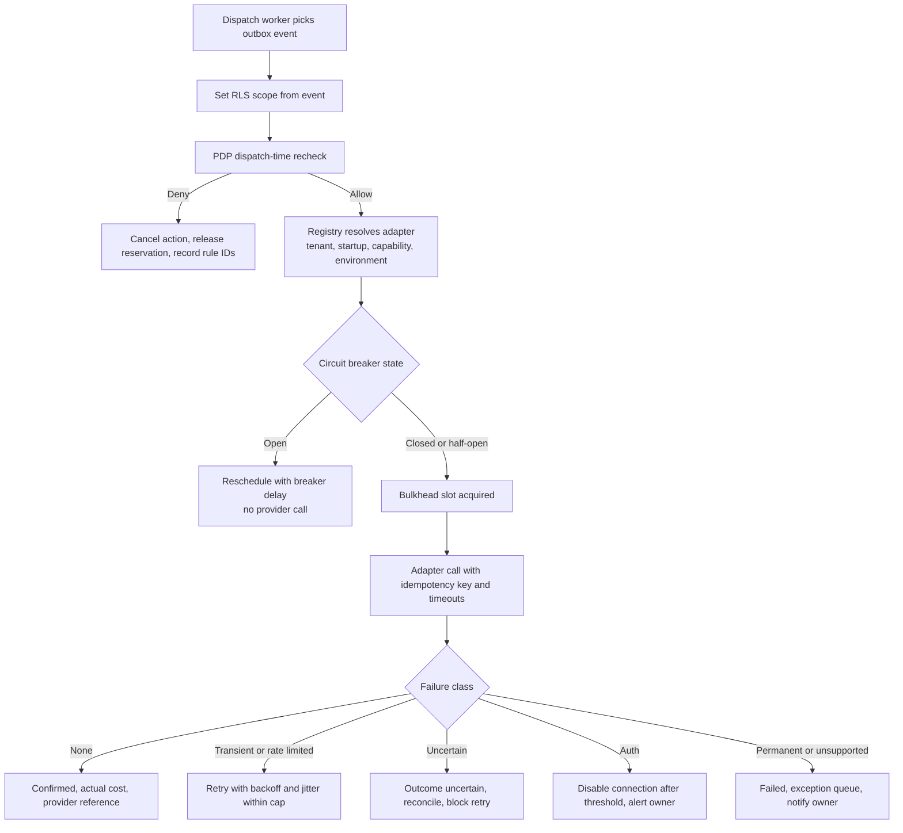
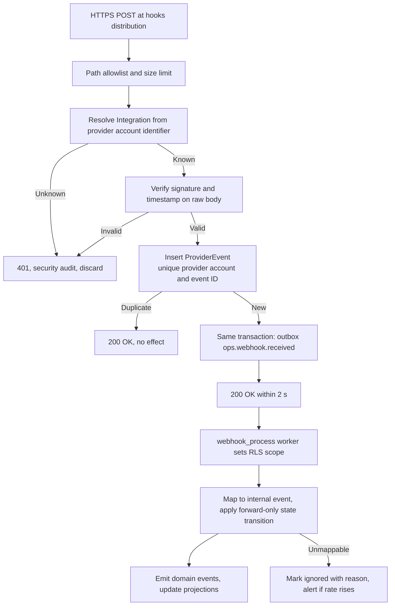

# AI Growth Engine: Employee Sales & Marketing Automation
## Application Blueprint: PART 3 (Batch 3.2), API and Integration Design: Standards, Derived API Catalogue, Event Catalogue, Adapter Catalogue, Contract Testing and Cross-Role Review

| Field | Value |
|---|---|
| Document | Part 3, Batch 2 of 3 (3.1 Architecture · **3.2 API and integration** · 3.3 Data architecture) |
| Version | 1.0 · 27 Nov 2026 |
| Baseline | BRD, FRD, Parts 0, 0A (DEC-001…065), 1, 2.1–2.5; companion Batches 3.1 and 3.3 |
| Roles applied | Solutions Architect (lead), Principal Engineer, Security/Compliance/AI Governance Lead, QA Lead, Data Architect/DBA, Lead UX Designer, FinOps Lead, Product Owner, DevOps/SRE Lead |
| Section numbering | `3.2.x` (batch-scoped, matching `3.1.x` and `3.3.x`) |
| Entity naming | Entity names follow Part 2.1 §2.2, the DERIVED entities of DEC-016 and the logical names fixed in Part 3.3 (ENT-001…199); entity structure is **detailed in Part 3.3** |
| Tags issued in this batch | RECOMMENDATION-031…034 (and -035, referenced from Batch 3.1) · ASSUMPTION-107, -108 · GAP-103, -105 · CONFLICT-103 · RSK-313…RSK-320 (register in §3.2.9) |

**Acronyms used in this batch.** API application programming interface · BFF Backend-for-Frontend · CSRF cross-site request forgery · DLQ dead-letter queue · ETag entity tag · HMAC hash-based message authentication code · JSON JavaScript Object Notation · OIDC OpenID Connect · OTP one-time password · PDP Policy Decision Point · RFC Request for Comments · RLS row-level security · SNS Amazon Simple Notification Service · SSRF server-side request forgery · WABA WhatsApp Business Account.

**Time-sensitive facts.** Provider quotas, prices, API versions, sandbox availability and signature schemes are **to verify at time of implementation (as of 27 Nov 2026)** [ASSUMPTION-108].

---

## 3.2.1 API design standards

### 3.2.1.1 Surfaces, namespaces and ingress

BRD §9 / FRD §8 require separate website and Admin ingress allowlists, retained legacy paths, new namespaces and default denial for any route not admitted to the website. Batch 3.1 (§3.1.3.2) implements this with three Django process groups that load **different URL configurations**.

| Namespace | Base path | Served by (process group) | Origin / distribution | Authentication | Who | Default caching | Source |
|---|---|---|---|---|---|---|---|
| `public` | `/api/v1/commercial/public/` | api-web | Website distribution (startup domains) | None, or signed token for token-bound actions; abuse controls | R18 (and R16/R17 when unauthenticated) | `no-store` except published read endpoints (`public, max-age=60` + ETag) | BRD §9 |
| `portal` | `/api/v1/commercial/portal/` | api-web | Website distribution | BFF-web session cookie (client `growth-website`) + object grants (ABAC-09) | R16, R17 | `private, no-store` | CA-PORTAL |
| `admin` | `/api/v1/commercial/admin/` | api-admin | Admin distribution | BFF-admin session cookie (client `growth-admin`) + RBAC/ABAC | R01–R15 | `private, no-store` | CA-ADMIN |
| `internal` | `/api/v1/commercial/internal/` and legacy `/api/v1/internal/` | api-hooks (private) | Not on any public distribution except the signed CI-evidence path | Workload identity (IAM-signed request or mTLS) | R19, R20 | none | FRD §8 "Internal / callback" |
| `hooks` | legacy `/api/v1/webhooks/{provider}` and `/api/v1/commercial/internal/webhooks/…` | api-hooks | Hooks distribution | Provider signature per §3.2.6.1 | Verified providers | none | FRD §5 |
| `bff-web`, `bff-admin` | `/bff/web/…`, `/bff/admin/…` | api-web / api-admin | Same origin as each SPA | OIDC state/nonce/PKCE; session cookie | Browsers | none | DEC-019 |
| **Legacy (FRD-named)** | `/api/v1/<FRD path>` (e.g. `/api/v1/deals`) | Mounted in the process group of its access class (catalogue column *NS*) | As per class | As per class | As per class | As per class | BRD §9 "retain canonical legacy method/path contracts" [ASSUMPTION-107] |

**Legacy path rules.** (1) The FRD lists most operations without a version prefix (e.g. `GET /deals`) but FR-OP001–003 use `/api/v1/…`; all legacy paths are therefore mounted under `/api/v1/` exactly as named, and the unprefixed `/health` and `/ready` are additionally served for load balancers [ASSUMPTION-107]. (2) A legacy path is mounted in exactly one ingress process group, except where the catalogue marks it `admin+portal` or `admin+internal`: it is then mounted twice with **separate serializer and permission classes** per ingress (BRD §9 "explicit serializer/permission classes"), never one shared view. (3) "Legacy token routes under /public/ are restricted portal endpoints" (BRD §9): `/api/v1/opt-out` and any token-bound `/public/` operation are classified `portal` in the catalogue and accept only signed, scoped, expiring tokens or a portal session. (4) CORS is **disabled** on every namespace; same-origin access through CloudFront path behaviours is the only browser path ("public origin CORS is not an authorization mechanism", BRD §9).

### 3.2.1.2 Resource and representation conventions

| Topic | Standard | Example |
|---|---|---|
| Style | Resource-oriented REST over HTTPS, JSON bodies (`application/json; charset=utf-8`); state transitions as **action sub-resources** with `POST` (ADR-022) | `POST ~/admin/orders/{id}/approve` |
| Paths | Lowercase, plural nouns, kebab-case segments; IDs are UUIDv7 strings (Part 3.3 RECOMMENDATION-036); no verbs except action sub-resources | `~/admin/negotiation-exceptions/{id}` |
| Fields | `snake_case`; booleans `is_…`/`has_…`; enums lowercase snake strings; unknown fields in requests → 400 (`additionalProperties: false`) | `"outcome_certainty": "uncertain"` |
| Money | `{"amount": "270.00", "currency": "INR"}`; amount is a decimal **string**; never float; server recomputes totals (CA-FIN) | FR-DM-01 |
| Quantity | `{"value": "2.000", "unit": "kg"}` with unit codes from reference data | FR-DM-03 |
| Time | RFC 3339 UTC with `Z`; user time zone as IANA name in a separate field; deadlines carry both | `"deadline_at": "2030-06-01T09:00:00Z", "deadline_tz": "Asia/Kolkata"` |
| Unknown vs zero | `null` with an explicit `*_status: "unknown"` where business meaning differs from zero (FR-UIS-02, RPT-R2) | `"score": null, "score_status": "unknown_review_required"` |
| Scope | Never in the URL or body for authorization; resolved from session membership. Responses include `scope` metadata for display | `"scope": {"tenant": "…", "startup": "…", "as_of": "…"}` |
| Revisions | Every mutable resource exposes `revision` (integer) and an `ETag` header `"r<revision>"` | `ETag: "r7"` |
| Hashes | Approval-bound objects expose `content_hash` (SHA-256 hex) of the canonical JSON or rendered PDF | CA-APPROVE |
| Field minimization | Serializers per namespace and role; masked values are returned as masked strings plus `masked: true`, never omitted silently (§2.26.5) | `"email": "a***@example.org"` |
| Simulation | Responses from simulation carry `"simulated": true`; simulated records are never returned by non-simulation list endpoints unless `include_simulated=true` (R11 only) | BRL-AUT-04 |
| Localization | User-facing text in errors and enums is returned as message keys + English default; the frontends localize (DEC-026) | `"title_key": "error.stale_revision"` |

### 3.2.1.3 Versioning and deprecation

| Rule | Detail |
|---|---|
| Major version in the path | `/api/v1/…`. A breaking change creates `/api/v2/…` for the affected namespace only; v1 and v2 run side by side for ≥ 6 months for public/portal and ≥ 1 release for admin (same team owns both clients) |
| Non-breaking changes within v1 | Adding optional request fields, response fields, enum values (clients must tolerate unknown enum values and show "Other"), new endpoints, new error codes |
| Breaking changes (need v2) | Removing/renaming fields or endpoints, changing types or semantics, tightening validation of existing fields, changing default sort or pagination semantics |
| Deprecation signalling | `Deprecation` and `Sunset` response headers (RFC 9745 and RFC 8594; verify final RFC numbers) plus `Link: <…>; rel="deprecation"`; usage of deprecated endpoints logged per client |
| Contract artefacts | OpenAPI 3.1 documents per namespace (`openapi/public.yaml`, `portal.yaml`, `admin.yaml`, `internal.yaml`, `hooks.yaml`) generated by drf-spectacular and committed; CI blocks breaking diffs (§3.2.5) |
| Event versioning | Separate from API versioning; see §3.2.3.2 (ADR-020) |
| Legacy contract retention | FRD-named paths (★ in §3.2.2) are frozen in v1 semantics; new behaviour goes to new derived operations |

### 3.2.1.4 Standard request and response headers

| Header | Direction | Required | Purpose | Source |
|---|---|---|---|---|
| `X-Request-Id` | Request (optional) / response (always) | Response: yes | Unique per HTTP request; generated by CloudFront Function or API if absent | CA-ALL |
| `X-Correlation-Id` | Both | Propagated | Ties a user action to jobs, provider calls and audit; returned on every response and problem document | CA-ALL, §2.34.2 |
| `Idempotency-Key` | Request | **Mandatory** on every `POST` that creates or changes state (except BFF and webhook routes, which use state/nonce or provider event IDs) | Exactly-once effect (§3.2.1.5) | FRD §5, NFR-015 |
| `If-Match` | Request | **Mandatory** on `PUT`/`PATCH`/`DELETE` and on action sub-resources acting on a revisioned object | Optimistic concurrency; stale → 409 (§3.2.1.8) | FRD §11.1, NFR-025 |
| `X-CSRF-Token` | Request | Mandatory on all unsafe methods from browsers | Double-submit token issued by `/bff/*/session` | ADR-005 |
| `X-Scope-Token` | Request | Mandatory on Admin calls | Opaque token of the active scope revision; if the user switched scope in another tab, the server returns 409 `SCOPE_CHANGED` and the client reloads (FR-STD-01, FR-UIS-01) | NFR-027 |
| `ETag` / `If-None-Match` | Both | Responses on GET of revisioned resources and lists | Conditional GET (304) for polling (ADR-034) | ADR-034 |
| `RateLimit-Policy`, `RateLimit`, `Retry-After` | Response | On rate-limited classes; `Retry-After` on 429/503 | Client back-off (IETF RateLimit header fields draft; verify) | §3.2.1.7 |
| `Location` | Response | 201 and 202 | Created resource or run status URL | FRD §5 |
| `Cache-Control` | Response | Always | Per namespace defaults (§3.2.1.1) | Batch 3.1 §3.1.11 |
| `Content-Security-Policy`, `Strict-Transport-Security`, `X-Content-Type-Options`, `Referrer-Policy`, `Permissions-Policy` | Response | Always (set at CloudFront) | Browser hardening | NFR-001 |

### 3.2.1.5 Idempotency keys with body hash

| Rule | Specification |
|---|---|
| Key format | Client-generated UUIDv4/v7 or ≥ 22-character random string; one key per user intent (a retried click reuses it; a new intent gets a new key) |
| Storage | IdempotencyKey (Part 3.3 ENT-171): unique on tenant, startup, `scope_key` (operation ID + actor) and `key_value`; stores `body_hash` (SHA-256 of the canonical JSON body: keys sorted, insignificant whitespace removed, numbers as strings), response status and response reference (ADR-023) |
| Same key, same body, completed | Return the stored response with header `Idempotent-Replayed: true` |
| Same key, same body, in progress | 409 `REQUEST_IN_PROGRESS` with `Retry-After: 2` |
| Same key, different body | 409 `IDEMPOTENCY_KEY_REUSED` (rule `NFR-015`) |
| Missing key on a mandatory route | 400 `IDEMPOTENCY_KEY_REQUIRED` |
| Replay window | 24 h for Admin/portal calls; 7 days for public intake (W12–W20, W32) and webhooks; rows retained 35 days (Part 3.3) |
| Public intake semantics | The intake key is derived client-side per form session; the server additionally dedupes leads by `dedupe_key` (Part 3.3 UQ-DUP-01) so a different key with the same person and purpose within the dedup window still yields **one lead** (CA-INTAKE, M22) |
| Provider calls | Each external action gets a deterministic provider idempotency key = the platform's action ID (message ID, booking ID, payment-link reference); where the provider supports client keys (e.g. client-specified calendar event IDs, payment-link reference IDs) it is sent; otherwise see §3.2.6.3 |
| Workers and consumers | Every consumer checks IdempotencyKey with `scope_key = consumer:<name>` and `key_value = event_id` inside the same transaction as its effect |

### 3.2.1.6 Pagination, filtering and sorting

| Topic | Standard | Source |
|---|---|---|
| Pagination | Cursor-based only. Request `?limit=` (default 25, max 100; exports use async jobs) and `?cursor=` (opaque, signed, encodes sort key + ID + filter hash + scope token). Response `{ "data": [...], "page": { "next_cursor": "...", "prev_cursor": "...", "limit": 25 }, "meta": { "as_of": "...", "total_estimate": 1234, "total_exact": false } }`. A cursor used with different filters or scope → 400 `CURSOR_MISMATCH` | FRD §5, FR-FLT-RULES |
| Stable sort | Every sort ends with `id` as tie-breaker (UUIDv7 is time-ordered) | FR-FLT-RULES |
| Filter syntax | `?filter[field]=value`, multi-select `?filter[stage]=proposal,negotiation` (**OR within a field**), multiple fields combined with **AND**; ranges `?filter[amount][gte]=…&filter[amount][lte]=…` with currency required for money ranges; `?filter[score_status]=unknown` selects Unknown distinctly from zero | FR-FLT-RULES, RPT-R2 |
| Allowlists | Each list endpoint declares its filterable and sortable fields in OpenAPI (`x-filter-allowlist`); any other parameter → 400 `FILTER_NOT_ALLOWED`. Values are validated (enum membership, range, ISO currency, unit code) | FRD §5 |
| Scope filters | FR-FLT-01 hierarchy (tenant → startup → business line → offering/objective → opportunity type) is applied from the session scope; child filters that no longer apply after a scope change are rejected with 400 `FILTER_OUT_OF_SCOPE` so the UI resets them (FR-UIS-01) | FR-FLT-01 |
| Search | `?q=` full-text where declared; minimum 2 characters; results never exceed the caller's permitted fields | DEC-037 |
| Counts | Exact counts only where cheap (≤ 10,000 rows); otherwise `total_estimate` labelled as estimate | RPT-R1 |
| Saved views | Stored filter + sort + columns; re-validated against the allowlist and the viewer's permissions when loaded | SR-03 |

### 3.2.1.7 Rate limits [RECOMMENDATION-032]

Part 2.4 §2.35.3 fixes four defaults (per user 600/min, per tenant 3,000/min Admin, public intake per IP 30/min, per startup site 600/min). The classes below keep those values and add the classes the catalogue needs. Limits are token buckets in Valkey (ADR-035); a 429 response carries a problem document, `Retry-After` and `RateLimit` headers. All values are configurable per plan (DEC-047) and only tightened by tenants.

| Class | Applies to | Limits (default) | Key | On exceed | Source |
|---|---|---|---|---|---|
| RL-PUB-R | Public reads hitting the origin (search, slots, forms, events, plans) | 120/min per IP hash; 600/min per startup site | IP hash, host | 429 | §2.35.3 (site), RECOMMENDATION-032 (IP) |
| RL-PUB-W | Public intake and token-bound actions (leads, RFQ, applications, bookings, opt-out, privacy, referrals, beacons) | **30/min per IP hash**, 600/min per startup site, 5/min per IP per form, payload ≤ 64 KB; challenge after 3 submissions in 10 min from one IP (ADR-043) | IP hash, host, form | 429 + challenge | §2.35.3, NFR-022 |
| RL-CHAT | Website assistant | 10 messages/min and 60/day per chat session; 30/min per IP hash; per-startup daily AI budget for chat (hard stop → handover message) | Session, IP hash, startup | 429 + "talk to a person" | FR-W11, BRL-AI-08 |
| RL-AUTH | BFF login/callback/step-up, registration, OAuth callbacks | 10/min per IP hash; 5 failures per account per 15 min → IdP lockout policy | IP hash, account | 429 | NFR-003 |
| RL-PORTAL | Portal APIs | 120/min per user; 1,000/min per tenant | User, tenant | 429 | RECOMMENDATION-032 |
| RL-ADM | Admin APIs | **600/min per user; 3,000/min per tenant** | User, tenant | 429 | §2.35.3 |
| RL-ADM-H | Heavy Admin operations (AI generation, simulations, exports/imports, evals, recomputes, uploads) | 10/min per user; 60/min per tenant; ≤ 3 concurrent per tenant | User, tenant | 429 (or queued with 202 when the job is async) | §2.35.3 "large exports async" |
| RL-HOOK | Provider webhooks | 1,000/min per connection; 10 MB/min; bodies ≤ 1 MB | Connection | 429 only above ceiling (providers retry); alarm at 50% | FRD §5 |
| RL-INT | Internal service endpoints | No per-minute limit; concurrency per tenant (BRL-AUT-06) and budget caps | Service, tenant | 503 + `Retry-After` | BRL-AUT-06 |
| RL-HEALTH | `/health`, `/ready` | Unlimited; responses cached 5 s | — | — | FR-OP002/003 |

**Shared-IP caution.** Schools, hospitals and FPO offices often share one public IP (RSK-317). Public intake therefore limits by IP hash **and** by form session, uses challenges rather than hard blocks for the first threshold, and lets a startup raise its site-level limit for a scheduled event (audited).

### 3.2.1.8 Concurrency control: revisions and ETags

| Rule | Detail | Source |
|---|---|---|
| Every mutable resource has `revision` | Incremented on every committed change (Part 3.3 §3.3.5.5) | NFR-017 |
| Writes require `If-Match` | `PATCH ~/admin/quotes/{id}` with `If-Match: "r7"`; current revision ≠ 7 → **409 `STALE_REVISION`** with `current_revision` and a link to compare (FR-STD-03) | FRD §11.1 |
| Approvals bind to hash, not only revision | An approval is valid only for the `content_hash` it approved; any change creates a new revision and **voids** pending approvals (CA-APPROVE) | BRL-APR-02 |
| Publication pointer | Publish/rollback require the expected current publication revision; concurrent change → 409 `PUBLICATION_MOVED` (FR-PUB-01) | FRD §8.1 |
| Lists | List ETag = hash of (scope token, filter hash, max(updated_at, revision) of page); polling clients get 304 when nothing changed (ADR-034) | ADR-034 |
| Never silently overwrite approved state | Approved/immutable rows reject updates at database level (Part 3.3 §3.3.5.9); API returns 409 `IMMUTABLE_RECORD` | NFR-018 |

### 3.2.1.9 Error model (RFC 9457 problem details with rule IDs)

All errors use `Content-Type: application/problem+json`.

```json
{
  "type": "https://errors.growth-engine.example/policy-denied",
  "title": "Action blocked by policy",
  "status": 403,
  "code": "POLICY_DENIED",
  "detail": "The contact has opted out of email for this startup.",
  "title_key": "error.policy_denied",
  "rule_ids": ["BRL-ELG-02"],
  "reasons": [{"rule_id": "BRL-ELG-02", "message_key": "eligibility.suppressed", "field": null}],
  "policy_revision": "gov_policy_version:42",
  "required_approval": null,
  "errors": [],
  "request_id": "0193b1c2-…",
  "correlation_id": "0193b1c2-…",
  "retryable": false,
  "docs": "https://docs.growth-engine.example/errors/POLICY_DENIED"
}
```

| Field | Meaning |
|---|---|
| `type`, `title`, `status`, `detail` | RFC 9457 members; `detail` is safe to show (never reveals data outside scope) |
| `code` | Stable machine code from the catalogue below |
| `rule_ids` / `reasons` | Business rule IDs (BRL-…, DEC-…, NFR-…) that caused a denial; FR-UIS-03 "show the exact approval requirement" |
| `required_approval` | For `APPROVAL_REQUIRED`: approver role(s), threshold and policy revision (DEC-038) |
| `errors` | Field-level validation errors: `[{ "field": "lines[1].discount_pct", "code": "max_exceeded", "message_key": "…", "limit": "10.00" }]` |
| `retryable` | Whether the same request may be retried later (true for 429/503) |

**Error code catalogue (stable codes).**

| Code | HTTP | When | Typical rule IDs |
|---|---|---|---|
| `VALIDATION_FAILED` | 400 | Schema, type, range, enum, unit or currency errors | NFR-015 |
| `IDEMPOTENCY_KEY_REQUIRED` | 400 | Missing key on a mutating route | NFR-015 |
| `FILTER_NOT_ALLOWED`, `FILTER_OUT_OF_SCOPE`, `CURSOR_MISMATCH` | 400 | Filter/pagination misuse | FR-FLT-RULES |
| `AUTHENTICATION_REQUIRED`, `SESSION_EXPIRED` | 401 | No or expired session | DEC-019 |
| `WRONG_AUDIENCE` | 401 | Token for another product audience/client | DEC-058, NFR-003 |
| `STEP_UP_REQUIRED` | 401 | MFA older than allowed for the action | ABAC-11 |
| `FORBIDDEN` | 403 | Role or ABAC denies a visible resource action | ABAC-01…12 |
| `PORTFOLIO_READ_ONLY` | 403 | Mutation attempted with more than one startup in scope | DEC-055, ABAC-06 |
| `POLICY_DENIED` | 403 | PDP deny (consent, suppression, jurisdiction, quiet hours, caps, capability, environment) | BRL-ELG-*, DEC-029 |
| `APPROVAL_REQUIRED` | 403 | Action needs approval of the current hash | CA-APPROVE, DEC-038 |
| `SEPARATION_OF_DUTIES` | 403 | Approver is author, or checker is maker | BRL-APR-01, BRL-APR-07 |
| `AUTONOMY_CAP` | 403 | Requested mode exceeds DEC-064 cap or actor is AI on an L1-capped action | DEC-064, BRL-AI-07 |
| `EMERGENCY_STOP_ACTIVE` | 403 | Scope is stopped | BRL-AUT-05 |
| `ENTITLEMENT_EXCEEDED` | 403 | Plan entitlement does not include the action | ABAC-10, BRL-SVC-03 |
| `NOT_FOUND` | 404 | Object does not exist **or is outside scope** (uniform 404) | FRD §5 |
| `UNKNOWN_HOST` | 404 | Public host not mapped to a startup | CA-PUB |
| `STALE_REVISION` | 409 | `If-Match` mismatch | FR-STD-03 |
| `SCOPE_CHANGED` | 409 | `X-Scope-Token` no longer current | FR-STD-01 |
| `INVALID_TRANSITION` | 409 | State machine forbids the transition | §2.27 |
| `IDEMPOTENCY_KEY_REUSED`, `REQUEST_IN_PROGRESS` | 409 | Idempotency conflicts | NFR-015 |
| `DUPLICATE` | 409 | Business duplicate (e.g. fulfilment event key, payment allocation) | FR-DM-03, BRL-FIN-02 |
| `OUTCOME_UNCERTAIN` | 409 | Retry requested while the prior outcome is uncertain | FR-STD-02, BRL-AUT-07 |
| `DEADLINE_PASSED` | 409 | Bid submission at/after deadline minus buffer | FR-DM-02 |
| `OVER_DELIVERY` | 409 | Fulfilment exceeds ordered quantity | FR-DM-03 |
| `APPROVAL_EXPIRED`, `APPROVAL_VOIDED` | 409 | Approval no longer valid | CA-APPROVE |
| `PUBLICATION_MOVED`, `IMMUTABLE_RECORD` | 409 | Pointer or immutable conflicts | FR-PUB-01, NFR-018 |
| `PAYLOAD_TOO_LARGE` | 413 | Body or upload above limit | NFR-022 |
| `UNSUPPORTED_MEDIA_TYPE` | 415 | Content type not allowed | — |
| `RATE_LIMITED` | 429 | Rate-limit class exceeded | §3.2.1.7 |
| `BUDGET_EXHAUSTED` | 429 | AI/provider budget cap reached (hard stop) | BRL-AI-08, NFR-014 |
| `QUOTA_EXHAUSTED` | 429 | Provider or plan quota reached | FR-OP001 |
| `PROVIDER_UNAVAILABLE` | 503 | Transient provider error; circuit open | FRD §5 |
| `DEPENDENCY_UNAVAILABLE` | 503 | Database/broker unavailable (readiness false) | FR-OP003 |
| `INTERNAL_ERROR` | 500 | Unexpected error (no detail leaked; Sentry event ID returned) | — |

### 3.2.1.10 Status codes (FRD §5)

| Code | Use in this product | Never used for |
|---|---|---|
| 200 OK | Successful read; successful synchronous action with a body; idempotent replay | Accepted-but-not-done async work |
| 201 Created | Resource created synchronously (`Location` header) | Async creations |
| 202 Accepted | Asynchronous work accepted: anything with SE class Q or X, plus approvals that trigger effects. Body: `{ "run_id", "status_url", "state": "queued" }` | Completed external effects |
| 204 No Content | Deletes and acknowledgements without body | — |
| 304 Not Modified | Conditional GET | — |
| 400 | Validation and request-format errors | Authorization failures |
| 401 | Missing/expired session, wrong audience, step-up required | Policy denials |
| 403 | Authorization or policy denial on a resource the caller may know exists | Hidden resources (use 404) |
| 404 | Missing or out-of-scope resource (uniform), unknown public host | — |
| 409 | Stale revision, duplicate mismatch, invalid transition, uncertain outcome, deadline, approval invalid | Validation errors |
| 413 / 415 | Size and media type | — |
| 429 | Rate limits, budget and quota exhaustion | Provider outages |
| 503 | Transient provider or dependency failure (`Retry-After`) | Permanent provider rejection (→ 202 run ends Failed; reported on the run) |

### 3.2.1.11 Asynchronous operations and run resources

Operations with side-effect class **Q** or **X** return **202** with a run reference. Runs are WorkflowRun/JobRun projections exposed at `GET ~/admin/runs/{id}` (Admin) or embedded status endpoints (portal/public, e.g. `GET ~/public/applications/{ref}/status`). Run states: `queued → running → (waiting) → succeeded | failed | cancelled | uncertain → reconciled_confirmed | reconciled_failed` (DEC-050). Clients poll with `If-None-Match` (ADR-034). A run never reports `succeeded` for an external action until the provider confirmed it; `uncertain` blocks retry until reconciled (FR-UIS-04).

### 3.2.1.12 API security controls

| Control | Specification | Source |
|---|---|---|
| Authentication | BFF session cookie (`HttpOnly; Secure; SameSite=Strict`, host-only, `__Host-` prefix); no bearer tokens accepted from browsers; internal calls use IAM-signed requests or mTLS | DEC-019, ADR-005 |
| Authorization order | Session → audience/client check → membership/scope → RBAC (role) → ABAC (assignment, SoD, threshold, classification, portfolio, grants, capability, entitlement, MFA freshness, environment) → object-level check → PDP for external actions | §2.26, NFR-002 |
| Uniform 404 | Unauthorized objects return 404 with identical timing envelope (no existence oracle) | FRD §5 |
| CSRF | Double-submit token + `SameSite=Strict` + `Origin` header check on unsafe methods | ADR-005 |
| Input limits | Body ≤ 1 MB (Admin), ≤ 64 KB (public), JSON depth ≤ 20, arrays ≤ 1,000 items, strings ≤ declared max; uploads only via presigned S3 POST to quarantine with type/size policy | NFR-021, NFR-022 |
| Output | Serializer field masks; no secrets ever (NFR-004); no stack traces | §2.26.5 |
| Mass assignment | Explicit writable-field allowlists per serializer; server-owned fields (`tenant_id`, `startup_id`, `status`, `amount` totals, `approved_*`) are read-only | CA-FIN |
| SSRF | Any URL accepted from users (sources, research, webhooks registration) is fetched only by the extractor in its own network segment with private-range, link-local and metadata-endpoint (169.254.169.254, IMDSv2 hop limit 1) blocking and an egress allowlist per source policy | BR-M07, RSK-305 family |
| Prompt injection | Evidence and inbound text are untrusted data; passed to models inside data-only delimiters, never as instructions; tool registry has no consequential tools (Part 7) | BRL-AI-05/07 |
| Logging | Request logs exclude bodies and personal data; IP stored hashed for external users | §2.34.2 |
| Admin route isolation test | CI enumerates the `api-web` URL map and fails if any admin or internal route is present | NFR-001 |

### 3.2.1.13 Webhook security model

Inbound webhooks (all `hooks` operations) follow one model; provider specifics are in §3.2.6.1.

| Step | Rule |
|---|---|
| 1. Transport | HTTPS only through the hooks distribution; path allowlist per provider; body size ≤ 1 MB; no cookies; CORS disabled |
| 2. Authenticity | Verify the provider signature over the **raw body** with constant-time comparison (HMAC-SHA256 or provider certificate signature); unknown connection or invalid signature → 401, security audit event, payload discarded |
| 3. Freshness | Reject timestamps outside ± 5 minutes where the provider signs a timestamp; otherwise rely on event-ID dedupe |
| 4. Scope resolution | Map the provider account/connection identifier to exactly one Integration (and thus tenant/startup); never trust scope fields in the payload |
| 5. Dedupe | Insert ProviderEvent with UNIQUE (provider account, provider event ID); duplicate → 200 with no effect (NFR-005) |
| 6. Persist-then-ack | Persist a minimal event (`payload_min`, digest) and an outbox row in one transaction; respond 2xx within 2 s; processing is asynchronous |
| 7. Secret management | Webhook secrets in Secrets Manager per connection; rotation supports two active secrets during overlap |
| 8. Replay | Sandbox replay only (A109), never re-executing live side effects (BRL-AUT-08) |
| 9. Monitoring | Signature-failure rate and dedupe rate alarms per provider; webhook health shown in A008 |
| Outbound webhooks to tenants | **Not offered** in W0–W6 (no requirement in the baseline). If added later, the same HMAC model applies in reverse with per-tenant secrets |

### 3.2.1.14 Documentation, SDKs and developer experience

| Item | Standard |
|---|---|
| OpenAPI | One document per namespace, generated, committed, versioned; every operation carries `operationId` = catalogue Op ID (e.g. `API-262`), tags by domain, `x-side-effect-class`, `x-pdp`, `x-rate-limit-class`, `x-fr` |
| Client generation | TypeScript clients generated per namespace into `packages/api-client` (the website build only includes `public` and `portal` clients) |
| Examples | Every operation has at least one success and one denial example; examples double as contract test fixtures (§3.2.5) |
| Error docs | One page per error code with user-facing remedy text keys |
| Changelog | Per namespace, generated from OpenAPI diffs; deprecations listed with sunset dates |

---

## 3.2.2 Derived API catalogue (DERIVED, DEC-015)

### 3.2.2.1 How the catalogue was built

| Step | Method | Result |
|---|---|---|
| 1 | Extracted every method/path named in FRD §6 module specifications and FRD §11 (FR-OP001–003) | **102 distinct named entries** (105 textual occurrences minus 3 duplicates: `/health` = `/api/v1/health`, `/ready` = `/api/v1/ready`, `/internal/ai/run` = `/api/v1/internal/ai/run`). Two entries are written `GET/POST` (`/deals`, `/organizations`), so they are **104 HTTP operations** |
| 2 | Kept every one of them with its original path (marked ★), classified into an ingress namespace | 104 ★ operations |
| 3 | Walked all **147 screens'** key actions (Part 2.5 §2.43) and every FR operation (Part 2.1 §2.4), module catalogue operations and triggers (Part 2.1 §2.2), process flows (Part 2.2) and state machines (Part 2.3) | Missing operations added as DERIVED under `/api/v1/commercial/{public,portal,admin,internal}/` |
| 4 | Consolidated per-object submit/approve/reject actions into one **Approval** resource (`POST ~/admin/approvals`, legacy `POST /api/v1/admin/approvals/{id}/decide`), because CA-APPROVE, A089 and A106 need one queue, one hash-binding rule and one separation-of-duties check | 48 per-object approval operations removed; approval object types listed in §3.2.2.3 |
| 5 | Coverage check: every screen W01–W34 and A001–A113 appears in at least one operation's *FR / screen* column; every module M01–M66 is reached through its screens and its FRD-named operations | **147 / 147 screens, 66 / 66 modules, 104 / 104 FRD operations covered** |

**Final count: 555 operations** = 104 FRD-named (★) + 451 DERIVED, in 19 domain groups (§3.2.2.5).

**Reconciliation with "302 retained + 19 candidate" (BRD §9) — CONFLICT-103 and GAP-103.** The source states a retained baseline of 302 *API/adapter* operations plus 19 candidate HTTP operations, but the 302-operation catalogue itself was not supplied (GAP-103); Part 0A DEC-015 also refers to "105 named operations", whereas the FRD text yields 102 distinct named entries (CONFLICT-103: the 105 includes three duplicate spellings). The derived catalogue is larger than 321 because it (a) enumerates every screen action of all 147 interfaces, including the nine added interfaces (W31–W34, A109–A113) that post-date the retained count, as explicit operations; (b) counts list and detail reads separately; (c) includes BFF and portal operations required by DEC-019 and CA-PORTAL; and (d) counts adapter operations separately in §3.2.4 rather than as HTTP endpoints. When the original catalogue is supplied, a mapping table (original ID → API-###) will be added and any original operation without a match becomes a candidate addition (DEC-015).

### 3.2.2.2 Column legend

| Column | Values |
|---|---|
| Op ID | `API-###` sequential in this batch; **★ = FRD-named path retained exactly** (legacy contract, BRD §9); all others DERIVED |
| Path | `/api/v1/…` = legacy FRD path; `~/` = `/api/v1/commercial/`; `/bff/…` = BFF routes (not versioned) |
| NS | Ingress namespace / process group (§3.2.1.1): `public`, `portal`, `admin`, `internal`, `hooks`, `bff-web`, `bff-admin`; `a+b` = mounted in both with separate serializers |
| FR / screen | Functional requirement(s) and screen(s) served (Part 2.1, Part 2.5) |
| Auth / roles | Roles from Part 2.3 §2.26 (R01–R20); "(assigned)", "(grant)", "(own)" per ABAC-02/09; "(≠ author)" per BRL-APR-01. Field masks per §2.26.5 always apply |
| Idempotent | **Safe** = GET; **Key** = `Idempotency-Key` + body hash required; **If-Match** = revision precondition required; **Event ID** = provider event dedupe; **State/nonce** = OIDC state; **Yes** = idempotent by method |
| SE (side-effect class) | **R** read only · **W** internal write (state + audit, no outbox side effect beyond notifications) · **Q** internal write that queues asynchronous internal work (202) · **X** external side effect (send, publish, book, launch, sign request, payment link, provider fetch) through outbox + dispatch · **A** approval or decision bound to a hash (immutable record) · **F** financial, consent or evidence record appended to an immutable ledger · **I** inbound ingestion from a public user or provider (persist-then-process) · **S** session/authentication |
| PDP | **—** RBAC/ABAC only · **P** plan-time PDP decision (eligibility, entitlement, budget, autonomy, approval validity) · **D** dispatch-time PDP recheck only (scheduled or provider-side stop actions) · **P+D** both (every X operation that starts an external effect) |
| RL class | Rate-limit class from §3.2.1.7 |

### 3.2.2.3 Approval object types handled by the Approval resource

Every approval below is created with `POST ~/admin/approvals` (object type, object ID, revision) and decided with `POST /api/v1/admin/approvals/{id}/decide` (★, M61). Four FRD-named type-specific approve routes are retained as aliases that create and decide the same Approval record: `POST /api/v1/admin/claims/approve`, `POST /api/v1/content/{id}/approve`, `POST /api/v1/campaigns/{id}/approve`, `POST /api/v1/quotes/{id}/approve`.

| Approval type | Object (entity) | Screen(s) | Approver(s) (DEC-038, §2.26) | Effect handler on approval | Rule |
|---|---|---|---|---|---|
| `offering_version` | OfferingVersion | A004 | R02 (R01 for new business line) | Version becomes current; snapshot candidates flagged | DEC-060 |
| `price_version` | PriceVersion | A004 | R08 + R01 | Price usable in quotes | CA-FIN |
| `claim` | Claim | A051 | R10 (claims), R02 | Claim usable in content and snapshots | BRL-MKT-03 |
| `knowledge_document` | Document version | A006 | R02 or R10 | Indexing enqueued | BR-M03 |
| `source` / `social_source` / `market_monitor` | Source / SourcePolicy | A010, A049, A086 | R10 | Collection allowed within scope | BR-M07 |
| `scoring_model` | ScoringModel | A023 | R02 (after simulation) | Becomes active for new scores | DEC-011 |
| `pipeline_config` | Pipeline, Stage rules | A030 | R02 (R01 for a new pipeline type) | Applies to new deals | CFG-11 |
| `form_version` | FormVersion | A031 | R02 | Publishable to site | CFG-12 |
| `message_template` | MessageTemplate | A035, A044 | R05L/R02 (+R10 claims) | Usable in drafts; WhatsApp submission to provider | CFG-13 |
| `message_draft` | MessageDraft | A034 | R02 or R05L (≠ author); L3 pre-approved FAQ replies excluded per DEC-064 | Queue allowed (dispatch still rechecked) | CA-APPROVE |
| `sequence` | Sequence | A039 | R02 | Enrolments allowed | CFG-14 |
| `faq` / `routing_rule` | FAQ entry / RoutingRule | A046 | R02 + R10 (FAQ) | Assistant and routing use new revision | CFG-16 |
| `content_version` | ContentVersion | A051 | R05L, R02, R10 (claims) | Schedulable for publishing | BR-M34 |
| `landing_page` / `site_page` | LandingPage revision | A057, A108 | R05L or R02 (≠ author); R10 privacy review | Publication allowed | BRL-PUB-01 |
| `campaign_version` | CampaignVersion + budget reservation | A059 | R05L + R02; spend above cap R01 | Launch allowed within reserved budget | BR-M38 |
| `referral` | Referral | A064 | R02 | Opportunity created; commission recorded only | DEC-046 |
| `proposal_version` | ProposalVersion | A066 | R02 (≠ author); R01 above thresholds | Deliverable to portal | BR-M43 |
| `quote` | Quote (discount, margin) | A068 | > 0% R03L; > 10% R02; > 20% or below margin floor R01 + R08 | Deliverable to portal | DEC-038 |
| `negotiation_exception` | Negotiation exception (approve/reject; a counter-proposal uses `~/admin/negotiation-exceptions/{id}/decide`) | A070 | R02, R01, R10 (non-standard terms) | Concession allowed | BR-M45 |
| `contract_legal` | Contract version | A072 | R10; + R01 if ≥ ₹10 lakh or cross-border | Signature request allowed | DEC-038 |
| `bid_submission` | Bid package | A104 | R02 (+R10 legal) | Human submission may be recorded | DEC-053 |
| `order` | Order | A105 | R02 | Inventory reserved; issue allowed | DEC-045 |
| `pilot_readiness` / `insurance_pilot` | Pilot | A078, A092 | R01/R02 (≠ requester); R10 for data agreement | Stage transition allowed | BR-M49, BR-M63 |
| `licensing_scope` | IntegrationDeal | A094 | R01 + R10 | Entitlements provisioned | BR-M64 |
| `deployment_readiness` | Deployment | A096 | R01 + R10 | Site activation allowed | BR-M65 |
| `launch` | LaunchApproval | A098 | R01 + R10 | Offering promotable | BR-M66 |
| `metric_definition` / `forecast_model` | MetricDefinition / forecast settings | A083, A088 | R01 (+R09 metric) | New definition active | BR-M52, BR-M60 |
| `prompt_version` / `ai_route` | PromptVersion / route | A011 | R01 or R11 (≠ author) after eval gate | Active for new runs | BRL-AI-09 |
| `workflow_revision` / `autonomy_plan` / `workflow_template` | WorkflowRevision, AutonomyPlan, WorkflowTemplate | A033, A102, A113 | R02 (L2), R01 (L3) | Enable/start allowed | DEC-064, CFG-27 |
| `business_template` / `config_revision` | Business template / ConfigRevision | A100, A112 | R01 (loosening), R02/R12 (tightening) | Scheduled activation | BRL-APR-11 |
| `plan_version` / `subscription_change` | PlanVersion / ServiceSubscription | A101 | R01 (Service Owner) | Rates/entitlements active | DEC-047 |
| `client_application` | ApplicationDraft | A099 (W32/W33 source) | Platform R01/R12 | Idempotent provisioning saga | FRD §16.3 |
| `import` / `export` | ImportJob / ExportJob | A103 | R01; R10 for Restricted data | Job may run / link may be issued | DEC-039 |
| `support_access` | SupportAccessGrant | A099 | R12 of the tenant | Grant active ≤ 72 h | DEC-056 |

### 3.2.2.4 Catalogue tables

Operation IDs are stable once published; deleted operations leave gaps. `{id}` parameters are UUIDv7 unless named otherwise (`{ref}`, `{token}` are opaque, signed and expiring).


#### Identity, session and BFF (M01; DEC-019)

| Op ID | Method | Path | NS | Purpose | FR / screen | Auth / roles | Idempotent | SE | PDP | RL class |
|--------|-----|--------------------|-----|------------------------|-----------|------------|------|---|---|-------|
| API-001 ★ | POST | `/api/v1/auth/login` | bff | Legacy login entry; delegated to BFF OIDC start (no password handled by this product) | FR-A001, FR-W21; A001, W21 | Anonymous (R18) | State/nonce | S | — | RL-AUTH |
| API-002 ★ | GET | `/api/v1/me` | admin+portal | Current user, permitted navigation, active scope, capability flags | FR-A001, FR-A003; A003 | Any authenticated | Safe | R | — | RL-ADM |
| API-003 | GET | `/bff/admin/login` | bff-admin | Start OIDC code + PKCE for client growth-admin | FR-A001; A001 | Anonymous | Safe | S | — | RL-AUTH |
| API-004 | GET | `/bff/admin/callback` | bff-admin | Exchange code, validate tokens, create server-side session, set cookies | FR-A001 | Anonymous (state-bound) | Safe | S | — | RL-AUTH |
| API-005 | GET | `/bff/admin/session` | bff-admin | Session status, CSRF token, feature-flag map, MFA age | FR-A001, FR-A003 | Authenticated admin | Safe | R | — | RL-ADM |
| API-006 | POST | `/bff/admin/step-up` | bff-admin | Start MFA step-up (max_age/acr) before approvals (ABAC-11) | CA-APPROVE; A068, A072 | Authenticated admin | State/nonce | S | — | RL-AUTH |
| API-007 | POST | `/bff/admin/logout` | bff-admin | End session, revoke refresh token, IdP end-session | FR-A001 | Authenticated admin | State/nonce | S | — | RL-AUTH |
| API-008 | GET | `/bff/web/login` | bff-web | Start OIDC for client growth-website (portal, SaaS client) | FR-W21; W21 | Anonymous | Safe | S | — | RL-AUTH |
| API-009 | GET | `/bff/web/callback` | bff-web | Code exchange; portal session cookie | FR-W21 | Anonymous (state-bound) | Safe | S | — | RL-AUTH |
| API-010 | GET | `/bff/web/session` | bff-web | Portal session status and CSRF token | FR-W21, FR-W22 | R16, R17 | Safe | R | — | RL-PORTAL |
| API-011 | POST | `/bff/web/step-up` | bff-web | Identity re-verification before signing (FR-W24) | FR-W24; W24 | R16 | State/nonce | S | — | RL-AUTH |
| API-012 | POST | `/bff/web/logout` | bff-web | End portal session | FR-W21 | R16, R17 | State/nonce | S | — | RL-AUTH |
| API-013 | POST | `~/portal/registrations` | portal | External registration (invite or self) delegated to IdP with product audience; terms revision recorded | FR-W21; W21 | R18 → R16 | Key | W | — | RL-AUTH |
| API-014 | GET | `~/admin/me/scopes` | admin | Authorized tenant → startup → business line directory for scope selector | FR-A003, FR-FLT-01; A003 | Any admin | Safe | R | — | RL-ADM |
| API-015 | PUT | `~/admin/me/scope` | admin | Switch active scope; server re-authorizes; returns cleared-cache instruction | FR-A003, FR-STD-01, FR-UIS-01 | Any admin | If-Match | W | — | RL-ADM |
| API-016 | GET | `~/admin/saved-views` | admin | List saved views scoped to user/product/tenant/startup | SR-03; all LP-LIST screens | Any admin | Safe | R | — | RL-ADM |
| API-017 | POST | `~/admin/saved-views` | admin | Create or update a saved view (re-evaluated under viewer permissions) | SR-03 | Any admin | Key | W | — | RL-ADM |
| API-018 | DELETE | `~/admin/saved-views/{id}` | admin | Delete own saved view | SR-03 | Owner | Yes | W | — | RL-ADM |
| API-019 | GET | `~/admin/users` | admin | List users with roles, grants, MFA status, expiry | FR-A002; A002 | R01, R02 (startup), R10, R12, R15 | Safe | R | — | RL-ADM |
| API-020 | POST | `~/admin/users/invitations` | admin | Invite user with role, team, startup grants, expiry | FR-A002 | R12 (R02 for own startup) | Key | Q | — | RL-ADM |
| API-021 | PATCH | `~/admin/users/{id}/grants` | admin | Change role/startup grants; invalidates permission cache | FR-A002 | R12 | If-Match | W | — | RL-ADM |
| API-022 | POST | `~/admin/users/{id}/revoke` | admin | Revoke membership and all sessions (≤ 60 s) | FR-A002, NFR-003 | R12, R01 | Key | W | — | RL-ADM |
| API-023 | POST | `~/admin/access-reviews` | admin | Start quarterly access review attestation | FR-A002; RECOMMENDATION-023 | R12, R10 | Key | Q | — | RL-ADM-H |
| API-024 | POST | `~/admin/support-grants` | admin | Request SupportAccessGrant (scope, read-only default, ≤ 72 h) | DEC-056; A099 | R13 | Key | W | — | RL-ADM |
| API-025 | POST | `~/admin/support-grants/{id}/revoke` | admin | Revoke grant early | DEC-056 | R12, R13 | Key | W | — | RL-ADM |

#### Tenancy, configuration and business templates (B-TENANT; A099, A100, A112)

| Op ID | Method | Path | NS | Purpose | FR / screen | Auth / roles | Idempotent | SE | PDP | RL class |
|--------|-----|--------------------|-----|------------------------|-----------|------------|------|---|---|-------|
| API-026 | GET | `~/admin/tenants` | admin | List authorized tenants with lifecycle state | FR-A099; A099 | R01, R12 (own), R13/R14 (meta) | Safe | R | — | RL-ADM |
| API-027 | POST | `~/admin/tenants` | admin | Provision tenant (idempotent by application or request ID) | FR-A099, §2.35.4 | Platform R12 (platform), R01 | Key | Q | — | RL-ADM-H |
| API-028 | POST | `~/admin/tenants/{id}/lifecycle` | admin | Activate, suspend, start offboarding (WF-14) | FR-A099, WF-14 | R01; platform | Key | A | P | RL-ADM |
| API-029 | GET | `~/admin/startups` | admin | List startups and capability profiles | FR-A099 | R01, R12, R02 (assigned) | Safe | R | — | RL-ADM |
| API-030 | POST | `~/admin/startups` | admin | Create startup from template with capability profile | FR-A099, CFG-03, AP-01 | R12 (R01 approval) | Key | Q | — | RL-ADM |
| API-031 | PATCH | `~/admin/startups/{id}/capabilities` | admin | Change capability profile (bid_desk, order_desk, whatsapp, ads…) as candidate revision | CFG-03, ABAC-08 | R12 | If-Match | W | — | RL-ADM |
| API-032 | POST | `~/admin/startups/{id}/lifecycle` | admin | Suspend or offboard one startup | WF-14 | R01 | Key | A | P | RL-ADM |
| API-033 | GET | `~/admin/business-templates` | admin | List business profile templates | FR-A100; A100 | R12, R11, R01 | Safe | R | — | RL-ADM |
| API-034 | POST | `~/admin/business-templates` | admin | Create draft template | FR-A100, CFG-04 | R12, R11 | Key | W | — | RL-ADM |
| API-035 | POST | `~/admin/business-templates/{id}/validate` | admin | Validate template schema and bindings | FR-A100 | R12, R11 | Key | R | — | RL-ADM |
| API-036 | POST | `~/admin/business-templates/{id}/apply` | admin | Apply approved template to a startup (creates candidate ConfigRevision) | FR-A100, AP-07 | R12 | Key | Q | — | RL-ADM |
| API-037 | POST | `~/admin/business-templates/{id}/retire` | admin | Retire template (existing startups unaffected) | FR-A100 | R12, R01 | Key | W | — | RL-ADM |
| API-038 | GET | `~/admin/config-revisions` | admin | List active and candidate configuration revisions | FR-A112; A112 | R01, R02, R11, R12 | Safe | R | — | RL-ADM |
| API-039 | POST | `~/admin/config-revisions` | admin | Create candidate revision from a change set | FR-A112, CA-CONFIG | R11, R12, R02 | Key | W | — | RL-ADM |
| API-040 | GET | `~/admin/config-revisions/{id}/diff` | admin | Field/capability diff and affected screens/workflows | FR-A112 | R01, R02, R11, R12 | Safe | R | — | RL-ADM |
| API-041 | POST | `~/admin/config-revisions/{id}/simulate` | admin | Validate and simulate candidate revision (no live effect) | FR-A112, NFR-038 | R11, R12 | Key | Q | — | RL-ADM-H |
| API-042 | POST | `~/admin/config-revisions/{id}/schedule` | admin | Schedule effective date; running workflows stay pinned | FR-A112, BRL-AUT-03 | R11, R12 | Key | W | — | RL-ADM |
| API-043 | POST | `~/admin/config-revisions/{id}/rollback` | admin | Revert future configuration to a prior approved revision | FR-A112 | R01, R12 | Key | A | — | RL-ADM |
| API-044 | GET | `~/admin/domains` | admin | List startup domains and verification status | FR-A100, FR-A107 | R12, R05L, R02 | Safe | R | — | RL-ADM |
| API-045 | POST | `~/admin/domains` | admin | Request verified brand domain (DNS TXT challenge) | FR-A107, CFG-05 | R12, R05L | Key | W | — | RL-ADM |
| API-046 | POST | `~/admin/domains/{id}/verify` | admin | Check DNS challenge; on success map host to exactly one tenant/startup | FR-A107, CA-PUB | R12 | Key | Q | — | RL-ADM |
| API-047 | GET | `~/admin/reference-data/{list}` | admin | Countries, currencies, units, HSN/SAC, taxonomies (CFG-32) | CFG-32 | Any admin | Safe | R | — | RL-ADM |

#### Catalogue and knowledge (M02, M03, M66)

| Op ID | Method | Path | NS | Purpose | FR / screen | Auth / roles | Idempotent | SE | PDP | RL class |
|--------|-----|--------------------|-----|------------------------|-----------|------------|------|---|---|-------|
| API-048 ★ | GET | `/api/v1/products` | admin | List offerings/products with readiness and versions | FR-A004, FR-A005; A004, A005 | Any admin in scope | Safe | R | — | RL-ADM |
| API-049 ★ | POST | `/api/v1/admin/claims/approve` | admin | Approve a claim with evidence (hash-bound) | FR-A051, CFG-06; A051 | R10 (claims), R02 | Key | A | — | RL-ADM |
| API-050 ★ | POST | `/api/v1/admin/products/{id}/launch` | admin | Approve launch of planned offering after readiness validation | FR-A098; A098 | R01, R10 | Key | A | P | RL-ADM |
| API-051 ★ | POST | `/api/v1/knowledge/uploads` | admin | Request upload slot; file goes to quarantine and is scanned before indexing | FR-A006; A006 | R02, R04–R07 | Key | Q | — | RL-ADM-H |
| API-052 ★ | GET | `/api/v1/knowledge/search` | admin | Search approved knowledge chunks with citations (RLS + namespace) | FR-A005, SR-04; A005 | Any admin in scope; Copilot | Safe | R | — | RL-ADM |
| API-053 | POST | `~/admin/offerings` | admin | Create offering draft | FR-A004 | R02 | Key | W | — | RL-ADM |
| API-054 | GET | `~/admin/offerings/{id}` | admin | Offering detail with versions, capabilities, readiness, prices | FR-A004 | Any admin in scope | Safe | R | — | RL-ADM |
| API-055 | PATCH | `~/admin/offerings/{id}` | admin | Edit offering draft | FR-A004 | R02 | If-Match | W | — | RL-ADM |
| API-056 | POST | `~/admin/offerings/{id}/versions` | admin | Create OfferingVersion from current draft | FR-A004, ARP-07 | R02 | Key | W | — | RL-ADM |
| API-057 | POST | `~/admin/price-versions` | admin | Create price version for an offering (Decimal, currency) | FR-A004, CA-FIN | R02, R08 | Key | W | — | RL-ADM |
| API-058 | GET | `~/admin/claims` | admin | List claims with evidence, expiry, risk class | FR-A051 | R10, R05, R02 | Safe | R | — | RL-ADM |
| API-059 | POST | `~/admin/claims` | admin | Draft a claim with evidence references | FR-A050, BR-M02 | R05, R02 | Key | W | — | RL-ADM |
| API-060 | PUT | `~/admin/startups/{id}/tax-profile` | admin | Set TaxProfile (GSTIN, state, LUT) as a versioned revision | DEC-027, CFG-06 | R08, R01 | If-Match | W | — | RL-ADM |
| API-061 | GET | `~/admin/knowledge/documents` | admin | List documents with scan/ingestion state | FR-A006 | Any admin in scope | Safe | R | — | RL-ADM |
| API-062 | GET | `~/admin/knowledge/documents/{id}` | admin | Document detail with extracted-text preview | FR-A006 | Any admin in scope | Safe | R | — | RL-ADM |
| API-063 | POST | `~/admin/knowledge/documents/{id}/reindex` | admin | Re-index approved version (new embedding revision) | FR-A005, FR-A006 | R02, R11 | Key | Q | — | RL-ADM-H |
| API-064 | GET | `~/admin/products/planned` | admin | Planned offerings with readiness checklist (internal only) | FR-A097; A097 | R01, R02, R10 | Safe | R | — | RL-ADM |
| API-065 | POST | `~/admin/products/{id}/launch-requests` | admin | Request launch approval for a planned offering | FR-A097 | R02 | Key | W | — | RL-ADM |

#### Governance: consent, eligibility, privacy, compliance (M04, M24, M56, M57)

| Op ID | Method | Path | NS | Purpose | FR / screen | Auth / roles | Idempotent | SE | PDP | RL class |
|--------|-----|--------------------|-----|------------------------|-----------|------------|------|---|---|-------|
| API-066 ★ | POST | `/api/v1/consents` | admin+internal | Record consent evidence (append-only) | FR-A007, BR-M04; A007 | R03, R10; service R19 | Key | F | — | RL-ADM |
| API-067 ★ | POST | `/api/v1/opt-out` | portal | Signed-token or authenticated opt-out; immediate suppression and cancellation of queued messages | FR-W29; W29 | R16, R18 (signed token) | Key | W | — | RL-PUB-W |
| API-068 ★ | POST | `/api/v1/engagement/check` | admin+internal | Eligibility decision with rule IDs (no send) | FR-A032, FR-A034, BR-M24 | R03, R05–R07; R19, R20 | Key | R | P | RL-ADM |
| API-069 ★ | POST | `/api/v1/privacy/requests` | public+portal | Submit privacy request (access, correction, erasure, withdrawal) | FR-W30, FR-A013; W30 | R16, R18 | Key | Q | — | RL-PUB-W |
| API-070 ★ | GET | `/api/v1/admin/compliance` | admin | Compliance incident list and metrics | FR-A047; A047 | R10, R01, R02, R15 | Safe | R | — | RL-ADM |
| API-071 | GET | `~/admin/policies` | admin | List consent/communication policy versions | FR-A007 | Any admin in scope | Safe | R | — | RL-ADM |
| API-072 | POST | `~/admin/policies` | admin | Draft new PolicyVersion (quiet hours, caps, channel permissions) | FR-A007, CFG-07 | R10 | Key | W | — | RL-ADM |
| API-073 | POST | `~/admin/policies/{id}/publish` | admin | Publish approved policy version (loosening needs R01) | FR-A007, BRL-APR-11 | R10, R01 | Key | A | — | RL-ADM |
| API-074 | GET | `~/admin/suppressions` | admin | Search suppression list by hashed identifier | FR-A007 | R10, R03 (assigned) | Safe | R | — | RL-ADM |
| API-075 | POST | `~/admin/suppressions` | admin | Add manual suppression (immediate) | FR-A007, BR-M04 | R10, R03 | Key | W | — | RL-ADM |
| API-076 | GET | `~/admin/consents/{subject}` | admin | Consent history for a subject (Restricted field rules) | FR-A032 | R10, R03 (assigned) | Safe | R | — | RL-ADM |
| API-077 | GET | `~/admin/jurisdiction-rules` | admin | List jurisdiction rule packs and versions | DEC-029 | R10, R01 | Safe | R | — | RL-ADM |
| API-078 | POST | `~/admin/jurisdiction-rules/{id}/versions` | admin | Draft jurisdiction pack revision | DEC-029, CFG-07 | R10 | Key | W | — | RL-ADM |
| API-079 | POST | `~/admin/jurisdiction-rules/{id}/versions/{v}/activate` | admin | Activate after counsel verification | DEC-029 | R10 + R01 | Key | A | — | RL-ADM |
| API-080 | GET | `~/admin/policy-decisions` | admin | Search PDP decision log (allow/deny with rule IDs) | §2.34.1 | R10, R15, R11 | Safe | R | — | RL-ADM |
| API-081 | GET | `~/portal/preferences` | portal | Read own channel × purpose preferences | FR-W29 | R16 | Safe | R | — | RL-PORTAL |
| API-082 | PUT | `~/portal/preferences` | portal | Update own preferences (tightening immediate) | FR-W29 | R16 | If-Match | W | — | RL-PORTAL |
| API-083 | GET | `~/public/preferences/{token}` | public | Show preferences for a signed opt-out token (no contact lookup) | FR-W29 | R18 (signed token) | Safe | R | — | RL-PUB-W |
| API-084 | GET | `~/admin/privacy-requests` | admin | Privacy queue with deadlines and verification state | FR-A013; A013 | R10, R15 | Safe | R | — | RL-ADM |
| API-085 | POST | `~/admin/privacy-requests/{id}/verify` | admin | Record identity verification outcome | FR-A013 | R10 | Key | W | — | RL-ADM |
| API-086 | POST | `~/admin/privacy-requests/{id}/fulfil` | admin | Execute fulfilment (export, correction, erasure respecting legal hold and suppression) | FR-A013, NFR-036 | R10 | Key | Q | — | RL-ADM-H |
| API-087 | POST | `~/admin/privacy-requests/{id}/restrict` | admin | Restrict processing for subject | FR-A013 | R10 | Key | W | — | RL-ADM |
| API-088 | POST | `~/admin/legal-holds` | admin | Place legal hold on records/subject | DEC-028 | R10 | Key | W | — | RL-ADM |
| API-089 | POST | `~/admin/legal-holds/{id}/release` | admin | Release legal hold (audited) | DEC-028 | R10 + R01 | Key | A | — | RL-ADM |
| API-090 | GET | `~/admin/retention-policies` | admin | Retention schedule (stricter overrides only) | DEC-028, CFG-28 | R10 | Safe | R | — | RL-ADM |
| API-091 | PUT | `~/admin/retention-policies/{id}` | admin | Tighten retention override | CFG-28 | R10 | If-Match | W | — | RL-ADM |
| API-092 | GET | `~/admin/compliance/incidents/{id}` | admin | Incident detail, affected runs, evidence | FR-A047 | R10, R01, R02 | Safe | R | — | RL-ADM |
| API-093 | POST | `~/admin/compliance/incidents/{id}/contain` | admin | Containment: pause channel/workflow scope | FR-A047, BR-M57 | R10, R01 | Key | W | — | RL-ADM |
| API-094 | POST | `~/admin/compliance/incidents/{id}/resolve` | admin | Resolve after review with evidence | FR-A047 | R10 | Key | A | — | RL-ADM |

#### Integrations and channel configuration (M05; A008, A036, A041, A044, A053)

| Op ID | Method | Path | NS | Purpose | FR / screen | Auth / roles | Idempotent | SE | PDP | RL class |
|--------|-----|--------------------|-----|------------------------|-----------|------------|------|---|---|-------|
| API-095 ★ | GET | `/api/v1/integrations` | admin | List connector metadata (never secrets) | FR-A008; A008 | R11, R12, R01, R13 (meta) | Safe | R | — | RL-ADM |
| API-096 ★ | POST | `/api/v1/admin/integrations/test` | admin | Test a connection via adapter health probe (no business side effect) | FR-A008 | R11, R12 | Key | Q | — | RL-ADM |
| API-097 | POST | `~/admin/integrations` | admin | Create connection with credential reference, scopes, quota | FR-A008, CFG-24 | R11, R12 (+R01 for paid) | Key | W | — | RL-ADM |
| API-098 | PATCH | `~/admin/integrations/{id}` | admin | Change scopes, quotas, fallback settings | FR-A008 | R11, R12 | If-Match | W | — | RL-ADM |
| API-099 | POST | `~/admin/integrations/{id}/disable` | admin | Disable connection (dispatch then denied by PDP) | FR-A008 | R11, R12, R10 | Key | W | — | RL-ADM |
| API-100 | POST | `~/admin/integrations/{id}/oauth/start` | admin | Begin provider OAuth consent (calendar, social, ads) | FR-A041, FR-A053 | R11, R12, user (own calendar) | State/nonce | S | — | RL-ADM |
| API-101 | GET | `~/admin/integrations/oauth/callback` | admin | Store encrypted tokens; never returned | FR-A008, NFR-004 | Authenticated admin (state-bound) | Safe | S | — | RL-AUTH |
| API-102 | GET | `~/admin/integrations/{id}/health` | admin | Health, quota remaining, auth expiry, webhook health | FR-A008 | R11, R12 | Safe | R | — | RL-ADM |
| API-103 | GET | `~/admin/channels/email/senders` | admin | Sender identities with SPF/DKIM/DMARC and bounce rate | FR-A036; A036 | R11, R12, R03 | Safe | R | — | RL-ADM |
| API-104 | POST | `~/admin/channels/email/senders` | admin | Add sender identity and configuration set per startup | FR-A036, DEC-025 | R11, R12 | Key | Q | — | RL-ADM |
| API-105 | POST | `~/admin/channels/email/senders/{id}/verify` | admin | Verify domain DNS records | FR-A036 | R11, R12 | Key | Q | — | RL-ADM |
| API-106 | POST | `~/admin/channels/email/senders/{id}/test` | admin | Send test to SES mailbox simulator or internal address | FR-A036 | R11 | Key | X | P+D | RL-ADM |
| API-107 | POST | `~/admin/channels/whatsapp/accounts` | admin | Connect WABA and phone number | FR-A044; A044 | R11, R12 | Key | Q | — | RL-ADM |
| API-108 | POST | `~/admin/channels/whatsapp/templates/sync` | admin | Sync approved templates and statuses from provider | FR-A044 | R11, R05 | Key | Q | — | RL-ADM |
| API-109 | GET | `~/admin/channels/whatsapp/templates` | admin | List provider templates with category, language, status | FR-A044, FR-A035 | R05, R03, R11 | Safe | R | — | RL-ADM |
| API-110 | POST | `~/admin/calendars` | admin | Connect authorized calendar (free/busy scope) | FR-A041; A041 | User (own), R02 | Key | Q | — | RL-ADM |
| API-111 | POST | `~/admin/calendars/{id}/test-sync` | admin | Test free/busy sync | FR-A041 | User (own), R11 | Key | Q | — | RL-ADM |
| API-112 | PUT | `~/admin/calendars/{id}/settings` | admin | Work hours, buffers, conflict policy | FR-A041, CFG-15 | User (own), R02 | If-Match | W | — | RL-ADM |
| API-113 | POST | `~/admin/social/accounts` | admin | Connect social account with capability grant | FR-A053; A053 | R11, R05L | Key | Q | — | RL-ADM |
| API-114 | POST | `~/admin/social/accounts/{id}/revoke` | admin | Revoke account; cancel scheduled posts | FR-A053 | R11, R05L, R10 | Key | W | — | RL-ADM |

#### Events, audit, jobs, health and release (M06, M09, M58, M62)

| Op ID | Method | Path | NS | Purpose | FR / screen | Auth / roles | Idempotent | SE | PDP | RL class |
|--------|-----|--------------------|-----|------------------------|-----------|------------|------|---|---|-------|
| API-115 ★ | GET | `/api/v1/events` | admin | Redacted domain/audit event stream for scope | FR-A009; A009 | R10, R11, R15, R01 | Safe | R | — | RL-ADM |
| API-116 ★ | POST | `/api/v1/admin/jobs/{id}/retry` | admin | Idempotent retry of a failed job after policy recheck (never for uncertain) | FR-A009, FR-STD-04 | R11 | Key | Q | P | RL-ADM |
| API-117 ★ | GET | `/api/v1/health` | internal | Liveness without database (also /health) | FR-OP002 | Load balancer, monitors | Safe | R | — | RL-HEALTH |
| API-118 ★ | GET | `/api/v1/ready` | internal | Readiness with dependency summary, no secrets (also /ready) | FR-OP003 | Load balancer, monitors | Safe | R | — | RL-HEALTH |
| API-119 ★ | GET | `/api/v1/admin/health` | admin | Operational health, SLOs, queues, error budgets | FR-A014; A014 | R01, R11, R12, R13 (meta) | Safe | R | — | RL-ADM |
| API-120 ★ | GET | `/api/v1/admin/releases` | admin | Release readiness list with gate evidence | FR-A090; A090 | R01, R11, R15 | Safe | R | — | RL-ADM |
| API-121 | GET | `~/admin/audit-events` | admin | Search audit log (actor, action, object, outcome, period) | FR-A009, §2.34 | R10, R15, R01 (summary) | Safe | R | — | RL-ADM |
| API-122 | POST | `~/admin/audit-events/exports` | admin | Export audit extract (audited, async) | FR-A009 | R10, R15 | Key | Q | — | RL-ADM-H |
| API-123 | GET | `~/admin/audit/chain-verification` | admin | Hash-chain verification status per tenant | §2.34.3 | R10, R15 | Safe | R | — | RL-ADM |
| API-124 | GET | `~/admin/jobs` | admin | List JobRuns with status, error class, attempts | FR-A009 | R11, R10, R15 | Safe | R | — | RL-ADM |
| API-125 | GET | `~/admin/jobs/{id}` | admin | JobRun detail with correlation and step trace | FR-A009 | R11, R15 | Safe | R | — | RL-ADM |
| API-126 | GET | `~/admin/dlq` | admin | Dead-letter queue entries | FR-A009, BR-M58 | R11 | Safe | R | — | RL-ADM |
| API-127 | POST | `~/admin/dlq/{id}/requeue` | admin | Requeue after fix with policy recheck | BR-M58 | R11 | Key | Q | P | RL-ADM |
| API-128 | GET | `~/admin/incidents` | admin | Incidents by severity and state | FR-A014 | R01, R11, R13 (meta) | Safe | R | — | RL-ADM |
| API-129 | POST | `~/admin/incidents/{id}/acknowledge` | admin | Acknowledge incident | FR-A014 | R11, R13 | Key | W | — | RL-ADM |
| API-130 | POST | `~/admin/incidents/{id}/resolve` | admin | Resolve incident with cause and evidence | FR-A014 | R11 | Key | W | — | RL-ADM |
| API-131 | GET | `~/admin/releases/{id}` | admin | Release detail: gates, evidence digests, defects | FR-A090 | R01, R11, R15 | Safe | R | — | RL-ADM |
| API-132 | POST | `~/admin/releases/{id}/approve` | admin | Approve release only when all blocking gates pass (independent reviewer) | FR-A090, NFR-013 | R01 (≠ release author) | Key | A | — | RL-ADM |
| API-133 | POST | `~/internal/releases/{id}/evidence` | internal | CI posts gate evidence (signed workload identity) | M62, DEC-063 | CI service identity (R19) | Key | W | — | RL-INT |

#### AI gateway, cost, quality and Copilot (M08, M53, M54; DEC-035)

| Op ID | Method | Path | NS | Purpose | FR / screen | Auth / roles | Idempotent | SE | PDP | RL class |
|--------|-----|--------------------|-----|------------------------|-----------|------------|------|---|---|-------|
| API-134 ★ | POST | `/api/v1/internal/ai/run` | internal | Internal model call with schema, data class and atomic cost reservation (also /internal/ai/run) | FR-OP001 | R19, R20 (task-scoped) | Key | Q | P | RL-INT |
| API-135 ★ | GET | `/api/v1/admin/ai/runs` | admin | Redacted model runs with cost, latency, versions | FR-A011; A011 | R11, R10, R01, R15 | Safe | R | — | RL-ADM |
| API-136 ★ | GET | `/api/v1/admin/costs` | admin | Reserved vs actual cost by provider/agent/startup | FR-A012; A012 | R01, R08, R11, R14 (meta) | Safe | R | — | RL-ADM |
| API-137 ★ | POST | `/api/v1/admin/budgets` | admin | Set daily/monthly caps (increase needs R01) | FR-A012, CFG-23 | R01, R08; R11 (tighten) | Key | A | — | RL-ADM |
| API-138 ★ | POST | `/api/v1/admin/evals/run` | admin | Queue evaluation run on a dataset revision | FR-A084, BR-M54 | R11 | Key | Q | P | RL-ADM-H |
| API-139 | GET | `~/admin/ai/runs/{id}` | admin | Run detail with digests, citations, guardrail results | FR-A011, FR-A017 | R11, R10 | Safe | R | — | RL-ADM |
| API-140 | GET | `~/admin/ai/routes` | admin | Task routes, tiers, thresholds, model revisions | FR-A011 | R11, R01 | Safe | R | — | RL-ADM |
| API-141 | POST | `~/admin/ai/routes/{id}/versions` | admin | Propose route change (lower tier only if evals pass) | FR-A011, NFR-030 | R11 | Key | W | — | RL-ADM |
| API-142 | POST | `~/admin/ai/prompts` | admin | Create PromptVersion draft | FR-A011, BR-M08 | R11 | Key | W | — | RL-ADM |
| API-143 | PUT | `~/admin/ai/tier2-optin` | admin | Tenant Tier 2 opt-in (default OFF; Public/Internal-non-personal only) | DEC-007, CFG-25 | R01 + R10 | If-Match | A | — | RL-ADM |
| API-144 | POST | `~/admin/costs/emergency-pause` | admin | Emergency pause of controlled spend in scope | FR-A012 | R01, R08 | Key | W | — | RL-ADM |
| API-145 | POST | `~/admin/costs/emergency-resume` | admin | Resume spend after policy recheck | FR-A012 | R01 | Key | A | P | RL-ADM |
| API-146 | GET | `~/admin/budgets` | admin | Budgets, periods, thresholds, forecast (estimate) | FR-A012 | R01, R08, R11 | Safe | R | — | RL-ADM |
| API-147 | GET | `~/admin/evals/runs` | admin | Evaluation runs with gate results | FR-A084; A084 | R11, R01 | Safe | R | — | RL-ADM |
| API-148 | GET | `~/admin/evals/runs/{id}` | admin | Eval run detail: precision, recall, latency, cost | FR-A084 | R11 | Safe | R | — | RL-ADM |
| API-149 | POST | `~/admin/ai/feedback` | admin | Capture human correction on an AI output | FR-A084 | Any admin (own work) | Key | W | — | RL-ADM |
| API-150 | GET | `~/admin/ai/feedback` | admin | Feedback history | FR-A084 | R11, R04 | Safe | R | — | RL-ADM |
| API-151 | POST | `~/admin/ai/feedback/{id}/accept` | admin | Accept feedback into eval dataset | FR-A084 | R11 | Key | W | — | RL-ADM |
| API-152 | POST | `~/internal/ai/embed` | internal | Embedding generation for approved chunks (budgeted) | BR-M03, SR-04 | R19 | Key | Q | P | RL-INT |
| API-153 | POST | `~/internal/budgets/reserve` | internal | Reserve provider budget for non-AI paid actions (ads, enrichment, search) | BRL-AI-08, NFR-014 | R19 | Key | F | — | RL-INT |
| API-154 | POST | `~/internal/budgets/reconcile` | internal | Reconcile actual cost and release remainder | BR-M53 | R19 | Key | F | — | RL-INT |
| API-155 | POST | `~/admin/copilot/sessions` | admin | Start Copilot session in current scope | FR-COP-01, DEC-035 | Any admin (not R12–R14) | Key | W | — | RL-ADM |
| API-156 | POST | `~/admin/copilot/sessions/{id}/turns` | admin | Ask a question; grounded, cited answer or refusal | FR-COP-01 | Session owner | Key | Q | P | RL-ADM-H |
| API-157 | POST | `~/admin/copilot/sessions/{id}/drafts` | admin | Create an L1 draft (message, task, note, filter) from a turn | FR-COP-01 | Session owner | Key | W | — | RL-ADM |

#### Intelligence: sources, research, evidence, organizations, signals, matching, qualification (M07, M10–M20, M33, M59)

| Op ID | Method | Path | NS | Purpose | FR / screen | Auth / roles | Idempotent | SE | PDP | RL class |
|--------|-----|--------------------|-----|------------------------|-----------|------------|------|---|---|-------|
| API-158 ★ | GET | `/api/v1/sources` | admin | List eligible sources with permission state | FR-A010; A010 | R04, R10, R02 | Safe | R | — | RL-ADM |
| API-159 ★ | POST | `/api/v1/admin/sources` | admin | Register source with licence, purpose, scope | FR-A010, CFG-08 | R04 | Key | W | — | RL-ADM |
| API-160 ★ | POST | `/api/v1/research/plans` | admin | Create scoped research plan | FR-A015; A015 | R04 | Key | W | — | RL-ADM |
| API-161 ★ | POST | `/api/v1/research/run` | admin | Enqueue research run within source and cost bounds | FR-A015 | R04 | Key | X | P+D | RL-ADM-H |
| API-162 ★ | GET | `/api/v1/research/results` | admin | Discovered records with freshness and stage | FR-A016; A016 | R04, R02, R03 | Safe | R | — | RL-ADM |
| API-163 ★ | GET | `/api/v1/evidence/{id}` | admin | Evidence detail with provenance and excerpt | FR-A017; A017 | R04, reviewers | Safe | R | — | RL-ADM |
| API-164 ★ | GET | `/api/v1/organizations` | admin | List/filter organizations | FR-A018; A018 | Any admin in scope | Safe | R | — | RL-ADM |
| API-165 ★ | POST | `/api/v1/organizations` | admin | Create or upsert canonical organization | FR-A018 | R04, R03 | Key | W | — | RL-ADM |
| API-166 ★ | GET | `/api/v1/signals` | admin | Signals board | FR-A019; A019 | R04, R02 | Safe | R | — | RL-ADM |
| API-167 ★ | POST | `/api/v1/signals/{id}/review` | admin | Confirm/reject signal with reason; priority override | FR-A019, DEC-001 | R04 | Key | W | — | RL-ADM |
| API-168 ★ | GET | `/api/v1/needs` | admin | Needs with verification state | FR-A020; A020 | R04 | Safe | R | — | RL-ADM |
| API-169 ★ | POST | `/api/v1/needs/{id}/verify` | admin | Confirm or reject need with evidence selection | FR-A020 | R04 | Key | W | — | RL-ADM |
| API-170 ★ | POST | `/api/v1/matches/recompute` | admin | Recompute readiness-gated matches | FR-A021; A021 | R04, R02 | Key | Q | — | RL-ADM-H |
| API-171 ★ | GET | `/api/v1/opportunities` | admin | Prioritized opportunities with score breakdown | FR-A022; A022 | R04, R02, R03 | Safe | R | — | RL-ADM |
| API-172 ★ | POST | `/api/v1/opportunities/{id}/score` | admin | Recalculate score (DEC-011) | FR-A022 | R04 | Key | Q | — | RL-ADM |
| API-173 ★ | GET | `/api/v1/organizations/{id}/contacts` | admin | Professional contacts with sources and masks | FR-A024; A024 | R04, R03 (assigned) | Safe | R | — | RL-ADM |
| API-174 ★ | POST | `/api/v1/contacts/{id}/verify` | admin | Verify provenance and channel | FR-A025; A025 | R04 | Key | Q | P | RL-ADM |
| API-175 ★ | POST | `/api/v1/opportunities/{id}/review` | admin | Accept (assign owner) or reject with reason | FR-A027; A027 | R04, R02 | Key | W | — | RL-ADM |
| API-176 ★ | GET | `/api/v1/alerts` | admin | Research alerts for current user | FR-A028; A028 | R04, R02, R03 | Safe | R | — | RL-ADM |
| API-177 ★ | GET | `/api/v1/social/signals` | admin | Permitted social mentions feed | FR-A048; A048 | R04, R05 | Safe | R | — | RL-ADM |
| API-178 ★ | GET | `/api/v1/market/competitors` | admin | Competitor and market events | FR-A085; A085 | R04, R02 | Safe | R | — | RL-ADM |
| API-179 | POST | `~/admin/sources/{id}/expire` | admin | Expire approval; stops collection | FR-A010, BR-M07 | R10, R04 | Key | W | — | RL-ADM |
| API-180 | GET | `~/admin/research/plans` | admin | List plans with schedule, budget, last run | FR-A015 | R04, R02 | Safe | R | — | RL-ADM |
| API-181 | PATCH | `~/admin/research/plans/{id}` | admin | Update schedule and approved query scope | FR-A015 | R04 | If-Match | W | — | RL-ADM |
| API-182 | POST | `~/admin/research/plans/{id}/pause` | admin | Pause plan | FR-A015 | R04, R02 | Key | W | — | RL-ADM |
| API-183 | GET | `~/admin/research/runs/{id}` | admin | Run progress, partial-run banner, cost | FR-A016 | R04 | Safe | R | — | RL-ADM |
| API-184 | POST | `~/admin/research/results/{id}/dismiss` | admin | Dismiss result | FR-A016 | R04 | Key | W | — | RL-ADM |
| API-185 | POST | `~/admin/research/results/{id}/send-to-review` | admin | Send result to qualification review | FR-A016 | R04 | Key | W | — | RL-ADM |
| API-186 | GET | `~/admin/evidence` | admin | Filter evidence (source, date, confidence) | FR-A017, SR-05 | R04 | Safe | R | — | RL-ADM |
| API-187 | POST | `~/admin/evidence/{id}/refresh` | admin | Re-fetch evidence; invalidate stale derived scores | FR-A017 | R04 | Key | X | P+D | RL-ADM-H |
| API-188 | POST | `~/admin/evidence/{id}/mark-irrelevant` | admin | Mark evidence irrelevant | FR-A017 | R04 | Key | W | — | RL-ADM |
| API-189 | GET | `~/admin/organizations/{id}` | admin | Organization profile with aliases, locations, sources | FR-A018 | Any admin in scope | Safe | R | — | RL-ADM |
| API-190 | POST | `~/admin/organizations/merge-previews` | admin | Preview merge with referential impact | FR-A018, FR-A026 | R04 | Key | R | — | RL-ADM |
| API-191 | POST | `~/admin/organizations/merges` | admin | Execute controlled merge (reversible record) | FR-A018 | R04, R02 | Key | W | — | RL-ADM |
| API-192 | GET | `~/admin/matches` | admin | Matches with explanation and exclusions | FR-A021 | R04, R02 | Safe | R | — | RL-ADM |
| API-193 | GET | `~/admin/scoring-versions` | admin | Scoring versions and thresholds | FR-A023; A023 | R04, R02 | Safe | R | — | RL-ADM |
| API-194 | POST | `~/admin/scoring-versions` | admin | Draft scoring version (weights must sum to 100%) | FR-A023, CFG-10 | R04 | Key | W | — | RL-ADM |
| API-195 | POST | `~/admin/scoring-versions/{id}/simulate` | admin | Simulate band changes on validation dataset | FR-A023 | R04 | Key | Q | — | RL-ADM-H |
| API-196 | POST | `~/admin/contacts/discovery-requests` | admin | Queue permitted contact discovery for an organization | FR-A024 | R04 | Key | X | P+D | RL-ADM-H |
| API-197 | PATCH | `~/admin/contacts/{id}` | admin | Correct contact record | FR-A025 | R04 | If-Match | W | — | RL-ADM |
| API-198 | POST | `~/admin/contacts/merges` | admin | Merge duplicate contacts | FR-A026 | R04 | Key | W | — | RL-ADM |
| API-199 | POST | `~/admin/contacts/{id}/role-mapping` | admin | Update role hypothesis mapping | FR-A026 | R04 | Key | W | — | RL-ADM |
| API-200 | GET | `~/admin/contact-verifications` | admin | Verification queue | FR-A025 | R04 | Safe | R | — | RL-ADM |
| API-201 | GET | `~/admin/alert-rules` | admin | Alert rules | FR-A028 | R04, R02 | Safe | R | — | RL-ADM |
| API-202 | POST | `~/admin/alert-rules` | admin | Create/revise alert rule (simulated volume shown) | FR-A028 | R04, R02 | Key | W | — | RL-ADM |
| API-203 | POST | `~/admin/social/mentions/{id}/promote` | admin | Promote mention to evidence | FR-A048 | R04 | Key | W | — | RL-ADM |
| API-204 | POST | `~/admin/social/mentions/{id}/dismiss` | admin | Dismiss mention | FR-A048 | R04, R05 | Key | W | — | RL-ADM |
| API-205 | GET | `~/admin/social/sources` | admin | Social source permissions | FR-A049; A049 | R04, R10 | Safe | R | — | RL-ADM |
| API-206 | POST | `~/admin/social/sources` | admin | Propose social source permission | FR-A049 | R04 | Key | W | — | RL-ADM |
| API-207 | POST | `~/admin/market/events/{id}/review` | admin | Review competitor event and alert | FR-A085 | R04 | Key | W | — | RL-ADM |
| API-208 | POST | `~/admin/market/monitors` | admin | Register competitor monitor | FR-A086; A086 | R04 | Key | W | — | RL-ADM |

#### CRM, leads and Customer 360 (M21–M23)

| Op ID | Method | Path | NS | Purpose | FR / screen | Auth / roles | Idempotent | SE | PDP | RL class |
|--------|-----|--------------------|-----|------------------------|-----------|------------|------|---|---|-------|
| API-209 ★ | GET | `/api/v1/deals` | admin | Pipeline list/board | FR-A029; A029 | R01–R03, R06, R07 per ABAC-02 | Safe | R | — | RL-ADM |
| API-210 ★ | POST | `/api/v1/deals` | admin | Create qualified deal | FR-A029 | R02, R03, R06, R07 | Key | W | — | RL-ADM |
| API-211 ★ | POST | `/api/v1/deals/{id}/transition` | admin | Controlled stage transition (409 INVALID_TRANSITION) | FR-A029 | R02, R03 (assigned) | Key | W | P | RL-ADM |
| API-212 ★ | POST | `/api/v1/public/leads` | public | Submit general enquiry; one lead per duplicate; outbox only | FR-W12, FR-W13; W12, W13 | R18, R16 | Key | I | — | RL-PUB-W |
| API-213 ★ | GET | `/api/v1/organizations/{id}/360` | admin | Customer 360 projection (freshness ≤ 60 s) | FR-A032; A032 | Any admin in scope | Safe | R | — | RL-ADM |
| API-214 | GET | `~/admin/deals/{id}` | admin | Deal detail | FR-A029 | Assigned / startup | Safe | R | — | RL-ADM |
| API-215 | PATCH | `~/admin/deals/{id}` | admin | Edit deal fields (amount + currency, next action) | FR-A029 | R02, R03 (assigned) | If-Match | W | — | RL-ADM |
| API-216 | POST | `~/admin/deals/{id}/assign` | admin | Assign owner (audited) | FR-A029, FR-A030 | R02, R03L | Key | W | — | RL-ADM |
| API-217 | GET | `~/admin/deals/{id}/timeline` | admin | Deal timeline | FR-A029 | Assigned / startup | Safe | R | — | RL-ADM |
| API-218 | GET | `~/admin/pipeline-configs` | admin | Stage and assignment configurations | FR-A030; A030 | R02, R01 | Safe | R | — | RL-ADM |
| API-219 | POST | `~/admin/pipeline-configs` | admin | Draft pipeline/assignment revision | FR-A030, CFG-11 | R02 | Key | W | — | RL-ADM |
| API-220 | POST | `~/admin/pipeline-configs/{id}/simulate` | admin | Validate and simulate against fixtures | FR-A030 | R02 | Key | Q | — | RL-ADM-H |
| API-221 | GET | `~/admin/forms` | admin | Form versions | FR-A031; A031 | R05, R03, R02 | Safe | R | — | RL-ADM |
| API-222 | POST | `~/admin/forms` | admin | Draft form version (allowlisted field types) | FR-A031, CFG-12 | R05, R03 | Key | W | — | RL-ADM |
| API-223 | POST | `~/admin/forms/{id}/publish` | admin | Approve and publish form and routing rules | FR-A031 | R02 | Key | A | — | RL-ADM |
| API-224 | GET | `~/admin/leads` | admin | Lead inbox with dedupe and routing state | FR-A031, BR-M22 | R03, R02 | Safe | R | — | RL-ADM |
| API-225 | POST | `~/admin/leads/{id}/qualify` | admin | Qualify lead into opportunity or deal | BR-M22, §2.27.1 | R03, R02 | Key | W | — | RL-ADM |
| API-226 | POST | `~/admin/leads/{id}/reject` | admin | Reject lead with reason (6-month retention) | §2.27.1, DEC-028 | R03, R02 | Key | W | — | RL-ADM |
| API-227 | POST | `~/admin/organizations/{id}/portal-invitations` | admin | Invite verified contact to portal with object grants | FR-A032 | R02, R03 (assigned) | Key | X | P+D | RL-ADM |
| API-228 | GET | `~/public/forms/{id}` | public | Published form schema, consent text revision | FR-W12–W20 | R18 | Safe | R | — | RL-PUB-R |
| API-229 | POST | `~/public/rfqs` | public+portal | Request for quotation (line items); creates scoped quotation draft | FR-W14; W14 | R18, R16 | Key | I | — | RL-PUB-W |
| API-230 | POST | `~/public/project-requirements` | public+portal | Project requirement submission; routed to AppNAI by capability | FR-W15, DEC-052; W15 | R18, R16 | Key | I | — | RL-PUB-W |
| API-231 | POST | `~/public/supplier-registrations` | public+portal | Supplier registration and supply enquiry | FR-W16; W16 | R18, R16 | Key | I | — | RL-PUB-W |
| API-232 | POST | `~/public/education-enquiries` | public | Education enquiry; age band first; under-18 needs guardian | FR-W17, DEC-030; W17 | R18 | Key | I | — | RL-PUB-W |
| API-233 | POST | `~/public/guardian-verifications` | public | Start guardian OTP verification to guardian's own channel | FR-W17, DEC-030 | R18 | Key | X | P+D | RL-PUB-W |
| API-234 | POST | `~/public/guardian-verifications/{id}/confirm` | public | Confirm OTP and declaration; record consent | FR-W17, DEC-030 | R18 | Key | F | — | RL-PUB-W |
| API-235 | POST | `~/portal/uploads` | portal | Presigned upload to quarantine (authenticated only) | FR-W15, FR-W27, NFR-021 | R16, R17 | Key | Q | — | RL-PORTAL |
| API-236 | GET | `~/portal/uploads/{id}` | portal | Upload scan status | FR-W15, FR-W27 | R16, R17 (own) | Safe | R | — | RL-PORTAL |

#### Engagement: drafting, messaging, inbox, sequences, meetings, chat (M25–M29, M31, M32, M41)

| Op ID | Method | Path | NS | Purpose | FR / screen | Auth / roles | Idempotent | SE | PDP | RL class |
|--------|-----|--------------------|-----|------------------------|-----------|------------|------|---|---|-------|
| API-237 ★ | POST | `/api/v1/messages/draft` | admin | Generate evidence-cited draft via gateway | FR-A034; A034 | R03, R05–R07 | Key | Q | P | RL-ADM-H |
| API-238 ★ | POST | `/api/v1/messages/send` | admin | Queue approved eligible message (email or WhatsApp); recheck at dispatch | FR-A034, FR-A037, FR-A045 | R03, R06, R07 (assigned) | Key | X | P+D | RL-ADM |
| API-239 ★ | POST | `/api/v1/webhooks/email` | hooks | SES events via SNS (delivery, bounce, complaint); signature verified | BR-M26, DEC-025 | Provider (signed) | Event ID | I | — | RL-HOOK |
| API-240 ★ | POST | `/api/v1/webhooks/inbound` | hooks | Generic inbound channel events (email receiving, chat relay) | BR-M27 | Provider (signed) | Event ID | I | — | RL-HOOK |
| API-241 ★ | GET | `/api/v1/threads` | admin | Threads list with intent and SLA | FR-A037; A037 | R03, R02, R05 (view) | Safe | R | — | RL-ADM |
| API-242 ★ | POST | `/api/v1/sequences/{id}/enroll` | admin | Enrol eligible contact in sequence | FR-A038; A038 | R03 | Key | X | P+D | RL-ADM |
| API-243 ★ | POST | `/api/v1/meetings/book` | admin | Book approved slot with conflict prevention | FR-A040; A040 | R03, R06, R07 (own) | Key | X | P+D | RL-ADM |
| API-244 ★ | POST | `/api/v1/webhooks/calendar` | hooks | Calendar push notifications | BR-M29, DEC-024 | Provider (channel token) | Event ID | I | — | RL-HOOK |
| API-245 ★ | POST | `/api/v1/webhooks/whatsapp` | hooks | WhatsApp messages and statuses; X-Hub-Signature-256 | FR-A045, BR-M31 | Provider (signed) | Event ID | I | — | RL-HOOK |
| API-246 ★ | POST | `/api/v1/public/chat` | public | Website assistant turn: grounded answer, abstention or handover | FR-W11; W11 | R18 | Key | Q | P | RL-CHAT |
| API-247 ★ | GET | `/api/v1/inbox` | admin | Unified inbox/outbox (queued, uncertain badges) | FR-A037, FR-A046 | R03, R02 | Safe | R | — | RL-ADM |
| API-248 ★ | POST | `/api/v1/threads/{id}/assign` | admin | Assign thread | FR-A046 | R03, R02 | Key | W | — | RL-ADM |
| API-249 | GET | `/api/v1/webhooks/whatsapp` | hooks | Meta verification challenge (hub.challenge) with verify token | FR-A045 | Provider | Safe | R | — | RL-HOOK |
| API-250 | GET | `~/admin/messages/drafts/{id}` | admin | Draft with checks (eligibility, claims, quiet hours, cost, autonomy) | FR-A034 | Author, approvers | Safe | R | — | RL-ADM |
| API-251 | PATCH | `~/admin/messages/drafts/{id}` | admin | Edit draft (voids prior approval) | FR-A034, CA-APPROVE | Author | If-Match | W | — | RL-ADM |
| API-252 | GET | `~/admin/outbox` | admin | Queued, sending, uncertain, failed messages | FR-A037 | R03, R02, R11 | Safe | R | — | RL-ADM |
| API-253 | POST | `~/admin/messages/{id}/cancel` | admin | Cancel queued message | FR-A037 | R03, R02 | Key | W | — | RL-ADM |
| API-254 | POST | `~/admin/messages/{id}/reconcile` | admin | Reconcile uncertain outcome by provider reference | FR-UIS-04, RECOMMENDATION-015 | R03, R11 | Key | Q | — | RL-ADM |
| API-255 | GET | `~/admin/templates` | admin | Template inventory | FR-A035; A035 | R03, R05, R02 | Safe | R | — | RL-ADM |
| API-256 | POST | `~/admin/templates` | admin | Draft template version (variables, claims, locale) | FR-A035, CFG-13 | R03, R05 | Key | W | — | RL-ADM |
| API-257 | GET | `~/admin/threads/{id}` | admin | Thread conversation with context panel | FR-A037, FR-A045 | R03 (assigned), R02 | Safe | R | — | RL-ADM |
| API-258 | POST | `~/admin/threads/{id}/replies` | admin | Reply using approved draft/template; WhatsApp window enforced | FR-A037, FR-A045 | R03 (assigned) | Key | X | P+D | RL-ADM |
| API-259 | POST | `~/admin/threads/{id}/takeover` | admin | Human takeover (stops automated replies) | FR-A037 | R03, R02 | Key | W | — | RL-ADM |
| API-260 | POST | `~/admin/threads/{id}/release` | admin | Release thread back to routing | FR-A037 | R03, R02 | Key | W | — | RL-ADM |
| API-261 | GET | `~/admin/sequences` | admin | Sequence definitions | FR-A038, FR-A039 | R03, R02 | Safe | R | — | RL-ADM |
| API-262 | POST | `~/admin/sequences` | admin | Draft sequence/follow-up policy revision | FR-A039, CFG-14 | R03L | Key | W | — | RL-ADM |
| API-263 | GET | `~/admin/enrollments` | admin | Enrolments with step, wait and stop reasons | FR-A038 | R03, R02 | Safe | R | — | RL-ADM |
| API-264 | POST | `~/admin/enrollments/{id}/stop` | admin | Stop enrolment (reason mandatory) | FR-A038 | R03, R02 | Key | W | — | RL-ADM |
| API-265 | GET | `~/admin/tasks` | admin | Outstanding tasks | FR-A038, FR-A042 | Any admin (own/team) | Safe | R | — | RL-ADM |
| API-266 | PATCH | `~/admin/tasks/{id}` | admin | Update task (due, owner, outcome) | FR-A042 | Owner, R02 | If-Match | W | — | RL-ADM |
| API-267 | POST | `~/admin/tasks/{id}/complete` | admin | Complete task with outcome | FR-A038 | Owner | Key | W | — | RL-ADM |
| API-268 | GET | `~/admin/meetings` | admin | Meetings calendar | FR-A040 | R03, R02 | Safe | R | — | RL-ADM |
| API-269 | POST | `~/admin/meetings/{id}/reschedule` | admin | Reschedule booking | FR-A040 | Owner | Key | X | P+D | RL-ADM |
| API-270 | POST | `~/admin/meetings/{id}/cancel` | admin | Cancel booking and reminders | FR-A040 | Owner, R02 | Key | X | P+D | RL-ADM |
| API-271 | POST | `~/admin/meetings/{id}/outcome` | admin | Record outcome and approved notes (within 24 h) | FR-A040 | Owner | Key | W | — | RL-ADM |
| API-272 | GET | `~/public/slots` | public+portal | Available slots for a startup/purpose (no private calendar data) | FR-W18; W18 | R18, R16 | Safe | R | — | RL-PUB-R |
| API-273 | POST | `~/public/slot-holds` | public+portal | Hold a slot for 15 minutes | FR-W18 | R18, R16 | Key | W | — | RL-PUB-W |
| API-274 | POST | `~/public/bookings` | public+portal | Confirm booking from a hold; confirmation and reminders | FR-W18 | R18, R16 | Key | X | P+D | RL-PUB-W |
| API-275 | POST | `~/public/bookings/{token}/reschedule` | public+portal | Token-bound reschedule or cancel | FR-W18 | R18 (token), R16 | Key | X | P+D | RL-PUB-W |
| API-276 | POST | `~/public/chat/sessions` | public | Start chat session; consent notice and retention | FR-W11 | R18 | Key | W | — | RL-CHAT |
| API-277 | POST | `~/public/chat/sessions/{id}/handover` | public | Request a human | FR-W11 | R18 | Key | Q | — | RL-CHAT |
| API-278 | POST | `~/public/chat/sessions/{id}/lead` | public | Share details with consent; creates lead | FR-W11, CA-INTAKE | R18 | Key | I | — | RL-PUB-W |
| API-279 | GET | `~/admin/faqs` | admin | FAQ entries (approved revisions) | FR-A046; A046 | R05, R03, R02 | Safe | R | — | RL-ADM |
| API-280 | POST | `~/admin/faqs` | admin | Draft FAQ entry | FR-A046, CFG-16 | R05, R03 | Key | W | — | RL-ADM |
| API-281 | POST | `~/admin/faqs/test` | admin | Test console: grounded answer or abstention | FR-A046 | R05, R03 | Key | Q | P | RL-ADM-H |
| API-282 | GET | `~/admin/routing-rules` | admin | Omnichannel and lead routing rules | FR-A046, FR-A031 | R02, R11 | Safe | R | — | RL-ADM |
| API-283 | POST | `~/admin/routing-rules` | admin | Draft routing rule revision | FR-A046 | R02, R11 | Key | W | — | RL-ADM |

#### Marketing: content, social, SEO, landing pages, campaigns, ads, events, referrals (M34–M40, M42)

| Op ID | Method | Path | NS | Purpose | FR / screen | Auth / roles | Idempotent | SE | PDP | RL class |
|--------|-----|--------------------|-----|------------------------|-----------|------------|------|---|---|-------|
| API-284 ★ | POST | `/api/v1/content/draft` | admin | Generate content draft from approved knowledge | FR-A050; A050 | R05 | Key | Q | P | RL-ADM-H |
| API-285 ★ | POST | `/api/v1/content/{id}/approve` | admin | Approve exact content version hash | FR-A051; A051 | R05L, R02, R10 (claims) | Key | A | — | RL-ADM |
| API-286 ★ | POST | `/api/v1/social/posts` | admin | Schedule approved post (idempotent publish) | FR-A052; A052 | R05 | Key | X | P+D | RL-ADM |
| API-287 ★ | GET | `/api/v1/social/status` | admin | Publish status per platform | FR-A052, FR-A053 | R05, R02 | Safe | R | — | RL-ADM |
| API-288 ★ | GET | `/api/v1/seo/audit` | admin | SEO issues and sourced metrics | FR-A054; A054 | R05, R02 | Safe | R | — | RL-ADM |
| API-289 ★ | POST | `/api/v1/seo/tasks` | admin | Queue permitted SEO audit or task | FR-A054, FR-A055 | R05 | Key | Q | P | RL-ADM |
| API-290 ★ | GET | `/api/v1/public/pages/{slug}` | public | Published snapshot JSON for a page (CDN-first; origin fallback) | FR-W01–W10; W01–W10 | R18 | Safe | R | — | RL-PUB-R |
| API-291 ★ | POST | `/api/v1/public/events` | public | First-party attribution beacon (consent-aware) | FR-W10, BR-M37 | R18 | Key | I | — | RL-PUB-W |
| API-292 ★ | POST | `/api/v1/campaigns` | admin | Create campaign draft | FR-A058; A058 | R05 | Key | W | — | RL-ADM |
| API-293 ★ | POST | `/api/v1/campaigns/{id}/approve` | admin | Approve campaign hash and spend reservation | FR-A059; A059 | R05L, R02, R01 | Key | A | P | RL-ADM |
| API-294 ★ | POST | `/api/v1/ads/drafts` | admin | Create ad draft | FR-A060; A060 | R05 | Key | W | — | RL-ADM |
| API-295 ★ | GET | `/api/v1/ads/metrics` | admin | Spend and measured conversions (read-only) | FR-A060 | R05, R02, R08 | Safe | R | — | RL-ADM |
| API-296 ★ | POST | `/api/v1/events/register` | public | Register for webinar/event with consent | FR-W19; W19 | R18, R16 | Key | I | — | RL-PUB-W |
| API-297 ★ | POST | `/api/v1/webhooks/events` | hooks | Webinar/meeting platform events (attendance) | BR-M40 | Provider (signed) | Event ID | I | — | RL-HOOK |
| API-298 ★ | POST | `/api/v1/public/referrals` | public | Partner referral with consent attestation | FR-W20; W20 | R18 | Key | I | — | RL-PUB-W |
| API-299 | GET | `~/admin/content` | admin | Content list with versions | FR-A050 | R05, R02 | Safe | R | — | RL-ADM |
| API-300 | GET | `~/admin/content/{id}` | admin | Content detail and checks | FR-A050 | R05, R02, R10 | Safe | R | — | RL-ADM |
| API-301 | POST | `~/admin/content/{id}/versions` | admin | Create revised version | FR-A050 | R05 | Key | W | — | RL-ADM |
| API-302 | GET | `~/admin/social/posts` | admin | Publishing calendar | FR-A052 | R05, R02 | Safe | R | — | RL-ADM |
| API-303 | POST | `~/admin/social/posts/{id}/cancel` | admin | Cancel pending post | FR-A052, FR-A053 | R05, R05L | Key | W | — | RL-ADM |
| API-304 | POST | `~/admin/social/posts/{id}/reconcile` | admin | Reconcile uncertain publish | FR-A052 | R05, R11 | Key | Q | — | RL-ADM |
| API-305 | GET | `~/admin/seo/issues` | admin | SEO backlog | FR-A055; A055 | R05 | Safe | R | — | RL-ADM |
| API-306 | POST | `~/admin/seo/issues/{id}/assign` | admin | Assign approved SEO action | FR-A055 | R05, R02 | Key | W | — | RL-ADM |
| API-307 | POST | `~/admin/seo/issues/{id}/verify` | admin | Verify fix after change | FR-A055 | R05 | Key | Q | — | RL-ADM |
| API-308 | GET | `~/admin/landing-pages` | admin | Landing pages | FR-A056; A056 | R05, R02 | Safe | R | — | RL-ADM |
| API-309 | POST | `~/admin/landing-pages` | admin | Create landing page draft | FR-A056 | R05 | Key | W | — | RL-ADM |
| API-310 | PATCH | `~/admin/landing-pages/{id}` | admin | Edit draft blocks and form embed | FR-A056 | R05 | If-Match | W | — | RL-ADM |
| API-311 | GET | `~/admin/campaigns` | admin | Campaign list | FR-A058 | R05, R02 | Safe | R | — | RL-ADM |
| API-312 | GET | `~/admin/campaigns/{id}` | admin | Campaign detail with versions | FR-A058 | R05, R02 | Safe | R | — | RL-ADM |
| API-313 | PATCH | `~/admin/campaigns/{id}` | admin | Edit campaign draft (audience, schedule, spend cap) | FR-A058 | R05 | If-Match | W | — | RL-ADM |
| API-314 | POST | `~/admin/campaigns/{id}/simulate` | admin | Simulate eligible audience and cost; excluded counts by rule | FR-A058 | R05 | Key | Q | P | RL-ADM-H |
| API-315 | POST | `~/admin/campaigns/{id}/launch` | admin | Execute approved campaign: eligible audience → queue (L2 dispatch) | FR-A059, DEC-064 | R05L, R02 | Key | X | P+D | RL-ADM |
| API-316 | POST | `~/admin/campaigns/{id}/suspend` | admin | Suspend campaign; cancel queued sends | FR-A059 | R05L, R02, R10 | Key | W | — | RL-ADM |
| API-317 | GET | `~/admin/ads/campaigns` | admin | Ad campaigns with caps | FR-A060, FR-A061 | R05, R02, R08 | Safe | R | — | RL-ADM |
| API-318 | POST | `~/admin/ads/campaigns/{id}/launch` | admin | Launch within approved cap (two-step confirm) | FR-A061 | R05L, R02 | Key | X | P+D | RL-ADM |
| API-319 | POST | `~/admin/ads/campaigns/{id}/pause` | admin | Pause via provider | FR-A060, FR-A061 | R05, R02, R08 | Key | X | D | RL-ADM |
| API-320 | PUT | `~/admin/ads/caps` | admin | Daily/monthly ad caps (increase needs R01) | FR-A061, CFG-23 | R01, R02, R08 | If-Match | A | — | RL-ADM |
| API-321 | POST | `~/admin/ads/emergency-stop` | admin | Stop all ad spend in scope | FR-A061 | R01, R02, R08, R10 | Key | X | D | RL-ADM |
| API-322 | GET | `~/admin/events` | admin | Webinar/demo events | FR-A062; A062 | R05, R03 | Safe | R | — | RL-ADM |
| API-323 | POST | `~/admin/events` | admin | Create event | FR-A062 | R05 | Key | W | — | RL-ADM |
| API-324 | POST | `~/admin/events/{id}/attendance` | admin | Verify attendance | FR-A062 | R05 | Key | W | — | RL-ADM |
| API-325 | PUT | `~/admin/reminder-policies/{id}` | admin | Event reminder policy revision | FR-A063; A063 | R05 (R02 approve) | If-Match | W | — | RL-ADM |
| API-326 | GET | `~/public/events/{id}` | public | Approved event details and capacity | FR-W19 | R18 | Safe | R | — | RL-PUB-R |
| API-327 | GET | `~/admin/referrals` | admin | Referrals queue | FR-A064; A064 | R05, R02 | Safe | R | — | RL-ADM |

#### Commerce: proposals, quotes, negotiation, contracts (M43–M46)

| Op ID | Method | Path | NS | Purpose | FR / screen | Auth / roles | Idempotent | SE | PDP | RL class |
|--------|-----|--------------------|-----|------------------------|-----------|------------|------|---|---|-------|
| API-328 ★ | POST | `/api/v1/deals/{id}/proposals` | admin | Generate proposal draft from approved templates and price snapshot | FR-A065; A065 | R02, R03, R06 | Key | Q | P | RL-ADM-H |
| API-329 ★ | POST | `/api/v1/quotes` | admin | Create quote with price snapshot (server recomputes totals) | FR-A067; A067 | R02, R03, R06, R07 | Key | W | — | RL-ADM |
| API-330 ★ | POST | `/api/v1/quotes/{id}/approve` | admin | Approve quote and discount (threshold per DEC-038) | FR-A068; A068 | R03L/R02/R01+R08 by threshold | Key | A | P | RL-ADM |
| API-331 ★ | POST | `/api/v1/deals/{id}/objections` | admin | Record objection or proposed terms | FR-A069; A069 | R03, R06, R07 | Key | W | — | RL-ADM |
| API-332 ★ | POST | `/api/v1/contracts` | admin | Generate contract/MoU draft | FR-A071; A071 | R02, R03, R06, R07 | Key | Q | — | RL-ADM |
| API-333 ★ | POST | `/api/v1/webhooks/esign` | hooks | E-sign provider callbacks (signed) | FR-A071, DEC-023 | Provider (signed) | Event ID | I | — | RL-HOOK |
| API-334 | GET | `~/admin/proposals` | admin | Proposal list | FR-A065 | R02, R03, R06 | Safe | R | — | RL-ADM |
| API-335 | GET | `~/admin/proposals/{id}` | admin | Proposal versions and preview | FR-A065 | R02, R03, R06 | Safe | R | — | RL-ADM |
| API-336 | POST | `~/admin/proposals/{id}/versions` | admin | New version from edits (amount computed) | FR-A065 | R02, R03, R06 | Key | W | — | RL-ADM |
| API-337 | POST | `~/admin/proposals/{id}/deliver` | admin | Deliver approved proposal to portal and notify recipient | FR-W23, DEC-064 | R02, R03 | Key | X | P+D | RL-ADM |
| API-338 | GET | `~/admin/quotes` | admin | Quotes list | FR-A067 | R02, R03, R06, R07, R08 | Safe | R | — | RL-ADM |
| API-339 | GET | `~/admin/quotes/{id}` | admin | Quote with lines, tax, totals, required approver | FR-A067 | Same | Safe | R | — | RL-ADM |
| API-340 | PATCH | `~/admin/quotes/{id}` | admin | Edit draft lines (Decimal recompute) | FR-A067, FR-DM-01 | Author | If-Match | W | — | RL-ADM |
| API-341 | POST | `~/admin/quotes/{id}/deliver` | admin | Deliver approved quote to portal | FR-W23 | R02, R03 | Key | X | P+D | RL-ADM |
| API-342 | GET | `~/admin/quotes/{id}/pdf` | admin | Rendered PDF with hash | FR-A067, ADR-032 | Same as quote | Safe | R | — | RL-ADM |
| API-343 | GET | `~/admin/negotiations/{id}` | admin | Negotiation state with objections | FR-A069 | R02, R03, R06, R07 | Safe | R | — | RL-ADM |
| API-344 | POST | `~/admin/objections/{id}/answer` | admin | Use approved answer (draft until approved) | FR-A069 | R03, R06, R07 | Key | W | — | RL-ADM |
| API-345 | POST | `~/admin/objections/{id}/escalate` | admin | Escalate concession beyond limit to A070 | FR-A069, FR-A070 | R03 | Key | W | — | RL-ADM |
| API-346 | GET | `~/admin/negotiation-exceptions` | admin | Exception queue | FR-A070; A070 | R02, R01, R10 | Safe | R | — | RL-ADM |
| API-347 | POST | `~/admin/negotiation-exceptions/{id}/decide` | admin | Approve, reject or counter-propose | FR-A070 | R02, R01, R10 | Key | A | — | RL-ADM |
| API-348 | GET | `~/admin/contracts` | admin | Contracts list | FR-A071 | R02, R10, R08 | Safe | R | — | RL-ADM |
| API-349 | GET | `~/admin/contracts/{id}` | admin | Contract versions, signatories, hashes, evidence | FR-A071 | R02, R10 | Safe | R | — | RL-ADM |
| API-350 | POST | `~/admin/contracts/{id}/versions` | admin | New contract version | FR-A071 | R02, R03 | Key | W | — | RL-ADM |
| API-351 | POST | `~/admin/contracts/{id}/signature-requests` | admin | Send for signature after legal approval | FR-A071, DEC-023 | R10, R02 | Key | X | P+D | RL-ADM |
| API-352 | POST | `~/admin/contracts/{id}/signed-uploads` | admin | Record signed PDF upload with SHA-256 | FR-A071, DEC-023 | R02, R10 | Key | F | — | RL-ADM |
| API-353 | POST | `~/admin/contracts/{id}/verify-signature` | admin | Verify signature evidence; hash mismatch blocks Executed | FR-A071 | R10 | Key | A | — | RL-ADM |
| API-354 | GET | `~/portal/proposals/{id}` | portal | Recipient-specific approved proposal | FR-W23; W23 | R16 (grant) | Safe | R | — | RL-PORTAL |
| API-355 | GET | `~/portal/quotes/{id}` | portal | Approved quote revision (expired/stale states) | FR-W23 | R16 (grant) | Safe | R | — | RL-PORTAL |
| API-356 | POST | `~/portal/quotes/{id}/accept` | portal | Accept current quote revision (409 if stale/expired) | FR-W23 | R16 (grant) | Key | W | — | RL-PORTAL |
| API-357 | POST | `~/portal/quotes/{id}/change-requests` | portal | Request changes without modifying terms | FR-W23 | R16 (grant) | Key | W | — | RL-PORTAL |
| API-358 | GET | `~/portal/agreements/{id}` | portal | Agreement with terms hash and signature status | FR-W24; W24 | R16 (grant) | Safe | R | — | RL-PORTAL |
| API-359 | POST | `~/portal/agreements/{id}/sign` | portal | Sign via provider redirect or signed upload after step-up | FR-W24 | R16 (grant, step-up) | Key | X | P+D | RL-PORTAL |
| API-360 | POST | `~/portal/agreements/{id}/decline` | portal | Decline with reason | FR-W24 | R16 (grant) | Key | W | — | RL-PORTAL |
| API-361 | GET | `~/portal/documents/{id}/download` | portal | Short-lived presigned download of a permitted document | FR-W23, FR-W27 | R16 (grant) | Safe | R | — | RL-PORTAL |

#### Vertical desks: bids, orders, fulfilment, inventory (A104, A105; WF-08, WF-10)

| Op ID | Method | Path | NS | Purpose | FR / screen | Auth / roles | Idempotent | SE | PDP | RL class |
|--------|-----|--------------------|-----|------------------------|-----------|------------|------|---|---|-------|
| API-362 | GET | `~/admin/bids` | admin | Bids with deadline countdown | FR-A104; A104 | R06, R02, R01, R10 | Safe | R | — | RL-ADM |
| API-363 | POST | `~/admin/bids` | admin | Create bid (capability-gated) | FR-A104, ABAC-08 | R06 | Key | W | — | RL-ADM |
| API-364 | GET | `~/admin/bids/{id}` | admin | Bid detail: checklist, documents, approvals, evidence | FR-A104 | R06, R02 | Safe | R | — | RL-ADM |
| API-365 | PATCH | `~/admin/bids/{id}/checklist/{item}` | admin | Update checklist item with evidence | FR-A104 | R06 | If-Match | W | — | RL-ADM |
| API-366 | POST | `~/admin/bids/{id}/decision` | admin | Record bid/no-bid decision | FR-A104 | R02 | Key | A | — | RL-ADM |
| API-367 | POST | `~/admin/bids/{id}/submission-evidence` | admin | Record human portal submission (ID, timestamp, receipt hash) | FR-A104, DEC-053 | R06 | Key | F | P | RL-ADM |
| API-368 | POST | `~/admin/bids/{id}/withdraw` | admin | Withdraw bid | FR-A104 | R02 | Key | W | — | RL-ADM |
| API-369 | POST | `~/admin/bids/{id}/award` | admin | Record award (separate from contract and payment) | FR-A104, DEC-054 | R06, R02 | Key | W | — | RL-ADM |
| API-370 | GET | `~/admin/orders` | admin | Orders (direction badge) | FR-A105; A105 | R07, R02, R08 | Safe | R | — | RL-ADM |
| API-371 | POST | `~/admin/orders` | admin | Create order (buy or sell) | FR-A105 | R07 | Key | W | — | RL-ADM |
| API-372 | GET | `~/admin/orders/{id}` | admin | Order with lines, reservations, fulfilment timeline, ledger | FR-A105 | R07, R02, R08 | Safe | R | — | RL-ADM |
| API-373 | PATCH | `~/admin/orders/{id}` | admin | Edit draft order | FR-A105 | R07 | If-Match | W | — | RL-ADM |
| API-374 | POST | `~/admin/orders/{id}/approve` | admin | Approve order; reserve inventory | FR-A105, DEC-045 | R02 | Key | A | P | RL-ADM |
| API-375 | POST | `~/admin/orders/{id}/issue` | admin | Issue order to counter-party (portal and notice) | FR-A105 | R07 | Key | X | P+D | RL-ADM |
| API-376 | POST | `~/admin/orders/{id}/cancel` | admin | Cancel; release reservation | FR-A105 | R07, R02 | Key | W | — | RL-ADM |
| API-377 | POST | `~/admin/orders/{id}/fulfilment-events` | admin | Record fulfilment event (idempotent by event key; over-delivery rejected) | FR-A105, FR-DM-03 | R07 | Key | F | — | RL-ADM |
| API-378 | POST | `~/admin/orders/{id}/complete` | admin | Complete after acceptance per terms | FR-A105, DEC-054 | R07, R02 | Key | W | — | RL-ADM |
| API-379 | GET | `~/admin/inventory` | admin | Per-SKU availability and reservations | FR-A105, DEC-045 | R07, R02 | Safe | R | — | RL-ADM |
| API-380 | PATCH | `~/admin/inventory/{sku}` | admin | Adjust available quantity/status (audited) | DEC-045 | R07 | If-Match | W | — | RL-ADM |
| API-381 | GET | `~/portal/orders` | portal | Own orders/projects | FR-W25; W25 | R16 (grant) | Safe | R | — | RL-PORTAL |
| API-382 | GET | `~/portal/orders/{id}` | portal | Order detail with milestones and fulfilment events | FR-W25 | R16 (grant) | Safe | R | — | RL-PORTAL |
| API-383 | POST | `~/portal/orders/{id}/acceptance` | portal | Accept delivery | FR-W25 | R16 (grant) | Key | W | — | RL-PORTAL |
| API-384 | POST | `~/portal/orders/{id}/discrepancies` | portal | Raise delivery discrepancy | FR-W25 | R16 (grant) | Key | W | — | RL-PORTAL |

#### Finance: invoices, payments, ledgers, closure, revenue, forecast (M47, M52, M60)

| Op ID | Method | Path | NS | Purpose | FR / screen | Auth / roles | Idempotent | SE | PDP | RL class |
|--------|-----|--------------------|-----|------------------------|-----------|------------|------|---|---|-------|
| API-385 ★ | POST | `/api/v1/webhooks/payment` | hooks | Payment gateway webhook (signed); minimal event; dedupe | FR-A073, DEC-022 | Provider (signed) | Event ID | I | — | RL-HOOK |
| API-386 ★ | POST | `/api/v1/deals/{id}/close` | admin | Close deal only when ClosurePolicy evidence passes | FR-A073, DEC-054 | R02 (+R08 evidence) | Key | A | P | RL-ADM |
| API-387 ★ | POST | `/api/v1/deals/{id}/lost` | admin | Record loss; stop sequences | FR-A081; A081 | R03, R02 | Key | W | — | RL-ADM |
| API-388 ★ | GET | `/api/v1/metrics/revenue` | admin | Ledger-derived revenue and attribution | FR-A082; A082 | R01, R02, R08 | Safe | R | — | RL-ADM |
| API-389 ★ | GET | `/api/v1/metrics/forecast` | admin | Forecast (labelled estimate) | FR-A087; A087 | R01, R02 | Safe | R | — | RL-ADM |
| API-390 | POST | `~/admin/invoices` | admin | Create invoice draft (proforma/commercial; no IRN) | FR-A073, DEC-027 | R08 | Key | W | — | RL-ADM |
| API-391 | GET | `~/admin/invoices` | admin | Invoices list | FR-A073 | R08, R09, R02 | Safe | R | — | RL-ADM |
| API-392 | POST | `~/admin/invoices/{id}/issue` | admin | Issue approved invoice; receivable entry; notify customer | FR-A073, CA-FIN | R08 (maker) + R09 (checker) | Key | X | P+D | RL-ADM |
| API-393 | GET | `~/admin/payments` | admin | Payments and receipts | FR-A073, FR-A074 | R08, R09 | Safe | R | — | RL-ADM |
| API-394 | POST | `~/admin/payments/{id}/verify-maker` | admin | First verification (amount, currency, evidence) | FR-A073, BRL-APR-07 | R08 | Key | A | — | RL-ADM |
| API-395 | POST | `~/admin/payments/{id}/verify-checker` | admin | Second verification by different person; ledger entry | FR-A074 | R09 (≠ maker) | Key | F | — | RL-ADM |
| API-396 | POST | `~/admin/payments/{id}/match` | admin | Allocate receipt to invoice (no double allocation) | FR-A074 | R08 | Key | F | — | RL-ADM |
| API-397 | POST | `~/admin/payments/{id}/discrepancies` | admin | Raise discrepancy | FR-A074 | R08, R09 | Key | W | — | RL-ADM |
| API-398 | POST | `~/admin/payment-links` | admin | Create gateway payment link for an issued invoice | DEC-022 | R08 | Key | X | P+D | RL-ADM |
| API-399 | GET | `~/admin/ledgers/receivables` | admin | Receivable ledger | CA-FIN, RECOMMENDATION-018 | R08, R09, R01 | Safe | R | — | RL-ADM |
| API-400 | GET | `~/admin/ledgers/payables` | admin | Payable ledger (OrganicSpec buy orders) | CA-FIN, BR-S037 | R08, R09, R01 | Safe | R | — | RL-ADM |
| API-401 | POST | `~/admin/ledgers/{type}/adjustments` | admin | Append adjustment entry (maker-checker) | CA-FIN | R08 + R09 | Key | F | — | RL-ADM |
| API-402 | GET | `~/admin/fx-snapshots` | admin | FX snapshots used for reporting | DEC-027 | R08 | Safe | R | — | RL-ADM |
| API-403 | POST | `~/admin/fx-snapshots` | admin | Record FX snapshot (source, rate, date) | DEC-027 | R08 | Key | F | — | RL-ADM |
| API-404 | GET | `~/admin/metric-definitions` | admin | KPI definitions and versions | FR-A083; A083 | R08, R01 | Safe | R | — | RL-ADM |
| API-405 | POST | `~/admin/metric-definitions` | admin | Draft metric definition revision | FR-A083, CFG-21 | R08 | Key | W | — | RL-ADM |
| API-406 | PUT | `~/admin/attribution-model` | admin | Select attribution model (revision) | FR-A082, CFG-21 | R08 (R01 approve) | If-Match | W | — | RL-ADM |
| API-407 | POST | `~/admin/forecast-models/{id}/backtests` | admin | Run backtest | FR-A088; A088 | R02 | Key | Q | — | RL-ADM-H |
| API-408 | GET | `~/portal/invoices` | portal | Own invoices | FR-W26; W26 | R16 (grant) | Safe | R | — | RL-PORTAL |
| API-409 | GET | `~/portal/invoices/{id}` | portal | Invoice detail and status | FR-W26 | R16 (grant) | Safe | R | — | RL-PORTAL |
| API-410 | GET | `~/portal/invoices/{id}/instructions` | portal | Verified payment instructions with expiry (no raw secrets) | FR-W26 | R16 (grant) | Safe | R | — | RL-PORTAL |
| API-411 | POST | `~/portal/invoices/{id}/payment-proofs` | portal | Upload payment proof (bank/UPI) for verification | FR-W26, DEC-022 | R16 (grant) | Key | I | — | RL-PORTAL |

#### Lifecycle: onboarding, partners, renewals, feedback, pilots, licensing, expansion, support (M48–M51, M63–M65)

| Op ID | Method | Path | NS | Purpose | FR / screen | Auth / roles | Idempotent | SE | PDP | RL class |
|--------|-----|--------------------|-----|------------------------|-----------|------------|------|---|---|-------|
| API-412 ★ | GET | `/api/v1/onboarding` | admin | Onboarding cases | FR-A075; A075 | R02, R03, R06, R07 | Safe | R | — | RL-ADM |
| API-413 ★ | POST | `/api/v1/onboarding/{id}/complete` | admin | Complete onboarding (mandatory steps done) | FR-A075 | R02, R03 | Key | W | — | RL-ADM |
| API-414 ★ | POST | `/api/v1/partners` | admin | Create partner | FR-A077; A077 | R02 | Key | W | — | RL-ADM |
| API-415 ★ | POST | `/api/v1/pilots/{id}/status` | admin | Approved pilot stage transition | FR-A077, FR-A078 | R02 | Key | W | P | RL-ADM |
| API-416 ★ | GET | `/api/v1/renewals` | admin | Renewal calendar | FR-A079; A079 | R02, R03 | Safe | R | — | RL-ADM |
| API-417 ★ | POST | `/api/v1/renewals/{id}/review` | admin | Review renewal opportunity | FR-A079 | R02, R03 | Key | W | — | RL-ADM |
| API-418 ★ | POST | `/api/v1/feedback` | admin+portal | Record customer feedback (with permission) | FR-A081, FR-W28 | R03, R16 | Key | W | — | RL-ADM |
| API-419 ★ | POST | `/api/v1/pilots` | admin | Create insurance/institutional pilot | FR-A091; A091 | R02 | Key | W | — | RL-ADM |
| API-420 ★ | POST | `/api/v1/integration-enquiries` | admin | Record technology licensing enquiry | FR-A093; A093 | R02, R03 | Key | W | — | RL-ADM |
| API-421 ★ | GET | `/api/v1/deployments` | admin | Deployment/rollout tracker | FR-A095; A095 | R02, R01 | Safe | R | — | RL-ADM |
| API-422 | GET | `~/admin/onboarding/{id}` | admin | Onboarding checklist with dependencies | FR-A075 | R02, R03 | Safe | R | — | RL-ADM |
| API-423 | POST | `~/admin/onboarding/{id}/steps/{step}/complete` | admin | Complete authorized step | FR-A075 | Assigned owner | Key | W | — | RL-ADM |
| API-424 | POST | `~/admin/onboarding/{id}/document-requests` | admin | Request document from customer (portal task + notice) | FR-A075, FR-W27 | R03 | Key | X | P+D | RL-ADM |
| API-425 | POST | `~/admin/onboarding/tasks/{id}/assign` | admin | Assign handoff owner and SLA | FR-A076; A076 | R02 | Key | W | — | RL-ADM |
| API-426 | POST | `~/admin/onboarding/tasks/{id}/escalate` | admin | Escalate overdue task | FR-A076 | R02, R03 | Key | W | — | RL-ADM |
| API-427 | GET | `~/admin/partners` | admin | Partner pipeline | FR-A077 | R02 | Safe | R | — | RL-ADM |
| API-428 | POST | `~/admin/renewals/{id}/start` | admin | Start renewal workflow (eligible reminders only) | FR-A079 | R02, R03 | Key | X | P+D | RL-ADM |
| API-429 | PUT | `~/admin/renewal-policies/{id}` | admin | Renewal policy revision | FR-A080; A080 | R02 (R10 contact rules) | If-Match | W | — | RL-ADM |
| API-430 | POST | `~/admin/deals/{id}/reopen` | admin | Authorized correction: reopen lost deal | FR-A081 | R02 | Key | W | — | RL-ADM |
| API-431 | GET | `~/admin/feedback` | admin | Feedback history and aggregation | FR-A081 | R02, R03 | Safe | R | — | RL-ADM |
| API-432 | POST | `~/admin/feedback/{id}/learning-actions` | admin | Record recommended learning action | FR-A081 | R02 | Key | W | — | RL-ADM |
| API-433 | GET | `~/admin/integration-enquiries` | admin | Licensing enquiries | FR-A093 | R02, R10 | Safe | R | — | RL-ADM |
| API-434 | POST | `~/admin/integration-enquiries/{id}/route-legal` | admin | Route to legal review | FR-A093 | R02 | Key | W | — | RL-ADM |
| API-435 | PATCH | `~/admin/deployments/{id}/progress` | admin | Update rollout progress and milestones | FR-A095 | R02 | If-Match | W | — | RL-ADM |
| API-436 | GET | `~/portal/dashboard` | portal | Own summary: offering, tasks, milestone, unpaid verified invoices | FR-W22; W22 | R16 | Safe | R | — | RL-PORTAL |
| API-437 | GET | `~/portal/onboarding` | portal | Own onboarding checklist | FR-W27; W27 | R16 (grant) | Safe | R | — | RL-PORTAL |
| API-438 | POST | `~/portal/onboarding/tasks/{id}/done` | portal | Mark own task done | FR-W27 | R16 (grant) | Key | W | — | RL-PORTAL |
| API-439 | GET | `~/portal/cases` | portal | Own support/feedback/renewal cases | FR-W28; W28 | R16 | Safe | R | — | RL-PORTAL |
| API-440 | POST | `~/portal/cases` | portal | Create support case or renewal interest | FR-W28, DEC-044 | R16 | Key | W | — | RL-PORTAL |
| API-441 | POST | `~/portal/cases/{id}/replies` | portal | Reply to own case | FR-W28 | R16 | Key | W | — | RL-PORTAL |
| API-442 | GET | `~/admin/support-cases` | admin | Support case queue (internal) | FR-W28, DEC-044 | R03, R02, R13 (grant) | Safe | R | — | RL-ADM |
| API-443 | POST | `~/admin/support-cases/{id}/replies` | admin | Reply to case (customer notice) | FR-W28 | R03, R02 | Key | X | P+D | RL-ADM |

#### Automation: workflows, plans, triggers, runs, conflicts, templates (M55, B-AUTO; A033, A102, A109–A113)

| Op ID | Method | Path | NS | Purpose | FR / screen | Auth / roles | Idempotent | SE | PDP | RL class |
|--------|-----|--------------------|-----|------------------------|-----------|------------|------|---|---|-------|
| API-444 ★ | GET | `/api/v1/workflows` | admin | List workflows and executions | FR-A033; A033 | R11, R01, R02 | Safe | R | — | RL-ADM |
| API-445 ★ | POST | `/api/v1/admin/workflows/pause` | admin | Pause workflows/executions in scope | FR-A033 | R11, R02, R01, R10 | Key | W | — | RL-ADM |
| API-446 | POST | `~/admin/workflows` | admin | Create workflow draft (approved nodes only) | FR-A033, DEC-051 | R11 | Key | W | — | RL-ADM |
| API-447 | GET | `~/admin/workflows/{id}` | admin | Workflow graph, revisions, mode | FR-A033 | R11, R02 | Safe | R | — | RL-ADM |
| API-448 | POST | `~/admin/workflows/{id}/revisions` | admin | Save new revision | FR-A033, BRL-AUT-03 | R11 | Key | W | — | RL-ADM |
| API-449 | POST | `~/admin/workflows/{id}/simulate` | admin | Validate and simulate (zero live effects) | FR-A033, NFR-038 | R11 | Key | Q | P | RL-ADM-H |
| API-450 | POST | `~/admin/workflows/{id}/enable` | admin | Enable approved revision | FR-A033 | R11, R02 | Key | W | P | RL-ADM |
| API-451 | POST | `~/admin/emergency-stop` | admin | STOP: block new external calls in scope within 60 s | BRL-AUT-05; A003 | R01, R02, R10, R11 | Key | W | — | RL-ADM |
| API-452 | POST | `~/admin/emergency-stop/release` | admin | Release stop after role and policy recheck | BRL-AUT-05 | R01, R02 | Key | A | P | RL-ADM |
| API-453 | GET | `~/admin/plans` | admin | Autonomous plans | FR-A102; A102 | R01, R02, R11 | Safe | R | — | RL-ADM |
| API-454 | POST | `~/admin/plans` | admin | Generate plan from objective and templates | FR-A102 | R02, R11 | Key | Q | P | RL-ADM-H |
| API-455 | POST | `~/admin/plans/{id}/simulate` | admin | Simulation report (recipients, cost, deadlines, conflicts) | FR-A102 | R02, R11 | Key | Q | P | RL-ADM-H |
| API-456 | POST | `~/admin/plans/{id}/start` | admin | Start approved plan runs | FR-A102 | R02 | Key | X | P+D | RL-ADM |
| API-457 | POST | `~/admin/plans/{id}/pause` | admin | Pause plan | FR-A102 | R02, R11 | Key | W | — | RL-ADM |
| API-458 | POST | `~/admin/plans/{id}/stop` | admin | Stop plan; cancel pending actions | FR-A102 | R01, R02, R11 | Key | W | — | RL-ADM |
| API-459 | GET | `~/admin/triggers` | admin | Triggers with last/next fire | FR-A109; A109 | R11 | Safe | R | — | RL-ADM |
| API-460 | POST | `~/admin/triggers` | admin | Create trigger (event, timer, webhook) | FR-A109 | R11 | Key | W | — | RL-ADM |
| API-461 | PATCH | `~/admin/triggers/{id}` | admin | Edit trigger (schema version, dedup window) | FR-A109 | R11 | If-Match | W | — | RL-ADM |
| API-462 | POST | `~/admin/triggers/{id}/test` | admin | Fire synthetic test event | FR-A109 | R11 | Key | Q | — | RL-ADM |
| API-463 | POST | `~/admin/triggers/{id}/sandbox-replay` | admin | Replay recorded events in sandbox (never live) | FR-A109, BRL-AUT-08 | R11 | Key | Q | — | RL-ADM-H |
| API-464 | POST | `~/admin/triggers/{id}/enable` | admin | Enable trigger (R02/R01 per CFG-26) | FR-A109 | R11, R02 | Key | W | P | RL-ADM |
| API-465 | POST | `~/admin/triggers/{id}/pause` | admin | Pause trigger | FR-A109 | R11, R02 | Key | W | — | RL-ADM |
| API-466 | GET | `~/admin/runs` | admin | Live runs with certainty, cost, wait reason | FR-A110; A110 | R11, R02, R01 | Safe | R | — | RL-ADM |
| API-467 | GET | `~/admin/runs/{id}` | admin | Run step timeline and evidence | FR-A110 | R11, R02 | Safe | R | — | RL-ADM |
| API-468 | POST | `~/admin/runs/{id}/pause` | admin | Pause run | FR-A110 | R11, R02 | Key | W | — | RL-ADM |
| API-469 | POST | `~/admin/runs/{id}/resume` | admin | Resume with policy revalidation | FR-A110 | R11, R02 | Key | W | P | RL-ADM |
| API-470 | POST | `~/admin/runs/{id}/retry-requests` | admin | Request retry (refused while uncertain) | FR-A110, BRL-AUT-07 | R11 | Key | Q | P | RL-ADM |
| API-471 | POST | `~/admin/runs/{id}/cancel` | admin | Cancel run and pending actions | FR-A110 | R11, R02 | Key | W | — | RL-ADM |
| API-472 | POST | `~/admin/runs/{id}/evidence-exports` | admin | Export run evidence | FR-A110 | R11, R10, R15 | Key | Q | — | RL-ADM-H |
| API-473 | GET | `~/admin/conflicts` | admin | Conflict cases | FR-A111; A111 | R11, R02 | Safe | R | — | RL-ADM |
| API-474 | GET | `~/admin/conflicts/{id}` | admin | Conflict detail with candidate runs | FR-A111 | R11, R02 | Safe | R | — | RL-ADM |
| API-475 | POST | `~/admin/conflicts/{id}/resolve` | admin | Hold, merge or choose eligible action | FR-A111, BRL-AUT-09 | R02, R11 | Key | W | P | RL-ADM |
| API-476 | POST | `~/admin/conflicts/{id}/escalate` | admin | Escalate conflict | FR-A111 | R11 | Key | W | — | RL-ADM |
| API-477 | GET | `~/admin/workflow-templates` | admin | Templates and node types | FR-A113; A113 | R11 | Safe | R | — | RL-ADM |
| API-478 | GET | `~/admin/node-types` | admin | Approved node type schemas | FR-A113 | R11 | Safe | R | — | RL-ADM |
| API-479 | POST | `~/admin/workflow-templates/{id}/clone` | admin | Clone template | FR-A113 | R11 | Key | W | — | RL-ADM |
| API-480 | PATCH | `~/admin/workflow-templates/{id}` | admin | Configure template draft | FR-A113 | R11 | If-Match | W | — | RL-ADM |
| API-481 | POST | `~/admin/workflow-templates/{id}/test` | admin | Run template fixtures | FR-A113 | R11 | Key | Q | — | RL-ADM-H |
| API-482 | POST | `~/admin/workflow-templates/{id}/deprecate` | admin | Deprecate template version | FR-A113 | R11 | Key | W | — | RL-ADM |
| API-483 | POST | `~/internal/webhooks/triggers/{trigger_id}` | hooks | Generic signed inbound webhook trigger | FR-A109, BRL-AUT-08 | Registered sender (HMAC) | Event ID | I | — | RL-HOOK |

#### Website publishing (B-WEB; A107, A108)

| Op ID | Method | Path | NS | Purpose | FR / screen | Auth / roles | Idempotent | SE | PDP | RL class |
|--------|-----|--------------------|-----|------------------------|-----------|------------|------|---|---|-------|
| API-484 | GET | `~/admin/sites` | admin | Sites per startup with domain and locale status | FR-A107; A107 | R05, R02, R12 | Safe | R | — | RL-ADM |
| API-485 | PATCH | `~/admin/sites/{id}` | admin | Site settings revision (template, locales, brand) | FR-A107, CFG-29 | R05, R12 | If-Match | W | — | RL-ADM |
| API-486 | GET | `~/admin/sites/{id}/pages` | admin | Page tree | FR-A107 | R05, R02 | Safe | R | — | RL-ADM |
| API-487 | POST | `~/admin/sites/{id}/pages` | admin | Create page draft | FR-A107 | R05 | Key | W | — | RL-ADM |
| API-488 | PATCH | `~/admin/pages/{id}` | admin | Edit page draft revision (blocks, forms, claims) | FR-A107 | R05 | If-Match | W | — | RL-ADM |
| API-489 | POST | `~/admin/pages/{id}/validate` | admin | Validate schema, links, claims, a11y, privacy | FR-A107, BRL-PUB-06 | R05 | Key | Q | — | RL-ADM |
| API-490 | POST | `~/admin/pages/{id}/preview-grants` | admin | Create expiring noindex preview grant | FR-A108, BRL-PUB-03 | R05, R02 | Key | W | — | RL-ADM |
| API-491 | GET | `~/admin/previews/{grant}` | admin | Render preview (Admin auth + grant) | FR-A108 | Grant holder | Safe | R | — | RL-ADM |
| API-492 | POST | `~/admin/publications` | admin | Publish approved revision: render, atomic pointer swap, cache update | FR-A108, FR-PUB-01 | R05L, R02 | Key | X | P+D | RL-ADM |
| API-493 | POST | `~/admin/publications/{id}/schedule` | admin | Schedule publication | FR-A108 | R05L, R02 | Key | W | P | RL-ADM |
| API-494 | POST | `~/admin/publications/{id}/rollback` | admin | Roll back to prior approved revision | FR-A108, BRL-PUB-02 | R05L, R02 | Key | X | P+D | RL-ADM |
| API-495 | POST | `~/admin/publications/{id}/retire` | admin | Retire/unpublish (pointer to 404 or replacement) | FR-PUB-01 | R02 | Key | X | P+D | RL-ADM |
| API-496 | GET | `~/admin/sites/{id}/analytics` | admin | Scoped first-party site analytics | FR-A108 | R05, R02 | Safe | R | — | RL-ADM |
| API-497 | GET | `~/public/directory` | public | Published startup directory facets (snapshot index) | FR-W02; W02 | R18 | Safe | R | — | RL-PUB-R |
| API-498 | GET | `~/public/offerings` | public | Published catalogue with facets for a host | FR-W04; W04 | R18 | Safe | R | — | RL-PUB-R |
| API-499 | GET | `~/public/search` | public | Site search over the publication index only | FR-W08, SR-06 | R18 | Safe | R | — | RL-PUB-R |
| API-500 | GET | `~/portal/pricing/{offering}` | portal | Private/negotiated pricing requiring identity and grant | FR-W06; W06 | R16 (grant) | Safe | R | — | RL-PORTAL |

#### SaaS service lifecycle and portability (B-SVC; W31–W34, A101, A103)

| Op ID | Method | Path | NS | Purpose | FR / screen | Auth / roles | Idempotent | SE | PDP | RL class |
|--------|-----|--------------------|-----|------------------------|-----------|------------|------|---|---|-------|
| API-501 | GET | `~/public/plans` | public | Plan archetypes (prices only if approved) | FR-W31; W31 | R18 | Safe | R | — | RL-PUB-R |
| API-502 | POST | `~/public/demo-requests` | public | Request SaaS demo | FR-W31 | R18 | Key | I | — | RL-PUB-W |
| API-503 | POST | `~/public/applications` | public | Start client application (isolated expiring draft) | FR-W32; W32 | R18 → R17 | Key | I | — | RL-PUB-W |
| API-504 | PATCH | `~/public/applications/{ref}` | public | Save/resume application with expiring reference | FR-W32 | R17 (reference) | If-Match | W | — | RL-PUB-W |
| API-505 | POST | `~/public/applications/{ref}/verify-email` | public | Send/confirm administrator email OTP | FR-W32 | R17 | Key | X | P+D | RL-PUB-W |
| API-506 | POST | `~/public/applications/{ref}/submit` | public | Submit application for review | FR-W32 | R17 | Key | W | — | RL-PUB-W |
| API-507 | GET | `~/public/applications/{ref}/status` | public | Verification and review status | FR-W32 | R17 (reference) | Safe | R | — | RL-PUB-W |
| API-508 | POST | `~/portal/onboarding-wizard/{app}/proposals` | portal | AI-proposed profile (unverified; no dispatch or spend) | FR-W33; W33 | R17 | Key | Q | P | RL-ADM-H |
| API-509 | PATCH | `~/portal/onboarding-wizard/{app}/items/{id}` | portal | Accept/edit a proposed item | FR-W33 | R17 | If-Match | W | — | RL-PORTAL |
| API-510 | POST | `~/portal/onboarding-wizard/{app}/simulate` | portal | Simulate candidate configuration and budgets | FR-W33 | R17 | Key | Q | — | RL-ADM-H |
| API-511 | POST | `~/portal/onboarding-wizard/{app}/submit` | portal | Submit configuration for approval | FR-W33 | R17 | Key | W | — | RL-PORTAL |
| API-512 | GET | `~/admin/applications` | admin | Client applications queue | FR-A099, FR-W32 | Platform R12, R01 | Safe | R | — | RL-ADM |
| API-513 | GET | `~/portal/service/summary` | portal | Plan, entitlements, onboarding progress, renewal | FR-W34; W34 | R17 (client admin) | Safe | R | — | RL-PORTAL |
| API-514 | GET | `~/portal/service/usage` | portal | Usage meters with limits | FR-W34, DEC-047 | R17 | Safe | R | — | RL-PORTAL |
| API-515 | GET | `~/portal/service/invoices` | portal | Service invoices (client-only) | FR-W34 | R17 | Safe | R | — | RL-PORTAL |
| API-516 | POST | `~/portal/service/plan-change-requests` | portal | Request plan change | FR-W34 | R17 | Key | W | — | RL-PORTAL |
| API-517 | POST | `~/portal/service/export-requests` | portal | Request tenant export (portability) | FR-W34, FR-A103 | R17 | Key | W | — | RL-PORTAL |
| API-518 | GET | `~/portal/service/admin-link` | portal | Authorized link into own Admin workspace | FR-W34 | R17 | Safe | R | — | RL-PORTAL |
| API-519 | GET | `~/admin/plans-catalogue` | admin | Plans and plan versions | FR-A101; A101 | R14, R01 | Safe | R | — | RL-ADM |
| API-520 | POST | `~/admin/plans-catalogue/{id}/versions` | admin | Draft rate/entitlement revision | FR-A101 | R14 | Key | W | — | RL-ADM |
| API-521 | GET | `~/admin/subscriptions` | admin | Subscriptions | FR-A101 | R14, R12 (own), R01 | Safe | R | — | RL-ADM |
| API-522 | POST | `~/admin/subscriptions` | admin | Start subscription | FR-A101 | R14 | Key | W | — | RL-ADM |
| API-523 | POST | `~/admin/subscriptions/{id}/change` | admin | Change plan (entitlement revision) | FR-A101 | R14 (+approval) | Key | A | P | RL-ADM |
| API-524 | POST | `~/admin/subscriptions/{id}/suspend` | admin | Suspend (entitlement expiry or non-payment) | FR-A101 | R14, R01 | Key | W | — | RL-ADM |
| API-525 | POST | `~/admin/subscriptions/{id}/cancel` | admin | Cancel subscription (WF-14 offboarding) | FR-A101 | R14, R01 | Key | W | — | RL-ADM |
| API-526 | GET | `~/admin/service-invoices` | admin | Service invoices | FR-A101 | R14, R08 | Safe | R | — | RL-ADM |
| API-527 | POST | `~/admin/service-invoices/{id}/issue` | admin | Issue service invoice | FR-A101, NFR-035 | R14 + R09 | Key | X | P+D | RL-ADM |
| API-528 | GET | `~/admin/usage-meters` | admin | Usage meters per tenant | FR-A101 | R14, R12 (own) | Safe | R | — | RL-ADM |
| API-529 | POST | `~/internal/usage-readings` | internal | Record UsageMeterReading (idempotent by period and dimension) | DEC-047, NFR-035 | R19 | Key | F | — | RL-INT |
| API-530 | GET | `~/admin/data-jobs` | admin | Import/export jobs | FR-A103; A103 | R01, R02, R12, R10 | Safe | R | — | RL-ADM |
| API-531 | POST | `~/admin/imports` | admin | Create import intent and upload artefact | FR-A103, DEC-039 | R02, R03, R04, R08, R12 | Key | Q | — | RL-ADM-H |
| API-532 | POST | `~/admin/imports/{id}/validate` | admin | Dry-run validation report | FR-A103 | Creator | Key | Q | — | RL-ADM-H |
| API-533 | POST | `~/admin/imports/{id}/run` | admin | Run approved import (contacts not eligible until consent verified) | FR-A103, DEC-039 | Creator | Key | Q | — | RL-ADM-H |
| API-534 | POST | `~/admin/exports` | admin | Create scoped export intent | FR-A103 | R01, R02, R12 | Key | Q | — | RL-ADM-H |
| API-535 | GET | `~/admin/exports/{id}/download-link` | admin | Expiring download link (audited) | FR-A103 | Requester | Safe | R | — | RL-ADM |
| API-536 | POST | `~/admin/data-jobs/{id}/cancel` | admin | Cancel or expire job | FR-A103 | Creator, R01 | Key | W | — | RL-ADM |

#### Command Centre, approvals, notifications, search, reports (M30, M61; A042, A043, A089, A106)

| Op ID | Method | Path | NS | Purpose | FR / screen | Auth / roles | Idempotent | SE | PDP | RL class |
|--------|-----|--------------------|-----|------------------------|-----------|------------|------|---|---|-------|
| API-537 ★ | GET | `/api/v1/metrics/funnel` | admin | Funnel KPIs with numerator/denominator/as-of | FR-A042; A042 | Any admin (scope) | Safe | R | — | RL-ADM |
| API-538 ★ | GET | `/api/v1/admin/dashboard` | admin | Seven-view summary tiles, exceptions, budget, runs | FR-A089; A089 | Any admin (scope) | Safe | R | — | RL-ADM |
| API-539 ★ | POST | `/api/v1/admin/approvals/{id}/decide` | admin | Record scoped approval decision (single startup only) | FR-A089, DEC-055 | Approver per threshold | Key | A | P | RL-ADM |
| API-540 | GET | `~/admin/approvals` | admin | Approval queue across types | FR-A089, FR-A106 | Approvers | Safe | R | — | RL-ADM |
| API-541 | POST | `~/admin/approvals` | admin | Submit an object revision for approval: computes content/price/terms hash, resolves required approver(s) from ApprovalPolicy (DEC-038), routes to queue; replaces per-object submit actions | CA-APPROVE; A004, A006, A010, A023, A030, A031, A035, A039, A046, A049, A051, A057, A059, A064, A066, A068, A072, A078, A086, A088, A092, A094, A096, A098, A100, A101, A103, A104, A108, A112, A113, W32, W33 | Author of the object | Key | A | P | RL-ADM |
| API-542 | GET | `~/admin/approvals/{id}` | admin | Approval detail: object, revision, hash, diff vs last approved, required approvers, expiry | CA-APPROVE; A051, A057, A066, A068, A072 … | Approvers, author, R15 | Safe | R | — | RL-ADM |
| API-543 | POST | `~/admin/approvals/{id}/withdraw` | admin | Author withdraws a pending approval request | CA-APPROVE | Author | Key | W | — | RL-ADM |
| API-544 | POST | `~/admin/approval-delegations` | admin | Delegate approval authority ≤ 14 days to equal/higher role (BRL-APR-09) | BRL-APR-09; A106 | Approver | Key | W | — | RL-ADM |
| API-545 | GET | `~/admin/approval-policies` | admin | Effective approval thresholds for current startup (DEC-038, CFG-17) | CFG-17; A068 | Any admin | Safe | R | — | RL-ADM |
| API-546 | GET | `~/admin/dashboards/management` | admin | Team capacity, SLA, conversion, budget variance | FR-A043; A043 | R01, R02, R03L (team) | Safe | R | — | RL-ADM |
| API-547 | GET | `~/admin/exceptions` | admin | Exception queue (uncertain outcomes, held conflicts, compliance) | FR-A089 | R01, R02, R11 | Safe | R | — | RL-ADM |
| API-548 | GET | `~/admin/search` | admin | Global scoped search (RLS, permitted fields) | FR-SRCH-01, SR-01 | Any admin | Safe | R | — | RL-ADM |
| API-549 | GET | `~/admin/notifications` | admin | Own notifications | FR-A106; A106 | Any admin | Safe | R | — | RL-ADM |
| API-550 | POST | `~/admin/notifications/{id}/acknowledge` | admin | Acknowledge | FR-A106 | Recipient | Key | W | — | RL-ADM |
| API-551 | POST | `~/admin/notifications/{id}/snooze` | admin | Snooze (not Critical) | FR-A106 | Recipient | Key | W | — | RL-ADM |
| API-552 | POST | `~/admin/notifications/{id}/archive` | admin | Archive | FR-A106 | Recipient | Key | W | — | RL-ADM |
| API-553 | PUT | `~/admin/notification-preferences` | admin | Digest and channel preferences (CFG-30) | DEC-036 | Self | If-Match | W | — | RL-ADM |
| API-554 | POST | `~/admin/report-exports` | admin | Generate report export (CSV/XLSX/PDF) with permission recheck | §2.31.5, RPT-R10 | Per report | Key | Q | — | RL-ADM-H |
| API-555 | GET | `~/admin/report-exports/{id}` | admin | Export status and expiring link | §2.31.5 | Requester | Safe | R | — | RL-ADM |

### 3.2.2.5 Catalogue summary counts

| Domain | Code | Operations | FRD-named (★) | DERIVED |
|---|---|---|---|---|
| Identity, session and BFF (M01; DEC-019) | IDN | 25 | 2 | 23 |
| Tenancy, configuration and business templates (B-TENANT; A099, A100, A112) | TEN | 22 | 0 | 22 |
| Catalogue and knowledge (M02, M03, M66) | CAT | 18 | 5 | 13 |
| Governance: consent, eligibility, privacy, compliance (M04, M24, M56, M57) | GOV | 29 | 5 | 24 |
| Integrations and channel configuration (M05; A008, A036, A041, A044, A053) | INT | 20 | 2 | 18 |
| Events, audit, jobs, health and release (M06, M09, M58, M62) | OPS | 19 | 6 | 13 |
| AI gateway, cost, quality and Copilot (M08, M53, M54; DEC-035) | AI | 24 | 5 | 19 |
| Intelligence: sources, research, evidence, organizations, signals, matching, qualification (M07, M10–M20, M33, M59) | INTL | 51 | 21 | 30 |
| CRM, leads and Customer 360 (M21–M23) | CRM | 28 | 5 | 23 |
| Engagement: drafting, messaging, inbox, sequences, meetings, chat (M25–M29, M31, M32, M41) | ENG | 47 | 12 | 35 |
| Marketing: content, social, SEO, landing pages, campaigns, ads, events, referrals (M34–M40, M42) | MKT | 44 | 15 | 29 |
| Commerce: proposals, quotes, negotiation, contracts (M43–M46) | COM | 34 | 6 | 28 |
| Vertical desks: bids, orders, fulfilment, inventory (A104, A105; WF-08, WF-10) | DSK | 23 | 0 | 23 |
| Finance: invoices, payments, ledgers, closure, revenue, forecast (M47, M52, M60) | FIN | 27 | 5 | 22 |
| Lifecycle: onboarding, partners, renewals, feedback, pilots, licensing, expansion, support (M48–M51, M63–M65) | LCY | 32 | 10 | 22 |
| Automation: workflows, plans, triggers, runs, conflicts, templates (M55, B-AUTO; A033, A102, A109–A113) | AUT | 40 | 2 | 38 |
| Website publishing (B-WEB; A107, A108) | WEB | 17 | 0 | 17 |
| SaaS service lifecycle and portability (B-SVC; W31–W34, A101, A103) | SVC | 36 | 0 | 36 |
| Command Centre, approvals, notifications, search, reports (M30, M61; A042, A043, A089, A106) | CMD | 19 | 3 | 16 |
| **Total** | | **555** | **104** | **451** |

| Namespace (ingress) | Operations |
|---|---|
| admin | 451 |
| portal | 39 |
| public | 25 |
| hooks | 9 |
| public+portal | 8 |
| internal | 8 |
| bff-admin | 5 |
| bff-web | 5 |
| admin+portal | 2 |
| admin+internal | 2 |
| bff | 1 |

| Side-effect class | Operations |
|---|---|
| R | 199 |
| W | 189 |
| Q | 61 |
| X | 35 |
| A | 28 |
| I | 20 |
| F | 12 |
| S | 11 |

---

## 3.2.3 Event catalogue

### 3.2.3.1 Event envelope [RECOMMENDATION-033]

Every domain event is written to Outbox (ENT-169) in the producing transaction and recorded as DomainEvent (ENT-170, `ops_domain_event`, 13 months hot per Part 3.3). The envelope is aligned with CloudEvents 1.0 attribute names so that an external bus could be adopted later without re-modelling.

| Field | Type | Required | Meaning | Source |
|---|---|---|---|---|
| `id` (`event_id`) | UUIDv7 | Yes | Unique event ID; consumer dedupe key | NFR-005 |
| `type` | string | Yes | `<domain>.<entity>.<verb_past>` (e.g. `crm.deal.transitioned`) | ADR-020 |
| `schema_version` | integer (major) | Yes | Major schema version; stored in `ops_domain_event.schema_version`; textual form `crm.deal.transitioned.v1` | Part 3.3 ENT-170 |
| `schema_minor` | integer | Yes | Minor (additive) revision for documentation and compatibility checks | ADR-020 |
| `source` | string | Yes | Producing app (`commerce.quotes`) | CloudEvents |
| `occurred_at` / `recorded_at` | RFC 3339 UTC | Yes | Business time / commit time | §2.34.2 |
| `tenant_id`, `startup_id` | UUID | Yes (platform events use explicit scope type) | Scope; consumers set RLS context from these after validating the outbox row | ARP-02 |
| `actor` | `{type, id}` | Yes | user, service, ai_agent, provider, anonymous | §2.34.2 |
| `subject` | `{type, id, revision}` | Yes | Aggregate affected | ENT-170 `aggregate_*` |
| `correlation_id`, `causation_id`, `run_id` | UUID | correlation yes | Trace chain | CA-ALL |
| `data_class` | enum | Yes | Public / Internal / Confidential / Restricted (highest class referenced) | DEC-007 |
| `simulated` | boolean | Yes | True for simulation runs; KPI consumers ignore (BRL-AUT-04) | NFR-038 |
| `data` | object | Yes | Payload keys below. **References and digests, not Restricted values** (Part 3.3: "payload jsonb references, no Restricted values") | Part 3.3 |

### 3.2.3.2 Schema versioning policy (ADR-020)

| Rule | Detail |
|---|---|
| Registry | JSON Schema files `schemas/events/<type>/v<major>.json` with `x-minor`; reviewed like code |
| Compatible change (minor) | Add optional field; add enum value (consumers must handle unknown values); widen a string length |
| Breaking change (major) | Remove/rename field; change type/meaning; make optional field required |
| Breaking change procedure | Producer emits **both** majors for ≥ 1 release and ≥ 14 days; consumers migrate; old major retired after all registered consumers (catalogue below) acknowledge |
| CI gate | Compatibility check of each changed schema against the last released schema; consumer contract tests run against generated examples (§3.2.5) |
| Triggers | Triggers (A109) bind to `type` + major; a major change requires a trigger revision (BRL-AUT-03 pinning keeps running workflows on their revision) |
| Stored events | Upcasters convert older stored events when projections are rebuilt |
| Retention and replay | DomainEvent 13 months hot (Part 3.3 §3.3.10.4); projection rebuilds use authoritative tables, not only events; replay of side effects is never performed from events (sandbox only, BRL-AUT-08) |

### 3.2.3.3 Domain event catalogue

Consumers listed are the minimum set; triggers (A109) may subscribe to any event type within scope. "Notify" = notification service (§2.30); "Proj" = projections/analytics; "Audit" = audit writer is always a consumer and is not repeated.

| Event type (v1) | Producer | Consumers | Payload keys (`data`) | FR / rule |
|---|---|---|---|---|
| `tenancy.tenant.provisioned` | core.tenancy | saas (subscription start), ops, Notify | tenant_id, application_id, plan_version_id, admin_user_id | FR-A099, §2.35.4 |
| `tenancy.tenant.lifecycle_changed` | core.tenancy | automation (stop runs), engagement (pause dispatch), saas (billing), Notify | from_state, to_state, reason_code, effective_at | WF-14 |
| `tenancy.startup.created` | core.tenancy | web (site skeleton), ai (budgets), governance (default policies) | startup_id, template_id, capability_profile_rev | AP-01 |
| `tenancy.startup.lifecycle_changed` | core.tenancy | automation, engagement, web (unpublish on offboard) | from_state, to_state, reason_code | WF-14 |
| `tenancy.config_revision.activated` | core.tenancy | All apps (cache reload), automation (new runs use revision) | kind, config_revision_id, effective_at, affected_workflow_ids | FR-A112 |
| `tenancy.domain.verified` | core.tenancy | web (KVS mapping) | domain_id, host, startup_id | FR-A107 |
| `identity.membership.changed` | core.identity | Session cache invalidation, Notify | user_id, change_type, roles, startup_ids | FR-A002 |
| `identity.session.revoked` | core.identity | BFF revocation marker | user_id, reason_code | NFR-003 |
| `identity.support_grant.activated` / `.ended` | core.identity | Notify (tenant), audit dashboards | grant_id, scope, expires_at | DEC-056 |
| `approval.requested` | governance | Notify (approvers), A106 | approval_id, object_type, object_id, revision, content_hash, required_roles, expires_at | CA-APPROVE |
| `approval.decided` | governance | Object owner app (effect handler), Notify | approval_id, decision, decided_by, reason_code, content_hash | CA-APPROVE |
| `approval.expired` / `.voided` | governance | Object owner app, Notify | approval_id, cause (revision_changed, timeout) | BRL-APR-02 |
| `governance.consent.recorded` | governance | engagement (eligibility cache), crm (360) | subject_ref, channel, purpose, basis, policy_revision, evidence_ref | BR-M04 |
| `governance.suppression.added` | governance | engagement (cancel queued, stop enrolments), marketing (campaign audiences), automation | subject_ref (hashed), channel, scope, reason_code | BR-M04, NFR-036 |
| `governance.policy.published` | governance | PDP rule cache, automation (re-evaluate holds) | policy_version_id, kind (consent, jurisdiction, approval), effective_at | DEC-029, DEC-038 |
| `governance.privacy_request.received` / `.fulfilled` | governance | Notify (R10), retention jobs | request_id, type, deadline_at, outcome | BR-M56 |
| `governance.compliance_incident.opened` / `.resolved` | governance | automation (containment pause), Notify (Critical) | incident_id, severity, channel, affected_run_ids, containment | BR-M57 |
| `governance.emergency_stop.activated` / `.released` | governance | PDP, automation, engagement, marketing.ads | scope (tenant/startup/workflow/channel), activated_by | BRL-AUT-05 |
| `catalog.offering_version.approved` | catalog | web (snapshot candidates), intelligence.matching (re-index), knowledge | offering_id, version_id, readiness_state | DEC-060 |
| `catalog.price_version.approved` | catalog | commerce.quotes, web | price_version_id, offering_id, currency, valid_from, valid_to | CA-FIN |
| `catalog.claim.approved` / `.expired` | catalog | marketing (hold content using expired claims), web | claim_id, evidence_ref, expires_at | BRL-MKT-03 |
| `catalog.launch.approved` | catalog | marketing, web | offering_id, launch_approval_id | BR-M66 |
| `knowledge.document.scanned` | knowledge | knowledge.ingestion | document_id, version_no, scan_result | NFR-021 |
| `knowledge.document.indexed` | knowledge | ai (cache invalidation), intelligence.matching | document_id, version_no, chunk_count, embedding_revision | BR-M03 |
| `intelligence.research_run.completed` | intelligence.research | Notify, Proj | run_id, plan_id, results_count, cost, partial_reason | BR-M10, BR-M11 |
| `intelligence.evidence.extracted` | intelligence.evidence | signals classifier, organization resolver | evidence_id, source_record_id, organization_hint, content_hash | BR-M12 |
| `intelligence.organization.upserted` / `.merged` | intelligence.orgs | crm (360), search views | organization_id, merged_from_ids | BR-M13 |
| `intelligence.signal.classified` / `.reviewed` | intelligence.signals | review queue, Proj (precision KPI-02) | signal_id, signal_type, confidence, decision | DEC-001 |
| `intelligence.need.verified` | intelligence.needs | matching | need_id, category, evidence_ids | BR-M15 |
| `intelligence.match.computed` | intelligence.matching | scoring | match_id, offering_version_id, fit_explanation_ref | BR-M16 |
| `intelligence.opportunity.scored` | intelligence.qualification | Proj, Notify (band ≥ 75) | opportunity_id, score, score_status, band, score_version_id | DEC-011 |
| `intelligence.opportunity.qualified` / `.rejected` | intelligence.qualification | crm (deal suggestion), Notify (owner) | opportunity_id, owner_id, reason_code | BR-M20 |
| `intelligence.contact.verified` / `.expired` | intelligence.contacts | engagement (eligibility), crm | contact_id, channel, method, expires_at | BR-M19 |
| `crm.lead.submitted` | crm.leads (public intake) | dedupe/routing worker, governance (consent), Notify | lead_id, form_version_id, dedupe_key, consent_ref, attribution_ref, route_hint | CA-INTAKE |
| `crm.lead.qualified` / `.rejected` | crm.leads | crm, intelligence | lead_id, outcome, reason_code | §2.27.1 |
| `crm.deal.created` | crm | Proj (funnel), automation, 360 | deal_id, organization_id, offering_id, amount, currency, owner_id | BR-M21 |
| `crm.deal.transitioned` | crm | Proj, automation (triggers), 360, lifecycle | deal_id, from_stage, to_stage, reason_code, revision | BR-M21 |
| `crm.deal.assigned` | crm | Notify | deal_id, owner_id, previous_owner_id | FR-A029 |
| `crm.deal.won` | crm (closure evaluator) | lifecycle.onboarding, analytics.revenue, sequences (stop) | deal_id, closure_policy, evidence_refs | DEC-054 |
| `crm.deal.lost` / `.reopened` | crm | sequences (stop), lifecycle.feedback, Proj | deal_id, loss_reason_code | BR-M51 |
| `engagement.message.queued` | engagement.dispatch | automation (conflict detection), Proj | message_id, channel, thread_id, approval_id, scheduled_at | BR-M26 |
| `engagement.message.sent` | engagement.dispatch | Proj, 360, ai.cost (actual cost) | message_id, provider_ref, cost | BR-M26 |
| `engagement.message.delivered` / `.opened_unverified` / `.bounced` / `.complained` / `.failed` | engagement (from webhooks) | governance (bounce/complaint → suppression), compliance monitor, Proj | message_id, provider_event_id, outcome_detail | DEC-025, BR-M57 |
| `engagement.message.uncertain` / `.reconciled` | engagement | reconcile queue, A110, Notify (High) | message_id, outcome_certainty, reconciliation_ref | DEC-050 |
| `engagement.message.cancelled` | engagement | Proj | message_id, reason_code (opt-out, recheck deny, stop) | BR-M04 |
| `engagement.inbound.received` | engagement.inbound | routing, sequences (stop on reply), intent classifier | inbound_event_id, thread_id, channel, identity_link_id | BR-M27 |
| `engagement.optout.received` | engagement.inbound | governance (suppression) | subject_ref, channel, keyword | BR-M04 |
| `engagement.thread.assigned` / `.taken_over` | engagement.routing | Notify | thread_id, assignee_id | BR-M41 |
| `engagement.enrollment.started` / `.stopped` | engagement.sequences | Proj, automation | enrollment_id, sequence_revision, stop_reason | BR-M28 |
| `engagement.meeting.booked` / `.rescheduled` / `.cancelled` / `.held` | engagement.meetings | Notify, reminders, commerce (proposal suggestion after held), Proj | meeting_id, slot_start, attendees_ref, outcome_code | BR-M29 |
| `engagement.chat.handover_requested` | engagement.chat | routing, Notify | chat_session_id, topic_class | FR-W11 |
| `marketing.content.approved` | marketing.content | marketing.social, web | content_version_id, content_hash | BR-M34 |
| `marketing.social_post.published` / `.failed` / `.uncertain` | marketing.social | Proj, reconcile | social_publication_id, platform, provider_ref | BR-M35 |
| `marketing.campaign.approved` / `.launched` / `.suspended` / `.completed` | marketing.campaigns | engagement.dispatch, ai.cost (reservation), Proj | campaign_version_id, audience_count, reserved_budget | BR-M38 |
| `marketing.ad.launched` / `.paused` / `.spend_recorded` | marketing.ads | ai.cost / budget ledger, Proj, compliance (anomaly) | ad_campaign_id, spend_amount, currency, period | BR-M39 |
| `marketing.attribution.recorded` | marketing.landing | Proj (attribution) | attribution_event_id, campaign_ref, touch_type, consent_state | BR-M37 |
| `marketing.registration.created` / `.attendance_verified` | marketing.events | Notify, sequences (post-event follow-up if eligible) | registration_id, event_id, attended | BR-M40 |
| `marketing.referral.decided` | marketing.referrals | crm, Proj | referral_id, decision, partner_id | BR-M42 |
| `commerce.proposal.approved` / `.delivered` | commerce.proposals | Notify (recipient via portal), Proj | proposal_version_id, content_hash | BR-M43 |
| `commerce.quote.approved` / `.delivered` / `.accepted` / `.change_requested` / `.expired` | commerce.quotes | crm (stage), Notify, Proj | quote_id, revision, total_amount, currency, valid_until | BR-M44 |
| `commerce.objection.recorded` / `.escalated` | commerce.negotiation | Notify (approver), Proj | objection_id, category, concession_requested | BR-M45 |
| `commerce.contract.legal_approved` / `.signature_requested` / `.signed` / `.executed` | commerce.contracts | crm (closure for contract types), lifecycle, Notify | contract_id, version_no, content_hash, signature_event_id | DEC-023, DEC-054 |
| `commerce.bid.created` / `.decided` / `.submission_recorded` / `.awarded` / `.withdrawn` | commerce.bids | Notify (deadline alerts), Proj (awarded separate from signed/paid) | bid_id, deadline_at, decision, submission_ref_hash | DEC-053, RPT-R6 |
| `commerce.order.approved` / `.issued` / `.cancelled` / `.completed` | commerce.orders | inventory, finance (ledgers), Notify | order_id, direction, total_amount, currency | BR-S004 |
| `commerce.fulfilment.recorded` | commerce.orders | finance (receivable/payable), portal projection, Proj | order_id, fulfilment_event_id, event_key, quantity, unit | FR-DM-03 |
| `commerce.inventory.reserved` / `.released` | commerce.orders | Proj | sku, quantity, unit, order_id | DEC-045 |
| `finance.invoice.issued` | commerce.finance | Notify (customer, transactional), ledgers, portal projection | invoice_id, total_amount, currency, due_at | CA-FIN |
| `finance.payment.received` | commerce.finance (webhook or proof upload) | maker queue (A073/A074) | payment_id, provider_payment_id, amount, currency, evidence_ref | DEC-022 |
| `finance.payment.verified` | commerce.finance (checker) | ledgers, crm (closure evaluator), analytics.revenue, Notify | payment_id, allocation_ids, verified_by_maker, verified_by_checker | BRL-APR-07 |
| `finance.discrepancy.raised` / `.resolved` | commerce.finance | Notify (High/Critical by amount) | discrepancy_id, amount, reason_code | §2.30.2 |
| `finance.ledger.entry_posted` | commerce.finance | analytics.revenue, Proj | entry_id, ledger (receivable/payable), amount, currency | RECOMMENDATION-018 |
| `lifecycle.onboarding.started` / `.completed` | lifecycle | Notify, Proj | onboarding_id, template_id | BR-M48 |
| `lifecycle.renewal.due` | lifecycle (beat) | engagement (eligible reminders), Notify | renewal_id, due_at, notice_days | BR-M50 |
| `lifecycle.pilot.stage_changed` / `lifecycle.deployment.stage_changed` | lifecycle | Notify, Proj | pilot_id / deployment_id, from_state, to_state | BR-M49, BR-M65 |
| `lifecycle.case.created` / `.updated` | lifecycle (portal cases) | Notify (support), routing | case_id, type, severity | DEC-044 |
| `automation.trigger.fired` | automation.router | DAG interpreter | trigger_id, trigger_event_id, workflow_revision_id | FR-A109 |
| `automation.run.started` / `.step_completed` / `.waiting` / `.completed` / `.failed` / `.uncertain` / `.cancelled` | automation | A110 projection, Notify (failures), ai.cost | run_id, step_id, node_type, outcome_certainty, cost_reserved, cost_actual | FR-A110, DEC-050 |
| `automation.conflict.detected` / `.resolved` | automation.coordinator | A111 queue, Notify | conflict_id, relationship_ref, candidate_run_ids, rule_applied | BRL-AUT-09 |
| `automation.plan.started` / `.paused` / `.stopped` | automation.planner | Notify, Proj | plan_id, plan_hash, budget_reserved | FR-A102 |
| `ai.run.completed` | ai | ai.cost (reconcile), Proj (quality/cost) | model_run_id, task, tier, cost, latency_ms, guardrail_result | BR-M08 |
| `ai.budget.threshold_reached` | ai.cost | Notify (80% High, 100% Critical), automation (hold) | budget_id, scope, percent, period | BRL-AI-08 |
| `ai.eval.gate_failed` | ai.quality | ops.release (block), Notify | eval_run_id, suite, metric, threshold | NFR-033 |
| `web.publication.published` / `.rolled_back` / `.retired` | web | CloudFront KVS reconciler, Proj, Notify | publication_id, snapshot_id, revision, hosts | FR-PUB-01 |
| `saas.application.submitted` / `.approved` / `.rejected` | saas | core.tenancy (provisioning), Notify | application_id, decision | FR-W32 |
| `saas.subscription.changed` / `.suspended` | saas | PDP entitlement cache, Notify | subscription_id, plan_version_id, state | FR-A101 |
| `saas.usage.threshold_reached` | saas | Notify (client admin), PDP | tenant_id, dimension, percent | DEC-047 |
| `saas.service_invoice.issued` | saas | Notify, portal projection | service_invoice_id, amount, currency | BR-SVC |
| `ops.job.dead_lettered` | ops | Notify (R11), A009 | job_run_id, queue, error_class | BR-M58 |
| `ops.incident.opened` / `.resolved` | ops | Notify, A014 | incident_id, severity, service | FR-A014 |
| `ops.release.approved` / `.deployed` / `.rolled_back` | ops.release | Notify, audit | release_id, version_tag, gate_summary | BR-M62 |
| `ops.webhook.received` (technical) | api-hooks | webhook_process consumers | provider_event_id, integration_id, event_type | FRD §5 |

**Count:** 91 catalogue rows covering **159 concrete event types** (variants separated by `/` in a row share producer, consumers and payload shape).

---

## 3.2.4 Integration patterns and adapter catalogue

### 3.2.4.1 Integration patterns used

| ID | Pattern | Used for | Key rules | Source |
|---|---|---|---|---|
| IP-01 | **Port and adapter** (ADR-009) | Every provider | Business code calls a typed port; adapters return `AdapterResult` with normalized data, provider reference, cost and failure class; registry picks adapter by tenant, startup, capability and environment | FRD §9, FR-ADP-01 |
| IP-02 | **Transactional outbox → dispatch** | Every external side effect (SE class X) | State + outbox in one transaction; dispatch worker rechecks PDP; provider idempotency key = action ID | FRD §5, Batch 3.1 §3.1.7.1 |
| IP-03 | **Persist-then-acknowledge webhook** | All inbound callbacks | Verify, dedupe, persist minimal event + outbox, 2xx ≤ 2 s, process async | FRD §5, §3.2.6 |
| IP-04 | **Uncertain-outcome reconciliation** | Timeouts after submission | No retry until reconciled by provider query or event correlation (§3.2.6.3) | FR-STD-02, RECOMMENDATION-015 |
| IP-05 | **Scheduled state reconciliation** | Payments, ads spend, templates, calendars, SES suppression, usage | Daily/hourly sweeps compare provider state with ledgers; discrepancies → exception queue | NFR-035, BR-M47 |
| IP-06 | **Budget reservation before paid call** | AI, search, extraction fallback, ads, enrichment, WhatsApp templates | Reserve estimated cost; reconcile actual; hard stop at cap | NFR-014, BRL-AI-08 |
| IP-07 | **Manual evidence adapter** | Payments (bank/UPI), e-sign (signed PDF), tender submission | Same port as automated adapters; evidence upload + maker-checker | DEC-022, DEC-023, DEC-053 |
| IP-08 | **Sandbox/fake adapters by environment** | All providers | Live credentials only in prod; simulation mode uses sandbox adapters in prod | ABAC-12, ADR-042 |
| IP-09 | **Circuit breaker + bulkhead** | Every outbound adapter | Per (provider, connection) breaker; per-provider concurrency caps (§3.2.7) | NFR-016 |
| IP-10 | **Anti-corruption mapping** | Provider payloads | Provider fields mapped to internal DTOs; unknown fields ignored; provider enums mapped to internal enums with `other` | FR-ADP-01 |



### 3.2.4.2 Adapter catalogue (part A): purpose, protocol, authentication, quotas, budget

All quotas, prices and limits are **to verify at time of implementation (as of 27 Nov 2026)** [ASSUMPTION-108]; values quoted from BRD §6 / FRD §6 are marked as such.

| AD | Provider (port) | Purpose | Protocol / API | Authentication | Quotas and limits (verify) | Wave | Budget ID |
|---|---|---|---|---|---|---|---|
| AD-01 | **Amazon SES** (`EmailPort`) | Transactional and approved outreach email; receiving (optional); bounce/complaint events | SES v2 REST API; events via SNS (HTTPS) | IAM task role (no static keys); per-startup configuration set and verified domain identity (DKIM) | Sandbox: 200 messages/24 h, 1 msg/s until production access; production quota per account/region; keep bounce < 5% and complaint < 0.1% (verify current SES thresholds); pilot volume 2,000 eligible sends/month (BRD §6) | W2 | B05 |
| AD-02 | **Meta WhatsApp Cloud API** (`MessagingPort`) | Template messages, service-window replies, inbound, statuses | Graph API (HTTPS JSON), versioned (pin `vNN.0`) | System-user access token per WABA (Secrets Manager); app secret for webhook HMAC | Messaging limits per business portfolio/number tier; throughput per number (verify); per-message template pricing by category and country (verify); pilot 1,000 chargeable templates/month illustrative (BRD §6) | W3 | B06 |
| AD-03 | **Google Calendar** (`CalendarPort`) | Free/busy, create/update/cancel own booking events, push notifications | Calendar API v3 REST; watch channels | OAuth 2.0 per user or resource calendar; minimum scopes (free/busy + events created by the app); refresh tokens envelope-encrypted | Per-project and per-user query quotas (verify); watch channels expire and must be renewed | W2 | B15 (₹0; free API) |
| AD-04 | **Microsoft Graph calendar** (`CalendarPort`) | Same as AD-03 for Microsoft 365 | Graph REST v1.0; change notifications | OAuth 2.0 (Entra ID app), delegated or application permissions with least privilege | Throttling per app/tenant (verify); subscriptions expire (verify max lifetime) | W5 | B15 |
| AD-05 | **Tavily** (`SearchPort`, primary) | Public web search for research plans | REST JSON | API key (Secrets Manager) | 1,000 free credits/month; PAYG $0.008/credit; advanced operations may consume > 1 credit (FRD §6, verify) | W1 | B03 |
| AD-06 | **Exa** (`SearchPort`, alternative, disabled) | Alternative search when pre-authorized | REST JSON | API key | Pricing varies by mode, published from $4/1,000 requests (FRD §6, verify) | W1 (installed off) | B03 |
| AD-07 | **Firecrawl self-hosted** (`ExtractionPort`) | Fetch and clean permitted pages | Internal HTTP to the private extractor service | Private network + shared secret header | Self-host capacity only (₹0 licence, AGPL-3.0); cloud fallback 1,000 credits free, Hobby $19/month (FRD §6, verify) only if pre-authorized | W1 | B04 |
| AD-08 | **Social platform APIs** (`SocialPort`): LinkedIn, Meta (Facebook Pages, Instagram), X, YouTube as licensed | Publish approved posts; read permitted organizational signals; status | Platform REST APIs | OAuth 2.0 per account (capability grant, revocable) | Platform-specific posting/reading limits and partner-program requirements (e.g. LinkedIn organization posting requires approved API products — verify); X API paid tiers (verify) | W3 | B16 (₹0 until approved) |
| AD-09 | **Meta Marketing API / Google Ads API** (`AdsPort`) | Create drafts, launch/pause within cap, fetch spend and conversions | REST (Meta Graph), gRPC/REST (Google Ads) | OAuth 2.0; Google Ads developer token (access level verify) | API access levels, daily operation limits (verify); spend governed by B12 caps per startup | W3 | B12 (media), B16 (API) |
| AD-10 | **E-sign providers** (`ESignPort`): manual signed-PDF (W4), then one Indian provider with Aadhaar eSign/DSC (Leegality, Digio or Zoho Sign shortlist), DocuSign for international | Signature requests, status, signed document retrieval | Provider REST + signed webhooks | API key or OAuth per provider; webhook secret | Per-signature pricing and Aadhaar eSign availability (verify legal validity under IT Act 2000, DEC-023) | W4 / W5 | B13 (₹0 until approved) |
| AD-11 | **Payment gateways** (`PaymentPort`): manual bank/UPI evidence (W4); Razorpay, Cashfree or PayU shortlist; Stripe or equivalent internationally (W6) | Payment links for issued invoices; payment status; refunds recorded only | Gateway REST + signed webhooks | API key/secret per merchant account; webhook secret | Per-transaction fees (pass-through %), settlement reports (verify) | W4 / W6 | B14 (pass-through) |
| AD-12 | **AWS Secrets Manager** (`SecretsPort`) | Resolve credential references at call time | AWS SDK (HTTPS) | IAM task role per process group | Per-secret monthly charge and API request charge (verify); GetSecretValue rate quota (verify); cached in memory ≤ 15 min | W0 | B01 |
| AD-13 | **Anthropic API** (`LLMPort`) via model gateway | Tier 1a (Haiku-class) and Tier 1b (Sonnet latest GA) tasks | Messages API (HTTPS JSON, streaming optional) | API key per environment (separate prod and evaluation keys) | Rate limits by usage tier (requests and tokens per minute, verify); model IDs and prices verify (DEC-042); details **in Part 7** | W0 | B02 (pilot ₹3,000 cap, DEC-008) |
| AD-14 | **Embeddings provider** (`EmbeddingPort`) | Vectors for approved knowledge and matching | Provider REST or self-hosted model | Per provider | Not decided in the baseline (Part 3.3 GAP-111); selected in Part 7 | W0 | B19 (overage) / B02 |
| AD-15 | **Sentry** (`ErrorReportingPort`) | Error and performance events | HTTPS DSN ingestion | DSN per environment (public key) + server-side scrubbing | Free/developer tier event limits (verify, DEC-041) | W0 | B07 |
| AD-16 | **Amazon CloudWatch** (logs, metrics, alarms) | Infrastructure and application telemetry | AWS SDK / agent | IAM task role | Free tier 5 GB logs ingestion, 10 alarms, 10 custom metrics (verify) | W0 | B07 / B01 |
| AD-17 | **Google Search Console** (`SEOPort`) | Authorized search metrics for owned sites | Search Console API (REST) | OAuth 2.0 per verified property | Per-property query quotas (verify) | W3 | B17 (₹0; free API) |
| AD-18 | **Webinar platform** (`EventsPort`; Zoom candidate per FRD M40) | Webinar creation, registration sync, attendance | REST + signed webhooks | OAuth app | Plan-dependent (verify) | W3 (Could) | B10 |
| AD-19 | **Apollo.io / Hunter.io** (`EnrichmentPort`) — **OFF by default** | Optional licensed professional contact enrichment pilot | REST JSON | API key | Credit-based; Apollo reserve ₹9,000 conditional (B08); Hunter free tier small (verify); India coverage to verify | W1 pilot only if approved | B08 / B18 |
| AD-20 | **GuardDuty Malware Protection for S3** (`MalwareScanPort`) [RECOMMENDATION-035] | Scan uploads in quarantine before use | AWS managed; EventBridge result events | IAM | Per-GB scanned pricing and per-object limits (verify) | W0 | B01 |

### 3.2.4.3 Adapter catalogue (part B): failure classes, idempotency, sandbox, data sent, fallback

| AD | Failure classification (mapping to `transient` · `rate_limited` · `auth` · `permanent` · `uncertain` · `unsupported`) | Idempotency approach | Sandbox availability (verify) | Data classification sent | Fallback (never silent; FRD §9) |
|---|---|---|---|---|---|
| AD-01 SES | 5xx/throttling → transient/rate_limited; `MessageRejected`, unverified identity → permanent; credentials → auth; timeout after request sent → **uncertain** | SES has no client idempotency key: message ID tag + custom header `X-GE-Message-Id`; uncertain resolved by correlating SNS Send/Delivery events within 15 min (§3.2.6.3) | Sandbox mode + mailbox simulator addresses | **Confidential**: recipient address, sender, message content (approved), tags without personal data | Queue and retry; if SES down > 15 min for transactional mail → hold + human task; Resend adapter only after approval (DEC-025) |
| AD-02 WhatsApp | 5xx, `rate limit hit` codes → transient/rate_limited; template paused/rejected, outside 24-h window, recipient not on WhatsApp → permanent; token expired → auth; timeout → uncertain | No client key: use `biz_opaque_callback_data` (verify) carrying the message ID and correlate status webhooks; never resend while uncertain | Test phone number and test WABA in the Meta developer app | **Confidential**: phone number (E.164), template variables (approved) | Email if the contact has consent for email and the policy allows; else human task (no SMS in W0–W5) |
| AD-03/04 Calendar | 5xx → transient; 403 `rateLimitExceeded` → rate_limited; 401/invalid_grant → auth; 409 duplicate event ID → treated as success; timeout → uncertain | **Client-specified event ID** = booking ID (Google supports custom IDs; verify Graph equivalent via `transactionId`) | Test calendars/test tenant | **Confidential**: attendee emails, slot times, meeting purpose label (no notes) | Manual booking link and human confirmation (DP-07) |
| AD-05/06 Search | 5xx → transient; 429 → rate_limited; quota exhausted → permanent for the period; 401 → auth | Read-only: cache by normalized query (7 days) | Same API with dev keys | **Public/Internal**: search queries derived from capabilities; never personal names or health terms (FR-A015) | Exa if pre-authorized and within B03; else partial run with "budget stopped" banner and manual research task |
| AD-07 Firecrawl | Timeout/5xx → transient; robots disallow, blocked host, 4xx → permanent; SSRF-blocked → permanent (security event) | Read-only: fetch log by URL + content hash dedupe | Self-hosted in staging | **Public**: URLs and fetched public content | trafilatura in-process for static pages; Firecrawl cloud only if pre-authorized within B04 |
| AD-08 Social | 5xx → transient; platform rate limits → rate_limited; content policy rejection → permanent; token revoked → auth; timeout after publish call → uncertain | Platform keys rarely supported: embed publication ID marker where allowed; reconcile by listing recent posts for the account and matching content hash | Varies: test pages/accounts; some platforms have none (GAP-105) | **Public**: approved post content and media | Manual publish by a human with evidence link; status recorded |
| AD-09 Ads | 5xx → transient; quota → rate_limited; policy disapproval → permanent; auth → auth; timeout on mutate → uncertain | Google Ads: validate-only dry run, then mutate with our resource name/label; Meta: external ID in name/tags, reconcile by query | Google Ads test accounts; Meta sandbox ad accounts (verify) | **Internal**: creative, budget, targeting segments; **no personal data uploads** by default (customer-list audiences require separate consent review) | Pause via provider console by a human; emergency stop records evidence |
| AD-10 E-sign | 5xx → transient; document rejected/invalid signer → permanent; auth; timeout on create → uncertain | Our contract version ID as provider reference (where supported) and query by reference before retry | Provider sandboxes (verify per provider) | **Confidential**: contract PDF, signer name, email/phone, authority declaration | Signed-PDF upload with SHA-256 and counter-party confirmation (DEC-023) |
| AD-11 Payments | 5xx → transient; validation → permanent; auth; timeout on link creation → uncertain | Payment-link **reference ID = invoice ID + attempt** (gateway uniqueness verify); webhooks deduped by payment ID | Test mode keys (verify) | **Confidential**: invoice number, amount, currency, payer name/email/phone; **never card or bank credentials** (DEC-022) | Bank/UPI instructions with proof upload and maker-checker |
| AD-12 Secrets Manager | Throttling → transient; access denied → auth (page SRE) | Read-only | LocalStack/fake in non-prod | **Restricted** (secrets) | Fail closed; cached value for ≤ 15 min; no call without credential |
| AD-13 Anthropic | 429/529 overloaded → rate_limited/transient; 400 invalid request → permanent; 401 → auth; timeout → transient (no external side effect, cost reserved/released) | Not needed for side effects; exact-match Tier 0 cache avoids duplicate spend | No sandbox: stubs + capped evaluation key | Up to **Restricted, minimized** (DEC-007): only fields the task declares; Restricted never to Tier 2 | Tier 1a ↔ Tier 1b per task policy; Tier 2 only if opted in and Public/Internal-non-personal; Tier 3 degrade |
| AD-14 Embeddings | As provider | Content hash → embedding cache | Per provider | **Internal/Confidential** approved knowledge chunks only | Keyword (full-text) retrieval only, flagged in results |
| AD-15 Sentry | Transient → drop after 2 tries (non-critical) | n/a | Separate projects per environment | **Internal**: scrubbed stack traces; no request bodies, no personal data | CloudWatch logs |
| AD-16 CloudWatch | Transient → buffered by agent | n/a | Per environment | **Internal**: structured logs without business content | Local buffer; alarm on gaps |
| AD-17 Search Console | 5xx → transient; quota → rate_limited; auth | Read-only | Own test property | **Public/Internal**: site URLs | Manual export upload |
| AD-18 Webinar | As provider; timeout on create → uncertain | Our event ID as external reference | Provider dev apps (verify) | **Confidential**: registrant name/email (consented) | Manual event link; attendance uploaded as CSV via A103 |
| AD-19 Enrichment | As provider; credit exhausted → permanent | Read-only; cache per domain | Limited free tiers | **Internal** request (company domain); **response contains personal data** → Restricted handling, provenance recorded, consent not implied | Disabled by default; manual research from official sources |
| AD-20 Malware scan | Scan timeout → retry; unscannable/oversized → permanent (reject file) | Object version ID | Same service in staging | **Confidential/Restricted** files stay in AWS | ClamAV container (design retained); until a verdict arrives the file stays quarantined |

### 3.2.4.4 Data minimization per provider (summary)

| Data class (DEC-007, §2.26.4 ABAC-05) | May be sent to |
|---|---|
| Restricted (personal contact data, children's data, financial evidence, secrets) | Only providers whose purpose requires it: SES/WhatsApp (recipient address only), e-sign (signer identity), payments (payer contact), Anthropic Tier 1 when the task requires it (minimized), Secrets Manager. **Children's data: never to any AI provider beyond the grade band (DEC-030)** |
| Confidential (business records, contracts, quotes, approved message content) | SES, WhatsApp, calendar, e-sign, payments, Anthropic Tier 1, embeddings |
| Internal (non-personal operational data) | All of the above plus search queries, ads platforms, Tier 2 (opt-in) for non-personal Internal data |
| Public | Any adapter including Tier 2 (opt-in) and social platforms |

---

## 3.2.5 Contract testing approach [RECOMMENDATION-034]

Builds on RECOMMENDATION-011 (contract tests for every adapter and webhook with sandbox fixtures). Test case IDs are assigned in Part 6.

| Layer | What is under contract | Technique | Runs | Blocks merge/release when |
|---|---|---|---|---|
| CT-01 OpenAPI breaking-change gate | Each namespace's OpenAPI 3.1 document | Generate on build; diff against `main` with an OpenAPI diff tool (e.g. oasdiff, verify) | Every PR | Breaking change in v1 without a new major or approved deprecation |
| CT-02 Generated clients | Frontend use of the API | TypeScript clients generated per namespace; frontend type-check | Every PR | Type errors; website build references an admin client |
| CT-03 Property-based API tests | Responses conform to schemas, status codes and problem+json; no 500s | Schemathesis against each namespace with authentication fixtures per role, stateful links enabled | Nightly + PR (subset) | Any schema violation, undeclared status code or 500 |
| CT-04 Example round-trip | Request/response examples in OpenAPI | Examples are executed as backend tests and used as Mock Service Worker handlers in frontend tests | Every PR | Example fails on either side |
| CT-05 Authorization contract | Role × operation matrix (catalogue *Auth / roles*) | Table-driven tests generated from the catalogue: allowed role → 2xx, other roles → 403/404; portfolio scope → 403 on mutations; two-tenant fixture → 404 | Every PR | Any mismatch (NFR-002, NFR-032) |
| CT-06 Field-mask snapshots | Serializer output per role | Snapshot tests of masked fields (§2.26.5) | Every PR | Unmasked Restricted field |
| CT-07 Ingress isolation | Route maps per process group | Enumerate `urls_web` routes; assert no admin/internal paths; probe admin paths through the website distribution in staging → 404 | Every PR + staging deploy | Any leak (NFR-001) |
| CT-08 Adapter port contract | Each port's behaviour | One shared test suite per port run against **fake**, **sandbox** and **live** adapters: success, each failure class, timeout → uncertain, idempotent repeat, cost reporting | Fake: every PR · Sandbox: nightly · Live canary: weekly in prod with internal recipients only (opt-in per provider) | Behavioural divergence between adapters |
| CT-09 Recorded provider fixtures | Provider request/response shapes | VCR-style cassettes recorded from sandboxes, scrubbed of secrets and personal data, refreshed monthly; schema drift alerts when re-recording differs | Every PR (replay) | Unmapped field type changes |
| CT-10 Webhook contracts | Signature verification and parsing | Signed sample payloads per provider (from provider docs/sandboxes): valid, tampered body, wrong secret, expired timestamp, duplicate, out-of-order status | Every PR | Any acceptance of an invalid payload; any duplicate effect |
| CT-11 Event schema compatibility | Event JSON Schemas and consumers | Compatibility check vs last release; consumer tests on generated examples for every registered consumer (§3.2.3.3) | Every PR | Incompatible change without new major |
| CT-12 PDP decision tables | PDP rules | Decision-table tests per rule ID (allow/deny with reasons) and property tests (no allow when any mandatory input missing) | Every PR | Any regression; coverage < 100% branches |
| CT-13 Simulation zero-effect | Simulation path of every X operation | Run in simulation with a spy adapter registry; assert zero live adapter calls | Every PR | Any live call (NFR-038) |
| CT-14 AI output contracts | Task JSON schemas and citations | Eval harness regression (M54) with schema validity, citation presence and quality thresholds | Every PR touching prompts/routes; nightly | Gate failure (NFR-033) |

**Ownership.** API contracts: owning app team. Adapter contracts: integrations owner. Event contracts: producer owns the schema; consumers own consumer tests. QA Lead owns CT-05, CT-07 and CT-13 as release gates (A090).

---

## 3.2.6 Webhook ingestion and reconciliation patterns

### 3.2.6.1 Provider-specific verification (verify each scheme at implementation)

| Provider | Endpoint (catalogue) | Verification | Event identity for dedupe | Notes |
|---|---|---|---|---|
| Amazon SES (via SNS) | `POST /api/v1/webhooks/email` (API ★) | Verify SNS message signature (SignatureVersion 2, SHA256), certificate URL host must be an AWS SNS domain; auto-confirm `SubscriptionConfirmation` only for expected topic ARNs | SNS `MessageId` + SES `mail.messageId` + event type | Bounce/complaint → suppression in the same transaction as the event processing |
| Meta WhatsApp | `GET`/`POST /api/v1/webhooks/whatsapp` | GET: `hub.verify_token` match, echo `hub.challenge`; POST: `X-Hub-Signature-256` HMAC-SHA256 of raw body with app secret | `entry[].changes[].value.messages[].id` / `statuses[].id` + status | Statuses can arrive out of order; apply only forward transitions |
| Google Calendar | `POST /api/v1/webhooks/calendar` | `X-Goog-Channel-ID` known, `X-Goog-Channel-Token` matches the stored secret, `X-Goog-Resource-State`; the notification has no body: fetch changes with the stored sync token | Channel ID + message number | Renew channels before expiry (beat job) |
| Microsoft Graph | `POST /api/v1/webhooks/calendar` (separate connection) | `validationToken` handshake; `clientState` equals stored secret | Subscription ID + change resource + `@odata.etag` | W5 |
| E-sign provider | `POST /api/v1/webhooks/esign` | Provider HMAC header over raw body (scheme per provider) | Provider document ID + event ID | Signed document fetched and hashed before marking signed |
| Payment gateway | `POST /api/v1/webhooks/payment` | Gateway HMAC-SHA256 signature header with webhook secret (e.g. Razorpay `X-Razorpay-Signature`; Cashfree signature + timestamp; Stripe `Stripe-Signature` with 5-min tolerance; verify) | Gateway event ID; payment ID unique per provider account (Part 3.3) | Payment remains **unverified** until maker-checker (BRL-APR-07) |
| Webinar platform | `POST /api/v1/webhooks/events` | Provider signature header (e.g. Zoom `x-zm-signature` HMAC with timestamp; verify) | Provider event ID | |
| Generic inbound channel | `POST /api/v1/webhooks/inbound` | HMAC-SHA256 over `timestamp.body` with per-connection secret; ± 5 min | Sender event ID | Used for email receiving (SES → S3 → event) and future channels |
| Workflow triggers | `POST ~/internal/webhooks/triggers/{trigger_id}` | HMAC-SHA256 over `timestamp.body` with per-trigger secret; ± 5 min; IP allowlist optional | `X-Event-Id` header required | Payload validated against the trigger's event schema version (A109) |

### 3.2.6.2 Ingestion pipeline



### 3.2.6.3 Uncertain-outcome reconciliation by provider

The general flow is Part 2.2 §2.22.5 (query, then re-query with back-off, human task after 3 attempts). Provider specifics:

| Provider | How an uncertain outcome is resolved | Window | If still unknown |
|---|---|---|---|
| SES | Wait for SNS Send/Delivery/Bounce event carrying the `X-GE-Message-Id` tag; SES offers no status query by our ID | 15 min (events normally arrive within minutes; verify) | Mark `reconciled_failed` **only** after window + a check of the SES account send statistics; retry after PDP recheck; the residual duplicate risk is documented (RSK-314) |
| WhatsApp | Status webhook with `biz_opaque_callback_data` = message ID (verify) | 30 min | Human task; no automatic resend |
| Calendar | `GET` event by client-specified ID | Immediate | If 404 → `reconciled_failed`, rebook allowed |
| Social | List recent posts for the account; match marker/content hash | 30 min | Human checks the account; records evidence |
| Ads | Query campaign by label/external ID | 15 min | Human task; spend caps still enforced |
| E-sign | Query documents by our reference | 15 min | Human checks provider console |
| Payments | Query payment link by reference ID; settlement report next day | 15 min / daily | Finance maker-checker resolves |
| Anthropic | Not a side effect: release reservation, retry within task policy | — | Tier 3 |

### 3.2.6.4 Scheduled reconciliation jobs

| Job | Schedule | Compares | On mismatch |
|---|---|---|---|
| REC-01 Payments | Daily 06:00 IST | Gateway settlements vs Payment/PaymentAllocation and ReceivableEntry | DiscrepancyCase (A074); Critical notification if > ₹1 lakh (§2.30.2) |
| REC-02 Ads spend | Hourly during active campaigns | Provider spend vs SpendEvent and cap reservations | Pause if spend > cap; anomaly alert (A060) |
| REC-03 SES suppression | Daily | SES account-level suppression list vs platform Suppression | Add missing to platform; never remove platform suppressions automatically |
| REC-04 WhatsApp templates | Every 6 h | Provider template status vs MessageTemplate | Paused/rejected templates block dispatch |
| REC-05 Calendar channels | Hourly | Watch/subscription expiry | Renew; health alert in A041 |
| REC-06 Usage and billing | Daily and at period close | UsageMeterReading vs provider usage (AI, messages, fetches) vs ServiceInvoice lines | 100% attributable usage reconciled (NFR-035) |
| REC-07 Publication pointer | Every minute | `Publication.current_snapshot` vs CloudFront KVS | Repair KVS (Batch 3.1 §3.1.7.3) |
| REC-08 Outbox health | Every minute | Pending rows older than 60 s; relayed but unconsumed after 10 min | Re-publish; alarm (FM-08) |
| REC-09 AI cost | Daily | Reserved vs actual vs provider invoice/usage export | Adjust CostLedger; FinOps report |

---

## 3.2.7 Outbound retry, back-off and circuit-breaker parameters [RECOMMENDATION-031]

Defaults are configuration (per provider, per environment), tightened per tenant only. They operationalize FRD §5 "exponential backoff/jitter, capped retries and exception queue" (NFR-016) and BRL-AUT-06/07.

### 3.2.7.1 Timeouts

| Provider class | Connect timeout | Read/total timeout | Notes |
|---|---|---|---|
| SES, WhatsApp, Calendar, Payments, E-sign, Ads, Social | 3 s | 10 s (Ads reports 30 s) | Timeout after the request was sent ⇒ **uncertain** for side-effecting calls |
| Search APIs | 3 s | 15 s | Read-only |
| Firecrawl self-hosted | 3 s | 60 s per page | Read-only; page budget per run |
| Anthropic Tier 1a / Tier 1b | 5 s | 60 s / 120 s (streaming idle timeout 30 s) | Cost reservation released on failure |
| Secrets Manager, KMS | 2 s | 5 s | Cached values used meanwhile (≤ 15 min) |
| Internal HTTP (extractor, renderer) | 1 s | 120 s (renderer per site) | |

### 3.2.7.2 Retry policy by failure class

| Failure class | Retry? | Schedule | Max attempts | Max elapsed | After exhaustion |
|---|---|---|---|---|---|
| `transient` (5xx, connection reset **before** the request was sent) | Yes | Exponential with **full jitter**: delay = random(0, min(cap, base × 2^attempt)); base 2 s; cap 5 min | 5 | Transactional queues 10 min (inside DEC-032's 15-minute window); batch 6 h | Exception queue + owner notification; run `failed` |
| `rate_limited` (429, provider throttling codes) | Yes | Honour `Retry-After`; else base 30 s, factor 2, full jitter, cap 15 min; also reduces the provider's bulkhead to 50% for 5 min | 8 | Transactional 15 min; batch 24 h | As above; FinOps alert if quota-related |
| `auth` (401/403 invalid credentials, revoked grant) | No | — | 0 | — | Mark connection `auth_failed`; after 3 consecutive auth failures in 10 min disable the connection; notify R11/R12; PDP denies dispatch on that connection |
| `permanent` (4xx validation, policy rejection, unsupported recipient) | No | — | 0 | — | Run step `failed` with provider reason; exception queue |
| `unsupported` (feature not available for this account) | No | — | 0 | — | Fallback per adapter catalogue if pre-authorized; otherwise exception |
| `uncertain` (timeout or ambiguous result **after** submission) | **No automatic retry** | Reconciliation at +2 min, +10 min, +60 min | 3 reconciliation attempts | 60 min | Human task (§3.2.6.3); retry only after `reconciled_failed` and a fresh PDP recheck |

Retries always re-run the PDP dispatch check first (BRL-AUT-07, E-3). Per-step retry count is also bounded by BRL-AUT-06 (≤ 3 retries per workflow step); the adapter-level attempts above happen inside one step attempt and are counted in StepRun.

### 3.2.7.3 Circuit breaker and bulkhead

| Parameter | Default | Exceptions |
|---|---|---|
| Breaker key | (provider, integration connection) | Anthropic: (provider, model tier) |
| Open when | ≥ 5 consecutive failures of class transient/rate_limited/uncertain, **or** ≥ 50% failures with ≥ 20 calls in a rolling 60 s window | Payments/e-sign: ≥ 3 consecutive failures |
| Open duration | 60 s, doubling on each re-open up to 15 min | Anthropic 30 s (then Tier switch per task policy); WhatsApp 120 s |
| Half-open | 1 probe call (3 for high-volume email); success closes, failure re-opens | Probes never use side-effecting calls where a health endpoint exists |
| While open | Tasks are **rescheduled** (not failed) with delay = remaining open time + jitter; UI shows "Provider unavailable" with ETA | — |
| Open > 15 min | Incident opened (A014), owners notified, affected workflows show waiting reason | Critical if transactional channel |
| State storage | Valkey (shared across workers), TTL = open duration; fail-closed to "half-open" if Valkey unavailable | — |
| Bulkhead (max concurrent calls per provider per environment, pilot) | SES 5 · WhatsApp 5 · Calendar 5 · Search 2 · Firecrawl 2 · Anthropic 4 · Ads 2 · Social 2 · E-sign 2 · Payments 2 | Raised at scale gate; per-tenant share ≤ 50% of a provider bulkhead |

### 3.2.7.4 Dead-letter handling

| Rule | Detail |
|---|---|
| When a task is dead-lettered | After its retry policy is exhausted, or on 5 consecutive poison failures (deserialization/schema errors) |
| What is stored | JobRun with error class, last exception digest, payload reference (not Restricted values), correlation ID |
| Who acts | R11 in A009 (`GET ~/admin/dlq`, `POST ~/admin/dlq/{id}/requeue` after fix; PDP recheck on requeue) |
| Alerting | `ops.job.dead_lettered` → High notification; DLQ depth alarm > 10 per hour |

---

## 3.2.8 Cross-role review (Part 3 as a whole: Batches 3.1, 3.2 and 3.3)

Each role reviewed the architecture (Batch 3.1), API and integration design (this batch) and the data architecture (Batch 3.3, `Part-03-3_Data_Architecture.md`). Concerns are listed in priority order with the blueprint's resolution and any residual action.

### 3.2.8.1 Security, compliance and AI governance

| ID | Concern | Resolution in the blueprint | Residual / owner |
|---|---|---|---|
| XR-SEC-01 | Cross-tenant or cross-startup disclosure through a missed filter, worker path or pooled connection | Four independent layers: membership-derived scope (ARP-02); transaction-local RLS variables with `FORCE ROW LEVEL SECURITY`, write-scope variable enforcing portfolio read-only in the database (3.3 §3.3.9, RECOMMENDATION-037); scoped managers + import-linter (3.1 ADR-001/002); CT-05 two-tenant authorization contract tests (§3.2.5) | RLS CI guard must cover every new table (Part 3.3 §3.3.9.6); RSK-307 |
| XR-SEC-02 | Admin surface reachable from the public website | Separate URL configurations per process group (3.1 §3.1.3.2), separate OAuth clients and cookies (ADR-005), CI route-map test and staging probe (CT-07), CORS disabled (§3.2.1.1) | None |
| XR-SEC-03 | Token theft from the browser | BFF keeps tokens server-side; `__Host-` cookies, `SameSite=Strict`, CSRF double submit, revocation ≤ 60 s (3.1 §3.1.7.5) | IdP spike outcome (RSK-306) |
| XR-SEC-04 | Forged or replayed webhooks causing payments, signatures or opt-outs to be recorded falsely | Signature verification on raw body, timestamp tolerance, connection-scoped resolution, ProviderEvent uniqueness, persist-then-ack, payment stays unverified until maker-checker (§3.2.6, BRL-APR-07) | Provider signature schemes to verify (RSK-315) |
| XR-SEC-05 | SSRF through research URLs and source registration (extractor fetching internal addresses or the instance metadata service) | Extractor isolated on its own instance and security group; private, link-local and metadata ranges blocked; IMDSv2 with hop limit 1; per-source egress allowlist; SSRF attempts logged as security events (§3.2.1.12, AD-07) | Penetration test item in Part 9 |
| XR-SEC-06 | Prompt injection from evidence, inbound messages or uploaded documents | Untrusted content wrapped as data, sanitizer component, no consequential tools for agents, PDP denies AI actors on L1-capped actions (3.1 §3.1.4.3, §3.1.4.7; BRL-AI-05/07) | Red-team eval set in Part 7 |
| XR-SEC-07 | Restricted or children's data reaching free-tier models or logs | Classifier/redactor; router has no path from Restricted/Confidential to Tier 2 (3.1 §3.1.7.4); Part 3.3 CK-16 check constraint and DQ-021 daily check; learner data limited to grade band (DEC-030); logs exclude bodies | None |
| XR-SEC-08 | Secrets exposure (API responses, logs, configuration) | Secrets only as CredentialRef; per-tenant KMS envelope encryption for OAuth tokens and Restricted columns (ADR-014, 3.3 RECOMMENDATION-038); NFR-004 contract test; no secrets in workflow configuration (DEC-051) | Rotation drill quarterly (3.1 §3.1.13.2) |
| XR-SEC-09 | Public intake abuse without a WAF at pilot | ADR-043 controls, RL-PUB-W/RL-CHAT classes, challenges, budget caps on chat AI (§3.2.1.7) | GAP-104; RSK-305 |
| XR-SEC-10 | AGPL obligations of self-hosted Firecrawl | Run unmodified as a private service; legal review before modification (ADR-018) | RSK-303 |

### 3.2.8.2 QA

| ID | Concern | Resolution | Residual / owner |
|---|---|---|---|
| XR-QA-01 | 555 operations is a large surface to test with 0.5 FTE QA automation (DEC-005) | Generated tests: CT-03 property-based tests over all namespaces, CT-05 role matrix generated from the catalogue, CT-04 examples as tests; manual exploratory focus on X/A/F classes (35 + 28 + 12 operations) | Test case IDs in Part 6; RSK-313 |
| XR-QA-02 | External side effects are hard to test safely | Fake/sandbox/live adapter tiers with one shared port contract (CT-08); simulation zero-effect test (CT-13); production canary only to internal recipients | Sandbox gaps (GAP-105, RSK-311) |
| XR-QA-03 | Non-deterministic AI outputs | Schema validation, eval harness regression gate in CI from W0 (DEC-061), stubs for functional tests, Tier 0 cache for reproducibility (CT-14) | Part 7 eval datasets |
| XR-QA-04 | Uncertain outcomes and reconciliation paths rarely exercised | Fault-injection adapters (timeout-after-submit) in CT-08; reconciliation tests per provider (§3.2.6.3) | None |
| XR-QA-05 | Test data must cover two tenants, 26 startups, minors and health fixtures without production data | Synthetic data sets (RECOMMENDATION-017); staging never receives production data (3.1 §3.1.14); seed loaders in Part 3.3 | None |
| XR-QA-06 | Restore drills "per release" (NFR-012) could slow releases | Automated restore of the latest snapshot into an isolated temporary instance on every production release, ≈ 1 h and negligible cost (3.1 §3.1.13.2) | None |

### 3.2.8.3 Data architect / DBA

| ID | Concern | Resolution | Residual / owner |
|---|---|---|---|
| XR-DBA-01 | Pilot database (db.t4g.micro, 1 GiB) may be too small for pgvector HNSW, partition maintenance and ~25 connections | Volumes per 3.3 §3.3.10 (≈ 20–30 GB end of Year 1, embeddings ≈ 1.4 GB with halfvec); alarms T-4 and resize lever (≈ +₹1,100/month) in 3.1 §3.1.6.4 | RSK-309 |
| XR-DBA-02 | Outbox and idempotency tables grow without bound | Weekly outbox partitions dropped 30 days after dispatch; IdempotencyKey 35 days (3.3 §3.3.10.4); event consumers reuse IdempotencyKey (§3.2.1.5) instead of a new table | None |
| XR-DBA-03 | Batches 3.1/3.2 needed a BFF session store, a consumer-dedupe table and feature-flag storage not listed in the 3.3 entity catalogue | Resolved without new entities: sessions in Valkey (encrypted; loss = re-login, 3.1 ADR-005), consumer dedupe via IdempotencyKey (`scope_key = consumer:<name>`), feature flags as ConfigRevision items (3.1 ADR-015) | None |
| XR-DBA-04 | Approval consolidation must match the data model | API uses the single Approval entity (3.3 ENT-034, polymorphic `object_type`, immutable) and ApprovalPolicy (ENT-033) — matches §3.2.2.3 | None |
| XR-DBA-05 | RLS variable contract between API, workers and database | API/worker middleware sets exactly the 3.3 §3.3.9.1 variables (`app.tenant_id`, `app.startup_ids`, `app.write_startup_id`, `app.actor_id`, `app.actor_kind`, plus `app.simulation` in simulation runs) as the first statement of each transaction | None |
| XR-DBA-06 | Event payloads could copy Restricted values into long-lived `ops_domain_event` rows | Envelope rule: references and digests only (§3.2.3.1), matching 3.3 ENT-170 | Producer code review checklist |
| XR-DBA-07 | Long-running batch jobs holding locks | Chunked commits ≤ 5 s, checkpoints, per-tenant concurrency tokens (3.1 §3.1.10) | None |

### 3.2.8.4 UX

| ID | Concern | Resolution | Residual / owner |
|---|---|---|---|
| XR-UX-01 | Users need actionable reasons when an action is blocked (FR-UIS-03) | problem+json with `rule_ids`, `reasons[]` message keys and `required_approval` (§3.2.1.9) drive the "exact block reason" states of Part 2.5 §2.47 | Copy for each error code (Part 2.5 microcopy guidelines) |
| XR-UX-02 | Stale data and concurrent edits (409) are frustrating | `STALE_REVISION` carries `current_revision` and a compare link; ETag polling refreshes lists; scope tokens prevent cross-tab confusion (§3.2.1.4, §3.2.1.8) | Compare/merge UI pattern in Part 2.5 |
| XR-UX-03 | Asynchronous actions (202) can feel unresponsive | Run resources with states and polling every 5 s on visible monitors (ADR-034); optimistic "queued" state; notifications on completion (A106) | SSE later if needed |
| XR-UX-04 | Publication takes minutes, not seconds | Publish shows progress and "Propagating" until the KVS pointer is confirmed (3.1 §3.1.7.3); target ≤ 5 min (ASSUMPTION-109) | Marketing to confirm |
| XR-UX-05 | Localized error messages for portal users in hi/ta/or (DEC-026) | Errors return message keys plus English default; frontends localize (§3.2.1.2) | Translation workflow (Part 2.4 §2.36.3) |
| XR-UX-06 | Rate limiting legitimate institutional users behind one IP | Per-form-session limits and challenges before blocks; site-level raise for events (§3.2.1.7) | RSK-317 |

### 3.2.8.5 FinOps

| ID | Concern | Resolution | Residual / owner |
|---|---|---|---|
| XR-FIN-01 | B01 ₹5,000 is tight for production + staging | Cost lines with formulas; commitments, scheduled staging, B20 for regional backups (3.1 §3.1.6.2); verdict ₹4,670–5,960 committed | CONFLICT-102, GAP-101, GAP-102; RSK-301 |
| XR-FIN-02 | Scale-gate step change (≈ ₹21,000 Year 1; ≈ ₹66,600 Year 2) | Gated by DEC-008 business gate; intermediate vertical scaling; SaaS plans carry attributable cost (NFR-035, REC-06) | RSK-302 |
| XR-FIN-03 | AI volume in the data model (≈ 45,000 model runs/month in Year 1, 3.3 §3.3.10.2) vs the ₹3,000 pilot cap | Gateway reserve-before-call and hard stop (3.1 §3.1.7.4); Tier 0 cache and rules first; Part 7 must size Tier 1a/1b shares so paid calls fit ₹3,000 (≈ 6k–30k paid calls) | Part 7 reconciliation (flagged) |
| XR-FIN-04 | Per-tenant KMS keys (3.3 RECOMMENDATION-038) add a per-tenant fixed cost | Included as pilot line P-15 (≈ $1 per tenant per month, verify); Year 2 ≈ 30 tenants ≈ $30/month | Charge to tenant plans |
| XR-FIN-05 | Paid providers activated silently | Paid fallbacks only if pre-authorized and within reserved budget (FRD §9); adapters for Exa, Firecrawl cloud, Apollo/Hunter installed **off**; B08, B12–B19 at ₹0 until approved | None |
| XR-FIN-06 | Provider pricing changes (WhatsApp per-message, search credits) | All prices "verify"; budgets enforced by reservation; monthly FinOps review of REC-09 | RSK-316 |

### 3.2.8.6 Product

| ID | Concern | Resolution | Residual / owner |
|---|---|---|---|
| XR-PO-01 | Is the scope (555 operations, 43 ADRs, two frontends with two BFFs) deliverable by 4.0 FTE in 180 days? | Operations are thin, generated where possible (OpenAPI, clients, tests); approval consolidation removed 48 operations; wave mapping follows FR waves; W6 items (A091–A098) are late | Part 5 sizing; DEC-005 fallback |
| XR-PO-02 | Legacy contracts must not break "retained" integrations | 104 FRD-named operations kept with original paths (★), frozen v1 semantics; new behaviour in DERIVED operations (§3.2.1.3) | GAP-103 mapping when the original catalogue arrives |
| XR-PO-03 | Configuration-only onboarding of a 26th startup (AP-01) | Templates, ConfigRevision, capability profiles, declarative workflows; no code per startup (3.1 AD-10, ADR-027) | Proven by AP-01 test in Part 6 |
| XR-PO-04 | No fundraising capability may appear (FR-NEG-01) | No investor entities, routes or events exist in the catalogue; CI negative test greps routes and schemas for prohibited terms (DEC-002) | Permanent regression test |
| XR-PO-05 | Time to first value for SaaS clients (KPI-25 ≤ 1 business day) | Idempotent provisioning saga triggered by the `client_application` approval (§3.2.2.3); wizard simulation before submit | None |

### 3.2.8.7 Inconsistencies found across Part 3 batches and earlier parts (reported, not changed in other files)

| # | Finding | Where | Handling |
|---|---|---|---|
| 1 | DEC-015 says "105 named operations"; the FRD text yields **102 distinct named entries** (= 104 HTTP operations); the task brief's "102" is correct | Part 0A DEC-015 | CONFLICT-103; this batch uses 102 / 104 |
| 2 | BRD §9 "302 retained + 19 candidate" cannot be reconciled one-to-one because the original catalogue was not supplied | BRD §9 | GAP-103 (mirrors Part 3.3 GAP-112 for entities) |
| 3 | Part 2.1 §2.2 names entities "Plan", "Subscription", "Execution", "Template", "Step", "Event"; Part 3.3 fixed distinct logical names (ServicePlan, ServiceSubscription vs CustomerSubscription, WorkflowRun, MessageTemplate, SequenceStep, MarketingEvent) | Part 2.1 vs 3.3 | Batches 3.1/3.2 use the Part 3.3 names; Part 2.1 unchanged |
| 4 | Part 2.4 §2.35.3 rate limits do not cover authentication, chat, portal, webhooks or heavy operations | Part 2.4 | Extended classes RECOMMENDATION-032 (§3.2.1.7) |
| 5 | DEC-018 RTO ≤ 4 h is not scoped by failure type, while DEC-040 places the pilot in a single region | Part 0A | CONFLICT-101 (Batch 3.1) |
| 6 | B01 does not state whether it covers staging; B20 is ₹0 while DEC-040 requires cross-region backup copies | Part 0A DEC-020, DEC-040 | GAP-101, GAP-102, CONFLICT-102 (Batch 3.1) |

---

## 3.2.9 Risks and tag register (Batch 3.2)

### 3.2.9.1 Risks raised

| RSK | Risk | Likelihood | Impact | Mitigation | Owner |
|---|---|---|---|---|---|
| RSK-313 | Catalogue size (555 operations) leads to implementation drift or untested endpoints | Medium | Medium | OpenAPI as the single source; operation IDs in code (`operationId`); generated tests (CT-03/04/05); unused-endpoint report per release | Principal Engineer |
| RSK-314 | SES and WhatsApp offer no client idempotency key, so reconciling an uncertain send may still produce a duplicate message in rare cases | Low | Medium | Event correlation windows, account statistics check, human task for WhatsApp; duplicates measured and reported (KPI-18 context) | Integrations owner |
| RSK-315 | Provider webhook signature schemes or API versions change (Meta Graph versions, gateway headers) | Medium | Medium | Pinned API versions, CT-09/CT-10 fixtures refreshed monthly, deprecation calendar, dual-secret rotation | Integrations owner |
| RSK-316 | Provider terms or prices change (WhatsApp pricing model, LinkedIn/X API access, search credits) | High | Medium | Budget reservation, "verify" flags, adapter alternatives, Product decision on channel priority | FinOps, PO |
| RSK-317 | Shared institutional IP addresses trip public rate limits (schools, hospitals, FPOs) | Medium | Low | Form-session limits, challenges, per-event site raise | UX, Security |
| RSK-318 | Event schema evolution breaks projections or triggers | Low | Medium | ADR-020 policy, CT-11 compatibility gate, dual publishing, upcasters | Principal Engineer |
| RSK-319 | Legacy paths mounted in two ingress groups (`admin+portal`, `admin+internal`) are misconfigured to share one serializer | Low | High | Separate view classes per ingress enforced by a CI rule; CT-06 field-mask snapshots per ingress | Security Lead |
| RSK-320 | Managed malware scanning (GuardDuty for S3) unavailable, delayed or costlier than estimated in ap-south-1 | Low | Medium | Files stay quarantined until a verdict; ClamAV container fallback design; cost alarm | SRE Lead |

### 3.2.9.2 Tags issued in this batch

| Tag | Statement | Where used | Status |
|---|---|---|---|
| ASSUMPTION-107 | FRD-named legacy paths are mounted under `/api/v1/` exactly as named (FR-OP001–003 show the prefix); `/health` and `/ready` also served unprefixed | §3.2.1.1 | Validate against any existing integration consumers |
| ASSUMPTION-108 | Provider quotas, prices, API versions, sandbox availability and signature schemes quoted are unverified planning values | §3.2.4, §3.2.6 | Verify at procurement/implementation |
| GAP-103 | The original 302-operation catalogue (BRD §9) is not available; one-to-one reconciliation impossible | §3.2.2.1 | Mapping table when supplied (DEC-015) |
| GAP-105 | Several providers lack full sandboxes (social posting, some e-sign and ads features, WhatsApp production templates) | §3.2.4.3, §3.2.5 | Recorded fixtures + internal-recipient canaries |
| CONFLICT-103 | DEC-015 "105 named operations" vs 102 distinct FRD-named entries (104 HTTP operations) | §3.2.2.1 | Resolved: 105 included three duplicate spellings |
| RECOMMENDATION-031 | Timeouts, retry policy by failure class, circuit breaker and bulkhead parameters | §3.2.7 | Proposed |
| RECOMMENDATION-032 | Extended rate-limit classes (auth, chat, portal, heavy Admin, webhooks, internal) keeping Part 2.4 defaults | §3.2.1.7 | Proposed |
| RECOMMENDATION-033 | CloudEvents-aligned event envelope with schema registry, major/minor versioning and dual publishing | §3.2.3.1–3.2.3.2, ADR-020 | Proposed |
| RECOMMENDATION-034 | Fourteen-layer contract testing approach (CT-01…CT-14) | §3.2.5 | Proposed |
| RECOMMENDATION-035 | Managed malware scanning of uploads with GuardDuty Malware Protection for S3 at pilot; ClamAV fallback | AD-20; Batch 3.1 ADR-024 | Proposed |
| RSK-313…RSK-320 | Risks | §3.2.9.1 | Open |

Tags issued in Batch 3.1: ASSUMPTION-101…106, -109, -110; GAP-101, -102, -104, -107; CONFLICT-101, -102; RECOMMENDATION-029, -030; ADR-001…043; RSK-301…312. Not used from the allocated ranges: ASSUMPTION none; GAP-106, -108…110; CONFLICT-104, -105; ADR-044…049.

---

## 3.2.10 Quality gate: Batch 3.2

| # | Check | Result | Notes and fixes applied |
|---|---|---|---|
| 1 | Every requirement traced to a source | Pass | Every operation carries FR/screen traces; standards cite FRD §5/§8/§9, BRD §9, NFR-015/016/025; adapters cite DEC-022…025, BRD §6, FRD §6 |
| 2 | Assumptions/gaps/conflicts tagged and logged | Pass | §3.2.9.2; only allocated ranges used |
| 3 | IDs unique and consistent with earlier parts | Pass | API-001…555, AD-01…20, CT-01…14, IP-01…10, REC-01…09, XR-* new; 104 FRD paths kept verbatim; roles R01–R20 and entity names as in Parts 2.3 and 3.3; approval consolidation documented |
| 4 | No story lacks AC; no requirement lacks a test | N/A (no stories) / Pass (test basis) | Contract-test layers CT-01…14 cover every operation class; TC IDs in Part 6 |
| 5 | Negative, edge, security and accessibility cases covered | Pass | Error catalogue (40 codes), uniform 404, stale/duplicate/uncertain/deadline/over-delivery, webhook tampering/replay, SSRF, prompt injection, rate-limit fairness; accessibility via error message keys and Part 2.5 states |
| 6 | Agents: guardrail, fallback, KPI, cost | N/A | Agents in Part 7; gateway contract and AI adapter fallback defined |
| 7 | Time-sensitive facts flagged "verify" with as-of date | Pass | All provider quotas, prices, versions, signature headers and RFC numbers flagged; ASSUMPTION-108 |
| 8 | No restricted data routed to free-tier models | Pass | §3.2.4.4 data-minimization table; AD-13 and Tier 2 rule; children's data rule |
| 9 | Consistent with earlier parts | Pass with notes | Coverage 147/147 screens, 66/66 modules, 104/104 FRD operations; Part 3.3 names and retention adopted; inconsistencies reported in §3.2.8.7 |

**Status: Part 3 Batch 3.2 complete. API standards, 555-operation derived catalogue (104 FRD-named + 451 DERIVED), 91-row event catalogue (159 event types), 20-adapter catalogue, contract testing, webhook/reconciliation patterns, retry and circuit-breaker parameters and the Part 3 cross-role review defined. Part 3 (Batches 3.1–3.3) ready for integration.**
