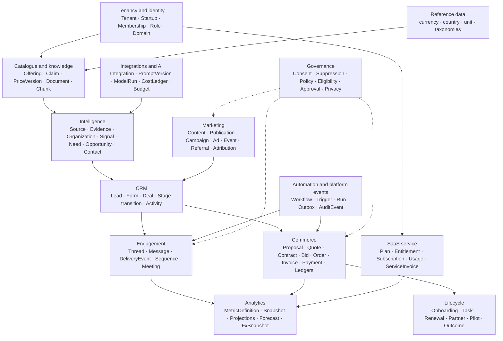

# AI Growth Engine: Employee Sales & Marketing Automation
## Application Blueprint: PART 3 (Batch 3.3), Data Architecture

| Field | Value |
|---|---|
| Document | Part 3, Batch 3 · Data Architecture (client Section 6.5) |
| Version | 1.0 · 27 Nov 2026 |
| Baseline | BRD, FRD, Parts 0, 0A (DEC-001…065), 1, 2.1–2.5 |
| Companion batches | 3.1 Solution architecture · 3.2 API and integration architecture (written in parallel; this batch **owns every entity definition**; 3.1/3.2 reference entities by the names and table names given here) |
| Roles applied | Data Architect/DBA (lead), Solutions Architect, Principal Engineer, Security/Compliance/AI Governance Lead, DevOps/SRE Lead, FinOps Lead, QA Lead, BSA |
| Section numbering | `3.3.x` (batch-scoped, so it cannot collide with the parallel batches 3.1 and 3.2) |

---

## 3.3.1 Scope, sources and conventions of this batch

### 3.3.1.1 What this batch decides

| # | Decision area | Where |
|---|---|---|
| 1 | Conceptual domains and their relationships | §3.3.2 |
| 2 | The complete logical entity catalogue (**199 logical entities**), with origin, scope class and immutability, reconciled with the source claim "149 retained + 6 candidate" | §3.3.3 |
| 3 | Logical models per domain (17 entity-relationship diagrams, each ≤ 20 entities) | §3.3.4 |
| 4 | Physical conventions: keys, timestamps, scope keys, concurrency, money, soft delete, naming, migration order, immutability enforcement | §3.3.5 |
| 5 | Column-level data dictionary for 68 core entities, compact dictionary for the remaining 131 | §3.3.6, §3.3.7 |
| 6 | Indexes, unique (idempotency) constraints, check constraints, vector indexes | §3.3.8 |
| 7 | Row-level security (RLS) design with SQL | §3.3.9 |
| 8 | Partitioning and volume estimates for the DEC-031 Year 1 and Year 2 design points | §3.3.10 |
| 9 | Retention, purge, archival and legal hold per DEC-028 | §3.3.11 |
| 10 | Migration and conversion of the four seed startups per DEC-039 | §3.3.12 |
| 11 | Master/reference data stewardship | §3.3.13 |
| 12 | Data quality rules DQ-001…DQ-032 | §3.3.14 |
| 13 | Backup, restore and tenant-level logical restore | §3.3.15 |
| 14 | Personal data classification, masking, encryption, pseudonymization, children's data | §3.3.16 |
| 15 | KPI lineage from event to report | §3.3.17 |

### 3.3.1.2 Binding sources used

| Source | What it fixes for the data layer |
|---|---|
| FRD §5 (Engineering contracts) | "Independent PostgreSQL database and role per product; tenant root first, startup and membership, configuration/reference, business entities in FK order, deferred cyclic constraints, indexes/views last. All operational rows use UUID PK, UTC timestamps, scoped tenant_id/startup_id composite foreign keys, RLS and revision. Root and reference rows have explicit alternative scope. Immutable approval, financial and audit records; decimal and ISO currency; provider IDs unique within connection. Separate object storage/vector ACLs. Never expose direct DB access to browser, Copilot or provider. Validate physical naming against existing schema." |
| FRD §6.1–§6.66 | The entity names per module ("Database entities"), listed in Part 2.1 §2.2 |
| BRD §9 / FRD §16 | "Retained baseline: 302 API/adapter operations, **149 logical entities** and 624 product tests. Expansion proposals: 19 candidate HTTP operations, **6 candidate entities**" |
| DEC-009, DEC-065 | One PostgreSQL cluster for this product, shared by all its tenants with RLS and composite keys; owned portfolio = one tenant with 25+ startup workspaces |
| DEC-016 | 35 DERIVED core entities |
| DEC-018, DEC-040 | RPO ≤ 15 min, RTO ≤ 4 h; AWS ap-south-1; cross-region backup copy |
| DEC-027 | Decimal money, ISO 4217, ROUND_HALF_UP per line, FxSnapshot, TaxProfile, no IRN generation |
| DEC-028 | Retention schedule and legal hold |
| DEC-030 | Children's data |
| DEC-031 | Year 1 and Year 2 volume design points |
| DEC-039 | Migration by import templates, dry run, consent gating |
| NFR-005, -006, -017, -018, -025, -026, -031, -032, -035, -036, -038 | Idempotency, outbox, data integrity, immutability, stale revision, uncertain outcomes, isolation, usage reconciliation, privacy, simulation |
| Part 2.3 | BRL rules, roles R01–R20, ABAC-01…12, field-level security §2.26.5, state machines §2.27 |
| Part 2.4 | Audit schema §2.34.2, reference data §2.33.4, isolation layers §2.35.2, reporting rules RPT-R1…R10 |
| RECOMMENDATION-004 | Classification scheme Public / Internal / Confidential / Restricted |

### 3.3.1.3 Acronyms used in this batch

| Acronym | Meaning |
|---|---|
| BRIN | Block Range Index (PostgreSQL index type for naturally ordered, append-only data) |
| CDC | Change Data Capture |
| DDL | Data Definition Language |
| DEK / KEK | Data Encryption Key / Key Encryption Key (envelope encryption) |
| DLQ | Dead-Letter Queue |
| DPIA | Data Protection Impact Assessment |
| DQ | Data Quality (rule IDs DQ-###) |
| ENT | Entity catalogue identifier used in this batch (ENT-001…ENT-199) |
| FK / PK / UK | Foreign / Primary / Unique Key |
| GIN | Generalized Inverted Index |
| HNSW | Hierarchical Navigable Small World (approximate nearest-neighbour vector index) |
| HMAC | Hash-based Message Authentication Code |
| IVFFlat | Inverted File with flat lists (alternative pgvector index) |
| KMS | AWS Key Management Service |
| LIA | Legitimate-Interest Assessment (DEC-029) |
| MD | Metric Definition identifier (MD-KPI-##) |
| PITR | Point-In-Time Recovery |
| RLS | PostgreSQL Row-Level Security |
| WORM | Write Once, Read Many |

---

## 3.3.2 Conceptual data model

### 3.3.2.1 Domain overview

The data model has 13 domains. Every domain except platform reference data and SaaS commercial metadata hangs off the **Tenant → Startup** scope root (DEC-065). Arrows show the dominant flow of facts; dotted lines are governance checks applied to every external effect (the Policy Decision Point, PDP).

### 3.3.2.2 Domain responsibilities and ownership

| Domain | Django app(s) (Part 2.1 §2.1.2) | Table prefix | Owns (system of record for) | Entities | Data steward role |
|---|---|---|---|---|---|
| Tenancy and identity | `core.tenancy`, `core.identity` | `ten_` | Tenants, startups, business lines, capability profiles, domains, membership, roles, portal grants | 10 | R12 Tenant Administrator |
| Reference data | `core.reference` | `ref_` | Platform and tenant reference lists (§3.3.13) | 5 | Platform data steward; R12 for tenant extensions |
| Catalogue and knowledge | `catalog`, `knowledge` | `cat_` | Offering truth, claims, prices, tax profile, knowledge documents and vectors | 11 | R02 Startup Head (offerings), R10 (claims), R08 (prices) |
| Governance | `governance` | `gov_` | Consent ledger, suppression, policy versions, jurisdiction rules, eligibility/policy decisions, approvals, privacy, retention, legal hold, compliance incidents | 13 | R10 Legal/Compliance/DPO |
| Integrations and AI | `integrations`, `ai` | `int_`, `ai_` | Connections, secret references, quotas, provider events, agents, prompts, model runs, evals, usage, cost ledger, budgets | 13 | R11 Automation Lead; R08 for budgets |
| Intelligence | `intelligence.*` | `intel_` | Sources, research, evidence, organizations, signals, needs, matches, scoring, opportunities, contacts, verification, reviews | 26 | R04 Research Analyst |
| CRM | `crm`, `crm.leads` | `crm_` | Leads, forms, submissions, pipelines, stages, deals, transitions, activities, closure policy | 10 | R02 Startup Head |
| Engagement | `engagement.*` | `eng_` | Channels, templates, drafts, threads, messages, delivery and inbound events, sequences, meetings, chat | 16 | R03 Growth Manager |
| Marketing | `marketing.*`, `web` | `mkt_` | Content, social, SEO, pages, publications, campaigns, audiences, ads, events, referrals, attribution | 20 | R05L Marketing Lead |
| Commerce | `commerce.*` | `com_` | Proposals, quotes, negotiation, contracts, signatures, bids, orders, fulfilment, inventory, invoices, payments, ledgers | 22 | R02 (documents), R08/R09 (finance) |
| Lifecycle | `lifecycle.*` | `lcy_` | Onboarding, tasks, handoffs, renewals, customer subscriptions, partners, pilots, deployments, licensing deals, feedback, outcomes | 12 | R02 Startup Head |
| Automation and platform events | `automation`, `core.events`, `core.audit`, `ops` | `aut_`, `ops_` | Workflows, revisions, triggers, runs, plans, conflicts, templates, configuration revisions, outbox, domain events, idempotency, audit, jobs, notifications, incidents, releases | 20 | R11 Automation Lead; SRE |
| SaaS service | `saas` | `saas_` | Service plans, versions, entitlements, subscriptions, usage meters, service invoices, credits, applications, support grants, export/import jobs | 12 | R14 Platform Billing; R12 for own tenant |
| Analytics | `analytics.*` | `ana_` | Metric definitions, snapshots, projections, forecasts, FX snapshots, report subscriptions | 9 | R08 Finance (metric definitions, A083) |
| **Total** | | | | **199** | |

---

## 3.3.3 Entity catalogue and reconciliation

### 3.3.3.1 Legend

| Column | Values |
|---|---|
| **Origin** | **F** = named in the FRD module specifications (FRD §6.x "Database entities"; listed in Part 2.1 §2.2). **D16** = DERIVED by DEC-016. **D** = DERIVED in this batch (a normalization, split or supporting entity that the baseline requires but does not name; justification column says which rule needs it) |
| **Scope class** | **S** = startup-scoped (`tenant_id` and `startup_id` NOT NULL). **T** = tenant-scoped (`tenant_id` NOT NULL, `startup_id` NULL or optional). **X** = mixed (`tenant_id` NULL means a platform-supplied default row, readable by all tenants, writable only by the platform). **P** = platform (no tenant column; platform metadata or pre-tenant data) |
| **Imm.** (immutability profile, §3.3.5.9) | **M** = mutable with optimistic revision. **V** = versioned: a version row is frozen once approved/published; changes create a new version. **F** = frozen-after-state: business fields freeze at a defined state; only forward state columns may change. **A** = append-only: insert only; corrections are new (reversing) rows |
| **Ret.** (retention class, §3.3.11) | FIN financial 8 y · CTR contract term + 8 y · AUD audit 7 y · MKT marketing contact 24 m after last eligible interaction · SUP suppression indefinite (hash) · EVD research evidence 12 m · AIL AI run log 90 d · CHT chat 90 d · REJ rejected/withdrawn lead 6 m · APP application draft 30 d · OPS operational 13 m · BUS business record (life of relationship + 24 m, GAP-113) · CFG configuration (superseded + 24 m) · PRJ rebuildable projection (no independent retention) |

### 3.3.3.2 Complete catalogue (199 logical entities)

| ENT | Entity (logical) | Physical table | Domain | Origin | FRD module / basis | Scope | Imm. | Ret. |
|---|---|---|---|---|---|---|---|---|
| ENT-001 | Tenant | `ten_tenant` | Tenancy | D16 | B-TENANT; DEC-065 | P (root) | M | BUS |
| ENT-002 | Startup | `ten_startup` | Tenancy | D16 | B-TENANT; FR-A099 | T | M | BUS |
| ENT-003 | BusinessLine | `ten_business_line` | Tenancy | D16 | FR-FLT-01; FR-A100 | S | M | BUS |
| ENT-004 | CapabilityProfile | `ten_capability_profile` | Tenancy | D16 | DEC-052; ABAC-08 | S | V | CFG |
| ENT-005 | Domain (verified web domain) | `ten_domain` | Tenancy | D16 | BRL-TEN-10; FR-A107 | S | M | BUS |
| ENT-006 | User (product-local identity mirror) | `ten_user` | Tenancy | F | M01 (FRD §6.1); DEC-003 | P | M | BUS |
| ENT-007 | Role | `ten_role` | Tenancy | F | M01 | X | M | CFG |
| ENT-008 | Membership | `ten_membership` | Tenancy | F | M01; BRL-TEN-01/07 | T | M | AUD |
| ENT-009 | PortalGrant (object grant for external users) | `ten_portal_grant` | Tenancy | D | ABAC-09; CA-PORTAL | S | M | AUD |
| ENT-010 | SavedView | `ten_saved_view` | Tenancy | D | FR-FLT-RULES (saved views scoped to user/product/tenant/startup) | S | M | CFG |
| ENT-011 | ReferenceDataset | `ref_dataset` | Reference | D | Part 2.4 §2.33.4; CFG-32 | X | V | CFG |
| ENT-012 | ReferenceValue | `ref_value` | Reference | D | Part 2.4 §2.33.4 | X | V | CFG |
| ENT-013 | Currency | `ref_currency` | Reference | D | DEC-027 ISO 4217; NFR-017 | P | M | CFG |
| ENT-014 | Country (with subdivisions) | `ref_country` | Reference | D | ISO 3166; BRL-ELG-05 | P | M | CFG |
| ENT-015 | UnitOfMeasure | `ref_unit` | Reference | D | BRL-QTE-07; DEC-045 | X | M | CFG |
| ENT-016 | Offering (FRD "Product" merged here) | `cat_offering` | Catalogue | D16 + F | M02, M66; DEC-003 | S | M | BUS |
| ENT-017 | OfferingVersion | `cat_offering_version` | Catalogue | D16 | M02; §2.27.18 Offering version states | S | V | CFG |
| ENT-018 | Capability | `cat_capability` | Catalogue | F | M02 | S | M | CFG |
| ENT-019 | ProductCapability (offering version × capability) | `cat_offering_capability` | Catalogue | F | M16 | S | V | CFG |
| ENT-020 | Claim | `cat_claim` | Catalogue | F | M02, M25; BRL-MKT-01/03 | S | V | CTR-like: claim + 8 y after expiry (evidence of what was published) |
| ENT-021 | PriceVersion | `cat_price_version` | Catalogue | F | M02, M44; BRL-QTE-01 | S | V | FIN |
| ENT-022 | TaxProfile | `cat_tax_profile` | Catalogue | D16 | DEC-027 | S | V | FIN |
| ENT-023 | LaunchApproval | `cat_launch_approval` | Catalogue | F | M66; DEC-060 | S | A | AUD |
| ENT-024 | Document | `cat_document` | Catalogue | F | M03 | S | V | CFG |
| ENT-025 | Chunk | `cat_chunk` | Catalogue | F | M03 | S | A | CFG (with document) |
| ENT-026 | Embedding | `cat_embedding` | Catalogue | F | M03 | S | A | CFG (with chunk) |
| ENT-027 | Consent | `gov_consent` | Governance | F | M04, M22 | S | A | AUD (pseudonymized after contact erasure) |
| ENT-028 | Suppression | `gov_suppression` | Governance | F | M04; BRL-ELG-02; BRL-PRV-03 | T | A | SUP |
| ENT-029 | PolicyVersion | `gov_policy_version` | Governance | F | M04, M24 | X | V | AUD |
| ENT-030 | JurisdictionRule | `gov_jurisdiction_rule` | Governance | D16 | DEC-029; BRL-ELG-05 | X | V | AUD |
| ENT-031 | EligibilityDecision | `gov_eligibility_decision` | Governance | F | M24 | S | A | OPS+ (24 m, GAP-113) |
| ENT-032 | PolicyDecision | `gov_policy_decision` | Governance | F | M57; RECOMMENDATION-012 | S | A | OPS+ (24 m, GAP-113) |
| ENT-033 | ApprovalPolicy | `gov_approval_policy` | Governance | D16 | DEC-038; CFG-17 | T | V | AUD |
| ENT-034 | Approval | `gov_approval` | Governance | F | M45, M61; CA-APPROVE | S | A | Same as governed object (CONFLICT-108) |
| ENT-035 | ApprovalDelegation | `gov_approval_delegation` | Governance | D | BRL-APR-09 | S | F | AUD |
| ENT-036 | PrivacyRequest | `gov_privacy_request` | Governance | F | M56 | T | M | AUD |
| ENT-037 | RetentionPolicy | `gov_retention_policy` | Governance | F | M56; DEC-028; CFG-28 | X | V | AUD |
| ENT-038 | LegalHold | `gov_legal_hold` | Governance | D | DEC-028; BRL-PRV-04 | T | F | AUD |
| ENT-039 | ComplianceIncident | `gov_compliance_incident` | Governance | F | M57 | S | M | AUD |
| ENT-040 | Integration (connection) | `int_integration` | Integrations | F | M05 | S | M | CFG |
| ENT-041 | CredentialRef | `int_credential_ref` | Integrations | F | M05; NFR-004 | S | M | CFG |
| ENT-042 | Quota | `int_quota` | Integrations | F | M05 | S | M | CFG |
| ENT-043 | ProviderEvent (verified webhook receipt) | `int_provider_event` | Integrations | D | FRD §5 "dedupe by provider account and event ID"; NFR-005 | S | A | OPS |
| ENT-044 | AgentDefinition (tool registry entry) | `ai_agent_definition` | AI | D | DEC-048; R20 | X | V | CFG |
| ENT-045 | PromptVersion | `ai_prompt_version` | AI | F | M08 | X | V | CFG |
| ENT-046 | ModelRun | `ai_model_run` | AI | F | M08; FR-OP001 | S | A | AIL (metadata 13 m, payload 90 d) |
| ENT-047 | EvalCase | `ai_eval_case` | AI | F | M08, M54 | X | V | CFG |
| ENT-048 | EvalRun | `ai_eval_run` | AI | F | M54; NFR-033 | X | A | OPS (24 m) |
| ENT-049 | AiFeedback (human feedback on AI output) | `ai_feedback` | AI | D | M54 (split from FRD "Feedback", CONFLICT-106) | S | A | OPS (24 m) |
| ENT-050 | Usage (AI/provider unit usage) | `ai_usage` | AI | F | M53 | S | A | FIN (cost evidence) |
| ENT-051 | CostLedger | `ai_cost_ledger` | AI | F | M53; NFR-014 | S | A | FIN |
| ENT-052 | Budget | `ai_budget` | AI | F | M53; DEC-008, DEC-020 | X | V | FIN |
| ENT-053 | Source | `intel_source` | Intelligence | F | M07, M33 | S | M | CFG |
| ENT-054 | SourcePolicy | `intel_source_policy` | Intelligence | F | M07; BRL-SRC-01/02 | S | V | AUD |
| ENT-055 | SearchPlan | `intel_search_plan` | Intelligence | F | M10 | S | V | CFG |
| ENT-056 | QueryRun | `intel_query_run` | Intelligence | F | M10 | S | A | OPS |
| ENT-057 | SourceRecord | `intel_source_record` | Intelligence | F | M11, M12 | S | M | EVD |
| ENT-058 | FetchLog | `intel_fetch_log` | Intelligence | F | M11 | S | A | OPS |
| ENT-059 | Evidence | `intel_evidence` | Intelligence | F | M12; BRL-SRC-03 | S | F | EVD (metadata kept) |
| ENT-060 | SocialPost | `intel_social_post` | Intelligence | F | M33 | S | M | EVD |
| ENT-061 | Competitor | `intel_competitor` | Intelligence | F | M59 | S | M | BUS |
| ENT-062 | MarketEvent | `intel_market_event` | Intelligence | F | M59 | S | M | EVD |
| ENT-063 | Organization | `intel_organization` | Intelligence | F | M13 | S | M | BUS |
| ENT-064 | Location | `intel_location` | Intelligence | F | M13 | S | M | BUS |
| ENT-065 | Alias | `intel_alias` | Intelligence | F | M13 | S | M | BUS |
| ENT-066 | SignalType | `intel_signal_type` | Intelligence | F | M14; §2.33.4 | X | M | CFG |
| ENT-067 | Signal | `intel_signal` | Intelligence | F | M14, M33 | S | M | EVD |
| ENT-068 | Need | `intel_need` | Intelligence | F | M15 | S | M | BUS |
| ENT-069 | NeedEvidence | `intel_need_evidence` | Intelligence | F | M15 | S | A | EVD |
| ENT-070 | Match | `intel_match` | Intelligence | F | M16 | S | M | BUS |
| ENT-071 | ScoringModel (weights version) | `intel_scoring_model` | Intelligence | D | DEC-011; BRL-SCR-01; CFG-10 | S | V | CFG |
| ENT-072 | Opportunity | `intel_opportunity` | Intelligence | F | M17 | S | M | BUS / REJ when rejected |
| ENT-073 | ScoreVersion (computed score record) | `intel_score_version` | Intelligence | F | M17; BRL-SCR-08 | S | A | BUS |
| ENT-074 | Contact | `intel_contact` | Intelligence | F | M18 | S | M | MKT |
| ENT-075 | RoleHypothesis | `intel_role_hypothesis` | Intelligence | F | M18 | S | M | MKT |
| ENT-076 | ContactSource | `intel_contact_source` | Intelligence | F | M18, M19 | S | A | MKT |
| ENT-077 | ContactVerification | `intel_contact_verification` | Intelligence | F | M19 | S | A | MKT |
| ENT-078 | Review | `intel_review` | Intelligence | F | M20 | S | A | AUD |
| ENT-079 | Lead | `crm_lead` | CRM | F | M22, M32, M42 | S | M | MKT / REJ |
| ENT-080 | Form | `crm_form` | CRM | F | M22 | S | M | CFG |
| ENT-081 | FormVersion | `crm_form_version` | CRM | D | CA-INTAKE "versioned form schema" | S | V | CFG |
| ENT-082 | Submission | `crm_submission` | CRM | F | M22 | S | A | MKT |
| ENT-083 | Pipeline | `crm_pipeline` | CRM | D | CFG-11; FR-CSM-01 | S | V | CFG |
| ENT-084 | Stage | `crm_stage` | CRM | F | M21 | S | V | CFG |
| ENT-085 | ClosurePolicy | `crm_closure_policy` | CRM | D | DEC-054; CFG-18 | S | V | CFG |
| ENT-086 | Deal | `crm_deal` | CRM | F | M21, M47 | S | M | BUS (CTR/FIN when contracted/paid) |
| ENT-087 | DealStageTransition | `crm_stage_transition` | CRM | D | §2.27.3; "every transition is audited" | S | A | Same as deal |
| ENT-088 | Activity | `crm_activity` | CRM | F | M21, M23 | S | A | BUS |
| ENT-089 | ChannelAccount | `eng_channel_account` | Engagement | F | M31, M35 | S | M | CFG |
| ENT-090 | MessageTemplate (FRD "Template") | `eng_message_template` | Engagement | F | M25, M31 | S | V | CFG |
| ENT-091 | MessageDraft | `eng_message_draft` | Engagement | F | M25 | S | M | MKT |
| ENT-092 | Thread | `eng_thread` | Engagement | F | M26, M27, M32, M41 | S | M | MKT |
| ENT-093 | Message | `eng_message` | Engagement | F | M26, M31 | S | F | MKT |
| ENT-094 | DeliveryEvent | `eng_delivery_event` | Engagement | F | M26 | S | A | OPS+ (24 m, GAP-113) |
| ENT-095 | InboundEvent | `eng_inbound_event` | Engagement | F | M27 | S | A | MKT |
| ENT-096 | Intent | `eng_intent` | Engagement | F | M27 | S | A | MKT |
| ENT-097 | IdentityLink | `eng_identity_link` | Engagement | F | M41 | S | M | MKT |
| ENT-098 | RoutingRule | `eng_routing_rule` | Engagement | F | M41 | S | V | CFG |
| ENT-099 | ChatSession | `eng_chat_session` | Engagement | F | M32 | S | M | CHT |
| ENT-100 | Sequence | `eng_sequence` | Engagement | F | M28 | S | V | CFG |
| ENT-101 | SequenceStep (FRD "Step") | `eng_sequence_step` | Engagement | F | M28 | S | V | CFG |
| ENT-102 | Enrollment | `eng_enrollment` | Engagement | F | M28 | S | M | MKT |
| ENT-103 | Meeting | `eng_meeting` | Engagement | F | M29 | S | M | BUS (GAP-113) |
| ENT-104 | CalendarLink | `eng_calendar_link` | Engagement | F | M29 | S | M | CFG |
| ENT-105 | ContentAsset | `mkt_content_asset` | Marketing | F | M34 | S | M | BUS |
| ENT-106 | ContentVersion | `mkt_content_version` | Marketing | F | M34 | S | V | BUS |
| ENT-107 | SocialPublication | `mkt_social_publication` | Marketing | F | M35 | S | F | BUS |
| ENT-108 | Keyword | `mkt_keyword` | Marketing | F | M36 | S | M | BUS |
| ENT-109 | SEOIssue | `mkt_seo_issue` | Marketing | F | M36 | S | M | OPS |
| ENT-110 | PageMetric | `mkt_page_metric` | Marketing | F | M36 | S | A | BUS (aggregates) |
| ENT-111 | LandingPage (site or landing page) | `mkt_landing_page` | Marketing | F | M37; FR-A107 | S | M | BUS |
| ENT-112 | Publication | `mkt_publication` | Marketing | D16 | FR-PUB-01; BRL-PUB-02 | S | M | BUS |
| ENT-113 | PublicationSnapshot | `mkt_publication_snapshot` | Marketing | D16 | BRD §9; NFR-020 | S | A | BUS (24 m after retirement) |
| ENT-114 | PreviewGrant | `mkt_preview_grant` | Marketing | D16 | BRL-PUB-03 | S | M | OPS |
| ENT-115 | Campaign | `mkt_campaign` | Marketing | F | M38 | S | M | BUS |
| ENT-116 | CampaignVersion | `mkt_campaign_version` | Marketing | F | M38 | S | V | BUS |
| ENT-117 | Audience | `mkt_audience` | Marketing | F | M38 | S | V | MKT |
| ENT-118 | AdCampaign | `mkt_ad_campaign` | Marketing | F | M39 | S | M | FIN (spend evidence) |
| ENT-119 | SpendEvent | `mkt_spend_event` | Marketing | F | M39 | S | A | FIN |
| ENT-120 | MarketingEvent (FRD "Event": webinar/demo) | `mkt_event` | Marketing | F | M40 | S | M | BUS |
| ENT-121 | Registration | `mkt_registration` | Marketing | F | M40 | S | M | MKT |
| ENT-122 | Attendance | `mkt_attendance` | Marketing | F | M40 | S | A | MKT |
| ENT-123 | Referral | `mkt_referral` | Marketing | F | M42; DEC-046 | S | M | MKT |
| ENT-124 | AttributionEvent | `mkt_attribution_event` | Marketing | F | M37, M52 | S | A | BUS (pseudonymized after MKT expiry) |
| ENT-125 | Proposal | `com_proposal` | Commerce | F | M43 | S | M | BUS / CTR if accepted |
| ENT-126 | ProposalVersion | `com_proposal_version` | Commerce | F | M43 | S | V | BUS / CTR if accepted |
| ENT-127 | Quote | `com_quote` | Commerce | F | M44 | S | F | FIN if accepted, else BUS |
| ENT-128 | QuoteLine | `com_quote_line` | Commerce | F | M44 | S | F | As quote |
| ENT-129 | Objection | `com_objection` | Commerce | F | M45 | S | M | BUS |
| ENT-130 | Negotiation | `com_negotiation` | Commerce | F | M45 | S | M | BUS |
| ENT-131 | Contract | `com_contract` | Commerce | F | M46, M63, M64 | S | F | CTR |
| ENT-132 | SignatureEvent | `com_signature_event` | Commerce | F | M46 | S | A | CTR |
| ENT-133 | Bid | `com_bid` | Commerce | D16 | FR-A104; DEC-053 | S | M | CTR if awarded, else BUS |
| ENT-134 | BidChecklistItem | `com_bid_checklist_item` | Commerce | D16 | BRL-BID-02 | S | M | As bid |
| ENT-135 | Order | `com_order` | Commerce | D16 | FR-A105 | S | F | FIN |
| ENT-136 | OrderLine | `com_order_line` | Commerce | D16 | FR-A105; BRL-ORD-01 | S | F | FIN |
| ENT-137 | FulfillmentEvent | `com_fulfillment_event` | Commerce | D16 | FR-DM-03; BRL-ORD-03 | S | A | FIN |
| ENT-138 | SkuAvailability | `com_sku_availability` | Commerce | D | DEC-045 | S | M | BUS |
| ENT-139 | InventoryReservation | `com_inventory_reservation` | Commerce | D | DEC-045; BRL-ORD-04 | S | M | FIN |
| ENT-140 | Invoice | `com_invoice` | Commerce | F | M47 | S | F | FIN |
| ENT-141 | InvoiceLine | `com_invoice_line` | Commerce | D | DEC-027 rounding per line | S | F | FIN |
| ENT-142 | Payment | `com_payment` | Commerce | F | M47, M52 | S | F | FIN |
| ENT-143 | PaymentAllocation | `com_payment_allocation` | Commerce | D | BRL-FIN-04 | S | A | FIN |
| ENT-144 | DiscrepancyCase | `com_discrepancy_case` | Commerce | D | BRL-FIN-03; §2.27.7 Discrepancy | S | M | FIN |
| ENT-145 | ReceivableEntry | `com_receivable_entry` | Commerce | D16 | RECOMMENDATION-018; BRL-ORD-06 | S | A | FIN |
| ENT-146 | PayableEntry | `com_payable_entry` | Commerce | D16 | RECOMMENDATION-018; BRL-ORD-06 | S | A | FIN |
| ENT-147 | Onboarding | `lcy_onboarding` | Lifecycle | F | M48 | S | M | BUS |
| ENT-148 | Task | `lcy_task` | Lifecycle | F | M30, M48 | S | M | BUS |
| ENT-149 | Handoff | `lcy_handoff` | Lifecycle | F | M48 | S | A | BUS |
| ENT-150 | Renewal | `lcy_renewal` | Lifecycle | F | M50 | S | M | CTR |
| ENT-151 | CustomerSubscription (FRD "Subscription", M50) | `lcy_customer_subscription` | Lifecycle | F | M50 (split, CONFLICT-106) | S | M | CTR |
| ENT-152 | AccountMetric | `lcy_account_metric` | Lifecycle | F | M50 | S | A | BUS |
| ENT-153 | Partner | `lcy_partner` | Lifecycle | F | M42, M49, M65 | S | M | BUS |
| ENT-154 | Pilot | `lcy_pilot` | Lifecycle | F | M49, M63 | S | M | CTR |
| ENT-155 | Deployment | `lcy_deployment` | Lifecycle | F | M49, M65 | S | M | CTR |
| ENT-156 | IntegrationDeal (licensing enquiry) | `lcy_integration_deal` | Lifecycle | F | M64 | S | M | CTR |
| ENT-157 | Feedback (customer / loss feedback) | `lcy_feedback` | Lifecycle | F | M51 | S | A | BUS |
| ENT-158 | Outcome | `lcy_outcome` | Lifecycle | F | M51 | S | A | BUS |
| ENT-159 | Workflow | `aut_workflow` | Automation | F | M55 | S | M | CFG |
| ENT-160 | WorkflowRevision | `aut_workflow_revision` | Automation | D | BRL-AUT-03 (pinned revision); FR-A112 | S | V | CFG |
| ENT-161 | Trigger | `aut_trigger` | Automation | D16 | FR-A109 | S | M | CFG |
| ENT-162 | WorkflowRun (FRD "Execution") | `aut_run` | Automation | F | M55; FR-A110 | S | M | OPS (13 m) |
| ENT-163 | StepRun | `aut_step_run` | Automation | F | M55 | S | M | OPS (13 m) |
| ENT-164 | AutonomyPlan (autonomous commercial plan) | `aut_autonomy_plan` | Automation | D | FR-A102; §2.27.15 (CONFLICT-106 naming) | S | M | CFG |
| ENT-165 | ConflictCase | `aut_conflict_case` | Automation | D16 | FR-A111; BRL-AUT-09 | S | M | OPS (13 m) |
| ENT-166 | NodeTemplate | `aut_node_template` | Automation | D16 | FR-A113; DEC-051 | X | V | CFG |
| ENT-167 | WorkflowTemplate | `aut_workflow_template` | Automation | D16 | FR-A113 | X | V | CFG |
| ENT-168 | ConfigRevision | `aut_config_revision` | Automation | D16 | FR-A112; §2.33.3 | X | V | CFG |
| ENT-169 | Outbox | `ops_outbox` | Platform events | F | M06; NFR-006 | S | F | OPS (30 d after dispatch) |
| ENT-170 | DomainEvent | `ops_domain_event` | Platform events | D | Part 2.4 §2.31.1 | S | A | OPS (13 m) |
| ENT-171 | IdempotencyKey | `ops_idempotency_key` | Platform events | D | NFR-015 "idempotency key + body hash"; CA-INTAKE | S | F | OPS (35 d) |
| ENT-172 | AuditEvent | `ops_audit_event` | Platform events | F | M06; Part 2.4 §2.34.2 | X | A | AUD (FIN objects 8 y) |
| ENT-173 | JobRun | `ops_job_run` | Platform events | F | M06, M58 | X | M | OPS (13 m) |
| ENT-174 | Notification | `ops_notification` | Platform events | F | M20; FR-A106 | S | M | OPS (12 m) |
| ENT-175 | NotificationPreference | `ops_notification_preference` | Platform events | D | DEC-036; CFG-30 | T | M | CFG |
| ENT-176 | Incident | `ops_incident` | Platform events | F | M09, M58 | X | M | AUD |
| ENT-177 | Release | `ops_release` | Platform events | F | M09, M62 | P | M | AUD |
| ENT-178 | TestRun | `ops_test_run` | Platform events | F | M62 | P | A | OPS (24 m) |
| ENT-179 | ServicePlan (DEC-016 "Plan") | `saas_plan` | SaaS | D16 | DEC-047 (CONFLICT-106 naming) | P | M | FIN |
| ENT-180 | PlanVersion | `saas_plan_version` | SaaS | D16 | FR-A101 "rate revision" | P | V | FIN |
| ENT-181 | Entitlement | `saas_entitlement` | SaaS | D16 | DEC-047; BRL-SVC-03 | X | V | FIN |
| ENT-182 | ServiceSubscription | `saas_subscription` | SaaS | D | FR-A101; §2.27.18 Subscription states (CONFLICT-106) | T | M | FIN |
| ENT-183 | UsageMeterReading | `saas_usage_meter_reading` | SaaS | D16 | BRL-SVC-04; NFR-035 | T | A | FIN |
| ENT-184 | ServiceInvoice | `saas_service_invoice` | SaaS | D16 | FR-A101 | T | F | FIN |
| ENT-185 | ServiceInvoiceLine | `saas_service_invoice_line` | SaaS | D | BRL-SVC-04 "reconciled to invoice lines" | T | F | FIN |
| ENT-186 | Credit (credit/adjustment) | `saas_credit` | SaaS | D | BRL-SVC-07 | T | A | FIN |
| ENT-187 | ApplicationDraft | `saas_application_draft` | SaaS | D16 | W32, W33; BRL-SVC-02 | P (pre-tenant) | M | APP |
| ENT-188 | SupportAccessGrant | `saas_support_access_grant` | SaaS | D16 | DEC-056; BRL-TEN-09 | T | F | AUD |
| ENT-189 | ExportJob | `saas_export_job` | SaaS | D16 | FR-A103; BRL-PRV-07 | T | M | AUD (file 7 d) |
| ENT-190 | ImportJob | `saas_import_job` | SaaS | D16 | FR-A103; DEC-039 | S | M | AUD (file 30 d) |
| ENT-191 | MetricDefinition | `ana_metric_definition` | Analytics | D | Part 2.4 §2.31.1; CFG-21 | X | V | CFG |
| ENT-192 | MetricSnapshot | `ana_metric_snapshot` | Analytics | F | M30, M52 | S | A | FIN-like 8 y (aggregates, no personal data) |
| ENT-193 | AccountProjection | `ana_account_projection` | Analytics | F | M23 | S | M | PRJ |
| ENT-194 | AdminProjection | `ana_admin_projection` | Analytics | F | M61 | T | M | PRJ |
| ENT-195 | PipelineProjection | `ana_pipeline_projection` | Analytics | D | RP-01, RP-02 (funnel and pipeline read models) | S | M | PRJ |
| ENT-196 | Forecast | `ana_forecast` | Analytics | F | M60 | S | A | BUS |
| ENT-197 | StageMetric | `ana_stage_metric` | Analytics | F | M60 | S | A | BUS |
| ENT-198 | FxSnapshot | `ana_fx_snapshot` | Analytics | D16 | DEC-027 | T | A | FIN |
| ENT-199 | ReportSubscription | `ana_report_subscription` | Analytics | D | Part 2.4 §2.31.5 | T | M | CFG |

### 3.3.3.3 Association (join) tables, not counted as logical entities

| Table | Joins | Key | Purpose |
|---|---|---|---|
| `ten_membership_grant` | Membership × Role × Startup (nullable = tenant-wide) | (membership_id, role_id, startup_id) UK | Role assignment per startup scope (ABAC-01) |
| `cat_document_offering` | Document × OfferingVersion | (document_id, offering_version_id) | Knowledge scoped to offering |
| `cat_claim_evidence` | Claim × Document/Evidence | (claim_id, evidence_ref) | Evidence for claims (BRL-MKT-03) |
| `intel_signal_evidence` | Signal × Evidence | (signal_id, evidence_id) | Signal provenance |
| `intel_opportunity_contact` | Opportunity × Contact | (opportunity_id, contact_id) | Buying-committee hypothesis |
| `crm_deal_contact` | Deal × Contact (role) | (deal_id, contact_id, role_code) | Deal participants |
| `eng_message_claim` | MessageDraft/Message × Claim | (message_id, claim_id) | Claim check (M25) |
| `mkt_content_claim` | ContentVersion × Claim | (content_version_id, claim_id) | Claims used (BRL-MKT-01) |
| `mkt_audience_member` | Audience (version) × Contact | (audience_id, contact_id) | Frozen audience snapshot at approval; eligibility rechecked at dispatch |
| `com_contract_party` | Contract × Organization/Contact | (contract_id, party_ref, party_role) | Signers and authority (BRL-CTR-03) |
| `aut_run_conflict` | WorkflowRun × ConflictCase | (run_id, conflict_case_id) | Candidate runs in a conflict |
| `saas_plan_entitlement` | PlanVersion × Entitlement | (plan_version_id, entitlement_id) | Plan composition |
| `lcy_onboarding_task` | Onboarding × Task | (onboarding_id, task_id) | Template-instantiated tasks |

### 3.3.3.4 Reconciliation with the source claim "149 retained + 6 candidate" (BRD §9; FRD §16)

**Formula.** Logical entities in this batch = FRD-named (distinct, after merges) + DEC-016 DERIVED + DERIVED in this batch.

| Line | Item | Count | Basis |
|---|---|---|---|
| a | Distinct entity names in FRD §6 module specifications (Part 2.1 §2.2) | 132 | Extracted from every "Database entities" line; duplicates across modules removed (e.g. Consent in M04 and M22, Activity in M21 and M23, JobRun in M06 and M58) |
| b | Merged: FRD "Product" → `Offering` (DEC-003: "approved startup offering truth"; `offering_kind` = product, service, training, programme, licence) | −1 | Avoids two tables for one concept |
| c | FRD-named logical entities retained (a + b) | **131** | |
| d | DEC-016 DERIVED entities | **35** | All 35 included (ENT origin D16) |
| e | DERIVED in this batch | **33** | Reference (5), tenancy (2), governance (2), AI/integrations (3), intelligence (1), CRM (4), commerce (5), automation (2), platform events (3), SaaS (3), analytics (3) |
| f | **Total logical entities** (c + d + e) | **199** | §3.3.3.2 |
| g | Source claim: retained 149 + candidate 6 | 155 | BRD §9, FRD §16 |
| h | Difference (f − g) | **+44** | See bounds below |

**Interpretation and bounds.**

1. The FRD module specifications name **132** of the **149** retained entities. The 17 retained entities that the FRD never names are unknown because the original entity catalogue was not supplied (Part 0 GAP-002 → DEC-016). [GAP-112]
2. The **6 candidate entities** are taken to be the entities introduced by the nine new interfaces (BRD §17.1): **Trigger** (A109), **ConflictCase** (A111), **ConfigRevision** (A112), **NodeTemplate** and **WorkflowTemplate** (A113) and **ApplicationDraft** (W32/W33). A110 reuses Run/StepRun; W31 and W34 reuse plans, subscriptions and invoices. All six are in DEC-016. [ASSUMPTION-111]
3. **Best case** (the 17 unnamed retained entities are among our 29 other DEC-016 + 33 batch-derived entities): 199 − (155 − 1 merge) = **45 genuinely new logical entities**, mostly normalization (lines, allocations, transitions, versions), homonym splits (CONFLICT-106) and reference tables.
4. **Worst case** (none of the 17 unnamed retained entities matches ours): the retained baseline holds up to **17 entities this blueprint does not model**. Mitigation: if the original catalogue surfaces, Part 3 adds a mapping table (as DEC-015 does for APIs) and any unmatched entity becomes a change request.
5. Physical tables = 199 logical + 13 association tables (§3.3.3.3) = **212 base tables**, plus monthly partitions of 9 partitioned tables (§3.3.10) and Django framework tables (migrations, content types, sessions; not business data).

**Homonym resolution [CONFLICT-106].** The FRD and the decision log use five names for two different concepts each. Physical names disambiguate them:

| Source name | Meaning A → table | Meaning B → table |
|---|---|---|
| Plan | SaaS service plan (DEC-016, DEC-047) → `saas_plan` | Autonomous commercial plan (FR-A102, §2.27.15) → `aut_autonomy_plan` |
| Subscription | Customer subscription to a startup offering, renewal object (FRD M50) → `lcy_customer_subscription` | Tenant subscription to a SaaS plan (FR-A101, §2.27.18) → `saas_subscription` |
| Feedback | Customer/loss feedback (FRD M51) → `lcy_feedback` | Human feedback on AI output (FRD M54) → `ai_feedback` |
| Event | Webinar/demo event (FRD M40) → `mkt_event` | Domain event stream (Part 2.4 §2.31.1) → `ops_domain_event` |
| Execution / Run | FRD M55 "Execution" and FR-A110 "Run" are the same concept → one table `aut_run` | — |

---
