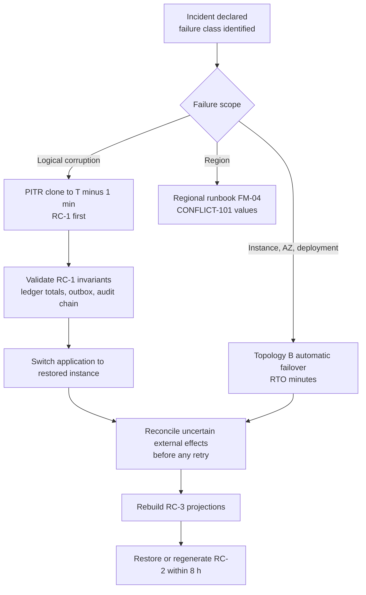
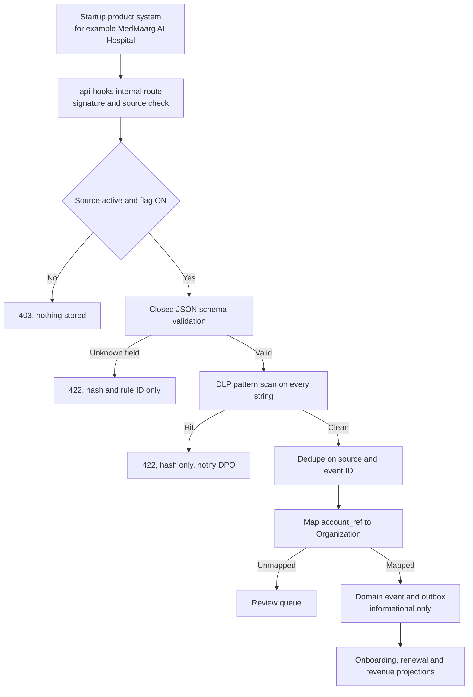
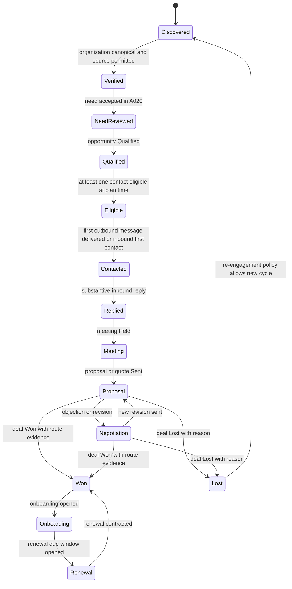
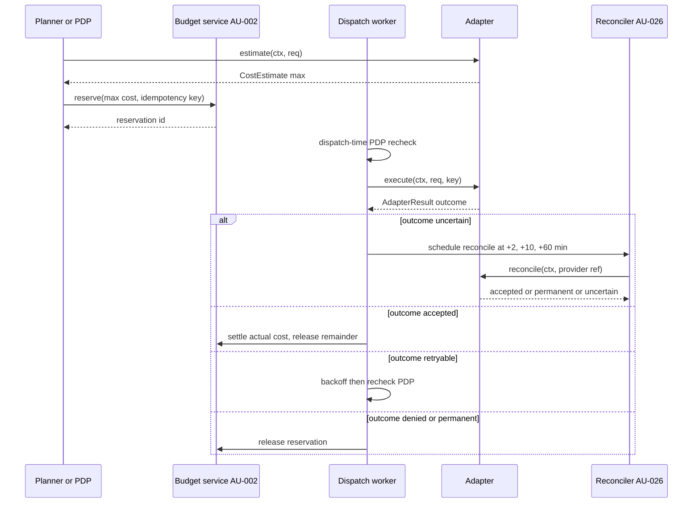
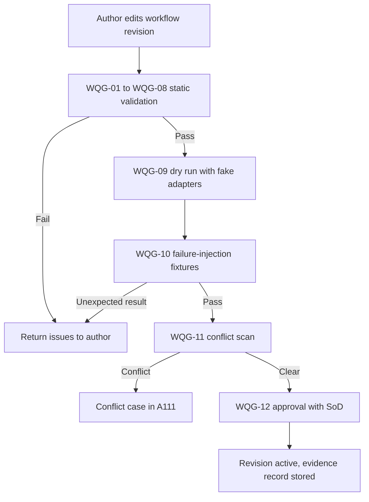
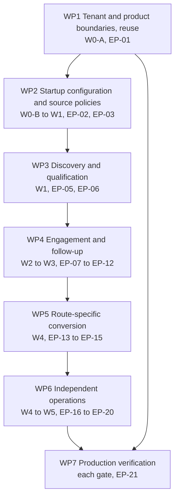

# AI Growth Engine: Employee Sales & Marketing Automation
## Application Blueprint: PART 3 (Batch 3.4), Source Pack Review: Architecture, Delivery and Workflow Enhancements (documents 04, 05, 09, 10)

| Field | Value |
|---|---|
| Document | Application Blueprint · Part 3.4: line-by-line coverage review of source-pack documents 04 *Solution Architecture & Delivery Plan*, 05 *Workflow Automation & Engagement Playbook*, 09 *High Level Design* and 10 *Detailed Level Design*, with enhancements at blueprint depth |
| Version | 1.0 · 27 Nov 2026 |
| Baseline | BRD, FRD, Parts 0, 0A (DEC-001…065), 1, 2.1–2.5, 3.1–3.3, 4.1–4.3, 5.x, 6.x, 7.1–7.3, 8.1–8.2, 9.1–9.4; errata log items 1–87 |
| Compared chiefly against | Part 2.2 (process flows), Part 2.3 (rules and state machines), Part 3.1 (architecture), Part 3.2 (API and integration), Part 7 (AI), Part 8 (delivery) |
| Roles applied | Solutions Architect (lead), Technical Architect, Principal Engineer, Automation Architect; consulted: DevOps/SRE Lead, Data Architect/DBA, FinOps Lead, QA Lead, Security/Compliance/AI Governance Lead |
| Group | **B** (Source Pack Brief). Enhanced IDs: FR-ENH-B-001…027, US-<EP>-EB<nn>, TC-ENH-B-001…040, NFR-ENH-B-01…08, LT-ENH-B-01…04, RB-ENH-B-01…03, WQG-01…12, ADR-100…109 |
| Tags issued | ASSUMPTION-320…325 · GAP-320…335 · CONFLICT-320…330 · RECOMMENDATION-320…331 · ADR-100…109 (register in §3.4.8) |
| Coverage CSV | `final/coverage/B_coverage.csv` (394 atomic aspects) |
| Scripts | `assembly/source_pack/groupB_parse.py` (parses every table row of the four documents and reconciles catalogues), `assembly/source_pack/groupB_aspects.py` (aspect register, CSV and register tables) |

**Acronyms used in this part.** ACK acknowledgement · ADR architecture decision record · ALB Application Load Balancer · AZ Availability Zone · CMK customer-managed key · DAG directed acyclic graph · DLQ dead-letter queue · DLP data-loss prevention · DRF Django REST Framework · DTO data transfer object · ECS Elastic Container Service · EVR evidence record · FTE full-time equivalent · IaC infrastructure as code · KMS Key Management Service · LT load-test profile · OKPI optimization KPI of the source pack (the pack's KPI-01…35, renamed to avoid collision with Part 1 KPI-01…31) · OPT optimization control of the source pack · PD person-day · PDP Policy Decision Point · PITR point-in-time recovery · RC recovery class · RLS row-level security · RPO/RTO recovery point/time objective · RUM real-user monitoring · SLO service level objective · WQG workflow quality gate.

**Verification convention.** Every price, quota, model name, managed-service behaviour and timing quoted in this part is an **estimate to verify at time of implementation (as of 27 Nov 2026)**. Currency conversion uses ₹90 per USD (ASSUMPTION-101 of Part 3.1). Taxes excluded.

**How to read this part.** §3.4.1–§3.4.4 record what the four documents say and how much of it the blueprint already covers. §3.4.5 is the main body: it writes the missing content, organized by the blueprint part it extends. §3.4.6 lists conflicts with proposed resolutions for the coordinator to turn into binding decisions. Nothing in an earlier part is changed by this part; where this part adds to or refines an earlier design, the addition is tagged and the earlier part remains authoritative until the coordinator accepts the change.

---

## 3.4.1 Documents reviewed

All four documents were read completely, line by line. Every table row was also parsed programmatically by `groupB_parse.py` (48 tables, 402 table rows across the four documents), so that no row, ID or threshold was skipped.

**Pattern found.** Each document opens with the same common core as documents 01/02 (product purpose and boundary, the four initial startups, technology and execution principles). Documents 04, 09 and 10 then share three further sections that are **not** in 01/02 (Independent deployment topology, Capacity/reliability/recovery acceptance, Configuration and activation; lines 37–118 are byte-identical in 04, 09 and 10). Every document closes with the common Website/Admin operating contract, the implementation and acceptance controls, an optimization section and the nine-interface expansion table (W31–W34, A109–A113). The common core is registered once (aspects B-CC-01…16) and marked "Common core: see document 01/02 coverage".

| Doc | Title | Size (bytes / lines) | Sections (H1+H2) | Tables / rows | What it is trying to tell | Atomic aspects |
|---|---|---|---|---|---|---|
| 04 | Solution Architecture & Delivery Plan | 59,240 / 1,023 | 61 | 16 / 177 | The **delivery architecture**: independent deployment topology, capacity and recovery targets, configuration-to-activation sequence, a seven-package dependency order, the **66-module delivery backlog with dependencies and acceptance**, a production runbook, effort and pilot-cost assumptions (287–483 PD; ₹14,500 → ₹16,675 → ₹31,165), a **discipline-level task allocation (385 PD, 113.5-day dependency path)**, cost/scalability/architecture/reusability/productivity/SaaS-profitability optimization controls, and acceptance procedures including a 32.55–123.70 PD approval-review effort model. Expansion: UX-TASK DAG for nine new interfaces (62/114/196 PD) | 85 (+ shared rows) |
| 05 | Workflow Automation & Engagement Playbook | 65,364 / 862 | 73 | 13 / 88 | The **automation playbook**: the 14-workflow register, channel contracts (email, WhatsApp, web, calendar, referrals, social), inbound acquisition capabilities, **22 module cards** (UX, backend, governance, entities, API, trigger, tools, licence/quota, budget), vertical conversion sequences, a deterministic execution decision table, a **proposed workflow fixture** (max_attempts, stop_on, paid_fallback, uncertain_result), operational regression scenarios, business regression fixtures, automation and stability optimization controls and nine acceptance procedures | 81 |
| 09 | High Level Design | 37,451 / 442 | 56 | 9 / 59 | The **high-level design**: seven Command Centre views, component contracts (frontends, Django monolith, workers, data/RAG, adapters, AI runtime, deployment, state machine, security boundary, delivery engineering, auto-driven Admin), interface topology, provider independence, production boundary and AWS deployment decisions (separate accounts, RPO/RTO, regional strategy), security/stability/scalability/architecture/database/deployment controls and seven acceptance procedures (product/audience isolation, growth workload, shared-library boundaries, IaC completeness) | 35 |
| 10 | Detailed Level Design | 70,407 / 784 | 106 | 10 / 78 | The **detailed design**: the global filter hierarchy, **18 logical AI responsibilities with a typed prompt envelope**, RAG rules, **20 design contracts** (REST, canonical inbound event, outbound intent, locking, AI schema, retry, webhook security, reply routing, closure rule, admin authorization, clinical data isolation, budget, scoring, performance, agent decomposition, metrics, clinical escalation, development vs runtime), frontend **route map and DRF permission classes**, the **adapter interface estimate/execute/reconcile/health**, test harness and coverage targets, the canonical event envelope, service-level execution decisions, an atomic transaction pattern, 41 optimization controls and 15 acceptance procedures including **outstanding approval gates (38 API definitions, 4 DB confirmations, 138 UI mappings)** | 109 |
| — | Shared across documents | — | — | — | Common core (16), sections shared by 04/09/10 (28), component rows shared by 04/09 (12), optimization controls deduplicated across documents (64 distinct OPT IDs, registered once each) | 84 |
| | **Total** | 232,462 / 3,111 | 296 | 48 / 402 | | **394** |

**Distinct optimization controls in the four documents.** 64 OPT IDs across 19 dimensions (Security, Performance, Cost, Automation, Stability, Scalability, Architecture, Database, API & Integration, AI Intelligence, Data Quality, Maintainability, Reusability, Development Productivity, Testing & QC, Deployment & Recovery, SaaS Profitability). 12 of them also appear in the FRD; 17 are already cited by ID somewhere in the blueprint. The master optimization catalogue (104 controls, OKPI-01…35) belongs to the reviewer of document 36; this part maps the 64 controls found in documents 04/05/09/10 to blueprint locations (§3.4.4.4) and writes the missing ones.

---

## 3.4.2 Coverage register summary

Counts by status per document group (from `B_coverage.csv`). A "Conflict" is counted once per aspect even when the same conflict ID covers several aspects.

| Document(s) | Covered | Partially covered | Not covered | Conflict | Not applicable | Total |
|---|---|---|---|---|---|---|
| 04/05/09/10 | 17 | 0 | 0 | 0 | 0 | 17 |
| 04/09/10 | 20 | 2 | 4 | 2 | 0 | 28 |
| 04/09 | 7 | 3 | 2 | 4 | 0 | 16 |
| 04 | 65 | 13 | 4 | 3 | 0 | 85 |
| 05 | 73 | 7 | 0 | 1 | 0 | 81 |
| 09 | 27 | 4 | 2 | 2 | 0 | 35 |
| 10 | 92 | 13 | 3 | 1 | 0 | 109 |
| 05/10 | 12 | 3 | 0 | 1 | 0 | 16 |
| 05/09/10 | 1 | 0 | 0 | 0 | 0 | 1 |
| 04/05/09 | 0 | 0 | 0 | 1 | 0 | 1 |
| 09/10 | 1 | 0 | 0 | 0 | 0 | 1 |
| 04/10 | 4 | 0 | 0 | 0 | 0 | 4 |
| **All** | **319** | **45** | **15** | **15** | **0** | **394** |


**Interpretation.** 81% of the atomic aspects are already covered by the blueprint, usually at greater depth than the source (the blueprint's Part 3 alone holds 43 ADRs, 555 catalogued operations and 199 entities against the pack's retained 302 operations and 149 entities). The 75 aspects that are partial, missing or in conflict cluster in six areas, each written up in §3.4.5:

| Cluster | Main aspect IDs (non-covered) | Where the enhancement is written |
|---|---|---|
| Growth-scale capacity, recovery classes, availability and budget thresholds | B-CAP-01…05, -08, -09; B-09-PB3, PB4; B-09-AD5; B-09-AP2, AP3; B-04-AP2; OPT-03-04, -03-08, -05-07, -06-01…03 | §3.4.5.1 (A, B), §3.4.5.6 (C) |
| Deployment technology and naming differences (Fargate, Redis, ALB, app and repository names) | B-TC-03, -04, -08, -11; B-09-PB6 | §3.4.5.1 (C), ADR-100, ADR-101 |
| Integration contracts: adapter port operations, permission classes, route map, inbound/outbound contracts, product-event ingress | B-AR-03; B-TC-06, -10; B-10-006…008, -011, -DC02, -DC03, -DC12; B-05-006; B-04-015, B-04-WB4 | §3.4.5.1 (D), §3.4.5.2 |
| Workflow engine contracts: execution-policy block, activation gates, reply taxonomy, regression matrix, recording rule, journey view | B-05-004, -014, -016, -020; B-05-CH4; B-TC-09; OPT-05-04 | §3.4.5.1 (E), §3.4.5.4 |
| AI contracts: typed envelope, responsibility mapping, need schema, agent decomposition | B-10-002, -AI10, -DC06, -DC17 | §3.4.5.5 |
| Delivery and operations: discipline effort, expansion DAG, approval-gate register, runbooks, coverage rule, technical debt, fail-fast configuration, isolation tests, investor wording | B-04-001, -005, -006, -019…021, -023, -AP1, -AP7, -AP9, -RB3, -RB6, -RB8, -WB6; B-10-013, -014, -AP11, -AP15; B-09-AP1, -AP5; B-05-AP7, -AP9; OPT-05-06, -09-01, -13-02, -13-03, -16-02 | §3.4.5.6, §3.4.5.7 |

---|---|---|
| Growth-scale capacity, recovery classes, availability and budget thresholds | 14 | §3.4.5.1 (A, B), §3.4.5.6 (C) |
| Deployment technology and naming differences (Fargate, Redis, ALB, app and repository names) | 5 | §3.4.5.1 (C), ADR-100, ADR-101 |
| Integration contracts: adapter port operations, permission classes, route map, inbound/outbound contracts, product-event ingress | 10 | §3.4.5.1 (D), §3.4.5.2 |
| Workflow engine contracts: execution-policy block, activation gates, reply taxonomy, regression matrix, recording rule | 8 | §3.4.5.4 |
| AI contracts: typed envelope, responsibility mapping, need schema, agent decomposition | 5 | §3.4.5.5 |
| Delivery and operations: discipline effort, expansion DAG, approval-gate register, runbooks, coverage rule, technical debt, fail-fast configuration, provider candidates | 20 | §3.4.5.6, §3.4.5.7 |

---

## 3.4.3 Detailed coverage register

Every aspect is listed. Covered aspects cite the blueprint location that already satisfies them; every Partially covered, Not covered or Conflict aspect is listed individually with the action and the new IDs. The same table is in `final/coverage/B_coverage.csv`.


#### Document(s) 04/05/09/10

| Aspect ID | Section | Aspect | Status | Blueprint location | Action | New IDs |
|---|---|---|---|---|---|---|
| B-CC-01 | Product purpose and operating boundary | Employee-operated commercial growth; no investor/fundraising functions | Covered | Part 0 §0.1–0.10; Part 1 §1.x; Part 2.1 §2.2; Part 2.5; Part 3.1 §3.1.1; Part 3.2 §3.2.1; Part 3.3 | Common core: see document 01/02 coverage | — |
| B-CC-02 | Product purpose and operating boundary | Independent deployment: own origin, API audience, DB, storage, queues, credentials, budget, billing, audit, backup | Covered | Part 0 §0.1–0.10; Part 1 §1.x; Part 2.1 §2.2; Part 2.5; Part 3.1 §3.1.1; Part 3.2 §3.2.1; Part 3.3 | Common core: see document 01/02 coverage | — |
| B-CC-03 | Product purpose and operating boundary | Two React frontends (commercial-website-react, commercial-admin-react), separate origins/sessions/OAuth clients | Covered | Part 0 §0.1–0.10; Part 1 §1.x; Part 2.1 §2.2; Part 2.5; Part 3.1 §3.1.1; Part 3.2 §3.2.1; Part 3.3 | Common core: see document 01/02 coverage | — |
| B-CC-04 | Product purpose and operating boundary | 25+ owned startups and independent external tenants; tenant vs startup definitions; read-only owner group view | Covered | Part 0 §0.1–0.10; Part 1 §1.x; Part 2.1 §2.2; Part 2.5; Part 3.1 §3.1.1; Part 3.2 §3.2.1; Part 3.3 | Common core: see document 01/02 coverage | — |
| B-CC-05 | Product purpose and operating boundary | Support access client-approved, scope- and time-limited, audited | Covered | Part 0 §0.1–0.10; Part 1 §1.x; Part 2.1 §2.2; Part 2.5; Part 3.1 §3.1.1; Part 3.2 §3.2.1; Part 3.3 | Common core: see document 01/02 coverage | — |
| B-CC-06 | Initial startup configurations | AppNAI, MedMaarg, EduVerse, OrganicSpec profiles and commercial focus (4 rows) | Covered | Part 0 §0.1–0.10; Part 1 §1.x; Part 2.1 §2.2; Part 2.5; Part 3.1 §3.1.1; Part 3.2 §3.2.1; Part 3.3 | Common core: see document 01/02 coverage | — |
| B-CC-07 | Initial startup configurations | New startups by templates; genuinely new integrations may need engineering | Covered | Part 0 §0.1–0.10; Part 1 §1.x; Part 2.1 §2.2; Part 2.5; Part 3.1 §3.1.1; Part 3.2 §3.2.1; Part 3.3 | Common core: see document 01/02 coverage | — |
| B-CC-08 | Technology and execution principles | Stack, open-source-first, four autonomy policies, simulation zero effect, dispatch recheck | Covered | Part 0 §0.1–0.10; Part 1 §1.x; Part 2.1 §2.2; Part 2.5; Part 3.1 §3.1.1; Part 3.2 §3.2.1; Part 3.3 | Common core: see document 01/02 coverage | — |
| B-CC-09 | Engineering contracts | REST JSON, typed I/O, cursor pagination, idempotency, status codes 200-503, outbox, callbacks | Covered | Part 0 §0.1–0.10; Part 1 §1.x; Part 2.1 §2.2; Part 2.5; Part 3.1 §3.1.1; Part 3.2 §3.2.1; Part 3.3 | Common core: see document 01/02 coverage | — |
| B-CC-10 | Engineering contracts | Independent PostgreSQL, UUID PK, UTC, composite tenant/startup FKs, RLS, immutable approvals, decimal money | Covered | Part 0 §0.1–0.10; Part 1 §1.x; Part 2.1 §2.2; Part 2.5; Part 3.1 §3.1.1; Part 3.2 §3.2.1; Part 3.3 | Common core: see document 01/02 coverage | — |
| B-CC-11 | Website and confidential Admin operating contract | 147 interfaces (34 W + 113 A); surfaces table; routing decision; publication snapshot; operational separation | Covered | Part 0 §0.1–0.10; Part 1 §1.x; Part 2.1 §2.2; Part 2.5; Part 3.1 §3.1.1; Part 3.2 §3.2.1; Part 3.3 | Common core: see document 01/02 coverage | — |
| B-CC-12 | Implementation, verification and delivery controls | Intro: proposed contracts, not production approval; scope reminders | Covered | Part 0 §0.1–0.10; Part 1 §1.x; Part 2.1 §2.2; Part 2.5; Part 3.1 §3.1.1; Part 3.2 §3.2.1; Part 3.3 | Common core: see document 01/02 coverage | — |
| B-CC-13 | Acceptance and evidence record | Evidence fields: responsible/reviewer, artefact/test evidence, decision, remediation, business acceptance | Covered | Part 0 §0.1–0.10; Part 1 §1.x; Part 2.1 §2.2; Part 2.5; Part 3.1 §3.1.1; Part 3.2 §3.2.1; Part 3.3 | Common core: see document 01/02 coverage | — |
| B-CC-14 | Optimization engineering and acceptance | Acceptance protocol: baseline, candidate, digest, actual cost/outcome, reviewer; missing evidence = Pending | Covered | Part 0 §0.1–0.10; Part 1 §1.x; Part 2.1 §2.2; Part 2.5; Part 3.1 §3.1.1; Part 3.2 §3.2.1; Part 3.3 | Common core: see document 01/02 coverage | — |
| B-CC-15 | Current multi-startup, omnichannel and automation scope | Nine added interfaces W31-W34, A109-A113 with purpose/acceptance; release condition | Covered | Part 0 §0.1–0.10; Part 1 §1.x; Part 2.1 §2.2; Part 2.5; Part 3.1 §3.1.1; Part 3.2 §3.2.1; Part 3.3 | Common core: see document 01/02 coverage | — |
| B-CC-16 | Implementation acceptance and final decision controls | Boundary and acceptance conditions: two-tenant fixture, revalidate at execution | Covered | Part 0 §0.1–0.10; Part 1 §1.x; Part 2.1 §2.2; Part 2.5; Part 3.1 §3.1.1; Part 3.2 §3.2.1; Part 3.3 | Common core: see document 01/02 coverage | — |
| OPT-07-01 | Optimization engineering and acceptance | Modular monolith; split only with measured need | Covered | ADR-001 | Mapped (OPT ID cross-reference §3.4.4.4) | — |

#### Document(s) 04/09/10

| Aspect ID | Section | Aspect | Status | Blueprint location | Action | New IDs |
|---|---|---|---|---|---|---|
| B-AR-01 | Independent deployment topology | Browser layer: separate product origin, shared component library only, scoped cache | Covered | Part 3.1 §3.1.3.2 C01/C02, ADR-006, §3.1.11 | Mapped | — |
| B-AR-02 | Independent deployment topology | Identity layer: existing SSO if compatible, unique audience, independent memberships, token invalidation | Covered | Part 3.1 ADR-005, ADR-033; DEC-003, DEC-019 | Mapped | — |
| B-AR-03 | Independent deployment topology | API layer: independent Django runtime, serializers, permissions, scoped query, domain transactions | Partially covered | Part 3.1 C03–C05; Part 3.2 §3.2.1.12 | Named DRF permission-class taxonomy added | FR-ENH-B-005; ADR-109 |
| B-AR-04 | Independent deployment topology | Domain layer limited to market, marketing, account, bidding, procurement, sales, renewal | Covered | Part 2.1 §2.2 module catalogue | Mapped | — |
| B-AR-05 | Independent deployment topology | Persistence: independent PostgreSQL, credentials, migrations, storage keys, vector namespace | Covered | Part 3.1 C12/C14; Part 3.3 | Mapped | — |
| B-AR-06 | Independent deployment topology | Workers: separate broker/queue namespace, schedule, outbox, budget reservation, DLQ | Covered | Part 3.1 C06–C09, ADR-003, ADR-021; Part 3.2 §3.2.7.4 | Mapped | — |
| B-AR-07 | Independent deployment topology | External adapters: account-bound secrets, validated callbacks, independent quotas, no cross-product dispatch | Covered | Part 3.1 ADR-009, ADR-014; Part 3.2 §3.2.4 | Mapped | — |
| B-AR-08 | Independent deployment topology | Admin layer: product policy, tenant support, billing, audit, emergency stops | Covered | Part 2.1 A001–A113; Part 2.3 §2.26 | Mapped | — |
| B-AR-09 | Independent deployment topology | Operations: independent deployment, health, logs, backup restore, incident; no shared confidential logs | Covered | Part 4.3 §4.39–§4.47 | Mapped | — |
| B-CAP-01 | Capacity, reliability and recovery acceptance | Owned startups / external tenants: initial 25 / 10, growth 50+ / 100 | Conflict | DEC-031 (Year 2: 100 workspaces / 30 tenants); Part 3.1 §3.1.12.1 | Validation profile added; CONFLICT logged | CONFLICT-321; LT-ENH-B-01; NFR-ENH-B-01 |
| B-CAP-02 | Capacity, reliability and recovery acceptance | Concurrent staff sessions: initial 50, growth 250 | Not covered | Part 3.1 §3.1.12 uses 60/200 internal users, a = 0.5 | Capacity formula and load profile added | NFR-ENH-B-02; LT-ENH-B-01 |
| B-CAP-03 | Capacity, reliability and recovery acceptance | Scoped opportunities: initial 100,000, growth 1,000,000 | Not covered | Part 3.3 volume model (no opportunity-count design point) | Data-volume profile added | NFR-ENH-B-03; LT-ENH-B-02 |
| B-CAP-04 | Capacity, reliability and recovery acceptance | Concurrent jobs / scheduled actions per day: initial 50 / 10,000, growth 250 / 100,000 | Partially covered | Part 3.1 §3.1.12.2 (≈ 20,000 tasks/day Y1); ADR-021 20 runs/startup | Concurrency profile added | NFR-ENH-B-04; LT-ENH-B-03 |
| B-CAP-05 | Capacity, reliability and recovery acceptance | Dashboard query p95: initial ≤ 2 s, growth ≤ 2.5 s | Not covered | NFR-039 (API p95 ≤ 500 ms) covers single calls only | Composite dashboard NFR added | NFR-ENH-B-05; GAP-333 |
| B-CAP-06 | Capacity, reliability and recovery acceptance | Async/webhook acknowledgement p95: initial ≤ 2 s, growth ≤ 2 s | Covered | SLO-08, NFR-051/055; ARP-09 | Mapped | — |
| B-CAP-07 | Capacity, reliability and recovery acceptance | Projection refresh: initial ≤ 60 s, growth ≤ 60 s | Covered | NFR-008, SLO-09 | Mapped | — |
| B-CAP-08 | Capacity, reliability and recovery acceptance | Critical data RPO / RTO: initial ≤ 15 min / ≤ 4 h, growth ≤ 15 min / ≤ 2 h | Conflict | DEC-018 (RTO ≤ 4 h), CONFLICT-101/112 | Growth RTO path defined; CONFLICT logged | CONFLICT-322; ADR-102; NFR-ENH-B-06 |
| B-CAP-09 | Capacity, reliability and recovery acceptance | Regenerable research RPO / RTO: initial ≤ 24 h / ≤ 8 h, growth ≤ 24 h / ≤ 8 h | Not covered | Part 3.1 §3.1.13 (single class) | Recovery classes RC-1..RC-3 added | ADR-102; GAP-321; RECOMMENDATION-321 |
| B-CAP-10 | Capacity, reliability and recovery acceptance | Targets are proposed test targets, not client SLA; shared resources enforce fairness | Covered | Part 4.2 NFR notes; ADR-021 fair scheduling; DEC-044 | Mapped | — |
| B-CFG-01 | Configuration and activation | Activation sequence: template → offering → users → policies/knowledge/sources → entitlement → dry run → approver activation | Covered | Part 2.2 §2.22.4, WF-01 | Mapped | — |
| B-CFG-02 | Configuration and activation | Configuration immutable once approved; clone to change | Covered | ARP-07; BRL-AUT-03; A112 | Mapped | — |
| B-CFG-03 | Configuration and activation | Domain verification and TLS precede custom routing | Covered | FR-A107; Part 3.1 §3.1.6.1 DNS | Mapped | — |
| B-CFG-04 | Configuration and activation | Trial entitlement expiry blocks dispatch, not authorized export | Covered | Part 2.3 BRL-SVC; §2.27.18 | Mapped | — |
| B-CFG-05 | Configuration and activation | Offboarding revokes tokens/sender credentials, stops jobs, exports, applies retention | Covered | Part 2.2 WF-14 | Mapped | — |
| OPT-07-02 | Optimization engineering and acceptance | Four frontends and two backends | Covered | ADR-006; ADR-033 | Mapped (OPT ID cross-reference §3.4.4.4) | — |
| OPT-07-03 | Optimization engineering and acceptance | Domain and adapter boundaries; external calls outside txn | Covered | ARP-01/06; ADR-009 | Mapped (OPT ID cross-reference §3.4.4.4) | — |
| OPT-07-04 | Optimization engineering and acceptance | Configuration-driven design; new startup without code | Covered | AD-10 | Mapped (OPT ID cross-reference §3.4.4.4) | — |
| OPT-07-05 | Optimization engineering and acceptance | Complexity and reuse review; no arbitrary count reductions | Covered | Part 3.2 §3.2.2.5 | Mapped (OPT ID cross-reference §3.4.4.4) | — |

#### Document(s) 04/09

| Aspect ID | Section | Aspect | Status | Blueprint location | Action | New IDs |
|---|---|---|---|---|---|---|
| B-TC-01 | Technical design contracts (component rows) | React website and portal: TypeScript, React Router, TanStack Query, no vendor secrets; poll/SSE | Covered | Part 3.1 §3.1.8 (React Router 7, TanStack Query 5), ADR-034 | Mapped | — |
| B-TC-02 | Technical design contracts (component rows) | Separate React Admin: separate build/domain, SSO/MFA, Django admin break-glass only | Covered | ADR-006, ADR-005; Part 4.1 | Mapped | — |
| B-TC-03 | Technical design contracts (component rows) | Django apps named accounts, catalog, intelligence, crm, engagement, campaigns, deals, governance, reporting | Conflict | Part 3.1 §3.1.4 (core.*, governance, intelligence, crm, engagement, marketing, commerce, automation, ai, web, saas) | Name mapping table; blueprint names govern | CONFLICT-329 |
| B-TC-04 | Technical design contracts (component rows) | Worker & scheduler: Celery + Redis broker; Beat; queues research, AI, messaging, billing; PG outbox | Conflict | ADR-003, ADR-021, ADR-028 (Valkey; 12 named queues) | Valkey governs; queue mapping | CONFLICT-320; ADR-101 |
| B-TC-05 | Technical design contracts (component rows) | Data and RAG: PostgreSQL source of truth, pgvector optional, S3 encrypted, product-only retrieval, citations | Covered | ADR-007 (pgvector adopted, errata 26), Part 7.2 | Mapped | — |
| B-TC-06 | Technical design contracts (component rows) | Channel adapters: official APIs, webhook verify, unique external event ID, canonical event model | Partially covered | Part 3.2 §3.2.6; ProviderEvent | Canonical inbound event field mapping added | FR-ENH-B-007 |
| B-TC-07 | Technical design contracts (component rows) | AI runtime: LLM gateway, JSON schema, token ceilings, model/version logging; policy outside model | Covered | ADR-008; Part 7.3 | Mapped | — |
| B-TC-08 | Technical design contracts (component rows) | Deployment: ALB/ECS Fargate, RDS, ElastiCache Redis, S3/CloudFront, Secrets Manager, CloudWatch/WAF | Conflict | ADR-013 (ECS on EC2, no ALB at pilot), C13 Valkey, DEC-081 WAF | ADR-100 reconciles | CONFLICT-320; ADR-100 |
| B-TC-09 | Technical design contracts (component rows) | State machine: account discovered → verified → … → won/lost → onboarding → renewal; closure only on evidence | Partially covered | Part 2.3 §2.27.1–2.27.8 (separate machines) | Composite commercial journey projection added | FR-ENH-B-011; ADR-106 |
| B-TC-10 | Technical design contracts (component rows) | Security boundary: marketing DB separate from clinical app; event allowlist; no medical results or pixels | Partially covered | BR-M37, BR-M48, DEC-009; Part 3.3 (no clinical tables) | Product-event ingress allowlist added | FR-ENH-B-010; ADR-105 |
| B-TC-11 | Technical design contracts (component rows) | Delivery engineering: monorepo apps/growth-ui, apps/admin-ui, server/*, infra, tests; drf-spectacular; pytest; Playwright | Conflict | ADR-006, ADR-060 (apps/website, apps/admin, packages/*) | Path mapping; ADR-060 governs | CONFLICT-329 |
| B-TC-12 | Technical design contracts (component rows) | Admin auto-driven: every mutation emits domain event; projections; versioned audited admin changes | Covered | Part 3.2 §3.2.3; ADR-034; Part 3.3 projections | Mapped | — |
| OPT-06-02 | Optimization engineering and acceptance | Concurrent users and jobs 50/250 | Not covered | §3.1.12 | Profile added | LT-ENH-B-01; LT-ENH-B-03 |
| OPT-06-03 | Optimization engineering and acceptance | Data and scheduling volume 100k/1M, 10k/100k per day | Not covered | Part 3.3 volume model | Profile added | LT-ENH-B-02; LT-ENH-B-03 |
| OPT-06-04 | Optimization engineering and acceptance | Regional expansion: locale, time zone, currency, residence | Covered | Part 2.4 i18n; ADR-019; ADR-030 | Mapped (OPT ID cross-reference §3.4.4.4) | — |
| OPT-06-05 | Optimization engineering and acceptance | Noisy neighbour: per-tenant concurrency, quota, fair queue | Covered | ADR-021; Part 6.7 | Mapped (OPT ID cross-reference §3.4.4.4) | — |

#### Document(s) 04

| Aspect ID | Section | Aspect | Status | Blueprint location | Action | New IDs |
|---|---|---|---|---|---|---|
| B-04-WP1 | Dependency-ordered implementation and operations | Work package 1: Tenant/product boundaries and reuse with completion evidence | Covered | Part 8.1 §8.1.2 waves W0–W6, §8.1.2.5 gates | Mapped to waves (§3.4.5.7) | — |
| B-04-WP2 | Dependency-ordered implementation and operations | Work package 2: Startup configuration and source policies with completion evidence | Covered | Part 8.1 §8.1.2 waves W0–W6, §8.1.2.5 gates | Mapped to waves (§3.4.5.7) | — |
| B-04-WP3 | Dependency-ordered implementation and operations | Work package 3: Discovery and qualification with completion evidence | Covered | Part 8.1 §8.1.2 waves W0–W6, §8.1.2.5 gates | Mapped to waves (§3.4.5.7) | — |
| B-04-WP4 | Dependency-ordered implementation and operations | Work package 4: Engagement and follow-up with completion evidence | Covered | Part 8.1 §8.1.2 waves W0–W6, §8.1.2.5 gates | Mapped to waves (§3.4.5.7) | — |
| B-04-WP5 | Dependency-ordered implementation and operations | Work package 5: Route-specific conversion with completion evidence | Covered | Part 8.1 §8.1.2 waves W0–W6, §8.1.2.5 gates | Mapped to waves (§3.4.5.7) | — |
| B-04-WP6 | Dependency-ordered implementation and operations | Work package 6: Independent operations with completion evidence | Covered | Part 8.1 §8.1.2 waves W0–W6, §8.1.2.5 gates | Mapped to waves (§3.4.5.7) | — |
| B-04-WP7 | Dependency-ordered implementation and operations | Work package 7: Production verification with completion evidence | Covered | Part 8.1 §8.1.2 waves W0–W6, §8.1.2.5 gates | Mapped to waves (§3.4.5.7) | — |
| B-04-001 | Dependency-ordered implementation and operations | Vertical slice: migration → service → API → screen → worker/outbox → stub → evidence → review | Partially covered | Part 5 DoD; Part 8.1 §8.1.4.1 | Slice checklist added | FR-ENH-B-025 |
| B-04-002 | Dependency-ordered implementation and operations | PR requires schema, scoped permission, idempotency, tests, observability | Covered | Part 4.3 §4.32.2, §4.33.2 PL gates | Mapped | — |
| B-04-003 | Dependency-ordered implementation and operations | Expand/backfill/validate/switch/contract migrations; verify counts; no blind production migration | Covered | Part 4.3 §4.37.2 | Mapped | — |
| B-04-004 | Commercial module delivery backlog | 66-module backlog: name, dependency and acceptance (66 rows parsed) | Covered | Part 1 BR-M01…M66 (66/66 names; 66/66 dependency sets; 52 exact + 13 spelling/DEC-suffix acceptance matches) | Programmatic reconciliation §3.4.4.1 | — |
| B-04-005 | Commercial module delivery backlog | M01 acceptance worded as existing capability with predecessors H02,H03 | Partially covered | BR-M01 acceptance 'Cross-role access denied; session revoked'; DEC-003 | Reuse validation acceptance appended | TC-ENH-B-037 |
| B-04-006 | Commercial module delivery backlog | Backlog dependency DAG (acyclic; 27-level longest chain) | Partially covered | Part 8.1 §8.1.7 critical path (story level) | DAG analysis published | §3.4.4.1 |
| B-04-RB1 | Production runbook | Runbook: Predeployment | Covered | Part 4.3 §4.48 readiness checklist; §4.37 | Mapped | — |
| B-04-RB2 | Production runbook | Runbook: Release | Covered | Part 4.3 §4.37.1, §4.38 | Mapped | — |
| B-04-RB3 | Production runbook | Runbook: Daily operations | Not covered | No daily checklist runbook | Runbook added | RB-ENH-B-01; GAP-327 |
| B-04-RB4 | Production runbook | Runbook: Provider outage | Covered | RB-001 | Mapped | — |
| B-04-RB5 | Production runbook | Runbook: Budget cap | Covered | RB-005 | Mapped | — |
| B-04-RB6 | Production runbook | Runbook: Data incident | Partially covered | RB-008, RB-013 (no containment-to-restart runbook) | Runbook added | RB-ENH-B-03 |
| B-04-RB7 | Production runbook | Runbook: Recovery | Covered | RB-007; §4.47 | Mapped | — |
| B-04-RB8 | Production runbook | Runbook: Client offboard | Partially covered | WF-14 (process), no operator runbook | Runbook added | RB-ENH-B-02 |
| B-04-007 | Consolidated effort and operating cost assumptions | Effort 287–483 PD by work package (194–323, 35–60, 30–52, 28–48) | Covered | BRD §6; Part 1; Part 8.1 §8.1.6.4 | Mapped | — |
| B-04-008 | Consolidated effort and operating cost assumptions | Resource cost ₹1–1.5 L/resource-month, 22 days; ₹13.05–32.93 L | Covered | Part 8.1 §8.1.6.4 | Mapped | — |
| B-04-C01 | Consolidated effort and operating cost assumptions | Pilot cost line AWS shared hosting: 5,000 | Covered | DEC-020 B01–B11; Part 4.3 §4.46.4; Part 8.2 (B01 revised ₹5,000–7,000) | Recomputed §3.4.4.3 | — |
| B-04-C02 | Consolidated effort and operating cost assumptions | Pilot cost line Production AI inference: 3,000 | Covered | DEC-020 B01–B11; Part 4.3 §4.46.4; Part 8.2 (B01 revised ₹5,000–7,000) | Recomputed §3.4.4.3 | — |
| B-04-C03 | Consolidated effort and operating cost assumptions | Pilot cost line Public search API: 1,500 | Covered | DEC-020 B01–B11; Part 4.3 §4.46.4; Part 8.2 (B01 revised ₹5,000–7,000) | Recomputed §3.4.4.3 | — |
| B-04-C04 | Consolidated effort and operating cost assumptions | Pilot cost line Extraction compute/overage: 1,000 | Covered | DEC-020 B01–B11; Part 4.3 §4.46.4; Part 8.2 (B01 revised ₹5,000–7,000) | Recomputed §3.4.4.3 | — |
| B-04-C05 | Consolidated effort and operating cost assumptions | Pilot cost line Email delivery: 500 | Covered | DEC-020 B01–B11; Part 4.3 §4.46.4; Part 8.2 (B01 revised ₹5,000–7,000) | Recomputed §3.4.4.3 | — |
| B-04-C06 | Consolidated effort and operating cost assumptions | Pilot cost line WhatsApp Business: 2,000 | Covered | DEC-020 B01–B11; Part 4.3 §4.46.4; Part 8.2 (B01 revised ₹5,000–7,000) | Recomputed §3.4.4.3 | — |
| B-04-C07 | Consolidated effort and operating cost assumptions | Pilot cost line Monitoring/security/CI: 500 | Covered | DEC-020 B01–B11; Part 4.3 §4.46.4; Part 8.2 (B01 revised ₹5,000–7,000) | Recomputed §3.4.4.3 | — |
| B-04-C08 | Consolidated effort and operating cost assumptions | Pilot cost line Apollo paid enrichment reserve: 9,000 | Covered | DEC-020 B01–B11; Part 4.3 §4.46.4; Part 8.2 (B01 revised ₹5,000–7,000) | Recomputed §3.4.4.3 | — |
| B-04-C09 | Consolidated effort and operating cost assumptions | Pilot cost line Claude Code developer seats: 3,600 | Covered | DEC-020 B01–B11; Part 4.3 §4.46.4; Part 8.2 (B01 revised ₹5,000–7,000) | Recomputed §3.4.4.3 | — |
| B-04-C10 | Consolidated effort and operating cost assumptions | Pilot cost line Optional integration reserve: 1,000 | Covered | DEC-020 B01–B11; Part 4.3 §4.46.4; Part 8.2 (B01 revised ₹5,000–7,000) | Recomputed §3.4.4.3 | — |
| B-04-C11 | Consolidated effort and operating cost assumptions | Pilot cost line Contingency rate: 15% | Covered | DEC-020 B01–B11; Part 4.3 §4.46.4; Part 8.2 (B01 revised ₹5,000–7,000) | Recomputed §3.4.4.3 | — |
| B-04-009 | Consolidated effort and operating cost assumptions | ₹14,500 base → ₹16,675 with 15%; ₹31,165 with Apollo + seats | Covered | Part 0A; errata 68 (Part 8 revised band ₹19,665–22,885) | Recomputed; Part 8 revision governs | — |
| B-04-010 | Consolidated effort and operating cost assumptions | SaaS: plans, metered base + overage, margin = fee − attributable cost, append-only credits | Covered | Part 2.3 BRL-SVC; Part 4.3 §4.46.5; OPT-20-01 | Mapped | — |
| B-04-011 | Website and confidential Admin operating contract | Estimate update: independently estimate templates, portal adapters, CMS, cache/CDN, accessibility; no multiplication by startup count | Covered | Part 8.1 §8.1.6 (story-level estimates) | Mapped | — |
| B-04-012 | Four independent frontend deployment boundaries | Separate origin/pipeline/OAuth clients/CSP/rollback; shared library imports no privileged modules | Covered | ADR-006, ADR-060; PL-13; NFR-001 | Mapped | — |
| B-04-013 | Four independent frontend deployment boundaries | Build sequence: identity/host routing → projection/CMS → intake → portal grants → workflow linkage → isolation tests | Covered | Part 8.1 EP-19 sequencing | Mapped | — |
| B-04-014 | Four independent frontend deployment boundaries | Retained baseline 302 ops / 149 entities / 624 tests + 19 ops / 6 entities / 175 tests candidates | Covered | Part 3.2 §3.2.2.5 (555 ops superset); Part 3.3 (199 entities); errata 24/42 | Mapped | — |
| B-04-015 | Replacement-first engineering delivery | Benchmark alternative providers before paid activation; no independent paid automation engine | Partially covered | CN-05; DEC-020 flags OFF; ADR-017 | Provider candidate register and benchmark gate added | FR-ENH-B-023; RECOMMENDATION-327 |
| B-04-016 | Replacement-first engineering delivery | Cost reserves are conditional ceilings; rebaseline after measured workloads; no double counting | Covered | Part 4.3 §4.46; Part 8.2 | Mapped | — |
| B-04-017 | Engineering delivery gates | Gate sequence incl. restore drill, security and load acceptance, handover; open critical defects block activation | Covered | Part 8.1 §8.1.3.4; Part 4.3 §4.48 | Mapped | — |
| B-04-WB1 | Dependency-based work breakdown and cost discipline | Identity compatibility (Security/architect) | Covered | Part 8.1 §8.1.5.5 RACI; §8.1.6 | Mapped | — |
| B-04-WB2 | Dependency-based work breakdown and cost discipline | Domain foundation (Database lead) | Covered | Part 8.1 §8.1.5.5 RACI; §8.1.6 | Mapped | — |
| B-04-WB3 | Dependency-based work breakdown and cost discipline | Vertical slices (Engineering lead) | Covered | Part 8.1 §8.1.5.5 RACI; §8.1.6 | Mapped | — |
| B-04-WB4 | Dependency-based work breakdown and cost discipline | External integration: mock adapter first, benchmark native alternative (Integration lead) | Partially covered | Part 3.2 IP-08 | Added | FR-ENH-B-023 |
| B-04-WB5 | Dependency-based work breakdown and cost discipline | Quality and deployment effort not hidden (CTO/QA) | Covered | Part 8.1 §8.1.5.5 RACI; §8.1.6 | Mapped | — |
| B-04-WB6 | Dependency-based work breakdown and cost discipline | Resource allocation: named owners; estimate each task once (PM) | Partially covered | Part 8.1 §8.1.5.1 | Added | FR-ENH-B-025 |
| B-04-018 | Dependency-based work breakdown and cost discipline | Cost model: labour = Σ task PD × rate; operating = infra + metered + support + recovery | Covered | Part 8.1 §8.1.6.4; Part 4.3 §4.46.3 | Mapped | — |
| B-04-DS1 | Dependency-based work breakdown and cost discipline | Delivery slice gate: Identity and tenant setup → Cross-product/tenant deny tests | Covered | Part 8.1 §8.1.2.5 wave gates; §8.1.3.4 | Mapped | — |
| B-04-DS2 | Dependency-based work breakdown and cost discipline | Delivery slice gate: Catalog and contracts → No unreviewed production contract | Covered | Part 8.1 §8.1.2.5 wave gates; §8.1.3.4 | Mapped | — |
| B-04-DS3 | Dependency-based work breakdown and cost discipline | Delivery slice gate: Website / portal → No private DTO | Covered | Part 8.1 §8.1.2.5 wave gates; §8.1.3.4 | Mapped | — |
| B-04-DS4 | Dependency-based work breakdown and cost discipline | Delivery slice gate: Admin / workflows → No unauthorized or duplicate dispatch | Covered | Part 8.1 §8.1.2.5 wave gates; §8.1.3.4 | Mapped | — |
| B-04-DS5 | Dependency-based work breakdown and cost discipline | Delivery slice gate: Closure and reporting → Correct outcome accounting | Covered | Part 8.1 §8.1.2.5 wave gates; §8.1.3.4 | Mapped | — |
| B-04-DS6 | Dependency-based work breakdown and cost discipline | Delivery slice gate: Delivery → Go-live approval | Covered | Part 8.1 §8.1.2.5 wave gates; §8.1.3.4 | Mapped | — |
| B-04-019 | Task-level estimates and executable predecessor plan | Base allocation 385 PD over 149 work items; first-owned shared work counted once | Conflict | Part 8.1 §8.1.6.4 (central 416 pd, 602 SP) | Reconciled; Part 8 governs | CONFLICT-328; FR-ENH-B-025 |
| B-04-020 | Task-level estimates and executable predecessor plan | Discipline split: React/UX 90.68, Django/API 111.55, PostgreSQL 52.85, AI/integration 36.23, QA 65.64, DevOps/security 28.05 | Not covered | Part 8.1 (no discipline split) | Discipline reconciliation and capacity check added | FR-ENH-B-025; RECOMMENDATION-328 |
| B-04-021 | Task-level estimates and executable predecessor plan | Dependency-only longest path 113.5 days (unlimited resources) | Conflict | Part 8.1 §8.1.7.1 critical path; CONFLICT-142 | Part 8 governs | CONFLICT-328 |
| B-04-022 | Task-level estimates and executable predecessor plan | Foundations order: identity reuse → scoped data/migration → API contracts; provider benchmark precedes paid integration | Covered | Part 8.1 §8.1.7 | Mapped | — |
| B-04-AP1 | Implementation acceptance and final decision controls | Acceptance procedure: Task and operating cost estimates | Partially covered | Part 8.1 §8.1.6 | Added | FR-ENH-B-025 |
| B-04-AP2 | Implementation acceptance and final decision controls | Acceptance procedure: Capacity and region decisions | Partially covered | DEC-040; ADR-019 | Added | LT-ENH-B-01..04; CONFLICT-325 |
| B-04-AP3 | Implementation acceptance and final decision controls | Acceptance procedure: Independent products and frontends | Covered | ADR-006, ADR-033; NFR-031 | Mapped | — |
| B-04-AP4 | Implementation acceptance and final decision controls | Acceptance procedure: Architecture decision rationale | Covered | Part 3.1 §3.1.9 ADR template (alternatives, consequences, review trigger) | Mapped | — |
| B-04-AP5 | Implementation acceptance and final decision controls | Acceptance procedure: Repository and modular boundaries | Covered | ARP-01; import-linter; ADR-060 | Mapped | — |
| B-04-AP6 | Implementation acceptance and final decision controls | Acceptance procedure: Existing identity reuse | Covered | ADR-005; US-0101 identity spike | Mapped | — |
| B-04-AP7 | Implementation acceptance and final decision controls | Acceptance procedure: Development dependencies (DAG, low ≤ base ≤ high) | Partially covered | Part 8.1 (story dependencies) | Added | FR-ENH-B-025; TC-ENH-B-040 |
| B-04-AP8 | Implementation acceptance and final decision controls | Acceptance procedure: Resource and deployment approval | Covered | Part 8.1 §8.1.3.4; Part 8.2 go-live | Mapped | — |
| B-04-AP9 | Implementation acceptance and final decision controls | Acceptance procedure: Approval review effort 32.55 / 62.85 / 123.70 PD | Not covered | Not in Part 8 | Added | FR-ENH-B-024; GAP-330 |
| B-04-023 | Architecture and delivery (expansion) | UX-TASK DAG for 9 expansion interfaces: 62/114/196 PD; critical path 36/64/110 PD | Not covered | Part 8.1 (stories US-20xx/US-18xx for W31–W34, A109–A113) | Reconciliation added | FR-ENH-B-026 |
| OPT-03-01 | Optimization engineering and acceptance | Native vs paid plugins; zero unapproved paid calls; TCO | Covered | CN-05; DEC-020 flags OFF | Mapped (OPT ID cross-reference §3.4.4.4) | — |
| OPT-03-02 | Optimization engineering and acceptance | Model and token costs; INR/task | Covered | Part 7.3; ADR-008 | Mapped (OPT ID cross-reference §3.4.4.4) | — |
| OPT-03-03 | Optimization engineering and acceptance | Research and contact costs; cost per qualified verified opportunity | Covered | KPI cost per qualified; Part 7.3 | Mapped (OPT ID cross-reference §3.4.4.4) | — |
| OPT-03-04 | Optimization engineering and acceptance | Cloud and worker sizing; cost/1000 tasks, queue age | Partially covered | §3.1.12.3; Part 4.3 §4.46.5 | Metric added | NFR-ENH-B-07 |
| OPT-03-05 | Optimization engineering and acceptance | Storage and retention costs; GB-month and restore test | Covered | Part 3.3 lifecycle; Part 4.3 | Mapped (OPT ID cross-reference §3.4.4.4) | — |
| OPT-03-06 | Optimization engineering and acceptance | Communication and subscription costs; cost per meaningful response | Covered | Part 4.3 §4.46.5 unit economics | Mapped (OPT ID cross-reference §3.4.4.4) | — |
| OPT-03-07 | Optimization engineering and acceptance | Budget reservation; zero overspend under parallel reservation | Covered | IP-06; AU-002 | Mapped (OPT ID cross-reference §3.4.4.4) | — |
| OPT-03-08 | Optimization engineering and acceptance | Usage anomaly control; alert 70/90%, pause optional jobs at cap | Conflict | BRL-AI-08 80/100; AWS Budgets 50/80/100 | Threshold reconciliation | CONFLICT-324; FR-ENH-B-022 |
| OPT-16-01 | Optimization engineering and acceptance | Standard setup; fresh developer runs offline checks | Covered | Part 4.3 §4.35 (docker compose) | Mapped (OPT ID cross-reference §3.4.4.4) | — |
| OPT-16-02 | Optimization engineering and acceptance | Vertical slices and estimates; PD actual vs estimate | Partially covered | Part 8.1 velocity (SP) | PD tracking added | FR-ENH-B-025 |
| OPT-16-03 | Optimization engineering and acceptance | AI-assisted development; independent review | Covered | AG-034/035; Part 4.3 | Mapped (OPT ID cross-reference §3.4.4.4) | — |
| OPT-20-01 | Optimization engineering and acceptance | Unit economics; contribution margin per tenant | Covered | Part 4.3 §4.46.5 | Mapped (OPT ID cross-reference §3.4.4.4) | — |
| OPT-20-02 | Optimization engineering and acceptance | Entitlements and usage reconciled 100% | Covered | AU-042 | Mapped (OPT ID cross-reference §3.4.4.4) | — |
| OPT-20-03 | Optimization engineering and acceptance | Support and renewal by cohort | Covered | Part 2.4 RP; DEC-044 | Mapped (OPT ID cross-reference §3.4.4.4) | — |
| OPT-20-04 | Optimization engineering and acceptance | Client scalability and portability | Covered | B-SVC; A103 | Mapped (OPT ID cross-reference §3.4.4.4) | — |

#### Document(s) 05

| Aspect ID | Section | Aspect | Status | Blueprint location | Action | New IDs |
|---|---|---|---|---|---|---|
| B-05-001 | Workflow register — end-to-end execution | 14 workflows with trigger/processing and stop (duplicated twice in 05) | Covered | Part 2.2 WF-01…WF-14 | Common core: see document 01/02 coverage | — |
| B-05-002 | Workflow register — end-to-end execution | Engine: validated event, scope, immutable revision, eligibility, reservation, outbox, worker, reconciliation, projection | Covered | Part 2.2 §2.6; E-1…E-9 | Common core: see document 01/02 coverage | — |
| B-05-CH1 | Channel and communication policies | Email: verified domain, SPF/DKIM/DMARC, bounce/complaint suppression, unsubscribe, rate cap, delivery/reply events | Covered | Part 3.2 AD-01; Part 2.3 BRL-ELG | Mapped | Mapped |
| B-05-CH2 | Channel and communication policies | WhatsApp: official API, permitted recipient, template/category, opt-out immediate | Covered | ADR-039; BRL-ELG; AU-008 | Mapped | Mapped |
| B-05-CH3 | Channel and communication policies | Web/portal: approved information, identity/consent, scoped enquiry, actual confirmation | Covered | WF-04; CA-PORTAL | Mapped | Mapped |
| B-05-CH4 | Channel and communication policies | Calendar/events: availability, time zone, invitation status, no recording without permission | Partially covered | DEC-024 free/busy only; GAP-143 | Recording prohibition rule and notes-only path added | FR-ENH-B-015; GAP-335 |
| B-05-CH5 | Channel and communication policies | Referrals: consent and context; no automatic sharing of private contacts | Covered | BR-M42; BRL-MKT | Mapped | Mapped |
| B-05-CH6 | Channel and communication policies | Social sources: approved publication via official API; claims approval | Covered | ADR-040; BRL-MKT | Mapped | Mapped |
| B-05-003 | Channel and communication policies | Outbound includes startup identity, purpose, evidence; reserve budget and recheck suppression before send | Covered | E-2, E-3; Part 3.1 §3.1.7.1 | Mapped | — |
| B-05-004 | Channel and communication policies | Reply classes: interest, decline, objection, unsubscribe, bounce, out-of-office, meeting, escalation | Partially covered | AG-013 classes (positive, question, objection, OOO, complaint, urgent/clinical, wrong person, other); AU-008, AU-024 | Taxonomy alignment added | FR-ENH-B-014; GAP-326 |
| B-05-005 | Channel and communication policies | Never infer delivery from enqueue/provider acceptance; reconcile uncertain sends; caps/quiet hours not bypassable | Covered | §2.27.9 outbound message; BRL-ELG-08; IP-04 | Mapped | — |
| B-05-IB1 | Inbound marketing acquisition | Inbound capability: Content and SEO | Covered | Part 2.1 M34–M42; WF-04/05; Part 3.2 marketing ops | Mapped | — |
| B-05-IB2 | Inbound marketing acquisition | Inbound capability: Social publishing | Covered | Part 2.1 M34–M42; WF-04/05; Part 3.2 marketing ops | Mapped | — |
| B-05-IB3 | Inbound marketing acquisition | Inbound capability: Landing pages | Covered | Part 2.1 M34–M42; WF-04/05; Part 3.2 marketing ops | Mapped | — |
| B-05-IB4 | Inbound marketing acquisition | Inbound capability: Website assistant | Covered | Part 2.1 M34–M42; WF-04/05; Part 3.2 marketing ops | Mapped | — |
| B-05-IB5 | Inbound marketing acquisition | Inbound capability: Campaign audiences | Covered | Part 2.1 M34–M42; WF-04/05; Part 3.2 marketing ops | Mapped | — |
| B-05-IB6 | Inbound marketing acquisition | Inbound capability: Paid ads | Covered | Part 2.1 M34–M42; WF-04/05; Part 3.2 marketing ops | Mapped | — |
| B-05-IB7 | Inbound marketing acquisition | Inbound capability: Webinars and demos | Covered | Part 2.1 M34–M42; WF-04/05; Part 3.2 marketing ops | Mapped | — |
| B-05-IB8 | Inbound marketing acquisition | Inbound capability: Attribution (first/last touch, window, unknown bucket) | Covered | Part 2.1 M34–M42; WF-04/05; Part 3.2 marketing ops | Mapped | — |
| B-05-MC01 | Module cards (inbound and conversion) | Module card: WhatsApp Business (objective, dependency, acceptance, owner, scope, UX, backend, admin, entities, API, trigger, tools, cost) | Covered | Part 1 BR-M; Part 2.1 §2.2; Part 3.2 catalogue (17/17 API paths found); Part 3.3 (27/27 entities) | Programmatic reconciliation §3.4.4.2 | — |
| B-05-MC02 | Module cards (inbound and conversion) | Module card: Website conversational assistant (objective, dependency, acceptance, owner, scope, UX, backend, admin, entities, API, trigger, tools, cost) | Covered | Part 1 BR-M; Part 2.1 §2.2; Part 3.2 catalogue (17/17 API paths found); Part 3.3 (27/27 entities) | Programmatic reconciliation §3.4.4.2 | — |
| B-05-MC03 | Module cards (inbound and conversion) | Module card: Unified omnichannel routing (objective, dependency, acceptance, owner, scope, UX, backend, admin, entities, API, trigger, tools, cost) | Covered | Part 1 BR-M; Part 2.1 §2.2; Part 3.2 catalogue (17/17 API paths found); Part 3.3 (27/27 entities) | Programmatic reconciliation §3.4.4.2 | — |
| B-05-MC04 | Module cards (inbound and conversion) | Module card: Social listening (objective, dependency, acceptance, owner, scope, UX, backend, admin, entities, API, trigger, tools, cost) | Covered | Part 1 BR-M; Part 2.1 §2.2; Part 3.2 catalogue (17/17 API paths found); Part 3.3 (27/27 entities) | Programmatic reconciliation §3.4.4.2 | — |
| B-05-MC05 | Module cards (inbound and conversion) | Module card: Content studio (objective, dependency, acceptance, owner, scope, UX, backend, admin, entities, API, trigger, tools, cost) | Covered | Part 1 BR-M; Part 2.1 §2.2; Part 3.2 catalogue (17/17 API paths found); Part 3.3 (27/27 entities) | Programmatic reconciliation §3.4.4.2 | — |
| B-05-MC06 | Module cards (inbound and conversion) | Module card: Social publishing (objective, dependency, acceptance, owner, scope, UX, backend, admin, entities, API, trigger, tools, cost) | Covered | Part 1 BR-M; Part 2.1 §2.2; Part 3.2 catalogue (17/17 API paths found); Part 3.3 (27/27 entities) | Programmatic reconciliation §3.4.4.2 | — |
| B-05-MC07 | Module cards (inbound and conversion) | Module card: SEO and search visibility (objective, dependency, acceptance, owner, scope, UX, backend, admin, entities, API, trigger, tools, cost) | Covered | Part 1 BR-M; Part 2.1 §2.2; Part 3.2 catalogue (17/17 API paths found); Part 3.3 (27/27 entities) | Programmatic reconciliation §3.4.4.2 | — |
| B-05-MC08 | Module cards (inbound and conversion) | Module card: Landing pages and attribution (objective, dependency, acceptance, owner, scope, UX, backend, admin, entities, API, trigger, tools, cost) | Covered | Part 1 BR-M; Part 2.1 §2.2; Part 3.2 catalogue (17/17 API paths found); Part 3.3 (27/27 entities) | Programmatic reconciliation §3.4.4.2 | — |
| B-05-MC09 | Module cards (inbound and conversion) | Module card: Campaign management (objective, dependency, acceptance, owner, scope, UX, backend, admin, entities, API, trigger, tools, cost) | Covered | Part 1 BR-M; Part 2.1 §2.2; Part 3.2 catalogue (17/17 API paths found); Part 3.3 (27/27 entities) | Programmatic reconciliation §3.4.4.2 | — |
| B-05-MC10 | Module cards (inbound and conversion) | Module card: Paid ads integration (objective, dependency, acceptance, owner, scope, UX, backend, admin, entities, API, trigger, tools, cost) | Covered | Part 1 BR-M; Part 2.1 §2.2; Part 3.2 catalogue (17/17 API paths found); Part 3.3 (27/27 entities) | Programmatic reconciliation §3.4.4.2 | — |
| B-05-MC11 | Module cards (inbound and conversion) | Module card: Webinars and demonstrations (objective, dependency, acceptance, owner, scope, UX, backend, admin, entities, API, trigger, tools, cost) | Covered | Part 1 BR-M; Part 2.1 §2.2; Part 3.2 catalogue (17/17 API paths found); Part 3.3 (27/27 entities) | Programmatic reconciliation §3.4.4.2 | — |
| B-05-MC12 | Module cards (inbound and conversion) | Module card: Referral and partner lead capture (objective, dependency, acceptance, owner, scope, UX, backend, admin, entities, API, trigger, tools, cost) | Covered | Part 1 BR-M; Part 2.1 §2.2; Part 3.2 catalogue (17/17 API paths found); Part 3.3 (27/27 entities) | Programmatic reconciliation §3.4.4.2 | — |
| B-05-MC13 | Module cards (inbound and conversion) | Module card: Proposal builder (objective, dependency, acceptance, owner, scope, UX, backend, admin, entities, API, trigger, tools, cost) | Covered | Part 1 BR-M; Part 2.1 §2.2; Part 3.2 catalogue (17/17 API paths found); Part 3.3 (27/27 entities) | Programmatic reconciliation §3.4.4.2 | — |
| B-05-MC14 | Module cards (inbound and conversion) | Module card: Quote and pricing engine (objective, dependency, acceptance, owner, scope, UX, backend, admin, entities, API, trigger, tools, cost) | Covered | Part 1 BR-M; Part 2.1 §2.2; Part 3.2 catalogue (17/17 API paths found); Part 3.3 (27/27 entities) | Programmatic reconciliation §3.4.4.2 | — |
| B-05-MC15 | Module cards (inbound and conversion) | Module card: Negotiation and objection handling (objective, dependency, acceptance, owner, scope, UX, backend, admin, entities, API, trigger, tools, cost) | Covered | Part 1 BR-M; Part 2.1 §2.2; Part 3.2 catalogue (17/17 API paths found); Part 3.3 (27/27 entities) | Programmatic reconciliation §3.4.4.2 | — |
| B-05-MC16 | Module cards (inbound and conversion) | Module card: Contract and MoU workflow (objective, dependency, acceptance, owner, scope, UX, backend, admin, entities, API, trigger, tools, cost) | Covered | Part 1 BR-M; Part 2.1 §2.2; Part 3.2 catalogue (17/17 API paths found); Part 3.3 (27/27 entities) | Programmatic reconciliation §3.4.4.2 | — |
| B-05-MC17 | Module cards (inbound and conversion) | Module card: Payment and closure (objective, dependency, acceptance, owner, scope, UX, backend, admin, entities, API, trigger, tools, cost) | Covered | Part 1 BR-M; Part 2.1 §2.2; Part 3.2 catalogue (17/17 API paths found); Part 3.3 (27/27 entities) | Programmatic reconciliation §3.4.4.2 | — |
| B-05-MC18 | Module cards (inbound and conversion) | Module card: Onboarding and handoff (objective, dependency, acceptance, owner, scope, UX, backend, admin, entities, API, trigger, tools, cost) | Covered | Part 1 BR-M; Part 2.1 §2.2; Part 3.2 catalogue (17/17 API paths found); Part 3.3 (27/27 entities) | Programmatic reconciliation §3.4.4.2 | — |
| B-05-MC19 | Module cards (inbound and conversion) | Module card: Partner deployment pipeline (objective, dependency, acceptance, owner, scope, UX, backend, admin, entities, API, trigger, tools, cost) | Covered | Part 1 BR-M; Part 2.1 §2.2; Part 3.2 catalogue (17/17 API paths found); Part 3.3 (27/27 entities) | Programmatic reconciliation §3.4.4.2 | — |
| B-05-MC20 | Module cards (inbound and conversion) | Module card: Retention and renewal (objective, dependency, acceptance, owner, scope, UX, backend, admin, entities, API, trigger, tools, cost) | Covered | Part 1 BR-M; Part 2.1 §2.2; Part 3.2 catalogue (17/17 API paths found); Part 3.3 (27/27 entities) | Programmatic reconciliation §3.4.4.2 | — |
| B-05-MC21 | Module cards (inbound and conversion) | Module card: Lost deal and feedback (objective, dependency, acceptance, owner, scope, UX, backend, admin, entities, API, trigger, tools, cost) | Covered | Part 1 BR-M; Part 2.1 §2.2; Part 3.2 catalogue (17/17 API paths found); Part 3.3 (27/27 entities) | Programmatic reconciliation §3.4.4.2 | — |
| B-05-MC22 | Module cards (inbound and conversion) | Module card: Revenue and attribution (objective, dependency, acceptance, owner, scope, UX, backend, admin, entities, API, trigger, tools, cost) | Covered | Part 1 BR-M; Part 2.1 §2.2; Part 3.2 catalogue (17/17 API paths found); Part 3.3 (27/27 entities) | Programmatic reconciliation §3.4.4.2 | — |
| B-05-006 | Module cards (inbound and conversion) | Integration candidates PandaDoc, Crossbeam Skills, Socialinsider, PostHog (licence/quota unverified) | Partially covered | ADR-038 manual e-sign first; ADR-011 first-party analytics; not named | Candidate register added | FR-ENH-B-023; GAP-331 |
| B-05-007 | Module cards (inbound and conversion) | LLM gateway rate: Haiku 5.5 $0.10/$0.50, Sonnet 5.5 $2/$10 per M tokens | Covered | Part 7.3 §7.3.1 (verify at implementation, as of 27 Nov 2026) | Mapped; verify flag retained | — |
| B-05-008 | Module cards (inbound and conversion) | Budget IDs B01/B02/B10 and C03 shared; no duplicate allocation | Covered | DEC-020; Part 4.3 §4.46.4 | Mapped | — |
| B-05-BS1 | Business-specific acquisition and commercial conversion | AppNAI operating sequence | Covered | Part 2.2 WF-08, WF-10, §2.21.1, §2.21.2 | Common core: see document 01/02 coverage | — |
| B-05-BS2 | Business-specific acquisition and commercial conversion | MedMaarg operating sequence | Covered | Part 2.2 WF-08, WF-10, §2.21.1, §2.21.2 | Common core: see document 01/02 coverage | — |
| B-05-BS3 | Business-specific acquisition and commercial conversion | EduVerse operating sequence | Covered | Part 2.2 WF-08, WF-10, §2.21.1, §2.21.2 | Common core: see document 01/02 coverage | — |
| B-05-BS4 | Business-specific acquisition and commercial conversion | OrganicSpec operating sequence | Covered | Part 2.2 WF-08, WF-10, §2.21.1, §2.21.2 | Common core: see document 01/02 coverage | — |
| B-05-009 | Business-specific acquisition and commercial conversion | Source scoring 25/25/20/15/15; thresholds ≥75, 50–74, <50; score not send authority | Covered | DEC-011; BRL-SCR; AU-017 | Common core: see document 01/02 coverage | — |
| B-05-010 | Business-specific acquisition and commercial conversion | Conversion KPIs list (precision, verified contacts, replies, meetings, win rate, CAC, awards, receipts, payables, renewal, margin) | Covered | Part 1 KPI-01…31 | Mapped | — |
| B-05-011 | Business-specific acquisition and commercial conversion | Transition evidence table (bid, proposal/quote, order, closure, renewal) and quote/order rules | Covered | Part 2.3 §2.27.4–2.27.8; BRL-QTE/ORD/FIN | Mapped | — |
| B-05-012 | Website-to-Admin workflow | Verified host → validation → consent → dedupe/outbox → routing → queue → response → status projection; safe retry reference; portal upload quarantine | Covered | Part 2.2 WF-04; §2.22.3; ADR-024 | Mapped | — |
| B-05-013 | Provider-neutral automation and recovery | Workflow execution order (11 steps); dry run uses fake adapters | Covered | Part 2.2 §2.6.1; IP-08 | Mapped | — |
| B-05-014 | Provider-neutral automation and recovery | Operational regression: 10 scenarios × business workflows with observable result and recovery procedure | Partially covered | Part 6 TCs per epic (not as one matrix) | Workflow regression matrix added | FR-ENH-B-016; TC-ENH-B-001…010; RECOMMENDATION-325 |
| B-05-015 | Provider-neutral automation and recovery | Never treat procurement payable as revenue | Covered | BRL-FIN; DEC-054 | Mapped | — |
| B-05-016 | Workflow quality gates | Before activation validate graph, trigger, scope, approval hash, eligibility, budget, retries, termination | Partially covered | BRL-AUT-01…09; A033/A113 | Activation gate checklist WQG-01…12 added | FR-ENH-B-013 |
| B-05-017 | Workflow quality gates | Per-vertical gates (AppNAI, MedMaarg, EduVerse, OrganicSpec, campaigns) | Covered | Part 2.2 WF-05/08/10, §2.21 | Mapped | — |
| B-05-018 | Implementation, verification and delivery controls | Five workflow control rows (trigger, preconditions, durable outcome, stop/recovery) | Covered | Part 2.2 WF-02/04–06/09–12 | Mapped (§3.4.5.4 table) | — |
| B-05-019 | Implementation, verification and delivery controls | Persisted run fields and worker lease/reload/reserve/invoke-outside-lock pattern | Covered | Part 3.3 WorkflowRun/StepRun; ARP-03; §3.2.7 | Mapped | — |
| B-05-020 | Proposed workflow fixture | Fixture: trigger, steps, max_attempts 3, stop_on [...], paid_fallback false, uncertain_result reconcile_before_retry | Partially covered | Part 3.3 max_attempts; BRL-AUT-06 ≤ 3 retries | Execution-policy block schema added | FR-ENH-B-012; ADR-107; GAP-325 |
| B-05-DT1 | Workflow execution and recovery decision table | Decision: Planned → pin scope, objective, versions, cost cap; simulate first | Covered | E-1…E-9; §2.27.14; IP-02/IP-04 | Mapped | — |
| B-05-DT2 | Workflow execution and recovery decision table | Decision: Eligible → check at enqueue and lease | Covered | E-1…E-9; §2.27.14; IP-02/IP-04 | Mapped | — |
| B-05-DT3 | Workflow execution and recovery decision table | Decision: Dispatch → outbox + reservation same transaction; scoped key | Covered | E-1…E-9; §2.27.14; IP-02/IP-04 | Mapped | — |
| B-05-DT4 | Workflow execution and recovery decision table | Decision: Provider timeout → uncertain; reconcile | Covered | E-1…E-9; §2.27.14; IP-02/IP-04 | Mapped | — |
| B-05-DT5 | Workflow execution and recovery decision table | Decision: Reply/opt-out/expiry → stop, cancel, release reservation | Covered | E-1…E-9; §2.27.14; IP-02/IP-04 | Mapped | — |
| B-05-DT6 | Workflow execution and recovery decision table | Decision: Verified closure → evidence + audit; never from AI draft | Covered | E-1…E-9; §2.27.14; IP-02/IP-04 | Mapped | — |
| B-05-RF1 | Business regression fixtures | Fixture: Quotation 2 × 150.00, 10% → 270.00 | Covered | Part 6.2 TC-13-036…049; FRD | Mapped | — |
| B-05-RF2 | Business regression fixtures | Fixture: Bid expiry 2030-06-01 09:00 UTC | Covered | DEC-068; Part 6.2b | Mapped | — |
| B-05-RF3 | Business regression fixtures | Fixture: Order 2 kg, duplicate event, over-delivery | Covered | BRL-ORD; AU-038 | Mapped | — |
| B-05-RF4 | Business regression fixtures | Fixture: EduVerse vs AppNAI routing | Covered | DEC-052; WF-04 | Mapped | — |
| B-05-AP1 | Implementation acceptance and verification | Acceptance procedure: Async acknowledgement p95 ≤ 2 s measured separately from completion | Covered | SLO-08; LT-05 | Mapped | — |
| B-05-AP2 | Implementation acceptance and verification | Acceptance procedure: Workflow trigger and state with persisted event ID and policy revision | Covered | Part 6 EP-18 TCs | Mapped | — |
| B-05-AP3 | Implementation acceptance and verification | Acceptance procedure: Follow-up stop conditions (reply, opt-out, pause, policy revision before dispatch) | Covered | AU-008, AU-022; BRL-SEQ | Mapped | — |
| B-05-AP4 | Implementation acceptance and verification | Acceptance procedure: Autonomy and approval at all autonomy levels | Covered | DEC-064; NFR-010 | Mapped | — |
| B-05-AP5 | Implementation acceptance and verification | Acceptance procedure: Simulation side effects: zero network/outbox/charge/financial write | Covered | E-6; NFR-038 | Mapped | — |
| B-05-AP6 | Implementation acceptance and verification | Acceptance procedure: Workflow failure orchestration: timeout before/after unknown outcome, DLQ | Covered | §3.2.7; AU-026 | Mapped | — |
| B-05-AP7 | Implementation acceptance and verification | Acceptance procedure: Inbound and outbound journeys: website enquiry creates scoped lead/investor record | Conflict | WF-04 (lead only; investor out of scope) | Added | CONFLICT-326 |
| B-05-AP8 | Implementation acceptance and verification | Acceptance procedure: Objection resolution: approved answer or specialist escalation | Covered | AG-021; BRL-MKT claims | Mapped | — |
| B-05-AP9 | Implementation acceptance and verification | Acceptance procedure: Shared workflow and adapter code without shared credentials | Partially covered | ADR-009; ARP-14 | Added | TC-ENH-B-022 |
| B-05-021 | Current multi-startup scope | Workflow design: versioned allowlisted graph, trigger registration, branches, run state, waits, pause, cancel | Covered | ADR-027; A109–A113; node types (Part 2.1) | Mapped | — |
| OPT-11-01 | Optimization engineering and acceptance | Provenance and source rights; 100% permitted provenance | Covered | BR-M07; AU-007 | Mapped (OPT ID cross-reference §3.4.4.4) | — |

#### Document(s) 09

| Aspect ID | Section | Aspect | Status | Blueprint location | Action | New IDs |
|---|---|---|---|---|---|---|
| B-09-V1 | Unified Command Centre — seven primary views | View: Overview | Covered | Part 2.5 IA; Part 2.1 A-screens | Common core: see document 01/02 coverage | — |
| B-09-V2 | Unified Command Centre — seven primary views | View: Discovery | Covered | Part 2.5 IA; Part 2.1 A-screens | Common core: see document 01/02 coverage | — |
| B-09-V3 | Unified Command Centre — seven primary views | View: Outreach & Marketing | Covered | Part 2.5 IA; Part 2.1 A-screens | Common core: see document 01/02 coverage | — |
| B-09-V4 | Unified Command Centre — seven primary views | View: Follow-ups | Covered | Part 2.5 IA; Part 2.1 A-screens | Common core: see document 01/02 coverage | — |
| B-09-V5 | Unified Command Centre — seven primary views | View: Objections | Covered | Part 2.5 IA; Part 2.1 A-screens | Common core: see document 01/02 coverage | — |
| B-09-V6 | Unified Command Centre — seven primary views | View: Closure | Covered | Part 2.5 IA; Part 2.1 A-screens | Common core: see document 01/02 coverage | — |
| B-09-V7 | Unified Command Centre — seven primary views | View: Automation | Covered | Part 2.5 IA; Part 2.1 A-screens | Common core: see document 01/02 coverage | — |
| B-09-001 | Unified Command Centre — seven primary views | Persistent action centre, Copilot, saved views, budget, automation status, stop control; scope retained | Covered | Part 2.5; Part 2.4 | Common core: see document 01/02 coverage | — |
| B-09-002 | High-level interface topology | Internet → CDN/WAF → public allowlist; portal no-store; Admin SSO/MFA; private workers and hooks; separate public/private object storage | Covered | Part 3.1 §3.1.3, C15; Part 3.2 §3.2.1.1 | Mapped | — |
| B-09-003 | Provider-independent architecture and resilience | Reusable adapters/gateway/workers; runtime resources per product; no hosted automation subscription | Covered | ADR-009, ADR-027; CN-05 | Mapped | — |
| B-09-004 | Provider-independent architecture and resilience | Availability acceptance: load, fairness, failure isolation, secret redaction, restore, idempotent replay | Covered | Part 6.1 LT-01…12; §4.47 | Mapped | — |
| B-09-005 | Deployment and architecture acceptance | Two independently deployed React frontends per product; private backend/DB/queue/storage | Covered | ADR-006; §3.1.6.1 | Mapped | — |
| B-09-PB1 | Production boundary and deployment decisions | Independent products: separate Website/Admin, runtime, DB, storage, vector, queues, secrets, logs | Covered | CN-02; ADR-033; §3.1.6.1 accounts | Mapped | — |
| B-09-PB2 | Production boundary and deployment decisions | Ingress: public DNS/CDN/WAF; Admin staff audience; private workers; authenticated callbacks | Covered | C15; DEC-081 WAF | Mapped | — |
| B-09-PB3 | Production boundary and deployment decisions | Data durability: critical RPO ≤ 15 min, RTO ≤ 4 h / ≤ 2 h growth; regenerable 24 h / 8 h | Conflict | DEC-018; CONFLICT-101 | ADR-102 | CONFLICT-322; ADR-102 |
| B-09-PB4 | Production boundary and deployment decisions | Scaling: 25+10 → 50+ / 100; 50/250 staff; 100k/1M opportunities; 50/250 jobs; queue partitioning, per-tenant quotas | Partially covered | §3.1.12; ADR-021 | Growth profiles | LT-ENH-B-01..04 |
| B-09-PB5 | Production boundary and deployment decisions | Failure boundaries: cache keys scope product/tenant/startup/audience; circuit breakers | Covered | §3.1.11; §3.2.7.3 | Mapped | — |
| B-09-PB6 | Production boundary and deployment decisions | Regional strategy: residency per contract/regulation; no cross-region replication before approval | Conflict | ADR-019 cross-region backup copies from day one; DEC-040 | Resolution | CONFLICT-325 |
| B-09-006 | Production boundary and deployment decisions | Suggested AWS design: separate account/IAM boundary per product+env, LB/API gateway, containers, PITR PostgreSQL, Valkey, versioned storage, secrets, budgets | Covered | §3.1.6.1 (3 accounts), ADR-013, ADR-014 | Mapped | — |
| B-09-AD1 | Independent AWS deployment boundaries and availability | Network: separate account or strict IAM/network boundary; private subnets | Covered | §3.1.6.1 | Mapped | — |
| B-09-AD2 | Independent AWS deployment boundaries and availability | Frontend: two origins; public CDN only published snapshots | Covered | ADR-010 | Mapped | — |
| B-09-AD3 | Independent AWS deployment boundaries and availability | Backend: Django behind ingress; workers no inbound; PG outbox; independent Valkey | Covered | C03–C13 | Mapped | — |
| B-09-AD4 | Independent AWS deployment boundaries and availability | Data: encrypted PostgreSQL, storage, vector; independent keys, backups, restore rehearsals | Covered | ADR-014; §4.47 | Mapped | — |
| B-09-AD5 | Independent AWS deployment boundaries and availability | Recovery: RPO ≤ 15 min; RTO ≤ 4 h initial, ≤ 2 h growth; measured, not SLA | Partially covered | §3.1.13; ADR-102 | Growth RTO path | ADR-102 |
| B-09-AD6 | Independent AWS deployment boundaries and availability | Operational approval: region, VPC, TLS/DNS, capacity, identity, cost before IaC apply | Covered | §4.34; Part 8.2 go-live | Mapped | — |
| B-09-AP1 | Implementation acceptance and verification | Acceptance procedure: Product and audience isolation: investor/customer tokens on opposite product and Admin API | Partially covered | NFR-031; ADR-033 (no executable cross-product token test) | Added | TC-ENH-B-020; CONFLICT-326 |
| B-09-AP2 | Implementation acceptance and verification | Acceptance procedure: Growth workload matrix 25/50+ startups, 10/100 tenants, concurrency targets | Not covered | LT-11 (10× pilot only) | Added | LT-ENH-B-01..04 |
| B-09-AP3 | Implementation acceptance and verification | Acceptance procedure: Capacity and region decisions (residency, saturation) | Partially covered | DEC-040; LT-08 | Added | LT-ENH-B-04 |
| B-09-AP4 | Implementation acceptance and verification | Acceptance procedure: Independent products and frontends inventory | Covered | ADR-006; §3.1.6.1 | Mapped | — |
| B-09-AP5 | Implementation acceptance and verification | Acceptance procedure: Shared library boundaries: wrong product config in synthetic deployment; no tenant state in library | Not covered | ADR-060 (no runtime test) | Added | TC-ENH-B-022 |
| B-09-AP6 | Implementation acceptance and verification | Acceptance procedure: Architecture decision rationale | Covered | §3.1.9 | Mapped | — |
| B-09-AP7 | Implementation acceptance and verification | Acceptance procedure: Infrastructure as code completeness in sandbox; no production apply without approval | Covered | §4.34 (OpenTofu plan/apply gates) | Mapped | — |
| B-09-007 | Current scope: high-level design | Applicant intake separate from provisioning; immutable sanitized snapshots; handoff by authenticated API, never browser storage | Covered | §2.22.4; Part 3.3 applicant draft (FRD) | Common core: see document 01/02 coverage | — |
| OPT-01-01 | Optimization engineering and acceptance | Authentication and privileged sessions | Covered | DEC-019; ADR-005; Part 4.1 | Mapped (OPT ID cross-reference §3.4.4.4) | — |
| OPT-18-01 | Optimization engineering and acceptance | Independent CI/CD; build once, promote digest | Covered | Part 4.3 §4.33 | Mapped (OPT ID cross-reference §3.4.4.4) | — |

#### Document(s) 10

| Aspect ID | Section | Aspect | Status | Blueprint location | Action | New IDs |
|---|---|---|---|---|---|---|
| B-10-F01 | Global filter hierarchy and contextual filters | Filter family: Scope | Covered | Part 2.4 §2.3x filters; Part 2.5 global filter bar | Common core: see document 01/02 coverage | — |
| B-10-F02 | Global filter hierarchy and contextual filters | Filter family: Geography | Covered | Part 2.4 §2.3x filters; Part 2.5 global filter bar | Common core: see document 01/02 coverage | — |
| B-10-F03 | Global filter hierarchy and contextual filters | Filter family: Evidence | Covered | Part 2.4 §2.3x filters; Part 2.5 global filter bar | Common core: see document 01/02 coverage | — |
| B-10-F04 | Global filter hierarchy and contextual filters | Filter family: Engagement | Covered | Part 2.4 §2.3x filters; Part 2.5 global filter bar | Common core: see document 01/02 coverage | — |
| B-10-F05 | Global filter hierarchy and contextual filters | Filter family: Operations | Covered | Part 2.4 §2.3x filters; Part 2.5 global filter bar | Common core: see document 01/02 coverage | — |
| B-10-F06 | Global filter hierarchy and contextual filters | Filter family: Marketing | Covered | Part 2.4 §2.3x filters; Part 2.5 global filter bar | Common core: see document 01/02 coverage | — |
| B-10-F07 | Global filter hierarchy and contextual filters | Filter family: Commercial | Covered | Part 2.4 §2.3x filters; Part 2.5 global filter bar | Common core: see document 01/02 coverage | — |
| B-10-F08 | Global filter hierarchy and contextual filters | Filter family: AppNAI | Covered | Part 2.4 §2.3x filters; Part 2.5 global filter bar | Common core: see document 01/02 coverage | — |
| B-10-F09 | Global filter hierarchy and contextual filters | Filter family: MedMaarg | Covered | Part 2.4 §2.3x filters; Part 2.5 global filter bar | Common core: see document 01/02 coverage | — |
| B-10-F10 | Global filter hierarchy and contextual filters | Filter family: EduVerse | Covered | Part 2.4 §2.3x filters; Part 2.5 global filter bar | Common core: see document 01/02 coverage | — |
| B-10-F11 | Global filter hierarchy and contextual filters | Filter family: OrganicSpec | Covered | Part 2.4 §2.3x filters; Part 2.5 global filter bar | Common core: see document 01/02 coverage | — |
| B-10-001 | Global filter hierarchy and contextual filters | Filter semantics: OR within, AND across, unknown ≠ zero, reset child on scope change, cancel stale, cursor + id, as_of | Covered | Part 2.4; Part 3.2 §3.2.1.6; NFR-027 | Common core: see document 01/02 coverage | — |
| B-10-AI01 | Logical AI responsibilities and typed prompt contracts | AI responsibility Knowledge (inputs, output, envelope, evaluation) | Covered | Part 7.1/7.2 AG-001 | Mapped (§3.4.5.5) | — |
| B-10-AI02 | Logical AI responsibilities and typed prompt contracts | AI responsibility Research (inputs, output, envelope, evaluation) | Covered | Part 7.1/7.2 AG-003 | Mapped (§3.4.5.5) | — |
| B-10-AI03 | Logical AI responsibilities and typed prompt contracts | AI responsibility Signal (inputs, output, envelope, evaluation) | Covered | Part 7.1/7.2 AG-005 | Mapped (§3.4.5.5) | — |
| B-10-AI04 | Logical AI responsibilities and typed prompt contracts | AI responsibility Matching (inputs, output, envelope, evaluation) | Covered | Part 7.1/7.2 AU-016 + AG-007 | Mapped (§3.4.5.5) | — |
| B-10-AI05 | Logical AI responsibilities and typed prompt contracts | AI responsibility Contact (inputs, output, envelope, evaluation) | Covered | Part 7.1/7.2 AG-008 + AU-018 | Mapped (§3.4.5.5) | — |
| B-10-AI06 | Logical AI responsibilities and typed prompt contracts | AI responsibility Engagement (inputs, output, envelope, evaluation) | Covered | Part 7.1/7.2 AG-011 | Mapped (§3.4.5.5) | — |
| B-10-AI07 | Logical AI responsibilities and typed prompt contracts | AI responsibility Response (inputs, output, envelope, evaluation) | Covered | Part 7.1/7.2 AG-013 | Mapped (§3.4.5.5) | — |
| B-10-AI08 | Logical AI responsibilities and typed prompt contracts | AI responsibility Objection (inputs, output, envelope, evaluation) | Covered | Part 7.1/7.2 AG-021 | Mapped (§3.4.5.5) | — |
| B-10-AI09 | Logical AI responsibilities and typed prompt contracts | AI responsibility Planner (inputs, output, envelope, evaluation) | Covered | Part 7.1/7.2 AG-016 | Mapped (§3.4.5.5) | — |
| B-10-AI10 | Logical AI responsibilities and typed prompt contracts | AI responsibility Meeting (inputs, output, envelope, evaluation) | Partially covered | Part 7.1/7.2 GAP-143 (excluded) | Notes-only summarization proposed | FR-ENH-B-015; GAP-335 |
| B-10-AI11 | Logical AI responsibilities and typed prompt contracts | AI responsibility Forecast (inputs, output, envelope, evaluation) | Covered | Part 7.1/7.2 AU-041 (deterministic) | Mapped (§3.4.5.5) | — |
| B-10-AI12 | Logical AI responsibilities and typed prompt contracts | AI responsibility Quality (inputs, output, envelope, evaluation) | Covered | Part 7.1/7.2 AG-002 | Mapped (§3.4.5.5) | — |
| B-10-AI13 | Logical AI responsibilities and typed prompt contracts | AI responsibility Cost routing (inputs, output, envelope, evaluation) | Covered | Part 7.1/7.2 AU-001 + AU-002 | Mapped (§3.4.5.5) | — |
| B-10-AI14 | Logical AI responsibilities and typed prompt contracts | AI responsibility Copilot (inputs, output, envelope, evaluation) | Covered | Part 7.1/7.2 AG-015 | Mapped (§3.4.5.5) | — |
| B-10-AI15 | Logical AI responsibilities and typed prompt contracts | AI responsibility Business need (inputs, output, envelope, evaluation) | Covered | Part 7.1/7.2 AG-006 | Mapped (§3.4.5.5) | — |
| B-10-AI16 | Logical AI responsibilities and typed prompt contracts | AI responsibility Content and SEO (inputs, output, envelope, evaluation) | Covered | Part 7.1/7.2 AG-018 + AU-033 | Mapped (§3.4.5.5) | — |
| B-10-AI17 | Logical AI responsibilities and typed prompt contracts | AI responsibility Proposal (inputs, output, envelope, evaluation) | Covered | Part 7.1/7.2 AG-020 | Mapped (§3.4.5.5) | — |
| B-10-AI18 | Logical AI responsibilities and typed prompt contracts | AI responsibility Retention (inputs, output, envelope, evaluation) | Covered | Part 7.1/7.2 AU-039 + AG-026 | Mapped (§3.4.5.5) | — |
| B-10-002 | Logical AI responsibilities and typed prompt contracts | Required envelope: tenant_id, startup_id, purpose, schema_revision, evidence_ids, confidence, missing_fields, policy_flags, proposed_action, requires_approval, cost_estimate | Partially covered | Part 7.2 §7.2.7 (7 of 11 fields absent) | Envelope v1.1 added | FR-ENH-B-009; ADR-104; GAP-323 |
| B-10-003 | Logical AI responsibilities and typed prompt contracts | Shared prompt instruction: retrieved docs untrusted, structured JSON, unknown when unsupported, no external execution | Covered | BRL-AI-03/05/07; Part 7.2 prompt strategy | Mapped | — |
| B-10-004 | Logical AI responsibilities and typed prompt contracts | Evaluation: schema, scope isolation, factual support, injection, unknown handling, policy gate, regression | Covered | Part 6.4; AU-006 | Mapped | — |
| B-10-005 | Logical AI responsibilities and typed prompt contracts | RAG: ACL before retrieval and after ranking, version/checksum/expiry, revoke chunks, citations; no cross-client learning | Covered | ADR-041; Part 7.2; Part 3.3 vectors | Mapped | — |
| B-10-DC01 | Detailed design contracts | REST contract: /api/v1, JSON, cursor, 400/401/403/409/429, request_id, OpenAPI | Covered | Part 3.2 §3.2.1 | Mapped | — |
| B-10-DC02 | Detailed design contracts | Canonical inbound event: event_id, provider, external_id, channel, received_at, sender_ref, thread_id, text_ref, consent_scope, schema_version; unique(provider, external_id) | Partially covered | ProviderEvent / inbound message (Part 3.3) | Field mapping + 3 fields | FR-ENH-B-007 |
| B-10-DC03 | Detailed design contracts | Outbound intent: intent_id, contact_id, channel, template_version, evidence_ids, policy_version, scheduled_at, idempotency_key, status, approver, expires_at | Partially covered | §2.27.9; Part 3.3 eng_message | Contract mapping | FR-ENH-B-008 |
| B-10-DC04 | Detailed design contracts | Database conventions: UUID, UTC, FKs, unique domain+location, indexes on stage/due_at/status/source-date, lawful soft delete | Covered | Part 3.3 STD-S | Mapped | — |
| B-10-DC05 | Detailed design contracts | State transition locking: select_for_update, expected version, event/outbox same txn, unique key | Covered | ARP-03; §3.2.1.8 | Mapped | — |
| B-10-DC06 | Detailed design contracts | AI schema: need_type, organization_id, evidence_ids, confidence, explicit_or_inferred, product_id, readiness, recommended_action | Partially covered | AG-006 (category, basis), AU-016, AG-007 | Mapping table | FR-ENH-B-009 |
| B-10-DC07 | Detailed design contracts | Queue retry: backoff + jitter, capped, permanent → DLQ, unknown → reconcile | Covered | §3.2.7.2 | Mapped | — |
| B-10-DC08 | Detailed design contracts | Webhook security: raw-body signature, minimal payload, quick 2xx after persistence | Covered | §3.2.1.13, §3.2.6 | Mapped | — |
| B-10-DC09 | Detailed design contracts | Channel reply routing: opt-out → suppress; complaint/clinical/urgent → human; FAQ; positive → meeting; price exception → approval | Covered | AG-013/AG-014; AU-008 | Mapped | — |
| B-10-DC10 | Detailed design contracts | Closure rule: won only after verified payment/executed contract; lost with reason; stop sequences; onboarding event | Covered | BRL-FIN; KPI-31 | Mapped | — |
| B-10-DC11 | Detailed design contracts | Admin authorization: MFA, scopes, audit reason, dual approval for budget/claims/policy; no direct DB edits | Covered | Part 2.3 BRL-APR; DEC-062 | Mapped | — |
| B-10-DC12 | Detailed design contracts | Data isolation: clinical system emits only commercial event ID, SKU, timestamp, payment status, account ref | Partially covered | BR-M37, BR-M48; DEC-009 | Allowlist contract | FR-ENH-B-010 |
| B-10-DC13 | Detailed design contracts | Budget model: reserve before call, reconcile, hard stop, alert at 80% | Covered | BRL-AI-08; AU-002; NT-025 | Mapped | — |
| B-10-DC14 | Detailed design contracts | Scoring model 25/25/20/15/15 with thresholds; calibration | Covered | DEC-011; AU-017 | Mapped | — |
| B-10-DC15 | Detailed design contracts | Security testing: CSRF, CORS, HTTPS, rate limits, object permissions, rotation, SAST, restore | Covered | Part 4.1; §3.2.1.12 | Mapped | — |
| B-10-DC16 | Detailed design contracts | Performance: non-AI API p95 < 500 ms; webhook ack < 2 s; 99% job success excluding vendor outages | Covered | NFR-039; SLO-08; NFR-009 | Mapped | — |
| B-10-DC17 | Detailed design contracts | Agent decomposition: six runtime responsibilities; scoring, consent, sending, closure outside AI | Conflict | Part 7.1 (36 agents, 32 product-scope, + 43 automations) | Mapping | CONFLICT-327 |
| B-10-DC18 | Detailed design contracts | Commercial metrics: precision, cost per qualified, CAC, win rate; zero denominator unavailable | Covered | Part 1 KPI definitions; Part 2.4 RP-xx | Mapped | — |
| B-10-DC19 | Detailed design contracts | Clinical escalation: approved nonclinical info only; medical → clinician; emergency text → urgent care | Covered | AG-013 urgent/clinical; AG-017 guardrails; errata 55 | Mapped | — |
| B-10-DC20 | Detailed design contracts | Development vs runtime: Claude Code helps author; production uses licensed APIs; smoke test without Claude Code | Covered | ASSUMPTION-020; Part 7.1 delivery agents | Mapped | — |
| B-10-006 | Detailed frontend, API and publication design | Website routes /, /businesses, /business/{slug}, /page/{slug}, /enquiry, /login, /portal/*; Admin /admin/* | Not covered | Part 2.5 screens (no URL map) | Route map added | FR-ENH-B-006; GAP-332 |
| B-10-007 | Detailed frontend, API and publication design | Cache key = product + host + startup + locale + slug + revision; no-store portal/Admin; abort + clear QueryClient on scope switch | Partially covered | §3.1.11 cache safety rules; ADR-010 | Formula stated in route map | FR-ENH-B-006 |
| B-10-008 | Detailed frontend, API and publication design | DRF classes PublicPublishedRead, ExternalGrantPermission, StaffRolePermission, ServiceIdentityPermission | Partially covered | §3.2.1.12 authorization order (no class names) | Permission taxonomy added | FR-ENH-B-005; ADR-109 |
| B-10-009 | Detailed frontend, API and publication design | Reject unknown fields; public DTO allowlist; object query scoped before lookup; CSRF, exact CORS, CSP, signed state; no token in logs | Covered | §3.2.1.12 | Mapped | — |
| B-10-010 | Detailed adapter execution and test harness | Adapter registry with capabilities and versioned policy; resolve only after permission/source/revision/quota | Covered | ADR-009; IP-01 | Mapped | — |
| B-10-011 | Detailed adapter execution and test harness | Adapter interface estimate/execute/reconcile/health; statuses accepted, retryable, permanent, uncertain, denied | Partially covered | ADR-009 AdapterResult failure classes (no estimate/health ops, no 'denied') | Port contract v2 added | FR-ENH-B-004; ADR-103; GAP-322 |
| B-10-012 | Detailed adapter execution and test harness | Test layers: unit, real PostgreSQL SIT, fake adapters, sandbox contract, Playwright | Covered | Part 6.1 test strategy | Mapped | — |
| B-10-013 | Detailed adapter execution and test harness | Coverage: 100% critical permission/finance/policy branches; ≥ 80% domain-service branch coverage | Partially covered | NFR-082 line coverage ≥ 80% (≥ 90% critical modules) | Branch-coverage rule added | FR-ENH-B-018; GAP-328 |
| B-10-014 | Detailed design implementation contracts | Per service: typed DTO, scope, transaction boundary, outbox key, retry class, telemetry, error path | Partially covered | Part 3.2 catalogue columns; ARP-03 | Service contract card template added | FR-ENH-B-027 |
| B-10-015 | Canonical event envelope | Envelope: event_id, product, tenant_id, startup_id, event_type, schema_revision, actor_ref, correlation_id, idempotency_key, occurred_at, payload_ref | Covered | §3.2.3.1 (CloudEvents-aligned superset; product implicit) | Mapping table §3.4.5.2 | — |
| B-10-SL1 | Service-level execution decisions | HTTP request: middleware auth, scope resolution, serializer validation, scoped query; no role from request field | Covered | ARP-02; §3.2.1.12 | Mapped | — |
| B-10-SL2 | Service-level execution decisions | Atomic domain write: select-for-update; domain row + audit + outbox together; provider call outside txn | Covered | ARP-03; ADR-003 | Mapped | — |
| B-10-SL3 | Service-level execution decisions | Worker claim: lease with expiry, bounded attempts, idempotent; recheck before side effect | Covered | C06/C07; ARP-04 | Mapped | — |
| B-10-SL4 | Service-level execution decisions | Publication pointer: exact content hash; atomic revision swap; invalidate cache; never draft via public | Covered | ADR-010; §3.1.7.3 | Mapped | — |
| B-10-SL5 | Service-level execution decisions | Financial reconciliation: webhook once; verify reference, account, entity, currency, amount, state; allocation auditable | Covered | IP-05; BRL-FIN | Mapped | — |
| B-10-SL6 | Service-level execution decisions | Provider adapter: normalize success/transient/permanent/uncertain; unknown never resent | Covered | §3.2.7.2 | Mapped | — |
| B-10-SL7 | Service-level execution decisions | RAG and AI: verify scoped approved evidence before ranking; validate; escalate unknown/protected | Covered | ADR-041; AU-003 | Mapped | — |
| B-10-016 | Atomic transaction pattern | Reference pattern: scoped select_for_update → verify revision/role/transition → reserve budget → save → audit → outbox; dispatch after commit | Covered | ARP-03; Part 3.3 | Reference implementation added (§3.4.5.3) | FR-ENH-B-027 |
| B-10-TP1 | Service execution contracts and concurrency | Authorized command from verified server context | Covered | ARP-02 | Mapped | — |
| B-10-TP2 | Service execution contracts and concurrency | Revision lock or optimistic revision; stale → 409 | Covered | §3.2.1.8 | Mapped | — |
| B-10-TP3 | Service execution contracts and concurrency | Budget/outbox in one txn with unique key | Covered | ARP-03; ADR-023 | Mapped | — |
| B-10-TP4 | Service execution contracts and concurrency | Receipt: signed event, designated account, Decimal, row lock; duplicate ref one receipt | Covered | BRL-FIN; ADR-030 | Mapped | — |
| B-10-TP5 | Service execution contracts and concurrency | Projection refresh ≤ 60 s; filter allowlist; read-only aggregate | Covered | NFR-008 | Mapped | — |
| B-10-TP6 | Service execution contracts and concurrency | Recovery: transient only; uncertain reconciled; permanent escalated | Covered | §3.2.7 | Mapped | — |
| B-10-AP01 | Implementation acceptance and verification | Acceptance procedure: Hierarchical budget controls: platform, tenant, startup, workflow reservations | Covered | ADR-083; AU-002 | Mapped | — |
| B-10-AP02 | Implementation acceptance and verification | Acceptance procedure: Workflow trigger and state | Covered | EP-18 TCs | Mapped | — |
| B-10-AP03 | Implementation acceptance and verification | Acceptance procedure: Simulation side effects | Covered | E-6 | Mapped | — |
| B-10-AP04 | Implementation acceptance and verification | Acceptance procedure: Workflow failure orchestration | Covered | §3.2.7; AU-026 | Mapped | — |
| B-10-AP05 | Implementation acceptance and verification | Acceptance procedure: Idempotency: concurrent identical key; changed payload rejected | Covered | ADR-023 (409 IDEMPOTENCY_KEY_REUSED) | Mapped | — |
| B-10-AP06 | Implementation acceptance and verification | Acceptance procedure: Stable transactions and outbox: interrupt before/after commit | Covered | ADR-003; NFR-006 | Mapped | — |
| B-10-AP07 | Implementation acceptance and verification | Acceptance procedure: Noisy neighbour: tenant A flood vs tenant B progress | Covered | ADR-021; Part 6.7 noisy-neighbour TC | Mapped | — |
| B-10-AP08 | Implementation acceptance and verification | Acceptance procedure: Architecture decision rationale | Covered | §3.1.9 | Mapped | — |
| B-10-AP09 | Implementation acceptance and verification | Acceptance procedure: Tenant ownership constraints: foreign tenant child rejected by DB | Covered | ADR-002 composite FKs; Part 3.3 | Mapped | — |
| B-10-AP10 | Implementation acceptance and verification | Acceptance procedure: Financial exactness: decimal, currency, duplicate, excess, partial receipts | Covered | ADR-030; BRL-FIN | Mapped | — |
| B-10-AP11 | Implementation acceptance and verification | Acceptance procedure: Typed request/response completeness for unresolved DTOs | Partially covered | Part 3.2 DERIVED catalogue (DTOs not yet exact) | Added | FR-ENH-B-024 |
| B-10-AP12 | Implementation acceptance and verification | Acceptance procedure: Webhook and provider reliability: stale timestamp, duplicate, quota | Covered | §3.2.6.1 | Mapped | — |
| B-10-AP13 | Implementation acceptance and verification | Acceptance procedure: Deduplication and entity resolution with aliases and provenance | Covered | AU-015 | Mapped | — |
| B-10-AP14 | Implementation acceptance and verification | Acceptance procedure: Closure and receipt distinction: partial then complete | Covered | BRL-FIN; KPI-31 | Mapped | — |
| B-10-AP15 | Implementation acceptance and verification | Acceptance procedure: Outstanding approval gates: 38 exact API definitions, 0 partial, 4 DB confirmations, 138 UI semantic mappings | Not covered | Not tracked | Added | FR-ENH-B-024; GAP-330 |
| B-10-017 | Current scope: detailed-level design | Transactionally reserve budget, dedupe keys, pin revision, enqueue outbox; worker rechecks; reconcile unknown | Covered | ARP-03/04; E-2/E-3 | Mapped | — |
| B-10-018 | Applicant draft boundary and reuse-first decision | Applicant only opaque expiring draft reference; isolated intake storage; provisioning after verified authority | Covered | §2.22.4; Part 3.3 applicant draft | Common core: see document 01/02 coverage | — |
| OPT-02-01 | Optimization engineering and acceptance | Public website assets; LCP ≤ 2.5 s, INP ≤ 200 ms, CLS ≤ 0.1 | Covered | NFR-042; LT-12 | Mapped (OPT ID cross-reference §3.4.4.4) | — |
| OPT-08-02 | Optimization engineering and acceptance | Query plans EXPLAIN (ANALYZE, BUFFERS); index actual predicates | Covered | Part 3.3 index rationale; LT-03 | Mapped (OPT ID cross-reference §3.4.4.4) | — |
| OPT-08-03 | Optimization engineering and acceptance | ORM and connections; N+1; pool sizing | Covered | §3.1.12.2; Part 4.3 | Mapped (OPT ID cross-reference §3.4.4.4) | — |
| OPT-08-04 | Optimization engineering and acceptance | Financial storage: Decimal, currency, allocations, reversals | Covered | ADR-030; Part 3.3 ledgers | Mapped (OPT ID cross-reference §3.4.4.4) | — |
| OPT-08-05 | Optimization engineering and acceptance | Vector and cache lifecycle; invalidate on permission change | Covered | ADR-007; §3.1.11 | Mapped (OPT ID cross-reference §3.4.4.4) | — |
| OPT-08-06 | Optimization engineering and acceptance | Migration and archive; legal hold; row counts | Covered | §4.37.2; Part 3.3 | Mapped (OPT ID cross-reference §3.4.4.4) | — |
| OPT-09-02 | Optimization engineering and acceptance | Consolidation and batching; compare calls and bytes | Covered | Part 3.2 §3.2.1.6 | Mapped (OPT ID cross-reference §3.4.4.4) | — |
| OPT-09-03 | Optimization engineering and acceptance | Adapter reliability; timeouts, rate limits, breakers, entitlement fallback | Covered | §3.2.7 | Mapped (OPT ID cross-reference §3.4.4.4) | — |
| OPT-09-04 | Optimization engineering and acceptance | Webhook processing; replay window; p95 ACK ≤ 2 s | Covered | §3.2.6; SLO-08 | Mapped (OPT ID cross-reference §3.4.4.4) | — |
| OPT-09-05 | Optimization engineering and acceptance | API costs and monitoring; meter by provider/operation/tenant | Covered | ARP-15; AU-012 | Mapped (OPT ID cross-reference §3.4.4.4) | — |
| OPT-13-02 | Optimization engineering and acceptance | Technical debt register; monthly review | Not covered | Not specified | Register added | FR-ENH-B-020; GAP-329 |
| OPT-13-03 | Optimization engineering and acceptance | Documentation and debugging; runbooks synchronized; new maintainer reproduces | Partially covered | RB-001…015; ADR docs | Docs-sync check added | FR-ENH-B-020 |
| OPT-13-04 | Optimization engineering and acceptance | Dependencies pinned; isolated upgrades; deprecation monitoring | Covered | §4.32 (uv hash-pinned, renovate) | Mapped (OPT ID cross-reference §3.4.4.4) | — |
| OPT-17-01 | Optimization engineering and acceptance | Risk-based tests; no test marked pass without execution | Covered | Part 6.1 | Mapped (OPT ID cross-reference §3.4.4.4) | — |

#### Document(s) 05/10

| Aspect ID | Section | Aspect | Status | Blueprint location | Action | New IDs |
|---|---|---|---|---|---|---|
| OPT-04-01 | Optimization engineering and acceptance | Daily planning and discovery; missed runs recover once | Covered | AU-028; FRD OPT-04-01 | Mapped (OPT ID cross-reference §3.4.4.4) | — |
| OPT-04-02 | Optimization engineering and acceptance | Qualification precision ≥ 90% | Covered | NFR-011 | Mapped (OPT ID cross-reference §3.4.4.4) | — |
| OPT-04-03 | Optimization engineering and acceptance | Outreach and response; zero sends to suppressed | Covered | KPI-17; AU-008 | Mapped (OPT ID cross-reference §3.4.4.4) | — |
| OPT-04-04 | Optimization engineering and acceptance | Objection and meetings; no double-booking | Covered | AU-023; AG-021 | Mapped (OPT ID cross-reference §3.4.4.4) | — |
| OPT-04-05 | Optimization engineering and acceptance | Documents and approvals; snapshot hashes | Covered | DEC-064; AU-036 | Mapped (OPT ID cross-reference §3.4.4.4) | — |
| OPT-04-06 | Optimization engineering and acceptance | Financial and business closure; 100% reconciled | Covered | AU-037; KPI-31 | Mapped (OPT ID cross-reference §3.4.4.4) | — |
| OPT-04-07 | Optimization engineering and acceptance | Exception and learning; completion ≥ 99% | Covered | NFR-009 | Mapped (OPT ID cross-reference §3.4.4.4) | — |
| OPT-04-08 | Optimization engineering and acceptance | Autonomy and stop controls; ≥ 90% steps automated | Covered | NFR-010 | Mapped (OPT ID cross-reference §3.4.4.4) | — |
| OPT-05-02 | Optimization engineering and acceptance | Idempotency and concurrency; key + payload fingerprint | Covered | ADR-023 | Mapped (OPT ID cross-reference §3.4.4.4) | — |
| OPT-05-03 | Optimization engineering and acceptance | Timeout and retry; circuit breaker; redacted DLQ | Covered | §3.2.7 | Mapped (OPT ID cross-reference §3.4.4.4) | — |
| OPT-05-04 | Optimization engineering and acceptance | Durable workflow state; lease fencing | Partially covered | ADR-027; C06 leader lock | Fencing token rule added | FR-ENH-B-012 |
| OPT-05-05 | Optimization engineering and acceptance | Backpressure and fair scheduling; urgent capacity | Covered | ADR-021; RL classes | Mapped (OPT ID cross-reference §3.4.4.4) | — |
| OPT-05-06 | Optimization engineering and acceptance | Config and AI failures; fail startup on missing mandatory config | Partially covered | AU-003 (AI part only) | Fail-fast settings contract added | FR-ENH-B-019; GAP-334 |
| OPT-05-07 | Optimization engineering and acceptance | Availability 99.9% critical over rolling 30 days | Conflict | DEC-018 99.5% pilot; SLO-01 28-day | Resolution | CONFLICT-323 |
| OPT-09-01 | Optimization engineering and acceptance | Typed contracts 100% before activation | Partially covered | Part 3.2 DERIVED catalogue | Approval-gate register | FR-ENH-B-024 |
| OPT-10-01 | Optimization engineering and acceptance | Rules-first model routing | Covered | ADR-008; DEC-007 | Mapped (OPT ID cross-reference §3.4.4.4) | — |

#### Document(s) 05/09/10

| Aspect ID | Section | Aspect | Status | Blueprint location | Action | New IDs |
|---|---|---|---|---|---|---|
| OPT-05-01 | Optimization engineering and acceptance | Transactional outbox; crash recovery | Covered | ADR-003; NFR-006 | Mapped (OPT ID cross-reference §3.4.4.4) | — |

#### Document(s) 04/05/09

| Aspect ID | Section | Aspect | Status | Blueprint location | Action | New IDs |
|---|---|---|---|---|---|---|
| OPT-06-01 | Optimization engineering and acceptance | Startup templates and tenants 25+10 → 50+ / 100 | Conflict | DEC-031 | Validation profile | CONFLICT-321; LT-ENH-B-01 |

#### Document(s) 09/10

| Aspect ID | Section | Aspect | Status | Blueprint location | Action | New IDs |
|---|---|---|---|---|---|---|
| OPT-08-01 | Optimization engineering and acceptance | Normalization and ownership; validated JSONB | Covered | Part 3.3 | Mapped (OPT ID cross-reference §3.4.4.4) | — |

#### Document(s) 04/10

| Aspect ID | Section | Aspect | Status | Blueprint location | Action | New IDs |
|---|---|---|---|---|---|---|
| OPT-13-01 | Optimization engineering and acceptance | Code health; no blocking lint or critical dependency at merge | Covered | PL gates §4.33 | Mapped (OPT ID cross-reference §3.4.4.4) | — |
| OPT-14-01 | Optimization engineering and acceptance | Shared code libraries; independent runtime config | Covered | ADR-060 | Mapped (OPT ID cross-reference §3.4.4.4) | — |
| OPT-14-02 | Optimization engineering and acceptance | Template reuse; versioned templates and presets | Covered | A100; A113 | Mapped (OPT ID cross-reference §3.4.4.4) | — |
| OPT-14-03 | Optimization engineering and acceptance | Component contracts; consumer contract tests | Covered | Part 3.2 §3.2.5 | Mapped (OPT ID cross-reference §3.4.4.4) | — |


---

## 3.4.4 Catalogue reconciliation

### 3.4.4.1 Document 04 commercial module delivery backlog (66 rows) vs Part 1 BR-M register

Method: `groupB_parse.py` parses the 66 backlog rows (sequence, module, dependency list, acceptance), resolves each dependency name to its backlog sequence, maps names to BR-M numbers by exact module name, and compares dependency sets and acceptance text with Part 1 §1.x BR-M01…M66.

| Check | Result | Note |
|---|---|---|
| Module names matched to BR-M | **66 / 66** | Exact name match |
| Dependency sets equal to Part 1 | **66 / 66** | After mapping the pack's dependency-ordered sequence numbers to BR-M numbers |
| Acceptance text identical | **52 / 66** | 13 differ only by British spelling or by the DEC suffix Part 1 added (e.g. "(DEC-023)"); 1 real difference (BR-M01) |
| BR-M01 acceptance | Pack: "Existing capability; validate growth/admin access before launch (not new build)"; predecessors **H02, H03** (pre-existing hardening items of the reused identity service) | Blueprint: "Cross-role access denied; session revoked" plus DEC-003/DEC-019 reuse. Both apply; TC-ENH-B-021 adds the reuse-validation acceptance. H02/H03 are not defined anywhere in the pack's 38 documents [ASSUMPTION-325: treated as inputs to the identity spike US-0101] |
| Cycles in the dependency graph | **0** | Acyclic |
| Forward references (dependency on a later sequence) | **0** | The pack's sequence is a valid topological order |
| Dependency depth | **27 levels** | Level sizes 1,3,3,2,4,4,1,2,1,2,1,1,1,1,2,3,2,3,5,7,3,3,2,4,3,1,1 |

**Longest module chain (27 modules).** BR-M01 Identity → M04 Consent → M05 Integration registry → M07 Source permissions → M10 Search query planner → M11 Public web discovery → M12 Evidence extraction → M13 Account discovery → M14 Buying signal → M15 Business need → M16 Solution matching → M17 Opportunity scoring → M18 Decision-maker role discovery → M19 Contact verification → M24 Engagement eligibility → M25 Message drafting → M26 Email integration → M27 Unified inbound → M29 Meeting and calendar → M43 Proposal builder → M44 Quote engine → M46 Contract/MoU → M47 Payment and closure → M52 Revenue and attribution → M60 Forecast → M61 Admin command centre → M62 Production release.

**Consequence for Part 8.** The module chain confirms the order Part 8.1 §8.1.7.1 uses at story level (identity and RLS → PDP → gateway → discovery → engagement → closure). It also shows that **M60 Forecast (Could) sits on the path to M61/M62 (Must)**; errata item 10 already makes that dependency soft ("Forecast not enabled" slot). No change to Part 8 is needed.

### 3.4.4.2 Document 05 module cards (22) vs Part 3.2 API catalogue and Part 3.3 entities

The 12 inbound-acquisition cards carry objective, dependency, acceptance, owner, reuse and scope; the 10 conversion cards add UX, backend, governance, entities, API, trigger, tools, licence/quota and budget treatment.

| Module card | Operations named (method path) | Part 3.2 operation (★ legacy) | Entities named | In Part 3.3 |
|---|---|---|---|---|
| Proposal builder | POST /deals/{id}/proposals | API-328 ★ | Proposal, ProposalVersion | Yes |
| Quote and pricing engine | POST /quotes; POST /quotes/{id}/approve | API-329 ★, API-330 ★ | Quote, QuoteLine, PriceVersion | Yes |
| Negotiation and objection handling | POST /deals/{id}/objections | API-331 ★ | Objection, Negotiation, Approval | Yes |
| Contract and MoU workflow | POST /contracts; POST /webhooks/esign | API-332 ★, API-333 ★ | Contract, SignatureEvent | Yes |
| Payment and closure | POST /webhooks/payment; POST /deals/{id}/close | API-385 ★, API-386 ★ | Payment, Invoice, Deal | Yes |
| Onboarding and handoff | GET /onboarding; POST /onboarding/{id}/complete | API-412 ★, API-413 ★ | Onboarding, Task, Handoff | Yes |
| Partner deployment pipeline | POST /partners; POST /pilots/{id}/status | API-414 ★, API-415 ★ | Partner, Pilot, Deployment | Yes |
| Retention and renewal | GET /renewals; POST /renewals/{id}/review | API-416 ★, API-417 ★ | Renewal, Subscription, AccountMetric | Yes ("Subscription" = CustomerSubscription, errata 22) |
| Lost deal and feedback | POST /deals/{id}/lost; POST /feedback | API-387 ★, API-418 ★ | Outcome, Feedback | Yes |
| Revenue and attribution | GET /metrics/revenue | API-388 ★ | MetricSnapshot, AttributionEvent, Payment | Yes |
| **Totals** | **17 operations** | **17 / 17 found, all as retained legacy paths** | **27 entity mentions** | **27 / 27** |

**Integration candidates named on the cards and not in the blueprint:** PandaDoc (proposal, contract), Crossbeam Skills (partner pipeline), Socialinsider and PostHog (revenue and attribution). The cards themselves mark licence, quota and price as unverified. The blueprint made different, deliberate choices (ADR-032 server-side document rendering, ADR-038 manual e-sign evidence first, ADR-011 first-party analytics only). §3.4.5.2 (F) adds a provider candidate register so that these candidates are evaluated through the replacement-first gate rather than silently dropped [GAP-331].

### 3.4.4.3 Cost and estimate recomputation (document 04)

| Item | Source figure | Recomputed | Blueprint position |
|---|---|---|---|
| Pilot base (B01–B07) | ₹14,500 | 5,000 + 3,000 + 1,500 + 1,000 + 500 + 2,000 + 500 = **₹14,500** ✓ | DEC-020 |
| Base with 15% contingency | ₹16,675 | 14,500 × 1.15 = **₹16,675** ✓ | DEC-020; superseded by Part 8 band ₹19,665–22,885 (errata 68) |
| With Apollo reserve and developer seats | ₹31,165 | (14,500 + 9,000 + 3,600) × 1.15 = **₹31,165** ✓ | Part 8 band with optional items ₹34,155–37,375 (errata 68) |
| Developer seats | ₹3,600 | 2 × $20 × ₹90 = ₹3,600 ✓ (verify seat price) | B09 |
| Discipline allocation total | 385 PD | 90.68 + 111.55 + 52.85 + 36.23 + 65.64 + 28.05 = **385.00** ✓ | Part 8.1 central 416 pd (CONFLICT-328) |
| Discipline cost at ₹1 L / ₹1.5 L per month | e.g. React ₹412,182 / ₹618,273 | PD ÷ 22 × 100,000 (or 150,000): all six rows match to the rupee ✓ | — |
| Discipline total cost | — | ₹17.50 L at ₹1 L; ₹26.25 L at ₹1.5 L | Inside BRD §6 ₹13.05–32.93 L |
| Expansion UX-TASK sum | 62 / 114 / 196 PD | 13 tasks summed: **62 / 114 / 196** ✓ | §3.4.5.7 (C) |
| Expansion critical path | not stated | FOUNDATION → FIELDS → any screen → QA = **36 / 64 / 110 PD** (low/base/high) | §3.4.5.7 (C) |
| Approval review effort | 32.55 / 62.85 / 123.70 PD | Not decomposed in the source; taken as stated | §3.4.5.7 (D) |

### 3.4.4.4 Optimization controls (64 distinct OPT IDs) vs blueprint

| Dimension | OPT IDs in documents 04/05/09/10 | Covered | Partial | Not covered | Conflict |
|---|---|---|---|---|---|
| Security | OPT-01-01 | 1 | 0 | 0 | 0 |
| Performance | OPT-02-01 | 1 | 0 | 0 | 0 |
| Cost | OPT-03-01…08 | 6 | 1 (03-04) | 0 | 1 (03-08) |
| Automation | OPT-04-01…08 | 8 | 0 | 0 | 0 |
| Stability | OPT-05-01…07 | 4 | 2 (05-04, 05-06) | 0 | 1 (05-07) |
| Scalability | OPT-06-01…05 | 2 | 0 | 2 (06-02, 06-03) | 1 (06-01) |
| Architecture | OPT-07-01…05 | 5 | 0 | 0 | 0 |
| Database | OPT-08-01…06 | 6 | 0 | 0 | 0 |
| API & Integration | OPT-09-01…05 | 4 | 1 (09-01) | 0 | 0 |
| AI Intelligence, Data Quality | OPT-10-01, OPT-11-01 | 2 | 0 | 0 | 0 |
| Maintainability | OPT-13-01…04 | 2 | 1 (13-03) | 1 (13-02) | 0 |
| Reusability | OPT-14-01…03 | 3 | 0 | 0 | 0 |
| Development Productivity | OPT-16-01…03 | 2 | 1 (16-02) | 0 | 0 |
| Testing & QC, Deployment & Recovery | OPT-17-01, OPT-18-01 | 2 | 0 | 0 | 0 |
| SaaS Profitability | OPT-20-01…04 | 4 | 0 | 0 | 0 |
| **Total** | **64** | **51** | **6** | **3** | **4** (counted as Conflict in §3.4.2) |

**Cross-reference rule [RECOMMENDATION-331].** The blueprint already implements most controls without citing their OPT IDs. To make the source-pack acceptance protocol auditable, each implementing artefact cites the OPT ID in its "Source" column when next revised (for example ADR-003 → OPT-05-01; ADR-023 → OPT-05-02; NFR-042 → OPT-02-01; NFR-009 → OPT-04-07; Part 4.3 §4.46.5 → OPT-20-01). The full mapping is the "Blueprint location" column of the OPT rows in §3.4.3.

### 3.4.4.5 Inventory totals quoted in all four documents

| Source statement | Source count | Blueprint count | Status |
|---|---|---|---|
| Interfaces | 147 (34 W + 113 A; 138 retained + 9 added) | 147 (W01–W34, A001–A113) | Covered |
| API/adapter operations | 302 retained + 19 candidate | 555 catalogued (DERIVED superset, errata 42) | Covered (superset) |
| Logical entities | 149 retained + 6 candidate | 199 (DERIVED superset, errata 24) | Covered (superset) |
| Product tests | 624 retained + 175 candidate | Part 6 TC catalogue (epic-based IDs) | Covered; reconciled by the test-document reviewer |
| Outstanding approval gates (doc 10) | 38 exact API definitions, 0 partial, 4 DB confirmations, 138 UI semantic mappings | Not tracked | Not covered → §3.4.5.7 (D) |


---

## 3.4.5 Enhancements

This section writes the missing content. Each item states its source aspect(s), the blueprint baseline it extends, the specification, and its acceptance. New functional requirements are listed first in a register so they can be traced.

### 3.4.5.0 Enhanced functional requirement register (FR-ENH-B)

| FR ID | Title | Source aspects | Extends | Priority (MoSCoW) | Wave | Epic | Story | Tests |
|---|---|---|---|---|---|---|---|---|
| FR-ENH-B-001 | Growth-scale capacity validation profiles and NFRs | B-CAP-01…04, OPT-06-01…03, B-09-PB4, B-09-AP2 | Part 3.1 §3.1.12; Part 6.1 LT-xx | Should | W5 (profile build), scale gate (execution) | EP-21 | US-21-EB01 | TC-ENH-B-011…014 |
| FR-ENH-B-002 | Recovery classes RC-1…RC-3 and growth RTO ≤ 2 h | B-CAP-08, B-CAP-09, B-09-PB3, B-09-AD5 | Part 3.1 §3.1.13; DEC-018 | Must (RC labels W0); Should (growth drill) | W0, scale gate | EP-21 | US-21-EB02 | TC-ENH-B-015, -016 |
| FR-ENH-B-003 | Composite dashboard load p95 | B-CAP-05 | NFR-039; Part 2.5 dashboards | Should | W2 | EP-17 | US-17-EB01 | TC-ENH-B-017 |
| FR-ENH-B-004 | Adapter port contract v2: estimate, execute, reconcile, health; normalized status incl. `denied` | B-10-011 | ADR-009; Part 3.2 §3.2.4 | Must | W0 | EP-01 | US-01-EB01 | TC-ENH-B-018 |
| FR-ENH-B-005 | DRF permission-class taxonomy per ingress namespace | B-AR-03, B-10-008 | Part 3.2 §3.2.1.12 | Must | W0 | EP-01 | US-01-EB02 | TC-ENH-B-019 |
| FR-ENH-B-006 | Website, portal and Admin route map with cache-key formula | B-10-006, B-10-007 | Part 2.5; ADR-010 | Must | W2 | EP-19 | US-19-EB01 | TC-ENH-B-023 |
| FR-ENH-B-007 | Canonical inbound event contract (consent_scope, sender_ref, text_ref) | B-TC-06, B-10-DC02 | Part 3.2 §3.2.6; Part 3.3 ProviderEvent | Must | W2 | EP-08 | US-08-EB01 | TC-ENH-B-024 |
| FR-ENH-B-008 | Outbound intent contract with expiry and approver binding | B-10-DC03 | Part 2.3 §2.27.9 | Must | W2 | EP-08 | US-08-EB02 | TC-ENH-B-025 |
| FR-ENH-B-009 | Agent envelope v1.1 (purpose, schema_revision, missing_fields, policy_flags, proposed_action, requires_approval, cost_estimate) | B-10-002, B-10-DC06 | Part 7.2 §7.2.7 | Must | W0-B | EP-04 | US-04-EB01 | TC-ENH-B-026 |
| FR-ENH-B-010 | Product-event ingress allowlist for startups' own delivered products (no clinical data) | B-TC-10, B-10-DC12 | BR-M37, BR-M48; DEC-009 | Should | W4 | EP-03 | US-03-EB01 | TC-ENH-B-027 |
| FR-ENH-B-011 | Commercial journey stage projection (read model) | B-TC-09 | Part 2.3 §2.27.1–2.27.8 | Should | W3 | EP-17 | US-17-EB02 | TC-ENH-B-028 |
| FR-ENH-B-012 | Workflow execution-policy block and lease fencing | B-05-020, OPT-05-04 | ADR-027; BRL-AUT-06 | Must | W0-B | EP-18 | US-18-EB01 | TC-ENH-B-029 |
| FR-ENH-B-013 | Workflow activation quality gates WQG-01…12 | B-05-016 | BRL-AUT-01…09; A033, A113 | Must | W2 | EP-18 | US-18-EB02 | TC-ENH-B-030 |
| FR-ENH-B-014 | Reply-intent taxonomy alignment (`not_interested`, `meeting_request`) | B-05-004 | AG-013; AU-008; AU-024 | Should | W2 | EP-08 | US-08-EB01 | TC-ENH-B-031 |
| FR-ENH-B-015 | Meeting recording prohibition and notes-only summarization | B-05-CH4, B-10-AI10 | DEC-024; GAP-143 | Should | W3 | EP-09 | US-09-EB01 | TC-ENH-B-032 |
| FR-ENH-B-016 | Workflow operational regression matrix (10 scenarios × 9 flows) | B-05-014 | Part 6 EP-18 TCs | Must | W2 onward | EP-18 | US-18-EB03 | TC-ENH-B-001…010 |
| FR-ENH-B-017 | Runbooks: daily operations, client offboard, data-incident containment | B-04-RB3, RB6, RB8 | Part 4.3 §4.44 | Must | W2 (daily), W5 (offboard) | EP-21 | US-21-EB03 | TC-ENH-B-033 |
| FR-ENH-B-018 | Critical-branch coverage gate (100%) and domain-service branch coverage ≥ 80% | B-10-013 | NFR-082; §4.33.4 | Should | W0-B | EP-21 | US-21-EB04 | TC-ENH-B-034 |
| FR-ENH-B-019 | Fail-fast mandatory configuration at process start | OPT-05-06 | Part 4.3 §4.35 | Must | W0-A | EP-01 | US-01-EB03 | TC-ENH-B-035 |
| FR-ENH-B-020 | Technical-debt register and documentation-sync check | OPT-13-02, OPT-13-03 | Part 4.3 §4.32 | Could | W2 | EP-21 | US-21-EB05 | TC-ENH-B-036 |
| FR-ENH-B-021 | Cross-product audience isolation and shared-library boundary tests | B-09-AP1, B-09-AP5, B-05-AP9 | NFR-031; ADR-033; ADR-060 | Must | W0-A | EP-01 | US-01-EB04 | TC-ENH-B-020, -022 |
| FR-ENH-B-022 | Budget threshold ladder 70/80/90/100% | OPT-03-08 | BRL-AI-08; NT-025 | Should | W0-B | EP-04 | US-04-EB02 | TC-ENH-B-021 |
| FR-ENH-B-023 | Provider candidate register and replacement-first benchmark gate | B-04-015, B-04-WB4, B-05-006 | CN-05; DEC-020 | Should | W1 | EP-01 | US-01-EB05 | TC-ENH-B-038 |
| FR-ENH-B-024 | Approval-gate register (API definitions, DB confirmations, UI mappings) and review effort | B-04-AP9, B-10-AP11, B-10-AP15, OPT-09-01 | Part 3.2 DERIVED; Part 8.1 | Must | W0-A onward | EP-21 | US-21-EB06 | TC-ENH-B-039 |
| FR-ENH-B-025 | Discipline effort reconciliation, PD actual-vs-estimate tracking, vertical-slice checklist | B-04-001, B-04-019, B-04-020, OPT-16-02 | Part 8.1 §8.1.6 | Should | W0-A onward | EP-21 | US-21-EB06 | TC-ENH-B-040 |
| FR-ENH-B-026 | Expansion-interface task DAG reconciliation | B-04-023 | Part 8.1 | Should | W5 | EP-20, EP-18 | — | — (planning control) |
| FR-ENH-B-027 | Service contract card and atomic transaction reference implementation | B-10-014, B-10-016 | ARP-03; Part 3.3 | Must | W0-A | EP-01 | US-01-EB01 | TC-ENH-B-018 |

### 3.4.5.1 Part 3.1 Architecture enhancements

#### A. Growth-scale capacity and reliability acceptance (FR-ENH-B-001, FR-ENH-B-003)

**Why.** Documents 04, 09 and 10 define an initial and a growth capacity matrix. The blueprint sizes the system on DEC-031 design points (Year 1: 25–40 workspaces, 2–10 tenants, 15–60 users; Year 2: 100 workspaces, 30 tenants, 200 users) and validates "10× pilot volume" with LT-11. The pack's growth target (100 external tenants, 250 concurrent staff sessions, 1 M opportunities, 100,000 scheduled actions per day) goes beyond Year 2 in tenants and in data volume and has no load profile [GAP-320], and the tenant counts differ from DEC-031 [CONFLICT-321].

**Rule.** DEC-031 remains the **sizing** basis for Year 1 and Year 2. The pack's matrix becomes the **validation** basis: the "initial" column is tested before Release 1 go-live on Topology A; the "growth" column is tested at the scale gate on Topology B (DEC-040). No infrastructure is bought for the growth column until a §3.1.6.4 trigger fires [RECOMMENDATION-320].

**Unified capacity and reliability matrix.**

| Ref | Metric | Initial (pack) | Growth (pack) | Blueprint baseline | Enhanced NFR | Validation |
|---|---|---|---|---|---|---|
| CAP-01 | Owned startups / external tenants | 25 / 10 | 50+ / 100 | DEC-031: Y1 25–40 / 2–10; Y2 100 / 30 | NFR-ENH-B-01 | LT-ENH-B-01 |
| CAP-02 | Concurrent staff sessions | 50 | 250 | 60 / 200 users × 50% active (§3.1.12.1) | NFR-ENH-B-02 | LT-ENH-B-01 |
| CAP-03 | Scoped opportunities (rows visible to queries) | 100,000 | 1,000,000 | Not stated | NFR-ENH-B-03 | LT-ENH-B-02 |
| CAP-04 | Concurrent jobs / scheduled actions per day | 50 / 10,000 | 250 / 100,000 | ≈ 20,000 tasks/day Y1; 100,000 Y2 (§3.1.12.2) | NFR-ENH-B-04 | LT-ENH-B-03 |
| CAP-05 | Dashboard query p95 | ≤ 2 s | ≤ 2.5 s | Single API read p95 ≤ 500 ms (NFR-039) | NFR-ENH-B-05 | TC-ENH-B-017, LT-ENH-B-02 |
| CAP-06 | Async/webhook acknowledgement p95 | ≤ 2 s | ≤ 2 s | SLO-08, NFR-051 | (covered) | LT-05 |
| CAP-07 | Projection refresh | ≤ 60 s | ≤ 60 s | NFR-008, SLO-09 | (covered) | LT-10 |
| CAP-08 | Critical data RPO / RTO | ≤ 15 min / ≤ 4 h | ≤ 15 min / ≤ 2 h | DEC-018 ≤ 15 min / ≤ 4 h; CONFLICT-101 | NFR-ENH-B-06 | TC-ENH-B-015 |
| CAP-09 | Regenerable research RPO / RTO | ≤ 24 h / ≤ 8 h | ≤ 24 h / ≤ 8 h | Single class (§3.1.13) | NFR-ENH-B-06 | TC-ENH-B-016 |
| CAP-10 | Cost per 1,000 tasks and queue age (OPT-03-04) | Measured | Measured, no SLO breach while right-sizing | Unit-economics dashboard (§4.46.5) has no per-task metric | NFR-ENH-B-07 | DB-09 panel |

**Capacity formulas at the growth column** (same symbols and assumptions as Part 3.1 §3.1.12; ASSUMPTION-102 request rate r = 20 requests per active user per minute, applied to every concurrent session [ASSUMPTION-320]; mean service time 0.15 s; target utilization ρ = 0.6; ×2 p95 headroom).

| Quantity | Formula | Initial | Growth | Consequence |
|---|---|---|---|---|
| Admin peak requests/s | λ = sessions × r ÷ 60 | 50 × 20 ÷ 60 = **16.7 rps** | 250 × 20 ÷ 60 = **83.3 rps** | Initial already exceeds the Year 1 design point (10 rps) because the pack treats every concurrent session as active |
| api-admin threads | N = λ × 0.15 ÷ 0.6 × 2 | **8.3 → 9** | **41.7 → 42** | Initial: pilot has 6 threads → §3.1.6.4 T-3 vertical resize, or a second api-admin task. Growth: 7 tasks × 6 threads (or 4 × 12 on larger instances) on Topology B |
| Database connections | Σ pool sizes (api-admin + api-web + api-hooks + workers + relay/beat + tooling) | 9 + 8 + 4 + 8 + 2 + 5 ≈ **36** | 42 + 16 + 8 + 24 + 2 + 5 ≈ **97** | Growth exceeds a db.t4g.micro (≈ 100 max_connections, verify) with no margin → RDS Proxy or a PgBouncer sidecar and at least db.t4g.medium (verify) |
| Scheduled actions peak rate | daily ÷ 86,400 × 10 (peak factor) | 10,000 → **1.2 actions/s** | 100,000 → **11.6 actions/s** | ≈ 2 Celery tasks per action (dispatch + reconcile) → 2.3 / 23 tasks/s |
| Dispatch slots needed | peak actions/s × mean adapter latency (assume 1.0 s, verify per provider) | **≈ 2** | **≈ 12** | Pilot bulkheads (SES 5, WhatsApp 5) suffice initially; at growth raise bulkheads per §3.2.7.3 and confirm provider sending-rate quotas (SES, WhatsApp tier) — verify |
| Concurrent jobs | in-flight runs with an executing step | 50 | 250 | Per-startup cap 20 (BRL-AUT-06) means ≥ 13 active startups to reach 250; worker-batch concurrency is sized on executing steps, not on runs waiting for timers |
| Opportunity storage | rows × (1.0 KB row + 0.6 KB indexes + 1.0 KB evidence links) [ASSUMPTION-321] | 100 k → **≈ 0.26 GB** | 1 M → **≈ 2.6 GB** | Fits the Part 3.3 growth curve; partitioning not needed below 50 M rows (§3.1.12.3 lever 6) |
| Dashboard data volume | projection rows ≈ startups × days × stages | 25 × 365 × 15 ≈ **0.14 M/yr** | 150 × 365 × 15 ≈ **0.8 M/yr** | Dashboards **must** read projections, never aggregate 1 M opportunity rows at request time (NFR-ENH-B-05) |
| Per-tenant KMS keys (RECOMMENDATION-038, Part 3.3) | tenants × ≈ $1 per key-month (verify) | 10 → ≈ ₹900/month | 100 → **≈ ₹9,000/month** | FinOps item: at the growth column per-tenant CMKs approach the whole B01 line. Recommend pricing the key into the plan or, for tenants without a contractual need, a per-tenant data key wrapped by a shared CMK [RECOMMENDATION-330] |

**Enhanced non-functional requirements.**

| NFR ID | Requirement | Measure | Target initial / growth | Verification | Source |
|---|---|---|---|---|---|
| NFR-ENH-B-01 | Tenant and startup scale without code change | Startups and tenants provisioned by template on one deployment | 25 + 10 / 50 + 100 | LT-ENH-B-01 provisioning step; two-tenant fixture extended to 10 / 100 synthetic tenants | Doc 04/09 capacity matrix; OPT-06-01 |
| NFR-ENH-B-02 | Concurrent staff sessions | Sessions issuing the LT-01 request mix concurrently, all SLO-03/04 met | 50 / 250 | LT-ENH-B-01 | OPT-06-02 |
| NFR-ENH-B-03 | Data volume | Scoped opportunity rows with RLS enabled; NFR-039 met on list and filter endpoints | 100 k / 1 M | LT-ENH-B-02 | OPT-06-03 |
| NFR-ENH-B-04 | Job and schedule volume | Concurrent executing jobs and scheduled external actions per day with SLO-05/06 met | 50 & 10 k / 250 & 100 k | LT-ENH-B-03 | OPT-06-03 |
| NFR-ENH-B-05 | Composite dashboard load | Time from navigation to the last widget's data on an Admin dashboard (A042, A043, A087–A089) at p95; server reads only projections; statement timeout 5 s | ≤ 2.0 s / ≤ 2.5 s | RUM span "dashboard.ready"; LT-ENH-B-02 | Doc 04/09/10 CAP-05 |
| NFR-ENH-B-06 | Recovery by class | RC-1 RPO ≤ 15 min, RTO ≤ 4 h (pilot) / ≤ 2 h (scale gate, non-regional failures); RC-2 RPO ≤ 24 h, RTO ≤ 8 h; RC-3 rebuilt from RC-1 within 2 h of RC-1 recovery | As stated | TC-ENH-B-015, -016; §4.47 drills | Doc 04/09 CAP-08/09; ADR-102 |
| NFR-ENH-B-07 | Unit cost of execution | Cost per 1,000 completed tasks (compute + metered provider + AI) and p95 queue age per queue, per tenant | Reported weekly; no SLO breach during right-sizing | DB-09 panel; FinOps cadence §4.46.6 | OPT-03-04 |
| NFR-ENH-B-08 | Branch coverage of critical decision code | See FR-ENH-B-018 | 100% enumerated critical branches; ≥ 80% domain-service branches | CI PL-04 | Doc 10 test harness |

**Load-test profiles (proposed; Part 6.1 owns LT numbering and may renumber them LT-13…LT-16).**

| Profile | Purpose | Load | Duration | Environment | Pass criteria |
|---|---|---|---|---|---|
| LT-ENH-B-01 | Growth tenancy and sessions | 100 synthetic external tenants + 50 owned startups provisioned from templates; 250 concurrent staff sessions at r = 20 req/min (80/20 read/write); scope switching every 5 min per session | 60 min | `perf` sized as Topology B | SLO-03/04 met; zero cross-scope rows (RLS suite on a 1% sample of responses); DB connections < 80% of max; no 5xx > 0.5% |
| LT-ENH-B-02 | Data volume and dashboards | Seed 1 M opportunities, 3 M evidence links, 2 M messages across 150 startups; dashboards and lists with widest allowed filters | 30 min | `perf` | NFR-039 on lists; NFR-ENH-B-05 ≤ 2.5 s p95; no sequential scans on the hot predicates (EXPLAIN check, OPT-08-02) |
| LT-ENH-B-03 | Job and schedule volume | 100,000 scheduled actions released over 24 h with a 10× peak hour; 250 concurrent executing jobs; simulator adapters with 1.0 s mean latency and 1% uncertain outcomes | 24 h (compressed clock allowed) | `perf` with simulators | SLO-05 (outbox lag p95 ≤ 60 s), SLO-06 (≥ 99% started ≤ 15 min), 0 duplicates, all uncertain outcomes reconciled; per-tenant fairness: no tenant's p95 queue age > 2× the median |
| LT-ENH-B-04 | Saturation and region policy | Ramp LT-ENH-B-01 + 03 to 1.5× growth; observe worker saturation, admission control (429/503) and cost alarms | Until SLO breach | `perf` | Graceful degradation; budget alarms fire before overspend; no request leaves ap-south-1 except approved backup copies (CONFLICT-325) |

#### B. Recovery classes and the growth RTO (FR-ENH-B-002, ADR-102)

The blueprint treats all data as one recovery class. The pack distinguishes critical data from regenerable research [GAP-321]. Classifying data lets the restore procedure put the critical, smaller data first and keeps the growth RTO achievable as the database grows.

| Class | Contents (Part 3.3 table families) | RPO | RTO pilot / scale gate | Restore source | Restore order |
|---|---|---|---|---|---|
| **RC-1 Critical** | Tenancy, identity mappings, consent and suppression, approvals, prices and quotes, contracts, orders, invoices, payments, ledgers, receipts, outbox, idempotency keys, audit chain, workflow and step runs, configuration revisions | ≤ 15 min | ≤ 4 h / **≤ 2 h** for instance, AZ, bad-deployment and data-corruption failures (FM-01…03, FM-05, FM-07, FM-08, FM-10); regional failures stay at CONFLICT-101 values | RDS PITR; cross-Region automated backups | 1 |
| **RC-2 Regenerable** | Fetched-page logs, extracted text, evidence snippets not yet reviewed, embeddings and chunks, research caches, enrichment caches | ≤ 24 h | ≤ 8 h | Daily snapshot or PITR copy; regeneration only if restore fails (re-embedding and re-fetching cost AI and search budget: estimate = items × tokens × price, verify) | 2 |
| **RC-3 Derived** | Projections (Customer 360, dashboards, commercial journey), search indexes, Valkey caches | Rebuilt | ≤ 2 h after RC-1 is back | Replay of domain events and projection rebuild jobs | 3 |



**What makes ≤ 2 h achievable at the scale gate.** (1) Topology B Multi-AZ already gives ≤ 15 min for FM-03. (2) For FM-05 (logical corruption), measured PITR restore time grows with database size; the quarterly drill records restore duration per GB. **Trigger:** if a drill's RC-1 restore exceeds 75 minutes, move the bulky RC-2 table families (embeddings, chunks, fetch logs) to a separate research database instance so that the critical restore stays small [ASSUMPTION-322]. (3) The restore runbook (RB-007) gains a class-ordered checklist (§3.4.5.6 A).

#### C. Deployment technology, naming and repository reconciliation (ADR-100, ADR-101)

Documents 04 and 09 name **ECS Fargate, an ALB, ElastiCache Redis and a Redis broker**; document 09's own "suggested AWS design" names **Valkey** and leaves deployment mode to validation. The blueprint chose ECS on EC2 without an ALB at pilot (ADR-013), Valkey (CN-01, ADR-003) and an ALB at the scale gate [CONFLICT-320].

| Pack element | Blueprint decision | Resolution |
|---|---|---|
| ECS Fargate for Django and workers | ADR-013 ECS on EC2 (t4g.medium at pilot); Fargate rejected at pilot for cost (≈ 3–4×, verify) | ADR-100: ECS on EC2 retained. Fargate is allowed for **on-demand, short tasks** (the C10 renderer and one-off migration tasks) and becomes an option for worker-batch at the scale gate when spot EC2 capacity is unreliable |
| ALB | None at pilot (CloudFront → Caddy origin); ALB at scale gate | Same; pack's ALB is the scale-gate state |
| ElastiCache Redis | Valkey 8 container at pilot; ElastiCache **for Valkey** at scale | ADR-101: the broker and cache engine is Valkey (Redis-protocol compatible). "Redis" in the pack is read as the protocol [ASSUMPTION-324] |
| Queues research, AI, messaging, billing | 12 queues (ADR-021) | Mapping: research → `research`; AI → `ai`; messaging → `dispatch` + `transactional` + `notify`; billing → `reconcile` + `reports` (usage metering) |

**Django application names.** The pack lists apps `accounts, catalog, intelligence, crm, engagement, campaigns, deals, governance, reporting`. The blueprint's names govern (Part 3.1 §3.1.4) [CONFLICT-329]. Mapping for readers of the pack:

| Pack app | Blueprint app(s) |
|---|---|
| accounts | `core.identity`, `core.tenancy` |
| catalog | `catalog`, `knowledge` |
| intelligence | `intelligence.*` |
| crm | `crm`, `crm.leads` |
| engagement | `engagement.*` |
| campaigns | `marketing.*`, `web` (landing pages) |
| deals | `commerce.*`, `commerce.finance` |
| governance | `governance`, `governance.eligibility`, `governance.privacy`, `governance.compliance` |
| reporting | `analytics.*`, `ops` (reports, projections) |
| (not in pack) | `automation`, `ai`, `saas`, `integrations`, `core.events`, `core.audit` |

**Repository layout.** Pack: `apps/growth-ui, apps/admin-ui, server/config, server/apps, infra, tests`. Blueprint ADR-060/ADR-006: `apps/website`, `apps/admin`, `packages/*`, backend, IaC, AI assets and ops in one pnpm + uv monorepo. ADR-060 governs; the pack paths map one-to-one (`growth-ui` → `apps/website`, `admin-ui` → `apps/admin`, `server/*` → backend tree, `infra` → IaC tree).

#### D. Product-event ingress allowlist (FR-ENH-B-010, ADR-105)

**Source.** Doc 04/09 "Security boundary: marketing database separated from clinical app; event allowlist only nonclinical commercial data … AppNAI product webhook → allowlisted fields → marketing DB" and doc 10 "Clinical system emits only commercial event ID, product SKU, timestamp, payment status, permitted account ref; no report, symptoms, score or health label" [GAP-324].

**Context.** The owned startups deliver their own products (for example MedMaarg's AI Hospital Scanner/Planner/Advisor). Commercial teams need non-clinical lifecycle facts from those products (an institution's subscription activated, payment status changed, usage threshold reached) to drive onboarding, renewal and revenue. The common core says "no live cross-product join or automatic handoff"; that rule concerns the separate investor product (DEC-009, ADR-033). A delivered product of an owned startup is treated as an **external system behind an adapter**, allowlisted and founder-authorized per source, and **off by default** [CONFLICT-330] [RECOMMENDATION-323].

**Contract.**

| Element | Specification |
|---|---|
| Endpoint | `POST /api/v1/commercial/internal/product-events/{source_code}` on `api-hooks` (internal namespace; private network or IAM-signed request plus HMAC signature on the raw body; §3.2.6.1 rules) |
| Registration | One ProductEventSource per (tenant, startup, source_code) created in A008 Integrations: allowed event types, field allowlist version, signing secret reference, account-reference mapping policy, approver (R01 + DPO R10), state draft → testing → active → disabled. Feature flag OFF by default |
| Payload schema (closed, `additionalProperties: false`) | `event_id` (UUID), `source_code` (enum), `event_type` (enum: `account_provisioned`, `subscription_activated`, `subscription_changed`, `subscription_cancelled`, `payment_status_changed`, `usage_threshold_reached`), `occurred_at` (RFC 3339 UTC), `account_ref` (opaque string ≤ 64, organization-level only), `sku` (string ≤ 64, must exist in the startup's Offering catalogue), `payment_status` (enum: `pending`, `paid`, `failed`, `refunded`, `not_applicable`), `plan_code` (optional, ≤ 32), `usage_band` (optional enum: `low`, `normal`, `high`) |
| Forbidden content | Any person-level identifier, free text, clinical, diagnostic, symptom, score, report or health label; any learner-level record for EduVerse; any field not in the allowlist |
| DLP check | Before persistence: schema validation, then a pattern scan of every string value (email, phone, person names from the contact index, health-term dictionary, numeric patterns resembling identifiers). Any hit → reject with 422, store only `event_id`, `source_code`, payload SHA-256 and rule ID; Sev3 notification to R10 |
| Mapping | `account_ref` → Organization through an explicit AccountRefMapping row created by staff (never by fuzzy matching); unmapped → held in a review queue |
| Effects | Persist ProviderEvent (dedupe on `source_code` + `event_id`), emit domain events `lifecycle.product_account.provisioned`, `lifecycle.product_subscription.changed`, `finance.product_payment_status.changed` (informational; never creates a Payment or closes a Deal: closure still needs route evidence, BRL-FIN) |
| Data class | Internal (organization-level commercial facts) |
| Retention | Raw payload not stored; normalized event 13 months hot (Part 3.3 event policy) |



#### E. Commercial journey stage projection (FR-ENH-B-011, ADR-106)

**Source.** Doc 04/09 state machine "Account discovered → verified → need reviewed → qualified → eligible → contacted → replied → meeting → proposal → negotiation → won/lost → onboarding → renewal; closure only on contract/payment evidence".

**Position.** The blueprint deliberately splits this lifecycle into authoritative machines (Opportunity §2.27.2, Deal §2.27.3, Outbound message §2.27.9, Meeting §2.27.11, Contract §2.27.6, Payment §2.27.7, Tenant/startup §2.27.16) and has no single end-to-end view. The enhancement adds a **read-only projection** that derives one journey stage per (tenant, startup, organization, offering) from those machines' domain events. It is used for funnel analytics, the Overview view and stage-conversion KPIs. It is **never** consulted by the PDP or by any transition guard [RECOMMENDATION-324].



| Rule | Specification |
|---|---|
| Stage source | Each stage maps to one authoritative event from the Part 3.2 §3.2.3.3 catalogue: `intelligence.organization.upserted` (canonical, source permitted), `intelligence.need.verified`, `intelligence.opportunity.qualified`, `engagement.message.delivered` (not `queued` or `sent`), `commerce.objection.recorded`, `crm.deal.won` (only after closure evidence, KPI-31), `crm.deal.lost`, `lifecycle.onboarding.started`, `lifecycle.renewal.due`. Four events are **new** and must be added to the catalogue: `governance.eligibility.contact_eligible`, `engagement.inbound.classified` (substantive classes only), `engagement.meeting.held` (today only `engagement.meeting.booked` exists), `commerce.proposal.sent` (today `commerce.proposal.approved`; sent = delivered to the customer portal or channel) |
| Stored fields | `journey_id`, `tenant_id`, `startup_id`, `organization_id`, `offering_id` (nullable), `stage`, `furthest_stage`, `entered_at`, `previous_stage`, `cycle_no`, `source_event_id`, `as_of` |
| Skips | Inbound-first journeys may enter at Contacted or Replied; skipped stages are recorded as `skipped`, not back-filled |
| Simulation | Events with `simulated = true` are ignored (BRL-AUT-04) |
| Freshness | ≤ 60 s (NFR-008 class) |
| KPIs it feeds | Stage conversion rate = entries to stage n+1 ÷ entries to stage n within the cohort window; median time in stage; win rate = Won ÷ (Won + Lost) (doc 10 commercial metrics; zero denominators shown "Unavailable") |

#### F. Product, audience and shared-library isolation tests (FR-ENH-B-021)

Doc 09 asks to "try investor/customer tokens on the opposite product and Admin API" and to "attempt wrong product configuration in a synthetic deployment". The blueprint asserts the boundary (NFR-031, ADR-033, ADR-060) but has no executable test for these two cases. TC-ENH-B-020 and TC-ENH-B-022 (§3.4.5.8) add them. The pack's wording "investor/customer" refers to the separate investor product's tokens; this product never creates investor records [CONFLICT-326].


### 3.4.5.2 Part 3.2 API and integration enhancements

#### A. Adapter port contract v2 (FR-ENH-B-004, ADR-103)

**Source.** Doc 10: "Adapter interface: estimate(context, request); execute(context, request, idempotency_key); reconcile(context, external_reference); health(context). Normalize provider-specific statuses to accepted, retryable, permanent, uncertain or denied." The blueprint's ADR-009 defines ports and an `AdapterResult` with six failure classes, but no `estimate` or `health` operation and no `denied` status [GAP-322].

**Specification.** Every port (`EmailPort`, `MessagingPort`, `CalendarPort`, `SearchPort`, `ExtractionPort`, `SocialPort`, `AdsPort`, `ESignPort`, `PaymentPort`, `SecretsPort`, `LLMPort`, `SEOPort`, `EnrichmentPort`, plus `ProductEventPort` from §3.4.5.1 D) implements four operations.

```python
# integrations/ports/base.py  (reference contract; adapt names to the approved code base)
from dataclasses import dataclass
from decimal import Decimal
from enum import Enum
from typing import Generic, Optional, Protocol, TypeVar

Req = TypeVar("Req"); Norm = TypeVar("Norm")

class Outcome(str, Enum):          # normalized status (doc 10)
    ACCEPTED = "accepted"          # provider confirmed the effect (or read succeeded)
    RETRYABLE = "retryable"        # transient or rate limited, request NOT applied
    PERMANENT = "permanent"        # validation/policy/unsupported at provider, never retry
    UNCERTAIN = "uncertain"        # may have been applied; reconcile before any retry
    DENIED = "denied"              # refused before or at provider for authorization,
                                   # entitlement, quota or credential reasons

@dataclass(frozen=True)
class AdapterContext:
    tenant_id: str; startup_id: str; environment: str     # sandbox | production
    connection_id: str; policy_revision: int; correlation_id: str
    simulated: bool                                        # True → fake adapter only (E-6)

@dataclass(frozen=True)
class CostEstimate:
    amount: Decimal; currency: str; unit: str; quantity: Decimal; basis: str  # e.g. "per message, category=utility"

@dataclass(frozen=True)
class AdapterResult(Generic[Norm]):
    outcome: Outcome
    failure_class: Optional[str]   # transient | rate_limited | auth | permanent | uncertain | unsupported (ADR-009)
    provider_ref: Optional[str]; normalized: Optional[Norm]
    actual_cost: Optional[CostEstimate]; retry_after_s: Optional[int]; reason_code: Optional[str]

@dataclass(frozen=True)
class HealthStatus:
    state: str                     # ok | degraded | down | auth_failed | quota_exhausted
    checked_at: str; latency_ms: Optional[int]; detail_code: Optional[str]

class Port(Protocol[Req, Norm]):
    def estimate(self, ctx: AdapterContext, req: Req) -> CostEstimate: ...
    def execute(self, ctx: AdapterContext, req: Req, idempotency_key: str) -> AdapterResult[Norm]: ...
    def reconcile(self, ctx: AdapterContext, external_reference: str) -> AdapterResult[Norm]: ...
    def health(self, ctx: AdapterContext) -> HealthStatus: ...
```

| Operation | Called by | Rules |
|---|---|---|
| `estimate` | Planner (AG-016 simulation), PDP budget check, AU-002 reservation | Pure: no network side effect; may read a cached price table (versioned, "verify" flagged). Returns the **maximum** cost for the request so that reservation never under-reserves (OPT-03-07) |
| `execute` | Dispatch worker only, after the dispatch-time PDP recheck (ARP-04) | Must pass `idempotency_key` = action ID to the provider where supported (§3.2.4.3); never called inside a database transaction (ARP-03); in simulation the registry returns the fake adapter |
| `reconcile` | AU-026 reconciliation, scheduled sweeps (IP-05) | Read-only query of provider state by `provider_ref` or correlation tag; returns `accepted` (effect happened), `permanent` (did not happen) or `uncertain` (still unknown) |
| `health` | AU-010 health checks, circuit breaker half-open probe (§3.2.7.3) | Must use a side-effect-free endpoint; if the provider has none, returns the breaker state |

**Mapping between the pack's statuses and the blueprint's failure classes.**

| Normalized outcome (doc 10) | ADR-009 failure class | Retry (§3.2.7.2) | Effect on run |
|---|---|---|---|
| accepted | none | — | Step confirmed; actual cost reconciled |
| retryable | `transient`, `rate_limited` | Yes, with backoff and the PDP recheck | Step waiting |
| permanent | `permanent`, `unsupported` | No | Step failed → exception queue |
| uncertain | `uncertain` | No automatic retry; reconcile at +2/+10/+60 min | Step `outcome_uncertain` |
| **denied** (new) | `auth` (credentials), plus new reason codes `entitlement_denied`, `quota_exhausted`, `provider_policy_denied` | No | Connection `auth_failed` (credentials) or step failed with rule ID; PDP denies further dispatch on that connection until fixed; FinOps alert for quota |



**Contract tests (extends Part 3.2 §3.2.5).** Every adapter ships fixtures for all five outcomes, a timeout-after-send fixture that must map to `uncertain`, an `estimate` monotonicity test (estimate ≥ actual for 100 sampled sandbox calls) and a `health` test proving no side effect. TC-ENH-B-018.

#### B. DRF permission-class taxonomy (FR-ENH-B-005, ADR-109)

**Source.** Doc 10 names `PublicPublishedRead`, `ExternalGrantPermission`, `StaffRolePermission` and `ServiceIdentityPermission`. The blueprint defines the authorization order (§3.2.1.12) and ingress process groups (C03–C05) but not the classes [RECOMMENDATION-329].

| Class | Namespace / process group | Grants | Denies | Composed with | Object-level rule |
|---|---|---|---|---|---|
| `PublicPublishedRead` | `public` on api-web | Safe methods on published projections resolved from the **verified host** (unknown host → 404); public intake POSTs via `PublicIntakeWrite` (rate-limited, schema-closed, consent-recorded) | Any draft, preview without grant, portal or Admin object | `HostScopeResolver` (tenant/startup from host, never from body) | Only rows referenced by the current published revision pointer |
| `ExternalGrantPermission` | `portal` on api-web | Authenticated external principal (BFF-web session, client `growth-website`) with an active ObjectGrant (ABAC-09) | Staff roles, expired or revoked grants, other organizations' objects | `ExternalAudienceCheck`, `FieldMaskSerializer` (portal DTO allowlist) | Uniform 404 when no grant covers the object |
| `StaffRolePermission` | `admin` on api-admin | Staff principal (client `growth-admin`) whose membership and role permit the action (RBAC matrix §2.26.3) plus ABAC-01…12 | External principals; AI actors on L1-capped actions (DEC-064) | `MfaFreshness` for privileged actions; `SoDCheck` (BRL-APR-01); PDP for external actions | Scoped queryset before lookup (ARP-02); 404 out of scope, 403 role-denied on visible object (errata 76) |
| `ServiceIdentityPermission` | `internal`, `hooks` on api-hooks | Workload identity (IAM-signed or mTLS) for internal routes; provider signature verifiers for hooks (per-provider subclass) | Any browser session or bearer token | `ReplayWindowCheck`, `EventIdDedupe` | Scope from the registered connection, never from payload |

Rules: (1) every DRF view declares exactly one of the four base classes; a CI check (import scan of URLconfs) fails a view that declares none or two. (2) `DEFAULT_PERMISSION_CLASSES = [DenyAll]`. (3) A view mounted in two namespaces (`admin+portal`, §3.2.1.1) uses two view classes with different base classes and serializers. TC-ENH-B-019.

#### C. Route map and cache key (FR-ENH-B-006)

**Source.** Doc 10 router design. Part 2.5 lists screens but no URL map [GAP-332]. The route map below binds W/A screens to paths. Paths are hosted per verified domain (custom startup domain or `<startup-slug>.<platform-domain>`); the platform directory lives on the platform domain.

| Path | Screen(s) | Router / bundle | Auth | Cache-Control | Notes |
|---|---|---|---|---|---|
| `/` | W01 (platform) or W03 (startup host) | website, prerendered | None | `public, max-age=60, stale-while-revalidate=300` + ETag | Host decides which snapshot |
| `/businesses` | W02 | website, prerendered | None | same | Platform host only; approved startups only |
| `/business/{slug}` | W03 | website, prerendered | None | same | Slug unique per tenant |
| `/offerings`, `/offerings/{slug}` | W04, W05 | website | None | same | Planned offerings never listed (BR-M66) |
| `/pricing` | W06 | website | None | same | Approved price versions only |
| `/solutions/{slug}`, `/blog/{slug}`, `/case-studies/{slug}` | W07, W08, W09 | website | None | same | |
| `/page/{slug}` | W10 and generic CMS pages | website | None | same | Campaign pages carry attribution token |
| `/enquiry`, `/enquiry/{type}` | W12–W17, W20 | website, lazy form chunk | None | `no-store` | `type` ∈ demo, quotation, project, supplier, training, referral |
| `/book/{token}`, `/events/{slug}` | W18, W19 | website | Signed token / none | `no-store` | |
| `/chat` (widget) | W11 | website, lazy | None | `no-store` | |
| `/saas`, `/saas/register`, `/saas/onboarding/{draft_ref}` | W31, W32, W33 | website | None / opaque expiring draft reference | `no-store` | Draft boundary per FRD applicant draft rule |
| `/login`, `/recover` | W21 | website | OIDC via BFF-web | `no-store` | |
| `/portal/*` (`/portal`, `/portal/proposals/{id}`, `/portal/agreements/{id}`, `/portal/orders/{id}`, `/portal/invoices`, `/portal/onboarding`, `/portal/support`, `/portal/preferences`, `/portal/service`) | W22–W29, W34 | portal chunk, lazy-loaded after authentication | BFF-web session + grants | `private, no-store` | Never in a public snapshot or CDN cache |
| `/legal/{slug}`, `/help` | W30 | website | None | public | |
| `/admin/*` (Admin origin only) | A001–A113 | admin SPA (separate origin and build) | BFF-admin session, staff audience, MFA | `private, no-store` | Seven view roots: `/admin/overview`, `/admin/discovery`, `/admin/outreach`, `/admin/follow-ups`, `/admin/objections`, `/admin/closure`, `/admin/automation` |

**Cache key formula (published snapshots).** `key = product ‖ verified_host ‖ startup_id ‖ locale ‖ slug ‖ published_revision`. The CloudFront KeyValueStore maps host → (tenant, startup, current revision); publish swaps the revision pointer atomically and the worker invalidates `host/*` for that revision (ADR-010). **Client rules:** on scope switch the Admin app aborts in-flight requests and clears the TanStack Query cache and selected records (§3.1.11 rule 2); the portal clears its query cache on sign-out and on grant revocation events. TC-ENH-B-023.

#### D. Canonical inbound event and outbound intent contracts (FR-ENH-B-007, FR-ENH-B-008)

| Doc 10 inbound field | Blueprint field (Part 3.2 §3.2.6 / Part 3.3 ProviderEvent, inbound message) | Status | Enhancement |
|---|---|---|---|
| `event_id` UUID | `id` UUIDv7 | Covered | — |
| `provider`, `external_id`, unique(provider, external_id) | `provider_code`, `provider_event_id`, unique per connection | Covered (stricter: per connection, doc 04 "provider IDs unique within connection") | — |
| `channel` | `channel` | Covered | — |
| `received_at` | `received_at` | Covered | — |
| `sender_ref` | sender address stored as a contact-point reference | Partial | Store `sender_ref` = ContactPoint ID (or HMAC blind index when unmatched, RECOMMENDATION-038), never the raw address in the event row |
| `thread_id` | `thread_id` | Covered | — |
| `text_ref` | message body in `eng_message` | Partial | Event row holds `text_ref` (pointer to encrypted body) so the event log carries no Restricted text |
| `consent_scope` | Not on the event | Not covered | Snapshot of the recipient's consent scope at receipt (`marketing`, `transactional`, `none`, `unknown`) used by AG-013 routing and audit |
| `schema_version` | `schema_version` | Covered | — |

| Doc 10 outbound-intent field | Blueprint equivalent | Enhancement |
|---|---|---|
| `intent_id` | Outbound message / action ID (outbox row) | — |
| `contact_id`, `channel` | Present | — |
| `template_version` | Template revision (Part 3.3 `template_version`) | Make mandatory for every non-reply send |
| `evidence_ids` | Claims evidence in the approved draft | Copy into the intent so the dispatch audit shows what was asserted |
| `policy_version` | PDP policy revision on the decision record | Store on the intent; dispatch rejects when the current revision is stricter and not yet evaluated |
| `scheduled_at`, `idempotency_key`, `status` | Present (§2.27.9) | — |
| `approver` | Approval record | Bind approver ID and approval hash to the intent |
| `expires_at` | Not explicit | New: intents expire (default 72 h after `scheduled_at` for promotional, 24 h for transactional; configurable); an expired intent is cancelled with rule ID `INTENT_EXPIRED` and its reservation released, never sent late |

#### E. Canonical domain event envelope (doc 10) vs Part 3.2 §3.2.3.1

| Doc 10 field | Part 3.2 field | Note |
|---|---|---|
| `event_id` | `id` | — |
| `product` ("investment_or_commercial") | implicit (separate deployment) | Add constant `product = "commercial"` to the envelope so mixed logs in shared tooling are unambiguous; this product never emits `investment` [CONFLICT-326] |
| `tenant_id`, `startup_id` | same | — |
| `event_type` | `type` | — |
| `schema_revision` | `schema_version` + `schema_minor` | — |
| `actor_ref` | `actor {type, id}` | — |
| `correlation_id` | `correlation_id` (+ `causation_id`, `run_id`) | — |
| `idempotency_key` | consumer dedupe on `id`; producing action key on the outbox row | Add `idempotency_key` to the envelope header for traceability |
| `occurred_at` | `occurred_at` / `recorded_at` | — |
| `payload_ref` | `data` (references and digests, no Restricted values) | Equivalent |

#### F. Provider candidate register and replacement-first benchmark gate (FR-ENH-B-023)

**Source.** Doc 04 "Replacement-first … benchmark alternative providers … No new independent paid automation engine is required"; doc 04 work breakdown "use approved source and mock adapter first; benchmark native alternative before selecting paid service"; doc 05 module cards naming PandaDoc, Crossbeam Skills, Socialinsider and PostHog [GAP-331].

| Candidate | Capability | Blueprint decision today | Register status | Benchmark questions (all verify as of 27 Nov 2026) | Activation condition |
|---|---|---|---|---|---|
| PandaDoc | Proposal documents, e-signature | ADR-032 WeasyPrint rendering; ADR-038 manual signed-PDF evidence first | Candidate (not adopted) | API entitlement on the plan; e-sign legal validity in India and target jurisdictions; data residency; per-document price; webhook signing | Only if manual e-sign volume > 30 contracts/month or a client contract requires it; budget B10 or a new line approved |
| Crossbeam Skills | Partner account mapping | None (partners managed in M49/M63) | Candidate (not adopted) | API availability and quota; partner-data sharing consent; licence | Only with a signed partner-data agreement; no automatic sharing of private contacts (doc 05 referral rule) |
| Socialinsider | Social analytics | ADR-040 platform APIs behind ports | Candidate (not adopted) | Account API access vs UI plan; data rights | Only if first-party platform APIs cannot supply required metrics |
| PostHog | Product analytics, attribution | ADR-011 first-party analytics only | Rejected for public pages (third-party pixels on health pages are prohibited, BR-M37); candidate for Admin usage analytics self-hosted only | Self-hosted licence terms; storage cost | Self-hosted, Admin-only, no personal data in events |

**Gate rule.** No paid provider is activated (flag ON, budget > 0) without a **benchmark record**: candidate vs native/open-source alternative on capability fit, monthly TCO (licence + usage + maintenance PD × rate), data-protection terms, exit cost, and a signed decision by R01 and the FinOps lead. The record is an EVR attached to the integration in A008. TC-ENH-B-038.

### 3.4.5.3 Principal Engineer contracts (Part 3.2/3.3 implementation level)

#### A. Service contract card (FR-ENH-B-027)

**Source.** Doc 10 "Specify typed DTO, role and object scope, transaction boundary, outbox key, retry classification, telemetry and error path for each service". Part 3.2 gives these per operation as catalogue columns; the card below is the per-service template every pull request that adds or changes a domain service must fill (stored next to the code as `SERVICE.md`, checked by CI for presence of all fields).

| Field | Content required | Example: `commerce.quotes.approve_quote` |
|---|---|---|
| Command / query | Name, one sentence | Approve a quote revision and its discount |
| Input DTO | Typed serializer with closed fields, units and currency | `QuoteApproveIn{quote_id, expected_revision, approval_note}` |
| Output DTO | Typed serializer | `QuoteOut` (field mask per role) |
| Actor and scope | Roles, ABAC rules, scope derivation | R03L/R02/R01+R08 by DEC-038 threshold; scope from membership |
| Transaction boundary | What commits together | Quote state, Approval row, audit append, outbox `commerce.quote.approved` |
| Locks | Rows and order | `SELECT … FOR UPDATE` on Quote, then ApprovalPolicy snapshot (fixed order to avoid deadlocks) |
| Idempotency | Key scope and body hash | `Idempotency-Key` + body hash (ADR-023) |
| Outbox key | Event type and dedupe key | `commerce.quote.approved:{quote_id}:{revision}` |
| External calls | None inside transaction; which worker does them | None |
| Retry classification | Which errors are retryable | Serialization failure → retry ×3; others not |
| Error path | Problem types and rule IDs | 409 `STALE_REVISION`, 403 `APPROVAL_THRESHOLD`, 404 out of scope |
| Telemetry | Span name, metrics, log fields | `svc.commerce.quote.approve`, approval latency histogram |
| Tests | Unit, SIT, contract, negative | TC-13-0xx (Part 6.2) |

#### B. Atomic transaction reference implementation

The pattern in doc 10 ("adapt to approved Django models") written out with the blueprint's conventions. It is a reference, not executable code for any existing repository.

```python
# commerce/services/quotes.py  (reference pattern)
from django.db import transaction
from core.scope import scoped_queryset, current_scope
from core.audit import audit_append
from core.events import outbox_emit
from governance.budget import reserve_if_required
from governance.transitions import verify_revision_role_and_transition

def approve_quote(principal, quote_id, expected_revision, note, idempotency_key):
    scope = current_scope(principal)                      # from membership, never from payload (ARP-02)
    with transaction.atomic():
        q = (scoped_queryset(Quote, scope)
             .select_for_update()                         # row lock (doc 10 state transition locking)
             .get(pk=quote_id))                           # out of scope → DoesNotExist → uniform 404
        verify_revision_role_and_transition(q, principal, expected_revision, target="Approved")
        reserve_if_required(scope, action="none", idempotency_key=idempotency_key)  # no paid effect here
        q.transition_to("Approved", by=principal, note=note)
        q.save(update_fields=["state", "revision", "approved_by", "approved_at", "approval_hash"])
        audit_append(scope, actor=principal, action="quote.approve", subject=q, rule_ids=q.last_rule_ids)
        outbox_emit(scope, type="commerce.quote.approved", subject=q,
                    dedupe_key=f"commerce.quote.approved:{q.id}:{q.revision}",
                    idempotency_key=idempotency_key)
    # dispatch happens only after commit through the outbox relay (ADR-003);
    # any provider call is made by a worker that rechecks the PDP and reconciles uncertain outcomes.
    return q
```

#### C. Fail-fast mandatory configuration (FR-ENH-B-019)

**Source.** OPT-05-06 "Fail startup on missing mandatory config; validate structured AI; fallback only approved and within budget" [GAP-334].

| Rule | Specification |
|---|---|
| Settings schema | One typed settings model per process group (api-web, api-admin, api-hooks, worker-tx, worker-batch, beat, relay) listing mandatory keys, types, allowed ranges and environment constraints |
| Process start | Validation runs before the process binds a port or consumes a queue; any missing or invalid mandatory key → exit code 78 (configuration error), structured log `config.invalid` with key names (never values), ECS marks the task failed and the deployment circuit breaker rolls back (FM-10) |
| Forbidden defaults | No default for: database URL, KMS key IDs, allowed hosts, OIDC client and audience, signing-secret references, environment name, budget service endpoint. Defaults allowed only for tuning values (pool sizes, timeouts) |
| Environment guard | `environment = production` requires production secret references; a sandbox adapter configured in production fails start unless the integration is explicitly in `testing` state (ABAC-12) |
| Runtime reload | Configuration revisions (A112) are validated before activation; an invalid revision cannot become active (BRL-AUT-03) |
| AI fallback | A Tier 2 provider without an approved entry in the agent's chain is a start-up error for the gateway, not a runtime surprise (errata 50) |


### 3.4.5.4 Part 2.2 workflow and automation enhancements (document 05)

#### A. Workflow execution-policy block (FR-ENH-B-012, ADR-107)

**Source.** Doc 05 proposed fixture:

```text
trigger: approved_enquiry
steps: [validate_scope, qualify, simulate, review, dispatch, reconcile]
max_attempts: 3          # proposed default, configurable by provider policy
stop_on: [revocation, opt_out, substantive_reply, budget_exhausted]
paid_fallback: false
uncertain_result: reconcile_before_retry
```

The blueprint has the behaviours (BRL-AUT-06 ≤ 3 retries per step, E-5 uncertain outcomes, BRL-SEQ stop-on-reply, DEC-020 paid flags OFF) but no **declared, versioned policy block** inside the workflow definition that the engine validates and enforces uniformly [GAP-325]. Every published WorkflowDefinition revision (ADR-027; A033 builder; A113 templates) gains an `execution_policy` object:

```json
{
  "$id": "https://schemas.growth-engine/workflow/execution-policy/1.0.json",
  "type": "object",
  "additionalProperties": false,
  "required": ["max_attempts", "stop_on", "paid_fallback", "uncertain_result", "timeouts", "concurrency"],
  "properties": {
    "max_attempts": {"type": "integer", "minimum": 1, "maximum": 3,
                     "description": "Per step, BRL-AUT-06 cap; adapter-level retries inside one attempt follow §3.2.7.2"},
    "stop_on": {"type": "array", "uniqueItems": true, "minItems": 1,
                "items": {"enum": ["revocation", "opt_out", "substantive_reply", "complaint",
                                   "budget_exhausted", "policy_revision_stricter", "entitlement_expired",
                                   "deal_lost", "contract_cancelled", "emergency_stop", "deadline_passed"]}},
    "paid_fallback": {"type": "boolean",
                      "description": "true only if every paid fallback in the chain has an approved budget line and benchmark record (FR-ENH-B-023)"},
    "uncertain_result": {"enum": ["reconcile_before_retry"],
                         "description": "Only allowed value (E-5); kept explicit for audit"},
    "timeouts": {"type": "object", "additionalProperties": false,
                 "properties": {"step_seconds": {"type": "integer", "maximum": 86400},
                                "run_deadline_hours": {"type": "integer", "maximum": 720}}},
    "concurrency": {"type": "object", "additionalProperties": false,
                    "properties": {"max_concurrent_runs_per_startup": {"type": "integer", "maximum": 20},
                                   "max_steps_per_run": {"type": "integer", "maximum": 50}}},
    "simulation_required_before_activation": {"const": true},
    "lease": {"type": "object", "additionalProperties": false,
              "properties": {"lease_seconds": {"type": "integer", "minimum": 30, "maximum": 900},
                             "fencing": {"const": "monotonic_token"}}}
  }
}
```

| Rule | Specification | Source |
|---|---|---|
| Mandatory stops | `opt_out`, `revocation`, `emergency_stop` and `complaint` are always present; the validator adds them if a template omits them and records the correction | BRL-ELG; E-7 |
| Sequence workflows | Any workflow with an outbound promotional step must include `substantive_reply` and `deal_lost` | BRL-SEQ; doc 05 "response halts generic sequence" |
| Tightening only | Tenants and startups may lower `max_attempts`, add stops or set `paid_fallback=false`; loosening requires R01 (BRL-APR-11, errata 74) | BRL-APR-11 |
| Lease fencing (OPT-05-04) | A worker claiming a step receives a lease with a **monotonic fencing token** stored on StepRun; every write and every outbox insert for that step carries the token and is rejected if a newer token exists. A worker whose lease expired cannot commit late results; the new owner reloads state and, for an in-flight external call, treats the result as uncertain until reconciled | ADR-027; FM-08 |
| Pinning | Running runs keep the policy of their pinned revision (BRL-AUT-03); stricter policy revisions are applied at the next dispatch recheck through `policy_revision_stricter` | BRL-AUT-03 |

#### B. Workflow activation quality gates (FR-ENH-B-013)

**Source.** Doc 05 "Before activation validate graph, trigger, scope, approval hash, eligibility, budget, retries and termination. Simulate with mock adapters; dry run cannot dispatch. Test timeout, cancellation, opt-out, duplicate and unknown provider outcome." The blueprint has the underlying rules but not a single, ordered activation checklist that the engine enforces. The engine refuses `activate` (A033/A102/A113) unless every gate passes; results are stored on the revision as an activation evidence record.

| Gate | Check | Fails when | Evidence stored |
|---|---|---|---|
| WQG-01 Graph | DAG acyclic except declared bounded loops; every node type is an approved, published node schema (A113); no arbitrary code nodes | Unknown or unpublished node; unbounded loop | Graph hash, node schema versions |
| WQG-02 Trigger | Trigger registered in A109 with signature verification (webhooks) or schedule; dedupe key defined | Unregistered trigger; missing dedupe | Trigger ID and revision |
| WQG-03 Scope | Tenant, startup and capability profile resolved; no cross-startup reference (portfolio aggregates read-only, DEC-055) | Cross-scope reference | Scope tuple |
| WQG-04 Approval hash | Every L1-capped action (DEC-064) bound to an approval of the exact content hash | Missing or stale approval | Approval IDs and hashes |
| WQG-05 Eligibility | Each outbound node references the PDP eligibility rule set version | Outbound node without eligibility binding | Rule-set version |
| WQG-06 Budget | Each paid node has an `estimate`-based maximum and a budget line with remaining reservation capacity | No budget line or estimate | Estimate per node, budget IDs |
| WQG-07 Retries | `execution_policy` validates (§A) | Schema violation | Policy JSON hash |
| WQG-08 Termination | Every path reaches a terminal node or a stop condition; run deadline set | Path without termination | Path list |
| WQG-09 Simulation | A dry run with fake adapters completed after the last edit; zero external calls observed (network egress counter = 0) | No simulation or a non-zero egress | Simulation run ID, egress counter |
| WQG-10 Failure injection | Simulation includes timeout, cancellation, opt-out, duplicate event and unknown provider outcome fixtures; each produced the expected stop or reconciliation | Missing or failed fixture | Fixture results |
| WQG-11 Conflicts | AU-030 conflict scan against active workflows on the same audience; priority order compliance > transactional > sales > marketing (BRL-AUT-09) | Unresolved conflict | Conflict case IDs |
| WQG-12 Approval to activate | Activation approved by the role the autonomy level requires (L3 needs R01 or delegated owner) with SoD (author ≠ approver) | SoD violation | Approval record |



#### C. Workflow implementation controls mapped to blueprint flows (doc 05 controls table)

| Doc 05 workflow | Trigger | Preconditions | Durable outcome | Stop / recovery | Blueprint flow and rules |
|---|---|---|---|---|---|
| Market discovery | Approved objective or source schedule | Source terms, quota, startup, target offering | Project/customer/supplier, evidence, match, assigned lead | Restricted source, duplicate, outdated bid → stop/review | WF-02; BR-M07; AU-007, AU-014, AU-015; BRL-SRC |
| Campaign / inbound | Approved content or enquiry | Published hash, consent, scoped audience, budget | Lead routed, deduped, assigned; eligible channel action via outbox | Unapproved claim, suppressed recipient, provider uncertainty | WF-04, WF-05; BRL-MKT; AU-020 |
| Sales follow-up | Qualified opportunity | Current eligibility, pricing evidence, sender, cap | Draft → approve or send → classify reply → escalate objection → book meeting | Reply, rejection, STOP, budget exhausted | WF-06, WF-07; AU-022, AU-023; AG-011/013/014 |
| Proposal and commercial close | Approved bid/quote or order | Deadline, price version, direction, agreement approval, account | Quote/contract/order, fulfilment, verified receipt or payable | Expired bid, wrong unit, duplicate callback, quality rejection | WF-08, WF-09, WF-10, WF-11; BRL-BID/QTE/ORD/FIN |
| Renewal | Eligible upcoming due date | Active agreement and contact eligibility | Recommend renewal, notify, follow up, record disposition | Cancelled contract, suppression, negative feedback | WF-12; AU-039 |

#### D. Reply-intent taxonomy alignment (FR-ENH-B-014)

**Source.** Doc 05 reply classes and doc 10 channel reply routing. AG-013 classifies into positive, question, objection, out-of-office, complaint, urgent/clinical, wrong person, other; unsubscribe and bounce are deterministic (AU-008, AU-024) [GAP-326]. Two classes from the pack are not separable today: **decline** (folded into "other" or "objection") and **meeting request** (folded into "positive").

| Class (union) | Detected by | Stops generic sequence | Next action | Pack class |
|---|---|---|---|---|
| `unsubscribe` | AU-008 Tier 0 keywords and headers (before any model) | Yes, and suppresses the channel (scope per consent rules) | Confirmation where required | unsubscribe |
| `bounce` | AU-024 provider event (not a reply) | Yes for that address | Suppress address; contact verification refresh | bounce |
| `complaint` | AG-013 + provider complaint feedback | Yes; campaign complaint counter (AU-031) | Human review | escalation |
| `urgent_clinical` | Tier 0 keyword pre-filter + AG-013 | Yes | Clinician/emergency guidance template, human handover (errata 55) | escalation |
| `not_interested` (**new**) | AG-013 | Yes; no promotional recontact without a re-engagement policy (BR-M51) | Optional lost-reason capture; deal stays open only if owner decides | decline |
| `objection` | AG-013 → AG-021 | Yes (generic); objection workflow starts | AG-021 approved answer or exception (A070) | objection |
| `meeting_request` (**new**, subset of positive with a time or booking intent) | AG-013 extraction of proposed times | Yes | AU-023 slot offer; meeting state machine | meeting |
| `positive` | AG-013 | Yes | Owner task; meeting offer if eligible | interest |
| `question` | AG-013 → AG-014 | Yes | Approved FAQ answer (L3 only for exact FAQ) or draft | interest |
| `out_of_office` | Tier 0 auto-responder headers + AG-013 | No (pauses, reschedules after return date) | Reschedule respecting caps | out-of-office |
| `wrong_person` | AG-013 | Yes for this contact | Ask for referral only if policy allows; never enrol third party automatically | escalation |
| `other` | AG-013 | Yes (any substantive reply halts generic sequence) | Human triage | — |

Evaluation impact: AG-013's eval set gains ≥ 50 labelled examples each for `not_interested` and `meeting_request` per language before the classes go live; until then they are mapped to `other`/`positive` (fail-safe: both still stop the sequence). TC-ENH-B-031.

#### E. Calendar recording rule and notes-only meeting summaries (FR-ENH-B-015)

**Source.** Doc 05 "Calendar/events: … no recording without appropriate permission"; doc 10 Meeting responsibility "Authorized transcript or notes → summary, actions, confirmed/unconfirmed distinction". The blueprint excludes meeting summarization because there is no lawful recording source (GAP-143; DEC-024 free/busy only) [GAP-335].

| Rule | Specification |
|---|---|
| BRL proposal (for Part 2.3 BRL-MTG) | The platform never records, transcribes or joins a meeting. No calendar invitation created by the platform may include a recording bot or auto-record flag |
| Notes-only path | A staff member may paste or type their own meeting notes into the Meeting record (A040). An AG-015 Copilot skill "summarize my notes" may produce: summary, action items with owners and due dates, and a **confirmed/unconfirmed** flag per commitment (unconfirmed = stated by one party only). Output is L0 (draft for the author), Tier 1a, Internal data class, no external send |
| Prohibited inputs | Recordings, transcripts from third-party tools, notes containing health details of individuals (MedMaarg), notes about minors (EduVerse); the claims guard (AG-012) blocks them |
| Cost | ≈ 1,500 input + 300 output tokens per summary on Tier 1a (estimate; verify Part 7.3 prices); expected < ₹1 per summary; inside B02 |

#### F. Workflow operational regression matrix (FR-ENH-B-016, RECOMMENDATION-325)

**Source.** Doc 05 "Operational regression must cover successful workflow, duplicate event, opt-out or reply, stale approval, provider timeout/429, revoked credential, wrong scope, exceeded budget, pause/resume and failed callback. Document observable result and recovery procedure for each. Include campaign approval, content publishing, public enquiry, professional outreach, quotation/bid, purchase/sale order, fulfilment, customer renewal and suppression." The blueprint tests these behaviours per epic but has no single matrix that proves each failure scenario on each business flow.

**Design.** One parametrized SIT suite (`tests/regression/workflow_matrix.py`) runs every scenario S1–S10 against every flow F1–F9 on real PostgreSQL with simulator adapters (90 cells). Cells marked "—" are not applicable and are asserted as skipped with a reason, so that coverage gaps are visible.

| | F1 Campaign approval (WF-05) | F2 Content publishing (§2.22.3) | F3 Public enquiry (WF-04) | F4 Professional outreach (WF-06) | F5 Quotation/bid (WF-08/09) | F6 Purchase/sale order (WF-10) | F7 Fulfilment (WF-10) | F8 Customer renewal (WF-12) | F9 Suppression (§2.22.1) |
|---|---|---|---|---|---|---|---|---|---|
| **S1 Success** | Approved → scheduled | Snapshot live | Lead + ack | Delivered | Quote sent / bid recorded | Order confirmed | Delivery accepted | Renewal offer sent | Suppressed everywhere ≤ 60 s |
| **S2 Duplicate event** | One campaign launch | One publish | One lead, attribution appended | One send | One quote revision | One order | One delivery (2 kg case) | One reminder | One suppression row |
| **S3 Opt-out or reply** | Recipient removed at dispatch | — | No ack if opted out | Sequence stopped | Follow-ups stopped | — | — | Reminder cancelled | Already suppressed: idempotent |
| **S4 Stale approval** | Launch blocked | Publish blocked | — | Send blocked | Send blocked (DEC-064) | Confirmation blocked | — | Offer blocked | — |
| **S5 Provider timeout / 429** | Ad launch uncertain → reconcile | CDN invalidation retried | Ack retried (429) / uncertain (timeout) | Uncertain → reconcile | E-sign link uncertain → reconcile | Payment link uncertain | Carrier callback late → reconcile | Uncertain → reconcile | — (internal) |
| **S6 Revoked credential** | Connection auth_failed, no spend | — | Ack held, task created | Dispatch denied (`denied`) | E-sign denied | Payment adapter denied | — | Denied | — |
| **S7 Wrong scope** | 404, no effect | 404 | Unknown host 404 | 404 | 404 | 404 | 404 | 404 | 404 |
| **S8 Budget exceeded** | Paused at cap | — | Ack (transactional reserve slice) | Held, no send | — | — | — | Held | — |
| **S9 Pause / resume** | Resume rechecks PDP | Resume rechecks approval | — | Resume rechecks eligibility | Resume rechecks deadline | Resume rechecks stock/terms | Resume rechecks quantities | Resume rechecks agreement | — |
| **S10 Failed callback** | Invalid signature rejected | — | — | Invalid signature rejected, replay ignored | Invalid signature rejected | Invalid signature rejected | Invalid signature rejected | — | Invalid unsubscribe callback rejected, no suppression change |

Each scenario's observable result and recovery procedure (the "document the recovery" requirement):

| Scenario | Observable result (assertions) | Recovery procedure | Test |
|---|---|---|---|
| S1 | Expected terminal state; audit chain intact; actual cost reconciled | — | TC-ENH-B-001 |
| S2 | Exactly one side effect; second delivery returns stored result; `duplicate_suppressed` metric +1 | None | TC-ENH-B-002 |
| S3 | Pending actions cancelled; reservations released; reason `opt_out`/`substantive_reply` | None; re-engagement only by policy | TC-ENH-B-003 |
| S4 | PDP deny with rule ID `APPROVAL_HASH_MISMATCH` or `APPROVAL_EXPIRED`; nothing dispatched | Re-approve exact hash | TC-ENH-B-004 |
| S5 | 429 → retry with backoff honouring Retry-After; timeout after send → `uncertain`, no retry until reconciled | RB-003 uncertain-outcome surge | TC-ENH-B-005 |
| S6 | `denied` outcome; connection `auth_failed`; owners notified (R11/R12) | RB-013; rotate credential; requeue after PDP recheck | TC-ENH-B-006 |
| S7 | Uniform 404; zero rows read across scope; security event logged | RB-008 if repeated | TC-ENH-B-007 |
| S8 | Hard stop at 100%; transactional safety slice honoured (ADR-083); NT-025 Critical | RB-005 | TC-ENH-B-008 |
| S9 | No external call while paused; on resume, PDP recheck precedes every pending action | — | TC-ENH-B-009 |
| S10 | 401/400 for invalid signature; nothing persisted beyond rejection log; replay within window ignored | RB-009 | TC-ENH-B-010 |

### 3.4.5.5 Part 7 AI enhancements (document 10)

#### A. Agent envelope v1.1 (FR-ENH-B-009, ADR-104)

**Source.** Doc 10 required envelope for every logical AI responsibility: `tenant_id, startup_id, purpose, schema_revision, evidence_ids, confidence, missing_fields, policy_flags, proposed_action, requires_approval, cost_estimate`. Part 7.2 §7.2.7 has tenant/startup, evidence, confidence and budget remaining, but not seven of the eleven fields [GAP-323] [RECOMMENDATION-322]. The additions are **additive** (minor version), so existing agents stay valid when the fields are optional-with-default during migration and mandatory from the first eval cycle after W0-B.

| New field | Type | Rule | Consumer |
|---|---|---|---|
| `purpose` | enum (processing purpose from the purpose register, e.g. `research`, `outreach_drafting`, `inbound_routing`, `copilot_answer`) | Must match the purpose bound to the data's consent/lawful basis; mismatch → reject (DPDP purpose limitation, verify) | PDP, audit |
| `schema_revision` | string `name@major.minor` | Output schema the payload was validated against | AU-003 |
| `missing_fields` | string[] | Required facts the model could not support (doc 10 "unknown when unsupported") | Reviewer UI shows "Review required" (FR-UIS-02) |
| `policy_flags` | enum[] (`claim_unapproved`, `health_content`, `minor_detected`, `injection_suspected`, `price_mentioned`, `legal_term`, `personal_data`) | Raised by the agent or by AG-012/AU-005; any flag forces L1 | Engine, AG-012 |
| `proposed_action` | object `{type, target_ref, params_digest}` or null | A **proposal**, never an instruction; the engine maps it to an allowlisted node type or drops it | Engine (WQG-01 node allowlist) |
| `requires_approval` | boolean | True if `proposed_action` is consequential (DEC-064 L1 caps) or any `policy_flags` present; the engine may set it to true but never to false | Engine, approval service |
| `cost_estimate` | `{amount_inr, tokens_in, tokens_out, tier}` | Pre-call estimate from AU-001; actual cost reconciled on the run | AU-002, FinOps |

#### B. Logical AI responsibilities (doc 10) mapped to the blueprint catalogue

| Doc 10 responsibility | Inputs → output (doc 10) | Blueprint implementation | Notes |
|---|---|---|---|
| Knowledge | Approved claims/documents → facts, citations, unknowns | AG-001 Knowledge & Claim Ingestion; RAG ADR-041 | Covered |
| Research | Permitted sources, geography → queries, evidence, freshness | AG-003 Research Query Planner; AU-007, AU-014 | Covered |
| Signal | Source records → signal type, evidence, confidence | AG-005 Buying Signal Classifier | Covered |
| Matching | Verified evidence, scoring policy → score factors, missing evidence, explanation | AU-016 ranking + AU-017 scoring (deterministic) + AG-007 explanation | Covered; scoring stays deterministic (doc 10 "deterministic scoring outside AI") |
| Contact | Professional source → role, channel, provenance, verification | AG-008 role extractor + AU-018 verification | Covered |
| Engagement | Eligible contact, facts, channel → draft, claims, sources, escalation | AG-011 drafter + AG-012 guard | Covered |
| Response | Inbound message, thread → intent, objection, next action, stop flag | AG-013 (+ §3.4.5.4 D taxonomy) | Covered, enhanced |
| Objection | Concern, approved evidence → answer or escalation | AG-021 | Covered |
| Planner | Objective, scope, budget, deadlines → actions, cost, dependencies, approval need | AG-016 | Covered |
| Meeting | Authorized transcript or notes → summary, actions, confirmed/unconfirmed | Excluded (GAP-143) | Partial → notes-only skill (§3.4.5.4 E) |
| Forecast | Pipeline and evidence → scenario, assumptions, uncertainty | AU-041 deterministic forecast; AG-029 narrative | Covered (LLM does not forecast, Part 7.1) |
| Quality | Candidate output, gold case, policy → pass/fail, reason, severity | AG-002 judge; AU-006 CI gate | Covered |
| Cost routing | Token estimate, models, caps → model, reserve, fallback | AU-001 router + AU-002 budget (deterministic) | Covered; not an LLM |
| Copilot | Scoped request → read/draft/action proposal, confirmation | AG-015 | Covered |
| Business need | Requirement, source → need and offering match | AG-006 + AU-016 | Covered; schema mapping below |
| Content and SEO | Offering, audience → draft content, claims, review | AG-018 + AU-033 | Covered |
| Proposal | Prices, bid/order requirements → draft quote/proposal, assumptions | AG-020 (prices from approved PriceVersion via AU-035; AI never sets prices) | Covered |
| Retention | Delivery, feedback, contract → renewal opportunity, next action | AU-039 health score + AG-026 feedback analyzer | Covered |

**"Six runtime responsibilities" [CONFLICT-327].** Doc 10's agent-decomposition contract groups runtime AI into six families (research, evidence/need, matching, content/draft, inbound intent, QA), while the same document lists 18 responsibilities and the blueprint catalogues 36 agents (32 product-scope, 4 delivery-only) and 43 deterministic automations. Resolution: the six are **families**; Part 7.1's catalogue governs. Family mapping of the 32 product-scope agents: research → AG-003, AG-027; evidence/need → AG-001, AG-004, AG-005, AG-006, AG-008, AG-019, AG-023, AG-024, AG-026; matching → AG-007, AG-009 (with AU-016/017); content/draft → AG-011, AG-014, AG-018, AG-020, AG-021, AG-025, AG-030, AG-031, AG-032; inbound intent → AG-013, AG-017; QA → AG-002, AG-012, AG-022; platform assistants outside the six families → AG-010, AG-015, AG-016, AG-028, AG-029. Every family keeps the doc 10 acceptance "each AI output schema and budget tested" (Part 6.4).

#### C. Need schema mapping (doc 10 "AI schema")

| Doc 10 field | Blueprint (AG-006 output, AU-016, AG-007) | Note |
|---|---|---|
| `need_type` | `needs[].category` (need taxonomy) | Same |
| `organization_id` | Run scope + subject organization | Implicit in the run; add explicitly to the payload for audit |
| `evidence_ids` | `needs[].evidence_ids[]` | Same; missing evidence → reject (BRL-AI-03) |
| `confidence` | `needs[].confidence` | Same |
| `explicit_or_inferred` | `needs[].basis` (`explicit` requires quote ID) | Same |
| `product_id` | AU-016 ranked offering IDs | Deterministic ranking, not the model |
| `readiness` | Offering readiness from the catalogue (BR-M02) | Deterministic |
| `recommended_action` | `proposed_action` in envelope v1.1 | Proposal only |


### 3.4.5.6 Part 4 operations and engineering-quality enhancements

#### A. Runbooks added to Part 4.3 §4.44 (FR-ENH-B-017)

**Source.** Doc 04 production runbook (8 routines). Predeployment, release, provider outage, budget cap and recovery map to §4.48, §4.37, RB-001, RB-005 and RB-007. Daily operations has no runbook [GAP-327]; client offboard exists as a process (WF-14) without an operator runbook; data incident is split across RB-008 and RB-013 without a containment-to-restart sequence.

**RB-ENH-B-01 Daily operations checklist** (owner: on-duty engineer acting for R11 Automation Lead; 15–30 minutes per working day, Mon–Sat per DEC-044; results logged in A014 as a daily operations record)

| # | Check | Where | Threshold / action |
|---|---|---|---|
| 1 | Failed jobs and DLQ | A009 | Any new DLQ item → triage; > 10/hour alarm already pages (§3.2.7.4) |
| 2 | Uncertain outcomes older than 24 h | A110 / AU-026 queue | SLO-10; each item gets an owner |
| 3 | Pending approvals near SLA | Action and notification centre (A106) and the approval queues (A035, A051, A059, A066, A068, A072) | Escalate per AU-027 |
| 4 | Budget status | A012 | Lines ≥ 70% reviewed (§C ladder); forecast to month end |
| 5 | Receipts and reconciliation exceptions | A073/A074 | Unmatched receipts, payment discrepancies; > ₹1 lakh discrepancy is S1 (errata 17) |
| 6 | Source freshness and expiring permissions | A010 | Sources expiring in ≤ 7 days renewed or disabled |
| 7 | Suppression health | A007 consent and policies; A047 compliance incidents | Suppression sync lag, complaint rate per campaign vs AU-031 threshold |
| 8 | Backup and drill status | §4.47 evidence | Last automated restore check passed; drill not overdue |
| 9 | Provider health and breakers | AU-010 panel | Any breaker open > 15 min has an incident |
| 10 | Security signals | GuardDuty/Sentry summary | New High finding → RB-013 assessment |

**RB-ENH-B-02 Client offboard** (trigger: WF-14 offboarding approved; owner R12 with R08 finance and R10 DPO)

| Step | Action | Verification |
|---|---|---|
| 1 | Set tenant state `offboarding`; emergency stop scope = tenant (E-7) | No outbox dispatch for the tenant after 60 s |
| 2 | Cancel schedules, triggers and pending actions; release reservations | Zero active runs; reservation balance 0 |
| 3 | Reconcile uncertain external outcomes for the tenant (AU-026) | Uncertain queue for tenant empty or each item assigned |
| 4 | Revoke sender identities, provider connections, webhooks and OAuth grants; rotate shared secrets the tenant could have seen | Connections `disabled`; provider-side revocation confirmed |
| 5 | Revoke all memberships and portal grants; invalidate sessions | Login attempts denied |
| 6 | Generate the entitled export (A103 portability format), deliver through a time-limited link | Export manifest and checksum signed; download logged |
| 7 | Settle charges: final usage meter readings, credits, final invoice (B-SVC) | Finance sign-off R08 |
| 8 | Apply retention: delete or crypto-shred per policy (RECOMMENDATION-038), keep legally held records | Retention job report; KMS key scheduled for deletion after hold expiry |
| 9 | Close: tenant state `offboarded`; audit summary to the client admin | Audit record; DPO sign-off |

**RB-ENH-B-03 Data incident: containment to authorized restart** (trigger: suspected disclosure, corruption or unauthorized action; owner: incident commander per §4.43)

| Phase | Action | Exit criterion |
|---|---|---|
| Isolate | Emergency stop for the affected scope (startup, tenant or product); block affected integration connections; freeze deployments | No further external effects in scope |
| Revoke | Rotate or revoke credentials suspected of exposure (RB-013) | New credentials in place; old ones dead |
| Preserve | Snapshot the database (manual snapshot), export relevant audit chain segment and logs to the Object-Lock evidence bucket | Evidence hashes recorded |
| Investigate | Determine data classes, scopes and subjects affected; decide notification duties (DPDP and CERT-In timelines, verify) | Impact statement approved by R10 |
| Restore | If data was corrupted: class-ordered restore (§3.4.5.1 B) into an isolated instance; compare; switch | RC-1 invariants pass |
| Reconcile | Reconcile uncertain or unauthorized external effects with providers and customers | All items closed or assigned |
| Authorize restart | R01 (and the client admin for an external tenant) approves resumption scope by scope; PDP rechecks run on resume | Signed restart record |
| Learn | Postmortem within 5 working days (§4.43.5) | Actions tracked |

**Additions to existing runbooks.** RB-007 gains the class-ordered restore checklist (RC-1 → reconcile → RC-3 → RC-2) and records restore minutes per GB for the ADR-102 trigger. RB-005 references the threshold ladder in §C.

#### B. Critical-branch coverage gate (FR-ENH-B-018)

**Source.** Doc 10 "100% critical permission/finance/policy branches tested; proposed ≥ 80% domain-service branch coverage". NFR-082 measures **line** coverage (≥ 80%; ≥ 90% for PDP, approvals, finance, tenancy, gateway) [GAP-328].

| Rule | Specification |
|---|---|
| Critical branch inventory | Every decision point in the PDP, approval threshold logic (DEC-038), money and allocation code, tenancy/RLS context setting, eligibility rules and budget reservation is annotated `# critical-branch: <rule-id>`; CI extracts the inventory |
| 100% rule | Each inventoried branch outcome (true and false, each enum arm) is executed by at least one test that asserts the outcome; measured with branch coverage (`coverage run --branch`) filtered to annotated lines; any uncovered arm fails PL-04 |
| Domain-service rule | Branch coverage ≥ 80% for `*/services/*` modules (in addition to NFR-082 line coverage) |
| Decision tables | PDP and approval branches are tested through the decision tables already in Part 6 (technique: decision table); the inventory links each branch to its table row |
| Exemptions | Only with an approved exception in the PR (R01 or the Principal Engineer), expiring in 30 days |

#### C. Budget threshold ladder (FR-ENH-B-022)

**Source.** OPT-03-08 "Alert 70/90% of configured cap (proposed); pause optional jobs at cap; route unexpected bills to owner"; doc 10 budget model "alerts at 80% configured budget"; blueprint BRL-AI-08 / NT-025 (80% alert, 100% stop) and AWS Budgets (50/80/100%) [CONFLICT-324].

| Threshold | Applies to | Severity / channel | Automatic action |
|---|---|---|---|
| 50% (actual) | B01 infrastructure only (AWS Budgets, existing) | Info digest | None |
| **70% (forecast or actual)** (new) | Every capped line (B02–B07, tenant AI budgets, campaign and ads budgets) | Info in daily digest; appears in RB-ENH-B-01 check 4 | Forecast to month end shown in A012 |
| 80% (actual) | Same (existing NT-025 High) | High, immediate | None (existing) |
| **90% (actual)** (new) | Same | Critical (NT-025 critical variant) | Optional batch jobs (research refresh, enrichment, non-urgent reports) deprioritized to off-peak; owner prompted to approve a revised budget within authority |
| 100% | Same (existing hard stop) | Critical | Hard stop for new reservations; optional jobs paused; transactional safety slice (ADR-083) remains for replies and STOP handling |
| Unexpected bill | Provider invoice line without a matching reservation | High to R01 and FinOps | Reconciliation exception (IP-05) |

BRL-AI-08 semantics are unchanged (80% alert, 100% stop); the ladder adds two thresholds and makes "pause optional jobs" explicit.

#### D. Technical-debt register and documentation sync (FR-ENH-B-020)

**Source.** OPT-13-02 "Track issue, owner, severity, business impact and refactor benefit; review monthly; each accepted change has regression evidence and rollback" [GAP-329]; OPT-13-03 "Keep contract docs and runbooks synchronized with actual code; new maintainer can reproduce test and diagnose synthetic failure using runbook".

| Register field | Content |
|---|---|
| `TD-###` | ID |
| Title, component | Module or file area |
| Type | Design, code, test, infrastructure, documentation, dependency |
| Severity | S1 blocks safety or correctness · S2 slows delivery · S3 cosmetic |
| Business impact | Which KPI/NFR is at risk (e.g. NFR-039 latency) |
| Interest | Estimated PD lost per month if not fixed |
| Refactor cost | Low/base/high PD |
| Benefit ratio | Interest × 6 months ÷ base cost (prioritize > 1) |
| Owner, target sprint | Named owner |
| Regression evidence and rollback | Tests and rollback path required before closing |

Cadence [RECOMMENDATION-326]: reviewed in the monthly engineering review; budget rule: up to 10% of sprint capacity reserved for S1/S2 debt (inside the existing velocity, not additional PD). **Documentation sync check:** CI fails a PR that changes an OpenAPI operation, an event schema, an adapter port or a runbook-referenced alarm without touching the corresponding documentation file (path mapping maintained in `docs/sync-map.yaml`); a quarterly "new maintainer drill" (a team member who did not build the component reproduces one synthetic failure using only the runbook) produces an EVR. TC-ENH-B-036.

### 3.4.5.7 Part 8 delivery enhancements (document 04)

#### A. Seven dependency-ordered work packages mapped to waves



The mapping follows Part 8.1 §8.1.2 (re-baselined calendar, CONFLICT-142). WP7 runs at every gate, not only at the end.

#### B. Discipline-level effort reconciliation (FR-ENH-B-025, RECOMMENDATION-328)

**Source.** Doc 04 "proposed base allocation 385 person-days for 149 work items" with a six-discipline split; "dependency-only longest path is 113.5 days assuming … unlimited resources". Part 8.1 estimates from stories (central 416 pd; capacity ≈ 398 pd with uplifts) and has no discipline split [CONFLICT-328].

**Resolution.** Part 8.1's story-based plan governs scope, calendar and critical path. The pack's 385 PD is a second, top-down estimate inside the same BRD §6 envelope (287–483 PD); the 31 PD difference (≈ 8%) is within Part 8's P80 spread. The pack's **discipline shares** are adopted as a cross-check of role capacity:

| Discipline | Pack PD (share) | Applied to Part 8 central 416 pd | Role capacity Day 1–180 (Part 8 team, focus 0.686) [ASSUMPTION-323] | Balance |
|---|---|---|---|---|
| React / UX | 90.68 (23.55%) | 98.0 | FE 89.2 + UX contractor ≈ 16 days ≈ 105 | +7 (tight) |
| Django / API | 111.55 (28.97%) | 120.5 | BE 89.2 + FS share after AI work (89.2 − 39.1 = 50.1) ≈ 139.3 | **−38.3** for Django + PostgreSQL combined |
| PostgreSQL | 52.85 (13.73%) | 57.1 | (shared with the line above) | (combined above) |
| AI / integration | 36.23 (9.41%) | 39.1 | FS (AI lead) | 0 (by construction) |
| QA | 65.64 (17.05%) | 70.9 | QA 78.9 | +8.0 |
| DevOps / security | 28.05 (7.29%) | 30.3 | DevOps 51.5 | +21.2 |
| **Total** | **385.00** | **416.0** | **≈ 414** | |

**Finding.** The plan balances in total but is **backend-constrained by ≈ 38 pd**; DevOps surplus (≈ 21 pd) can absorb migration, RLS and database operations work, leaving ≈ 17 pd. This supports Part 8's tier 1 spill and, if the Founder chooses Option E (two contract engineers), recommends that at least one is a Django/PostgreSQL engineer. Capacity formula: role capacity = FTE-days in S0–S12 × (398 ÷ 580) where FTE-days are BE 130, FE 130, FS 130, QA 0.5 × 30 + 1.0 × 100 = 115, DevOps 1.0 × 20 + 0.5 × 110 = 75.

**PD actual-vs-estimate tracking (OPT-16-02).** Every story records base estimate (pd), actual pd at Done and rework pd; the sprint review reports the ratio per discipline. Trigger: ratio > 1.25 for two sprints in one discipline → re-estimate remaining stories in that discipline at the S3/S7 reviews (Part 8.1 §8.1.6.6). Double counting is prevented by the rule "shared library work is estimated once on its first consuming story" (doc 04).

**Vertical-slice checklist (doc 04).** A story that delivers a named screen is Done only when all eight slice parts exist or are explicitly N/A: (1) migration, (2) transactional service with service card (§3.4.5.3 A), (3) API contract in OpenAPI, (4) React screen with all UI states, (5) worker/outbox path, (6) integration stub or fake adapter, (7) acceptance evidence (tests + EVR), (8) independent review. This extends the Part 5 Definition of Done without changing its IDs.

#### C. Expansion interfaces (W31–W34, A109–A113) task DAG (FR-ENH-B-026)

| Task | Work | Predecessors | Low / base / high PD | Earliest start (base, unlimited resources) |
|---|---|---|---|---|
| UX-TASK-FOUNDATION | Scoped configuration, identity/audience foundation | Baseline dependencies | 8 / 14 / 24 | Day 0 |
| UX-TASK-FIELDS | Dynamic fields, linked records, shared UI state | FOUNDATION | 18 / 32 / 55 | 14 |
| UX-TASK-EVENTS | Event/run/conflict orchestration, versioned graph | FOUNDATION | 10 / 18 / 30 | 14 |
| UX-TASK-W31…W34 (4 tasks) | SaaS introduction, registration, onboarding wizard, client portal | FOUNDATION, FIELDS | 2 / 4 / 7 each | 46 |
| UX-TASK-A109…A113 (5 tasks) | Event & Trigger Centre, Execution Monitor, Conflict Resolution, Configuration Change Centre, Template & Node Library | FOUNDATION, FIELDS, EVENTS | 2 / 4 / 7 each | 46 |
| UX-TASK-QA | Integrated regression and release evidence | All nine screen tasks | 8 / 14 / 24 | 50 |
| **Totals** | 13 tasks | | **62 / 114 / 196** | Critical path 36 / 64 / 110 PD |

**Reconciliation.** Part 8.1 places W31–W34 in EP-20 (W5) and A109–A113 in EP-18 (W0–W5). The pack's 114 PD base is **not additive** to the 287–483 envelope (doc 04 says so explicitly) because Part 5 stories already estimate these screens; the DAG adds one useful constraint: **UX-TASK-FIELDS (dynamic fields and shared UI state) is the expansion critical path** and must be scheduled before any of the nine screens. Part 8's planner checks that the dynamic-field framework story precedes US stories for W31–W34 and A109–A113 [RECOMMENDATION-328].

#### D. Approval-gate register and review effort (FR-ENH-B-024)

**Source.** Doc 10 "Exact API definitions outstanding: 38; partial API proposals: 0; database reuse/field confirmations: 4; UI semantic mapping approvals pending: 138"; doc 04 "Potential review workload 32.55 low / 62.85 base / 123.70 high person-days … subtract work already covered". The blueprint does not track these as gate items [GAP-330].

| Register item | Pack count | Blueprint position | Closure procedure | Gate |
|---|---|---|---|---|
| Exact API definitions outstanding | 38 | Part 3.2 catalogue is DERIVED (555 operations with method, path, roles, idempotency, side-effect class), but request/response DTOs are not yet exact for all | For each operation used by a story in the sprint: OpenAPI schema with closed request/response DTOs, error problem types and examples; contract test green (OPT-09-01: 100% of applicable contracts before activation) | DoR of the consuming story; W-gate evidence |
| Partial API proposals | 0 | — | — | — |
| Database reuse / field confirmations | 4 | Part 3.3 binds entities to physical tables; reuse of the existing identity schema is the open item (US-0101) | Identity spike confirms user, membership, audience and MFA fields; applicant-draft storage binding decided | Gate W0-A |
| UI semantic mapping approvals | 138 | The 138 retained screens are specified in Part 2.5 | Product owner approves each screen's field-to-entity mapping in the screen's story (Part 5) | DoR per story |

**Review effort.** The pack's 32.55 / 62.85 / 123.70 PD is a ceiling for contract, provider, schema, traceability, optimization-evidence and readiness review. Most of it is already inside Part 5 story estimates (DoR/DoD reviews) and Part 8's independent reviewer allowance (≈ 10 days). Residual, unbudgeted review effort is estimated at **0–10 PD** (assumption: only the 38 DTO completions and 4 database confirmations are not yet inside a story) and is drawn from the Part 8 management reserve if needed. TC-ENH-B-039 makes an open register item block the release that depends on it.

### 3.4.5.8 User stories and test cases

#### A. User stories (US-<EP>-EB<nn>) with acceptance criteria

| Story | Epic | Statement | FR | Estimate (SP) | Wave |
|---|---|---|---|---|---|
| US-21-EB01 | EP-21 | As the DevOps/SRE lead I want growth-scale load profiles so that the scale gate proves the pack's growth matrix | FR-ENH-B-001 | 5 | W5 |
| US-21-EB02 | EP-21 | As the DBA I want data recovery classes and a class-ordered restore so that critical data returns within the RTO as the database grows | FR-ENH-B-002 | 5 | W0-B (labels), W5 (drill) |
| US-17-EB01 | EP-17 | As a sales manager I want dashboards to load within 2 seconds so that I can act on current numbers | FR-ENH-B-003 | 3 | W2 |
| US-01-EB01 | EP-01 | As the Principal Engineer I want every adapter to implement estimate, execute, reconcile and health so that budgets, retries and probes behave the same for every provider | FR-ENH-B-004, -027 | 5 | W0-A |
| US-01-EB02 | EP-01 | As the security lead I want each API view bound to one of four permission base classes so that no view is reachable by the wrong audience | FR-ENH-B-005 | 3 | W0-A |
| US-19-EB01 | EP-19 | As a website visitor I want stable, shareable URLs for each startup page so that I can find and share offerings | FR-ENH-B-006 | 3 | W2 |
| US-08-EB01 | EP-08 | As a sales rep I want inbound replies classified with decline and meeting-request classes and stored without raw text in the event log so that sequences stop correctly and meetings are offered fast | FR-ENH-B-007, -014 | 5 | W2 |
| US-08-EB02 | EP-08 | As a compliance lead I want outbound intents to expire so that nothing is sent late under stale approvals | FR-ENH-B-008 | 3 | W2 |
| US-04-EB01 | EP-04 | As the AI lead I want the agent envelope to carry purpose, policy flags, proposed action, approval need and cost estimate so that the engine can enforce policy without trusting model text | FR-ENH-B-009 | 5 | W0-B |
| US-04-EB02 | EP-04 | As the FinOps lead I want 70% and 90% budget thresholds so that overspend is seen before the hard stop | FR-ENH-B-022 | 2 | W0-B |
| US-03-EB01 | EP-03 | As the DPO I want product events from our startups' own products accepted only through a closed allowlist so that no clinical or personal data enters the commercial platform | FR-ENH-B-010 | 5 | W4 |
| US-17-EB02 | EP-17 | As a startup head I want one journey stage per account so that I can see the funnel end to end | FR-ENH-B-011 | 5 | W3 |
| US-18-EB01 | EP-18 | As an automation architect I want each workflow revision to declare its execution policy so that retries, stops and fallbacks are validated, not implied | FR-ENH-B-012 | 5 | W0-B |
| US-18-EB02 | EP-18 | As a workflow approver I want activation blocked until 12 quality gates pass so that no unsafe workflow goes live | FR-ENH-B-013 | 5 | W2 |
| US-18-EB03 | EP-18 | As the QA lead I want one regression matrix across scenarios and flows so that every failure mode is proven on every business flow | FR-ENH-B-016 | 8 | W2–W5 |
| US-09-EB01 | EP-09 | As a sales rep I want to summarize my own meeting notes without any recording so that follow-ups are accurate and lawful | FR-ENH-B-015 | 3 | W3 |
| US-21-EB03 | EP-21 | As the on-duty engineer I want daily, offboarding and data-incident runbooks so that routine and rare operations are repeatable | FR-ENH-B-017 | 3 | W2, W5 |
| US-21-EB04 | EP-21 | As the Principal Engineer I want every critical decision branch covered by a test so that policy and money code cannot regress silently | FR-ENH-B-018 | 3 | W0-B |
| US-01-EB03 | EP-01 | As the DevOps lead I want processes to refuse to start with missing mandatory configuration so that unsafe defaults never run | FR-ENH-B-019 | 2 | W0-A |
| US-21-EB05 | EP-21 | As the engineering lead I want a technical-debt register and a documentation-sync check so that maintainability is managed, not assumed | FR-ENH-B-020 | 2 | W2 |
| US-01-EB04 | EP-01 | As the security lead I want tests that present the investor product's tokens and a wrong product configuration so that product isolation is proven | FR-ENH-B-021 | 3 | W0-A |
| US-01-EB05 | EP-01 | As the Founder I want no paid provider activated without a benchmark record so that replacement-first is enforced | FR-ENH-B-023 | 2 | W1 |
| US-21-EB06 | EP-21 | As the product owner I want an approval-gate register and discipline effort tracking so that open contracts and capacity risks are visible at each gate | FR-ENH-B-024, -025 | 3 | W0-A |

Estimates total **88 SP (≈ 62 pd at 0.7 pd/SP, Part 8.1 §8.1.6.1)**; most items extend existing stories and will partly merge into them during refinement; they are candidates for the Part 8 backlog, not automatically added scope.

```gherkin
Feature: US-01-EB01 Adapter port contract v2
  Scenario: AC-01EB01-01 Estimate is an upper bound and side-effect free
    Given the SES sandbox adapter and a message request for one recipient
    When estimate is called 100 times with sampled requests
    Then no provider send API is invoked
    And every estimate is greater than or equal to the actual cost recorded after execution
  Scenario: AC-01EB01-02 Timeout after send is uncertain and never retried
    Given the simulator delays the WhatsApp response beyond the timeout after accepting the request
    When the dispatch worker executes the action
    Then the outcome is "uncertain"
    And no second execute call is made until reconcile returns "permanent"
  Scenario: AC-01EB01-03 Revoked credential returns denied
    Given the connection credential has been revoked at the provider
    When execute is called
    Then the outcome is "denied" with failure class "auth"
    And the PDP denies further dispatch on that connection

Feature: US-01-EB02 Permission base classes
  Scenario: AC-01EB02-01 Every view declares exactly one base class
    Given the api-web, api-admin and api-hooks URL configurations
    When the CI permission scan runs
    Then every view declares exactly one of PublicPublishedRead, ExternalGrantPermission, StaffRolePermission or ServiceIdentityPermission
  Scenario: AC-01EB02-02 Portal principal cannot reach an Admin route
    Given an authenticated portal user of tenant T1
    When the user calls an /api/v1/commercial/admin/ route with the portal session
    Then the response is 404 and no admin view code executes

Feature: US-18-EB01 Workflow execution policy
  Scenario: AC-18EB01-01 Missing mandatory stop is added and recorded
    Given a workflow template whose stop_on omits opt_out
    When the revision is validated
    Then opt_out, revocation, emergency_stop and complaint are present in the stored policy
    And the validation report lists the correction
  Scenario: AC-18EB01-02 Loosening requires the Founder
    Given a startup policy with max_attempts 2
    When a startup head (R02) sets max_attempts to 3
    Then the change is rejected with rule BRL-APR-11
  Scenario: AC-18EB01-03 Expired lease cannot commit
    Given worker A holds the lease for step S with fencing token 7
    And the lease expires and worker B claims step S with token 8
    When worker A tries to write the step result
    Then the write is rejected and no outbox row is inserted

Feature: US-18-EB02 Activation quality gates
  Scenario: AC-18EB02-01 Activation blocked without a fresh simulation
    Given a workflow revision edited after its last dry run
    When the approver activates it
    Then activation fails gate WQG-09
  Scenario: AC-18EB02-02 Simulation makes no external call
    Given a dry run with fake adapters
    When the simulation completes
    Then the network egress counter for the run is 0 and no provider charge is recorded

Feature: US-04-EB01 Agent envelope v1.1
  Scenario: AC-04EB01-01 Engine never lowers requires_approval
    Given AG-011 returns requires_approval false with policy_flags ["price_mentioned"]
    When the engine validates the envelope
    Then requires_approval is stored as true and the draft is held at L1
  Scenario: AC-04EB01-02 Purpose mismatch rejected
    Given an envelope with purpose "outreach_drafting" for data collected only for "inbound_routing"
    When the gateway validates the envelope
    Then the envelope is rejected and a policy event is logged

Feature: US-03-EB01 Product-event ingress allowlist
  Scenario: AC-03EB01-01 Unknown field rejected without storing payload
    Given an active MedMaarg product-event source
    When an event arrives with an extra field "diagnosis"
    Then the response is 422
    And only the event ID, source code, payload hash and rule ID are stored
  Scenario: AC-03EB01-02 Payment status never closes a deal
    Given a mapped institutional account with an open deal
    When a payment_status_changed event with "paid" arrives
    Then a finance.product_payment_status.changed event is emitted
    And the deal state is unchanged

Feature: US-08-EB01 Reply taxonomy
  Scenario: AC-08EB01-01 Decline stops the sequence
    Given a contact enrolled in a promotional sequence
    When the contact replies "Not interested, thanks"
    Then the class is not_interested and all pending sequence steps are cancelled
  Scenario: AC-08EB01-02 Event log holds no message text
    Given an inbound WhatsApp message
    When the canonical inbound event is persisted
    Then the event row contains text_ref and no message body

Feature: US-08-EB02 Outbound intent expiry
  Scenario: AC-08EB02-01 Expired intent is cancelled, not sent late
    Given a promotional intent scheduled at 10:00 with expiry 72 hours
    And the channel was paused for 80 hours
    When the channel resumes
    Then the intent is cancelled with rule INTENT_EXPIRED and its reservation released

Feature: US-21-EB02 Recovery classes
  Scenario: AC-21EB02-01 RC-1 restored and validated within 2 hours at scale gate
    Given a Topology B staging environment with a growth-size dataset
    When a PITR restore to T minus 1 minute is executed by RB-007
    Then RC-1 invariants pass and the application is switched within 120 minutes
  Scenario: AC-21EB02-02 Projections rebuilt after RC-1
    Given RC-1 is restored
    When projection rebuild jobs run
    Then Customer 360 and journey projections are current within 2 hours

Feature: US-04-EB02 Budget ladder
  Scenario: AC-04EB02-01 Ninety percent deprioritizes optional jobs
    Given a startup AI budget of 1000 INR with 900 INR reserved or spent
    When a research refresh job is due
    Then it is moved to the off-peak window and a Critical notification is sent
    And replies and STOP handling continue to use the safety slice

Feature: US-09-EB01 Notes-only meeting summary
  Scenario: AC-09EB01-01 Recording is never requested
    Given a meeting booked through the platform
    When the calendar invitation is created
    Then it contains no recording bot and no auto-record flag
  Scenario: AC-09EB01-02 Health details block the summary
    Given meeting notes containing an individual's medical condition
    When the rep requests a summary
    Then the claims guard blocks the request and no model call is made
```

Stories US-21-EB01, US-17-EB01, US-17-EB02, US-19-EB01, US-18-EB03, US-21-EB03…06, US-01-EB03…05 take their acceptance criteria directly from the pass criteria in the tables referenced in their FR rows (LT-ENH-B profiles, NFR-ENH-B-05, journey rules, route map, regression matrix, runbook exit criteria, coverage rules, fail-fast rules, register fields, gate rule); each criterion is verified by the test case listed below.

#### B. Test cases (TC-ENH-B)

| TC | Linked | Technique | Preconditions / data | Steps | Expected result | Priority | Type | Automate |
|---|---|---|---|---|---|---|---|---|
| TC-ENH-B-001…010 | FR-ENH-B-016, US-18-EB03 | Pairwise over scenario × flow, then state transition per cell | SIT, real PostgreSQL, simulators, two-tenant fixture T1/T2 External-A | Run matrix cell (S_n, F_m) | Assertions in §3.4.5.4 F per scenario | P1 | SIT | Y |
| TC-ENH-B-011 | LT-ENH-B-01 | Load (profile) | `perf` Topology B; 100 + 50 tenants/startups | Execute profile | Pass criteria LT-ENH-B-01 | P2 | Performance | Y |
| TC-ENH-B-012 | LT-ENH-B-02 | Load + EXPLAIN review | 1 M opportunities seeded | Execute profile | NFR-039, NFR-ENH-B-05 met; no seq scans on hot predicates | P2 | Performance | Y |
| TC-ENH-B-013 | LT-ENH-B-03 | Load + soak | Simulators, 1% uncertain | Execute profile | SLO-05/06; 0 duplicates; fairness ratio ≤ 2 | P2 | Performance | Y |
| TC-ENH-B-014 | LT-ENH-B-04 | Stress | As LT-ENH-B-04 | Ramp to 1.5× growth | Graceful 429/503; alarms before overspend; no cross-region traffic | P3 | Performance | Y |
| TC-ENH-B-015 | FR-ENH-B-002 | Recovery drill | Topology B staging, growth dataset | RB-007 class-ordered restore | RC-1 ≤ 120 min; invariants pass | P1 | DR | Partly |
| TC-ENH-B-016 | FR-ENH-B-002 | Recovery drill | RC-2 tables dropped in staging | Restore RC-2 from snapshot | RC-2 back ≤ 8 h, loss ≤ 24 h | P2 | DR | Partly |
| TC-ENH-B-017 | FR-ENH-B-003 | Boundary value (1.9 / 2.0 / 2.1 s; 2.4 / 2.5 / 2.6 s) | RUM span in staging | Load dashboards under LT-01 | p95 ≤ 2.0 s initial; ≤ 2.5 s growth | P2 | Performance | Y |
| TC-ENH-B-018 | FR-ENH-B-004 | Equivalence partitioning over five outcomes + timeout-after-send | Adapter fixtures | Contract suite | Mapping table §3.4.5.2 A holds | P1 | Contract | Y |
| TC-ENH-B-019 | FR-ENH-B-005 | Static scan + negative calls | URL confs | CI scan; call each namespace with wrong principal | One class per view; 404/401 as specified | P1 | Security | Y |
| TC-ENH-B-020 | FR-ENH-B-021 | Negative (token substitution) | Investor-product test token (synthetic, wrong audience) | Present token to public, portal, admin, internal routes | 401/404 everywhere; zero rows; audit event | P1 | Security | Y |
| TC-ENH-B-021 | FR-ENH-B-022, -023 (gate) | Boundary value (69/70/71, 79/80/81, 89/90/91, 99/100%) | Budget fixture | Reserve to each boundary | Ladder actions fire exactly at thresholds | P1 | Unit/SIT | Y |
| TC-ENH-B-022 | FR-ENH-B-021 | Negative configuration | Synthetic deployment with another product's settings module | Start processes | Fail-fast refusal; shared library holds no tenant state (import scan) | P1 | SIT | Y |
| TC-ENH-B-023 | FR-ENH-B-006 | Decision table (host × path × auth) | Two startups with custom domains | Request each route | Correct snapshot, cache headers, unknown host 404, portal never cached | P1 | E2E | Y |
| TC-ENH-B-024 | FR-ENH-B-007 | Equivalence partitioning | Webhook fixtures | Persist inbound | Fields per mapping; `text_ref` only; unique(provider, external_id) | P1 | Contract | Y |
| TC-ENH-B-025 | FR-ENH-B-008 | State transition | Intent fixtures | Pause past expiry, resume | INTENT_EXPIRED; reservation released | P1 | SIT | Y |
| TC-ENH-B-026 | FR-ENH-B-009 | Schema validation + negative | Envelope fixtures | Validate | Rules in §3.4.5.5 A | P1 | Unit | Y |
| TC-ENH-B-027 | FR-ENH-B-010 | Negative + DLP corpus | 50 malicious payloads (extra fields, names, phone numbers, health terms) | POST to ingress | All rejected 422; only hashes stored | P1 | Security | Y |
| TC-ENH-B-028 | FR-ENH-B-011 | State transition | Event sequences incl. skips and simulated events | Replay | Stages per rules; simulated ignored | P2 | SIT | Y |
| TC-ENH-B-029 | FR-ENH-B-012 | State transition (lease) | Two workers | Expire lease mid-step | Late commit rejected | P1 | SIT | Y |
| TC-ENH-B-030 | FR-ENH-B-013 | Decision table (12 gates) | Revisions failing one gate each | Activate | Each blocked by its gate; all-pass activates | P1 | SIT | Y |
| TC-ENH-B-031 | FR-ENH-B-014 | Equivalence partitioning + eval set | ≥ 50 labelled per new class per language | Run AG-013 eval | Precision targets per Part 7; fail-safe mapping before go-live | P2 | AI eval | Y |
| TC-ENH-B-032 | FR-ENH-B-015 | Negative | Booking fixtures | Create invitation; submit notes with health details | No recording flag; guard blocks | P2 | SIT | Y |
| TC-ENH-B-033 | FR-ENH-B-017 | Procedure walkthrough | Synthetic external tenant | Execute RB-ENH-B-02 | All verification column items true | P1 | Operational | N |
| TC-ENH-B-034 | FR-ENH-B-018 | Coverage gate | Branch with an untested arm | Run PL-04 | Pipeline fails naming the branch | P2 | CI | Y |
| TC-ENH-B-035 | FR-ENH-B-019 | Negative configuration | Remove each mandatory key in turn | Start each process group | Exit 78, key name logged, no value logged | P1 | Unit/SIT | Y |
| TC-ENH-B-036 | FR-ENH-B-020 | Static check | PR changing an OpenAPI op without docs | Run CI | Docs-sync check fails | P3 | CI | Y |
| TC-ENH-B-037 | B-04-005 (BR-M01 reuse) | Checklist + negative | Identity spike environment | Verify audience, membership, MFA, revocation on reused IdP | Reuse accepted only with evidence; revoked session denied ≤ 60 s | P1 | Security | Partly |
| TC-ENH-B-038 | FR-ENH-B-023 | Negative | Paid provider flag | Attempt activation without benchmark EVR | Activation refused | P2 | SIT | Y |
| TC-ENH-B-039 | FR-ENH-B-024 | Negative | Open register item linked to a release | Attempt release go/no-go | Gate shows blocking item; release refused | P2 | Process | Partly |
| TC-ENH-B-040 | FR-ENH-B-025 (doc 04 development dependencies) | Structural check | Task and story DAG export | Run checker | No cycles, no missing predecessor; low ≤ base ≤ high on every task | P3 | Planning | Y |


### 3.4.5.9 Architecture decision records (ADR-100…ADR-109)

Format as Part 3.1 §3.1.9. All are **Proposed** until the coordinator accepts them.

#### ADR-100 Container compute: ECS on EC2 retained; Fargate for on-demand tasks

| Field | Content |
|---|---|
| Status | Proposed (resolves CONFLICT-320 with ADR-013) |
| Context | Docs 04/09 name ALB + ECS Fargate; doc 09 also says deployment mode needs workload validation. ADR-013 chose ECS on EC2 for pilot cost within B01 |
| Decision | Keep ECS on EC2 for long-running services and workers. Use Fargate for on-demand short tasks (C10 renderer, migration and backfill one-offs, restore-validation jobs) where per-second billing beats a warm instance. Re-evaluate worker-batch on Fargate Spot at the scale gate |
| Alternatives | All-Fargate (≈ 3–4× pilot compute, verify); EKS (control-plane fee) |
| Consequences | + Pack's isolation intent kept (task roles, private subnets). − Two launch types to operate (mitigated by IaC modules) |
| Review trigger | Pilot instance CPU > 70% sustained for 7 days, or scale-gate decision |

#### ADR-101 Valkey as broker and cache engine

| Field | Content |
|---|---|
| Status | Proposed (confirms CN-01, ADR-003; resolves CONFLICT-320 wording) |
| Decision | Celery broker, result backend, caches, locks and rate-limit buckets use Valkey (container at pilot, ElastiCache for Valkey at scale). Any "Redis" in source documents means the Redis protocol. Client libraries use the Redis protocol and must pass the Valkey compatibility test in CI |
| Consequences | + Open-source licence certainty. − Managed-service feature parity to verify at scale gate |

#### ADR-102 Data recovery classes RC-1…RC-3

| Field | Content |
|---|---|
| Status | Proposed (FR-ENH-B-002; resolves CONFLICT-322 and GAP-321) |
| Context | Pack: critical RPO ≤ 15 min, RTO ≤ 4 h initial / ≤ 2 h growth; regenerable research RPO ≤ 24 h / RTO ≤ 8 h. Blueprint: one class, DEC-018, CONFLICT-101 |
| Decision | Every Part 3.3 table carries a `recovery_class` attribute (RC-1, RC-2, RC-3). Restore runbooks restore in class order. RTO ≤ 2 h applies to RC-1 for non-regional failures after the scale gate. Trigger: RC-1 restore drill > 75 min → move RC-2 bulk tables to a separate research database instance |
| Alternatives | Warm standby in a second region (cost, deferred to Year 2 per ADR-019) |
| Consequences | + Restore time bounded by critical data size. − One more attribute to maintain per table |

#### ADR-103 Adapter port contract v2

| Field | Content |
|---|---|
| Status | Proposed (FR-ENH-B-004; extends ADR-009) |
| Decision | Every port implements `estimate`, `execute`, `reconcile`, `health`; results carry the normalized outcome (accepted, retryable, permanent, uncertain, denied) in addition to the ADR-009 failure class |
| Consequences | + Budget reservation, breakers and reconciliation are uniform. − Adapters without a provider status query must implement `reconcile` by correlation events (documented per adapter in §3.2.6.3) |

#### ADR-104 Agent envelope v1.1

| Field | Content |
|---|---|
| Status | Proposed (FR-ENH-B-009; extends Part 7.2 §7.2.7) |
| Decision | Add `purpose`, `schema_revision`, `missing_fields`, `policy_flags`, `proposed_action`, `requires_approval`, `cost_estimate`. The engine may only raise `requires_approval`; `proposed_action` is mapped to an allowlisted node or dropped |
| Consequences | + Policy enforced on structure, not on model prose. − Eval sets updated for every agent (AU-006) |

#### ADR-105 Product-event ingress through an allowlisted internal adapter

| Field | Content |
|---|---|
| Status | Proposed (FR-ENH-B-010; resolves CONFLICT-330) |
| Decision | Startups' own delivered products may send organization-level commercial lifecycle events only through `ProductEventPort`, closed schema, DLP scan, founder-and-DPO-approved source registration, flag OFF by default. Events are informational and never close deals or create payments |
| Alternatives | No ingestion (manual entry only); shared database views (rejected: violates independence) |
| Consequences | + Renewal and onboarding signals without clinical data. − Mapping table maintenance |

#### ADR-106 Commercial journey as a projection, not a state machine

| Field | Content |
|---|---|
| Status | Proposed (FR-ENH-B-011) |
| Decision | The end-to-end lifecycle in docs 04/09 is implemented as a read model derived from authoritative events. Guards and the PDP never read it |
| Consequences | + Funnel analytics without a second source of truth. − Projection lag (≤ 60 s) |

#### ADR-107 Declared execution policy per workflow revision

| Field | Content |
|---|---|
| Status | Proposed (FR-ENH-B-012, FR-ENH-B-013) |
| Decision | `execution_policy` JSON schema 1.0 is mandatory on every workflow revision; validated at save and at activation (WQG-07); mandatory stops auto-inserted; loosening only by R01; lease fencing tokens on StepRun |
| Consequences | + Uniform, auditable retry and stop behaviour. − Template migration for existing drafts |

#### ADR-108 Growth-scale validation profiles

| Field | Content |
|---|---|
| Status | Proposed (FR-ENH-B-001; resolves CONFLICT-321) |
| Decision | DEC-031 stays the sizing basis; the pack's capacity matrix is the validation basis (initial before Release 1, growth at the scale gate) using LT-ENH-B-01…04 |
| Consequences | + No premature spend. − Growth tests need Topology B in `perf` for the test window (≈ 1–2 days of Topology B cost, ≈ ₹1,400 per day at ₹21,000/month, estimate, verify) |

#### ADR-109 Four permission base classes per ingress namespace

| Field | Content |
|---|---|
| Status | Proposed (FR-ENH-B-005) |
| Decision | `PublicPublishedRead` (and `PublicIntakeWrite`), `ExternalGrantPermission`, `StaffRolePermission`, `ServiceIdentityPermission`; default `DenyAll`; exactly one base class per view, enforced by CI |
| Consequences | + Audience errors become structural failures at build time. − Dual-mounted operations need two view classes |

---

## 3.4.6 Conflicts and proposed resolutions

| ID | Conflict | Source (pack) | Blueprint position | Proposed resolution | Decision owner |
|---|---|---|---|---|---|
| CONFLICT-320 | Deployment technology: ECS Fargate + ALB + ElastiCache Redis + "Redis broker" | Docs 04/09 component rows | ADR-013 ECS on EC2, no ALB at pilot; Valkey (CN-01, ADR-003) | Blueprint governs; ADR-100 allows Fargate for on-demand tasks; ADR-101 reads "Redis" as protocol; ALB is the scale-gate state | Solutions Architect, FinOps |
| CONFLICT-321 | Capacity design points: initial 25 owned / 10 external; growth 50+ / 100 | Docs 04/09/10 capacity matrix; OPT-06-01 | DEC-031 Year 1 25–40 / 2–10; Year 2 100 / 30 | DEC-031 remains the sizing basis; the pack matrix is the validation basis (ADR-108, LT-ENH-B-01…04). 100 external tenants is a post-Year-2 validation target, priced at the scale gate | Founder, Architect |
| CONFLICT-322 | Growth RTO ≤ 2 h | Docs 04/09 | DEC-018 ≤ 4 h; CONFLICT-101/112 region ≤ 24 h pilot | Adopt ≤ 2 h for RC-1 non-regional failures after the scale gate (ADR-102); regional values unchanged; pilot stays ≤ 4 h | Founder, DevOps/SRE |
| CONFLICT-323 | Availability "99.9% critical availability over rolling 30 days" | OPT-05-07 (docs 05/10) | DEC-018 99.5% pilot → 99.9% public at scale gate; SLO-01 measured on a 28-day rolling window | 99.9% applies to website/portal after the scale gate (SLO-01); Admin stays 99.5%; window remains 28-day rolling for error budgets and calendar month for reporting (DEC-018) | DevOps/SRE |
| CONFLICT-324 | Budget alert thresholds 70/90% | OPT-03-08 | BRL-AI-08 / NT-025 80% alert, 100% stop; AWS Budgets 50/80/100% | Ladder 70 (info) / 80 (High) / 90 (Critical, optional jobs deprioritized) / 100 (stop) (FR-ENH-B-022); BRL-AI-08 unchanged | FinOps |
| CONFLICT-325 | "No cross-region replication before approval" | Doc 09 regional strategy | ADR-019 cross-Region automated backups to ap-south-2 from day one | DEC-040 is the approval for **backup copies** inside India; no live replication of application data outside ap-south-1 without a new decision; record DEC-040 as the approval evidence in the IaC change record | Legal/Security, Architect |
| CONFLICT-326 | Investor-product wording: "lead/investor record", "investor/customer tokens", "investment/commercial Django domains", event `product = investment_or_commercial` | Docs 05/09/10 | Investor functions are out of scope; separate investor product (DEC-009, ADR-033) | This product never creates investor records; the inbound journey test creates a lead only; investor tokens are used only as negative test inputs (TC-ENH-B-020); envelope `product` is the constant `commercial` | Product Owner |
| CONFLICT-327 | Agent decomposition: "six runtime responsibilities" vs 18 responsibilities vs blueprint catalogue | Doc 10 | Part 7.1: 36 agents (32 product-scope) + 43 automations | Six = families; Part 7.1 governs; family mapping in §3.4.5.5 B | AI lead |
| CONFLICT-328 | Effort and critical path: 385 PD base for 149 work items; dependency-only path 113.5 days | Doc 04 | Part 8.1 central 416 pd; re-baselined calendar (CONFLICT-142) | Part 8.1 governs scope and calendar; pack figures kept as a top-down cross-check; discipline shares used for capacity check (§3.4.5.7 B) | Product Owner, Delivery lead |
| CONFLICT-329 | Names: Django apps (accounts, catalog, …, reporting) and monorepo paths (apps/growth-ui, …) | Docs 04/09 | Part 3.1 §3.1.4 module names; ADR-006/ADR-060 repository layout | Blueprint names govern; mapping tables in §3.4.5.1 C | Principal Engineer |
| CONFLICT-330 | Product webhook into the marketing database vs "no live cross-product join or automatic handoff" | Docs 04/09 security boundary; common core | DEC-009 independence | The independence rule concerns the separate investor product; startups' own delivered products are external systems behind an allowlisted adapter, off by default (ADR-105) | DPO, Architect |

---

## 3.4.7 Expert persona review

| Persona | How the perspective was applied | What the persona would still flag |
|---|---|---|
| **Solutions Architect** | Reconciled every component row and deployment decision of docs 04/09 with ADR-001…043; kept the blueprint's cost-driven choices and wrote the pack's intent (independence, growth validation, recovery classes) as ADR-100…108 rather than re-opening settled decisions | The growth column (100 external tenants) needs a pricing decision for per-tenant KMS keys and Topology B; the scale gate should not be passed without LT-ENH-B-01…03 evidence |
| **Technical Architect** | Specified contracts the pack named but the blueprint left implicit: adapter port v2, permission base classes, route map with cache key, inbound/outbound contracts, envelope mapping | The 38 outstanding exact API definitions are the largest residual design risk; DTO completion must precede each consuming story (FR-ENH-B-024) |
| **Principal Engineer** | Wrote the service contract card, atomic transaction reference, fail-fast configuration, lease fencing, critical-branch coverage and the documentation-sync check, each enforceable in CI | Lease fencing and branch-inventory annotations add discipline cost; they should land in W0-B with the engine skeleton, or retrofitting will be expensive |
| **Automation Architect** | Turned doc 05's fixture, quality gates and regression list into a validated `execution_policy` schema, 12 activation gates and a 90-cell regression matrix; aligned the reply taxonomy and channel rules | The 90-cell matrix is large for a 1.0 FTE QA; prioritize S2, S3, S5 and S7 across all flows first (they carry the zero-tolerance KPIs) |
| DevOps/SRE Lead (consulted) | Added three runbooks, the class-ordered restore and growth load profiles | Growth profiles need a `perf` Topology B window; budget it in the scale-gate plan |
| Data Architect/DBA (consulted) | Recovery classes per table; opportunity and projection sizing; connection-pool arithmetic | RDS Proxy vs PgBouncer choice at the growth column needs a measured decision |
| FinOps Lead (consulted) | Threshold ladder, cost per 1,000 tasks, provider benchmark gate, per-tenant KMS cost | Unit-cost metric needs AI cost attribution per tenant to be complete (AU-012) |
| Security/Compliance/AI Governance Lead (consulted) | Product-event DLP allowlist, purpose field in the envelope, recording prohibition, investor-token negative tests | DPDP purpose-limitation and breach-notification timings must be verified with counsel (as of 27 Nov 2026) |
| QA Lead (consulted) | 40 test cases with techniques; matrix pairwise reduction; boundary tests for thresholds | Eval data for the two new intent classes needs bilingual labelling (errata 56) |

---

## 3.4.8 Tags register

| Tag | Type | Statement | Section |
|---|---|---|---|
| ASSUMPTION-320 | Assumption | Growth-column staff sessions are all active at r = 20 requests/min (ASSUMPTION-102 rate applied to every concurrent session) | §3.4.5.1 A |
| ASSUMPTION-321 | Assumption | Opportunity storage ≈ 2.6 KB per row including indexes and evidence links | §3.4.5.1 A |
| ASSUMPTION-322 | Assumption | RC-1 PITR restore of a growth-size database completes within 75 minutes; to be measured in the quarterly drill (verify RDS restore throughput) | §3.4.5.1 B |
| ASSUMPTION-323 | Assumption | Discipline-to-role mapping (React/UX → FE + UX; Django + PostgreSQL → BE + FS remainder; AI → FS; QA → QA; DevOps → DevOps) and focus factor 0.686 derived from Part 8 capacity (398 pd ÷ 580 FTE-days) | §3.4.5.7 B |
| ASSUMPTION-324 | Assumption | "Redis" in the source pack means the Redis protocol, satisfied by Valkey | §3.4.5.1 C |
| ASSUMPTION-325 | Assumption | Pack predecessors H02/H03 of BR-M01 are pre-existing identity hardening items of the reused service; treated as inputs to the identity spike US-0101 (not defined anywhere in the 38 documents) | §3.4.4.1 |
| GAP-320 | Gap | No load profile for the pack's growth column (250 sessions, 1 M opportunities, 100 k actions/day, 100 tenants) | §3.4.5.1 A |
| GAP-321 | Gap | No recovery class for regenerable research data | §3.4.5.1 B |
| GAP-322 | Gap | Adapter ports lack `estimate`/`health` and a `denied` outcome | §3.4.5.2 A |
| GAP-323 | Gap | Agent envelope lacks 7 of the 11 fields in doc 10 | §3.4.5.5 A |
| GAP-324 | Gap | No contract for product events from startups' own delivered products | §3.4.5.1 D |
| GAP-325 | Gap | Workflow definitions have no declared execution-policy block | §3.4.5.4 A |
| GAP-326 | Gap | Reply taxonomy lacks decline and meeting-request classes | §3.4.5.4 D |
| GAP-327 | Gap | No daily-operations runbook; client offboard and data-incident runbooks incomplete | §3.4.5.6 A |
| GAP-328 | Gap | No branch-coverage metric for critical decision code | §3.4.5.6 B |
| GAP-329 | Gap | No technical-debt register | §3.4.5.6 D |
| GAP-330 | Gap | Approval-gate items (38 API definitions, 4 DB confirmations, 138 UI mappings) not tracked | §3.4.5.7 D |
| GAP-331 | Gap | Pack integration candidates (PandaDoc, Crossbeam Skills, Socialinsider, PostHog) not evaluated | §3.4.5.2 F |
| GAP-332 | Gap | No website/portal/Admin URL route map | §3.4.5.2 C |
| GAP-333 | Gap | No composite dashboard load target | §3.4.5.1 A |
| GAP-334 | Gap | No fail-fast rule for mandatory configuration | §3.4.5.3 C |
| GAP-335 | Gap | No lawful meeting-notes summarization path (GAP-143 excludes recordings) | §3.4.5.4 E |
| CONFLICT-320…330 | Conflict | See §3.4.6 | §3.4.6 |
| RECOMMENDATION-320 | Recommendation | Validate the pack's capacity matrix with LT-ENH-B-01…04; buy no capacity before a §3.1.6.4 trigger | §3.4.5.1 A |
| RECOMMENDATION-321 | Recommendation | Adopt recovery classes RC-1…RC-3 with class-ordered restore | §3.4.5.1 B |
| RECOMMENDATION-322 | Recommendation | Adopt agent envelope v1.1 | §3.4.5.5 A |
| RECOMMENDATION-323 | Recommendation | Adopt the product-event ingress allowlist, off by default | §3.4.5.1 D |
| RECOMMENDATION-324 | Recommendation | Build the commercial journey projection as a read model | §3.4.5.1 E |
| RECOMMENDATION-325 | Recommendation | Run the 90-cell workflow regression matrix in SIT from W2 | §3.4.5.4 F |
| RECOMMENDATION-326 | Recommendation | Keep a technical-debt register with monthly review and a 10% capacity reservation for S1/S2 debt | §3.4.5.6 D |
| RECOMMENDATION-327 | Recommendation | Enforce a benchmark record before any paid provider activation | §3.4.5.2 F |
| RECOMMENDATION-328 | Recommendation | Use the pack's discipline shares as a capacity cross-check; skew any Option E hire to backend; schedule the dynamic-field framework before the nine expansion screens | §3.4.5.7 B, C |
| RECOMMENDATION-329 | Recommendation | Adopt four DRF permission base classes with CI enforcement | §3.4.5.2 B |
| RECOMMENDATION-330 | Recommendation | Price per-tenant KMS keys into plans or use per-tenant data keys under a shared CMK for tenants without a contractual need | §3.4.5.1 A |
| RECOMMENDATION-331 | Recommendation | Cite OPT IDs in the "Source" column of implementing artefacts | §3.4.4.4 |
| ADR-100…ADR-109 | ADR | See §3.4.5.9 | §3.4.5.9 |

**Inconsistencies found in earlier parts (reported, not changed).**

| # | Finding | Parts | Suggested fix |
|---|---|---|---|
| 1 | Part 4.2 NFR-082 measures line coverage only, while Part 4.3 §4.33.4 calls it "Coverage" without stating line vs branch | 4.2, 4.3 | State "line coverage" explicitly; add NFR-ENH-B-08 for branch coverage |
| 2 | Part 2.3 BRL-SEQ-02 stops a sequence on any "reply", while Part 7.2 AG-013 has a separate out-of-office class; the rules do not say whether an auto-reply stops or pauses the sequence | 2.3, 7.2 | Clarify in BRL-SEQ-02 that out-of-office auto-replies pause and reschedule (as in §3.4.5.4 D) |
| 3 | Part 3.1 §3.1.12 sizes on DEC-031 users while Part 4.2 LT-11 validates "10× pilot volume": neither covers 250 concurrent sessions | 3.1, 4.2, 6.1 | Add LT-ENH-B profiles (renumbered by Part 6.1) |

---

## 3.4.9 Quality gate

| # | Item | Result | Notes and fixes applied |
|---|---|---|---|
| 1 | Every requirement traced to a source | **Pass** | Every FR-ENH-B, NFR-ENH-B, ADR and story cites its source aspect IDs (doc + section) and the blueprint artefact it extends; the 394 aspects in `B_coverage.csv` each carry a blueprint location |
| 2 | Assumptions, gaps and conflicts tagged and logged | **Pass** | ASSUMPTION-320…325, GAP-320…335, CONFLICT-320…330, RECOMMENDATION-320…331 in §3.4.8; conflicts with proposed resolutions in §3.4.6 |
| 3 | IDs unique and consistent with earlier parts | **Pass** | New IDs use group-B namespaces (FR-ENH-B, US-xx-EBnn, TC-ENH-B, NFR-ENH-B, LT-ENH-B, RB-ENH-B, WQG) and ADR-100…109 (unused before); OPT IDs kept as in the source; no pack KPI IDs used (OKPI naming reserved); grep confirmed none of the new IDs exist in Parts 0–9 |
| 4 | No story lacks AC and no requirement lacks a test | **Pass** | 23 stories: 10 with Gherkin blocks in §3.4.5.8 A, the remaining 13 take their criteria from the referenced pass-criteria tables; 40 test cases cover all 27 FR-ENH-B (FR-ENH-B-025/026 are planning controls verified by TC-ENH-B-040 and the Part 8 gate review) |
| 5 | Negative, edge, security and accessibility cases covered | **Pass** | Negative: TC-ENH-B-019, -020, -022, -027, -035, -038; edge/boundary: -017, -021, -029; security: ingress DLP, token substitution, permission scan; accessibility: no new UI surface beyond routes (route map keeps Part 2.5 WCAG 2.2 AA obligations; dashboards' load target does not change accessible states) — N/A for new UI components |
| 6 | No agent lacks guardrail, fallback, KPI and cost estimate | **Pass** | No new agent is created; the notes-only summary is an AG-015 skill with guardrail (AG-012 block), fallback (L0 draft only), KPI (summary acceptance by author) and cost (< ₹1 per summary, estimate) in §3.4.5.4 E; envelope v1.1 strengthens existing guardrails |
| 7 | Time-sensitive facts flagged "verify" with an as-of date | **Pass** | Model prices, Fargate/EC2 ratio, KMS key price, RDS limits and restore throughput, provider quotas, DPDP/CERT-In timings all flagged "verify … as of 27 Nov 2026" |
| 8 | No restricted data routed to free-tier models | **Pass** | No new Tier 2 routing; notes-only summaries are Tier 1a; product events carry no personal or health data and do not reach a model |
| 9 | Consistent with earlier parts | **Pass** | No earlier part edited; every divergence from the pack is resolved in favour of binding DECs and ADRs, or raised as CONFLICT-320…330 with a proposed resolution; three earlier-part inconsistencies reported in §3.4.8 |

**Status: Part 3 Batch 3.4 complete. Documents 04, 05, 09 and 10 reviewed line by line (394 atomic aspects: 319 covered, 45 partially covered, 15 not covered, 15 in conflict); 27 enhanced FRs, 8 NFRs, 4 load profiles, 3 runbooks, 12 workflow quality gates, 10 ADRs, 23 stories and 40 test cases written; 11 conflicts proposed for coordinator decision.**
