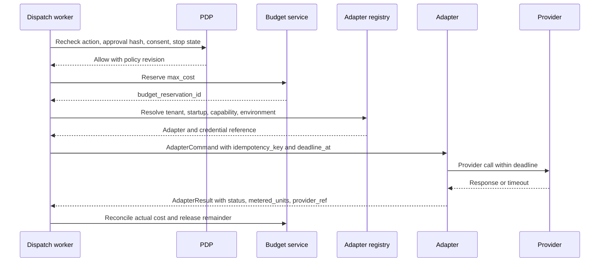
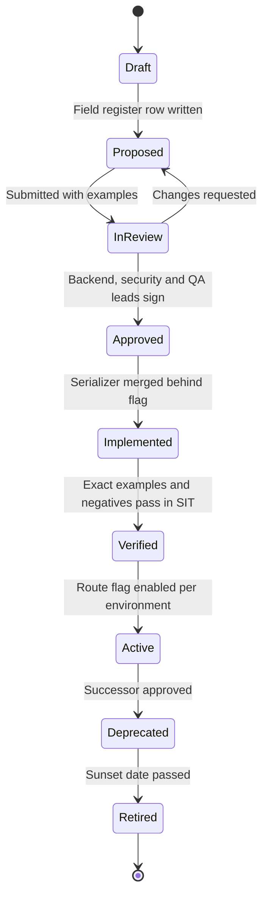

# AI Growth Engine: Employee Sales & Marketing Automation
## Application Blueprint: PART 3 (Batch 3.5b), Source Pack API Catalog Reconciliation: Enhancements, Field Contracts, Adapters, Conflicts and Tests

| Field | Value |
|---|---|
| Document | Part 3, Batch 3.5 (file b of 2): enhancements derived from document 07 "REST API & External Integration Catalog" |
| Version | 1.0 · 27 Nov 2026 |
| Baseline | BRD, FRD, Parts 0, 0A (DEC-001…065), 1, 2.1–2.5, 3.1, 3.2, 3.3, 4.1, 4.2, 6.x; file a of this batch (`Part-03-5a_Source_Pack_API_Catalog_Reconciliation.md`, §3.5.1–§3.5.4) |
| Roles applied | API Architect (lead), Integration Architect, Principal Engineer, Security Reviewer; QA Lead, FinOps Lead and Data Architect as reviewers |
| What this file adds | 24 operations (API-ENH-D-001…024) · normalized field contracts for 247 source operations · 38 contract decisions (SRC07-DEC-001…038) · 19 candidate contracts · AdapterCommand/AdapterResult envelope · 3 adapters (AD-D01…D03) · 74-entry provider register · 4 error codes · website ingress allowlist (84 operations) · contract-approval lifecycle and evidence record · 20 FR-ENH-D requirements · 16 stories with Gherkin · 367 test cases |
| Normative status | All additions are **proposals** for the coordinator to bind (as source document 07 itself states: "candidate contracts are not production-approved"). Nothing here changes Parts 3.1–3.3 silently; deltas are tagged |

**Acronyms.** As in file a, plus: CAS compare-and-swap · DPDP Digital Personal Data Protection Act 2023 (India) · HMAC hash-based message authentication code · MX mail exchanger (DNS record) · OAS OpenAPI Specification · SMTP Simple Mail Transfer Protocol.

---

## 3.5.5 Enhancements

### 3.5.5.1 Contract conventions: translating source DTOs into Part 3.2 standards (adds to Part 3.2 §3.2.1)

Document 07 writes its proposals in a compact DTO style (`idempotency_key` and `expected_revision` in the body, `page_size`, `items`/`next_cursor`, `job_id` with `queued|held|pending|simulated`). Part 3.2 §3.2.1 already fixes headers, envelopes and run resources. The table below is the **binding translation** used for every row of §3.5.5.3 (CONFLICT-361…363 give the reasons).

| Source convention | Normative Part 3.2/3.5 form | Rule | Tag |
|---|---|---|---|
| Body field `idempotency_key: string` | `Idempotency-Key` header; body field rejected (`additionalProperties: false`) | Key scoped to tenant, startup, operation and actor; same key + different body → 409 `IDEMPOTENCY_KEY_REUSED` (§3.2.1.5). Mandatory on **every** state-changing POST, also where the source DTO omitted it (129 of 165 explicit DTOs) | CONFLICT-361 |
| Body field `expected_revision: integer` | `If-Match: "r<revision>"` header | Stale → 409 `STALE_REVISION` with `current_revision` (§3.2.1.8) | CONFLICT-361 |
| Query `page_size` (1–100) and `cursor` | `limit` (1–100, default 25) and `cursor` | Cursor signed and bound to filter hash and scope token; mismatch → 400 `CURSOR_MISMATCH` | CONFLICT-362 |
| List result `items[]`, `next_cursor`, `as_of` | `{ "data": [...], "page": { "next_cursor", "prev_cursor", "limit" }, "meta": { "as_of", "total_estimate", "total_exact" } }` | Same envelope on every list in every namespace | CONFLICT-362 |
| Async result `job_id`, `state ∈ {queued, held, pending, simulated}` | `202` + `Location` + `{ "run_id", "status_url", "state", "simulated" }` | States per table *Run-state mapping* below | CONFLICT-363 |
| Mutation result `id`, `state`, `revision` | Resource representation (at least `id`, `state`, `revision`, `scope`) + `ETag: "r<revision>"` | `revision` is always present (source marked it "optional/review") | — |
| `approval_id: uuid` in body | Kept; server validates that the Approval is `approved`, unexpired, for the same object, revision and `content_hash` (CA-APPROVE) | Mismatch → 409 `APPROVAL_VOIDED` / `APPROVAL_EXPIRED`; missing → 403 `APPROVAL_REQUIRED` | — |
| `amount: string`, `currency: string` pairs | `Money { "amount": "<decimal string>", "currency": "<ISO 4217>" }` | Server recomputes totals; never float (FR-DM-01) | — |
| `action: string [a|b|c]` on `/control` routes | One action sub-resource per verb (`POST …/{id}/approve`, `…/suspend`) as in Part 3.2 | Keeps one permission, one SE class and one rate class per route (ADR-022); the source enum is preserved as the set of sub-resources | — |
| Error body "code, safe message and request_id" | RFC 9457 problem document with `code`, `detail`, `request_id`, `correlation_id`, `rule_ids`, `errors[]`, `retryable` | Superset; no stack traces | — |
| "Proposed status 200/201/202" | Part 3.2 §3.2.1.10 SE-class rule; 24 differences resolved in file a §3.5.4.7 | — | CONFLICT-370 |

**Candidate field notation (document 07 "Candidate field notation") → OpenAPI 3.1 schema** [ASSUMPTION-362, -363]

| Token | Source meaning | OpenAPI schema adopted | Default bounds (verify in review) |
|---|---|---|---|
| `u` | UUID | `type: string, format: uuid` (UUIDv7 server-generated) | — |
| `s` | bounded string | `type: string, minLength: 1, maxLength: 255` | `reason`, `message`, `description` maxLength 2,000; `name`/`title` 200 |
| `i` | non-negative integer | `type: integer, minimum: 0` | `revision` minimum 1 |
| `b` | Boolean | `type: boolean` | — |
| `m` | non-negative decimal string | `type: string, pattern: ^\d{1,15}(\.\d{1,4})?$` inside `Money` | Scale 2 for INR; currency minor units per ISO 4217 |
| `c` | ISO currency | `type: string, pattern: ^[A-Z]{3}$` from reference list (CFG-32) | — |
| `cc` | country code | `type: string, pattern: ^[A-Z]{2}$` (ISO 3166-1 alpha-2) | — |
| `t` | UTC ISO date-time | `type: string, format: date-time` ending `Z` | — |
| `h` | 64-char lowercase SHA-256 | `type: string, pattern: ^[a-f0-9]{64}$` | — |
| `k` | idempotency/event key | Header `Idempotency-Key` (`^[A-Za-z0-9_-]{22,128}$`) or provider event ID (≤ 255) | — |
| `url` | HTTPS URL | `type: string, format: uri, pattern: ^https://` | ≤ 2,048 |
| `p` | page size 1–100 | `limit: integer 1–100, default 25` | — |
| `pct` | 0–100 | `type: string` decimal `0.00–100.00` (not float) | — |
| `ids` | unique UUID list | `type: array, items: uuid, uniqueItems: true, maxItems: 1,000` | — |
| `ss` | string list | `type: array, items: s, maxItems: 100` | — |
| `items` | scoped id/state/reason records | `array` of `{ id: u, state: s, reason: s? }` | — |
| `slots` | start/end timestamps | `array` of `{ start_at: t, end_at: t }`, `end_at > start_at` | ≤ 200 slots |
| `lines` | id, description, quantity, unit price, line total | `array` of `{ id, description, quantity: Quantity, unit_price: Money, line_total: Money }`; totals server-computed | ≤ 200 lines |
| `fields` | name/label/required/type | `array` of `{ name, label_key, required: b, type ∈ allowlisted field types (CFG-12) }` | ≤ 50 |
| `contact` | name and eligible email or phone | `{ name: s, email?: email, phone?: E.164 }` with at least one channel | — |
| `map` | policy-specific typed object (still to approve) | `type: object` with a named JSON Schema per policy family (`$ref: #/components/schemas/<Family>PolicyV<n>`), never free-form | ASSUMPTION-365 |
| `?` / `-` | optional / no response body | not in `required` / `204 No Content` | — |

**Run-state mapping** (CONFLICT-363)

| Source state | Part 3.2 run state (§3.2.1.11; DEC-050) | Notes |
|---|---|---|
| `queued` | `queued` | Accepted and durable |
| `pending` | `queued` | Same meaning; not retained as a separate state |
| `held` | `waiting` with `wait_reason ∈ {approval, policy_hold, quiet_hours, budget, conflict_hold, scan_pending}` | Exposes *why* it is held (FR-UIS-03) |
| `simulated` | Any state + `"simulated": true` | Simulated runs never appear in live lists unless `include_simulated=true` (BRL-AUT-04) |

**Error profiles** used in §3.5.5.3 (codes from Part 3.2 §3.2.1.9; new codes marked ★)

| Profile | Applies to | Error codes (HTTP) |
|---|---|---|
| E-R | Reads (SE R) | `VALIDATION_FAILED`, `FILTER_NOT_ALLOWED`, `FILTER_OUT_OF_SCOPE`, `CURSOR_MISMATCH` (400) · `AUTHENTICATION_REQUIRED`, `SESSION_EXPIRED`, `WRONG_AUDIENCE` (401) · `FORBIDDEN` (403) · `NOT_FOUND` (404, uniform) · `RATE_LIMITED` (429) |
| E-W | Internal writes (SE W) | E-R + `IDEMPOTENCY_KEY_REQUIRED` (400) · `PORTFOLIO_READ_ONLY` (403) · `STALE_REVISION`, `SCOPE_CHANGED`, `IDEMPOTENCY_KEY_REUSED`, `REQUEST_IN_PROGRESS`, `IMMUTABLE_RECORD` (409) · `PAYLOAD_TOO_LARGE` (413) |
| E-Q | Queued internal work (SE Q) | E-W + `ENTITLEMENT_EXCEEDED` (403) · `BUDGET_EXHAUSTED`, `QUOTA_EXHAUSTED` (429) |
| E-X | External effect (SE X) | E-Q + `POLICY_DENIED`, `APPROVAL_REQUIRED`, `AUTONOMY_CAP`, `EMERGENCY_STOP_ACTIVE` (403) · `OUTCOME_UNCERTAIN`, `APPROVAL_EXPIRED`, `APPROVAL_VOIDED` (409) · `PROVIDER_UNAVAILABLE` (503) |
| E-A | Approvals/decisions (SE A) | E-W + `STEP_UP_REQUIRED` (401) · `SEPARATION_OF_DUTIES`, `APPROVAL_REQUIRED` (403) · `INVALID_TRANSITION`, `APPROVAL_EXPIRED`, `APPROVAL_VOIDED` (409) |
| E-F | Financial/consent/evidence ledgers (SE F) | E-W + `SEPARATION_OF_DUTIES` (403, maker = checker) · `DUPLICATE` (409) |
| E-I | Public intake and inbound (SE I) | `VALIDATION_FAILED` (400) · `UNKNOWN_HOST` (404) · `PAYLOAD_TOO_LARGE` (413) · `RATE_LIMITED` (429, challenge after threshold) · duplicate → 202 with the **same** reference (no error) |
| E-H | Provider webhooks | `WEBHOOK_SIGNATURE_INVALID`★, `WEBHOOK_REPLAY_REJECTED`★ (401) · duplicate → 200 no effect · `PAYLOAD_TOO_LARGE` (413) · `RATE_LIMITED` (429 only above RL-HOOK ceiling) |
| E-S | BFF/session | `AUTHENTICATION_REQUIRED`, `SESSION_EXPIRED`, `WRONG_AUDIENCE`, `STEP_UP_REQUIRED` (401) · `RATE_LIMITED` (429) |

**New error codes** [RECOMMENDATION-370] (add to the Part 3.2 §3.2.1.9 catalogue; all keep the problem+json shape)

| Code | HTTP | When | Source basis | Typical rule IDs |
|---|---|---|---|---|
| `CHECKSUM_MISMATCH` | 409 | Completed upload's SHA-256 differs from the declared `sha256`; object stays quarantined | SM-OP-297 "invalid checksum remains quarantined" | NFR-021 |
| `SCAN_PENDING` | 409 | Document used before the malware verdict (download, attach, index) | SM-OP-296/297; AD-20 | NFR-021, BRL-PUB-04 |
| `WEBHOOK_SIGNATURE_INVALID` | 401 | Provider signature over the raw body fails, or the connection is unknown (no detail returned) | 8 provider-callback operations | NFR-005 |
| `WEBHOOK_REPLAY_REJECTED` | 401 | Signed timestamp outside ± 5 min where the provider signs time | Document 07 "stale timestamp" test | §3.2.1.13 step 3 |

### 3.5.5.2 New operations (adds to Part 3.2 §3.2.2.4)

Columns as in Part 3.2 §3.2.2.2. IDs `API-ENH-D-###` keep this batch from colliding with other source-pack groups; the coordinator may renumber them into `API-556+` when binding.

| Op ID | Method | Path | NS | Purpose | Source | FR / screen | Auth / roles | Idempotent | SE | PDP | RL class |
|---|---|---|---|---|---|---|---|---|---|---|---|
| API-ENH-D-001 | PATCH | `~/admin/sources/{id}` | admin | Revise source approval (licence, purpose, scope, expiry) as a new SourcePolicy revision; voids prior approval | SM-OP-032 | FR-A010; A010 | R04, R10 | If-Match | W | — | RL-ADM |
| API-ENH-D-002 | GET | `~/admin/evals/cases` | admin | List evaluation cases (task, dataset revision, label provenance, tags); cursor | SM-OP-036 | FR-A011, FR-A084; A011, A084 | R11, R01, R10 | Safe | R | — | RL-ADM |
| API-ENH-D-003 | POST | `~/admin/signal-types` | admin | Draft signal taxonomy revision (code, label, vertical, evidence rule) | SM-OP-065 | FR-A019, FR-A023; A023 | R02, R04 (draft); R02 approves | Key | W | — | RL-ADM |
| API-ENH-D-004 | POST | `~/admin/role-mappings` | admin | Draft role-mapping rule-set revision (title pattern to decision role hypothesis, confidence) | SM-OP-075 | FR-A026; A026 | R04 (draft); R02 approves | Key | W | — | RL-ADM |
| API-ENH-D-005 | POST | `~/admin/alerts/{id}/read` | admin | Mark own research alert read | SM-OP-084 | FR-A028; A028 | Recipient (own) | Yes | W | — | RL-ADM |
| API-ENH-D-006 | POST | `~/admin/workflows/{id}/resume` | admin | Resume a paused workflow scope after PDP recheck (budget, consent, approval validity, stop state) | SM-OP-101 | FR-A033; A033 | R11 (L2), R01 (L3) | Key + If-Match | W | P | RL-ADM |
| API-ENH-D-007 | GET | `~/admin/messages/{id}` | admin | Single message with delivery state and provider event timeline (provider ref masked) | SM-OP-110 | FR-A037; A037 | R03, R05, R02 (scope) | Safe | R | — | RL-ADM |
| API-ENH-D-008 | GET | `~/admin/channels/whatsapp/accounts` | admin | WABA accounts, numbers, quality rating, messaging tier, template counts (never tokens) | SM-OP-130 | FR-A044; A044 | R11, R02, R10 | Safe | R | — | RL-ADM |
| API-ENH-D-009 | PUT | `~/admin/chat/settings` | admin | Website assistant settings per startup: enabled, languages, handover hours, transcript retention, daily AI budget | SM-OP-138 | FR-A046, FR-W11; A046 | R02; loosening R01 + R10 | If-Match | W | P | RL-ADM |
| API-ENH-D-010 | POST | `~/admin/forecast-models/{id}/versions` | admin | Draft forecast assumption revision (stage probabilities, horizon, seasonality); approval type forecast_model | SM-OP-230 | FR-A088; A088 | R09, R01 approves | Key | W | — | RL-ADM |
| API-ENH-D-011 | GET | `~/admin/pilots` | admin | List pilots by type (insurance, partner, institutional), stage, approvals, data-agreement state | SM-OP-236 | FR-A077, FR-A091; A077, A091, A092 | R02, R01, R10 | Safe | R | — | RL-ADM |
| API-ENH-D-012 | POST | `~/admin/domains/{id}/disable` | admin | Disable brand-domain mapping: host returns 404 UNKNOWN_HOST, tenant-keyed cache purge | SM-OP-260 | FR-A107; A100, A107 | R12, R01 | Key + If-Match | W | — | RL-ADM |
| API-ENH-D-013 | POST | `~/admin/service-invoices/{id}/receipts` | admin | Record service receipt and reconcile (maker); checker via API-ENH-D-013 action=verify | SM-OP-266 | FR-A101; A101 | R08 maker, R09 checker (different person) | Key | F | — | RL-ADM |
| API-ENH-D-014 | GET | `~/admin/usage-charges` | admin | Usage charge ledger: period, dimension, quantity, rate version, amount, adjustments | SM-OP-267 | FR-A101; A101 | R01, R08, R09, R12 (own tenant) | Safe | R | — | RL-ADM |
| API-ENH-D-015 | POST | `~/admin/usage-charges/{id}/credits` | admin | Append approved credit adjustment (original charge immutable) | SM-OP-268 | FR-A101; A101 | R08 maker; R01 approves above threshold | Key | F | — | RL-ADM |
| API-ENH-D-016 | POST | `~/admin/orders/{id}/acceptances` | admin | Record acceptance or dispute of received goods/services (buy direction) with evidence | SM-OP-286 | FR-A105; A105 | R07, R02 | Key + If-Match | F | — | RL-ADM |
| API-ENH-D-017 | POST | `~/admin/external-grants/{id}/revoke` | admin | Revoke external portal grant (PortalGrant) immediately; sessions using it re-authorize | SM-OP-294 | FR-A032, CA-PORTAL; A032 | R02, R03 (assigned), R10 | Key + If-Match | W | — | RL-ADM |
| API-ENH-D-018 | POST | `~/portal/uploads/{id}/complete` | portal | Complete own quarantined upload: checksum match, enqueue malware scan | SM-OP-297 | FR-W15, FR-W27; W27 | R16 (grant) | Key | Q | — | RL-PORTAL |
| API-ENH-D-019 | GET | `~/portal/onboarding-wizard/{app}` | portal | Read own applicant configuration draft (JSON, revision, validation state) | SM-UX-API-03 | FR-W33; W33 | Applicant (verified) | Safe | R | — | RL-PORTAL |
| API-ENH-D-020 | POST | `~/portal/service/offboarding-requests` | portal | Request offboarding (WF-14) with export preference; no automatic action | SM-UX-API-07 | FR-W34; W34 | R17 client admin | Key | W | — | RL-PORTAL |
| API-ENH-D-021 | POST | `~/admin/workflow-templates` | admin | Create workflow template draft (allowlisted nodes, bounded graph, input/output schemas) | SM-UX-API-18 | FR-A113; A113 | R11 | Key | W | — | RL-ADM |
| API-ENH-D-022 | POST | `~/admin/external-grants/{id}/rotate` | admin | Rotate invitation secret (previous invite invalid), keep grant scope | SM-OP-294 | FR-A032; A032 | R02, R03 (assigned) | Key + If-Match | X | P+D | RL-ADM |
| API-ENH-D-023 | GET | `~/admin/external-grants` | admin | List external grants by counterparty/object with expiry and state | SM-OP-293/294 | FR-A032; A032 | R02, R03 (assigned), R10 | Safe | R | — | RL-ADM |
| API-ENH-D-024 | POST | `~/admin/privacy-requests` | admin | Record privacy request received offline on behalf of a subject (identity verification pending) | SM-OP-041 | FR-A013; A013 | R10 | Key | Q | — | RL-ADM |

**Operation detail** (request fields use §3.5.5.1 notation; all mutating routes also take the headers of the *Idempotent* column)

| Op ID | Request | Response | Business rules | Specific errors | Event emitted (§3.2.3) |
|---|---|---|---|---|---|
| API-ENH-D-001 | `licence_ref: s`, `allowed_purpose: ss`, `allowed_scope: map(SourceScopeV1)`, `expires_at: t?`, `reason: s` | 200 SourcePolicy `{id, revision, state: "pending_approval"}` | New revision voids the current approval; collection continues on the **previous approved** revision until the new one is approved; loosening needs R10 + R02 (BR-M07) | `INVALID_TRANSITION` (expired source) | `source.policy_revised` |
| API-ENH-D-002 | query `task_key?`, `dataset_revision?`, `label_source?`, `limit`, `cursor` | 200 list of `{id, task_key, dataset_revision, input_digest, expected_label, provenance, tags, created_at}`; inputs shown redacted | Restricted inputs masked (NFR-078); cases from production feedback only after API-151 acceptance | — | — |
| API-ENH-D-003 | `code: s ^[a-z0-9_]{3,40}$`, `label_key: s`, `vertical: s?`, `evidence_rule: map(SignalEvidenceV1)`, `reason: s` | 201 `{id, revision, state: "draft"}` | Approval type `signal_taxonomy` (R02); active classifiers keep the pinned taxonomy revision; new codes start with weight 0 until the scoring version references them (DEC-011) | `DUPLICATE` (code exists) | `config.signal_taxonomy_revised` |
| API-ENH-D-004 | `rules: array of {title_pattern: s, seniority?: s, role_hypothesis: s, confidence: pct}`, `vertical: s?`, `reason: s` | 201 `{id, revision, state}` | Patterns are anchored, case-insensitive literals or simple wildcards (no user regex: ReDoS guard); applies to new contacts and on explicit re-run | `VALIDATION_FAILED` (pattern) | `config.role_mapping_revised` |
| API-ENH-D-005 | none | 200 `{id, read_at}` | Only the recipient; idempotent by method | `NOT_FOUND` (other user's alert) | — |
| API-ENH-D-006 | `reason: s`, `resume_mode ∈ {all, selected}`, `run_ids: ids?` | 202 `{run_id, status_url, state, resumed_count, held_count}` | PDP recheck per run: budget, consent, approval hash, autonomy cap, emergency stop; runs failing the check stay `waiting` with the rule ID (BRL-AUT-05) | `EMERGENCY_STOP_ACTIVE`, `AUTONOMY_CAP` | `workflow.resumed` |
| API-ENH-D-007 | none | 200 `{id, channel, thread_id, delivery_state, outcome_certainty, provider_ref_masked, events: items, last_event_at}` | Body and recipient masked per §2.26.5 | — | — |
| API-ENH-D-008 | `limit`, `cursor` | 200 list `{id, waba_ref_masked, phone_number_masked, quality_rating, messaging_tier, templates_approved, templates_pending, webhook_health}` | Never returns access tokens (NFR-004) | — | — |
| API-ENH-D-009 | `enabled: b`, `languages: ss`, `handover_hours: map(HoursV1)`, `transcript_retention_days: i`, `daily_ai_budget: Money`, `greeting_key: s` | 200 `{revision, state}` + ETag | Retention ≤ policy maximum (DEC-028); budget ≤ startup AI cap (DEC-008); loosening (longer retention, higher budget) → approval R01 + R10 | `POLICY_DENIED` (retention above max) | `config.chat_settings_revised` |
| API-ENH-D-010 | `stage_probabilities: map(StageProbV1)`, `horizon_days: i`, `seasonality: b`, `reason: s` | 201 `{id, revision, state: "draft"}` | Backtest (API-407) required before approval type `forecast_model`; forecasts always labelled estimates (BR-M60) | `INVALID_TRANSITION` | `config.forecast_model_revised` |
| API-ENH-D-011 | query `type ∈ {insurance, partner, institutional}`, `stage?`, `limit`, `cursor` | 200 list `{id, type, organization, stage, approvals, data_agreement_state, next_review_at}` | Organization-level only: no patient or individual data (MedMaarg boundary) | — | — |
| API-ENH-D-012 | `reason: s` | 200 `{id, state: "disabled", revision}` | Atomic: mapping removed, CDN/tenant-keyed cache purged, host → 404 `UNKNOWN_HOST`; published snapshots retained for re-enable | `INVALID_TRANSITION` | `site.domain_disabled` |
| API-ENH-D-013 | `action ∈ {record, verify}`, `amount: Money`, `received_at: t`, `evidence_ref: u`, `payment_ref: s` | 201 `{receipt_id, state ∈ {recorded, verified}, ledger_entry_id?}` | Maker records, a **different** checker verifies; ledger entry only on verify; no double allocation (BRL-FIN-02) | `SEPARATION_OF_DUTIES`, `DUPLICATE` | `billing.service_receipt_verified` |
| API-ENH-D-014 | query `period?`, `dimension?`, `tenant?` (platform roles), `limit`, `cursor` | 200 list `{id, period, dimension, quantity, rate_version, amount: Money, adjustments: items}` | Own tenant only for R12; platform R01 sees all (DEC-047) | — | — |
| API-ENH-D-015 | `amount: Money`, `reason: s`, `approval_id: u?` | 201 `{credit_id, state}` | Append-only; credit ≤ original charge; above the plan threshold needs R01 approval | `APPROVAL_REQUIRED`, `DUPLICATE` | `billing.usage_credit_appended` |
| API-ENH-D-016 | `decision ∈ {accept, dispute}`, `lines: items(id, accepted_quantity: Quantity, reason?)`, `evidence_ids: ids` | 201 `{acceptance_id, order_state}` | Buy direction only; acceptance cannot exceed received quantity (FR-DM-03); dispute opens a discrepancy task; payable ledger only after acceptance (CA-FIN) | `OVER_DELIVERY`, `INVALID_TRANSITION` | `order.acceptance_recorded` |
| API-ENH-D-017 | `reason: s` | 200 `{grant_id, state: "revoked", revoked_at}` | Effective ≤ 60 s for active portal sessions (NFR-050 pattern); audit retained | `INVALID_TRANSITION` | `portal.grant_revoked` |
| API-ENH-D-018 | `sha256: h` (repeated for verification) | 202 `{run_id, state: "waiting", wait_reason: "scan_pending"}` | Server hashes the stored object; mismatch → stays quarantined; only the uploader's grant may complete | `CHECKSUM_MISMATCH` | `document.upload_completed` |
| API-ENH-D-019 | none | 200 `{application_ref, revision, configuration, validation: items, status}` | Applicant identity must match the verified administrator; no tenant data exists yet (pre-provision) | `NOT_FOUND` (expired reference) | — |
| API-ENH-D-020 | `export_requested: b`, `effective_after: t?`, `reason: s` | 202 `{case_id, state: "requested"}` | Creates a WF-14 case for platform R01/R12; no data deletion until approval and the retention rules (DEC-028) | `INVALID_TRANSITION` (already offboarding) | `saas.offboarding_requested` |
| API-ENH-D-021 | `name: s`, `capability: s`, `graph: map(WorkflowGraphV1)`, `input_schema: map`, `output_schema: map` | 201 `{id, revision, state: "draft"}` | Only node types from API-478; ≤ 50 nodes, no cycles except bounded waits, no code nodes (DEC-051) | `VALIDATION_FAILED` (graph) | `workflow.template_created` |
| API-ENH-D-022 | `reason: s`, `notify: b` | 202 `{grant_id, invite_state: "reissued"}` | Previous invite secret invalid immediately; new secret delivered through the outbox; recipient identity binding unchanged | `INVALID_TRANSITION` (revoked grant) | `portal.grant_rotated` |
| API-ENH-D-023 | query `counterparty?`, `object_type?`, `state?`, `limit`, `cursor` | 200 list `{id, counterparty, object_type, object_id, actions, state, expires_at}` | Scope-limited; recipient identity shown masked | — | — |
| API-ENH-D-024 | `type ∈ {access, correction, deletion, restriction, export}`, `channel_received ∈ {email, phone, letter, in_person}`, `subject_contact_ref: u?`, `request: s` | 202 `{id, state: "identity_verification_pending", due_at}` | Due date per jurisdiction pack (NFR-075); no disclosure before verification (API-085) | — | `privacy.request_recorded` |

### 3.5.5.3 Field contract register: 247 source operations with a proposed DTO or list contract

**How to read.** One row per source operation whose document 07 maturity is *explicit DTO* (164), *public allowlist* (1) or *cursor list* (82). *Request* lists body fields after translation (§3.5.5.1): `name:type∈{enum}`; `?` = optional; `decimal-str` = Money amount; `ISO-4217` = currency. *Headers* are the mandatory request headers from Part 3.2 §3.2.1.4. *Status* for split operations lists each target (`366:200` = API-366 returns 200). *Errors* = profile from §3.5.5.1 plus operation-specific codes. These DTOs are the **starting schemas for drf-spectacular serializers** [RECOMMENDATION-361]; each still passes the approval workflow of §3.5.5.9 before its route is enabled.


**Domain IDN: 3 source operations**

| Source op | Part 3.5 target | Request (body or query) | Headers | Response (normative) | Status | Errors (profile + specific) | RL | Source → blueprint translation |
|---|---|---|---|---|---|---|---|---|
| SM-OP-253 POST `/api/v1/sales/memberships` | API-020, API-022 | `user_id`:uuid; `role`:str; `scope`:object; `action`:str∈{invite/revoke} | Idempotency-Key, X-Scope-Token, X-CSRF-Token | `id`:uuid; `state`:str; `revision`:int? + `ETag` | 020:202, 022:200 | E-Q | RL-ADM | Fields adopted as named |
| SM-OP-254 POST `/api/v1/sales/support-grants` | API-024, API-025 | `startup_id`:uuid; `allowed_actions`:array; `expires_at`:date-time; `approval_id`:uuid | Idempotency-Key, X-Scope-Token, X-CSRF-Token | `id`:uuid; `state`:str; `revision`:int? + `ETag` | 024:201, 025:201 | E-W | RL-ADM | Fields adopted as named |
| SM-OP-295 POST `/api/v1/commercial/portal/external-grants/accept` | API-013 | `invite_secret`:str | Idempotency-Key, X-CSRF-Token | `state`:str; `grant_id`:uuid | 200 | E-W | RL-AUTH | idempotency_key → Idempotency-Key |

**Domain TEN: 13 source operations**

| Source op | Part 3.5 target | Request (body or query) | Headers | Response (normative) | Status | Errors (profile + specific) | RL | Source → blueprint translation |
|---|---|---|---|---|---|---|---|---|
| SM-OP-065 POST `/api/v1/admin/signal-types` | API-ENH-D-003 (+API-047) | `code`:str; `label`:str; `criteria`:object | X-Scope-Token | `id`:uuid; `state`:str; `revision`:int? + `ETag` | 200 | E-R | RL-ADM | expected_revision → If-Match |
| SM-OP-247 GET `/api/v1/sales/tenants` | API-026 | query: `limit`:int 1–100 (default 25); `cursor`:str?; `filter[…]` per allowlist (source: Scoped filters/cursor) | X-Scope-Token | `data[]` + `page.next_cursor` + `meta.as_of`, `meta.total_estimate` | 200 | E-R | RL-ADM | page_size → limit; items → data; next_cursor → page.next_cursor |
| SM-OP-248 POST `/api/v1/sales/tenants` | API-027 | `legal_name`:str; `kind`:str∈{owned/client}; `region`:str | Idempotency-Key, X-Scope-Token, X-CSRF-Token | `id`:uuid; `state`:str; `revision`:int? + `ETag` | 202 | E-Q | RL-ADM-H | idempotency_key → Idempotency-Key |
| SM-OP-249 POST `/api/v1/sales/tenants/{id}/control` | API-028 | `action`:str∈{activate/suspend/offboard}; `reason`:str; `approval_id`:uuid | Idempotency-Key, X-Scope-Token, X-CSRF-Token | `run_id`:uuid; `status_url`; `state`∈{queued/running/waiting}; `simulated`:bool | 200 | E-A + INVALID_TRANSITION | RL-ADM | expected_revision → If-Match; job_id → run_id; held/pending → waiting/queued; simulated → flag |
| SM-OP-250 GET `/api/v1/sales/startups` | API-029 | query: `limit`:int 1–100 (default 25); `cursor`:str?; `filter[…]` per allowlist (source: Scoped filters/cursor) | X-Scope-Token | `data[]` + `page.next_cursor` + `meta.as_of`, `meta.total_estimate` | 200 | E-R | RL-ADM | page_size → limit; items → data; next_cursor → page.next_cursor |
| SM-OP-251 POST `/api/v1/sales/startups` | API-030 | `legal_name`:str; `brand`:str; `tenant_id`:uuid; `profile`:object; `currency`:ISO-4217 | Idempotency-Key, X-Scope-Token, X-CSRF-Token | `id`:uuid; `state`:str; `revision`:int? + `ETag` | 202 | E-Q | RL-ADM | Fields adopted as named |
| SM-OP-252 PATCH `/api/v1/sales/startups/{id}` | API-031, API-039 | `profile`:object; `approved_hash`:str? | If-Match, X-Scope-Token, X-CSRF-Token | `id`:uuid; `state`:str; `revision`:int? + `ETag` | 031:200, 039:200 | E-W | RL-ADM | expected_revision → If-Match |
| SM-OP-255 GET `/api/v1/sales/templates` | API-033 | query: `limit`:int 1–100 (default 25); `cursor`:str?; `filter[…]` per allowlist (source: Scoped filters/cursor) | X-Scope-Token | `data[]` + `page.next_cursor` + `meta.as_of`, `meta.total_estimate` | 200 | E-R | RL-ADM | page_size → limit; items → data; next_cursor → page.next_cursor |
| SM-OP-256 POST `/api/v1/sales/templates` | API-034 | `template_key`:str; `config_schema`:object; `defaults`:object; `hash`:str | Idempotency-Key, X-Scope-Token, X-CSRF-Token | `id`:uuid; `state`:str; `revision`:int? + `ETag` | 201 | E-W | RL-ADM | Fields adopted as named |
| SM-OP-257 POST `/api/v1/sales/templates/{id}/control` | API-035, API-036, API-037, API-541, API-539 | `action`:str∈{validate/approve/apply/retire}; `approval_id`:uuid?; `startup_id`:uuid? | Idempotency-Key, X-Scope-Token, X-CSRF-Token | `id`:uuid; `state`:str; `revision`:int? + `ETag` | 035:200, 036:202, 037:200, 541:200, 539:200 | E-R + INVALID_TRANSITION | RL-ADM | expected_revision → If-Match |
| SM-OP-258 GET `/api/v1/sales/domains` | API-044 | query: `limit`:int 1–100 (default 25); `cursor`:str?; `filter[…]` per allowlist (source: Scoped filters/cursor) | X-Scope-Token | `data[]` + `page.next_cursor` + `meta.as_of`, `meta.total_estimate` | 200 | E-R | RL-ADM | page_size → limit; items → data; next_cursor → page.next_cursor |
| SM-OP-259 POST `/api/v1/sales/domains` | API-045 | `hostname`:str; `brand_config`:object; `startup_id`:uuid | Idempotency-Key, X-Scope-Token, X-CSRF-Token | `id`:uuid; `state`:str; `revision`:int? + `ETag` | 201 | E-W | RL-ADM | Fields adopted as named |
| SM-OP-260 POST `/api/v1/sales/domains/{id}/control` | API-ENH-D-012 (+API-046) | `action`:str∈{verify/activate/disable} | Idempotency-Key, X-Scope-Token, X-CSRF-Token | `id`:uuid; `state`:str; `revision`:int? + `ETag` | 202 | E-Q + INVALID_TRANSITION | RL-ADM | expected_revision → If-Match |

**Domain CAT: 10 source operations**

| Source op | Part 3.5 target | Request (body or query) | Headers | Response (normative) | Status | Errors (profile + specific) | RL | Source → blueprint translation |
|---|---|---|---|---|---|---|---|---|
| SM-OP-006 GET `/api/v1/products` | API-048 | query: `limit`:int 1–100 (default 25); `cursor`:str?; `filter[…]` per allowlist (source: Optional filters/pagination where list; no request body) | X-Scope-Token | `data[]` + `page.next_cursor` + `meta.as_of`, `meta.total_estimate` | 200 | E-R | RL-ADM | page_size → limit; items → data; next_cursor → page.next_cursor |
| SM-OP-008 POST `/api/v1/admin/products` | API-053 | `code`:str; `name`:str; `capabilities`:array? | Idempotency-Key, X-Scope-Token, X-CSRF-Token | `id`:uuid; `state`:str; `revision`:int? + `ETag` | 201 | E-W | RL-ADM | Fields adopted as named |
| SM-OP-009 PATCH `/api/v1/admin/products/{id}` | API-055, API-056 | `name`:str?; `description`:str?; `active`:bool? | If-Match, X-Scope-Token, X-CSRF-Token | `id`:uuid; `state`:str; `revision`:int? + `ETag` | 055:200, 056:200 | E-W | RL-ADM | expected_revision → If-Match |
| SM-OP-010 POST `/api/v1/admin/claims/approve` | API-049 | `claim_id`:uuid; `decision`:str∈{approve/reject}; `content_hash`:str; `reason`:str | Idempotency-Key, X-Scope-Token, X-CSRF-Token | `id`:uuid; `state`:str; `revision`:int? + `ETag` | 200 | E-A + INVALID_TRANSITION | RL-ADM | Fields adopted as named |
| SM-OP-011 POST `/api/v1/admin/products/{id}/prices` | API-057 | `currency`:ISO-4217; `amount`:decimal-str; `effective_at`:date-time | Idempotency-Key, X-Scope-Token, X-CSRF-Token | `id`:uuid; `state`:str; `revision`:int? + `ETag` | 201 | E-W | RL-ADM | expected_revision → If-Match |
| SM-OP-012 POST `/api/v1/knowledge/uploads` | API-051 | `title`:str; `mime`:str; `byte_size`:int; `sha256`:str; `purpose`:str | Idempotency-Key, X-Scope-Token, X-CSRF-Token | `id`:uuid; `state`:str; `revision`:int? + `ETag` | 202 | E-Q + CHECKSUM_MISMATCH, SCAN_PENDING | RL-ADM-H | Fields adopted as named |
| SM-OP-013 GET `/api/v1/knowledge/documents` | API-061 | query: `limit`:int 1–100 (default 25); `cursor`:str?; `filter[…]` per allowlist (source: Optional filters/pagination where list; no request body) | X-Scope-Token | `data[]` + `page.next_cursor` + `meta.as_of`, `meta.total_estimate` | 200 | E-R | RL-ADM | page_size → limit; items → data; next_cursor → page.next_cursor |
| SM-OP-015 GET `/api/v1/knowledge/search` | API-052 | query: `limit`:int 1–100 (default 25); `cursor`:str?; `filter[…]` per allowlist (source: Optional filters/pagination where list; no request body) | X-Scope-Token | `data[]` + `page.next_cursor` + `meta.as_of`, `meta.total_estimate` | 200 | E-R | RL-ADM | page_size → limit; items → data; next_cursor → page.next_cursor |
| SM-OP-245 GET `/api/v1/admin/products/planned` | API-064 | query: `limit`:int 1–100 (default 25); `cursor`:str?; `filter[…]` per allowlist (source: Optional filters/pagination where list; no request body) | X-Scope-Token | `data[]` + `page.next_cursor` + `meta.as_of`, `meta.total_estimate` | 200 | E-R | RL-ADM | page_size → limit; items → data; next_cursor → page.next_cursor |
| SM-OP-246 POST `/api/v1/admin/products/{id}/launch` | API-050 | `approval_id`:uuid; `evidence_ids`:array | Idempotency-Key, X-Scope-Token, X-CSRF-Token | `id`:uuid; `state`:str; `revision`:int? + `ETag` | 200 | E-A | RL-ADM | expected_revision → If-Match |

**Domain GOV: 12 source operations**

| Source op | Part 3.5 target | Request (body or query) | Headers | Response (normative) | Status | Errors (profile + specific) | RL | Source → blueprint translation |
|---|---|---|---|---|---|---|---|---|
| SM-OP-018 POST `/api/v1/consents` | API-066 | `contact_id`:uuid?; `channel`:str; `purpose`:str; `choice`:str∈{opt_in/opt_out}; `evidence_ref`:str | Idempotency-Key, X-Scope-Token, X-CSRF-Token | `id`:uuid; `state`:str; `revision`:int? + `ETag` | 201 | E-F | RL-ADM | Fields adopted as named |
| SM-OP-019 POST `/api/v1/opt-out` | API-067 | `token`:str; `channel`:str∈{email/whatsapp/all} | Idempotency-Key, X-CSRF-Token | `state`:str | 200 | E-W | RL-PUB-W | idempotency_key → Idempotency-Key |
| SM-OP-020 GET `/api/v1/admin/policies` | API-071 | query: `limit`:int 1–100 (default 25); `cursor`:str?; `filter[…]` per allowlist (source: Optional filters/pagination where list; no request body) | X-Scope-Token | `data[]` + `page.next_cursor` + `meta.as_of`, `meta.total_estimate` | 200 | E-R | RL-ADM | page_size → limit; items → data; next_cursor → page.next_cursor |
| SM-OP-021 POST `/api/v1/admin/policies` | API-072, API-073 | `policy_key`:str; `rules`:object; `approval_id`:uuid | Idempotency-Key, X-Scope-Token, X-CSRF-Token | `id`:uuid; `state`:str; `revision`:int? + `ETag` | 072:201, 073:200 | E-W + PUBLICATION_MOVED | RL-ADM | expected_revision → If-Match |
| SM-OP-022 GET `/api/v1/admin/suppressions` | API-074, API-076 | query: `limit`:int 1–100 (default 25); `cursor`:str?; `filter[…]` per allowlist (source: Optional filters/pagination where list; no request body) | X-Scope-Token | `data[]` + `page.next_cursor` + `meta.as_of`, `meta.total_estimate` | 074:200, 076:200 | E-R | RL-ADM | page_size → limit; items → data; next_cursor → page.next_cursor |
| SM-OP-041 POST `/api/v1/privacy/requests` | API-069 | `type`:str∈{access/correction/deletion/restriction/export}; `subject_token`:str?; `request`:str | Idempotency-Key, X-CSRF-Token | `id`:uuid; `state`:str; `revision`:int? + `ETag` | 202 | E-Q | RL-PUB-W | Fields adopted as named |
| SM-OP-042 GET `/api/v1/admin/privacy/requests` | API-084 | query: `limit`:int 1–100 (default 25); `cursor`:str?; `filter[…]` per allowlist (source: Optional filters/pagination where list; no request body) | X-Scope-Token | `data[]` + `page.next_cursor` + `meta.as_of`, `meta.total_estimate` | 200 | E-R | RL-ADM | page_size → limit; items → data; next_cursor → page.next_cursor |
| SM-OP-043 POST `/api/v1/admin/privacy/requests/{id}/resolve` | API-085, API-086, API-087 | `decision`:str; `proof`:str; `legal_hold`:bool | Idempotency-Key, X-Scope-Token, X-CSRF-Token | `id`:uuid; `state`:str; `revision`:int? + `ETag` | 085:200, 086:202, 087:200 | E-W | RL-ADM | expected_revision → If-Match |
| SM-OP-044 POST `/api/v1/admin/retention-policies` | API-091 | `data_class`:str; `retention_days`:int; `approval_id`:uuid | If-Match, X-Scope-Token, X-CSRF-Token | `id`:uuid; `state`:str; `revision`:int? + `ETag` | 200 | E-W | RL-ADM | expected_revision → If-Match |
| SM-OP-097 POST `/api/v1/engagement/check` | API-068 | `contact_id`:uuid; `opportunity_id`:uuid; `channel`:str∈{email/whatsapp/social} | Idempotency-Key, X-Scope-Token, X-CSRF-Token | `eligible`:bool; `reason`:str | 200 | E-R | RL-ADM | Fields adopted as named |
| SM-OP-142 GET `/api/v1/admin/compliance` | API-070 | query: `limit`:int 1–100 (default 25); `cursor`:str?; `filter[…]` per allowlist (source: Optional filters/pagination where list; no request body) | X-Scope-Token | `data[]` + `page.next_cursor` + `meta.as_of`, `meta.total_estimate` | 200 | E-R | RL-ADM | page_size → limit; items → data; next_cursor → page.next_cursor |
| SM-OP-143 POST `/api/v1/admin/compliance/{id}/resolve` | API-094 | `decision`:str; `evidence_ids`:array | Idempotency-Key, X-Scope-Token, X-CSRF-Token | `id`:uuid; `state`:str; `revision`:int? + `ETag` | 200 | E-A | RL-ADM | expected_revision → If-Match |

**Domain INT: 9 source operations**

| Source op | Part 3.5 target | Request (body or query) | Headers | Response (normative) | Status | Errors (profile + specific) | RL | Source → blueprint translation |
|---|---|---|---|---|---|---|---|---|
| SM-OP-023 GET `/api/v1/integrations` | API-095 | query: `limit`:int 1–100 (default 25); `cursor`:str?; `filter[…]` per allowlist (source: Optional filters/pagination where list; no request body) | X-Scope-Token | `data[]` + `page.next_cursor` + `meta.as_of`, `meta.total_estimate` | 200 | E-R | RL-ADM | page_size → limit; items → data; next_cursor → page.next_cursor |
| SM-OP-024 POST `/api/v1/admin/integrations` | API-097 | `provider`:str; `kind`:str; `secret_ref`:str; `account_ref`:str; `scopes`:array | Idempotency-Key, X-Scope-Token, X-CSRF-Token | `id`:uuid; `state`:str; `revision`:int? + `ETag` | 201 | E-W | RL-ADM | Fields adopted as named |
| SM-OP-025 POST `/api/v1/admin/integrations/test` | API-096 | `connection_id`:uuid; `test_kind`:str | Idempotency-Key, X-Scope-Token, X-CSRF-Token | `id`:uuid; `state`:str; `revision`:int? + `ETag` | 202 | E-Q | RL-ADM | Fields adopted as named |
| SM-OP-026 POST `/api/v1/admin/integrations/{id}/disable` | API-099 | `reason`:str | Idempotency-Key, X-Scope-Token, X-CSRF-Token | `id`:uuid; `state`:str; `revision`:int? + `ETag` | 200 | E-W | RL-ADM | expected_revision → If-Match |
| SM-OP-125 POST `/api/v1/admin/calendar-links` | API-110 | `provider`:str; `calendar_ref`:str; `secret_ref`:str | Idempotency-Key, X-Scope-Token, X-CSRF-Token | `id`:uuid; `state`:str; `revision`:int? + `ETag` | 202 | E-Q | RL-ADM | Fields adopted as named |
| SM-OP-130 GET `/api/v1/admin/whatsapp/accounts` | API-ENH-D-008 (+API-109, API-102) | query: `limit`:int 1–100 (default 25); `cursor`:str?; `filter[…]` per allowlist (source: Optional filters/pagination where list; no request body) | X-Scope-Token | `data[]` + `page.next_cursor` + `meta.as_of`, `meta.total_estimate` | 200 | E-R | RL-ADM | page_size → limit; items → data; next_cursor → page.next_cursor |
| SM-OP-131 POST `/api/v1/admin/whatsapp/accounts` | API-107 | `account_ref`:str; `secret_ref`:str; `provider`:str; `approval_id`:uuid | Idempotency-Key, X-Scope-Token, X-CSRF-Token | `id`:uuid; `state`:str; `revision`:int? + `ETag` | 202 | E-Q | RL-ADM | Fields adopted as named |
| SM-OP-132 POST `/api/v1/admin/whatsapp/templates` | API-108 | `account_id`:uuid; `template_ref`:str; `locale`:str | Idempotency-Key, X-Scope-Token, X-CSRF-Token | `run_id`:uuid; `status_url`; `state`∈{queued/running/waiting}; `simulated`:bool | 202 | E-Q | RL-ADM | expected_revision → If-Match; job_id → run_id; held/pending → waiting/queued; simulated → flag |
| SM-OP-154 POST `/api/v1/admin/social/accounts` | API-113 | `platform`:str; `account_ref`:str; `secret_ref`:str; `approval_id`:uuid | Idempotency-Key, X-Scope-Token, X-CSRF-Token | `id`:uuid; `state`:str; `revision`:int? + `ETag` | 202 | E-Q | RL-ADM | Fields adopted as named |

**Domain OPS: 7 source operations**

| Source op | Part 3.5 target | Request (body or query) | Headers | Response (normative) | Status | Errors (profile + specific) | RL | Source → blueprint translation |
|---|---|---|---|---|---|---|---|---|
| SM-OP-027 GET `/api/v1/events` | API-115 | query: `limit`:int 1–100 (default 25); `cursor`:str?; `filter[…]` per allowlist (source: Optional filters/pagination where list; no request body) | X-Scope-Token | `data[]` + `page.next_cursor` + `meta.as_of`, `meta.total_estimate` | 200 | E-R | RL-ADM | page_size → limit; items → data; next_cursor → page.next_cursor |
| SM-OP-028 GET `/api/v1/admin/jobs` | API-124 | query: `limit`:int 1–100 (default 25); `cursor`:str?; `filter[…]` per allowlist (source: Optional filters/pagination where list; no request body) | X-Scope-Token | `data[]` + `page.next_cursor` + `meta.as_of`, `meta.total_estimate` | 200 | E-R | RL-ADM | page_size → limit; items → data; next_cursor → page.next_cursor |
| SM-OP-029 POST `/api/v1/admin/jobs/{id}/retry` | API-116 | `reason`:str; `reconciliation_proof`:str? | Idempotency-Key, X-Scope-Token, X-CSRF-Token | `run_id`:uuid; `status_url`; `state`∈{queued/running/waiting}; `simulated`:bool | 202 | E-Q | RL-ADM | expected_revision → If-Match; job_id → run_id; held/pending → waiting/queued; simulated → flag |
| SM-OP-046 GET `/api/v1/ready` | API-118 | query: `limit`:int 1–100 (default 25); `cursor`:str?; `filter[…]` per allowlist (source: None) | — | `data[]` + `page.next_cursor` + `meta.as_of`, `meta.total_estimate` | 200 | E-R | RL-HEALTH | page_size → limit; items → data; next_cursor → page.next_cursor |
| SM-OP-048 POST `/api/v1/admin/incidents/{id}/resolve` | API-129, API-130 | `disposition`:str; `evidence_ids`:array | Idempotency-Key, X-Scope-Token, X-CSRF-Token | `id`:uuid; `state`:str; `revision`:int? + `ETag` | 129:200, 130:200 | E-W | RL-ADM | expected_revision → If-Match |
| SM-OP-233 GET `/api/v1/admin/releases` | API-120 | query: `limit`:int 1–100 (default 25); `cursor`:str?; `filter[…]` per allowlist (source: Optional filters/pagination where list; no request body) | X-Scope-Token | `data[]` + `page.next_cursor` + `meta.as_of`, `meta.total_estimate` | 200 | E-R | RL-ADM | page_size → limit; items → data; next_cursor → page.next_cursor |
| SM-OP-234 POST `/api/v1/admin/releases/{id}/approve` | API-132 | `artifact_hash`:str; `evidence_ids`:array; `approval_id`:uuid | Idempotency-Key, X-Scope-Token, X-CSRF-Token | `id`:uuid; `state`:str; `revision`:int? + `ETag` | 200 | E-A + INVALID_TRANSITION | RL-ADM | expected_revision → If-Match |

**Domain AI: 8 source operations**

| Source op | Part 3.5 target | Request (body or query) | Headers | Response (normative) | Status | Errors (profile + specific) | RL | Source → blueprint translation |
|---|---|---|---|---|---|---|---|---|
| SM-OP-033 POST `/api/v1/internal/ai/run` | API-134 | `task_key`:str; `input`:object; `prompt_revision`:int; `budget`:decimal-str | Idempotency-Key | `run_id`:uuid; `status_url`; `state`∈{queued/running/waiting}; `simulated`:bool | 202 | E-Q + BUDGET_EXHAUSTED | RL-INT | idempotency_key → Idempotency-Key; job_id → run_id; held/pending → waiting/queued; simulated → flag |
| SM-OP-035 POST `/api/v1/admin/ai/prompts` | API-142 | `task_key`:str; `instruction`:str; `output_schema`:object | Idempotency-Key, X-Scope-Token, X-CSRF-Token | `id`:uuid; `state`:str; `revision`:int? + `ETag` | 201 | E-W | RL-ADM | expected_revision → If-Match |
| SM-OP-036 GET `/api/v1/admin/ai/eval-cases` | API-ENH-D-002 | query: `limit`:int 1–100 (default 25); `cursor`:str?; `filter[…]` per allowlist (source: Optional filters/pagination where list; no request body) | X-Scope-Token | `data[]` + `page.next_cursor` + `meta.as_of`, `meta.total_estimate` | 200 | E-R | RL-ADM | page_size → limit; items → data; next_cursor → page.next_cursor |
| SM-OP-038 GET `/api/v1/admin/costs` | API-136 | query: `limit`:int 1–100 (default 25); `cursor`:str?; `filter[…]` per allowlist (source: Optional filters/pagination where list; no request body) | X-Scope-Token | `data[]` + `page.next_cursor` + `meta.as_of`, `meta.total_estimate` | 200 | E-R | RL-ADM | page_size → limit; items → data; next_cursor → page.next_cursor |
| SM-OP-039 POST `/api/v1/admin/budgets` | API-137 | `scope`:object; `period`:str; `limit`:str; `currency`:ISO-4217; `approval_id`:uuid | Idempotency-Key, X-Scope-Token, X-CSRF-Token | `id`:uuid; `state`:str; `revision`:int? + `ETag` | 200 | E-A + BUDGET_EXHAUSTED | RL-ADM | Fields adopted as named |
| SM-OP-040 POST `/api/v1/admin/budgets/{id}/pause` | API-144 | `reason`:str | Idempotency-Key, X-Scope-Token, X-CSRF-Token | `id`:uuid; `state`:str; `revision`:int? + `ETag` | 200 | E-W + INVALID_TRANSITION, BUDGET_EXHAUSTED, DUPLICATE | RL-ADM | expected_revision → If-Match |
| SM-OP-225 POST `/api/v1/admin/evals/run` | API-138 | `dataset_key`:str; `prompt_revision`:int; `budget`:decimal-str | Idempotency-Key, X-Scope-Token, X-CSRF-Token | `run_id`:uuid; `status_url`; `state`∈{queued/running/waiting}; `simulated`:bool | 202 | E-Q | RL-ADM-H | idempotency_key → Idempotency-Key; job_id → run_id; held/pending → waiting/queued; simulated → flag |
| SM-OP-226 GET `/api/v1/admin/evals/results` | API-147, API-148 | query: `limit`:int 1–100 (default 25); `cursor`:str?; `filter[…]` per allowlist (source: Optional filters/pagination where list; no request body) | X-Scope-Token | `data[]` + `page.next_cursor` + `meta.as_of`, `meta.total_estimate` | 147:200, 148:200 | E-R | RL-ADM | page_size → limit; items → data; next_cursor → page.next_cursor |

**Domain INTL: 34 source operations**

| Source op | Part 3.5 target | Request (body or query) | Headers | Response (normative) | Status | Errors (profile + specific) | RL | Source → blueprint translation |
|---|---|---|---|---|---|---|---|---|
| SM-OP-030 GET `/api/v1/sources` | API-158 | query: `limit`:int 1–100 (default 25); `cursor`:str?; `filter[…]` per allowlist (source: Optional filters/pagination where list; no request body) | X-Scope-Token | `data[]` + `page.next_cursor` + `meta.as_of`, `meta.total_estimate` | 200 | E-R | RL-ADM | page_size → limit; items → data; next_cursor → page.next_cursor |
| SM-OP-031 POST `/api/v1/admin/sources` | API-159 | `name`:str; `domain`:str; `method`:str; `allowed_purpose`:str; `quota`:int; `policy_proof`:str | Idempotency-Key, X-Scope-Token, X-CSRF-Token | `id`:uuid; `state`:str; `revision`:int? + `ETag` | 201 | E-W | RL-ADM | Fields adopted as named |
| SM-OP-032 PATCH `/api/v1/admin/sources/{id}` | API-ENH-D-001 (+API-179) | `policy`:object; `approval_id`:uuid? | Idempotency-Key, X-Scope-Token, X-CSRF-Token | `id`:uuid; `state`:str; `revision`:int? + `ETag` | 200 | E-W | RL-ADM | expected_revision → If-Match |
| SM-OP-049 GET `/api/v1/research/plans` | API-180 | query: `limit`:int 1–100 (default 25); `cursor`:str?; `filter[…]` per allowlist (source: Optional filters/pagination where list; no request body) | X-Scope-Token | `data[]` + `page.next_cursor` + `meta.as_of`, `meta.total_estimate` | 200 | E-R | RL-ADM | page_size → limit; items → data; next_cursor → page.next_cursor |
| SM-OP-050 POST `/api/v1/research/plans` | API-160 | `name`:str; `queries`:array; `source_ids`:array; `schedule`:str; `budget_limit`:decimal-str; `currency`:ISO-4217 | Idempotency-Key, X-Scope-Token, X-CSRF-Token | `id`:uuid; `state`:str; `revision`:int? + `ETag` | 201 | E-W | RL-ADM | Fields adopted as named |
| SM-OP-051 POST `/api/v1/research/run` | API-161 | `plan_id`:uuid | Idempotency-Key, X-Scope-Token, X-CSRF-Token | `run_id`:uuid; `status_url`; `state`∈{queued/running/waiting}; `simulated`:bool | 202 | E-X + BUDGET_EXHAUSTED | RL-ADM-H | idempotency_key → Idempotency-Key; job_id → run_id; held/pending → waiting/queued; simulated → flag |
| SM-OP-052 PATCH `/api/v1/research/plans/{id}` | API-181 | `queries`:array?; `source_ids`:array?; `schedule`:str?; `enabled`:bool? | If-Match, X-Scope-Token, X-CSRF-Token | `id`:uuid; `state`:str; `revision`:int? + `ETag` | 200 | E-W | RL-ADM | expected_revision → If-Match |
| SM-OP-053 GET `/api/v1/research/results` | API-162 | query: `limit`:int 1–100 (default 25); `cursor`:str?; `filter[…]` per allowlist (source: Optional filters/pagination where list; no request body) | X-Scope-Token | `data[]` + `page.next_cursor` + `meta.as_of`, `meta.total_estimate` | 200 | E-R + BUDGET_EXHAUSTED | RL-ADM | page_size → limit; items → data; next_cursor → page.next_cursor |
| SM-OP-059 GET `/api/v1/organizations` | API-164 | query: `limit`:int 1–100 (default 25); `cursor`:str?; `filter[…]` per allowlist (source: Optional filters/pagination where list; no request body) | X-Scope-Token | `data[]` + `page.next_cursor` + `meta.as_of`, `meta.total_estimate` | 200 | E-R | RL-ADM | page_size → limit; items → data; next_cursor → page.next_cursor |
| SM-OP-060 POST `/api/v1/organizations` | API-165 | `legal_name`:str; `domain`:str; `country`:str; `evidence_ids`:array | Idempotency-Key, X-Scope-Token, X-CSRF-Token | `id`:uuid; `state`:str; `revision`:int? + `ETag` | 201 | E-W | RL-ADM | Fields adopted as named |
| SM-OP-062 POST `/api/v1/organizations/{id}/merge` | API-190, API-191 | `duplicate_ids`:array; `evidence_ids`:array; `approval_id`:uuid | Idempotency-Key, X-Scope-Token, X-CSRF-Token | `id`:uuid; `state`:str; `revision`:int? + `ETag` | 190:200, 191:200 | E-R + DUPLICATE | RL-ADM | expected_revision → If-Match |
| SM-OP-063 GET `/api/v1/signals` | API-166 | query: `limit`:int 1–100 (default 25); `cursor`:str?; `filter[…]` per allowlist (source: Optional filters/pagination where list; no request body) | X-Scope-Token | `data[]` + `page.next_cursor` + `meta.as_of`, `meta.total_estimate` | 200 | E-R | RL-ADM | page_size → limit; items → data; next_cursor → page.next_cursor |
| SM-OP-064 POST `/api/v1/signals/{id}/review` | API-167 | `decision`:str∈{accept/reject/review}; `evidence_ids`:array; `reason`:str | Idempotency-Key, X-Scope-Token, X-CSRF-Token | `id`:uuid; `state`:str; `revision`:int? + `ETag` | 200 | E-W + INVALID_TRANSITION | RL-ADM | expected_revision → If-Match |
| SM-OP-066 GET `/api/v1/needs` | API-168 | query: `limit`:int 1–100 (default 25); `cursor`:str?; `filter[…]` per allowlist (source: Optional filters/pagination where list; no request body) | X-Scope-Token | `data[]` + `page.next_cursor` + `meta.as_of`, `meta.total_estimate` | 200 | E-R | RL-ADM | page_size → limit; items → data; next_cursor → page.next_cursor |
| SM-OP-067 POST `/api/v1/needs/{id}/verify` | API-169 | `decision`:str∈{verify/reject/review}; `evidence_ids`:array | Idempotency-Key, X-Scope-Token, X-CSRF-Token | `id`:uuid; `state`:str; `revision`:int? + `ETag` | 200 | E-W | RL-ADM | expected_revision → If-Match |
| SM-OP-068 GET `/api/v1/matches` | API-192 | query: `limit`:int 1–100 (default 25); `cursor`:str?; `filter[…]` per allowlist (source: Optional filters/pagination where list; no request body) | X-Scope-Token | `data[]` + `page.next_cursor` + `meta.as_of`, `meta.total_estimate` | 200 | E-R | RL-ADM | page_size → limit; items → data; next_cursor → page.next_cursor |
| SM-OP-069 POST `/api/v1/matches/recompute` | API-170 | `need_ids`:array; `offering_ids`:array | Idempotency-Key, X-Scope-Token, X-CSRF-Token | `run_id`:uuid; `status_url`; `state`∈{queued/running/waiting}; `simulated`:bool | 202 | E-Q | RL-ADM-H | idempotency_key → Idempotency-Key; job_id → run_id; held/pending → waiting/queued; simulated → flag |
| SM-OP-070 GET `/api/v1/opportunities` | API-171 | query: `limit`:int 1–100 (default 25); `cursor`:str?; `filter[…]` per allowlist (source: Optional filters/pagination where list; no request body) | X-Scope-Token | `data[]` + `page.next_cursor` + `meta.as_of`, `meta.total_estimate` | 200 | E-R | RL-ADM | page_size → limit; items → data; next_cursor → page.next_cursor |
| SM-OP-071 POST `/api/v1/opportunities/{id}/score` | API-172 | `settings_revision`:int | Idempotency-Key, X-Scope-Token, X-CSRF-Token | `run_id`:uuid; `status_url`; `state`∈{queued/running/waiting}; `simulated`:bool | 202 | E-Q | RL-ADM | idempotency_key → Idempotency-Key; job_id → run_id; held/pending → waiting/queued; simulated → flag |
| SM-OP-072 POST `/api/v1/admin/scoring-rules` | API-194, API-195 | `weights`:object; `hard_gates`:object; `approval_id`:uuid | Idempotency-Key, X-Scope-Token, X-CSRF-Token | `id`:uuid; `state`:str; `revision`:int? + `ETag` | 194:201, 195:202 | E-W | RL-ADM | expected_revision → If-Match |
| SM-OP-073 GET `/api/v1/organizations/{id}/contacts` | API-173 | query: `limit`:int 1–100 (default 25); `cursor`:str?; `filter[…]` per allowlist (source: Path parameters: id; Optional filters/pagination where list; no request body) | X-Scope-Token | `data[]` + `page.next_cursor` + `meta.as_of`, `meta.total_estimate` | 200 | E-R | RL-ADM | page_size → limit; items → data; next_cursor → page.next_cursor |
| SM-OP-074 POST `/api/v1/organizations/{id}/contacts/discover` | API-196 | `role_filters`:array; `provider`:str? | Idempotency-Key, X-Scope-Token, X-CSRF-Token | `run_id`:uuid; `status_url`; `state`∈{queued/running/waiting}; `simulated`:bool | 202 | E-X + BUDGET_EXHAUSTED | RL-ADM-H | idempotency_key → Idempotency-Key; job_id → run_id; held/pending → waiting/queued; simulated → flag |
| SM-OP-075 POST `/api/v1/admin/role-mappings` | API-ENH-D-004 (+API-199) | `industry`:str; `role_mappings`:object | Idempotency-Key, X-Scope-Token, X-CSRF-Token | `id`:uuid; `state`:str; `revision`:int? + `ETag` | 201 | E-W | RL-ADM | expected_revision → If-Match |
| SM-OP-077 GET `/api/v1/contacts/verification-queue` | API-200 | query: `limit`:int 1–100 (default 25); `cursor`:str?; `filter[…]` per allowlist (source: Optional filters/pagination where list; no request body) | X-Scope-Token | `data[]` + `page.next_cursor` + `meta.as_of`, `meta.total_estimate` | 200 | E-R | RL-ADM | page_size → limit; items → data; next_cursor → page.next_cursor |
| SM-OP-078 POST `/api/v1/contacts/{id}/verify` | API-174 | `method`:str; `source_proof`:str | Idempotency-Key, X-Scope-Token, X-CSRF-Token | `id`:uuid; `state`:str; `revision`:int? + `ETag` | 202 | E-Q | RL-ADM | expected_revision → If-Match |
| SM-OP-079 PATCH `/api/v1/contacts/{id}` | API-197 | `display_name`:str?; `role`:str?; `business_email`:email?; `evidence_ids`:array | If-Match, X-Scope-Token, X-CSRF-Token | `id`:uuid; `state`:str; `revision`:int? + `ETag` | 200 | E-W | RL-ADM | expected_revision → If-Match |
| SM-OP-081 POST `/api/v1/opportunities/{id}/review` | API-175 | `decision`:str∈{accept/reject/review}; `reason`:str; `evidence_ids`:array | Idempotency-Key, X-Scope-Token, X-CSRF-Token | `id`:uuid; `state`:str; `revision`:int? + `ETag` | 200 | E-W + INVALID_TRANSITION | RL-ADM | expected_revision → If-Match |
| SM-OP-082 GET `/api/v1/alerts` | API-176 | query: `limit`:int 1–100 (default 25); `cursor`:str?; `filter[…]` per allowlist (source: Optional filters/pagination where list; no request body) | X-Scope-Token | `data[]` + `page.next_cursor` + `meta.as_of`, `meta.total_estimate` | 200 | E-R | RL-ADM | page_size → limit; items → data; next_cursor → page.next_cursor |
| SM-OP-083 POST `/api/v1/admin/research-review-rules` | API-202 | `thresholds`:object; `approval_id`:uuid | Idempotency-Key, X-Scope-Token, X-CSRF-Token | `id`:uuid; `state`:str; `revision`:int? + `ETag` | 201 | E-W | RL-ADM | expected_revision → If-Match |
| SM-OP-084 POST `/api/v1/alerts/{id}/read` | API-ENH-D-005 | — | X-Scope-Token, X-CSRF-Token | `id`:uuid; `state`:str; `revision`:int? + `ETag` | 200 | E-W | RL-ADM | expected_revision → If-Match |
| SM-OP-144 GET `/api/v1/social/signals` | API-177 | query: `limit`:int 1–100 (default 25); `cursor`:str?; `filter[…]` per allowlist (source: Optional filters/pagination where list; no request body) | X-Scope-Token | `data[]` + `page.next_cursor` + `meta.as_of`, `meta.total_estimate` | 200 | E-R | RL-ADM | page_size → limit; items → data; next_cursor → page.next_cursor |
| SM-OP-145 POST `/api/v1/admin/social/sources` | API-206 | `domain`:str; `account_ref`:str; `allowed_purpose`:str; `policy_proof`:str; `quota`:int | Idempotency-Key, X-Scope-Token, X-CSRF-Token | `id`:uuid; `state`:str; `revision`:int? + `ETag` | 201 | E-W | RL-ADM | Fields adopted as named |
| SM-OP-227 GET `/api/v1/market/competitors` | API-178 | query: `limit`:int 1–100 (default 25); `cursor`:str?; `filter[…]` per allowlist (source: Optional filters/pagination where list; no request body) | X-Scope-Token | `data[]` + `page.next_cursor` + `meta.as_of`, `meta.total_estimate` | 200 | E-R | RL-ADM | page_size → limit; items → data; next_cursor → page.next_cursor |
| SM-OP-228 POST `/api/v1/admin/competitor-sources` | API-208 | `domain`:str; `allowed_purpose`:str; `policy_proof`:str; `cadence`:str | Idempotency-Key, X-Scope-Token, X-CSRF-Token | `id`:uuid; `state`:str; `revision`:int? + `ETag` | 201 | E-W | RL-ADM | Fields adopted as named |

**Domain CRM: 14 source operations**

| Source op | Part 3.5 target | Request (body or query) | Headers | Response (normative) | Status | Errors (profile + specific) | RL | Source → blueprint translation |
|---|---|---|---|---|---|---|---|---|
| SM-OP-085 GET `/api/v1/deals` | API-209 | query: `limit`:int 1–100 (default 25); `cursor`:str?; `filter[…]` per allowlist (source: Optional filters/pagination where list; no request body) | X-Scope-Token | `data[]` + `page.next_cursor` + `meta.as_of`, `meta.total_estimate` | 200 | E-R | RL-ADM | page_size → limit; items → data; next_cursor → page.next_cursor |
| SM-OP-086 POST `/api/v1/deals` | API-210 | `opportunity_id`:uuid; `owner_id`:uuid; `currency`:ISO-4217 | Idempotency-Key, X-Scope-Token, X-CSRF-Token | `id`:uuid; `state`:str; `revision`:int? + `ETag` | 201 | E-W | RL-ADM | Fields adopted as named |
| SM-OP-088 POST `/api/v1/deals/{id}/transition` | API-211 | `target_stage`:str; `evidence_ids`:array; `reason`:str | Idempotency-Key, X-Scope-Token, X-CSRF-Token | `id`:uuid; `state`:str; `revision`:int? + `ETag` | 200 | E-W + INVALID_TRANSITION | RL-ADM | expected_revision → If-Match |
| SM-OP-089 GET `/api/v1/admin/pipeline-stages` | API-218 | query: `limit`:int 1–100 (default 25); `cursor`:str?; `filter[…]` per allowlist (source: Optional filters/pagination where list; no request body) | X-Scope-Token | `data[]` + `page.next_cursor` + `meta.as_of`, `meta.total_estimate` | 200 | E-R | RL-ADM | page_size → limit; items → data; next_cursor → page.next_cursor |
| SM-OP-090 POST `/api/v1/admin/pipeline-stages` | API-219, API-220 | `stages`:array; `transitions`:array; `approval_id`:uuid | Idempotency-Key, X-Scope-Token, X-CSRF-Token | `id`:uuid; `state`:str; `revision`:int? + `ETag` | 219:201, 220:202 | E-W | RL-ADM | expected_revision → If-Match |
| SM-OP-091 POST `/api/v1/deals/{id}/assign` | API-216 | `owner_id`:uuid; `reason`:str | Idempotency-Key, X-Scope-Token, X-CSRF-Token | `id`:uuid; `state`:str; `revision`:int? + `ETag` | 200 | E-W | RL-ADM | expected_revision → If-Match |
| SM-OP-093 POST `/api/v1/public/leads` | API-212 | `form_id`:uuid; `name`:str?; `email`:email?; `requirement`:str; `consent`:bool | Idempotency-Key | `enquiry_id`:uuid; `state`:str | 202 | E-I | RL-PUB-W | idempotency_key → Idempotency-Key |
| SM-OP-094 GET `/api/v1/admin/forms` | API-221 | query: `limit`:int 1–100 (default 25); `cursor`:str?; `filter[…]` per allowlist (source: Optional filters/pagination where list; no request body) | X-Scope-Token | `data[]` + `page.next_cursor` + `meta.as_of`, `meta.total_estimate` | 200 | E-R | RL-ADM | page_size → limit; items → data; next_cursor → page.next_cursor |
| SM-OP-095 POST `/api/v1/admin/forms` | API-222, API-223 | `name`:str; `fields`:array; `routing`:object; `consent_notice`:str | Idempotency-Key, X-Scope-Token, X-CSRF-Token | `id`:uuid; `state`:str; `revision`:int? + `ETag` | 222:201, 223:200 | E-W + PUBLICATION_MOVED | RL-ADM | expected_revision → If-Match |
| SM-OP-096 GET `/api/v1/organizations/{id}/360` | API-213 | query: `limit`:int 1–100 (default 25); `cursor`:str?; `filter[…]` per allowlist (source: Path parameters: id; Optional filters/pagination where list; no request body) | X-Scope-Token | `data[]` + `page.next_cursor` + `meta.as_of`, `meta.total_estimate` | 200 | E-R | RL-ADM | page_size → limit; items → data; next_cursor → page.next_cursor |
| SM-OP-293 POST `/api/v1/commercial/admin/external-grants` | API-227 | `counterparty_ref`:str; `resource_type`:str; `resource_id`:uuid; `allowed_actions`:array; `expires_at`:date-time; `recipient_identity_ref`:str | Idempotency-Key, X-Scope-Token, X-CSRF-Token | `id`:uuid; `state`:str; `revision`:int? + `ETag` | 202 | E-X | RL-ADM | idempotency_key → Idempotency-Key |
| SM-OP-294 POST `/api/v1/commercial/admin/external-grants/{id}/control` | API-ENH-D-017 | `action`:str∈{revoke/expire/rotate}; `reason`:str | Idempotency-Key, If-Match, X-Scope-Token, X-CSRF-Token | `id`:uuid; `state`:str; `revision`:int? + `ETag` | 200 | E-W + INVALID_TRANSITION | RL-ADM | expected_revision → If-Match |
| SM-OP-296 POST `/api/v1/commercial/portal/documents` | API-235 | `object_ref`:uuid; `title`:str; `mime`:str∈{application/pdf/image/jpeg/image/png}; `byte_size`:int; `sha256`:str | Idempotency-Key, X-CSRF-Token | `document_id`:uuid; `upload_url`:https-url | 202 | E-Q | RL-PORTAL | idempotency_key → Idempotency-Key; expected_revision → If-Match |
| SM-OP-297 POST `/api/v1/commercial/portal/documents/{id}/complete` | API-ENH-D-018 (+API-236) | `checksum`:str | — | `run_id`:uuid; `status_url`; `state`∈{queued/running/waiting}; `simulated`:bool | 200 | E-R + CHECKSUM_MISMATCH, SCAN_PENDING, INVALID_TRANSITION | RL-PORTAL | idempotency_key → Idempotency-Key; expected_revision → If-Match; job_id → run_id; held/pending → waiting/queued; simulated → flag |

**Domain ENG: 21 source operations**

| Source op | Part 3.5 target | Request (body or query) | Headers | Response (normative) | Status | Errors (profile + specific) | RL | Source → blueprint translation |
|---|---|---|---|---|---|---|---|---|
| SM-OP-103 POST `/api/v1/messages/draft` | API-237 | `opportunity_id`:uuid; `contact_id`:uuid; `channel`:str∈{email/whatsapp/social}; `purpose`:str | Idempotency-Key, X-Scope-Token, X-CSRF-Token | `id`:uuid; `state`:str; `revision`:int? + `ETag` | 202 | E-Q | RL-ADM-H | Fields adopted as named |
| SM-OP-104 GET `/api/v1/admin/message-templates` | API-255 | query: `limit`:int 1–100 (default 25); `cursor`:str?; `filter[…]` per allowlist (source: Optional filters/pagination where list; no request body) | X-Scope-Token | `data[]` + `page.next_cursor` + `meta.as_of`, `meta.total_estimate` | 200 | E-R | RL-ADM | page_size → limit; items → data; next_cursor → page.next_cursor |
| SM-OP-105 POST `/api/v1/admin/message-templates` | API-256 | `locale`:str; `channel`:str; `body`:str; `claim_ids`:array | Idempotency-Key, X-Scope-Token, X-CSRF-Token | `id`:uuid; `state`:str; `revision`:int? + `ETag` | 201 | E-W | RL-ADM | expected_revision → If-Match |
| SM-OP-108 POST `/api/v1/messages/send` | API-238 | `draft_id`:uuid; `approval_id`:uuid; `content_hash`:str | Idempotency-Key, X-Scope-Token, X-CSRF-Token | `run_id`:uuid; `status_url`; `state`∈{queued/running/waiting}; `simulated`:bool | 202 | E-X | RL-ADM | idempotency_key → Idempotency-Key; job_id → run_id; held/pending → waiting/queued; simulated → flag |
| SM-OP-113 GET `/api/v1/threads` | API-241 | query: `limit`:int 1–100 (default 25); `cursor`:str?; `filter[…]` per allowlist (source: Optional filters/pagination where list; no request body) | X-Scope-Token | `data[]` + `page.next_cursor` + `meta.as_of`, `meta.total_estimate` | 200 | E-R | RL-ADM | page_size → limit; items → data; next_cursor → page.next_cursor |
| SM-OP-114 GET `/api/v1/threads/{id}/messages` | API-257 | query: `limit`:int 1–100 (default 25); `cursor`:str?; `filter[…]` per allowlist (source: Path parameters: id; Optional filters/pagination where list; no request body) | X-Scope-Token | `data[]` + `page.next_cursor` + `meta.as_of`, `meta.total_estimate` | 200 | E-R + BUDGET_EXHAUSTED | RL-ADM | page_size → limit; items → data; next_cursor → page.next_cursor |
| SM-OP-115 POST `/api/v1/threads/{id}/handoff` | API-259 | `owner_id`:uuid; `reason`:str | Idempotency-Key, X-Scope-Token, X-CSRF-Token | `id`:uuid; `state`:str; `revision`:int? + `ETag` | 200 | E-W + BUDGET_EXHAUSTED | RL-ADM | expected_revision → If-Match |
| SM-OP-116 GET `/api/v1/sequences` | API-261 | query: `limit`:int 1–100 (default 25); `cursor`:str?; `filter[…]` per allowlist (source: Optional filters/pagination where list; no request body) | X-Scope-Token | `data[]` + `page.next_cursor` + `meta.as_of`, `meta.total_estimate` | 200 | E-R | RL-ADM | page_size → limit; items → data; next_cursor → page.next_cursor |
| SM-OP-117 POST `/api/v1/admin/sequences` | API-262 | `name`:str; `steps`:array; `max_attempts`:int; `expiry`:date-time; `stop_conditions`:array | Idempotency-Key, X-Scope-Token, X-CSRF-Token | `id`:uuid; `state`:str; `revision`:int? + `ETag` | 201 | E-W | RL-ADM | expected_revision → If-Match |
| SM-OP-118 POST `/api/v1/sequences/{id}/enroll` | API-242 | `contact_id`:uuid; `deal_id`:uuid | Idempotency-Key, X-Scope-Token, X-CSRF-Token | `id`:uuid; `state`:str; `revision`:int? + `ETag` | 202 | E-X | RL-ADM | idempotency_key → Idempotency-Key |
| SM-OP-119 POST `/api/v1/enrollments/{id}/stop` | API-264 | `reason`:str | Idempotency-Key, X-Scope-Token, X-CSRF-Token | `id`:uuid; `state`:str; `revision`:int? + `ETag` | 200 | E-W + INVALID_TRANSITION | RL-ADM | expected_revision → If-Match |
| SM-OP-120 GET `/api/v1/enrollments` | API-263 | query: `limit`:int 1–100 (default 25); `cursor`:str?; `filter[…]` per allowlist (source: Optional filters/pagination where list; no request body) | X-Scope-Token | `data[]` + `page.next_cursor` + `meta.as_of`, `meta.total_estimate` | 200 | E-R | RL-ADM | page_size → limit; items → data; next_cursor → page.next_cursor |
| SM-OP-121 GET `/api/v1/meetings` | API-268 | query: `limit`:int 1–100 (default 25); `cursor`:str?; `filter[…]` per allowlist (source: Optional filters/pagination where list; no request body) | X-Scope-Token | `data[]` + `page.next_cursor` + `meta.as_of`, `meta.total_estimate` | 200 | E-R | RL-ADM | page_size → limit; items → data; next_cursor → page.next_cursor |
| SM-OP-123 POST `/api/v1/meetings/book` | API-243 | `deal_id`:uuid; `slot`:date-time; `time_zone`:str; `attendee_ids`:array | Idempotency-Key, X-Scope-Token, X-CSRF-Token | `id`:uuid; `state`:str; `revision`:int? + `ETag` | 202 | E-X | RL-ADM | idempotency_key → Idempotency-Key |
| SM-OP-128 GET `/api/v1/tasks` | API-265 | query: `limit`:int 1–100 (default 25); `cursor`:str?; `filter[…]` per allowlist (source: Optional filters/pagination where list; no request body) | X-Scope-Token | `data[]` + `page.next_cursor` + `meta.as_of`, `meta.total_estimate` | 200 | E-R | RL-ADM | page_size → limit; items → data; next_cursor → page.next_cursor |
| SM-OP-129 PATCH `/api/v1/tasks/{id}` | API-266 | `owner_id`:uuid?; `due_at`:date-time?; `state`:str?; `outcome`:str? | If-Match, X-Scope-Token, X-CSRF-Token | `id`:uuid; `state`:str; `revision`:int? + `ETag` | 200 | E-W | RL-ADM | expected_revision → If-Match |
| SM-OP-135 GET `/api/v1/whatsapp/conversations` | API-241 | query: `limit`:int 1–100 (default 25); `cursor`:str?; `filter[…]` per allowlist (source: Optional filters/pagination where list; no request body) | X-Scope-Token | `data[]` + `page.next_cursor` + `meta.as_of`, `meta.total_estimate` | 200 | E-R | RL-ADM | page_size → limit; items → data; next_cursor → page.next_cursor |
| SM-OP-137 POST `/api/v1/public/chat` | API-246 | `session_id`:uuid?; `question`:str; `locale`:str? | Idempotency-Key | `answer`:str; `escalate`:bool | 202 | E-Q | RL-CHAT | Fields adopted as named |
| SM-OP-138 POST `/api/v1/admin/chat/settings` | API-ENH-D-009 (+API-280) | `knowledge_scope`:object; `retention_days`:int; `escalation_rule`:object | Idempotency-Key, X-Scope-Token, X-CSRF-Token | `id`:uuid; `state`:str; `revision`:int? + `ETag` | 200 | E-W | RL-ADM | expected_revision → If-Match |
| SM-OP-140 POST `/api/v1/threads/{id}/assign` | API-248 | `owner_id`:uuid; `reason`:str | Idempotency-Key, X-Scope-Token, X-CSRF-Token | `id`:uuid; `state`:str; `revision`:int? + `ETag` | 200 | E-W + BUDGET_EXHAUSTED | RL-ADM | expected_revision → If-Match |
| SM-OP-141 POST `/api/v1/admin/routing-rules` | API-283 | `rules`:array; `approval_id`:uuid | Idempotency-Key, X-Scope-Token, X-CSRF-Token | `id`:uuid; `state`:str; `revision`:int? + `ETag` | 201 | E-W | RL-ADM | expected_revision → If-Match |

**Domain MKT: 28 source operations**

| Source op | Part 3.5 target | Request (body or query) | Headers | Response (normative) | Status | Errors (profile + specific) | RL | Source → blueprint translation |
|---|---|---|---|---|---|---|---|---|
| SM-OP-147 GET `/api/v1/content` | API-299 | query: `limit`:int 1–100 (default 25); `cursor`:str?; `filter[…]` per allowlist (source: Optional filters/pagination where list; no request body) | X-Scope-Token | `data[]` + `page.next_cursor` + `meta.as_of`, `meta.total_estimate` | 200 | E-R | RL-ADM | page_size → limit; items → data; next_cursor → page.next_cursor |
| SM-OP-148 POST `/api/v1/content/draft` | API-284 | `offering_ids`:array; `claim_ids`:array; `channel`:str; `audience`:str; `locale`:str | Idempotency-Key, X-Scope-Token, X-CSRF-Token | `run_id`:uuid; `status_url`; `state`∈{queued/running/waiting}; `simulated`:bool | 202 | E-Q | RL-ADM-H | job_id → run_id; held/pending → waiting/queued; simulated → flag |
| SM-OP-149 PATCH `/api/v1/content/{id}` | API-301 | `body`:str; `evidence_ids`:array | Idempotency-Key, X-Scope-Token, X-CSRF-Token | `id`:uuid; `state`:str; `revision`:int? + `ETag` | 201 | E-W | RL-ADM | expected_revision → If-Match |
| SM-OP-150 POST `/api/v1/content/{id}/approve` | API-285 | `content_hash`:str; `decision`:str∈{approve/reject}; `reason`:str | Idempotency-Key, X-Scope-Token, X-CSRF-Token | `id`:uuid; `state`:str; `revision`:int? + `ETag` | 200 | E-A + INVALID_TRANSITION | RL-ADM | expected_revision → If-Match |
| SM-OP-151 GET `/api/v1/social/posts` | API-302 | query: `limit`:int 1–100 (default 25); `cursor`:str?; `filter[…]` per allowlist (source: Optional filters/pagination where list; no request body) | X-Scope-Token | `data[]` + `page.next_cursor` + `meta.as_of`, `meta.total_estimate` | 200 | E-R | RL-ADM | page_size → limit; items → data; next_cursor → page.next_cursor |
| SM-OP-152 POST `/api/v1/social/posts` | API-286 | `content_id`:uuid; `account_id`:uuid; `scheduled_at`:date-time; `approval_id`:uuid | Idempotency-Key, X-Scope-Token, X-CSRF-Token | `run_id`:uuid; `status_url`; `state`∈{queued/running/waiting}; `simulated`:bool | 202 | E-X | RL-ADM | idempotency_key → Idempotency-Key; job_id → run_id; held/pending → waiting/queued; simulated → flag |
| SM-OP-153 GET `/api/v1/social/status` | API-287 | query: `limit`:int 1–100 (default 25); `cursor`:str?; `filter[…]` per allowlist (source: Optional filters/pagination where list; no request body) | X-Scope-Token | `data[]` + `page.next_cursor` + `meta.as_of`, `meta.total_estimate` | 200 | E-R + PUBLICATION_MOVED, INVALID_TRANSITION | RL-ADM | page_size → limit; items → data; next_cursor → page.next_cursor |
| SM-OP-155 POST `/api/v1/social/posts/{id}/cancel` | API-303 | `reason`:str | Idempotency-Key, X-Scope-Token, X-CSRF-Token | `id`:uuid; `state`:str; `revision`:int? + `ETag` | 200 | E-W + INVALID_TRANSITION | RL-ADM | expected_revision → If-Match |
| SM-OP-157 GET `/api/v1/seo/audit` | API-288 | query: `limit`:int 1–100 (default 25); `cursor`:str?; `filter[…]` per allowlist (source: Optional filters/pagination where list; no request body) | X-Scope-Token | `data[]` + `page.next_cursor` + `meta.as_of`, `meta.total_estimate` | 200 | E-R | RL-ADM | page_size → limit; items → data; next_cursor → page.next_cursor |
| SM-OP-158 POST `/api/v1/seo/tasks` | API-289 | `page_id`:uuid; `issue`:str; `owner_id`:uuid; `due_at`:date-time | Idempotency-Key, X-Scope-Token, X-CSRF-Token | `id`:uuid; `state`:str; `revision`:int? + `ETag` | 202 | E-Q | RL-ADM | Fields adopted as named |
| SM-OP-159 POST `/api/v1/seo/audit/run` | API-289 | `domain_id`:uuid; `audit_scope`:object | Idempotency-Key, X-Scope-Token, X-CSRF-Token | `run_id`:uuid; `status_url`; `state`∈{queued/running/waiting}; `simulated`:bool | 202 | E-Q | RL-ADM | idempotency_key → Idempotency-Key; job_id → run_id; held/pending → waiting/queued; simulated → flag |
| SM-OP-161 GET `/api/v1/landing-pages` | API-308 | query: `limit`:int 1–100 (default 25); `cursor`:str?; `filter[…]` per allowlist (source: Optional filters/pagination where list; no request body) | X-Scope-Token | `data[]` + `page.next_cursor` + `meta.as_of`, `meta.total_estimate` | 200 | E-R + PUBLICATION_MOVED | RL-ADM | page_size → limit; items → data; next_cursor → page.next_cursor |
| SM-OP-162 POST `/api/v1/landing-pages` | API-309 | `slug`:str; `title`:str; `blocks`:array; `form_id`:uuid? | Idempotency-Key, X-Scope-Token, X-CSRF-Token | `id`:uuid; `state`:str; `revision`:int? + `ETag` | 201 | E-W + PUBLICATION_MOVED | RL-ADM | expected_revision → If-Match |
| SM-OP-165 POST `/api/v1/public/events` | API-291 | `event_type`:str; `page_slug`:str; `campaign_ref`:str?; `session_ref`:str? | Idempotency-Key | `run_id`:uuid; `status_url`; `state`∈{queued/running/waiting}; `simulated`:bool | 202 | E-I | RL-PUB-W | idempotency_key → Idempotency-Key; job_id → run_id; held/pending → waiting/queued; simulated → flag |
| SM-OP-166 GET `/api/v1/campaigns` | API-311 | query: `limit`:int 1–100 (default 25); `cursor`:str?; `filter[…]` per allowlist (source: Optional filters/pagination where list; no request body) | X-Scope-Token | `data[]` + `page.next_cursor` + `meta.as_of`, `meta.total_estimate` | 200 | E-R + BUDGET_EXHAUSTED | RL-ADM | page_size → limit; items → data; next_cursor → page.next_cursor |
| SM-OP-167 POST `/api/v1/campaigns` | API-292 | `name`:str; `objective`:str; `audience_filter`:object; `channel`:str; `budget_limit`:decimal-str; `currency`:ISO-4217; `schedule`:date-time | Idempotency-Key, X-Scope-Token, X-CSRF-Token | `id`:uuid; `state`:str; `revision`:int? + `ETag` | 201 | E-W + BUDGET_EXHAUSTED | RL-ADM | Fields adopted as named |
| SM-OP-168 POST `/api/v1/campaigns/{id}/approve` | API-293 | `content_hash`:str; `budget_limit`:decimal-str; `currency`:ISO-4217; `decision`:str∈{approve/reject} | Idempotency-Key, X-Scope-Token, X-CSRF-Token | `id`:uuid; `state`:str; `revision`:int? + `ETag` | 200 | E-A + INVALID_TRANSITION, BUDGET_EXHAUSTED | RL-ADM | expected_revision → If-Match |
| SM-OP-169 POST `/api/v1/campaigns/{id}/pause` | API-316 | `reason`:str | Idempotency-Key, X-Scope-Token, X-CSRF-Token | `id`:uuid; `state`:str; `revision`:int? + `ETag` | 200 | E-W + INVALID_TRANSITION, BUDGET_EXHAUSTED | RL-ADM | expected_revision → If-Match |
| SM-OP-170 POST `/api/v1/ads/drafts` | API-294 | `campaign_id`:uuid; `creative_id`:uuid; `audience`:object; `daily_cap`:str; `currency`:ISO-4217 | Idempotency-Key, X-Scope-Token, X-CSRF-Token | `id`:uuid; `state`:str; `revision`:int? + `ETag` | 201 | E-W + BUDGET_EXHAUSTED | RL-ADM | Fields adopted as named |
| SM-OP-171 GET `/api/v1/ads/metrics` | API-295 | query: `limit`:int 1–100 (default 25); `cursor`:str?; `filter[…]` per allowlist (source: Optional filters/pagination where list; no request body) | X-Scope-Token | `data[]` + `page.next_cursor` + `meta.as_of`, `meta.total_estimate` | 200 | E-R + BUDGET_EXHAUSTED | RL-ADM | page_size → limit; items → data; next_cursor → page.next_cursor |
| SM-OP-172 POST `/api/v1/ads/{id}/launch` | API-318 | `approval_id`:uuid | Idempotency-Key, X-Scope-Token, X-CSRF-Token | `run_id`:uuid; `status_url`; `state`∈{queued/running/waiting}; `simulated`:bool | 202 | E-X + BUDGET_EXHAUSTED | RL-ADM | idempotency_key → Idempotency-Key; expected_revision → If-Match; job_id → run_id; held/pending → waiting/queued; simulated → flag |
| SM-OP-173 POST `/api/v1/ads/{id}/pause` | API-319 | `reason`:str | Idempotency-Key, X-Scope-Token, X-CSRF-Token | `run_id`:uuid; `status_url`; `state`∈{queued/running/waiting}; `simulated`:bool | 202 | E-X + INVALID_TRANSITION, BUDGET_EXHAUSTED | RL-ADM | idempotency_key → Idempotency-Key; expected_revision → If-Match; job_id → run_id; held/pending → waiting/queued; simulated → flag |
| SM-OP-175 GET `/api/v1/events/business` | API-322 | query: `limit`:int 1–100 (default 25); `cursor`:str?; `filter[…]` per allowlist (source: Optional filters/pagination where list; no request body) | X-Scope-Token | `data[]` + `page.next_cursor` + `meta.as_of`, `meta.total_estimate` | 200 | E-R | RL-ADM | page_size → limit; items → data; next_cursor → page.next_cursor |
| SM-OP-176 POST `/api/v1/events/business` | API-323 | `title`:str; `starts_at`:date-time; `capacity`:int; `offering_ids`:array | Idempotency-Key, X-Scope-Token, X-CSRF-Token | `id`:uuid; `state`:str; `revision`:int? + `ETag` | 201 | E-W | RL-ADM | Fields adopted as named |
| SM-OP-178 POST `/api/v1/events/register` | API-296 | `event_id`:uuid; `name`:str; `email`:email; `consent`:bool | Idempotency-Key | `id`:uuid; `state`:str; `revision`:int? + `ETag` | 200 | E-I | RL-PUB-W | idempotency_key → Idempotency-Key |
| SM-OP-180 POST `/api/v1/admin/events/{id}/settings` | API-325 | `reminder_schedule`:array; `channel`:str | If-Match, X-Scope-Token, X-CSRF-Token | `id`:uuid; `state`:str; `revision`:int? + `ETag` | 200 | E-W | RL-ADM | expected_revision → If-Match |
| SM-OP-182 POST `/api/v1/public/referrals` | API-298 | `organization`:str; `contact_channel`:str?; `consent_proof`:str; `purpose`:str | Idempotency-Key | `id`:uuid; `state`:str; `revision`:int? + `ETag` | 202 | E-I | RL-PUB-W | idempotency_key → Idempotency-Key |
| SM-OP-289 GET `/api/v1/commercial/public/site/pages/{slug}` | API-290 | — | — | `slug`:str; `title`:str; `blocks`:array; `publication_revision`:int | 200 | E-R + PUBLICATION_MOVED | RL-PUB-R | Fields adopted as named |

**Domain COM: 12 source operations**

| Source op | Part 3.5 target | Request (body or query) | Headers | Response (normative) | Status | Errors (profile + specific) | RL | Source → blueprint translation |
|---|---|---|---|---|---|---|---|---|
| SM-OP-185 GET `/api/v1/deals/{id}/proposals` | API-334, API-335 | query: `limit`:int 1–100 (default 25); `cursor`:str?; `filter[…]` per allowlist (source: Path parameters: id; Optional filters/pagination where list; no request body) | X-Scope-Token | `data[]` + `page.next_cursor` + `meta.as_of`, `meta.total_estimate` | 334:200, 335:200 | E-R | RL-ADM | page_size → limit; items → data; next_cursor → page.next_cursor |
| SM-OP-186 POST `/api/v1/deals/{id}/proposals` | API-328 | `offering_ids`:array; `requirement_summary`:str; `terms`:object; `currency`:ISO-4217 | Idempotency-Key, X-Scope-Token, X-CSRF-Token | `id`:uuid; `state`:str; `revision`:int? + `ETag` | 202 | E-Q | RL-ADM-H | Fields adopted as named |
| SM-OP-188 GET `/api/v1/quotes` | API-338 | query: `limit`:int 1–100 (default 25); `cursor`:str?; `filter[…]` per allowlist (source: Optional filters/pagination where list; no request body) | X-Scope-Token | `data[]` + `page.next_cursor` + `meta.as_of`, `meta.total_estimate` | 200 | E-R | RL-ADM | page_size → limit; items → data; next_cursor → page.next_cursor |
| SM-OP-189 POST `/api/v1/quotes` | API-329 | `deal_id`:uuid; `proposal_version_id`:uuid; `currency`:ISO-4217; `valid_until`:date; `lines`:array | Idempotency-Key, X-Scope-Token, X-CSRF-Token | `id`:uuid; `state`:str; `total`:decimal-str; `currency`:ISO-4217 | 201 | E-W | RL-ADM | Fields adopted as named |
| SM-OP-190 POST `/api/v1/quotes/{id}/approve` | API-330 | `approval_id`:uuid; `reason`:str | Idempotency-Key, X-Scope-Token, X-CSRF-Token | `id`:uuid; `state`:str; `revision`:int? + `ETag` | 200 | E-A + INVALID_TRANSITION | RL-ADM | expected_revision → If-Match |
| SM-OP-191 GET `/api/v1/deals/{id}/objections` | API-343 | query: `limit`:int 1–100 (default 25); `cursor`:str?; `filter[…]` per allowlist (source: Path parameters: id; Optional filters/pagination where list; no request body) | X-Scope-Token | `data[]` + `page.next_cursor` + `meta.as_of`, `meta.total_estimate` | 200 | E-R | RL-ADM | page_size → limit; items → data; next_cursor → page.next_cursor |
| SM-OP-192 POST `/api/v1/deals/{id}/objections` | API-331 | `category`:str; `concern`:str; `evidence_ids`:array?; `owner_id`:uuid? | Idempotency-Key, X-Scope-Token, X-CSRF-Token | `id`:uuid; `state`:str; `revision`:int? + `ETag` | 201 | E-W | RL-ADM | Fields adopted as named |
| SM-OP-193 POST `/api/v1/negotiations/{id}/review` | API-347 | `decision`:str∈{approve/reject/escalate}; `proposed_terms`:object; `reason`:str | Idempotency-Key, X-Scope-Token, X-CSRF-Token | `id`:uuid; `state`:str; `revision`:int? + `ETag` | 200 | E-A + INVALID_TRANSITION | RL-ADM | expected_revision → If-Match |
| SM-OP-194 GET `/api/v1/contracts` | API-348 | query: `limit`:int 1–100 (default 25); `cursor`:str?; `filter[…]` per allowlist (source: Optional filters/pagination where list; no request body) | X-Scope-Token | `data[]` + `page.next_cursor` + `meta.as_of`, `meta.total_estimate` | 200 | E-R | RL-ADM | page_size → limit; items → data; next_cursor → page.next_cursor |
| SM-OP-195 POST `/api/v1/contracts` | API-332 | `deal_id`:uuid; `proposal_id`:uuid; `quote_id`:uuid?; `terms`:object; `contract_kind`:str | Idempotency-Key, X-Scope-Token, X-CSRF-Token | `id`:uuid; `state`:str; `revision`:int? + `ETag` | 202 | E-Q | RL-ADM | Fields adopted as named |
| SM-OP-197 POST `/api/v1/public/agreements/{token}/sign` | API-359 | `agreement_hash`:str; `consent`:bool | Idempotency-Key, X-CSRF-Token | `run_id`:uuid; `status_url`; `state`∈{queued/running/waiting}; `simulated`:bool | 202 | E-X | RL-PORTAL | idempotency_key → Idempotency-Key; job_id → run_id; held/pending → waiting/queued; simulated → flag |
| SM-OP-300 POST `/api/v1/commercial/portal/quotations/{id}/respond` | API-356, API-357 | `action`:str∈{accept/request_revision}; `reason`:str? | Idempotency-Key, X-CSRF-Token | `run_id`:uuid; `status_url`; `state`∈{queued/running/waiting}; `simulated`:bool | 356:200, 357:200 | E-W | RL-PORTAL | idempotency_key → Idempotency-Key; expected_revision → If-Match; job_id → run_id; held/pending → waiting/queued; simulated → flag |

**Domain DSK: 10 source operations**

| Source op | Part 3.5 target | Request (body or query) | Headers | Response (normative) | Status | Errors (profile + specific) | RL | Source → blueprint translation |
|---|---|---|---|---|---|---|---|---|
| SM-OP-277 GET `/api/v1/sales/bids` | API-362 | query: `limit`:int 1–100 (default 25); `cursor`:str?; `filter[…]` per allowlist (source: Scoped filters/cursor) | X-Scope-Token | `data[]` + `page.next_cursor` + `meta.as_of`, `meta.total_estimate` | 200 | E-R + DEADLINE_PASSED | RL-ADM | page_size → limit; items → data; next_cursor → page.next_cursor |
| SM-OP-278 POST `/api/v1/sales/bids` | API-363 | `opportunity_id`:uuid; `source`:https-url; `deadline`:date-time; `requirements`:array | Idempotency-Key, X-Scope-Token, X-CSRF-Token | `id`:uuid; `state`:str; `revision`:int? + `ETag` | 201 | E-W + DEADLINE_PASSED | RL-ADM | Fields adopted as named |
| SM-OP-279 PATCH `/api/v1/sales/bids/{id}` | API-365 | `requirements`:array?; `evidence_ids`:array?; `deadline`:date-time? | If-Match, X-Scope-Token, X-CSRF-Token | `id`:uuid; `state`:str; `revision`:int? + `ETag` | 200 | E-W + DEADLINE_PASSED | RL-ADM | expected_revision → If-Match |
| SM-OP-280 POST `/api/v1/sales/bids/{id}/control` | API-366, API-367, API-368, API-369, API-541, API-539 | `action`:str∈{approve/submit/withdraw/record_award}; `evidence_ids`:array?; `approval_id`:uuid? | Idempotency-Key, X-Scope-Token, X-CSRF-Token | `run_id`:uuid; `status_url`; `state`∈{queued/running/waiting}; `simulated`:bool | 366:200, 367:201, 368:200, 369:200, 541:200, 539:200 | E-A + DEADLINE_PASSED, INVALID_TRANSITION | RL-ADM | idempotency_key → Idempotency-Key; expected_revision → If-Match; job_id → run_id; held/pending → waiting/queued; simulated → flag |
| SM-OP-281 GET `/api/v1/sales/orders` | API-370 | query: `limit`:int 1–100 (default 25); `cursor`:str?; `filter[…]` per allowlist (source: Scoped filters/cursor) | X-Scope-Token | `data[]` + `page.next_cursor` + `meta.as_of`, `meta.total_estimate` | 200 | E-R | RL-ADM | page_size → limit; items → data; next_cursor → page.next_cursor |
| SM-OP-282 POST `/api/v1/sales/orders` | API-371 | `deal_id`:uuid; `direction`:str∈{buy/sell/service/training/project}; `lines`:array; `currency`:ISO-4217 | Idempotency-Key, X-Scope-Token, X-CSRF-Token | `id`:uuid; `state`:str; `revision`:int? + `ETag` | 201 | E-W | RL-ADM | idempotency_key → Idempotency-Key |
| SM-OP-283 PATCH `/api/v1/sales/orders/{id}` | API-373 | `lines`:array | If-Match, X-Scope-Token, X-CSRF-Token | `id`:uuid; `state`:str; `revision`:int? + `ETag` | 200 | E-W | RL-ADM | expected_revision → If-Match |
| SM-OP-284 POST `/api/v1/sales/orders/{id}/control` | API-374, API-375, API-376, API-378 | `action`:str∈{approve/issue/cancel/complete}; `evidence_ids`:array?; `approval_id`:uuid? | Idempotency-Key, X-Scope-Token, X-CSRF-Token | `id`:uuid; `state`:str; `revision`:int? + `ETag` | 374:200, 375:202, 376:200, 378:200 | E-A + INVALID_TRANSITION | RL-ADM | idempotency_key → Idempotency-Key; expected_revision → If-Match |
| SM-OP-285 POST `/api/v1/sales/orders/{id}/milestones` | API-377 | `line_id`:uuid; `quantity`:str; `due_at`:date-time; `evidence_ref`:str | Idempotency-Key, X-Scope-Token, X-CSRF-Token | `id`:uuid; `state`:str; `revision`:int? + `ETag` | 201 | E-F + OVER_DELIVERY | RL-ADM | Fields adopted as named |
| SM-OP-286 POST `/api/v1/sales/milestones/{id}/accept` | API-ENH-D-016 (+API-383, API-384) | `action`:str∈{accept/dispute}; `quantity`:str; `evidence_ref`:str | Idempotency-Key, X-CSRF-Token | `id`:uuid; `state`:str; `revision`:int? + `ETag` | 200 | E-W + OVER_DELIVERY | RL-PORTAL | expected_revision → If-Match |

**Domain FIN: 10 source operations**

| Source op | Part 3.5 target | Request (body or query) | Headers | Response (normative) | Status | Errors (profile + specific) | RL | Source → blueprint translation |
|---|---|---|---|---|---|---|---|---|
| SM-OP-201 GET `/api/v1/deals/{id}/payments` | API-393 | query: `limit`:int 1–100 (default 25); `cursor`:str?; `filter[…]` per allowlist (source: Path parameters: id; Optional filters/pagination where list; no request body) | X-Scope-Token | `data[]` + `page.next_cursor` + `meta.as_of`, `meta.total_estimate` | 200 | E-R + DUPLICATE | RL-ADM | page_size → limit; items → data; next_cursor → page.next_cursor |
| SM-OP-202 POST `/api/v1/deals/{id}/invoices` | API-390 | `quote_id`:uuid; `amount`:decimal-str; `currency`:ISO-4217; `approval_id`:uuid | Idempotency-Key, X-Scope-Token, X-CSRF-Token | `id`:uuid; `state`:str; `revision`:int? + `ETag` | 201 | E-W + DUPLICATE | RL-ADM | idempotency_key → Idempotency-Key |
| SM-OP-205 POST `/api/v1/deals/{id}/close` | API-386 | `contract_id`:uuid; `payment_ids`:array; `evidence_ids`:array; `reason`:str | Idempotency-Key, X-Scope-Token, X-CSRF-Token | `id`:uuid; `state`:str; `revision`:int? + `ETag` | 200 | E-A + DUPLICATE, INVALID_TRANSITION | RL-ADM | expected_revision → If-Match |
| SM-OP-206 POST `/api/v1/payments/{id}/reconcile` | API-394, API-395, API-396 | `invoice_id`:uuid; `verified_proof`:str; `amount`:decimal-str; `currency`:ISO-4217 | Idempotency-Key, X-Scope-Token, X-CSRF-Token | `id`:uuid; `state`:str; `revision`:int? + `ETag` | 394:200, 395:201, 396:201 | E-A + DUPLICATE | RL-ADM | expected_revision → If-Match |
| SM-OP-207 POST `/api/v1/invoices/{id}/payment-link` | API-398 | `approval_id`:uuid | Idempotency-Key, X-Scope-Token, X-CSRF-Token | `run_id`:uuid; `status_url`; `state`∈{queued/running/waiting}; `simulated`:bool | 202 | E-X + DUPLICATE | RL-ADM | idempotency_key → Idempotency-Key; expected_revision → If-Match; job_id → run_id; held/pending → waiting/queued; simulated → flag |
| SM-OP-220 POST `/api/v1/deals/{id}/lost` | API-387 | `reason`:str; `evidence_ids`:array? | Idempotency-Key, X-Scope-Token, X-CSRF-Token | `id`:uuid; `state`:str; `revision`:int? + `ETag` | 200 | E-W + INVALID_TRANSITION | RL-ADM | expected_revision → If-Match |
| SM-OP-223 GET `/api/v1/metrics/revenue` | API-388 | query: `limit`:int 1–100 (default 25); `cursor`:str?; `filter[…]` per allowlist (source: Optional filters/pagination where list; no request body) | X-Scope-Token | `data[]` + `page.next_cursor` + `meta.as_of`, `meta.total_estimate` | 200 | E-R | RL-ADM | page_size → limit; items → data; next_cursor → page.next_cursor |
| SM-OP-224 POST `/api/v1/admin/kpi-definitions` | API-405 | `metric_key`:str; `formula_ref`:str; `filters`:object | Idempotency-Key, X-Scope-Token, X-CSRF-Token | `id`:uuid; `state`:str; `revision`:int? + `ETag` | 201 | E-W | RL-ADM | expected_revision → If-Match |
| SM-OP-229 GET `/api/v1/metrics/forecast` | API-389 | query: `limit`:int 1–100 (default 25); `cursor`:str?; `filter[…]` per allowlist (source: Optional filters/pagination where list; no request body) | X-Scope-Token | `data[]` + `page.next_cursor` + `meta.as_of`, `meta.total_estimate` | 200 | E-R | RL-ADM | page_size → limit; items → data; next_cursor → page.next_cursor |
| SM-OP-230 POST `/api/v1/admin/forecast-settings` | API-ENH-D-010 (+API-407) | `assumptions`:object; `approval_id`:uuid | Idempotency-Key, X-Scope-Token, X-CSRF-Token | `id`:uuid; `state`:str; `revision`:int? + `ETag` | 202 | E-Q | RL-ADM-H | expected_revision → If-Match |

**Domain LCY: 19 source operations**

| Source op | Part 3.5 target | Request (body or query) | Headers | Response (normative) | Status | Errors (profile + specific) | RL | Source → blueprint translation |
|---|---|---|---|---|---|---|---|---|
| SM-OP-209 GET `/api/v1/onboarding` | API-412 | query: `limit`:int 1–100 (default 25); `cursor`:str?; `filter[…]` per allowlist (source: Optional filters/pagination where list; no request body) | X-Scope-Token | `data[]` + `page.next_cursor` + `meta.as_of`, `meta.total_estimate` | 200 | E-R | RL-ADM | page_size → limit; items → data; next_cursor → page.next_cursor |
| SM-OP-211 POST `/api/v1/onboarding/{id}/complete` | API-413 | `step_key`:str; `evidence_ref`:str | Idempotency-Key, X-Scope-Token, X-CSRF-Token | `id`:uuid; `state`:str; `revision`:int? + `ETag` | 200 | E-W + INVALID_TRANSITION | RL-ADM | expected_revision → If-Match |
| SM-OP-212 POST `/api/v1/onboarding/{id}/assign` | API-425 | `owner_id`:uuid; `due_at`:date-time; `reason`:str | Idempotency-Key, X-Scope-Token, X-CSRF-Token | `id`:uuid; `state`:str; `revision`:int? + `ETag` | 200 | E-W | RL-ADM | expected_revision → If-Match |
| SM-OP-213 GET `/api/v1/partners` | API-427 | query: `limit`:int 1–100 (default 25); `cursor`:str?; `filter[…]` per allowlist (source: Optional filters/pagination where list; no request body) | X-Scope-Token | `data[]` + `page.next_cursor` + `meta.as_of`, `meta.total_estimate` | 200 | E-R | RL-ADM | page_size → limit; items → data; next_cursor → page.next_cursor |
| SM-OP-214 POST `/api/v1/partners` | API-414 | `organization_id`:uuid; `partnership_kind`:str; `offering_ids`:array | Idempotency-Key, X-Scope-Token, X-CSRF-Token | `id`:uuid; `state`:str; `revision`:int? + `ETag` | 201 | E-W | RL-ADM | Fields adopted as named |
| SM-OP-215 POST `/api/v1/pilots/{id}/status` | API-415 | `state`:str; `evidence_ids`:array | Idempotency-Key, X-Scope-Token, X-CSRF-Token | `id`:uuid; `state`:str; `revision`:int? + `ETag` | 200 | E-W + INVALID_TRANSITION | RL-ADM | expected_revision → If-Match |
| SM-OP-216 POST `/api/v1/partner-pilots` | API-419 | `partner_id`:uuid; `offering_id`:uuid; `scope`:object; `approval_id`:uuid | Idempotency-Key, X-Scope-Token, X-CSRF-Token | `id`:uuid; `state`:str; `revision`:int? + `ETag` | 201 | E-W | RL-ADM | Fields adopted as named |
| SM-OP-217 GET `/api/v1/renewals` | API-416 | query: `limit`:int 1–100 (default 25); `cursor`:str?; `filter[…]` per allowlist (source: Optional filters/pagination where list; no request body) | X-Scope-Token | `data[]` + `page.next_cursor` + `meta.as_of`, `meta.total_estimate` | 200 | E-R | RL-ADM | page_size → limit; items → data; next_cursor → page.next_cursor |
| SM-OP-218 POST `/api/v1/renewals/{id}/review` | API-417 | `decision`:str; `next_due_at`:date-time; `reason`:str | Idempotency-Key, X-Scope-Token, X-CSRF-Token | `id`:uuid; `state`:str; `revision`:int? + `ETag` | 200 | E-W + INVALID_TRANSITION | RL-ADM | expected_revision → If-Match |
| SM-OP-219 POST `/api/v1/admin/renewal-policies` | API-429 | `reminder_rules`:array; `approval_id`:uuid | If-Match, X-Scope-Token, X-CSRF-Token | `id`:uuid; `state`:str; `revision`:int? + `ETag` | 200 | E-W | RL-ADM | expected_revision → If-Match |
| SM-OP-221 POST `/api/v1/feedback` | API-418 | `object_id`:uuid; `correction`:str; `reason`:str; `evidence_ids`:array | Idempotency-Key, X-Scope-Token, X-CSRF-Token | `id`:uuid; `state`:str; `revision`:int? + `ETag` | 201 | E-W | RL-ADM | Fields adopted as named |
| SM-OP-222 GET `/api/v1/feedback` | API-431 | query: `limit`:int 1–100 (default 25); `cursor`:str?; `filter[…]` per allowlist (source: Optional filters/pagination where list; no request body) | X-Scope-Token | `data[]` + `page.next_cursor` + `meta.as_of`, `meta.total_estimate` | 200 | E-R | RL-ADM | page_size → limit; items → data; next_cursor → page.next_cursor |
| SM-OP-236 GET `/api/v1/insurance/pilots` | API-ENH-D-011 | query: `limit`:int 1–100 (default 25); `cursor`:str?; `filter[…]` per allowlist (source: Optional filters/pagination where list; no request body) | X-Scope-Token | `data[]` + `page.next_cursor` + `meta.as_of`, `meta.total_estimate` | 200 | E-R | RL-ADM | page_size → limit; items → data; next_cursor → page.next_cursor |
| SM-OP-237 POST `/api/v1/pilots` | API-419 | `organization_id`:uuid; `offering_id`:uuid; `scope`:object; `evidence_ids`:array | Idempotency-Key, X-Scope-Token, X-CSRF-Token | `id`:uuid; `state`:str; `revision`:int? + `ETag` | 201 | E-W | RL-ADM | Fields adopted as named |
| SM-OP-239 GET `/api/v1/integration-enquiries` | API-433 | query: `limit`:int 1–100 (default 25); `cursor`:str?; `filter[…]` per allowlist (source: Optional filters/pagination where list; no request body) | X-Scope-Token | `data[]` + `page.next_cursor` + `meta.as_of`, `meta.total_estimate` | 200 | E-R | RL-ADM | page_size → limit; items → data; next_cursor → page.next_cursor |
| SM-OP-240 POST `/api/v1/integration-enquiries` | API-420 | `organization_id`:uuid; `requirement`:str; `offering_ids`:array | Idempotency-Key, X-Scope-Token, X-CSRF-Token | `id`:uuid; `state`:str; `revision`:int? + `ETag` | 201 | E-W | RL-ADM | Fields adopted as named |
| SM-OP-242 GET `/api/v1/deployments` | API-421 | query: `limit`:int 1–100 (default 25); `cursor`:str?; `filter[…]` per allowlist (source: Optional filters/pagination where list; no request body) | X-Scope-Token | `data[]` + `page.next_cursor` + `meta.as_of`, `meta.total_estimate` | 200 | E-R | RL-ADM | page_size → limit; items → data; next_cursor → page.next_cursor |
| SM-OP-244 PATCH `/api/v1/deployments/{id}` | API-435 | `state`:str?; `milestone`:str?; `evidence_ids`:array | If-Match, X-Scope-Token, X-CSRF-Token | `id`:uuid; `state`:str; `revision`:int? + `ETag` | 200 | E-W | RL-ADM | expected_revision → If-Match |
| SM-OP-302 POST `/api/v1/commercial/portal/requests` | API-440, API-069 | `kind`:str∈{support/feedback/renewal/privacy}; `object_ref`:uuid?; `message`:str | Idempotency-Key, X-CSRF-Token | `run_id`:uuid; `status_url`; `state`∈{queued/running/waiting}; `simulated`:bool | 440:200, 069:202 | E-W | RL-PORTAL | idempotency_key → Idempotency-Key; job_id → run_id; held/pending → waiting/queued; simulated → flag |

**Domain AUT: 7 source operations**

| Source op | Part 3.5 target | Request (body or query) | Headers | Response (normative) | Status | Errors (profile + specific) | RL | Source → blueprint translation |
|---|---|---|---|---|---|---|---|---|
| SM-OP-098 GET `/api/v1/workflows` | API-444 | query: `limit`:int 1–100 (default 25); `cursor`:str?; `filter[…]` per allowlist (source: Optional filters/pagination where list; no request body) | X-Scope-Token | `data[]` + `page.next_cursor` + `meta.as_of`, `meta.total_estimate` | 200 | E-R | RL-ADM | page_size → limit; items → data; next_cursor → page.next_cursor |
| SM-OP-099 POST `/api/v1/admin/workflows` | API-446, API-448 | `name`:str; `graph`:object; `trigger`:str; `budget_scope`:object | Idempotency-Key, X-Scope-Token, X-CSRF-Token | `id`:uuid; `state`:str; `revision`:int? + `ETag` | 446:201, 448:201 | E-W | RL-ADM | expected_revision → If-Match |
| SM-OP-100 POST `/api/v1/admin/workflows/pause` | API-445 | `workflow_id`:uuid; `reason`:str | Idempotency-Key, X-Scope-Token, X-CSRF-Token | `id`:uuid; `state`:str; `revision`:int? + `ETag` | 200 | E-W + INVALID_TRANSITION | RL-ADM | expected_revision → If-Match |
| SM-OP-101 POST `/api/v1/admin/workflows/{id}/resume` | API-ENH-D-006 (+API-469, API-450) | `approval_id`:uuid; `reason`:str | Idempotency-Key, X-Scope-Token, X-CSRF-Token | `id`:uuid; `state`:str; `revision`:int? + `ETag` | 200 | E-W + INVALID_TRANSITION | RL-ADM | expected_revision → If-Match |
| SM-OP-269 GET `/api/v1/sales/action-plans` | API-453 | query: `limit`:int 1–100 (default 25); `cursor`:str?; `filter[…]` per allowlist (source: Scoped filters/cursor) | X-Scope-Token | `data[]` + `page.next_cursor` + `meta.as_of`, `meta.total_estimate` | 200 | E-R | RL-ADM | page_size → limit; items → data; next_cursor → page.next_cursor |
| SM-OP-270 POST `/api/v1/sales/action-plans` | API-454, API-455 | `objective`:str; `scope`:object; `cap`:str; `simulate`:bool | Idempotency-Key, X-Scope-Token, X-CSRF-Token | `run_id`:uuid; `status_url`; `state`∈{queued/running/waiting}; `simulated`:bool | 454:202, 455:202 | E-Q | RL-ADM-H | job_id → run_id; held/pending → waiting/queued; simulated → flag |
| SM-OP-271 POST `/api/v1/sales/action-plans/{id}/control` | API-456, API-457, API-458, API-541, API-539 | `action`:str∈{approve/start/pause/stop}; `hash`:str; `approval_id`:uuid? | Idempotency-Key, X-Scope-Token, X-CSRF-Token | `id`:uuid; `state`:str; `revision`:int? + `ETag` | 456:202, 457:200, 458:200, 541:200, 539:200 | E-X + INVALID_TRANSITION | RL-ADM | expected_revision → If-Match |

**Domain WEB: 4 source operations**

| Source op | Part 3.5 target | Request (body or query) | Headers | Response (normative) | Status | Errors (profile + specific) | RL | Source → blueprint translation |
|---|---|---|---|---|---|---|---|---|
| SM-OP-163 POST `/api/v1/landing-pages/{id}/publish` | API-492 | `approval_id`:uuid | Idempotency-Key, X-Scope-Token, X-CSRF-Token | `id`:uuid; `state`:str; `revision`:int? + `ETag` | 202 | E-X + PUBLICATION_MOVED | RL-ADM | idempotency_key → Idempotency-Key; expected_revision → If-Match |
| SM-OP-290 GET `/api/v1/commercial/admin/website/pages` | API-486 | query: `limit`:int 1–100 (default 25); `cursor`:str?; `filter[…]` per allowlist (source: startup scope; page type; status; locale; cursor) | X-Scope-Token | `data[]` + `page.next_cursor` + `meta.as_of`, `meta.total_estimate` | 200 | E-R | RL-ADM | page_size → limit; items → data; next_cursor → page.next_cursor |
| SM-OP-291 POST `/api/v1/commercial/admin/website/pages` | API-487, API-488 | `slug`:str; `locale`:str; `page_type`:str; `blocks`:array; `claim_refs`:array?; `asset_refs`:array? | Idempotency-Key, X-Scope-Token, X-CSRF-Token | `draft_id`:uuid; `revision`:int + `ETag` | 487:201, 488:200 | E-W | RL-ADM | idempotency_key → Idempotency-Key; expected_revision → If-Match |
| SM-OP-292 POST `/api/v1/commercial/admin/website/pages/{id}/control` | API-489, API-490, API-492, API-494, API-495, API-541, API-539 | `action`:str∈{validate/preview/submit/approve/publish/unpublish/rollback}; `approval_id`:uuid?; `reason`:str | Idempotency-Key, X-Scope-Token, X-CSRF-Token | `state`:str; `revision`:int; `preview_url`:https-url? + `ETag` | 489:202, 490:200, 492:202, 494:202, 495:202, 541:200, 539:200 | E-Q + PUBLICATION_MOVED, INVALID_TRANSITION | RL-ADM | idempotency_key → Idempotency-Key; expected_revision → If-Match |

**Domain SVC: 12 source operations**

| Source op | Part 3.5 target | Request (body or query) | Headers | Response (normative) | Status | Errors (profile + specific) | RL | Source → blueprint translation |
|---|---|---|---|---|---|---|---|---|
| SM-OP-261 GET `/api/v1/sales/service-plans` | API-519 | query: `limit`:int 1–100 (default 25); `cursor`:str?; `filter[…]` per allowlist (source: Scoped filters/cursor) | X-Scope-Token | `data[]` + `page.next_cursor` + `meta.as_of`, `meta.total_estimate` | 200 | E-R | RL-ADM | page_size → limit; items → data; next_cursor → page.next_cursor |
| SM-OP-262 POST `/api/v1/sales/service-plans` | API-520, API-541, API-539 | `plan_key`:str; `entitlements`:object; `rates`:object; `currency`:ISO-4217; `approval_id`:uuid | Idempotency-Key, X-Scope-Token, X-CSRF-Token | `id`:uuid; `state`:str; `revision`:int? + `ETag` | 520:201, 541:200, 539:200 | E-W | RL-ADM | Fields adopted as named |
| SM-OP-263 GET `/api/v1/sales/service-subscriptions` | API-521 | query: `limit`:int 1–100 (default 25); `cursor`:str?; `filter[…]` per allowlist (source: Scoped filters/cursor) | X-Scope-Token | `data[]` + `page.next_cursor` + `meta.as_of`, `meta.total_estimate` | 200 | E-R | RL-ADM | page_size → limit; items → data; next_cursor → page.next_cursor |
| SM-OP-264 POST `/api/v1/sales/service-subscriptions/{id}/control` | API-522, API-523, API-524, API-525 | `action`:str∈{start/change/suspend/cancel}; `plan_id`:uuid?; `reason`:str | Idempotency-Key, X-Scope-Token, X-CSRF-Token | `id`:uuid; `state`:str; `revision`:int? + `ETag` | 522:200, 523:200, 524:200, 525:200 | E-W + INVALID_TRANSITION | RL-ADM | idempotency_key → Idempotency-Key |
| SM-OP-265 GET `/api/v1/sales/service-invoices` | API-526 | query: `limit`:int 1–100 (default 25); `cursor`:str?; `filter[…]` per allowlist (source: Scoped filters/cursor) | X-Scope-Token | `data[]` + `page.next_cursor` + `meta.as_of`, `meta.total_estimate` | 200 | E-R + DUPLICATE | RL-ADM | page_size → limit; items → data; next_cursor → page.next_cursor |
| SM-OP-266 POST `/api/v1/sales/service-invoices/{id}/reconcile` | API-ENH-D-013 | `evidence_ref`:str; `amount`:decimal-str; `currency`:ISO-4217 | Idempotency-Key, X-Scope-Token, X-CSRF-Token | `id`:uuid; `state`:str; `revision`:int? + `ETag` | 201 | E-F + DUPLICATE | RL-ADM | idempotency_key → Idempotency-Key |
| SM-OP-267 GET `/api/v1/sales/usage-charges` | API-ENH-D-014 (+API-528) | query: `limit`:int 1–100 (default 25); `cursor`:str?; `filter[…]` per allowlist (source: Scoped filters/cursor) | X-Scope-Token | `data[]` + `page.next_cursor` + `meta.as_of`, `meta.total_estimate` | 200 | E-R + DUPLICATE | RL-ADM | page_size → limit; items → data; next_cursor → page.next_cursor |
| SM-OP-268 POST `/api/v1/sales/usage-charges/{id}/adjust` | API-ENH-D-015 | `reference`:str; `amount`:decimal-str; `currency`:ISO-4217; `approval_id`:uuid | Idempotency-Key, X-Scope-Token, X-CSRF-Token | `id`:uuid; `state`:str; `revision`:int? + `ETag` | 201 | E-F + DUPLICATE | RL-ADM | Fields adopted as named |
| SM-OP-272 GET `/api/v1/sales/data-transfers` | API-530 | query: `limit`:int 1–100 (default 25); `cursor`:str?; `filter[…]` per allowlist (source: Scoped filters/cursor) | X-Scope-Token | `data[]` + `page.next_cursor` + `meta.as_of`, `meta.total_estimate` | 200 | E-R | RL-ADM | page_size → limit; items → data; next_cursor → page.next_cursor |
| SM-OP-273 POST `/api/v1/sales/data-transfers` | API-531, API-534 | `dataset`:str; `direction`:str∈{import/export}; `checksum`:str? | Idempotency-Key, X-Scope-Token, X-CSRF-Token | `id`:uuid; `state`:str; `revision`:int? + `ETag` | 531:202, 534:202 | E-Q | RL-ADM-H | Fields adopted as named |
| SM-OP-274 POST `/api/v1/sales/data-transfers/{id}/complete` | API-532 | `checksum`:str; `manifest`:object | Idempotency-Key, X-Scope-Token, X-CSRF-Token | `run_id`:uuid; `status_url`; `state`∈{queued/running/waiting}; `simulated`:bool | 202 | E-Q + INVALID_TRANSITION | RL-ADM-H | expected_revision → If-Match; job_id → run_id; held/pending → waiting/queued; simulated → flag |
| SM-OP-275 POST `/api/v1/sales/data-transfers/{id}/control` | API-536, API-541, API-539 | `action`:str∈{approve/commit/cancel/expire}; `manifest_hash`:str; `approval_id`:uuid? | Idempotency-Key, X-Scope-Token, X-CSRF-Token | `run_id`:uuid; `status_url`; `state`∈{queued/running/waiting}; `simulated`:bool | 536:200, 541:200, 539:200 | E-W + INVALID_TRANSITION | RL-ADM | expected_revision → If-Match; job_id → run_id; held/pending → waiting/queued; simulated → flag |

**Domain CMD: 14 source operations**

| Source op | Part 3.5 target | Request (body or query) | Headers | Response (normative) | Status | Errors (profile + specific) | RL | Source → blueprint translation |
|---|---|---|---|---|---|---|---|---|
| SM-OP-014 POST `/api/v1/knowledge/documents/{id}/review` | API-541, API-539 | `decision`:str∈{approve/reject}; `content_hash`:str; `reason`:str | Idempotency-Key, X-Scope-Token, X-CSRF-Token | `id`:uuid; `state`:str; `revision`:int? + `ETag` | 541:200, 539:200 | E-A + INVALID_TRANSITION | RL-ADM | expected_revision → If-Match |
| SM-OP-106 POST `/api/v1/messages/drafts/{id}/review` | API-541, API-539 | `decision`:str∈{approve/reject}; `content_hash`:str; `reason`:str | Idempotency-Key, X-Scope-Token, X-CSRF-Token | `id`:uuid; `state`:str; `revision`:int? + `ETag` | 541:200, 539:200 | E-A + INVALID_TRANSITION | RL-ADM | expected_revision → If-Match |
| SM-OP-107 GET `/api/v1/admin/approvals` | API-540 | query: `limit`:int 1–100 (default 25); `cursor`:str?; `filter[…]` per allowlist (source: Optional filters/pagination where list; no request body) | X-Scope-Token | `data[]` + `page.next_cursor` + `meta.as_of`, `meta.total_estimate` | 200 | E-R | RL-ADM | page_size → limit; items → data; next_cursor → page.next_cursor |
| SM-OP-127 GET `/api/v1/metrics/funnel` | API-537 | query: `limit`:int 1–100 (default 25); `cursor`:str?; `filter[…]` per allowlist (source: Optional filters/pagination where list; no request body) | X-Scope-Token | `data[]` + `page.next_cursor` + `meta.as_of`, `meta.total_estimate` | 200 | E-R | RL-ADM | page_size → limit; items → data; next_cursor → page.next_cursor |
| SM-OP-184 POST `/api/v1/admin/referrals/{id}/review` | API-541, API-539 | `decision`:str∈{approve/reject}; `reason`:str; `evidence_ids`:array | Idempotency-Key, X-Scope-Token, X-CSRF-Token | `id`:uuid; `state`:str; `revision`:int? + `ETag` | 541:200, 539:200 | E-A + INVALID_TRANSITION | RL-ADM | expected_revision → If-Match |
| SM-OP-187 POST `/api/v1/proposals/{id}/review` | API-541, API-539 | `decision`:str∈{approve/reject}; `content_hash`:str; `reason`:str | Idempotency-Key, X-Scope-Token, X-CSRF-Token | `id`:uuid; `state`:str; `revision`:int? + `ETag` | 541:200, 539:200 | E-A + INVALID_TRANSITION | RL-ADM | expected_revision → If-Match |
| SM-OP-198 POST `/api/v1/contracts/{id}/approve` | API-541, API-539 | `decision`:str∈{approve/reject}; `content_hash`:str; `reason`:str | Idempotency-Key, X-Scope-Token, X-CSRF-Token | `id`:uuid; `state`:str; `revision`:int? + `ETag` | 541:200, 539:200 | E-A + INVALID_TRANSITION | RL-ADM | expected_revision → If-Match |
| SM-OP-231 GET `/api/v1/admin/dashboard` | API-538 | query: `limit`:int 1–100 (default 25); `cursor`:str?; `filter[…]` per allowlist (source: Optional filters/pagination where list; no request body) | X-Scope-Token | `data[]` + `page.next_cursor` + `meta.as_of`, `meta.total_estimate` | 200 | E-R | RL-ADM | page_size → limit; items → data; next_cursor → page.next_cursor |
| SM-OP-232 POST `/api/v1/admin/approvals/{id}/decide` | API-539 | `decision`:str∈{approve/reject}; `content_hash`:str; `reason`:str | Idempotency-Key, X-Scope-Token, X-CSRF-Token | `id`:uuid; `state`:str; `revision`:int? + `ETag` | 200 | E-A + INVALID_TRANSITION | RL-ADM | expected_revision → If-Match |
| SM-OP-238 POST `/api/v1/insurance/pilots/{id}/approve` | API-541, API-539 | `decision`:str∈{approve/reject}; `evidence_ids`:array; `approval_id`:uuid | Idempotency-Key, X-Scope-Token, X-CSRF-Token | `id`:uuid; `state`:str; `revision`:int? + `ETag` | 541:200, 539:200 | E-A + INVALID_TRANSITION | RL-ADM | expected_revision → If-Match |
| SM-OP-241 POST `/api/v1/integration-enquiries/{id}/approve` | API-541, API-539 | `scope`:object; `approval_id`:uuid | Idempotency-Key, X-Scope-Token, X-CSRF-Token | `id`:uuid; `state`:str; `revision`:int? + `ETag` | 541:200, 539:200 | E-A + INVALID_TRANSITION | RL-ADM | expected_revision → If-Match |
| SM-OP-243 POST `/api/v1/deployments/{id}/approve` | API-541, API-539 | `approval_id`:uuid; `evidence_ids`:array | Idempotency-Key, X-Scope-Token, X-CSRF-Token | `id`:uuid; `state`:str; `revision`:int? + `ETag` | 541:200, 539:200 | E-A + INVALID_TRANSITION | RL-ADM | expected_revision → If-Match |
| SM-OP-287 GET `/api/v1/sales/notifications` | API-549 | query: `limit`:int 1–100 (default 25); `cursor`:str?; `filter[…]` per allowlist (source: Scoped filters/cursor) | X-Scope-Token | `data[]` + `page.next_cursor` + `meta.as_of`, `meta.total_estimate` | 200 | E-R | RL-ADM | page_size → limit; items → data; next_cursor → page.next_cursor |
| SM-OP-288 PATCH `/api/v1/sales/notifications/{id}` | API-550, API-552 | `action`:str∈{read/archive} | Idempotency-Key, X-Scope-Token, X-CSRF-Token | `id`:uuid; `state`:str; `revision`:int? + `ETag` | 550:200, 552:200 | E-W | RL-ADM | expected_revision → If-Match |

### 3.5.5.4 Contract decisions for the 38 review-required operations (SRC07-DEC-001…038)

Document 07 numbers these decisions DEC-001…038, which collide with the binding blueprint decisions DEC-001…065 (Part 0A). They are renamed **SRC07-DEC-###** here and everywhere else (CONFLICT-364). The first five reuse identity (resolved to the BFF of DEC-019 [ASSUMPTION-361]); eight are provider callbacks or challenges (resolved to the Part 3.2 webhook model); 25 are reads whose response allowlists are proposed below.

| SRC07-DEC | Source op | Part 3.2 target | Source requirement | Proposed resolution (source) | Part 3.5 normative contract | Owner / status |
|---|---|---|---|---|---|---|
| SRC07-DEC-001 | SM-OP-001 `POST /auth/login` | API-001 | Existing authentication contract (do not replace) -> Existing response contract | Reuse existing identity serializer, token audience, membership and session revocation; do not define replacement password/token protocol. | BFF/OIDC contract of DEC-019 (API-003…012); legacy path is a logical alias; response = session status DTO of API-005/API-010; no password or token handled by this product | Backend lead + product owner. pending authorized approval. |
| SRC07-DEC-002 | SM-OP-002 `GET /me` | API-002 | Optional filters/pagination where list; no request body -> Existing response contract | Reuse existing identity serializer, token audience, membership and session revocation; do not define replacement password/token protocol. | BFF/OIDC contract of DEC-019 (API-003…012); legacy path is a logical alias; response = session status DTO of API-005/API-010; no password or token handled by this product | Backend lead + product owner. pending authorized approval. |
| SRC07-DEC-003 | SM-OP-003 `GET /admin/users` | API-019 | Optional filters/pagination where list; no request body -> Existing response contract | Reuse existing identity serializer, token audience, membership and session revocation; do not define replacement password/token protocol. | BFF/OIDC contract of DEC-019 (API-003…012); legacy path is a logical alias; response = session status DTO of API-005/API-010; no password or token handled by this product | Backend lead + product owner. pending authorized approval. |
| SRC07-DEC-004 | SM-OP-004 `POST /admin/users/{id}/roles` | API-021, API-020 | Path parameters: id; Validated command DTO; resource IDs / action fields; idempotency key for consequential writes -> Ex | Reuse existing identity serializer, token audience, membership and session revocation; do not define replacement password/token protocol. | BFF/OIDC contract of DEC-019 (API-003…012); legacy path is a logical alias; response = session status DTO of API-005/API-010; no password or token handled by this product | Backend lead + product owner. pending authorized approval. |
| SRC07-DEC-005 | SM-OP-005 `POST /auth/logout` | API-007, API-012 | Validated command DTO; resource IDs / action fields; idempotency key for consequential writes -> Existing response contr | Reuse existing identity serializer, token audience, membership and session revocation; do not define replacement password/token protocol. | BFF/OIDC contract of DEC-019 (API-003…012); legacy path is a logical alias; response = session status DTO of API-005/API-010; no password or token handled by this product | Backend lead + product owner. pending authorized approval. |
| SRC07-DEC-006 | SM-OP-007 `GET /api/v1/products/{id}` | API-054 | Path parameters: id; Optional filters/pagination where list; no request body -> 200 scoped serializer / paginated result | query: path/session only; HTTP 200: product_id:u;name:s;readiness:s;capability_ids:ids;approved_claim_ids:ids;price_version_id:u?. Proposed allowlist, not appro | query: path/session only; 200: product_id:u; name:s; readiness:s; capability_ids:ids; approved_claim_ids:ids; price_version_id:u? (notation §3.5.5.1) | Backend lead + product owner. pending authorized approval. |
| SRC07-DEC-007 | SM-OP-017 `GET /api/v1/public/preferences/{token}` | API-083 | Path parameters: token; Optional filters/pagination where list; no request body -> 200 scoped serializer / paginated res | query: path/session only; HTTP 200: channel_preferences:map;opted_out:b. Proposed allowlist, not approved DTO. Nested map and state vocabularies require busines | query: path/session only; 200: channel_preferences:map; opted_out:b (notation §3.5.5.1) | Backend lead + product owner. pending authorized approval. |
| SRC07-DEC-008 | SM-OP-034 `GET /api/v1/admin/ai/runs` | API-135 | Optional filters/pagination where list; no request body -> 200 scoped serializer / paginated result; 404 for inaccessibl | query: cursor:s?;page_size:p?; HTTP 200: runs:items;next_cursor:s?. Proposed allowlist, not approved DTO. Nested map and state vocabularies require business val | query: cursor:str?;limit:int 1–100; 200: runs:items[]; page.next_cursor (notation §3.5.5.1) | Backend lead + product owner. pending authorized approval. |
| SRC07-DEC-009 | SM-OP-045 `GET /api/v1/health` | API-117 | None -> 200 ready/healthy or 503 unavailable; no secret details | query: path/session only; HTTP 200: status:s. Proposed allowlist, not approved DTO. Nested map and state vocabularies require business validation. | query: path/session only; 200: status:s (notation §3.5.5.1) | Backend lead + product owner. pending authorized approval. |
| SRC07-DEC-010 | SM-OP-047 `GET /api/v1/admin/health` | API-119 | Optional filters/pagination where list; no request body -> 200 scoped serializer / paginated result; 404 for inaccessibl | query: path/session only; HTTP 200: status:s;failed_job_count:i;open_incident_count:i;release_ref:s?. Proposed allowlist, not approved DTO. Nested map and state | query: path/session only; 200: status:s; failed_job_count:i; open_incident_count:i; release_ref:s? (notation §3.5.5.1) | Backend lead + product owner. pending authorized approval. |
| SRC07-DEC-011 | SM-OP-054 `GET /api/v1/research/runs/{id}` | API-183 | Path parameters: id; Optional filters/pagination where list; no request body -> 200 scoped serializer / paginated result | query: path/session only; HTTP 200: run_id:u;state:s;fetched_count:i;error_codes:ss. Proposed allowlist, not approved DTO. Nested map and state vocabularies req | query: path/session only; 200: run_id:u; state:s; fetched_count:i; error_codes:ss (notation §3.5.5.1) | Backend lead + product owner. pending authorized approval. |
| SRC07-DEC-012 | SM-OP-056 `GET /api/v1/evidence/{id}` | API-163 | Path parameters: id; Optional filters/pagination where list; no request body -> 200 scoped serializer / paginated result | query: path/session only; HTTP 200: evidence_id:u;source_url:url;excerpt:s;observed_at:t. Proposed allowlist, not approved DTO. Nested map and state vocabularie | query: path/session only; 200: evidence_id:u; source_url:url; excerpt:s; observed_at:t (notation §3.5.5.1) | Backend lead + product owner. pending authorized approval. |
| SRC07-DEC-013 | SM-OP-057 `GET /api/v1/evidence` | API-186 | Optional filters/pagination where list; no request body -> 200 scoped serializer / paginated result; 404 for inaccessibl | query: cursor:s?;page_size:p?;source_id:u?; HTTP 200: evidence:items;next_cursor:s?. Proposed allowlist, not approved DTO. Nested map and state vocabularies req | query: cursor:str?;limit:int 1–100;source_id:u?; 200: evidence:items[]; page.next_cursor (notation §3.5.5.1) | Backend lead + product owner. pending authorized approval. |
| SRC07-DEC-014 | SM-OP-061 `GET /api/v1/organizations/{id}` | API-189 | Path parameters: id; Optional filters/pagination where list; no request body -> 200 scoped serializer / paginated result | query: path/session only; HTTP 200: organization_id:u;name:s;location_ids:ids;aliases:ss. Proposed allowlist, not approved DTO. Nested map and state vocabularie | query: path/session only; 200: organization_id:u; name:s; location_ids:ids; aliases:ss (notation §3.5.5.1) | Backend lead + product owner. pending authorized approval. |
| SRC07-DEC-015 | SM-OP-087 `GET /api/v1/deals/{id}` | API-214, API-217 | Path parameters: id; Optional filters/pagination where list; no request body -> 200 scoped serializer / paginated result | query: path/session only; HTTP 200: deal_id:u;stage:s;activity_ids:ids;amount:m?;currency:c?. Proposed allowlist, not approved DTO. Nested map and state vocabul | query: path/session only; 200: deal_id:u; stage:s; activity_ids:ids; amount:m?; currency:c? (notation §3.5.5.1) | Backend lead + product owner. pending authorized approval. |
| SRC07-DEC-016 | SM-OP-092 `GET /api/v1/public/forms/{slug}` | API-228 | Path parameters: slug; Optional filters/pagination where list; no request body -> 200 scoped serializer / paginated resu | query: path/session only; HTTP 200: form_id:u;title:s;published_fields:fields;notice:s. Proposed allowlist, not approved DTO. Nested map and state vocabularies  | query: path/session only; 200: form_id:u; title:s; published_fields:fields; notice:s (notation §3.5.5.1) | Backend lead + product owner. pending authorized approval. |
| SRC07-DEC-017 | SM-OP-102 `GET /api/v1/workflows/{id}/executions` | API-466 | Path parameters: id; Optional filters/pagination where list; no request body -> 200 scoped serializer / paginated result | query: cursor:s?;page_size:p?; HTTP 200: executions:items;next_cursor:s?. Proposed allowlist, not approved DTO. Nested map and state vocabularies require busine | query: cursor:str?;limit:int 1–100; 200: executions:items[]; page.next_cursor (notation §3.5.5.1) | Backend lead + product owner. pending authorized approval. |
| SRC07-DEC-018 | SM-OP-109 `POST /api/v1/webhooks/email` | API-239 | Provider payload + signature / verification token; external event ID -> 200/202 receipt or provider-required challenge;  | Normalize only after verifying provider-specific signature/challenge over original bytes; bind configured connection to tenant; deduplicate external event; dura | Raw-body signature check (§3.2.6.1) → ProviderEvent UNIQUE (connection, provider_event_id) → 200 `{"received": true}` within NFR-051; duplicate 200 no effect; invalid 401 WEBHOOK_SIGNATURE_INVALID; stale 401 WEBHOOK_REPLAY_REJECTED; GET challenge echoes hub.challenge only when verify token matches | Backend lead + product owner. pending authorized approval. |
| SRC07-DEC-019 | SM-OP-110 `GET /api/v1/messages/{id}` | API-252, API-257 | Path parameters: id; Optional filters/pagination where list; no request body -> 200 scoped serializer / paginated result | query: path/session only; HTTP 200: message_id:u;delivery_state:s;last_event_at:t?. Proposed allowlist, not approved DTO. Nested map and state vocabularies requ | query: path/session only; 200: message_id:u; delivery_state:s; last_event_at:t? (notation §3.5.5.1) | Backend lead + product owner. pending authorized approval. |
| SRC07-DEC-020 | SM-OP-112 `POST /api/v1/webhooks/inbound` | API-240 | Provider payload + signature / verification token; external event ID -> 200/202 receipt or provider-required challenge;  | Normalize only after verifying provider-specific signature/challenge over original bytes; bind configured connection to tenant; deduplicate external event; dura | Raw-body signature check (§3.2.6.1) → ProviderEvent UNIQUE (connection, provider_event_id) → 200 `{"received": true}` within NFR-051; duplicate 200 no effect; invalid 401 WEBHOOK_SIGNATURE_INVALID; stale 401 WEBHOOK_REPLAY_REJECTED; GET challenge echoes hub.challenge only when verify token matches | Backend lead + product owner. pending authorized approval. |
| SRC07-DEC-021 | SM-OP-122 `GET /api/v1/public/meeting-slots/{token}` | API-272 | Path parameters: token; Optional filters/pagination where list; no request body -> 200 scoped serializer / paginated res | query: path/session only; HTTP 200: slots:slots;timezone:s. Proposed allowlist, not approved DTO. Nested map and state vocabularies require business validation. | query: path/session only; 200: slots:slots; timezone:s (notation §3.5.5.1) | Backend lead + product owner. pending authorized approval. |
| SRC07-DEC-022 | SM-OP-124 `POST /api/v1/webhooks/calendar` | API-244 | Provider payload + signature / verification token; external event ID -> 200/202 receipt or provider-required challenge;  | Normalize only after verifying provider-specific signature/challenge over original bytes; bind configured connection to tenant; deduplicate external event; dura | Raw-body signature check (§3.2.6.1) → ProviderEvent UNIQUE (connection, provider_event_id) → 200 `{"received": true}` within NFR-051; duplicate 200 no effect; invalid 401 WEBHOOK_SIGNATURE_INVALID; stale 401 WEBHOOK_REPLAY_REJECTED; GET challenge echoes hub.challenge only when verify token matches | Backend lead + product owner. pending authorized approval. |
| SRC07-DEC-023 | SM-OP-133 `GET /api/v1/webhooks/whatsapp` | API-249 | Provider payload + signature / verification token; external event ID -> 200/202 receipt or provider-required challenge;  | Normalize only after verifying provider-specific signature/challenge over original bytes; bind configured connection to tenant; deduplicate external event; dura | Raw-body signature check (§3.2.6.1) → ProviderEvent UNIQUE (connection, provider_event_id) → 200 `{"received": true}` within NFR-051; duplicate 200 no effect; invalid 401 WEBHOOK_SIGNATURE_INVALID; stale 401 WEBHOOK_REPLAY_REJECTED; GET challenge echoes hub.challenge only when verify token matches | Backend lead + product owner. pending authorized approval. |
| SRC07-DEC-024 | SM-OP-134 `POST /api/v1/webhooks/whatsapp` | API-245 | Provider payload + signature / verification token; external event ID -> 200/202 receipt or provider-required challenge;  | Normalize only after verifying provider-specific signature/challenge over original bytes; bind configured connection to tenant; deduplicate external event; dura | Raw-body signature check (§3.2.6.1) → ProviderEvent UNIQUE (connection, provider_event_id) → 200 `{"received": true}` within NFR-051; duplicate 200 no effect; invalid 401 WEBHOOK_SIGNATURE_INVALID; stale 401 WEBHOOK_REPLAY_REJECTED; GET challenge echoes hub.challenge only when verify token matches | Backend lead + product owner. pending authorized approval. |
| SRC07-DEC-025 | SM-OP-139 `GET /api/v1/inbox` | API-247 | Optional filters/pagination where list; no request body -> 200 scoped serializer / paginated result; 404 for inaccessibl | query: cursor:s?;page_size:p?;channel:s?; HTTP 200: threads:items;next_cursor:s?. Proposed allowlist, not approved DTO. Nested map and state vocabularies requir | query: cursor:str?;limit:int 1–100;channel:s?; 200: threads:items[]; page.next_cursor (notation §3.5.5.1) | Backend lead + product owner. pending authorized approval. |
| SRC07-DEC-026 | SM-OP-164 `GET /api/v1/public/pages/{slug}` | API-290 | Path parameters: slug; Optional filters/pagination where list; no request body -> 200 scoped serializer / paginated resu | query: path/session only; HTTP 200: slug:s;title:s;body_text:s;form_id:u?. Proposed allowlist, not approved DTO. Nested map and state vocabularies require busin | query: path/session only; 200: slug:s; title:s; body_text:s; form_id:u? (notation §3.5.5.1) | Backend lead + product owner. pending authorized approval. |
| SRC07-DEC-027 | SM-OP-177 `GET /api/v1/public/events/{id}` | API-326 | Path parameters: id; Optional filters/pagination where list; no request body -> 200 scoped serializer / paginated result | query: path/session only; HTTP 200: event_id:u;title:s;starts_at:t;registration_open:b. Proposed allowlist, not approved DTO. Nested map and state vocabularies  | query: path/session only; 200: event_id:u; title:s; starts_at:t; registration_open:b (notation §3.5.5.1) | Backend lead + product owner. pending authorized approval. |
| SRC07-DEC-028 | SM-OP-179 `POST /api/v1/webhooks/events` | API-297 | Provider payload + signature / verification token; external event ID -> 200/202 receipt or provider-required challenge;  | Normalize only after verifying provider-specific signature/challenge over original bytes; bind configured connection to tenant; deduplicate external event; dura | Raw-body signature check (§3.2.6.1) → ProviderEvent UNIQUE (connection, provider_event_id) → 200 `{"received": true}` within NFR-051; duplicate 200 no effect; invalid 401 WEBHOOK_SIGNATURE_INVALID; stale 401 WEBHOOK_REPLAY_REJECTED; GET challenge echoes hub.challenge only when verify token matches | Backend lead + product owner. pending authorized approval. |
| SRC07-DEC-029 | SM-OP-183 `GET /api/v1/admin/referrals` | API-327 | Optional filters/pagination where list; no request body -> 200 scoped serializer / paginated result; 404 for inaccessibl | query: cursor:s?;page_size:p?; HTTP 200: referrals:items;next_cursor:s?. Proposed allowlist, not approved DTO. Nested map and state vocabularies require busines | query: cursor:str?;limit:int 1–100; 200: referrals:items[]; page.next_cursor (notation §3.5.5.1) | Backend lead + product owner. pending authorized approval. |
| SRC07-DEC-030 | SM-OP-196 `GET /api/v1/public/agreements/{token}` | API-358 | Path parameters: token; Optional filters/pagination where list; no request body -> 200 scoped serializer / paginated res | query: path/session only; HTTP 200: agreement_id:u;state:s;artifact_url:url?;expires_at:t?. Proposed allowlist, not approved DTO. Nested map and state vocabular | query: path/session only; 200: agreement_id:u; state:s; artifact_url:url?; expires_at:t? (notation §3.5.5.1) | Backend lead + product owner. pending authorized approval. |
| SRC07-DEC-031 | SM-OP-199 `POST /api/v1/webhooks/esign` | API-333 | Provider payload + signature / verification token; external event ID -> 200/202 receipt or provider-required challenge;  | Normalize only after verifying provider-specific signature/challenge over original bytes; bind configured connection to tenant; deduplicate external event; dura | Raw-body signature check (§3.2.6.1) → ProviderEvent UNIQUE (connection, provider_event_id) → 200 `{"received": true}` within NFR-051; duplicate 200 no effect; invalid 401 WEBHOOK_SIGNATURE_INVALID; stale 401 WEBHOOK_REPLAY_REJECTED; GET challenge echoes hub.challenge only when verify token matches | Backend lead + product owner. pending authorized approval. |
| SRC07-DEC-032 | SM-OP-203 `GET /api/v1/public/payment-status/{token}` | API-409 | Path parameters: token; Optional filters/pagination where list; no request body -> 200 scoped serializer / paginated res | query: path/session only; HTTP 200: invoice_id:u;amount_due:m;currency:c;payment_state:s. Proposed allowlist, not approved DTO. Nested map and state vocabularie | query: path/session only; 200: invoice_id:u; amount_due:m; currency:c; payment_state:s (notation §3.5.5.1) | Backend lead + product owner. pending authorized approval. |
| SRC07-DEC-033 | SM-OP-204 `POST /api/v1/webhooks/payment` | API-385 | Provider payload + signature / verification token; external event ID -> 200/202 receipt or provider-required challenge;  | Normalize only after verifying provider-specific signature/challenge over original bytes; bind configured connection to tenant; deduplicate external event; dura | Raw-body signature check (§3.2.6.1) → ProviderEvent UNIQUE (connection, provider_event_id) → 200 `{"received": true}` within NFR-051; duplicate 200 no effect; invalid 401 WEBHOOK_SIGNATURE_INVALID; stale 401 WEBHOOK_REPLAY_REJECTED; GET challenge echoes hub.challenge only when verify token matches | Backend lead + product owner. pending authorized approval. |
| SRC07-DEC-034 | SM-OP-210 `GET /api/v1/public/onboarding/{token}` | API-437 | Path parameters: token; Optional filters/pagination where list; no request body -> 200 scoped serializer / paginated res | query: path/session only; HTTP 200: onboarding_id:u;state:s;next_steps:ss. Proposed allowlist, not approved DTO. Nested map and state vocabularies require busin | query: path/session only; 200: onboarding_id:u; state:s; next_steps:ss (notation §3.5.5.1) | Backend lead + product owner. pending authorized approval. |
| SRC07-DEC-035 | SM-OP-276 `GET /api/v1/sales/data-transfers/{id}/download` | API-535 | Authorized completed export ID -> 200 short-lived URL | query: path/session only; HTTP 200: download_url:url;expires_at:t. Proposed allowlist, not approved DTO. Nested map and state vocabularies require business vali | query: path/session only; 200: download_url:url; expires_at:t (notation §3.5.5.1) | Backend lead + product owner. pending authorized approval. |
| SRC07-DEC-036 | SM-OP-298 `GET /api/v1/commercial/portal/overview` | API-436 | authenticated customer; startup resolved from grant; cursor -> 200 own status summaries | query: cursor:s?;page_size:p?; HTTP 200: opportunities:items;agreements:items;orders:items;onboarding:items;next_cursor:s?. Proposed allowlist, not approved DTO | query: cursor:str?;limit:int 1–100; 200: opportunities:items[]; agreements:items[]; orders:items[]; onboarding:items[]; page.next_cursor (notation §3.5.5.1) | Backend lead + product owner. pending authorized approval. |
| SRC07-DEC-037 | SM-OP-299 `GET /api/v1/commercial/portal/quotations/{id}` | API-354, API-355 | id; identity-bound recipient grant -> 200 approved immutable recipient DTO | query: path/session only; HTTP 200: quote_id:u;state:s;currency:c;total:m;lines:lines. Proposed allowlist, not approved DTO. Nested map and state vocabularies r | query: path/session only; 200: quote_id:u; state:s; currency:c; total:m; lines:lines (notation §3.5.5.1) | Backend lead + product owner. pending authorized approval. |
| SRC07-DEC-038 | SM-OP-301 `GET /api/v1/commercial/portal/orders/{id}` | API-382 | id; verified counterparty grant -> 200 own permitted order lines/milestones | query: path/session only; HTTP 200: order_id:u;state:s;lines:lines;milestones:items. Proposed allowlist, not approved DTO. Nested map and state vocabularies req | query: path/session only; 200: order_id:u; state:s; lines:lines; milestones:items[] (notation §3.5.5.1) | Backend lead + product owner. pending authorized approval. |

### 3.5.5.5 Candidate operations SM-UX-API-01…19: normalized contracts and reuse-first decisions

| Candidate | Part 3.5 target | Candidate request (JSON Schema summary) | Candidate response | Success | Entities (source) | Normative delta |
|---|---|---|---|---|---|---|
| SM-UX-API-01 | API-501 | none (GET) | `plans`:array; additionalProperties:false | 200 | sales_service_plan | Adopted |
| SM-UX-API-02 | API-503, API-505, API-506 | `legal_name`:string; `business_email`:string(email); `country`:string /^[A-Z]{2}\$/; `industry`:string; `service_model`:string∈{self_service/managed/hybrid}; `website`:string(uri); `terms_revision`:string; additionalProperties:false | `application_ref`:string; `status`:string; additionalProperties:false | 202 | sales_ui_application | Add Idempotency-Key header |
| SM-UX-API-03 | API-ENH-D-019 + API-507 | none (GET) | `application_id`:string(uuid); `revision`:integer; `configuration`:object; `status`:string; additionalProperties:false | 200 | sales_ui_application; sales_ui_config_revision | Adopted |
| SM-UX-API-04 | API-504, API-509 | `expected_revision`:integer; `configuration`:object; additionalProperties:false | `revision`:integer; `status`:string; additionalProperties:false | 200 | sales_ui_application; sales_ui_config_revision | expected_revision → If-Match; add Idempotency-Key |
| SM-UX-API-05 | API-511 | `expected_revision`:integer; `configuration_hash`:string /^[a-f0-9]{64}\$/; additionalProperties:false | `review_ref`:string(uuid); `status`:string; additionalProperties:false | 202 | sales_ui_application; sales_ui_config_revision | expected_revision → If-Match; add Idempotency-Key |
| SM-UX-API-06 | API-513, API-514, API-515 | none (GET) | `subscription`:object; `usage`:object; `invoices`:array; `startups`:array; additionalProperties:false | 200 | sales_service_subscription; sales_service_invoice; sales_usage_charge; sales_tenant | Adopted |
| SM-UX-API-07 | API-ENH-D-020 + API-516, API-517, API-440 | `kind`:string∈{support/plan_change/export/offboarding}; `description`:string; additionalProperties:false | `request_id`:string(uuid); `status`:string; additionalProperties:false | 202 | sales_ui_service_request; sales_service_subscription | Add Idempotency-Key header |
| SM-UX-API-08 | API-459 | none (GET) | `items`:array; `next_cursor`:string; additionalProperties:false | 200 | sales_ui_trigger_revision; growth_workflow | Envelope `data`/`page` replaces `items`/`next_cursor` |
| SM-UX-API-09 | API-460 | `workflow_revision_id`:string(uuid); `kind`:string∈{schedule/event/webhook}; `definition`:object; `timezone`:string; `concurrency_limit`:integer; additionalProperties:false | `id`:string(uuid); `revision`:integer; `status`:string; additionalProperties:false | 201 | sales_ui_trigger_revision; growth_workflow | Add Idempotency-Key header |
| SM-UX-API-10 | API-464, API-465, API-541, API-539 | `expected_revision`:integer; `action`:string∈{approve/enable/disable}; `reason`:string; additionalProperties:false | `status`:string; `revision`:integer; additionalProperties:false | 200 | sales_ui_trigger_revision; growth_workflow | expected_revision → If-Match; add Idempotency-Key |
| SM-UX-API-11 | API-466 | none (GET) | `items`:array; `next_cursor`:string; additionalProperties:false | 200 | growth_workflow_execution; growth_step_run | Envelope `data`/`page` replaces `items`/`next_cursor` |
| SM-UX-API-12 | API-473 | none (GET) | `items`:array; `next_cursor`:string; additionalProperties:false | 200 | sales_ui_conflict; growth_workflow_execution | Envelope `data`/`page` replaces `items`/`next_cursor` |
| SM-UX-API-13 | API-475, API-476 | `expected_revision`:integer; `decision`:string∈{hold/select/cancel/escalate}; `reason`:string; additionalProperties:false | `status`:string; `revision`:integer; additionalProperties:false | 200 | sales_ui_conflict; growth_workflow_execution | expected_revision → If-Match; add Idempotency-Key |
| SM-UX-API-14 | API-038 | none (GET) | `items`:array; `next_cursor`:string; additionalProperties:false | 200 | sales_ui_config_revision; sales_startup | Envelope `data`/`page` replaces `items`/`next_cursor` |
| SM-UX-API-15 | API-039 | `base_revision`:integer; `configuration`:object; `reason`:string; additionalProperties:false | `id`:string(uuid); `revision`:integer; `status`:string; additionalProperties:false | 201 | sales_ui_config_revision; sales_startup | Add Idempotency-Key header |
| SM-UX-API-16 | API-041, API-042, API-043, API-541, API-539 | `expected_revision`:integer; `action`:string∈{simulate/approve/activate/rollback}; `reason`:string; additionalProperties:false | `status`:string; `revision`:integer; additionalProperties:false | 200 | sales_ui_config_revision; sales_startup | expected_revision → If-Match; add Idempotency-Key |
| SM-UX-API-17 | API-477 | none (GET) | `items`:array; `next_cursor`:string; additionalProperties:false | 200 | sales_ui_template_revision | Envelope `data`/`page` replaces `items`/`next_cursor` |
| SM-UX-API-18 | API-ENH-D-021 + API-479, API-480 | `name`:string; `capability`:string; `graph`:object; `input_schema`:object; `output_schema`:object; additionalProperties:false | `id`:string(uuid); `revision`:integer; `status`:string; additionalProperties:false | 201 | sales_ui_template_revision; growth_workflow | Add Idempotency-Key header |
| SM-UX-API-19 | API-481, API-482, API-541, API-539 | `expected_revision`:integer; `action`:string∈{test/approve/publish/deprecate}; `reason`:string; additionalProperties:false | `status`:string; `revision`:integer; additionalProperties:false | 200 | sales_ui_template_revision; growth_workflow | expected_revision → If-Match; add Idempotency-Key |

**Reuse-first decisions** (document 07 "Reuse-first comparison for candidate operations" vs Part 3.2)

| Candidate | Source reuse suggestion | Source note | Part 3.2 operation(s) used | Decision |
|---|---|---|---|---|
| SM-UX-API-01 | GET /api/v1/sales/service-plans; POST /api/v1/sales/service-plans | Public sanitized plan projection; do not expose Admin plan route. | API-501 | Reuse existing derived operation(s) |
| SM-UX-API-02 | GET /api/v1/sales/tenants; POST /api/v1/sales/tenants | Bounded applicant intake; Admin tenant provisioning remains separate. | API-503, API-505, API-506 | Reuse existing derived operation(s) |
| SM-UX-API-03 | GET /api/v1/sales/startups; POST /api/v1/sales/startups | Applicant draft is pre-tenant and must not invoke authorized startup mutation. Use isolated draft storage linked to opaque application reference; candidate config revision entity is post-provision only. Add draft JSON/revision to intake record or reuse approved onboarding draft store; approve physical binding. | API-507 | Reuse plus enhancement API-ENH-D-019 |
| SM-UX-API-04 | GET /api/v1/sales/startups; POST /api/v1/sales/startups | Applicant draft is pre-tenant and must not invoke authorized startup mutation. Use isolated draft storage linked to opaque application reference; candidate config revision entity is post-provision only. Add draft JSON/revision to intake record or reuse approved onboarding draft store; approve physical binding. | API-504, API-509 | Reuse existing derived operation(s) |
| SM-UX-API-05 | GET /api/v1/sales/startups; POST /api/v1/sales/startups | Applicant draft is pre-tenant and must not invoke authorized startup mutation. Use isolated draft storage linked to opaque application reference; candidate config revision entity is post-provision only. Add draft JSON/revision to intake record or reuse approved onboarding draft store; approve physical binding. | API-511 | Reuse existing derived operation(s) |
| SM-UX-API-06 | GET /api/v1/sales/service-subscriptions | Client-audience projection and request workflow; do not grant Admin billing authority. | API-513, API-514, API-515 | Reuse existing derived operation(s) |
| SM-UX-API-07 | GET /api/v1/sales/service-subscriptions | Client-audience projection and request workflow; do not grant Admin billing authority. | API-516, API-517, API-440 | Reuse plus enhancement API-ENH-D-020 |
| SM-UX-API-08 | GET /api/v1/workflows | Trigger semantics distinct from workflow graph; reuse workflow validation. | API-459 | Reuse existing derived operation(s) |
| SM-UX-API-09 | GET /api/v1/workflows | Trigger semantics distinct from workflow graph; reuse workflow validation. | API-460 | Reuse existing derived operation(s) |
| SM-UX-API-10 | GET /api/v1/workflows | Trigger semantics distinct from workflow graph; reuse workflow validation. | API-464, API-465, API-541, API-539 | Reuse existing derived operation(s) |
| SM-UX-API-11 | GET /api/v1/admin/jobs | Scoped execution list projection; reuse existing job/run controls instead of duplicating mutations. | API-466 | Reuse existing derived operation(s) |
| SM-UX-API-12 | POST /api/v1/admin/workflows | Cross-run conflict records and deterministic action arbitration; reuse existing workflows, consent and budget services. | API-473 | Reuse existing derived operation(s) |
| SM-UX-API-13 | POST /api/v1/admin/workflows | Cross-run conflict records and deterministic action arbitration; reuse existing workflows, consent and budget services. | API-475, API-476 | Reuse existing derived operation(s) |
| SM-UX-API-14 | PATCH /api/v1/sales/startups/{id} | Compare startup update and revision support before adding endpoints. Only approved activation writes current pointer. | API-038 | Reuse existing derived operation(s) |
| SM-UX-API-15 | PATCH /api/v1/sales/startups/{id} | Compare startup update and revision support before adding endpoints. Only approved activation writes current pointer. | API-039 | Reuse existing derived operation(s) |
| SM-UX-API-16 | PATCH /api/v1/sales/startups/{id} | Compare startup update and revision support before adding endpoints. Only approved activation writes current pointer. | API-041, API-042, API-043, API-541, API-539 | Reuse existing derived operation(s) |
| SM-UX-API-17 | GET /api/v1/sales/templates; POST /api/v1/sales/templates | Automation graph/node library distinct from business profile templates; reuse versioning infrastructure. | API-477 | Reuse existing derived operation(s) |
| SM-UX-API-18 | GET /api/v1/sales/templates; POST /api/v1/sales/templates | Automation graph/node library distinct from business profile templates; reuse versioning infrastructure. | API-479, API-480 | Reuse plus enhancement API-ENH-D-021 |
| SM-UX-API-19 | GET /api/v1/sales/templates; POST /api/v1/sales/templates | Automation graph/node library distinct from business profile templates; reuse versioning infrastructure. | API-481, API-482, API-541, API-539 | Reuse existing derived operation(s) |

**Applicant draft boundary (confirmed and made testable).** Before tenant provisioning, the applicant holds only an opaque, expiring application reference (API-503…507) whose draft JSON and revision live in isolated intake storage (ENT ApplicationDraft, Part 3.3). API-ENH-D-019 and API-509/511 operate on that draft only; no applicant call can create or mutate a startup, tenant, membership, provider connection or budget. Provisioning (API-027/030) runs only after the `client_application` approval by platform R01/R12 and is an idempotent saga keyed by `application_ref` (Part 3.2 §3.2.2.3). Tests TC-ENH-D-C02…C05 and TC-ENH-D-E019 assert that every applicant route returns 404 for another applicant's reference and that no `ten_*` row is written before approval.

### 3.5.5.6 Adapter contract enhancements (adds to Part 3.2 §3.2.4)

#### 3.5.5.6.1 AdapterCommand and AdapterResult envelope [RECOMMENDATION-363]

Part 3.1 defines `AdapterResult(status, provider_ref, normalized, cost, failure_class)`. Document 07 requires a richer **request context** and **response**. The envelope below is mandatory for every port (FR-ENH-D-006).

| Envelope | Field | Type | Source requirement | Purpose |
|---|---|---|---|---|
| AdapterCommand | `product` | s (`growth-engine`) | "Request context includes product" | Guards against cross-product credential use (NFR-031) |
| AdapterCommand | `tenant_id`, `startup_id` | u | "tenant, startup" | Registry resolution and RLS scope |
| AdapterCommand | `action` | `{type, object_type, object_id, approval_id?, content_hash?}` | "approved action" | Dispatch-time PDP recheck binds to the approved hash |
| AdapterCommand | `idempotency_key`, `correlation_id` | k, u | "idempotency/correlation key" | Provider-side idempotency (§3.2.1.5) and tracing (NFR-079) |
| AdapterCommand | `deadline_at` | t | "deadline" | Adapter must not start a call it cannot finish; timeout → `transient` before submission, `uncertain` after |
| AdapterCommand | `budget_reservation_id`, `max_cost` | u, Money | "budget reservation" | No paid call without reservation (NFR-014) |
| AdapterCommand | `environment`, `simulated` | s, b | ABAC-12; NFR-038 | Simulation uses fake/sandbox adapter only |
| AdapterCommand | `payload` | port-specific DTO | Validated adapter command | Minimized per §3.2.4.4 |
| AdapterResult | `status` | `confirmed · failed · uncertain · skipped` | "provider status" | Run state |
| AdapterResult | `normalized`, `evidence_refs` | port DTO, ids | "normalized data/evidence" | Evidence for research and audit |
| AdapterResult | `provider_ref` | s (masked in logs) | "external reference" | Reconciliation key |
| AdapterResult | `metered_units` | `[{unit, quantity}]` (credits, tokens, messages, pages) | "metered units" | Usage ledger and B-budget reconciliation (NFR-035, NFR-093) |
| AdapterResult | `cost` | Money (estimate or actual) + `cost_basis ∈ {estimate, invoice}` | Part 3.1 | FinOps |
| AdapterResult | `failure_class`, `safe_error_code` | enum, s | "safe error code" | Never the raw provider message to users |
| AdapterResult | `latency_ms`, `provider_status_code` | i | OPT-09-03 | Circuit breaker and SLO |



#### 3.5.5.6.2 Source adapters → Part 3.2 adapters

| Source op | Source adapter | Source purpose | Source integrations | Source SIT assertion | Part 3.2 adapter(s) | Relation | Delta added here |
|---|---|---|---|---|---|---|---|
| SM-OP-016 | Object storage / document extraction | Upload, fetch and parse approved knowledge; storage SDK and local parser | document skills dev, document skills, s3 | Upload, fetch and parse approved knowledge; storage SDK and local parser | AD-20 | partial | Malware scan covered; object storage + text extraction port not catalogued · AD-D01 |
| SM-OP-037 | AI inference / embeddings | Model provider adapter; structured output, bounded token budget | claude/openai api, deepeval, Agent SDK Dev, Pydantic AI | Model provider adapter; structured output, bounded token budget | AD-13, AD-14 | split | Envelope §3.5.5.6.1 |
| SM-OP-055 | Public web search | One authorized search API; cache and source policy checks | firecrawl, Firecrawl, Tavily | One authorized search API; cache and source policy checks | AD-05, AD-06 | split | Envelope §3.5.5.6.1 |
| SM-OP-058 | Permitted website fetch / extraction | Approved source fetcher; Firecrawl or custom parser, no bypass | firecrawl, Firecrawl | Approved source fetcher; Firecrawl or custom parser, no bypass | AD-07 | alias | Envelope §3.5.5.6.1 |
| SM-OP-076 | Apollo.io account / person enrichment | Optional licensed API pilot; contact verification and credit caps | hunter, Apollo.io, Endgame, apollo.io | Optional licensed API pilot; contact verification and credit caps | AD-19 | alias | Envelope §3.5.5.6.1 |
| SM-OP-080 | Business contact verification provider | Optional approved validation API; official sources first | hunter, Apollo.io, Hunter, Clay | Optional approved validation API; official sources first | AD-19 | partial | Enrichment covered; dedicated contact verification port (email deliverability check) missing · AD-D02 |
| SM-OP-111 | Email delivery / inbound provider | Amazon SES or approved equivalent; authorized send and receipt | resend, ses, Resend | Amazon SES or approved equivalent; authorized send and receipt | AD-01 | alias | Resend alternative (DEC-025) |
| SM-OP-126 | Calendar availability / booking | Authorized calendar API; check free/busy and conflicts | calendar api | Authorized calendar API; check free/busy and conflicts | AD-03, AD-04 | split | Envelope §3.5.5.6.1 |
| SM-OP-136 | Meta WhatsApp Business API | Official Cloud API; opt-in and template rules | meta cloud api, meta whatsapp business api, whatsapp | Official Cloud API; opt-in and template rules | AD-02 | alias | Envelope §3.5.5.6.1 |
| SM-OP-146 | Authorized social listening API | Only licensed public organizational data | Internal / no direct plugin | Only licensed public organizational data | AD-08 | alias | Read permitted organizational signals |
| SM-OP-156 | Official social publishing API | Approved publication and receipt | postiz, Postiz, social-publishing, Socialinsider | Approved publication and receipt | AD-08 | alias | Postiz self-host option (CONFLICT-371) |
| SM-OP-160 | Search Console / site audit | Authorized site metrics; local audit first | search console, seo-analysis-monitoring, seo-content-creation, seo-technical-optimization, Writesonic | Authorized site metrics; local audit first | AD-17 | partial | Search Console covered; owned-site technical audit crawler not catalogued · AD-D03 |
| SM-OP-174 | Advertising provider API | Approved audience and spend; explicit launch/pause | Adspirer | Approved audience and spend; explicit launch/pause | AD-09 | alias | Envelope §3.5.5.6.1 |
| SM-OP-181 | Webinar provider API | Authorized event registration and attendance | zoom, Zoom | Authorized event registration and attendance | AD-18 | alias | Envelope §3.5.5.6.1 |
| SM-OP-200 | E-sign provider API | Approved contract version and verified signing status | PandaDoc | Approved contract version and verified signing status | AD-10 | alias | Provider shortlist differs (CONFLICT-371) |
| SM-OP-208 | Payment gateway API | Create payment link and verify signed payment evidence | Internal / no direct plugin | Create payment link and verify signed payment evidence | AD-11 | alias | Envelope §3.5.5.6.1 |
| SM-OP-235 | CI/CD and health monitoring | Existing pipeline integration; test reports and release gates | playwright, pytest, Playwright, Postman | Existing pipeline integration; test reports and release gates | AD-15, AD-16, API-133 | split | CI evidence via API-133 |

#### 3.5.5.6.3 New adapters AD-D01…AD-D03 (part A and part B format of Part 3.2)

| AD | Provider (port) | Purpose | Protocol / API | Authentication | Quotas and limits (verify, as of 27 Nov 2026) | Wave | Budget ID |
|---|---|---|---|---|---|---|---|
| AD-D01 | **Amazon S3 + in-process document parser** (`ObjectStoragePort`, `DocumentExtractionPort`) | Presigned quarantine upload, scanned promotion, short-lived download; text extraction of approved PDFs/DOCX for knowledge (SM-OP-016) | AWS SDK; parser libraries in the worker (e.g. pypdf, python-docx; licences verify) | IAM task role; bucket policies per product | S3 request and storage pricing per region (verify); parser CPU within B01 | W0 | B01 |
| AD-D02 | **Contact verification provider** (`ContactVerificationPort`), e.g. Hunter Email Verifier (source SM-OP-080), OFF by default | Verify deliverability of a business email (syntax, MX, mailbox check) before first outreach | REST JSON | API key in Secrets Manager | Free tier and credits per provider (source: Hunter 50 credits/month, checked 2026-11-24; verify) | W1 pilot only if approved | B18 (₹0 until approved) |
| AD-D03 | **Owned-site technical audit** (`SiteAuditPort`), self-hosted crawler + Lighthouse (open source) | Crawl the startup's own published site: broken links, metadata, Core Web Vitals lab data, accessibility hints (SM-OP-160) | Internal worker; headless browser | Private network; only verified own domains | Self-host capacity; ₹0 licence (verify licences) | W3 | B01 (B17 if a paid SEO data source is added) |

| AD | Failure classification | Idempotency approach | Sandbox | Data classification sent | Fallback |
|---|---|---|---|---|---|
| AD-D01 | S3 5xx/throttle → transient; access denied → auth; parser error/encrypted PDF → permanent (document marked `extraction_failed`) | Object key = document ID + version; content SHA-256 | LocalStack / test bucket | Confidential/Restricted files stay in the product's AWS account | Manual text entry by R02/R10; document not indexed until extracted |
| AD-D02 | 5xx → transient; 429 → rate_limited; credits exhausted → permanent for period; "unknown" result → uncertain (treated as unverified) | Read-only; cache result per email hash 30 days | Provider test keys (verify) | **Restricted** (email address) → minimized, provenance recorded, consent not implied | Manual verification task (A025); contact stays `unverified` and ineligible for automated outreach |
| AD-D03 | Crawl timeout → transient; robots disallow → permanent; host not verified → permanent (security event) | Crawl ID per site revision | Staging sites | Public (own published pages) | Manual audit checklist; Search Console data (AD-17) only |

#### 3.5.5.6.4 Provider and tool register (74 names found in the per-operation Integration columns)

Classes: **Runtime provider** (called by the product at run time through a port), **OSS library** (linked into the build), **Developer plugin** (Claude Code skills/plugins used by engineers; document 07: "developer plugins are not runtime entitlements"), **Unapproved SaaS** (commercial service with "₹0 committed; use only after approved procurement"). All licence, quota and price values are the source's statements and are **to verify at time of implementation (as of 27 Nov 2026)**.

| Class | Covered | Partially covered | Not covered | Conflict | Not applicable | Total |
|---|---|---|---|---|---|---|
| Runtime provider | 22 | 2 | 1 | 5 | 4 | 34 |
| OSS library | 14 | 0 | 0 | 0 | 0 | 14 |
| Developer plugin | 0 | 0 | 0 | 0 | 18 | 18 |
| Unapproved SaaS | 0 | 0 | 0 | 0 | 8 | 8 |

| Provider / tool (source spelling) | Source ops | Class | Licence (source) | Free quota (source; verify) | Paid rate (source; verify) | Source allocation | Blueprint location | Status |
|---|---|---|---|---|---|---|---|---|
| django auth | 5 | OSS library | Open source — BSD-3-Clause | Self-host: no vendor execution quota; compute limits apply | ₹0 software licence; hosting/maintenance and connected API charges extra | B01 shared; no duplicate allocation | Part 3.1 identity reuse; DEC-019 | Covered |
| django | 5 | OSS library | Open source — BSD-3-Clause | Self-host: no vendor execution quota; compute limits apply | ₹0 software licence; hosting/maintenance and connected API charges extra | B01 shared; no duplicate allocation | Part 3.1 stack | Covered |
| drf | 5 | OSS library | Open source — BSD-3-Clause | Self-host: no vendor execution quota; compute limits apply | ₹0 software licence; hosting/maintenance and connected API charges extra | B01 shared; no duplicate allocation | Part 3.1 stack | Covered |
| claude api | 11 | Runtime provider | Proprietary model API (RAG architecture may use OSS) | No guaranteed ongoing free production inference quota | Claude Haiku 5.5 from \$0.10 input/\$0.50 output per million tokens; Sonnet 5.5 \$2/\$10 per million; model/region | B02 ₹3,000/month shared reserve | AD-13 (B02) | Covered |
| pgvector | 8 | OSS library | Open source — PostgreSQL License | Self-host: no vendor execution quota; compute limits apply | ₹0 software licence; hosting/maintenance and connected API charges extra | B01 shared; no duplicate allocation | Part 3.3 vector store | Covered |
| pubmed | 10 | Runtime provider | Hybrid / commercial service; exact edition licence verify | Public E-utilities; key/rate limits apply | Paid plan/API entitlement or provider quota; current rate not verified | B07/B10 shared optional; no new commitment | Not in Part 3.2 | Not covered |
| document skills dev | 5 | Developer plugin | Claude skill/plugin; licence unverified; development-first | Claude plan limits; no independent runtime quota assumed | No separate installation fee assumed only after verification; production model/API usage billed separately | B09 developer seats; B02 runtime if applicable | Not a runtime entitlement (source: plugins are not runtime entitlements) | Not applicable |
| document skills | 5 | Developer plugin | Claude skill/plugin; licence unverified; development-first | Claude plan limits; no independent runtime quota assumed | No separate installation fee assumed only after verification; production model/API usage billed separately | B09 developer seats; B02 runtime if applicable | Not a runtime entitlement (source: plugins are not runtime entitlements) | Not applicable |
| s3 | 5 | Runtime provider | Proprietary managed cloud | Account/region/service-specific free credits and quotas; no blanket free tier | Metered region/service pricing; calculate from actual storage, requests, secrets, logs and compute | B01 ₹5,000/month; B07 ₹500/month monitoring shared | Part 3.1 storage; AD-D01 (new) | Partially covered |
| aws secrets manager | 4 | Runtime provider | Proprietary managed cloud | Account/region/service-specific free credits and quotas; no blanket free tier | Metered region/service pricing; calculate from actual storage, requests, secrets, logs and compute | B01 ₹5,000/month; B07 ₹500/month monitoring shared | AD-12 | Covered |
| aws | 6 | Runtime provider | Proprietary managed cloud | Account/region/service-specific free credits and quotas; no blanket free tier | Metered region/service pricing; calculate from actual storage, requests, secrets, logs and compute | B01 ₹5,000/month; B07 ₹500/month monitoring shared | Part 3.1 / 4.3 | Covered |
| mcp server dev | 4 | Developer plugin | Claude skill/plugin; licence unverified; development-first | Claude plan limits; no independent runtime quota assumed | No separate installation fee assumed only after verification; production model/API usage billed separately | B09 developer seats; B02 runtime if applicable | Not a runtime entitlement (source: plugins are not runtime entitlements) | Not applicable |
| celery | 13 | OSS library | Open source — BSD-3-Clause | Self-host: no vendor execution quota; compute limits apply | ₹0 software licence; hosting/maintenance and connected API charges extra | B01 shared; no duplicate allocation | Part 3.1 workers | Covered |
| redis | 3 | OSS library | Edition/version dependent; prefer Valkey | Self-host capacity; licence varies | ₹0 for eligible edition; managed hosting extra | B01 shared | Valkey (Part 3.1; ADR-035) | Covered |
| claude/openai api | 5 | Runtime provider | Proprietary model API (RAG architecture may use OSS) | No guaranteed ongoing free production inference quota | Claude Haiku 5.5 from \$0.10 input/\$0.50 output per million tokens; Sonnet 5.5 \$2/\$10 per million; model/region | B02 ₹3,000/month shared reserve | AD-13; OpenAI not approved (DEC-007 tiers) | Conflict |
| deepeval | 7 | OSS library | Open source — Apache-2.0 | Self-host: no vendor execution quota; compute limits apply | ₹0 software licence; hosting/maintenance and connected API charges extra | B01 shared; no duplicate allocation | Part 6.4 / Part 7 eval harness | Covered |
| agent sdk dev | 5 | Developer plugin | Claude skill/plugin; licence unverified; development-first | Claude plan limits; no independent runtime quota assumed | No separate installation fee assumed only after verification; production model/API usage billed separately | B09 developer seats; B02 runtime if applicable | Not a runtime entitlement (source: plugins are not runtime entitlements) | Not applicable |
| pydantic ai | 5 | OSS library | Open source — MIT | Self-host: no vendor execution quota; compute limits apply | ₹0 software licence; hosting/maintenance and connected API charges extra | B01 shared; no duplicate allocation | Part 7.3 (gateway library option) | Covered |
| cloudwatch | 5 | Runtime provider | Proprietary managed cloud | Account/region/service-specific free credits and quotas; no blanket free tier | Metered region/service pricing; calculate from actual storage, requests, secrets, logs and compute | B01 ₹5,000/month; B07 ₹500/month monitoring shared | AD-16 | Covered |
| github | 2 | Runtime provider | Hybrid / commercial service; exact edition licence verify | Free plan; Actions minutes/storage depend on account | Paid plan/API entitlement or provider quota; current rate not verified | B07/B10 shared optional; no new commitment | Part 4.3 CI | Covered |
| sentry | 4 | Runtime provider | Hybrid / commercial service; exact edition licence verify | Free tier; error/trace quotas verify | Paid plan/API entitlement or provider quota; current rate not verified | B07/B10 shared optional; no new commitment | AD-15 | Covered |
| playwright | 5 | OSS library | Open source — Apache-2.0 | Self-host: no vendor execution quota; compute limits apply | ₹0 software licence; hosting/maintenance and connected API charges extra | B01 shared; no duplicate allocation | Part 6.1 E2E | Covered |
| aws core | 2 | Runtime provider | Proprietary managed cloud | Account/region/service-specific free credits and quotas; no blanket free tier | Metered region/service pricing; calculate from actual storage, requests, secrets, logs and compute | B01 ₹5,000/month; B07 ₹500/month monitoring shared | Part 4.3 | Covered |
| claude code setup | 2 | Developer plugin | Claude skill/plugin; licence unverified; development-first | Claude plan limits; no independent runtime quota assumed | No separate installation fee assumed only after verification; production model/API usage billed separately | B09 developer seats; B02 runtime if applicable | Not a runtime entitlement (source: plugins are not runtime entitlements) | Not applicable |
| claude.md management | 2 | Developer plugin | Claude skill/plugin; licence unverified; development-first | Claude plan limits; no independent runtime quota assumed | No separate installation fee assumed only after verification; production model/API usage billed separately | B09 developer seats; B02 runtime if applicable | Not a runtime entitlement (source: plugins are not runtime entitlements) | Not applicable |
| postman | 5 | Runtime provider | Hybrid / commercial service; exact edition licence verify | Free plan; API and collaboration limits verify | Paid plan/API entitlement or provider quota; current rate not verified | B07/B10 shared optional; no new commitment | Dev tool; CT suites replace | Not applicable |
| security guidance | 4 | Developer plugin | Claude skill/plugin; licence unverified; development-first | Claude plan limits; no independent runtime quota assumed | No separate installation fee assumed only after verification; production model/API usage billed separately | B09 developer seats; B02 runtime if applicable | Not a runtime entitlement (source: plugins are not runtime entitlements) | Not applicable |
| figma | 2 | Runtime provider | Hybrid / commercial service; exact edition licence verify | Free Starter plan; limits verify | Paid plan/API entitlement or provider quota; current rate not verified | B07/B10 shared optional; no new commitment | Design tool (Part 2.5) | Not applicable |
| plugin developer toolkit | 2 | Developer plugin | Claude skill/plugin; licence unverified; development-first | Claude plan limits; no independent runtime quota assumed | No separate installation fee assumed only after verification; production model/API usage billed separately | B09 developer seats; B02 runtime if applicable | Not a runtime entitlement (source: plugins are not runtime entitlements) | Not applicable |
| aws serverless | 2 | Runtime provider | Proprietary managed cloud | Account/region/service-specific free credits and quotas; no blanket free tier | Metered region/service pricing; calculate from actual storage, requests, secrets, logs and compute | B01 ₹5,000/month; B07 ₹500/month monitoring shared | Part 4.3 (not used for API) | Covered |
| tavily | 7 | Runtime provider | Proprietary hosted API | 1,000 API credits/month | PAYG \$0.008/credit; advanced operations may consume >1 credit | B03 ₹1,500/month shared reserve | AD-05 (B03) | Covered |
| exa | 4 | Runtime provider | Proprietary hosted API | Advertised >\$120 credits/year; account-specific allowance verify | Search pricing varies by mode: published from \$4/1,000 requests; confirm selected tier | B03 alternative to Tavily; no extra allocation | AD-06 (B03, off) | Covered |
| firecrawl | 6 | Runtime provider | Hybrid — AGPL-3.0 self-host / proprietary cloud | 1,000 cloud credits/month; self-host capacity only | Cloud Hobby \$19/month, 5,000 credits; \$16/month annual billing; self-host ₹0 licence | B04 ₹1,000/month reserve; cloud plan needs approval | AD-07 (B04) | Covered |
| clay | 8 | Unapproved SaaS | Commercial service / hybrid; exact wrapper and upstream licence unverified | Not verified — check account API quota, not UI free plan | Not verified — obtain current API-specific pricing/quote; no assumed free runtime | ₹0 committed; use only after approved procurement | Excluded: ₹0 committed, procurement not approved | Not applicable |
| leadfeeder | 9 | Unapproved SaaS | Commercial service / hybrid; exact wrapper and upstream licence unverified | Not verified — check account API quota, not UI free plan | Not verified — obtain current API-specific pricing/quote; no assumed free runtime | ₹0 committed; use only after approved procurement | Excluded: ₹0 committed, procurement not approved | Not applicable |
| llm gateway | 8 | Runtime provider | Proprietary model API (RAG architecture may use OSS) | No guaranteed ongoing free production inference quota | Claude Haiku 5.5 from \$0.10 input/\$0.50 output per million tokens; Sonnet 5.5 \$2/\$10 per million; model/region | B02 ₹3,000/month shared reserve | AD-13 via model gateway | Covered |
| llm | 12 | Runtime provider | Proprietary model API (RAG architecture may use OSS) | No guaranteed ongoing free production inference quota | Claude Haiku 5.5 from \$0.10 input/\$0.50 output per million tokens; Sonnet 5.5 \$2/\$10 per million; model/region | B02 ₹3,000/month shared reserve | AD-13 | Covered |
| common room | 7 | Unapproved SaaS | Commercial service / hybrid; exact wrapper and upstream licence unverified | Not verified — check account API quota, not UI free plan | Not verified — obtain current API-specific pricing/quote; no assumed free runtime | ₹0 committed; use only after approved procurement | Excluded: ₹0 committed, procurement not approved | Not applicable |
| hunter | 8 | Runtime provider | Proprietary data service | 50 credits/month; 30 AI Discover searches/month shared across interfaces | Paid data plans/credit bundles; exact API plan cost not verified | B10 shared ₹1,000 optional reserve; alternative to Apollo, not additive | AD-19 / AD-D02 (B10/B18) | Covered |
| apollo.io | 8 | Runtime provider | Proprietary data service | Free plan exists; 900 advertised credits; reset interval and API entitlement confirm in account | Plan + enrichment credits; no universal per-call price; paid API entitlement and quote required | B08 ₹9,000/month conditional reserve, not quote | AD-19 (B08) | Covered |
| endgame | 9 | Unapproved SaaS | Commercial service / hybrid; exact wrapper and upstream licence unverified | Not verified — check account API quota, not UI free plan | Not verified — obtain current API-specific pricing/quote; no assumed free runtime | ₹0 committed; use only after approved procurement | Excluded: ₹0 committed, procurement not approved | Not applicable |
| customer-sales-automation | 12 | Developer plugin | Claude skill/plugin; licence unverified; development-first | Claude plan limits; no independent runtime quota assumed | No separate installation fee assumed only after verification; production model/API usage billed separately | B09 developer seats; B02 runtime if applicable | Not a runtime entitlement (source: plugins are not runtime entitlements) | Not applicable |
| react forms | 4 | OSS library | Open source — MIT | Self-host: no vendor execution quota; compute limits apply | ₹0 software licence; hosting/maintenance and connected API charges extra | B01 shared; no duplicate allocation | Part 2.5 forms | Covered |
| react | 11 | OSS library | Open source — MIT | Self-host: no vendor execution quota; compute limits apply | ₹0 software licence; hosting/maintenance and connected API charges extra | B01 shared; no duplicate allocation | Part 3.1 SPAs | Covered |
| postgresql | 6 | OSS library | Open source — PostgreSQL License | Self-host: no vendor execution quota; compute limits apply | ₹0 software licence; hosting/maintenance and connected API charges extra | B01 shared; no duplicate allocation | Part 3.3 | Covered |
| sales | 13 | Developer plugin | Claude skill/plugin; licence unverified; development-first | Claude plan limits; no independent runtime quota assumed | No separate installation fee assumed only after verification; production model/API usage billed separately | B09 developer seats; B02 runtime if applicable | Not a runtime entitlement (source: plugins are not runtime entitlements) | Not applicable |
| resend | 4 | Runtime provider | Proprietary hosted email service | Free plan exists; transactional/marketing limits separately verify | Paid plans + overage; published extra emails \$0.90/1,000 on applicable plan | B05 alternative to SES; not additive | AD-01 alternative (DEC-025) | Covered |
| ses | 4 | Runtime provider | Proprietary cloud service | New SES-specific free tier no longer available from 2026-07-21; existing eligible accounts may differ | À-la-carte or plan billing per email, data and options; exact account tier verify | B05 ₹500/month shared allowance | AD-01 (B05) | Covered |
| celery beat | 5 | OSS library | Open source — BSD-3-Clause | Self-host: no vendor execution quota; compute limits apply | ₹0 software licence; hosting/maintenance and connected API charges extra | B01 shared; no duplicate allocation | Part 3.1 scheduler | Covered |
| calendar api | 6 | Runtime provider | Hybrid / commercial service; exact edition licence verify | Provider quota; OAuth approval required | Paid plan/API entitlement or provider quota; current rate not verified | B07/B10 shared optional; no new commitment | AD-03/AD-04 (B15) | Conflict |
| meta cloud api | 7 | Runtime provider | Proprietary messaging API | No blanket free quota; category/window/market dependent | Per delivered message by category and recipient market; account INR rate card and BSP fee confirm | B06 ₹2,000/month subsequent delivery+ reserve | AD-02 (B06) | Covered |
| meta whatsapp business api | 1 | Runtime provider | Proprietary messaging API | No blanket free quota; category/window/market dependent | Per delivered message by category and recipient market; account INR rate card and BSP fee confirm | B06 ₹2,000/month subsequent delivery+ reserve | AD-02 | Covered |
| whatsapp | 1 | Runtime provider | Proprietary messaging API | No blanket free quota; category/window/market dependent | Per delivered message by category and recipient market; account INR rate card and BSP fee confirm | B06 ₹2,000/month subsequent delivery+ reserve | AD-02 | Covered |
| rag | 2 | Runtime provider | Proprietary model API (RAG architecture may use OSS) | No guaranteed ongoing free production inference quota | Claude Haiku 5.5 from \$0.10 input/\$0.50 output per million tokens; Sonnet 5.5 \$2/\$10 per million; model/region | B02 ₹3,000/month shared reserve | AD-13 + AD-14 | Covered |
| content studio | 4 | Developer plugin | Claude skill/plugin; licence unverified; development-first | Claude plan limits; no independent runtime quota assumed | No separate installation fee assumed only after verification; production model/API usage billed separately | B09 developer seats; B02 runtime if applicable | Not a runtime entitlement (source: plugins are not runtime entitlements) | Not applicable |
| content-marketing | 8 | Developer plugin | Claude skill/plugin; licence unverified; development-first | Claude plan limits; no independent runtime quota assumed | No separate installation fee assumed only after verification; production model/API usage billed separately | B09 developer seats; B02 runtime if applicable | Not a runtime entitlement (source: plugins are not runtime entitlements) | Not applicable |
| marketing | 8 | Developer plugin | Claude skill/plugin; licence unverified; development-first | Claude plan limits; no independent runtime quota assumed | No separate installation fee assumed only after verification; production model/API usage billed separately | B09 developer seats; B02 runtime if applicable | Not a runtime entitlement (source: plugins are not runtime entitlements) | Not applicable |
| seo-content-creation | 8 | Developer plugin | Claude skill/plugin; licence unverified; development-first | Claude plan limits; no independent runtime quota assumed | No separate installation fee assumed only after verification; production model/API usage billed separately | B09 developer seats; B02 runtime if applicable | Not a runtime entitlement (source: plugins are not runtime entitlements) | Not applicable |
| skill creator | 6 | Developer plugin | Claude skill/plugin; licence unverified; development-first | Claude plan limits; no independent runtime quota assumed | No separate installation fee assumed only after verification; production model/API usage billed separately | B09 developer seats; B02 runtime if applicable | Not a runtime entitlement (source: plugins are not runtime entitlements) | Not applicable |
| canva | 4 | Runtime provider | Hybrid / commercial service; exact edition licence verify | Free plan; API entitlement separate | Paid plan/API entitlement or provider quota; current rate not verified | B07/B10 shared optional; no new commitment | Design tool; not runtime | Not applicable |
| postiz | 6 | Runtime provider | Hybrid — AGPL-3.0 self-host / paid hosted | Self-host: no provider execution quota; social APIs separate | ₹0 self-host licence; hosted pricing not verified; social APIs may charge | B01/B10 shared; no hosted subscription approved | AD-08 option (AGPL) | Conflict |
| social-publishing | 6 | Developer plugin | Claude skill/plugin; licence unverified; development-first | Claude plan limits; no independent runtime quota assumed | No separate installation fee assumed only after verification; production model/API usage billed separately | B09 developer seats; B02 runtime if applicable | Not a runtime entitlement (source: plugins are not runtime entitlements) | Not applicable |
| socialinsider | 8 | Unapproved SaaS | Commercial service / hybrid; exact wrapper and upstream licence unverified | Not verified — check account API quota, not UI free plan | Not verified — obtain current API-specific pricing/quote; no assumed free runtime | ₹0 committed; use only after approved procurement | Excluded: ₹0 committed, procurement not approved | Not applicable |
| search console | 4 | Runtime provider | Proprietary Google service | No API licence fee; per-site/project quotas apply | ₹0 direct API fee; engineering/hosting only | B01 shared | AD-17 (B17) | Covered |
| seo-analysis-monitoring | 4 | Developer plugin | Claude skill/plugin; licence unverified; development-first | Claude plan limits; no independent runtime quota assumed | No separate installation fee assumed only after verification; production model/API usage billed separately | B09 developer seats; B02 runtime if applicable | Not a runtime entitlement (source: plugins are not runtime entitlements) | Not applicable |
| seo-technical-optimization | 4 | Developer plugin | Claude skill/plugin; licence unverified; development-first | Claude plan limits; no independent runtime quota assumed | No separate installation fee assumed only after verification; production model/API usage billed separately | B09 developer seats; B02 runtime if applicable | Not a runtime entitlement (source: plugins are not runtime entitlements) | Not applicable |
| writesonic | 4 | Unapproved SaaS | Commercial service / hybrid; exact wrapper and upstream licence unverified | Not verified — check account API quota, not UI free plan | Not verified — obtain current API-specific pricing/quote; no assumed free runtime | ₹0 committed; use only after approved procurement | Excluded: ₹0 committed, procurement not approved | Not applicable |
| posthog | 7 | Runtime provider | Hybrid / commercial service; exact edition licence verify | Free quotas differ by feature | Paid plan/API entitlement or provider quota; current rate not verified | B07/B10 shared optional; no new commitment | First-party analytics API-291 | Not applicable |
| adspirer | 5 | Unapproved SaaS | Commercial service / hybrid; exact wrapper and upstream licence unverified | Not verified — check account API quota, not UI free plan | Not verified — obtain current API-specific pricing/quote; no assumed free runtime | ₹0 committed; use only after approved procurement | Excluded: ₹0 committed, procurement not approved | Not applicable |
| zoom | 7 | Runtime provider | Hybrid / commercial service; exact edition licence verify | Basic plan; meeting/API limits verify | Paid plan/API entitlement or provider quota; current rate not verified | B07/B10 shared optional; no new commitment | AD-18 (B10) | Conflict |
| crossbeam skills | 7 | Unapproved SaaS | Commercial service / hybrid; exact wrapper and upstream licence unverified | Not verified — check account API quota, not UI free plan | Not verified — obtain current API-specific pricing/quote; no assumed free runtime | ₹0 committed; use only after approved procurement | Excluded: ₹0 committed, procurement not approved | Not applicable |
| pandadoc | 10 | Runtime provider | Hybrid / commercial service; exact edition licence verify | Trial/free features; production API entitlement verify | Paid plan/API entitlement or provider quota; current rate not verified | B07/B10 shared optional; no new commitment | AD-10 shortlist differs (DEC-023) | Conflict |
| langfuse | 2 | Runtime provider | Hybrid / commercial service; exact edition licence verify | Self-host option; cloud free limits verify | Paid plan/API entitlement or provider quota; current rate not verified | B07/B10 shared optional; no new commitment | B22 LLM observability (reserved) | Partially covered |
| pytest | 3 | OSS library | Open source — MIT | Self-host: no vendor execution quota; compute limits apply | ₹0 software licence; hosting/maintenance and connected API charges extra | B01 shared; no duplicate allocation | Part 6.1 | Covered |

**Budget-allocation conflicts (CONFLICT-368).** Document 07 allocates several providers to "B07/B10 shared optional" while DEC-020 (binding) assigns dedicated reserved budgets at ₹0 until approved: e-signature (PandaDoc in the source) → **B13**; calendar/meeting APIs → **B15**; webinar (Zoom) → **B10** (consistent); contact verification (Hunter/Clay) → **B18**; LLM observability (Langfuse) → **B22**; social platform APIs (Postiz uses them) → **B16**. Resolution: DEC-020 governs; the source allocation is superseded and recorded only for traceability.

### 3.5.5.7 Website ingress allowlist generated from the catalogue [RECOMMENDATION-366]

Document 07: "Any route not explicitly admitted to the website is denied by default … the website ingress allowlist is defined by the per-operation access boundary, not URL prefix alone." The allowlist below is generated from the Part 3.2 *NS* column plus the enhancement operations and becomes the `urls_web` route map; CT-07 fails if the deployed map differs (FR-ENH-D-018).

| # | Operation | Method | Path | Classification on website ingress | Rate-limit class |
|---|---|---|---|---|---|
| 1 | API-001 | POST | `/api/v1/auth/login` | bff (legacy alias; delegates to BFF login) | RL-AUTH |
| 2 | API-002 | GET | `/api/v1/me` | portal mount only (separate serializer) | RL-ADM |
| 3 | API-008 | GET | `/bff/web/login` | bff-web | RL-AUTH |
| 4 | API-009 | GET | `/bff/web/callback` | bff-web | RL-AUTH |
| 5 | API-010 | GET | `/bff/web/session` | bff-web | RL-PORTAL |
| 6 | API-011 | POST | `/bff/web/step-up` | bff-web | RL-AUTH |
| 7 | API-012 | POST | `/bff/web/logout` | bff-web | RL-AUTH |
| 8 | API-013 | POST | `~/portal/registrations` | portal | RL-AUTH |
| 9 | API-067 | POST | `/api/v1/opt-out` | portal | RL-PUB-W |
| 10 | API-069 | POST | `/api/v1/privacy/requests` | public+portal | RL-PUB-W |
| 11 | API-081 | GET | `~/portal/preferences` | portal | RL-PORTAL |
| 12 | API-082 | PUT | `~/portal/preferences` | portal | RL-PORTAL |
| 13 | API-083 | GET | `~/public/preferences/{token}` | portal (reclassified, CONFLICT-367) | RL-PUB-W |
| 14 | API-212 | POST | `/api/v1/public/leads` | public | RL-PUB-W |
| 15 | API-228 | GET | `~/public/forms/{id}` | public | RL-PUB-R |
| 16 | API-229 | POST | `~/public/rfqs` | public+portal | RL-PUB-W |
| 17 | API-230 | POST | `~/public/project-requirements` | public+portal | RL-PUB-W |
| 18 | API-231 | POST | `~/public/supplier-registrations` | public+portal | RL-PUB-W |
| 19 | API-232 | POST | `~/public/education-enquiries` | public | RL-PUB-W |
| 20 | API-233 | POST | `~/public/guardian-verifications` | public | RL-PUB-W |
| 21 | API-234 | POST | `~/public/guardian-verifications/{id}/confirm` | public | RL-PUB-W |
| 22 | API-235 | POST | `~/portal/uploads` | portal | RL-PORTAL |
| 23 | API-236 | GET | `~/portal/uploads/{id}` | portal | RL-PORTAL |
| 24 | API-246 | POST | `/api/v1/public/chat` | public | RL-CHAT |
| 25 | API-272 | GET | `~/public/slots` | public+portal | RL-PUB-R |
| 26 | API-273 | POST | `~/public/slot-holds` | public+portal | RL-PUB-W |
| 27 | API-274 | POST | `~/public/bookings` | public+portal | RL-PUB-W |
| 28 | API-275 | POST | `~/public/bookings/{token}/reschedule` | public+portal | RL-PUB-W |
| 29 | API-276 | POST | `~/public/chat/sessions` | public | RL-CHAT |
| 30 | API-277 | POST | `~/public/chat/sessions/{id}/handover` | public | RL-CHAT |
| 31 | API-278 | POST | `~/public/chat/sessions/{id}/lead` | public | RL-PUB-W |
| 32 | API-290 | GET | `/api/v1/public/pages/{slug}` | public | RL-PUB-R |
| 33 | API-291 | POST | `/api/v1/public/events` | public | RL-PUB-W |
| 34 | API-296 | POST | `/api/v1/events/register` | public | RL-PUB-W |
| 35 | API-298 | POST | `/api/v1/public/referrals` | public | RL-PUB-W |
| 36 | API-326 | GET | `~/public/events/{id}` | public | RL-PUB-R |
| 37 | API-354 | GET | `~/portal/proposals/{id}` | portal | RL-PORTAL |
| 38 | API-355 | GET | `~/portal/quotes/{id}` | portal | RL-PORTAL |
| 39 | API-356 | POST | `~/portal/quotes/{id}/accept` | portal | RL-PORTAL |
| 40 | API-357 | POST | `~/portal/quotes/{id}/change-requests` | portal | RL-PORTAL |
| 41 | API-358 | GET | `~/portal/agreements/{id}` | portal | RL-PORTAL |
| 42 | API-359 | POST | `~/portal/agreements/{id}/sign` | portal | RL-PORTAL |
| 43 | API-360 | POST | `~/portal/agreements/{id}/decline` | portal | RL-PORTAL |
| 44 | API-361 | GET | `~/portal/documents/{id}/download` | portal | RL-PORTAL |
| 45 | API-381 | GET | `~/portal/orders` | portal | RL-PORTAL |
| 46 | API-382 | GET | `~/portal/orders/{id}` | portal | RL-PORTAL |
| 47 | API-383 | POST | `~/portal/orders/{id}/acceptance` | portal | RL-PORTAL |
| 48 | API-384 | POST | `~/portal/orders/{id}/discrepancies` | portal | RL-PORTAL |
| 49 | API-408 | GET | `~/portal/invoices` | portal | RL-PORTAL |
| 50 | API-409 | GET | `~/portal/invoices/{id}` | portal | RL-PORTAL |
| 51 | API-410 | GET | `~/portal/invoices/{id}/instructions` | portal | RL-PORTAL |
| 52 | API-411 | POST | `~/portal/invoices/{id}/payment-proofs` | portal | RL-PORTAL |
| 53 | API-418 | POST | `/api/v1/feedback` | portal mount only (separate serializer) | RL-ADM |
| 54 | API-436 | GET | `~/portal/dashboard` | portal | RL-PORTAL |
| 55 | API-437 | GET | `~/portal/onboarding` | portal | RL-PORTAL |
| 56 | API-438 | POST | `~/portal/onboarding/tasks/{id}/done` | portal | RL-PORTAL |
| 57 | API-439 | GET | `~/portal/cases` | portal | RL-PORTAL |
| 58 | API-440 | POST | `~/portal/cases` | portal | RL-PORTAL |
| 59 | API-441 | POST | `~/portal/cases/{id}/replies` | portal | RL-PORTAL |
| 60 | API-497 | GET | `~/public/directory` | public | RL-PUB-R |
| 61 | API-498 | GET | `~/public/offerings` | public | RL-PUB-R |
| 62 | API-499 | GET | `~/public/search` | public | RL-PUB-R |
| 63 | API-500 | GET | `~/portal/pricing/{offering}` | portal | RL-PORTAL |
| 64 | API-501 | GET | `~/public/plans` | public | RL-PUB-R |
| 65 | API-502 | POST | `~/public/demo-requests` | public | RL-PUB-W |
| 66 | API-503 | POST | `~/public/applications` | public | RL-PUB-W |
| 67 | API-504 | PATCH | `~/public/applications/{ref}` | public | RL-PUB-W |
| 68 | API-505 | POST | `~/public/applications/{ref}/verify-email` | public | RL-PUB-W |
| 69 | API-506 | POST | `~/public/applications/{ref}/submit` | public | RL-PUB-W |
| 70 | API-507 | GET | `~/public/applications/{ref}/status` | public | RL-PUB-W |
| 71 | API-508 | POST | `~/portal/onboarding-wizard/{app}/proposals` | portal | RL-ADM-H |
| 72 | API-509 | PATCH | `~/portal/onboarding-wizard/{app}/items/{id}` | portal | RL-PORTAL |
| 73 | API-510 | POST | `~/portal/onboarding-wizard/{app}/simulate` | portal | RL-ADM-H |
| 74 | API-511 | POST | `~/portal/onboarding-wizard/{app}/submit` | portal | RL-PORTAL |
| 75 | API-513 | GET | `~/portal/service/summary` | portal | RL-PORTAL |
| 76 | API-514 | GET | `~/portal/service/usage` | portal | RL-PORTAL |
| 77 | API-515 | GET | `~/portal/service/invoices` | portal | RL-PORTAL |
| 78 | API-516 | POST | `~/portal/service/plan-change-requests` | portal | RL-PORTAL |
| 79 | API-517 | POST | `~/portal/service/export-requests` | portal | RL-PORTAL |
| 80 | API-518 | GET | `~/portal/service/admin-link` | portal | RL-PORTAL |
| 81 | API-ENH-D-018 | POST | `~/portal/uploads/{id}/complete` | portal (new) | RL-PORTAL |
| 82 | API-ENH-D-019 | GET | `~/portal/onboarding-wizard/{app}` | portal (new) | RL-PORTAL |
| 83 | API-ENH-D-020 | POST | `~/portal/service/offboarding-requests` | portal (new) | RL-PORTAL |
| 84 | API-290 (alias) | GET | `/api/v1/commercial/public/site/pages/{slug}` | public (canonical path, CONFLICT-360) | RL-PUB-R |

**Total: 84 website-ingress routes.** Every other route (Admin, internal, hooks) is absent from the `urls_web` map; hooks are served by the separate hooks distribution (Part 3.2 §3.2.1.1).

### 3.5.5.8 Provider callbacks: per-operation reliability contract

| Source op (SRC07-DEC) | Part 3.2 op | Provider and signature (verify scheme at implementation) | Dedupe key | Acknowledge | Replay window | Effect after persist | Reconciliation |
|---|---|---|---|---|---|---|---|
| SM-OP-109 (-018) `POST /api/v1/webhooks/email` | API-239 | Amazon SES via SNS: SNS message signature (certificate URL host pinned to `sns.<region>.amazonaws.com`); subscription confirmation handled once | (connection, SNS `MessageId`) | 200 ≤ NFR-051 | SNS timestamp ± 5 min | Delivery/bounce/complaint → suppression (BR-M24) | Daily SES suppression list sync (IP-05) |
| SM-OP-112 (-020) `POST /api/v1/webhooks/inbound` | API-240 | Inbound email (SES receipt via SNS) or chat relay; signature per source | (connection, provider message ID) | 200 | ± 5 min | Inbound event → classification job (AI Tier 1a) | Thread re-link by headers |
| SM-OP-124 (-022) `POST /api/v1/webhooks/calendar` | API-244 | Google channel token + resource ID; Microsoft Graph `clientState` + validation token | (channel ID, resource state, message number) | 200 | Channel expiry | Re-fetch changed events (push carries no body) | Watch renewal job; full sync daily |
| SM-OP-133 (-023) `GET /api/v1/webhooks/whatsapp` | API-249 | Meta verification: `hub.mode=subscribe`, `hub.verify_token` constant-time compare | — | 200 with `hub.challenge` only | — | None | — |
| SM-OP-134 (-024) `POST /api/v1/webhooks/whatsapp` | API-245 | `X-Hub-Signature-256` HMAC-SHA256 with app secret over raw body | (WABA, message/status ID, status) | 200 | Event-ID dedupe (no signed timestamp) | Status → message state; inbound → thread; 24-h window start | Status poll for `uncertain` sends |
| SM-OP-179 (-028) `POST /api/v1/webhooks/events` | API-297 | Webinar provider (Zoom candidate): signed header with timestamp (verify) + URL validation challenge | (account, event ID) | 200 | ± 5 min | Registration/attendance update | Attendance CSV import fallback (A103) |
| SM-OP-199 (-031) `POST /api/v1/webhooks/esign` | API-333 | E-sign provider HMAC or certificate (DEC-023 shortlist; PandaDoc only if selected) | (provider envelope ID, event) | 200 | Provider-specific | Signature status; signed PDF fetched and hashed | Query by envelope before retry |
| SM-OP-204 (-033) `POST /api/v1/webhooks/payment` | API-385 | Payment gateway HMAC (e.g. Razorpay `X-Razorpay-Signature`, verify) | (merchant account, payment/event ID) | 200 | Provider-specific | Payment record **unverified** until amount, currency and invoice match; ledger only after maker-checker (DEC-022) | Settlement report daily |

### 3.5.5.9 Contract lifecycle, evidence and approval gates (adds to Part 3.2 §3.2.5 and Part 8.2)

#### 3.5.5.9.1 Operation contract state machine [RECOMMENDATION-364]



| Rule | Specification |
|---|---|
| L-01 | Every operation (API-###, API-ENH-D-###) has an OpenAPI `x-contract-state`; CI blocks a merge that mounts a route whose state is below `Implemented`; production deploy blocks a route below `Verified` (FR-ENH-D-001) |
| L-02 | `Approved` requires three named reviewers: backend lead (shape, state machine), security reviewer (authorization, field minimization, error leakage), QA lead (examples and negatives). Self-review is not allowed (separation of duties) |
| L-03 | Approval binds to the SHA-256 of the operation's canonical OpenAPI fragment; any change returns it to `Proposed` |
| L-04 | Route flags are per environment and default OFF in production (Part 3.1 feature flags); enabling writes an audit event |
| L-05 | Deprecation follows Part 3.2 §3.2.1.3 (headers, ≥ 6 months public/portal) |
| L-06 | The 38 SRC07-DEC items and any `map` type remain `Proposed` until their decision is bound by the coordinator |

#### 3.5.5.9.2 Contract evidence record (document 07 "Acceptance and evidence record")

| Field | Type | Required | Content |
|---|---|---|---|
| `operation_id` | s | Yes | API-### or API-ENH-D-### (plus `x-source-op`) |
| `contract_hash` | h | Yes | Hash approved under L-03 |
| `responsible`, `reviewer` | user refs | Yes | Implementing owner; independent reviewer (≠ responsible) |
| `artifact` | `{commit, image_digest, environment}` | Yes | Build that was tested |
| `scenarios` | `[{test_id, result ∈ pending/pass/fail/na, evidence_uri}]` | Yes | TC-ENH-D rows of §3.5.5.12; `na` needs reason |
| `decision` | `pending · pass · fail · approved_na` | Yes | Missing evidence = `pending` (never inferred) |
| `remediation` | `[{defect_id, owner, action, retest_test_id}]` | If fail | — |
| `business_acceptance` | `{by, at, scope}` | For consequential operations (SE X, A, F) | Product owner or delegate |

Stored as an append-only `ContractEvidence` record (new logical entity proposed to the document 08 group; no physical table asserted here [ASSUMPTION-366]); surfaced on A090 release readiness.

#### 3.5.5.9.3 Outstanding approval gates (document 07) and their owners

| Gate (source count) | Meaning | Owner | Blocks | Status after this batch |
|---|---|---|---|---|
| Exact API definitions outstanding: 38 | SRC07-DEC-001…038 | API architect + product owner | Routes of those operations (L-06) | Proposals written (§3.5.5.4); binding pending |
| Partial API proposals: 0 | — | — | — | Closed |
| Database reuse/field confirmations: 4 | Not identified in document 07 | Data architect | Operations writing the affected tables | **GAP-365**: document 08 group to identify; until then the four are unknown and no table is assumed |
| UI semantic mapping approvals pending: 138 | Retained UI IDs vs current 147 | UX lead | Screen-to-operation traces | Part 3.2 traces 147/147 screens; approval record still needed |

#### 3.5.5.9.4 Catalogue integrity gate [RECOMMENDATION-367]

A CI job (`catalog-integrity`) runs on every PR and before every release (FR-ENH-D-003):

| # | Check | Pass condition |
|---|---|---|
| CI-1 | operationId uniqueness | Every OpenAPI operation has a unique `operationId` = API-### or API-ENH-D-### |
| CI-2 | Source coverage | `x-source-op` values cover SM-OP-001…302 and SM-UX-API-01…19 exactly as `D_api_mapping.csv` (321/321) |
| CI-3 | Adapter isolation | No AD/AD-D port appears in any URL map; 17 source adapters map only to AD IDs |
| CI-4 | Path parameters | Every `{param}` in a path is declared with a schema; no unresolved parameter |
| CI-5 | Ingress | `urls_web` route set = §3.5.5.7 allowlist; `urls_admin` contains no `public`/`portal` operation |
| CI-6 | Contract state | No mounted route below `Implemented`; no production route below `Verified` |
| CI-7 | Test linkage | Every Active operation has ≥ 1 passing TC-ENH-D row and the negative families of its SE class |
| CI-8 | Counts report | Prints HTTP, adapter, candidate, enhancement and blueprint-only counts; any change needs a reviewer |

### 3.5.5.10 Optimization controls of document 07 → NFRs and API-level evidence

| OPT control | Requirement (source) | Acceptance / evidence (source) | Accountable (source) | Blueprint NFR / location | Status | Addition in this batch |
|---|---|---|---|---|---|---|
| OPT-01-01 | **Authentication and privileged sessions**: Reuse verified identity; separate product/audience; MFA for privileged roles; expire and revoke sessions | Zero successful revoked, wrong-audience or unauthorized privileged requests; test revoked sessions and MFA bypass | Security lead. | NFR-003, NFR-050; DEC-058 | Covered | Revoked/wrong-audience requests in N02; step-up in E-S |
| OPT-02-01 | **Public website assets**: Compress images, CDN for approved snapshots, defer nonessential JS, split bundles; measure real-user cohorts | LCP p75 <=2.5s; INP p75 <=200ms; CLS p75 <=0.1 on approved representative devices | Frontend and backend leads. | NFR-041, NFR-042, NFR-043 | Covered | Blueprint targets equal (LCP 2.5 s, INP 200 ms, CLS 0.1) |
| OPT-02-02 | **React rendering and filters**: Profile components; debounce search; cancel stale requests; virtualize measured large lists; scope query cache | Latest filter wins; no scope flash on startup switch; compare profiler commits and render time | Frontend and backend leads. | NFR-027, NFR-044 | Covered | Latest filter wins; scope switch clears cache |
| OPT-02-03 | **API payload and pagination**: Use field allowlists, bounded page size, stable cursor and compression where appropriate | No unrestricted list; p95 dashboard <=2s initial / <=2.5s growth; compare bytes and query counts | Frontend and backend leads. | NFR-039, NFR-044, NFR-046; §3.2.1.6 | Covered | Blueprint stricter than source p95 dashboard ≤ 2 s; field allowlists in §3.5.5.3 |
| OPT-02-04 | **Read projections**: Aggregate scoped metrics asynchronously; cache by product, tenant, startup, permission revision and filters | Refresh <=60s; no stale permission after revoke; reconcile projection with source records | Frontend and backend leads. | FR-A032 (Customer 360 ≤ 60 s); NFR-027; ADR-034 | Covered | Projection cache keyed by permission revision |
| OPT-02-05 | **Async processing**: Durable acknowledge then enqueue AI/research; progress status, cancel and timeout | p95 acknowledgement <=2s excluding external processing; no lost accepted task | Frontend and backend leads. | NFR-040, NFR-045 | Covered | Sync part ≤ 800 ms is stricter than source ACK ≤ 2 s |
| OPT-02-06 | **Database and network**: Profile query plans, N+1, pooling, file streaming and connection reuse | No unbounded result or pool starvation; prove p95 workload target using realistic data | Frontend and backend leads. | NFR-039, NFR-060 | Partially covered | Per-operation query budget added (RECOMMENDATION-371, FR-ENH-D-005) |
| OPT-02-07 | **Parallel and batch operations**: Batch compatible reads and use bounded concurrent work by tenant/provider; no unsafe writes combined | Throughput improves versus baseline at equal accuracy and cost ceiling; record workload and p95 | Frontend and backend leads. | NFR-062; §3.2.7.3 bulkheads | Covered | — |
| OPT-08-01 | **Normalization and ownership**: Normalize transaction records; validated JSONB for flexible attributes; tenant/startup scoped FKs | No orphan or cross-scope reference in migration and negative tests | Database lead. | NFR-017; Part 3.3 | Covered | — |
| OPT-08-02 | **Query plans and indexes**: Use staging EXPLAIN (ANALYZE, BUFFERS) on authorized representative reads; index actual predicates | Measure plan time, reads and write overhead; avoid speculative indexing | Database lead. | Part 3.3 index strategy | Covered | — |
| OPT-08-03 | **ORM and connections**: select_related/prefetch when needed, projected fields, bounded transaction and pool sizing | No N+1 regression in representative list; monitor connection saturation | Database lead. | Part 3.3; NFR-039 | Partially covered | N+1 gate via x-perf max_queries (FR-ENH-D-005) |
| OPT-08-04 | **Financial storage**: Decimal, currency, receipts, allocations, reversals and reconciliation independently tracked | Exact synthetic amounts; no float rounding or duplicate allocation | Database lead. | NFR-017; CA-FIN; FR-DM-01 | Covered | Money as decimal string (§3.5.5.1) |
| OPT-08-05 | **Vector and cache lifecycle**: Scope before retrieval, version embeddings, invalidate on permission or knowledge change | No cross-scope vector match; compare recall/latency and storage before tuning | Database lead. | NFR-002; Part 3.3 vector scope | Covered | — |
| OPT-08-06 | **Migration and archive**: Expand/backfill/validate/contract; legal hold; test backward compatibility and restore | Zero unapproved data loss; approved rollback or forward repair; record reconciled row counts | Database lead. | NFR-056, NFR-057; Part 3.3 migrations | Covered | — |
| OPT-09-01 | **Typed contracts**: Review all methods, request/response types, errors, authorization and idempotency; resolve draft gaps | 100% applicable approved contracts before activation; run schema and contract tests | Integration lead. | NFR-015; §3.5.5.3, §3.5.5.9 | Partially covered | Field contracts and approval gate added |
| OPT-09-02 | **Consolidation and batching**: Reuse endpoints only for same scope and semantics; stable pagination and minimal serializers | Compare API calls and bytes; no unauthorized field or generic bypass | Integration lead. | §3.2.1.2 field minimization; CT-06 | Partially covered | Bytes per operation measured via x-perf |
| OPT-09-03 | **Adapter reliability**: Standard timeouts, rate limits, circuit breakers and explicit entitlement fallback | Contract tests for timeout, rate-limit, malformed and unknown outcomes | Integration lead. | §3.2.7; IP-09; CT-08 | Covered | AdapterResult latency/status fields added |
| OPT-09-04 | **Webhook processing**: Verify signature and replay window; durable deduplication before acknowledgement | Invalid signatures rejected; repeat verified event no second effect; p95 ACK <=2s | Integration lead. | NFR-051, NFR-005; CT-10 | Covered | Blueprint p95 ≤ 500 ms is stricter than source ≤ 2 s |
| OPT-09-05 | **API costs and monitoring**: Meter by provider, operation, tenant/startup; limit optional calls and use permitted caching | All attributable consumption metered; no unapproved paid provider calls | Integration lead. | NFR-035, NFR-037, NFR-093; IP-06 | Partially covered | metered_units in AdapterResult (§3.5.5.6.1) |
| OPT-19-01 | **Minimize data and source eligibility**: Use permitted professional/business information; no private group scraping, patient data or unnecessary student details | All collected data purpose and retention scoped; disallowed source blocked | Privacy and legal lead. | NFR-028; DEC-030; BR-M07 | Covered | — |

**Per-operation performance budgets** [RECOMMENDATION-371] (document 07: "Profile operation-level latency, payload bytes and query count"). Every list operation declares in OpenAPI `x-perf: {p95_ms, max_payload_kb, max_queries}`; defaults: R reads p95 ≤ 500 ms (NFR-039), payload ≤ 256 KB per page of 25, ≤ 8 SQL queries per request (no N+1); W/Q/X writes p95 ≤ 800 ms for the synchronous part (NFR-040). The API performance suite (Part 6.7 LT family) records the three numbers per operation on the realistic dataset; a regression > 20% or a query-count increase fails the build (FR-ENH-D-005).

### 3.5.5.11 Requirements and user stories

#### 3.5.5.11.1 Enhanced functional requirements

| FR ID | Requirement | Source | Epic | Wave | Priority | Tests |
|---|---|---|---|---|---|---|
| FR-ENH-D-001 | Each operation has a contract state (§3.5.5.9.1); a route is mounted only from `Implemented` and enabled in production only from `Verified`; approval needs backend, security and QA leads | Doc 07 "Activation", "Field-level contract approval" | EP-21 | W0 | Must | TC-ENH-D-N18, TC-ENH-D-N19 |
| FR-ENH-D-002 | An append-only contract evidence record (§3.5.5.9.2) is kept per operation and shown on A090; missing evidence is `pending` | Doc 07 "Acceptance and evidence record" | EP-21 | W0 | Must | TC-ENH-D-N20 |
| FR-ENH-D-003 | The catalogue-integrity gate CI-1…CI-8 runs on every PR and release | Doc 07 "Catalog integrity", "HTTP vs adapter classification" | EP-21 | W0 | Must | TC-ENH-D-N18 |
| FR-ENH-D-004 | An idempotent replay writes audit event `api.idempotent_replay` (key hash, operation, actor, original request ID); a conflicting reuse writes a security audit event | Doc 07 "Idempotency … audit effect and replay result" | EP-01 | W0 | Should | TC-ENH-D-N04 |
| FR-ENH-D-005 | Every list operation declares `x-perf` budgets; CI fails on > 20% p95 or payload regression or extra queries | Doc 07 optimization, OPT-02-03, OPT-02-06 | EP-21 | W1 | Should | TC-ENH-D-N21 |
| FR-ENH-D-006 | Every adapter accepts AdapterCommand and returns AdapterResult (§3.5.5.6.1), including `deadline_at`, `budget_reservation_id` and `metered_units` | Doc 07 "Adapter contract" | EP-01 | W0 | Must | TC-ENH-D-N09…N11, N14, N15 |
| FR-ENH-D-007 | External portal grants can be listed, revoked (≤ 60 s effect) and rotated; expiry is enforced by a scheduled job | SM-OP-293/294 | EP-19 | W2 | Must | TC-ENH-D-E017, E022, E023 |
| FR-ENH-D-008 | A portal upload is usable only after completion with a matching SHA-256 and a clean scan verdict | SM-OP-296/297 | EP-19 | W2 | Must | TC-ENH-D-E018 |
| FR-ENH-D-009 | SaaS service finance: usage-charge ledger read, approved credit adjustments (append-only) and service-receipt reconciliation with maker-checker | SM-OP-266…268 | EP-20 | W5 | Must | TC-ENH-D-E013…E015 |
| FR-ENH-D-010 | Intelligence configuration: source policy revision, signal taxonomy revision, role-mapping rule set, alert read | SM-OP-032, 065, 075, 084 | EP-05/EP-06 | W1 | Should | TC-ENH-D-E001, E003…E005 |
| FR-ENH-D-011 | Engagement operations: single-message delivery status, WABA account list, assistant settings with retention and budget limits | SM-OP-110, 130, 138 | EP-08/EP-10 | W2–W3 | Should | TC-ENH-D-E007…E009 |
| FR-ENH-D-012 | Automation: workflow-scope resume with PDP recheck; template creation from scratch with allowlisted nodes | SM-OP-101; SM-UX-API-18 | EP-18 | W2/W5 | Must | TC-ENH-D-E006, E021 |
| FR-ENH-D-013 | Lifecycle and desks: pilot list by type; Admin-side acceptance/dispute for buy orders | SM-OP-236, 286 | EP-16/EP-14 | W4 | Should | TC-ENH-D-E011, E016 |
| FR-ENH-D-014 | Governance and AI quality: staff-recorded offline privacy request; evaluation case list | SM-OP-041, 036 | EP-03/EP-04 | W0–W1 | Must | TC-ENH-D-E024, E002 |
| FR-ENH-D-015 | Brand-domain disable with atomic unmapping and cache purge | SM-OP-260 | EP-01/EP-19 | W2 | Should | TC-ENH-D-E012 |
| FR-ENH-D-016 | SaaS applicant and client: draft read; offboarding request | SM-UX-API-03, 07 | EP-20 | W5 | Should | TC-ENH-D-E019, E020 |
| FR-ENH-D-017 | Forecast assumption revisions gated by backtest and approval | SM-OP-230 | EP-17 | W5 | Could | TC-ENH-D-E010 |
| FR-ENH-D-018 | Website ingress route map equals the generated allowlist (§3.5.5.7); token routes are portal-classified | Doc 07 operating contract | EP-19 | W2 | Must | TC-ENH-D-N22 |
| FR-ENH-D-019 | Error codes `CHECKSUM_MISMATCH`, `SCAN_PENDING`, `WEBHOOK_SIGNATURE_INVALID`, `WEBHOOK_REPLAY_REJECTED` are added to the catalogue with message keys | §3.5.5.1 | EP-01 | W0 | Should | TC-ENH-D-N16, N17, E018 |
| FR-ENH-D-020 | OpenAPI carries `x-source-op`, `x-sit-id` and `x-contract-state` on every operation; adapters carry the same in the port registry | Doc 07 "Preserve source identities" | EP-21 | W0 | Should | TC-ENH-D-N18 |

#### 3.5.5.11.2 User stories with acceptance criteria

Stories follow Part 5 conventions (persona, roles R01–R20, traces, Gherkin). IDs follow the source-pack rule `US-<EP>-ED<nn>`.

| Story | Title | Persona / role | Traces | Points | Wave |
|---|---|---|---|---|---|
| US-21-ED01 | Contract approval gate and evidence record | P10 Automation lead (R11), QA lead, security reviewer | FR-ENH-D-001, -002; NFR-013, NFR-015 | 5–8 | W0 |
| US-21-ED02 | Catalogue integrity and source traceability | Principal engineer (R11) | FR-ENH-D-003, -020; GAP-103 | 3–5 | W0 |
| US-01-ED01 | Idempotent replay audit and new error codes | Platform engineer | FR-ENH-D-004, -019; NFR-015, NFR-073 | 2–3 | W0 |
| US-21-ED03 | Per-operation performance budgets | Performance engineer | FR-ENH-D-005; NFR-039, NFR-040 | 3–5 | W1 |
| US-01-ED02 | Adapter command/result envelope | Integration architect | FR-ENH-D-006; NFR-014, NFR-035 | 5 | W0 |
| US-19-ED01 | Manage external portal grants | P03 Growth manager (R03), R02 | FR-ENH-D-007; ABAC-09 | 3 | W2 |
| US-19-ED02 | Complete portal upload with checksum | P14 External customer (R16) | FR-ENH-D-008; NFR-021 | 2 | W2 |
| US-19-ED03 | Website ingress allowlist and domain disable | R12 tenant admin | FR-ENH-D-015, -018; NFR-001, NFR-020 | 3 | W2 |
| US-20-ED01 | Service finance completeness | R08 finance maker, R09 checker | FR-ENH-D-009; NFR-035 | 5 | W5 |
| US-20-ED02 | Applicant draft read and offboarding request | SaaS applicant, R17 | FR-ENH-D-016 | 2 | W5 |
| US-05-ED01 | Intelligence configuration revisions | R04 research analyst, R02 | FR-ENH-D-010; BR-M07 | 3–5 | W1 |
| US-08-ED01 | Message status, WABA list and assistant settings | R05 marketing, R11 | FR-ENH-D-011 | 3 | W2–W3 |
| US-18-ED01 | Resume workflow and create template | R11 automation lead | FR-ENH-D-012; BRL-AUT-05 | 3 | W2/W5 |
| US-16-ED01 | Pilot list and buy-order acceptance | R02, R07 | FR-ENH-D-013; FR-DM-03 | 3 | W4 |
| US-03-ED01 | Offline privacy request and eval cases | R10 DPO, R11 | FR-ENH-D-014; NFR-075 | 2–3 | W0–W1 |
| US-17-ED01 | Forecast assumption revision | R09, R01 | FR-ENH-D-017; BR-M60 | 2 | W5 |

```gherkin
Feature: US-21-ED01 Contract approval gate and evidence record
  @happy
  Scenario: AC-21-ED01-01 Route enabled only after verified contract
    Given operation "API-374" has contract state "Approved" signed by backend, security and QA leads
    And its exact examples and negative families pass in SIT on image digest "sha256:…"
    When the release pipeline promotes the build to production
    Then the route flag for "API-374" may be enabled and an audit event records who enabled it

  @neg @sec
  Scenario: AC-21-ED01-02 Unapproved contract cannot be mounted
    Given operation "API-ENH-D-016" has contract state "Proposed"
    When a developer opens a pull request that mounts its route
    Then the catalog-integrity job fails with check "CI-6" and names the operation

  @neg
  Scenario: AC-21-ED01-03 Self-review is rejected
    Given the backend lead authored the field contract of "API-398"
    When the same person records the security review
    Then the approval is rejected with code "SEPARATION_OF_DUTIES"

  @edge
  Scenario: AC-21-ED01-04 Contract change voids approval
    Given "API-329" is "Approved" with contract hash H1
    When a field "discount_reason" is added to its request schema
    Then its contract state returns to "Proposed" and the evidence record shows decision "pending"

  @edge
  Scenario: AC-21-ED01-05 Missing evidence is never inferred
    Given scenario "TC-ENH-D-189" has no result for the release candidate
    Then A090 shows the operation as "pending" and the release gate for SE class X operations stays closed
```

```gherkin
Feature: US-21-ED02 Catalogue integrity and source traceability
  @happy
  Scenario: AC-21-ED02-01 Full source coverage
    When the catalog-integrity job runs on the main branch
    Then x-source-op values cover SM-OP-001 to SM-OP-302 and SM-UX-API-01 to SM-UX-API-19 exactly once each
    And the job prints 285 HTTP, 17 adapter, 19 candidate and 24 enhancement operations

  @neg @sec
  Scenario: AC-21-ED02-02 Adapter exposed as a route
    Given a developer adds a URL route for the "EnrichmentPort"
    Then check "CI-3" fails and the merge is blocked

  @neg
  Scenario: AC-21-ED02-03 Duplicate operationId
    Given two operations declare operationId "API-212"
    Then check "CI-1" fails

  @edge
  Scenario: AC-21-ED02-04 Count change needs review
    Given an operation is deleted
    Then check "CI-8" requires an approved reviewer before merge and the gap in API IDs is kept
```

```gherkin
Feature: US-01-ED01 Idempotent replay audit and new error codes
  @happy
  Scenario: AC-01-ED01-01 Replay is audited
    Given a quote was created with Idempotency-Key "k-123"
    When the same request is sent again with the same body
    Then the stored response is returned with header "Idempotent-Replayed: true"
    And audit event "api.idempotent_replay" records the key hash, operation "API-329" and actor

  @neg @sec
  Scenario: AC-01-ED01-02 Key reuse with a different body
    When the same key is sent with a different body
    Then the response is 409 "IDEMPOTENCY_KEY_REUSED" and a security audit event is written

  @neg
  Scenario: AC-01-ED01-03 Webhook signature invalid
    When a payment webhook arrives with a tampered body
    Then the response is 401 "WEBHOOK_SIGNATURE_INVALID", the payload is discarded and no ledger entry exists
```

```gherkin
Feature: US-01-ED02 Adapter command and result envelope
  @happy
  Scenario: AC-01-ED02-01 Metered units reconcile the budget
    Given a search run reserved "₹2.00" under budget B03
    When the search adapter returns metered_units "credits: 3" and actual cost "₹0.20"
    Then the reservation is reconciled and the remainder released within the same transaction as the run update

  @neg
  Scenario: AC-01-ED02-02 No reservation means no call
    When a paid adapter receives an AdapterCommand without budget_reservation_id
    Then it returns failure_class "permanent" with safe_error_code "BUDGET_RESERVATION_MISSING" and makes no provider call

  @edge @I4
  Scenario: AC-01-ED02-03 Deadline passed after submission
    Given deadline_at is reached after the provider accepted the request but before a response
    Then AdapterResult status is "uncertain" and the run waits for reconciliation instead of retrying

  @sec
  Scenario: AC-01-ED02-04 Simulation never reaches a provider
    Given AdapterCommand simulated is true
    Then the registry resolves the fake adapter and the provider call counter stays 0
```

```gherkin
Feature: US-19-ED01 Manage external portal grants
  @happy
  Scenario: AC-19-ED01-01 Revoke a grant
    Given customer contact "Ravi" holds an active grant to quote "Q-17"
    When growth manager R03 revokes the grant with reason "Contract ended"
    Then within 60 seconds Ravi's portal request for "Q-17" returns 404 "NOT_FOUND"
    And the audit trail keeps the grant history

  @neg @perm
  Scenario: AC-19-ED01-02 Unassigned manager cannot revoke
    Given R03 is not assigned to the deal of "Q-17"
    When R03 calls revoke
    Then the response is 404 "NOT_FOUND"

  @edge
  Scenario: AC-19-ED01-03 Rotation invalidates the old invitation
    When R03 rotates the invitation of a pending grant
    Then redeeming the previous invite secret returns 404 and the new secret is delivered once through the outbox
```

```gherkin
Feature: US-19-ED02 Complete portal upload with checksum
  @happy
  Scenario: AC-19-ED02-01 Matching checksum enqueues scan
    Given a customer uploaded "gst-certificate.pdf" to the quarantine URL
    When the customer completes the upload with the matching SHA-256
    Then the response is 202 with wait_reason "scan_pending"

  @neg
  Scenario: AC-19-ED02-02 Checksum mismatch
    When the declared SHA-256 differs from the stored object
    Then the response is 409 "CHECKSUM_MISMATCH" and the object stays quarantined

  @neg @sec
  Scenario: AC-19-ED02-03 Use before verdict
    When a staff user tries to attach the document before the scan verdict
    Then the response is 409 "SCAN_PENDING"
```

```gherkin
Feature: US-19-ED03 Website ingress allowlist and domain disable
  @sec
  Scenario: AC-19-ED03-01 Admin route not reachable through the website
    When the website distribution receives "GET /api/v1/commercial/admin/quotes"
    Then the response is 404 and the route is absent from the urls_web map

  @happy
  Scenario: AC-19-ED03-02 Disable a domain
    When tenant admin R12 disables domain "shop.organicspec.example"
    Then requests for that host return 404 "UNKNOWN_HOST" within the cache purge time and the publications are retained
```

```gherkin
Feature: US-20-ED01 Service finance completeness
  @happy
  Scenario: AC-20-ED01-01 Maker-checker receipt
    Given finance maker R08 records a receipt of "₹11,800.00 INR" against service invoice "SI-2026-031"
    When checker R09, a different person, verifies it
    Then a receivable ledger entry is appended and the invoice shows "paid"

  @neg
  Scenario: AC-20-ED01-02 Same person cannot verify
    When R08 tries to verify the receipt he recorded
    Then the response is 403 "SEPARATION_OF_DUTIES"

  @edge
  Scenario: AC-20-ED01-03 Credit cannot exceed the charge
    Given usage charge "UC-88" is "₹500.00"
    When a credit of "₹600.00" is requested
    Then the response is 400 "VALIDATION_FAILED" with field "amount"
```

```gherkin
Feature: US-20-ED02 Applicant draft read and offboarding request
  @sec
  Scenario: AC-20-ED02-01 Applicant sees only own draft
    When applicant A requests the draft of application reference of applicant B
    Then the response is 404 "NOT_FOUND" and no tenant data exists for either applicant

  @happy
  Scenario: AC-20-ED02-02 Offboarding is a request, not an action
    When client admin R17 requests offboarding with export
    Then a WF-14 case is created with state "requested" and no data is deleted or exported until approval
```

```gherkin
Feature: US-05-ED01 Intelligence configuration revisions
  @happy
  Scenario: AC-05-ED01-01 Revised source keeps collecting on the approved revision
    Given source "state-tenders" is approved at revision 3
    When R04 revises its allowed scope
    Then revision 4 is "pending_approval" and collection continues under revision 3 until R10 approves

  @neg
  Scenario: AC-05-ED01-02 Unsafe role pattern rejected
    When R04 submits a role-mapping rule with a regular expression pattern
    Then the response is 400 "VALIDATION_FAILED" and only literal or wildcard patterns are accepted
```

```gherkin
Feature: US-08-ED01 Message status, WABA list and assistant settings
  @sec
  Scenario: AC-08-ED01-01 Tokens never returned
    When R11 lists WhatsApp accounts
    Then no access token or app secret appears in the response body

  @neg
  Scenario: AC-08-ED01-02 Retention above policy
    When R02 sets transcript retention above the startup policy maximum
    Then the response is 403 "POLICY_DENIED" with the retention rule ID
```

```gherkin
Feature: US-18-ED01 Resume workflow and create template
  @happy
  Scenario: AC-18-ED01-01 Resume rechecks policy per run
    Given workflow "renewal-reminders" was paused with 40 waiting runs
    When R11 resumes it
    Then runs passing the PDP recheck resume and runs whose consent was withdrawn stay waiting with rule "BRL-ELG-02"

  @neg
  Scenario: AC-18-ED01-02 Stop state blocks resume
    Given an emergency stop is active for the startup
    When R11 resumes the workflow
    Then the response is 403 "EMERGENCY_STOP_ACTIVE"

  @neg
  Scenario: AC-18-ED01-03 Template with a code node rejected
    When R11 creates a template containing a node type not in the node library
    Then the response is 400 "VALIDATION_FAILED" for field "graph.nodes[3].type"
```

```gherkin
Feature: US-16-ED01 Pilot list and buy-order acceptance
  @happy
  Scenario: AC-16-ED01-01 Accept received goods
    Given OrganicSpec buy order "PO-44" received 100 kg of 120 kg ordered
    When order coordinator R07 accepts 100 kg with evidence
    Then the acceptance is recorded and the payable ledger reflects only 100 kg

  @neg
  Scenario: AC-16-ED01-02 Acceptance above received quantity
    When R07 accepts 110 kg
    Then the response is 409 "OVER_DELIVERY"
```

```gherkin
Feature: US-03-ED01 Offline privacy request and evaluation cases
  @happy
  Scenario: AC-03-ED01-01 Staff records a phoned-in request
    When DPO R10 records an erasure request received by phone
    Then the request is "identity_verification_pending" with a due date from the jurisdiction pack and nothing is disclosed

  @sec
  Scenario: AC-03-ED01-02 Evaluation cases are redacted
    When R11 lists evaluation cases
    Then Restricted inputs are masked and only digests are shown
```

```gherkin
Feature: US-21-ED03 Per-operation performance budgets
  @neg
  Scenario: AC-21-ED03-01 N+1 regression fails the build
    Given "API-338" declares max_queries 8
    When a change makes the quotes list execute 26 queries for 25 rows
    Then the API performance suite fails and names "API-338"
```

```gherkin
Feature: US-17-ED01 Forecast assumption revision
  @neg
  Scenario: AC-17-ED01-01 Approval needs a backtest
    Given forecast model revision 5 has no backtest
    When R01 tries to approve it
    Then the response is 409 "INVALID_TRANSITION" with reason "backtest_required"
```

### 3.5.5.12 Test cases

#### 3.5.5.12.1 Negative fixture families (document 07 "Operation-specific negative fixtures") [RECOMMENDATION-362]

| Family | Test ID | Fixture | Expected result | Applies to |
|---|---|---|---|---|
| N01 | TC-ENH-D-N01 | Wrong role for the operation (from the CT-05 role matrix) | 403 `FORBIDDEN` or 404 for objects outside scope | All |
| N02 | TC-ENH-D-N02 | Two-tenant fixture: caller of tenant B uses an ID of tenant A; wrong audience token | 404 `NOT_FOUND` (identical timing envelope); 401 `WRONG_AUDIENCE` | All |
| N03 | TC-ENH-D-N03 | Unknown filter, filter out of scope, cursor reused with other filters, `limit` 0 and 101 | 400 with the specific code | Lists |
| N04 | TC-ENH-D-N04 | Missing key; replay same key/body; same key/different body; concurrent same key | 400 / stored response + `Idempotent-Replayed` / 409 `IDEMPOTENCY_KEY_REUSED` / 409 `REQUEST_IN_PROGRESS` | POST mutations |
| N05 | TC-ENH-D-N05 | Pagination boundary: empty page, last page, 10,001 rows (estimate) | Stable order with ID tie-breaker; `total_exact: false` above 10,000 | Lists |
| N06 | TC-ENH-D-N06 | Stale `If-Match`; scope switched in another tab | 409 `STALE_REVISION` with `current_revision`; 409 `SCOPE_CHANGED` | Revisioned writes |
| N07 | TC-ENH-D-N07 | Malformed type, enum outside list, unknown field, oversized string/array, float money | 400 `VALIDATION_FAILED` with `errors[].field` | Writes |
| N08 | TC-ENH-D-N08 | Approver = author; maker = checker; approval for another hash; expired approval | 403 `SEPARATION_OF_DUTIES`; 409 `APPROVAL_VOIDED`/`APPROVAL_EXPIRED` | SE A, F |
| N09 | TC-ENH-D-N09 | Budget exhausted before the call; quota exhausted | 429 `BUDGET_EXHAUSTED`/`QUOTA_EXHAUSTED`; zero provider calls | SE Q, X, adapters |
| N10 | TC-ENH-D-N10 | Provider 5xx, 429, timeout before submission | Retry per §3.2.7 with jitter; circuit opens at threshold | SE X, adapters |
| N11 | TC-ENH-D-N11 | Timeout after submission | Run `uncertain`; no retry until reconciled (NFR-026) | SE X, adapters |
| N12 | TC-ENH-D-N12 | Simulation request | 0 adapter calls; `simulated: true` everywhere | SE X |
| N13 | TC-ENH-D-N13 | Public intake: unknown host, payload > 64 KB, 31 submissions/min from one IP hash, duplicate person within window | 404 `UNKNOWN_HOST`; 413; 429 + challenge; one lead, same reference | SE I public |
| N14 | TC-ENH-D-N14 | Adapter command missing tenant/startup or with a credential of another product | Registry refuses; security audit event | Adapters |
| N15 | TC-ENH-D-N15 | Provider response with unknown fields and unknown enum values | Unknown fields ignored; enum → `other`; no crash (IP-10) | Adapters |
| N16 | TC-ENH-D-N16 | Webhook tampered body, wrong secret, unknown connection | 401 `WEBHOOK_SIGNATURE_INVALID`; payload discarded; security audit | Webhooks |
| N17 | TC-ENH-D-N17 | Webhook stale timestamp; duplicate event; out-of-order status | 401 `WEBHOOK_REPLAY_REJECTED`; 200 no second effect; state never regresses | Webhooks |
| N18 | TC-ENH-D-N18 | Catalogue integrity CI-1…CI-8 on a seeded broken branch (duplicate operationId, adapter route, missing x-source-op) | Each check fails with the named operation | Gate |
| N19 | TC-ENH-D-N19 | Route of a `Proposed` contract mounted; production enable of an `Implemented` contract | CI-6 fails; deploy blocked | Gate |
| N20 | TC-ENH-D-N20 | Evidence record without a scenario result | Decision stays `pending`; A090 shows pending | Gate |
| N21 | TC-ENH-D-N21 | Seeded N+1 and payload regression on a list | Performance suite fails naming the operation | Lists |
| N22 | TC-ENH-D-N22 | Probe every Admin/internal path through the website distribution; probe token routes without token | 404 for all; token routes 404 without a valid signed token | Ingress |

#### 3.5.5.12.2 Per-operation tests (302 source operations, 19 candidates, 24 enhancement operations)

Each row is the blueprint test for one source SIT (SM-SIT-A###) or new operation: the positive oracle adapts the source SIT assertion to the normative contract of §3.5.5.3/§3.5.5.4, and the listed negative families (§3.5.5.12.1) are executed with the same fixtures. Priority P0 = external effect, approval, ledger, inbound, public or portal surface.

| Test ID | Source SIT | Source op | Part 3.5 target | Positive oracle (from source SIT assertion, adapted) | Negative families (§3.5.5.12.1) | Type | Priority |
|---|---|---|---|---|---|---|---|
| TC-ENH-D-001 | SM-SIT-A001 | SM-OP-001 | API-001 | Reuse existing authentication; expect Existing response contract | N01, N02 | API SIT (CT-04/05) | P1 |
| TC-ENH-D-002 | SM-SIT-A002 | SM-OP-002 | API-002 | Current user and permitted navigation; expect Existing response contract | N01, N02, N03, N05 | API SIT (CT-04/05) | P1 |
| TC-ENH-D-003 | SM-SIT-A003 | SM-OP-003 | API-019 | Reuse user directory; expect Existing response contract | N01, N02, N03, N05 | API SIT (CT-04/05) | P1 |
| TC-ENH-D-004 | SM-SIT-A004 | SM-OP-004 | API-021, API-020 | Reuse authorized role assignment; expect Existing response contract | N01, N02, N03, N04, N06, N07 | API SIT (CT-04/05) | P1 |
| TC-ENH-D-005 | SM-SIT-A005 | SM-OP-005 | API-007, API-012 | Reuse session revocation; expect Existing response contract | N01, N02 | API SIT (CT-04/05) | P1 |
| TC-ENH-D-006 | SM-SIT-A006 | SM-OP-006 | API-048 | List approved catalog and internal readiness; expect 200 scoped serializer / paginated result; 404 for inaccessible resource | N01, N02, N03, N05 | API SIT (CT-04/05) | P1 |
| TC-ENH-D-007 | SM-SIT-A007 | SM-OP-007 | API-054 | Product detail; expect 200 scoped serializer / paginated result; 404 for inaccessible resource | N01, N02, N03, N05 | API SIT (CT-04/05) | P1 |
| TC-ENH-D-008 | SM-SIT-A008 | SM-OP-008 | API-053 | Product created in draft, no public claims or launch | N01, N02, N03, N04, N06, N07 | API SIT (CT-04/05) | P1 |
| TC-ENH-D-009 | SM-SIT-A009 | SM-OP-009 | API-055, API-056 | Version draft product data; approved public snapshot unchanged | N01, N02, N03, N04, N06, N07 | API SIT (CT-04/05) | P1 |
| TC-ENH-D-010 | SM-SIT-A010 | SM-OP-010 | API-049 | Only evidence-backed exact revision can be approved | N01, N02, N04, N06, N07, N08 | API SIT (CT-04/05) | P0 |
| TC-ENH-D-011 | SM-SIT-A011 | SM-OP-011 | API-057 | Immutable price snapshot; no retroactive change to approved quotations | N01, N02, N03, N04, N06, N07 | API SIT (CT-04/05) | P1 |
| TC-ENH-D-012 | SM-SIT-A012 | SM-OP-012 | API-051 | Create quarantine upload; scan before indexing, approve before use | N01, N02, N04, N06, N07, N09 | API SIT (CT-04/05) | P1 |
| TC-ENH-D-013 | SM-SIT-A013 | SM-OP-013 | API-061 | List documents and ingestion state; expect 200 scoped serializer / paginated result; 404 for inaccessible resource | N01, N02, N03, N05 | API SIT (CT-04/05) | P1 |
| TC-ENH-D-014 | SM-SIT-A014 | SM-OP-014 | API-541, API-539 | Only scanned, reviewed revision enters approved knowledge | N01, N02, N04, N06, N07, N08 | API SIT (CT-04/05) | P0 |
| TC-ENH-D-015 | SM-SIT-A015 | SM-OP-015 | API-052 | Search approved knowledge only; expect 200 scoped serializer / paginated result; 404 for inaccessible resource | N01, N02, N03, N05 | API SIT (CT-04/05) | P1 |
| TC-ENH-D-016 | SM-SIT-A016 | SM-OP-016 | AD-D01, AD-20 | Upload, fetch and parse approved knowledge; storage SDK and local parser; expect Normalized result or typed provider error; usage + external reference when applicable | N09, N10, N11, N14, N15 | Adapter contract (CT-08/09) | P0 |
| TC-ENH-D-017 | SM-SIT-A017 | SM-OP-017 | API-083 | Read scoped preference state; expect 200 scoped serializer / paginated result; 404 for inaccessible resource | N01, N02, N03, N05 | API SIT (CT-04/05) | P0 |
| TC-ENH-D-018 | SM-SIT-A018 | SM-OP-018 | API-066 | Scope is server-resolved; opt-out immediately suppresses pending activity | N01, N02, N04, N06, N07, N08 | API SIT (CT-04/05) | P0 |
| TC-ENH-D-019 | SM-SIT-A019 | SM-OP-019 | API-067 | Suppress channel, stop pending scheduled sends; same token replay produces no duplicate effect | N01, N02, N03, N04, N06, N07 | API SIT (CT-04/05) | P1 |
| TC-ENH-D-020 | SM-SIT-A020 | SM-OP-020 | API-071 | List policy versions and suppression; expect 200 scoped serializer / paginated result; 404 for inaccessible resource | N01, N02, N03, N05 | API SIT (CT-04/05) | P1 |
| TC-ENH-D-021 | SM-SIT-A021 | SM-OP-021 | API-072, API-073 | Publish approved policy revision; recheck pending actions | N01, N02, N03, N04, N06, N07 | API SIT (CT-04/05) | P1 |
| TC-ENH-D-022 | SM-SIT-A022 | SM-OP-022 | API-074, API-076 | Read scoped suppression and consent state; expect 200 scoped serializer / paginated result; 404 for inaccessible resource | N01, N02, N03, N05 | API SIT (CT-04/05) | P1 |
| TC-ENH-D-023 | SM-SIT-A023 | SM-OP-023 | API-095 | List safe connector metadata; expect 200 scoped serializer / paginated result; 404 for inaccessible resource | N01, N02, N03, N05 | API SIT (CT-04/05) | P1 |
| TC-ENH-D-024 | SM-SIT-A024 | SM-OP-024 | API-097 | Vault reference only; draft connection not activated | N01, N02, N03, N04, N06, N07 | API SIT (CT-04/05) | P1 |
| TC-ENH-D-025 | SM-SIT-A025 | SM-OP-025 | API-096 | Sandbox capability test; no real sends or unauthorized charges | N01, N02, N04, N06, N07, N09 | API SIT (CT-04/05) | P1 |
| TC-ENH-D-026 | SM-SIT-A026 | SM-OP-026 | API-099 | Disable provider connection and prevent new actions | N01, N02, N03, N04, N06, N07 | API SIT (CT-04/05) | P1 |
| TC-ENH-D-027 | SM-SIT-A027 | SM-OP-027 | API-115 | Read redacted audit and event state; expect 200 scoped serializer / paginated result; 404 for inaccessible resource | N01, N02, N03, N05 | API SIT (CT-04/05) | P1 |
| TC-ENH-D-028 | SM-SIT-A028 | SM-OP-028 | API-124 | List job execution status; expect 200 scoped serializer / paginated result; 404 for inaccessible resource | N01, N02, N03, N05 | API SIT (CT-04/05) | P1 |
| TC-ENH-D-029 | SM-SIT-A029 | SM-OP-029 | API-116 | Reconcile uncertain provider outcome before retry | N01, N02, N04, N06, N07, N09 | API SIT (CT-04/05) | P1 |
| TC-ENH-D-030 | SM-SIT-A030 | SM-OP-030 | API-158 | List eligible sources; expect 200 scoped serializer / paginated result; 404 for inaccessible resource | N01, N02, N03, N05 | API SIT (CT-04/05) | P1 |
| TC-ENH-D-031 | SM-SIT-A031 | SM-OP-031 | API-159 | Only approved source policy may authorize actual research | N01, N02, N03, N04, N06, N07 | API SIT (CT-04/05) | P1 |
| TC-ENH-D-032 | SM-SIT-A032 | SM-OP-032 | API-ENH-D-001, API-179 | Changes revalidate future collection and retention | N01, N02, N03, N04, N06, N07 | API SIT (CT-04/05) | P1 |
| TC-ENH-D-033 | SM-SIT-A033 | SM-OP-033 | API-134 | Internal service identity only; reserve cost, validate output and evidence | N01, N02, N04, N06, N07, N09 | API SIT (CT-04/05) | P1 |
| TC-ENH-D-034 | SM-SIT-A034 | SM-OP-034 | API-135 | Inspect redacted run records; expect 200 scoped serializer / paginated result; 404 for inaccessible resource | N01, N02, N03, N05 | API SIT (CT-04/05) | P1 |
| TC-ENH-D-035 | SM-SIT-A035 | SM-OP-035 | API-142 | Draft prompt revision; benchmark before activation | N01, N02, N03, N04, N06, N07 | API SIT (CT-04/05) | P1 |
| TC-ENH-D-036 | SM-SIT-A036 | SM-OP-036 | API-ENH-D-002 | List approved test fixtures; expect 200 scoped serializer / paginated result; 404 for inaccessible resource | N01, N02, N03, N05 | API SIT (CT-04/05) | P1 |
| TC-ENH-D-037 | SM-SIT-A037 | SM-OP-037 | AD-13, AD-14 | Model provider adapter; structured output, bounded token budget; expect Normalized result or typed provider error; usage + external reference when applicable | N09, N10, N11, N14, N15 | Adapter contract (CT-08/09) | P0 |
| TC-ENH-D-038 | SM-SIT-A038 | SM-OP-038 | API-136 | Read actual and reserved cost; expect 200 scoped serializer / paginated result; 404 for inaccessible resource | N01, N02, N03, N05 | API SIT (CT-04/05) | P1 |
| TC-ENH-D-039 | SM-SIT-A039 | SM-OP-039 | API-137 | Atomic budget cap; reject cap below committed consumption | N01, N02, N04, N06, N07, N08 | API SIT (CT-04/05) | P0 |
| TC-ENH-D-040 | SM-SIT-A040 | SM-OP-040 | API-144 | Stop new budgeted external work; preserve posted usage | N01, N02, N03, N04, N06, N07 | API SIT (CT-04/05) | P1 |
| TC-ENH-D-041 | SM-SIT-A041 | SM-OP-041 | API-069 | Verify subject before any disclosure; maintain retention rules | N01, N02, N04, N06, N07, N09 | API SIT (CT-04/05) | P1 |
| TC-ENH-D-042 | SM-SIT-A042 | SM-OP-042 | API-084 | List verified requests and deadlines; expect 200 scoped serializer / paginated result; 404 for inaccessible resource | N01, N02, N03, N05 | API SIT (CT-04/05) | P1 |
| TC-ENH-D-043 | SM-SIT-A043 | SM-OP-043 | API-085, API-086, API-087 | Confirm verified identity, lawful hold and disposition evidence | N01, N02, N03, N04, N06, N07 | API SIT (CT-04/05) | P1 |
| TC-ENH-D-044 | SM-SIT-A044 | SM-OP-044 | API-091 | Review mandatory retention and deletion rules before activation | N01, N02, N03, N04, N06, N07 | API SIT (CT-04/05) | P1 |
| TC-ENH-D-045 | SM-SIT-A045 | SM-OP-045 | API-117 | Liveness; no database required; expect 200 ready/healthy or 503 unavailable; no secret details | N01, N02, N03, N05 | API SIT (CT-04/05) | P1 |
| TC-ENH-D-046 | SM-SIT-A046 | SM-OP-046 | API-118 | Readiness check without sensitive details; expect 200 ready/healthy or 503 unavailable; no secret details | N01, N02, N03, N05 | API SIT (CT-04/05) | P1 |
| TC-ENH-D-047 | SM-SIT-A047 | SM-OP-047 | API-119 | Operational health and failures; expect 200 scoped serializer / paginated result; 404 for inaccessible resource | N01, N02, N03, N05 | API SIT (CT-04/05) | P1 |
| TC-ENH-D-048 | SM-SIT-A048 | SM-OP-048 | API-129, API-130 | Close incident only after verified containment and corrective action | N01, N02, N03, N04, N06, N07 | API SIT (CT-04/05) | P1 |
| TC-ENH-D-049 | SM-SIT-A049 | SM-OP-049 | API-180 | List research plans; expect 200 scoped serializer / paginated result; 404 for inaccessible resource | N01, N02, N03, N05 | API SIT (CT-04/05) | P1 |
| TC-ENH-D-050 | SM-SIT-A050 | SM-OP-050 | API-160 | Create draft permitted search plan; no unapproved source access | N01, N02, N03, N04, N06, N07 | API SIT (CT-04/05) | P1 |
| TC-ENH-D-051 | SM-SIT-A051 | SM-OP-051 | API-161 | Enqueue only approved source plan within cap | N01, N02, N04, N06, N07, N09, N10, N11, N12 | API SIT (CT-04/05) | P0 |
| TC-ENH-D-052 | SM-SIT-A052 | SM-OP-052 | API-181 | Revised source plan must remain permitted and budgeted | N01, N02, N03, N04, N06, N07 | API SIT (CT-04/05) | P1 |
| TC-ENH-D-053 | SM-SIT-A053 | SM-OP-053 | API-162 | List permitted discovered records; expect 200 scoped serializer / paginated result; 404 for inaccessible resource | N01, N02, N03, N05 | API SIT (CT-04/05) | P1 |
| TC-ENH-D-054 | SM-SIT-A054 | SM-OP-054 | API-183 | Check research progress; expect 200 scoped serializer / paginated result; 404 for inaccessible resource | N01, N02, N03, N05 | API SIT (CT-04/05) | P1 |
| TC-ENH-D-055 | SM-SIT-A055 | SM-OP-055 | AD-05, AD-06 | One authorized search API; cache and source policy checks; expect Normalized result or typed provider error; usage + external reference when applicable | N09, N10, N11, N14, N15 | Adapter contract (CT-08/09) | P0 |
| TC-ENH-D-056 | SM-SIT-A056 | SM-OP-056 | API-163 | Inspect provenance and excerpt; expect 200 scoped serializer / paginated result; 404 for inaccessible resource | N01, N02, N03, N05 | API SIT (CT-04/05) | P1 |
| TC-ENH-D-057 | SM-SIT-A057 | SM-OP-057 | API-186 | Filter evidence; expect 200 scoped serializer / paginated result; 404 for inaccessible resource | N01, N02, N03, N05 | API SIT (CT-04/05) | P1 |
| TC-ENH-D-058 | SM-SIT-A058 | SM-OP-058 | AD-07 | Approved source fetcher; Firecrawl or custom parser, no bypass; expect Normalized result or typed provider error; usage + external reference when applicable | N09, N10, N11, N14, N15 | Adapter contract (CT-08/09) | P0 |
| TC-ENH-D-059 | SM-SIT-A059 | SM-OP-059 | API-164 | List and filter organizations; expect 200 scoped serializer / paginated result; 404 for inaccessible resource | N01, N02, N03, N05 | API SIT (CT-04/05) | P1 |
| TC-ENH-D-060 | SM-SIT-A060 | SM-OP-060 | API-165 | Canonical scoped account; review duplicates, no cross-tenant merge | N01, N02, N03, N04, N06, N07 | API SIT (CT-04/05) | P1 |
| TC-ENH-D-061 | SM-SIT-A061 | SM-OP-061 | API-189 | Organization profile; expect 200 scoped serializer / paginated result; 404 for inaccessible resource | N01, N02, N03, N05 | API SIT (CT-04/05) | P1 |
| TC-ENH-D-062 | SM-SIT-A062 | SM-OP-062 | API-190, API-191 | Same-tenant identity merge only, no lost relationships | N01, N02, N03, N05 | API SIT (CT-04/05) | P1 |
| TC-ENH-D-063 | SM-SIT-A063 | SM-OP-063 | API-166 | Read buying signals; expect 200 scoped serializer / paginated result; 404 for inaccessible resource | N01, N02, N03, N05 | API SIT (CT-04/05) | P1 |
| TC-ENH-D-064 | SM-SIT-A064 | SM-OP-064 | API-167 | Promote only evidenced public signal | N01, N02, N03, N04, N06, N07 | API SIT (CT-04/05) | P1 |
| TC-ENH-D-065 | SM-SIT-A065 | SM-OP-065 | API-ENH-D-003, API-047 | Version configurable signal taxonomy | N01, N02, N03, N05 | API SIT (CT-04/05) | P1 |
| TC-ENH-D-066 | SM-SIT-A066 | SM-OP-066 | API-168 | List needs and verification state; expect 200 scoped serializer / paginated result; 404 for inaccessible resource | N01, N02, N03, N05 | API SIT (CT-04/05) | P1 |
| TC-ENH-D-067 | SM-SIT-A067 | SM-OP-067 | API-169 | Do not treat inferred interest as verified need | N01, N02, N03, N04, N06, N07 | API SIT (CT-04/05) | P1 |
| TC-ENH-D-068 | SM-SIT-A068 | SM-OP-068 | API-192 | Read matches with limitations; expect 200 scoped serializer / paginated result; 404 for inaccessible resource | N01, N02, N03, N05 | API SIT (CT-04/05) | P1 |
| TC-ENH-D-069 | SM-SIT-A069 | SM-OP-069 | API-170 | Readiness-gated matches; no unauthorized cross-startup data | N01, N02, N04, N06, N07, N09 | API SIT (CT-04/05) | P1 |
| TC-ENH-D-070 | SM-SIT-A070 | SM-OP-070 | API-171 | Read prioritized opportunities; expect 200 scoped serializer / paginated result; 404 for inaccessible resource | N01, N02, N03, N05 | API SIT (CT-04/05) | P1 |
| TC-ENH-D-071 | SM-SIT-A071 | SM-OP-071 | API-172 | Compute documented fit score plus evidence confidence | N01, N02, N04, N06, N07, N09 | API SIT (CT-04/05) | P1 |
| TC-ENH-D-072 | SM-SIT-A072 | SM-OP-072 | API-194, API-195 | Weights and criteria validated; unknowns not guessed | N01, N02, N03, N04, N06, N07 | API SIT (CT-04/05) | P1 |
| TC-ENH-D-073 | SM-SIT-A073 | SM-OP-073 | API-173 | List professional contacts and sources; expect 200 scoped serializer / paginated result; 404 for inaccessible resource | N01, N02, N03, N05 | API SIT (CT-04/05) | P1 |
| TC-ENH-D-074 | SM-SIT-A074 | SM-OP-074 | API-196 | Permitted professional contacts; licensed provider only with approved credits | N01, N02, N04, N06, N07, N09, N10, N11, N12 | API SIT (CT-04/05) | P0 |
| TC-ENH-D-075 | SM-SIT-A075 | SM-OP-075 | API-ENH-D-004, API-199 | Version role hypotheses; no unverified personal attributes | N01, N02, N03, N04, N06, N07 | API SIT (CT-04/05) | P1 |
| TC-ENH-D-076 | SM-SIT-A076 | SM-OP-076 | AD-19 | Optional licensed API pilot; contact verification and credit caps; expect Normalized result or typed provider error; usage + external reference when applicable | N09, N10, N11, N14, N15 | Adapter contract (CT-08/09) | P0 |
| TC-ENH-D-077 | SM-SIT-A077 | SM-OP-077 | API-200 | List verification work; expect 200 scoped serializer / paginated result; 404 for inaccessible resource | N01, N02, N03, N05 | API SIT (CT-04/05) | P1 |
| TC-ENH-D-078 | SM-SIT-A078 | SM-OP-078 | API-174 | Verify business channel; separate consent from existence | N01, N02, N04, N06, N07, N09 | API SIT (CT-04/05) | P1 |
| TC-ENH-D-079 | SM-SIT-A079 | SM-OP-079 | API-197 | Correct evidenced business record; no private-data enrichment | N01, N02, N03, N04, N06, N07 | API SIT (CT-04/05) | P1 |
| TC-ENH-D-080 | SM-SIT-A080 | SM-OP-080 | AD-D02, AD-19 | Optional approved validation API; official sources first; expect Normalized result or typed provider error; usage + external reference when applicable | N09, N10, N11, N14, N15 | Adapter contract (CT-08/09) | P0 |
| TC-ENH-D-081 | SM-SIT-A081 | SM-OP-081 | API-175 | Qualified opportunity requires actual offering fit and evidence | N01, N02, N03, N04, N06, N07 | API SIT (CT-04/05) | P1 |
| TC-ENH-D-082 | SM-SIT-A082 | SM-OP-082 | API-176 | Read opportunity alerts; expect 200 scoped serializer / paginated result; 404 for inaccessible resource | N01, N02, N03, N05 | API SIT (CT-04/05) | P1 |
| TC-ENH-D-083 | SM-SIT-A083 | SM-OP-083 | API-202 | Version thresholds without modifying historical decisions | N01, N02, N03, N04, N06, N07 | API SIT (CT-04/05) | P1 |
| TC-ENH-D-084 | SM-SIT-A084 | SM-OP-084 | API-ENH-D-005 | Mark own alert read only | N01, N02, N03, N04, N06, N07 | API SIT (CT-04/05) | P1 |
| TC-ENH-D-085 | SM-SIT-A085 | SM-OP-085 | API-209 | List pipeline; expect 200 scoped serializer / paginated result; 404 for inaccessible resource | N01, N02, N03, N05 | API SIT (CT-04/05) | P1 |
| TC-ENH-D-086 | SM-SIT-A086 | SM-OP-086 | API-210 | Create qualified deal; no booked revenue | N01, N02, N03, N04, N06, N07 | API SIT (CT-04/05) | P1 |
| TC-ENH-D-087 | SM-SIT-A087 | SM-OP-087 | API-214, API-217 | Read deal and timeline; expect 200 scoped serializer / paginated result; 404 for inaccessible resource | N01, N02, N03, N05 | API SIT (CT-04/05) | P1 |
| TC-ENH-D-088 | SM-SIT-A088 | SM-OP-088 | API-211 | Reject illegal stage skips or unverified close | N01, N02, N03, N04, N06, N07 | API SIT (CT-04/05) | P1 |
| TC-ENH-D-089 | SM-SIT-A089 | SM-OP-089 | API-218 | Read stage configuration; expect 200 scoped serializer / paginated result; 404 for inaccessible resource | N01, N02, N03, N05 | API SIT (CT-04/05) | P1 |
| TC-ENH-D-090 | SM-SIT-A090 | SM-OP-090 | API-219, API-220 | Reject invalid transitions and incompatible business profile stages | N01, N02, N03, N04, N06, N07 | API SIT (CT-04/05) | P1 |
| TC-ENH-D-091 | SM-SIT-A091 | SM-OP-091 | API-216 | Owner must be authorized within startup and role | N01, N02, N03, N04, N06, N07 | API SIT (CT-04/05) | P1 |
| TC-ENH-D-092 | SM-SIT-A092 | SM-OP-092 | API-228 | Read published enquiry form; expect 200 scoped serializer / paginated result; 404 for inaccessible resource | N01, N02, N03, N05 | API SIT (CT-04/05) | P0 |
| TC-ENH-D-093 | SM-SIT-A093 | SM-OP-093 | API-212 | Store enquiry in host-resolved startup; no automatic marketing permission from inquiry alone | N02, N04, N05, N13 | API SIT (CT-04/05) | P0 |
| TC-ENH-D-094 | SM-SIT-A094 | SM-OP-094 | API-221 | List form versions; expect 200 scoped serializer / paginated result; 404 for inaccessible resource | N01, N02, N03, N05 | API SIT (CT-04/05) | P1 |
| TC-ENH-D-095 | SM-SIT-A095 | SM-OP-095 | API-222, API-223 | Create approved configurable form, no sensitive unnecessary fields | N01, N02, N03, N04, N06, N07 | API SIT (CT-04/05) | P1 |
| TC-ENH-D-096 | SM-SIT-A096 | SM-OP-096 | API-213 | Read account summary and timeline; expect 200 scoped serializer / paginated result; 404 for inaccessible resource | N01, N02, N03, N05 | API SIT (CT-04/05) | P1 |
| TC-ENH-D-097 | SM-SIT-A097 | SM-OP-097 | API-068 | Eligibility check only, zero sends or paid calls | N01, N02, N03, N05 | API SIT (CT-04/05) | P1 |
| TC-ENH-D-098 | SM-SIT-A098 | SM-OP-098 | API-444 | List configured workflows and executions; expect 200 scoped serializer / paginated result; 404 for inaccessible resource | N01, N02, N03, N05 | API SIT (CT-04/05) | P1 |
| TC-ENH-D-099 | SM-SIT-A099 | SM-OP-099 | API-446, API-448 | Validate graph and bounded actions; no execution on draft | N01, N02, N03, N04, N06, N07 | API SIT (CT-04/05) | P1 |
| TC-ENH-D-100 | SM-SIT-A100 | SM-OP-100 | API-445 | Stop pending workflow steps; uncertain effects reconciled | N01, N02, N03, N04, N06, N07 | API SIT (CT-04/05) | P1 |
| TC-ENH-D-101 | SM-SIT-A101 | SM-OP-101 | API-ENH-D-006, API-469, API-450 | Resume only after policy, reply, consent and budget recheck | N01, N02, N03, N04, N06, N07 | API SIT (CT-04/05) | P1 |
| TC-ENH-D-102 | SM-SIT-A102 | SM-OP-102 | API-466 | Inspect step execution; expect 200 scoped serializer / paginated result; 404 for inaccessible resource | N01, N02, N03, N05 | API SIT (CT-04/05) | P1 |
| TC-ENH-D-103 | SM-SIT-A103 | SM-OP-103 | API-237 | Create approved-knowledge draft without sending | N01, N02, N04, N06, N07, N09 | API SIT (CT-04/05) | P1 |
| TC-ENH-D-104 | SM-SIT-A104 | SM-OP-104 | API-255 | Read approved template inventory; expect 200 scoped serializer / paginated result; 404 for inaccessible resource | N01, N02, N03, N05 | API SIT (CT-04/05) | P1 |
| TC-ENH-D-105 | SM-SIT-A105 | SM-OP-105 | API-256 | Approved evidence and immutable template version required before dispatch | N01, N02, N03, N04, N06, N07 | API SIT (CT-04/05) | P1 |
| TC-ENH-D-106 | SM-SIT-A106 | SM-OP-106 | API-541, API-539 | Bind review to immutable message hash; reject stale revision | N01, N02, N04, N06, N07, N08 | API SIT (CT-04/05) | P0 |
| TC-ENH-D-107 | SM-SIT-A107 | SM-OP-107 | API-540 | List scoped approval queue; later releases reuse same service; expect 200 scoped serializer / paginated result; 404 for inaccessible resource | N01, N02, N03, N05 | API SIT (CT-04/05) | P1 |
| TC-ENH-D-108 | SM-SIT-A108 | SM-OP-108 | API-238 | One outbox item, no send if contact opted out, reply exists, budget exhausted or provider not approved | N01, N02, N04, N06, N07, N09, N10, N11, N12 | API SIT (CT-04/05) | P0 |
| TC-ENH-D-109 | SM-SIT-A109 | SM-OP-109 | API-239 | Verify and deduplicate provider receipt; expect 200/202 receipt or provider-required challenge; duplicate safe; invalid signature rejected | N13, N16, N17, N05 | Webhook contract (CT-10) | P0 |
| TC-ENH-D-110 | SM-SIT-A110 | SM-OP-110 | API-ENH-D-007, API-252, API-257 | Read delivery status; expect 200 scoped serializer / paginated result; 404 for inaccessible resource | N01, N02, N03, N05 | API SIT (CT-04/05) | P1 |
| TC-ENH-D-111 | SM-SIT-A111 | SM-OP-111 | AD-01 | Amazon SES or approved equivalent; authorized send and receipt; expect Normalized result or typed provider error; usage + external reference when applicable | N09, N10, N11, N14, N15 | Adapter contract (CT-08/09) | P0 |
| TC-ENH-D-112 | SM-SIT-A112 | SM-OP-112 | API-240 | Verify inbound event and enqueue classification; expect 200/202 receipt or provider-required challenge; duplicate safe; invalid signature rejected | N13, N16, N17, N05 | Webhook contract (CT-10) | P0 |
| TC-ENH-D-113 | SM-SIT-A113 | SM-OP-113 | API-241 | List inbox threads; expect 200 scoped serializer / paginated result; 404 for inaccessible resource | N01, N02, N03, N05 | API SIT (CT-04/05) | P1 |
| TC-ENH-D-114 | SM-SIT-A114 | SM-OP-114 | API-257 | Read conversation timeline; expect 200 scoped serializer / paginated result; 404 for inaccessible resource | N01, N02, N03, N05 | API SIT (CT-04/05) | P1 |
| TC-ENH-D-115 | SM-SIT-A115 | SM-OP-115 | API-259 | Escalate unresolved response to authorized owner; avoid duplicate automation | N01, N02, N03, N04, N06, N07 | API SIT (CT-04/05) | P1 |
| TC-ENH-D-116 | SM-SIT-A116 | SM-OP-116 | API-261 | List sequences and enrollments; expect 200 scoped serializer / paginated result; 404 for inaccessible resource | N01, N02, N03, N05 | API SIT (CT-04/05) | P1 |
| TC-ENH-D-117 | SM-SIT-A117 | SM-OP-117 | API-262 | Version bounded sequence with explicit stop conditions | N01, N02, N03, N04, N06, N07 | API SIT (CT-04/05) | P1 |
| TC-ENH-D-118 | SM-SIT-A118 | SM-OP-118 | API-242 | Eligible contact only; suppression and prior reply stop enrollment | N01, N02, N04, N06, N07, N09, N10, N11, N12 | API SIT (CT-04/05) | P0 |
| TC-ENH-D-119 | SM-SIT-A119 | SM-OP-119 | API-264 | Stop pending sequence; retain audit history | N01, N02, N03, N04, N06, N07 | API SIT (CT-04/05) | P1 |
| TC-ENH-D-120 | SM-SIT-A120 | SM-OP-120 | API-263 | Read pending actions; expect 200 scoped serializer / paginated result; 404 for inaccessible resource | N01, N02, N03, N05 | API SIT (CT-04/05) | P1 |
| TC-ENH-D-121 | SM-SIT-A121 | SM-OP-121 | API-268 | List appointments; expect 200 scoped serializer / paginated result; 404 for inaccessible resource | N01, N02, N03, N05 | API SIT (CT-04/05) | P1 |
| TC-ENH-D-122 | SM-SIT-A122 | SM-OP-122 | API-272 | Read scoped available slots; expect 200 scoped serializer / paginated result; 404 for inaccessible resource | N01, N02, N03, N05 | API SIT (CT-04/05) | P0 |
| TC-ENH-D-123 | SM-SIT-A123 | SM-OP-123 | API-243 | Recheck availability and reserve once | N01, N02, N04, N06, N07, N09, N10, N11, N12 | API SIT (CT-04/05) | P0 |
| TC-ENH-D-124 | SM-SIT-A124 | SM-OP-124 | API-244 | Verify calendar updates; expect 200/202 receipt or provider-required challenge; duplicate safe; invalid signature rejected | N13, N16, N17, N05 | Webhook contract (CT-10) | P0 |
| TC-ENH-D-125 | SM-SIT-A125 | SM-OP-125 | API-110 | Authorized calendar reference, no leaked credential | N01, N02, N04, N06, N07, N09 | API SIT (CT-04/05) | P1 |
| TC-ENH-D-126 | SM-SIT-A126 | SM-OP-126 | AD-03, AD-04 | Authorized calendar API; check free/busy and conflicts; expect Normalized result or typed provider error; usage + external reference when applicable | N09, N10, N11, N14, N15 | Adapter contract (CT-08/09) | P0 |
| TC-ENH-D-127 | SM-SIT-A127 | SM-OP-127 | API-537 | Read defined funnel KPIs; expect 200 scoped serializer / paginated result; 404 for inaccessible resource | N01, N02, N03, N05 | API SIT (CT-04/05) | P1 |
| TC-ENH-D-128 | SM-SIT-A128 | SM-OP-128 | API-265 | Read outstanding tasks; expect 200 scoped serializer / paginated result; 404 for inaccessible resource | N01, N02, N03, N05 | API SIT (CT-04/05) | P1 |
| TC-ENH-D-129 | SM-SIT-A129 | SM-OP-129 | API-266 | Record scoped task outcome, not unverified closure | N01, N02, N03, N04, N06, N07 | API SIT (CT-04/05) | P1 |
| TC-ENH-D-130 | SM-SIT-A130 | SM-OP-130 | API-ENH-D-008, API-109, API-102 | List WABA and template metadata; expect 200 scoped serializer / paginated result; 404 for inaccessible resource | N01, N02, N03, N05 | API SIT (CT-04/05) | P1 |
| TC-ENH-D-131 | SM-SIT-A131 | SM-OP-131 | API-107 | Use official authorized account and verified entitlements | N01, N02, N04, N06, N07, N09 | API SIT (CT-04/05) | P1 |
| TC-ENH-D-132 | SM-SIT-A132 | SM-OP-132 | API-108 | Sync official approval status; local draft is not provider-approved | N01, N02, N04, N06, N07, N09 | API SIT (CT-04/05) | P1 |
| TC-ENH-D-133 | SM-SIT-A133 | SM-OP-133 | API-249 | Provider verification challenge; expect 200/202 receipt or provider-required challenge; duplicate safe; invalid signature rejected | N13, N16, N17, N05 | Webhook contract (CT-10) | P0 |
| TC-ENH-D-134 | SM-SIT-A134 | SM-OP-134 | API-245 | Verify and deduplicate WhatsApp events; expect 200/202 receipt or provider-required challenge; duplicate safe; invalid signature rejected | N13, N16, N17, N05 | Webhook contract (CT-10) | P0 |
| TC-ENH-D-135 | SM-SIT-A135 | SM-OP-135 | API-241 | Read WhatsApp threads; expect 200 scoped serializer / paginated result; 404 for inaccessible resource | N01, N02, N03, N05 | API SIT (CT-04/05) | P1 |
| TC-ENH-D-136 | SM-SIT-A136 | SM-OP-136 | AD-02 | Official Cloud API; opt-in and template rules; expect Normalized result or typed provider error; usage + external reference when applicable | N09, N10, N11, N14, N15 | Adapter contract (CT-08/09) | P0 |
| TC-ENH-D-137 | SM-SIT-A137 | SM-OP-137 | API-246 | Only public approved knowledge; no patient, student or Admin data disclosure | N01, N02, N04, N06, N07, N09 | API SIT (CT-04/05) | P0 |
| TC-ENH-D-138 | SM-SIT-A138 | SM-OP-138 | API-ENH-D-009, API-280 | Only approved public knowledge accessible to website assistant | N01, N02, N03, N04, N06, N07 | API SIT (CT-04/05) | P1 |
| TC-ENH-D-139 | SM-SIT-A139 | SM-OP-139 | API-247 | Unified channel inbox; expect 200 scoped serializer / paginated result; 404 for inaccessible resource | N01, N02, N03, N05 | API SIT (CT-04/05) | P1 |
| TC-ENH-D-140 | SM-SIT-A140 | SM-OP-140 | API-248 | Assign to authorized agent in same startup | N01, N02, N03, N04, N06, N07 | API SIT (CT-04/05) | P1 |
| TC-ENH-D-141 | SM-SIT-A141 | SM-OP-141 | API-283 | Business ownership routing; owned EduVerse not commercial AI project delivery | N01, N02, N03, N04, N06, N07 | API SIT (CT-04/05) | P1 |
| TC-ENH-D-142 | SM-SIT-A142 | SM-OP-142 | API-070 | Read compliance incidents; expect 200 scoped serializer / paginated result; 404 for inaccessible resource | N01, N02, N03, N05 | API SIT (CT-04/05) | P1 |
| TC-ENH-D-143 | SM-SIT-A143 | SM-OP-143 | API-094 | Resolve verified compliance incident and remediate pending actions | N01, N02, N04, N06, N07, N08 | API SIT (CT-04/05) | P0 |
| TC-ENH-D-144 | SM-SIT-A144 | SM-OP-144 | API-177 | Read permitted organizational social signals; expect 200 scoped serializer / paginated result; 404 for inaccessible resource | N01, N02, N03, N05 | API SIT (CT-04/05) | P1 |
| TC-ENH-D-145 | SM-SIT-A145 | SM-OP-145 | API-206 | Public or authorized source only; no private group scraping | N01, N02, N03, N04, N06, N07 | API SIT (CT-04/05) | P1 |
| TC-ENH-D-146 | SM-SIT-A146 | SM-OP-146 | AD-08 | Only licensed public organizational data; expect Normalized result or typed provider error; usage + external reference when applicable | N09, N10, N11, N14, N15 | Adapter contract (CT-08/09) | P0 |
| TC-ENH-D-147 | SM-SIT-A147 | SM-OP-147 | API-299 | List content and versions; expect 200 scoped serializer / paginated result; 404 for inaccessible resource | N01, N02, N03, N05 | API SIT (CT-04/05) | P1 |
| TC-ENH-D-148 | SM-SIT-A148 | SM-OP-148 | API-284 | Draft content grounded in approved offering claims | N01, N02, N04, N06, N07, N09 | API SIT (CT-04/05) | P1 |
| TC-ENH-D-149 | SM-SIT-A149 | SM-OP-149 | API-301 | New content revision; published snapshot unchanged | N01, N02, N03, N04, N06, N07 | API SIT (CT-04/05) | P1 |
| TC-ENH-D-150 | SM-SIT-A150 | SM-OP-150 | API-285 | Approval does not publish; stale hash fails | N01, N02, N04, N06, N07, N08 | API SIT (CT-04/05) | P0 |
| TC-ENH-D-151 | SM-SIT-A151 | SM-OP-151 | API-302 | Read scheduled publications; expect 200 scoped serializer / paginated result; 404 for inaccessible resource | N01, N02, N03, N05 | API SIT (CT-04/05) | P1 |
| TC-ENH-D-152 | SM-SIT-A152 | SM-OP-152 | API-286 | Schedule exactly one eligible publication; check account, consent/policy and cap | N01, N02, N04, N06, N07, N09, N10, N11, N12 | API SIT (CT-04/05) | P0 |
| TC-ENH-D-153 | SM-SIT-A153 | SM-OP-153 | API-287 | Read provider publish status; expect 200 scoped serializer / paginated result; 404 for inaccessible resource | N01, N02, N03, N05 | API SIT (CT-04/05) | P1 |
| TC-ENH-D-154 | SM-SIT-A154 | SM-OP-154 | API-113 | Authorized official account; no unauthorized publishing | N01, N02, N04, N06, N07, N09 | API SIT (CT-04/05) | P1 |
| TC-ENH-D-155 | SM-SIT-A155 | SM-OP-155 | API-303 | Cancel pending scheduled publication; reconcile already published item | N01, N02, N03, N04, N06, N07 | API SIT (CT-04/05) | P1 |
| TC-ENH-D-156 | SM-SIT-A156 | SM-OP-156 | AD-08 | Approved publication and receipt; expect Normalized result or typed provider error; usage + external reference when applicable | N09, N10, N11, N14, N15 | Adapter contract (CT-08/09) | P0 |
| TC-ENH-D-157 | SM-SIT-A157 | SM-OP-157 | API-288 | Read SEO issues and metrics; expect 200 scoped serializer / paginated result; 404 for inaccessible resource | N01, N02, N03, N05 | API SIT (CT-04/05) | P1 |
| TC-ENH-D-158 | SM-SIT-A158 | SM-OP-158 | API-289 | Create scoped technical SEO task; no promises of ranking | N01, N02, N04, N06, N07, N09 | API SIT (CT-04/05) | P1 |
| TC-ENH-D-159 | SM-SIT-A159 | SM-OP-159 | API-289 | Only authorized site audit within crawl quota | N01, N02, N04, N06, N07, N09 | API SIT (CT-04/05) | P1 |
| TC-ENH-D-160 | SM-SIT-A160 | SM-OP-160 | AD-D03, AD-17 | Authorized site metrics; local audit first; expect Normalized result or typed provider error; usage + external reference when applicable | N09, N10, N11, N14, N15 | Adapter contract (CT-08/09) | P0 |
| TC-ENH-D-161 | SM-SIT-A161 | SM-OP-161 | API-308 | Read pages; expect 200 scoped serializer / paginated result; 404 for inaccessible resource | N01, N02, N03, N05 | API SIT (CT-04/05) | P1 |
| TC-ENH-D-162 | SM-SIT-A162 | SM-OP-162 | API-309 | Draft page, no publication without approval | N01, N02, N03, N04, N06, N07 | API SIT (CT-04/05) | P1 |
| TC-ENH-D-163 | SM-SIT-A163 | SM-OP-163 | API-492 | Only approved page visible; foreign domain 404 | N01, N02, N04, N06, N07, N09, N10, N11, N12 | API SIT (CT-04/05) | P0 |
| TC-ENH-D-164 | SM-SIT-A164 | SM-OP-164 | API-290 | Read published landing page; expect 200 scoped serializer / paginated result; 404 for inaccessible resource | N01, N02, N03, N05 | API SIT (CT-04/05) | P0 |
| TC-ENH-D-165 | SM-SIT-A165 | SM-OP-165 | API-291 | Minimized permitted attribution; reject sensitive or foreign tracking data | N02, N04, N05, N13 | API SIT (CT-04/05) | P0 |
| TC-ENH-D-166 | SM-SIT-A166 | SM-OP-166 | API-311 | List campaigns; expect 200 scoped serializer / paginated result; 404 for inaccessible resource | N01, N02, N03, N05 | API SIT (CT-04/05) | P1 |
| TC-ENH-D-167 | SM-SIT-A167 | SM-OP-167 | API-292 | Draft only; no contact or paid launch | N01, N02, N03, N04, N06, N07 | API SIT (CT-04/05) | P1 |
| TC-ENH-D-168 | SM-SIT-A168 | SM-OP-168 | API-293 | Approve exact version and cap; no spending before activation | N01, N02, N04, N06, N07, N08 | API SIT (CT-04/05) | P0 |
| TC-ENH-D-169 | SM-SIT-A169 | SM-OP-169 | API-316 | Suspend pending campaign actions; reconcile already committed spend | N01, N02, N03, N04, N06, N07 | API SIT (CT-04/05) | P1 |
| TC-ENH-D-170 | SM-SIT-A170 | SM-OP-170 | API-294 | Draft advertisement; no spend without explicit approval | N01, N02, N03, N04, N06, N07 | API SIT (CT-04/05) | P1 |
| TC-ENH-D-171 | SM-SIT-A171 | SM-OP-171 | API-295 | Read ad spend and performance; expect 200 scoped serializer / paginated result; 404 for inaccessible resource | N01, N02, N03, N05 | API SIT (CT-04/05) | P1 |
| TC-ENH-D-172 | SM-SIT-A172 | SM-OP-172 | API-318 | Launch only with approved spend cap and campaign entitlement; no duplicate launch | N01, N02, N04, N06, N07, N09, N10, N11, N12 | API SIT (CT-04/05) | P0 |
| TC-ENH-D-173 | SM-SIT-A173 | SM-OP-173 | API-319 | Pause approved account campaign via provider; verify actual outcome | N01, N02, N04, N06, N07, N09, N10, N11, N12 | API SIT (CT-04/05) | P0 |
| TC-ENH-D-174 | SM-SIT-A174 | SM-OP-174 | AD-09 | Approved audience and spend; explicit launch/pause; expect Normalized result or typed provider error; usage + external reference when applicable | N09, N10, N11, N14, N15 | Adapter contract (CT-08/09) | P0 |
| TC-ENH-D-175 | SM-SIT-A175 | SM-OP-175 | API-322 | List business events; expect 200 scoped serializer / paginated result; 404 for inaccessible resource | N01, N02, N03, N05 | API SIT (CT-04/05) | P1 |
| TC-ENH-D-176 | SM-SIT-A176 | SM-OP-176 | API-323 | Approved business event with capacity and timezone | N01, N02, N03, N04, N06, N07 | API SIT (CT-04/05) | P1 |
| TC-ENH-D-177 | SM-SIT-A177 | SM-OP-177 | API-326 | Read published event; expect 200 scoped serializer / paginated result; 404 for inaccessible resource | N01, N02, N03, N05 | API SIT (CT-04/05) | P0 |
| TC-ENH-D-178 | SM-SIT-A178 | SM-OP-178 | API-296 | Respect capacity and duplicate registration; consent limited to declared purpose | N02, N04, N05, N13 | API SIT (CT-04/05) | P0 |
| TC-ENH-D-179 | SM-SIT-A179 | SM-OP-179 | API-297 | Verify attendance update; expect 200/202 receipt or provider-required challenge; duplicate safe; invalid signature rejected | N13, N16, N17, N05 | Webhook contract (CT-10) | P0 |
| TC-ENH-D-180 | SM-SIT-A180 | SM-OP-180 | API-325 | Reminder policy obeys consent and suppression | N01, N02, N03, N04, N06, N07 | API SIT (CT-04/05) | P1 |
| TC-ENH-D-181 | SM-SIT-A181 | SM-OP-181 | AD-18 | Authorized event registration and attendance; expect Normalized result or typed provider error; usage + external reference when applicable | N09, N10, N11, N14, N15 | Adapter contract (CT-08/09) | P0 |
| TC-ENH-D-182 | SM-SIT-A182 | SM-OP-182 | API-298 | Consented referral only, do not imply authority for third-party marketing | N02, N04, N05, N13 | API SIT (CT-04/05) | P0 |
| TC-ENH-D-183 | SM-SIT-A183 | SM-OP-183 | API-327 | Review referrals; expect 200 scoped serializer / paginated result; 404 for inaccessible resource | N01, N02, N03, N05 | API SIT (CT-04/05) | P1 |
| TC-ENH-D-184 | SM-SIT-A184 | SM-OP-184 | API-541, API-539 | Verified referral eligibility and scope | N01, N02, N04, N06, N07, N08 | API SIT (CT-04/05) | P0 |
| TC-ENH-D-185 | SM-SIT-A185 | SM-OP-185 | API-334, API-335 | Read proposal versions; expect 200 scoped serializer / paginated result; 404 for inaccessible resource | N01, N02, N03, N05 | API SIT (CT-04/05) | P1 |
| TC-ENH-D-186 | SM-SIT-A186 | SM-OP-186 | API-328 | Draft proposal from approved offering, no contractual commitment | N01, N02, N04, N06, N07, N09 | API SIT (CT-04/05) | P1 |
| TC-ENH-D-187 | SM-SIT-A187 | SM-OP-187 | API-541, API-539 | Freeze approved version; stale hash rejected | N01, N02, N04, N06, N07, N08 | API SIT (CT-04/05) | P0 |
| TC-ENH-D-188 | SM-SIT-A188 | SM-OP-188 | API-338 | Read quotes; expect 200 scoped serializer / paginated result; 404 for inaccessible resource | N01, N02, N03, N05 | API SIT (CT-04/05) | P1 |
| TC-ENH-D-189 | SM-SIT-A189 | SM-OP-189 | API-329 | Use 2 units × 150.00 less 10% = 270.00 INR before tax; server recomputes from approved price version, rejects arbitrary price | N01, N02, N03, N04, N06, N07 | API SIT (CT-04/05) | P1 |
| TC-ENH-D-190 | SM-SIT-A190 | SM-OP-190 | API-330 | Freeze approved price and discount snapshot; invalid discount fails | N01, N02, N04, N06, N07, N08 | API SIT (CT-04/05) | P0 |
| TC-ENH-D-191 | SM-SIT-A191 | SM-OP-191 | API-343 | Read negotiation state; expect 200 scoped serializer / paginated result; 404 for inaccessible resource | N01, N02, N03, N05 | API SIT (CT-04/05) | P1 |
| TC-ENH-D-192 | SM-SIT-A192 | SM-OP-192 | API-331 | Record unresolved commercial concern; approved response or escalation | N01, N02, N03, N04, N06, N07 | API SIT (CT-04/05) | P1 |
| TC-ENH-D-193 | SM-SIT-A193 | SM-OP-193 | API-347 | Nonstandard terms require authorized review; no unilateral commitment | N01, N02, N04, N06, N07, N08 | API SIT (CT-04/05) | P0 |
| TC-ENH-D-194 | SM-SIT-A194 | SM-OP-194 | API-348 | List contracts and signatures; expect 200 scoped serializer / paginated result; 404 for inaccessible resource | N01, N02, N03, N05 | API SIT (CT-04/05) | P1 |
| TC-ENH-D-195 | SM-SIT-A195 | SM-OP-195 | API-332 | Draft only; signature and legal approval separate | N01, N02, N04, N06, N07, N09 | API SIT (CT-04/05) | P1 |
| TC-ENH-D-196 | SM-SIT-A196 | SM-OP-196 | API-358 | Read scoped agreement; expect 200 scoped serializer / paginated result; 404 for inaccessible resource | N01, N02, N03, N05 | API SIT (CT-04/05) | P0 |
| TC-ENH-D-197 | SM-SIT-A197 | SM-OP-197 | API-359 | Verified external identity and object grant required; token alone insufficient | N01, N02, N04, N06, N07, N09, N10, N11, N12 | API SIT (CT-04/05) | P0 |
| TC-ENH-D-198 | SM-SIT-A198 | SM-OP-198 | API-541, API-539 | Approve exact contract version and authorized terms | N01, N02, N04, N06, N07, N08 | API SIT (CT-04/05) | P0 |
| TC-ENH-D-199 | SM-SIT-A199 | SM-OP-199 | API-333 | Verify signature receipt; expect 200/202 receipt or provider-required challenge; duplicate safe; invalid signature rejected | N13, N16, N17, N05 | Webhook contract (CT-10) | P0 |
| TC-ENH-D-200 | SM-SIT-A200 | SM-OP-200 | AD-10 | Approved contract version and verified signing status; expect Normalized result or typed provider error; usage + external reference when applicable | N09, N10, N11, N14, N15 | Adapter contract (CT-08/09) | P0 |
| TC-ENH-D-201 | SM-SIT-A201 | SM-OP-201 | API-393 | Read payment reconciliation; expect 200 scoped serializer / paginated result; 404 for inaccessible resource | N01, N02, N03, N05 | API SIT (CT-04/05) | P1 |
| TC-ENH-D-202 | SM-SIT-A202 | SM-OP-202 | API-390 | Invoice from approved price/order terms; no revenue recognition solely on issue | N01, N02, N03, N04, N06, N07 | API SIT (CT-04/05) | P1 |
| TC-ENH-D-203 | SM-SIT-A203 | SM-OP-203 | API-409 | Read scoped payment status; expect 200 scoped serializer / paginated result; 404 for inaccessible resource | N01, N02, N03, N05 | API SIT (CT-04/05) | P0 |
| TC-ENH-D-204 | SM-SIT-A204 | SM-OP-204 | API-385 | Verify payment receipt and amount; expect 200/202 receipt or provider-required challenge; duplicate safe; invalid signature rejected | N13, N16, N17, N05 | Webhook contract (CT-10) | P0 |
| TC-ENH-D-205 | SM-SIT-A205 | SM-OP-205 | API-386 | No won/paid state from unverified receipt or missing contract conditions | N01, N02, N04, N06, N07, N08 | API SIT (CT-04/05) | P0 |
| TC-ENH-D-206 | SM-SIT-A206 | SM-OP-206 | API-394, API-395, API-396 | Check issuer/account, exact currency, duplicate provider reference and remaining invoice; payment not verified by webhook alone | N01, N02, N04, N06, N07, N08 | API SIT (CT-04/05) | P0 |
| TC-ENH-D-207 | SM-SIT-A207 | SM-OP-207 | API-398 | Only authorized issuer account; do not collect card credentials | N01, N02, N04, N06, N07, N09, N10, N11, N12 | API SIT (CT-04/05) | P0 |
| TC-ENH-D-208 | SM-SIT-A208 | SM-OP-208 | AD-11 | Create payment link and verify signed payment evidence; expect Normalized result or typed provider error; usage + external reference when applicable | N09, N10, N11, N14, N15 | Adapter contract (CT-08/09) | P0 |
| TC-ENH-D-209 | SM-SIT-A209 | SM-OP-209 | API-412 | List onboarding work; expect 200 scoped serializer / paginated result; 404 for inaccessible resource | N01, N02, N03, N05 | API SIT (CT-04/05) | P1 |
| TC-ENH-D-210 | SM-SIT-A210 | SM-OP-210 | API-437 | Read customer scoped next steps; expect 200 scoped serializer / paginated result; 404 for inaccessible resource | N01, N02, N03, N05 | API SIT (CT-04/05) | P0 |
| TC-ENH-D-211 | SM-SIT-A211 | SM-OP-211 | API-413 | Complete step only when actual evidence supports it | N01, N02, N03, N04, N06, N07 | API SIT (CT-04/05) | P1 |
| TC-ENH-D-212 | SM-SIT-A212 | SM-OP-212 | API-425 | Assign authorized delivery owner and deadline | N01, N02, N03, N04, N06, N07 | API SIT (CT-04/05) | P1 |
| TC-ENH-D-213 | SM-SIT-A213 | SM-OP-213 | API-427 | Read partner pipeline; expect 200 scoped serializer / paginated result; 404 for inaccessible resource | N01, N02, N03, N05 | API SIT (CT-04/05) | P1 |
| TC-ENH-D-214 | SM-SIT-A214 | SM-OP-214 | API-414 | Draft authorized partner account | N01, N02, N03, N04, N06, N07 | API SIT (CT-04/05) | P1 |
| TC-ENH-D-215 | SM-SIT-A215 | SM-OP-215 | API-415 | Allowed pilot stage transition; approval required for rollout | N01, N02, N03, N04, N06, N07 | API SIT (CT-04/05) | P1 |
| TC-ENH-D-216 | SM-SIT-A216 | SM-OP-216 | API-419 | Pilot with approved scope and deployment conditions | N01, N02, N03, N04, N06, N07 | API SIT (CT-04/05) | P1 |
| TC-ENH-D-217 | SM-SIT-A217 | SM-OP-217 | API-416 | Read renewal calendar; expect 200 scoped serializer / paginated result; 404 for inaccessible resource | N01, N02, N03, N05 | API SIT (CT-04/05) | P1 |
| TC-ENH-D-218 | SM-SIT-A218 | SM-OP-218 | API-417 | Renewal based on actual contract and permission; no unsolicited follow-up | N01, N02, N03, N04, N06, N07 | API SIT (CT-04/05) | P1 |
| TC-ENH-D-219 | SM-SIT-A219 | SM-OP-219 | API-429 | Version renewal policy; suppression remains mandatory | N01, N02, N03, N04, N06, N07 | API SIT (CT-04/05) | P1 |
| TC-ENH-D-220 | SM-SIT-A220 | SM-OP-220 | API-387 | Mark lost, stop pending follow-up and preserve reasons | N01, N02, N03, N04, N06, N07 | API SIT (CT-04/05) | P1 |
| TC-ENH-D-221 | SM-SIT-A221 | SM-OP-221 | API-418 | Review correction; no automated mutation of approved claims | N01, N02, N03, N04, N06, N07 | API SIT (CT-04/05) | P1 |
| TC-ENH-D-222 | SM-SIT-A222 | SM-OP-222 | API-431 | Read feedback history; expect 200 scoped serializer / paginated result; 404 for inaccessible resource | N01, N02, N03, N05 | API SIT (CT-04/05) | P1 |
| TC-ENH-D-223 | SM-SIT-A223 | SM-OP-223 | API-388 | Read realized revenue and attribution; expect 200 scoped serializer / paginated result; 404 for inaccessible resource | N01, N02, N03, N05 | API SIT (CT-04/05) | P1 |
| TC-ENH-D-224 | SM-SIT-A224 | SM-OP-224 | API-405 | Version KPI definition, distinguish actual receipts and forecast | N01, N02, N03, N04, N06, N07 | API SIT (CT-04/05) | P1 |
| TC-ENH-D-225 | SM-SIT-A225 | SM-OP-225 | API-138 | Evaluate approved synthetic data and capped model use | N01, N02, N04, N06, N07, N09 | API SIT (CT-04/05) | P1 |
| TC-ENH-D-226 | SM-SIT-A226 | SM-OP-226 | API-147, API-148 | Read evaluation results; expect 200 scoped serializer / paginated result; 404 for inaccessible resource | N01, N02, N03, N05 | API SIT (CT-04/05) | P1 |
| TC-ENH-D-227 | SM-SIT-A227 | SM-OP-227 | API-178 | Read competitor events; expect 200 scoped serializer / paginated result; 404 for inaccessible resource | N01, N02, N03, N05 | API SIT (CT-04/05) | P1 |
| TC-ENH-D-228 | SM-SIT-A228 | SM-OP-228 | API-208 | Permitted public information only | N01, N02, N03, N04, N06, N07 | API SIT (CT-04/05) | P1 |
| TC-ENH-D-229 | SM-SIT-A229 | SM-OP-229 | API-389 | Read forecast and assumptions; expect 200 scoped serializer / paginated result; 404 for inaccessible resource | N01, N02, N03, N05 | API SIT (CT-04/05) | P1 |
| TC-ENH-D-230 | SM-SIT-A230 | SM-OP-230 | API-ENH-D-010, API-407 | Version forecast assumptions, never treat estimated as realized | N01, N02, N04, N06, N07, N09 | API SIT (CT-04/05) | P1 |
| TC-ENH-D-231 | SM-SIT-A231 | SM-OP-231 | API-538 | Read aggregate administration view; expect 200 scoped serializer / paginated result; 404 for inaccessible resource | N01, N02, N03, N05 | API SIT (CT-04/05) | P1 |
| TC-ENH-D-232 | SM-SIT-A232 | SM-OP-232 | API-539 | Immutable decision and scoped reviewer authority | N01, N02, N04, N06, N07, N08 | API SIT (CT-04/05) | P0 |
| TC-ENH-D-233 | SM-SIT-A233 | SM-OP-233 | API-120 | Read release readiness; expect 200 scoped serializer / paginated result; 404 for inaccessible resource | N01, N02, N03, N05 | API SIT (CT-04/05) | P1 |
| TC-ENH-D-234 | SM-SIT-A234 | SM-OP-234 | API-132 | No approval while mandatory gates are missing or failed | N01, N02, N04, N06, N07, N08 | API SIT (CT-04/05) | P0 |
| TC-ENH-D-235 | SM-SIT-A235 | SM-OP-235 | AD-15, AD-16, API-133 | Existing pipeline integration; test reports and release gates; expect Normalized result or typed provider error; usage + external reference when applicable | N09, N10, N11, N14, N15 | Adapter contract (CT-08/09) | P0 |
| TC-ENH-D-236 | SM-SIT-A236 | SM-OP-236 | API-ENH-D-011 | Read organization-level insurance pilots; expect 200 scoped serializer / paginated result; 404 for inaccessible resource | N01, N02, N03, N05 | API SIT (CT-04/05) | P1 |
| TC-ENH-D-237 | SM-SIT-A237 | SM-OP-237 | API-419 | Draft organization-level insurance pilot; no patient data | N01, N02, N03, N04, N06, N07 | API SIT (CT-04/05) | P1 |
| TC-ENH-D-238 | SM-SIT-A238 | SM-OP-238 | API-541, API-539 | Institutional pilot requires approved legal and operational scope | N01, N02, N04, N06, N07, N08 | API SIT (CT-04/05) | P0 |
| TC-ENH-D-239 | SM-SIT-A239 | SM-OP-239 | API-433 | Read technology licensing opportunities; expect 200 scoped serializer / paginated result; 404 for inaccessible resource | N01, N02, N03, N05 | API SIT (CT-04/05) | P1 |
| TC-ENH-D-240 | SM-SIT-A240 | SM-OP-240 | API-420 | Classify technology licensing enquiry without binding commitment | N01, N02, N03, N04, N06, N07 | API SIT (CT-04/05) | P1 |
| TC-ENH-D-241 | SM-SIT-A241 | SM-OP-241 | API-541, API-539 | Approve defined integration and licensing scope | N01, N02, N04, N06, N07, N08 | API SIT (CT-04/05) | P0 |
| TC-ENH-D-242 | SM-SIT-A242 | SM-OP-242 | API-421 | Read phygital rollout; expect 200 scoped serializer / paginated result; 404 for inaccessible resource | N01, N02, N03, N05 | API SIT (CT-04/05) | P1 |
| TC-ENH-D-243 | SM-SIT-A243 | SM-OP-243 | API-541, API-539 | Verify phygital site readiness and legal/operational approval | N01, N02, N04, N06, N07, N08 | API SIT (CT-04/05) | P0 |
| TC-ENH-D-244 | SM-SIT-A244 | SM-OP-244 | API-435 | Update actual deployment progress, not unsupported milestone success | N01, N02, N03, N04, N06, N07 | API SIT (CT-04/05) | P1 |
| TC-ENH-D-245 | SM-SIT-A245 | SM-OP-245 | API-064 | Read planned offerings internally; expect 200 scoped serializer / paginated result; 404 for inaccessible resource | N01, N02, N03, N05 | API SIT (CT-04/05) | P1 |
| TC-ENH-D-246 | SM-SIT-A246 | SM-OP-246 | API-050 | No planned product published before readiness and claim approval | N01, N02, N04, N06, N07, N08 | API SIT (CT-04/05) | P0 |
| TC-ENH-D-247 | SM-SIT-A247 | SM-OP-247 | API-026 | List authorized tenants; expect 200 scoped rows and as_of | N01, N02, N03, N05 | API SIT (CT-04/05) | P1 |
| TC-ENH-D-248 | SM-SIT-A248 | SM-OP-248 | API-027 | Independent tenant boundary; no default cross-tenant membership | N01, N02, N04, N06, N07, N09 | API SIT (CT-04/05) | P1 |
| TC-ENH-D-249 | SM-SIT-A249 | SM-OP-249 | API-028 | Suspension and offboarding stop automation and revoke appropriate access | N01, N02, N04, N06, N07, N08 | API SIT (CT-04/05) | P0 |
| TC-ENH-D-250 | SM-SIT-A250 | SM-OP-250 | API-029 | List startups; expect 200 scoped rows and as_of | N01, N02, N03, N05 | API SIT (CT-04/05) | P1 |
| TC-ENH-D-251 | SM-SIT-A251 | SM-OP-251 | API-030 | New startup draft, tenant must be authorized server-side | N01, N02, N04, N06, N07, N09 | API SIT (CT-04/05) | P1 |
| TC-ENH-D-252 | SM-SIT-A252 | SM-OP-252 | API-031, API-039 | Configuration changes require validation; approved hash cannot be client-forged | N01, N02, N03, N04, N06, N07 | API SIT (CT-04/05) | P1 |
| TC-ENH-D-253 | SM-SIT-A253 | SM-OP-253 | API-020, API-022 | Employee role restricted to assigned tenant/startup; no investment access | N01, N02, N04, N06, N07, N09 | API SIT (CT-04/05) | P1 |
| TC-ENH-D-254 | SM-SIT-A254 | SM-OP-254 | API-024, API-025 | Client-approved time-limited support grant | N01, N02, N03, N04, N06, N07 | API SIT (CT-04/05) | P1 |
| TC-ENH-D-255 | SM-SIT-A255 | SM-OP-255 | API-033 | List templates; expect 200 scoped rows and as_of | N01, N02, N03, N05 | API SIT (CT-04/05) | P1 |
| TC-ENH-D-256 | SM-SIT-A256 | SM-OP-256 | API-034 | Create draft business profile template with bounded fields | N01, N02, N03, N04, N06, N07 | API SIT (CT-04/05) | P1 |
| TC-ENH-D-257 | SM-SIT-A257 | SM-OP-257 | API-035, API-036, API-037, API-541, API-539 | Only validated approved template may be applied to authorized startup | N01, N02, N03, N05 | API SIT (CT-04/05) | P1 |
| TC-ENH-D-258 | SM-SIT-A258 | SM-OP-258 | API-044 | List domain status; expect 200 scoped rows and as_of | N01, N02, N03, N05 | API SIT (CT-04/05) | P1 |
| TC-ENH-D-259 | SM-SIT-A259 | SM-OP-259 | API-045 | Verify domain ownership before routing/publication | N01, N02, N03, N04, N06, N07 | API SIT (CT-04/05) | P1 |
| TC-ENH-D-260 | SM-SIT-A260 | SM-OP-260 | API-ENH-D-012, API-046 | Verify DNS/TLS before activation; disable blocks public access | N01, N02, N04, N06, N07, N09 | API SIT (CT-04/05) | P1 |
| TC-ENH-D-261 | SM-SIT-A261 | SM-OP-261 | API-519 | List plans; expect 200 scoped rows and as_of | N01, N02, N03, N05 | API SIT (CT-04/05) | P1 |
| TC-ENH-D-262 | SM-SIT-A262 | SM-OP-262 | API-520, API-541, API-539 | Approved rate revision and separate service billing | N01, N02, N03, N04, N06, N07 | API SIT (CT-04/05) | P1 |
| TC-ENH-D-263 | SM-SIT-A263 | SM-OP-263 | API-521 | List subscriptions; expect 200 scoped rows and as_of | N01, N02, N03, N05 | API SIT (CT-04/05) | P1 |
| TC-ENH-D-264 | SM-SIT-A264 | SM-OP-264 | API-522, API-523, API-524, API-525 | Revalidate entitlements and pending work; no investment ledger | N01, N02, N03, N04, N06, N07 | API SIT (CT-04/05) | P1 |
| TC-ENH-D-265 | SM-SIT-A265 | SM-OP-265 | API-526 | List service invoices; expect 200 scoped rows and as_of | N01, N02, N03, N05 | API SIT (CT-04/05) | P1 |
| TC-ENH-D-266 | SM-SIT-A266 | SM-OP-266 | API-ENH-D-013 | Reconcile verified platform fee separately from startup commercial receipts | N01, N02, N04, N06, N07, N08 | API SIT (CT-04/05) | P0 |
| TC-ENH-D-267 | SM-SIT-A267 | SM-OP-267 | API-ENH-D-014, API-528 | List charge ledger; expect 200 scoped rows and as_of | N01, N02, N03, N05 | API SIT (CT-04/05) | P1 |
| TC-ENH-D-268 | SM-SIT-A268 | SM-OP-268 | API-ENH-D-015 | Append approved adjustment, never rewrite posted ledger | N01, N02, N04, N06, N07, N08 | API SIT (CT-04/05) | P0 |
| TC-ENH-D-269 | SM-SIT-A269 | SM-OP-269 | API-453 | List plans; expect 200 scoped rows and as_of | N01, N02, N03, N05 | API SIT (CT-04/05) | P1 |
| TC-ENH-D-270 | SM-SIT-A270 | SM-OP-270 | API-454, API-455 | Dry-run must not trigger external actions or real charges | N01, N02, N04, N06, N07, N09 | API SIT (CT-04/05) | P1 |
| TC-ENH-D-271 | SM-SIT-A271 | SM-OP-271 | API-456, API-457, API-458, API-541, API-539 | Recheck policy, approved hash, entitlement and budget before start | N01, N02, N04, N06, N07, N09, N10, N11, N12 | API SIT (CT-04/05) | P0 |
| TC-ENH-D-272 | SM-SIT-A272 | SM-OP-272 | API-530 | List scoped jobs; expect 200 scoped rows and as_of | N01, N02, N03, N05 | API SIT (CT-04/05) | P1 |
| TC-ENH-D-273 | SM-SIT-A273 | SM-OP-273 | API-531, API-534 | Create scoped transfer intent only; validate before commit | N01, N02, N04, N06, N07, N09 | API SIT (CT-04/05) | P1 |
| TC-ENH-D-274 | SM-SIT-A274 | SM-OP-274 | API-532 | Validate schema, scope, quarantine and checksum; no data commit yet | N01, N02, N04, N06, N07, N09 | API SIT (CT-04/05) | P1 |
| TC-ENH-D-275 | SM-SIT-A275 | SM-OP-275 | API-536, API-541, API-539 | Only approved validated transfer; no foreign data export/import | N01, N02, N03, N04, N06, N07 | API SIT (CT-04/05) | P1 |
| TC-ENH-D-276 | SM-SIT-A276 | SM-OP-276 | API-535 | Export link; expect 200 short-lived URL | N01, N02, N03, N05 | API SIT (CT-04/05) | P1 |
| TC-ENH-D-277 | SM-SIT-A277 | SM-OP-277 | API-362 | List bids; expect 200 scoped rows and as_of | N01, N02, N03, N05 | API SIT (CT-04/05) | P1 |
| TC-ENH-D-278 | SM-SIT-A278 | SM-OP-278 | API-363 | Create AppNAI owned-portfolio draft bid only; expiry and eligibility checked before submission | N01, N02, N03, N04, N06, N07 | API SIT (CT-04/05) | P1 |
| TC-ENH-D-279 | SM-SIT-A279 | SM-OP-279 | API-365 | Draft checklist updated; actual tender deadlines cannot be invented | N01, N02, N03, N04, N06, N07 | API SIT (CT-04/05) | P1 |
| TC-ENH-D-280 | SM-SIT-A280 | SM-OP-280 | API-366, API-367, API-368, API-369, API-541, API-539 | Expired deadline/missing qualification blocks submission; actual award needs verified evidence | N01, N02, N04, N06, N07, N08 | API SIT (CT-04/05) | P0 |
| TC-ENH-D-281 | SM-SIT-A281 | SM-OP-281 | API-370 | List orders; expect 200 scoped rows and as_of | N01, N02, N03, N05 | API SIT (CT-04/05) | P1 |
| TC-ENH-D-282 | SM-SIT-A282 | SM-OP-282 | API-371 | Create draft only; buy versus sell distinct; line quantity >0 and scope checked | N01, N02, N03, N04, N06, N07 | API SIT (CT-04/05) | P1 |
| TC-ENH-D-283 | SM-SIT-A283 | SM-OP-283 | API-373 | Edit draft only; approved order changes require new authorized revision | N01, N02, N03, N04, N06, N07 | API SIT (CT-04/05) | P1 |
| TC-ENH-D-284 | SM-SIT-A284 | SM-OP-284 | API-374, API-375, API-376, API-378 | Cannot complete until applicable fulfillment and approved financial conditions satisfied | N01, N02, N04, N06, N07, N08 | API SIT (CT-04/05) | P0 |
| TC-ENH-D-285 | SM-SIT-A285 | SM-OP-285 | API-377 | Record partial delivery, reject cumulative quantity over ordered quantity or foreign line | N01, N02, N04, N06, N07, N08 | API SIT (CT-04/05) | P0 |
| TC-ENH-D-286 | SM-SIT-A286 | SM-OP-286 | API-ENH-D-016, API-383, API-384 | Verify actual delivered quantity, scope and receipt | N01, N02, N03, N04, N06, N07 | API SIT (CT-04/05) | P1 |
| TC-ENH-D-287 | SM-SIT-A287 | SM-OP-287 | API-549 | List recipient notifications; expect 200 scoped rows and as_of | N01, N02, N03, N05 | API SIT (CT-04/05) | P1 |
| TC-ENH-D-288 | SM-SIT-A288 | SM-OP-288 | API-550, API-552 | Own recipient notifications only | N01, N02, N03, N04, N06, N07 | API SIT (CT-04/05) | P1 |
| TC-ENH-D-289 | SM-SIT-A289 | SM-OP-289 | API-290 | Public snapshot only; deny unpublished or unverified host; no internal data fields | N01, N02, N03, N05 | API SIT (CT-04/05) | P0 |
| TC-ENH-D-290 | SM-SIT-A290 | SM-OP-290 | API-486 | List startup-owned website drafts and publications; expect 200 scoped summaries, draft/revision and publication state | N01, N02, N03, N05 | API SIT (CT-04/05) | P1 |
| TC-ENH-D-291 | SM-SIT-A291 | SM-OP-291 | API-487, API-488 | Create draft only; compare published content before and after; no public change | N01, N02, N03, N04, N06, N07 | API SIT (CT-04/05) | P1 |
| TC-ENH-D-292 | SM-SIT-A292 | SM-OP-292 | API-489, API-490, API-492, API-494, API-495, API-541, API-539 | Only an approved exact revision can be published; draft or foreign host must remain inaccessible | N01, N02, N04, N06, N07, N09 | API SIT (CT-04/05) | P1 |
| TC-ENH-D-293 | SM-SIT-A293 | SM-OP-293 | API-227 | Grant object-specific external access; no internal staff membership | N01, N02, N04, N06, N07, N09, N10, N11, N12 | API SIT (CT-04/05) | P0 |
| TC-ENH-D-294 | SM-SIT-A294 | SM-OP-294 | API-ENH-D-017 | Invalidate previous invitation/access; retain audit | N01, N02, N03, N04, N06, N07 | API SIT (CT-04/05) | P1 |
| TC-ENH-D-295 | SM-SIT-A295 | SM-OP-295 | API-013 | One-time invitation bound to verified identity, not staff membership | N01, N02, N03, N04, N06, N07 | API SIT (CT-04/05) | P0 |
| TC-ENH-D-296 | SM-SIT-A296 | SM-OP-296 | API-235 | Grant-bound quarantine upload only; no knowledge ingestion | N01, N02, N04, N06, N07, N09 | API SIT (CT-04/05) | P0 |
| TC-ENH-D-297 | SM-SIT-A297 | SM-OP-297 | API-ENH-D-018, API-236 | Scan pending; invalid checksum remains quarantined | N01, N02, N03, N05 | API SIT (CT-04/05) | P0 |
| TC-ENH-D-298 | SM-SIT-A298 | SM-OP-298 | API-436 | Own customer dashboard with authorized lead, agreement, order and onboarding summaries; expect 200 own status summaries | N01, N02, N03, N05 | API SIT (CT-04/05) | P0 |
| TC-ENH-D-299 | SM-SIT-A299 | SM-OP-299 | API-354, API-355 | Read approved recipient-specific quote/proposal; expect 200 approved immutable recipient DTO | N01, N02, N03, N05 | API SIT (CT-04/05) | P0 |
| TC-ENH-D-300 | SM-SIT-A300 | SM-OP-300 | API-356, API-357 | Record external response for own approved quotation; no unilateral self-approval or price change | N01, N02, N03, N04, N06, N07 | API SIT (CT-04/05) | P0 |
| TC-ENH-D-301 | SM-SIT-A301 | SM-OP-301 | API-382 | Own order or project fulfillment status; expect 200 own permitted order lines/milestones | N01, N02, N03, N05 | API SIT (CT-04/05) | P0 |
| TC-ENH-D-302 | SM-SIT-A302 | SM-OP-302 | API-440, API-069 | Own granted object only; privacy request routed separately | N01, N02, N03, N04, N06, N07 | API SIT (CT-04/05) | P0 |
| TC-ENH-D-C01 | — (expansion test) | SM-UX-API-01 | API-501 | Only approved published plan projection; no private pricing or usage.; expect 200 with candidate response schema | N01, N02, N03, N05 | API SIT (CT-04/05) | P0 |
| TC-ENH-D-C02 | — (expansion test) | SM-UX-API-02 | API-503, API-505, API-506 | Abuse limits, dedupe, verified administrator authority before provisioning; opaque reference.; expect 202 with candidate response schema | N01, N02, N04, N06, N07 | API SIT (CT-04/05) | P0 |
| TC-ENH-D-C03 | — (expansion test) | SM-UX-API-03 | API-ENH-D-019, API-507 | Verified invitation or applicant identity; no Admin access.; expect 200 with candidate response schema | N01, N02, N03, N05 | API SIT (CT-04/05) | P0 |
| TC-ENH-D-C04 | — (expansion test) | SM-UX-API-04 | API-504, API-509 | Validate capability schema; no activation or provider access.; expect 200 with candidate response schema | N01, N02, N04, N06, N07 | API SIT (CT-04/05) | P0 |
| TC-ENH-D-C05 | — (expansion test) | SM-UX-API-05 | API-511 | Immutable submitted hash, verified identity, review before activation.; expect 202 with candidate response schema | N01, N02, N04, N06, N07 | API SIT (CT-04/05) | P0 |
| TC-ENH-D-C06 | — (expansion test) | SM-UX-API-06 | API-513, API-514, API-515 | SaaS membership; filtered own entitlement; never investor/customer data.; expect 200 with candidate response schema | N01, N02, N03, N05 | API SIT (CT-04/05) | P0 |
| TC-ENH-D-C07 | — (expansion test) | SM-UX-API-07 | API-ENH-D-020, API-516, API-517, API-440 | No automatic plan change or data export; authorized review.; expect 202 with candidate response schema | N01, N02, N04, N06, N07 | API SIT (CT-04/05) | P0 |
| TC-ENH-D-C08 | — (expansion test) | SM-UX-API-08 | API-459 | Scope, role and cursor validation.; expect 200 with candidate response schema | N01, N02, N03, N05 | API SIT (CT-04/05) | P0 |
| TC-ENH-D-C09 | — (expansion test) | SM-UX-API-09 | API-460 | Draft only; validate event schema, schedule, scope and limits.; expect 201 with candidate response schema | N01, N02, N04, N06, N07 | API SIT (CT-04/05) | P0 |
| TC-ENH-D-C10 | — (expansion test) | SM-UX-API-10 | API-464, API-465, API-541, API-539 | Enable requires approval, entitlement, eligible workflow and budget.; expect 200 with candidate response schema | N01, N02, N04, N06, N07 | API SIT (CT-04/05) | P0 |
| TC-ENH-D-C11 | — (expansion test) | SM-UX-API-11 | API-466 | Read scoped run projection; use existing run controls where supported.; expect 200 with candidate response schema | N01, N02, N03, N05 | API SIT (CT-04/05) | P0 |
| TC-ENH-D-C12 | — (expansion test) | SM-UX-API-12 | API-473 | No cross-client relationship details.; expect 200 with candidate response schema | N01, N02, N03, N05 | API SIT (CT-04/05) | P0 |
| TC-ENH-D-C13 | — (expansion test) | SM-UX-API-13 | API-475, API-476 | Atomic dedupe, consent and budget recheck; no direct send.; expect 200 with candidate response schema | N01, N02, N04, N06, N07 | API SIT (CT-04/05) | P0 |
| TC-ENH-D-C14 | — (expansion test) | SM-UX-API-14 | API-038 | Startup scoped; approved and draft history.; expect 200 with candidate response schema | N01, N02, N03, N05 | API SIT (CT-04/05) | P0 |
| TC-ENH-D-C15 | — (expansion test) | SM-UX-API-15 | API-039 | Schema and capability validation; immutable run snapshots.; expect 201 with candidate response schema | N01, N02, N04, N06, N07 | API SIT (CT-04/05) | P0 |
| TC-ENH-D-C16 | — (expansion test) | SM-UX-API-16 | API-041, API-042, API-043, API-541, API-539 | Separation of duties; activation checks; rollback creates new revision.; expect 200 with candidate response schema | N01, N02, N04, N06, N07 | API SIT (CT-04/05) | P0 |
| TC-ENH-D-C17 | — (expansion test) | SM-UX-API-17 | API-477 | No client-specific secrets or data in reusable templates.; expect 200 with candidate response schema | N01, N02, N03, N05 | API SIT (CT-04/05) | P0 |
| TC-ENH-D-C18 | — (expansion test) | SM-UX-API-18 | API-ENH-D-021, API-479, API-480 | Allowlisted nodes, bounded graph, no arbitrary code.; expect 201 with candidate response schema | N01, N02, N04, N06, N07 | API SIT (CT-04/05) | P0 |
| TC-ENH-D-C19 | — (expansion test) | SM-UX-API-19 | API-481, API-482, API-541, API-539 | Published revisions immutable; deprecation never changes active run.; expect 200 with candidate response schema | N01, N02, N04, N06, N07 | API SIT (CT-04/05) | P0 |
| TC-ENH-D-E001 | — | SM-OP-032 | API-ENH-D-001 | Revise source approval (licence, purpose, scope, expiry) as a new SourcePolicy revision; voids prior approval: authorized role succeeds with documented status; audit event written | N01, N02, N03, N04, N06, N07 | API SIT (CT-04/05) | P1 |
| TC-ENH-D-E002 | — | SM-OP-036 | API-ENH-D-002 | List evaluation cases (task, dataset revision, label provenance, tags); cursor: authorized role succeeds with documented status; audit event written | N01, N02, N03, N05 | API SIT (CT-04/05) | P1 |
| TC-ENH-D-E003 | — | SM-OP-065 | API-ENH-D-003 | Draft signal taxonomy revision (code, label, vertical, evidence rule): authorized role succeeds with documented status; audit event written | N01, N02, N03, N04, N06, N07 | API SIT (CT-04/05) | P1 |
| TC-ENH-D-E004 | — | SM-OP-075 | API-ENH-D-004 | Draft role-mapping rule-set revision (title pattern to decision role hypothesis, confidence): authorized role succeeds with documented status; audit event written | N01, N02, N03, N04, N06, N07 | API SIT (CT-04/05) | P1 |
| TC-ENH-D-E005 | — | SM-OP-084 | API-ENH-D-005 | Mark own research alert read: authorized role succeeds with documented status; audit event written | N01, N02, N03, N04, N06, N07 | API SIT (CT-04/05) | P1 |
| TC-ENH-D-E006 | — | SM-OP-101 | API-ENH-D-006 | Resume a paused workflow scope after PDP recheck (budget, consent, approval validity, stop state): authorized role succeeds with documented status; audit event written | N01, N02, N03, N04, N06, N07 | API SIT (CT-04/05) | P1 |
| TC-ENH-D-E007 | — | SM-OP-110 | API-ENH-D-007 | Single message with delivery state and provider event timeline (provider ref masked): authorized role succeeds with documented status; audit event written | N01, N02, N03, N05 | API SIT (CT-04/05) | P1 |
| TC-ENH-D-E008 | — | SM-OP-130 | API-ENH-D-008 | WABA accounts, numbers, quality rating, messaging tier, template counts (never tokens): authorized role succeeds with documented status; audit event written | N01, N02, N03, N05 | API SIT (CT-04/05) | P1 |
| TC-ENH-D-E009 | — | SM-OP-138 | API-ENH-D-009 | Website assistant settings per startup: enabled, languages, handover hours, transcript retention, daily AI budget: authorized role succeeds with documented status; audit event written | N01, N02, N03, N04, N06, N07 | API SIT (CT-04/05) | P1 |
| TC-ENH-D-E010 | — | SM-OP-230 | API-ENH-D-010 | Draft forecast assumption revision (stage probabilities, horizon, seasonality); approval type forecast_model: authorized role succeeds with documented status; audit event written | N01, N02, N03, N04, N06, N07 | API SIT (CT-04/05) | P1 |
| TC-ENH-D-E011 | — | SM-OP-236 | API-ENH-D-011 | List pilots by type (insurance, partner, institutional), stage, approvals, data-agreement state: authorized role succeeds with documented status; audit event written | N01, N02, N03, N05 | API SIT (CT-04/05) | P1 |
| TC-ENH-D-E012 | — | SM-OP-260 | API-ENH-D-012 | Disable brand-domain mapping: host returns 404 UNKNOWN_HOST, tenant-keyed cache purge: authorized role succeeds with documented status; audit event written | N01, N02, N03, N04, N06, N07 | API SIT (CT-04/05) | P1 |
| TC-ENH-D-E013 | — | SM-OP-266 | API-ENH-D-013 | Record service receipt and reconcile (maker); checker via API-ENH-D-013 action=verify: authorized role succeeds with documented status; audit event written | N01, N02, N04, N06, N07, N08 | API SIT (CT-04/05) | P0 |
| TC-ENH-D-E014 | — | SM-OP-267 | API-ENH-D-014 | Usage charge ledger: period, dimension, quantity, rate version, amount, adjustments: authorized role succeeds with documented status; audit event written | N01, N02, N03, N05 | API SIT (CT-04/05) | P1 |
| TC-ENH-D-E015 | — | SM-OP-268 | API-ENH-D-015 | Append approved credit adjustment (original charge immutable): authorized role succeeds with documented status; audit event written | N01, N02, N04, N06, N07, N08 | API SIT (CT-04/05) | P0 |
| TC-ENH-D-E016 | — | SM-OP-286 | API-ENH-D-016 | Record acceptance or dispute of received goods/services (buy direction) with evidence: authorized role succeeds with documented status; audit event written | N01, N02, N04, N06, N07, N08 | API SIT (CT-04/05) | P0 |
| TC-ENH-D-E017 | — | SM-OP-294 | API-ENH-D-017 | Revoke external portal grant (PortalGrant) immediately; sessions using it re-authorize: authorized role succeeds with documented status; audit event written | N01, N02, N03, N04, N06, N07 | API SIT (CT-04/05) | P1 |
| TC-ENH-D-E018 | — | SM-OP-297 | API-ENH-D-018 | Complete own quarantined upload: checksum match, enqueue malware scan: authorized role succeeds with documented status; audit event written | N01, N02, N04, N06, N07, N09 | API SIT (CT-04/05) | P1 |
| TC-ENH-D-E019 | — | SM-UX-API-03 | API-ENH-D-019 | Read own applicant configuration draft (JSON, revision, validation state): authorized role succeeds with documented status; audit event written | N01, N02, N03, N05 | API SIT (CT-04/05) | P1 |
| TC-ENH-D-E020 | — | SM-UX-API-07 | API-ENH-D-020 | Request offboarding (WF-14) with export preference; no automatic action: authorized role succeeds with documented status; audit event written | N01, N02, N03, N04, N06, N07 | API SIT (CT-04/05) | P1 |
| TC-ENH-D-E021 | — | SM-UX-API-18 | API-ENH-D-021 | Create workflow template draft (allowlisted nodes, bounded graph, input/output schemas): authorized role succeeds with documented status; audit event written | N01, N02, N03, N04, N06, N07 | API SIT (CT-04/05) | P1 |
| TC-ENH-D-E022 | — | SM-OP-294 | API-ENH-D-022 | Rotate invitation secret (previous invite invalid), keep grant scope: authorized role succeeds with documented status; audit event written | N01, N02, N04, N06, N07, N09, N10, N11, N12 | API SIT (CT-04/05) | P0 |
| TC-ENH-D-E023 | — | SM-OP-293/294 | API-ENH-D-023 | List external grants by counterparty/object with expiry and state: authorized role succeeds with documented status; audit event written | N01, N02, N03, N05 | API SIT (CT-04/05) | P1 |
| TC-ENH-D-E024 | — | SM-OP-041 | API-ENH-D-024 | Record privacy request received offline on behalf of a subject (identity verification pending): authorized role succeeds with documented status; audit event written | N01, N02, N04, N06, N07, N09 | API SIT (CT-04/05) | P1 |

**Test count.** 302 operation tests (TC-ENH-D-001…302) + 19 candidate tests (TC-ENH-D-C01…C19) + 24 enhancement-operation tests (TC-ENH-D-E001…E024) + 22 family/gate tests (TC-ENH-D-N01…N22) = **367 test cases**. Gherkin scenarios in §3.5.5.11.2 (42) are executed through these test IDs.

---

## 3.5.6 Conflicts and proposed resolutions

| Tag | Conflict | Evidence | Proposed resolution (for the coordinator to bind) |
|---|---|---|---|
| CONFLICT-360 | **Path canon.** Document 07 retains "canonical legacy method/path contracts" for 288 operations (e.g. `/api/v1/sales/tenants`, `/api/v1/admin/jobs`), while Part 3.2 keeps only the 104 FRD-named paths and gives every other operation a derived `~/` path. Operation 289 adds `/api/v1/commercial/public/site/pages/{slug}` beside the legacy `/api/v1/public/pages/{slug}` | Doc 07 "Routing decision"; Part 3.2 §3.2.1.1 rule 1 and §3.2.2.1 | Part 3.2 paths are canonical: the product is greenfield, so no deployed client depends on the source paths (they are "proposed … require implementation validation"). Record each source path as `x-source-path` with `x-source-op` in OpenAPI (RECOMMENDATION-360). Do **not** mount 180 alias routes (double attack surface). Exceptions: (a) 104 ★ paths stay as Part 3.2 decided; (b) the website page read is mounted at both `/api/v1/commercial/public/site/pages/{slug}` (canonical for the new website build, per document 07 "new website-specific endpoints use /api/v1/commercial/public/") and the ★ legacy path (same view, same serializer) |
| CONFLICT-361 | Idempotency key and revision as **body** fields (source) vs **headers** (Part 3.2) | 36 source DTOs carry `idempotency_key`, 94 carry `expected_revision` | Headers are normative; body fields rejected; fixtures translated (§3.5.5.1). Idempotency-Key is mandatory on all state-changing POSTs, which is stricter than the source (only 36 of 165 DTOs listed a key) |
| CONFLICT-362 | List contract naming: `page_size` / `items` / `next_cursor` vs `limit` / `data` / `page.next_cursor` | 82 cursor operations; candidate schemas | Part 3.2 envelope everywhere |
| CONFLICT-363 | Async response `job_id` with states `queued|held|pending|simulated` vs `run_id`, run states and `simulated` flag | 25 source DTOs | Mapping table §3.5.5.1; `held` exposed as `waiting` + `wait_reason` |
| CONFLICT-364 | Source-local DEC-001…038 collide with binding DEC-001…065 | Doc 07 final decision controls | Rename SRC07-DEC-001…038 in every blueprint reference; never cite them as DEC-### |
| CONFLICT-365 | Inventory counts (288 vs 302; 138 vs 147 UI; 149 vs 155 vs 199 entities; 302 vs 555 operations) | File a §3.5.4.1 | Quote "302 retained + 19 candidate (source) ↔ 555 + 24 (blueprint)" with the mapping CSV as the bridge; closes GAP-103 |
| CONFLICT-366 | Audience mismatches on five "Portal + Admin" operations (consents, privacy requests, meetings/book, payment-link, onboarding complete) and one Admin acceptance route | File a §3.5.4.6 | Split per audience with separate serializers (Part 3.2 rule 2); payment-link creation stays Admin because it starts an external effect; staff privacy intake added (API-ENH-D-024); buy-order acceptance added (API-ENH-D-016) |
| CONFLICT-367 | Token routes under `/public/` are "restricted portal endpoints" (source) but API-083 is classified `public`; agreements, payment status and onboarding are token routes in the source but portal-session routes in Part 3.2 | Doc 07 operating contract; portal boundary "URL token alone is insufficient" | Reclassify API-083 (and any signed-token read) as `portal` on the website ingress with RL-PUB-W; for agreements, payment status and onboarding keep the Part 3.2 portal session (the source's own boundary text says a URL token alone is insufficient); a token link only starts login and deep-links after authentication |
| CONFLICT-368 | Budget allocation per provider (B07/B10 "shared optional") vs DEC-020 dedicated lines (B13, B15, B16, B18, B22) | §3.5.5.6.4 | DEC-020 governs |
| CONFLICT-369 | Retention policy operation: source "Version data-class retention" (create versions freely) vs Part 3.2 API-091 "tighten override only" (DEC-028) | SM-OP-044 | DEC-028 governs: tenants may only tighten; loosening is a platform change through release governance |
| CONFLICT-370 | Status codes: 24 source proposals differ from the SE-class rule; bid control lists `submit` as an action | File a §3.5.4.7; SM-OP-280 | SE-class rule is normative. `submit` on bids means *record the human portal submission with evidence* (API-367); the product never submits a bid (DEC-053) |
| CONFLICT-371 | Provider shortlists: e-sign PandaDoc (source) vs Indian Aadhaar eSign/DSC providers + DocuSign (DEC-023, AD-10); social publishing through Postiz (AGPL self-host) vs direct platform APIs (AD-08) | SM-OP-185…200; SM-OP-151…156 | DEC-023 governs; PandaDoc may enter the AD-10 evaluation only if it offers legally valid signatures for Indian counterparties (verify). Postiz is not adopted at W3: AGPL network-use obligations and a second scheduler duplicate the outbox; it may be evaluated later behind `SocialPort` |
| CONFLICT-372 | Integration "claude/openai api" on AI operations | SM-OP-033…037 | DEC-007 model tiers govern: Tier 1 = Anthropic; OpenAI is not an approved runtime provider; any Tier 2 model is opt-in, free, Public/Internal-non-personal data only |

---

## 3.5.7 Expert persona review

### 3.5.7.1 API architect (lead)

| Applied | Still flags |
|---|---|
| Built the bridge Part 3.2 promised (GAP-103): 321 source operations mapped with relation types, so engineering can trace every source SIT to a blueprint route | The 212 blueprint-only operations have no source SIT; their tests come only from Part 6 stories. A second pass should give each an operation test row (same template as §3.5.5.12.2) |
| Normalized 247 DTOs into one convention set (headers, envelopes, run states, Money) instead of letting two styles coexist | 38 SRC07-DEC items and every `map` type remain `Proposed`; the coordinator must bind them before W0 exit for identity and W2 for webhooks |
| Kept Part 3.2's action sub-resources rather than the source's `/control` enums, preserving one permission and one rate class per route | Seven source `/control` routes become 4–6 routes each; the website/admin clients must not rebuild a generic "control" helper that bypasses per-route permissions |

### 3.5.7.2 Integration architect

| Applied | Still flags |
|---|---|
| AdapterCommand/AdapterResult now carry deadline, budget reservation and metered units, closing the FinOps loop (NFR-035, NFR-093) | Provider signature schemes and quotas in §3.5.5.8 and §3.5.5.6.4 are the source's 2026-11-24 statements; each must be re-verified in the provider's sandbox (as of 27 Nov 2026) |
| Three missing ports added (storage/extraction, contact verification, own-site audit) | AD-D02 handles Restricted data (email addresses) for a deliverability check; DPIA entry and B18 approval are required before enabling |
| 74 tools classified: 18 developer plugins and 8 unapproved SaaS explicitly excluded from runtime | PubMed (GAP-367) is a useful MedMaarg claim-evidence source; adopting it needs a SourcePolicy and rate-limit verification |

### 3.5.7.3 Principal engineer

| Applied | Still flags |
|---|---|
| Contract lifecycle with route flags makes "no unapproved contract in production" mechanically enforceable (CI-6) | Generating serializers from §3.5.5.3 must not become copy-paste; drf-spectacular schemas should be generated from serializers, with this register as the review oracle (one source of truth in code) |
| Per-operation performance budgets with query-count limits catch N+1 early | 8 queries per request may be tight for Customer 360 (API-213); declare a higher, measured budget there instead of weakening the default |
| Idempotent-replay audit closes a source requirement Part 3.2 missed | Audit volume: replays of polling-like POSTs should be sampled, not all logged, if volume exceeds the audit budget |

### 3.5.7.4 Security reviewer

| Applied | Still flags |
|---|---|
| Token routes reclassified to portal; "URL token alone is insufficient" enforced for agreements, payments and onboarding | Signed-token routes that remain (preferences, slots) need token entropy ≥ 128 bits, single purpose, expiry ≤ 30 days and RL-PUB-W; pen test (NFR-072) must include token enumeration |
| Website allowlist generated from the catalogue and asserted in CI (CT-07, CI-5) | The allowlist must be regenerated in the same PR that adds a portal/public operation; reviewers should reject hand-edited route maps |
| Reverse-IP visitor identification (Leadfeeder) and third-party analytics excluded (DPDP lawful basis) [RECOMMENDATION-369]; OpenAI rejected (CONFLICT-372) | External-grant rotation sends a new secret through the outbox; the message template must not contain the secret in logs or previews (NFR-004 scan) |
| Webhook replay and signature codes added; unknown connection answers like invalid signature (no oracle) | SNS certificate URL pinning and Meta app-secret rotation (two active secrets) need runbook entries in Part 4.3 |

### 3.5.7.5 QA lead and FinOps lead (reviewers) and inconsistencies found in earlier parts

| # | Finding | Location | Action |
|---|---|---|---|
| 1 | Part 6 test cases reference **no** API-### operation; operation-level SIT existed only in the source | Part 6.1–6.7 | Reported; §3.5.5.12 supplies 367 operation tests; Part 6 owners should cross-link |
| 2 | Part 3.1 ADR lists 13 ports, but Part 3.2 uses additional ports (`EventsPort`, `ErrorReportingPort`, `MalwareScanPort`) | Part 3.1 line ≈ 1312; Part 3.2 AD-15, AD-18, AD-20 | Reported, not changed; AD-D01…D03 add three more |
| 3 | Part 3.2 rule 3 says token-bound `/public/` routes are portal, yet API-083 is in NS `public` | Part 3.2 §3.2.1.1 vs §3.2.2.4 | CONFLICT-367 |
| 4 | Part 3.2 §3.2.2.1 states the 302 catalogue was not supplied (GAP-103) | Part 3.2 | Now supplied and mapped; GAP-103 can close when the coordinator binds CONFLICT-365 |
| 5 | Error catalogue lacks webhook-specific and upload-integrity codes although §3.2.1.13 describes the behaviour | Part 3.2 §3.2.1.9 | RECOMMENDATION-370 |
| 6 | FinOps: source allocations differ from DEC-020 for five providers | §3.5.5.6.4 | CONFLICT-368 |

---

## 3.5.8 Tags register (Batch 3.5, files a and b)

| Tag | Type | Summary | Section |
|---|---|---|---|
| ASSUMPTION-360 | Assumption | Document 07 numbers operations without a prefix; the blueprint cites them as SM-OP-### (sequence number) with the source's own SIT ID SM-SIT-A### | §3.5.4.3 |
| ASSUMPTION-361 | Assumption | "Existing authentication" in a greenfield deployment means the BFF/OIDC identity reuse of DEC-019; legacy `/auth/*` and `/me` paths are logical aliases | §3.5.5.4 |
| ASSUMPTION-362 | Assumption | Candidate notation tokens map to the OpenAPI types in §3.5.5.1 | §3.5.5.1 |
| ASSUMPTION-363 | Assumption | Default bounds for strings, arrays, lines and slots where the source gives none; to confirm in contract review | §3.5.5.1 |
| ASSUMPTION-364 | Assumption | Source run state `pending` has the same meaning as `queued` | §3.5.5.1 |
| ASSUMPTION-365 | Assumption | Enum values in source DTOs are initial vocabularies; `map` types become named, versioned JSON Schemas; clients tolerate unknown enum values (Part 3.2 §3.2.1.3) | §3.5.5.1 |
| ASSUMPTION-366 | Assumption | Source physical table names (`growth_*`, `sales_*`, `sales_ui_*`) correspond to Part 3.3 logical entities; no physical table is asserted here (document 08 group owns entities); ContractEvidence proposed as a logical entity only | §3.5.4.1, §3.5.5.9.2 |
| GAP-360 | Gap | Part 3.2 had no per-operation request/response field contracts | §3.5.5.3 (closed by proposal) |
| GAP-361 | Gap | 38 source operations have only descriptive payloads | §3.5.5.4 (proposals; binding pending) |
| GAP-362 | Gap | No operation-level SIT in Part 6 | §3.5.5.12 |
| GAP-363 | Gap | 24 operations missing in Part 3.2 | §3.5.5.2 |
| GAP-364 | Gap | Three adapter ports missing (storage/extraction, contact verification, own-site audit) | §3.5.5.6.3 |
| GAP-365 | Gap | Document 07's "4 database reuse/field confirmations" are not identified anywhere in the document | §3.5.5.9.3 |
| GAP-366 | Gap | The "catalog-complete OpenAPI draft" and the 164/164/165 offline examples are not in the package | §3.5.3.1 |
| GAP-367 | Gap | PubMed listed on 10 operations has no blueprint home | §3.5.5.6.4 |
| CONFLICT-360…372 | Conflict | See §3.5.6 (13 conflicts with proposed resolutions) | §3.5.6 |
| RECOMMENDATION-360 | Recommendation | OpenAPI `x-source-op`, `x-source-path`, `x-sit-id`, `x-contract-state` on every operation | §3.5.4.5, §3.5.6 |
| RECOMMENDATION-361 | Recommendation | Use §3.5.5.3 as the review oracle for serializer-generated OpenAPI (contract-first review, code-first generation) | §3.5.5.3 |
| RECOMMENDATION-362 | Recommendation | Negative fixture families N01…N22 bound to SE classes | §3.5.5.12.1 |
| RECOMMENDATION-363 | Recommendation | AdapterCommand/AdapterResult envelope | §3.5.5.6.1 |
| RECOMMENDATION-364 | Recommendation | Operation contract state machine with route flags and three-lead approval | §3.5.5.9.1 |
| RECOMMENDATION-365 | Recommendation | Provider/tool register with four classes; developer plugins and unapproved SaaS never runtime | §3.5.5.6.4 |
| RECOMMENDATION-366 | Recommendation | Website ingress allowlist generated from the catalogue | §3.5.5.7 |
| RECOMMENDATION-367 | Recommendation | Catalogue-integrity CI gate CI-1…CI-8 | §3.5.5.9.4 |
| RECOMMENDATION-368 | Recommendation | PubMed as an optional, off-by-default evidence source for MedMaarg claims behind `SearchPort`, with SourcePolicy | §3.5.5.6.4 |
| RECOMMENDATION-369 | Recommendation | Exclude reverse-IP visitor identification and third-party analytics on public pages; keep the first-party beacon | §3.5.7.4 |
| RECOMMENDATION-370 | Recommendation | Four new error codes | §3.5.5.1 |
| RECOMMENDATION-371 | Recommendation | Per-operation performance budgets (`x-perf`) with query-count limits | §3.5.5.10 |

Unused from the allocated ranges: ASSUMPTION-367…379, GAP-368…379, CONFLICT-373…379, RECOMMENDATION-372…379.

---

## 3.5.9 Quality gate: Batch 3.5b

| # | Check | Result | Notes and fixes applied |
|---|---|---|---|
| 1 | Every requirement traced to a source | Pass | Each new operation names its SM-OP/SM-UX-API source; each FR-ENH-D cites the document 07 section; field contracts are row-for-row from the source DTOs |
| 2 | Assumptions/gaps/conflicts tagged and logged | Pass | 7 assumptions, 8 gaps, 13 conflicts, 12 recommendations, all in allocated ranges (§3.5.8) |
| 3 | IDs unique and consistent with earlier parts | Pass | New IDs use ENH/D prefixes; source DEC renamed SRC07-DEC (CONFLICT-364); API/AD/ENT/NFR/DEC references checked against Parts 3.2, 3.3, 4.2, 0A |
| 4 | No story lacks AC; no requirement lacks a test | Pass | 16 stories with 42 Gherkin scenarios; 20 FRs each with TC-ENH-D tests; every source operation and new operation has a test row |
| 5 | Negative, edge, security and accessibility cases covered | Pass | 22 negative/gate families; security reviewer section; accessibility N/A for API contracts (UI accessibility in Part 2.5/NFR-088) |
| 6 | Agents: guardrail, fallback, KPI, cost | N/A | No agent added; AI operations unchanged |
| 7 | Time-sensitive facts flagged "verify" with as-of date | Pass | Provider quotas, prices, signature schemes and licences flagged "verify (as of 27 Nov 2026)"; source prices quoted as the source's statements only |
| 8 | No restricted data routed to free-tier models | Pass | No model routing change; OpenAI rejected; AD-D02 Restricted data only to an approved paid verification provider, off by default |
| 9 | Consistent with earlier parts | Pass with notes | Six inconsistencies reported in §3.5.7.5 and not changed in other parts |

**Status: Part 3 Batch 3.5b complete. 24 new operations, 247 normalized field contracts, 38 SRC07-DEC proposals, 19 candidate contracts, adapter envelope and 3 new adapters, 74-entry provider register, website allowlist, contract lifecycle, 20 FR-ENH-D, 16 stories and 367 test cases delivered; 13 conflicts await binding decisions.**
