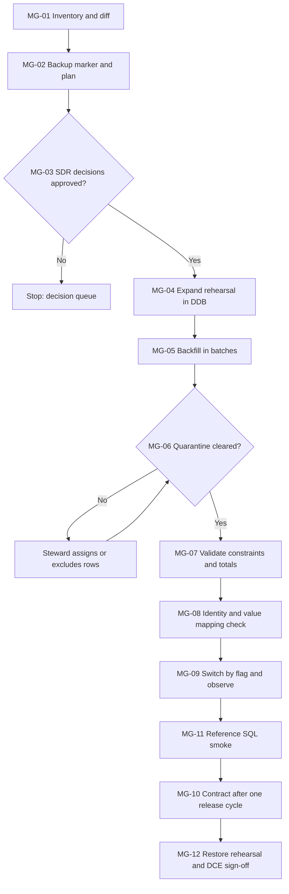
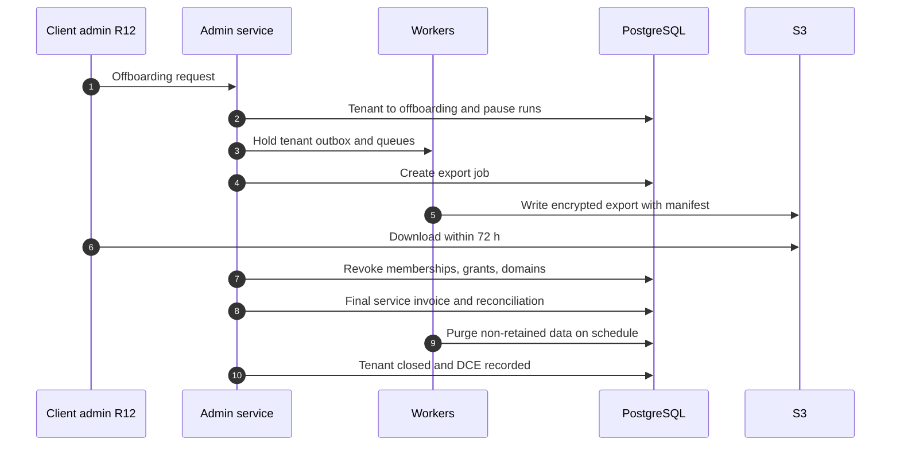

# AI Growth Engine: Employee Sales & Marketing Automation
## Application Blueprint: PART 3 (Batch 3.6b), Source Pack Data Catalog Reconciliation: Enhancements, Governance, Migration and DR

| Field | Value |
|---|---|
| Document | Part 3, Batch 3.6b · Enhancements written from the reconciliation in Batch 3.6a (documents 08 and 28) |
| Version | 1.0 · 27 Nov 2026 |
| Baseline | BRD, FRD, Parts 0, 0A (DEC-001…065), 1, 2.1–2.5, 3.1–3.3, 4.1–4.3, 6.1, 9.1 (DEC-066…124); Part 3.6a |
| Roles applied | Data Architect/DBA (lead), Data Governance Lead, DR/SRE Engineer, Solutions Architect, Principal Engineer, Security/Compliance Lead, QA Lead, FinOps Lead, Product Owner |
| Tags | ASSUMPTION/GAP/CONFLICT/RECOMMENDATION-380…399 |
| New ID families | ENT-ENH-E-01…04 · IX-ENH-E-01…54 · CK-ENH-E-01…12 · FR-ENH-E-001…008 · US-xx-EEnn · TC-ENH-E-001…036 · MG-01…12 · RS-1…5 · DDB-1…5 · RD-01…14 · PR-1…8 · LB-1…7 · OFB-1…10 · AP-1…6 · DBC-1…6 · VX-1…5 · DCE · SDR-001…136 · SDEC-08-039…042 · DR-T1…T3 |

**Status of everything below.** These are proposed additions to Parts 3.3, 4.2 and 4.3. They do not edit those parts. Where a change touches a binding decision, the item is tagged and listed in §3.6.6 for the coordinator. Part 3.3 names govern (DEC-107); source names appear only in the "source" comments.

---

## 3.6.5 Enhancements

### 3.6.5.1 Part 3.3 additions: entities, columns, keys and checks

#### (a) New logical entities

**ENT-ENH-E-01 BusinessTemplate (`ten_business_template`)** [GAP-388]. Source: `sales_business_template` (doc 08 #135). Purpose: the approved, versioned startup-profile template from which a startup workspace is provisioned (BRL-TEN-11; FR-A099/FR-A100 "add new standard startups through templates"). Resolves the dangling reference `ten_startup.template_ref → "business template config"` (Part 3.3 §3.3.6.2). Scope **X** (NULL tenant = platform library, read-only to tenants; tenant rows = tenant-custom templates). Sets: STD-X + STD-V. Imm. **V**. Retention CFG.

| Column | Type | Null | Default | Constraint | Class | Description |
|---|---|---|---|---|---|---|
| `template_key` | text | N | | UNIQUE (COALESCE(tenant_id, zero-uuid), template_key, version_no); CHECK `^[a-z0-9_]{3,60}$` | Int | Stable key (e.g. `bid_desk_services`, `agri_trade`, `education_institutional`) |
| `name` | text | N | | length ≤ 200 | Int | Display name |
| `industry_code` | text | Y | | → ref_value (dataset `industry`) | Int | Vertical |
| `schema` | jsonb | N | | JSON Schema 2020-12; validated on submit | Int | Typed offering/opportunity definitions, filters, scoring keys, workflow and claim placeholders |
| `defaults` | jsonb | N | `'{}'` | must validate against `schema` | Int | Default configuration values; **must contain no client data** (source: "generic public templates contain no client data") |
| `capability_defaults` | jsonb | N | `'{}'` | keys ⊆ capability profile keys (ENT-004) | Int | Initial capability profile |
| `workflow_template_ids` | uuid[] | N | `'{}'` | each → aut_workflow_template (published) | Int | Bundled workflow templates |
| `is_public_library` | boolean | N | false | true ⇒ tenant_id IS NULL | Int | Platform library flag |

Rules: only `approved` versions can be referenced by `ten_startup.template_ref`; provisioning copies `defaults` into `aut_config_revision` (ENT-168) as revision 1 and records the template `content_hash` there; a template version referenced by any startup is never deleted (CFG retention "never while referenced").

**ENT-ENH-E-02 ServiceRequest (`saas_service_request`)** [GAP-388]. Source: `sales_ui_service_request` (candidate C6). Purpose: SaaS client service request / support case raised from the client portal (FR-W34 "support case"; DEC-044 support model). Scope **T** (startup optional). Sets: STD-T + STD-W. Imm. M (frozen after `closed`). Retention AUD (support evidence) — 7 years for the row, attachments 24 months [GAP-388 interim, Legal to confirm].

| Column | Type | Null | Default | Constraint | Class | Description |
|---|---|---|---|---|---|---|
| `request_no` | text | N | `SR-` + sequence | UNIQUE (tenant_id, request_no) | Int | Human reference |
| `requester_user_id` | uuid | N | | → ten_user; must hold an active membership in tenant (trigger) | Int | Source `requester_ref` |
| `kind` | text | N | | CHECK IN (billing_question, access_request, data_export, configuration_change, incident, other) | Int | Source "request kind allowlist" |
| `subject` | text | N | | length ≤ 200 | Conf | |
| `description` | text | N | | length ≤ 10,000; sensitive-data scanner (BRL-PRV-06) | Conf | No health/patient data, no credentials |
| `priority` | text | N | `'normal'` | CHECK IN (low, normal, high, critical) | Int | Maps to DEC-044 response targets |
| `status` | text | N | `'open'` | CHECK IN (open, acknowledged, waiting_client, resolved, closed, cancelled) | Int | |
| `assignee_user_id` | uuid | Y | | → ten_user (platform support or tenant admin) | Int | |
| `linked_object_type` / `linked_object_id` | text / uuid | Y | | typed resolver; same tenant | Int | E.g. service invoice, export job |
| `first_response_at` / `resolved_at` / `closed_at` | timestamptz | Y | | resolved ≥ created | Int | SLA evidence |
| `support_grant_id` | uuid | Y | | → saas_support_access_grant | Int | When the request needs support access (DEC-056) |

Rules: a service request **never** changes billing, exports data or grants access by itself (source: "no direct export or billing changes"); `data_export` creates an `saas_export_job` draft that follows its own approval; `access_request` creates a `saas_support_access_grant` request that the client approves. Portal visibility: requester and tenant admins (R12) only, via `ten_portal_grant` object type `ticket`.

**ENT-ENH-E-03 FulfillmentMilestone (`com_fulfillment_milestone`)** [CONFLICT-383]. Source: `sales_fulfillment` (doc 08 #147), whose rows are planned, mutable milestones with due dates and acceptance; Part 3.3 keeps only the append-only `com_fulfillment_event`. Both are needed: milestones are the plan, events are the evidence. Scope **S**. Sets: STD-S + STD-W. Imm. **F** (business fields freeze at `accepted`). Retention FIN.

| Column | Type | Null | Default | Constraint | Class | Description |
|---|---|---|---|---|---|---|
| `order_id` | uuid | N | | (tenant_id, startup_id, order_id) → com_order | Int | |
| `order_line_id` | uuid | Y | | (tenant_id, startup_id, order_line_id) → com_order_line; line belongs to order (trigger) | Int | NULL = whole-order milestone (service/project orders) |
| `milestone_key` | text | N | | UNIQUE (tenant_id, startup_id, order_id, milestone_key) | Int | E.g. `dispatch_1`, `delivery`, `training_session_3`, `acceptance` |
| `milestone_type` | text | N | | CHECK IN (dispatch, delivery, service_delivery, training_session, project_deliverable, acceptance, return) | Int | |
| `planned_quantity` | numeric(18,4) | Y | | CHECK > 0; Σ per line ≤ ordered × (1 + tolerance) (CK-09 extended) | Int | Source "no excess quantity" |
| `unit_code` | text | Y | | → ref_unit; equals line unit | Int | |
| `due_at` | timestamptz | N | | | Int | |
| `state` | text | N | `'planned'` | CHECK IN (planned, in_progress, delivered, accepted, rejected, returned, cancelled) | Int | |
| `evidence_ref` | text | Y | | required when state ∈ (delivered, accepted, returned) (CK-ENH-E-05) | Conf | Source "evidence for acceptance" |
| `accepted_at` / `accepted_by_ref` | timestamptz / text | Y | | both set iff state = accepted | Conf | Counterparty acceptance (W25 portal or Admin on evidence) |
| `last_event_id` | uuid | Y | | → com_fulfillment_event | Int | Latest evidence event |

Rules: every state change of a milestone writes a `com_fulfillment_event` (UQ-IDEM-08 unchanged) in the same transaction; `com_order_line.fulfilled_qty` / `accepted_qty` keep being maintained from events, never from milestones; returns create a reversing event and set the milestone to `returned` (source: "returns audited"). API: `POST /api/v1/sales/orders/{id}/milestones`, `POST /api/v1/sales/milestones/{id}/accept` (doc 08 operations) bind to this table.

**ENT-ENH-E-04 EvalCaseResult (`ai_eval_case_result`)** [GAP-388]. Source: `growth_eval_run.eval_case_id/passed/result` (doc 08 #123); Part 3.3 `ai_eval_run` stores suite-level scores only, so a failing case cannot be traced. Scope **X**. Sets: STD-SA (tenant nullable). Imm. **A**. Retention OPS (24 m) like its run.

| Column | Type | Null | Default | Constraint | Class | Description |
|---|---|---|---|---|---|---|
| `eval_run_id` | uuid | N | | → ai_eval_run | Int | |
| `eval_case_id` | uuid | N | | → ai_eval_case; UNIQUE (eval_run_id, eval_case_id) | Int | |
| `passed` | boolean | N | | | Int | |
| `score` | numeric(7,4) | Y | | CHECK 0–1 | Int | |
| `result` | jsonb | N | | output digest, rubric verdicts, citations check; **no raw personal data** (synthetic or approved fixtures only, source "synthetic or approved data") | Int | |
| `model_run_id` | uuid | Y | | → ai_model_run | Int | |

#### (b) Column additions to existing Part 3.3 tables [GAP-389]

Migration rule (Part 4.3 §4.37.2 applies): a column shown `NOT NULL` without a default is added `NULL` in the expand release, backfilled in batches, then constrained with `CHECK (col IS NOT NULL) NOT VALID` → `VALIDATE CONSTRAINT` → `SET NOT NULL`. Foreign keys on scope-S tables are composite `(tenant_id, startup_id, col) → target(tenant_id, startup_id, id)` per §3.3.5.3; the single-column `REFERENCES` below is shorthand for that rule. Columns holding hashes of personal identifiers are class **Rest**; free-text columns are **Conf** unless stated.

| Domain | Tables changed | Columns added |
|---|---|---|
| Tenancy | 4 | 10 |
| Catalogue | 2 | 2 |
| Governance | 3 | 4 |
| AI | 6 | 8 |
| Intelligence | 14 | 22 |
| CRM | 2 | 3 |
| Engagement | 10 | 11 |
| Marketing | 11 | 13 |
| Commerce | 5 | 9 |
| Lifecycle | 4 | 6 |
| Automation | 4 | 8 |
| Platform events | 3 | 5 |
| SaaS | 4 | 11 |
| Analytics | 1 | 1 |
| **Total** | **73** | **113** |

**Tenancy**

```sql
ALTER TABLE ten_tenant ADD COLUMN policy jsonb NOT NULL DEFAULT '{}'::jsonb;  -- source sales_tenant.policy; tenant guardrails, schema-validated
ALTER TABLE ten_startup ADD COLUMN industry_code text NULL;  -- source sales_startup.industry
ALTER TABLE ten_startup ADD COLUMN profile jsonb NOT NULL DEFAULT '{}'::jsonb;  -- source sales_startup.profile
ALTER TABLE ten_startup ADD COLUMN autonomy_caps jsonb NOT NULL DEFAULT '{}'::jsonb;  -- source sales_startup.autonomy; DEC caps
ALTER TABLE ten_startup ADD COLUMN approved_config_hash char(64) NULL;  -- source sales_startup.approved_hash
ALTER TABLE ten_domain ADD COLUMN brand jsonb NULL;  -- source sales_brand_domain.brand; logo/colour tokens; approved assets only
ALTER TABLE ten_portal_grant ADD COLUMN contact_id uuid NULL REFERENCES intel_contact (id);  -- source sales_external_access_grant.contact_id
ALTER TABLE ten_portal_grant ADD COLUMN invite_token_hash char(64) NULL UNIQUE;  -- source sales_external_access_grant.invite_secret_hash; Rest
ALTER TABLE ten_portal_grant ADD COLUMN redeemed_at timestamptz NULL;  -- source sales_external_access_grant.redeemed_at
ALTER TABLE ten_portal_grant ADD COLUMN state text NOT NULL DEFAULT 'invited' CHECK (state IN ('invited', 'active', 'expired', 'revoked'));  -- source sales_external_access_grant.state
```

**Catalogue**

```sql
ALTER TABLE cat_capability ADD COLUMN limitations text NULL;  -- source growth_capability.limitations; Pub after approval
ALTER TABLE cat_chunk ADD COLUMN source_locator text NULL;  -- source growth_document_chunk.source_locator; page/section/char offsets for citations
```

**Governance**

```sql
ALTER TABLE gov_eligibility_decision ADD COLUMN valid_until timestamptz NULL;  -- source growth_eligibility_decision.expires_at; decision reuse window; dispatch rechecks
ALTER TABLE gov_policy_decision ADD COLUMN policy_version_id uuid NOT NULL REFERENCES gov_policy_version (id);  -- source growth_policy_decision.policy_version_id
ALTER TABLE gov_compliance_incident ADD COLUMN policy_decision_id uuid NULL REFERENCES gov_policy_decision (id);  -- source growth_compliance_incident.policy_decision_id
ALTER TABLE gov_compliance_incident ADD COLUMN message_id uuid NULL REFERENCES eng_message (id);  -- source growth_compliance_incident.message_id
```

**AI**

```sql
ALTER TABLE ai_prompt_version ADD COLUMN template_body text NOT NULL;  -- source growth_prompt_version.body; hash = template_hash
ALTER TABLE ai_eval_case ADD COLUMN case_code text NOT NULL;  -- source growth_eval_case.case_key; UQ (COALESCE(tenant_id), suite_code, case_code, version_no)
ALTER TABLE ai_usage ADD COLUMN integration_id uuid NULL REFERENCES int_integration (id);  -- source growth_api_usage.integration_id; non-model provider usage, B03
ALTER TABLE ai_cost_ledger ADD COLUMN usage_id uuid NULL REFERENCES ai_usage (id);  -- source growth_cost_ledger.usage_id; in addition to source_type/source_id
ALTER TABLE ai_cost_ledger ADD COLUMN entry_key text NOT NULL;  -- source growth_cost_ledger.entry_key; UQ (tenant_id, entry_key) idempotent ledger post
ALTER TABLE ai_feedback ADD COLUMN correction jsonb NULL;  -- source growth_feedback.correction; structured human correction, Conf
ALTER TABLE ai_eval_run ADD COLUMN ai_eval_case_result (new ENT-ENH-E-04) child rows;  -- source growth_eval_run.eval_case_id; eval_run_id, eval_case_id, passed, result
ALTER TABLE ai_eval_run ADD COLUMN ai_eval_case_result.result jsonb;  -- source growth_eval_run.result
```

**Intelligence**

```sql
ALTER TABLE intel_source ADD COLUMN name text NOT NULL;  -- source growth_source.name
ALTER TABLE intel_search_plan ADD COLUMN offering_id uuid NULL REFERENCES cat_offering (id);  -- source growth_search_plan.product_id
ALTER TABLE intel_source_record ADD COLUMN query_run_id uuid NULL REFERENCES intel_query_run (id);  -- source growth_source_record.query_run_id; lineage
ALTER TABLE intel_source_record ADD COLUMN content_hash char(64) NULL;  -- source growth_source_record.content_hash; change detection
ALTER TABLE intel_source_record ADD COLUMN last_fetched_at timestamptz NULL;  -- source growth_source_record.fetched_at; freshness SLA, OPT-11-02
ALTER TABLE intel_fetch_log ADD COLUMN source_id uuid NOT NULL REFERENCES intel_source (id);  -- source growth_fetch_log.source_id; failed fetch has no record
ALTER TABLE intel_fetch_log ADD COLUMN query_run_id uuid NULL REFERENCES intel_query_run (id);  -- source growth_fetch_log.query_run_id
ALTER TABLE intel_evidence ADD COLUMN locator text NULL;  -- source growth_evidence.locator; citation anchor
ALTER TABLE intel_evidence ADD COLUMN verified_at timestamptz NULL + verified_by uuid NULL;  -- source growth_evidence.verified_at
ALTER TABLE intel_alias ADD COLUMN source_record_id uuid NULL REFERENCES intel_source_record (id);  -- source growth_org_alias.source_record_id; OPT-11-01 provenance
ALTER TABLE intel_signal_type ADD COLUMN detection_rules jsonb NULL;  -- source growth_signal_type.rules; schema-validated, rules-first Tier 0
ALTER TABLE intel_need ADD COLUMN confidence numeric(5,4) NULL CHECK (confidence BETWEEN 0 AND 1);  -- source growth_need.confidence
ALTER TABLE intel_match ADD COLUMN capability_id uuid NULL REFERENCES cat_capability (id);  -- source growth_solution_match.capability_id
ALTER TABLE intel_match ADD COLUMN rationale text NULL;  -- source growth_solution_match.rationale; explainability, Int
ALTER TABLE intel_match ADD COLUMN state text NOT NULL DEFAULT 'proposed' CHECK (state IN ('proposed', 'accepted', 'rejected', 'superseded'));  -- source growth_solution_match.state
ALTER TABLE intel_opportunity ADD COLUMN expires_at timestamptz NULL;  -- source growth_opportunity.expires_at; opportunity freshness
ALTER TABLE intel_role_hypothesis ADD COLUMN opportunity_id uuid NULL REFERENCES intel_opportunity (id);  -- source growth_role_hypothesis.opportunity_id
ALTER TABLE intel_contact_source ADD COLUMN source_record_id uuid NULL REFERENCES intel_source_record (id);  -- source growth_contact_source.source_record_id
ALTER TABLE intel_contact_source ADD COLUMN provider_ref text NULL;  -- source growth_contact_source.provider_ref; licensed data provider record id
ALTER TABLE intel_contact_verification ADD COLUMN contact_source_id uuid NULL REFERENCES intel_contact_source (id);  -- source growth_contact_verification.contact_source_id
ALTER TABLE intel_social_post ADD COLUMN source_record_id uuid NULL REFERENCES intel_source_record (id);  -- source growth_social_post.source_record_id
ALTER TABLE intel_social_post ADD COLUMN permalink text NULL;  -- source growth_social_post.permalink
```

**CRM**

```sql
ALTER TABLE crm_deal ADD COLUMN closure_evidence_ref text NULL;  -- source growth_deal.closure_evidence_ref; DEC-054 closure evidence; required when closure_status = won
ALTER TABLE crm_submission ADD COLUMN subject_hmac char(64) NULL;  -- source growth_submission.subject_key; dedupe, Rest
ALTER TABLE crm_submission ADD COLUMN consent_id uuid NULL REFERENCES gov_consent (id);  -- source growth_submission.consent_id
```

**Engagement**

```sql
ALTER TABLE eng_message_template ADD COLUMN template_code text NOT NULL;  -- source growth_message_template.template_key; UQ (tenant_id, startup_id, template_code, version_no)
ALTER TABLE eng_message_draft ADD COLUMN eligibility_decision_id uuid NULL REFERENCES gov_eligibility_decision (id);  -- source growth_message_draft.eligibility_decision_id; draft-time check
ALTER TABLE eng_thread ADD COLUMN external_thread_ref text NULL;  -- source growth_thread.external_thread_ref; UQ (channel_account_id, external_thread_ref)
ALTER TABLE eng_inbound_event ADD COLUMN processing_state text NOT NULL DEFAULT 'received' CHECK (processing_state IN ('received', 'classified', 'routed', 'quarantined', 'failed'));  -- source growth_inbound_event.state
ALTER TABLE eng_intent ADD COLUMN action_taken text NULL CHECK (action_taken IN ('none', 'task', 'stop', 'route', 'escalate'));  -- source growth_intent.action
ALTER TABLE eng_calendar_link ADD COLUMN external_calendar_id text NULL;  -- source growth_calendar_link.external_calendar_id
ALTER TABLE eng_channel_account ADD COLUMN state text NOT NULL DEFAULT 'pending' CHECK (state IN ('pending', 'verified', 'active', 'paused', 'revoked'));  -- source growth_channel_account.state
ALTER TABLE eng_chat_session ADD COLUMN thread_id uuid NULL REFERENCES eng_thread (id);  -- source growth_chat_session.thread_id
ALTER TABLE eng_chat_session ADD COLUMN session_token_hash char(64) NOT NULL UNIQUE;  -- source growth_chat_session.opaque_token_hash; Rest
ALTER TABLE eng_identity_link ADD COLUMN channel_account_id uuid NULL REFERENCES eng_channel_account (id);  -- source growth_identity_link.channel_account_id
ALTER TABLE eng_routing_rule ADD COLUMN channel text NULL;  -- source growth_routing_rule.channel; rule applies to channel
```

**Marketing**

```sql
ALTER TABLE mkt_content_asset ADD COLUMN offering_id uuid NULL REFERENCES cat_offering (id);  -- source growth_content_asset.product_id
ALTER TABLE mkt_content_asset ADD COLUMN state text NOT NULL DEFAULT 'draft' CHECK (state IN ('draft', 'in_review', 'approved', 'retired'));  -- source growth_content_asset.state
ALTER TABLE mkt_seo_issue ADD COLUMN keyword_id uuid NULL REFERENCES mkt_keyword (id);  -- source growth_seo_issue.keyword_id
ALTER TABLE mkt_attribution_event ADD COLUMN landing_page_id uuid NULL REFERENCES mkt_landing_page (id);  -- source growth_attribution_event.landing_page_id
ALTER TABLE mkt_attribution_event ADD COLUMN event_key text NOT NULL;  -- source growth_attribution_event.event_key; UQ (tenant_id, startup_id, event_key) dedupe
ALTER TABLE mkt_audience ADD COLUMN name text NOT NULL;  -- source growth_audience.name
ALTER TABLE mkt_ad_campaign ADD COLUMN channel_account_id uuid NULL REFERENCES eng_channel_account (id);  -- source growth_ad_campaign.channel_account_id
ALTER TABLE mkt_spend_event ADD COLUMN event_key text NOT NULL;  -- source growth_ad_spend_event.event_key; UQ (ad_campaign_id, event_key)
ALTER TABLE mkt_event ADD COLUMN offering_id uuid NULL REFERENCES cat_offering (id);  -- source growth_business_event.product_id
ALTER TABLE mkt_registration ADD COLUMN lead_id uuid NULL REFERENCES crm_lead (id);  -- source growth_event_registration.lead_id
ALTER TABLE mkt_attendance ADD COLUMN provider_ref text NULL;  -- source growth_event_attendance.provider_ref; UQ (registration_id, provider_ref)
ALTER TABLE mkt_referral ADD COLUMN lead_id uuid NULL REFERENCES crm_lead (id);  -- source growth_referral.lead_id
ALTER TABLE mkt_publication ADD COLUMN approved_asset_refs jsonb NOT NULL DEFAULT '[]'::jsonb on mkt_publication_snapshot;  -- source growth_website_publication.approved_asset_refs
```

**Commerce**

```sql
ALTER TABLE com_objection ADD COLUMN thread_id uuid NULL REFERENCES eng_thread (id);  -- source growth_objection.thread_id
ALTER TABLE com_negotiation ADD COLUMN quote_id uuid NULL REFERENCES com_quote (id);  -- source growth_negotiation.quote_id
ALTER TABLE com_negotiation ADD COLUMN proposed_terms jsonb NULL;  -- source growth_negotiation.proposed_terms; schema-validated, Conf
ALTER TABLE com_bid ADD COLUMN opportunity_id uuid NULL REFERENCES intel_opportunity (id);  -- source sales_bid.opportunity_id
ALTER TABLE com_bid ADD COLUMN proposal_id uuid NULL REFERENCES com_proposal (id);  -- source sales_bid.proposal_id
ALTER TABLE com_order ADD COLUMN quote_id uuid NULL REFERENCES com_quote (id);  -- source sales_order.quote_id
ALTER TABLE com_order ADD COLUMN external_ref text NULL;  -- source sales_order.external_ref; counterparty PO no.; UQ per counterparty
ALTER TABLE com_order_line ADD COLUMN description text NULL;  -- source sales_order_line.description
ALTER TABLE com_order_line ADD COLUMN tax_amount numeric(18,2) NOT NULL DEFAULT 0;  -- source sales_order_line.tax
```

**Lifecycle**

```sql
ALTER TABLE lcy_onboarding ADD COLUMN owner_id uuid NOT NULL REFERENCES ten_user (id);  -- source growth_onboarding.owner_id
ALTER TABLE lcy_handoff ADD COLUMN task_id uuid NULL REFERENCES lcy_task (id);  -- source growth_handoff.task_id; UQ (onboarding_id, task_id)
ALTER TABLE lcy_handoff ADD COLUMN to_team text NULL;  -- source growth_handoff.target_team
ALTER TABLE lcy_pilot ADD COLUMN deal_id uuid NULL REFERENCES crm_deal (id);  -- source growth_pilot.deal_id
ALTER TABLE lcy_pilot ADD COLUMN scope jsonb NULL;  -- source growth_pilot.scope; schema-validated
ALTER TABLE lcy_integration_deal ADD COLUMN deal_id uuid NULL REFERENCES crm_deal (id);  -- source growth_integration_deal.deal_id
```

**Automation**

```sql
ALTER TABLE aut_autonomy_plan ADD COLUMN input_hash char(64) NOT NULL;  -- source sales_action_plan.input_hash
ALTER TABLE aut_autonomy_plan ADD COLUMN policy_hash char(64) NOT NULL;  -- source sales_action_plan.policy_hash
ALTER TABLE aut_autonomy_plan ADD COLUMN planned_actions jsonb NOT NULL;  -- source sales_action_plan.actions
ALTER TABLE aut_autonomy_plan ADD COLUMN simulation_result jsonb NULL;  -- source sales_action_plan.simulation
ALTER TABLE aut_config_revision ADD COLUMN schema_revision integer NOT NULL;  -- source sales_ui_config_revision.schema_revision
ALTER TABLE aut_trigger ADD COLUMN concurrency_limit integer NOT NULL DEFAULT 1 CHECK (concurrency_limit BETWEEN 1 AND 20);  -- source sales_ui_trigger_revision.concurrency_limit
ALTER TABLE aut_conflict_case ADD COLUMN decision_reason text NULL;  -- source sales_ui_conflict.reason
ALTER TABLE aut_conflict_case ADD COLUMN resolved_at timestamptz NULL;  -- source sales_ui_conflict.resolved_at
```

**Platform events**

```sql
ALTER TABLE ops_job_run ADD COLUMN job_key text NOT NULL;  -- source growth_job_run.job_key; UQ (COALESCE(tenant_id), job_key); deterministic run key
ALTER TABLE ops_job_run ADD COLUMN next_retry_at timestamptz NULL;  -- source growth_job_run.next_retry; A-screen retry queue
ALTER TABLE ops_release ADD COLUMN environment text NOT NULL CHECK (environment IN ('dev', 'staging', 'prod'));  -- source growth_release.environment
ALTER TABLE ops_incident ADD COLUMN job_run_id uuid NULL REFERENCES ops_job_run (id);  -- source growth_incident.job_run_id
ALTER TABLE ops_incident ADD COLUMN summary text NULL;  -- source growth_incident.summary; Int, no personal data
```

**SaaS**

```sql
ALTER TABLE saas_service_invoice ADD COLUMN payment_ref text NULL;  -- source sales_service_invoice.payment_ref; provider receipt id; UQ with provider account
ALTER TABLE saas_service_invoice_line ADD COLUMN cost_amount numeric(18,4) NULL;  -- source sales_usage_charge.cost; FinOps margin, Conf
ALTER TABLE saas_service_invoice_line ADD COLUMN rate_snapshot jsonb NOT NULL;  -- source sales_usage_charge.rate_snapshot; plan version rates at rating time
ALTER TABLE saas_export_job ADD COLUMN file_sha256 char(64) NULL;  -- source sales_data_transfer.checksum
ALTER TABLE saas_export_job ADD COLUMN manifest jsonb NULL;  -- source sales_data_transfer.manifest; entities, row counts, schema versions
ALTER TABLE saas_application_draft ADD COLUMN application_ref uuid NOT NULL UNIQUE;  -- source sales_ui_application.application_ref; opaque, separate from id
ALTER TABLE saas_application_draft ADD COLUMN country_code char(2) NULL;  -- source sales_ui_application.country
ALTER TABLE saas_application_draft ADD COLUMN industry_code text NULL;  -- source sales_ui_application.industry
ALTER TABLE saas_application_draft ADD COLUMN website text NULL;  -- source sales_ui_application.website
ALTER TABLE saas_application_draft ADD COLUMN service_model text NULL CHECK (service_model IN ('owned', 'saas'));  -- source sales_ui_application.service_model
ALTER TABLE saas_application_draft ADD COLUMN terms_revision text NOT NULL;  -- source sales_ui_application.terms_revision
```

**Analytics**

```sql
ALTER TABLE ana_forecast ADD COLUMN model_version text NULL;  -- source growth_forecast.model_version
```

Additional columns required by the conflict resolutions and checks (not derived from a single source column):

```sql
ALTER TABLE com_order ADD COLUMN order_kind text NOT NULL DEFAULT 'goods' CHECK (order_kind IN ('goods','service','training','project'));  -- CONFLICT-386; source sales_order.direction values service/training/project
ALTER TABLE intel_score_version ADD COLUMN version_no integer;  -- IX-ENH-E-17; sequence per opportunity, set by trigger max+1
ALTER TABLE intel_signal ADD COLUMN dedupe_key char(64);  -- IX-ENH-E-15; sha256(organization_id, signal_type_id, sorted evidence ids)
ALTER TABLE eng_intent ADD COLUMN superseded_by uuid REFERENCES eng_intent (id);  -- IX-ENH-E-25; re-classification keeps history (append-only)
ALTER TABLE gov_policy_decision ADD COLUMN reason_codes text[] NOT NULL DEFAULT '{}';  -- source growth_policy_decision.reason
ALTER TABLE mkt_publication_snapshot ADD COLUMN page_type text;  -- source growth_website_publication.page_type (mirrors mkt_publication.target_kind at publish time)
ALTER TABLE eng_message_draft ALTER COLUMN body SET DATA TYPE text;  -- no type change; reclassify body as Rest (PII-R protection in doc 08 #65)
```

#### (c) Keys and indexes IX-ENH-E-01…54 [GAP-390]

Each index has an owner and a serving query (IX-R6). All are created `CONCURRENTLY` in a separate migration and validated with staging `EXPLAIN (ANALYZE, BUFFERS)` on representative synthetic data before production (OPT-08-02, rule IX-ENH-R1 in §3.6.5.2). Unique keys are scoped (CONFLICT-384).

```sql
CREATE UNIQUE INDEX CONCURRENTLY uq_cat_capability__code ON cat_capability (tenant_id, startup_id, code) WHERE archived_at IS NULL;  -- IX-ENH-E-01; offering link already UQ in cat_offering_capability
CREATE UNIQUE INDEX CONCURRENTLY uq_int_quota__period ON int_quota (tenant_id, startup_id, integration_id, unit, period);  -- IX-ENH-E-02
CREATE UNIQUE INDEX CONCURRENTLY uq_ops_job_run__job_key ON ops_job_run (COALESCE(tenant_id, '00000000-0000-0000-0000-000000000000'::uuid), job_key);  -- IX-ENH-E-03; new column job_key
CREATE INDEX CONCURRENTLY ixp_ops_job_run__retry ON ops_job_run (next_retry_at) WHERE state IN ('failed','retry_scheduled');  -- IX-ENH-E-04
CREATE UNIQUE INDEX CONCURRENTLY uq_ai_eval_case__code ON ai_eval_case (COALESCE(tenant_id, '00000000-0000-0000-0000-000000000000'::uuid), suite_code, case_code, version_no);  -- IX-ENH-E-05
CREATE UNIQUE INDEX CONCURRENTLY uq_ai_budget__scope_period ON ai_budget (COALESCE(tenant_id, '00000000-0000-0000-0000-000000000000'::uuid), scope_level, scope_ref, period) WHERE status = 'active';  -- IX-ENH-E-06
CREATE UNIQUE INDEX CONCURRENTLY uq_ai_cost_ledger__entry_key ON ai_cost_ledger (tenant_id, entry_key);  -- IX-ENH-E-07; new column entry_key
CREATE INDEX CONCURRENTLY ixp_gov_privacy_request__due ON gov_privacy_request (tenant_id, due_at) WHERE state NOT IN ('completed','rejected','withdrawn');  -- IX-ENH-E-08
CREATE UNIQUE INDEX CONCURRENTLY uq_ops_release__tag_env ON ops_release (version_tag, environment);  -- IX-ENH-E-09; new column environment
CREATE INDEX CONCURRENTLY ixp_ops_incident__open ON ops_incident (severity, opened_at DESC) WHERE state <> 'closed';  -- IX-ENH-E-10
CREATE UNIQUE INDEX CONCURRENTLY uq_intel_query_run__correlation ON intel_query_run (tenant_id, startup_id, correlation_id) WHERE correlation_id IS NOT NULL;  -- IX-ENH-E-11
CREATE UNIQUE INDEX CONCURRENTLY uq_intel_source_record__version ON intel_source_record (tenant_id, startup_id, source_id, url_hash, content_hash);  -- IX-ENH-E-12; new column content_hash
CREATE INDEX CONCURRENTLY ix_intel_fetch_log__source_time ON intel_fetch_log (tenant_id, startup_id, source_id, created_at DESC);  -- IX-ENH-E-13; new column source_id
CREATE INDEX CONCURRENTLY ix_intel_location__org_geo ON intel_location (tenant_id, startup_id, organization_id, country_code, subdivision_code);  -- IX-ENH-E-14
CREATE UNIQUE INDEX CONCURRENTLY uq_intel_signal__dedupe ON intel_signal (tenant_id, startup_id, dedupe_key) WHERE state <> 'rejected';  -- IX-ENH-E-15; dedupe_key = sha256(organization_id|signal_type_id|sorted evidence ids)
CREATE UNIQUE INDEX CONCURRENTLY uq_intel_match__need_target ON intel_match (tenant_id, startup_id, need_id, offering_version_id, COALESCE(capability_id, '00000000-0000-0000-0000-000000000000'::uuid));  -- IX-ENH-E-16
CREATE UNIQUE INDEX CONCURRENTLY uq_intel_score_version__seq ON intel_score_version (opportunity_id, version_no);  -- IX-ENH-E-17; new column version_no
CREATE UNIQUE INDEX CONCURRENTLY uq_intel_role_hypothesis__opp_role ON intel_role_hypothesis (tenant_id, startup_id, opportunity_id, role_code) WHERE opportunity_id IS NOT NULL;  -- IX-ENH-E-18
CREATE INDEX CONCURRENTLY ix_intel_contact_verification__expiry ON intel_contact_verification (tenant_id, startup_id, contact_id, channel, expires_at DESC);  -- IX-ENH-E-19
CREATE UNIQUE INDEX CONCURRENTLY uq_crm_form__code ON crm_form (tenant_id, startup_id, form_code) WHERE archived_at IS NULL;  -- IX-ENH-E-20; version uniqueness by STD-V on crm_form_version
CREATE INDEX CONCURRENTLY ixp_crm_lead__queue ON crm_lead (tenant_id, startup_id, state, owner_id) WHERE archived_at IS NULL;  -- IX-ENH-E-21
CREATE UNIQUE INDEX CONCURRENTLY uq_aut_workflow__code ON aut_workflow (tenant_id, startup_id, workflow_code);  -- IX-ENH-E-22; version uniqueness by STD-V on aut_workflow_revision
CREATE UNIQUE INDEX CONCURRENTLY uq_eng_message_template__code ON eng_message_template (tenant_id, startup_id, template_code, channel, locale, version_no);  -- IX-ENH-E-23
CREATE UNIQUE INDEX CONCURRENTLY uq_eng_thread__external ON eng_thread (channel_account_id, external_thread_ref) WHERE external_thread_ref IS NOT NULL;  -- IX-ENH-E-24
CREATE UNIQUE INDEX CONCURRENTLY uq_eng_intent__inbound ON eng_intent (inbound_event_id) WHERE superseded_by IS NULL;  -- IX-ENH-E-25; one current intent per inbound event
CREATE UNIQUE INDEX CONCURRENTLY uq_eng_calendar_link__external ON eng_calendar_link (integration_id, external_calendar_id);  -- IX-ENH-E-26; new column external_calendar_id
CREATE INDEX CONCURRENTLY ix_gov_approval__object ON gov_approval (tenant_id, startup_id, object_type, object_id, created_at DESC);  -- IX-ENH-E-27
CREATE UNIQUE INDEX CONCURRENTLY uq_eng_identity_link__address ON eng_identity_link (tenant_id, startup_id, channel_account_id, address_hmac);  -- IX-ENH-E-28
CREATE UNIQUE INDEX CONCURRENTLY uq_eng_routing_rule__priority ON eng_routing_rule (tenant_id, startup_id, COALESCE(channel,'*'), priority) WHERE status = 'active';  -- IX-ENH-E-29
CREATE INDEX CONCURRENTLY ix_gov_policy_decision__action ON gov_policy_decision (tenant_id, startup_id, action, created_at DESC);  -- IX-ENH-E-30
CREATE INDEX CONCURRENTLY ixp_gov_compliance_incident__open ON gov_compliance_incident (tenant_id, severity, opened_at DESC) WHERE state <> 'closed';  -- IX-ENH-E-31
CREATE UNIQUE INDEX CONCURRENTLY uq_intel_social_post__ref ON intel_social_post (tenant_id, startup_id, platform, post_ref);  -- IX-ENH-E-32
CREATE INDEX CONCURRENTLY ix_mkt_content_asset__offering_state ON mkt_content_asset (tenant_id, startup_id, offering_id, state);  -- IX-ENH-E-33
CREATE INDEX CONCURRENTLY ixp_mkt_seo_issue__open ON mkt_seo_issue (tenant_id, startup_id, page_id, severity) WHERE state <> 'resolved';  -- IX-ENH-E-34
CREATE UNIQUE INDEX CONCURRENTLY uq_mkt_page_metric__day ON mkt_page_metric (tenant_id, startup_id, page_id, COALESCE(keyword_id, '00000000-0000-0000-0000-000000000000'::uuid), metric_date, source);  -- IX-ENH-E-35
CREATE UNIQUE INDEX CONCURRENTLY uq_mkt_attribution_event__key ON mkt_attribution_event (tenant_id, startup_id, event_key);  -- IX-ENH-E-36; new column event_key
CREATE INDEX CONCURRENTLY ix_mkt_campaign__state ON mkt_campaign (tenant_id, startup_id, state, starts_at);  -- IX-ENH-E-37
CREATE UNIQUE INDEX CONCURRENTLY uq_mkt_spend_event__key ON mkt_spend_event (ad_campaign_id, event_key);  -- IX-ENH-E-38; for manual/CSV spend rows, UQ-IDEM-19 covers provider reports
CREATE INDEX CONCURRENTLY ix_mkt_event__starts ON mkt_event (tenant_id, startup_id, starts_at, state);  -- IX-ENH-E-39
CREATE UNIQUE INDEX CONCURRENTLY uq_mkt_registration__event_contact ON mkt_registration (event_id, contact_id);  -- IX-ENH-E-40
CREATE UNIQUE INDEX CONCURRENTLY uq_mkt_attendance__provider ON mkt_attendance (registration_id, provider_ref) WHERE provider_ref IS NOT NULL;  -- IX-ENH-E-41
CREATE INDEX CONCURRENTLY ix_com_proposal__deal_state ON com_proposal (tenant_id, startup_id, deal_id, state);  -- IX-ENH-E-42
CREATE INDEX CONCURRENTLY ix_com_quote__deal_state ON com_quote (tenant_id, startup_id, deal_id, state);  -- IX-ENH-E-43
CREATE INDEX CONCURRENTLY ix_com_objection__deal_state ON com_objection (tenant_id, startup_id, deal_id, state);  -- IX-ENH-E-44
CREATE UNIQUE INDEX CONCURRENTLY uq_lcy_onboarding__deal ON lcy_onboarding (tenant_id, startup_id, deal_id) WHERE archived_at IS NULL;  -- IX-ENH-E-45
CREATE UNIQUE INDEX CONCURRENTLY uq_lcy_handoff__task ON lcy_handoff (onboarding_id, task_id) WHERE task_id IS NOT NULL;  -- IX-ENH-E-46; new column task_id
CREATE INDEX CONCURRENTLY ix_ai_eval_run__prompt_gate ON ai_eval_run (prompt_version_id, gate_result, created_at DESC);  -- IX-ENH-E-47
CREATE UNIQUE INDEX CONCURRENTLY uq_intel_competitor__website ON intel_competitor (tenant_id, startup_id, lower(website)) WHERE website IS NOT NULL;  -- IX-ENH-E-48
CREATE UNIQUE INDEX CONCURRENTLY uq_intel_market_event__dedupe ON intel_market_event (tenant_id, startup_id, competitor_id, evidence_id, event_type);  -- IX-ENH-E-49
CREATE UNIQUE INDEX CONCURRENTLY uq_ana_stage_metric__period ON ana_stage_metric (tenant_id, startup_id, pipeline_id, stage_code, period);  -- IX-ENH-E-50
CREATE UNIQUE INDEX CONCURRENTLY uq_ana_forecast__period ON ana_forecast (tenant_id, startup_id, period, scenario, model_version);  -- IX-ENH-E-51; new column model_version
CREATE INDEX CONCURRENTLY ix_ops_test_run__release ON ops_test_run (release_id, result, executed_at DESC);  -- IX-ENH-E-52
CREATE UNIQUE INDEX CONCURRENTLY uq_lcy_integration_deal__deal ON lcy_integration_deal (tenant_id, startup_id, deal_id) WHERE deal_id IS NOT NULL;  -- IX-ENH-E-53
-- IX-ENH-E-54 ten_business_template: Imm. V on new ten_business_template (STD-V)
```

#### (d) Check constraints CK-ENH-E-01…12

| ID | Rule | Table | Source |
|---|---|---|---|
| CK-ENH-E-01 | `state = 'published'` ⇒ `current_snapshot_id IS NOT NULL` and the snapshot's `approval_id IS NOT NULL` (deferred constraint trigger) | `mkt_publication` | Doc 08 #148 "check published implies approved hash" |
| CK-ENH-E-02 | Partial unique: one published pointer per (tenant_id, startup_id, domain_id, locale, path) `WHERE state = 'published'` | `mkt_publication` | Doc 08 #148 "partial unique index … WHERE published" |
| CK-ENH-E-03 | `redeemed_at IS NULL OR redeemed_at <= COALESCE(revoked_at, expires_at)`; redemption sets `invite_token_hash = NULL` in the same statement (single-use) | `ten_portal_grant` | Doc 08 #149 "single-use redemption" |
| CK-ENH-E-04 | `state = 'active'` ⇒ `redeemed_at IS NOT NULL AND revoked_at IS NULL AND expires_at > now()` (checked by trigger on read path and nightly DQ) | `ten_portal_grant` | Doc 08 #149 "default deny" |
| CK-ENH-E-05 | `state IN ('delivered','accepted','returned')` ⇒ `evidence_ref IS NOT NULL`; `state = 'accepted'` ⇔ `accepted_at IS NOT NULL` | `com_fulfillment_milestone` | Doc 08 #147 |
| CK-ENH-E-06 | `order_kind IN ('service','training','project')` ⇒ lines have `sku_code IS NULL` and milestones of non-goods type; `order_kind = 'goods'` ⇒ `sku_code IS NOT NULL` (trigger) | `com_order`, `com_order_line` | CONFLICT-386 |
| CK-ENH-E-07 | `kind` in allowlist; `status IN ('resolved','closed')` ⇒ `resolved_at IS NOT NULL` | `saas_service_request` | Candidate C6 |
| CK-ENH-E-08 | `concurrency_limit BETWEEN 1 AND 20` (aligns CK-24 `max_concurrent_runs ≤ 20`) | `aut_trigger` | Candidate C3 "positive concurrency" |
| CK-ENH-E-09 | `defaults` validates against `schema`; `is_public_library` ⇒ `tenant_id IS NULL` | `ten_business_template` | Doc 08 #135 |
| CK-ENH-E-10 | `confidence BETWEEN 0 AND 1` | `intel_need`, `intel_evidence` | Doc 08 #36, #42 "confidence 0–1" |
| CK-ENH-E-11 | `entry_key` immutable after insert; reserve/settle/release rows reference the same `reservation_id` | `ai_cost_ledger` | Doc 08 #27 "immutable reserve/reconcile entries" |
| CK-ENH-E-12 | `environment IN ('dev','staging','prod')` and `deployed_at` set only when `state = 'deployed'` | `ops_release` | Doc 08 #30 |

### 3.6.5.2 Data governance additions (Part 3.3 §3.3.13, §3.3.16; document 28 "Data classification and ownership")

#### (a) Two-axis classification model [RECOMMENDATION-398]

Part 3.3 classifies **columns** by sensitivity (Pub / Int / Conf / Rest, RECOMMENDATION-004). Document 28 classifies **data sets** by governance class. The two are orthogonal and both are kept: sensitivity drives masking, encryption and model routing; governance class drives storage, backup tier, deletion propagation and acceptance evidence.

| Class | Name | Definition | Recovery tier (§3.6.5.5) | Acceptance evidence (doc 28) | Tables (count) |
|---|---|---|---|---|---|
| G1 | Public snapshot | Approved, immutable publication content; CDN may cache only this; unpublish invalidates cache | R2 | Unpublish invalidates cache within 60 s; public payload contains no Int/Conf/Rest field (TC-ENH-E-010) | 2 |
| G2 | Confidential operational | Tenant/startup-scoped contacts, opportunities, conversations, evidence metadata, workflow events | R2 | Composite ownership and service authorization verified (TC-ENH-E-001, -006) | 122 |
| G3 | Financial and regulated | Authoritative amounts, approvals, contracts, receipts, consent, suppression, audit; immutable corrections; finance/legal access | R1 | Reconciliation and auditable correction (DQ-011…018; TC-ENH-E-008) | 63 |
| G4 | Secrets and documents | Secret references (never values), private documents, exports/imports files, authority evidence; short-lived scoped access, malware scan | R1 (metadata) / object versioning | Unauthorized download denied; no secret value in any DB dump (TC-ENH-E-011) | 5 |
| G5 | Derived research and embeddings | Regenerable chunks/vectors, search vectors, projections, research content cache; provenance and deletion propagation | R3 | Rebuild from approved sources; revoked item absent after rebuild (TC-ENH-E-009, -021) | 11 |

**Assignment of every table** (199 Part 3.3 entities + 4 new; generated by `gclass()` in `E_build_md_b.py` from retention class and table role):

| Class | Tables |
|---|---|
| G1 | `mkt_publication`, `mkt_publication_snapshot` |
| G2 | `ten_tenant`, `ten_startup`, `ten_business_line`, `ten_capability_profile`, `ten_domain`, `ten_user`, `ten_role`, `ten_saved_view`, `ref_dataset`, `ref_value`, `ref_currency`, `ref_country`, `ref_unit`, `cat_offering`, `cat_offering_version`, `cat_capability`, `cat_offering_capability`, `gov_eligibility_decision`, `gov_policy_decision`, `int_integration`, `int_quota`, `int_provider_event`, `ai_agent_definition`, `ai_prompt_version`, `ai_model_run`, `ai_eval_case`, `ai_eval_run`, `ai_feedback`, `intel_source`, `intel_search_plan`, `intel_query_run`, `intel_fetch_log`, `intel_competitor`, `intel_organization`, `intel_location`, `intel_alias`, `intel_signal_type`, `intel_need`, `intel_match`, `intel_scoring_model`, `intel_opportunity`, `intel_score_version`, `intel_contact`, `intel_role_hypothesis`, `intel_contact_source`, `intel_contact_verification`, `crm_lead`, `crm_form`, `crm_form_version`, `crm_submission`, `crm_pipeline`, `crm_stage`, `crm_closure_policy`, `crm_activity`, `eng_channel_account`, `eng_message_template`, `eng_message_draft`, `eng_thread`, `eng_message`, `eng_delivery_event`, `eng_inbound_event`, `eng_intent`, `eng_identity_link`, `eng_routing_rule`, `eng_chat_session`, `eng_sequence`, `eng_sequence_step`, `eng_enrollment`, `eng_meeting`, `eng_calendar_link`, `mkt_content_asset`, `mkt_content_version`, `mkt_social_publication`, `mkt_keyword`, `mkt_seo_issue`, `mkt_page_metric`, `mkt_landing_page`, `mkt_preview_grant`, `mkt_campaign`, `mkt_campaign_version`, `mkt_audience`, `mkt_event`, `mkt_registration`, `mkt_attendance`, `mkt_referral`, `mkt_attribution_event`, `com_quote_line`, `com_objection`, `com_negotiation`, `com_bid_checklist_item`, `com_sku_availability`, `lcy_onboarding`, `lcy_task`, `lcy_handoff`, `lcy_account_metric`, `lcy_partner`, `lcy_feedback`, `lcy_outcome`, `aut_workflow`, `aut_workflow_revision`, `aut_trigger`, `aut_run`, `aut_step_run`, `aut_autonomy_plan`, `aut_conflict_case`, `aut_node_template`, `aut_workflow_template`, `aut_config_revision`, `ops_outbox`, `ops_domain_event`, `ops_idempotency_key`, `ops_job_run`, `ops_notification`, `ops_notification_preference`, `ops_test_run`, `ana_metric_definition`, `ana_forecast`, `ana_stage_metric`, `ana_report_subscription`, saas_service_request (ENT-ENH-E-02), ai_eval_case_result (ENT-ENH-E-04), ten_business_template (ENT-ENH-E-01) |
| G3 | `ten_membership`, `ten_portal_grant`, `cat_claim`, `cat_price_version`, `cat_tax_profile`, `cat_launch_approval`, `gov_consent`, `gov_suppression`, `gov_policy_version`, `gov_jurisdiction_rule`, `gov_approval_policy`, `gov_approval`, `gov_approval_delegation`, `gov_privacy_request`, `gov_retention_policy`, `gov_legal_hold`, `gov_compliance_incident`, `ai_usage`, `ai_cost_ledger`, `ai_budget`, `intel_source_policy`, `intel_review`, `crm_deal`, `crm_stage_transition`, `mkt_ad_campaign`, `mkt_spend_event`, `com_proposal`, `com_proposal_version`, `com_quote`, `com_contract`, `com_signature_event`, `com_bid`, `com_order`, `com_order_line`, `com_fulfillment_event`, `com_inventory_reservation`, `com_invoice`, `com_invoice_line`, `com_payment`, `com_payment_allocation`, `com_discrepancy_case`, `com_receivable_entry`, `com_payable_entry`, `lcy_renewal`, `lcy_customer_subscription`, `lcy_pilot`, `lcy_deployment`, `lcy_integration_deal`, `ops_audit_event`, `ops_incident`, `ops_release`, `saas_plan`, `saas_plan_version`, `saas_entitlement`, `saas_subscription`, `saas_usage_meter_reading`, `saas_service_invoice`, `saas_service_invoice_line`, `saas_credit`, `saas_support_access_grant`, `ana_metric_snapshot`, `ana_fx_snapshot`, com_fulfillment_milestone (ENT-ENH-E-03) |
| G4 | `cat_document`, `int_credential_ref`, `saas_application_draft`, `saas_export_job`, `saas_import_job` |
| G5 | `cat_chunk`, `cat_embedding`, `intel_source_record`, `intel_evidence`, `intel_social_post`, `intel_market_event`, `intel_signal`, `intel_need_evidence`, `ana_account_projection`, `ana_admin_projection`, `ana_pipeline_projection` |

Rules: (1) a table's sensitivity is the **maximum** of its column classes; (2) a G5 table may never be the only copy of a fact (source "keep source references and approved knowledge separately durable"); (3) G3 rows are never physically deleted before their retention horizon, even by tenant offboarding (crypto-shredding applies after the horizon, §3.3.16.4); (4) G4 secret references are readable only by R01/R13 and the integration service role, and every read is audited (RECOMMENDATION-399).

#### (b) Adapter persistence rules AP-1…AP-6 (doc 08 "Data integrity and replaceable adapter persistence") [RECOMMENDATION-398]

| ID | Rule | Where enforced |
|---|---|---|
| AP-1 | The selected adapter, its versioned policy, entitlement/quota and credential reference live only in `int_integration`, `int_quota`, `int_credential_ref` and `aut_config_revision`; no adapter-specific table is created for a replaceable provider | Code review checklist; PL-07 migration linter rule "no `*_provider_*` tables" |
| AP-2 | Reservations, measured usage, provider reference, evidence and exceptions are written to the existing scoped ledgers and events (`ai_cost_ledger`, `ai_usage`, `int_provider_event`, `ops_audit_event`) | Gateway and adapter base class |
| AP-3 | No plaintext secret in any table, export, archive, publication snapshot or log; secret material only in AWS Secrets Manager | Secret scan on DB dumps in RD-07; CI secret scan |
| AP-4 | Changing provider for a capability is a configuration revision (A112) with simulation, not a schema change | ENT-168 |
| AP-5 | Private records are not copied into a paid vendor workspace (CRM, enrichment, e-sign) without an approved data-transfer record (`saas_export_job` with `request_type = 'vendor_transfer'` and R10 approval) | PDP rule; new request_type value |
| AP-6 | Provider identifiers are unique within the provider connection (`channel_account_id` or `integration_id`), never globally | IX-ENH-E keys; FRD §5 |

#### (c) Optimization-control trace (doc 08/28 OPT IDs → blueprint)

| OPT ID | Control | Blueprint location | Added here |
|---|---|---|---|
| OPT-01-01 | Authentication and privileged sessions | Part 4.1; DEC-019, DEC-077 | — |
| OPT-03-01 | Native versus paid plugins | DEC-020; Part 7.3 | — |
| OPT-05-01 | Transactional outbox | NFR-006; ENT-169; RB-002 | TC-ENH-E-003 |
| OPT-08-01 | Normalization, validated JSONB, scoped FKs | §3.3.5; DQ-010 | JSON Schema registry rule DBC-4 |
| OPT-08-02 | Query plans and indexes | IX-R1…R7 | IX-ENH-R1 below; IX-ENH-E-01…54 |
| OPT-08-03 | ORM and connections | Part 3.1 pooling | DBC-1…DBC-6 |
| OPT-08-04 | Financial storage | §3.3.5.6; CK-02…06 | — |
| OPT-08-05 | Vector and cache lifecycle | §3.3.8.4 | VX-1…VX-5 |
| OPT-08-06 | Migration and archive | §3.3.11; Part 4.3 §4.37 | MG-01…12 |
| OPT-10-01 | Rules-first model routing | Part 7.3 | — |
| OPT-11-01…05 | Provenance, freshness, identity/dedupe, accuracy, corrections | DQ-001…009; BRL-SRC | `last_fetched_at`, `locator`, `source_record_id` columns; VX rules |
| OPT-13-01 | Code health | Part 4.3 §4.33 | — |
| OPT-18-01…04 | CI/CD, migration/rollback, backup/DR, observability drills | Part 4.3 §4.33–§4.47 | DR-T1…T3, RD-01…14 |
| OPT-19-01 | Minimization and source eligibility | §3.3.16; BRL-SRC | — |

**IX-ENH-R1 (index evidence).** An index migration PR attaches: the serving query, `EXPLAIN (ANALYZE, BUFFERS)` before and after on the staging synthetic dataset at Year 1 volume (DEC-031), write-overhead estimate (rows/s × index count) and the owner. Without evidence the PL-07 linter fails the PR.

**DB coding rules DBC-1…DBC-6 (OPT-08-03).**

| ID | Rule | Check |
|---|---|---|
| DBC-1 | List endpoints use `select_related`/`prefetch_related` for every serialized relation; query count per list request ≤ 8 regardless of page size | `django-assert-num-queries` in API tests |
| DBC-2 | Serializers declare `fields` explicitly (no `__all__`); projections use `.only()` for wide tables (`intel_contact`, `eng_message`, `ai_model_run`) | Lint rule |
| DBC-3 | Transactions are short: no network call inside `transaction.atomic`; provider calls go through the outbox | Code review + Semgrep rule |
| DBC-4 | Every jsonb column has a registered JSON Schema version (`schema_registry` in code) validated on write | Unit test per model |
| DBC-5 | Connection pool sized to `(vCPU × 2) + workers`; RDS Proxy or PgBouncer transaction pooling at scale gate (verify RDS Proxy pricing as of 27 Nov 2026) | Load test LT series (Part 6.1) |
| DBC-6 | Session scope variables (`app.tenant_id`, `app.startup_ids`) set per transaction with `SET LOCAL`, never per connection (pool safety) | RLS CI guard (§3.3.9.6) |

**Vector and cache invalidation rules VX-1…VX-5 (OPT-08-05, OPT-11-05).**

| ID | Trigger | Action | SLA |
|---|---|---|---|
| VX-1 | Document unpublished, retired or reclassified to Restricted | Delete its `cat_embedding` rows and set chunks `is_searchable = false`; purge retrieval cache keys tagged with the document ID | ≤ 15 min |
| VX-2 | Offering version access or classification changes | Recompute `offering_version_ids` on affected embeddings; flush Valkey retrieval cache for the startup | ≤ 15 min |
| VX-3 | Embedding model change (`model_id`) | Re-embed job into a new set; cut over atomically; drop old set (§3.3.8.4) | Planned |
| VX-4 | Evidence purged by EVD retention or privacy erasure | Remove derived signals' cached text, search vectors and any embedding built from that evidence | ≤ 24 h (nightly) |
| VX-5 | Membership or role revoked | Flush per-user cached query results and saved-view result caches | ≤ 60 s |

#### (d) Data change evidence record (DCE) [RECOMMENDATION-398]

Every migration, backfill, import, data repair, restore and purge-policy change produces one DCE, stored as an `ops_release` evidence item (A090) or, for data repairs, an `ops_audit_event` with action `data.change`.

| Field | Content | Required for |
|---|---|---|
| `dce_id` | `DCE-YYYYMMDD-nn` | All |
| Change type | migration (expand/backfill/validate/switch/contract), import, repair, restore, purge policy | All |
| Scope | Environment, tenants/startups affected (count, never names in logs), tables | All |
| Artifact | Commit SHA, migration names, image digest, script hash | All |
| Decision records | SDR IDs closed, CONFLICT/DEC references | Migrations |
| Pre-checks | Backup marker time, schema diff, lock/runtime estimate, rehearsal result | Migrations, repairs |
| Reconciliation | Row counts before/after, control totals by currency, quarantine count, FK/scope violations (must be 0) | Migrations, imports, repairs, restores |
| Measured result | Duration, lock wait max, RPO/RTO measured (restores) | Migrations, restores |
| Defects and remediation | Defect IDs, owner, retest | When any |
| Sign-off | Responsible lead · Independent reviewer/QA · Product owner or delegate (doc 28 "Completion and approval"); Finance (R08) when FIN tables are touched | All |

#### (e) Optimization Intelligence dashboards: data lineage (doc 08)

| Dashboard (existing Admin screen) | Operations | Persistence sources (doc 08) | Part 3.3 tables | Lineage rule |
|---|---|---|---|---|
| Unified Admin Command Centre | GET /admin/approvals, GET /admin/dashboard, POST /admin/approvals/{id}/decide | audit_event, message_draft, metric_snapshot, approval, admin_projection | `ops_audit_event`, `eng_message_draft`, `ana_metric_snapshot`, `gov_approval`, `ana_admin_projection` | §3.3.17 pattern; panel shows "unassessed" when denominator = 0 |
| Audit and job activity | GET /events, GET /admin/jobs, POST /admin/jobs/{id}/retry | outbox, audit_event, job_run | `ops_outbox`, `ops_audit_event`, `ops_job_run` (+ `next_retry_at`) | Retry uses `job_key` (idempotent) |
| API cost and budget | GET /admin/costs, POST /admin/budgets, POST /admin/budgets/{id}/pause | audit_event, api_usage, budget, cost_ledger | `ai_usage`, `ai_budget`, `ai_cost_ledger` | DQ-024 |
| System health and incidents | GET /admin/jobs, GET /admin/health, POST /admin/incidents/{id}/resolve | audit_event, job_run, release, incident | `ops_job_run`, `ops_release`, `ops_incident` | Stale label when metric older than its refresh interval |
| AI quality and feedback | POST/GET /feedback, POST /admin/evals/run, GET /admin/evals/results | prompt_version, model_run, eval_case, deal_outcome, feedback, eval_run | `ai_prompt_version`, `ai_model_run`, `ai_eval_case`, `ai_eval_run`, `ai_eval_case_result`, `ai_feedback`, `lcy_outcome` | Per-case drill-down via ENT-ENH-E-04 |
| Growth dashboard | GET /metrics/funnel, GET/PATCH /tasks | audit_event, deal, lead, meeting, metric_snapshot, task | `crm_deal`, `crm_lead`, `eng_meeting`, `ana_metric_snapshot`, `lcy_task` | Simulated rows excluded (DQ-028) |
| Revenue and attribution | GET /metrics/revenue | metric_snapshot, attribution_event, invoice, payment | `ana_metric_snapshot`, `mkt_attribution_event`, `com_invoice`, `com_payment` | Verified receipts only (DEC-054) |

### 3.6.5.3 Exposure register and schema decision register

#### (a) Table exposure register [GAP-391]

Every table carries exactly one exposure class, held in code as `EXPOSURE_REGISTRY = {table: class}` and checked in CI:

| Class | Rule | CI check |
|---|---|---|
| EXP-ADM | Only Admin API audience serializers may read the table | Import-linter + test: no portal/public serializer references the model |
| EXP-WEB | Portal/website service may read **allowlisted fields** for mapped operations only; object access requires an active `ten_portal_grant` or the visitor's own submission token | `PORTAL_FIELDS[table]` allowlist; contract test fails when a serializer exposes a non-allowlisted field |
| EXP-PUB | Public API returns only the validated published DTO built from `mkt_publication_snapshot` | Public DTO schema test; no ORM model of other tables imported in public views |
| EXP-PRT | Portal receives only the caller's own grant DTO; hashes, other customers and internal roles never serialized | Serializer test with two external identities |

Initial EXP-WEB allowlist principle: columns classed **Pub**, plus on granted objects the object number, state, dates, amounts and currency, document download link (presigned ≤ 15 min) and the counterparty's own contact fields. Internal notes, owner IDs, scores, approvals, AI outputs, cost and margin fields are never allowlisted.

EXP-WEB tables (from doc 08, mapped to Part 3.3):

| Source table | Part 3.3 table | Portal/website use (doc 08 interfaces) |
|---|---|---|
| `existing user table` | `ten_user` | Login, MFA and account recovery; User and role administration; Growth workspace navigation; CRM sales pipeline; Sales pipeline and assignment rules |
| `existing role table` | `ten_role` | Login, MFA and account recovery; User and role administration; Growth workspace navigation |
| `existing membership table` | `ten_membership` | Login, MFA and account recovery; User and role administration; Growth workspace navigation |
| `growth_document` | `cat_document` | Product knowledge catalog; Knowledge documents and approval |
| `growth_consent` | `gov_consent` | Consent and communication policies; Communication preferences and opt-out; Demo and partnership enquiry form; Customer 360 profile; Personalized outre |
| `growth_suppression` | `gov_suppression` | Consent and communication policies; Communication preferences and opt-out; Customer 360 profile; Personalized outreach editor; Unified inbox and outbo |
| `growth_policy_version` | `gov_policy_version` | Consent and communication policies; Communication preferences and opt-out; Source permissions and registry; Research rules and scoring settings; Conta |
| `growth_outbox` | `ops_outbox` | Audit and job activity; Personalized outreach editor; Unified inbox and outbox; WhatsApp conversations |
| `growth_audit_event` | `ops_audit_event` | Integration connections; Audit and job activity; API cost and budget dashboard; Privacy request queue; System health and incidents; Organization direc |
| `growth_privacy_request` | `gov_privacy_request` | Communication preferences and opt-out; Privacy request queue; Import, export and client portability |
| `growth_contact` | `intel_contact` | Decision-maker and contact discovery; Contact verification queue; Contact quality and role mapping; Customer 360 profile; Follow-up sequences and task |
| `growth_deal` | `crm_deal` | CRM sales pipeline; Sales pipeline and assignment rules; Customer 360 profile; Follow-up sequences and tasks; Meeting calendar and agenda; Meeting boo |
| `growth_form` | `crm_form` | Demo and partnership enquiry form; Lead form and routing configuration; Landing page builder; Campaign landing page; Landing page approvals |
| `growth_submission` | `crm_submission` | Demo and partnership enquiry form |
| `growth_lead` | `crm_lead` | Demo and partnership enquiry form; Customer 360 profile; Growth dashboard; Management dashboard; Website chat assistant; Webinar registration and even |
| `growth_thread` | `eng_thread` | Personalized outreach editor; Message templates and approval queue; Email channel configuration; Unified inbox and outbox; WhatsApp conversations; Web |
| `growth_message` | `eng_message` | Personalized outreach editor; Email channel configuration; Unified inbox and outbox; WhatsApp channel and templates; WhatsApp conversations; Website c |
| `growth_enrollment` | `eng_enrollment` | Communication preferences and opt-out; Follow-up sequences and tasks; Follow-up policies; Lost deal and feedback |
| `growth_calendar_link` | `eng_calendar_link` | Meeting calendar and agenda; Meeting booking page; Calendar configuration |
| `growth_meeting` | `eng_meeting` | Meeting calendar and agenda; Meeting booking page; Calendar configuration; Growth dashboard; Management dashboard |
| `growth_task` | `lcy_task` | Message templates and approval queue; Unified inbox and outbox; Follow-up sequences and tasks; Growth dashboard; Management dashboard; SEO review back |
| `growth_chat_session` | `eng_chat_session` | Website chat assistant |
| `growth_content_version` | `mkt_content_version` | Content studio; Content and claims approval; Social publishing calendar; Social account and publishing controls; Landing page builder; Campaign landin |
| `growth_landing_page` | `mkt_landing_page` | Landing page builder; Campaign landing page; Landing page approvals |
| `growth_attribution_event` | `mkt_attribution_event` | Campaign landing page; Revenue and attribution dashboard; Revenue reconciliation and KPI settings |
| `growth_business_event` | `mkt_event` | Webinar and demo event manager; Webinar registration and event page; Event and reminder settings |
| `growth_event_registration` | `mkt_registration` | Webinar and demo event manager; Webinar registration and event page; Event and reminder settings |
| `growth_partner` | `lcy_partner` | Partner referral form; Referral and partner approvals; Partner deployment pipeline; Deployment readiness approval; Insurance institutional pilot; Insu |
| `growth_referral` | `mkt_referral` | Partner referral form; Referral and partner approvals |
| `growth_proposal` | `com_proposal` | Proposal builder and preview; Proposal approval queue; Global project bid and tender desk |
| `growth_quote` | `com_quote` | Quotation builder; Price and discount approval; Contracts and MoUs; Purchase, sales order and fulfillment desk |
| `growth_quote_line` | `com_quote_line` | Quotation builder; Price and discount approval |
| `growth_contract` | `com_contract` | Contracts and MoUs; Agreement review and signing link; Contract and legal approvals; Payment and deal closure; Payment reconciliation; Insurance insti |
| `growth_signature_event` | `com_signature_event` | Contracts and MoUs; Agreement review and signing link; Contract and legal approvals; Payment and deal closure; Payment reconciliation |
| `growth_invoice` | `com_invoice` | Payment and deal closure; Payment status page; Payment reconciliation; Revenue and attribution dashboard; Revenue reconciliation and KPI settings; Pur |
| `growth_payment` | `com_payment` | Payment and deal closure; Payment status page; Payment reconciliation; Revenue and attribution dashboard; Revenue reconciliation and KPI settings; Pur |
| `growth_onboarding` | `lcy_onboarding` | Customer onboarding checklist; Customer welcome and onboarding; Onboarding assignment |
| `growth_handoff` | `lcy_handoff` | Customer onboarding checklist; Customer welcome and onboarding; Onboarding assignment |
| `growth_renewal` | `lcy_renewal` | Renewal and retention calendar; Renewal policies |
| `sales_startup` | `ten_startup` | Tenant, startup and membership administration; Business profile templates and branding; Import, export and client portability |
| `sales_brand_domain` | `ten_domain` | Business profile templates and branding |
| `sales_order` | `com_order` | Purchase, sales order and fulfillment desk |
| `sales_order_line` | `com_order_line` | Purchase, sales order and fulfillment desk |
| `sales_fulfillment` | `com_fulfillment_event` | Purchase, sales order and fulfillment desk |

#### (b) Schema decision register (SDR) process [GAP-392]

| Field | Content |
|---|---|
| `sdr_id` | SDR-001…136 (doc 08 resolution rows) and SDR-137+ for new items |
| Subject | Entity / column / constraint |
| Source proposal | Doc 08 type and decision text |
| Blueprint decision | Part 3.3 column (or Part 3.6 addition) with type, nullability, default, FK, retention, index, encryption |
| Status | open → proposed → approved → implemented → verified |
| Blocking | Which migration, API or UI work waits on it |
| Evidence | Django model metadata / `information_schema` introspection; two-tenant negative test; embedding dimension or view definition where relevant |
| Owner | Database lead (+ identity/AI owner for SDEC rows) |

Gate: MG-03 (§3.6.5.4) fails if any SDR blocking the migration is not `approved`. The 38 outstanding API definitions and 138 UI semantic mappings from doc 08 are recorded as SDR-style items in their owning registers (API and UX), not here.

### 3.6.5.4 Migration additions (Part 3.3 §3.3.12; Part 4.3 §4.37)

#### (a) Migration gate checklist MG-01…MG-12

| ID | Gate | Evidence | Owner |
|---|---|---|---|
| MG-01 | **Inventory**: introspect the actual database (Django models, `django_migrations`, `information_schema`, `pg_constraint`, row counts); diff against Part 3.3 + 3.6; no duplicate physical table, no orphan dependency | Inventory report (SQL below) | Database lead |
| MG-02 | **Before**: fresh backup marker (snapshot ID + PITR time), schema diff, FK/unique/nullability/retention plan, lock and runtime estimate | DCE pre-checks | Database lead |
| MG-03 | **Decisions closed**: every SDR blocking this migration is `approved` | SDR export | Architect + DB lead |
| MG-04 | **Expand** rehearsed on an empty DB and on a realistic synthetic DB (Year 1 volume, DEC-031) in a disposable database (DDB-1) | Rehearsal log | DevOps |
| MG-05 | **Backfill** batched by stable PK (1,000 rows), checkpointed, idempotent, with explicit owner mapping; unknown owners go to quarantine (b) | Progress metric; quarantine count | Database |
| MG-06 | **Quarantine cleared**: 0 open quarantine rows for the tables being validated, or each remaining row has an approved disposition | Quarantine report | Data steward |
| MG-07 | **Validate**: NOT VALID → VALIDATE for FKs/CHECKs; scoped query comparison old vs new read path; finance totals by currency equal | DCE reconciliation | Database / QA |
| MG-08 | **Identity and seed mapping**: reused identity, Django groups → `ten_role`, legacy kind/state values → Part 3.3 values (§3.6.4.6) | Mapping table checksum | Security + DB |
| MG-09 | **Switch** through an approved feature flag; observe errors, lock waits and slow queries for one business day | Dashboard snapshot | DevOps |
| MG-10 | **Contract** only after one full release cycle, backup marker and explicit approval; prefer forward fix for irreversible changes | Approval record | PO + DB lead |
| MG-11 | **Reference SQL smoke** RS-1…RS-5 pass on the migrated schema | RS log | QA |
| MG-12 | **Restore rehearsal** of the post-migration schema (RD checklist) before the next production migration | Drill report | DevOps |

Inventory introspection (MG-01), run read-only with the `ge_readonly` role:

```sql
-- tables, row estimates and RLS state
SELECT c.relname AS table_name, c.reltuples::bigint AS est_rows, c.relrowsecurity AS rls, c.relforcerowsecurity AS rls_forced
FROM pg_class c JOIN pg_namespace n ON n.oid = c.relnamespace
WHERE n.nspname = 'public' AND c.relkind IN ('r','p') ORDER BY 1;
-- foreign keys that are not tenant-scoped (must be empty for scope-S child tables)
SELECT conrelid::regclass AS child, confrelid::regclass AS parent, pg_get_constraintdef(oid) AS def
FROM pg_constraint WHERE contype = 'f' AND pg_get_constraintdef(oid) NOT LIKE '%tenant_id%';
-- unique keys without tenant scope (review against CONFLICT-384 exceptions)
SELECT conrelid::regclass, pg_get_constraintdef(oid) FROM pg_constraint
WHERE contype = 'u' AND pg_get_constraintdef(oid) NOT LIKE '%tenant_id%';
-- applied Django migrations
SELECT app, name, applied FROM django_migrations ORDER BY applied;
```

#### (b) Backfill owner quarantine [RECOMMENDATION-398]

Operational table (not a logical entity): `ops_backfill_quarantine (id uuid PK, migration_name text, source_table text, source_pk text, reason text CHECK IN (unknown_tenant, unknown_startup, ambiguous_owner, cross_scope_reference, invalid_currency, duplicate_key), candidate_owners jsonb, disposition text CHECK IN (open, assigned, excluded, deleted), decided_by uuid, decided_at timestamptz, created_at timestamptz)`. Platform scope; readable by R01/R13 only; rows never contain business content beyond keys. A backfill never guesses an owner: rows go here and the migration's validate step (MG-07) cannot start until MG-06 passes.

#### (c) Disposable databases DDB-1…DDB-5 (doc 28 "Disposable SQL") [GAP-394]

| ID | Rule |
|---|---|
| DDB-1 | Candidate-schema review databases are named `growth_catalog_review_<ticket>`; reference smoke databases `growth_reference_<ticket>`; both live only in the `nonprod` account (Part 4.3 §4.34) |
| DDB-2 | Created from IaC or `docker compose` with the same PostgreSQL major version and extensions as production (pgvector, pg_trgm; verify versions as of 27 Nov 2026) |
| DDB-3 | Synthetic data only (two tenants × two startups fixture); production data is never loaded (THR-065) |
| DDB-4 | Credentials are short-lived and unique per database; no provider credentials; outbound egress denied |
| DDB-5 | Time-to-live 24 h; destroyed automatically; the guard script refuses to run candidate DDL unless the database name starts with `growth_catalog_review_` (doc 08 "candidate schema guard") |

#### (d) Reference SQL smoke tests RS-1…RS-5 (doc 28 "Rehearsal") [GAP-394]

Run on `growth_reference_<ticket>` and after every migration touching budgets or receipts (MG-11). The function below is the reference implementation of atomic budget reservation on `ai_budget` (columns from Part 3.3 §3.3.6.11).

```sql
CREATE OR REPLACE FUNCTION fn_reserve_budget(p_tenant uuid, p_budget uuid, p_amount numeric, p_source_type text, p_source_id uuid)
RETURNS uuid LANGUAGE plpgsql AS $$
DECLARE v_res uuid := gen_random_uuid();
BEGIN
  IF p_amount <= 0 THEN RAISE EXCEPTION 'amount must be positive'; END IF;
  -- row lock + scope check in one statement; RLS also applies
  UPDATE ai_budget b
     SET balance_reserved = b.balance_reserved + p_amount
   WHERE b.id = p_budget AND b.tenant_id = p_tenant
     AND b.balance_reserved + b.balance_settled + p_amount <= b.cap_amount;
  IF NOT FOUND THEN RAISE EXCEPTION 'budget_exceeded_or_out_of_scope' USING ERRCODE = 'P0001'; END IF;
  INSERT INTO ai_cost_ledger (id, tenant_id, startup_id, budget_id, entry_type, amount, currency, source_type, source_id, reservation_id, entry_key)
  SELECT gen_random_uuid(), b.tenant_id, b.startup_id, b.id, 'reserve', p_amount, b.currency, p_source_type, p_source_id, v_res,
         'reserve:' || p_source_type || ':' || p_source_id
    FROM ai_budget b WHERE b.id = p_budget;
  RETURN v_res;
END $$;
```

| ID | Scenario (fixture: tenant A budget cap 100.00 INR; tenant B exists) | Expected |
|---|---|---|
| RS-1 | Reserve 60.00 for tenant A | Succeeds; `balance_reserved = 60.00`; one `reserve` ledger row |
| RS-2 | Reserve 41.00 more for tenant A | Fails `budget_exceeded_or_out_of_scope`; balance unchanged; no ledger row |
| RS-3 | Reserve 10.00 on tenant A's budget while scoped as tenant B | Fails (0 rows visible under RLS, and the tenant predicate fails); no ledger row |
| RS-4 | Insert the same provider receipt twice (`com_payment` with the same `provider_account`, `provider_payment_id`) | Second insert fails UQ-IDEM-02; one payment row |
| RS-5 | Run RS-1…RS-4 inside a transaction and `ROLLBACK` | Database returns to the fixture state (row counts and balances equal) |



### 3.6.5.5 Backup, restore and DR additions (Part 3.3 §3.3.15; Part 4.2 NFR-056/057; Part 4.3 §4.44, §4.47)

#### (a) Tiered recovery objectives DR-T1…DR-T3 [GAP-393]

All tiers live in one PostgreSQL cluster (DEC-009), so the **data loss** bound for database rows is the PITR bound for every tier. The tiers differ in what must be restored first and in how long rebuilds may take.

| Tier | Governance classes | Contents | RPO | RTO (instance/AZ/DB failure) | Regional outage (DEC-079) | Order in restore |
|---|---|---|---|---|---|---|
| DR-T1 Critical | G3, G4 metadata, outbox and workflow authority | Ledgers, invoices, payments, contracts, approvals, consent, suppression, audit chain, outbox, idempotency keys, runs/steps, configuration revisions, templates | ≤ 15 min (DEC-018) | ≤ 4 h pilot (DEC-018/079); **≤ 2 h target from the scale gate** (doc 28 "growth", CONFLICT-385) | ≤ 24 h, RPO ≤ 15 min | 1 (schema, scope, ledgers, then dispatch-blocking state) |
| DR-T2 Standard | G1, G2 | Organizations, contacts, deals, messages metadata, campaigns, publications, tasks | ≤ 15 min (same PITR) | ≤ 4 h (same restore) | ≤ 24 h | 1 (restored with T1, verified second) |
| DR-T3 Regenerable | G5 | `cat_embedding` vectors, `tsv` columns, `ana_*_projection`, research content cache (S3), retrieval cache | Rebuild source must be ≤ 15 min old; the derived data itself **≤ 24 h** acceptable | **≤ 8 h** to full rebuild after T1/T2 are live (doc 28); search and Copilot run in degraded mode meanwhile (Tier 3 degrade) | Rebuilt after regional restore within 8 h | 3 (async jobs) |

Degraded-mode rule: while DR-T3 rebuilds, retrieval answers show "knowledge index rebuilding" and the AI gateway refuses tasks that require retrieval citations (BRL-AI-03) instead of answering without sources.

#### (b) Restore drill checklist RD-01…RD-14 (supplements §3.3.15.2 and §4.47) [GAP-394]

| ID | Check | Pass criterion |
|---|---|---|
| RD-01 | Restore target is a **new isolated** instance (backup-account sandbox or DDB); never `--clean` or restore over live | Instance ID differs from production; network isolated |
| RD-02 | **Dispatch disabled before the app starts**: Celery Beat off, outbox dispatcher off, provider credentials absent from the restore environment, egress deny-all except AWS endpoints | Startup probe confirms flags; zero outbound connections in VPC flow logs |
| RD-03 | Restore credentials verified: the restore role can decrypt with the backup-account KMS grant; credentials are short-lived | Restore starts without manual key changes |
| RD-04 | Backup artifact checksum: snapshot ID / logical dump SHA-256 equals the manifest written at backup time (LB-4) | Match |
| RD-05 | Schema: `migrate --check` clean; extension versions equal production; RLS enabled and forced on all scoped tables | 100% |
| RD-06 | Scope: two-tenant fixture or production metrics show per-tenant row counts within ± 1%; zero cross-scope FK violations (inventory SQL MG-01) | Pass |
| RD-07 | **No secret values in the dump**: scan the logical dump for secret patterns (AWS keys, provider tokens, private keys) | 0 findings |
| RD-08 | **Template and configuration history** present: every `aut_config_revision`, `aut_workflow_revision`, `aut_workflow_template`, `ten_business_template` version referenced by a live run or startup exists with matching `content_hash` | 100% |
| RD-09 | **Event dedupe keys** present: `ops_idempotency_key`, `int_provider_event_key`, UQ-IDEM tables restored, so replayed webhooks are rejected | Replay of 10 recorded webhooks → 0 new effects |
| RD-10 | Ledgers and audit: DQ-011…DQ-014 pass; finance (R08) confirms control totals | Sign-off recorded |
| RD-11 | **Object inventory compared**: S3 object keys referenced by restored rows (documents, evidence, message bodies, snapshots) exist at the expected version; orphan and missing counts recorded | Missing = 0 for T1 objects |
| RD-12 | Erasure replay: erasures and withdrawals after the restore point re-applied (§3.3.11.2 step 7) | 100% |
| RD-13 | Timestamps recorded: incident/drill start, restore start, available, verified; restored point in time; measured RPO and RTO | DCE completed |
| RD-14 | Teardown: restored instance destroyed (drill) or retained stopped 30 days (incident forensics, RB-007) | Done |

#### (c) Post-restore reconciliation PR-1…PR-8 (doc 28 "External reconciliation")

| ID | Step | Detail |
|---|---|---|
| PR-1 | Freeze | Emergency stop for affected tenants (RB-004) remains on until PR-8 |
| PR-2 | Outbox | List `ops_outbox` rows with `status IN ('pending','failed')` and rows dispatched after the restore point (from CloudWatch/OTel logs); mark each **uncertain** |
| PR-3 | Provider callbacks | Re-fetch provider events for the gap window (email, WhatsApp, payment, e-sign, calendar) through reconciliation jobs; dedupe by `(provider_account, provider_event_id)` |
| PR-4 | Receipts | Compare provider payment reports with `com_payment` for the gap window; missing receipts are re-ingested as verified events, never typed in |
| PR-5 | Messages | For each uncertain send, query the provider by `idempotency_key`; record sent/not sent; never resend without that answer |
| PR-6 | Ledgers | Re-run DQ-011…DQ-016; open `com_discrepancy_case` for each difference |
| PR-7 | Workflows | Runs in `running`/`waiting` at the restore point resume only after their pending step's outcome is known (`outcome_certainty = certain`) |
| PR-8 | Release | R08 confirms ledgers, R10 confirms no duplicate consent-sensitive sends, then the emergency stop is lifted per tenant |

#### (d) Logical backup rehearsal LB-1…LB-7 [RECOMMENDATION-399]

Aligns Part 3.1 §3.1.13.2 (weekly encrypted `pg_dump` to the shared account) with doc 28's script, adding a checksum manifest and a restore-credential check.

```bash
#!/usr/bin/env bash
# LB-1 run only in an approved isolated context with short-lived credentials
set -euo pipefail
: "${SOURCE_DATABASE_URL:?}" "${BACKUP_BUCKET:?}" "${RUN_ID:?}"
OUT="ge_${RUN_ID}.dump"
# LB-2 consistent custom-format dump, no owners/ACLs (roles recreated by IaC)
pg_dump --format=custom --no-owner --no-acl --file="$OUT" "$SOURCE_DATABASE_URL"
# LB-3 the archive is readable and lists every table
pg_restore --list "$OUT" > "${OUT}.toc"
# LB-4 checksum manifest (verified again by RD-04 before any restore)
sha256sum "$OUT" > "${OUT}.sha256"
# LB-5 encrypted upload with the backup KMS key; object lock on the manifest
aws s3 cp "$OUT" "s3://${BACKUP_BUCKET}/logical/${OUT}" --sse aws:kms
aws s3 cp "${OUT}.sha256" "s3://${BACKUP_BUCKET}/logical/${OUT}.sha256" --sse aws:kms
# LB-6 restore rehearsal goes into a NEW empty database only (never --clean on live data)
# createdb "$REHEARSAL_DB" && pg_restore --dbname="$REHEARSAL_DB" --no-owner "$OUT"
# LB-7 reconcile counts, FKs, scope and financial totals (MG-01 SQL, DQ-011..016), then destroy the rehearsal DB
```

#### (e) Tenant offboarding and client independence OFB-1…OFB-10 [GAP-395]

| ID | Step | Data-layer action | Evidence |
|---|---|---|---|
| OFB-1 | Request | Tenant state `active → offboarding` (§2.27.16); `saas_service_request` (kind `data_export`) links the case | State audit event |
| OFB-2 | Pause | Emergency stop for the tenant: all `aut_run` in non-terminal states → `paused`; outbox rows for the tenant held | Count of paused runs and held outbox rows |
| OFB-3 | Export | `saas_export_job` (`request_type = 'offboarding'`), full portability format, encrypted, 72 h link (ENT-189) | Export manifest with row counts per table |
| OFB-4 | Revoke | Memberships → `revoked`; `ten_portal_grant` and `saas_support_access_grant` revoked; API keys and sessions invalidated; domains (`ten_domain`) unrouted | Zero active grants for the tenant |
| OFB-5 | Billing closeout | Final `saas_service_invoice` and credits; usage reconciliation DQ-023 | Invoice issued; KPI-24 = 100% |
| OFB-6 | Other tenants unaffected | Two-tenant check: other tenant's row counts, runs and queues unchanged during OFB-2…OFB-5 | TC-ENH-E-020 |
| OFB-7 | Retain | G3 rows kept to their horizon; MKT/CHT/EVD purged on their normal clocks | Retention report |
| OFB-8 | Purge | After the agreed window: delete non-retained data, S3 prefixes, embeddings and caches (VX-4) | Purge audit events |
| OFB-9 | Crypto-shred | After the last retention horizon: schedule KEK deletion (§3.3.16.4) | KMS deletion scheduled |
| OFB-10 | Close | Tenant `closed`; DCE with three sign-offs | DCE |



#### (f) Additions to Part 4.3 alert rules and drill schedule

| ID | Type | Rule / cadence | Severity / owner |
|---|---|---|---|
| AL-ENH-E-01 | Alert | Logical backup checksum mismatch or missing manifest (LB-4) | Sev2 / DevOps |
| AL-ENH-E-02 | Alert | DR-T3 rebuild running longer than 8 h after a restore | Sev3 / Backend |
| AL-ENH-E-03 | Alert | Open `ops_backfill_quarantine` rows older than 5 business days | Sev4 / Data steward |
| AL-ENH-E-04 | Alert | Any portal/public response containing a field outside its exposure allowlist (runtime DTO guard) | Sev1 / Security |
| DRL-ENH-E-01 | Drill | Monthly: RD-07 secret scan and RD-08/RD-09 history and dedupe checks added to the production restore verification | DevOps |
| DRL-ENH-E-02 | Drill | Quarterly: DR-T3 rebuild timed from an empty `cat_embedding` on production-sized synthetic data | Backend |
| DRL-ENH-E-03 | Drill | Semi-annual: offboarding rehearsal OFB-1…OFB-10 on a synthetic tenant | SaaS ops + DevOps |

### 3.6.5.6 Test cases TC-ENH-E-001…036

| TC | Title | Type | Source | Expected result |
|---|---|---|---|---|
| TC-ENH-E-001 | Two tenants × two startups: API, worker, cache, storage and export isolation | SIT / security | Doc 08 acceptance "Tenant and startup isolation" | Zero cross-scope rows or effects; denials audited |
| TC-ENH-E-002 | List endpoints query count and EXPLAIN on synthetic Year 1 data | Performance | Doc 08 "Query and rendering efficiency" | ≤ 8 queries per list; plans use IX-ENH-E indexes |
| TC-ENH-E-003 | Kill process before and after commit; outbox reprocessed | Reliability | Doc 08/28 "Stable transactions and outbox" | No lost committed event; no duplicate financial effect |
| TC-ENH-E-004 | Catalogue integrity: 155 source tables map to 203 entities; script re-run equals CSV | Static | Doc 08 "Catalog integrity" | Diff empty |
| TC-ENH-E-005 | Migration blocked when an SDR is not approved | Pipeline | Doc 08 "Logical and physical field completeness" | MG-03 fails the pipeline |
| TC-ENH-E-006 | Insert child referencing foreign tenant/startup in disposable DB | DB | Doc 08/28 "Tenant ownership constraints" | Rejected by composite FK |
| TC-ENH-E-007 | Expand/backfill/validate/contract with old and new app versions | Migration | "Migration and backward compatibility" | Both versions pass smoke; counts reconcile |
| TC-ENH-E-008 | Exact decimal, currency, duplicate, excess, partial receipts | DB / finance | "Financial exactness" | Allocation invariant holds; unsupported rounding escalates |
| TC-ENH-E-009 | Expire synthetic evidence; derived embeddings/caches removed | DB / AI | "Retention and scoped vector indexing" | No retained unauthorized derivative (VX-4) |
| TC-ENH-E-010 | Unpublish page; CDN and API return 404 within 60 s; payload has no private fields | SIT | Doc 28 "Public snapshot" | Pass |
| TC-ENH-E-011 | Logical dump scanned for secret patterns | Security | Doc 28 "Secrets and documents" | 0 findings |
| TC-ENH-E-012 | RS-1 reserve 60 of 100 | DB | Doc 28 rehearsal | Success |
| TC-ENH-E-013 | RS-2 reject 41 more | DB | Doc 28 | Exception; no ledger row |
| TC-ENH-E-014 | RS-3 reject foreign-tenant reservation | DB / security | Doc 28 | Exception; no ledger row |
| TC-ENH-E-015 | RS-4 reject duplicate provider receipt | DB | Doc 28 | UQ-IDEM-02 violation |
| TC-ENH-E-016 | RS-5 rollback fixture | DB | Doc 28 | State equals fixture |
| TC-ENH-E-017 | Restore synthetic backup and rehearse rollback with schema compatibility | DR | Doc 28 "Recovery and rollback" | RPO ≤ 15 min, RTO ≤ 4 h measured |
| TC-ENH-E-018 | Restore known fixture; compare hashes, counts, reconciliation; live untouched | DR | Doc 28 "Backup and restore proof" | Match; RD-01 holds |
| TC-ENH-E-019 | Export, legal hold and deletion of a synthetic tenant and derivatives | Privacy | Doc 28 "Retention, portability and deletion" | Scoped export; held rows kept; others deleted |
| TC-ENH-E-020 | Offboard tenant A while tenant B runs workflows | SaaS / isolation | Doc 28 "Offboarding and client independence" | B unaffected; A closeout recorded |
| TC-ENH-E-021 | Erasure after restore point re-applied after restore | Privacy / DR | §3.3.15.3 + RD-12 | Erased person not resurrected |
| TC-ENH-E-022 | Restore environment cannot dispatch | DR / security | RD-02 | Zero outbound provider calls |
| TC-ENH-E-023 | Replay 10 recorded webhooks against restored DB | DR | RD-09 | 0 new effects |
| TC-ENH-E-024 | DR-T3 rebuild within 8 h; retrieval refuses uncited answers meanwhile | DR / AI | DR-T3 | Pass |
| TC-ENH-E-025 | Portal serializer exposes a non-allowlisted field | Security | EXP register | Contract test fails; AL-ENH-E-04 in runtime guard |
| TC-ENH-E-026 | Portal grant invite redeemed twice | Security | CK-ENH-E-03 | Second redemption rejected |
| TC-ENH-E-027 | Fulfilment milestone accepted without evidence | DB | CK-ENH-E-05 | Rejected |
| TC-ENH-E-028 | Milestone planned quantity exceeds ordered + tolerance | DB | ENT-ENH-E-03 | Rejected |
| TC-ENH-E-029 | Service-type order with SKU, goods order without SKU | DB | CK-ENH-E-06 | Both rejected |
| TC-ENH-E-030 | Service request of kind `data_export` does not export by itself | Functional | ENT-ENH-E-02 | Draft export job created; no file until approval |
| TC-ENH-E-031 | Startup provisioned from an unapproved template version | Functional | ENT-ENH-E-01 | Rejected |
| TC-ENH-E-032 | Backfill meets an unknown owner | Migration | MG-05/06 | Row quarantined; validate blocked until cleared |
| TC-ENH-E-033 | Duplicate `entry_key` in cost ledger | DB | IX-ENH-E (cost ledger) | Rejected; idempotent retry returns first row |
| TC-ENH-E-034 | Global vs scoped key: two tenants create the same offering/capability code | DB | CONFLICT-384 | Both succeed |
| TC-ENH-E-035 | Embedding with wrong dimension | DB | SDEC-08-042 / DEC-088 | Insert rejected |
| TC-ENH-E-036 | Candidate DDL run against a database not named `growth_catalog_review_*` | Pipeline | DDB-5 | Guard refuses |

```gherkin
Feature: Restore safety and reconciliation (RD-02, RD-09, PR-5)
  Scenario: A restored database cannot send messages
    Given a production snapshot restored into the backup-account sandbox
    And the restore environment has no provider credentials and egress is denied
    When the application starts with the restored database
    Then Celery Beat and the outbox dispatcher report "disabled"
    And VPC flow logs show zero connections to provider endpoints

  Scenario: Replayed webhooks after restore have no effect
    Given ten provider webhooks recorded before the restore point
    When they are delivered again to the restored environment
    Then each is rejected as a duplicate by provider account and event ID
    And no message, payment or signature row is created

  Scenario: An uncertain send is never repeated blindly
    Given a message dispatched after the restore point and marked uncertain
    When reconciliation queries the provider by idempotency key
    Then the message is marked sent or not sent from the provider answer
    And a resend happens only when the provider reports not sent and the PDP rechecks eligibility
```

```gherkin
Feature: Atomic budget reservation (RS-1 to RS-3)
  Background:
    Given tenant A has an AI budget with cap 100.00 INR and nothing reserved
  Scenario: Reservation within cap
    When tenant A reserves 60.00
    Then the reservation succeeds and the balance reserved is 60.00
  Scenario: Reservation over cap
    Given tenant A has reserved 60.00
    When tenant A reserves 41.00
    Then the reservation fails with "budget_exceeded_or_out_of_scope"
    And no ledger row is written
  Scenario: Foreign tenant cannot reserve
    When tenant B tries to reserve 10.00 on tenant A's budget
    Then the reservation fails and tenant A's balance is unchanged
```

```gherkin
Feature: Fulfilment milestones (ENT-ENH-E-03)
  Scenario: Acceptance needs evidence
    Given an approved sell order with a delivery milestone in state "delivered" without evidence
    When the counterparty accepts the milestone
    Then the change is rejected with "evidence required"
  Scenario: Milestone acceptance writes an evidence event
    Given a delivered milestone with evidence reference "pod-123"
    When the counterparty accepts it through the portal grant
    Then the milestone state is "accepted" with accepted_at set
    And exactly one fulfilment event with the same event key exists
```

### 3.6.5.7 Functional requirements and stories

| FR | Requirement | Epic / wave | Source | Tests |
|---|---|---|---|---|
| FR-ENH-E-001 | Startups are provisioned only from an approved `ten_business_template` version; the template's defaults become configuration revision 1 | EP-01 / W1 | Doc 08 #135; BRL-TEN-11 | TC-ENH-E-031 |
| FR-ENH-E-002 | SaaS client admins raise, track and close service requests in W34; requests never perform exports, billing changes or access grants themselves | EP-20 / W5 | Candidate C6; FR-W34 | TC-ENH-E-030 |
| FR-ENH-E-003 | Orders carry planned fulfilment milestones with due dates; acceptance requires evidence and writes a fulfilment event | EP-14 / W4 | Doc 08 #147 | TC-ENH-E-027, -028 |
| FR-ENH-E-004 | Every table has an exposure class; CI fails when a portal/public serializer exposes a non-allowlisted field | EP-01 / W0 | Doc 08 Exposure | TC-ENH-E-025 |
| FR-ENH-E-005 | Migrations are blocked until their SDR decisions are approved and a DCE is opened | EP-21 / W0 | Doc 08 decision gates | TC-ENH-E-005 |
| FR-ENH-E-006 | Restores follow RD-01…RD-14 and PR-1…PR-8; DR-T3 rebuild ≤ 8 h | EP-21 / W2 | Doc 28 | TC-ENH-E-017, -018, -022…024 |
| FR-ENH-E-007 | Tenant offboarding follows OFB-1…OFB-10 with other tenants unaffected | EP-20 / W5 | Doc 28 | TC-ENH-E-019, -020 |
| FR-ENH-E-008 | Orders carry `order_kind` (goods, service, training, project) independent of ledger direction | EP-14 / W4 | CONFLICT-386 | TC-ENH-E-029 |

| Story | Statement | Acceptance criteria |
|---|---|---|
| US-01-EE01 | As a platform admin (R01) I provision a startup from an approved business template so that new startups need configuration, not code | AC-1 only `approved` template versions are selectable; AC-2 provisioning creates configuration revision 1 with the template hash; AC-3 the template contains no client data (validator) |
| US-20-EE01 | As a client admin (R12) I raise a service request from the portal and see its status | AC-1 kinds limited to the allowlist; AC-2 only my tenant's requests are visible; AC-3 a data-export request creates a draft export job awaiting approval |
| US-14-EE01 | As an order desk user I plan delivery milestones and record acceptance with evidence | AC-1 planned quantity ≤ ordered + tolerance; AC-2 acceptance without evidence is rejected; AC-3 acceptance writes one fulfilment event |
| US-21-EE01 | As the DevOps lead I run a restore drill that cannot send anything and proves recovery | AC-1 RD-02 dispatch disabled; AC-2 RD-04 checksum verified; AC-3 measured RPO/RTO recorded in a DCE |
| US-21-EE02 | As the database lead I cannot run a production migration with open schema decisions | AC-1 MG-03 fails with the list of open SDRs; AC-2 after approval the pipeline proceeds |
| US-20-EE02 | As a client admin I offboard my tenant and receive a complete export without affecting other tenants | AC-1 runs paused; AC-2 export manifest row counts match; AC-3 other tenants' metrics unchanged |

```gherkin
Feature: Service requests are safe (US-20-EE01)
  Scenario: Export request does not export by itself
    Given client admin of tenant A is signed in to the portal
    When she raises a service request of kind "data_export"
    Then a service request is created with status "open"
    And a draft export job is created for tenant A awaiting approval
    And no export file exists

  Scenario: Another tenant's request is invisible
    Given a service request of tenant B
    When the client admin of tenant A lists service requests
    Then the tenant B request is not returned
```

---

## 3.6.6 Conflicts and proposed resolutions

| Tag | Conflict | Proposed resolution | Decision needed from |
|---|---|---|---|
| CONFLICT-380 | Doc 08 numbers its four schema decisions DEC-039…DEC-042; blueprint DEC-039 is the seed-migration decision and DEC-040…042 have other meanings | Refer to them as **SDEC-08-039…042** everywhere in the blueprint; never cite them as DEC | Coordinator (ID policy) |
| CONFLICT-381 | Doc 08 leaves the embedding dimension open ("vector(d)", "do not guess") while Part 3.3 fixes `halfvec(1024)` | DEC-088 (E5-large class, 1024) resolves SDEC-08-042; migration asserts the dimension per `model_id` (TC-ENH-E-035) | Closed by DEC-088 (confirm) |
| CONFLICT-382 | Doc 08 says reuse the existing identity tables and "no duplicate identity tables"; Part 3.3 defines `ten_user` as a product-local identity mirror | Keep `ten_user` as a **profile extension** of the reused identity: PK equals (or 1:1 references) the identity subject; no credentials, no password or MFA data; the W0-A compatibility spike (DEC-019) confirms the PK type before the first migration | PO + Security lead |
| CONFLICT-383 | Doc 08 `sales_fulfillment` is a mutable milestone with state and due date; Part 3.3 `com_fulfillment_event` is append-only evidence | Keep both: new `com_fulfillment_milestone` (plan, mutable until accepted) + unchanged event table (evidence); quantities derived from events only | Data architect + Finance (R08) |
| CONFLICT-384 | Doc 08 business keys are global (`unique(code)`, `unique(base_url)`, `unique(invoice_no)`); FRD §5 and DEC-009 require tenant/startup scope | Scoped keys govern; listed exceptions stay global (verified hostname, platform service invoice number, release tag) | Architect (confirm) |
| CONFLICT-385 | Doc 28 sets RTO ≤ 2 h "growth"; DEC-018/DEC-079 set RTO ≤ 4 h (and 24 h regional at pilot) | 4 h remains binding for the pilot; **2 h becomes the target at the scale gate** (Multi-AZ, DEC-040), measured in the quarterly game day | PO (amend NFR-057 at scale gate) |
| CONFLICT-386 | Doc 08 `sales_order.direction` includes service, training and project; Part 3.3 `com_order.direction` is sell/buy only | Keep direction = ledger side; add `order_kind`; payable/receivable separation (BRL-ORD-06) unchanged | Data architect |
| CONFLICT-387 | Doc 08 `growth_sequence_step.delay_seconds` vs Part 3.3 `wait_business_days` | Business-day cadence governs (DEC-119); no seconds-based delays for outreach; system-internal waits use workflow timers, not sequence steps | Closed (blueprint governs) |

**Inconsistencies found in earlier parts (reported, not edited).**

1. Part 3.3 §3.3.3.4, GAP-112 and DEC-087 state that the original entity catalogue was not supplied and 17 retained entities cannot be identified; document 08 supplies it and §3.6.4.2 identifies them (ASSUMPTION-396).
2. Part 3.3 §3.3.6.2 `ten_startup.template_ref → "aut_workflow_template or business template config"` points to an entity that does not exist (fixed by ENT-ENH-E-01).
3. Part 2.1 FR-W34 lists "support case" but Part 3.3 has no entity for it (fixed by ENT-ENH-E-02).
4. Part 3.3 `int_credential_ref` columns are classed Int although the table holds secret references (RECOMMENDATION-399).
5. Part 3.3 §3.3.11.1 says cross-region backup copies "expire in step" with the 35-day retention, while Part 3.1 §3.1.13.2 sets the regional copy retention to **7 days**.
6. Restore-verification location differs: Part 3.1 §3.1.13.2 restores "into a temporary isolated instance in the prod account" every release; Part 4.3 §4.47 restores monthly "inside the backup account's isolated restore sandbox"; Part 3.3 §3.3.15.2 D-1 restores weekly to "an isolated VPC instance". RD-01 adopts the Part 4.3 location (backup account) for production data.
7. Part 3.3 §3.3.15.1 states RTO ≤ 4 h without the DEC-079 regional distinction (written before DEC-079).

---

## 3.6.7 Expert persona review

| Persona | How the perspective was applied | What the persona would still flag |
|---|---|---|
| Data Architect / DBA | Programmatic three-level reconciliation (table, column, constraint); every gap given DDL; scoped keys enforced; new entities given full dictionaries | The 200 "semantic" column matches are reviewed decisions, not mechanical; a second DBA should spot-check 10% before W0-B migrations |
| Data Governance Lead | Two-axis classification, exposure register, SDR, DCE, adapter persistence rules, quarantine | Retention for service requests (AUD, 7 y) and their attachments (24 m) needs Legal confirmation (GAP-388 interim) |
| DR / SRE Engineer | Tiered objectives, RD/PR/LB/OFB checklists, alerts and drills; restore environments cannot dispatch | 2 h RTO at scale gate needs a funded pilot-light or warm standby (B20; DEC-105) — cost not re-estimated here |
| Security / Compliance Lead | Secret-in-dump scan, exposure CI, single-use invites, restricted secret-reference table, erasure replay after restore | Runtime DTO guard (AL-ENH-E-04) adds latency; measure before enabling on all portal routes |
| QA Lead | 36 TC-ENH-E cases incl. Gherkin; reference SQL smoke runnable in CI | TC IDs must be merged into the Part 6 RTM by the coordinator |
| FinOps Lead | Budget reservation reference function; `cost_amount` and `rate_snapshot` on usage charges for margin; DR-T3 rebuild avoids paying for warm vector replicas | Embedding rebuild CPU time on workers during DR is unbudgeted (estimate at implementation, verify prices as of 27 Nov 2026) |
| Solutions Architect | Kept Part 3.3 names (DEC-107); additions are additive and expand/contract-safe | Four new entities shift the ENT count to 203; Parts 3.1/3.2/9.2 references need the coordinator's renumbering |
| Product Owner | FR-ENH-E-001…008 and stories with AC; nothing changes a binding decision without a tag | CONFLICT-382 (identity) and CONFLICT-385 (RTO) need decisions before W0-A ends |

---

## 3.6.8 Tags register (380…399)

| Tag | Type | Summary | Where |
|---|---|---|---|
| CONFLICT-380 | Conflict | Source DEC-039…042 ID collision → SDEC-08-039…042 | §3.6.4.8, §3.6.6 |
| CONFLICT-381 | Conflict | Embedding dimension open in source vs fixed in blueprint; resolved by DEC-088 | §3.6.4.8 |
| CONFLICT-382 | Conflict | Identity reuse vs `ten_user` mirror | §3.6.6 |
| CONFLICT-383 | Conflict | Fulfilment milestone vs append-only events → ENT-ENH-E-03 | §3.6.5.1 |
| CONFLICT-384 | Conflict | Global vs scoped business keys | §3.6.4.7 |
| CONFLICT-385 | Conflict | RTO 2 h growth vs 4 h binding | §3.6.5.5 |
| CONFLICT-386 | Conflict | Order direction values vs ledger side → `order_kind` | §3.6.4.6 |
| CONFLICT-387 | Conflict | Sequence delay seconds vs business days | §3.6.6 |
| GAP-388 | Gap | Missing entities: business template, service request, eval case result (and milestone via CONFLICT-383); interim retention for service requests | §3.6.5.1 |
| GAP-389 | Gap | 113 column additions on 73 tables (incl. portal grant invite/redemption columns) | §3.6.4.5, §3.6.5.1(b) |
| GAP-390 | Gap | 54 keys and indexes IX-ENH-E-01…54 | §3.6.4.7, §3.6.5.1(c) |
| GAP-391 | Gap | No table-level exposure register | §3.6.5.3 |
| GAP-392 | Gap | No schema decision register; 136 field records, 4 blocked rows, 38 API and 138 UI approvals outstanding | §3.6.4.8, §3.6.5.3 |
| GAP-393 | Gap | No tiered recovery objectives (regenerable data 24 h / 8 h) | §3.6.5.5 |
| GAP-394 | Gap | Restore-drill completeness (dispatch disabled, checksums, object inventory, config history, dedupe keys), disposable DBs and reference SQL smoke missing | §3.6.5.4, §3.6.5.5 |
| GAP-395 | Gap | No data-layer offboarding runbook | §3.6.5.5 |
| ASSUMPTION-396 | Assumption | Doc 08 is the original catalogue referred to by GAP-112/DEC-087; GAP-112 can be closed | §3.6.4.2 |
| ASSUMPTION-397 | Assumption | Doc 08 provider licence/quota/price lines are reconciled by the document 16 group; prices quoted there (checked 24 Nov 2026) are not restated and must be verified at implementation (as of 27 Nov 2026) | §3.6.3 |
| RECOMMENDATION-398 | Recommendation | Governance package: two-axis classification, adapter persistence AP-1…6, OPT trace, DCE, backfill quarantine | §3.6.5.2, §3.6.5.4 |
| RECOMMENDATION-399 | Recommendation | Logical backup checksum manifest and restore-credential check; secret-reference table restricted to R01/R13 with audited reads | §3.6.5.5, §3.6.4.9 |

---

## 3.6.9 Quality gate: Batch 3.6 (a + b)

| # | Check | Result | Notes and fixes applied |
|---|---|---|---|
| 1 | Every requirement traced to a source | **Pass** | Each addition cites doc 08 table number/section or doc 28 section and the Part 3.3/3.1/4.x location; 1,641 coverage rows in `E_coverage.csv` |
| 2 | Assumptions, gaps, conflicts tagged and logged | **Pass** | 20 tags issued, all in 380…399, registered in §3.6.8 |
| 3 | IDs unique and consistent with earlier parts | **Pass** | Local families only; source DEC IDs renamed (CONFLICT-380); pack KPIs referred to as OKPI; ENT-ENH-E-01…04 await final ENT numbers |
| 4 | No story lacks AC; no requirement lacks a test | **Pass** | 8 FR-ENH-E each map to TC-ENH-E; 6 stories with AC, 4 Gherkin features |
| 5 | Negative, edge, security, accessibility cases | **Pass (accessibility N/A: no UI change)** | Over-cap, foreign tenant, duplicate receipt, double redemption, missing evidence, unknown owner, secret in dump, replayed webhooks |
| 6 | Agents have guardrail, fallback, KPI, cost | **N/A** | No agents added; DR-T3 degraded mode defines AI behaviour during rebuild |
| 7 | Time-sensitive facts flagged "verify" with as-of date | **Pass** | PostgreSQL/pgvector versions, RDS Proxy pricing, ap-south-2 availability, provider prices: "verify as of 27 Nov 2026"; no new price stated as fact |
| 8 | No restricted data routed to free-tier models | **Pass** | Eval case results restricted to synthetic/approved fixtures; no routing change |
| 9 | Consistent with earlier parts | **Pass, with 7 inconsistencies reported in §3.6.6** | Part 3.3 names govern (DEC-107); no earlier part edited |

**Status: Part 3 Batch 3.6 complete (3.6a + 3.6b). Documents 08 and 28 reconciled: 155 tables, 799 columns, 276 constraint atoms, 136 schema-resolution rows, 149 inventory rows and 126 prose aspects; 4 entities, 113 columns, 54 keys/indexes, 12 checks, 36 tests, 8 FRs and 6 stories added; 8 conflicts proposed for decision.**
