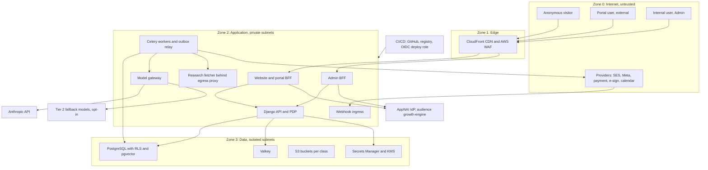
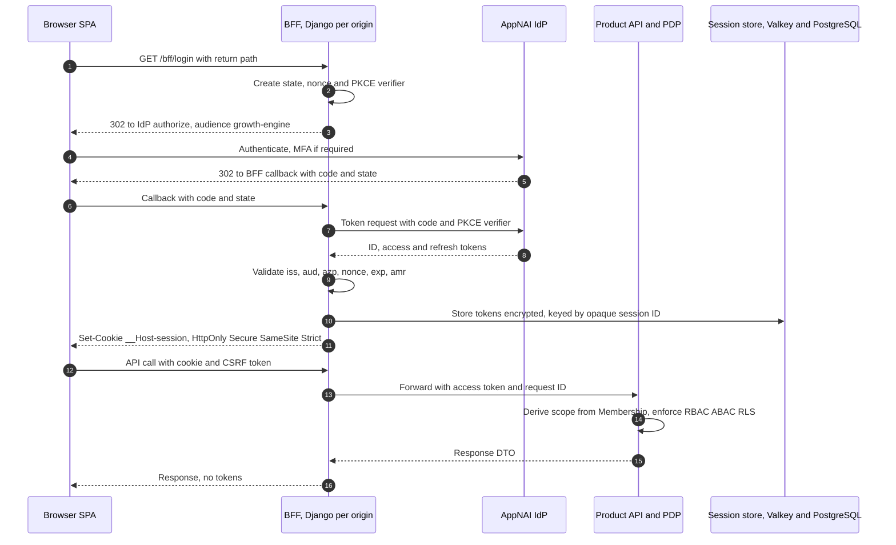

# AI Growth Engine: Employee Sales & Marketing Automation
## Application Blueprint: PART 4 (Batch 4.1), Security, Privacy and Regulatory Compliance

| Field | Value |
|---|---|
| Document | Part 4, Batch 1 of 3 (4.1 Security and Compliance · 4.2 Non-Functional Requirements · 4.3 DevOps and Operations) |
| Version | 1.0 · 27 Nov 2026 |
| Baseline | BRD, FRD; Parts 0, 0A (DEC-001…065), 1, 2.1–2.5. Part 3 (architecture) is written in parallel: this batch aligns with the stack fixed in DEC-003, DEC-007, DEC-009, DEC-018, DEC-019, DEC-020, DEC-025, DEC-040, DEC-041, DEC-043 and Part 2.4 §2.35 |
| Roles applied | Security / Compliance / AI Governance Lead (lead), Solutions Architect, Principal Engineer, Data Architect, DevOps/SRE Lead, QA Lead, Product Owner (review) |
| Tag ranges used | RECOMMENDATION-040…049 · ADR-050…069 · NFR-039…099 (Batch 4.2) · ASSUMPTION-120…129 · GAP-120…129 · CONFLICT-110…114 · RSK-330…359 · THR-### · RB-### (Batch 4.3) |

**Conventions.** Citations follow Part 0 §0.1.2 (`BRD §n`, `FRD §n`). Acronyms are defined on first use. Regulatory dates, provider terms, prices and free-tier limits are time-sensitive and are marked **"verify at implementation (as of 27 Nov 2026)"**, shortened below to *(verify, 27 Nov 2026)*. This batch is an engineering control specification. It is **not legal advice**. Every regulatory mapping row needs confirmation by counsel before the related capability is activated (DP-12, Part 1 §1.11).

**Acronyms used in this batch.** BFF Backend-for-Frontend · CMK customer-managed key (AWS KMS) · CSP Content Security Policy · CSRF cross-site request forgery · DAST dynamic application security testing · DEK data encryption key · DLP data loss prevention · DPA data processing agreement · DPDP Digital Personal Data Protection (Act 2023, Rules 2025) · DPIA data protection impact assessment · IdP identity provider · KMS key management service · LIA legitimate-interest assessment · MFA multi-factor authentication · OIDC OpenID Connect · PDP Policy Decision Point · PITR point-in-time recovery · RLS row-level security · RoPA record of processing activities · SAST static application security testing · SBOM software bill of materials · SCA software composition analysis · SIEM security information and event management · SoD separation of duties · SPDI sensitive personal data or information · SSRF server-side request forgery · STRIDE Spoofing, Tampering, Repudiation, Information disclosure, Denial of service, Elevation of privilege · TOTP time-based one-time password · WAF web application firewall · WORM write once, read many.

---

## 4.1 Security architecture overview

### 4.1.1 Security objectives

| # | Objective | Measured by | Source |
|---|---|---|---|
| SO-1 | **Zero cross-scope disclosure.** No data, side effect or AI context crosses product, tenant or startup boundaries | KPI-30 = 0; two-tenant fixture (AP-10) passes every release | BRD §1–2; B-TENANT; NFR-031, NFR-032 |
| SO-2 | **No unauthorized external effect.** No message, publication, spend, booking, signature request or submission happens without a current permission, eligibility and approved hash | KPI-17 = 0; CA-DISPATCH tests | BRD §5; PP-03, PP-04 |
| SO-3 | **Privileged access is strong and short-lived.** MFA for privileged roles, step-up for approvals, revocation in ≤ 60 s | NFR-003; DEC-019 check 6 | FRD §13.1 OPT-01-01 |
| SO-4 | **Secrets are never exposed.** No secret in API responses, browser code, logs, prompts or the repository | NFR-004; secret-scan gate | BRD §7 M05 |
| SO-5 | **Every consequential action is attributable and tamper-evident** | Audit hash chain verified daily (RECOMMENDATION-024) | BRD §5; FRD §5; NFR-018 |
| SO-6 | **AI cannot be steered into harm.** Prompt injection, data leakage, excessive agency and cost abuse are contained | §4.15 tests; BRL-AI-01…12 | M08, M12 ("injection ignored"), DEC-007, DEC-064 |
| SO-7 | **Personal data is minimized, purpose-bound, retained only as scheduled and deletable on request** | NFR-036; retention purge evidence | DEC-028; M56 |
| SO-8 | **Lawful outreach in every enabled jurisdiction; unknown jurisdiction denied** | RP-07 jurisdiction denials; KPI-17 | DEC-029; BRL-ELG-05 |

### 4.1.2 Data classification (binding, RECOMMENDATION-004 via DEC-007)

| Class | Definition | Examples in this product | Storage control | AI routing | Logging |
|---|---|---|---|---|---|
| **Public** | Approved for public release | Published website snapshots, approved offering text, public FAQ, published research source URLs | Standard encryption at rest | Tier 0, 1a, 1b; Tier 2 if tenant opted in | Allowed |
| **Internal** | Business data not personal and not secret | Offering drafts, scoring weights, campaign plans, aggregate metrics, organization-level evidence | Standard encryption; RLS | Tier 0, 1a, 1b; Tier 2 only if *Internal-non-personal*, opted in and redacted (BRL-AI-06) | Allowed without bodies |
| **Confidential** | Commercially sensitive or contractual | Quotes, prices below list, margins, contracts, bid packages, tenant configuration, cost ledgers | KMS CMK per data domain; RLS; field masking | Tier 0, 1a, 1b only | Digests only |
| **Restricted** | Personal data, children's data, health-adjacent data, financial evidence, credentials, government IDs | Contact name/email/phone, guardian and learner details, consent records, payment evidence files, bank references, OAuth tokens, API keys | Field-level envelope encryption (§4.5.3), RLS, ABAC-05, access audited | Tier 1a/1b only (Anthropic, under contractual protections); **never Tier 2**; minimized and pseudonymized where the task allows | Never in logs; audit stores digests |

Classification is a property of the **field** in the data dictionary (Part 3) and of the **document** in M03. When a record mixes classes, the highest class governs its routing (fail closed, PP-03).

### 4.1.3 Trust zones and boundaries

### 4.1.4 Trust boundary register

| TB | Boundary | Crossing | Primary controls | Threats (§4.2) |
|---|---|---|---|---|
| TB-01 | Public website | Internet → CloudFront/WAF → public BFF/API (`/api/v1/commercial/public/…`) | Host-to-tenant resolution, immutable snapshots, rate limits, CAPTCHA-on-risk, upload scanning, CSP | THR-001…008 |
| TB-02 | External portal | Authenticated external user → website BFF → portal API | OIDC via BFF, object grants (ABAC-09), field-minimized DTOs, private no-store caching | THR-009…015 |
| TB-03 | Admin Command Centre | Internal user → admin BFF → admin API | Separate origin and client, MFA, step-up, RBAC/ABAC, scope switch hygiene | THR-016…023 |
| TB-04 | BFF/API ↔ domain services | BFF → Django DRF → PDP and modules | Token audience/client check, membership-derived scope, PDP, idempotency, revision checks | THR-024…031 |
| TB-05 | Workers and outbox | Outbox relay → Valkey broker → Celery workers | Signed task envelopes, scope re-derivation, RLS context per job, dispatch-time recheck | THR-032…038 |
| TB-06 | Inbound webhooks | Provider → webhook ingress | Signature verification, timestamp window, dedupe, persist-then-ack, payload allowlist | THR-039…044 |
| TB-07 | Provider adapters | Workers → external provider APIs | Secret references, least-privilege provider scopes, idempotency keys, egress allowlist, uncertain-outcome handling | THR-045…050 |
| TB-08 | Model gateway | Workers/API → gateway → Anthropic / Tier 2 | Classification routing, redaction, injection isolation, schema validation, budget reservation, tool registry | THR-051…058 |
| TB-09 | Data stores | Services → PostgreSQL, Valkey, S3, pgvector, backups | Private subnets, IAM, KMS CMKs, RLS, per-tenant prefixes, PITR, Object Lock for audit anchors | THR-059…066 |
| TB-10 | CI/CD and supply chain | Developer → GitHub → CI → registry → AWS | Branch protection, signed commits/images, OIDC federation, SCA/SBOM, environment approvals | THR-067…074 |
| TB-11 | Identity provider | BFF ↔ shared AppNAI IdP | Separate audience and clients, PKCE, refresh rotation, investor-audience rejection | THR-075…078 |
| TB-12 | Platform operator and support access | Platform staff → tenant data | SupportAccessGrant (DEC-056), break-glass dual control, session recording of console actions | THR-079…082 |

### 4.1.5 Defence-in-depth control layers

| Layer | Controls | Owner | Evidence |
|---|---|---|---|
| Edge | CloudFront TLS termination, AWS WAF managed rule groups + rate rules, geo-unaware (no geo-blocking of inbound visitors), bot control on intake routes, origin access restricted to CloudFront | DevOps | WAF logs, config in IaC |
| Network | VPC with public (load balancer only), private (app/workers) and isolated (data) subnets; security groups by role; no inbound SSH (SSM Session Manager only); VPC endpoints for S3, KMS, Secrets Manager, ECR, CloudWatch; egress through NAT with an **allowlisting egress proxy** for workers [RECOMMENDATION-044] | DevOps | IaC plans, flow logs |
| Identity | Reused IdP with product audience `growth-engine`, clients `growth-website` and `growth-admin` (DEC-003), BFF sessions (DEC-019), MFA/WebAuthn, service identities via IAM roles | Security | DEC-019 spike report, IdP config |
| Application | DRF permission classes, scoped querysets (RECOMMENDATION-025), serializer field security (§2.26.5), PDP, input validation, output encoding, CSP | Engineering | CI gates, tests |
| Data | RLS, composite tenant keys, KMS CMKs, field-level encryption for Restricted fields, per-tenant S3 prefixes, signed URLs ≤ 15 min | Data architect | RLS tests, KMS key policies |
| AI | Gateway-only (BRL-AI-01), classification routing, injection isolation, schema validation, tool registry with side-effect classes (DEC-048), budget hard caps | AI lead | Eval reports, gateway logs |
| Detection | CloudTrail (all regions, org trail), GuardDuty, Security Hub CIS/AWS Foundational checks, application security events → alerting (Batch 4.3 §4.41) | DevOps / Security | Alert history |
| Governance | Policies, access reviews (RECOMMENDATION-023), vendor reviews (§4.14), DPIAs (§4.11), incident response (§4.17) | Compliance lead | Evidence register |

### 4.1.6 Security responsibilities (RACI summary)

| Activity | Founder/CTO (PO, architect) | Backend lead | Full-stack | Frontend | QA (0.5) | DevOps/SRE (0.5) | Growth/compliance lead (0.5) |
|---|---|---|---|---|---|---|---|
| Threat model upkeep (per wave) | A | R | C | C | C | R | C |
| Secure coding standards and reviews | A | R | R | R | C | C | I |
| CI security gates | A | C | C | C | C | R | I |
| Cloud hardening, KMS, secrets | A | C | I | I | I | R | I |
| Privacy (DPIA, RoPA, notices, requests) | A | C | I | I | I | I | R |
| Regulatory mapping and counsel liaison | A | I | I | I | I | I | R |
| Security testing programme | A | C | C | C | R | R | I |
| Incident response (security) | A | R | R | C | C | R | R (notifications) |

The team size (DEC-005: 4.0 engineering FTE + 0.5 growth/compliance) has no dedicated security engineer. The Founder/CTO is the accountable security officer, and the part-time DevOps contractor owns cloud controls. [RISK RSK-330] covers the concentration of knowledge.

---

## 4.2 Threat model (STRIDE)

### 4.2.1 Method

1. **Scope:** the twelve trust boundaries in §4.1.4, the dispatch sequence (Part 2.2 §2.6.1) and the data classes in §4.1.2.
2. **Identify:** walk each boundary with STRIDE. Add AI threats from the OWASP Top 10 for LLM Applications (§4.8.3) at TB-08.
3. **Rate:** Impact (H/M/L) = worst plausible effect on SO-1…SO-8. Likelihood (H/M/L) = exposure × attacker capability × existing preventive control. **Risk = Impact × Likelihood** (H×H, H×M = High; H×L, M×M = Medium; others Low).
4. **Mitigate:** map each threat to controls (SC-## in §4.7) and to a verifying test. Residual risk is rated after mitigation.
5. **Maintain:** re-run at the start of every wave and whenever a new adapter, channel, data class or AI tool is added. The model is versioned in the repository (`docs/security/threat-model.md`) and reviewed in the release gate (A090).

Test-type abbreviations used below: **UT** unit test · **IT** integration test · **CT** contract test · **E2E** Playwright journey · **DAST** OWASP ZAP scan · **RLS** two-tenant RLS fixture · **AIE** AI evaluation / red-team suite (M54) · **CHAOS** fault injection · **CFG** configuration/IaC policy check · **MAN** manual or penetration test.

### 4.2.2 Threat register

#### TB-01 Public website

| ID | STRIDE | Threat | Impact | Likelihood | Mitigation (controls) | Residual | Test |
|---|---|---|---|---|---|---|---|
| THR-001 | S | Attacker maps an unverified or look-alike host to a tenant site, or a dangling DNS record is taken over to serve phishing under a startup domain | H | M | Verified-domain table with one tenant/startup per host (BRL-TEN-10); unknown host → 404 (NFR-020); DNS ownership re-verified daily; domain-removal flow deletes CloudFront alternate names (SC-04, SC-31) | L | IT: unknown/unverified host returns 404; RB-010 domain expiry drill |
| THR-002 | I | Draft, preview or private content is served from the public CDN cache | H | M | Only approved immutable snapshots served (FR-PUB-01); cache key = tenant/startup/locale/revision; portal responses `Cache-Control: private, no-store`; preview links use signed, expiring grants (SC-05) | L | E2E: draft URL and preview after expiry return 404; CDN header assertion |
| THR-003 | D | Bot floods intake forms or the chat assistant, consuming AI budget and filling CRM with junk | M | H | WAF rate rules; per-IP 30 req/min and per-site 600 req/min (§2.35.3); proof-of-work or CAPTCHA only on risk signals (accessible alternative, WCAG 3.3.8); chat per-session token and turn caps; AI budget hard stop (BRL-AI-08) (SC-06, SC-40) | L | Load test LT-07 (Batch 4.2) with abusive profile; budget-cap simulation |
| THR-004 | T | Stored XSS through form fields, chat messages or uploaded content later rendered in Admin | H | M | Server-side schema validation and field allowlist (CA-INTAKE); React escaping by default, `dangerouslySetInnerHTML` banned by lint; sanitization (allowlist HTML) for rich text; strict CSP with nonces and no `unsafe-inline` (SC-10, SC-11) | L | DAST; UT payload corpus in every text field; lint rule in CI |
| THR-005 | T | Malicious upload (malware, polyglot file, oversized archive) via W15/W27 | H | M | Upload after sign-in only; type sniffing by content; size caps; ClamAV scan in an isolated worker before use (NFR-021); quarantine bucket; no server-side rendering of Office macros; PDFs re-rendered for preview (SC-12) | L | IT with EICAR and zip-bomb fixtures; UT on content-type spoofing |
| THR-006 | R | A visitor denies having given consent on a form | M | M | Consent recorded with policy revision, timestamp, form version, hashed IP/user agent and purpose (M04, CA-INTAKE); immutable consent ledger (SC-22) | L | IT: consent row immutable; audit chain contains the consent event |
| THR-007 | E | Public API used to reach portal or Admin endpoints (route confusion) | H | L | Separate route prefixes and DRF routers per surface; Admin routes not deployed in the public BFF; route allowlist per origin (NFR-001); CORS per origin (SC-01, SC-09) | L | CT: route inventory diff vs allowlist; DAST forced browsing |
| THR-008 | I | Admin JavaScript, route names or internal metric names leak into the public bundle | M | M | Two separate builds (DEC-009); bundle content scanner in CI fails on Admin route identifiers, API prefixes `/admin/`, or internal feature-flag names (SC-02) | L | CI bundle scan; NFR-001 test |

#### TB-02 External portal

| ID | STRIDE | Threat | Impact | Likelihood | Mitigation (controls) | Residual | Test |
|---|---|---|---|---|---|---|---|
| THR-009 | S | Session hijacking of a portal user through token theft from the browser | H | M | BFF pattern: tokens held server-side; browser holds only `__Host-` prefixed `HttpOnly; Secure; SameSite=Strict` session cookie (DEC-019); session bound to IdP `sid`; rotation on privilege change (SC-14) | L | E2E: no token in `localStorage`/JS-readable cookies; cookie flags assertion |
| THR-010 | E | Insecure direct object reference: portal user changes an ID to read another customer's quote or invoice | H | H | Object grant per request (ABAC-09); uniform 404 (BRL-TEN-04); querysets filtered by grant; RLS as second layer; UUIDv7 IDs are not a control and are never relied on (SC-17, SC-18) | L | RLS + E2E BOLA suite over every portal endpoint (generated from the API catalogue) |
| THR-011 | T | Customer manipulates a quote acceptance (changed price or quantity in the request) | H | M | Acceptance references the approved quote hash only; server recomputes totals (CA-FIN); body hash in idempotency key (FR-ENG-01) (SC-20) | L | UT: tampered payload → 409; FR-DM-01 test |
| THR-012 | I | Magic links or expired grants are reused or forwarded | M | M | Single-use, ≤ 15 min sign-in links; grants expire; "expired" state (CA-PORTAL); links never authorize by themselves (SC-15) | L | E2E: replayed link denied; expired grant state |
| THR-013 | D | Credential stuffing against portal login | M | H | Login handled by the IdP with rate limits, breached-password check and lockout with back-off (DEC-019 check 10); WAF login rate rule (SC-06, SC-13) | L | DEC-019 spike check; DAST brute-force profile in staging |
| THR-014 | R | Customer disputes having accepted terms or uploaded a signed PDF | H | L | Acceptance event with hash, timestamp, session, MFA/OTP evidence; SHA-256 of signed PDF recorded and confirmed (DEC-023) (SC-22) | L | IT: acceptance evidence completeness |
| THR-015 | I | Guardian or learner data exposed to another guardian or to staff without need | H | L | Field-level encryption and ABAC-05; guardian sees only own wards' grade band and programme; minor data never in AI prompts beyond grade band (DEC-030) (SC-24, SC-41) | L | RLS + E2E guardian isolation; DLP test on prompts |

#### TB-03 Admin Command Centre

| ID | STRIDE | Threat | Impact | Likelihood | Mitigation (controls) | Residual | Test |
|---|---|---|---|---|---|---|---|
| THR-016 | S | Phishing of a privileged user (Founder, Finance, Tenant Admin) | H | M | MFA mandatory for privileged roles (BRL-TEN-08); WebAuthn/passkeys required for R01, R12, R13, R14 by the scale gate [CONFLICT-114 resolution]; step-up for approvals (ABAC-11); new-device alerts (SC-13) | M | DEC-019 checks 5, 12; E2E step-up flows |
| THR-017 | T | CSRF on state-changing Admin actions (approve, stop, send) | H | M | `SameSite=Strict` session cookie plus synchronizer CSRF token on all unsafe methods; `Origin`/`Referer` validation in the BFF (SC-16) | L | DAST CSRF checks; UT on missing/invalid token |
| THR-018 | E | Horizontal privilege escalation across startups by switching scope or crafting `startup_id` | H | M | Scope from membership (BRL-TEN-01); requested scope validated; portfolio scope read-only (BRL-TEN-05); RLS session variables set from server-derived scope (SC-17, SC-18) | L | RLS two-tenant fixture; E2E scope-switch suite |
| THR-019 | E | Vertical escalation: Growth Manager approves own discount or Finance Maker also checks | H | M | SoD (ABAC-03), thresholds (ABAC-04), maker ≠ checker (BRL-APR-07), approval hash (BRL-APR-02) (SC-19) | L | Decision-table tests for BRL-APR-01…07 |
| THR-020 | I | Over-broad export of Restricted contact data | H | M | Export permission recheck (RPT-R10), classification-aware redaction, approval for Restricted exports, 72 h expiring links (BRL-PRV-07), bulk-export anomaly alert (§2.34.3) (SC-23, SC-36) | L | IT: export without approval blocked; alert fires on 3 exports > 5,000 rows in 1 h |
| THR-021 | R | Admin denies approving a quote or stopping a workflow | M | L | Audit event with actor, MFA time, hash, reason; per-tenant hash chain (§2.34) (SC-22) | L | Daily chain verification job |
| THR-022 | I | Shoulder-surfing or screen sharing reveals masked personal data | M | M | Field masking by default (§2.26.5); explicit "reveal" action audited; Restricted fields never in email digests (§2.31.5) (SC-24) | L | E2E: masked by default; reveal audited |
| THR-023 | T | Clickjacking of the Admin UI to trigger an approval | M | L | `frame-ancestors 'none'` in CSP and `X-Frame-Options: DENY`; two-step confirm on STOP and approvals (SC-10) | L | Header test; DAST |

#### TB-04 BFF/API and domain services

| ID | STRIDE | Threat | Impact | Likelihood | Mitigation (controls) | Residual | Test |
|---|---|---|---|---|---|---|---|
| THR-024 | S | Token for the investor-product audience or another client is replayed against this API | H | M | Audience = `growth-engine` and client = surface client, else 401 (BRL-TEN-02, DEC-058); issuer and `azp` validated; JWKS pinned to IdP issuer (SC-14) | L | CT: wrong-audience and wrong-client tokens rejected (NFR-003: 0 successes) |
| THR-025 | E | Broken function-level authorization on a newly added endpoint (missing permission class) | H | M | Default-deny DRF `DEFAULT_PERMISSION_CLASSES`; CI check that every view declares an explicit permission policy and appears in the RBAC matrix export (SC-17, SC-50) | L | CI route-permission linter; BFLA suite |
| THR-026 | I | Mass assignment / excessive data exposure through generic serializers | H | M | Explicit serializer field lists (no `__all__`), separate read/write DTOs, field-level security in serializers (§2.26.5) (SC-24) | L | Semgrep rule bans `fields = "__all__"`; API3 tests |
| THR-027 | T | SQL injection through filters, search or ordering | H | L | ORM only; allowlisted filter fields and sort keys (FR-FLT-RULES); raw SQL only in reviewed, parameterized repository modules; full-text queries via `SearchQuery` (SC-10) | L | SAST (Bandit, Semgrep); DAST injection |
| THR-028 | D | Expensive queries (deep pagination, wide filters, large exports) exhaust the database | M | M | Cursor pagination with max page size 200; query timeout (`statement_timeout` 5 s for API role, 60 s for reporting role); async exports; per-user and per-tenant rate limits (§2.35.3) (SC-06, SC-37) | L | Load test LT-03; UT for page-size cap |
| THR-029 | T | Replay or double submission creates duplicate deals, quotes or messages | H | M | Idempotency key + body hash (FR-ENG-01); unique constraints on provider references; revision checks → 409 (NFR-025) (SC-20) | L | IT: duplicate POST → same result, one effect (NFR-005) |
| THR-030 | E | Copilot used as a confused deputy to read records outside the user's scope | H | M | Copilot retrieves with the **user's** scope and RLS context, never a service scope (BRL-AI-12); tool registry is read-only plus draft creation (DEC-035) (SC-42) | L | AIE: cross-scope retrieval prompts return refusal; RLS |
| THR-031 | I | Verbose errors reveal stack traces, SQL or secrets | M | M | `DEBUG=False` enforced by settings check; problem-details error format with reference ID only; Sentry scrubbing of PII and secrets (SC-25) | L | DAST error-handling; settings test |

#### TB-05 Workers and outbox

| ID | STRIDE | Threat | Impact | Likelihood | Mitigation (controls) | Residual | Test |
|---|---|---|---|---|---|---|---|
| THR-032 | S | Forged Celery task injected into the broker with a chosen tenant scope | H | L | Valkey in isolated subnet with AUTH/ACL and TLS; task payload carries only IDs; worker re-derives scope from the outbox row in the database and sets the RLS context (§2.35.2); HMAC-signed task envelope (SC-26) | L | IT: forged scope rejected (§2.35.2 test) |
| THR-033 | T | Plan-time approval is reused after the content changed | H | M | Dispatch-time recheck of the approved hash (E-3, BRL-ELG-18); mismatch → cancel and notify (SC-21) | L | IT for every dispatch type |
| THR-034 | D | Poison message blocks a queue; retries storm a provider | M | M | Max 3 retries with exponential backoff and jitter (BRL-AUT-06); DLQ after cap; per-provider circuit breaker; per-tenant concurrency 20 (SC-37) | L | CHAOS: poison message; RB-011 |
| THR-035 | E | Worker runs with an over-privileged database role and bypasses RLS | H | L | Separate DB roles: `app_api`, `app_worker` (both `NOBYPASSRLS`), `app_migrator` (DDL only in pipeline), `app_reporting` (read-only on projections); no superuser in the application (SC-18) | L | CFG test on role attributes; RLS |
| THR-036 | R | Lost evidence of what an automation did | M | L | Step record stores correlation ID, attempt, error class and actual side effect (E-9); audit append in the same transaction (E-2) | L | IT: every step has audit row |
| THR-037 | T | Emergency stop bypassed by already-queued tasks | H | M | Workers check the stop registry (Valkey + DB fallback) immediately before each external call; propagation ≤ 60 s (BRL-AUT-05) (SC-21) | L | CHAOS: stop during burst; NFR-049 |
| THR-038 | I | Simulation mode leaks into live adapters | H | L | Adapter factory returns a simulation adapter whenever `run.mode = simulation`; live adapters refuse simulated runs; separate provider credentials per environment (ABAC-12) (SC-27) | L | IT: simulated run with live credentials present → zero provider calls (NFR-038) |

#### TB-06 Inbound webhooks

| ID | STRIDE | Threat | Impact | Likelihood | Mitigation (controls) | Residual | Test |
|---|---|---|---|---|---|---|---|
| THR-039 | S | Forged webhook marks a payment as received or a contract as signed | H | M | Provider signature verification (HMAC or asymmetric per provider), timestamp tolerance ≤ 5 min, provider account match, then **reconciliation via provider API** before financial state changes; maker-checker still required (BRL-APR-07) (SC-28) | L | CT per provider with invalid signature, old timestamp and wrong account fixtures |
| THR-040 | T | Replay of a genuine webhook | M | M | Dedupe on (provider account, event ID) within ≥ 7 days (BRL-AUT-08) (SC-20) | L | IT: replay → no second effect |
| THR-041 | D | Webhook flood or oversized payloads | M | M | WAF size limits (≤ 256 KB), per-provider rate rule, persist-minimal-then-ack, async processing (SC-06) | L | Load test LT-05 |
| THR-042 | I | Webhook payloads containing personal data stored in logs | M | M | Persist only allowlisted fields; raw body kept encrypted ≤ 7 days for dispute, then purged; logs carry event IDs only (SC-25) | L | Log redaction test |
| THR-043 | T | SNS bounce/complaint notifications spoofed to suppress or un-suppress addresses | M | L | SNS message signature and certificate URL host validation; subscription confirmation only for expected topics (DEC-025) (SC-28) | L | CT with forged SNS message |
| THR-044 | E | Webhook endpoint used to trigger arbitrary internal actions | H | L | Webhook handlers write a typed `InboundEvent` only; no direct state transitions; downstream consumers apply PDP (SC-28) | L | Code review checklist; IT |

#### TB-07 Provider adapters

| ID | STRIDE | Threat | Impact | Likelihood | Mitigation (controls) | Residual | Test |
|---|---|---|---|---|---|---|---|
| THR-045 | I | Provider credential leaked through logs or exceptions | H | M | Secret references resolved at call time from Secrets Manager (M05); client libraries wrapped with redacting loggers; Sentry scrubbing (SC-29) | L | Secret-scan of logs in staging; UT on exception messages |
| THR-046 | E | Over-scoped OAuth grant (e.g. full Gmail/Calendar read) | M | M | Least scopes: calendar free/busy and own events only (DEC-024); scope list reviewed in the integration registry; tokens per startup (SC-30) | L | CT: requested scopes equal allowlist |
| THR-047 | T | Duplicate send on retry after timeout | H | M | Provider idempotency keys; timeout after submission → *uncertain*, no retry until reconciled (DEC-050) (SC-20) | L | CHAOS: provider timeout injection; RB-003 |
| THR-048 | I | SSRF: research fetcher or webhook-configured URL reaches cloud metadata or internal hosts | H | M | Fetcher runs in its own worker pool behind an egress proxy that blocks private, link-local and metadata ranges, re-resolves DNS on redirect, enforces scheme/port allowlist and size/time caps; IMDSv2 hop limit 1 [RECOMMENDATION-044] (SC-31) | L | IT SSRF corpus (169.254.169.254, DNS rebinding, redirects) |
| THR-049 | D | Provider outage stops dispatch and loses events | M | M | Outbox retains events (NFR-007); circuit breaker; degrade to queue (Tier 3 pattern) (SC-37) | L | CHAOS: provider 503 for 30 min; RB-001 |
| THR-050 | T | Compromised provider returns malicious data (e.g. crafted inbound message) | M | L | Treat all provider data as untrusted input; schema validation; inbound text passes the same injection isolation as web content (SC-32) | L | AIE indirect-injection suite |

#### TB-08 Model gateway

| ID | STRIDE | Threat | Impact | Likelihood | Mitigation (controls) | Residual | Test |
|---|---|---|---|---|---|---|---|
| THR-051 | T | **Indirect prompt injection** in a fetched web page, PDF, inbound email or WhatsApp message instructs the model to change a score, add a claim or exfiltrate data | H | H | Untrusted content wrapped in delimited data blocks with provenance; system prompt instructs data-only treatment; HTML cleaned (M12); **no tool access in extraction tasks**; output schema validation; deterministic post-checks (claims must cite approved IDs, scores computed by rules not by the model) (SC-32, SC-33) | M | AIE injection corpus ≥ 200 cases; M12 acceptance "injection ignored" |
| THR-052 | E | **Excessive agency**: model output triggers an external side effect | H | M | AI cannot approve, send, sign, pay, submit or change price/terms (BRL-AI-07, DEC-064); tool registry with side-effect class; any external effect goes through PDP + approval hash (SC-34) | L | AIE: tool-call attempts in output ignored; PDP test |
| THR-053 | I | Restricted data sent to a Tier 2 free model that may train on inputs | H | L | Classification router blocks Restricted and Confidential from Tier 2; Tier 2 off by default; per-tenant opt-in by R01 + R10 (CFG-25); DLP scan of the final prompt (SC-35) | L | IT: Restricted fixture never reaches Tier 2 adapter (NFR-077) |
| THR-054 | I | System prompt or other tenants' context leaks through the response | M | M | No secrets or cross-tenant data in prompts; per-request context assembled from the caller's scope only; canary strings in system prompts detected in outputs [RECOMMENDATION-049] (SC-33) | L | AIE leakage suite |
| THR-055 | D | **Unbounded consumption**: loops or abuse drain the AI budget | M | M | Reserve-before-call (M53), per-agent/startup/tenant caps, 80% alert, 100% stop (BRL-AI-08); max steps per run (BRL-AUT-06); max tokens per call (SC-40) | L | Budget-cap simulation (NFR-014) |
| THR-056 | T | Hallucinated facts reach a customer | H | M | Grounding with citations (BRL-AI-03); abstain thresholds (BRL-AI-04); human approval for customer-facing drafts below L3; claims checker (SC-33) | M | AIE grounding suite; precision gates (DEC-001) |
| THR-057 | T | Poisoned knowledge document changes assistant answers | M | L | Only approved documents indexed (M03 review step); document version hash in citations; re-index on approval only (SC-33) | L | IT: unapproved doc not retrievable |
| THR-058 | I | Vector retrieval returns chunks from another tenant | H | L | Mandatory (tenant, startup) namespace filter in the retrieval function signature; RLS on embedding tables (§2.35.2) (SC-18) | L | RLS retrieval test |

#### TB-09 Data stores

| ID | STRIDE | Threat | Impact | Likelihood | Mitigation (controls) | Residual | Test |
|---|---|---|---|---|---|---|---|
| THR-059 | I | Missing `tenant_id` filter in a new query exposes another tenant's data | H | M | RLS enforced on every operational table (`FORCE ROW LEVEL SECURITY`); scoped managers; unscoped-query CI check (RECOMMENDATION-025) (SC-17, SC-18) | L | RLS fixture; CI check |
| THR-060 | I | Public S3 bucket or overly broad bucket policy | H | L | S3 Block Public Access at account level; bucket policies deny non-TLS and non-VPC-endpoint access; per-tenant prefix conditions; Config rules (SC-38) | L | CFG: IaC policy check (Checkov/tfsec); AWS Config |
| THR-061 | T | Ransomware or operator error deletes data and backups | H | L | PITR 35 days (DEC-028), AWS Backup vault lock, cross-region copy (DEC-040), deletion protection, MFA-delete on backup role (SC-39) | L | Restore drill (Batch 4.3 §4.47) |
| THR-062 | I | Database snapshot shared or copied to another account | H | L | KMS CMK with key policy restricting use to the production account; SCP denies snapshot sharing (SC-38) | L | CFG check |
| THR-063 | T | Direct modification of audit or ledger rows | H | L | Append-only tables; no UPDATE/DELETE grants; triggers reject updates; hash chain and daily WORM anchor (§2.34.3) (SC-22) | L | UT: UPDATE on audit raises; chain verification |
| THR-064 | I | Cache key collision serves one tenant's data to another | H | L | Keys prefixed tenant/startup/locale/revision; no shared cache for portal data (§2.35.2) (SC-17) | L | Cache-poisoning tests |
| THR-065 | I | Restricted data in non-production environments | H | M | Production data never copied to lower environments; synthetic data sets (RECOMMENDATION-017); masked restore only for a declared incident in an isolated account (SC-27) | L | CFG: no cross-account snapshot restore roles |
| THR-066 | D | Storage or connection exhaustion | M | M | RDS storage autoscaling; PgBouncer connection pooling; CloudWatch alarms at 80% (SC-37) | L | AL rules (Batch 4.3) |

#### TB-10 CI/CD and supply chain

| ID | STRIDE | Threat | Impact | Likelihood | Mitigation (controls) | Residual | Test |
|---|---|---|---|---|---|---|---|
| THR-067 | T | Malicious or typosquatted dependency (npm/PyPI) | H | M | Lockfiles with hashes; SCA (OSV-Scanner, pip-audit, npm audit) blocking High/Critical; new-dependency review (NFR-029 ADR rule); Renovate with grouped updates and 3-day cool-off (SC-43) | M | CI SCA gate |
| THR-068 | E | Stolen long-lived AWS keys in CI | H | L | GitHub OIDC federation to short-lived AWS roles scoped per environment; no static keys (SC-44) | L | CFG: no IAM users with access keys |
| THR-069 | T | Unreviewed change reaches production | H | L | Branch protection (1 review, 2 for security-sensitive paths via CODEOWNERS), required checks, signed tags, production environment approval (SC-45) | L | Pipeline audit |
| THR-070 | T | Tampered container image | H | L | Images built in CI only, signed (cosign keyless), digest-pinned deploys, ECR immutable tags, admission check on signature (SC-46) | L | Deploy step verifies signature |
| THR-071 | I | Secrets committed to the repository | H | M | gitleaks pre-commit and CI; GitHub push protection; rotation runbook on detection (SC-47) | L | CI secret scan (NFR-012) |
| THR-072 | E | Malicious pull request abuses CI secrets (`pull_request_target`) | H | L | No secrets for fork PRs; `pull_request_target` banned; least-privilege `GITHUB_TOKEN` permissions (SC-45) | L | Workflow lint (actionlint + policy) |
| THR-073 | T | Drift: manual console change weakens a control | M | M | IaC only; daily drift detection plan; AWS Config rules; console write access limited to break-glass (SC-48) | L | Drift job alert |
| THR-074 | R | Unknown provenance of a production artefact | M | L | SBOM (CycloneDX) and SLSA-style provenance attached to each release; release record in A090 (SC-46) | L | Release gate evidence check |

#### TB-11 Identity provider and TB-12 Operator access

| ID | STRIDE | Threat | Impact | Likelihood | Mitigation (controls) | Residual | Test |
|---|---|---|---|---|---|---|---|
| THR-075 | S | Shared IdP compromise in the AppNAI/investor estate grants access here | H | L | Separate audience and clients; product membership held in this product's database (identity shared, access not, DEC-003); anomaly alerts on new privileged memberships (SC-14) | M | DEC-019 spike; RB-008 |
| THR-076 | E | IdP claims include roles from another product that are trusted here | H | M | Ignore IdP role claims; derive roles only from this product's `Membership` (BRL-TEN-01) (SC-17) | L | CT: foreign role claim has no effect |
| THR-077 | S | Account recovery flow used to take over a privileged account | H | M | Recovery isolation (DEC-019 check 9); privileged recovery requires admin-assisted identity verification and resets MFA with a 24 h hold and notification (SC-13) | L | DEC-019 spike; manual test |
| THR-078 | D | IdP outage blocks all logins | M | M | Existing sessions continue to their idle limit; status banner; break-glass local admin (dual control) for incident handling only (SC-13) | M | CHAOS in staging |
| THR-079 | E | Platform support reads tenant content without a grant | H | L | SupportAccessGrant required (DEC-056, BRL-TEN-09); grant visible to the tenant; access audited (SC-19) | L | E2E: R13 without grant → 404 |
| THR-080 | E | Break-glass account misuse | H | L | Two-person activation, hardware-key MFA, 4 h expiry, automatic Critical alert and post-incident review (SC-13) | L | Quarterly break-glass drill |
| THR-081 | I | Engineer queries production DB directly | H | M | No standing DB access; SSM Session Manager with approval and session logging; read-only role for diagnostics; RLS still applies (SC-48) | L | Access review (RECOMMENDATION-023) |
| THR-082 | R | Operator action on infrastructure not attributable | M | L | CloudTrail organization trail with log-file validation into a separate log-archive account (SC-36) | L | CFG check |

**Threat register totals:** 82 threats; inherent rating High 51, Medium 29, Low 2; residual rating **Medium 6** (THR-016, -051, -056, -067, -075, -078), **Low 76**, **High 0**. Each residual Medium has a named risk in §4.19.

---

## 4.3 Authentication

### 4.3.1 Identity reuse and SSO (DEC-003, DEC-019)

| Aspect | Decision | Source |
|---|---|---|
| IdP | Reuse the AppNAI identity/security codebase as a shared library and IdP (H02 login/sessions/recovery, H03 MFA/revocation/auth audit) | DEC-003, DEC-019 |
| Protocol | OIDC Authorization Code flow with PKCE (S256) from each BFF; confidential clients (client secret or `private_key_jwt`, the latter preferred [ADR-054]) | DEC-019 check 3 |
| Audience and clients | Audience `growth-engine`; clients `growth-website` (website/portal BFF) and `growth-admin` (admin BFF). Investor-product audience tokens rejected (DEC-058) | DEC-003; BRL-TEN-02 |
| Membership | Product access (tenant, startup grants, roles) is stored **in this product's database**. IdP role claims are ignored | BRL-TEN-01; THR-076 |
| External users | Portal customers, suppliers, guardians and SaaS applicants register through the IdP's external-user registration with email verification (DEC-019 check 8); passwordless magic link or passkey supported, password optional | FRD §13.1; WCAG 3.3.8 (Part 2.5 §2.46) |
| Fallback | If the Sprint 0 compatibility spike fails a check, that check becomes a change request (ASSUMPTION-019). DP-01 fallback: Django-native auth module behind a feature flag | DEC-019; Part 1 DP-01 |

**Sprint 0 compatibility spike acceptance (DEC-019's 12 checks, with the security pass criterion added by this batch):**

| # | Check | Pass criterion |
|---|---|---|
| 1 | Product audience | IdP issues tokens with `aud=growth-engine`; other audiences rejected by this API |
| 2 | Separate clients | Two clients with distinct redirect URIs and secrets/keys; cross-client token use rejected |
| 3 | PKCE | `code_challenge_method=S256` required; plain rejected |
| 4 | Refresh rotation | Refresh tokens rotate on each use; reuse of a rotated token revokes the family |
| 5 | MFA | TOTP available to all; WebAuthn available for privileged roles; `amr`/`acr` claims returned |
| 6 | Revocation latency | Back-channel logout or session-status polling revokes BFF sessions in **≤ 60 s** |
| 7 | Membership claims | `sub` stable; email verified flag present; no reliance on IdP roles |
| 8 | External-user registration | Self-registration with verification, separate from staff accounts |
| 9 | Recovery isolation | Recovery of privileged accounts requires assisted verification; MFA reset notifies the user and holds 24 h |
| 10 | Rate limiting | Login, MFA and recovery endpoints rate-limited with progressive delay; lockout does not enable user enumeration |
| 11 | Audit events | Login, failure, MFA, recovery, revocation events exported to this product's security log |
| 12 | Logout propagation | RP-initiated and back-channel logout supported |

### 4.3.2 BFF pattern

| BFF rule | Specification |
|---|---|
| Token custody | Access and refresh tokens are never sent to the browser. They are stored encrypted (KMS-derived key, §4.5) in the session store |
| Cookie | `__Host-gse_admin` / `__Host-gse_web`; `HttpOnly; Secure; SameSite=Strict; Path=/`; no `Domain` attribute; separate per origin (NFR-001) |
| CSRF | Synchronizer token for unsafe methods, plus `Origin` header check against the origin allowlist |
| CORS | Not enabled for the BFF (same-origin). The API accepts calls only from the BFF network path |
| Token refresh | BFF refreshes access tokens ≤ 60 s before expiry; refresh failure → session terminated and re-login |
| Origins | `admin.<platform-domain>` for Admin (no public DNS listing of Admin routes in the website), `<startup-domain>` or `<slug>.<platform-domain>` for website/portal |

### 4.3.3 MFA and step-up

| Role / action | Factor at login | Step-up | Source |
|---|---|---|---|
| R01, R12, R13, R14, break-glass | TOTP at pilot; **WebAuthn/passkey required from the scale gate** | Every approval, budget increase, policy loosening, support grant, emergency-stop resume: MFA ≤ 5 min old | DEC-019; BRL-TEN-08; [CONFLICT-114] |
| R02, R08, R09, R10, R11 and any approver | TOTP minimum; WebAuthn recommended | Approvals: MFA within last 12 h (ABAC-11); financial verification and Restricted export: ≤ 15 min | BRL-TEN-08; ABAC-11 |
| R03–R07, R15 | MFA strongly recommended at pilot; **required for any user holding Restricted-data clearance** (ABAC-05) from W2 | Reveal of masked Restricted fields in bulk (> 20 records) | ABAC-05 [RECOMMENDATION-043] |
| R16 portal users | Email OTP or passkey | Quote acceptance, payment evidence upload and signed-PDF confirmation: fresh OTP ≤ 10 min | CA-PORTAL; DEC-023 |
| R17 applicant | Email verification | Administrator authority attestation (W32) | BRL-SVC-01 |

### 4.3.4 Session management

| Parameter | Admin | Portal | Rationale |
|---|---|---|---|
| Idle timeout | 30 min (warn at 28 min, extend) | 30 min | WCAG 2.2.1 warning (Part 2.5 §2.46) |
| Absolute lifetime | 12 h | 7 days (remember-device, low-risk actions only; step-up for consequential ones) | Matches ABAC-11 freshness window |
| Concurrent sessions | Max 3 per user; new-device notification | Max 5 | Limits hijack window |
| Revocation | Membership change, role change, expiry, password/MFA reset, admin revoke → all sessions revoked ≤ 60 s (BRL-TEN-07) | Same | DEC-019 check 6 |
| Scope switch | Server re-validates; client cancels stale requests and clears caches (FR-STD-01, NFR-027) | n/a | FRD §2 |
| Session ID | 256-bit random, rotated at login and privilege change | Same | Fixation defence |
| Logout | Clears BFF session, revokes refresh token, RP-initiated logout at IdP | Same | DEC-019 check 12 |

### 4.3.5 Service and machine identities (R19, R20)

| Identity | Authentication | Authorization |
|---|---|---|
| API, workers, outbox relay, fetcher, gateway | IAM task roles (no static keys); database credentials from Secrets Manager with rotation, or IAM database authentication where supported (verify, 27 Nov 2026) | Least-privilege IAM per service; DB roles in THR-035 |
| AI agent identity (R20) | Internal service token minted per run, bound to run ID and scope, TTL ≤ 15 min | Tool registry scopes (DEC-048); never approval permissions |
| CI/CD | GitHub OIDC → environment-scoped AWS roles | Deploy only; no data-plane read |
| Provider callbacks | Signature per provider (§4.7 SC-28) | Write `InboundEvent` only |

---

## 4.4 Authorization

### 4.4.1 Model

Authorization is **RBAC (roles R01–R20, Part 2.3 §2.26) refined by ABAC (ABAC-01…12) and enforced by deterministic code**, with RLS as an independent second layer. The PDP (RECOMMENDATION-012) decides external-action eligibility. It never grants data access that RBAC/ABAC deny.

### 4.4.2 Enforcement points

| AZ | Enforcement point | Layer | What is checked | Fails as | Test |
|---|---|---|---|---|---|
| AZ-01 | Edge route allowlist | CloudFront/WAF + BFF router | Path belongs to the origin's surface (public, portal, admin) | 404 | Route inventory CT |
| AZ-02 | BFF session gate | BFF | Valid session, CSRF, origin, MFA freshness for step-up routes | 401 / 403 `STEP_UP_REQUIRED` | E2E |
| AZ-03 | Token validation | API middleware | `iss`, `aud=growth-engine`, `azp` = surface client, signature, expiry | 401 | CT (NFR-003) |
| AZ-04 | Scope resolution | API middleware | Membership → tenant, startup grants, roles; requested scope ⊆ membership; portfolio read-only | 404 / 409 `SELECT_SINGLE_STARTUP` | RLS + E2E |
| AZ-05 | View permission | DRF permission classes | Role × action from the RBAC matrix (generated policy table) | 403 / 404 | BFLA suite |
| AZ-06 | Object permission | DRF `has_object_permission` + scoped querysets | ABAC-01/02/08/09 | 404 | BOLA suite |
| AZ-07 | Field security | Serializers | ABAC-05 field visibility and masking (§2.26.5); write allowlists | Masked / 400 | UT |
| AZ-08 | Approval authority | Approval service | ABAC-03 SoD, ABAC-04 thresholds, ABAC-11 MFA freshness, BRL-APR-02 hash | 403 with reason | Decision tables |
| AZ-09 | PDP (plan and dispatch) | PDP service | Consent, suppression, jurisdiction, quiet hours, caps, entitlement, budget, autonomy cap, approved hash, emergency stop | Deny with rule IDs | PDP decision-table tests |
| AZ-10 | Database RLS | PostgreSQL | `tenant_id`/`startup_id` = session variables `app.tenant_id`, `app.startup_ids`; `FORCE ROW LEVEL SECURITY` | Zero rows | RLS fixture |
| AZ-11 | Worker scope | Celery task base class | Scope re-derived from outbox/run row; RLS context set before first query; refuses tasks without scope | Task rejected, DLQ | IT |
| AZ-12 | Retrieval scope | Retrieval service | Mandatory namespace (tenant, startup) and the user's classification clearance | Empty result | AIE + RLS |
| AZ-13 | Storage | S3 IAM conditions + signed URLs | Prefix = tenant/startup; URL TTL ≤ 15 min; object classification vs requester | 403 | IT |
| AZ-14 | Export / report generation | Export service | Permission recheck at generation time (RPT-R10), classification redaction, approval for Restricted | Job denied | IT |
| AZ-15 | Notification rendering | Notification service | Recipient can open the object; content minimized (N-P4) | Link only | IT |

### 4.4.3 Implementation rules

1. `DEFAULT_PERMISSION_CLASSES = [DenyAll]`. Every view declares its policy explicitly. A CI linter fails on any view without one (SC-50).
2. Business code uses only scoped managers (`Model.scoped.for_request(request)`). Unscoped `objects` usage outside migrations and platform modules fails the CI check (RECOMMENDATION-025).
3. RLS policies are created by migration for every table with `tenant_id`, with `FORCE ROW LEVEL SECURITY`. A migration test asserts that every new operational table has a policy.
4. The RBAC matrix (Part 2.3 §2.26.3) is maintained as a machine-readable YAML policy. The permission classes and the A002 UI read the same file, and a test compares it with the documented matrix.
5. Denials return uniform 404 when the object's existence is sensitive (BRL-TEN-04). All denials are audited with reason codes (§2.34.1).

---

## 4.5 Cryptography and encryption

### 4.5.1 In transit

| Path | Protocol | Minimum | Certificates |
|---|---|---|---|
| Browser → CloudFront | HTTPS | TLS 1.2 (TLS 1.3 preferred); security policy `TLSv1.2_2021` or newer (verify, 27 Nov 2026); HSTS `max-age=31536000; includeSubDomains` (preload after stabilization) | ACM, auto-renewed; custom startup domains via ACM DNS validation |
| CloudFront → load balancer | HTTPS | TLS 1.2+; origin verified by secret header + security group limited to the CloudFront prefix list | ACM |
| Load balancer → containers | HTTPS within the VPC [ASSUMPTION-120] | TLS 1.2+ | Private CA or self-signed with pinning (Part 3) |
| App → PostgreSQL | TLS with `sslmode=verify-full` | TLS 1.2+ | RDS CA bundle |
| App → Valkey | TLS + AUTH/ACL | TLS 1.2+ | Managed |
| App → AWS APIs | HTTPS via VPC endpoints | TLS 1.2+ | AWS |
| Workers → providers / Anthropic | HTTPS via egress proxy | TLS 1.2+; certificate validation never disabled | Public CAs |
| Email | SES with TLS required on the configuration set (`TlsPolicy=Require`, verify, 27 Nov 2026); MTA-STS and TLS-RPT published for startup sending domains [RECOMMENDATION-048] | — | — |

### 4.5.2 At rest and KMS key hierarchy

| Key (alias) | Type | Protects | Key policy principals | Rotation |
|---|---|---|---|---|
| `alias/gse-rds` | KMS CMK (symmetric) | RDS storage, snapshots, PITR logs | RDS service; backup role | Automatic annual |
| `alias/gse-s3-public` | KMS CMK | Published assets bucket (served via CloudFront OAC) | CloudFront OAC; publisher role | Annual |
| `alias/gse-s3-private` | KMS CMK | Documents, uploads, exports, evidence bundles | API, workers (per-prefix IAM conditions) | Annual |
| `alias/gse-s3-restricted` | KMS CMK | Payment evidence, signed contracts, guardian documents | Finance and contracts services only | Annual |
| `alias/gse-field` | KMS CMK (key-encryption key) | Data encryption keys for field-level encryption (§4.5.3) | API, workers | Annual; DEKs rotated on schedule (§4.6.3) |
| `alias/gse-blind-index` | HMAC key (KMS HMAC_256) | Deterministic lookup tokens for encrypted emails/phones | API, workers | Versioned; re-index on rotation |
| `alias/gse-secrets` | KMS CMK | Secrets Manager secrets | Services by secret ARN | Annual |
| `alias/gse-session` | KMS CMK | BFF token encryption in session store | BFFs | Annual |
| `alias/gse-audit-anchor` | KMS CMK | Audit anchor objects in Object Lock bucket | Audit job | Annual |
| `alias/gse-logs` | KMS CMK | CloudWatch log groups, CloudTrail | Logs service | Annual |
| `alias/gse-backup` | KMS CMK (multi-Region replica in the backup region) | AWS Backup vault, cross-region copies | Backup service | Annual |

All keys are customer-managed, created by IaC, with deletion windows of 30 days and CloudTrail alerts on `ScheduleKeyDeletion` and `DisableKey` [ADR-055].

### 4.5.3 Field-level encryption (Restricted fields) [RECOMMENDATION-042]

**Pattern [ADR-056]:** envelope encryption. A data encryption key (DEK) per tenant per data domain is generated with KMS `GenerateDataKey` under `alias/gse-field` and cached in memory for ≤ 5 min. Values are encrypted with AES-256-GCM. Associated data = `tenant_id|table|column|row_id` binds ciphertext to its row. A **blind index** (HMAC-SHA-256 of the normalized value under `alias/gse-blind-index`, truncated to 16 bytes) supports equality lookups such as dedupe by email and suppression checks without decrypting.

| Field group | Encrypted | Blind index | Notes |
|---|---|---|---|
| Contact email, phone (E.164), personal address | Yes | Email, phone | Dedupe (M22) and suppression (M04) use the blind index |
| Guardian name and contact; learner name | Yes | Guardian phone/email | DEC-030; ABAC-05 |
| Government IDs (if ever captured, e.g. GSTIN of a sole proprietor is not Restricted; PAN/Aadhaar must not be stored) | Yes; **Aadhaar numbers never stored** | No | DLP blocks Aadhaar patterns at intake (BRL-PRV-06) |
| Bank account references, UPI IDs in payment evidence metadata | Yes | No | No card data ever (PCI scope, §4.12.11) |
| OAuth refresh tokens and provider tokens | Yes (or Secrets Manager) | No | M05 |
| Suppression identifiers | **Hash only** (HMAC of normalized identifier) | n/a | Indefinite retention, minimal (DEC-028) |
| Chat transcripts, inbound message bodies | Encrypted column | No | 90-day retention (DEC-028) |

Full-text search does not index Restricted fields. Search on contact names uses the name only where the role is cleared (ABAC-05).

### 4.5.4 Hashing and signing

| Use | Algorithm |
|---|---|
| Approval hash (content, price, terms, plan) | SHA-256 over canonical JSON (sorted keys, normalized decimals as strings, UTF-8 NFC) |
| Audit hash chain | SHA-256(prev_hash ‖ canonical event) per tenant; daily anchor signed with KMS asymmetric key (ECDSA P-256) |
| Signed-PDF evidence | SHA-256 of file bytes (DEC-023) |
| Outbound webhooks to SaaS tenants (W6, if enabled) | HMAC-SHA-256 with per-subscription secret, timestamped |
| Task envelopes | HMAC-SHA-256 with a key from Secrets Manager (SC-26) |
| Passwords (only if the DP-01 fallback auth is used) | Argon2id (Django `Argon2PasswordHasher`) |

---

## 4.6 Secrets management and key rotation

### 4.6.1 Rules

1. **All secrets live in AWS Secrets Manager** (M05, FRD §6), encrypted with `alias/gse-secrets`. Configuration stores only **secret references** (ARNs), never values (CA-CONFIG, DEC-051).
2. Secrets are read at runtime by the service role. They are never baked into images, environment files in the repository, CI logs, prompts or API responses (NFR-004).
3. One secret per provider connection **per startup** (sender isolation, §2.35.2) and per environment. Staging never holds production provider credentials (ABAC-12).
4. A002/A008 display masked metadata only: name, last rotated, owner, scopes, health.
5. Detection of a leaked secret triggers RB-013 (credential compromise): revoke, rotate, scope review, audit search.

### 4.6.2 Secret inventory and rotation cadence

| Secret class | Examples | Rotation | Method |
|---|---|---|---|
| Database credentials | `app_api`, `app_worker`, `app_migrator`, `app_reporting` | 30 days | Secrets Manager managed rotation (alternating users) |
| Valkey AUTH | Broker and cache ACL users | 90 days | Rotation Lambda, dual-password window |
| IdP client credentials | `growth-website`, `growth-admin` | 180 days (or keys for `private_key_jwt`) | Coordinated with the IdP owner; overlapping keys via JWKS |
| Provider API keys | Anthropic, search API, Tier 2 providers, WhatsApp system user token, payment gateway, e-sign | 90 days or provider maximum, whichever is sooner; immediately on staff exit | Runbook-driven where the provider has no API rotation |
| OAuth refresh tokens | Google/Microsoft calendar per user | Provider-managed; revoked on user offboarding | Automatic |
| Webhook signing secrets | Payment, e-sign, WhatsApp app secret | 180 days with dual-secret acceptance window of 24 h | Runbook |
| SES SMTP credentials | Not used (API with IAM role) | n/a | IAM role |
| Internal HMAC keys (task envelope, CSRF, session) | — | 90 days with key ID versioning | Automated |
| KMS CMKs | §4.5.2 | Annual automatic | KMS |
| Break-glass credentials | Root and break-glass IAM | After each use; root MFA hardware keys in two safes | Manual dual control |

### 4.6.3 Field-encryption DEK rotation

DEKs rotate every 12 months or immediately on suspected compromise. New writes use the new DEK version. A background re-encryption job migrates existing ciphertext in batches of 1,000 rows with throttling. The DEK version is stored with each ciphertext. Blind-index key rotation requires recomputing indexes and is planned as a maintenance task with dual-index lookup during transition.

---

## 4.7 Security control catalogue (SC-##)

| SC | Control | Implementation | Owner | Verified by |
|---|---|---|---|---|
| SC-01 | Surface separation | Separate origins, builds, OAuth clients, routers (NFR-001, DEC-009) | Frontend + backend | Route inventory CT; bundle scan |
| SC-02 | Public bundle scanner | CI step greps built public bundles for Admin identifiers | DevOps | CI gate |
| SC-03 | Security headers | CSP (nonce-based, `default-src 'self'`, `frame-ancestors 'none'` for Admin, `object-src 'none'`, `base-uri 'none'`), HSTS, `X-Content-Type-Options: nosniff`, `Referrer-Policy: strict-origin-when-cross-origin`, `Permissions-Policy` minimal, COOP/CORP | Frontend + DevOps | Header test in CI and post-deploy smoke |
| SC-04 | Verified domains | DNS TXT verification, daily re-check, one host → one startup (BRL-TEN-10) | Backend | IT |
| SC-05 | Snapshot-only publishing and cache keying | FR-PUB-01; cache key tenant/startup/locale/revision; portal `no-store` | Backend | E2E |
| SC-06 | Rate limiting and WAF | AWS WAF managed rules (core, known bad inputs, SQLi, IP reputation) + rate rules; app-level limits per §2.35.3 | DevOps | LT-07; WAF logs |
| SC-07 | Abuse challenge | Risk-based challenge on intake/chat with an accessible alternative; honeypot fields; per-session chat caps | Frontend | E2E; accessibility review |
| SC-08 | Input validation | Versioned JSON schemas; DRF serializers; allowlisted filters; length and range limits; Unicode normalization | Backend | UT corpus |
| SC-09 | CORS policy | Disabled for BFF; public API allows only the verified host of the same startup | Backend | CT |
| SC-10 | Output encoding and injection-safe data access | React escaping; HTML sanitizer allowlist; ORM parameterization; no `eval`; email templates auto-escaped | All engineers | SAST; DAST |
| SC-11 | Unsafe-pattern lint | ESLint (`react/no-danger`), Semgrep rules (Django `mark_safe`, `extra()`, `raw()`, `__all__` serializers, `pickle`, `yaml.load`) | DevOps | CI gate |
| SC-12 | Upload security | Auth-only uploads, content sniffing, size caps, ClamAV, quarantine, re-rendered previews | Backend | IT with malware fixtures |
| SC-13 | Strong authentication | IdP hardening per §4.3.1, MFA/WebAuthn, recovery isolation, break-glass dual control | Security | DEC-019 spike; drills |
| SC-14 | Token and session security | BFF custody, audience/client validation, rotation, revocation ≤ 60 s | Backend | CT; E2E |
| SC-15 | Expiring links and grants | Single-use sign-in links ≤ 15 min; preview/portal grants with expiry | Backend | E2E |
| SC-16 | CSRF defence | SameSite=Strict + synchronizer token + Origin check | Backend | DAST; UT |
| SC-17 | Application authorization | AZ-01…AZ-09, AZ-14, AZ-15; scoped managers | Backend | BOLA/BFLA suites |
| SC-18 | Database isolation | RLS with FORCE; role separation; namespace-filtered retrieval | Data architect | RLS fixture |
| SC-19 | Separation of duties and grants | ABAC-03/04/07; maker-checker; support grants | Backend | Decision tables |
| SC-20 | Idempotency and dedupe | Idempotency key + body hash; provider idempotency keys; webhook dedupe ≥ 7 days | Backend | IT (NFR-005) |
| SC-21 | Dispatch guard and emergency stop | PDP recheck at dispatch; stop registry checked before each external call | Backend | IT; CHAOS |
| SC-22 | Immutable evidence | Append-only audit, consent, approval and ledger tables; hash chain; WORM anchor | Data architect | Chain verification job |
| SC-23 | Export governance | Permission recheck, redaction, approval, expiring links, audit | Backend | IT |
| SC-24 | Field-level security and encryption | Serializer masking; envelope encryption; blind index; reveal auditing | Backend | UT; IT |
| SC-25 | Error handling and log hygiene | Problem-details errors with reference ID; structured logs with redaction filters; Sentry `before_send` scrubbing | Backend | Log scan test |
| SC-26 | Signed task envelopes | HMAC over task name, args, scope reference, issued-at | Backend | IT |
| SC-27 | Environment and simulation separation | Separate AWS accounts per environment; sandbox adapters outside prod; simulation adapter factory | DevOps | CFG; IT |
| SC-28 | Webhook verification | Per-provider signature validation, timestamp window, account match, persist-then-ack, typed events only | Backend | CT per provider |
| SC-29 | Secret references | Secrets Manager only; redacting client wrappers | Backend | Secret scan; UT |
| SC-30 | Least-privilege provider scopes | Registry of allowed scopes per adapter; review on change | Backend | CT |
| SC-31 | Egress control and SSRF defence | Egress proxy allowlist for adapters; fetcher deny private ranges and metadata; IMDSv2 only, hop limit 1 | DevOps | SSRF corpus |
| SC-32 | Prompt-injection isolation | Data-block wrapping with provenance, instruction hierarchy, content cleaning, no tools for untrusted-content tasks | AI lead | AIE |
| SC-33 | Grounding and output validation | JSON schema, citation-ID verification, claims checker, abstention, canary detection | AI lead | AIE |
| SC-34 | Agency limits | Tool registry with side-effect classes; autonomy caps (DEC-064); PDP for all external effects | AI lead | AIE; PDP tests |
| SC-35 | Data-class routing and DLP | Classification router; Tier 2 block for Confidential/Restricted; prompt DLP (emails, phones, Aadhaar/PAN patterns, health terms) | AI lead | IT (NFR-077) |
| SC-36 | Security logging and monitoring | Security event catalogue (§4.10), CloudTrail, GuardDuty, alert rules | DevOps | Alert tests |
| SC-37 | Resilience controls | Timeouts, circuit breakers, bulkheads (per-tenant concurrency), pooling, DLQ | Backend + DevOps | CHAOS; load tests |
| SC-38 | Cloud storage hardening | S3 Block Public Access; TLS-only policies; VPC endpoint conditions; SCPs against snapshot sharing | DevOps | CFG (Checkov, AWS Config) |
| SC-39 | Backup protection | PITR, AWS Backup vault lock, cross-region copy, deletion protection | DevOps | Restore drills |
| SC-40 | Consumption caps | AI budget reservation and caps; chat turn and token caps; provider quotas | AI lead + FinOps | Budget simulation |
| SC-41 | Children's data protections | Age band first, guardian OTP verification, minimal learner data, no minors in prompts beyond grade band, DPIA gate (DEC-030) | Compliance + backend | E2E; DLP |
| SC-42 | Copilot scoping | User-scope retrieval, read-only tools, drafts only, turn logging (DEC-035) | AI lead | AIE |
| SC-43 | Dependency security | Lockfiles with hashes, SCA gates, Renovate cool-off, new-dependency ADR | DevOps | CI gate |
| SC-44 | CI federation | GitHub OIDC → AWS roles per environment; no static keys | DevOps | CFG |
| SC-45 | Change control in SCM | Branch protection, CODEOWNERS, required checks, environment approvals, no `pull_request_target` | DevOps | Repo settings audit |
| SC-46 | Artefact integrity | Signed images (cosign), SBOM (CycloneDX), provenance, digest-pinned deploys | DevOps | Deploy verification |
| SC-47 | Secret scanning | gitleaks pre-commit and CI; GitHub push protection | DevOps | CI gate |
| SC-48 | Infrastructure governance | IaC only, drift detection, no standing console/DB write access, SSM sessions logged | DevOps | Drift job; access review |
| SC-49 | Encryption in transit and at rest | §4.5 | DevOps | CFG; TLS scan |
| SC-50 | Route-permission linter | CI fails on views without an explicit permission policy or missing from the RBAC policy file | Backend | CI gate |

---

## 4.8 OWASP mappings

### 4.8.1 OWASP Top 10 (2021) with the 2025 edition crosswalk

The 2021 list is the stable reference for this blueprint. The **OWASP Top 10:2025** edition (released after the 2021 list; its final category names and order are to be **verified at implementation, as of 27 Nov 2026**) is shown in the crosswalk column as we understand it. It adds *Software Supply Chain Failures* and *Mishandling of Exceptional Conditions* and folds SSRF into Broken Access Control.

| 2021 category | 2025 crosswalk (verify) | Where it applies here | Controls | Tests | Wave |
|---|---|---|---|---|---|
| **A01 Broken Access Control** | A01:2025 Broken Access Control (now includes SSRF) | Cross-tenant/startup access, portal IDOR, function-level gaps, portfolio mutation, support access | SC-17, SC-18, SC-19, SC-50; AZ-01…15; BRL-TEN-01…09 | Two-tenant RLS fixture (AP-10); generated BOLA/BFLA suites per endpoint; E2E scope switch; DAST forced browsing | W0 onward |
| **A02 Cryptographic Failures** | A04:2025 Cryptographic Failures | Restricted fields, tokens, backups, transport | SC-24, SC-49; §4.5; ADR-055/056 | TLS scan (testssl.sh) in staging; CFG check that every data store has a CMK; UT that Restricted columns are ciphertext at rest | W0 |
| **A03 Injection** | A05:2025 Injection | SQL, HTML/JS (XSS), email header injection, template injection, OS command (parsers), **prompt injection** (handled in §4.8.3) | SC-08, SC-10, SC-11, SC-32 | SAST (Semgrep, Bandit), DAST active scan, payload corpus UT on every text input, CRLF tests on email headers | W0 |
| **A04 Insecure Design** | A06:2025 Insecure Design | Approval bypass, consent bypass, autonomy over-reach, uncertain-outcome retries | PDP (RECOMMENDATION-012), DEC-050, DEC-064, CA-DISPATCH; this threat model | Decision-table tests for BRL-ELG, BRL-APR, BRL-AUT; threat-model review per wave | W0 onward |
| **A05 Security Misconfiguration** | A02:2025 Security Misconfiguration | Django settings, headers, S3, security groups, CORS, debug pages, default credentials | SC-03, SC-09, SC-38, SC-48; Django `check --deploy` | `manage.py check --deploy` gate; Checkov/tfsec on IaC; AWS Security Hub score ≥ 90%; header tests | W0 |
| **A06 Vulnerable and Outdated Components** | A03:2025 Software Supply Chain Failures (broadened) | Python and npm dependencies, base images, Celery/Valkey/PostgreSQL versions | SC-43, SC-46; NFR-067, NFR-084 | OSV-Scanner, pip-audit, npm audit, Trivy image scan; SBOM diff per release | W0 |
| **A07 Identification and Authentication Failures** | A07:2025 Authentication Failures | IdP reuse, BFF sessions, MFA, recovery, magic links | SC-13, SC-14, SC-15; DEC-019 checks | DEC-019 spike; E2E session tests; DAST auth scan with authenticated contexts | W0 |
| **A08 Software and Data Integrity Failures** | A08:2025 Software or Data Integrity Failures | CI/CD pipeline, unsigned images, deserialization, webhook authenticity, approval hash integrity | SC-20, SC-22, SC-26, SC-28, SC-45, SC-46 | Image signature verification at deploy; webhook signature CT; ban `pickle` serializer for Celery (JSON only) | W0 |
| **A09 Security Logging and Monitoring Failures** | A09:2025 Logging and Alerting Failures | Missing audit of approvals, denied access, exports; no alert on anomalies | SC-22, SC-36; §2.34; §4.10 | Audit coverage test (every state-changing endpoint emits an audit event); alert-rule unit tests; quarterly detection drill | W0 |
| **A10 Server-Side Request Forgery** | Merged into A01:2025 | Research fetcher (M11/M12), URL previews, webhook URL configuration (W6 outbound webhooks), image fetch for content | SC-31; RECOMMENDATION-044 | SSRF corpus IT; DAST SSRF checks | W1 |
| — | A10:2025 Mishandling of Exceptional Conditions (new, verify) | Fail-open on PDP errors, provider timeouts treated as failures, partial transactions | Fail-closed rule (PP-03); DEC-050 uncertain state; E-2 single transaction | CHAOS tests: PDP unavailable → deny; DB error mid-dispatch → no side effect; provider timeout → uncertain | W0–W3 |

### 4.8.2 OWASP API Security Top 10 (2023)

| Category | Product exposure | Controls | Tests |
|---|---|---|---|
| API1 Broken Object Level Authorization | Every `/{id}` endpoint across public, portal, admin, internal | AZ-06, AZ-10, SC-17/18 | Generated BOLA suite: for each endpoint, a second-tenant and second-startup actor gets 404 |
| API2 Broken Authentication | BFF, token validation, webhook auth, internal service tokens | SC-13, SC-14, SC-28 | CT for wrong audience/client/expired/rotated tokens; webhook signature CT |
| API3 Broken Object Property Level Authorization | Mass assignment, excessive data exposure, masked fields | AZ-07, SC-24; explicit read/write serializers | Semgrep `__all__` ban; property-level tests per role from the field-security table |
| API4 Unrestricted Resource Consumption | Search, exports, chat, AI calls, uploads | SC-06, SC-37, SC-40; page size ≤ 200; statement timeouts; upload caps | Load tests LT-03, LT-07; budget simulation |
| API5 Broken Function Level Authorization | Admin-only and approver-only functions, internal endpoints | AZ-05, SC-50; internal API not routable from the edge | BFLA suite from the RBAC policy file; edge route test for `/internal/` → 404 |
| API6 Unrestricted Access to Sensitive Business Flows | Lead form spam, referral abuse, slot hoarding on booking, quote acceptance scripting, trial abuse (W31–W33) | SC-07; per-email/per-org trial limits (BRL-SVC-05); slot hold expiry; referral dedupe (M42) | Abuse E2E scripts; business-flow rate tests |
| API7 Server Side Request Forgery | Fetcher, URL inputs | SC-31 | SSRF corpus |
| API8 Security Misconfiguration | CORS, verbose errors, HTTP methods, TLS | SC-03, SC-09, SC-25 | DAST; config tests |
| API9 Improper Inventory Management | Legacy paths retained (CN-15, BRD §9) beside `/api/v1/commercial/…`; staging and preview environments | Machine-readable API catalogue (DEC-015) is the inventory; CI fails on undeclared routes; sunset headers on legacy paths; staging behind authentication | Route inventory diff CT |
| API10 Unsafe Consumption of APIs | Search API, WhatsApp, payment, e-sign, calendar, Anthropic responses | Treat provider data as untrusted (SC-08, SC-32); schema validation of provider responses; timeouts; TLS validation | CT with malformed provider payloads |

### 4.8.3 OWASP Top 10 for LLM Applications (2025 edition; verify, 27 Nov 2026)

| Category | Product exposure | Controls | Tests (M54 eval suite, AIE) |
|---|---|---|---|
| LLM01 Prompt Injection | Direct (website assistant W11, Copilot, onboarding wizard W33) and **indirect** (fetched pages M11/M12, uploaded documents M03, inbound email/WhatsApp M27, social posts M33) | SC-32, SC-33, SC-34; no tools on untrusted-content tasks; deterministic post-checks | ≥ 200-case injection corpus across languages (en, hi, ta, or) and encodings (HTML comments, white text, base64, Unicode tags); pass = 0 policy violations, ≥ 98% of tasks still produce valid schema output |
| LLM02 Sensitive Information Disclosure | Restricted fields in prompts, cross-tenant retrieval, transcripts | SC-35 (DLP, minimization), AZ-12, SC-42; redacted logs (BRL-AI-10) | Leakage suite with seeded canaries and foreign-tenant documents |
| LLM03 Supply Chain | Model provider changes, Tier 2 model provenance, open-weight model files, eval libraries | Pinned model versions in the gateway; Tier 2 allowlist with provider review (§4.14); checksum verification for any self-hosted weights | Re-run eval suite on any model version change (BRL-AI-09) |
| LLM04 Data and Model Poisoning | Knowledge base, FAQ, feedback loop (A084), few-shot examples | Approved documents only (M03), feedback examples reviewed before entering eval/few-shot sets, no fine-tuning in scope | IT: unapproved documents not retrievable; feedback promotion requires approval |
| LLM05 Improper Output Handling | Model output rendered in Admin/website, used in emails, used as structured data | Output treated as untrusted: schema validation, HTML sanitization, no execution, Decimal parsing for numbers, claims checker | XSS payloads in model output fixtures; schema fuzzing |
| LLM06 Excessive Agency | Agents with tools (Part 7), Copilot | DEC-048 tool registry, DEC-064 autonomy caps, BRL-AI-07, PDP | Tool-misuse scenarios; attempt to call side-effect tools without approval → blocked |
| LLM07 System Prompt Leakage | System prompts containing policy text | No secrets or internal URLs in prompts; prompts treated as non-confidential by design; canary strings [RECOMMENDATION-049] | Extraction attempts; canary detection |
| LLM08 Vector and Embedding Weaknesses | pgvector retrieval across tenants, embedding inversion of personal data | Namespace filter + RLS on embeddings; Restricted fields not embedded; per-tenant tables or partitions at scale (§2.35.2) | RLS retrieval test; inspection that no Restricted column is embedded |
| LLM09 Misinformation | Hallucinated claims, prices, capabilities, scores | Grounding with citations (BRL-AI-03), abstention (BRL-AI-04), human approval for external drafts, scores computed by rules (DEC-011) | Grounding precision ≥ 95% on the approved benchmark; zero uncited factual claims in external drafts |
| LLM10 Unbounded Consumption | Chat abuse, loops, large documents | SC-40, BRL-AI-08, BRL-AUT-06, max input/output tokens per task | Budget-cap simulation; loop detection test |

---

## 4.9 Web, API and platform hardening baseline

| Area | Baseline |
|---|---|
| Django settings | `DEBUG=False`, `SECURE_SSL_REDIRECT`, `SECURE_HSTS_*`, `SESSION_COOKIE_SECURE`, `CSRF_COOKIE_SECURE`, `SECURE_PROXY_SSL_HEADER` set only behind the load balancer, `ALLOWED_HOSTS` from the verified-domain registry, `DATA_UPLOAD_MAX_MEMORY_SIZE` 5 MB (uploads streamed to S3), `manage.py check --deploy` clean |
| DRF | Default deny permission; throttling classes per §2.35.3; JSON renderer only in production (browsable API disabled); cursor pagination; versioning in URL |
| Celery | JSON serializer only; `task_acks_late` with idempotent tasks; visibility timeout > longest task; result backend disabled for tasks that do not need results |
| HTTP methods | Only methods declared per route; `TRACE` disabled at the edge |
| Request size | Edge 10 MB for uploads (presigned S3 direct upload for larger, max 25 MB documents), 256 KB for JSON APIs and webhooks |
| Timeouts | Edge 30 s; API 25 s (long work → 202 + job); outbound adapters 10 s connect/30 s read; AI calls per task budget (Part 7) |
| Containers | Distroless or slim base images; non-root user; read-only root filesystem; no shell in production images where feasible; resource limits |
| Hosts | No SSH; SSM only; IMDSv2 enforced; automatic OS patching via managed services where possible |
| DNS and email | DNSSEC where the registrar supports it (verify); SPF, DKIM (2048-bit), DMARC `p=quarantine` → `p=reject` after 30 days of clean reports (DEC-025); MTA-STS [RECOMMENDATION-048] |
| Public disclosure | `/.well-known/security.txt` and a vulnerability disclosure policy page [RECOMMENDATION-048] |

---

## 4.10 Audit and security logging

Part 2.4 §2.34 defines the **business audit trail** (schema, hash chain, retention 7 years). This section adds the **security event catalogue**, the log architecture and the retention of operational logs.

### 4.10.1 Security event catalogue

| SE | Event | Source | Severity default | Alert rule (Batch 4.3) |
|---|---|---|---|---|
| SE-01 | Login success/failure, MFA success/failure, lockout | IdP export + BFF | Info / Warn on burst | AL-30 failed-login burst |
| SE-02 | Step-up required/denied | BFF | Info | — |
| SE-03 | Session revoked (reason) | BFF | Info | — |
| SE-04 | Wrong audience/client token presented | API | High | AL-31 any occurrence in prod |
| SE-05 | Authorization denial (uniform 404/403) with rule | API | Info; High on burst | AL-32 > 20 denials/5 min per actor |
| SE-06 | **Cross-scope access attempt** detected by RLS guard or scope validator (requested scope ⊄ membership) | API, workers | Critical | AL-33 → RB-008 |
| SE-07 | Role/grant/membership change; support grant issued/used/expired | API | Medium | AL-34 privileged grant outside business hours |
| SE-08 | Restricted field reveal; Restricted export requested/approved/downloaded | API | Medium | AL-35 bulk export anomaly |
| SE-09 | Policy loosening, budget increase, Tier 2 opt-in, autonomy L3 enablement | Config service | High | AL-36 notify R01 + R10 |
| SE-10 | Emergency stop/resume | Automation | Critical | AL-37 |
| SE-11 | Webhook signature failure | Webhook ingress | Medium; High on burst | AL-24 → RB-009 |
| SE-12 | Upload malware detection | Scanner | High | AL-38 |
| SE-13 | Prompt-injection detector hit / guardrail block / canary leak | Gateway | Medium; Critical for canary leak | AL-39 |
| SE-14 | Tier 2 routing blocked due to data class | Gateway | Medium (indicates misconfiguration) | AL-40 |
| SE-15 | Secret accessed outside the expected role | CloudTrail | High | GuardDuty / AL-41 |
| SE-16 | KMS key disable/deletion scheduled; S3 public access change; security group 0.0.0.0/0 on non-edge port | CloudTrail / Config | Critical | AL-42 |
| SE-17 | Break-glass activation | IAM | Critical | AL-43 |
| SE-18 | Audit chain verification failure | Audit job | Critical | AL-44 |

### 4.10.2 Log architecture and retention

| Log | Store | Hot retention | Archive | Source of the period |
|---|---|---|---|---|
| Business audit events | PostgreSQL append-only + daily anchor in S3 Object Lock (compliance mode) | 7 years (online for 13 months, then partition archive) | 7 years | DEC-028 |
| Security events (SE-01…18) | CloudWatch Logs (KMS) → S3 log-archive account | 90 days | **≥ 1 year**, minimum **180 days within India** for CERT-In (verify, 27 Nov 2026) | CERT-In Directions 28 Apr 2022 (180 days, India); DPDP Rules log-retention rule (one year, verify) [CONFLICT-111] |
| Application logs (structured JSON, no business content) | CloudWatch Logs | 30 days | 1 year in S3 Glacier Instant/Flexible (verify class at implementation) | [CONFLICT-111] |
| AI run logs (redacted bodies) | PostgreSQL + S3 | 90 days | Digests and metadata 1 year | DEC-028; [CONFLICT-111] |
| CloudTrail (org trail, log-file validation) | S3 log-archive account | 90 days in CloudTrail Lake/console | 1 year (7 years for management events at low cost, optional) | SOC 2 CC7 alignment |
| VPC flow logs, WAF logs | S3 | 30 days | 1 year | CERT-In (verify) |
| Traces (OpenTelemetry) | X-Ray / collector backend | 30 days | None | Operational |

**Clock synchronization:** all hosts use the Amazon Time Sync Service. CERT-In requires synchronization with NIC/NPL NTP servers or equivalent traceable sources (verify, 27 Nov 2026). Amazon Time Sync is documented as the traceable source in the compliance evidence, and counsel confirms acceptability [ASSUMPTION-128].

---

## 4.11 Privacy by design

### 4.11.1 Privacy engineering principles applied

| Principle | Implementation | Source |
|---|---|---|
| Purpose limitation | Each personal-data field has declared purposes (outreach, transaction, support, compliance) in the data dictionary; the PDP checks purpose against the consent/lawful-basis record | M04; BRL-ELG-03 |
| Data minimization | Schema allowlists at intake (BRL-PRV-06); free-text scanning and redaction of health data and government IDs; learner data limited to name, grade band and programme (DEC-030); no guessed emails (PP-11); research stores organization facts, not personal profiles | BRD §5, §15 |
| Storage limitation | Retention schedule (DEC-028) enforced by nightly purge (BRL-PRV-05) with evidence report; legal hold override | DEC-028 |
| Accuracy | Contact verification freshness expiry (M19); correction requests (M56) | M19, M56 |
| Integrity and confidentiality | §4.3–§4.7 | — |
| Accountability | RoPA, DPIAs, audit trail, vendor reviews, training | §4.11.4, §4.14 |
| Transparency | Privacy notice per startup site (W30) naming processors and cross-border processing (model providers outside India, §2.35.5); AI disclosure in chat (§4.13) | W30; EU AI Act Art. 50 |
| Data principal rights | Access, correction, erasure, grievance, nomination (DPDP), objection to direct marketing (GDPR Art. 21) via W29 and A013 | M56 |
| Privacy-preserving analytics | First-party analytics only; no third-party cookies; no health events to ad platforms (BRL-MKT-06, BRL-ELG-14); IP truncated before storage | M37 |
| Pseudonymization | Suppression by HMAC; audit stores hashed IP/user agent for external users; AI eval sets use synthetic or de-identified data (FRD M54 "deidentify training examples") | FRD §6 M54 |

### 4.11.2 DPIA triggers

A DPIA (template in the compliance repository, owner: growth/compliance lead, approver: R10 and R01) is **required before activation** of any of the following (RECOMMENDATION-007):

| # | Trigger | Known instances | Gate |
|---|---|---|---|
| DPIA-T1 | Processing data of **children** or guardians | EduVerse intake and guardian verification (DEC-030) | EduVerse minor journeys blocked until approved (OQ-026) |
| DPIA-T2 | **Health-adjacent** context | MedMaarg institutional partnerships (no patient data), wellness content, insurer pilots (M63) | MedMaarg outbound and M63 activation |
| DPIA-T3 | Large-scale **profiling** or automated scoring of individuals | Decision-maker discovery (M18), contact verification (M19), intent classification (M27) | W1 discovery activation |
| DPIA-T4 | New **jurisdiction** enabled for outbound | Any addition to the DEC-029 rule pack | Rule pack activation (BRL-ELG-05) |
| DPIA-T5 | New **AI use** that processes personal data, or a model/provider change for such a use | Agents in Part 7 touching Restricted data | Agent enablement |
| DPIA-T6 | Tier 2 opt-in by a tenant | CFG-25 | Opt-in approval (R01 + R10) |
| DPIA-T7 | New processor or cross-border transfer | New adapter in the integration registry | Adapter enablement |
| DPIA-T8 | Systematic monitoring of public sources at scale | Social listening (M33), competitor watch (M59) | M33 activation |
| DPIA-T9 | Combining datasets from different sources about the same person | Identity links in omnichannel routing (M41), CSV imports (DEC-039) | M41 / A103 activation |
| DPIA-T10 | Paid ads with audience uploads (Customer Match / Custom Audiences) | M39 | Ad audience upload feature flag |

### 4.11.3 Data subject / data principal request handling

| Step | Rule | SLA (internal; verify legal deadlines) |
|---|---|---|
| Intake | W29 form, email, or portal; request typed (access, correction, erasure, objection, grievance, nomination) | Acknowledge ≤ 2 business days |
| Verification | Proportionate (BRL-PRV-01): OTP to the channel on record; for guardians, guardian verification | ≤ 5 business days |
| Execution | Search all stores by blind index and IDs, including documents, transcripts, exports, AI logs, backups (backups age out in 35 days; not edited) | Complete ≤ **15 days** internal target [ASSUMPTION-128]; GDPR one month; DPDP period per Rules (verify) |
| Erasure semantics | Delete or irreversibly anonymize; keep suppression hash (BRL-PRV-03); legal hold overrides (BRL-PRV-04); audit events pseudonymized, not deleted (§2.34.3) | — |
| Response | Through the verified channel; record evidence; escalation at 70% of deadline (BRL-PRV-02) | — |

### 4.11.4 Record of processing activities (summary)

| Processing activity | Data principals | Categories | Lawful basis (India / EU-UK) | Processors | Retention |
|---|---|---|---|---|---|
| Website enquiries and portal accounts | Prospects, customers, suppliers | Identity, contact, enquiry content | Consent (DPDP s.6) / contract or legitimate interest | AWS, SES, Anthropic (drafting, classification) | 24 months after last eligible interaction (DEC-028) |
| B2B discovery and outreach | Professional contacts at organizations | Name, role, business email/phone, source evidence | DPDP: publicly made available data exemption or consent (verify applicability, s.3(c)(ii)) / legitimate interest with LIA (EU/UK) | AWS, search API, Anthropic | 24 months; rejected leads 6 months |
| Guardian and learner intake (EduVerse) | Guardians, learners < 18 | Name, contact, grade band, programme | Verifiable parental consent (DPDP s.9, verify mechanism) | AWS, SES | Programme duration + 24 months (legal confirm) |
| Commercial documents and payments | Customer representatives | Identity, signatures, payment evidence | Contract; legal obligation (tax) | AWS, payment gateway, e-sign | 8 years / term + 8 years |
| Website assistant | Visitors | Chat content | Consent / legitimate interest | Anthropic | 90 days |
| Staff accounts and audit | Employees, contractors | Identity, activity logs | Employment / legitimate use (DPDP s.7) | AWS, IdP | Audit 7 years |
| SaaS tenant administration | Client administrators | Identity, billing contact | Contract | AWS, SES | Contract term + 8 years (billing) |

### 4.11.5 Breach notification clocks

| Regime | Who | Deadline | Source (verify, 27 Nov 2026) |
|---|---|---|---|
| CERT-In | CERT-In | **6 hours** from noticing a reportable incident | CERT-In Directions under s.70B IT Act, 28 Apr 2022 |
| DPDP | Data Protection Board and each affected data principal | Without delay; detailed report to the Board within **72 hours** of becoming aware (extendable on request) | DPDP Rules 2025, Rule 7 (commencement phased; see §4.12.1) |
| GDPR / UK GDPR | Supervisory authority; data subjects if high risk | **72 hours** to the authority; without undue delay to subjects | Art. 33, 34 |
| Processor duty (SaaS tenants as controllers of their own data) | Tenant administrator | Without undue delay; contractual target **24 hours** | DPA template (to draft) |
| Meta, payment gateway, other platforms | Per their terms | Per contract | Provider terms |

