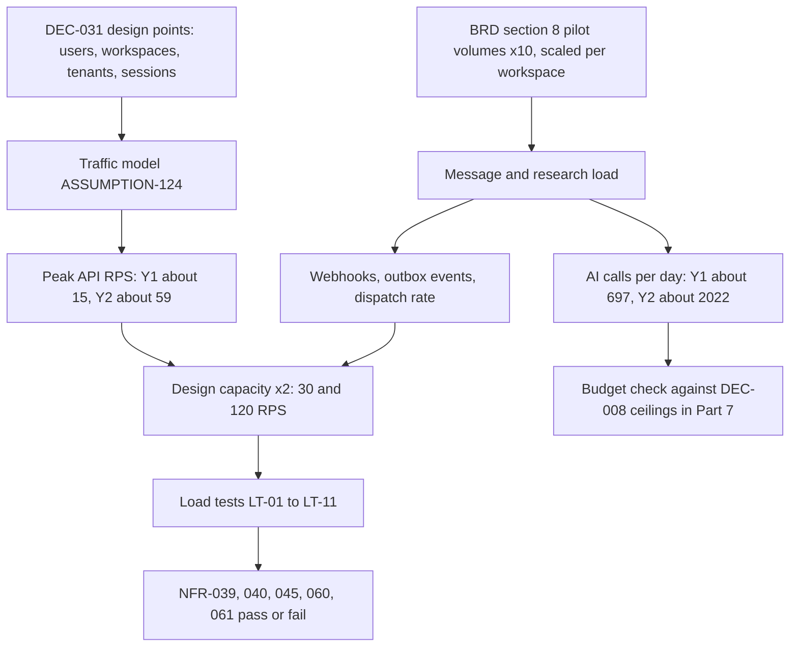

# AI Growth Engine: Employee Sales & Marketing Automation
## Application Blueprint: PART 4 (Batch 4.2), Non-Functional Requirements, Capacity and Load Profiles

| Field | Value |
|---|---|
| Document | Part 4, Batch 2 of 3 |
| Version | 1.0 · 27 Nov 2026 |
| Baseline | BRD, FRD; Parts 0 (NFR-001…038), 0A (DEC-018, DEC-031, DEC-032, DEC-040–043), 1 (KPIs), 2.1–2.5 (§2.35.3 limits, §2.48 public performance budgets), Batch 4.1 |
| Roles applied | Solutions Architect (lead), DevOps/SRE Lead, QA Lead, Security Lead, FinOps Lead, UX Lead, Product Owner (review) |

**Purpose.** This batch turns the 38 implicit NFRs extracted in Part 0 §0.3.3 into **measurable, testable requirements** and extends the catalogue from NFR-039. Each NFR states a target, how it is measured, how it is tested, in which environment, its source and the owning epic (Part 0 §0.10.2). Targets marked [RECOMMENDATION-###] are additions; targets from DEC-018 and DEC-032 are binding.

**Acronyms.** CWV Core Web Vitals · LCP Largest Contentful Paint · INP Interaction to Next Paint · CLS Cumulative Layout Shift · TTFB time to first byte · p95/p75 95th/75th percentile · RPS requests per second · SLI/SLO service level indicator/objective · MTTA/MTTR mean time to acknowledge/restore · DORA DevOps Research and Assessment metrics · SUS System Usability Scale · RUM real-user monitoring.

---

## 4.21 Measurement conventions

| Convention | Rule |
|---|---|
| Percentiles | Latency targets are **p95 over a rolling 28-day window** unless stated; public web vitals use **p75 of real-user field data** (CrUX-style) on mobile |
| Availability | Monthly, measured per calendar month in UTC by **synthetic probes every 60 s from two locations plus server-side success ratio**. A minute is "bad" when both probes fail or the server-side 5xx ratio exceeds 5% in that minute. Planned maintenance announced ≥ 48 h ahead is **excluded** at pilot, capped at 2 h/month [RECOMMENDATION-045 governs release windows] |
| Excluded latency | API latency excludes time spent waiting on external providers (DEC-018) because provider calls run asynchronously behind 202 responses. Synchronous provider calls (e.g. calendar free/busy) are measured as a separate SLI |
| Environments | **CI** (unit/contract), **Test** (integration, nightly), **Staging** (production-like sizing at pilot scale, load and DAST), **Production** (SLO measurement, RUM, synthetic probes) |
| Data for tests | Synthetic datasets (RECOMMENDATION-017): two tenants, 26 startups; load datasets scaled to Year 1 and Year 2 volumes (§4.25) |
| Verdict | A target is **met** when the measured value is within target in the measurement window; any NFR marked **Gate** blocks release when it fails in staging |

---

## 4.22 NFR catalogue, part A: refined NFR-001…NFR-038 (from Part 0 §0.3.3)

Columns: **ID · Category · Requirement (refined) · Measurable target · Measurement method / tool · Test method · Environment · Source · Epic**.

| ID | Category | Requirement (refined) | Measurable target | Measurement / tool | Test method | Env | Source | Epic |
|---|---|---|---|---|---|---|---|---|
| NFR-001 | Security / architecture | Two frontends with separate origins, sessions, OAuth clients, route allowlists and builds; no Admin JS, routes or private data in public bundles | 0 Admin identifiers in public bundles; 0 cross-origin session reuse; route inventory = allowlist | Bundle scanner (SC-02); route inventory CT | CI gate; E2E cross-origin cookie test | CI, Staging | BRD §1, FRD §1; DEC-009 | EP-01, EP-19 |
| NFR-002 | Security | Server-side permission on every object, nested FK, search, vector retrieval, export, notification, worker and webhook; claims from current membership | 100% of endpoints covered by BOLA/BFLA suites; 0 failures | Generated authz suites from the API catalogue and RBAC policy | Automated suites per PR (affected) and nightly (full) | CI, Test | BRD §2, FRD §4 | EP-01 |
| NFR-003 | Security | MFA for privileged roles; revoked or wrong-audience requests succeed 0 times | 100% privileged logins with MFA (`amr` claim); 0 successes in revoked/wrong-audience tests; revocation ≤ 60 s | IdP `amr` audit; CT; revocation timer test | DEC-019 spike; CT; E2E | Staging, Prod (audit) | FRD §13.1 OPT-01-01; DEC-019 | EP-01 |
| NFR-004 | Security | Secrets never returned in any API response, log or prompt | 0 secret-pattern matches in API responses (contract scan), logs (staging log scan) and prompts (gateway DLP) | Response schema scan; log scanner; gitleaks patterns on logs | CT; nightly log scan | CI, Staging | BRD §7 M05 | EP-01 |
| NFR-005 | Reliability / integrity | Duplicate delivery has exactly one effect | 0 duplicate messages, revenue entries or publications in 10,000-event replay test | Replay harness counting effects | IT replay with duplicated events and webhooks | Test | M06, M26, M35, M47 | EP-18 |
| NFR-006 | Reliability | Transactional outbox; authoritative state and outbox written atomically with row locks | 0 orphan state changes (state without outbox row) or orphan outbox rows under fault injection | Consistency checker query | CHAOS: kill process between statements; DB failover in staging | Test, Staging | FRD §5 | EP-01 |
| NFR-007 | Reliability | Provider outage does not lose events | 0 events lost during a 60-min simulated provider outage; backlog drains within 2× outage duration after recovery | Outbox counts before/after | CHAOS provider 503 | Staging | M58 | EP-21 |
| NFR-008 | Performance (freshness) | Customer 360 updates visible within 60 s | p95 event-to-projection lag ≤ 60 s; p99 ≤ 120 s | Projection lag metric (event time vs projection update time) | Load test LT-04 | Staging, Prod | M23 | EP-07 |
| NFR-009 | Reliability | Workflow completion within the agreed window | ≥ 99% of eligible due runs **started** within 15 min (transactional) / 24 h (batch) (DEC-032); quiet hours not counted late | KPI-20 from run records | Load test LT-06; prod SLI | Staging, Prod | FRD OPT-04-07; DEC-032 | EP-18 |
| NFR-010 | Automation efficiency | ≥ 90% of eligible steps automated with no bypass of mandatory approval | KPI-19 ≥ 90%; 0 approval bypasses | Run records; PDP decision logs | Monthly report; decision-table tests | Prod | FRD OPT-04-08 | EP-18 |
| NFR-011 | AI quality | Signal precision ≥ 80% (≥ 100 reviewed, pilot exit W1); qualification precision ≥ 90% (≥ 200 labelled per vertical) before L2/L3; recall ≥ 60% | KPI-01, KPI-02 values with sample size | M54 eval harness; A019/A027 review data | Eval runs per change; weekly review | Test, Prod | M14; OPT-04-02; DEC-001 | EP-04, EP-05 |
| NFR-012 | DevSecOps | Restore drill, secret scan and smoke test pass per release | 100% of production releases with passing secret scan and smoke; restore drill per schedule (Batch 4.3 §4.47) | Pipeline evidence in A090 | Pipeline gates | CI, Staging, Prod | M09 | EP-21 |
| NFR-013 | Release | All critical tests pass and rollback verified before production | 0 failing critical tests at deploy; rollback rehearsed per release train (monthly) | Release record | Pipeline gate; rollback drill | Staging | M62, B-QA | EP-21 |
| NFR-014 | FinOps | Cost cap enforced before every paid call; a simulated cap stops requests | 100% of paid calls preceded by a reservation; 0 calls after cap in simulation; stop within 1 call of exhaustion | Reservation/actual ledger reconciliation | IT budget simulation | Test | M08, M53 | EP-04 |
| NFR-015 | Interoperability | REST/JSON/HTTPS; typed I/O; allowlisted filters; cursor pagination; request ID; version; idempotency key + body hash; defined status codes | 100% of endpoints conform to the OpenAPI schema and status-code set | Schemathesis/OpenAPI conformance | CT per PR | CI | FRD §5 | EP-01 |
| NFR-016 | Reliability | Exponential backoff with jitter, capped retries, exception queue | Retries ≤ 3 per step (BRL-AUT-06); base 30 s, factor 2, full jitter, max 15 min; DLQ after cap | Task metrics | UT on retry policy; CHAOS | Test | FRD §5 | EP-18 |
| NFR-017 | Data integrity | UUID PKs, UTC timestamps, Decimal + ISO 4217, composite tenant/startup FKs, RLS, revisions | 100% of operational tables pass the schema linter (PK type, `tenant_id`, `startup_id`, RLS policy, `revision`) | Migration linter | CI gate | CI | FRD §5 | EP-01 |
| NFR-018 | Auditability | Approval, financial and audit records immutable | 0 UPDATE/DELETE grants on these tables; daily hash-chain verification passes | DB grant check; chain job | CFG test; nightly job | CI, Prod | FRD §5, BRD §5 | EP-01 |
| NFR-019 | Operability | `/health` (no DB) and `/ready` without sensitive detail | `/health` p95 ≤ 50 ms; `/ready` ≤ 500 ms; 0 sensitive fields in body | Synthetic probes | CT | CI, Prod | FRD §11 OP002/003 | EP-21 |
| NFR-020 | Security / performance | Unknown host → 404; atomic publish pointer swap; tenant-keyed cache invalidation; portal content never in public CDN | 100% unknown hosts → 404; publish/rollback visible at edge ≤ 60 s; 0 portal responses cacheable | Synthetic host tests; CDN header tests | E2E | Staging, Prod | FRD §8 | EP-19 |
| NFR-021 | Security | Uploaded files scanned before use; separate approval for public assets | 100% of uploads scanned before first use; scan p95 ≤ 60 s for ≤ 25 MB | Scanner metrics | IT with EICAR fixtures | Test | FRD §8, W15, W27, A006 | EP-02, EP-19 |
| NFR-022 | Security / availability | Abuse controls and rate limits on public intake and chat | Per IP 30 req/min intake; per startup site 600 req/min; chat ≤ 20 turns/session and ≤ 3 sessions/IP/hour [RECOMMENDATION-040]; WAF blocks ≥ 95% of LT-07 abusive traffic without blocking > 1% of legitimate traffic | WAF and app throttle metrics | Load test LT-07 | Staging | SM-FR-W01–W30, W11; §2.35.3 | EP-19 |
| NFR-023 | Accessibility | Accessibility preferences, needs and result on page approval; WCAG 2.2 AA | See NFR-088, NFR-089 | axe-core, manual | CI + manual | CI, Staging | W01, W19, A057; RECOMMENDATION-001 | EP-19 |
| NFR-024 | Localization | Language, locale fallback, timezone, currency per scope | See NFR-096, NFR-097 | i18n tests | UT/E2E | CI | FRD §2, W08, A107; DEC-026 | EP-19 |
| NFR-025 | Integrity | Stale revision → 409; never silently overwrite approved state | 100% of mutating endpoints require revision; concurrent update test → exactly one success, one 409 | CT | Concurrency IT | CI, Test | FRD §5, §11.1 | EP-01 |
| NFR-026 | Reliability | Provider timeout after submission = uncertain; reconcile before replay | 0 retries of uncertain outcomes before reconciliation; see NFR-065 for reconciliation time | Run records | CHAOS timeout injection | Test | FRD §11.1, §12.2; DEC-050 | EP-18 |
| NFR-027 | Usability / security | Scope switch cancels stale queries, clears cache and selections | 0 stale-scope records rendered after switch (E2E with slow network); in-flight requests aborted within 100 ms | Playwright with network throttling | E2E | CI | FRD §2, §11.1, §12.2 | EP-17 |
| NFR-028 | Data quality / compliance | 100% of actionable records have permitted provenance; missing rights quarantined | 100% provenance coverage; 0 actionable records without source permission | Data-quality query (A010 coverage) | Nightly DQ job | Prod | FRD OPT-11-01 | EP-05 |
| NFR-029 | Maintainability | Modular monolith; each runtime dependency justified by ADR; no per-startup workflow framework | 100% of runtime dependencies listed in an ADR or the dependency register; module contracts pass (NFR-085) | Dependency register diff; import-linter | CI gate | CI | FRD OPT-07-01 | EP-01 |
| NFR-030 | Cost / AI | Rules-first routing; compare quality, latency and INR per task on the same dataset | Every AI task has a recorded Tier 0 attempt or justification; model comparison report per task before tier change | Gateway routing logs; eval reports | Eval harness | Test | FRD OPT-10-01; DEC-007 | EP-04 |
| NFR-031 | Portability / isolation | Independent DB, storage, vector index, queues, credentials, budget, billing, audit, backup per product | 0 shared resources with the investor product (IaC inventory check) | IaC resource inventory | CFG check | CI | BRD §1; CN-02 | EP-01 |
| NFR-032 | Security / multi-tenancy | Two-tenant fixture: zero cross-scope disclosure or side effects | 0 cross-scope reads, writes, notifications, exports, retrievals or provider calls | RLS fixture + E2E + AIE | Per PR and nightly; per release | CI, Test, Staging | B-TENANT, FRD §15; AP-10 | EP-01 |
| NFR-033 | AI quality / release | AI regression failures block deployment | 100% of prompt/model/tool changes pass the eval suite thresholds before deploy | Pipeline evidence | CI gate (BRL-AI-09) | CI | M54; DEC-061 | EP-04 |
| NFR-034 | Usability | Users locate the approved operation and complete core scenarios; clicks and time measured against baseline | See NFR-090 | Usability study | Moderated tests per wave | Staging | FRD OPT-15-01 | EP-17 |
| NFR-035 | FinOps / billing | 100% attributable usage reconciled to charges | KPI-24 = 100% per billing cycle | Metering vs invoice reconciliation | Monthly job; IT | Prod | BRD OPT-20-02, B-SVC | EP-20 |
| NFR-036 | Privacy | Deletion or correction honoured; deletion does not re-enable outreach; legal hold respected | See NFR-075, NFR-076; 0 re-contacts of erased principals (suppression hash) | Privacy request register; suppression tests | E2E | Test, Prod | M56, W29; DEC-028 | EP-03 |
| NFR-037 | Cost governance | Open-source first; zero unapproved paid calls; paid fallback disabled by default | 0 paid calls without an enabled flag and approved budget line | Gateway/adapter logs vs flag register | IT; monthly audit | Prod | BRD §10, OPT-03-01, FRD §9 | EP-04 |
| NFR-038 | Safety | Simulation or dry run has zero live effects | 0 provider calls from simulated runs (adapter call counter) | Adapter metrics | IT with live credentials present | Test | BRD §1.2, FRD §9; BRL-AUT-04 | EP-18 |

---

## 4.23 NFR catalogue, part B: new NFR-039…NFR-099

### 4.23.1 Performance

| ID | Category | Requirement | Measurable target | Measurement / tool | Test method | Env | Source | Epic |
|---|---|---|---|---|---|---|---|---|
| NFR-039 | Performance | API read latency (excluding provider waits) | p95 **≤ 500 ms**, p99 ≤ 1,200 ms at Year 1 design load; at 2× design load p95 ≤ 800 ms | OpenTelemetry server spans; load tool (k6 or Locust) | Load tests LT-01, LT-02 | Staging, Prod | DEC-018 | EP-21 |
| NFR-040 | Performance | API write latency (sync part, before 202) | p95 **≤ 800 ms**, p99 ≤ 1,500 ms | Same | LT-01, LT-02 | Staging, Prod | DEC-018 | EP-21 |
| NFR-041 | Performance | Public page TTFB | p95 **≤ 800 ms** at origin; **≤ 200 ms** for CDN-cached pages; CDN cache-hit ratio ≥ 90% for published pages | CloudFront logs; RUM | LT-08; synthetic probes from India and one non-India location | Prod | DEC-018 | EP-19 |
| NFR-042 | Performance | Public Core Web Vitals | LCP **≤ 2.5 s**, INP **≤ 200 ms**, CLS **≤ 0.1** at p75 field data on mid-range mobile over 4G | RUM (web-vitals library to first-party analytics); Lighthouse CI lab checks | Lighthouse CI per PR (lab budget LCP ≤ 2.0 s simulated); RUM monthly | CI, Prod | §2.48; RECOMMENDATION-028 | EP-19 |
| NFR-043 | Performance | Public JavaScript budget | **≤ 150 KB gzip** JS per public route; total transfer of the landing page ≤ 1 MB including images; images served in AVIF/WebP with responsive sizes | Bundle analyzer; Lighthouse | CI gate (size-limit) | CI | RECOMMENDATION-028 | EP-19 |
| NFR-044 | Performance | Admin SPA load and interaction | First load LCP ≤ 3.0 s (p75, desktop broadband); route transition ≤ 1.0 s p95 with data; main bundle ≤ 350 KB gzip with route-level code splitting; table of 200 rows renders ≤ 300 ms | RUM in Admin; Lighthouse; React profiler | Lighthouse CI; Playwright performance marks | CI, Staging | [RECOMMENDATION-040]; DEC-043 | EP-17 |
| NFR-045 | Performance | Outbox dispatch lag | p95 **≤ 60 s** from commit to worker pick-up; p99 ≤ 180 s; backlog alert at 1,000 events or oldest > 5 min | Outbox lag metric | LT-04, LT-06 | Staging, Prod | DEC-018 | EP-18 |
| NFR-046 | Performance | Scoped global search and list filters | Search p95 **≤ 1.0 s** for ≤ 1 million searchable rows per tenant; list filters p95 ≤ 500 ms (as NFR-039) | Server spans | LT-03 | Staging | DEC-037 [RECOMMENDATION-040] | EP-17 |
| NFR-047 | Performance (freshness) | Dashboard projection freshness | Dashboards (RP-01…RP-21) ≤ 15 min; automation monitor (RP-22) ≤ 5 min; SLO dashboard ≤ 1 min (§2.31.3) | As-of timestamps vs now | LT-04; prod SLI | Staging, Prod | Part 2.4 §2.31.1 | EP-17 |
| NFR-048 | Performance | Export and report generation | Synchronous export ≤ 50,000 rows completes ≤ 60 s p95; async exports ≤ 1 million rows complete ≤ 15 min; scheduled reports delivered ≤ 10 min after schedule | Job metrics | IT with Year 2 data volume | Staging | §2.31.5 | EP-17 |
| NFR-049 | Safety / performance | Emergency stop propagation | New external calls in scope blocked **≤ 60 s** after STOP (p100 in test); queued items cancelled or held | Stop-to-last-call timer | CHAOS: STOP during a 1,000-message burst | Staging | BRL-AUT-05; M55 | EP-18 |
| NFR-050 | Security / performance | Session and membership revocation | All sessions of a revoked user end **≤ 60 s** | Revocation timer test | E2E | Staging | DEC-019; BRL-TEN-07 | EP-01 |
| NFR-051 | Performance | Webhook acknowledgement | p95 ≤ 500 ms, p99 ≤ 2 s from receipt to 2xx (persist minimal event, then ack) | Server spans per provider | LT-05 | Staging, Prod | FRD §5 (verified callbacks persisted then acknowledged) | EP-08 |
| NFR-052 | Performance | AI gateway overhead and interactive AI latency | Gateway overhead (routing, DLP, schema validation) p95 ≤ 150 ms excluding model time; streaming first token for website assistant and Copilot ≤ 3 s p95 (Tier 1a/1b availability permitting); non-interactive tasks have no latency SLO | Gateway spans | LT-09 with a stubbed model and a live sample | Staging | DEC-007 [RECOMMENDATION-040] | EP-04 |

### 4.23.2 Availability, recovery and timeliness

| ID | Category | Requirement | Measurable target | Measurement / tool | Test method | Env | Source | Epic |
|---|---|---|---|---|---|---|---|---|
| NFR-053 | Availability | Website and portal availability | **99.5%** monthly at pilot (≤ 216 min bad minutes/30-day month) → **99.9%** after the scale gate (≤ 43 min) | Synthetic probes + server success ratio (§4.21) | Monthly SLO report | Prod | DEC-018 | EP-19 |
| NFR-054 | Availability | Admin availability | **99.5%** monthly | Same | Monthly SLO report | Prod | DEC-018 | EP-17 |
| NFR-055 | Availability | Webhook ingestion availability and loss | ≥ 99.5% monthly; **0 lost provider events** (providers retry; dedupe ensures single effect) | Provider delivery reports vs persisted events | Monthly reconciliation | Prod | M58; NFR-007 | EP-08 |
| NFR-056 | Recovery | Recovery point objective | **RPO ≤ 15 min** for PostgreSQL (PITR; transaction logs shipped ≤ 5 min); S3 versioning for documents (RPO 0 for committed objects) | PITR latest restorable time metric | Quarterly restore drill | Staging (restore), Prod (metric) | DEC-018 | EP-21 |
| NFR-057 | Recovery | Recovery time objective | **RTO ≤ 4 h** for AZ, instance, deployment or data-corruption failures; **regional disaster RTO ≤ 24 h at pilot** [CONFLICT-112] | Drill stopwatch | Quarterly restore drill; annual regional DR tabletop + cross-region restore | Staging, DR account | DEC-018, DEC-040 | EP-21 |
| NFR-058 | Reliability | Transactional automation timeliness | ≥ **99%** of eligible due runs started within **15 min** | KPI-20 (transactional) | LT-06; prod SLI | Prod | DEC-032 | EP-18 |
| NFR-059 | Reliability | Scheduled batch timeliness | ≥ **99%** within **24 h** | KPI-20 (batch) | Prod SLI | Prod | DEC-032 | EP-05 |

### 4.23.3 Scalability and capacity

| ID | Category | Requirement | Measurable target | Measurement / tool | Test method | Env | Source | Epic |
|---|---|---|---|---|---|---|---|---|
| NFR-060 | Scalability | Capacity for 10× pilot volume without re-architecture | Year 1 design load (§4.25) sustained for 1 h with NFR-039/040/045 met, on the pilot topology scaled only by configuration | Load test results | LT-02 soak | Staging | DEC-018; ASSUMPTION-002 | EP-21 |
| NFR-061 | Scalability | Year 2 design point reachable by horizontal scaling and instance resizing only | Year 2 load (§4.25) met with ≤ 4 app tasks, ≤ 6 worker tasks and one DB instance class step-up; no schema redesign | Load test at Year 2 profile | LT-10 (before W6) | Staging | DEC-031, DEC-040 | EP-21 |
| NFR-062 | Scalability / fairness | Noisy-neighbour isolation | One tenant at its rate limit or concurrency cap raises other tenants' p95 latency by ≤ 20% and delays their transactional runs by ≤ 5 min | Per-tenant SLIs | LT-11 (one tenant 10× burst) | Staging | §2.35.3 | EP-01 |

### 4.23.4 Reliability and integrity

| ID | Category | Requirement | Measurable target | Measurement / tool | Test method | Env | Source | Epic |
|---|---|---|---|---|---|---|---|---|
| NFR-063 | Reliability | Outbox durability | 0 committed outbox events lost across worker crash, broker restart or deploy | Outbox reconciliation (committed vs processed) daily | CHAOS: kill workers and Valkey during LT-06 | Staging | FRD §5; M06 | EP-18 |
| NFR-064 | Reliability | Poison-message isolation and DLQ handling | A message failing 3 times moves to DLQ within 15 min; queue throughput unaffected (≤ 5% drop); DLQ items triaged ≤ 1 business day | Queue metrics; DLQ age | CHAOS poison injection; RB-011 | Staging, Prod | BRL-AUT-06; M58 | EP-21 |
| NFR-065 | Reliability | Uncertain-outcome reconciliation | ≥ 95% of uncertain outcomes reconciled (automatically or by an operator) within **24 h**; 100% within 72 h; 0 blind retries | Reconciliation queue age | CHAOS timeout injection; prod SLI | Prod | DEC-050; RECOMMENDATION-015 | EP-18 |
| NFR-066 | Integrity | Idempotency and dedupe windows | API idempotency keys retained ≥ 24 h; webhook dedupe ≥ 7 days; provider idempotency keys per provider limit (verify) | Config tests | UT/IT | CI | FRD §5; BRL-AUT-08 | EP-01 |

### 4.23.5 Security

| ID | Category | Requirement | Measurable target | Measurement / tool | Test method | Env | Source | Epic |
|---|---|---|---|---|---|---|---|---|
| NFR-067 | Security | Vulnerability remediation SLAs | Critical ≤ 7 days; High ≤ 30 days; Medium ≤ 90 days; 0 overdue Critical/High at release | SCA/container/DAST findings tracker | Release gate | CI, Prod | RECOMMENDATION-041 | EP-21 |
| NFR-068 | Security | No secrets in repository, images or logs | 0 findings from gitleaks, image secret scan and log scan | Scanners | CI gate; nightly | CI, Staging | NFR-004; M09 | EP-21 |
| NFR-069 | Security | Transport security | TLS ≥ 1.2 everywhere; TLS 1.0/1.1 and weak ciphers rejected; HSTS 1 year; SSL Labs-equivalent grade A on public endpoints | testssl.sh | Post-deploy smoke | Staging, Prod | Batch 4.1 §4.5.1 | EP-01 |
| NFR-070 | Security | Encryption at rest | 100% of data stores encrypted with customer-managed KMS keys; 100% of Restricted fields encrypted at field level | IaC policy check; DB inspection test | CFG check; UT | CI | Batch 4.1 §4.5.2–4.5.3 | EP-01 |
| NFR-071 | Security | Security headers | CSP without `unsafe-inline` scripts on all HTML responses; HSTS, nosniff, frame-ancestors per surface; 0 missing headers | Header test | Post-deploy smoke | Staging, Prod | SC-03 | EP-19 |
| NFR-072 | Security | Penetration testing | External test before Release 1 portal exposure and before Release 2; annually thereafter; 0 open Critical/High at go-live | Pen-test reports | Manual | Staging | Batch 4.1 §4.16; GAP-120 | EP-21 |
| NFR-073 | Security / audit | Audit completeness and tamper evidence | 100% of state-changing endpoints and privileged actions emit an audit event (coverage test); daily hash-chain verification 100% pass | Audit coverage test; chain job | CI; nightly | CI, Prod | §2.34; RECOMMENDATION-024 | EP-01 |
| NFR-074 | Security | Authentication abuse resistance | Login/MFA/recovery rate limit: ≤ 10 attempts/min per account and ≤ 100/min per IP with progressive delay; no user enumeration (identical responses and timing within ±50 ms) | IdP config; timing test | DEC-019 spike; DAST | Staging | DEC-019 check 10 | EP-01 |

### 4.23.6 Privacy and compliance

| ID | Category | Requirement | Measurable target | Measurement / tool | Test method | Env | Source | Epic |
|---|---|---|---|---|---|---|---|---|
| NFR-075 | Privacy | Data principal request completion | Acknowledge ≤ 2 business days; complete ≤ 15 days internal target and always within the statutory deadline (verify); escalation at 70% of deadline | Request register | E2E; monthly report | Prod | M56; BRL-PRV-02 | EP-03 |
| NFR-076 | Privacy | Retention enforcement | 100% of records past retention purged or anonymized within **7 days** of expiry, except legal hold; purge evidence report daily | Purge job report vs retention query | IT with aged fixtures | Test, Prod | DEC-028; BRL-PRV-05 | EP-03 |
| NFR-077 | Privacy / AI | No Restricted or Confidential data to Tier 2 models | **0** occurrences in DLP-scanned prompts sent to Tier 2; Tier 2 off by default | Gateway DLP log | IT with Restricted fixtures; nightly AIE | Test, Prod | DEC-007; BRL-AI-06 | EP-04 |
| NFR-078 | Privacy | No personal data in application logs and traces | 0 matches for email, phone, Aadhaar/PAN patterns in a daily sample of 10,000 log lines; Sentry scrubbing verified | Log scanner | Nightly | Staging, Prod | Batch 4.1 SC-25 | EP-21 |
| NFR-094 | Compliance | Breach-notification readiness | Ability to produce an affected-principal list (by tenant, data class, jurisdiction) ≤ 4 h; CERT-In report draft ≤ 6 h; regulator report ≤ 72 h (verify) | Tabletop drill timing | Semi-annual tabletop | Staging | Batch 4.1 §4.11.5 | EP-03 |
| NFR-095 | Compliance | Lawful basis coverage | 100% of outbound recipients have a lawful-basis or consent record and a resolved jurisdiction at dispatch; KPI-17 = 0 | PDP logs; RP-07 | Decision-table tests; monthly audit sample | Prod | BRL-ELG-01…05 | EP-03 |

### 4.23.7 Observability and operability

| ID | Category | Requirement | Measurable target | Measurement / tool | Test method | Env | Source | Epic |
|---|---|---|---|---|---|---|---|---|
| NFR-079 | Observability | End-to-end correlation | 100% of requests, outbox events, tasks, adapter calls and webhooks carry a correlation ID; ≥ 99% of traces complete (no broken parent links) for sampled flows; trace sampling 100% errors + 10% success at pilot | OTel collector stats | E2E trace assertion | Staging, Prod | RECOMMENDATION-006 | EP-21 |
| NFR-080 | Operability | Alert response | Sev1 MTTA ≤ 15 min in support hours, ≤ 30 min outside (best effort, [CONFLICT-113]); Sev2 ≤ 1 h in support hours; MTTR Sev1 ≤ 4 h | Incident records | Monthly review; game days | Prod | DEC-018, DEC-044 | EP-21 |
| NFR-081 | Observability | Log retention | Application logs 30 days hot + 1 year archive; security logs ≥ 1 year with ≥ 180 days in India; audit 7 years | Log group and lifecycle config | CFG check | CI | Batch 4.1 §4.10.2; CONFLICT-111 | EP-21 |
| NFR-099 | Operability | Time synchronization | All hosts synchronized, drift ≤ 1 s; timestamps UTC ms in logs and audit | Chrony/Time Sync metrics | CFG check | Prod | CERT-In (verify); FRD §5 | EP-21 |

### 4.23.8 Maintainability and portability

| ID | Category | Requirement | Measurable target | Measurement / tool | Test method | Env | Source | Epic |
|---|---|---|---|---|---|---|---|---|
| NFR-082 | Maintainability | Automated test coverage | Backend line coverage ≥ **80%** overall and ≥ **90%** for PDP, approvals, finance, tenancy and gateway modules; branch coverage ≥ 70%; frontend ≥ 70% lines on shared UI package and state logic; mutation score ≥ 60% on PDP and finance (W5) | coverage.py, Vitest/Istanbul, mutmut | CI gate (no decrease > 0.5 pp per PR) | CI | M62; B-QA | EP-21 |
| NFR-083 | Maintainability | Delivery performance (DORA) | Deployment frequency ≥ weekly; lead time for change ≤ 2 days (median); change failure rate ≤ 15%; MTTR ≤ 4 h | Pipeline and incident data | Monthly report | Prod | [RECOMMENDATION-046] | EP-21 |
| NFR-084 | Maintainability | Dependency freshness | No runtime dependency past end-of-life; ≤ 1 major version behind for Django, DRF, React, Celery, PostgreSQL client; Python and Node on supported LTS lines | Renovate dashboard; EOL check | Monthly | CI | NFR-029 | EP-21 |
| NFR-085 | Maintainability | Module boundaries | 0 import-contract violations between Django apps (import-linter contracts per Part 2.1 module map); cyclomatic complexity ≤ 15 per function (lint) | import-linter; Ruff/radon | CI gate | CI | FRD OPT-07-01 | EP-01 |
| NFR-086 | Portability | Container and data portability | All services are OCI images runnable outside AWS with environment configuration; no proprietary serverless runtime in the core domain; tenant export in documented JSON/CSV schemas completes ≤ 24 h for a Year 2-sized tenant | Export job metrics; build portability test (run stack in docker compose) | CI (compose smoke); IT | CI, Test | BRD §1; §2.35.5; A103 | EP-20 |
| NFR-087 | Portability / operability | Environment reproducibility | Any environment rebuilt from IaC and images in ≤ 1 working day; staging rebuilt quarterly as a drill | Drill timer | Quarterly drill | Staging | RECOMMENDATION-010 | EP-21 |

### 4.23.9 Accessibility, usability, localization and compatibility

| ID | Category | Requirement | Measurable target | Measurement / tool | Test method | Env | Source | Epic |
|---|---|---|---|---|---|---|---|---|
| NFR-088 | Accessibility | WCAG 2.2 AA automated | 0 critical or serious axe-core violations on every route in CI (public, portal and Admin); publication blocked on violations (BRL-PUB-06) | axe-core via Playwright | CI gate | CI | RECOMMENDATION-001; §2.46 | EP-19, EP-17 |
| NFR-089 | Accessibility | WCAG 2.2 AA manual | Top 20 journeys pass keyboard-only and screen-reader (NVDA + Chrome, VoiceOver + Safari) per wave; 0 open A/AA defects at wave gate | Manual audit checklist | Manual per wave | Staging | §2.46 | EP-19, EP-17 |
| NFR-090 | Usability | Task success and satisfaction | Core scenarios (approve quote, review signal, reply to inbound, publish page, stop automation) task success ≥ 90%, SUS ≥ 70, median clicks ≤ baseline from W2 study | Moderated usability tests (5 users per persona group) | Per wave from W2 | Staging | FRD OPT-15-01; NFR-034 | EP-17 |
| NFR-096 | Localization | Indic content and locale formatting | hi-IN, ta-IN, or-IN content renders with correct fonts (no tofu glyphs) on supported browsers; en-IN digit grouping (1,00,000); locale fallback per I18N-08 always indicated | Visual regression snapshots; i18n UT | CI | CI | DEC-026; I18N-01…11 | EP-19 |
| NFR-097 | Localization | Time-zone correctness | 0 failures in a suite of quiet-hour and deadline tests across IST, UTC, US/EU zones including DST transitions | UT/IT | CI | CI | BRL-ELG-08; I18N-03 | EP-08 |
| NFR-098 | Compatibility | Browsers and devices | Last 2 versions of Chrome, Edge, Firefox, Safari (macOS/iOS); Website/Portal usable at 360 px; Admin at 1280 px, approval screens at 768 px; 0 Sev1/Sev2 defects on the matrix | Playwright projects (Chromium, Firefox, WebKit) + device emulation; manual iOS Safari check per wave | CI + manual | CI, Staging | DEC-043 | EP-19, EP-17 |

### 4.23.10 Cost efficiency

| ID | Category | Requirement | Measurable target | Measurement / tool | Test method | Env | Source | Epic |
|---|---|---|---|---|---|---|---|---|
| NFR-091 | Cost efficiency | Run-cost envelope | Monthly run cost ≤ **₹16,675** base (B01–B11 incl. 15% contingency) at pilot; alert at 80% of each budget line; any line > 100% needs Founder approval | AWS Budgets, provider invoices, cost ledger (M53) | Monthly FinOps review (Batch 4.3 §4.46) | Prod | BRD §6; DEC-004, DEC-020 | EP-04 |
| NFR-092 | Cost efficiency | AI unit cost | KPI-21 within each agent budget (Part 7); Tier 0 resolution ≥ 20% of AI-eligible tasks; prompt-cache use where supported (verify) | Gateway ledger | Monthly report; budget simulation | Prod | DEC-007, DEC-008; NFR-030 | EP-04 |
| NFR-093 | Cost efficiency | Cost allocation coverage | ≥ 95% of monthly spend allocated to a tenant, startup, agent or shared-platform pool via tags and the cost ledger | Cost Explorer by tag + ledger | Monthly | Prod | KPI-22, KPI-23 | EP-20 |

**Catalogue totals:** 38 refined (NFR-001…038) + 61 new (NFR-039…099) = **99 NFRs**. Every NFR has a target, method, environment, source and epic. Sections 4.23.1–4.23.10 group the new NFRs by category; an NFR that serves two categories is listed once, under its primary category.

---

## 4.24 Latency budgets by endpoint class

| Class | Examples | p95 target | p99 | Timeout | Notes |
|---|---|---|---|---|---|
| C1 Health | `/health`, `/ready` | 50 ms / 500 ms | 100 ms / 1 s | 2 s | NFR-019 |
| C2 Simple read | GET record, GET 360 header, notification count | 300 ms | 800 ms | 10 s | Index-only queries; cached reference data |
| C3 List and filter | Pipelines, queues, research results (≤ 200 rows/page) | 500 ms | 1,200 ms | 15 s | Cursor pagination; NFR-039 |
| C4 Search | Scoped global search | 1,000 ms | 2,000 ms | 10 s | NFR-046 |
| C5 Write (sync) | Create draft, transition, approve | 800 ms | 1,500 ms | 15 s | Includes PDP plan-time check (≤ 100 ms budget) and outbox insert; NFR-040 |
| C6 Accepted async | Send, publish, run research, export | 300 ms to 202 | 800 ms | 10 s | Work completes in workers; timeliness per NFR-058/059 |
| C7 Public intake | Lead form, enquiry, referral | 800 ms | 1,500 ms | 10 s | CA-INTAKE; rate-limited |
| C8 Webhook ingress | Provider callbacks | 500 ms | 2,000 ms | 10 s | NFR-051 |
| C9 Interactive AI | Website assistant, Copilot (streamed) | First token 3 s | 6 s | 60 s | NFR-052 |
| C10 Dashboards | Projection reads | 800 ms | 2,000 ms | 15 s | Projections pre-aggregated; NFR-047 |

**Server-side budget split for C5 (p95):** BFF 30 ms · auth/scope 40 ms · serializer validation 40 ms · PDP 100 ms · domain logic and DB transaction 400 ms · audit + outbox insert 60 ms · response 30 ms · headroom 100 ms.

---

## 4.25 Capacity and load profiles

### 4.25.1 Design points (DEC-031, DEC-018)

| Driver | Pilot (BRD §8) | **Year 1 design point** | **Year 2 design point** | Source |
|---|---|---|---|---|
| Startup workspaces | 4 seed startups | 40 (upper bound of 25–40) | 100 | DEC-031 |
| External tenants | 0 | 10 (upper bound of 2–10) | 30 | DEC-031 |
| Internal users | ≈ 10 | 60 | 200 | DEC-031 |
| Portal users / month | Low | 500 | 5,000 | DEC-031 |
| Public sessions / month | Low | 5,000 | 50,000 | DEC-031 |
| Research fetches / month | 500 | 5,000 (10× pilot) | 12,500 | BRD §8; DEC-018 10× rule; Year 2 = Year 1 × 100/40 workspaces |
| Reviewed signals / month | 100 | 1,000 | 2,500 | BRD §8 |
| Emails / month | 2,000 | 20,000 | 50,000 | BRD §8 ×10; Year 2 scaled by workspaces |
| WhatsApp template messages / month | 1,000 | 10,000 | 25,000 | BRD §8 ×10; scaled |

Year 2 messaging and research volumes are scaled from Year 1 **per workspace** (Year 1 volume ÷ 40 × 100) [ASSUMPTION-124]. This assumes the same intensity per workspace. External tenants buy their own AI and message entitlements (DEC-047), so their volume is bounded by plan quotas.

### 4.25.2 Traffic model and formulas [ASSUMPTION-124]

| Parameter | Symbol | Value | Basis |
|---|---|---|---|
| Peak concurrent share of internal users (business hours) | c | 0.5 | Small teams working the same hours (IST) |
| Admin API request rate per active user (incl. 30 s notification polling) | r_a | 0.2 RPS | SPA with list views and polling |
| Peak-hour factor (Admin) | k_a | 2 | Morning queue review peak |
| Portal sessions per user per month × requests per session | s_p × q_p | 4 × 60 | Quote review, documents, tickets |
| Portal active hours per month | H_p | 220 (22 days × 10 h) | Business hours |
| Portal peak factor | k_p | 5 | Campaign or deadline bursts |
| Public origin requests per session (non-cached: forms, chat, events, consent) | q_o | 6 | Pages served by CDN |
| Bot multiplier on public origin traffic | b | 3 | Crawlers and scanners after WAF |
| Public hours per month | H_o | 720 | 24 × 30 |
| Public peak factor | k_o | 20 | Campaign launch spike |
| Webhook events per email / per WhatsApp message | e_e / e_w | 2 / 3 | Send + delivery (+ bounce or complaint); sent + delivered + read |
| Inbound replies | i | 10% of outbound | Pilot assumption |
| Campaign burst | — | 2,000 messages in 1 h | Send-rate-limited campaign |
| Sending days per month | D_s | 26 (Monday–Saturday) | BRL-ELG-08 default quiet hours |

**Formulas**

- Admin peak RPS = U_i × c × r_a × k_a
- Portal peak RPS = (U_p × s_p × q_p) ÷ (H_p × 3,600) × k_p
- Public origin peak RPS = (S_o × q_o × b) ÷ (H_o × 3,600) × k_o
- Webhook peak RPS = burst messages × e ÷ 3,600 (campaign hour) + inbound
- Messages per day = (emails + WhatsApp per month) ÷ D_s
- Research fetches per day = fetches per month ÷ 30 (batch runs 7 days a week)
- AI calls per day: see §4.25.4

### 4.25.3 Request and message load

| Metric | Formula applied | **Year 1** | **Year 2** |
|---|---|---|---|
| Admin peak RPS | 60 × 0.5 × 0.2 × 2 · 200 × 0.5 × 0.2 × 2 | **12.0** | **40.0** |
| Portal peak RPS | 500 × 240 ÷ 792,000 × 5 · 5,000 × 240 ÷ 792,000 × 5 | **0.76** | **7.6** |
| Public origin peak RPS | 5,000 × 6 × 3 ÷ 2,592,000 × 20 · 50,000 × 18 ÷ 2,592,000 × 20 | **0.69** | **6.9** |
| Webhook peak RPS (campaign hour) | 2,000 × 3 ÷ 3,600 (worst case WhatsApp) · 5,000 × 3 ÷ 3,600 | **1.7** | **4.2** |
| **Total peak API RPS** | Sum | **≈ 15** | **≈ 59** |
| **Design capacity (2× headroom)** | Total × 2, rounded | **30 RPS** | **120 RPS** |
| **Stress test level** | Design × 2 | **60 RPS** | **240 RPS** |
| Concurrent users (internal + portal + public, peak) | 30 + ≈ 5 + ≈ 10 · 100 + ≈ 40 + ≈ 80 | **≈ 45** | **≈ 220** |
| Outbound messages / month | Email + WhatsApp | 30,000 | 75,000 |
| **Outbound messages / day** | ÷ 26 | **≈ 1,154** | **≈ 2,885** |
| Peak dispatch rate (campaign) | Burst ÷ 3,600 | 0.56 msg/s (design 10 msg/s) | 1.4 msg/s (design 25 msg/s) |
| Webhook events / day | (emails × 2 + WA × 3 + inbound) ÷ 30 | (40,000 + 30,000 + 3,000) ÷ 30 ≈ **2,433** | (100,000 + 75,000 + 7,500) ÷ 30 ≈ **6,083** |
| **Research fetches / day** | ÷ 30 | **≈ 167** | **≈ 417** |
| Outbox events / day | messages × 3 + fetches × 2 + AI calls + 2,000 other (Y1) / 5,000 (Y2) | ≈ 6,500 | ≈ 16,500 |

The design capacity is deliberately far above the computed peak (2×, and the 10 msg/s dispatch design versus 0.56 msg/s peak) because DEC-018 requires 10× pilot volume without re-architecture, and the per-request cost of headroom at this scale is small. Compute sizing that meets these numbers is in Part 3 (estimates, verify).

### 4.25.4 AI call profile [ASSUMPTION-125]

| AI task (Part 7 agent family) | Driver | Calls per unit | Tier | **Year 1 calls/day** | **Year 2 calls/day** |
|---|---|---|---|---|---|
| Evidence extraction + signal classification (M12, M14) | Research fetches/day | 2 | 1a | 167 × 2 = 334 | 417 × 2 = 834 |
| Need discovery and matching (M15, M16) | Signals (20% of fetches) | 1 | 1b | 33 | 83 |
| Personalized first-touch drafts (M25) | 30% of emails ÷ 26 | 1 | 1b | 6,000 ÷ 26 = 231 | 15,000 ÷ 26 = 577 |
| Inbound intent classification (M27) | 10% of outbound ÷ 30 | 1 | 1a | 3,000 ÷ 30 = 100 | 7,500 ÷ 30 = 250 |
| Website assistant turns (M32) | Sessions × 5% × 4 turns ÷ 30 | 1 per turn | 1a/1b | 33 | 333 |
| Admin Copilot turns (DEC-035) | Users × 40% adoption × 5 turns | 1 per turn | 1b | 120 | 400 |
| Content, SEO, proposal, translation drafts | Fixed estimate | 1 | 1b | 20 | 50 |
| **Gross AI-eligible tasks/day** | Sum | | | **871** | **2,527** |
| Tier 0 resolution (cache, rules, templates) | 20% (NFR-092 floor) | | 0 | −174 | −505 |
| **Model calls/day** | Gross − Tier 0 | | | **≈ 697** | **≈ 2,022** |
| Peak AI calls/min | Batch research runs at off-peak; interactive peak 10% of daily volume in 1 h | | | ≈ 1.2/min interactive; batch throttled ≤ 20/min | ≈ 3.4/min interactive; batch ≤ 50/min |

**Cost check (formula only; prices verify, 27 Nov 2026):** monthly AI cost = Σ_tasks (calls/day × 30 × (input tokens × price_in + output tokens × price_out)) × (1 − cache discount). Part 7 sizes each agent against the DEC-008 ceilings (₹3,000 pilot, ₹12,000 growth gate, ₹40,000 scale). At Year 1 volumes, Tier 1b drafting dominates cost, so drafting volume is the first lever (templates first, Tier 1a where evals show parity).

### 4.25.5 Data volume and growth (estimates)

| Store | Year 1 end | Year 2 end | Basis |
|---|---|---|---|
| PostgreSQL operational data incl. indexes | 15–30 GB | 60–120 GB | Messages 360 k/year × 4 KB; evidence metadata; audit ≈ 10 k events/day × 1 KB; AI logs 90 days; embeddings ≈ 50 k chunks × 1,536 dims × 4 B; × 2 for indexes |
| Audit events (cumulative) | ≈ 3.7 million rows | ≈ 13 million rows | 10 k/day Y1, 25 k/day Y2; monthly partitions |
| S3 documents and evidence | 50–150 GB | 200–500 GB | Uploads, signed PDFs, page snapshots (purged at 12 months, DEC-028) |
| Backups (35-day PITR + snapshots) | ≈ 1.5–2× DB size | Same ratio | DEC-028 |
| Logs (CloudWatch + archive) | 5–15 GB/month ingest | 15–40 GB/month | Structured logs at INFO, sampled debug |

### 4.25.6 Capacity model



---

## 4.26 Load and resilience test catalogue

| LT | Scenario | Profile | Duration | Pass criteria | Env | When |
|---|---|---|---|---|---|---|
| LT-01 | Baseline API mix | Year 1 design 30 RPS: 70% C2/C3 reads, 15% C5 writes, 10% C6, 5% C4 | 30 min | NFR-039, NFR-040; error rate < 0.5% | Staging | Every release train (monthly) and before each wave gate |
| LT-02 | Soak at design load | 30 RPS + workers at 10 msg/s | 4 h | No memory growth > 10%/h; p95 stable within 10%; NFR-060 | Staging | W2, W4, W5 gates |
| LT-03 | Search and heavy lists | 20 concurrent users issuing C4/C3 with wide filters over Year 2 data volume | 30 min | NFR-046; DB CPU < 70% | Staging | W2, W5 |
| LT-04 | Projection freshness under event load | 3× Y1 outbox events/day compressed into 1 h | 1 h | NFR-008 (≤ 60 s p95), NFR-045, NFR-047 | Staging | W2, W5 |
| LT-05 | Webhook storm | 50 webhooks/s for 10 min with 10% duplicates and 1% invalid signatures | 10 min | NFR-051; 0 duplicate effects; invalid → 401 and SE-11 | Staging | W3 |
| LT-06 | Automation timeliness | 5,000 due runs at the same minute across 26 startups, with quiet-hour mix | 1 h | NFR-058 ≥ 99% within 15 min; per-tenant cap honoured | Staging | W3, W5 |
| LT-07 | Public abuse | 500 RPS of form/chat abuse from rotating IPs plus 1 RPS legitimate users | 15 min | NFR-022: legitimate success ≥ 99%; AI budget unaffected beyond caps | Staging | W2 (website launch) |
| LT-08 | Public site edge performance | Crawl of all published pages, cold and warm cache | 15 min | NFR-041 TTFB; cache hit ≥ 90% warm | Staging/Prod | W2, after CDN changes |
| LT-09 | AI gateway throughput | Stubbed model with realistic latency (2–8 s) at 3× Y1 interactive peak + batch | 30 min | NFR-052 gateway overhead; budget reservations correct | Staging | W1, W3 |
| LT-10 | Year 2 profile | 120 RPS design, 25 msg/s dispatch, Year 2 data volume | 1 h | NFR-061 with documented scale-out | Staging | Before W6 |
| LT-11 | Noisy neighbour | Tenant A at 10× its normal load; tenants B and C at normal load | 30 min | NFR-062 | Staging | W5 (before external tenants) |
| CH-01 | Provider outage | SES/WhatsApp/Anthropic return 503 for 60 min | 60 min + drain | NFR-007, NFR-063; RB-001 executed | Staging | W3, W5 |
| CH-02 | Worker and broker crash | Kill 50% of workers and restart Valkey during LT-06 | 30 min | NFR-063, NFR-064 | Staging | W3 |
| CH-03 | Database failover / restore | Multi-AZ failover (scale gate) or PITR restore (pilot) | Per drill | NFR-056, NFR-057 | Staging | Quarterly |
| CH-04 | Emergency stop under burst | STOP during 1,000-message dispatch | 15 min | NFR-049 | Staging | W2, W3 |

**Load tooling:** k6 (scripted scenarios, thresholds as code) or Locust; data generators produce the synthetic two-tenant, 26-startup dataset at Year 1 or Year 2 volume [ADR-058 in Batch 4.3 lists the observability stack used to read results].

---

## 4.27 Scalability triggers (when to scale or re-architect)

| Signal (sustained 7 days unless stated) | Threshold | Action | Owner |
|---|---|---|---|
| API CPU | > 60% average at peak hour | Add an app task (horizontal) | DevOps |
| DB CPU | > 60% at peak or > 80% for 15 min | Query review first; then instance class step-up; read replica for reporting (A042/A089 projections) at Year 2 | Data architect |
| DB connections | > 70% of pool | Tune PgBouncer pool; check leaks | DevOps |
| Outbox lag | p95 > 30 s for a day | Add workers to the dispatch queue | DevOps |
| Queue depth (batch) | > 10,000 for > 2 h | Add batch workers or reschedule research windows | DevOps |
| Storage growth | > 20% month on month | Review retention purge and partitions | Data architect |
| Availability target change | Scale gate passed (BRD §8) | Multi-AZ DB and two app instances behind the load balancer (DEC-040); SLO 99.9% for website/portal | Founder + DevOps |
| Vector table size | > 1 million chunks per tenant | Per-tenant partitions; HNSW index tuning (§2.35.2) | Data architect |
| AI calls | > 80% of the monthly budget by day 20 | Throttle batch agents; increase Tier 0 coverage; request budget approval | FinOps |

---

## 4.28 NFR verification plan by wave

| Wave | NFRs that must be verified (gate) | Evidence |
|---|---|---|
| W0 (Day 1–15) | NFR-001–004, 006, 012, 013, 015, 017–019, 029, 031–033, 037, 038, 050, 063, 066, 068–070, 073, 079, 081, 082, 085, 087 (first build), 099 | CI gates, DEC-019 spike report, IaC checks, first restore drill |
| W1 (Day 16–30) | NFR-011 (signal precision ≥ 80%), 014, 028, 030, 059, 077, 092 | Eval report, budget simulation, DQ report |
| W2 (Day 31–60) | NFR-008, 020, 022, 027, 039–047, 049, 053, 054, 060 (LT-02), 071, 074, 088, 090, 096, 098 | Load test LT-01/02/03/04/07/08, axe, usability study, Lighthouse |
| W3 (Day 61–90) | NFR-005, 007, 009, 016, 021, 025, 026, 051, 055, 058, 064, 065, 072 (pen test before portal exposure), 089, 095, 097 | LT-05/06, CH-01/02/04, pen-test report, manual accessibility audit |
| W4 (Day 91–120) | NFR-035 (billing preview), 048, 056, 057 (restore drill on production-sized data) | Drill report |
| W5 (Day 121–180) | NFR-010, 011 (qualification ≥ 90%), 034, 036, 061 (dry run), 062 (LT-11), 067, 072 (second pen test), 075, 076, 078, 080, 083, 084, 086, 091, 093, 094 | 30-day monitored pilot evidence (BRD §8), SLO reports, FinOps review |
| W6 (Day 181–365) | NFR-053 at 99.9% after scale gate, NFR-061 (LT-10), NFR-035 full | Scale-gate evidence |

---

## 4.29 Sample acceptance criteria for NFRs

```gherkin
Feature: API performance (NFR-039, NFR-040)
  Scenario: Year 1 design load meets latency targets
    Given the staging environment is seeded with the Year 1 synthetic dataset
    And load profile LT-01 runs at 30 requests per second for 30 minutes
    When the run completes
    Then the p95 latency of read endpoints is at most 500 ms
    And the p95 latency of synchronous write endpoints is at most 800 ms
    And the error rate is below 0.5 percent
    And the release record stores the k6 summary as evidence

Feature: Outbox lag (NFR-045)
  Scenario: Dispatch lag stays within 60 seconds during a campaign burst
    Given 2,000 approved eligible messages are committed within one minute
    When the outbox relay and workers process them
    Then the p95 time from commit to worker pick-up is at most 60 seconds
    And no committed outbox event remains unprocessed after 10 minutes

Feature: Emergency stop (NFR-049)
  Scenario: No external call after 60 seconds
    Given a workflow is dispatching 1,000 WhatsApp template messages
    When an authorized user activates STOP for the startup at time T
    Then no provider call for that startup is made after T plus 60 seconds
    And remaining queued items are marked "held by emergency stop"
```

---

## 4.30 Registers for this batch

| ID | Type | Statement | Resolution / owner |
|---|---|---|---|
| RECOMMENDATION-040 | Recommendation | Admin SPA budgets (NFR-044), search p95 ≤ 1 s (NFR-046), chat session caps (NFR-022), AI gateway overhead and first-token targets (NFR-052) where the baseline had none | Accept at Part 4 review (PO) |
| RECOMMENDATION-046 | Recommendation | Track DORA metrics with targets (NFR-083) | Accept (CTO) |
| ASSUMPTION-124 | Assumption | Traffic model parameters (§4.25.2) and Year 2 per-workspace scaling of message and research volumes | Validate with W2–W5 production telemetry; revise at W5 |
| ASSUMPTION-125 | Assumption | AI calls per unit of work (§4.25.4): 2 per fetch, 30% personalized drafts, 10% inbound ratio, 5% chat use, 40% Copilot adoption, 20% Tier 0 | Validate in W1–W3; Part 7 refines per agent |
| CONFLICT-112 | Conflict | DEC-018 RTO ≤ 4 h vs DEC-040 pilot topology (single-region, single-AZ application, backups copied cross-region): a **full regional outage** cannot be recovered in 4 h without pre-provisioned DR infrastructure, which B01 (₹5,000) does not fund | Proposed: RTO 4 h applies to AZ, instance, deployment and data-corruption failures; regional disaster RTO 24 h at pilot, reviewed at the scale gate with a pilot-light DR option (B20). Needs PO approval |
| CONFLICT-113 | Conflict | DEC-044 support hours (10:00–18:00 IST, Mon–Sat) vs 24×7 availability SLOs (DEC-018) and Critical escalation in 30 min (Part 2.4 §2.30.2) | Proposed: SLOs measured 24×7; automated mitigation (auto-restart, rollback, circuit breakers) runs 24×7; human Sev1 response outside support hours is best effort via the on-call phone (Batch 4.3 §4.43); public SLA none until measured (DEC-044) |

Risks raised in this batch:

| RSK | Risk | Likelihood | Impact | Mitigation | Owner |
|---|---|---|---|---|---|
| RSK-341 | Traffic or AI usage assumptions (ASSUMPTION-124/125) are wrong by > 3×, breaking cost or capacity plans | Medium | Medium | Telemetry review at each wave gate; budget hard caps | FinOps |
| RSK-342 | Single-region pilot cannot meet RTO in a regional outage (CONFLICT-112) | Low | High | Documented 24 h regional RTO; cross-region backups; pilot-light option at scale gate | DevOps |
| RSK-343 | Staging is too small to make load-test results representative | Medium | Medium | Staging at production instance classes during load-test windows only (scheduled scale-up), then scaled down | DevOps |
| RSK-344 | Public Core Web Vitals degrade as startups add heavy media | Medium | Low | Lighthouse CI gate, image pipeline, publish-time checks | Frontend |

---

## 4.31 Quality gate: Batch 4.2

| # | Check | Result | Notes / fixes applied |
|---|---|---|---|
| 1 | Every requirement traced to a source | **Pass** | Each NFR row has a Source column (BRD/FRD/DEC/BRL/RECOMMENDATION) |
| 2 | Assumptions, gaps, conflicts tagged and logged | **Pass** | RECOMMENDATION-040, -046; ASSUMPTION-124, -125; CONFLICT-112, -113 (§4.30) |
| 3 | IDs unique and consistent with earlier parts | **Pass** | NFR-001…038 kept with their Part 0 meaning; NFR-039…099 new and contiguous; LT-01…11 and CH-01…04 local test IDs |
| 4 | No requirement lacks a test | **Pass** | Every NFR has a test method and environment; Gherkin samples in §4.29 |
| 5 | Negative, edge, security and accessibility cases covered | **Pass** | Abuse, poison message, provider outage, noisy neighbour, DST edge cases, WCAG automated and manual |
| 6 | No agent lacks guardrail, fallback, KPI and cost estimate | **N/A (Part 7)** | AI call profile provided as an input to Part 7 |
| 7 | Time-sensitive facts flagged "verify" | **Pass** | Model prices (formula only), provider idempotency limits and legal deadlines marked verify |
| 8 | No restricted data routed to free-tier models | **Pass** | NFR-077 target 0 |
| 9 | Consistent with earlier parts | **Pass with 2 conflicts raised** | DEC-018/032/031 targets used verbatim; CONFLICT-112 and -113 raised rather than silently changed |

**Self-review corrections made during drafting:** (1) I first measured availability only by synthetic probes; I added the server-side success ratio so that partial outages count. (2) I first scaled Year 2 messages by 10× again; I corrected this to per-workspace scaling (×2.5), which follows DEC-031. (3) I separated regional-disaster RTO from DEC-018's RTO as a conflict instead of quietly relaxing the target.

**Status: Part 4 Batch 4.2 complete. Next: Batch 4.3 (DevOps and Operations: repository, CI/CD, IaC, environments, release, observability, SLOs, incident management, runbooks, support, FinOps, backup drills).**
