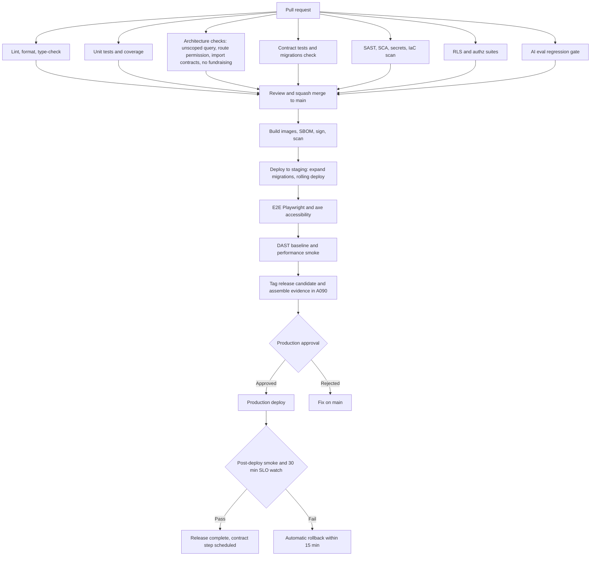
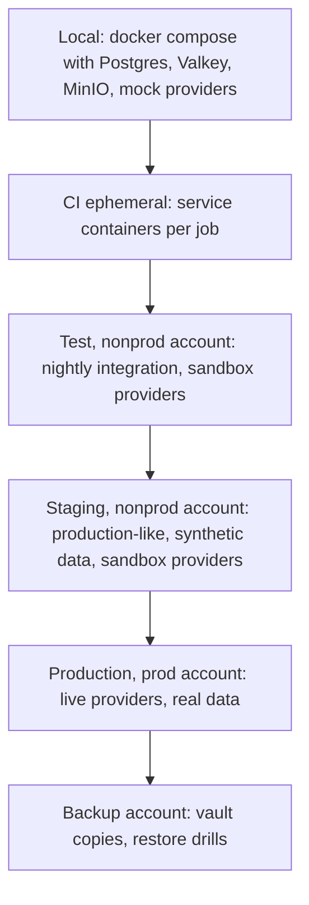
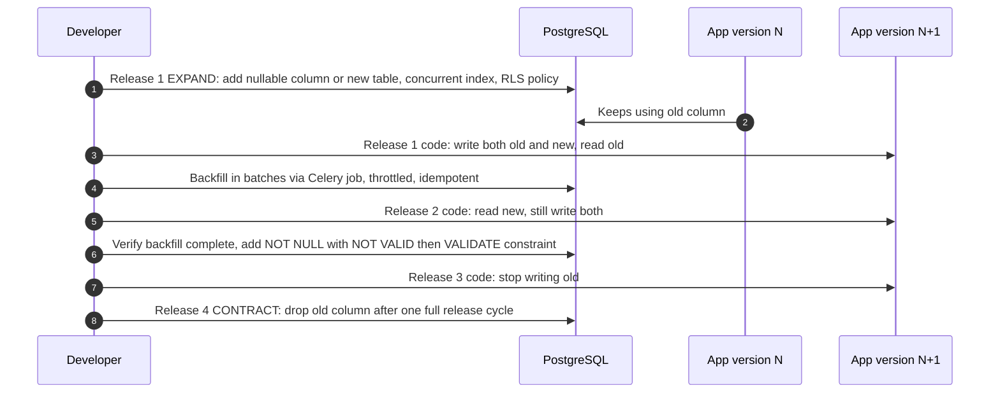
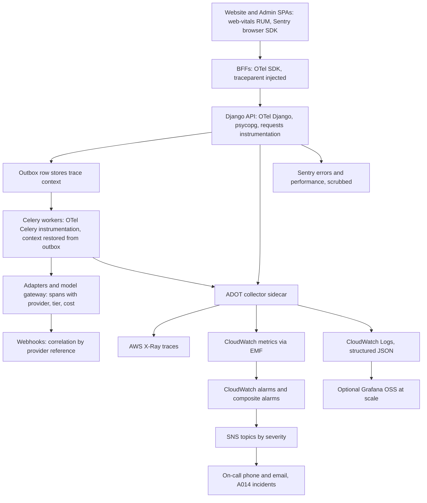
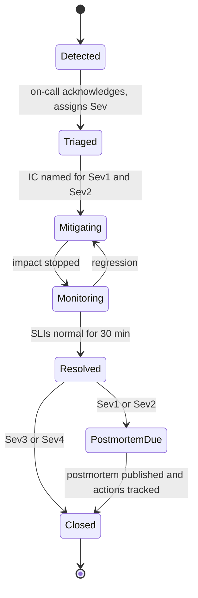

# AI Growth Engine: Employee Sales & Marketing Automation
## Application Blueprint: PART 4 (Batch 4.3), DevOps, Release Engineering, Observability and Operations

| Field | Value |
|---|---|
| Document | Part 4, Batch 3 of 3 |
| Version | 1.0 · 27 Nov 2026 |
| Baseline | BRD, FRD; Parts 0, 0A (DEC-005, -006, -018, -020, -028, -032, -040, -041, -044, -061, -063), 1 (KPI-20…25), 2.1–2.5, Batches 4.1 and 4.2. Part 3 (architecture) is written in parallel; platform choices below are stated as assumptions or proposed ADRs for reconciliation |
| Roles applied | DevOps/SRE Lead (lead), Principal Engineer, QA Lead, Security Lead, FinOps Lead, Product Owner (review) |

**Acronyms.** ALB Application Load Balancer · ECS Elastic Container Service · ECR Elastic Container Registry · IaC infrastructure as code · OTel OpenTelemetry · ADOT AWS Distro for OpenTelemetry · EMF CloudWatch Embedded Metric Format · RED rate, errors, duration · USE utilization, saturation, errors · PITR point-in-time recovery · DLQ dead-letter queue · MTTA/MTTR mean time to acknowledge/restore · SBOM software bill of materials · PR pull request.

**Operating constraint.** The team is 4.0 engineering FTE (one of them a 0.5 DevOps/SRE contractor and 0.5 QA automation) plus a 0.5 growth/compliance lead (DEC-005). Monitoring/security/CI tooling has **₹500/month (B07)** and hosting **₹5,000/month (B01)** at pilot (DEC-020). Every practice below is sized to that reality: open-source and managed-service defaults, automation over manual toil, and business-hours human coverage with automated mitigation around the clock.

---

## 4.32 Repository strategy

### 4.32.1 Monorepo [ADR-060]

One Git repository holds both frontends, the shared UI package, the Django backend (API, BFFs, workers), AI prompts and evaluation sets, infrastructure code and operations assets. Reasons: one change can update an API, its generated client and both UIs atomically; a single pipeline enforces the cross-cutting gates (RECOMMENDATION-025, BRL-AI-09); a 4-person team avoids multi-repo overhead. The investor product stays in **its own repository and AWS accounts** (NFR-031).

```text
growth-engine/
├── apps/
│   ├── website/                 # commercial-website-react (public site + portal), Vite/React/TS
│   └── admin/                   # commercial-admin-react (Command Centre incl. Automation route group)
├── packages/
│   ├── ui/                      # shared design system (Part 2.5 §2.45), Storybook
│   ├── api-client/              # TypeScript client generated from the OpenAPI catalogue (DEC-015)
│   ├── i18n/                    # ICU message catalogues, locale utilities (DEC-026)
│   └── config/                  # eslint, tsconfig, prettier, size-limit, Lighthouse budgets
├── backend/
│   ├── growth_engine/           # Django project: settings per environment, URL routers per surface
│   ├── bff/                     # website BFF and admin BFF (DEC-019)
│   ├── apps/                    # Django apps per Part 2.1 module map (core.identity, catalog, governance, …)
│   ├── workers/                 # Celery app, queues, beat schedule, outbox relay
│   ├── adapters/                # provider adapters (email, whatsapp, payment, esign, calendar, search, ai)
│   ├── policy/                  # Policy Decision Point and rule packs (versioned)
│   └── tests/                   # unit, integration, contract, RLS fixtures
├── ai/
│   ├── prompts/                 # versioned prompt templates (PromptVersion source of truth)
│   ├── evals/                   # eval harness config, thresholds per agent (M54)
│   └── datasets/                # synthetic and de-identified eval sets (no production personal data)
├── e2e/                         # Playwright suites, axe checks, synthetic journeys (M62)
├── load/                        # k6 scenarios LT-01…LT-11
├── infra/
│   ├── modules/                 # OpenTofu modules: network, ecs-service, rds, s3, kms, waf, observability
│   ├── live/{nonprod,prod,shared,backup}/
│   └── policies/                # Checkov/OPA policies, SCPs
├── ops/
│   ├── runbooks/                # RB-001… (Markdown, linked from alerts)
│   ├── alerts/                  # alert rules as code (AL-##)
│   └── dashboards/              # dashboard JSON (CloudWatch / Grafana)
├── data/seeds/                  # synthetic datasets (RECOMMENDATION-017), versioned
├── docs/{adr,security,api}/     # ADRs, threat model, generated API docs
└── .github/                     # workflows, CODEOWNERS, PR template, dependabot/renovate config
```

| Tooling | Choice (verify versions, 27 Nov 2026) | Reason |
|---|---|---|
| JS workspace | pnpm workspaces + Turborepo task caching | Fast, strict dependency isolation; caches unchanged packages in CI |
| Python packaging | `uv` with a lockfile (hash-pinned) | Reproducible, fast installs |
| Python lint/format/type | Ruff, mypy (strict on `policy/`, `adapters/`, finance apps), django-stubs | Catch defects early |
| TS lint/type | ESLint, `tsc --noEmit` strict | Same |
| Boundary checks | import-linter contracts (backend); ESLint `no-restricted-imports` so `apps/website` never imports Admin code | NFR-085, NFR-001 |
| CODEOWNERS | `backend/policy/**`, `backend/apps/governance/**`, `backend/apps/commerce/finance/**`, `infra/**`, `ai/prompts/**`, `.github/**` require the Founder/CTO or the named lead | Security-sensitive paths need two reviewers |

### 4.32.2 Branching, versioning and code review

| Practice | Rule |
|---|---|
| Model | **Trunk-based development.** `main` is always releasable. Short-lived branches (`feat/…`, `fix/…`, `chore/…`) live ≤ 2 working days; larger work hides behind feature flags (§4.36) |
| Merge | Squash merge after required checks pass and ≥ 1 approving review (2 for CODEOWNERS security paths); linear history; no direct pushes to `main` |
| Commits | Conventional Commits (`feat:`, `fix:`, `sec:`, `perf:`, `chore:`), with requirement IDs in the body (`Refs: FR-A034, BRL-ELG-02`) for traceability (Part 9) |
| Versioning | Continuous deployment of `main` to staging. Production releases are **tags** `vYYYY.MM.DD.N` (calendar version, N = release number that day) cut from a green `main` commit. API contracts carry their own semantic version in the URL (`/api/v1/…`, NFR-015) |
| Release trains | At least weekly production releases from W1 (NFR-083); wave gates (W0–W5) are *release readiness reviews* in A090, not branches (DEC-006, DEC-063) |
| Hotfix | Fix on `main`, then tag. If `main` has unreleasable work behind enabled flags, cherry-pick onto a short-lived `hotfix/vX` branch from the last tag, tag `vYYYY.MM.DD.N-hf1`, and merge back |
| PR template | Linked requirement IDs; risk class (normal / security-sensitive / migration / AI-prompt); screenshots for UI; test evidence; rollback note; flag name |
| Review checklist | Authorization on every new endpoint (SC-50), scoped queries (RECOMMENDATION-025), audit event emitted, idempotency key handled, no secrets, migrations follow expand/contract, accessibility for UI, prompt changes carry eval results |

---

## 4.33 CI/CD pipeline and quality gates

### 4.33.1 Platform [ADR-050]

**GitHub Actions** (GitHub is named in FRD §6 M09) with GitHub-hosted runners for build/test and **OIDC federation** into environment-scoped AWS roles for deploys (SC-44) [ASSUMPTION-121]. Free-plan minute limits must be verified; caching (Turborepo, uv, Docker layer cache) keeps the pipeline within budget B07. If minutes become a constraint, a self-hosted runner on a small spot instance in the nonprod account is the fallback (verify cost).

### 4.33.2 Stages and gates

| PL | Stage | Trigger | What runs | Gate (blocks on failure) | Typical time |
|---|---|---|---|---|---|
| PL-01 | Pre-commit (local) | Developer commit | Ruff, Prettier, ESLint on changed files, gitleaks | Advisory locally; enforced again in CI | < 30 s |
| PL-02 | Lint and format | PR, push to `main` | Ruff, ESLint, Prettier check, actionlint, OpenTofu `fmt`/`validate` | Any error | 1–2 min |
| PL-03 | Type-check | PR | mypy (strict paths), `tsc --noEmit` for all packages | Any error | 2–3 min |
| PL-04 | Unit tests + coverage | PR | pytest (parallel), Vitest | Failures; coverage below NFR-082 thresholds or dropping > 0.5 pp | 4–6 min |
| PL-05 | Architecture and policy checks | PR | import-linter contracts (NFR-085); **unscoped-query check** (RECOMMENDATION-025: AST/Semgrep rule forbidding `.objects` on tenant-scoped models outside allowlisted modules); route-permission linter (SC-50); RBAC policy file vs matrix test; `fields="__all__"` ban; fundraising negative check (BRL-TEN-12, FR-NEG-01: forbidden terms/entities/routes) | Any violation | 1–2 min |
| PL-06 | Contract tests | PR | OpenAPI schema conformance (Schemathesis against an ephemeral API), regenerated `api-client` diff must be committed, provider adapter contract tests with recorded sandbox fixtures (RECOMMENDATION-011), webhook signature fixtures | Failure or uncommitted client diff | 3–5 min |
| PL-07 | Migrations check | PR touching models | `makemigrations --check`; migration linter (no `ALTER … NOT NULL` without default on large tables, no column drop in the same release as code removal, concurrent index creation, `lock_timeout` set); RLS policy present for every new tenant table; forward-migrate an anonymized-volume snapshot of staging schema and time it (≤ 60 s lock budget) | Any violation | 2–4 min |
| PL-08 | RLS and authz suites | PR (affected apps) and nightly (full) | Two-tenant/26-startup fixture; generated BOLA/BFLA/property suites (Batch 4.1 §4.8.2) | Any failure | 5–8 min |
| PL-09 | SAST, SCA, secrets, IaC scan | PR and nightly | Semgrep, Bandit, OSV-Scanner, pip-audit, pnpm audit, gitleaks, Checkov, licence check [ADR-057] | High/Critical per Batch 4.1 §4.16.1 | 2–4 min |
| PL-10 | Build artefacts | Merge to `main` | Docker images (API/BFF, worker, fetcher) multi-stage, non-root; frontend bundles with content hashes; SBOM (CycloneDX); provenance attestation | Build failure | 4–6 min |
| PL-11 | Container scan and sign | After PL-10 | Trivy image scan; cosign keyless signing; push to ECR (immutable tags, digest recorded) | Critical vulnerability; signing failure | 2 min |
| PL-12 | AI eval regression gate | PR touching `ai/**`, gateway, adapters for AI, or nightly | M54 harness: per-agent thresholds (precision/recall, schema validity, grounding, injection and leakage suites, cost per task, latency) against pinned datasets; model calls to the live provider only for the changed agents, otherwise recorded responses | Any threshold breach (**BRL-AI-09, NFR-033, DEC-061**) | 5–15 min |
| PL-13 | Frontend quality | PR touching `apps/**` or `packages/**` | size-limit budgets (NFR-043/044), Lighthouse CI on key public routes (NFR-042 lab budgets), Storybook build + visual regression on `packages/ui` | Budget breach | 4–6 min |
| PL-14 | Deploy to staging | Merge to `main` (green) | OpenTofu plan/apply (staging), DB migrations (expand step), ECS deploy by image digest with signature verification, frontend upload to new S3 prefix + CloudFront switch | Failed health checks → automatic rollback | 6–10 min |
| PL-15 | E2E and accessibility | After PL-14 | Playwright synthetic journeys (smoke set per PR merge; full suite nightly and per release), axe-core on every route (NFR-088), cross-browser projects (NFR-098) | Any critical journey failure; any critical/serious axe violation | 10–25 min |
| PL-16 | DAST and performance smoke | After PL-15 | ZAP baseline; k6 smoke (5 min at 10 RPS, thresholds = NFR-039/040); header and TLS checks | High DAST finding; p95 regression > 20% vs last release | 8–10 min |
| PL-17 | Release candidate and approval | Manual: create tag `vYYYY.MM.DD.N` | Release record in A090 assembles evidence: test results, eval report, SBOM, scan results, migration plan, flag changes, rollback plan; **production environment approval** by Founder/CTO (or delegate) — two-person rule: approver ≠ author of the majority of changes | Missing evidence; open Critical/High; restore drill overdue (NFR-012) | — |
| PL-18 | Production deploy | After approval | Same steps as PL-14 against prod; migrations expand step first; ECS rolling (pilot) or blue/green (scale gate) [ADR-053]; frontend pointer switch | Health checks, ALB 5xx alarm and ECS deployment circuit breaker | 8–12 min |
| PL-19 | Post-deploy smoke and watch | After PL-18 | Synthetic smoke (login, scoped list, draft, simulated dispatch, public page, webhook echo in sandbox mode), header/TLS check, 30-minute SLO watch (AL-01…06) | Any smoke failure → automatic rollback (PL-20) | 5 + 30 min |
| PL-20 | Rollback | Automatic on PL-18/19 failure; manual via workflow dispatch | Previous task definition / previous frontend prefix; flags reverted; migrations **not** reversed (roll-forward, §4.38) | Rollback must complete ≤ 15 min (verified monthly) | ≤ 15 min |
| PL-N | Nightly | Schedule (02:00 IST) | Full RLS/authz suites, full E2E, full eval suite, ZAP authenticated scan (weekly), dependency and image re-scan of deployed digests, drift detection (`tofu plan` must be empty), restore smoke (weekly) | Creates High alerts and tickets | 60–90 min |

**PR critical path:** PL-02 → PL-09 run in parallel; target ≤ 15 min to green for a typical PR (developer feedback). **Merge-to-staging:** ≤ 45 min. **Tag-to-production:** ≤ 30 min after approval.

### 4.33.3 Pipeline diagram



### 4.33.4 Quality gate thresholds (single reference)

| Gate | Threshold | Source |
|---|---|---|
| Coverage | Backend ≥ 80% lines (≥ 90% PDP, approvals, finance, tenancy, gateway); frontend ≥ 70% | NFR-082 |
| Security findings | 0 Critical/High open without approved exception | NFR-067 |
| Secrets | 0 | NFR-068 |
| Accessibility | 0 critical/serious axe violations | NFR-088 |
| Performance smoke | p95 within NFR-039/040; ≤ 20% regression vs previous release | NFR-039/040 |
| Bundle budgets | Public ≤ 150 KB gzip JS per route; Admin main ≤ 350 KB | NFR-043/044 |
| AI evals | Per-agent thresholds (Part 7); injection/leakage suites 0 violations | BRL-AI-09; Batch 4.1 §4.15 |
| Tenancy | 0 RLS/authz suite failures | NFR-032 |
| Migrations | Lock budget ≤ 60 s total, `lock_timeout` 5 s per statement; expand/contract compliant | §4.37 |
| Release evidence | Complete in A090; restore drill not overdue | NFR-012, NFR-013 |

---

## 4.34 Infrastructure as code

| Aspect | Decision |
|---|---|
| Tool | **OpenTofu** (open-source, Terraform-compatible HCL) [ADR-051] [ASSUMPTION-122]. Terraform remains a drop-in alternative if Part 3 decides so; modules are written to the common subset |
| State | S3 backend in the `shared` account with versioning, KMS encryption and native/DynamoDB state locking (verify the locking option for the chosen version) |
| Layout | `infra/modules/*` reusable modules; `infra/live/<account>/<env>/<stack>` thin root modules; stacks: `network`, `data` (RDS, Valkey, S3, KMS), `compute` (ECS services, ALB), `edge` (CloudFront, WAF, ACM, Route 53), `observability` (log groups, alarms, dashboards), `security` (GuardDuty, Security Hub, Config, CloudTrail), `budgets` |
| Accounts (AWS Organizations) | `management` (billing, SCPs only) · `log-archive` (CloudTrail, Config, security logs) · `nonprod` (test + staging) · `prod` · `backup` (AWS Backup vault copies; region per DEC-040, verify ap-south-2 services). Accounts cost nothing by themselves and give hard isolation (SC-27) |
| Policy as code | Checkov (or tfsec/Trivy config) in PL-09; SCPs: deny leaving the organization, deny disabling CloudTrail/GuardDuty/Config, deny regions outside ap-south-1 and the backup region, deny public S3 ACLs, deny snapshot sharing outside the organization |
| Change flow | PR → `tofu plan` posted as a PR comment → review (CODEOWNERS `infra/**`) → apply by the pipeline only (nonprod on merge, prod with environment approval) |
| Drift | Nightly `tofu plan` on every stack; non-empty plan → AL-47 ticket (THR-073) |
| Secrets | IaC creates secret *containers* and rotation configuration; values are set by rotation or a one-time secure procedure, never in code |
| Tagging | Enforced by a module-level `default_tags` block and a policy check (§4.46.2) |
| Reproducibility | Staging rebuilt from scratch quarterly (NFR-087) |

---

## 4.35 Environments and data seeding



| Environment | Purpose | Data | Providers | Size (pilot) | Access |
|---|---|---|---|---|---|
| Local | Development | Seed dataset `seed-small` (2 tenants, 6 startups) | Mock adapters, MailHog-style SMTP sink, LocalStack optional | Laptop | Developer |
| CI (ephemeral) | Automated tests | Fixtures + `seed-tenancy` (two tenants, 26 startups) | Mocks and recorded fixtures | Runner | Pipeline |
| Test | Nightly integration, contract tests against provider sandboxes, chaos tests | `seed-medium` (Year 1 volume subset) | **Sandbox** accounts: SES sandbox/simulator addresses, WhatsApp test number, payment gateway test mode, e-sign sandbox, Anthropic with a separate low-cap key | Smallest instances; scaled to zero outside 08:00–22:00 IST | Engineers |
| Staging | Release verification, E2E, DAST, load tests, UAT, demos | `seed-y1` (Year 1 volume, synthetic) and `seed-y2` for LT-10 | Sandboxes only (ABAC-12); simulation adapters for channels without sandboxes | Production instance classes during load-test windows; otherwise reduced (RSK-343) | Engineers, QA, PO, UAT users (synthetic accounts) |
| Production | Live operation | Real data | Live | Per Part 3 | Least privilege; no standing DB access (SC-48) |

**Data seeding rules**

1. Seed datasets are **synthetic and versioned** in `data/seeds/` (RECOMMENDATION-017): Owner Portfolio tenant with AppNAI, MedMaarg, EduVerse, OrganicSpec and 22 generated startups (26 in total, AP-01), plus an external tenant; minors and health-adjacent fixtures; all four vertical routes; consent, suppression and jurisdiction edge cases (India, EU/UK, US, a denied jurisdiction).
2. Generators are deterministic (seeded random) so tests reproduce; personal-looking data uses reserved domains (`example.com`, `example.in`) and phone ranges reserved for fiction where available.
3. **Production data is never copied to lower environments** (THR-065). A restore drill restores production backups only into the isolated `backup` account restore sandbox, with the same security controls as production, and the restored instance is destroyed after verification (§4.47).
4. Each seed version records which requirements it exercises (traceability to TC IDs in Part 6).
5. A `seed:reset` command restores staging to a known state before each release verification run.

---

## 4.36 Feature flags (RECOMMENDATION-005)

### 4.36.1 Tooling [ADR-052] [RECOMMENDATION-047]

**Pilot:** `django-waffle` (open-source; flags, switches and samples stored in PostgreSQL) wrapped by an internal `flags` service that adds tenant/startup targeting, typed flag registry, audit events and a read API for both frontends via the BFF. No extra service to run, so B01/B07 are untouched. **Scale gate option:** Unleash OSS (self-hosted) if the number of flags or targeting rules outgrows the wrapper; the internal `flags` interface keeps the switch transparent.

### 4.36.2 Flag classes and rules

| Class | Purpose | Default | Who changes | Lifetime |
|---|---|---|---|---|
| **Release** | Hide incomplete features on trunk | OFF in prod | Engineering (change record) | ≤ 90 days after full rollout, then removed (CI warns at 60 days) |
| **Ops / kill switch** | Disable a channel, adapter, agent or endpoint instantly (e.g. `channel.whatsapp.dispatch`, `adapter.payment.razorpay`, `agent.discovery.extraction`) | ON once launched | On-call engineer, R11 (scoped) | Permanent |
| **External channel / paid adapter enablement** | BRD §10 "disabled by default": every external channel, paid adapter and Tier 2 route | **OFF** | R12 + R01 for paid adapters; R01 + R10 for Tier 2 (CFG-24/25) | Permanent, audited |
| **Autonomy** | Allow L2/L3 per workflow within DEC-064 caps | OFF (L1) | R02 (L2), R01 (L3) via CFG-27 | Permanent |
| **Experiment** | A/B of UI copy or layout (never eligibility, pricing or consent) | OFF | Product owner | ≤ 30 days |

**Rules:** flags never replace authorization or the PDP (a flag can only *further restrict* or enable a code path that is still policy-checked); flag evaluation is server-side, and the frontends receive evaluated booleans only; flag changes are audit events (CFG-31) and appear on the release record; every flag has an owner, description, class, created date and removal ticket; emergency stop (BRL-AUT-05) is a dedicated control, not a flag.

---

## 4.37 Release strategy and database migrations

### 4.37.1 Deployment strategy [ADR-053] [RECOMMENDATION-045]

| Component | Pilot (single-AZ app, DEC-040) | Scale gate (two app instances, Multi-AZ DB) |
|---|---|---|
| API/BFF | **ECS rolling update** with `minimumHealthyPercent=100`, `maximumPercent=200`, deployment circuit breaker with automatic rollback, ALB health checks on `/ready` | **Blue/green** via CodeDeploy with a 10% → 100% traffic shift after 10 min of clean SLO signals (or ALB weighted target groups) |
| Workers | Rolling; graceful shutdown (warm shutdown, `acks_late` tasks re-queued); new task version consumes only after migrations expand step | Same, per queue |
| Beat scheduler | Single instance with a lock (only one scheduler active) | Same |
| Frontends | Immutable build per release in a new S3 prefix; CloudFront origin path switch; `index.html` no-cache, assets immutable; previous prefix kept 30 days | Same |
| Release windows | Production deploys Monday–Friday 11:00–16:00 IST (inside support hours, DEC-044), not on the day before an Indian public holiday; emergency fixes any time with Founder approval | Same |

### 4.37.2 Expand/contract migrations

Every schema change is split so that **version N and N+1 of the application both work with the database at every moment**.



| Rule | Detail |
|---|---|
| Lock safety | `SET lock_timeout = '5s'` and `statement_timeout` for migrations; `CREATE INDEX CONCURRENTLY` (non-atomic migration); constraints added `NOT VALID` then validated |
| Backfills | Never inside a migration on large tables; batched Celery jobs (1,000 rows, sleep between batches), resumable, with progress metric |
| Renames | Never rename in place; add new, dual-write, migrate, drop old |
| Enum/state changes | Add new states before code uses them; remove only after no rows use them |
| RLS | New tenant tables get RLS policies in the same migration as creation (PL-07) |
| Destructive steps | Column/table drops only in a *contract* release ≥ 1 release after the code stopped using them, with a fresh backup marker |
| Data fixes | Scripted, reviewed, idempotent management commands with dry-run, executed by the pipeline with audit, never by ad-hoc SQL |
| Migration ownership | `app_migrator` role used only by the pipeline (THR-035) |

---

## 4.38 Rollback strategy

> **Erratum v1.2 (E-V-09):** superseded by RPO ≤ 15 min in every region and growth-critical RTO ≤ 120 min as a release gate (DEC-771/787). See Part 11.23c.


| Failure | Rollback mechanism | Time target | Data consideration |
|---|---|---|---|
| Bad API/worker image | Redeploy the previous task definition (pipeline PL-20 or ECS circuit breaker) | ≤ 15 min | Schema is backward compatible (expand/contract), so the old code runs |
| Bad frontend build | Switch CloudFront origin path back to the previous S3 prefix; invalidate `index.html` | ≤ 5 min | None |
| Feature misbehaves | Turn the release or kill-switch flag OFF | ≤ 1 min | Partial data created by the feature remains; repair script if needed |
| Bad configuration revision (A112) | One-click revert to the previous active revision (future-effective; running runs keep their pinned revision, BRL-AUT-03) | ≤ 5 min | None |
| Bad prompt/model routing | Re-pin the previous PromptVersion/model in A011 (eval-approved) | ≤ 5 min | AI outputs produced in between flagged for review |
| Bad migration (expand) | **Roll forward** with a corrective migration; expand steps are additive and harmless to N | ≤ 1 h | No destructive down-migrations in production |
| Data corruption by a defect | Stop affected workflows (scoped emergency stop), identify affected rows via audit/correlation IDs, repair by script; PITR restore to a side instance to extract correct values (RB-007) | RTO ≤ 4 h | Never restore the whole production DB over newer good data unless the corruption is widespread and the PO approves |
| Infrastructure change | Revert the IaC PR and apply; state backups available | ≤ 1 h | — |

Rollback is **rehearsed monthly** in staging (NFR-013) and is part of every release record.

---

## 4.39 Observability architecture (DEC-041, RECOMMENDATION-006)

### 4.39.1 Telemetry pipeline [ADR-058]



| Signal | Standard |
|---|---|
| **Correlation** | W3C `traceparent` from the browser through BFF, API, outbox (stored in the row), Celery headers, adapter calls and provider metadata where supported; `correlation_id` = trace ID; `request_id` per HTTP request; `run_id` per workflow run (E-9) |
| **Logs** | JSON, one event per line: `ts` (UTC ms), `level`, `service`, `env`, `version`, `trace_id`, `span_id`, `request_id`, `run_id`, `tenant_id`, `startup_id`, `actor_type`, `event`, `outcome`, `duration_ms`, `error_class`. **No message bodies, prompts or personal data** (NFR-078); IDs only. Levels: INFO in prod, DEBUG sampled 1% via flag |
| **Metrics** | RED for every endpoint class (§4.24) and queue; USE for DB, Valkey, containers; business/automation metrics below; EMF with dimensions limited to `service`, `endpoint_class`, `queue`, `provider`, `tier` (tenant dimension only on low-cardinality business metrics to control cost) |
| **Traces** | 100% of errors and slow requests (> 2× class p95), 10% of the rest at pilot (tail-based in the collector where supported, verify) |
| **Errors** | Sentry (free/developer tier first, verify quotas, DEC-041) with `before_send` scrubbing and release tagging; issue alerts routed to the engineering channel |
| **RUM** | `web-vitals` beacons to a first-party endpoint (no third-party analytics, BRL-MKT-06); aggregated p75 per route and device class |
| **Cost** | Log retention per NFR-081; metric dimensions reviewed monthly (CloudWatch metric and log ingestion are the main observability cost drivers, verify prices) |

### 4.39.2 Metrics catalogue (application and business)

| Metric | Type | Dimensions | Used by |
|---|---|---|---|
| `http_requests_total`, `http_request_duration_ms` | Counter, histogram | service, endpoint_class, status_class | SLO-03/04, AL-04…06 |
| `outbox_lag_seconds` (commit → pick-up) | Histogram | queue | SLO-05, AL-07 |
| `outbox_pending_count`, `outbox_oldest_age_seconds` | Gauge | queue | AL-08 |
| `celery_queue_depth`, `celery_task_duration_ms`, `celery_task_failures_total` | Gauge, histogram, counter | queue, task | AL-27 |
| `dlq_items_total`, `dlq_oldest_age_seconds` | Gauge | queue | AL-09 |
| `run_start_delay_seconds` (due → started) | Histogram | class (transactional/batch) | SLO-06/07, AL-11 |
| `dispatch_outcomes_total` | Counter | channel, outcome (confirmed/uncertain/failed/blocked) | AL-10, RP-22 |
| `uncertain_open_count`, `uncertain_oldest_age_seconds` | Gauge | channel/provider | SLO-10, AL-10 |
| `pdp_decisions_total` | Counter | decision, rule_id (top-N) | RP-07 |
| `provider_calls_total`, `provider_latency_ms`, `circuit_state` | Counter, histogram, gauge | provider | AL-12 |
| `ai_calls_total`, `ai_cost_inr`, `ai_tokens`, `ai_schema_failures_total`, `ai_abstentions_total`, `ai_tier_fallbacks_total` | Counter | agent, tier, model | RP-20, AL-14/15 |
| `budget_utilization_ratio` | Gauge | budget line, scope | AL-14, AL-16 |
| `projection_lag_seconds` | Histogram | projection | SLO-09 |
| `webhook_received_total`, `webhook_signature_failures_total`, `webhook_ack_ms` | Counter, histogram | provider | SLO-08, AL-24 |
| `email_bounce_rate`, `email_complaint_rate`, `whatsapp_quality_rating` | Gauge | startup sender | AL-17, AL-18, AL-21 |
| `suppression_breach_total` | Counter | channel | AL-19 (must stay 0) |
| `emergency_stop_active` | Gauge | scope | AL-13 |
| `audit_chain_verify_ok` | Gauge | tenant | AL-44 |
| `security_events_total` | Counter | SE type | AL-30…43 |

---

## 4.40 SLIs, SLOs and error budgets

### 4.40.1 SLO table

| SLO | Service / journey | SLI (good events ÷ valid events) | Objective (28-day rolling unless monthly stated) | Error budget | Source |
|---|---|---|---|---|---|
| SLO-01 | Website and portal availability | Good minutes ÷ total minutes (§4.21 definition) | **99.5%** monthly pilot → **99.9%** after scale gate | 216 min → 43 min per 30 days | DEC-018; NFR-053 |
| SLO-02 | Admin availability | Same, Admin probes and endpoints | **99.5%** monthly | 216 min | DEC-018; NFR-054 |
| SLO-03 | API read latency | Read requests (C2/C3) with duration ≤ 500 ms ÷ all read requests | **95%** | 5% slow requests | DEC-018; NFR-039 |
| SLO-04 | API write latency | Sync writes (C5) ≤ 800 ms ÷ all | **95%** | 5% | DEC-018; NFR-040 |
| SLO-05 | Outbox dispatch lag | Events picked up ≤ 60 s after commit ÷ all events | **95%** (and 99% ≤ 180 s) | 5% | DEC-018; NFR-045 |
| SLO-06 | Transactional automation timeliness | Due runs started ≤ 15 min ÷ due runs (quiet hours excluded) | **99%** | 1% | DEC-032; KPI-20 |
| SLO-07 | Batch timeliness | Batch runs started ≤ 24 h ÷ due | **99%** | 1% | DEC-032 |
| SLO-08 | Webhook ingestion | Webhooks acknowledged 2xx ≤ 2 s ÷ received (valid signature) | **99.5%** | 0.5% | NFR-051, NFR-055 |
| SLO-09 | Customer 360 freshness | Projection updates ≤ 60 s ÷ all | **95%** | 5% | NFR-008 |
| SLO-10 | Uncertain-outcome reconciliation | Uncertain items reconciled ≤ 24 h ÷ uncertain items | **95%** | 5% | NFR-065 |
| SLO-11 | AI gateway serviceability | AI tasks completed at Tier 0/1 or cleanly degraded to Tier 3 with a human task ÷ AI tasks (no unhandled error) | **99.5%** | 0.5% | DEC-007 |
| SLO-12 | Public page TTFB | Page requests with TTFB ≤ 800 ms (origin) ÷ all | **95%** | 5% | DEC-018; NFR-041 |

**Compliance SLOs (zero-tolerance, not budgeted):** suppression breaches = 0 (KPI-17); cross-scope disclosures = 0 (KPI-30); closure without route evidence = 0 (KPI-31). Any occurrence is a Sev1 incident, not a budget burn.

### 4.40.2 Error budget policy

| Budget consumed in the window | Action |
|---|---|
| < 50% | Normal delivery |
| 50–75% | Reliability review in the weekly engineering meeting; risky changes (migrations, adapter changes) need explicit approval |
| 75–100% | Release freeze for non-reliability work on the affected service; top reliability item scheduled in the current sprint |
| > 100% | Freeze continues until the budget recovers or the Founder approves an exception; postmortem required; SLO reviewed for realism |

### 4.40.3 Burn-rate alerting (multi-window)

For an SLO with error budget *b* (e.g. 0.5% for 99.5%), alert when the error ratio exceeds **burn rate × b** in both windows:

| Severity | Long window | Short window | Burn rate | Error ratio threshold for 99.5% | Budget spent if sustained |
|---|---|---|---|---|---|
| Page (Sev2, Sev1 if public site down) | 1 h | 5 min | 14.4× | > 7.2% | 2% of a 30-day budget per hour |
| Page | 6 h | 30 min | 6× | > 3.0% | 5% per 6 h |
| Ticket | 3 days | 6 h | 1× | > 0.5% | 10% per 3 days |

---

## 4.41 Alert rules

Routing keys: **P** = page (on-call phone + A014 incident + email), **T** = ticket (A014 + engineering channel/email), **N** = notify the business owner via A106 (DEC-036). All alerts link to a runbook. Thresholds are initial values tuned after W3 telemetry.

| AL | Alert | Condition (initial threshold) | Severity | Route | Runbook |
|---|---|---|---|---|---|
| AL-01 | Website/portal availability fast burn | SLO-01 burn > 14.4× over 1 h and 5 min | Sev1 if total outage, else Sev2 | P | RB-012 / RB-001 |
| AL-02 | Availability slow burn | SLO-01/02 burn > 6× over 6 h and 30 min; > 1× over 3 days (ticket) | Sev2 / Sev3 | P / T | — |
| AL-03 | Admin availability fast burn | SLO-02 burn > 14.4× | Sev2 | P | RB-012 |
| AL-04 | Read latency | SLO-03 p95 > 500 ms for 15 min | Sev3 | T | — |
| AL-05 | Write latency | SLO-04 p95 > 800 ms for 15 min | Sev3 | T | — |
| AL-06 | 5xx ratio | > 2% of requests for 5 min | Sev2 | P | RB-012 |
| AL-07 | Outbox lag | p95 > 60 s for 10 min (T); oldest pending > 5 min (P) | Sev3 / Sev2 | T / P | RB-002 |
| AL-08 | Outbox backlog | Pending > 1,000 for 10 min | Sev2 | P | RB-002 |
| AL-09 | DLQ | Any new DLQ item (T); > 50 items or oldest > 1 business day (P in hours) | Sev3 / Sev2 | T / P | RB-011 |
| AL-10 | Uncertain-outcome surge | > 20 new uncertain in 1 h, or > 5% of dispatches in 15 min, or oldest > 24 h | Sev2 | P + N (R11) | RB-003 |
| AL-11 | Transactional timeliness | SLO-06 < 99% over the last hour | Sev2 | P | RB-002 |
| AL-12 | Provider degradation | Provider error rate > 20% for 5 min, or circuit open, or provider status incident | Sev2 | P + N | RB-001 |
| AL-13 | Emergency stop activated | `emergency_stop_active` = 1 for any scope | Sev2 (informational to on-call) | N (R01, R02, R10, R11) + T | RB-004 |
| AL-14 | AI budget | 80% of any budget (N); 100% hard stop reached (P in hours) | Sev3 / Sev2 | N / P | RB-005 |
| AL-15 | Cost anomaly | Daily AI or provider spend > 2× the 7-day average, or AWS Cost Anomaly Detection alert | Sev3 | T + N (R01, R08) | RB-005 |
| AL-16 | AWS budget forecast | Forecast > 100% of B01 or actual > 80% | Sev3 | T + N | RB-005 |
| AL-17 | Complaint rate | Campaign complaint rate > 0.1% or ≥ 3 complaints in 24 h (BRL-ELG-11) | Sev2 | P + N (R10) | RB-006 |
| AL-18 | Bounce rate | Sender bounce rate > 5% over 24 h (verify current SES review thresholds) | Sev2 | P + N | RB-006 |
| AL-19 | Suppression breach | `suppression_breach_total` > 0 | **Sev1** | P + N (R01, R10) | RB-006 / RB-004 |
| AL-20 | SES reputation | Account or configuration set sending paused / under review | Sev1 | P + N | RB-006 |
| AL-21 | WhatsApp quality | Quality rating drops to Medium (T) or Low (P); messaging tier reduced | Sev3 / Sev2 | T / P + N | RB-006 |
| AL-22 | Database saturation | CPU > 80% 15 min; free storage < 20%; connections > 80% | Sev2 | P | — |
| AL-23 | Backup health | Backup job failed; PITR latest restorable time older than 15 min | Sev2 | P | RB-007 |
| AL-24 | Webhook signature failures | > 10 per provider in 5 min | Sev2 | P | RB-009 |
| AL-25 | Certificate / domain | ACM renewal failing or cert expiry < 21 days; domain registration expiry < 30 days; verified domain DNS check failed | Sev3 (Sev2 < 7 days) | T / P | RB-010 |
| AL-26 | Deployment failure | ECS circuit breaker rollback, PL-19 smoke failure | Sev2 | P | RB-012 |
| AL-27 | Worker health | No heartbeat from a queue's workers for 5 min; queue depth > threshold per queue | Sev2 | P | RB-002 / RB-011 |
| AL-28 | Valkey memory | > 80% memory or evictions on the broker | Sev2 | P | RB-002 |
| AL-29 | Synthetic probe | 3 consecutive failures of a critical journey probe | Sev2 | P | RB-012 |
| AL-30 | Failed-login burst | > 50 failures/5 min for one account or > 500/5 min platform-wide | Sev3 | T | RB-013 |
| AL-31 | Wrong-audience token in prod | Any SE-04 | Sev2 | P | RB-013 |
| AL-32 | Authorization denial burst | > 20 denials in 5 min by one actor | Sev3 | T | RB-008 |
| AL-33 | **Cross-tenant access alert** | Any SE-06 | **Sev1** | P + N (R01, R10) | RB-008 |
| AL-34 | Privileged grant anomaly | Support grant or role elevation outside business hours | Sev3 | T + N (R12) | RB-013 |
| AL-35 | Bulk export anomaly | ≥ 3 exports > 5,000 rows in 1 h by one actor, or any Restricted export without approval attempt | Sev2 | P + N (R10) | RB-008 |
| AL-36 | Policy loosening / Tier 2 opt-in | Any SE-09 | Sev4 | N (R01, R10) | — |
| AL-37 | Emergency stop/resume audit | Any SE-10 (paired with AL-13) | Sev4 | N | RB-004 |
| AL-38 | Malware upload | Any SE-12 | Sev3 | T | — |
| AL-39 | AI guardrail | Injection detector hits > 10/h (T); canary leak (P, Sev1) | Sev3 / Sev1 | T / P | RB-015 |
| AL-40 | Tier 2 data-class block | Any SE-14 | Sev3 | T | RB-015 |
| AL-41 | Secret access anomaly | GuardDuty finding or secret read by an unexpected principal | Sev1 | P | RB-013 |
| AL-42 | Cloud control tampering | KMS disable/deletion, S3 public access change, 0.0.0.0/0 on non-edge port, CloudTrail stopped | Sev1 | P | RB-013 |
| AL-43 | Break-glass used | Any SE-17 | Sev1 | P + N (R01) | RB-013 |
| AL-44 | Audit chain failure | Daily verification fails for any tenant | Sev1 | P + N (R10) | RB-008 |
| AL-45 | Missed schedule | Beat schedule missed twice (BRL-AUT-10) | Sev3 | T | RB-002 |
| AL-46 | Restore drill overdue | Scheduled drill (§4.47) not completed by its due date | Sev4 | T | RB-007 |
| AL-47 | IaC drift | Nightly plan not empty | Sev3 | T | — |
| AL-48 | IdP unavailable | IdP health or login success ratio < 50% for 5 min | Sev2 | P | RB-014 |
| AL-49 | AI quality drift | Schema-failure rate > 5% or abstention > 2× baseline for an agent over 1 h; eval nightly regression | Sev3 | T + N (AI lead) | RB-015 |

**Alert hygiene rules:** every alert has an owner, runbook link and test (alert rules are code in `ops/alerts/` with unit tests that feed synthetic metrics); alerts that fire > 5 times in a month without action are tuned or removed in the monthly operations review; pages outside support hours are limited to Sev1 (CONFLICT-113).

---

## 4.42 Dashboards

| DB | Dashboard | Audience | Key panels | Screen / source |
|---|---|---|---|---|
| DB-01 | SLO overview | On-call, R11, Founder | SLO-01…12 status, error-budget remaining, burn rates, open incidents | A014 (RP-25) |
| DB-02 | API service | Engineers | RED by endpoint class, top slow endpoints, DB time share, 5xx by route | CloudWatch / Grafana |
| DB-03 | Automation and outbox | R11, on-call | Outbox lag/backlog, queue depths, DLQ, run start delay (KPI-20), uncertain outcomes by provider, emergency stops | A110, RP-22 |
| DB-04 | Providers | On-call | Calls, latency, error rate, circuit state per provider; SES reputation; WhatsApp quality; webhook signature failures | CloudWatch |
| DB-05 | AI gateway quality and cost | AI lead, FinOps | Calls by tier/agent, cost (INR) vs budget, Tier 0 share, schema failures, abstentions, fallback rate, injection detections, eval trend | A011/A012, RP-20/21 |
| DB-06 | Security | Founder, R10 | SE event counts, denials, cross-scope alerts (must be 0), exports, privileged grants, GuardDuty/Security Hub findings, vulnerability SLA status | A009/A014 |
| DB-07 | Data platform | Data architect | DB CPU/IO/connections, slow queries, table and index growth, vacuum health, PITR lag, Valkey memory | CloudWatch / Performance Insights |
| DB-08 | Release health | Engineering | Deploy frequency, lead time, change failure rate, MTTR (NFR-083), last release evidence | A090 (RP-26) |
| DB-09 | Unit economics | Founder, R08, service owner | KPI-21, KPI-22, KPI-23, cost per tenant/startup/agent, budget lines B01–B22 | A012, A101 (§4.46.5) |
| DB-10 | Public web experience | Frontend, marketing | Core Web Vitals p75 per startup site and route, TTFB, cache-hit ratio, WAF blocks | RUM, CloudFront |

---

## 4.43 Incident management

### 4.43.1 Severity matrix

> **Erratum v1.2 (E-V-37):** superseded by single SEV communication matrix of Part 11.11 (DEC-701). See Part 11.23c.


| Sev | Definition | Examples | Response (support hours) | Response (outside) | Update cadence | Postmortem |
|---|---|---|---|---|---|---|
| **Sev1** | Data exposure or unlawful external action, or total outage of a customer-facing surface, or financial integrity at risk | Cross-tenant disclosure (KPI-30); suppression breach (KPI-17); website/portal down; payment marked received without evidence; credential compromise; canary leak | Ack ≤ 15 min; IC assigned; mitigation start ≤ 30 min | Ack ≤ 30 min best effort via on-call phone (CONFLICT-113); automated mitigation already running | Internal every 30 min; affected tenants ≤ 2 h, then every 4 h | Required ≤ 5 business days; regulatory clocks per Batch 4.1 §4.11.5 |
| **Sev2** | Major degradation or a key automation stopped; SLO fast burn | Outbox backlog; provider outage stopping dispatch; Admin down; DLQ growing; uncertain surge | Ack ≤ 30 min; resolve or mitigate ≤ 4 h | Next support-hours start unless it escalates (e.g. affects transactional notices to customers → treat as Sev1) | Internal hourly | Required |
| **Sev3** | Minor degradation, workaround exists | Latency SLO slow burn; one agent degraded to Tier 3; single webhook provider delays | Ack ≤ 4 business hours; fix ≤ 3 business days | Next business day | Daily | Optional (lightweight) |
| **Sev4** | Cosmetic or informational | Policy change notices; dashboard glitch | Backlog | — | — | No |

Support ticket severities S1/S2/S3 (DEC-044) map to incident Sev1–Sev2 / Sev2–Sev3 / Sev3–Sev4 respectively, after triage.

### 4.43.2 On-call model for a small team [ASSUMPTION-123]

| Item | Arrangement |
|---|---|
| Rotation | Weekly primary rotation among the backend engineer, full-stack engineer and the DevOps/SRE contractor (frontend engineer joins for website-only issues); **secondary = Founder/CTO** |
| Coverage | **Support hours 10:00–18:00 IST Mon–Sat** (DEC-044): primary responds to P alerts. **Outside hours:** only Sev1 pages ring the on-call phone; response best effort with a target of 30 min; Sev2 waits for the next start of support hours unless customer-facing transactional processing is affected |
| Automated mitigation (24×7) | ECS circuit breaker rollback; health-based task replacement; provider circuit breakers degrade to queueing; budget hard stops; complaint-threshold campaign pause (BRL-ELG-11); WAF rate rules |
| Tooling | CloudWatch alarms → SNS → email + SMS/voice to the on-call phone, or an OSS on-call tool (e.g. Grafana OnCall OSS) or a free tier of a paging service (verify limits) — chosen in Sprint 0 within B07 |
| Handover | Monday 10:30 IST: open incidents, DLQ, uncertain queue, budget status, flags in flight |
| Load target | ≤ 2 out-of-hours pages per week; above that, reliability work is prioritized (error-budget policy) |
| Compensation | Not defined in the baseline [GAP-122] |

### 4.43.3 Incident lifecycle



### 4.43.4 Communication

| Audience | Channel | Template content | Owner |
|---|---|---|---|
| Internal team | Incident channel + A014 incident record | Sev, impact, IC, next update time | IC |
| Business users (R01, R02, R10, R11) | A106 Critical notification + email (DEC-036) | What is affected (startups, channels), what is paused, what to do (e.g. do not resend manually) | IC |
| SaaS tenant administrators (R12) | Email from a platform address; in-app banner in their Admin | Impact on their tenant, start time, workaround, next update; no other tenants' data | Founder |
| External customers/recipients | Only when they are affected (e.g. a wrong message) and after compliance review | Apology, correction, contact | Compliance lead |
| Regulators | Per Batch 4.1 §4.11.5 | Statutory content | Compliance lead + counsel |
| Status page | **Not defined** [GAP-126]; interim: banner on the portal login page and the tenant Admin | — | — |

### 4.43.5 Postmortems

Blameless format: summary, impact (users, tenants, messages, money, data classes), timeline (UTC and IST), detection (how and how fast), root causes (5 whys / contributing factors), what went well, what went badly, action items (owner, due date, ticket), and links to evidence. Published to the team within 5 business days for Sev1/Sev2, reviewed in the monthly operations review, and action items tracked to closure. Postmortems that reveal a control gap update the threat model (Batch 4.1 §4.2) and add a regression test.

---

## 4.44 Runbooks (RB-###)

Each runbook lives in `ops/runbooks/RB-###.md`, is linked from its alerts, and is exercised at least once a year (most in the game-day schedule, §4.47). Common first steps for every runbook: (1) acknowledge the alert and open an A014 incident; (2) record start time, Sev and IC; (3) check DB-01 and DB-03 for wider impact; (4) never retry an *uncertain* external action before reconciliation (DEC-050); (5) never disable the PDP, RLS or audit to "get things moving".

### RB-001 Provider outage (email, WhatsApp, payment, e-sign, calendar, search, Anthropic)

| Step | Action |
|---|---|
| Trigger | AL-12; provider status page incident; CH-01 drill |
| Sev | Sev2 (Sev1 if transactional notices or payments are blocked for > 4 h) |
| Diagnose | DB-04: error class (timeouts vs 4xx vs 5xx), affected provider account(s) and startups; check whether errors are before or after submission (uncertain count rising → also RB-003); confirm with the provider status page |
| Contain | Circuit breaker opens automatically; set the ops flag `adapter.<provider>.dispatch` OFF if errors are 4xx due to our credentials/config; for Anthropic: gateway routes to Tier 3 (queue / cached / human task) and, **only for Public or Internal-non-personal tasks of tenants that opted in**, Tier 2 (DEC-007) |
| Preserve | Outbox keeps events (NFR-007); confirm `outbox_pending_count` growth matches expectations and DB storage is sufficient |
| Communicate | N to R11 and affected startup heads; for payment gateway: R08 told to use the bank transfer/UPI evidence path (DEC-022) |
| Recover | When the provider recovers, close the circuit gradually (half-open), watch outbox drain rate (target: backlog cleared ≤ 2× outage duration), quiet hours still apply (deferred items move to the next window, BRL-ELG-08) |
| Verify | PDP rechecks happen at dispatch for drained items (expired approvals or new suppressions are honoured); no duplicates (provider idempotency keys) |
| Follow-up | Postmortem if Sev1/Sev2; review provider SLA and fallback (vendor table, Batch 4.1 §4.14) |

### RB-002 Outbox backlog

| Step | Action |
|---|---|
| Trigger | AL-07, AL-08, AL-11, AL-27, AL-28, AL-45 |
| Diagnose | Is the relay running (heartbeat)? Are workers consuming (queue depth vs consumer count)? Is one queue starved (priority inversion: batch flooding transactional)? Is one tenant hogging (per-tenant concurrency 20)? Is the DB slow (DB-07)? Is a provider slow (RB-001)? Is Valkey near memory limit? |
| Act | Restart a stuck relay (single active instance with lock); scale the transactional worker service (+1–2 tasks, IaC parameter or ECS desired count with a follow-up PR); pause batch queues (research, reports) via ops flag to free capacity; if one tenant dominates, lower its concurrency temporarily (A111) |
| Protect | Do not purge the outbox; do not bypass the PDP; check that quiet hours/timeliness accounting is correct (quiet-hour deferrals are not late, DEC-032) |
| Verify | Lag p95 < 60 s for 30 min; SLO-06 back above 99% for the hour |
| Follow-up | Capacity trigger review (Batch 4.2 §4.27) |

### RB-003 Uncertain outcome surge

| Step | Action |
|---|---|
| Trigger | AL-10 |
| Diagnose | Which provider/channel; timeouts after submission? Correlate with provider latency; confirm idempotency keys were sent |
| Contain | If the uncertain rate > 5% for one provider: pause new dispatch to that provider (ops flag) to stop adding uncertainty; keep inbound processing on |
| Reconcile | Run the provider reconciliation job (query provider by idempotency key/reference) for all uncertain items: confirmed → `reconciled_confirmed`; not found after provider retention window → `reconciled_failed` → eligible for a **new** dispatch decision with PDP recheck (DEC-050); ambiguous → A110 human queue for R11 with evidence |
| Communicate | N to R11 and the owners of affected runs; finance (R08) if payment/e-sign items are uncertain |
| Verify | Uncertain open count back to baseline; SLO-10 within target; zero duplicate sends in the period (sample check by recipient + template) |
| Follow-up | Adjust adapter timeouts; ask provider for idempotency guarantees |

### RB-004 Emergency stop (activation and resumption)

| Step | Action |
|---|---|
| Trigger | Human decision (R01/R02/R10/R11 via the status-bar STOP, two-step confirm) or automated containment (complaint threshold, suppression breach); AL-13 notifies |
| Activate | Choose the narrowest scope that contains the risk: channel → workflow → startup → tenant (BRL-AUT-05). Record reason |
| Verify stop | Within 60 s, `provider_calls_total` for the scope drops to 0 (NFR-049); queued items show "held by emergency stop"; red banner visible in scope (Part 2.5 §2.47) |
| Investigate | Identify what triggered the stop (SI class, Batch 4.1 §4.17.2); fix or contain the cause |
| Resume | Only by a role holding resume rights (R01, or R02 within their startup) with MFA step-up ≤ 5 min; the system re-runs PDP checks on all held items (approvals may have expired; suppressions added); optionally resume in **simulation** first to preview what would be sent |
| Communicate | Banner and A106 notification at stop and at resume |
| Follow-up | Incident record; if a breach of rules occurred, compliance incident (M57) |

### RB-005 Budget exhaustion (AI, provider or AWS)

| Step | Action |
|---|---|
| Trigger | AL-14 (80%/100%), AL-15 cost anomaly, AL-16 AWS budget |
| Diagnose | DB-05/DB-09: which agent, startup, tenant, provider; is it legitimate growth, a loop (runaway run, BRL-AUT-06), abuse (public chat, LT-07 pattern), or a pricing change? |
| Contain | Hard stop already blocks new paid calls at 100% (BRL-AI-08); for anomalies before 100%: disable the offending agent or workflow via ops flag, tighten chat caps, enable WAF challenge mode |
| Decide | Legitimate demand → request a budget increase: Founder approval (BRL-APR-11 loosening), recorded in CFG-23; emergency top-up is audited (BRL-AI-08 exception). SaaS tenant budgets are their own (DEC-008): notify the tenant admin; never subsidize from the owned-portfolio budget |
| Degrade gracefully | Tier 3: queue non-urgent tasks to the next budget period; human tasks for urgent ones |
| Follow-up | FinOps review: unit cost trend, Tier 0 opportunities, prompt length, caching (NFR-092) |

### RB-006 Complaint spike / sender reputation / suppression breach

| Step | Action |
|---|---|
| Trigger | AL-17, AL-18, AL-19 (Sev1), AL-20, AL-21 |
| Contain | The campaign auto-pauses at threshold (BRL-ELG-11). For AL-19/AL-20: **emergency stop** the affected channel for the startup (RB-004) |
| Diagnose | Which campaign, template, audience source, jurisdiction; were PDP decisions allow with valid rules (then a rule gap) or did a send bypass the PDP (then a defect, Sev1)? Check suppression list sync, SNS bounce/complaint webhook health (RB-009), WhatsApp quality and template category |
| Remediate | Suppress complainants (automatic); remove the audience source if consent evidence is weak; fix the rule pack or defect; for SES review: respond to AWS with remediation evidence (verify process); for WhatsApp: pause templates rated low |
| Communicate | R10 (compliance) owns; affected recipients contacted only if required and with counsel advice |
| Verify | Complaint rate back below 0.1%; KPI-17 = 0 since fix; reputation status normal |
| Follow-up | Postmortem; DPIA update if audience sourcing changed |

### RB-007 Database restore (PITR or snapshot)

| Step | Action |
|---|---|
| Trigger | Data corruption, accidental deletion, failed migration damage, AL-23, drill |
| Decide scope | Prefer **side restore** (restore to a new instance at the chosen time, extract and repair affected rows) over full replacement. Full replacement only when corruption is widespread, with PO approval (data written after the restore point is lost unless replayed from the outbox/audit) |
| Stop writes (full replacement only) | Emergency stop for all tenants (RB-004); scale API to maintenance mode (read-only banner); stop workers and Beat |
| Restore | `restore-db-instance-to-point-in-time` to a time ≤ 15 min before the incident (RPO), same subnet group, parameter group, KMS key; wait for available; run `migrate --check`; run integrity checks: row counts vs pre-incident metrics, audit hash-chain verification per tenant, ledger balance checks, RLS policy presence |
| Cut over (full replacement) | Switch the Secrets Manager endpoint/credentials to the new instance (or rename instances); restart API and workers; workers resume from outbox state (idempotent) |
| Reconcile | Events after the restore point: replay from provider records (webhooks re-fetched by reconciliation jobs), audit anchors and S3 documents; mark any external action between restore point and incident as *uncertain* for reconciliation |
| Verify | Smoke tests (PL-19 set); SLOs normal; finance (R08) confirms ledgers |
| Time target | ≤ 4 h end to end (RTO, NFR-057); drill-measured |
| Follow-up | Postmortem; keep the old instance (stopped, snapshotted) for 30 days for forensics |

### RB-008 Cross-tenant / cross-scope access alert

| Step | Action |
|---|---|
| Trigger | AL-33 (SE-06), AL-44 audit chain failure, AL-35 export anomaly, customer report |
| Sev | **Sev1** until disproven |
| Contain (≤ 30 min) | Identify the endpoint/task/feature from the event; disable it via kill-switch flag; if unclear, put the affected surface in maintenance mode; revoke sessions of the actor if malicious; stop exports |
| Preserve | Snapshot DB (tag `incident-<id>`), export relevant logs and audit ranges with digests (chain of custody) |
| Assess | Determine whether data was actually returned (response logs: object IDs and tenant IDs, never bodies), which tenants/startups/data classes, which principals; check RLS logs and whether RLS blocked it (an RLS-blocked attempt is a detected defect, not a disclosure) |
| Notify | Compliance lead runs the reportability decision (Batch 4.1 §4.11.5): CERT-In 6 h clock, DPDP/GDPR 72 h, tenant notice ≤ 24 h (DPA target) |
| Fix | Root-cause fix + regression test in the RLS/authz suites; threat model update |
| Verify | Full two-tenant fixture suite and BOLA suites pass in staging and prod-smoke |
| Follow-up | Postmortem; KPI-30 report |

### RB-009 Webhook signature failures

| Step | Action |
|---|---|
| Trigger | AL-24 |
| Diagnose | One provider or many? Did we rotate a secret recently (dual-secret window, Batch 4.1 §4.6.2)? Did the provider rotate keys or change the signature scheme? Clock skew (timestamp tolerance)? Is traffic from unexpected IPs (possible forgery)? |
| Act | Secret mismatch → restore the previous secret into the acceptance window and complete rotation correctly; provider change → update the verifier (hotfix) with contract tests; forgery → WAF block of source IPs, keep rejecting (401), raise Sev1 if any forged event was accepted |
| Recover | Request redelivery or run reconciliation via provider API for the gap period (events are never accepted unsigned) |
| Verify | Signature failures back to ~0; no gap in delivery statuses (reconciliation report) |

### RB-010 Certificate and domain expiry

| Step | Action |
|---|---|
| Trigger | AL-25 (21/7-day thresholds), daily domain verification failure |
| Diagnose | ACM DNS-validation record missing or changed (common for startup custom domains managed by the startup); domain registration expiring; DNS moved away |
| Act | Re-create validation CNAME (platform domains via IaC; custom domains: notify the startup's domain owner with exact records); renew the domain registration (owner action); if a custom domain no longer points to us: mark unverified → serve 404 for it (BRL-TEN-10) and remove the CloudFront alternate name to prevent takeover (THR-001) |
| Verify | Certificate status issued; HTTPS check passes; domain verified |
| Prevent | Domain inventory with owners and expiry dates reviewed monthly (FinOps/ops review) |

### RB-011 Queue poison message

| Step | Action |
|---|---|
| Trigger | AL-09, AL-27 (repeated task failures) |
| Diagnose | DLQ item details: task name, error class, correlation ID, scope; reproduce in staging with the payload (payload contains IDs only, no personal data) |
| Act | Fix code or data; requeue the DLQ item with **policy recheck** (FR-STD-04) using the admin retry action; if the item represents an external action, check it was not partially executed (uncertain → RB-003); discard only with reason and audit when the business action is no longer valid |
| Verify | DLQ empty or explained; queue throughput normal (NFR-064) |
| Prevent | Add a regression test; add schema validation at enqueue time |

### RB-012 Failed release rollback

| Step | Action |
|---|---|
| Trigger | AL-26, AL-01/03/06 shortly after a deploy, PL-19 failure |
| Decide (≤ 10 min) | If the release is the likely cause → **roll back first, investigate later** |
| Roll back | Pipeline PL-20: previous task definitions for API/BFF/workers; previous frontend prefix; revert flags changed in the release; do **not** reverse migrations (expand-only changes are compatible) |
| If rollback fails | Old image incompatible with a migration that violated expand/contract → hotfix forward with a corrective migration; if prolonged, maintenance mode and RB-007 side-restore for affected data |
| Verify | Post-deploy smoke passes on the old version; SLO burn stops |
| Follow-up | Release marked failed in A090; postmortem for Sev1/Sev2; add a test for the escaped defect; change-failure-rate metric updated (NFR-083) |

### RB-013 Credential or account compromise

| Step | Action |
|---|---|
| Trigger | AL-30/31/34/41/42/43, secret-scan hit in a pushed commit, GitHub push-protection bypass, staff report |
| Contain | Revoke/rotate the credential immediately (provider console or Secrets Manager rotation); revoke user sessions and refresh tokens (≤ 60 s); disable the IAM principal; for GitHub: revoke tokens, review Actions runs |
| Investigate | CloudTrail and application audit for the principal from the earliest possible exposure time; list actions taken; check data accessed |
| Notify | Per reportability (Batch 4.1 §4.11.5) |
| Recover | Re-issue credentials with least privilege; re-enable integrations; restore any changed configuration from revisions (A112) |
| Follow-up | Postmortem; scope review of similar credentials |

### RB-014 Identity provider outage

| Step | Action |
|---|---|
| Trigger | AL-48 |
| Act | Existing sessions continue until idle expiry; banner "sign-in temporarily unavailable"; coordinate with the AppNAI IdP owner (DP-15); automation continues (service identities do not depend on the IdP); for incident handling only: break-glass dual-control access (Batch 4.1 THR-080) |
| Verify | Login success ratio normal; no spike of failed logins after recovery (credential stuffing hiding in the noise) |

### RB-015 AI quality degradation or AI security event

| Step | Action |
|---|---|
| Trigger | AL-39 (canary leak = Sev1), AL-40, AL-49, reviewer reports of bad drafts |
| Contain | Route the affected agent to Tier 3 (human tasks) via flag; re-pin the previous prompt/model version (eval-approved); for canary leak: disable the surface (assistant/Copilot) and treat as RB-008 if cross-tenant content is involved |
| Diagnose | Compare outputs with eval baseline; check for provider model updates; inspect injection detections and source pages |
| Fix | Prompt or guard fix → eval suite (PL-12) → deploy; add failing cases to the eval set |
| Follow-up | A084 feedback loop; precision gates (DEC-001) re-measured before restoring L2/L3 |

---

## 4.45 Support model (DEC-044)

| Element | Specification |
|---|---|
| Hours | **10:00–18:00 IST, Monday–Saturday** (excluding listed national holidays) |
| Channels | Portal tickets (W28 for customers, W34 for SaaS clients), email; in-app help for internal users (A106) |
| Internal response targets (not contractual) | **S1 2 h**, **S2 8 business hours**, **S3 3 business days** (DEC-044); no public SLA until measured (OPT-20-03) |
| Tiers | **L0** self-service: help centre articles per screen family, status banner. **L1** platform support operator (R13 role; at pilot the growth/compliance lead and a rotating engineer): triage, account/access issues, how-to, known errors. **L2** on-call engineer: defects, data fixes (scripted), integrations. **L3** vendors (AWS, Anthropic, SES, Meta, payment/e-sign providers) via their support plans (verify plan levels; AWS Basic support has no technical case SLA) |
| Severity definitions (support) | S1: production unusable for a tenant or a legal/compliance exposure; S2: major function impaired, workaround hard; S3: minor issue or question |
| Access to tenant data | Only through **SupportAccessGrant** (DEC-056, BRL-TEN-09): requested by support, approved by the tenant admin, scoped, read-only by default, ≤ 72 h, visible and audited |
| Ticket data hygiene | No passwords, OTPs or full payment data in tickets; attachments malware-scanned; tickets retained per DEC-028 (support data treated as customer communication, 24 months) |
| Knowledge management | Every S1/S2 resolution produces or updates a help article or runbook |
| Metrics | First response time, resolution time by severity, reopen rate, tickets per tenant per month, top categories (input to the monthly operations review and KPI-25 onboarding friction) |
| Escalation | S1 → on-call primary immediately (pages if outside hours only when it is also a Sev1 incident) → Founder within 1 h |

---

## 4.46 FinOps governance

### 4.46.1 Principles

1. **Budgets are hard caps for variable AI and provider spend** (M53, DEC-008) and **alerting budgets for infrastructure** (AWS Budgets).
2. **Every rupee is attributable**: direct costs to the tenant/startup/agent that caused them; shared costs allocated by declared drivers (NFR-093 ≥ 95%).
3. **Owned-portfolio budgets never subsidize SaaS tenants** (DEC-008); tenant usage is metered and reconciled to invoices (KPI-24 = 100%).
4. **Open-source and free tiers first; paid by exception** with an approved budget line (BRD §10, NFR-037).
5. **Unit economics over totals**: decisions use KPI-21/22/23.

### 4.46.2 Tagging policy (AWS resources)

| Tag key | Values | Required on |
|---|---|---|
| `product` | `growth-engine` | All |
| `env` | `prod`, `staging`, `test`, `shared`, `backup` | All |
| `service` | `api`, `bff-web`, `bff-admin`, `worker`, `fetcher`, `gateway`, `db`, `cache`, `storage`, `edge`, `observability`, `security`, `ci` | All |
| `budget_line` | `B01`…`B22`, `C03` (DEC-020) | All |
| `owner` | Team role (e.g. `devops`, `backend`) | All |
| `data_class` | `public`, `internal`, `confidential`, `restricted` | Data stores |
| `tenant` | Tenant slug | **Only** on resources dedicated to one tenant (e.g. a Scale-plan dedicated key or bucket); shared resources are allocated by the ledger, not by tags |
| `cost_center` | `platform`, `owned-portfolio`, `saas` | All |

Tags are enforced by OpenTofu `default_tags` and a Checkov policy; untagged resources fail PL-09 and AWS Config reports them. Cost allocation tags are activated in the management account (verify activation delay).

### 4.46.3 Cost allocation model [ASSUMPTION-126]

| Cost type | Examples | Allocation method | Granularity |
|---|---|---|---|
| **Direct, metered in-app** | AI calls (cost ledger per call with agent, startup, tenant), research fetches, emails, WhatsApp messages, e-sign envelopes, payment gateway fees (pass-through), ad spend | Recorded at the time of the call by M53 (reservation → actual) | Per agent, startup, tenant, workflow, campaign |
| **Direct, dedicated resources** | Tenant-dedicated keys/buckets (Scale plan only) | `tenant` tag | Per tenant |
| **Shared infrastructure** | ECS compute, RDS, Valkey, ALB, CloudFront, NAT, logs, monitoring | Monthly allocation by drivers: compute by **share of API requests + worker task-seconds** per tenant/startup (from metrics); DB by **share of rows/storage + query time** (sampled via Performance Insights tags or request counts); storage by **S3 prefix size** (S3 Inventory/Storage Lens); CDN by **requests per host** | Per tenant and startup |
| **Platform overhead** | CI, security tooling, developer seats (B09), contingency | Not allocated to tenants for unit economics of the owned portfolio; included as a platform pool in the SaaS contribution margin at a declared percentage of revenue | Platform |

### 4.46.4 Budgets and alerts

| Budget line (DEC-020) | Pilot ceiling (₹/month, estimate) | Mechanism | Alerts |
|---|---|---|---|
| B01 AWS hosting | 5,000 | AWS Budgets (actual + forecast), Cost Anomaly Detection | 50%, 80%, 100% actual; 100% forecast (AL-16) |
| B02 AI inference | 3,000 (12,000 growth gate; 40,000 scale) | M53 hard cap per agent/startup/tenant/global (BRL-AI-08) | 80% N, 100% hard stop (AL-14) |
| B03 Public search API | 1,500 | Adapter quota + M53 | 80% / 100% |
| B04 Extraction compute/overage | 1,000 | Worker pool limits; M53 | 80% / 100% |
| B05 Email delivery | 500 | SES sending quota per configuration set; M53 per message | 80% / 100% |
| B06 WhatsApp Business | 2,000 | M53 per template category (verify pricing model) | 80% / 100% |
| B07 Monitoring/security/CI | 500 | Sentry/GitHub plan limits; log ingestion budget | 80% / 100% |
| B08 Apollo reserve | 9,000 (OFF) | Flag OFF; budget 0 until approved | Any spend while OFF = Sev3 |
| B09 Claude Code seats | 3,600 | Seat count (developer tool, ASSUMPTION-020) | Monthly review |
| B10 Optional integration reserve | 1,000 | Approval per use | Any spend |
| B11 Contingency 15% | (computed) | Founder approval to draw | Each draw recorded |
| B12–B22 | 0 until approved | Flags OFF; budget 0 | Any spend = Sev3 |

**Run-cost reconciliation:** B01…B10 base ₹14,500 + 15% contingency = ₹16,675 (DEC-004). The monthly review compares actuals per line with these ceilings (NFR-091). [CONFLICT-110] records the tension between B07/B21 and the WAF and tooling needs identified in Batch 4.1.

### 4.46.5 Unit-economics dashboard (DB-09)

| KPI | Formula (Part 1 §1.4.2) | Data | Granularity | Target |
|---|---|---|---|---|
| KPI-21 AI cost per task | AI spend ÷ completed AI tasks, per agent | M53 cost ledger; ModelRun | Agent × startup × day | Within each agent budget (Part 7) |
| KPI-22 Cost per qualified opportunity | (AI + data + channel + allocated infra) ÷ qualified opportunities | Ledger + allocation (§4.46.3) + A027 qualified count | Startup × month | Falling vs baseline (BRD §8 scale gate) |
| KPI-23 SaaS contribution margin per tenant | Service revenue − attributable and allocated delivery cost | ServiceInvoice (A101) − tenant direct costs − allocated shared costs − platform pool share | Tenant × month | Positive by W6 (OPT-20-01) |
| Supporting: cost per outbound message | Channel spend ÷ delivered messages | M53 + delivery events | Channel × startup | Track |
| Supporting: infra cost per active workspace | B01 actual ÷ active workspaces | AWS CUR + workspace count | Month | Falling with scale |
| Supporting: Tier 0 share | Tier 0 resolutions ÷ AI-eligible tasks | Gateway | Agent | ≥ 20% (NFR-092) |

Every figure shows numerator, denominator, as-of and currency (RPT-R1); forecasts are labelled estimates (RPT-R4).

### 4.46.6 Governance cadence

| Cadence | Forum | Inputs | Outputs |
|---|---|---|---|
| Daily (automated) | Alerts | Budgets, anomalies | AL-14/15/16 |
| Weekly | Engineering stand-up (15 min FinOps slot) | Spend vs budget to date, top 5 cost movers | Actions (e.g. throttle an agent) |
| **Monthly** | FinOps review (Founder, R08, DevOps, AI lead; 60 min) | AWS CUR/Cost Explorer by tag, M53 ledgers, allocation report, unit-economics dashboard, idle/rightsizing report, free-tier limit status (verify), commitments analysis | Budget adjustments (approved per BRL-APR-11), rightsizing tickets, tenant pricing inputs for the Service Owner (DEC-047) |
| Quarterly | Scale-gate and commitment review | 3 months of stable usage | Savings Plans/reserved capacity decisions (only after 3 stable months), architecture cost ADRs |
| Per new adapter/agent | Enablement review | Cost estimate with formula and budget line | Flag ON only with an approved line |

---

## 4.47 Backup, restore and DR drill schedule

| Cadence | Drill / check | Scope | Success criteria | Evidence | Owner |
|---|---|---|---|---|---|
| Daily (automated) | Backup health | RDS automated backups, PITR latest restorable time, AWS Backup jobs, S3 versioning and replication status | All jobs succeeded; PITR lag ≤ 5 min (supports RPO 15 min) | Job report; AL-23 silent | DevOps |
| Daily (automated) | Audit chain verification | All tenants | 100% pass (AL-44) | Job log | DevOps |
| Weekly (automated) | Restore smoke | Latest **staging** snapshot restored to a temporary instance; migrations check; row-count checks; destroyed after | Completes ≤ 60 min | Pipeline PL-N log | DevOps |
| **Monthly** | Production restore verification | Restore the latest **production** snapshot (or PITR to a random time in the last 7 days) **inside the backup account's isolated restore sandbox** with production-equivalent controls; run integrity suite (row counts vs metrics, hash chain, ledger balances, RLS policies present); destroy after | Restore + checks ≤ 2 h; integrity 100% | Drill report in A090 (NFR-012) | DevOps + backend |
| Monthly | Object restore | Restore 10 random S3 objects from previous versions and from the backup copy; verify SHA-256 | 100% match | Report | DevOps |
| Monthly | Rollback rehearsal | PL-20 in staging | ≤ 15 min | Pipeline log | DevOps |
| **Quarterly** | Full RTO drill (game day) | Simulated data-corruption incident: RB-007 side restore + repair, or full replacement in staging with production-sized data | End-to-end ≤ 4 h (RTO); data loss ≤ 15 min (RPO) | Timed report; postmortem-style review | DevOps + IC |
| Quarterly | Secrets and key recovery | Restore a deleted (scheduled) secret; confirm KMS key policies allow backup-account decryption | Pass | Checklist | DevOps |
| Quarterly | IaC rebuild | Rebuild staging from scratch (NFR-087) | ≤ 1 working day | Report | DevOps |
| **Semi-annual** | Cross-region restore | Restore production backup copy in the backup region (verify ap-south-2 service availability, DEC-040) to a temporary environment; bring up API read-only against it | ≤ 24 h (regional RTO, CONFLICT-112) | Report | DevOps |
| Semi-annual | Breach notification tabletop | SI-1 scenario with the compliance lead and counsel | Affected list ≤ 4 h; drafts ≤ 6 h (NFR-094) | Tabletop notes | Compliance lead |
| **Annual** | Regional DR tabletop + chaos day | Region loss, IdP loss, provider loss scenarios (CH-01…04) | Runbooks updated; action items closed | Report | Founder |
| Annual | Runbook exercise | Every RB-### exercised at least once (drill or real incident) | 100% coverage | Runbook log | DevOps |

**Backup configuration summary:** RDS automated backups with PITR, retention **35 days** (DEC-028); AWS Backup daily snapshots copied to the backup account and backup region with **vault lock** (THR-061); S3 versioning with lifecycle (noncurrent versions 35 days for documents, Object Lock compliance mode for audit anchors); Valkey treated as non-durable (rebuilt from PostgreSQL; broker messages recoverable from the outbox). Backups inherit the source data classification; restored copies are destroyed after verification.

---

## 4.48 Operational readiness checklist (per wave gate and go-live)

| # | Item | Evidence |
|---|---|---|
| 1 | All NFR gates for the wave verified (Batch 4.2 §4.28) | Release record (A090) |
| 2 | SLO dashboards (DB-01…10) live; alert rules for new services deployed and tested with synthetic metrics | Alert test log |
| 3 | Runbooks for new failure modes written and linked from alerts | `ops/runbooks` diff |
| 4 | On-call rotation published; phone routing tested | Test page |
| 5 | Backups and restore drill current (≤ 31 days) | Drill report |
| 6 | Threat model updated for new boundaries/adapters; pen test done when required (NFR-072) | Batch 4.1 artefacts |
| 7 | Feature flags for new channels/adapters default OFF in prod; enablement approvals recorded | Flag registry |
| 8 | Budgets and caps configured for new agents/providers | CFG-23 revisions |
| 9 | Support articles and ticket categories updated | Help centre diff |
| 10 | DPIA and vendor review completed where triggered | Compliance register |
| 11 | Rollback plan and data-repair approach documented for the release | Release record |
| 12 | Hypercare plan (Part 8) staffed for the first 2 weeks after a wave go-live | Part 8 plan |

---

## 4.49 Registers for this batch

### 4.49.1 Architecture decisions issued

| ADR | Decision | Status |
|---|---|---|
| ADR-050 | GitHub Actions CI/CD with OIDC federation to environment-scoped AWS roles; no static cloud keys | Proposed; reconcile with Part 3 |
| ADR-051 | OpenTofu for IaC with S3 state, module/live layout, policy-as-code checks; Terraform-compatible subset | Proposed; reconcile with Part 3 |
| ADR-052 | Feature flags via django-waffle behind an internal `flags` service at pilot; Unleash OSS as a scale-gate option | Proposed |
| ADR-053 | Rolling deploys with ECS circuit breaker at pilot; blue/green at the scale gate; expand/contract migrations mandatory; no production down-migrations | Proposed |
| ADR-058 | Observability: OTel SDKs + ADOT collector → X-Ray, CloudWatch metrics/logs; Sentry for errors; RUM via first-party web-vitals beacon; Grafana OSS optional at scale (DEC-041) | Proposed |
| ADR-059 | AWS multi-account layout: management, log-archive, nonprod, prod, backup | Proposed |
| ADR-060 | Monorepo (pnpm/Turborepo + uv) for both frontends, shared UI, backend, AI assets, IaC and ops | Proposed |

### 4.49.2 Recommendations, assumptions, gaps, conflicts

| ID | Type | Statement | Resolution / owner |
|---|---|---|---|
| RECOMMENDATION-045 | Recommendation | Release strategy: weekly trains, deploy windows inside support hours, rolling → blue/green, expand/contract migrations, monthly rollback rehearsal | Accept (CTO) |
| RECOMMENDATION-047 | Recommendation | Feature-flag tooling and lifecycle (classes, defaults OFF, ≤ 90-day release flags, audited changes) | Accept (CTO) |
| ASSUMPTION-121 | Assumption | GitHub (named in FRD §6 M09) is the SCM and CI platform; free-plan Actions minutes suffice with caching (verify) | Sprint 0 |
| ASSUMPTION-122 | Assumption | OpenTofu is acceptable as the IaC tool (RECOMMENDATION-010 names Terraform/OpenTofu) pending the Part 3 ADR | Reconcile with Part 3 |
| ASSUMPTION-123 | Assumption | On-call is staffed by three engineers in weekly rotation with the Founder as secondary; outside support hours only Sev1 pages, best effort | PO confirmation |
| ASSUMPTION-126 | Assumption | Shared infrastructure costs are allocated by usage drivers (requests, task-seconds, storage) rather than per-tenant resources | FinOps review at W5 |
| GAP-122 | Gap | No on-call compensation or out-of-hours coverage commitment in the baseline | Founder decision before W3 |
| GAP-123 | Gap | Part 3 ADRs (compute platform, IaC, CI) not available while this batch was written; ADR-050…053, 058…060 may duplicate or conflict | Reconcile at Part 3/Part 4 review |
| GAP-126 | Gap | No customer-facing status page or incident communication channel for SaaS tenants | Decide before onboarding external tenants (W5) |
| GAP-127 | Gap | B22 (LLM observability/eval tooling) is ₹0; the eval harness must run on OSS (DeepEval candidate, M54) and CI minutes | Accept OSS-only at pilot; revisit at the growth gate |
| CONFLICT-110 | Conflict | B07 (₹500/month monitoring/security/CI) and B21 (CDN/WAF, ₹0 until approved) vs the need for AWS WAF on public intake (NFR-022, THR-003) and possible CI minute overage | Proposed: fund a minimal WAF web ACL (managed core rules + rate rules) from B01 headroom or B11 contingency from W2 with Founder approval; keep all other tooling OSS |

### 4.49.3 Risks raised

| RSK | Risk | Likelihood | Impact | Mitigation | Owner |
|---|---|---|---|---|---|
| RSK-345 | Out-of-hours incidents go unhandled for hours (small team, CONFLICT-113, GAP-122) | Medium | High | Automated mitigation; Sev1-only paging; customer comms templates | Founder |
| RSK-346 | Pipeline duration grows beyond 15 min PR feedback and slows delivery | Medium | Medium | Turborepo/uv caching; affected-module test selection; nightly full suites | DevOps |
| RSK-347 | Expand/contract discipline slips and a release cannot be rolled back | Low | High | PL-07 migration linter; review checklist; monthly rollback rehearsal | Backend lead |
| RSK-348 | Observability cost (CloudWatch logs/metrics) exceeds B07/B01 as volume grows | Medium | Medium | Log levels, sampling, dimension limits, retention tiers; monthly review | DevOps |
| RSK-349 | Alert fatigue causes missed Sev1 | Medium | High | Alert hygiene rule; SLO-based alerting; monthly tuning | DevOps |
| RSK-350 | Restore drills skipped under delivery pressure | Medium | High | AL-46; release gate blocks when the drill is overdue (PL-17) | DevOps |
| RSK-351 | Cost allocation disputes with SaaS tenants (shared-cost drivers) | Low | Medium | Published allocation method; metered direct costs; reconciliation (KPI-24) | Service owner |

---

## 4.50 Quality gate: Batch 4.3

| # | Check | Result | Notes / fixes applied |
|---|---|---|---|
| 1 | Every requirement traced to a source | **Pass** | Pipeline gates cite NFR/BRL/DEC/RECOMMENDATION; runbooks cite rules and decisions |
| 2 | Assumptions, gaps, conflicts tagged and logged | **Pass** | §4.49.2 |
| 3 | IDs unique and consistent with earlier parts | **Pass** | RB-001…015, AL-01…49, SLO-01…12, DB-01…10, PL-01…20 local; ADR-050…053, 058…060 in the allocated range; Batch 4.1 issued ADR-054…057 |
| 4 | No requirement lacks a test | **Pass** | Every gate, alert (alert unit tests) and runbook (drill schedule) has verification |
| 5 | Negative, edge, security and accessibility cases covered | **Pass** | Rollback failure path, poison messages, forged webhooks, axe gate in pipeline |
| 6 | No agent lacks guardrail, fallback, KPI and cost estimate | **N/A (Part 7)** | AI eval gate (PL-12) and RB-015 apply to all agents |
| 7 | Time-sensitive facts flagged "verify" | **Pass** | GitHub minutes, Sentry quotas, SES thresholds, WhatsApp pricing, AWS service availability in the backup region, paging tool limits |
| 8 | No restricted data routed to free-tier models | **Pass** | RB-001 restates the Tier 2 restriction during an Anthropic outage |
| 9 | Consistent with earlier parts | **Pass** | DEC-018/032 SLOs, DEC-041 tooling, DEC-044 support, DEC-020 budget lines, DEC-061/063 W0 gates, §2.35 isolation |

**Self-review corrections made during drafting:** (1) I first designed 24×7 paging for all Sev2 alerts; with DEC-044 support hours and 4.0 FTE, I limited out-of-hours paging to Sev1 and logged CONFLICT-113 and GAP-122. (2) I first placed restore drills in production; I moved them to an isolated restore sandbox in the backup account so production data never lands in lower environments (THR-065). (3) I first allowed down-migrations for rollback; I replaced them with roll-forward only (ADR-053).

**Status: Part 4 Batch 4.3 complete. Part 4 (Security, Compliance, NFRs, DevOps and Observability) is complete across Batches 4.1–4.3. Next: Part 5 (Epics and user stories).**
