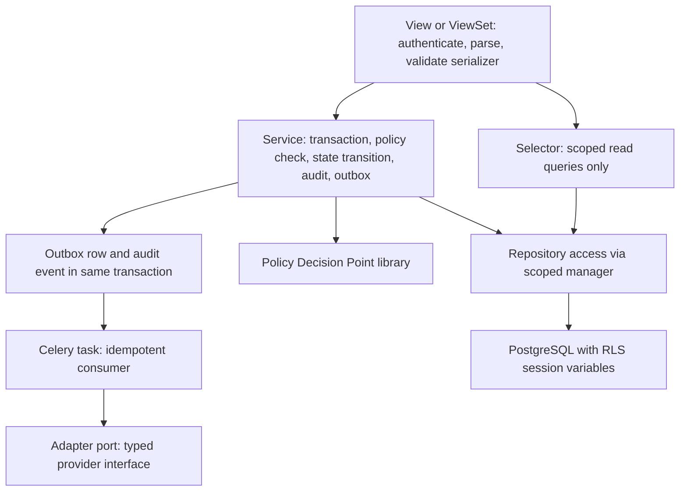
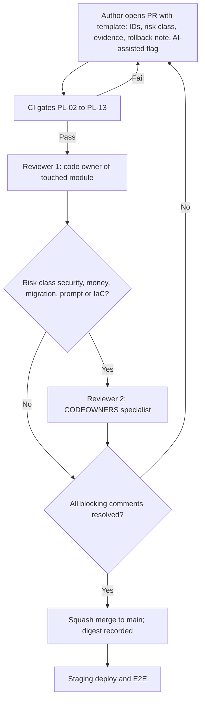

# AI Growth Engine: Employee Sales & Marketing Automation
## Application Blueprint: PART 4 (Batch 4.4a), Source Pack Review: Security, DevOps, Operations Enhancements and Coding Standards

| Field | Value |
|---|---|
| Document | Part 4, Batch 4.4a of 4.4a–4.4b (source-pack coverage review, group I) |
| Version | 1.0 · 27 Nov 2026 |
| Baseline | BRD, FRD (documents 01/02, byte-identical); Parts 0, 0A (DEC-001…065), 1, 2.1–2.5, 3.1–3.3, 4.1–4.3, 6.1, 8.1–8.2; source-pack documents 18, 25, 26, 27, 29, 30, 31, 32 and document 38 (OKPI numbering) |
| Roles applied | Security/Compliance Lead (lead for 18, 30), DevSecOps Lead (26, 27), SRE Lead (31, 32), Performance Engineer (29), Principal Engineer (25, coding standard author); QA Lead and Product Owner (review) |

**How to read Part 4.4.** Batch 4.4a holds the review evidence (§4.4.1–§4.4.4) and the new **coding standards, development guidelines and code-review guideline** (§4.4.5.1), which the blueprint lacked. Batch 4.4b holds the remaining enhancements to Parts 3.1, 4.1, 4.2, 4.3 and 8.2 (§4.4.5.2–§4.4.5.10), conflicts (§4.4.6), the persona review (§4.4.7), the tag register (§4.4.8) and the full quality gate (§4.4.9). Section numbers 4.4.x in this part are local to Part 4.4; references to Part 4.1's own §4.4 (Authorization) are written "Part 4.1 §4.4".

**Acronyms.** ACK acknowledgement · BOLA/BFLA broken object/function level authorization · CS coding standard · CR-CHK code-review checklist item · DTO data transfer object · DPL deployment procedure step · EVR evidence record (Part 6.1) · HO handover item · OKPI optimization KPI from source document 38 (renamed to avoid collision with business KPI-01…31) · OPT optimization control from source document 36 · PT penetration test · RGV release-gate validator rule · RoE rules of engagement · SIT system integration test · SMK smoke check · SVM security verification matrix · UAT user acceptance test · WP workload profile.

**Status of all content.** Everything added here is a proposed build-and-acceptance contract derived from the source pack. Nothing in this part claims that a test, deployment or penetration test has been executed (source docs 18–32, "no production approval is implied"; BRD §13.2, §16; BLK-11).

---

## 4.4.1 Documents reviewed

All eight documents were read line by line, and every table row was parsed by `assembly/source_pack/group_I/reconcile_I.py` (counts below). Each document repeats the pack's **common core** (purpose and operating boundary, current 147-interface scope, the five vertical business controls, completion/approval and the five-field evidence record). The common core is recorded once per document as "common core: see document 01/02 coverage" and is not re-listed.

| Doc | Title | Size (bytes / lines) | Headings / tables / table rows | Section list (domain-specific, in order) | What it is trying to tell | Atomic aspects |
|---|---|---|---|---|---|---|
| 18 | Security, Privacy, Compliance & Automation Governance | 38,031 / 417 | 56 / 8 / 50 | Authority and data protection; Threat model and governance controls; Capacity, reliability and recovery acceptance; Website/Admin operating contract; Website and portal threat model; Open-source supply chain; Security verification and incident response; Product security and governance controls; Threat-control implementation matrix; Optimization (OPT-01, 05-01, 19); 15 acceptance procedures (stated twice); Authorization-safe cache and numeric validation; Applicant draft boundary | The governance spine: who may do what, the nine threat classes, capacity and recovery targets, the public/portal/Admin contract, and that security and privacy gates override any optimization score | 81 |
| 25 | Coding Standards, Development Guidelines & Code Review | 32,400 / 363 | 81 / 4 / 19 | Repository and change discipline; Frontend engineering; Backend and persistence; AI and integration engineering; Review and definition of done; Code review rules and repository layout; Reference patterns (scoped lookup, React stale response, Decimal); Practical rules; Optimization (OPT-01, 02, 05, 07, 08, 09, 10, 13, 14, 16, 17); 9 acceptance procedures; Coding standards (current scope) | How code must be written and reviewed so that scope, money, idempotency and AI safety are correct by construction; generated code is untrusted | 54 |
| 26 | DevOps, CI/CD & Infrastructure Engineering | 26,106 / 296 | 61 / 4 / 19 | Deployment topology; Continuous integration (PR, build, SIT, staging/UAT); Continuous delivery and rollback (pre-deploy, order, canary, rollback, post-deploy); Infrastructure controls; Pipeline outline; Stage/failure table; Reference CI workflow; Reproducible CI rehearsal; Optimization (OPT-02, 03, 05, 06, 07, 16, 18); 7 acceptance procedures incl. fail-closed evidence inventory | Build once, promote an immutable digest, deploy in a fixed order with dispatch disabled, activate gradually, and roll back without replaying external effects | 39 |
| 27 | Environment, Configuration, Secrets & Dependency Management | 20,808 / 289 | 57 / 4 / 28 | Environment matrix (7 environments); Configuration contract (identity, persistence, execution, provider, observability, flags); Secrets and dependencies (lifecycle, developer access, locking, drift, recovery); Configuration table (15 variables); Rotation procedure; Environment manifest; Optimization; 5 acceptance procedures | Configuration is a typed, validated contract that fails closed; secrets are references; live effects are off by default outside production | 50 |
| 29 | Performance, Load, Scalability & Reliability Engineering | 29,324 / 418 | 69 / 5 / 45 | Workload and measurement (initial, growth, conditions, mix); Test scenarios (baseline, load, stress, spike, endurance, noisy neighbour, provider outage, recovery); Optimization and capacity; Scenario table; Test execution and k6 template; Optimization (OPT-02, 05, 06, 08, 09, 10); Mandatory measurable gates (25 rows); 11 acceptance procedures | Two workload profiles (initial and growth), reproducible measurement, and a gate table that must be met with measured evidence | 45 |
| 30 | Cybersecurity, Vulnerability Assessment & Penetration Testing | 25,776 / 317 | 56 / 5 / 31 | Authorization and test rules (scope, threat model, severity, evidence); Security verification matrix (12 areas); Assessment and remediation; Threat/asset procedure table; Authorized security test evidence matrix; Optimization; 6 acceptance procedures incl. evidence integrity; Cybersecurity scenario table | Only authorized, scoped, synthetic testing; business-impact severity; independent retest; critical isolation and financial findings are never waived | 45 |
| 31 | Product Monitoring, Observability, Incident & Support Management | 25,719 / 296 | 65 / 4 / 21 | Observability design (metrics, business signals, AI, tracing, tools); Alerts and triage (P1–P3, thresholds, budget); Incident runbooks (6); Support operations; Metric/alert table; Incident lifecycle; Operating signals; Optimization; Optimization-intelligence dashboards (7 dashboards, 19 operations, 25 persistence sources); 6 acceptance procedures | What to measure, when to alert, how to contain and recover, how support works, and that no SLA is claimed before measurement | 48 |
| 32 | Product Release, Go-Live, Rollback & Delivery Checklist | 29,211 / 463 | 66 / 7 / 62 | Pre-go-live gates (9); Deployment sequence (5); Rollback decision (5); Delivery package (4); Checkpoint table and no-go criteria; Go-live hard gates; Optimization; Mandatory gates (21); 7 acceptance procedures; Outstanding approval gates; Combined preflight (1,188 records); Release gates; UX-QC-01…10 | Go/no-go is evidence-driven and fail-closed; rollback never undoes external effects; delivery includes technical, business and access handover | 64 |
| — | OPT controls carried by the eight documents | — | — | 57 unique OPT-xx-yy controls (of the pack's 104) | Inventoried once (§4.4.4.1) instead of per document | 57 |
| | **Total** | **227,375 / 2,859** | **511 / 41 / 275** | | | **483** |

---

## 4.4.2 Coverage register summary

Status counts by document (generated from `final/coverage/I_coverage.csv` by `build_register_I.py`):

| Doc | Covered | Partially covered | Not covered | Conflict | Not applicable | Total |
|---|---|---|---|---|---|---|
| Doc 18 | 63 | 4 | 3 | 5 | 6 | 81 |
| Doc 25 | 23 | 22 | 4 | 1 | 4 | 54 |
| Doc 26 | 21 | 9 | 1 | 1 | 7 | 39 |
| Doc 27 | 14 | 23 | 8 | 1 | 4 | 50 |
| Doc 29 | 18 | 12 | 2 | 9 | 4 | 45 |
| Doc 30 | 33 | 4 | 3 | 1 | 4 | 45 |
| Doc 31 | 25 | 13 | 5 | 1 | 4 | 48 |
| Doc 32 | 32 | 19 | 8 | 1 | 4 | 64 |
| OPT controls (inventoried once) | 38 | 10 | 3 | 5 | 1 | 57 |
| **Total** | **267** | **116** | **37** | **25** | **38** | **483** |

**Reading the numbers.** 55% of aspects were already covered, mostly by Part 4.1 (security), Part 4.3 (DevOps) and Part 8.2 (go-live), often with stricter targets than the pack (for example C10 dashboard p95 800 ms against the pack's 2 s). The gaps cluster in five areas: (1) **coding standards and review** (doc 25: 26 of 54 aspects partial or missing); (2) **configuration contract and secret procedures** (doc 27: 31 of 50); (3) **workload profiles and measured gates** (doc 29: 23 of 45, nine of them conflicts with DEC-018/DEC-031); (4) **release evidence validation and delivery handover** (doc 32: 28 of 64); (5) **financial-exception and public-content runbooks and alerts** (doc 31). Every one of the 178 partial, not-covered and conflict aspects is listed individually in §4.4.3 and has an enhancement or a conflict entry.

---

## 4.4.3 Detailed coverage register

Every Partially covered, Not covered and Conflict aspect is listed individually. Covered and Not applicable aspects are grouped by section with their aspect numbers (the full row-level list, including covered items, is in `final/coverage/I_coverage.csv`).

#### 4.4.3.1 Document 18

| Aspect | Section | Aspect summary | Status | Blueprint location | Action | New IDs |
|---|---|---|---|---|---|---|
| I-18-023 | Threat model and governance controls | Unauthorized extraction: scope export, approve manifest hash, short-lived link, revoke | **Partially covered** | Part 2.4 exports; AL-35 | Export manifest hash approval added as rule | FR-ENH-I-012 |
| I-18-028 | Capacity, reliability and recovery acceptance | Owned startups / external tenants 25/10 initial, 50+/100 growth | **Conflict** | DEC-031 (40/10 Y1; 100/30 Y2) | Test workload profiles added; conflict raised | CONFLICT-461; WP-01, WP-02 |
| I-18-029 | Capacity, reliability and recovery acceptance | Concurrent staff sessions 50 / 250 | **Conflict** | DEC-031 internal users 60/200; Part 4.2 §4.25.3 | As above | CONFLICT-461; WP-01, WP-02 |
| I-18-030 | Capacity, reliability and recovery acceptance | Scoped opportunities 100,000 / 1,000,000 | **Not covered** | No opportunity-volume design point | Seeded volume added to workload profiles | WP-01, WP-02; LT-ENH-I-01 |
| I-18-031 | Capacity, reliability and recovery acceptance | Concurrent jobs 50/250; scheduled actions 10,000/100,000 per day | **Conflict** | Part 4.2 §4.25.3 (≈1,154 msgs/day Y1) | Adopted as stress workload; conflict raised | CONFLICT-461; LT-ENH-I-02 |
| I-18-034 | Capacity, reliability and recovery acceptance | Projection refresh ≤ 60 s | **Conflict** | NFR-008 (360 ≤ 60 s) vs NFR-047 (dashboards ≤ 15 min) | Conflict raised | CONFLICT-463 |
| I-18-035 | Capacity, reliability and recovery acceptance | Critical RPO ≤ 15 min; RTO ≤ 4 h initial, ≤ 2 h growth | **Conflict** | DEC-018; NFR-056/057 | Growth RTO conflict raised | CONFLICT-462 |
| I-18-036 | Capacity, reliability and recovery acceptance | Regenerable research data RPO ≤ 24 h / RTO ≤ 8 h | **Not covered** | No recovery class for regenerable data | Recovery class RC-2 added | GAP-462; FR-ENH-I-020 |
| I-18-043 | Website and confidential Admin operating contract | Emergency unpublish and revoke access without deleting authoritative evidence | **Partially covered** | RB-004; BRL-PUB | Public-content incident runbook added | RB-017 |
| I-18-044 | Open-source supply chain and external-service controls | SBOM, pinned versions, licence review incl. copyleft, network-use terms, separately licensed model weights | **Partially covered** | PL-09/PL-10; Part 4.1 §4.16.1; GL-L06 | Model-weight and network-use licence rule added | CS-DEP-04 |
| I-18-077 | Implementation acceptance and verification (15 procedures) | Authorization-safe cache key: product, tenant, startup, principal/grant fingerprint, permission, policy, model, knowledge revisions, normalized query | **Partially covered** | Part 3.1 §3.1.11 (scope + revision only) | Key composition standard added | CS-SEC-07; FR-ENH-I-010; RECOMMENDATION-467 |
| I-18-078 | Implementation acceptance and verification (15 procedures) | Numeric validation: reject invalid weights, non-finite inputs, negative counts, out-of-range ratios | **Not covered** | No numeric guardrail rule | Rule and tests added | CS-PY-09; FR-ENH-I-011; RECOMMENDATION-473 |

Covered and not-applicable aspects (grouped by section):

| Section | Aspect IDs | Status | Blueprint location (representative) |
|---|---|---|---|
| Purpose and operating boundary | 001 | Not applicable | Part 0 §0.1; Part 1; DEC-009 |
| Current design scope | 002 | Not applicable | Part 2.5; Part 3.2; Part 3.3 |
| Product-specific application / Business controls | 003 | Not applicable | Part 2.2 WF-08…WF-10; Part 2.3 BRL |
| Completion and approval / Acceptance and evidence record | 004 | Covered | Part 8.2 §8.2.4.2; Part 6.1 §6.1.5.4 EVR |
| Implementation, verification and delivery controls (preamble) | 005 | Not applicable | BRD §13.2, §16; BLK-11 |
| Initial startup configurations / technology principles | 006 | Not applicable | Part 1 §1.2; Part 3.1 §3.1.8 |
| Authority and data protection | 007, 008, 009, 010, 011, 012, 013, 014 | Covered | Part 2.3 R01, ABAC-01; DEC-065; Part 2.3 R02–R07; BRL-TEN-12; DEC-038; BRL-APR; DEC-064; Part 2.3 R12; SoD rules; DEC-056 SupportAccessGrant; BRL-TEN-09; Par… |
| Threat model and governance controls | 015, 016, 017, 018, 019, 020, 021, 022, 025, 026, 027 | Covered | Part 4.1 TB-09, NFR-031/032; Part 4.1 TB-04; Part 4.1 §4.15; NFR-005, ADR-023; Part 4.1 §4.6, RB-009, RB-013; BRL-AI-08, NFR-022, RB-005; Part 4.1 §4.11–4.12… |
| Threat model and governance controls | 024 | Not applicable | Investor product out of scope (DEC-009) |
| Capacity, reliability and recovery acceptance | 032, 033, 037 | Covered | Part 4.2 §4.24 C10 (800 ms p95, stricter); NFR-051, C6 (stricter); DEC-044; NFR-062 |
| Website and confidential Admin operating contract | 038, 039, 040, 041, 042 | Covered | NFR-001; Part 4.1 §4.1.3 trust zones; Part 3.2 namespaces; Part 4.1 §4.9; NFR-020; ADR-010; BRL-TEN-10; ARP-03/04; Part 3.1 §3.1.7.1; Part 4.1 TB-01, TB-02 |
| Open-source supply chain and external-service controls | 045, 046, 047, 048, 049 | Covered | PL-09/11; Part 4.1 §4.9; BRL-SRC; FR source policy; Part 4.1 §4.14; Part 4.1 §4.16; Part 6; BLK-1…BLK-4 |
| Product security and governance controls (table) | 050, 051, 052, 053, 054, 055 | Covered | Part 4.1 §4.1–4.4, §4.11, §4.17 |
| Threat-control implementation matrix | 056, 057, 058, 059, 060, 061 | Covered | Part 4.1 §4.8.2; NFR-001/032; Part 6 |
| Implementation acceptance and verification (15 procedures) | 062, 063, 064, 065, 066, 067, 068, 069, 070, 071, 072, 073, 074, 075, 076, 079 | Covered | NFR-003; AP-10; NFR-032; AP-10; NFR-050; DEC-064; BRL-AUT; EP-20; FR-W31…W34; NFR-015; ADR-022; Part 6.4 AIE; NFR-028; US-0101; BLK-9; NFR-001; NFR-095; DEC-… |
| Current scope: security and applicant draft | 080, 081 | Covered | DEC-019; ARP-05; Part 3.3 ENT-187 saas_application_draft; BRL-SVC-02; FRD §16.3 |

#### 4.4.3.2 Document 25

| Aspect | Section | Aspect summary | Status | Blueprint location | Action | New IDs |
|---|---|---|---|---|---|---|
| I-25-007 | Repository and change discipline | Acceptance: dependency graph proves no cross-product runtime import | **Partially covered** | NFR-085 (module contracts only) | Cross-product import contract added | CS-GEN-03; TC-ENH-I-001 |
| I-25-009 | Repository and change discipline | Emergency fixes follow same audit trail with expedited reviewer | **Partially covered** | Part 4.3 hotfix row | Expedited-review rule added | CS-REV-09 |
| I-25-010 | Repository and change discipline | AI-assisted coding: treat generated code as untrusted; never paste secrets/real records; no invented APIs | **Not covered** | None (B09 seats only) | AI-assisted coding policy added | CS-AIC-01…08; GAP-460 |
| I-25-011 | Frontend engineering | TypeScript strict; validate server payloads at boundaries; no any for business/financial fields; generated contracts | **Partially covered** | Part 4.3 PL-03; Part 3.1 Zod | Full TS standard | CS-TS-01…10 |
| I-25-012 | Frontend engineering | React: separate presentation, query hooks, mutation services; no side effects during render; cancel stale requests | **Partially covered** | NFR-027; Part 3.1 TanStack Query | Full React standard | CS-RE-01…12 |
| I-25-013 | Frontend engineering | Component tests cover loading, error, denied and empty states | **Partially covered** | Part 2.5 UI states | Test rule added | CS-TEST-06 |
| I-25-014 | Frontend engineering | Scope-aware query keys (product, tenant, startup, audience, filters, identity); clear caches on switch/logout; no private payload in service worker | **Partially covered** | NFR-027; FR-UIS-01 | Query-key standard added | CS-RE-04…06 |
| I-25-015 | Frontend engineering | Forms: client validation for UX, server for authority; sanitize rich content; disable duplicate submit; show approval requirement | **Partially covered** | Part 2.5 forms | Form standard added | CS-RE-08…10 |
| I-25-017 | Backend and persistence | Python: type hints, explicit DTOs, narrow exceptions, Ruff; no silent catch-all | **Partially covered** | Part 4.3 tooling row | Python standard | CS-PY-01…10 |
| I-25-018 | Backend and persistence | Django: views authenticate/validate; service owns transaction and transition; selectors enforce scope; no logic only in UI or signals | **Not covered** | Not specified | Service/selector layering standard | CS-DJ-01…10 |
| I-25-019 | Backend and persistence | DRF: allowlist fields, deny by default, scope queryset before lookup, bounded pagination, validated sort/filter, safe error + correlation ID | **Partially covered** | NFR-015; PL-05 __all__ ban | DRF standard | CS-API-01…12 |
| I-25-027 | Review and definition of done | Reviewer examines acceptance, role, scope, finance, error paths, schema, tests, cost, rollback; record tradeoffs | **Partially covered** | Part 4.3 §4.32.2 checklist | Full review checklist by risk class | CR-CHK-01…40 |
| I-25-028 | Review and definition of done | Changed-line coverage ≥ 80% on eligible domain code; critical decision branches tested; generated code excluded only with approval | **Conflict** | NFR-082 (overall coverage) | Diff-coverage gate added; conflict raised | CONFLICT-468; CS-TEST-03 |
| I-25-029 | Review and definition of done | Completion: merge only after UI/API/table links updated, evidence attached, operational impact assessed | **Partially covered** | Part 5 DoD | DoD code addendum | CS-REV-12 |
| I-25-031 | Code review rules and repository layout (table) | Frontend lead: strict TS, accessible, scoped keys, abort stale, no browser credentials | **Partially covered** | As above | Standard | CS-TS, CS-RE |
| I-25-032 | Code review rules and repository layout (table) | Backend lead: small services, serializer validation, authorization in service, transaction/outbox, deterministic errors | **Partially covered** | As above | Standard | CS-DJ |
| I-25-034 | Code review rules and repository layout (table) | Tech lead review: scope, security, failure modes, migrations, unit/SIT, maintainability; no AI code merged without human review | **Partially covered** | Part 4.3 §4.32.2 | Standard | CS-REV, CS-AIC |
| I-25-036 | Reference code patterns | Correct scoped lookup pattern (membership check then filtered get) | **Partially covered** | ARP-02 principle only | Pattern P-01 with negative example | P-01 |
| I-25-037 | Reference code patterns | React stale-response protection with AbortController and live flag | **Not covered** | Not specified | Pattern P-02 | P-02 |
| I-25-038 | Reference code patterns | Safe financial arithmetic with Decimal; validate currency, entity, provider reference | **Partially covered** | ADR-030 | Pattern P-03 | P-03 |
| I-25-042 | Practical implementation rules (code acceptance table) | PostgreSQL: composite scoped FKs, unique idempotency keys, numeric money, no cascade deleting posted records | **Partially covered** | NFR-017/018 | No-cascade rule added | CS-SQL-07 |
| I-25-044 | Practical implementation rules (code acceptance table) | Review: run lint/type/unit/integration in actual repos; review generated code, deps, scope, concurrency, rollback | **Partially covered** | Part 4.3 §4.33 | Review checklist | CR-CHK |
| I-25-046 | Implementation acceptance procedures (9) | Query and rendering efficiency (query count, EXPLAIN ANALYZE, React profiler) | **Partially covered** | Part 3.1 lever 1 | Added | CS-PERF-01…08; TC-ENH-I-003 |
| I-25-048 | Implementation acceptance procedures (9) | Shared library boundaries (wrong product config) | **Partially covered** | NFR-031 | Added | TC-ENH-I-002 |
| I-25-049 | Implementation acceptance procedures (9) | Repository and modular boundaries (owner, tests, public interface) | **Partially covered** | NFR-085 | Added | CS-GEN-04 |
| I-25-053 | Implementation acceptance procedures (9) | AI-assisted coding quality | **Not covered** | — | Added | CS-AIC; TC-ENH-I-004 |
| I-25-054 | Current scope: coding standards | Typed dynamic forms and explicit capability predicates; no hardcoded startup position; safe rendering | **Partially covered** | FR config-driven forms (CFG) | Rule added | CS-RE-11; CS-GEN-06 |

Covered and not-applicable aspects (grouped by section):

| Section | Aspect IDs | Status | Blueprint location (representative) |
|---|---|---|---|
| Purpose and operating boundary | 001 | Not applicable | Part 0 §0.1; Part 1; DEC-009 |
| Current design scope | 002 | Not applicable | Part 2.5; Part 3.2; Part 3.3 |
| Product-specific application / Business controls | 003 | Not applicable | Part 2.2 WF-08…WF-10; Part 2.3 BRL |
| Completion and approval / Acceptance and evidence record | 004 | Covered | Part 8.2 §8.2.4.2; Part 6.1 §6.1.5.4 EVR |
| Implementation, verification and delivery controls (preamble) | 005 | Not applicable | BRD §13.2, §16; BLK-11 |
| Repository and change discipline | 006, 008 | Covered | Part 4.3 §4.32.1 ADR-060; import-linter; Part 4.3 §4.32.2 |
| Frontend engineering | 016 | Covered | NFR-088/089; Part 2.5 §2.46 |
| Backend and persistence | 020, 021, 022 | Covered | NFR-017; Part 3.3; ARP-03; NFR-006, NFR-025; ADR-023; NFR-016, NFR-026; DEC-050 |
| AI and integration engineering | 023, 024, 025, 026 | Covered | Part 7.2 agent specs; BRL-AI-09; ADR-041; Part 4.1 §4.15; ADR-009; ARP-06; Part 4.3 §4.39.1; NFR-078 |
| Code review rules and repository layout (table) | 030, 033, 035 | Covered | Part 4.3 §4.32.1 (equivalent monorepo layout); NFR-017; Part 4.3 §4.33.2 PL-02…PL-11 |
| Reference code patterns | 039 | Covered | BLK-6; FRD §12.1 worked example |
| Practical implementation rules (code acceptance table) | 040, 041, 043 | Covered | NFR-001; NFR-027; NFR-025; ARP-02/03; ARP-08; BRL-AI-07 |
| Implementation acceptance procedures (9) | 045, 047, 050, 051, 052 | Covered | NFR-021; PL-09; NFR-005; ADR-023; ADR-009, ADR-027; Part 2.5 §2.45; RECOMMENDATION-017 |

#### 4.4.3.3 Document 26

| Aspect | Section | Aspect summary | Status | Blueprint location | Action | New IDs |
|---|---|---|---|---|---|---|
| I-26-008 | Deployment topology | Separate research, AI, communication, financial and priority control queues; one scheduler per scope; prefetch/limits; bounded retries | **Conflict** | ADR-021 (no finance or control queue; prefetch not set) | Queue additions proposed | CONFLICT-473; FR-ENH-I-030 |
| I-26-012 | Continuous integration | SIT: ephemeral PostgreSQL/Valkey, migrations, synthetic fixtures, API contracts, workflow/browser integration, stub providers | **Partially covered** | PL-06/07/15 (named CI/test) | SIT stage mapping added | §4.4.5.2 table; CONFLICT-471 |
| I-26-014 | Continuous delivery and rollback | Pre-deploy: capacity, compatibility, backup point, migration plan, flags, on-call, approval; freeze conflicting changes; signed go/no-go | **Partially covered** | PL-17 (no freeze, no on-call check) | Pre-deploy checklist added | DPL-PRE-01…10 |
| I-26-015 | Continuous delivery and rollback | Deploy order: expand schema, validate, API, workers/scheduler, Admin and website separately, smoke before automation | **Partially covered** | PL-18 (order not stated) | Ordered deployment runbook | DPL-SEQ-01…09 |
| I-26-016 | Continuous delivery and rollback | Canary: limited internal/approved cohort; compare error, latency, queue lag, invariants; operator approves widening | **Partially covered** | ADR-053 blue/green at scale only | Cohort canary for activation | RECOMMENDATION-461; DPL-CAN |
| I-26-018 | Continuous delivery and rollback | Post-deploy: role-based smoke, publication check, queue drain, reconciliation, budget verification, observation window | **Partially covered** | PL-19 (30 min SLO watch) | Smoke catalogue added | SMK-01…14 |
| I-26-021 | Infrastructure controls | Capacity: requests/limits; autoscale on latency and queue age; protect priority queues; per-tenant caps | **Partially covered** | Part 4.2 §4.27 (manual triggers) | Queue-age scaling rule added | FR-ENH-I-031 |
| I-26-024 | Pipeline outline and delivery table | Activation stage: explicit owner/CTO approval; enable gradually within approved budgets; stop on gate failure | **Partially covered** | Part 8.2 GL-B04 (charter) | Activation stage added | DPL-ACT-01…06 |
| I-26-032 | Implementation acceptance procedures (7) | Load test reproducibility (pin dataset, commit, mix, ramp, warmup, error budget) | **Partially covered** | Part 4.2 §4.26 | Load-test record template | LTR-01…14 |
| I-26-037 | Implementation acceptance procedures (7) | Fail-closed evidence inventory (required-ID list, reject missing/extra/duplicate, mandatory N/A) | **Not covered** | A090 evidence assembly (no validator rules) | Release gate validator specified | RGV-01…14; GAP-463 |
| I-26-038 | Implementation acceptance procedures (7) | Resource and deployment approval: incremental effort estimate per change; approval before cost/SLA promise | **Partially covered** | Part 8.2 §8.2.2.4 change control | Rule restated | DPL-PRE-10 |

Covered and not-applicable aspects (grouped by section):

| Section | Aspect IDs | Status | Blueprint location (representative) |
|---|---|---|---|
| Purpose and operating boundary | 001 | Not applicable | Part 0 §0.1; Part 1; DEC-009 |
| Current design scope | 002 | Not applicable | Part 2.5; Part 3.2; Part 3.3 |
| Product-specific application / Business controls | 003 | Not applicable | Part 2.2 WF-08…WF-10; Part 2.3 BRL |
| Completion and approval / Acceptance and evidence record | 004 | Covered | Part 8.2 §8.2.4.2; Part 6.1 §6.1.5.4 EVR |
| Implementation, verification and delivery controls (preamble) | 005 | Not applicable | BRD §13.2, §16; BLK-11 |
| Deployment topology | 006, 007, 009 | Covered | NFR-001; ADR-006; Part 3.1 §3.1.6; Part 4.3 §4.34; ADR-012/051 |
| Continuous integration | 010, 011, 013 | Covered | PL-02…PL-09; PL-10/11; Part 3.1 §3.1.14; PL-14 |
| Continuous delivery and rollback | 017 | Covered | Part 4.3 §4.38; RB-012 |
| Infrastructure controls | 019, 020, 022 | Covered | Part 4.1 §4.9; GL-S07; ADR-026/050; PL-17; Part 4.3 §4.47 |
| Pipeline outline and delivery table | 023 | Covered | Part 4.3 §4.33.3 |
| Pipeline outline and delivery table | 025, 026 | Not applicable | Pack reference asset only; Pack assets |
| Reproducible CI and isolated rehearsal (table) | 027 | Not applicable | Part 4.3 §4.33–4.38 |
| Reproducible CI and isolated rehearsal (table) | 028, 029, 030, 031 | Covered | Part 4.3 §4.33–4.38 |
| Implementation acceptance procedures (7) | 033, 034, 035, 036, 039 | Covered | DEC-040; Part 3.1 §3.1.12; Part 4.3 §4.37.2; PL-07; PL-10/11/14; Part 4.3 §4.34; PL-15; Part 8.2 |

#### 4.4.3.4 Document 27

| Aspect | Section | Aspect summary | Status | Blueprint location | Action | New IDs |
|---|---|---|---|---|---|---|
| I-27-007 | Environment matrix | Shared development: integration branch, separate identities, limited quotas | **Conflict** | Not provided (trunk-based) | Environment mapping added | CONFLICT-471; ENV matrix |
| I-27-008 | Environment matrix | SIT: pinned artifact, isolated DB, fake/sandbox callbacks, repeatable reset | **Partially covered** | test/CI env | Environment mapping added | CONFLICT-471; ENV matrix |
| I-27-009 | Environment matrix | UAT: business users, sandbox channels, approved test identities | **Partially covered** | staging | Environment mapping added | CONFLICT-471; ENV matrix |
| I-27-012 | Environment matrix | Recovery: isolated recovery environment; no dispatch until reconciliation and restart | **Partially covered** | Part 4.3 backup restore sandbox | Environment mapping added | CONFLICT-471; ENV matrix |
| I-27-013 | Configuration contract | Identity config: PRODUCT_ID, APP_ENV, WEBSITE_ORIGIN, ADMIN_ORIGIN, OAUTH_ISSUER, WEBSITE_AUDIENCE, ADMIN_AUDIENCE; fail closed | **Not covered** | Parameter Store paths only | Config contract catalogue | ENV-01…07; GAP-461 |
| I-27-014 | Configuration contract | Persistence refs: DATABASE_URL, BROKER_URL, OBJECT_BUCKET, VECTOR_NAMESPACE as secret refs/scoped IDs, never frontend | **Partially covered** | Part 4.1 §4.6.1 | Catalogue | ENV-08…11 |
| I-27-015 | Configuration contract | Execution: AUTOMATION_ENABLED false in nonprod; PAID_FALLBACK_ENABLED false; timeout, retry, budget ceilings | **Partially covered** | Flags (Part 4.3 §4.36) OFF by default | Catalogue | ENV-12…16 |
| I-27-017 | Configuration contract | Observability config: LOG_LEVEL, OTEL endpoint, redaction rules, alert destination | **Partially covered** | Part 4.3 §4.39 | Catalogue | ENV-17…20 |
| I-27-020 | Secrets and dependencies | Developer access: temporary env-specific with MFA; no shared credentials; revoke on departure; monthly review | **Partially covered** | SC-48 (no standing DB access) | Access review procedure | GAP-469; ACC-01…07 |
| I-27-021 | Secrets and dependencies | Dependency locking incl. container digest, migration compatibility, model/prompt revision; licence and vuln at change | **Partially covered** | uv/pnpm lockfiles; PL-09 | Model/prompt revision pinned in release manifest | CS-DEP-01…08 |
| I-27-022 | Secrets and dependencies | Config drift: schema validation at startup; deployed non-secret config hash vs approved manifest | **Partially covered** | IaC drift only (AL-47) | Config-hash drift check | FR-ENH-I-040; AL-55; RECOMMENDATION-468 |
| I-27-023 | Secrets and dependencies | Recovery: restore secret references and config from protected inventory; no secrets in backup notes | **Partially covered** | Part 3.1 §3.1.13.2 secrets row | Recovery step added | ENV recovery rule |
| I-27-024 | Configuration table (15 variables) | APP_PRODUCT=commercial immutable | **Not covered** | Part 4.1 §4.6; Part 3.1 §3.1.14 | Catalogue row | ENV-01…24 |
| I-27-025 | Configuration table (15 variables) | APP_ENV local/dev/SIT/UAT/staging/prod | **Not covered** | Part 4.1 §4.6; Part 3.1 §3.1.14 | Catalogue row | ENV-01…24 |
| I-27-026 | Configuration table (15 variables) | DATABASE_URL secret reference | **Partially covered** | Part 4.1 §4.6; Part 3.1 §3.1.14 | Catalogue row | ENV-01…24 |
| I-27-027 | Configuration table (15 variables) | SECRET_MANAGER_REF | **Not covered** | Part 4.1 §4.6; Part 3.1 §3.1.14 | Catalogue row | ENV-01…24 |
| I-27-028 | Configuration table (15 variables) | ADMIN_AUDIENCE rejects external identity | **Partially covered** | Part 4.1 §4.6; Part 3.1 §3.1.14 | Catalogue row | ENV-01…24 |
| I-27-029 | Configuration table (15 variables) | PORTAL_AUDIENCE rejects staff privileges | **Partially covered** | Part 4.1 §4.6; Part 3.1 §3.1.14 | Catalogue row | ENV-01…24 |
| I-27-030 | Configuration table (15 variables) | ALLOWED_HOSTS verified, no wildcard | **Partially covered** | Part 4.1 §4.6; Part 3.1 §3.1.14 | Catalogue row | ENV-01…24 |
| I-27-031 | Configuration table (15 variables) | EXTERNAL_DISPATCH_ENABLED false | **Partially covered** | Part 4.1 §4.6; Part 3.1 §3.1.14 | Catalogue row | ENV-01…24 |
| I-27-032 | Configuration table (15 variables) | PAID_FALLBACK_ENABLED false | **Partially covered** | Part 4.1 §4.6; Part 3.1 §3.1.14 | Catalogue row | ENV-01…24 |
| I-27-033 | Configuration table (15 variables) | WORKER_QUEUE_PREFIX per product/env | **Not covered** | Part 4.1 §4.6; Part 3.1 §3.1.14 | Catalogue row | ENV-01…24 |
| I-27-034 | Configuration table (15 variables) | OBJECT_STORE_REF / VECTOR_STORE_REF | **Partially covered** | Part 4.1 §4.6; Part 3.1 §3.1.14 | Catalogue row | ENV-01…24 |
| I-27-035 | Configuration table (15 variables) | PROVIDER_SECRET_REF | **Partially covered** | Part 4.1 §4.6; Part 3.1 §3.1.14 | Catalogue row | ENV-01…24 |
| I-27-036 | Configuration table (15 variables) | MAX_REQUEST_BYTES / RATE_LIMIT | **Partially covered** | Part 4.1 §4.6; Part 3.1 §3.1.14 | Catalogue row | ENV-01…24 |
| I-27-037 | Configuration table (15 variables) | LOG_REDACTION_POLICY | **Not covered** | Part 4.1 §4.6; Part 3.1 §3.1.14 | Catalogue row | ENV-01…24 |
| I-27-038 | Configuration table (15 variables) | RECOVERY_TARGETS | **Not covered** | Part 4.1 §4.6; Part 3.1 §3.1.14 | Catalogue row | ENV-01…24 |
| I-27-039 | Configuration table (15 variables) | Rotation procedure (inventory → issue → stage/test → atomic switch → revoke → verify; compromise → disable dispatch) | **Partially covered** | Part 4.1 §4.6.2 (cadence only) | Step procedure | SEC-ROT-01…08 |
| I-27-040 | Environment manifest and rotation (table) | Required config incl. automation_enabled=false | **Partially covered** | ABAC-12; Part 4.1 §4.6 | Covered by ENV/SEC-ROT | ENV, SEC-ROT |
| I-27-042 | Environment manifest and rotation (table) | Dependency control incl. model artefacts | **Partially covered** | ABAC-12; Part 4.1 §4.6 | Covered by ENV/SEC-ROT | ENV, SEC-ROT |
| I-27-043 | Environment manifest and rotation (table) | Rotation create/validate/deploy/verify/revoke/audit | **Partially covered** | ABAC-12; Part 4.1 §4.6 | Covered by ENV/SEC-ROT | ENV, SEC-ROT |
| I-27-045 | Implementation acceptance procedures (5) | Dependency and technical debt inventory (owner, remediation date) | **Not covered** | No tech-debt register | Tech-debt register | CS-DOC-05; TDR fields; RECOMMENDATION-472 |

Covered and not-applicable aspects (grouped by section):

| Section | Aspect IDs | Status | Blueprint location (representative) |
|---|---|---|---|
| Purpose and operating boundary | 001 | Not applicable | Part 0 §0.1; Part 1; DEC-009 |
| Current design scope | 002 | Not applicable | Part 2.5; Part 3.2; Part 3.3 |
| Product-specific application / Business controls | 003 | Not applicable | Part 2.2 WF-08…WF-10; Part 2.3 BRL |
| Completion and approval / Acceptance and evidence record | 004 | Covered | Part 8.2 §8.2.4.2; Part 6.1 §6.1.5.4 EVR |
| Implementation, verification and delivery controls (preamble) | 005 | Not applicable | BRD §13.2, §16; BLK-11 |
| Environment matrix | 006, 010, 011 | Covered | Part 3.1 §3.1.14 local; staging; prod |
| Configuration contract | 016, 018 | Covered | Part 4.1 §4.6; Part 4.3 §4.36 |
| Secrets and dependencies | 019 | Covered | Part 4.1 §4.6.2 |
| Environment manifest and rotation (table) | 041, 044 | Covered | ABAC-12; Part 4.1 §4.6 |
| Implementation acceptance procedures (5) | 046, 047, 048, 049, 050 | Covered | NFR-050; NFR-021; BLK-9; PL-10; Part 4.1 §4.6.1; A112 |

#### 4.4.3.5 Document 29

| Aspect | Section | Aspect summary | Status | Blueprint location | Action | New IDs |
|---|---|---|---|---|---|---|
| I-29-006 | Workload and measurement | Initial capacity workload (25+10, 50 staff, 100k opps, 50 jobs, 10k actions/day) | **Conflict** | DEC-031 | Workload profile WP-01 | CONFLICT-461; WP-01 |
| I-29-007 | Workload and measurement | Growth capacity workload (50+/100, 250 staff, 1m opps, 250 jobs, 100k/day) | **Conflict** | DEC-031 | Workload profile WP-02 | CONFLICT-461; WP-02 |
| I-29-008 | Workload and measurement | Measurement conditions: indexed dashboard excludes live research; ACK after durable acceptance; record dataset, hardware, cache, mix, stubs | **Partially covered** | Part 4.2 §4.21 | Load-test record template | LTR-01…14 |
| I-29-009 | Workload and measurement | Traffic mix 60% list/filter, 20% details, 10% safe writes, 10% background status; public separate | **Conflict** | Part 4.2 LT-01 70/15/10/5 | Profile adopted for dashboard test | CONFLICT-466; WP-03 |
| I-29-010 | Test scenarios | Baseline: single user, one worker, cold/warm cache, SQL and trace | **Not covered** | No baseline scenario | Added | LT-ENH-I-03 |
| I-29-011 | Test scenarios | Load: ramp to initial then growth, hold 30 min each | **Partially covered** | LT-01 30 min at Y1 | Added | LT-ENH-I-01, -02 |
| I-29-013 | Test scenarios | Spike: 3× baseline public enquiries and callbacks | **Conflict** | Burst 2× in same doc; LT-05/07 | Conflict raised | CONFLICT-465; LT-ENH-I-04 |
| I-29-014 | Test scenarios | Endurance: 8-hour soak at initial target; memory, connections, bloat, queue age | **Conflict** | LT-02 4 h; GL-T04 24 h/72 h | Conflict raised | CONFLICT-467; LT-ENH-I-05 |
| I-29-017 | Test scenarios | Recovery: restore DB, replay outbox in dispatch-off mode; RPO/RTO and reconciliation | **Partially covered** | CH-03; RB-007 (no dispatch-off replay) | Dispatch-off replay step | LT-ENH-I-06; RB-007 addendum |
| I-29-019 | Optimization and capacity | Database: EXPLAIN ANALYZE, index tenant/startup/stage/time/cursor, N+1, lock waits | **Partially covered** | Part 3.3 indexes; lever 1 | Perf coding rules | CS-PERF-01…08 |
| I-29-020 | Optimization and capacity | Workers: queue age, throughput, retry, latency, per-tenant fairness; tune concurrency/prefetch | **Partially covered** | Part 4.3 metrics | Prefetch rule and queue-age metric | CS-WRK-08; AL-51 |
| I-29-023 | Delivery-control scenario table (7 rows) | Burst: 2× approved short burst; bounded 429/queue; recover to baseline | **Partially covered** | LT-05, LT-07 | Burst acceptance | LT-ENH-I-04 |
| I-29-024 | Delivery-control scenario table (7 rows) | Endurance 8 h; no leak, no backlog; budgets reconcile | **Conflict** | LT-02 4 h | See CONFLICT-467 | LT-ENH-I-05 |
| I-29-025 | Delivery-control scenario table (7 rows) | Projection: committed event to visible timestamp ≤ 60 s | **Conflict** | NFR-047 | See CONFLICT-463 |  |
| I-29-030 | Workload and performance test execution (table) | k6 staging read-only script with explicit nonprod URL and synthetic token; never production | **Partially covered** | Part 4.2 load tooling | Safety guard rules | LT-SAFE-01…05 |
| I-29-031 | Workload and performance test execution (table) | Evidence: workload, DB row count, latency distribution, errors, resources, config digest | **Partially covered** | Release record | Load-test record template | LTR-01…14 |
| I-29-032 | Mandatory measurable gates (25 rows) | Gate table of 25 metrics with target and verification context | **Partially covered** | Spread across NFR/KPI/SLO; no single OKPI register | OKPI register mapped | §4.4.4.2; RECOMMENDATION-470 |
| I-29-033 | Implementation acceptance procedures (11) | Dashboard latency at 50/250 staff, 100k/1m opportunities | **Conflict** | C10 | Added | LT-ENH-I-01/02 |
| I-29-036 | Implementation acceptance procedures (11) | Query and rendering efficiency | **Partially covered** | — | Added | CS-PERF |
| I-29-037 | Implementation acceptance procedures (11) | Load test reproducibility | **Partially covered** | §4.26 | Added | LTR |
| I-29-038 | Implementation acceptance procedures (11) | Availability and error budget: eligible minutes, exclusions, zero denominator unassessed | **Partially covered** | Part 4.2 §4.21 | Added | FR-ENH-I-050 |
| I-29-039 | Implementation acceptance procedures (11) | Numeric guardrail validation (NaN, infinity, negatives) | **Not covered** | — | Added | FR-ENH-I-011; TC-ENH-I-020 |
| I-29-040 | Implementation acceptance procedures (11) | Growth workload matrix | **Conflict** | DEC-031 | Added | WP-02 |

Covered and not-applicable aspects (grouped by section):

| Section | Aspect IDs | Status | Blueprint location (representative) |
|---|---|---|---|
| Purpose and operating boundary | 001 | Not applicable | Part 0 §0.1; Part 1; DEC-009 |
| Current design scope | 002 | Not applicable | Part 2.5; Part 3.2; Part 3.3 |
| Product-specific application / Business controls | 003 | Not applicable | Part 2.2 WF-08…WF-10; Part 2.3 BRL |
| Completion and approval / Acceptance and evidence record | 004 | Covered | Part 8.2 §8.2.4.2; Part 6.1 §6.1.5.4 EVR |
| Implementation, verification and delivery controls (preamble) | 005 | Not applicable | BRD §13.2, §16; BLK-11 |
| Test scenarios | 012, 015, 016 | Covered | Part 6.1 LT-08; LT-11; NFR-062; CH-01; RB-001 |
| Optimization and capacity | 018, 021, 022 | Covered | NFR-042/043; Part 7.3; NFR-030; Part 4.3 §4.46.6; Part 4.2 §4.27 |
| Delivery-control scenario table (7 rows) | 026, 027, 028 | Covered | CH-02; NFR-007; Part 4.3 §4.39.2; PL-16; Part 6.1 |
| Workload and performance test execution (table) | 029 | Covered | LT-01 < 0.5% (stricter) |
| Implementation acceptance procedures (11) | 034, 035, 041, 042, 043, 044, 045 | Covered | NFR-042; C6; NFR-051; LT-11; NFR-089; Part 4.3 §4.41; NFR-078; Part 8.2 §8.2.2.4; RECOMMENDATION-017 seeds; NFR-015 |

#### 4.4.3.6 Document 30

| Aspect | Section | Aspect summary | Status | Blueprint location | Action | New IDs |
|---|---|---|---|---|---|---|
| I-30-006 | Authorization and test rules | Written authorization: hosts, environments, identities, techniques, time window; staging/synthetic only | **Not covered** | Part 4.1 §4.16.2 scope only | Rules of engagement | PT-ROE-01…12; GAP-466 |
| I-30-008 | Authorization and test rules | Severity: Critical = confidential disclosure, financial integrity, production credential, uncontrolled dispatch | **Conflict** | Part 4.1 §4.16.3 CVSS-based | Business-impact overlay | CONFLICT-472 |
| I-30-009 | Authorization and test rules | Evidence: minimal redacted request/response, build, env, role, expected/observed; no secrets | **Partially covered** | EVR (Part 6.1) | Finding record template | PT-FND-01…14 |
| I-30-022 | Assessment and remediation | Tooling: ZAP in staging, dependency scanners, secret scan, SAST, manual role/object tests; record tool version, scope, false positives | **Partially covered** | Part 4.1 §4.16.1 (no false-positive review record) | Finding record fields | PT-FND |
| I-30-033 | Threat/asset verification table (8 rows) | Testing only in nonproduction or scoped pen-test; never attack third parties or use real records | **Partially covered** | Part 4.1 §4.16.2 out-of-scope list | RoE rules | PT-ROE |
| I-30-034 | Authorized security test evidence matrix (5 rows) | Scope documented (date, tester, exclusions) | **Not covered** | Part 4.1 §4.8.2 | RoE / SVM | PT-ROE; SVM |
| I-30-044 | Implementation acceptance procedures (6) | Evidence integrity: reject missing controls, duplicates, mandatory N/A, blank evidence, executor = reviewer; verify hashes | **Not covered** | EVR independence rule only | Validator rules | RGV-01…14 |
| I-30-045 | Current scope: cybersecurity scenario table (UX-QC-01…10 duplicate) | Ten scenario rows (scope onboarding … accessibility navigation) | **Partially covered** | Part 6 TCs (partial) | See doc 32 UX-QC mapping | §4.4.4.5 |

Covered and not-applicable aspects (grouped by section):

| Section | Aspect IDs | Status | Blueprint location (representative) |
|---|---|---|---|
| Purpose and operating boundary | 001 | Not applicable | Part 0 §0.1; Part 1; DEC-009 |
| Current design scope | 002 | Not applicable | Part 2.5; Part 3.2; Part 3.3 |
| Product-specific application / Business controls | 003 | Not applicable | Part 2.2 WF-08…WF-10; Part 2.3 BRL |
| Completion and approval / Acceptance and evidence record | 004 | Covered | Part 8.2 §8.2.4.2; Part 6.1 §6.1.5.4 EVR |
| Implementation, verification and delivery controls (preamble) | 005 | Not applicable | BRD §13.2, §16; BLK-11 |
| Authorization and test rules | 007 | Covered | Part 4.1 §4.2 |
| Security verification matrix (12 rows) | 010, 011, 012, 013, 014, 015, 016, 017, 018, 019, 020, 021 | Covered | Part 4.1 §4.8, §4.16; Part 6 TCs |
| Assessment and remediation | 023, 024 | Covered | BLK-1/4; Part 6.1; BLK rows; GL-S03 |
| Threat/asset verification table (8 rows) | 025, 026, 027, 028, 029, 030, 031, 032 | Covered | Part 4.1; BLK-1…5; Part 4.3 §4.47 tabletop; RB-004/008/013 |
| Authorized security test evidence matrix (5 rows) | 035, 036, 037, 038 | Covered | Part 4.1 §4.8.2; NFR-072; GL-S03 |
| Implementation acceptance procedures (6) | 039, 040, 041, 042, 043 | Covered | Part 6.4; NFR-003/032/050 |

#### 4.4.3.7 Document 31

| Aspect | Section | Aspect summary | Status | Blueprint location | Action | New IDs |
|---|---|---|---|---|---|---|
| I-31-007 | Observability design | Business signals: eligible opportunities, dispatch outcome, follow-up due, objection escalation, approvals, verified closure | **Partially covered** | RP-xx reports; metrics catalogue | Business signal metrics | MET-07…12 |
| I-31-014 | Alerts and triage | Thresholds: p95 over target 10 min; 5xx > 2% 5 min; projection lag > 60 s; integrity event immediate | **Partially covered** | AL-04/05 (15 min), AL-06 | Projection-lag alert added | AL-52 |
| I-31-019 | Incident runbooks | Financial exception runbook (quarantine, stop closure, finance verifies, append correction) | **Not covered** | No RB for financial mismatch | RB-016 added | RB-016; GAP-465 |
| I-31-020 | Incident runbooks | Public content incident runbook (unpublish, purge, retain audit, approve replacement) | **Not covered** | No RB | RB-017 added | RB-017; GAP-465 |
| I-31-022 | Support operations | Intake: ticket with product, tenant, role, issue, severity, redacted evidence; verify caller authority | **Partially covered** | §4.45 (caller authority not stated) | Caller verification step | SUP-01…05 |
| I-31-025 | Support operations | Review cadence: daily critical queue, weekly incident trends, monthly SLA/cost/quality | **Partially covered** | Monthly ops review; FinOps cadence | Cadence table | SUP-06…08 |
| I-31-027 | Metric/alert table (8 rows) | Error ratio 5xx > 1% for 10 min | **Conflict** | AL-06 > 2% for 5 min | Two-tier alert | CONFLICT-464; AL-50 |
| I-31-028 | Metric/alert table (8 rows) | Queue age: oldest eligible ready job > 5 min for 5 min | **Partially covered** | AL-07 outbox oldest > 5 min; AL-27 | Per-queue age alert | AL-51 |
| I-31-029 | Metric/alert table (8 rows) | Budget hard limit breached or negative remaining → immediate dispatch stop | **Partially covered** | AL-14 (no negative-remaining check) | Negative remaining alert | AL-53 |
| I-31-031 | Metric/alert table (8 rows) | Financial mismatch: duplicate/unmatched/wrong issuer/currency/unreconciled callback → freeze | **Not covered** | No alert rule | AL-56 + RB-016 | AL-56 |
| I-31-036 | Operating signals table (5 rows) | Queue/outbox: oldest age, repeated failure, uncertain, duplicate event, exhausted budget | **Partially covered** | Part 4.3 §4.41, §4.43 | Added | AL-57 |
| I-31-037 | Operating signals table (5 rows) | Confidentiality: foreign access or secret/PII in logs → stop feature | **Partially covered** | Part 4.3 §4.41, §4.43 | Added | AL-58 |
| I-31-038 | Operating signals table (5 rows) | Financial mismatch hold closing | **Not covered** | Part 4.3 §4.41, §4.43 | Added | AL-56; RB-016 |
| I-31-039 | Operating signals table (5 rows) | Operational record: detected/contained/restored times, correlation IDs, root cause, retest; no unsupported SLA claim | **Partially covered** | Part 4.3 §4.41, §4.43 | Added | INC-REC |
| I-31-040 | Optimization intelligence (reuse Admin interfaces) | No public/portal access; scoped filters; show 'unassessed' when no denominator; label stale metrics | **Partially covered** | RPT-R1 numerator/denominator; as-of | Unassessed rule added | FR-ENH-I-050 |
| I-31-041 | Optimization intelligence (reuse Admin interfaces) | Seven dashboards: command centre, audit/jobs, cost/budget, health/incidents, AI quality, growth, revenue (19 API ops, 25 persistence sources) | **Partially covered** | Part 3.2 (14 of 19 ops); Part 3.3 equivalents | Catalogue reconciled | §4.4.4.3; CONFLICT-469; GAP-467 |
| I-31-044 | Implementation acceptance procedures (6) | Availability and error budget (zero denominator unassessed) | **Partially covered** | §4.40 | FR-ENH-I-050 |  |
| I-31-045 | Implementation acceptance procedures (6) | Numeric guardrail validation | **Not covered** | — | FR-ENH-I-011 |  |
| I-31-048 | Implementation acceptance procedures (6) | Current scope: trace trigger/event/run/action IDs; step latency, cost, conflict, suppression; alert stale runs, unknown outcome, budget anomaly | **Partially covered** | run_id in logs; AL-10/14/15 | Stale-run alert | AL-57 |

Covered and not-applicable aspects (grouped by section):

| Section | Aspect IDs | Status | Blueprint location (representative) |
|---|---|---|---|
| Purpose and operating boundary | 001 | Not applicable | Part 0 §0.1; Part 1; DEC-009 |
| Current design scope | 002 | Not applicable | Part 2.5; Part 3.2; Part 3.3 |
| Product-specific application / Business controls | 003 | Not applicable | Part 2.2 WF-08…WF-10; Part 2.3 BRL |
| Completion and approval / Acceptance and evidence record | 004 | Covered | Part 8.2 §8.2.4.2; Part 6.1 §6.1.5.4 EVR |
| Implementation, verification and delivery controls (preamble) | 005 | Not applicable | BRD §13.2, §16; BLK-11 |
| Observability design | 006, 008, 009, 010 | Covered | Part 4.3 §4.39.2; §4.39.2 ai_* metrics; §4.39.1; NFR-079; ADR-058/025 (CloudWatch; Grafana optional) |
| Alerts and triage | 011, 012, 013, 015 | Covered | §4.43.1 Sev1; Sev2 ack ≤ 30 min (stricter); Sev3; AL-14; BRL-AI-08 |
| Incident runbooks | 016, 017, 018, 021 | Covered | RB-001; RB-008; RB-002; §4.43.5 |
| Support operations | 023, 024 | Covered | DEC-056; §4.43.4 |
| Metric/alert table (8 rows) | 026, 030, 032, 033, 034 | Covered | AL-04/05 (stricter); AL-31/33/41; AL-39/49; RB-015; AL-23, AL-46; PL-17; §4.43.3; Part 4.1 §4.17 |
| Operating signals table (5 rows) | 035 | Covered | Part 4.3 §4.41, §4.43 |
| Implementation acceptance procedures (6) | 042, 043, 046, 047 | Covered | NFR-014, NFR-035; KPI-24; NFR-026/065; RB-003; §4.41; DEC-044; OPT-20-03 |

#### 4.4.3.8 Document 32

| Aspect | Section | Aspect summary | Status | Blueprint location | Action | New IDs |
|---|---|---|---|---|---|---|
| I-32-015 | Deployment sequence | Prepare: immutable artifact record, window, communication plan, backup point, rollback owner, freeze | **Partially covered** | PL-17 | DPL-PRE | DPL-PRE-01…10 |
| I-32-016 | Deployment sequence | Execute: disable dispatch, migrate compatible schema, deploy API, workers, website/Admin separately, verify health | **Partially covered** | PL-18 | DPL-SEQ | DPL-SEQ-01…09 |
| I-32-017 | Deployment sequence | Smoke: anonymous page, external own record, unauthorized denial, Admin scoped query, synthetic intake, outbox, verified callback | **Partially covered** | PL-19 smoke set | Smoke catalogue | SMK-01…14 |
| I-32-020 | Rollback decision | Triggers: cross-tenant disclosure, invalid funds/receipt, duplicate effect, critical smoke failure, sustained severe error | **Partially covered** | RB-012 (deploy-caused only) | Rollback trigger matrix | RBK-T01…T08 |
| I-32-023 | Rollback decision | Reconcile provider/bank records, outbox, commitments before resume; finance and ops approve | **Partially covered** | RB-003 (no finance/ops dual approval) | Resume approval rule | RBK-R01…R05 |
| I-32-025 | Delivery package | Technical handover: repos, artifacts, API/schema contracts, config refs, SBOM, test evidence, dashboards, recovery | **Not covered** | No delivery package | Handover checklist | HO-T01…T10; GAP-464 |
| I-32-026 | Delivery package | Business handover: training, operating instructions, scope, contacts, exceptions, acceptance | **Partially covered** | Part 8.2 §8.2.2 training; hypercare exit 8 | Handover checklist | HO-B01…B06 |
| I-32-027 | Delivery package | Access handover: transfer account/vault ownership, rotate temporary credentials, remove developer production access | **Not covered** | — | Handover checklist | HO-A01…A06 |
| I-32-029 | Checkpoint table (8 rows) and no-go criteria | Preparation: freeze scope, verify contracts, migration graph, environment, digest, support roles | **Partially covered** | Part 4.3 §4.37–4.38; Part 8.2 §8.2.4 | DPL / HO | DPL, HO |
| I-32-030 | Checkpoint table (8 rows) and no-go criteria | Before deployment: restore rehearsal, deploy identity, config, cost limits, rollback package | **Partially covered** | Part 4.3 §4.37–4.38; Part 8.2 §8.2.4 | DPL / HO | DPL, HO |
| I-32-032 | Checkpoint table (8 rows) and no-go criteria | Deploy application independently; dispatch disabled | **Partially covered** | Part 4.3 §4.37–4.38; Part 8.2 §8.2.4 | DPL / HO | DPL, HO |
| I-32-036 | Checkpoint table (8 rows) and no-go criteria | Handover: access, manuals, support, training, residual risk | **Not covered** | Part 4.3 §4.37–4.38; Part 8.2 §8.2.4 | DPL / HO | DPL, HO |
| I-32-037 | Checkpoint table (8 rows) and no-go criteria | No-go list (authorization leak, financial discrepancy, mandatory test failure, missing backup, unapproved schema/API change, unsupported regulated op, unverified sender or paid fallback, absent monitoring/owner) | **Partially covered** | BLK-1…11 (sender verification and paid fallback not explicit) | No-go rows added | GL-E01…E06 |
| I-32-040 | Go-live execution and hard-blocking gates | Evidence check: release_gate.py against signed QC/acceptance register and manifests; pending returns non-zero | **Not covered** | A090 manual assembly | Release gate validator | RGV-01…14; RECOMMENDATION-462 |
| I-32-044 | Mandatory measurable gates (21 rows) | 21 mandatory OKPI gates (see doc 38 OKPI-01…35) | **Partially covered** | Spread across NFR/KPI/SLO | OKPI register mapping | §4.4.4.2 |
| I-32-045 | Implementation acceptance procedures (7) and approval gates | Evidence gate fail-closed (delete QC row, duplicate ID, mandatory N/A) | **Not covered** | — | RGV + TC | RGV; TC-ENH-I-040…042 |
| I-32-046 | Implementation acceptance procedures (7) and approval gates | Recovery and rollback: RPO 15 min, RTO 4 h / 2 h growth | **Conflict** | DEC-018 | See CONFLICT-462 |  |
| I-32-047 | Implementation acceptance procedures (7) and approval gates | Granular QC and evidence (all QC IDs, owners, evidence; required ID baseline) | **Partially covered** | Part 6.6 RTM; A090 | RGV | RGV |
| I-32-049 | Implementation acceptance procedures (7) and approval gates | Go-live and rollback gate rehearsal with incomplete evidence: no activation | **Partially covered** | BLK-11 | TC added | TC-ENH-I-043 |
| I-32-050 | Implementation acceptance procedures (7) and approval gates | Outstanding approval gates: 38 exact API definitions, 0 partial, 4 DB confirmations, 138 UI semantic mappings | **Not covered** | Pack-baseline counts not reconciled | Gap raised to coordinator | GAP-468 |
| I-32-051 | Implementation acceptance procedures (7) and approval gates | Fail-closed evidence inventory (authoritative required-ID list from immutable baseline) | **Not covered** | — | RGV-01…05 | RGV |
| I-32-052 | Implementation acceptance procedures (7) and approval gates | Evidence integrity and final acceptance (executor ≠ reviewer after normalization; non-blank approval; artifact hashes) | **Partially covered** | EVR independence | RGV-06…14 | RGV |
| I-32-053 | Implementation acceptance procedures (7) and approval gates | Combined preflight: 1,188 records across six groups incl. 21 mandatory KPIs; CTO and PO authenticate and sign | **Not covered** | No combined preflight | Blueprint-equivalent preflight defined | RGV-15; GAP-468 |
| I-32-054 | Current scope: release gates and UX-QC | Original evidence preflight plus expansion gate; field mapping, contract/DB decisions, new tests, independent review | **Partially covered** | BLK-10/11 | RGV | RGV |
| I-32-055 | Current scope: release gates and UX-QC | UX-QC-01 Scope and onboarding (26 owned startups, ten client tenants) | **Partially covered** | Part 6 TCs; see §4.4.4.5 | Mapped; gaps get TC-ENH-I | UX-QC-01 |
| I-32-061 | Current scope: release gates and UX-QC | UX-QC-07 Shared closure state (consistent opportunity/quote/order IDs) | **Partially covered** | Part 6 TCs; see §4.4.4.5 | Mapped; gaps get TC-ENH-I | UX-QC-07 |
| I-32-062 | Current scope: release gates and UX-QC | UX-QC-08 Website and Admin handoff (SaaS application import, snapshot) | **Partially covered** | Part 6 TCs; see §4.4.4.5 | Mapped; gaps get TC-ENH-I | UX-QC-08 |
| I-32-064 | Current scope: release gates and UX-QC | UX-QC-10 Accessibility and navigation (every route, keyboard, widths) | **Partially covered** | Part 6 TCs; see §4.4.4.5 | Mapped; gaps get TC-ENH-I | UX-QC-10 |

Covered and not-applicable aspects (grouped by section):

| Section | Aspect IDs | Status | Blueprint location (representative) |
|---|---|---|---|
| Purpose and operating boundary | 001 | Not applicable | Part 0 §0.1; Part 1; DEC-009 |
| Current design scope | 002 | Not applicable | Part 2.5; Part 3.2; Part 3.3 |
| Product-specific application / Business controls | 003 | Not applicable | Part 2.2 WF-08…WF-10; Part 2.3 BRL |
| Completion and approval / Acceptance and evidence record | 004 | Covered | Part 8.2 §8.2.4.2; Part 6.1 §6.1.5.4 EVR |
| Implementation, verification and delivery controls (preamble) | 005 | Not applicable | BRD §13.2, §16; BLK-11 |
| Pre-go-live gates (9) | 006, 007, 008, 009, 010, 011, 012, 013, 014 | Covered | Part 8.2 §8.2.4.3 GL-B01; Part 8.2 §8.2.4.3 GL-T02; BLK-10; Part 8.2 §8.2.4.3 GL-D04, GL-T05; Part 8.2 §8.2.4.3 GL-A01…A04; Part 8.2 §8.2.4.3 GL-S01…S04; Par… |
| Deployment sequence | 018, 019 | Covered | GL-B04 activation charter; Part 8.2 §8.2.5 hypercare |
| Rollback decision | 021, 022, 024 | Covered | RB-004; RB-012; §4.38; RB-004 resume |
| Delivery package | 028 | Covered | BRD §12.2 EVR; BLK-11 |
| Checkpoint table (8 rows) and no-go criteria | 031, 033, 034, 035, 038 | Covered | Part 4.3 §4.37–4.38; Part 8.2 §8.2.4; DEC-050; §4.38 |
| Go-live execution and hard-blocking gates | 039, 041, 042, 043 | Covered | GL-T05; BLK-8; NFR-001; SMK; §8.2.5.3; RB-012; BLK |
| Implementation acceptance procedures (7) and approval gates | 048 | Covered | §4.47 |
| Current scope: release gates and UX-QC | 056, 057, 058, 059, 060, 063 | Covered | Part 6 TCs; see §4.4.4.5 |

#### 4.4.3.9 Optimization controls OPT-xx-yy (inventoried once across the eight documents)

| Aspect | Section | Aspect summary | Status | Blueprint location | Action | New IDs |
|---|---|---|---|---|---|---|
| I-OPT-010 | Optimization engineering (OPT-02-02) | OPT-02-02 React rendering and filters (debounce, cancel, virtualize, scope cache) | **Partially covered** | NFR-027, NFR-044 | Mapped in §4.4.4.1; enhancement added | OPT-02-02 |
| I-OPT-012 | Optimization engineering (OPT-02-04) | OPT-02-04 Read projections cached by permission revision | **Partially covered** | Part 3.1 §3.1.11 | Mapped in §4.4.4.1; enhancement added | OPT-02-04 |
| I-OPT-014 | Optimization engineering (OPT-02-06) | OPT-02-06 Database and network: plans, N+1, pooling, streaming | **Partially covered** | Part 3.1 lever 1 | Mapped in §4.4.4.1; enhancement added | OPT-02-06 |
| I-OPT-015 | Optimization engineering (OPT-02-07) | OPT-02-07 Parallel and batch operations bounded by tenant/provider | **Partially covered** | ADR-021 | Mapped in §4.4.4.1; enhancement added | OPT-02-07 |
| I-OPT-022 | Optimization engineering (OPT-05-05) | OPT-05-05 Backpressure and fair scheduling; reserve urgent capacity | **Partially covered** | ADR-021 (no reserved control capacity) | Mapped in §4.4.4.1; enhancement added | OPT-05-05 |
| I-OPT-023 | Optimization engineering (OPT-05-06) | OPT-05-06 Config and AI failures: fail startup on missing config | **Not covered** | No config validation at startup | Mapped in §4.4.4.1; enhancement added | OPT-05-06 |
| I-OPT-024 | Optimization engineering (OPT-05-07) | OPT-05-07 Availability 99.9% and reconciliation | **Conflict** | DEC-018 99.5% | Mapped in §4.4.4.1; enhancement added | OPT-05-07 |
| I-OPT-025 | Optimization engineering (OPT-06-01) | OPT-06-01 Startup templates and tenants 25+10 / 50+ +100 | **Conflict** | DEC-031 | Mapped in §4.4.4.1; enhancement added | OPT-06-01 |
| I-OPT-026 | Optimization engineering (OPT-06-02) | OPT-06-02 Concurrent users and jobs 50/250 | **Conflict** | DEC-031 | Mapped in §4.4.4.1; enhancement added | OPT-06-02 |
| I-OPT-027 | Optimization engineering (OPT-06-03) | OPT-06-03 Data and scheduling volume 100k/1m; 10k/100k | **Conflict** | DEC-031 | Mapped in §4.4.4.1; enhancement added | OPT-06-03 |
| I-OPT-034 | Optimization engineering (OPT-07-05) | OPT-07-05 Complexity and reuse review | **Partially covered** | No reuse review procedure | Mapped in §4.4.4.1; enhancement added | OPT-07-05 |
| I-OPT-039 | Optimization engineering (OPT-13-01) | OPT-13-01 Code health | **Partially covered** | PL gates; no coding standard | Mapped in §4.4.4.1; enhancement added | OPT-13-01 |
| I-OPT-040 | Optimization engineering (OPT-13-02) | OPT-13-02 Technical debt register, monthly review | **Not covered** | None | Mapped in §4.4.4.1; enhancement added | OPT-13-02 |
| I-OPT-041 | Optimization engineering (OPT-13-03) | OPT-13-03 Documentation and debugging runbooks synchronized | **Partially covered** | Runbooks RB-### | Mapped in §4.4.4.1; enhancement added | OPT-13-03 |
| I-OPT-046 | Optimization engineering (OPT-16-01) | OPT-16-01 Standard setup: reproducible local env | **Partially covered** | Part 3.1 local env; no onboarding procedure | Mapped in §4.4.4.1; enhancement added | OPT-16-01 |
| I-OPT-048 | Optimization engineering (OPT-16-03) | OPT-16-03 AI-assisted development review | **Not covered** | None | Mapped in §4.4.4.1; enhancement added | OPT-16-03 |
| I-OPT-052 | Optimization engineering (OPT-18-03) | OPT-18-03 Backup and DR RPO/RTO incl. growth 2 h and regenerable 24 h/8 h | **Conflict** | DEC-018 | Mapped in §4.4.4.1; enhancement added | OPT-18-03 |
| I-OPT-053 | Optimization engineering (OPT-18-04) | OPT-18-04 Observability and incident drills (scope denials, stale projections) | **Partially covered** | §4.41 (no stale-projection alert) | Mapped in §4.4.4.1; enhancement added | OPT-18-04 |

Covered and not-applicable aspects (grouped by section):

| Section | Aspect IDs | Status | Blueprint location (representative) |
|---|---|---|---|
| Optimization engineering (OPT-01-01) | 001 | Covered | NFR-003; NFR-050 |
| Optimization engineering (OPT-01-02) | 002 | Covered | NFR-002; NFR-031 |
| Optimization engineering (OPT-01-03) | 003 | Covered | NFR-032 |
| Optimization engineering (OPT-01-04) | 004 | Covered | NFR-001 |
| Optimization engineering (OPT-01-05) | 005 | Covered | Part 4.1 §4.9; NFR-022 |
| Optimization engineering (OPT-01-06) | 006 | Covered | Part 4.1 §4.6; NFR-068 |
| Optimization engineering (OPT-01-07) | 007 | Covered | NFR-021; Part 4.1 §4.15 |
| Optimization engineering (OPT-01-08) | 008 | Covered | NFR-018; DEC-038 |
| Optimization engineering (OPT-02-01) | 009 | Covered | NFR-042/043 |
| Optimization engineering (OPT-02-03) | 011 | Covered | NFR-015; C3 |
| Optimization engineering (OPT-02-05) | 013 | Covered | ARP-09; C6 |
| Optimization engineering (OPT-03-01) | 016 | Covered | NFR-037 |
| Optimization engineering (OPT-04-01) | 017 | Covered | FR register (BRD OPT-04-01) |
| Optimization engineering (OPT-05-01) | 018 | Covered | NFR-006, NFR-063 |
| Optimization engineering (OPT-05-02) | 019 | Covered | NFR-005, NFR-066 |
| Optimization engineering (OPT-05-03) | 020 | Covered | NFR-016, NFR-064 |
| Optimization engineering (OPT-05-04) | 021 | Covered | ADR-027 |
| Optimization engineering (OPT-06-04) | 028 | Covered | DEC-026; NFR-096/097 |
| Optimization engineering (OPT-06-05) | 029 | Covered | NFR-062 |
| Optimization engineering (OPT-07-01) | 030 | Covered | ADR-001; NFR-029 |
| Optimization engineering (OPT-07-02) | 031 | Not applicable | Investor product out of scope (DEC-009); isolation via NFR-031 |
| Optimization engineering (OPT-07-03) | 032 | Covered | ARP-06; ADR-009 |
| Optimization engineering (OPT-07-04) | 033 | Covered | Part 2.4 CFG |
| Optimization engineering (OPT-08-01) | 035 | Covered | Part 3.3 |
| Optimization engineering (OPT-09-01) | 036 | Covered | NFR-015; BLK-10 |
| Optimization engineering (OPT-10-01) | 037 | Covered | DEC-007; NFR-030 |
| Optimization engineering (OPT-12-01) | 038 | Covered | KPI register (BRD OPT-12-01) |
| Optimization engineering (OPT-13-04) | 042 | Covered | NFR-084 |
| Optimization engineering (OPT-14-01) | 043 | Covered | ADR-006/060 |
| Optimization engineering (OPT-14-02) | 044 | Covered | Part 2.4 CFG; DEC |
| Optimization engineering (OPT-14-03) | 045 | Covered | Part 2.5 §2.45 |
| Optimization engineering (OPT-16-02) | 047 | Covered | Part 8.1 |
| Optimization engineering (OPT-17-01) | 049 | Covered | Part 6.1 |
| Optimization engineering (OPT-18-01) | 050 | Covered | §4.33 |
| Optimization engineering (OPT-18-02) | 051 | Covered | §4.37.2 |
| Optimization engineering (OPT-19-01) | 054 | Covered | NFR-028; DEC-010/011 |
| Optimization engineering (OPT-19-02) | 055 | Covered | NFR-095 |
| Optimization engineering (OPT-19-03) | 056 | Covered | NFR-075/076 |
| Optimization engineering (OPT-19-04) | 057 | Covered | DEC-010/011 |

---

## 4.4.4 Catalogue reconciliation

### 4.4.4.1 OPT controls carried by the eight documents → blueprint

57 unique OPT controls appear in documents 18–32 (the pack's full set is 104, reconciled by the group that owns document 36). Before this review, only six of these 57 IDs were cited in the blueprint (OPT-01-01, OPT-03-01, OPT-04-01, OPT-07-01, OPT-10-01, OPT-12-01, all via BRD/FRD §13). The table maps each to its blueprint home so that the IDs become traceable.

| OPT | Control | Docs | Status | Blueprint home | Enhancement in Part 4.4 |
|---|---|---|---|---|---|
| OPT-01-01 | Authentication and privileged sessions | 18, 25, 27, 30, 32 | Covered | NFR-003, NFR-050; Part 4.1 §4.3 | — |
| OPT-01-02 | Authorization and product isolation | 18, 25, 30 | Covered | NFR-002, NFR-031; ADR-033 | — |
| OPT-01-03 | Tenant and startup isolation (queries, keys, queues, exports, vectors) | 18, 25, 30 | Covered | NFR-032; ADR-002 | CS-SEC-07 cache-key rule |
| OPT-01-04 | Public/portal/Admin boundary | 18, 25, 30 | Covered | NFR-001; NFR-020 | — |
| OPT-01-05 | API and network security | 18, 25, 30 | Covered | Part 4.1 §4.9; NFR-022 | — |
| OPT-01-06 | Secrets and supply chain | 18, 25, 30 | Covered | Part 4.1 §4.6; NFR-068 | SEC-ROT procedure |
| OPT-01-07 | AI and uploaded files | 18, 25, 30 | Covered | NFR-021; Part 4.1 §4.15 | — |
| OPT-01-08 | Financial and audit security | 18, 25, 30 | Covered | NFR-018; DEC-038 | — |
| OPT-02-01 | Public website assets (LCP/INP/CLS p75) | 25, 26, 29, 31 | Covered | NFR-042, NFR-043 | — |
| OPT-02-02 | React rendering and filters | 29 | Partial | NFR-027, NFR-044 | CS-RE-03…07, CS-PERF-06/07 |
| OPT-02-03 | API payload and pagination | 29 | Covered | NFR-015; Part 4.2 §4.24 C3 | — |
| OPT-02-04 | Read projections keyed by permission revision | 29 | Partial | Part 3.1 §3.1.11 | CS-SEC-07; FR-ENH-I-010 |
| OPT-02-05 | Async processing (durable ACK, progress, cancel, timeout) | 29 | Covered | ARP-09; C6 | — |
| OPT-02-06 | Database and network profiling | 29 | Partial | Part 3.1 §3.1.12.3 lever 1 | CS-PERF-01…05 |
| OPT-02-07 | Parallel and batch operations bounded by tenant/provider | 29 | Partial | ADR-021 | CS-WRK-07; FR-ENH-I-030 |
| OPT-03-01 | Native versus paid plugins | 26, 27, 31 | Covered | NFR-037 | — |
| OPT-04-01 | Daily planning and discovery | 31 | Covered | BRD OPT-04-01; EP-05 | — |
| OPT-05-01 | Transactional outbox | all eight | Covered | NFR-006, NFR-063 | P-04 pattern |
| OPT-05-02 | Idempotency and concurrency (key + payload fingerprint) | 26, 31 | Covered | NFR-005, NFR-066; ADR-023 | — |
| OPT-05-03 | Timeout, retry, circuit breaker, DLQ | 26, 31 | Covered | NFR-016, NFR-064 | CS-WRK-04…06 |
| OPT-05-04 | Durable workflow state and lease fencing | 26, 31 | Covered | ADR-027 | — |
| OPT-05-05 | Backpressure, fair scheduling, reserved urgent capacity | 26, 31 | Partial | ADR-021 | FR-ENH-I-030 (control queue) |
| OPT-05-06 | Fail startup on missing mandatory config | 26, 31 | Not covered | — | ENV catalogue; FR-ENH-I-041 |
| OPT-05-07 | Availability 99.9% and reconciliation | 26, 31 | Conflict | DEC-018 (99.5% pilot) | CONFLICT-460 |
| OPT-06-01 | Startup templates and tenants (25+10 / 50+ +100) | 26, 29, 31 | Conflict | DEC-031 | CONFLICT-461; WP-01/02 |
| OPT-06-02 | Concurrent users and jobs 50/250 | 26, 29 | Conflict | DEC-031 | CONFLICT-461 |
| OPT-06-03 | Data and scheduling volume | 26, 29 | Conflict | DEC-031 | CONFLICT-461; LT-ENH-I-01/02 |
| OPT-06-04 | Regional expansion (locale, zone, currency, residence) | 26, 29 | Covered | DEC-026; NFR-096/097 | — |
| OPT-06-05 | Noisy neighbour | 26, 29 | Covered | NFR-062; LT-11 | — |
| OPT-07-01 | Modular monolith | 25, 26 | Covered | ADR-001; NFR-029 | — |
| OPT-07-02 | Four frontends and two backends | 25 | Not applicable | Investor product out of scope (DEC-009); NFR-031 isolation | CONFLICT-470 records the scope note |
| OPT-07-03 | Domain and adapter boundaries | 25 | Covered | ARP-06; ADR-009 | CS-ADP |
| OPT-07-04 | Configuration-driven design | 25 | Covered | Part 2.4 CFG-01…32 | — |
| OPT-07-05 | Complexity and reuse review | 25 | Partial | — | CS-DOC-04 reuse review |
| OPT-08-01 | Normalization and ownership | 25, 29 | Covered | Part 3.3 | — |
| OPT-09-01 | Typed contracts | 25, 29 | Covered | NFR-015; BLK-10 | — |
| OPT-10-01 | Rules-first model routing | 25, 29, 30, 31 | Covered | DEC-007; NFR-030 | — |
| OPT-12-01 | Qualified funnel | 31 | Covered | BRD OPT-12-01; KPI register | — |
| OPT-13-01 | Code health | 25, 27 | Partial | PL-02…PL-09 | §4.4.5.1 (whole) |
| OPT-13-02 | Technical debt register | 25 | Not covered | — | CS-DOC-05; TDR |
| OPT-13-03 | Documentation and runbooks synchronized | 25 | Partial | RB-001…015 | CS-DOC-01…03 |
| OPT-13-04 | Dependencies and compatibility | 25 | Covered | NFR-084 | CS-DEP |
| OPT-14-01 | Shared code libraries | 25 | Covered | ADR-006, ADR-060 | — |
| OPT-14-02 | Template reuse | 25 | Covered | Part 2.4 CFG | — |
| OPT-14-03 | Component contracts | 25 | Covered | Part 2.5 §2.45 | — |
| OPT-16-01 | Standard setup | 25, 26 | Partial | Part 3.1 §3.1.14 local | CS-GEN-07 onboarding |
| OPT-16-02 | Vertical slices and estimates | 25, 26 | Covered | Part 8.1 | — |
| OPT-16-03 | AI-assisted development | 25, 26 | Not covered | — | CS-AIC-01…08 |
| OPT-17-01 | Risk-based tests | 25, 32 | Covered | Part 6.1 | — |
| OPT-18-01 | Independent CI/CD | 26, 27, 31, 32 | Covered | Part 4.3 §4.33 | — |
| OPT-18-02 | Migration and rollback | 26, 27, 32 | Covered | Part 4.3 §4.37.2 | — |
| OPT-18-03 | Backup and DR incl. growth and regenerable targets | 26, 27, 32 | Conflict | DEC-018 | CONFLICT-462; FR-ENH-I-020 |
| OPT-18-04 | Observability and incident drills | 26, 27, 32 | Partial | Part 4.3 §4.41 | AL-50…58 |
| OPT-19-01 | Minimize data and source eligibility | 18, 27, 30, 32 | Covered | NFR-028; DEC-010/011 | — |
| OPT-19-02 | Communications and jurisdiction | 18, 30 | Covered | NFR-095 | — |
| OPT-19-03 | Rights and exports | 18, 30 | Covered | NFR-075/076 | FR-ENH-I-012 |
| OPT-19-04 | Clinical and education boundaries | 18, 30 | Covered | DEC-010/011 | — |

### 4.4.4.2 Mandatory measurable gates → OKPI-01…35 → blueprint

The pack's optimization KPIs are numbered KPI-01…35 in document 38; inside the blueprint they are **OKPI-01…OKPI-35** (source-pack brief). Documents 29 and 32 carry the gate table: document 32 lists the 21 mandatory OKPIs; document 29 adds OKPI-06 and OKPI-29…31 (25 rows). OKPI-09, -10, -13…15, -21, -24, -25, -33, -34 come from document 38 and are mapped for completeness.

| OKPI | Metric | Target | Mandatory | Blueprint equivalent | Blueprint target | Status |
|---|---|---|---|---|---|---|
| OKPI-01 | Successful unauthorized cross-tenant access | ≤ 0 | Yes | NFR-032; KPI-30; BLK-1 | 0 | Covered |
| OKPI-02 | Successful Website-to-Admin access | ≤ 0 | Yes | NFR-001; SVM-03 | 0 | Covered |
| OKPI-03 | Unresolved critical security findings | ≤ 0 | Yes | NFR-067; GL-S01…S03 | 0 Critical/High open | Covered (stricter) |
| OKPI-04 | Exposed live secrets | ≤ 0 | Yes | NFR-068 | 0 | Covered |
| OKPI-05 | Initial dashboard p95 | ≤ 2,000 ms | Yes | Part 4.2 §4.24 C10 | 800 ms p95 at Y1 | Covered (stricter); workload differs (CONFLICT-461) |
| OKPI-06 | Critical service availability | ≥ 99.9% | No | NFR-053/054; SLO-01/02 | 99.5% pilot | **Conflict** (CONFLICT-460) |
| OKPI-07 | Duplicate financial side effects | ≤ 0 | Yes | NFR-005; BLK-2 | 0 | Covered |
| OKPI-08 | Duplicate external message execution | ≤ 0 | Yes | NFR-005 | 0 | Covered |
| OKPI-09 | Eligible workflow completion | ≥ 99% | No | NFR-009/058; KPI-20 | 99% started ≤ 15 min | Covered |
| OKPI-10 | Eligible steps automated | ≥ 90% | No | NFR-010; KPI-19 | ≥ 90% | Covered |
| OKPI-11 | Unapproved paid provider calls | ≤ 0 | Yes | NFR-037 | 0 | Covered |
| OKPI-12 | Unauthorized budget overspend | ≤ 0 | Yes | NFR-014 | 0 calls after cap | Covered |
| OKPI-13 | Schema-valid AI outputs | ≥ 99.5% | No | Part 7 agent thresholds; AL-49 | Per agent | Covered |
| OKPI-14 | Evidence-grounded accuracy | ≥ 95% | No | Part 7.2 grounding gates | Per agent | Covered |
| OKPI-15 | Opportunity classification precision | ≥ 90% | No | NFR-011; DEC-001 | ≥ 90% before L2/L3 | Covered |
| OKPI-16 | Mandatory regression pass rate | ≥ 100% | Yes | NFR-013; GL-T02 | 100% P0 | Covered |
| OKPI-17 | Mandatory QC completion | ≥ 100% | Yes | BLK-10; Part 6.6 | Every FR tested | Partial → RGV-01…15 |
| OKPI-18 | Critical RPO | ≤ 15 min | Yes | NFR-056 | ≤ 15 min | Covered |
| OKPI-19 | Initial critical RTO | ≤ 240 min | Yes | NFR-057 | ≤ 4 h | Covered |
| OKPI-20 | Approved traceability mappings | ≥ 100% | Yes | Part 6.6 RTM; BLK-10 | 100% | Covered |
| OKPI-21 | Attributable consumption assigned | ≥ 100% | No | NFR-093; KPI-24 | ≥ 95% allocation; 100% metering | Covered (allocation target lower by design) |
| OKPI-22 | Verified transaction reconciliation | ≥ 100% | Yes | KPI-24; NFR-035; GL-B07 | 100% | Covered |
| OKPI-23 | Applicable accessibility criteria passed | ≥ 100% | Yes | NFR-088/089 | 0 critical/serious; manual pass | Covered |
| OKPI-24 | Acquisition cost improvement | ≥ 0% | No | KPI-22 | Falling vs baseline | Covered |
| OKPI-25 | Conversion improvement | ≥ 0% | No | KPI-08…12 (Part 1) | Per KPI | Covered |
| OKPI-26 | Growth dashboard p95 | ≤ 2,500 ms | Yes | C10 at Y2 (LT-10) | 800 ms | Covered (stricter); workload differs |
| OKPI-27 | Async acknowledgement p95 | ≤ 2,000 ms | Yes | C6 (300 ms), NFR-051 (500 ms) | Stricter | Covered |
| OKPI-28 | Projection refresh | ≤ 60 s | Yes | NFR-008 (360 ≤ 60 s); NFR-047 (dashboards ≤ 15 min) | Mixed | **Conflict** (CONFLICT-463) |
| OKPI-29 | LCP p75 | ≤ 2,500 ms | No | NFR-042 | ≤ 2.5 s | Covered |
| OKPI-30 | INP p75 | ≤ 200 ms | No | NFR-042 | ≤ 200 ms | Covered |
| OKPI-31 | CLS p75 | ≤ 0.1 | No | NFR-042 | ≤ 0.1 | Covered |
| OKPI-32 | Growth critical RTO | ≤ 120 min | Yes | NFR-057 | ≤ 4 h | **Conflict** (CONFLICT-462) |
| OKPI-33 | Regenerable data RPO | ≤ 1,440 min | No | — | — | Not covered → FR-ENH-I-020 |
| OKPI-34 | Regenerable data RTO | ≤ 480 min | No | — | — | Not covered → FR-ENH-I-020 |
| OKPI-35 | Disallowed dispatch or formal offer | ≤ 0 | Yes | KPI-17; NFR-095 | 0 | Covered |

**Numeric-domain rule (doc 29, doc 32 "recompute measured mandatory KPI values against the approved target and numeric domain").** Each OKPI value is validated before comparison: counts are integers ≥ 0; ratios lie in [0, 1]; latencies are finite and > 0; a zero denominator produces **Unassessed**, never Pass (FR-ENH-I-011, FR-ENH-I-050).

### 4.4.4.3 Document 31 optimization-intelligence operations → Part 3.2 API catalogue

Parsed programmatically (19 unique operations; `reconcile_I_out.json`). 14 match a Part 3.2 operation exactly by method and path; 5 have a functional equivalent at a different path.

| # | Source operation (doc 31) | Dashboard | Part 3.2 match | Result |
|---|---|---|---|---|
| 1 | GET /api/v1/admin/approvals | Unified command centre | API-540 | Exact |
| 2 | GET /api/v1/admin/dashboard | Unified command centre | API-538 | Exact |
| 3 | POST /api/v1/admin/approvals/{id}/decide | Unified command centre | API-539 | Exact |
| 4 | GET /api/v1/events | Audit and job activity | API-115 | Exact |
| 5 | GET /api/v1/admin/jobs | Audit and job activity; health | API-124 | Exact |
| 6 | POST /api/v1/admin/jobs/{id}/retry | Audit and job activity | API-116 | Exact |
| 7 | GET /api/v1/admin/costs | Cost and budget | API-136 | Exact |
| 8 | POST /api/v1/admin/budgets | Cost and budget | API-137 | Exact |
| 9 | POST /api/v1/admin/budgets/{id}/pause | Cost and budget | — | **Missing** → candidate API-ENH-I-01 (GAP-467) |
| 10 | GET /api/v1/admin/health | System health and incidents | API-119 | Exact |
| 11 | POST /api/v1/admin/incidents/{id}/resolve | System health and incidents | API-130 | Exact |
| 12 | POST /api/v1/feedback | AI quality and feedback | API-418 | Exact (note: API-418 is customer feedback; AI-output feedback is API-149) |
| 13 | GET /api/v1/feedback | AI quality and feedback | API-431 (`~/admin/feedback`), API-150 (`~/admin/ai/feedback`) | Path differs (CONFLICT-469) |
| 14 | POST /api/v1/admin/evals/run | AI quality and feedback | API-138 | Exact |
| 15 | GET /api/v1/admin/evals/results | AI quality and feedback | API-147/148 (`~/admin/evals/runs[/{id}]`) | Path differs (CONFLICT-469) |
| 16 | GET /api/v1/metrics/funnel | Growth dashboard | API-537 | Exact |
| 17 | GET /api/v1/tasks | Growth dashboard | API-265 (`~/admin/tasks`) | Path differs (CONFLICT-469) |
| 18 | PATCH /api/v1/tasks/{id} | Growth dashboard | API-266 (`~/admin/tasks/{id}`, If-Match) | Path differs (CONFLICT-469) |
| 19 | GET /api/v1/metrics/revenue | Revenue and attribution | API-388 | Exact |

**Candidate API-ENH-I-01** `POST ~/admin/budgets/{id}/pause` · admin · pause all new paid reservations against one budget line without changing its cap (distinct from emergency stop, which halts dispatch) · roles R01, R08, R11 (tighten only) · Key (idempotency) · audit `ai.budget.paused` · resume via `POST ~/admin/budgets/{id}/resume` (API-ENH-I-02, R01/R08, MFA step-up) · FR-ENH-I-051.

### 4.4.4.4 Document 31 persistence sources → Part 3.3 tables

| Source table (doc 31) | Part 3.3 equivalent | Match |
|---|---|---|
| growth_audit_event | `ops_audit_event` | Equivalent |
| growth_message_draft | `eng_message_draft` | Equivalent |
| growth_metric_snapshot | `ana_metric_snapshot` | Equivalent |
| growth_approval | `gov_approval` | Equivalent |
| growth_admin_projection | `ana_admin_projection` | Equivalent |
| growth_outbox | `ops_outbox` | Equivalent |
| growth_job_run | `ops_job_run` | Equivalent |
| growth_api_usage | `ai_usage` (AI) + `saas_usage_meter_reading` (tenant metering) | Split |
| growth_budget | `ai_budget` | Equivalent (non-AI provider budgets use the same table with `budget_line`, Part 3.3) |
| growth_cost_ledger | `ai_cost_ledger` | Equivalent |
| growth_release | `ops_release` | Equivalent |
| growth_incident | `ops_incident` (+ `gov_compliance_incident` for compliance) | Split |
| growth_prompt_version | `ai_prompt_version` | Equivalent |
| growth_model_run | `ai_model_run` | Equivalent |
| growth_eval_case | `ai_eval_case` | Equivalent |
| growth_deal_outcome | `crm_deal` stage outcome + `crm_stage_transition` | Derived |
| growth_feedback | `ai_feedback` | Equivalent |
| growth_eval_run | `ai_eval_run` | Equivalent |
| growth_deal | `crm_deal` | Equivalent |
| growth_lead | `crm_lead` | Equivalent |
| growth_meeting | `eng_meeting` | Equivalent |
| growth_task | `crm_activity` (task type) | Equivalent (verify task columns, Part 3.3) |
| growth_attribution_event | `mkt_attribution_event` | Equivalent |
| growth_invoice | `com_invoice` (customer) / `saas_service_invoice` (SaaS) | Split |
| growth_payment | `com_payment` | Equivalent |

25 of 25 source persistence sources resolve to Part 3.3 tables (19 one-to-one, 4 split, 2 derived/verify). The `growth_` prefix is the pack's logical naming; Part 3.3 naming (`<domain>_<entity>`) is canonical (doc 18 "retain the canonical legacy contracts"). No new table is needed.

### 4.4.4.5 UX-QC-01…10 (documents 30 and 32) → blueprint tests

| UX-QC | Scenario | Blueprint coverage | Status | New test |
|---|---|---|---|---|
| UX-QC-01 | 26 owned startups and ten client tenants with two startups each; switch to a client role; reload | `seed-tenancy` has two tenants/26 startups (Part 4.3 §4.35); ten client tenants not seeded | Partial | TC-ENH-I-050 |
| UX-QC-02 | External AI projects enabled for an entitled client; EduVerse blocked; AppNAI permitted | Capability routing rules (Part 2.3; vertical routes) | Covered | — |
| UX-QC-03 | 20 concurrent runs; publish new config; tick one run, pause another | BRL-AUT-03 revision pinning; Part 6.3 EP-18 TCs | Covered | — |
| UX-QC-04 | Replay event E1 twice; two identical actions for one relationship | NFR-005; conflict suppression (Part 2.2 cross-cutting) | Covered | — |
| UX-QC-05 | Email and WhatsApp replies then opt-out; shared timeline; pending follow-ups stopped | NFR-095; BRL-ELG; Customer 360 | Covered | — |
| UX-QC-06 | Remaining budget below estimate; provider outcome unknown | NFR-014; NFR-026 | Covered | — |
| UX-QC-07 | Approved quotation consistent across CRM pipeline and customer portal projection | Quote/portal TCs (Part 6.2b); projection consistency not asserted as one test | Partial | TC-ENH-I-051 |
| UX-QC-08 | SaaS client registration exported, imported into Admin, snapshot published; no private Admin export to public | EP-20 TCs; publication TCs (separate) | Partial | TC-ENH-I-052 |
| UX-QC-09 | Approve configuration revision 2, suspend startup, roll back configuration | A112 revisions; Part 4.3 §4.38 | Covered | — |
| UX-QC-10 | Visit every catalogue route; keyboard; desktop/mobile widths; no broken route or JS error | NFR-088 axe per route; NFR-098; route-inventory crawl not explicit | Partial | TC-ENH-I-053 |

### 4.4.4.6 Repeated acceptance procedures → blueprint acceptance assets

Documents 18, 25, 26, 27, 29, 30, 31 and 32 each state 5–15 acceptance procedures twice ("verification and acceptance" and "final decision controls"). 39 distinct procedures exist across the eight documents. All carry the same evidence rule: actual result, immutable evidence, independent review, "do not infer a pass", which the blueprint already applies through the EVR (Part 6.1 §6.1.5.4) and BLK-11 (Part 8.2).

| Procedure family | Procedures (source docs) | Blueprint asset | Gap closed by |
|---|---|---|---|
| Isolation | Product/audience, tenant/startup, privileged revocation, public/portal/Admin separation, shared library boundaries (18, 25, 27, 30) | AP-10; NFR-001/003/032/050; RLS suites PL-08 | TC-ENH-I-002 (wrong product configuration) |
| Governance | Autonomy and approval, communication eligibility, offer/claims, cross-border, retention/deletion, sensitive data, source provenance (18) | AP-02, AP-03, AP-05; NFR-028/075/076/095; GL-C01…C08 | — |
| API and AI | Authorization/error contract, RAG scope, prompt injection, idempotency (18, 25, 30) | NFR-015; Part 6.4 AIE; NFR-005 | — |
| Engineering quality | Upload/dependency safety, query/rendering efficiency, repository boundaries, shared workflow code, UI component reuse, fixture reuse, AI-assisted coding, dependency/tech debt (25, 27) | PL-05, PL-09; NFR-085 | CS-PERF, CS-AIC, TDR; TC-ENH-I-001…004 |
| Delivery | Load reproducibility, capacity/region, migration compatibility, CI/environment, IaC completeness, fail-closed evidence, resource approval (26) | §4.26; PL-07; §4.34 | LTR template; RGV |
| Performance and reliability | Dashboard latency, web responsiveness, async ACK, availability/error budget, numeric guardrails, growth workload, noisy neighbour, accessibility, observability recovery (29, 31) | NFR-039…062; SLO-01…12 | WP-01…03; FR-ENH-I-011/050 |
| Operations | Cost metering, workflow failure orchestration, SLA commitments (31) | NFR-014/035/065; DEC-044 | — |
| Release | Evidence gate fail-closed, recovery/rollback, granular QC, backup proof, go-live/rollback rehearsal, evidence integrity (30, 32) | BLK-8/10/11; §4.47 | RGV-01…15; TC-ENH-I-040…043 |
| Identity reuse | Existing identity reuse (18, 27) | US-0101; BLK-9 | — |

---

## 4.4.5 Enhancements

### 4.4.5.1 Coding Standards, Development Guidelines and Code Review (new; source document 25)

This section is the **binding engineering standard** for every line of code, configuration, prompt and infrastructure definition in the product. It closes GAP-460 (no coding standard in the baseline) and RECOMMENDATION-460 adopts it. It refines, and never relaxes, Part 3.1 §3.1.1.2 (ARP-01…15), Part 4.1 (security controls SC-##) and Part 4.3 §4.32–4.33 (repository, branching and pipeline gates).

#### 4.4.5.1.1 Scope, authority and conformance language

| Item | Rule |
|---|---|
| Applies to | `apps/website`, `apps/admin`, `packages/*`, `backend/**` (API, BFFs, workers, adapters, policy), `ai/**` (prompts, evals, datasets), `infra/**`, `ops/**`, `e2e/**`, `load/**` (Part 4.3 §4.32.1 layout) |
| Keywords | **MUST** = blocking in review or CI; **SHOULD** = expected unless the PR explains why; **MAY** = optional. A MUST may only be waived by a recorded waiver |
| Waiver | PR label `cs-waiver` + entry in `docs/standards/waivers.md` with rule ID, reason, scope (files), owner, expiry (≤ 90 days) and approver (tech lead; Founder/CTO for CS-SEC and CS-SQL money rules). Expired waivers fail PL-05 |
| Precedence | Security and privacy rules (CS-SEC, CS-AI, CS-SQL money rules) override performance, style or delivery convenience (doc 18: "security/privacy gates override a weighted optimization score") |
| Owners | Principal engineer owns this standard; frontend lead owns CS-TS/CS-RE/CS-A11Y; backend lead owns CS-PY/CS-DJ/CS-API/CS-WRK/CS-ADP; data architect owns CS-SQL/CS-MIG; AI lead owns CS-AI; DevOps owns CS-DEP and enforcement tooling |
| Change control | Changes to this standard are PRs to `docs/standards/` reviewed by two leads; a new MUST takes effect after its automated check exists or after one sprint of advisory mode |
| Verification | §4.4.5.1.25 maps each rule family to an automated check and PL stage; manual review covers the rest via CR-CHK-01…40 |

#### 4.4.5.1.2 General rules (CS-GEN)

| ID | Rule | Level | Check |
|---|---|---|---|
| CS-GEN-01 | Code is organized by **domain module** (Part 2.1 module map; Part 3.1 §3.1.4); a module exposes a public interface (`services.py`, `selectors.py`, `events.py`, `api/`) and keeps internals private | MUST | import-linter contracts (NFR-085) |
| CS-GEN-02 | Repository layout follows Part 4.3 §4.32.1. The pack's per-product layout (`website-react/`, `admin-react/`, `backend/`, `tests/`, `infra/`, `docs/`) maps to `apps/website`, `apps/admin`, `backend/`, `backend/tests` + `e2e/`, `infra/`, `docs/` | MUST | Review |
| CS-GEN-03 | **No cross-product runtime import.** Nothing in this repository imports code, configuration or credentials of the investor product, and shared packages hold no tenant data, fixtures from production or credentials (doc 25 "dependency graph proves no cross-product runtime import") | MUST | import-linter forbidden contract + dependency allowlist; TC-ENH-I-001 |
| CS-GEN-04 | Every module has a named owner in CODEOWNERS, a README of ≤ 1 page (purpose, public interface, events emitted/consumed, invariants) and its own tests | MUST | PL-05 checks README and CODEOWNERS presence |
| CS-GEN-05 | Small units: functions ≤ 60 logical lines and cyclomatic complexity ≤ 15 (NFR-085); files ≤ 600 lines unless generated; no module-level mutable state | SHOULD (complexity MUST) | Ruff C901, radon |
| CS-GEN-06 | **No hardcoded startup, tenant, vertical or position.** Behaviour differences come from typed configuration, capability predicates and templates (doc 25 current scope; OPT-07-04). Forbidden: `if startup.slug == "appnai"` and similar | MUST | Semgrep SG-07 |
| CS-GEN-07 | A new developer can run all offline checks from a fresh clone in ≤ 2 h by following `docs/dev-setup.md` (OPT-16-01); `make check` runs lint, types, unit tests and architecture checks locally | MUST | Quarterly onboarding rehearsal |
| CS-GEN-08 | Naming: English, descriptive, domain vocabulary from Part 9.2 glossary; IDs from the blueprint (FR-, BRL-, DEC-) appear in docstrings or comments where code implements them | SHOULD | Review |

#### 4.4.5.1.3 Git workflow and change discipline (CS-GIT)

| ID | Rule | Level |
|---|---|---|
| CS-GIT-01 | Every branch links to a tracker issue: `feat/US-0805-…`, `fix/DEF-123-…`, `sec/…`, `chore/…`; lifetime ≤ 2 working days (Part 4.3 §4.32.2) | MUST |
| CS-GIT-02 | Commits are focused (one logical change), use Conventional Commits and carry requirement IDs in the body (`Refs: FR-A034, BRL-ELG-02`) | MUST |
| CS-GIT-03 | `main` is protected: no direct push, linear history, required status checks PL-02…PL-13, required review(s), signed commits SHOULD be enabled when the GitHub plan allows (verify, 27 Nov 2026) | MUST |
| CS-GIT-04 | PR size ≤ 400 changed lines excluding generated code, fixtures and lockfiles; larger PRs are split or carry a reviewer-agreed exception | SHOULD |
| CS-GIT-05 | Schema migrations, prompt changes and IaC changes go in their own PRs (or clearly separated commits) so each gets its specialist reviewer | MUST |
| CS-GIT-06 | Generated artefacts (`packages/api-client`, OpenAPI JSON) are regenerated in the same PR as the API change; CI fails on uncommitted diff (PL-06) | MUST |
| CS-GIT-07 | Secrets never enter Git history; a leaked secret is rotated first, then history is cleaned (RB-013); push protection stays on | MUST |
| CS-GIT-08 | Emergency fixes use the same branch, PR and evidence trail with an expedited reviewer (CS-REV-09); no "fix in production" without a commit | MUST |

#### 4.4.5.1.4 Python (CS-PY)

| ID | Rule | Level |
|---|---|---|
| CS-PY-01 | Python version and dependencies pinned via `uv` lockfile with hashes; target version per Part 3.1 §3.1.8 (3.12/3.13, verify) | MUST |
| CS-PY-02 | Full type hints on public functions; `mypy --strict` on `policy/`, `adapters/`, `apps/commerce/finance/`, `apps/governance/`, `ai/` gateway; other paths `mypy` default + `disallow_untyped_defs` | MUST |
| CS-PY-03 | Explicit DTOs at boundaries: Pydantic v2 models for adapter I/O and AI output schemas, DRF serializers for HTTP, `@dataclass(frozen=True)` for internal commands/results; no untyped `dict` passed across modules | MUST |
| CS-PY-04 | Narrow exceptions: catch specific exception classes; never `except:` or `except Exception:` without re-raise or a recorded classification (`TransientError`, `PermanentError`, `UncertainOutcome`) | MUST |
| CS-PY-05 | Domain errors derive from `growth.errors.DomainError` with a stable `code` (maps to problem+json `type`, ADR-022) | MUST |
| CS-PY-06 | Time is timezone-aware UTC (`datetime.now(tz=UTC)`); local times only at presentation, using the scope's time zone (DEC-026) | MUST |
| CS-PY-07 | Money and quantities use `decimal.Decimal` with explicit context; never `float` (P-03; ADR-030); currency is an ISO 4217 code kept with the amount | MUST |
| CS-PY-08 | Identifiers are UUIDs (v7 preferred for index locality where Part 3.3 says so; verify); never expose sequential IDs | MUST |
| CS-PY-09 | **Numeric guardrails:** any metric, weight, score, ratio or retry count entering a gate, optimizer or budget calculation passes `validate_numeric()` — rejects NaN and ±infinity, negative counts, negative weights, ratios outside [0, 1], retry attempts < 0 or > policy cap; signed improvement metrics use a separate type (doc 18, doc 29) | MUST |
| CS-PY-10 | Formatting and linting by Ruff (format + lint rule set §4.4.5.1.24); no unused code, no wildcard imports, no `print` in application code | MUST |

#### 4.4.5.1.5 Django domain layering (CS-DJ)



| ID | Rule | Level |
|---|---|---|
| CS-DJ-01 | **Views/ViewSets** only authenticate, resolve scope from the session membership (ARP-02), validate input with a serializer, call one service or selector, and shape the response. No ORM writes in views | MUST |
| CS-DJ-02 | **Services** (`<module>/services.py`) own the transaction (`transaction.atomic`), call the PDP for plan-time checks, perform the state transition through the state machine (Part 2.3), append the audit event and insert the outbox row in the same transaction (ARP-03) | MUST |
| CS-DJ-03 | **Selectors** (`<module>/selectors.py`) are the only place for read queries; every selector takes a `ScopeRef` (tenant, startup, principal, grant fingerprint) and filters by it before any lookup (P-01) | MUST |
| CS-DJ-04 | Tenant-scoped models use the scoped manager; `Model.objects` on a tenant-scoped model outside allowlisted modules fails PL-05 (RECOMMENDATION-025) | MUST |
| CS-DJ-05 | **No business logic only in signals or the UI.** Django signals MAY be used for infrastructure concerns (cache invalidation) but never for business rules, approvals, budget or dispatch decisions | MUST |
| CS-DJ-06 | State transitions are explicit methods on the service (`approve_quote(cmd)`), validated against the allowed-transition table; direct assignment to `status` fields is forbidden outside the state-machine helper | MUST |
| CS-DJ-07 | Critical mutations use optimistic concurrency (`revision` column + `If-Match`, NFR-025) or `select_for_update()` on the aggregate root; the unique action key prevents duplicate effects (ADR-023) | MUST |
| CS-DJ-08 | External calls never run inside a database transaction (OPT-07-03); they run in workers after commit via the outbox | MUST |
| CS-DJ-09 | Settings are read once through a typed settings object validated at startup (ENV catalogue, §4.4.5.3 in Batch 4.4b); code never reads `os.environ` directly | MUST |
| CS-DJ-10 | Management commands that change data are idempotent, support `--dry-run`, require `--reason`, write an audit event and are executed only by the pipeline (Part 4.3 §4.37.2 data fixes) | MUST |

#### 4.4.5.1.6 DRF API contracts (CS-API)

| ID | Rule | Level |
|---|---|---|
| CS-API-01 | Serializers declare an explicit field **allowlist**; `fields = "__all__"` and `exclude` are forbidden (PL-05); separate serializers per audience (public, portal, Admin), never one serializer with conditional fields | MUST |
| CS-API-02 | **Deny by default:** every view sets `permission_classes` explicitly; the project default is `DenyAll`; the route-permission linter (SC-50) fails a route without a declared policy | MUST |
| CS-API-03 | `get_queryset()` filters by scope **before** `get_object()`; object lookup by ID alone is forbidden (P-01); foreign objects return 404 (non-disclosing), not 403 | MUST |
| CS-API-04 | Nested foreign keys in writes are validated to belong to the same tenant/startup (composite FK plus serializer check) | MUST |
| CS-API-05 | Pagination is cursor-based with a bounded `page_size` (default 50, max 200, Part 4.2 §4.24 C3); unbounded lists are forbidden | MUST |
| CS-API-06 | Sorting and filtering accept only allowlisted fields and operators declared in the filter schema; unknown parameters return 400 | MUST |
| CS-API-07 | Errors use problem+json (ADR-022) with stable `type`, `title`, `status`, `correlation_id`; no stack traces, SQL, internal IDs of other scopes, secrets or personal data in errors or logs (doc 18 "authorization and error contract") | MUST |
| CS-API-08 | Mutating endpoints require `Idempotency-Key` (stored with a body hash; same key + different body → 422) and `If-Match` revision where the resource is versioned (NFR-015, NFR-025) | MUST |
| CS-API-09 | Side-effecting operations return **202** with a run or job ID (ARP-09); synchronous handlers never wait on a provider | MUST |
| CS-API-10 | Request size limits per endpoint class (`MAX_REQUEST_BYTES`, ENV-21); uploads go through pre-signed, size/type-limited URLs and quarantine (NFR-021) | MUST |
| CS-API-11 | Every endpoint is in the OpenAPI catalogue (drf-spectacular) with operation ID, roles, idempotency class and rate-limit class matching Part 3.2; Schemathesis contract tests (PL-06) | MUST |
| CS-API-12 | Versioning is in the path (`/api/v1/`); breaking changes need a new version or an expand/contract window of one release with deprecation headers | MUST |

#### 4.4.5.1.7 PostgreSQL, SQL and migrations (CS-SQL, CS-MIG)

| ID | Rule | Level |
|---|---|---|
| CS-SQL-01 | Every operational table has `id uuid`, `tenant_id`, `startup_id` (where startup-scoped), `created_at`/`updated_at` (timestamptz UTC), `revision` where mutable (NFR-017) | MUST |
| CS-SQL-02 | Composite ownership: child FKs reference `(tenant_id, startup_id, id)` of the parent so cross-scope references are impossible (OPT-08-01) | MUST |
| CS-SQL-03 | RLS policy created in the same migration as the table (PL-07) | MUST |
| CS-SQL-04 | Money as `numeric(18,4)` (or the precision Part 3.3 sets per column) plus `currency char(3)`; quantities as `numeric` with unit; no `float`/`real`/`double precision` for business values | MUST |
| CS-SQL-05 | Constraints in the database, not only in code: NOT NULL, CHECK (state enums, non-negative amounts), UNIQUE (idempotency keys scoped by tenant), FK | MUST |
| CS-SQL-06 | Raw SQL only through parameterized queries (`cursor.execute(sql, params)`), never string formatting; raw SQL lives in selectors with a comment explaining why the ORM is insufficient | MUST |
| CS-SQL-07 | **No cascade delete of posted records** (invoices, payments, ledger entries, approvals, audit); FKs to them use `PROTECT`/`RESTRICT`; corrections are new rows (NFR-018) | MUST |
| CS-SQL-08 | New queries on tables expected > 100k rows include an `EXPLAIN (ANALYZE, BUFFERS)` excerpt on the `seed-y1` dataset in the PR; sequential scans on large tables need justification | MUST |
| CS-SQL-09 | Indexes lead with `tenant_id, startup_id` and then the filter/sort columns (stage, time, cursor key); partial indexes for hot states; `CREATE INDEX CONCURRENTLY` | SHOULD |
| CS-MIG-01 | Expand/contract only (Part 4.3 §4.37.2); a release never drops what the previous release still reads | MUST |
| CS-MIG-02 | `lock_timeout` 5 s and `statement_timeout` set; concurrent index creation; constraints `NOT VALID` then `VALIDATE` | MUST |
| CS-MIG-03 | No data backfill inside a schema migration on large tables; use batched, resumable, idempotent jobs | MUST |
| CS-MIG-04 | Every migration is tested on a clean database **and** on an upgraded copy of the previous release's schema with `seed-y1` volume (doc 25 "migration on clean and upgraded DB") | MUST |
| CS-MIG-05 | Reversible in code where possible; production never runs down-migrations (roll forward) | MUST |
| CS-MIG-06 | Migration PR states lock budget, expected duration, backfill plan and rollback/forward-repair note (PR template) | MUST |

#### 4.4.5.1.8 Celery workers and scheduling (CS-WRK)

| ID | Rule | Level |
|---|---|---|
| CS-WRK-01 | Task payloads carry **IDs and scope only** (tenant, startup, run, correlation), never message bodies, personal data or secrets | MUST |
| CS-WRK-02 | Every task is idempotent: it re-reads authoritative state, checks the action key / outbox status and exits if already done | MUST |
| CS-WRK-03 | Every task re-establishes scope (RLS session variables) from the payload and re-runs the PDP dispatch-time check before any external effect (ARP-04) | MUST |
| CS-WRK-04 | Retries only for transient errors (timeouts before submission, 429, 5xx) with exponential backoff and full jitter, honouring `Retry-After`; max attempts per BRL-AUT-06 (3) then DLQ (NFR-016) | MUST |
| CS-WRK-05 | Permanent errors (4xx validation, policy denial, revoked consent) are **never** retried; they finish the step with a recorded reason | MUST |
| CS-WRK-06 | A timeout **after** submission is an `UncertainOutcome`: no retry; the item goes to reconciliation (DEC-050, NFR-026) | MUST |
| CS-WRK-07 | Tasks are routed to the queue that matches their class (ADR-021, plus `finance` and `control` queues proposed in FR-ENH-I-030); bounded concurrency per tenant/provider; no unbounded fan-out | MUST |
| CS-WRK-08 | `acks_late=True`, `task_reject_on_worker_lost=True`, `worker_prefetch_multiplier=1` for transactional, finance and control queues; batch queues MAY use 4; hard and soft time limits set on every task | MUST |
| CS-WRK-09 | Exactly one active scheduler per environment (Beat with a lock); scheduled tasks are idempotent per schedule slot (`schedule_key`) | MUST |
| CS-WRK-10 | Long work reports progress and honours cancellation (checks a cancel flag between steps; lease fencing, OPT-05-04) | MUST |

#### 4.4.5.1.9 Provider adapters (CS-ADP)

| ID | Rule | Level |
|---|---|---|
| CS-ADP-01 | Each provider sits behind a typed port in `backend/adapters/<provider>/`; domain code never imports a vendor SDK (ARP-06; import-linter) | MUST |
| CS-ADP-02 | Every call has an explicit connect and read timeout (default 5 s / 20 s; per-provider values in the adapter registry) | MUST |
| CS-ADP-03 | Every paid call reserves budget before the call and reconciles after (NFR-014); denied reservation = no call | MUST |
| CS-ADP-04 | Provider idempotency keys are derived from the action key where the provider supports them | MUST |
| CS-ADP-05 | Inbound webhooks verify the provider-specific signature, timestamp tolerance, nonce/event-ID dedupe and connection identity before persisting (NFR-051, SVM-08) | MUST |
| CS-ADP-06 | Every adapter has a fake (unit tests), a recorded-fixture contract test (PL-06) and a sandbox mode; the registry refuses live credentials outside `prod` (ADR-042) | MUST |
| CS-ADP-07 | Adapter errors are mapped to `TransientError`, `PermanentError`, `UncertainOutcome`, `RateLimited(retry_after)` and `CircuitOpen` | MUST |

#### 4.4.5.1.10 AI, prompts and retrieval (CS-AI)

| ID | Rule | Level |
|---|---|---|
| CS-AI-01 | All model calls go through the model gateway (ADR-008); no direct provider SDK use elsewhere | MUST |
| CS-AI-02 | Each prompt is a versioned file in `ai/prompts/` with a **prompt contract** header: purpose, agent ID (Part 7.2), input schema, output JSON schema, allowed evidence sources, prohibited disclosures, abstention rule, tool limits, data classes permitted, tier | MUST |
| CS-AI-03 | Outputs are schema-validated (Pydantic) and evidence-checked (citations resolve to approved, non-revoked evidence IDs in scope) before persistence; invalid output is never persisted as a decision (OPT-05-06) | MUST |
| CS-AI-04 | Retrieval filters by tenant/startup/permission **before** nearest-neighbour search (pgvector with RLS; ADR-041); retrieved text is wrapped as data and never concatenated into system instructions | MUST |
| CS-AI-05 | AI never decides authorization, eligibility, legal truth, prices, payments or approvals (ARP-08); code paths for these must not read model output as an input | MUST |
| CS-AI-06 | A prompt, model, tool or routing change ships with eval results meeting Part 7 thresholds (PL-12, BRL-AI-09) | MUST |
| CS-AI-07 | Tier 2 routing is reachable only for data classes Public/Internal-non-personal and opted-in tenants; the data-class check is in the gateway, not the caller (DEC-007, NFR-077) | MUST |
| CS-AI-08 | Prompts and model inputs are never logged raw; logs carry prompt version, model, tier, token counts, cost, schema result and evidence IDs (NFR-078) | MUST |

#### 4.4.5.1.11 TypeScript (CS-TS)

| ID | Rule | Level |
|---|---|---|
| CS-TS-01 | `strict: true`, `noUncheckedIndexedAccess`, `exactOptionalPropertyTypes`, `noImplicitOverride` in the shared `tsconfig` | MUST |
| CS-TS-02 | `any` is forbidden (ESLint `@typescript-eslint/no-explicit-any` error); `unknown` + narrowing at boundaries | MUST |
| CS-TS-03 | API types come from the generated client (`packages/api-client`, DEC-015); hand-written duplicates of server DTOs are forbidden | MUST |
| CS-TS-04 | **Validate server payloads at the boundary** with Zod schemas generated from or checked against OpenAPI; a malformed payload produces a safe error state, never a crash or partial render (doc 25) | MUST |
| CS-TS-05 | Money is a branded type `Money = { amount: string; currency: CurrencyCode }` (decimal string from the API, ADR-030); arithmetic on money happens on the server; display via `Intl.NumberFormat` with the scope locale | MUST |
| CS-TS-06 | IDs are branded string types (`TenantId`, `StartupId`, `QuoteId`) so they cannot be swapped | SHOULD |
| CS-TS-07 | Discriminated unions for states (`{status: "loading"} | {status: "error"; problem: Problem} | …`); exhaustive `switch` with `never` check | MUST |
| CS-TS-08 | No secrets, tokens, internal hostnames or Admin route names in `apps/website` (NFR-001 bundle scanner) | MUST |
| CS-TS-09 | Environment values in frontends are public only (`VITE_PUBLIC_*`); build fails if a non-public variable is referenced | MUST |
| CS-TS-10 | Dates are ISO strings from the API, converted at display with the scope time zone; no `new Date()` arithmetic for business deadlines on the client | MUST |

#### 4.4.5.1.12 React (CS-RE)

| ID | Rule | Level |
|---|---|---|
| CS-RE-01 | Separate **presentation components** (props only), **query hooks** (TanStack Query wrappers per resource) and **mutation services** (typed functions calling the client); components never call `fetch` directly | MUST |
| CS-RE-02 | No side effects during render; effects only for synchronizing with external systems; derived state is computed, not stored | MUST |
| CS-RE-03 | Every request is cancellable: queries pass the `AbortSignal`; manual effects use P-02 (AbortController + liveness flag) | MUST |
| CS-RE-04 | **Scope-aware query keys:** `[product, audience, tenantId, startupId, principalId, resource, normalizedFilters]` built by one `scopeKey()` helper; raw array keys are lint errors | MUST |
| CS-RE-05 | Scope switch and logout cancel in-flight queries, clear the query cache and selections, and render nothing from the old scope (NFR-027; "no scope flash", OPT-02-02) | MUST |
| CS-RE-06 | Render only records whose response scope (`tenant_id`, `startup_id` in the payload envelope) equals the active selection; mismatches are dropped and logged as `client.scope_mismatch` | MUST |
| CS-RE-07 | No private payload in a service worker cache, `localStorage` or `sessionStorage`; the public website service worker caches approved public assets only | MUST |
| CS-RE-08 | Forms use React Hook Form + Zod; client validation is for UX only, the server is the authority; server errors map to field errors by problem `errors[]` pointer | MUST |
| CS-RE-09 | **Duplicate-submit protection:** submit disabled while pending; the mutation carries an `Idempotency-Key` generated once per form instance | MUST |
| CS-RE-10 | Rich content is rendered from typed, sanitized blocks; `dangerouslySetInnerHTML` is forbidden except in the single `SafeHtml` component that renders server-sanitized HTML (Part 4.1 SC-03) | MUST |
| CS-RE-11 | Dynamic forms render from typed configuration (form version schema) and capability predicates evaluated by the server; no startup-specific component forks (doc 25 current scope; OPT-14-03) | MUST |
| CS-RE-12 | Every data view implements the five states: loading, empty, error, denied (403/404 non-disclosing), and data (Part 2.5 UI states) | MUST |

#### 4.4.5.1.13 Accessibility in code (CS-A11Y)

| ID | Rule | Level |
|---|---|---|
| CS-A11Y-01 | Use `@growth/ui` primitives (Radix-based) for interactive controls; custom widgets need an ARIA pattern reference and keyboard map in Storybook | MUST |
| CS-A11Y-02 | Every input has a programmatic label; errors are associated via `aria-describedby` and announced (live region) | MUST |
| CS-A11Y-03 | Visible focus on all interactive elements; focus moves to the first error on submit and to the dialog on open; focus returns on close | MUST |
| CS-A11Y-04 | Keyboard-only completion of every flow; no keyboard traps; skip links on public pages | MUST |
| CS-A11Y-05 | Colour is never the only signal (status chips have text/icon); contrast tokens only from the design system (Part 2.5 §2.45) | MUST |
| CS-A11Y-06 | axe-core in component tests and PL-15; exceptions recorded with WCAG criterion, reason and owner (doc 25 "document exceptions") | MUST |

#### 4.4.5.1.14 Secure coding (CS-SEC)

| ID | Rule | OWASP mapping | Level |
|---|---|---|---|
| CS-SEC-01 | Authorization on every object, nested FK, search, vector retrieval, export, notification, task and webhook (NFR-002) | A01:2021; API1/API3/API5:2023 | MUST |
| CS-SEC-02 | Scope derived from server membership; browser-supplied tenant/startup IDs are hints for routing only and must equal the session scope | A01; API1 | MUST |
| CS-SEC-03 | Input validated by type, length, range, format and allowlist; output encoded by context; no string-built HTML, SQL, shell or URLs | A03 | MUST |
| CS-SEC-04 | Outbound URL fetches only through the fetcher service with egress allowlist, DNS re-resolution check, private-range block and redirect limit (SSRF) | A10; API7 | MUST |
| CS-SEC-05 | No secrets in code, tests, fixtures, logs, prompts, error messages or the browser (NFR-004) | A02; A05 | MUST |
| CS-SEC-06 | Cryptography only via vetted libraries and the KMS/field-encryption helpers (Part 4.1 §4.5); no custom crypto; compare tokens with constant-time functions | A02 | MUST |
| CS-SEC-07 | **Authorization-safe cache key:** a private cache key includes server-verified product, tenant, startup, principal or effective-grant fingerprint, permission revision, policy revision, model revision (AI caches), knowledge revision (RAG caches) and the normalized query; identical revision numbers across users do not imply identical access; public caches read only the approved public projection (doc 18; extends Part 3.1 §3.1.11) | A01; LLM02 | MUST |
| CS-SEC-08 | Deserialization only of JSON into declared schemas; no `pickle`/`yaml.load` of untrusted data; Celery serializer `json` | A08 | MUST |
| CS-SEC-09 | Files: content-type sniffing, size limits, malware scan before use, served from a separate domain with `Content-Disposition: attachment` unless an approved public asset | A04; A05 | MUST |
| CS-SEC-10 | Security-relevant actions emit audit events SE-## (Part 4.1 §4.10.1) | A09 | MUST |
| CS-SEC-11 | Rate-limit classes on every public and authentication endpoint (ADR-035) | API4 | MUST |
| CS-SEC-12 | Exports: scope check, row cap, approved manifest hash for Restricted data, short-lived signed link, audit and revocation (doc 18; FR-ENH-I-012) | API3; A01 | MUST |

#### 4.4.5.1.15 Performance in code (CS-PERF)

| ID | Rule | Level |
|---|---|---|
| CS-PERF-01 | List endpoints use `select_related`/`prefetch_related` or explicit joins; a query-count assertion (`django_assert_max_num_queries`) guards each list endpoint; avoidable N+1 fails review | MUST |
| CS-PERF-02 | Only needed columns (`only()`/`values()`) for large lists and exports; stream large exports (`iterator(chunk_size=…)`) | SHOULD |
| CS-PERF-03 | Cursor pagination on indexed sort keys; no `OFFSET` beyond page 1 on large tables | MUST |
| CS-PERF-04 | Aggregates for dashboards come from projections (Part 3.1 §3.1.11), not ad hoc scans | MUST |
| CS-PERF-05 | Connection reuse via the pool; no per-request client creation for adapters (shared HTTP session with limits) | MUST |
| CS-PERF-06 | Frontend: route-level code splitting; bundle budgets (NFR-043/044) enforced by size-limit; images via the responsive pipeline | MUST |
| CS-PERF-07 | Frontend: debounce search input (250–300 ms); virtualize lists over 200 rows where profiling shows benefit; memoize only with profiler evidence | SHOULD |
| CS-PERF-08 | Performance claims in PRs cite a measurement (query count, EXPLAIN, profiler commit time, k6 summary) on synthetic data; no unmeasured "optimization" that changes behaviour | MUST |

#### 4.4.5.1.16 Observability in code (CS-OBS)

| ID | Rule | Level |
|---|---|---|
| CS-OBS-01 | Use the structured logger (`growth.log`); fields per Part 4.3 §4.39.1 (`trace_id`, `request_id`, `run_id`, `tenant_id`, `startup_id`, `event`, `outcome`, `duration_ms`, `error_class`) | MUST |
| CS-OBS-02 | Never log message bodies, prompts, document content, tokens, secrets or personal data (NFR-078); log IDs and classifications | MUST |
| CS-OBS-03 | Propagate `traceparent` through BFF, API, outbox rows, Celery headers and adapter calls | MUST |
| CS-OBS-04 | Each new endpoint class, queue or adapter registers its RED metrics and, where it adds a failure mode, an alert rule and runbook link (Part 4.3 §4.41) | MUST |
| CS-OBS-05 | Errors reported to Sentry pass `before_send` scrubbing; release tag = image digest | MUST |
| CS-OBS-06 | Metric dimensions limited to low-cardinality values (no user or recipient IDs as dimensions) | MUST |

#### 4.4.5.1.17 Testing (CS-TEST)

| ID | Rule | Level |
|---|---|---|
| CS-TEST-01 | Test pyramid per Part 6.1: unit (services, selectors, PDP rules, pure functions), integration (DB, RLS, outbox), contract (OpenAPI, adapters), E2E (Playwright), AI evals (M54) | MUST |
| CS-TEST-02 | Overall coverage per NFR-082 (≥ 80% backend, ≥ 90% PDP, approvals, finance, tenancy, gateway; ≥ 70% frontend) | MUST |
| CS-TEST-03 | **Changed-line coverage ≥ 80%** on eligible domain code in every PR (diff coverage); generated code, migrations and type stubs excluded only via the approved exclusion list (doc 25; CONFLICT-468) | MUST |
| CS-TEST-04 | Every critical decision branch (PDP rule, approval threshold, money rounding, state transition guard) has a positive, negative and boundary test | MUST |
| CS-TEST-05 | Two-tenant/two-startup fixture tests for every new endpoint, selector, task and export (scope denial and correct success) | MUST |
| CS-TEST-06 | Component tests cover loading, error, denied and empty states, plus a malformed-payload case for every query hook | MUST |
| CS-TEST-07 | Concurrency tests for idempotent mutations: same key in parallel → one effect; same key different body → 422 | MUST |
| CS-TEST-08 | Synthetic data only; fixture builders (`factory_boy`, TS builders) generate scope IDs; no production data, no real people (RECOMMENDATION-017) | MUST |
| CS-TEST-09 | Tests are deterministic: seeded randomness, frozen time, no network (fakes or recorded fixtures); flaky tests are quarantined within 1 day and fixed within 1 sprint | MUST |
| CS-TEST-10 | No test is marked passed without execution; skipped mandatory tests count as failures at gates (OPT-17-01; OKPI-16) | MUST |

#### 4.4.5.1.18 Dependencies and licences (CS-DEP)

| ID | Rule | Level |
|---|---|---|
| CS-DEP-01 | All dependencies pinned via lockfiles (`uv.lock`, `pnpm-lock.yaml`) and container base images pinned by digest | MUST |
| CS-DEP-02 | A new runtime dependency needs a PR note: purpose, alternatives, licence, maintenance health, size, security history; and an entry in the dependency register (NFR-029) | MUST |
| CS-DEP-03 | Licence allowlist: MIT, BSD, Apache-2.0, ISC, PSF, MPL-2.0 (file-level); LGPL only dynamically linked; GPL/AGPL only for separately deployed, unmodified services with legal review (Firecrawl precedent, GL-L06) | MUST |
| CS-DEP-04 | **Network-use and model-weight licences:** AGPL network-use obligations, and separately licensed model weights or datasets (for example open-weight models used in Tier 2 or embeddings), are reviewed and recorded before use, including commercial-use and attribution terms (doc 18; verify each licence at time of adoption) | MUST |
| CS-DEP-05 | Upgrades happen in isolated PRs with the full regression suite; majors get a short upgrade note; Renovate batches minors weekly (NFR-084) | MUST |
| CS-DEP-06 | Model and prompt revisions are pinned in the release manifest like code dependencies (doc 27 "model/prompt revision") | MUST |
| CS-DEP-07 | No known exploitable Critical dependency at merge; High per NFR-067 SLA | MUST |
| CS-DEP-08 | Deprecation warnings are errors in CI for Django, DRF and React | SHOULD |

#### 4.4.5.1.19 Documentation, debugging and technical debt (CS-DOC)

| ID | Rule | Level |
|---|---|---|
| CS-DOC-01 | Public functions of services, selectors, adapters and PDP rules have docstrings stating purpose, invariants, raised errors and requirement IDs | MUST |
| CS-DOC-02 | Architecture-significant decisions get an ADR in `docs/adr/` (Part 3.1 template) | MUST |
| CS-DOC-03 | Runbooks and API docs change in the same PR as the behaviour they describe; a reviewer checks the diff (OPT-13-03) | MUST |
| CS-DOC-04 | Quarterly **complexity and reuse review**: duplicated code, dead flags, modules over complexity limits; removal only with test evidence; no arbitrary reduction of catalogued UI/API/table counts (OPT-07-05) | SHOULD |
| CS-DOC-05 | **Technical-debt register** (`docs/tech-debt.md` or tracker label `tech-debt`), reviewed monthly in the engineering meeting (OPT-13-02) with fields TDR below | MUST |
| CS-DOC-06 | A new maintainer can reproduce a synthetic failure from logs and the runbook (OPT-13-03); checked in the quarterly onboarding rehearsal | SHOULD |

**Technical-debt register fields (TDR).** `id` · `title` · `module` · `owner` · `severity` (Critical/High/Medium/Low) · `business_impact` · `risk_if_unaddressed` · `refactor_benefit` · `estimate_pd` (range) · `created` · `target_release` · `status` · `linked_issues` · `regression_evidence` (on closure) · `rollback_note`. Dependencies with known vulnerabilities carry `remediation_date` (doc 27 "dependency and technical debt").

#### 4.4.5.1.20 AI-assisted coding policy (CS-AIC)

Claude Code seats are budgeted (B09, ASSUMPTION-020). Generated code is treated as **untrusted input** (doc 25; OPT-16-03).

| ID | Rule | Level |
|---|---|---|
| CS-AIC-01 | Generated code goes through the same PR, CI and human review as hand-written code; "the assistant wrote it" is never a review argument | MUST |
| CS-AIC-02 | Never paste secrets, credentials, production data, real customer/contact records, investor information or Restricted data into any external coding tool; use synthetic fixtures | MUST |
| CS-AIC-03 | The author verifies every API, library function and configuration key the assistant used exists in the pinned version (no invented APIs) | MUST |
| CS-AIC-04 | The author checks scope predicates, error handling, transaction boundaries, idempotency and money handling in generated code against CS-DJ/CS-API/CS-SQL | MUST |
| CS-AIC-05 | New dependencies suggested by an assistant follow CS-DEP-02/03 like any other | MUST |
| CS-AIC-06 | Licence/provenance: large verbatim snippets resembling third-party code are rejected unless their licence is known and compatible | MUST |
| CS-AIC-07 | PR template field "AI-assisted: yes/no; scope of assistance"; reviewers apply CR-CHK-37…40 when yes | MUST |
| CS-AIC-08 | Tests generated by an assistant must fail when the code under test is broken (mutation spot check on PDP and finance modules, NFR-082) | SHOULD |

#### 4.4.5.1.21 Code review process (CS-REV)



| ID | Rule | Level |
|---|---|---|
| CS-REV-01 | Every PR needs ≥ 1 approving review from a code owner; security-sensitive paths (CODEOWNERS list, Part 4.3 §4.32.1) need 2, one of them the named lead | MUST |
| CS-REV-02 | The author cannot approve their own PR; approval is tied to the head commit (stale approvals dismissed on new commits) | MUST |
| CS-REV-03 | Risk classes in the PR template: **normal**, **security-sensitive** (auth, PDP, RLS, crypto, exports, webhooks), **money** (pricing, tax, invoices, payments, ledgers), **migration**, **AI-prompt**, **IaC/pipeline**, **public surface** (website/portal) | MUST |
| CS-REV-04 | Review SLA: first response ≤ 1 business day (≤ 4 business hours for hotfixes); a PR idle > 3 business days is escalated in stand-up [ASSUMPTION-463] | SHOULD |
| CS-REV-05 | Comment taxonomy: **blocking** (must change), **question** (must answer), **suggestion** (author decides), **nit** (style, never blocking); blocking comments cite a CS or CR-CHK ID where possible | MUST |
| CS-REV-06 | Reviewer runs or inspects the evidence: CI results, coverage diff, EXPLAIN excerpt (CS-SQL-08), screenshots for UI, eval report for prompts, `tofu plan` for IaC | MUST |
| CS-REV-07 | Design tradeoffs and accepted residual risks are recorded in the PR description or an ADR (doc 25 "record design tradeoffs and unresolved risk") | MUST |
| CS-REV-08 | Reviewer independence: for money and security risk classes the second reviewer did not co-author the change | MUST |
| CS-REV-09 | **Expedited review** for Sev1/Sev2 fixes: one senior reviewer synchronously (call/screen share), CI gates still mandatory (except long nightly suites, run post-merge within 24 h), full review retrospectively within 1 business day | MUST |
| CS-REV-10 | Approval and passing checks are tied to the immutable commit SHA and resulting image digest recorded in A090 (doc 25) | MUST |
| CS-REV-11 | Review load: each engineer reviews ≤ 5 PRs/day; large PRs (> 400 lines) are reviewed in a walkthrough | SHOULD |
| CS-REV-12 | **Definition of Done addendum (code):** merged only when UI/API/table links in the catalogues (Part 2.5, 3.2, 3.3) are updated where affected; tests and evidence attached; operational impact assessed (metrics, alerts, runbooks, flags, cost); docs updated; no unresolved Critical defect in the slice (doc 25 "completion") | MUST |

#### 4.4.5.1.22 Code-review checklist (CR-CHK)

Reviewers tick the applicable items; items in **bold** apply to every PR.

| ID | Area | Check |
|---|---|---|
| **CR-CHK-01** | Requirements | PR links requirement IDs; acceptance criteria demonstrably met by tests |
| **CR-CHK-02** | Scope | Every query, task, cache key, export and retrieval is scoped by tenant/startup/principal from the server session (CS-DJ-03, CS-SEC-02/07) |
| **CR-CHK-03** | Authorization | New endpoints declare permission classes and appear in the RBAC matrix test; deny by default |
| CR-CHK-04 | Authorization | Object lookups use scoped querysets; foreign IDs return non-disclosing 404 |
| CR-CHK-05 | Authorization | Role/ABAC changes reflected in Part 2.3 matrix and tests |
| **CR-CHK-06** | Input/output | Serializer allowlists; validation of type, range, length; no internal fields in public/portal DTOs |
| CR-CHK-07 | Errors | problem+json with correlation ID; no secrets or personal data in errors/logs |
| CR-CHK-08 | Failure paths | Transient vs permanent vs uncertain handled per CS-WRK-04…06 |
| CR-CHK-09 | Idempotency | Mutations require Idempotency-Key; tasks idempotent; provider keys derived |
| CR-CHK-10 | Concurrency | Revision/If-Match or row lock on critical aggregates; race tests present |
| CR-CHK-11 | Transactions | State + audit + outbox in one transaction; no external call inside the transaction |
| CR-CHK-12 | Policy | External effects re-check the PDP at dispatch; approval hash and budget re-verified |
| CR-CHK-13 | Money | Decimal only; currency with amount; rounding rule per DEC-027; maker ≠ checker preserved |
| CR-CHK-14 | Money | No cascade on posted records; corrections append |
| CR-CHK-15 | Schema | Migration is expand/contract; lock budget stated; RLS policy present; tested on clean and upgraded DB |
| CR-CHK-16 | Schema | Constraints in DB (FK, UNIQUE, CHECK); composite ownership FKs |
| CR-CHK-17 | Performance | Query count bounded; EXPLAIN excerpt for large tables; pagination bounded |
| CR-CHK-18 | Performance | Frontend bundle budget respected; no new heavy dependency without justification |
| CR-CHK-19 | Workers | Payload IDs only; queue class correct; time limits; prefetch per CS-WRK-08 |
| CR-CHK-20 | Adapters | Port used; timeouts; budget reservation; signature verification for webhooks; sandbox fake |
| CR-CHK-21 | AI | Gateway only; prompt contract complete; schema and evidence validation; eval results attached |
| CR-CHK-22 | AI | Retrieval filtered before similarity; retrieved text treated as data; Tier 2 data-class rule intact |
| CR-CHK-23 | Privacy | New personal-data fields classified with retention class (GL-D03); no new personal data in logs |
| CR-CHK-24 | Privacy | Consent/suppression checks unaffected; minors and health exclusions preserved (DEC-010/011) |
| CR-CHK-25 | Security | No secrets; no unsafe HTML; no raw SQL concatenation; SSRF-safe fetch path |
| CR-CHK-26 | Security | Exports, files and links are short-lived, scoped, audited |
| CR-CHK-27 | Frontend | Scope-aware query keys; abort on scope switch; five UI states; duplicate-submit protection |
| CR-CHK-28 | Frontend | No Admin code, routes or data reachable from `apps/website` |
| CR-CHK-29 | Accessibility | Labels, focus, keyboard path, contrast tokens; axe clean |
| CR-CHK-30 | Observability | Structured logs with scope and correlation; metrics and alert/runbook for new failure modes |
| **CR-CHK-31** | Tests | Diff coverage ≥ 80%; positive, negative, boundary and two-tenant cases; deterministic |
| CR-CHK-32 | Config | New settings added to the ENV catalogue with type, default and fail-closed validation |
| CR-CHK-33 | Flags | New external behaviour behind a flag, default OFF in prod; flag owner and removal ticket |
| CR-CHK-34 | Cost | Paid calls reserved and attributed; cost estimate for new agent/adapter usage |
| **CR-CHK-35** | Rollback | Rollback or forward-repair note; compatible with previous release |
| CR-CHK-36 | Docs | ADR/runbook/API docs/catalogue links updated (CS-REV-12) |
| CR-CHK-37 | AI-assisted | Every API used exists in pinned versions; no invented functions |
| CR-CHK-38 | AI-assisted | Scope predicates, money handling and error handling reviewed line by line |
| CR-CHK-39 | AI-assisted | No suspicious verbatim third-party code; licences known |
| CR-CHK-40 | AI-assisted | Tests fail when the implementation is deliberately broken (spot check) |

#### 4.4.5.1.23 Reference code patterns (P-01…P-08)

Patterns are reference implementations, not drop-in production code (doc 25). Names of helpers (`ScopeRef`, `scoped`, `pdp`) refer to the in-house modules of Part 3.1 §3.1.4.

**P-01 Scoped lookup (selector).**

```python
# backend/apps/commerce/quotes/selectors.py
from growth.scope import ScopeRef, require_current_membership
from .models import Quote

def get_quote(scope: ScopeRef, quote_id: UUID) -> Quote:
    require_current_membership(scope)              # membership, product audience, revocation check
    return (Quote.scoped.for_scope(scope)          # tenant_id + startup_id filter (RLS also active)
                .select_related("deal")
                .get(pk=quote_id))                 # DoesNotExist -> 404, never 403

# Forbidden: Quote.objects.get(pk=quote_id)  (unscoped; fails PL-05 rule SG-01)
```

**P-02 React stale-response protection.**

```tsx
useEffect(() => {
  const controller = new AbortController();
  let live = true;
  loadAuthorizedScope({ tenantId, startupId, filters, signal: controller.signal })
    .then((page) => {
      if (live && page.scope.tenantId === tenantId && page.scope.startupId === startupId) {
        setScopedData(page);                        // render only matching scope (CS-RE-06)
      }
    })
    .catch((e) => { if (live && e.name !== "AbortError") setProblem(toProblem(e)); });
  return () => { live = false; controller.abort(); };
}, [tenantId, startupId, filterDigest]);
// Preferred: useQuery({ queryKey: scopeKey("quotes", filters), queryFn: ({ signal }) => api.quotes.list(filters, { signal }) })
```

**P-03 Decimal money and the FRD §12.1 worked example.**

```python
from decimal import Decimal, ROUND_HALF_UP
TWO = Decimal("0.01")

def line_total(qty: str, unit_price: str, discount_pct: str) -> Decimal:
    q, p, d = Decimal(qty), Decimal(unit_price), Decimal(discount_pct)
    if q <= 0 or p < 0 or not (Decimal(0) <= d <= Decimal(100)):
        raise ValidationError("price.invalid_input")
    return (q * p * (Decimal(100) - d) / Decimal(100)).quantize(TWO, rounding=ROUND_HALF_UP)

assert line_total("2", "150.00", "10") == Decimal("270.00")   # BLK-6, FRD §12.1
# Validate currency, legal entity and provider reference before any posting; never use float.
```

**P-04 Service with transaction, PDP, audit and outbox.**

```python
@transaction.atomic
def approve_quote(scope: ScopeRef, cmd: ApproveQuote) -> Quote:
    quote = Quote.scoped.for_scope(scope).select_for_update().get(pk=cmd.quote_id)
    if quote.revision != cmd.expected_revision:
        raise StaleRevision(quote.revision)                     # 409 (NFR-025)
    decision = pdp.check(scope, action="quote.approve", subject=quote)   # plan-time check
    decision.raise_if_denied()
    quote.transition_to(QuoteState.APPROVED, actor=scope.principal)      # state-machine guard
    audit.append(scope, "quote.approved", quote, decision_id=decision.id)
    outbox.enqueue(scope, "commerce.quote.approved", {"quote_id": str(quote.id)},
                   action_key=f"quote-approve:{quote.id}:{quote.revision}")
    return quote                                                # dispatch happens after commit
```

**P-05 Idempotent worker task with uncertainty handling.**

```python
@app.task(bind=True, acks_late=True, queue="dispatch", soft_time_limit=60, time_limit=90)
def dispatch_message(self, envelope: dict) -> None:
    env = TaskEnvelope.model_validate(envelope)                 # IDs and scope only
    with scope_session(env.scope):                               # sets RLS variables
        action = Action.scoped.for_scope(env.scope).select_for_update().get(key=env.action_key)
        if action.state in TERMINAL_OR_UNCERTAIN:
            return                                               # idempotent exit
        pdp.check_dispatch(env.scope, action).raise_if_denied()  # dispatch-time recheck
        try:
            result = email_port.send(action.to_request(), idempotency_key=action.key)
        except TransientError as e:
            raise self.retry(exc=e, countdown=backoff_with_jitter(self.request.retries, e.retry_after))
        except UncertainOutcome:
            action.mark_uncertain(); return                      # reconcile, never retry (DEC-050)
        action.mark_confirmed(result.provider_ref)
```

**P-06 Adapter port.**

```python
class EmailPort(Protocol):
    def send(self, req: EmailRequest, *, idempotency_key: str) -> SendResult: ...
# SesEmailAdapter implements EmailPort with timeouts (5 s/20 s), budget reservation,
# error mapping (Transient/Permanent/Uncertain/RateLimited) and a FakeEmailAdapter for tests.
```

**P-07 Scope-aware query key (frontend).**

```ts
export const scopeKey = (resource: string, filters: Filters = {}) => {
  const s = useActiveScope();                    // from the BFF session, never from the URL alone
  return ["growth", s.audience, s.tenantId, s.startupId, s.principalId, resource, normalize(filters)] as const;
};
```

**P-08 Numeric guardrail.**

```python
def validate_numeric(value: float | Decimal | int, kind: Literal["count", "ratio", "weight", "latency_ms", "retry"]) -> None:
    v = Decimal(str(value))
    if not v.is_finite():
        raise InvalidMetric("non_finite")
    if kind in ("count", "weight", "retry") and v < 0:
        raise InvalidMetric("negative")
    if kind == "ratio" and not (Decimal(0) <= v <= Decimal(1)):
        raise InvalidMetric("ratio_out_of_range")
    if kind == "latency_ms" and v <= 0:
        raise InvalidMetric("latency_non_positive")
```

#### 4.4.5.1.24 Lint and static-analysis rule set

| Tool | Configuration (verify versions, 27 Nov 2026) |
|---|---|
| Ruff (lint + format) | Rule families: `E,W,F` (pycodestyle/pyflakes), `I` (imports), `B` (bugbear), `UP` (pyupgrade), `S` (bandit subset), `C90` (complexity ≤ 15), `DJ` (Django), `DTZ` (naive datetimes), `T20` (print), `RET`, `SIM`, `PL` (selected), `RUF`, `ERA` (commented-out code), `BLE` (blind except), `TRY`; line length 100 |
| mypy | `strict = true` for listed packages (CS-PY-02); `django-stubs`, `djangorestframework-stubs`; `warn_unused_ignores` |
| import-linter | Contracts: module layers (views → services/selectors → models), forbidden provider SDK imports outside `adapters`, forbidden cross-product imports (CS-GEN-03), website ↛ admin packages |
| ESLint | `@typescript-eslint/strict-type-checked`, `react-hooks` (exhaustive-deps error), `jsx-a11y` recommended, `no-restricted-imports` (website cannot import admin), `no-restricted-syntax` for `dangerouslySetInnerHTML` outside `SafeHtml`, custom rule `growth/scope-query-key` |
| Prettier | Repository default config in `packages/config` |
| Semgrep custom rules | SG-01 unscoped `.objects` on tenant models · SG-02 `fields = "__all__"` · SG-03 `float(` on money fields · SG-04 provider SDK import outside adapters · SG-05 `requests.get(` with user-supplied URL outside fetcher · SG-06 `except Exception:` without re-raise · SG-07 hardcoded startup slug comparison · SG-08 logging of `body`, `prompt`, `content` attributes · SG-09 raw `cache.get/set` without scope helper · SG-10 `os.environ` outside settings · SG-11 `transaction.atomic` block containing adapter calls · SG-12 `yaml.load`/`pickle.loads` |
| Others | gitleaks (secrets), Bandit (security), size-limit (bundles), actionlint (workflows), Checkov (IaC) — all already in PL-01…PL-13 |

#### 4.4.5.1.25 Enforcement matrix

| Rule family | Automated check | Pipeline stage (Part 4.3 §4.33.2) | Manual (CR-CHK) |
|---|---|---|---|
| CS-GEN | import-linter; Semgrep SG-07; README/CODEOWNERS check | PL-02, PL-05 | 01 |
| CS-GIT | Branch protection; PR template lint; commit-msg lint | PL-02; GitHub settings | — |
| CS-PY | Ruff, mypy, SG-03/06/10, numeric-guardrail tests | PL-02, PL-03, PL-04 | 07, 08 |
| CS-DJ | SG-01/11; import-linter layers | PL-05 | 02, 10, 11, 12 |
| CS-API | `__all__` ban (SG-02); route-permission linter; Schemathesis | PL-05, PL-06 | 03, 04, 06, 07, 09 |
| CS-SQL / CS-MIG | Migration linter; RLS presence; clean+upgrade migration test | PL-07, PL-08 | 13–17 |
| CS-WRK | Task-decorator lint (acks_late, limits, queue); chaos tests | PL-05, PL-N | 08, 09, 19 |
| CS-ADP | Import contracts; adapter contract tests | PL-05, PL-06 | 20 |
| CS-AI | Eval gate; prompt-contract schema check | PL-12 | 21, 22 |
| CS-TS / CS-RE | tsc strict; ESLint rules; Vitest; Playwright | PL-02, PL-03, PL-04, PL-15 | 27, 28 |
| CS-A11Y | axe in Vitest and Playwright | PL-04, PL-15 | 29 |
| CS-SEC | Semgrep, Bandit, gitleaks, ZAP, authz suites | PL-08, PL-09, PL-16 | 02, 03, 25, 26 |
| CS-PERF | Query-count assertions; size-limit; Lighthouse CI; k6 smoke | PL-04, PL-13, PL-16 | 17, 18 |
| CS-OBS | SG-08; log-schema lint; alert unit tests | PL-05 | 30 |
| CS-TEST | Coverage + diff coverage; flaky-test quarantine report | PL-04 | 31 |
| CS-DEP | OSV/pip-audit/pnpm audit; licence check; Renovate | PL-09 | 18, 39 |
| CS-DOC | ADR/runbook link check for flagged risk classes | PL-05 (advisory) | 36 |
| CS-AIC | PR template field | PL-02 (template lint) | 37–40 |
| CS-REV | Branch protection, CODEOWNERS, stale-approval dismissal | GitHub settings | — |

#### 4.4.5.1.26 Anti-pattern catalogue (reject in review)

| ID | Anti-pattern | Why it is dangerous here | Correct approach |
|---|---|---|---|
| ANTI-01 | `Model.objects.get(pk=id)` on a tenant model | Cross-tenant read if RLS is misconfigured; bypasses selector policy | P-01 |
| ANTI-02 | Calling a provider inside `transaction.atomic` | Duplicate or orphan external effects on rollback | Outbox + P-05 |
| ANTI-03 | Retrying after a timeout that may have reached the provider | Duplicate messages or payments | Mark uncertain, reconcile (DEC-050) |
| ANTI-04 | `float` money or client-side totals | Rounding errors, tax mismatches (BLK-6) | P-03 server-side Decimal |
| ANTI-05 | One serializer for public and Admin with conditional fields | Internal fields leak to public | Separate audience serializers |
| ANTI-06 | Query keys without tenant/startup | Stale private data after scope switch | P-07 |
| ANTI-07 | Business rule in a Django signal | Invisible ordering, bypassed in bulk operations | Explicit service |
| ANTI-08 | Logging request bodies "for debugging" | Personal data and secrets in logs (NFR-078) | Log IDs and classifications |
| ANTI-09 | Feature behaviour keyed on startup slug | Breaks configuration-driven design, forks per tenant | Capability predicates |
| ANTI-10 | Model output used as a condition for approval, price or eligibility | Violates ARP-08 | Deterministic rules; AI drafts only |
| ANTI-11 | Unbounded list endpoint or export | Latency, memory and data-exfiltration risk | Cursor pagination, row caps, async export |
| ANTI-12 | Merging assistant-generated code because tests pass | Invented APIs, missing scope predicates | CS-AIC, CR-CHK-37…40 |

---

### Continuation in Batch 4.4b

The remaining enhancements (§4.4.5.2 DevOps and CI/CD; §4.4.5.3 environment configuration and secrets; §4.4.5.4 performance, load and reliability; §4.4.5.5 vulnerability assessment and penetration testing; §4.4.5.6 monitoring, incident and support; §4.4.5.7 release, go-live, rollback and delivery; §4.4.5.8 security and privacy governance additions; §4.4.5.9 requirements, stories and test cases; §4.4.5.10 effort estimate), conflicts (§4.4.6), persona review (§4.4.7), the tag register (§4.4.8) and the full quality gate (§4.4.9) are in **Batch 4.4b**.

## Quality gate: Batch 4.4a

| # | Check | Result | Notes / fixes applied |
|---|---|---|---|
| 1 | Every requirement traced to a source | **Pass** | Every CS rule cites doc 25 or a baseline ID (ARP, NFR, DEC, ADR, BRL); register rows cite source section and blueprint location |
| 2 | Assumptions, gaps, conflicts tagged and logged | **Pass** | Tags used here (GAP-460, CONFLICT-468, ASSUMPTION-463, RECOMMENDATION-460/467/473 and others) are registered in Batch 4.4b §4.4.8 |
| 3 | IDs unique and consistent with earlier parts | **Pass** | New families CS-*, CR-CHK-*, P-01…08, ANTI-*, SG-*, TDR checked by grep: no prior use; OKPI used for pack KPIs (no collision with KPI-01…31) |
| 4 | No story lacks AC and no requirement lacks a test | **Pass** | Coding standards are verified through the enforcement matrix (§4.4.5.1.25); stories/TCs in Batch 4.4b §4.4.5.9 |
| 5 | Negative, edge, security and accessibility cases covered | **Pass** | CS-SEC, CS-A11Y, CS-TEST-04/05/07, anti-patterns |
| 6 | No agent lacks guardrail, fallback, KPI and cost estimate | **N/A** | No new agent; CS-AI rules apply to all Part 7 agents |
| 7 | Time-sensitive facts flagged "verify" with an as-of date | **Pass** | Tool and library versions, GitHub plan features, licences marked "verify, 27 Nov 2026" |
| 8 | No restricted data routed to free-tier models | **Pass** | CS-AI-07 restates DEC-007; CS-AIC-02 forbids real data in coding assistants |
| 9 | Consistent with earlier parts | **Pass with notes** | Refines Part 4.3 §4.32–4.33; diff-coverage rule recorded as CONFLICT-468 rather than silently changing NFR-082 |

**Status: Part 4 Batch 4.4a complete. 483 atomic aspects inventoried across 8 documents and 57 OPT controls (267 covered, 116 partial, 37 not covered, 25 conflict, 38 not applicable); catalogue reconciliation for OPT, OKPI-01…35, 19 doc-31 operations, 25 persistence sources and UX-QC-01…10; full coding standard with 186 rules, 40 review checks, 8 reference patterns and an enforcement matrix. Continues in Batch 4.4b.**
