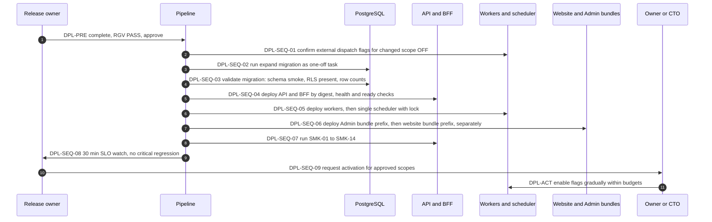
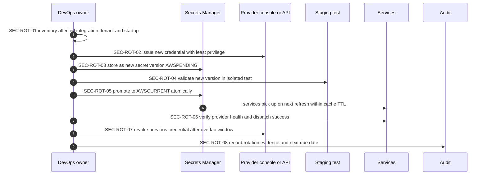
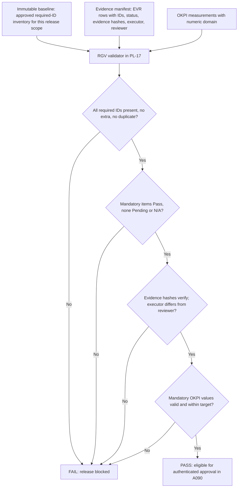

# AI Growth Engine: Employee Sales & Marketing Automation
## Application Blueprint: PART 4 (Batch 4.4b), Source Pack Review: Security, DevOps, Operations Enhancements (continued), Conflicts and Registers

| Field | Value |
|---|---|
| Document | Part 4, Batch 4.4b of 4.4a–4.4b (source-pack coverage review, group I) |
| Version | 1.0 · 27 Nov 2026 |
| Baseline | As Batch 4.4a; enhancements target Parts 3.1, 4.1, 4.2, 4.3 and 8.2 (go-live) without changing them; source-pack documents 18, 26, 27, 29, 30, 31, 32 |
| Roles applied | DevSecOps Lead (§4.4.5.2–4.4.5.3), Performance Engineer (§4.4.5.4), Security/Compliance Lead (§4.4.5.5, §4.4.5.8), SRE Lead (§4.4.5.6–4.4.5.7), Principal Engineer, QA Lead, FinOps Lead and Product Owner (review) |

**Conventions.** New items use the source's own vocabulary where it exists and local families otherwise: ENV (configuration contract), SEC-ROT (secret rotation), ACC (access lifecycle), WP (workload profile), LT-ENH-I (load tests; the `LT-` namespace is already used twice, see §4.4.8.2), LTR (load-test record), PT-ROE / PT-FND (penetration test), SVM (security verification matrix), MET (metrics), AL-50…58 (alerts, continuing Part 4.3), RB-016…018 (runbooks, continuing Part 4.3), DPL (deployment procedure), SMK (smoke), RBK (rollback), HO (handover), GL-E (go-live additions), RGV (release-gate validator). Section numbers are local to Part 4.4.

---

## 4.4.5 Enhancements (continued)

### 4.4.5.2 DevOps, CI/CD and infrastructure (source document 26 → Part 4.3 §4.33–4.38, Part 3.1 ADR-021)

#### 4.4.5.2.1 Pack pipeline stages mapped to the blueprint pipeline

| Pack stage (doc 26) | Pack requirement | Blueprint stage | Status / addition |
|---|---|---|---|
| PR | Locked deps, lint/type, unit, secret, dependency and container scan; synthetic data only | PL-01…PL-09 | Covered |
| Build | Each frontend and Django/worker artifact independently; immutable digest; non-root pinned base; SBOM | PL-10, PL-11 | Covered |
| **SIT** | Ephemeral PostgreSQL/Valkey, migrations, synthetic fixtures, API contracts, workflow/browser integration, stubbed providers | PL-06, PL-07, PL-08 in CI ephemeral; nightly `test` | **Named "SIT" from now on**: SIT = PL-06…PL-08 + nightly integration in `test` (CONFLICT-471). SIT report = JUnit + coverage + contract report attached to the release record; any failure blocks promotion |
| Staging / UAT | Promote exact digest; synthetic data; sandbox credentials; independent test audiences | PL-14, PL-15, PL-16 | Covered; UAT runs in `staging` during a declared UAT window with UAT accounts (§4.4.5.3.1) |
| Production | Infra plan, backup, migration compatibility, staged deployment, smoke | PL-17, PL-18, PL-19 | Order made explicit (DPL-SEQ) |
| **Activation** | Explicit owner/CTO approval; gradual enablement within budgets; stop on gate failure | Not a pipeline stage (Part 8.2 GL-B04 charter) | **Added**: DPL-ACT-01…06 as stage PL-21 (manual, outside the deploy pipeline) |

#### 4.4.5.2.2 Queue topology addition (FR-ENH-I-030) [RECOMMENDATION-463]

Doc 26 requires separate research, AI, communication, **financial** and **priority control** queues, one active scheduler per scope, configured prefetch/limits and no unbounded retries. ADR-021 already separates `dispatch`, `transactional`, `notify`, `webhook_process`, `reconcile` (worker-tx) and `ai`, `research`, `projections`, `reports`, `imports_exports`, `render`, `maintenance` (worker-batch). Two queues are missing (CONFLICT-473):

| Queue | Worker pool | Tasks routed | Priority | Concurrency rule | Prefetch / acks | Rationale |
|---|---|---|---|---|---|---|
| `control` (new) | worker-tx, **reserved slot** (1 process never used by other queues) | Emergency stop propagation (BRL-AUT-05), session/grant revocation fan-out, budget pause (API-ENH-I-01), kill-switch flag propagation, suppression propagation | Highest | Always ≥ 1 free worker; never blocked by tenant caps | prefetch 1, `acks_late` | NFR-049 (stop ≤ 60 s) and NFR-050 (revocation ≤ 60 s) must hold during backlog (OPT-05-05 "reserve urgent queue capacity") |
| `finance` (new) | worker-tx | Payment/receipt webhook processing after ingestion, ledger postings, allocation, reconciliation jobs for payments and e-sign, invoice issue notices | High | Serialized per legal entity (`entity_id` lock) to avoid concurrent postings | prefetch 1, `acks_late` | Isolates money from message bursts (doc 31 "prioritize control/finance") |
| Existing queues | as ADR-021 | — | — | Per-tenant tokens (20 runs/startup, BRL-AUT-06) | Transactional prefetch 1; batch prefetch ≤ 4 (CS-WRK-08) | — |

Acceptance (TC-ENH-I-060): with `research` and `dispatch` queues saturated by tenant A (LT-11 profile), an emergency stop for tenant B's startup is propagated and the last provider call occurs ≤ 60 s later; a payment webhook for tenant B is posted ≤ 60 s after ingestion.

**Autoscaling on queue age (FR-ENH-I-031).** Worker services scale on `celery_queue_oldest_age_seconds` per queue (target: transactional ≤ 60 s, batch ≤ 30 min) and API services on p95 latency; scale-out ceilings are set per environment to bound cost (B01), and reaching the ceiling raises AL-51. At pilot (Topology A, single host) this is a manual lever (Part 3.1 §3.1.12.3); the rule becomes automatic in Topology B.

#### 4.4.5.2.3 Pre-deploy checklist (DPL-PRE)

Executed by the release owner before PL-18; recorded in the A090 release record; any "No" stops the deployment.

| ID | Check | Evidence |
|---|---|---|
| DPL-PRE-01 | Release candidate digest equals the staging-verified digest; signature verified | PL-11 attestation |
| DPL-PRE-02 | Capacity headroom: last LT-01/LT-ENH-I-01 results within targets; DB CPU < 60% at peak in the last 7 days | DB-02, DB-07 |
| DPL-PRE-03 | Dependency compatibility: migration graph applied cleanly on an upgraded copy (CS-MIG-04); API client diff reviewed | PL-07 log |
| DPL-PRE-04 | Backup recovery point: PITR latest restorable time ≤ 5 min; manual snapshot `pre-release-<tag>` created | AL-23 silent; snapshot ID |
| DPL-PRE-05 | Migration plan: expand-only in this release; lock budget; backfill job plan | PR migration note |
| DPL-PRE-06 | Feature flags: list of flags changed by the release; external-effect flags OFF | Flag registry diff |
| DPL-PRE-07 | On-call primary and secondary named and reachable for the deploy window + 2 h | Rota |
| DPL-PRE-08 | **Change freeze**: no other production change (IaC, config revision A112, prompt re-pin) scheduled in the window; conflicting changes deferred | Change calendar |
| DPL-PRE-09 | Approval: production environment approval by Founder/CTO or delegate ≠ majority author (PL-17); RGV result PASS (§4.4.5.7.4) | Approval record |
| DPL-PRE-10 | Incremental effort/cost impact of the change assessed against the baseline estimate; no SLA or cost promise without approval (doc 26 "resource and deployment approval") | Release note |

#### 4.4.5.2.4 Deployment sequence (DPL-SEQ) and activation (DPL-ACT)



| ID | Step | Failure behaviour |
|---|---|---|
| DPL-SEQ-01 | Confirm or set OFF external-dispatch flags for any scope whose code path changed | Abort deploy |
| DPL-SEQ-02 | Expand migration (one-off ECS task, `app_migrator` role, lock budget ≤ 60 s) | Stop; roll forward fix; no down-migration |
| DPL-SEQ-03 | Validate: `migrate --check`, RLS policy presence, constraint validation, row-count deltas within expectation | Stop before code deploy |
| DPL-SEQ-04 | API/BFF rolling deploy by digest; `/ready` green on all tasks | ECS circuit breaker rollback |
| DPL-SEQ-05 | Workers (graceful warm shutdown, `acks_late` requeue); scheduler last, single active lock | Roll back worker task definition |
| DPL-SEQ-06 | Admin bundle, then website bundle, each a new S3 prefix and origin-path switch; independent so either can roll back alone | Switch prefix back (≤ 5 min) |
| DPL-SEQ-07 | Smoke SMK-01…14 (below) | Automatic rollback (PL-20) |
| DPL-SEQ-08 | 30-minute SLO watch (AL-01…06, AL-50…53) | Rollback assessment (RBK) |
| DPL-SEQ-09 | Hand over to activation; record deployment log in A090 | — |

**Activation (DPL-ACT; doc 26 "Activation", doc 32 "Activate").** Activation of externally consequential behaviour is a separate, manual stage (PL-21) after a successful deploy.

| ID | Rule |
|---|---|
| DPL-ACT-01 | Only scopes in the approved activation charter (GL-B04): startup, channel, workflow, recipient cap, budget cap, monitoring window |
| DPL-ACT-02 | **Cohort canary** [RECOMMENDATION-461]: first the Owner Portfolio internal test startup (synthetic recipients or staff-only allowlist), then one real startup at ≤ 10% of its recipient cap for 1 business day, then the full approved cap. Promotion requires: error ratio < 0.5%, no uncertain-outcome surge (AL-10), complaint rate < 0.1%, budget burn within plan, no isolation or financial alert |
| DPL-ACT-03 | Each widening step is approved by the owner/CTO (doc 26 "operator approves promotion") and audited (CFG-31) |
| DPL-ACT-04 | Paid fallbacks and Tier 2 stay OFF unless separately approved (DEC-007, NFR-037) |
| DPL-ACT-05 | Any gate failure: stop dispatch for the scope (RB-004) and restore the previous compatible build if the release is causal (RBK) |
| DPL-ACT-06 | Activation evidence (charter, approvals, first-day metrics) is attached to the release record; hypercare starts (Part 8.2 §8.2.5) |

#### 4.4.5.2.5 Smoke catalogue (SMK; PL-19 and doc 32 "Smoke")

| ID | Smoke check | Surface | Expected result |
|---|---|---|---|
| SMK-01 | Anonymous GET of an approved published page on a verified host | Website | 200 from snapshot; security headers present; no Admin identifiers |
| SMK-02 | Anonymous GET on an unknown host | Website | 404 (BRL-TEN-10) |
| SMK-03 | Anonymous GET of an unpublished draft URL and a preview URL without grant | Website | 404; no cacheable response |
| SMK-04 | Portal login (synthetic customer) and read of own record | Portal | 200 with own record only |
| SMK-05 | Portal user requests another customer's object ID | Portal | Non-disclosing 404; SE event logged |
| SMK-06 | Portal token against an Admin endpoint | Admin API | 401/403 before any query (wrong audience) |
| SMK-07 | Admin login (synthetic employee with MFA) and scoped list query | Admin | 200; only the selected startup's rows |
| SMK-08 | Synthetic public intake submission | Website → API | 202; durable event + outbox row; no direct business approval |
| SMK-09 | Outbox relay picks up the synthetic event | Workers | Pick-up ≤ 60 s |
| SMK-10 | Simulated dispatch in sandbox mode | Workers | Sandbox adapter called; live adapter call count 0 (NFR-038) |
| SMK-11 | Verified callback (signed sandbox webhook) | Webhook | 2xx ≤ 2 s; duplicate replay → no second effect |
| SMK-12 | Forged webhook (bad signature) | Webhook | 401; SE-11 logged |
| SMK-13 | Budget service reservation and release on a zero-cost sandbox call | Gateway | Reservation recorded and released |
| SMK-14 | Header/TLS check, `/health`, `/ready`, queue heartbeat, scheduler lock holder | Platform | All green |

---

### 4.4.5.3 Environment configuration, secrets and dependencies (source document 27 → Part 3.1 §3.1.14, Part 4.1 §4.6, Part 4.3 §4.35–4.36)

#### 4.4.5.3.1 Environment matrix reconciliation (CONFLICT-471)

| Pack environment | Pack rule | Blueprint environment | Resolution |
|---|---|---|---|
| Local | Disposable DB/broker, mocks, developer credentials, no prod data | `local` (Part 3.1) | Covered |
| Shared development | Integration branch, separate identities, limited quotas | — (trunk-based, no integration branch) | Not created: trunk-based development (Part 4.3 §4.32.2) makes it redundant; integration happens in CI and `test` |
| SIT | Pinned artifact, isolated DB, fake/sandbox callbacks, repeatable reset | CI ephemeral + `test` (Part 4.3) / `test` = CI (Part 3.1) | Named SIT; `seed:reset` before each run |
| UAT | Business users, sandbox channels, approved test identities, controlled workflows | `staging` | UAT window in staging: UAT IdP test accounts (R17/R16 synthetic), sandbox adapters, `EXTERNAL_DISPATCH_ENABLED=false`; sign-off without real financial effects |
| Staging | Production-like, masked/synthetic, recovery rehearsal | `staging` | Covered; synthetic only (production copies never) |
| Production | Separate credentials, real channels only after activation, audited access | `prod` | Covered |
| Recovery | Isolated recovery environment; no dispatch until reconciliation and restart | Backup-account restore sandbox (Part 4.3 §4.47) | Covered, plus rule: a restored environment starts with `EXTERNAL_DISPATCH_ENABLED=false` and `AUTOMATION_ENABLED=false` regardless of the source configuration |

#### 4.4.5.3.2 Configuration contract catalogue (ENV; FR-ENH-I-041) [GAP-461]

All settings are read once by a typed settings object (CS-DJ-09) and validated at process start; a failure stops the process with a non-zero exit and a redacted message (OPT-05-06). Non-secret values live in SSM Parameter Store under `/growth/{env}/…` (Part 3.1 §3.1.14); secrets are Secrets Manager ARNs only (Part 4.1 §4.6.1).

| ID | Name | Type / allowed values | Default | Store | Validation and fail-closed rule | Consumers |
|---|---|---|---|---|---|---|
| ENV-01 | `APP_PRODUCT` | enum `commercial` | none (required) | Parameter | Must equal `commercial`; immutable per deployment; mismatch with image label → exit | All |
| ENV-02 | `APP_ENV` | enum `local`, `test`, `staging`, `prod`, `recovery` | none | Parameter | Must match the account (nonprod/prod/backup); `prod` image in nonprod account → exit | All |
| ENV-03 | `WEBSITE_ORIGIN` | HTTPS URL list | none | Parameter | HTTPS only; no wildcard; distinct from `ADMIN_ORIGIN` | BFF-web, CORS |
| ENV-04 | `ADMIN_ORIGIN` | HTTPS URL | none | Parameter | As above | BFF-admin |
| ENV-05 | `OAUTH_ISSUER` | HTTPS URL | none | Parameter | Discovery document reachable at start (cached); issuer equals token `iss` | BFFs |
| ENV-06 | `WEBSITE_AUDIENCE` / `PORTAL_AUDIENCE` | string | none | Parameter | Distinct from `ADMIN_AUDIENCE`; a token with the wrong `aud` rejected before any DB access (SMK-06) | BFF-web |
| ENV-07 | `ADMIN_AUDIENCE` | string | none | Parameter | Distinct; rejects external identities (R16/R17) | BFF-admin, API |
| ENV-08 | `DATABASE_SECRET_REF` (pack `DATABASE_URL`) | Secrets Manager ARN | none | Secret ref | ARN in this account and environment; TLS `verify-full`; role per process (`app_api`, `app_worker`) | API, workers |
| ENV-09 | `BROKER_SECRET_REF` (pack `BROKER_URL`) | ARN | none | Secret ref | TLS + ACL user per process | Workers |
| ENV-10 | `OBJECT_STORE_REF` (pack `OBJECT_BUCKET`) | bucket name list by purpose | none | Parameter | Bucket in this account; name contains `{env}`; public-access block verified at start | API, workers |
| ENV-11 | `VECTOR_STORE_REF` (pack `VECTOR_NAMESPACE`) | schema/table namespace | `ge` | Parameter | No shared confidential index; RLS enabled check | AI gateway |
| ENV-12 | `AUTOMATION_ENABLED` | bool | **false** (all env); true only in `prod` after activation | Parameter + flag | Missing → false; `recovery` forces false | Automation engine |
| ENV-13 | `EXTERNAL_DISPATCH_ENABLED` | bool | **false** | Parameter + flag | Missing → false; true only in `prod`; any `true` outside prod → exit | Adapters registry |
| ENV-14 | `PAID_FALLBACK_ENABLED` | bool | **false** | Parameter + flag | True only with an approved budget line (CFG-24/25) | Gateway, adapters |
| ENV-15 | `PROVIDER_TIMEOUTS` | map provider → connect/read seconds | 5 / 20 | Parameter | Each value 1–120 | Adapters |
| ENV-16 | `RETRY_POLICY` | attempts, base, factor, cap | 3, 30 s, 2, 15 min (NFR-016) | Parameter | attempts ≤ 3 (BRL-AUT-06) | Workers |
| ENV-17 | `LOG_LEVEL` | enum | `INFO` (prod) | Parameter | `DEBUG` in prod only via sampled flag | All |
| ENV-18 | `OTEL_EXPORTER_ENDPOINT` | URL | collector sidecar | Parameter | Local/private endpoint only | All |
| ENV-19 | `LOG_REDACTION_POLICY` | policy ID + version | current approved | Parameter | Must reference an approved data-classification policy; missing → exit | Logger |
| ENV-20 | `ALERT_DESTINATIONS` | SNS topic ARNs by severity | none | Parameter | Topics exist; test publish at deploy (PL-19) | Alarms |
| ENV-21 | `MAX_REQUEST_BYTES` / `RATE_LIMIT_CLASSES` | int per endpoint class / map | per ADR-035, NFR-022 | Parameter | Within approved bounds; public intake ≤ 64 KB JSON | API, WAF |
| ENV-22 | `ALLOWED_HOSTS` | host list | none | Parameter (synced from verified domains) | No wildcard in prod; unknown host → 404 (NFR-020) | API, edge |
| ENV-23 | `WORKER_QUEUE_PREFIX` | string `growth-{env}` | derived | Parameter | Must contain `{env}`; prevents cross-environment task consumption | Workers |
| ENV-24 | `RECOVERY_TARGETS` | RPO/RTO per recovery class | RC-1 15 min / 4 h; RC-2 24 h / 8 h | Parameter | Read by backup health checks and drills (FR-ENH-I-020) | Ops jobs |

**Startup validation (FR-ENH-I-041).** The process refuses to start when: a required value is missing; `APP_PRODUCT`, `APP_ENV` and the account disagree; `WEBSITE_AUDIENCE` equals `ADMIN_AUDIENCE`; any dispatch/paid flag is true outside `prod`; a secret reference points to another account or environment; `ALLOWED_HOSTS` contains a wildcard in `prod`. The failure is logged as `config.validation_failed` with the failing key name (never the value) and raises AL-26.

**Configuration manifest and drift (FR-ENH-I-040) [RECOMMENDATION-468].** Each release produces `config-manifest.json`: every non-secret key, its value hash (SHA-256 of the canonical value) and the secret reference ARNs (not values). The manifest hash is stored in the A090 release record. A job every 15 minutes recomputes the deployed hash per service; a mismatch raises **AL-55** (Sev3; Sev2 if a dispatch/paid flag or audience differs) and RB-018 applies. Approved changes go through a config-revision PR that updates the manifest.

#### 4.4.5.3.3 Secret rotation procedure (SEC-ROT)



| ID | Step | Rule |
|---|---|---|
| SEC-ROT-01 | Inventory | List consumers (services, tenants, startups, webhooks) from the secret inventory (Part 4.1 §4.6.2) |
| SEC-ROT-02 | Issue | New credential with the same or narrower scope; never reuse across environments or startups |
| SEC-ROT-03 | Stage | New version stored as pending; never pasted into tickets, chat or notes |
| SEC-ROT-04 | Test | Validate in an isolated test (provider sandbox or read-only call) |
| SEC-ROT-05 | Switch | Promote atomically; services refresh within the 5-minute secret cache TTL; webhook secrets use the 24 h dual-acceptance window |
| SEC-ROT-06 | Verify | Health checks, a test call and AL-24 silent for 30 min |
| SEC-ROT-07 | Revoke | Revoke the old credential after the overlap window (immediately on compromise) |
| SEC-ROT-08 | Record | Audit event, inventory updated (last rotated, next due), drill evidence |

**On compromise:** stop dispatch for the affected scope first (RB-004), then SEC-ROT-02…07 without overlap, then RB-013. **Recovery:** after a restore, secret *references* are re-created from the IaC/secret inventory; secrets are never copied into backup notes or runbooks (doc 27).

#### 4.4.5.3.4 Developer and operator access lifecycle (ACC) [GAP-469]

| ID | Rule | Evidence |
|---|---|---|
| ACC-01 | Access is per environment and role (IAM Identity Center permission sets or equivalent; verify), granted on request with an approver and expiry | Access request record |
| ACC-02 | Production access is temporary (≤ 8 h session, just-in-time elevation with MFA), never standing; no shared accounts (SC-48) | Session log |
| ACC-03 | Break-glass only under Part 4.1 dual control; use raises AL-43 | Break-glass log |
| ACC-04 | **Monthly access review**: each grant confirmed by its approver or revoked; GitHub, AWS, IdP admin, provider consoles, Sentry, on-call tool | Signed review sheet in A090 |
| ACC-05 | **Offboarding within 1 business day**: revoke IdP, GitHub, AWS, provider consoles; rotate any secret the person could read (SEC-ROT) | Offboarding checklist |
| ACC-06 | Contractors (DevOps 0.5 FTE, DEC-005) receive the same controls; their production access ends with the contract | Contract register |
| ACC-07 | Delivery handover transfers ownership of accounts and vault roles (HO-A01…A06) | Access inventory |

---

### 4.4.5.4 Performance, load, scalability and reliability (source document 29 → Part 4.2 §4.21–4.28)

#### 4.4.5.4.1 Workload profiles (WP) [CONFLICT-461 resolution as proposed]

The pack's initial and growth workloads are adopted as **test workload profiles** layered on top of the DEC-031 design points; DEC-031 remains the basis for sizing and cost until the coordinator decides otherwise.

| Driver | DEC-031 Year 1 | **WP-01 Initial (pack)** | DEC-031 Year 2 | **WP-02 Growth (pack)** | Seeding rule |
|---|---|---|---|---|---|
| Owned startups | 25–40 | 25 (+1 portfolio test startup = 26, UX-QC-01) | 100 workspaces | 50 | Generated profiles from 4 templates (AppNAI, MedMaarg, EduVerse, OrganicSpec) |
| External tenants | 2–10 | 10 (two startups each) | 30 | **100** (two startups each) | Synthetic tenants with own budgets and entitlements |
| Concurrent staff sessions | ≈ 30 at peak (60 users × 0.5) | 50 | ≈ 100 | 250 | k6 virtual users with synthetic tokens |
| Scoped opportunities | not set | 100,000 | not set | 1,000,000 | Distributed Zipf-like: 50% in 10% of startups (noisy-neighbour realism) |
| Concurrent workflow jobs | 20 runs/startup cap | 50 | — | 250 | Mixed classes |
| Scheduled actions/day | ≈ 1,154 messages/day | 10,000 | ≈ 2,885 | 100,000 | 70% batch, 30% transactional; quiet-hour mix |
| Dashboard p95 target | 800 ms (C10) | ≤ 2 s (OKPI-05) | 800 ms | ≤ 2.5 s (OKPI-26) | Blueprint target governs where stricter |

**WP-03 traffic mix (doc 29, CONFLICT-466).** 60% list/filter (C3), 20% detail reads (C2), 10% safe writes (C5 drafts/transitions without external effects), 10% background status polling (C2 on job/run status); public traffic tested separately with abuse limits (LT-07). WP-03 is used for the dashboard-latency gate (OKPI-05/26); Part 4.2 LT-01 (70/15/10/5) remains the release-train regression profile.

**Estimate check for WP-02 data volume (formula, estimate).** 1,000,000 opportunities × ≈ 2 KB row + indexes × 1.6 ≈ 3.2 GB; plus 100,000 actions/day × 30 days × ≈ 1 KB ≈ 3 GB of run/step rows per month. Staging must be scaled to the Topology B instance class during WP-02 runs only (RSK-343; cost per run ≈ hours × instance price, verify AWS ap-south-1 prices, 27 Nov 2026) [ASSUMPTION-461].

#### 4.4.5.4.2 Additional load and resilience tests (LT-ENH-I)

| ID | Scenario | Profile | Duration | Pass criteria | Env | When |
|---|---|---|---|---|---|---|
| LT-ENH-I-01 | Dashboard latency, initial | WP-01 data, 50 staff VUs, WP-03 mix; ramp 10 min, hold 30 min | 40 min | Dashboard/list p95 ≤ 800 ms (blueprint) and ≤ 2 s (OKPI-05); 0 isolation failures; error < 0.5% | Staging | W5 gate; each release train after W5 |
| LT-ENH-I-02 | Dashboard latency, growth | WP-02 data, 250 staff VUs, 250 jobs, 100k actions/day compressed | Ramp 15 min, hold 30 min | p95 ≤ 2.5 s (OKPI-26); async ACK p95 ≤ 2 s; queue age within class target | Staging (scaled) | Before W6 scale gate |
| LT-ENH-I-03 | Baseline | 1 user, 1 worker; cold then warm cache; capture SQL count and trace per endpoint | 15 min | Reproducible baseline stored; used as comparison for every candidate | Staging | Each wave gate |
| LT-ENH-I-04 | Spike and burst | Public enquiries and inbound callbacks at **2× measured baseline** (acceptance) then **3×** (stress) for 5 min each | 20 min | 2×: within SLO; 3×: bounded 429/queueing, no corruption, no duplicate state, recovery to baseline ≤ 10 min (CONFLICT-465) | Staging | W3, W5 |
| LT-ENH-I-05 | Endurance | WP-01 representative rate | **8 h** (wave gates) | No sustained memory growth (> 5%/h), connection leak, table bloat > 20% or growing queue age; budgets reconcile (CONFLICT-467) | Staging | W3, W5 (release soak per GL-T04 24 h/72 h unchanged) |
| LT-ENH-I-06 | Recovery replay in dispatch-off mode | Restore DB snapshot to recovery sandbox; replay outbox with `EXTERNAL_DISPATCH_ENABLED=false` | Drill | Every replayed event reaches a terminal or reconciliation state; 0 provider calls; RPO/RTO measured; ledger reconciled | Backup account | Quarterly with RB-007 |

#### 4.4.5.4.3 Load-test record (LTR) and safety rules (LT-SAFE)

Every run produces a record stored with the release (doc 26 "load test reproducibility"; doc 29 "evidence").

| ID | Field |
|---|---|
| LTR-01 | Test ID and profile (WP/LT) |
| LTR-02 | Commit SHA, image digests, configuration manifest hash |
| LTR-03 | Environment, instance classes, DB class, worker counts |
| LTR-04 | Dataset version and row counts per key table |
| LTR-05 | Workload mix, VU count, arrival rate |
| LTR-06 | Ramp, warmup, sustained duration |
| LTR-07 | Cache state (cold/warm) and provider stub configuration |
| LTR-08 | Latency p50/p95/p99 per endpoint class |
| LTR-09 | Throughput and error count/ratio by class |
| LTR-10 | Saturation: CPU, memory, DB connections, locks, queue age, Valkey memory |
| LTR-11 | Error budget used during the run |
| LTR-12 | Comparison against baseline (LT-ENH-I-03) and target, with verdict Pass/Fail/Unassessed |
| LTR-13 | Cost of the run (estimate) |
| LTR-14 | Executor and independent reviewer (different people) |

| ID | Safety rule (doc 29 k6 template) |
|---|---|
| LT-SAFE-01 | Scripts refuse to start unless `AUTHORIZED_NONPROD=YES` and the base URL resolves to a nonprod account endpoint on an allowlist |
| LT-SAFE-02 | Only synthetic tokens of synthetic tenants; never production credentials or real accounts |
| LT-SAFE-03 | External dispatch disabled; providers stubbed or sandboxed |
| LT-SAFE-04 | Abort thresholds (error > 20% for 2 min, DB CPU > 95% for 5 min) stop the run |
| LT-SAFE-05 | A mock-health script is labelled "smoke only"; it never counts as load evidence |

#### 4.4.5.4.4 Availability and error-budget computation (FR-ENH-I-050)

```text
eligible_minutes   = window_minutes − approved_exclusions (planned maintenance ≤ 2 h/month, Part 4.2 §4.21)
bad_minutes        = minutes where both probes fail OR server 5xx ratio > 5% (Part 4.2 §4.21)
availability       = (eligible_minutes − bad_minutes) ÷ eligible_minutes
error_budget       = (1 − SLO) × eligible_minutes
If eligible_minutes = 0 or probe data coverage < 95% of the window → verdict "Unassessed" (never Pass)
Dependency failures (provider outage) count as bad minutes only if a customer-facing surface failed
```

The same rule applies to every OKPI and dashboard metric: no denominator → **Unassessed**; stale data (older than the metric's freshness class) is labelled "stale since <time>" (doc 31 optimization intelligence).

#### 4.4.5.4.5 Recovery classes (FR-ENH-I-020) [GAP-462]

| Class | Data | RPO | RTO | Mechanism | Source |
|---|---|---|---|---|---|
| RC-1 Critical | Business records, approvals, ledgers, consent/suppression, audit, outbox, configuration revisions | ≤ 15 min | ≤ 4 h (pilot); ≤ 2 h at scale gate if CONFLICT-462 is accepted | PITR, cross-account and cross-region copies (Part 4.3 §4.47) | DEC-018; OKPI-18/19/32 |
| RC-2 Regenerable | Research evidence page content (12 months, DEC-028), embeddings, projections, search documents, report caches, AI exact-match cache | ≤ 24 h | ≤ 8 h | Rebuild from RC-1 sources (re-embed, re-project, re-fetch within source policy) | OKPI-33/34 (doc 18) |
| RC-3 Ephemeral | Valkey broker and cache, sessions, rate-limit buckets | n/a | ≤ 15 min | Rebuilt; outbox is authoritative (FM-07) | Part 3.1 §3.1.13.3 |

Drill: the quarterly game day (Part 4.3 §4.47) measures RC-2 rebuild time for one Year-1-sized tenant (re-embedding is budget-capped; AI cost estimate per Part 7 before the drill).

#### 4.4.5.4.6 Projection freshness classes (CONFLICT-463 proposed resolution)

| Class | Projections | Freshness target | Gate |
|---|---|---|---|
| F-1 Operational | Customer 360, approvals queue, automation monitor (RP-22), pipeline/Kanban, job/run status, budget utilization | ≤ 60 s p95 (OKPI-28, NFR-008) | Mandatory |
| F-2 Analytical | Dashboards RP-01…RP-21, forecasts, attribution | ≤ 15 min (NFR-047) | Labelled as-of |
| F-3 Scheduled | Monthly unit economics, exports | Per schedule | Labelled as-of |

---

### 4.4.5.5 Vulnerability assessment and penetration testing (source document 30 → Part 4.1 §4.16)

#### 4.4.5.5.1 Rules of engagement (PT-ROE) [GAP-466]

| ID | Rule |
|---|---|
| PT-ROE-01 | Written authorization signed by the Founder/CTO before any test: target hosts and environments, identities issued, permitted techniques, excluded techniques, time window, data-handling rules, safety-stop contact (24×7 during the window) |
| PT-ROE-02 | Targets are `staging` (default) or an explicitly scoped production engagement for read-only configuration review; never third-party systems (providers, IdP owner's other apps) without their written consent |
| PT-ROE-03 | Only synthetic tenants, startups and identities (two tenants × two startups minimum, tester-held accounts in both); never real patient, student, customer or investor records |
| PT-ROE-04 | External dispatch disabled in the target environment; payment and e-sign in sandbox mode |
| PT-ROE-05 | Excluded: volumetric denial of service, social engineering (unless separately authorized), physical tests, destructive data tests outside the test tenants |
| PT-ROE-06 | Tester's source IPs registered; WAF in detection mode for those IPs only, so blocks do not mask findings |
| PT-ROE-07 | Critical findings (§4.4.5.5.2) reported to the safety contact within 4 h, not at the end of the engagement |
| PT-ROE-08 | Evidence minimal and redacted (PT-FND-10); no secrets or tokens retained beyond the engagement; tester destroys data at closure and confirms in writing |
| PT-ROE-09 | Tool versions, scope, dates and tester identity recorded (doc 30 "record tool version, scope and false-positive review") |
| PT-ROE-10 | Tester independence: external tester for NFR-072 engagements (CERT-In empanelled where required; verify list, 27 Nov 2026); internal tests by an engineer who did not build the feature |
| PT-ROE-11 | Retest of every Critical/High fix by the same or another independent tester before go-live |
| PT-ROE-12 | Report classified Confidential; stored in the security evidence bucket; access limited to R01, R10 and the security lead |

#### 4.4.5.5.2 Severity overlay (CONFLICT-472 proposed resolution)

Part 4.1 §4.16.3 rates by CVSS adjusted for exposure. Doc 30 rates by business impact. Both apply; **the higher wins**.

| Business-impact condition (doc 30) | Minimum severity | Waivable? |
|---|---|---|
| Unauthorized confidential disclosure (cross-tenant, cross-startup, portal-to-portal, public-to-private) | Critical | **Never** |
| Financial integrity failure (wrong issuer/currency, duplicate receipt/refund, premature closure, ledger mutation) | Critical | **Never** |
| Production credential compromise or secret exposure | Critical | Never |
| Uncontrolled external dispatch (suppression bypass, unapproved send, approval-hash bypass) | Critical | Never |
| Privilege escalation within a tenant (employee → owner action) | High | Only with independently verified non-exploitability |
| Major exploitable weakness without the above impact | High | Founder approval with compensating control (Part 4.1 §4.16.3) |

#### 4.4.5.5.3 Finding record (PT-FND)

PT-FND-01 ID · 02 title · 03 affected asset/endpoint/surface · 04 environment and build digest · 05 role/identity used · 06 CVSS vector and score · 07 business-impact class and final severity · 08 expected behaviour · 09 observed behaviour · 10 minimal redacted request/response · 11 reproduction steps · 12 remediation owner and due date (NFR-067 SLA) · 13 fix commit and retest result with retest date and retester · 14 status (Open, Fixed-pending-retest, Closed, Risk-accepted with approver) and false-positive rationale where applicable.

#### 4.4.5.5.4 Security verification matrix (SVM)

| SVM | Area (doc 30) | Procedure | Pass condition | Blueprint tests | New TC |
|---|---|---|---|---|---|
| SVM-01 | Public exposure | Anonymous requests for unpublished draft, preview without grant, unknown host, Admin endpoint, cache-busting variants | Only approved snapshot; others 404; no cacheable private response | NFR-020; SMK-01…03 | TC-ENH-I-070 |
| SVM-02 | Portal object scope | Two invited identities exchange object IDs; expired grant; revoked invitation; replayed one-time token | Uniform 404; no mutation | Part 6 portal TCs; FR-W grants | TC-ENH-I-071 |
| SVM-03 | Admin role and audience | External token on Admin; employee on owner-only; revoked membership; cross-product token | Denied before any private lookup (DB query count 0) | NFR-003/050 | TC-ENH-I-072 |
| SVM-04 | Tenant isolation | Mismatched tenant/startup IDs in query, export, worker payload, object URL; cache context switch | No cross-boundary record or side effect | NFR-032; PL-08 | — |
| SVM-05 | Input safety | Injection fixtures, malformed JSON, oversized upload, unsafe rich text, URL/SSRF | Reject/sanitize; safe error; no uncontrolled fetch | Part 4.1 §4.8 | — |
| SVM-06 | CSRF/CORS/CSP | Untrusted origin with cookies; missing CSRF; header inspection | No read or mutation from untrusted origin | NFR-071 | — |
| SVM-07 | Session and recovery | Expiry, logout, rotation, MFA bypass attempts, invitation replay | No reuse after revocation | NFR-003, NFR-074 | — |
| SVM-08 | Webhook replay | Invalid signature, wrong connection, stale timestamp, duplicate event ID | No unauthorized or duplicate action | NFR-051; LT-05 | — |
| SVM-09 | AI and RAG | Instruction embedded in retrieved text; request for another startup's evidence or a secret | Abstain/deny; no tool action; scoped retrieval | Part 6.4 AIE | — |
| SVM-10 | Workflow authority | Unapproved template, budget exhaustion, stale approval hash, cancelled job, duplicate task | No dispatch; audited decision | CA-DISPATCH battery | — |
| SVM-11 | Financial integrity | Wrong issuer account, wrong currency, duplicate receipt/refund, premature closure | Reject or quarantine; no misallocation | BLK-2/6; Part 6.3a | TC-ENH-I-073 |
| SVM-12 | Dependencies and infrastructure | SBOM/image/IaC scans; public DB/broker exposure; vault access review | No unresolved exploitable Critical/High | PL-09/11; Security Hub | — |

---

### 4.4.5.6 Monitoring, observability, incident and support (source document 31 → Part 4.3 §4.39–4.45)

#### 4.4.5.6.1 Priority mapping

| Pack priority | Pack definition | Pack ack | Blueprint severity | Blueprint ack (governs) |
|---|---|---|---|---|
| P1 critical | Suspected leak, financial mismatch, unapproved dispatch, product outage | 15 min | Sev1 | ≤ 15 min in hours; ≤ 30 min best effort outside (CONFLICT-113) |
| P2 high | Persistent errors, backlog, provider degradation, missed business deadline | 1 h | Sev2 | ≤ 30 min (stricter) |
| P3 medium | Noncritical UI, isolated failed job, quality decline | Next business day | Sev3 | ≤ 4 business hours |

#### 4.4.5.6.2 Metrics additions (MET)

| ID | Metric | Type / dimensions | Purpose |
|---|---|---|---|
| MET-01 | `db_lock_wait_seconds` | Histogram / table class | Lock contention (doc 31 "locks") |
| MET-02 | `scheduler_lock_holder`, `scheduler_missed_ticks_total` | Gauge, counter | Single scheduler health |
| MET-03 | `db_replication_lag_seconds` (Topology B), `backup_last_success_age_seconds` | Gauge | Replication/backup status |
| MET-04 | `celery_queue_oldest_age_seconds` | Gauge / queue | AL-51 and autoscaling |
| MET-05 | `config_manifest_drift` | Gauge / service | AL-55 |
| MET-06 | `run_stale_total` (runs in non-terminal state past their step timeout) | Gauge / workflow class | AL-57 |
| MET-07 | `eligible_opportunities_total` | Counter / startup, vertical | Business signal (reconciles to A027 counts) |
| MET-08 | `followups_due_total`, `followups_overdue_total` | Gauge / startup, channel | Missed business deadline (AL-54) |
| MET-09 | `objection_escalations_total` | Counter / startup | Business signal |
| MET-10 | `approvals_pending_age_seconds` | Histogram / approval type | Business signal; hypercare |
| MET-11 | `verified_closures_total` vs `estimated_closures` | Counter | Verified vs estimate kept separate (doc 31) |
| MET-12 | `financial_mismatch_open_total` | Gauge / mismatch type | AL-56 |

Business signals are computed from authoritative records and must reconcile to report counts (doc 31 "counts reconcile"); a weekly job compares MET-07/11 with RP-02/RP-15 and reports drift > 1%.

#### 4.4.5.6.3 Alert additions (AL-50…AL-58) [RECOMMENDATION-464]

| AL | Alert | Condition (initial; tune after W3) [ASSUMPTION-460] | Severity | Route | Runbook |
|---|---|---|---|---|---|
| AL-50 | 5xx ratio slow | > 1% of requests for 10 min with ≥ 200 requests in the window (complements AL-06 > 2%/5 min; CONFLICT-464) | Sev3 | T | RB-012 |
| AL-51 | Queue age per class | Oldest eligible ready job > 5 min for 5 min on transactional, finance or control queues; > 2 h on batch; or autoscale ceiling reached | Sev2 / Sev3 | P / T | RB-002 |
| AL-52 | Projection lag | F-1 projection lag p95 > 60 s for 10 min | Sev3 | T | RB-002 |
| AL-53 | Budget negative or breached | Any budget remaining < 0, or actual > hard limit (reservation leak) | Sev2 | P + N (R01, R08) | RB-005 |
| AL-54 | Missed business deadline | Approved follow-ups or bid/tender deadlines overdue > 1 h (MET-08) | Sev2 | P + N (startup head) | RB-002 |
| AL-55 | Configuration drift | Deployed config hash ≠ approved manifest (Sev2 if dispatch/paid flag or audience) | Sev3 / Sev2 | T / P | RB-018 |
| AL-56 | Financial mismatch | Duplicate, unmatched, wrong-issuer or wrong-currency receipt; unreconciled payment callback > 24 h | **Sev1** (wrong issuer, duplicate posting) / Sev2 | P + N (R08, R01) | RB-016 |
| AL-57 | Stale runs and unknown outcomes | Runs past step timeout (MET-06) > 10, or uncertain outcome older than 24 h | Sev2 | P | RB-003 |
| AL-58 | Sensitive data in logs | Log scanner finds email/phone/ID patterns or secret patterns in production logs | Sev2 (Sev1 if secret) | P + N (R10) | RB-013 |

#### 4.4.5.6.4 New runbooks [GAP-465; RECOMMENDATION-465]

**RB-016 Financial exception**

| Step | Action |
|---|---|
| Trigger | AL-56; finance (R08) report; reconciliation job discrepancy; customer report of a wrong amount |
| Sev | Sev1 for wrong-issuer posting or duplicate receipt posted to a ledger; Sev2 otherwise |
| Contain | Quarantine the affected receipt/payment/allocation rows (`quarantined` flag); stop closure and allocation for the affected legal entity (finance queue pause via `control`); hold related dispatches (invoice notices, closure messages) |
| Verify | R08 compares against authoritative bank/provider records (statement, gateway dashboard) — never against application data alone |
| Correct | Append correcting entries with maker/checker approval (DEC-038); never edit or delete posted rows (NFR-018) |
| Communicate | R01 and the startup head; customer contact only after finance confirms and compliance reviews |
| Resume | Finance and operations both approve (RBK-R03); closure re-enabled; reconciliation report attached |
| Follow-up | Postmortem; regression test in the finance suite; KPI-31 report |

**RB-017 Public content incident**

| Step | Action |
|---|---|
| Trigger | Report of unapproved, wrong or private content on a public page; claims-guard alert; DMCA/legal notice |
| Contain (≤ 15 min) | Unpublish the affected publication (pointer swap to previous approved revision or to "unavailable"); purge CDN paths for the host; revoke preview grants |
| Preserve | Keep the snapshot, approval record and audit (no deletion of authoritative evidence, doc 18) |
| Verify | Anonymous fetch from two locations no longer returns the content (SMK-01/03 variant) |
| Replace | New revision through the normal approval flow (claims review where DEC-060 applies) before republish |
| Follow-up | Root cause (approval gap, template defect, injection); compliance incident if a claim rule was breached (M57) |

**RB-018 Configuration drift**

| Step | Action |
|---|---|
| Trigger | AL-55 |
| Diagnose | Which keys differ (names only); who changed them (CloudTrail on Parameter Store/Secrets Manager); is a deploy in progress? |
| Act | If unapproved: restore approved values from the manifest via the pipeline; if a dispatch/paid flag or audience changed, emergency stop the scope first (RB-004) |
| Verify | Drift gauge back to 0; startup validation passes on a restarted task |
| Follow-up | Access review of the principal (ACC-04); IAM tightening |

#### 4.4.5.6.5 Incident record (INC-REC)

Mandatory fields on every A014 incident: severity; affected product, tenant(s), startup(s), surfaces; **detected, acknowledged, contained, restored and closed timestamps** (UTC and IST); incident commander; correlation and trace IDs; external effects possibly affected (uncertain list); data classes involved; root cause and contributing factors; regression test ID; retest evidence; customer/regulator notifications sent; postmortem link. No unsupported SLA statement is recorded (doc 31).

#### 4.4.5.6.6 Support operations additions (SUP)

| ID | Rule |
|---|---|
| SUP-01 | Ticket intake captures product, tenant, startup, requester role, issue, severity and redacted evidence |
| SUP-02 | **Caller authority verification**: requester identity is confirmed through the authenticated portal session (W28/W34) or, for email, by a verification link to the registered tenant administrator; no account, access or data action for an unverified caller |
| SUP-03 | Support staff see ticket metadata only; any tenant data access requires a SupportAccessGrant (DEC-056) |
| SUP-04 | Responses give status and workaround without confidential details of the tenant or any other tenant |
| SUP-05 | Escalation to finance (R08), legal/compliance (R10) or security per issue class; S1 → on-call immediately |
| SUP-06 | **Daily** (10:30 IST): critical queue — open S1/S2 tickets, Sev1/Sev2 incidents, uncertain outcomes, DLQ |
| SUP-07 | **Weekly**: incident and ticket trends, top categories, reopen rate, knowledge-base gaps |
| SUP-08 | **Monthly**: internal response-target attainment (DEC-044), cost and AI quality review, input to the FinOps review; no public SLA until measured and signed terms exist (doc 31) |

---

### 4.4.5.7 Release, go-live, rollback and delivery (source document 32 → Part 8.2 §8.2.4, Part 4.3 §4.38)

#### 4.4.5.7.1 Rollback triggers (RBK-T) and resume rules (RBK-R)

| ID | Trigger (any → stop and rollback assessment within 10 min) | First action |
|---|---|---|
| RBK-T01 | Any cross-tenant or cross-startup disclosure (AL-33) | Kill-switch the feature; RB-008 |
| RBK-T02 | Invalid funds or receipt state; wrong issuer; duplicate posting (AL-56) | RB-016 |
| RBK-T03 | Duplicate external effect (message, publication, payment) | Emergency stop scope; RB-003 |
| RBK-T04 | Critical smoke failure (any SMK) | Automatic rollback PL-20 |
| RBK-T05 | Sustained severe error: AL-01/03 fast burn or AL-06 within 2 h of a deploy | RB-012 |
| RBK-T06 | Security control regression (header, TLS, auth audience) found post-deploy | Rollback; Sev per §4.4.5.5.2 |
| RBK-T07 | Configuration drift on a dispatch/paid flag or audience (AL-55 Sev2) | RB-018 |
| RBK-T08 | Suppression breach (AL-19) | RB-006, RB-004 |

| ID | Resume rule |
|---|---|
| RBK-R01 | Incident commander records the decision (rollback, forward fix, or continue) with time and evidence |
| RBK-R02 | Rollback never undoes an external payment, offer or message; affected items are reconciled, never replayed blindly (doc 32; DEC-050) |
| RBK-R03 | Before resuming live dispatch: provider and bank records, outbox and commitments reconciled; **finance (R08) and operations (on-call lead) both approve** |
| RBK-R04 | Critical smoke (SMK-01…14) and the targeted security tests rerun on the restored or fixed build |
| RBK-R05 | Owner approval for live dispatch with MFA step-up; restart audit record (SE-10) |

#### 4.4.5.7.2 Delivery package and handover (HO) [GAP-464; RECOMMENDATION-469]

Delivered at Release 1 go/no-go, Release 2 and at any change of operator (for example a hand-over from the build team to a BAU team or to a client tenant's own operator for exportable artefacts).

| ID | Technical handover item | Acknowledged by |
|---|---|---|
| HO-T01 | Source repository access and the release tag | Receiving technical lead |
| HO-T02 | Build and deployment artifacts: image digests, frontend bundle prefixes, signatures, SBOM | Same |
| HO-T03 | API contracts (OpenAPI), event schemas, database schema and migration history | Same |
| HO-T04 | Configuration manifest (references only, no values) and the ENV catalogue | Same |
| HO-T05 | Test evidence: P0/P1 results, NFR evidence, pen-test report and retests, AI eval report | Same |
| HO-T06 | Dashboards DB-01…DB-10 and alert rules with runbook links | Same |
| HO-T07 | Runbooks RB-001…RB-018 and the drill log | Same |
| HO-T08 | Backup/restore procedures and the last drill report | Same |
| HO-T09 | Open defects, risk register extract, technical-debt register | Same |
| HO-T10 | ADR index and dependency register with licences | Same |

| ID | Business handover item | Acknowledged by |
|---|---|---|
| HO-B01 | Training completion records per persona (Part 8.2 §8.2.2.2) | Owner / client |
| HO-B02 | Operating instructions and help-centre articles for activated screens | Same |
| HO-B03 | Activated scope, caps and budgets (activation charters) | Same |
| HO-B04 | Support contacts, hours, channels and escalation (DEC-044) | Same |
| HO-B05 | Accepted exceptions and residual risks with owners | Same |
| HO-B06 | Acceptance record (unsigned until actual delivery; BRD §12.2) | Same |

| ID | Access handover item | Acknowledged by |
|---|---|---|
| HO-A01 | Inventory of accounts (AWS, GitHub, IdP admin, provider consoles, DNS/registrar, Sentry, on-call) with owners | Founder/CTO |
| HO-A02 | Ownership of vault roles and KMS key administrators transferred to the receiving owners | Same |
| HO-A03 | Temporary and build-team credentials rotated (SEC-ROT) | Same |
| HO-A04 | Developer production access removed unless explicitly approved (ACC-02) | Same |
| HO-A05 | Break-glass credentials re-sealed with new custodians | Same |
| HO-A06 | Signed access inventory stored in A090 | Same |

#### 4.4.5.7.3 Go-live checklist additions (GL-E)

Added to Part 8.2 §8.2.4.3 (no-go criteria from doc 32 not explicit there):

| ID | Category | Item | Release | Owner | Evidence |
|---|---|---|---|---|---|
| GL-E01 | Technical | No unapproved schema or API change since the approved contract baseline (diff of OpenAPI and migrations vs approved release record) | Both | BE | Contract diff |
| GL-E02 | Compliance | Every sender identity (SES domain, WhatsApp number) for the activated scope is verified and approved | Both | Growth/compliance lead | Sender inventory |
| GL-E03 | Security | No paid fallback or Tier 2 route enabled without approved budget line and data-class check | Both | AI lead | Flag registry |
| GL-E04 | Operations | Monitoring active for every activated scope and an accountable owner named per scope | Both | DevOps | Activation charter |
| GL-E05 | Technical | RGV result PASS for the release (§4.4.5.7.4) | Both | QA | RGV report |
| GL-E06 | Operations | Delivery package HO-T/B/A acknowledged | R1, R2 | Founder/PO | Handover sign-off |

#### 4.4.5.7.4 Release-gate validator (RGV; FR-ENH-I-060) [GAP-463; RECOMMENDATION-462]

A pipeline step in PL-17 that evaluates the release evidence **fail-closed** (docs 26, 30, 32). It replaces manual assembly of "complete evidence" in A090 with a deterministic check; it proves file consistency, not truth: approvals are still collected through authenticated change management (A090 with MFA), and the CTO and product owner sign there.



| ID | Rule |
|---|---|
| RGV-01 | The required-ID inventory is generated from the approved, immutable baseline (Part 6.6 RTM extract, BLK rows, GL rows, OKPI mandatory list, AP list) for the release scope; an edited evidence register cannot define its own scope |
| RGV-02 | Missing required ID → FAIL |
| RGV-03 | Extra ID not in the inventory → FAIL (prevents padding) |
| RGV-04 | Duplicate ID → FAIL |
| RGV-05 | Mandatory item with status Pending, Fail, blank or N/A → FAIL; optional N/A requires an approved disposition ID |
| RGV-06 | Expected and observed evidence fields blank or whitespace-only → FAIL |
| RGV-07 | Executor equals reviewer after trimming and case normalization → FAIL |
| RGV-08 | Approval identity blank → FAIL |
| RGV-09 | Every evidence file's SHA-256 matches the manifest; missing file → FAIL |
| RGV-10 | Manifest shape validated against its JSON Schema; unknown fields → FAIL |
| RGV-11 | Release digest in the manifest equals the candidate image digests → FAIL otherwise |
| RGV-12 | Mandatory OKPI values validated by P-08 (numeric domain) and compared with target; zero denominator → Unassessed → FAIL for mandatory |
| RGV-13 | Restore drill age ≤ 31 days and rollback rehearsal ≤ 31 days (NFR-012/013) |
| RGV-14 | Exit code non-zero on any FAIL; the report lists every failing rule and ID (no early exit) |
| RGV-15 | **Combined preflight**: the blueprint equivalent of the pack's six groups is evaluated in one run: (1) decision approvals (DEC/ADR/CONFLICT dispositions in scope), (2) actual test execution (TC EVRs), (3) quality controls (GL/BLK), (4) optimization controls in scope (OPT mapping §4.4.4.1), (5) acceptance procedures (AP), (6) mandatory OKPIs (21). Counts are derived from the blueprint registers, not copied from the pack's 1,188 (GAP-468) |

Acceptance tests: TC-ENH-I-040…043 (§4.4.5.9).

#### 4.4.5.7.5 Pack approval-gate counts (GAP-468)

Doc 32 states outstanding pack approvals (38 exact API definitions, 0 partial, 4 database reuse confirmations, 138 UI semantic mappings) and a 1,188-record combined preflight. These describe the pack's own baseline, not the blueprint's. The blueprint already defines its API catalogue (Part 3.2), entities (Part 3.3) and screens (Part 2.5). **Proposed handling:** the coordinator asks the groups that own documents 06, 07, 08 and 38 to reconcile the 38/4/138 items to blueprint IDs; any item that remains unresolved becomes a release-scope required ID in RGV-01 for the release that depends on it.

---

### 4.4.5.8 Security and privacy governance additions (source document 18 → Part 4.1)

#### 4.4.5.8.1 Pack actors → blueprint roles

| Pack actor | Blueprint roles | Restriction carried |
|---|---|---|
| Owner/founder | R01 | Portfolio read; selected-startup mutation; no other tenant by default (DEC-065) |
| Employee / growth manager | R02–R07, R09 | Assigned startup/account/team; no investor records (BRL-TEN-12) |
| Finance and legal | R08, R10 | Maker/checker; no autonomous financial transfer (DEC-038, DEC-064) |
| Tenant administrator | R12 | Own tenant configuration; not automatically a business approver |
| Platform support/billing | R13, R14 | Metadata only; SupportAccessGrant (DEC-056) |
| External prospect/customer | R16, R17 | Own invite/portal records; applicant opaque draft reference |
| Other application user | (none) | Denied by audience and product entitlement (ADR-033) |
| Service identities | R19, R20 | No browser access; signed and idempotent |

#### 4.4.5.8.2 Requirements derived from document 18

| ID | Requirement | Acceptance | Source |
|---|---|---|---|
| FR-ENH-I-010 | Private cache keys are composed per CS-SEC-07 (product, tenant, startup, principal/grant fingerprint, permission, policy, model and knowledge revisions, normalized query); public caches read only the approved public projection | TC-ENH-I-010: two users with equal revision numbers but different grants never share a cached Copilot or list result | Doc 18 "authorization-safe cache"; extends Part 3.1 §3.1.11 |
| FR-ENH-I-011 | All gate, optimizer, budget and KPI computations validate numeric input (P-08) and reject non-finite, negative and out-of-range values | TC-ENH-I-020 | Doc 18, 29, 31 numeric guardrails |
| FR-ENH-I-012 | Exports of Restricted or bulk personal data require an approved **export manifest** (scope, columns, row count, purpose) whose SHA-256 is recorded on approval; the generated file must match the manifest; links are short-lived, single-scope and revocable | TC-ENH-I-012 | Doc 18 threat "unauthorized data extraction" |
| FR-ENH-I-020 | Recovery classes RC-1/RC-2/RC-3 with targets in ENV-24; RC-2 rebuild drill | TC-ENH-I-021 | Doc 18 capacity table; OKPI-33/34 |

---

### 4.4.5.9 Requirements, stories and test cases

#### 4.4.5.9.1 Enhanced functional and operational requirements (FR-ENH-I)

| ID | Requirement | Wave | Epic | Source |
|---|---|---|---|---|
| FR-ENH-I-001 | Coding standard CS-* adopted as binding with the enforcement matrix §4.4.5.1.25 and waiver process | W0 | EP-21 | Doc 25 |
| FR-ENH-I-002 | Diff-coverage gate ≥ 80% on eligible domain code in PL-04 | W0 | EP-21 | Doc 25; CONFLICT-468 |
| FR-ENH-I-003 | Custom Semgrep rules SG-01…SG-12 and ESLint `growth/scope-query-key` active in PL-05 | W0–W1 | EP-21 | Doc 25 |
| FR-ENH-I-004 | AI-assisted coding policy CS-AIC-01…08 with PR template field | W0 | EP-21 | Doc 25 |
| FR-ENH-I-005 | Technical-debt register (TDR) with monthly review | W1 | EP-21 | Doc 25, 27 |
| FR-ENH-I-010 | Authorization-safe cache key | W1 | EP-01 | Doc 18 |
| FR-ENH-I-011 | Numeric guardrail validation | W1 | EP-21 | Docs 18, 29 |
| FR-ENH-I-012 | Export manifest hash approval | W2 | EP-03 | Doc 18 |
| FR-ENH-I-020 | Recovery classes and RC-2 drill | W4 | EP-21 | Doc 18 |
| FR-ENH-I-030 | `control` and `finance` queues with reserved capacity and prefetch rules | W2 | EP-18 | Doc 26 |
| FR-ENH-I-031 | Queue-age based scaling rule (manual at pilot, automatic at Topology B) | W5 | EP-21 | Doc 26 |
| FR-ENH-I-040 | Configuration manifest hash and drift detection (AL-55) | W1 | EP-21 | Doc 27 |
| FR-ENH-I-041 | Typed configuration contract ENV-01…24 with fail-closed startup validation | W0 | EP-01 | Doc 27 |
| FR-ENH-I-050 | Availability/OKPI computation with Unassessed verdict and stale labelling | W3 | EP-17 | Docs 29, 31 |
| FR-ENH-I-051 | Budget pause/resume operations API-ENH-I-01/02 | W2 | EP-04 | Doc 31 |
| FR-ENH-I-060 | Release-gate validator RGV-01…15 in PL-17 | W3 | EP-21 | Docs 26, 30, 32 |
| FR-ENH-I-061 | Delivery package HO-T/B/A at R1 and R2 | W3, W5 | EP-21 | Doc 32 |
| FR-ENH-I-062 | Ordered deployment DPL-SEQ, smoke SMK-01…14 and activation stage DPL-ACT with cohort canary | W2 | EP-21 | Docs 26, 32 |
| FR-ENH-I-063 | Rollback triggers RBK-T and resume rules RBK-R | W2 | EP-21 | Doc 32 |
| FR-ENH-I-070 | Alerts AL-50…58, metrics MET-01…12 and runbooks RB-016…018 | W2–W4 | EP-21 | Doc 31 |
| FR-ENH-I-071 | Support caller verification and review cadence SUP-01…08 | W3 | EP-20 | Doc 31 |
| FR-ENH-I-080 | Penetration-test RoE, severity overlay and finding record | W3 | EP-21 | Doc 30 |
| FR-ENH-I-081 | Workload profiles WP-01…03, tests LT-ENH-I-01…06, LTR record and LT-SAFE rules | W3–W6 | EP-21 | Doc 29 |
| FR-ENH-I-082 | Access lifecycle ACC-01…07 with monthly review | W0 | EP-01 | Doc 27 |
| FR-ENH-I-083 | Secret rotation procedure SEC-ROT-01…08 with quarterly drill | W1 | EP-01 | Doc 27 |

#### 4.4.5.9.2 User stories with acceptance criteria

| Story | As a … I want … so that … | Wave | FR |
|---|---|---|---|
| US-21-EI01 | As the principal engineer, I want CI to enforce the coding standard so that scope, money and idempotency defects are caught before review | W0 | FR-ENH-I-001…003 |
| US-21-EI02 | As a reviewer, I want a risk-classed PR template and checklist so that security, money and migration changes always get a specialist review | W0 | FR-ENH-I-001, -004 |
| US-01-EI01 | As the DevOps lead, I want services to refuse to start on invalid or conflicting configuration so that no environment runs with unsafe defaults | W0 | FR-ENH-I-041 |
| US-01-EI02 | As the security lead, I want configuration drift detected within 15 minutes so that unapproved flag or audience changes cannot persist | W1 | FR-ENH-I-040 |
| US-18-EI01 | As the on-call engineer, I want emergency stop and revocation to run on a reserved control queue so that they meet 60 s even during a backlog | W2 | FR-ENH-I-030 |
| US-21-EI03 | As the release owner, I want a fail-closed release-gate validator so that no release proceeds with missing, duplicate or self-reviewed evidence | W3 | FR-ENH-I-060 |
| US-21-EI04 | As the performance engineer, I want reproducible workload profiles and load-test records so that capacity claims are measured, not assumed | W3 | FR-ENH-I-081 |
| US-21-EI05 | As the finance user (R08), I want financial mismatches to alert and quarantine automatically so that no wrong posting reaches closure | W4 | FR-ENH-I-070 |
| US-04-EI01 | As the FinOps lead, I want to pause one budget line without changing its cap so that I can stop runaway spend in one area only | W2 | FR-ENH-I-051 |
| US-21-EI06 | As the Founder, I want a signed delivery package with access handover so that the operator can run the product without the build team's credentials | W3 | FR-ENH-I-061 |

```gherkin
Feature: Fail-closed configuration (US-01-EI01, FR-ENH-I-041)
  Scenario: Dispatch flag enabled outside production stops the service
    Given the staging task definition sets EXTERNAL_DISPATCH_ENABLED to true
    When the API container starts
    Then the process exits with a non-zero code
    And the log contains event "config.validation_failed" with key "EXTERNAL_DISPATCH_ENABLED" and no value
    And alert AL-26 fires for the failed deployment

  Scenario: Identical audiences are rejected
    Given WEBSITE_AUDIENCE equals ADMIN_AUDIENCE in the configuration
    When any BFF process starts
    Then startup fails before accepting requests

Feature: Reserved control queue (US-18-EI01, FR-ENH-I-030)
  Scenario: Emergency stop meets 60 seconds during a batch flood
    Given tenant A has saturated the research and dispatch queues
    And tenant B startup S1 is dispatching 500 sandbox messages
    When an authorized user activates STOP for S1 at time T
    Then no provider call for S1 occurs after T plus 60 seconds
    And the stop propagation task ran on the control queue

Feature: Release-gate validator (US-21-EI03, FR-ENH-I-060)
  Scenario: Self-reviewed evidence is rejected
    Given an evidence manifest where TC-08-014 executor is "Asha.K" and reviewer is " asha.k "
    When RGV runs in PL-17
    Then RGV-07 fails for TC-08-014
    And the pipeline exits non-zero and lists every failing rule

  Scenario: Mandatory N/A is rejected
    Given BLK-6 is marked "N/A" in the evidence manifest
    When RGV runs
    Then RGV-05 fails and the release cannot be approved in A090

Feature: Financial mismatch (US-21-EI05, FR-ENH-I-070)
  Scenario: Duplicate receipt is quarantined
    Given a payment callback with provider reference R-1 was posted to legal entity E1
    When a second callback with reference R-1 and a different amount arrives
    Then the second receipt is quarantined and not posted
    And alert AL-56 fires with severity Sev1
    And closure for E1 is held until R08 records a reconciled decision

Feature: Budget pause (US-04-EI01, FR-ENH-I-051)
  Scenario: Paused budget line blocks new paid reservations only
    Given budget line B03 has remaining 600 INR
    When R08 pauses B03
    Then new search-API reservations are denied with reason "budget.paused"
    And AI reservations on B02 continue
    And resuming B03 requires MFA step-up by R01 or R08
```

#### 4.4.5.9.3 Test cases (TC-ENH-I)

| TC | Title | Type | Requirement | Steps (summary) | Expected |
|---|---|---|---|---|---|
| TC-ENH-I-001 | No cross-product runtime import | Static/CI | CS-GEN-03 | Add an import of a forbidden investor-product package in a branch; run PL-05 | Build fails with the import-linter contract name |
| TC-ENH-I-002 | Wrong product configuration rejected | IT | FR-ENH-I-041; doc 25 shared library boundaries | Start a worker with `APP_PRODUCT=investment` | Exit before consuming tasks |
| TC-ENH-I-003 | N+1 guard on list endpoints | UT | CS-PERF-01 | Run list endpoints with 50 rows under `django_assert_max_num_queries` | Query count ≤ declared bound |
| TC-ENH-I-004 | AI-assisted PR without template field | CI | CS-AIC-07 | Open PR missing the field | PR template lint fails |
| TC-ENH-I-005 | Diff coverage gate | CI | FR-ENH-I-002 | PR adds untested service branch | PL-04 fails below 80% changed lines |
| TC-ENH-I-006 | Hardcoded startup slug | Static | CS-GEN-06 | Code compares `startup.slug == "appnai"` | SG-07 fails |
| TC-ENH-I-007 | Money float usage | Static | CS-PY-07 | `float(quote.total)` in commerce module | SG-03 fails |
| TC-ENH-I-008 | Scope flash on startup switch | E2E | CS-RE-04…06 | Throttle network; switch startup mid-request | No record from the old scope rendered; request aborted ≤ 100 ms |
| TC-ENH-I-009 | Duplicate submit | E2E | CS-RE-09 | Double-click submit on quote approval | One approval; second response returns the stored result |
| TC-ENH-I-010 | Cache key isolation with equal revisions | IT | FR-ENH-I-010 | Two principals, same permission revision number, different grants; same Copilot query | Different cache entries; no cross-principal hit |
| TC-ENH-I-012 | Export manifest mismatch | IT | FR-ENH-I-012 | Approve manifest for 3 columns; tamper job to emit 4 | Export fails; audit `export.manifest_mismatch` |
| TC-ENH-I-020 | Numeric guardrails | UT | FR-ENH-I-011 | Feed NaN, +inf, −1 count, −0.2 weight, ratio 1.2, retry −1 | Each rejected with specific code; no gate passes |
| TC-ENH-I-021 | RC-2 rebuild drill | Drill | FR-ENH-I-020 | Drop embeddings and projections for one tenant in recovery sandbox; rebuild | Rebuild ≤ 8 h; RPO ≤ 24 h; cost within estimate |
| TC-ENH-I-030 | Monitoring independent of business UI | Chaos | Doc 31 tools | Stop Admin SPA and API; check alarms and dashboards | CloudWatch alarms and on-call paging still function |
| TC-ENH-I-031 | Config drift alert | IT | FR-ENH-I-040 | Change a Parameter Store value outside the pipeline | AL-55 within 15 min; RB-018 linked |
| TC-ENH-I-032 | Budget negative remaining | IT | AL-53 | Simulate reservation leak producing negative remaining | Dispatch stop for paid calls; AL-53 Sev2 |
| TC-ENH-I-033 | Stale runs | Chaos | AL-57 | Kill workers mid-step for 11 runs | AL-57 fires; runs resume or reconcile |
| TC-ENH-I-034 | PII in logs | IT | AL-58 | Inject a log line with a synthetic phone pattern in staging | Scanner detects; AL-58 fires |
| TC-ENH-I-040 | RGV missing ID | CI | RGV-02 | Delete a required QC row from the manifest | FAIL, ID listed |
| TC-ENH-I-041 | RGV duplicate and extra IDs | CI | RGV-03/04 | Duplicate an ID; add an unknown ID | FAIL for both |
| TC-ENH-I-042 | RGV mandatory N/A and blank evidence | CI | RGV-05/06 | Mark BLK-6 N/A; blank observed result on a TC | FAIL for both |
| TC-ENH-I-043 | Go-live rehearsal with incomplete evidence | Drill | BLK-11; RGV | Rehearse deploy with one Pending mandatory item | No activation; rollback decision recorded |
| TC-ENH-I-050 | 26 owned startups and 10 client tenants | E2E | UX-QC-01 | Seed WP-01 tenancy; switch to a client role; reload | Only authorized startup options; no cross-client data |
| TC-ENH-I-051 | Closure state consistency | E2E | UX-QC-07 | Approve synthetic quotation; compare CRM pipeline and portal projection | Same opportunity/quote/order IDs; prices and payment status from committed evidence only |
| TC-ENH-I-052 | SaaS application handoff | E2E | UX-QC-08 | Register SaaS client; export application; import into Admin; publish snapshot | Distinct identities; no Admin data in public snapshot |
| TC-ENH-I-053 | Route inventory crawl | E2E | UX-QC-10 | Visit every catalogue route (147) at 360 px and 1280 px with keyboard | No broken route, no console error, focus visible, labels present |
| TC-ENH-I-060 | Control queue under saturation | Chaos | FR-ENH-I-030 | §4.4.5.2.2 acceptance | Stop ≤ 60 s; payment posted ≤ 60 s |
| TC-ENH-I-061 | Smoke catalogue | Post-deploy | SMK-01…14 | Run PL-19 on staging | All pass; any failure triggers PL-20 |
| TC-ENH-I-062 | Cohort canary promotion blocked | Drill | DPL-ACT-02 | Inject complaint rate 0.2% in the canary cohort | Promotion denied; scope stopped |
| TC-ENH-I-063 | Rollback resume requires dual approval | IT | RBK-R03 | Attempt resume with finance approval only | Resume denied |
| TC-ENH-I-064 | Restored environment starts with dispatch off | Drill | §4.4.5.3.1; LT-ENH-I-06 | Restore into recovery sandbox with prod config copy | `EXTERNAL_DISPATCH_ENABLED` and `AUTOMATION_ENABLED` false; 0 provider calls |
| TC-ENH-I-065 | Load-test safety guard | UT | LT-SAFE-01 | Run k6 script with a production URL | Script refuses to start |
| TC-ENH-I-066 | Spike 2× and 3× | Load | LT-ENH-I-04 | As specified | 2× within SLO; 3× bounded, no duplicates |
| TC-ENH-I-070 | Public exposure matrix | Security | SVM-01 | As specified | Only snapshot served |
| TC-ENH-I-071 | Portal object swap | Security | SVM-02 | As specified | Uniform 404, no mutation |
| TC-ENH-I-072 | Deny before lookup | Security | SVM-03 | Wrong-audience token; count DB queries | 0 queries before denial |
| TC-ENH-I-073 | Financial integrity attacks | Security | SVM-11 | Wrong issuer, wrong currency, duplicate refund, premature closure | Reject or quarantine; AL-56 where applicable |
| TC-ENH-I-074 | Caller authority | UAT | SUP-02 | Email request from unregistered address asking for access change | No action; verification link sent to registered admin |
| TC-ENH-I-075 | Budget pause and resume | IT | FR-ENH-I-051 | Gherkin above | As specified |
| TC-ENH-I-076 | Secret rotation drill | Drill | SEC-ROT | Rotate a staging provider key | No failed dispatch; old key revoked; audit recorded |
| TC-ENH-I-077 | Access review | Audit | ACC-04/05 | Monthly review and a simulated leaver | All grants confirmed or revoked; leaver removed ≤ 1 business day |

### 4.4.5.10 Effort estimate for the enhancements (estimate, person-days)

Basis: the DEC-005 team; reuse of existing pipeline stages and libraries; estimates as ranges (low = tooling already familiar, high = first-time setup and tuning).

| Work item | Low | High | Basis |
|---|---|---|---|
| Coding-standard tooling (Semgrep SG-01…12, ESLint rule, diff coverage, PR template, waiver file) | 4 | 7 | 12 small rules × 0.25–0.4 PD + CI wiring |
| ENV catalogue and fail-closed settings object; manifest hash and drift job (AL-55, RB-018) | 3 | 5 | One settings module, one scheduled job, alarm |
| Control/finance queues and prefetch configuration; TC-ENH-I-060 | 2 | 4 | Routing, worker pool reservation, chaos test |
| Smoke catalogue SMK-01…14, DPL sequence in pipeline, activation stage | 3 | 5 | Mostly Playwright/k6 scripts reusing PL-19 |
| RGV validator (schema, rules, report) and integration in PL-17 | 4 | 7 | Python CLI + JSON Schema + tests |
| Alerts AL-50…58, metrics MET-01…12, runbooks RB-016…018 | 3 | 6 | Alert-as-code with unit tests; three runbooks |
| Workload profiles, data generators to 1 M opportunities, LT-ENH-I-01…06, LTR template | 5 | 9 | Generator scaling and staging scale-up windows |
| Budget pause/resume API (2 operations) and tests | 1.5 | 3 | Two endpoints on existing budget service |
| Export manifest hash, cache-key helper extension, numeric guardrails | 2 | 4 | Library-level changes |
| PT RoE, finding template, severity overlay (documents) | 1 | 2 | Templates |
| Delivery package and access handover (per release) | 1 | 2 | Checklist execution |
| **Total** | **29.5** | **54** | ≈ 6–11% on top of the 287–483 PD baseline (DEC-005); to be absorbed in W0–W5 reserve or traded via change control (Part 8.2 §8.2.2.4) |

Cost at the blended rates used in Part 8.2 §8.2.7.1 (estimate; formula: PD × blended daily rate) must be recomputed by the coordinator; no new run-cost line is introduced except staging scale-up hours for WP-02 runs (B01, verify AWS prices, 27 Nov 2026).

---

## 4.4.6 Conflicts and proposed resolutions

| ID | Conflict | Source position | Blueprint position | Proposed resolution |
|---|---|---|---|---|
| CONFLICT-460 | Critical-service availability | ≥ 99.9% over rolling 30 days (OPT-05-07, OKPI-06, non-mandatory) | 99.5% pilot website/portal and Admin; 99.9% website/portal after scale gate (DEC-018) | Keep DEC-018. Track OKPI-06 as a non-blocking objective for the "critical services" PDP + outbox + dispatch path from W5, reported as Unassessed until 30 days of probe data exist; becomes binding with Topology B |
| CONFLICT-461 | Capacity design points | 25 owned + 10 tenants / 50+ owned + 100 tenants; 50/250 staff sessions; 100k/1M opportunities; 50/250 jobs; 10k/100k actions/day | DEC-031: Y1 25–40 workspaces, 2–10 tenants, ≤ 60 users; Y2 100 workspaces, 30 tenants, 200 users; ≈ 1,154 messages/day Y1 | Keep DEC-031 for sizing and cost. Adopt the pack's figures as test workload profiles WP-01/WP-02 (§4.4.5.4.1); WP-02's 100 tenants and 100k actions/day are a **stress profile** run before the scale gate, not a funded design point |
| CONFLICT-462 | Recovery time | RTO ≤ 4 h initial, **≤ 2 h growth** (OKPI-32 mandatory); regenerable 24 h/8 h | RTO ≤ 4 h (DEC-018); regional 24 h (Part 4.2 CONFLICT-112) or ≤ 8 h (Part 3.1 CONFLICT-101) | RC-1 RTO 4 h at pilot; 2 h becomes binding for instance/AZ/data-corruption failures only after Topology B and two passing drills; regional RTO stays as decided in errata; RC-2 targets adopted (FR-ENH-I-020) |
| CONFLICT-463 | Projection refresh | ≤ 60 s for projections (OKPI-28 mandatory) | NFR-008 360 ≤ 60 s; NFR-047 dashboards ≤ 15 min | Freshness classes F-1 (≤ 60 s, mandatory) / F-2 (≤ 15 min) / F-3 (scheduled) (§4.4.5.4.6) |
| CONFLICT-464 | 5xx alert threshold (internal to doc 31) | > 2%/5 min and > 1%/10 min in two tables | AL-06 > 2%/5 min | Both: AL-06 pages at 2%/5 min; AL-50 tickets at 1%/10 min with a minimum-volume rule |
| CONFLICT-465 | Spike multiplier (internal to doc 29) | 3× baseline (scenario) and 2× (table) | Part 6.1 LT-08 3× stress | 2× = acceptance within SLO; 3× = stress with graceful degradation (LT-ENH-I-04) |
| CONFLICT-466 | Traffic mix | 60/20/10/10 | Part 4.2 LT-01 70/15/10/5; Part 6.1 LT-01 80/20 read/write | WP-03 for dashboard gates; Part 4.2 LT-01 for release trains; coordinator to resolve the LT namespace collision (§4.4.8.2) |
| CONFLICT-467 | Soak duration | 8 h | Part 4.2 LT-02 4 h; Part 8.2 GL-T04 24 h (R1) / 72 h (R2) | GL-T04 governs release; LT-ENH-I-05 8 h replaces LT-02's 4 h at wave gates |
| CONFLICT-468 | Coverage gate | ≥ 80% changed-line coverage | NFR-082 overall ≥ 80% (≥ 90% critical modules), −0.5 pp tolerance | Apply both: overall per NFR-082 and diff coverage ≥ 80% (CS-TEST-03) |
| CONFLICT-469 | Five doc-31 API paths | `/api/v1/feedback` (GET), `/api/v1/admin/evals/results`, `/api/v1/tasks`, `/api/v1/tasks/{id}` | `~/admin/feedback` / `~/admin/ai/feedback`, `~/admin/evals/runs`, `~/admin/tasks`, `~/admin/tasks/{id}` | Part 3.2 paths are canonical; no aliases (avoid duplicate authorization surface); record the mapping in the doc-07 reconciliation; add budget pause as candidate API-ENH-I-01/02 |
| CONFLICT-470 | Product topology | "Four frontends and two backends" (investment + commercial, OPT-07-02) | One commercial product; investor product separate and out of scope (DEC-009, NFR-031) | Not applicable to the build; retain only as the isolation test "no shared resources with the investor product" (NFR-031) |
| CONFLICT-471 | Environment set | local, shared dev, SIT, UAT, staging, prod, recovery | Part 3.1: local, test (CI), staging, prod, sandbox mode; Part 4.3: local, CI, test, staging, prod, backup | Mapping §4.4.5.3.1: no shared-dev environment; SIT = CI + `test`; UAT = window in staging; recovery = backup-account sandbox with dispatch forced off. Coordinator to align Part 3.1 and 4.3 naming of `test` |
| CONFLICT-472 | Vulnerability severity basis | Business impact (confidential disclosure, financial integrity, credential, uncontrolled dispatch = Critical) | CVSS adjusted for exposure (Part 4.1 §4.16.3) | Dual classification, higher wins; business-impact Criticals are never waivable (§4.4.5.5.2) |
| CONFLICT-473 | Queue topology | Separate financial and priority control queues | ADR-021 has neither | Add `control` (reserved slot) and `finance` queues (FR-ENH-I-030) via an ADR-021 amendment |

---

## 4.4.7 Expert persona review

| Persona | How the perspective was applied | What they would still flag |
|---|---|---|
| Security/Compliance Lead | Severity overlay so business-impact findings can never be down-rated by CVSS; RoE preventing tests on real data or third parties; export manifest hashes; cache-key composition including permission and knowledge revisions | The external pen-test budget is still a gap (GAP-120 in Part 4.1); RGV proves consistency, not truthfulness of evidence — authenticated approvals in A090 remain essential |
| DevSecOps Lead | Configuration as a typed, fail-closed contract; manifest drift detection; rotation procedure with overlap; access reviews; build-once/promote-digest preserved | Parameter Store and Secrets Manager costs at many startups × providers (one secret per connection per startup) need a FinOps check (verify prices); the 15-minute drift job adds API calls |
| SRE Lead | Ordered deploy with dispatch disabled; smoke catalogue; cohort canary for activation; reserved control queue for stop/revocation; financial-exception and public-content runbooks; incident record with contain/restore timestamps | Out-of-hours coverage remains best effort (CONFLICT-113, GAP-122); AL-56 Sev1 pages outside hours only for the errata-17 categories — finance mismatches above ₹1 lakh |
| Performance Engineer | Pack workloads adopted as profiles without overriding DEC-031; LTR record and LT-SAFE guard; baseline-first measurement; Unassessed instead of false Pass | WP-02 (1 M opportunities, 100 tenants) needs a staging scale-up window and data-generator work; results from a scaled-up staging are indicative, not production capacity |
| Principal Engineer | Full coding standard with layering, DRF, SQL, worker, adapter, AI, TS/React, accessibility, security, performance, observability, testing, dependency and AI-assisted rules; enforcement matrix; anti-patterns | Rule count is high for a 4-FTE team; adopt MUSTs with automated checks first (W0), advisory mode for the rest for one sprint (§4.4.5.1.1) |
| QA Lead | 41 new TCs; RGV fail-closed rules mirroring doc 30/32 evidence integrity; UX-QC gaps closed with TC-ENH-I-050…053 | Part 4.2 and Part 6.1 both define LT-01…LT-11/12 with different content; until renumbered, test evidence can be attached to the wrong scenario |
| FinOps Lead | Budget pause separate from caps; negative-remaining alert; enhancement effort 29.5–54 PD made visible | The enhancement effort is not yet in the Part 8.1 plan; staging scale-up hours for WP-02 need a B01 allowance |
| Product Owner | Activation stays a human decision with cohort canary; handover package makes acceptance concrete | Decisions needed on CONFLICT-460…463 and GAP-468 before Release 1 go/no-go |

---

## 4.4.8 Tags register

### 4.4.8.1 Tags issued in Part 4.4 (range 460…479)

| ID | Type | Statement | Resolution / owner |
|---|---|---|---|
| ASSUMPTION-460 | Assumption | Doc 31 alert thresholds (AL-50…58) are initial values, tuned after W3 telemetry | DevOps, W3 review |
| ASSUMPTION-461 | Assumption | Staging can be scaled to Topology B instance classes for WP-02 runs only; cost per run is small relative to B01 (verify prices) | DevOps + FinOps |
| ASSUMPTION-462 | Assumption | Diff coverage is measured with a standard diff-coverage tool on Cobertura/LCOV output (verify tool choice) | DevOps, W0 |
| ASSUMPTION-463 | Assumption | A first-review SLA of 1 business day is achievable with 4.0 FTE (CS-REV-04) | Principal engineer; review at W2 |
| ASSUMPTION-464 | Assumption | IAM Identity Center (or equivalent) supports just-in-time, time-bound production access within budget (verify) | DevOps, W0 |
| GAP-460 | Gap | The blueprint had no coding-standards, development-guideline and code-review document | Closed by §4.4.5.1 |
| GAP-461 | Gap | No typed configuration contract with fail-closed validation | Closed by ENV-01…24, FR-ENH-I-041 |
| GAP-462 | Gap | No recovery class for regenerable data (OKPI-33/34) | Closed by FR-ENH-I-020 |
| GAP-463 | Gap | Release evidence completeness checked manually; no fail-closed validator | Closed by RGV, FR-ENH-I-060 |
| GAP-464 | Gap | No delivery package or access handover at release | Closed by HO-T/B/A, FR-ENH-I-061 |
| GAP-465 | Gap | No financial-exception or public-content runbook | Closed by RB-016, RB-017 |
| GAP-466 | Gap | No penetration-test rules of engagement | Closed by PT-ROE |
| GAP-467 | Gap | No budget pause operation (doc 31) | Candidate API-ENH-I-01/02, FR-ENH-I-051; Part 3.2 owner to accept |
| GAP-468 | Gap | Pack approval-gate counts (38 API, 4 DB, 138 UI) and the 1,188-record preflight not reconciled to blueprint IDs | Coordinator with groups owning docs 06/07/08/38 |
| GAP-469 | Gap | No developer/operator access review and offboarding procedure | Closed by ACC-01…07 |
| CONFLICT-460…473 | Conflict | See §4.4.6 (14 conflicts) | Coordinator to convert into decisions |
| RECOMMENDATION-460 | Recommendation | Adopt the coding standard §4.4.5.1 as binding with its enforcement matrix | CTO, W0 |
| RECOMMENDATION-461 | Recommendation | Cohort canary for every external activation (DPL-ACT-02) | PO + CTO |
| RECOMMENDATION-462 | Recommendation | Release-gate validator RGV in PL-17 | QA + DevOps, W3 |
| RECOMMENDATION-463 | Recommendation | Add `control` and `finance` queues (amend ADR-021) | Architect, W2 |
| RECOMMENDATION-464 | Recommendation | Add alerts AL-50…58 and metrics MET-01…12 | DevOps |
| RECOMMENDATION-465 | Recommendation | Add runbooks RB-016…018 to the drill schedule | DevOps |
| RECOMMENDATION-466 | Recommendation | Adopt workload profiles WP-01…03 and LT-ENH-I-01…06 | Performance engineer |
| RECOMMENDATION-467 | Recommendation | Authorization-safe cache-key composition (CS-SEC-07) | Backend lead |
| RECOMMENDATION-468 | Recommendation | Configuration manifest hash and drift detection | DevOps |
| RECOMMENDATION-469 | Recommendation | Delivery package and access handover at R1/R2 | Founder/PO |
| RECOMMENDATION-470 | Recommendation | Track OKPI-01…35 in the A090 release record with numeric-domain validation; 21 mandatory OKPIs feed RGV-12 | QA |
| RECOMMENDATION-471 | Recommendation | Penetration-test RoE and severity overlay | Security lead |
| RECOMMENDATION-472 | Recommendation | Technical-debt register with monthly review | Principal engineer |
| RECOMMENDATION-473 | Recommendation | Numeric guardrail library (P-08) shared by gates, optimizer and budgets | Backend lead |

### 4.4.8.2 Inconsistencies found in earlier parts (reported, not changed)

| # | Parts | Inconsistency | Suggested owner action |
|---|---|---|---|
| 1 | Part 4.2 §4.26 vs Part 6.1 | LT-01…LT-11 (Part 4.2) and LT-01…LT-12 (Part 6.1) use the same IDs for different scenarios (e.g. Part 4.2 LT-02 = 4 h soak; Part 6.1 LT-02 = public website and portal) | Renumber one set; Part 6.1 notes a "shared namespace" that is not actually shared |
| 2 | Part 3.1 §3.1.13 vs Part 4.2 §4.30 / Part 8.2 §8.2.3.1 | Regional RTO: Part 3.1 CONFLICT-101 proposes "best effort ≤ 8 h"; Part 4.2 CONFLICT-112 and Part 8.2 state 24 h | Align to the errata decision |
| 3 | Part 3.1 ADR-012/025/026 vs Part 4.3 ADR-051/058/050 | Duplicate ADRs for IaC, observability and CI/CD (Part 4.3 GAP-123 anticipated this) | Mark Part 4.3 ADRs as superseded by Part 3.1 or merge |
| 4 | Part 3.1 §3.1.14 vs Part 4.3 §4.35 | Environment names differ (`test` = CI in Part 3.1; `test` = nightly nonprod environment in Part 4.3) | Align names (CONFLICT-471) |
| 5 | Part 3.1 §3.1.13.2 vs Part 4.3 §4.47 | Production restore verification: every release in the prod account (Part 3.1) vs monthly in the backup account (Part 4.3) | Choose one location and cadence |
| 6 | Part 3.1 Topology A vs Part 4.3 §4.37.1 | Part 4.3 pilot deploy uses ALB health checks; Part 3.1 Topology A has no ALB (ALB arrives with Topology B) | Adjust Part 4.3 pilot rollout wording to the single-host topology |
| 7 | Part 4.1 §4.4 vs Part 4.4 numbering | Part 4.1 contains a section numbered 4.4 (Authorization); this part is named 4.4 with local sections 4.4.x | Readers should cite "Part 4.1 §4.4" explicitly; consider renaming this part's sections at assembly |

---

## 4.4.9 Quality gate

| # | Check | Result | Notes / fixes applied |
|---|---|---|---|
| 1 | Every requirement traced to a source | **Pass** | Every FR-ENH-I, CS, ENV, AL, RB, RGV, SVM, HO, SMK and DPL item cites a source document section and/or baseline ID; coverage CSV row for each of 483 aspects |
| 2 | Assumptions, gaps, conflicts tagged and logged | **Pass** | ASSUMPTION-460…464, GAP-460…469, CONFLICT-460…473, RECOMMENDATION-460…473 in §4.4.8.1, all inside the allocated 460…479 range |
| 3 | IDs unique and consistent with earlier parts | **Pass** | New families checked by grep across all parts: no prior use of AL-50…58, RB-016…018, CS-*, ENV-*, SMK-*, RGV-*, SVM-*, HO-*, GL-E*, WP-*, LT-ENH-I-*, FR-ENH-I-*, TC-ENH-I-*, US-xx-EI*; pack KPIs referenced only as OKPI-01…35; existing IDs (NFR, DEC, ADR, API, AL-01…49, RB-001…015) used with their baseline meaning |
| 4 | No story lacks AC and no requirement lacks a test | **Pass** | 10 stories with Gherkin for the five highest-risk ones and TC references for all; 25 FR-ENH-I each mapped to ≥ 1 TC, drill or CI gate (§4.4.5.9) |
| 5 | Negative, edge, security and accessibility cases covered | **Pass** | Fail-closed config, RGV negative cases, SVM-01…12, numeric guardrails, scope flash, duplicate submit, route crawl with keyboard at 360/1280 px |
| 6 | No agent lacks guardrail, fallback, KPI and cost estimate | **N/A** | No new AI agent; CS-AI rules and RB-015 apply to all Part 7 agents |
| 7 | Time-sensitive facts flagged "verify" with an as-of date | **Pass** | AWS prices, tool versions, IAM Identity Center features, CERT-In empanelment, licences marked "verify, 27 Nov 2026" |
| 8 | No restricted data routed to free-tier models | **Pass** | CS-AI-07, ENV-14 and GL-E03 restate DEC-007/NFR-077; CS-AIC-02 forbids real data in coding assistants |
| 9 | Consistent with earlier parts | **Pass with notes** | No earlier part edited; 14 conflicts proposed for decision rather than silently overriding DEC-018/031; 7 earlier-part inconsistencies reported in §4.4.8.2 |

**Status: Part 4 Batch 4.4b complete. Part 4.4 (4.4a + 4.4b) covers source documents 18, 25, 26, 27, 29, 30, 31 and 32: 483 aspects (267 covered, 116 partial, 37 not covered, 25 conflict, 38 not applicable), 25 FR-ENH-I requirements, 10 stories, 41 TC-ENH-I test cases, 186 coding rules, 9 alerts, 3 runbooks, 15 release-gate rules, 14 smoke checks, 24 configuration contract entries and 14 conflicts awaiting coordinator decisions.**
