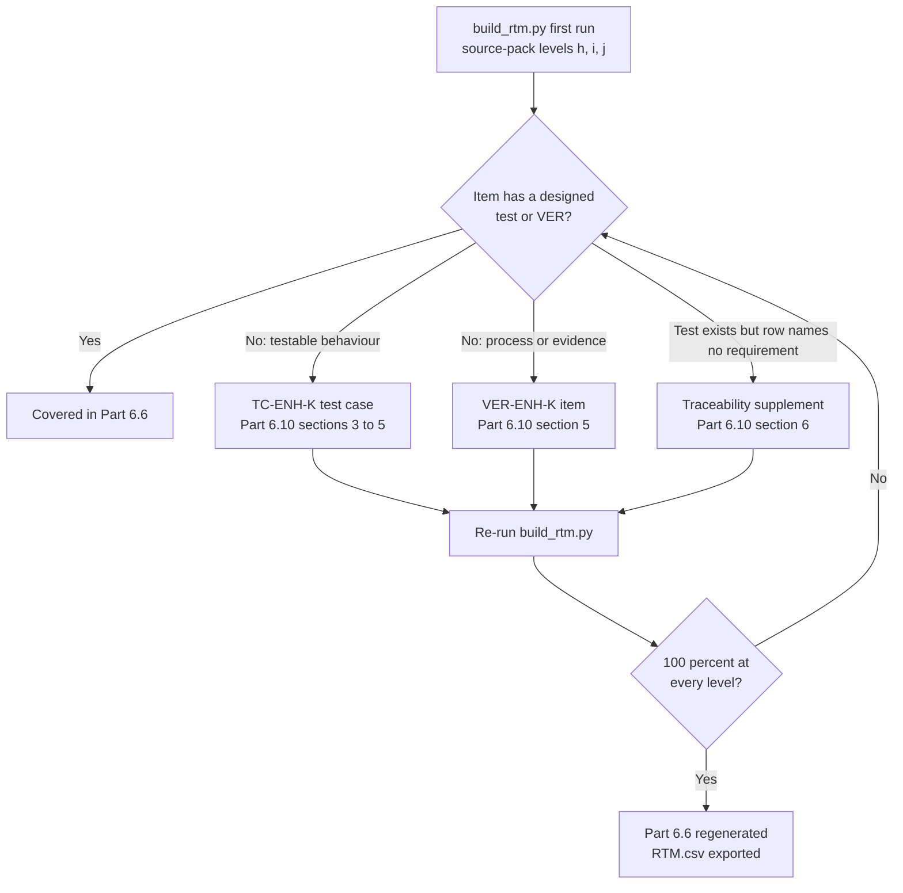

# AI Growth Engine: Employee Sales & Marketing Automation
## Application Blueprint: PART 6 (Batch 6.10), Source Pack Coverage Closure

| Field | Value |
|---|---|
| Document | Application Blueprint, Part 6 (Batch 6.10): the **closure batch for the source-pack traceability levels** added to the RTM (Part 6.6 §6.6.9–§6.6.12). It contains the test cases (`TC-ENH-K-###`) and verification items (`VER-ENH-K-###`) that the extended `assembly/build_rtm.py` found missing for source-pack requirements, stories, quality controls and one NFR, and a traceability supplement for existing source-pack tests that named no requirement. After this batch every source-pack level reports 100% |
| Version | 1.0 · 27 Nov 2026 |
| Baseline | Part 6.1 §6.1.12 (test case template, priorities, test types T01–T21, techniques), §6.1.5.4 (evidence record EVR), §6.1.13 (UAT); Part 6.6 (RTM, regenerated with sections h, i, j); Part 6.7 (TC-NFR, VER conventions); source-pack enhancement parts 2.6, 2.7a/b, 3.4, 3.5a/b, 3.6a/b, 4.4a/b, 6.8a/b/c, 6.9a/b, 7.4a/b, 8.3a/b/c; coverage CSVs in `final/coverage/` (`H_qc_map.csv`, `G_test_mapping.csv`, `H_sit_alias_map.csv`, `D_api_mapping.csv`); DEC-014 (AP-08 semantic approval), DEC-017 (TC IDs and aliases), BRD §12.1 (no required FR without a tested result) |
| Roles applied | QA Lead (primary), Business Systems Analyst, Principal Engineer, Frontend Lead, Backend Lead, Data Architect/DBA, AI Lead, Security/Compliance Lead, DevOps/SRE Lead, FinOps Lead, Product Owner |
| Tag ranges used | ASSUMPTION-510…514 · GAP-510…514 (this batch) |

**Acronyms used in this batch.** AC acceptance criterion · BVA boundary value analysis · CI continuous integration · DAG directed acyclic graph · DT decision table · EG error guessing · EP equivalence partitioning · EVR evidence record · HO handover item · IaC infrastructure as code · OKPI optimization KPI (source-pack KPI-01…35, renamed) · PBT property-based testing · QC quality control (source pack document 23) · QCL quality-control layer · RGV release-gate validator · RoE rules of engagement · RTM requirements traceability matrix · SoD segregation of duties · ST state transition · TDR technical-debt register · UC use case · VER verification item.

**Time-sensitive facts.** Tool names (Schemathesis, Semgrep, import-linter, k6, axe, tsc, Terraform/OpenTofu, pip-audit) are the ones already chosen in Parts 4.3 and 4.4; versions: verify at time of implementation (as of 27 Nov 2026). No price or provider limit is stated in this batch.

---

## 6.10.1 Purpose and method

### 6.10.1.1 Why this batch exists

The ten source-pack enhancement parts added 180 FR-ENH requirements, 135 enhancement stories, 8 NFR-ENH, 11 LT-ENH load tests, 888 TC-ENH test cases, OKPI-01…35, AG-037/038, AU-044…052 and alias mappings for the pack's 799 tests, 245 QCs and 302 SIT operations. The extended RTM generator (`assembly/build_rtm.py` with `assembly/rtm_enh.py`) traced every one of them. Its first run found these exceptions:

| Level (Part 6.6) | Items | Without a designed test before this batch | Cause | Closure in this batch |
|---|---|---|---|---|
| FR-ENH (§6.6.9) | 180 | 8 (FR-ENH-B-026; FR-ENH-I-001, -005, -031, -050, -061, -080; one more, FR-ENH-I-083, closed by the control-ID derivation) | Part 4.4b test rows cite control IDs (RGV-, SMK-, SEC-ROT, ACC-) instead of the FR; six FRs had no test at all | TC-ENH-K-001…009 and VER-ENH-K-002 |
| Enhancement stories (§6.6.9) | 135 | 26 | Stories of Parts 2.6, 2.7a, 3.6b, 4.4b, 6.9b and 7.4b are linked to rules or screens, not to an FR-ENH or a TC | TC-ENH-K-020…045 (one per story; every AC ID cited) |
| NFR-ENH (§6.6.9) | 8 | 1 (NFR-ENH-B-07 unit cost of execution) | Measured by a FinOps panel; no test or VER | TC-ENH-K-010 and VER-ENH-K-001 |
| LT-ENH (§6.6.9) | 11 | 1 untraced (LT-ENH-B-04) | Row named no NFR or OKPI | Traceability supplement §6.10.6 |
| TC-ENH traced to a requirement (§6.6.9) | 888 | 6 untraced | Rows named only a family code or a quoted source heading | Traceability supplement §6.10.6 |
| QC (§6.6.11) | 245 | 54 | `H_qc_map.csv` references are section citations (for example "§4.33.2 typecheck stage") with no test or VER ID | TC-ENH-K-050…085 and VER-ENH-K-010…027 |
| OKPI, AG/AU, 799 source tests, 302 SIT aliases, 321 source API operations | 35 · 11 · 799 · 302 · 321 | 0 | — | None needed |

### 6.10.1.2 Conventions

| Item | Rule |
|---|---|
| Test case ID | `TC-ENH-K-###` (group letter K = coverage closure; the sequence is never reused). Template = Part 6.1 §6.1.12.2: ID, Title, Linked requirement/story (incl. QC and source aliases), Pre-conditions and data, Steps, Expected result (with the no-side-effect assertion for each denial), Priority P0–P3, Type T01–T21, Technique, Automation candidate, Level |
| Verification item ID | `VER-ENH-K-###`, template = Part 6.7 §6.7.3 (method Inspection, Review, Analysis or Demonstration; owner; independent reviewer; evidence; wave/gate; acceptance criterion). A VER is **not** a test case and is counted separately in Part 6.6, as for VER-### |
| Linked column | Names every item the case closes (FR-ENH, story and its AC IDs in full, NFR-ENH, QC, OKPI) and the existing tests it complements. `build_rtm.py` reads every ID in the row, so a link written here is a link in the RTM |
| Test data | Synthetic only: GSE-SYN dataset (Part 6.1 §6.1.6), two-tenant fixture T1 (Owner Portfolio) and T2 (External-A), seed startups AppNAI, MedMaarg, EduVerse, OrganicSpec. No real personal, patient or student data (BRL-PRV, DEC-021) |
| Evidence | Each execution produces an EVR (Part 6.1 §6.1.5.4) with build digest; VER evidence is an EVR of type review/inspection/analysis/demonstration (RECOMMENDATION-090) |

### 6.10.1.3 How a link is derived (summary of the Part 6.6 rules this batch relies on)

| Rule | Basis |
|---|---|
| A test covers an item when the test row cites it, or when the item's own row names the test | Part 6.6 §6.6.1.1 step 5, extended to all parts |
| A story is covered by its own tests or by the tests of the FR-ENH it realizes | [ASSUMPTION-510] |
| An FR-ENH whose requirement text names control IDs (for example "RGV-01…15") is covered by the tests that cite those control IDs | [ASSUMPTION-510] |
| A QC is covered by a test or VER that cites it, or by the tests/VER of the requirements and controls (AP-, DEC-, CA-, GL-, EG-, BLK-, RB-, ABAC-) named in its `blueprint_verification_refs` | [ASSUMPTION-511] |
| A source test, SIT alias or source API operation is covered when its mapped blueprint test exists (CSV columns `primary_tcs`, `supporting_tcs`, `tc_enh`, `test`; SIT alias rule of Part 6.6 §6.6.4) | Coverage CSVs; DEC-017 |

---

## 6.10.2 Coverage closure map

---

## 6.10.3 Closure test cases: source-pack requirements (FR-ENH, NFR-ENH)

| ID | Title | Linked | Pre-conditions and data | Steps | Expected result | P | Type | Tech | Auto | Lvl |
|---|---|---|---|---|---|---|---|---|---|---|
| TC-ENH-K-001 | Fail CI on a seeded violation of each coding-standard rule family in the enforcement matrix | FR-ENH-I-001; US-21-EI01; US-21-EI02; Part 4.4a §4.4.5.1.25; complements TC-ENH-I-001, TC-ENH-I-006, TC-ENH-I-007 | Branch `ci/seeded-violations` with one violation per automated family: CS-GEN (cross-module private import), CS-PY (`float` money), CS-DJ (raw SQL without scope), CS-API (route without permission class), CS-MIG (migration without RLS), CS-WRK (task without `acks_late`), CS-TS (`any` in strict file), CS-A11Y (button without name), CS-SEC (hard-coded token pattern), CS-OBS (log with phone pattern), CS-DEP (dependency with unknown licence), CS-AIC (PR without AI field) | 1. Open a PR from the branch. 2. Run PL-02…PL-09, PL-12, PL-15 as mapped in the matrix. 3. Read the pipeline summary | Each family fails at the stage named in the matrix and names the rule ID; no stage is skipped; merge is blocked by branch protection; the pipeline summary lists 12 failing families and 0 passing for the seeded branch | P1 | T02 | EP | Y | CT |
| TC-ENH-K-002 | Reject a coding-standard waiver without owner, expiry or approver | FR-ENH-I-001; Part 4.4a §4.4.5.1 waiver process | Waiver file `docs/waivers.yaml` entries: W-1 complete (rule CS-PERF-01, owner, approver R01 delegate, expiry +30 days); W-2 missing expiry; W-3 approver equals requester; W-4 expired yesterday | 1. Run the waiver lint in PL-05 against each entry. 2. Re-run the seeded CS-PERF-01 violation with W-1, then with W-4 | W-1 accepted and the violation is reported as *waived* with the waiver ID; W-2 and W-3 rejected with the missing/invalid field; W-4 treated as no waiver, so the build fails; no waiver silences a CS-SEC or CS-ADP MUST rule | P2 | T19 | DT | Y | CT |
| TC-ENH-K-003 | Technical-debt register entry is complete and an overdue item is escalated at the monthly review | FR-ENH-I-005; Part 4.4a CS-DOC-05 (TDR fields); QC-188 | Register with TD-1 complete (all 15 TDR fields), TD-2 missing `owner` and `target_release`, TD-3 `Critical` with `remediation_date` 10 days past, TD-4 closed without `regression_evidence` | 1. Run the register validator (PL-05 advisory). 2. Generate the monthly review pack. 3. Close TD-4 | TD-2 flagged with the two missing fields; TD-3 listed first under "Overdue Critical" with its owner and escalated to the Principal Engineer; closing TD-4 is refused until a regression TC ID is recorded; the review pack carries the review date and attendees | P2 | T21 | DT | Y | IT |
| TC-ENH-K-004 | Queue-age scaling: manual lever at pilot, automatic scale-out at Topology B with a cost ceiling | FR-ENH-I-031; NFR-ENH-B-04; Part 4.4b §4.4.5.2.2 | `perf` environment. Profile A (pilot, single host): seed 2,000 `research` tasks. Profile B (Topology B): worker service min 2, max 6 (ceiling per B01); seed `transactional` backlog | 1. Profile A: hold the backlog until `celery_queue_oldest_age_seconds{queue=research}` exceeds 30 min. 2. Profile B: push `transactional` age above 60 s. 3. Keep the load until the ceiling is reached | A: no automatic scaling; an alert with the scaling runbook link is raised to on-call; B: scale-out starts within 2 evaluation periods, age returns ≤ 60 s; at 6 workers AL-51 fires and no further instance starts; scale-in after the backlog clears; cost metric per 1,000 tasks recorded | P2 | T03 | ST | Y | SYS |
| TC-ENH-K-005 | Availability and OKPI computation returns exact values, Unassessed without a denominator and a stale label | FR-ENH-I-050; OKPI-12; OKPI-26; US-17-EC01; Part 4.4b §4.4.5.4.4 | Synthetic 30-day probe series (43,200 min): 120 min approved maintenance, 30 min both-probes-fail, 15 min with 5xx ratio 6%; second series with probe coverage 94%; OKPI-12 with 0 events; OKPI-26 last refreshed 3 h ago with freshness class F-1 | 1. Run the availability job on series 1. 2. Run on series 2. 3. Render the OI panel for OKPI-12 and OKPI-26 | Series 1: eligible 43,080 min, bad 45 min, availability = 43,035 ÷ 43,080 = 99.896% (4 dp exact), error budget at 99.5% SLO = 215.4 min; series 2: verdict *Unassessed* (never Pass); OKPI-12 shows *Unassessed* and no number; OKPI-26 shows "stale since" with the timestamp | P1 | T21 | BVA | Y | IT |
| TC-ENH-K-006 | Delivery package is complete before the Release 1 acceptance record can be signed | FR-ENH-I-061; US-21-EI06; QC-25; QC-230; Part 4.4b §4.4.5.7.2 | A090 release R1 with the HO checklist: all HO-T01…T10 and HO-B01…B05 acknowledged, HO-T08 (last restore drill report) missing | 1. As R01 open the acceptance record HO-B06. 2. Attach HO-T08. 3. Re-open HO-B06 | Step 1: signing disabled, A090 lists HO-T08 as Pending with its acknowledging role; step 3: signing enabled; signed package hash stored with release tag and image digests; the acceptance record stays unsigned until actual delivery (BRD §12.2) | P1 | T19 | ST | Y | SYS |
| TC-ENH-K-007 | Access handover rotates build-team credentials and removes developer production access | FR-ENH-I-061; FR-ENH-I-083; FR-ENH-I-082; US-21-EI06; QC-224; HO-A01…A06 | Staging copy of the access inventory: 3 build-team IAM users, 1 vault role owned by the build lead, 1 provider API key created by a developer, break-glass envelope custodians C1/C2 | 1. Run the handover procedure HO-A01…A06. 2. Attempt a staging API call with the old provider key. 3. Attempt console login as a build-team user. 4. Open the signed inventory in A090 | Old key rejected; build-team users disabled; vault role owners changed to the receiving owners; break-glass re-sealed with new custodians; inventory signed by the Founder/CTO and stored in A090; no credential value appears in the inventory or logs | P0 | T07 | UC | Y | SYS |
| TC-ENH-K-008 | Penetration test cannot start without a signed RoE and runs only against synthetic, dispatch-disabled targets | FR-ENH-I-080; Part 4.4b §4.4.5.5.1 PT-ROE-01…04, -06 | Engagement record E-1 without the Founder/CTO signature; E-2 signed, target `staging`, tester IPs registered | 1. Request tester credentials for E-1. 2. For E-2 issue identities in T1 and T2. 3. Check `EXTERNAL_DISPATCH_ENABLED` and payment/e-sign mode in the target. 4. Probe from an unregistered IP | E-1: credentials refused with reason "RoE unsigned"; E-2: identities only in synthetic tenants; dispatch off and sandbox mode confirmed by the pre-engagement checklist; WAF detection-only applies to registered IPs only | P1 | T07 | DT | N (process with an automated pre-check) | SYS |
| TC-ENH-K-009 | Severity overlay takes the higher rating, never waives Critical business-impact findings, and the finding record is complete | FR-ENH-I-080; NFR-067; Part 4.4b §4.4.5.5.2 and PT-FND | Findings F-1 cross-tenant disclosure with CVSS 5.3; F-2 privilege escalation CVSS 8.1; F-3 missing PT-FND-10 redacted request | 1. Import the three findings into the finding register. 2. Request a waiver for F-1. 3. Validate F-3 | F-1 final severity Critical (business impact wins), waiver request refused "non-waivable"; F-2 High, waiver allowed only with independently verified non-exploitability; F-3 rejected listing PT-FND-10; Critical findings notified to the safety contact within 4 h | P1 | T07 | DT | Y | IT |
| TC-ENH-K-010 | Unit cost per 1,000 completed tasks and p95 queue age per queue and tenant are computed exactly | NFR-ENH-B-07; OKPI-35; Part 3.4 DB-09 panel | Week fixture: tenant T1 completes 12,000 tasks; compute cost INR 1,800.00, metered provider INR 600.00, AI INR 1,200.00; tenant T2 completes 0 tasks; queue age samples per queue | 1. Run the weekly unit-cost job. 2. Read the DB-09 panel for T1 and T2 | T1 unit cost = (1,800 + 600 + 1,200) ÷ 12 = INR 300.00 per 1,000 tasks (Decimal, 2 dp); p95 queue age per queue matches the fixture percentile; T2 shows *Unassessed* (no denominator), never INR 0 | P2 | T20 | BVA | Y | IT |

---

## 6.10.4 Closure test cases: source-pack stories

One test case per uncovered story; every acceptance-criterion ID of the story is cited, and the existing source-pack test that exercises the same rule is named as a complement.

| ID | Title | Linked | Pre-conditions and data | Steps | Expected result | P | Type | Tech | Auto | Lvl |
|---|---|---|---|---|---|---|---|---|---|---|
| TC-ENH-K-020 | Pause campaign sending at the bounce threshold while transactional mail continues | US-08-EA02; AC-08EA02-01; BRL-ENH-A-06; KPI-17; DEC-025 | Sender S-ORG-1 (OrganicSpec) with 1,000 campaign emails in 7 days; simulator returns 21 hard bounces (2.1%, above the policy threshold) | 1. Ingest the bounce webhooks. 2. Trigger the next campaign step. 3. Send a transactional invoice notice from S-ORG-1 | Campaign sends from S-ORG-1 paused with reason code; R10 alerted; campaign step not dispatched (0 provider calls, reservation released); transactional notice dispatched | P0 | T19 | BVA | Y | IT |
| TC-ENH-K-021 | Opt-out received after enqueue and before lease always wins | US-08-EA02; AC-08EA02-02; BRL-ENH-A-06; complements TC-ENH-A-021 | Step M-1 queued 10:00:00 with an INR 0.20 reservation; contact opts out 10:00:05; worker lease 10:00:09 (frozen clock) | 1. Let the worker lease M-1. 2. Read outcome, audit and budget | 0 provider calls; exactly one `suppressed` outcome and one audit event; INR 0.20 reservation released; retry creates no second outcome | P0 | T16 | ST | Y | IT |
| TC-ENH-K-022 | Recording and transcription require recorded permission; MedMaarg never recorded | US-09-EA01; AC-09EA01-01; AC-09EA01-02; BRL-ENH-A-05; complements TC-ENH-A-018 | MTG-8 (AppNAI) without permission; MTG-9 (AppNAI) with permission recorded; MedMaarg demo MTG-10 with permission recorded | 1. Open MTG-8 and MTG-10 actions. 2. Call the record API for MTG-8 directly | MTG-8: Record and Transcribe disabled with reason BRL-ENH-A-05; API returns 403 and no recording job; MTG-9 enabled; MTG-10 recording unavailable regardless of permission | P0 | T19 | DT | Y | E2E |
| TC-ENH-K-023 | Author cannot publish own sensitive-claim page | US-19-EA02; AC-19EA02-01; BRL-ENH-A-09; ABAC-ENH-A-04; complements TC-ENH-A-028 | Page P-9 with a price claim authored by R05L user U1; U2 holds publisher role | 1. U1 publishes P-9. 2. U2 publishes P-9 | Step 1: 403 BRL-ENH-A-09, page stays Draft, no CDN purge; step 2: published with publisher ≠ author recorded in audit | P0 | T07 | DT | Y | IT |
| TC-ENH-K-024 | Productivity study records evidence and rejects a safeguard-reducing candidate | US-21-EA02; AC-21EA02-01; AC-21EA02-02; NFR-034; complements TC-ENH-C-018, TC-ENH-A-040 | Study plan for P04 "review 10 signals": 5 participants baseline, 5 candidate; candidate B removes the evidence panel | 1. Run the study and submit results. 2. Submit candidate B for acceptance | EVR has participants, median and p90 time, error count and build digest; candidate B rejected as a safeguard reduction regardless of time saved | P2 | T09 | UC | N (moderated study) | UAT |
| TC-ENH-K-025 | Template reviewer cannot approve own template; published versions are immutable | US-18-EA01; AC-18EA01-01; AC-18EA01-02; BRL-ENH-A-11; FR-A113; complements TC-ENH-A-029 | R11T user T-1 authored TPL-3 v4; reviewer T-2 | 1. T-1 approves v4. 2. T-2 approves after diff and simulation. 3. Edit v4 | Step 1: 403 BRL-ENH-A-11, state unchanged; step 2: Published; step 3: creates v5 Draft and v4 hash unchanged | P0 | T19 | ST | Y | IT |
| TC-ENH-K-026 | Receipt cannot be allocated across legal entities | US-15-EA02; AC-15EA02-01; BRL-ENH-A-07; KPI-13; complements TC-ENH-A-031 | Receipt RC-1 INR 50,000.00 in the OrganicSpec account; MedMaarg invoice INV-77 | 1. R08 allocates RC-1 to INV-77 | 422 BRL-ENH-A-07; finance exception created; INV-77 balance unchanged; RC-1 stays unallocated; no ledger entry | P0 | T19 | EP | Y | IT |
| TC-ENH-K-027 | No renewal outreach after cancellation; customer-initiated renewal opens a case | US-16-EA01; AC-16EA01-01; AC-16EA01-02; BRL-ENH-A-12; WF-12; complements TC-ENH-A-032 | Contract CT-5 Cancelled; contract CT-6 Active, renewal window open; customer of CT-5 submits a renewal request through W28 | 1. Run the renewal scheduler. 2. Submit the W28 request | CT-5: no renewal case, no outreach; CT-6: renewal case created; W28 request creates a renewal case for review without outreach | P1 | T01 | DT | Y | IT |
| TC-ENH-K-028 | PO approver cannot verify the goods receipt when buy-side SoD is on | US-14-EA01; AC-14EA01-01; BRL-ENH-A-08; ABAC-ENH-A-05; CFG-ENH-A-06 | `buy_side_sod` on; U-8 approved PO-12; U-9 holds verifier role | 1. U-8 verifies the receipt. 2. U-9 verifies. 3. Switch `buy_side_sod` off and repeat step 1 on PO-13 | Step 1: 403 BRL-ENH-A-08, receipt unverified; step 2: verified; step 3: allowed and audited with the configuration revision | P1 | T19 | DT | Y | IT |
| TC-ENH-K-029 | Optimization Intelligence panel shows measured value with evidence, Unassessed without data, read-only in portfolio scope | US-17-EC01; OKPI-07; OKPI-12; FR-ENH-C-017 | MedMaarg scope; OKPI-07 with 240 events in November; OKPI-12 with 0 events; scope "All startups" | 1. Open the OI panel in A089 for MedMaarg. 2. View OKPI-12. 3. Switch scope to All startups | Value, target, period 1–30 Nov, denominator 240 and an evidence link shown; OKPI-12 *Unassessed* with no number; portfolio scope shows the read-only badge and no edit controls | P1 | T01 | EP | Y | E2E |
| TC-ENH-K-030 | Legacy operation alias returns the canonical response and refuses invalid transitions | US-01-EC01; SM-OP-001; complements TC-ENH-D-001 | Tenant admin token for T1; order O-1 Draft | 1. GET `/api/v1/sales/orders`. 2. GET `/api/v1/commercial/admin/orders`. 3. POST `/api/v1/sales/orders/O-1/control` action `complete` | Bodies of steps 1 and 2 are equal for the same scope; step 1 carries `Deprecation` and a successor link; step 3: 409 `INVALID_TRANSITION`, O-1 stays Draft, no event | P1 | T01 | ST | Y | IT |
| TC-ENH-K-031 | Related-screen navigation keeps scope and denies records outside the grant | US-17-EC02; complements TC-ENH-C-014 | R03 in AppNAI with deal D-9; deal D-10 in EduVerse (no role) | 1. On A029 choose Related > Proposal builder. 2. Follow a related link to D-10 | A065 opens in AppNAI with D-9 preselected; D-10 shows the denied state, no EduVerse data in DOM or network responses | P0 | T15 | EP | Y | E2E |
| TC-ENH-K-032 | Status footer shows a degraded provider within 60 s and focus returns after the drawer | US-17-EC03; complements TC-ENH-C-009, TC-ENH-C-010 | Email adapter for OrganicSpec set to degraded by the simulator; A016 list with 10 rows | 1. Open any Admin page in OrganicSpec. 2. Open the drawer from row 7; press Escape | Footer "Email provider degraded" with link to A014 within 60 s; focus returns to row 7 "Open" control; screen reader announces the state change | P2 | T08 | ST | Y | E2E |
| TC-ENH-K-033 | Adapter card states partial free coverage honestly and hides development-only plugins | US-04-EC01; complements TC-ENH-C-011 | Search adapter free quota = 60% of planned volume; "Skill Creator" registered as development-time plugin | 1. Open A008. 2. Open every runtime adapter selector | Card text "Free quota covers about 60% of planned volume; residual cost estimated" and no "Free" badge; "Skill Creator" absent from every runtime selector | P2 | T01 | EP | Y | E2E |
| TC-ENH-K-034 | Website ingress rejects Admin operations and shows the expired-grant state | US-19-EC01; NFR-001; complements TC-ENH-C-015, TC-ENH-D-N22 | Website origin; onboarding token expired yesterday | 1. POST `/api/v1/invoices/I-1/payment-link` from the Website origin. 2. Open the portal onboarding page with the expired token | Step 1: 404 at the Website ingress, no handler executed (0 application log lines for the route); step 2: expired-grant state with a request-new-link action, no tenant data | P0 | T07 | EP | Y | SYS |
| TC-ENH-K-035 | Missing design evidence keeps the wave gate pending | US-21-EC01; complements TC-ENH-C-013 | Wave W4 scope includes A105; A105 lacks the denied-role screenshot | 1. Evaluate the wave gate in A090 | A105 evidence item *Pending*; gate cannot pass; the missing artefact type is named | P1 | T19 | ST | Y | SYS |
| TC-ENH-K-036 | Approval screen usable at 768 px with keyboard and 24 × 24 px targets | US-17-EC04; WCAG 2.2 AA SC 2.5.8 | R02 on a 768 px viewport; A068 with 5 queued approvals | 1. Open A068. 2. Complete one approval using keyboard only. 3. Measure target sizes | Queue and item panes stack; every action reachable by keyboard with visible focus; all targets ≥ 24 × 24 px; axe 0 serious | P1 | T08 | EP | Y | E2E |
| TC-ENH-K-037 | Startup provisioning accepts only approved template versions and creates configuration revision 1 | US-01-EE01; FR-ENH-E-001; BRL-TEN-11; complements TC-ENH-E-031 | Template TPL-AGRI v3 approved, v4 draft; v3 contains no client data | 1. As R01 list selectable templates. 2. Provision a startup from v3. 3. Inject a client e-mail into a copy of v3 and run the validator | Only v3 selectable; provisioning creates configuration revision 1 carrying the template hash; validator rejects the copy with the offending field path | P1 | T01 | EP | Y | IT |
| TC-ENH-K-038 | Portal service request: allowlisted kinds, own tenant only, export stays a draft awaiting approval | US-20-EE01; complements TC-ENH-E-030 | T2 client admin (R12); T3 user; kinds allowlist {support, plan_change, data_export} | 1. Create a request of kind `delete_tenant`. 2. Create `data_export`. 3. As T3 read the T2 request by ID | Step 1: 400 kind not allowed; step 2: draft export job awaiting approval, no file generated; step 3: 404 without existence hint | P0 | T15 | EP | Y | IT |
| TC-ENH-K-039 | Delivery milestones respect quantity tolerance and need evidence for acceptance | US-14-EE01; complements TC-ENH-E-027, TC-ENH-E-028 | Order with 100 units, tolerance 2% | 1. Plan milestones totalling 103 units. 2. Plan 102. 3. Accept a milestone without evidence. 4. Accept with evidence | Step 1 rejected; step 2 accepted; step 3 rejected, no fulfilment event; step 4 exactly one fulfilment event | P1 | T01 | BVA | Y | IT |
| TC-ENH-K-040 | Restore drill cannot dispatch and records measured RPO and RTO | US-21-EE01; NFR-ENH-B-06; complements TC-ENH-E-022, TC-ENH-E-018 | Snapshot of staging restored to the recovery sandbox | 1. Restore. 2. Attempt a dispatch. 3. Verify checksums. 4. Close the drill | Dispatch disabled (RD-02), 0 provider calls; checksum verified (RD-04); DCE record contains measured RPO and RTO with timestamps | P0 | T12 | UC | Y | SYS |
| TC-ENH-K-041 | Production migration blocked while schema decisions are open | US-21-EE02; complements TC-ENH-E-005 | Migration M-0042 touching a table with SDR-7 Open | 1. Run the deploy pipeline. 2. Approve SDR-7 and re-run | Step 1: MG-03 fails listing SDR-7, no schema change; step 2: pipeline proceeds | P1 | T11 | ST | Y | CT |
| TC-ENH-K-042 | Tenant offboarding exports completely without affecting other tenants | US-20-EE02; complements TC-ENH-E-019, TC-ENH-E-020 | T2 being offboarded with 3 active runs; T1 running workflows | 1. Start offboarding of T2. 2. Compare the export manifest with source row counts. 3. Compare T1 metrics before/after | T2 runs paused; manifest row counts equal source counts per entity; T1 metrics and run states unchanged | P0 | T15 | UC | Y | SYS |
| TC-ENH-K-043 | Field set follows the approved field decision and removed fields are rejected by the API | US-17-EH01; AC-17-EH01-01; AC-17-EH01-02; QC-061; QC-081 | SPDEC-X-A029 Approved; startup without the "order desk" capability; W12 decision removes "full postal address" | 1. Render A029. 2. POST W12 with the removed field | Only approved fields for the capability profile shown; W12 request rejected with 400 naming the field; nothing stored | P2 | T01 | EP | Y | IT |
| TC-ENH-K-044 | SaaS client service request is tenant-scoped and a plan change needs Service Owner approval | US-20-EH01; AC-20-EH01-01; AC-20-EH01-02; AC-20-EH01-03; FR-W34; SM-UX-API-07 | T2 client admin raises a plan change to Grow; T3 user; R13 Platform Support | 1. Read the request as T2 user, R13 and T3 user. 2. Inspect entitlements before approval. 3. Service Owner approves | T2 and R13 see it; T3 gets 404 without existence hint; no entitlement change before approval; after approval a new ServiceSubscription revision exists | P0 | T15 | ST | Y | IT |
| TC-ENH-K-045 | Native-first search uses the approved feed and records inaccessible sources as unknown | US-05-EF01; AC-05-EF01-01; AC-05-EF01-02; AU-045 | Plan "Odisha hospital tenders" covered by an approved procurement feed; second source returns 403 | 1. Execute the plan. 2. Read the evidence status of the second source | Feed adapter used; 0 Tavily credits consumed; second source status `inaccessible`, plan does not record "no results" | P1 | T20 | EP | Y | IT |

---

## 6.10.5 Closure items: quality controls (QC, source document 23)

### 6.10.5.1 Test cases for testable QCs

| ID | Title | Linked | Pre-conditions and data | Steps | Expected result | P | Type | Tech | Auto | Lvl |
|---|---|---|---|---|---|---|---|---|---|---|
| TC-ENH-K-050 | Fail the build when an ID is duplicated or a business rule conflicts | QC-033; Part 0 §0.4; DEC-014 | Branch adding BRL-TEN-03 twice with different text and FR-A001 twice | 1. Run `build_registers.py` and the duplicate check in PL-05 | Build fails listing both IDs and files; `final/duplicate_ids.csv` shows them as unresolved | P2 | T19 | EP | Y | CT |
| TC-ENH-K-051 | Every operation rejects missing, malformed, boundary and unknown input values | QC-040; complements TC-ENH-D-N07 | OpenAPI schema; Schemathesis profile with boundary strategies | 1. Run the negative-input profile on every operation | Each case returns 400 `VALIDATION_FAILED` with `errors[].field`; no 5xx; no partial write (row counts unchanged) | P1 | T01 | BVA | Y | CT |
| TC-ENH-K-052 | RTM gate requires a positive and a negative test per in-scope requirement | QC-046; QC-183; BLK-10 | RTM CSV for the release scope with one FR having only positive tests | 1. Run `build_rtm.py --check` in G3 | Gate fails naming the FR and the missing polarity; P0 BRLs without a negative test also fail | P1 | T19 | DT | Y | CT |
| TC-ENH-K-053 | Generated role × action × scope matrix denies every unassigned role | QC-047; QC-104; QC-185; Part 2.3 RBAC matrix | R01…R20 × all Admin actions × scope {own startup, other startup, portfolio, other tenant} generated from the matrix | 1. Execute the generated suite | Allowed cells succeed; every unassigned cell returns 403/404 with 0 side effects and an audit row; property-based variant finds no allowed wrong-product, wrong-tenant or wrong-role call | P0 | T15 | PBT | Y | IT |
| TC-ENH-K-054 | Maker and checker must differ on finance approvals | QC-052; BRL-APR; GL-B07 | R08 U1 creates refund RF-2; U1 also holds R09 | 1. U1 approves RF-2. 2. U2 (R09) approves | Step 1: 403 `SEPARATION_OF_DUTIES`, refund unchanged; step 2 approved; audit holds both identities | P0 | T19 | DT | Y | IT |
| TC-ENH-K-055 | Loading, empty, error and retry states are distinct on every list screen | QC-059; Part 2.5 §2.47 | Component harness for each list screen with mocked responses: pending, `[]`, 500, network error then success | 1. Render each state. 2. Activate Retry | Four distinct states with distinct accessible names; Retry re-issues one request; no stale rows during loading | P2 | T01 | EP | Y | UT |
| TC-ENH-K-056 | Strict TypeScript passes with no new suppressions | QC-087; QC-210 | PR adding one `@ts-ignore` and one `any` | 1. Run PL-02 typecheck and the suppression counter | `tsc --strict` must pass; suppression count above the main-branch baseline fails the stage | P2 | T02 | EP | Y | CT |
| TC-ENH-K-057 | Component tests use accessible queries | QC-088 | Test file using `container.querySelector` and `getByTestId` where a role is available | 1. Run ESLint testing-library rules in PL-02 | Lint fails naming the query; accessible-role query version passes | P3 | T02 | EP | Y | CT |
| TC-ENH-K-058 | Errors render a safe message with a correlation ID and never a stack trace | QC-092; QC-101; QC-109; Part 3.2 §3.2.1.9 | API forced to raise: validation, denial, conflict, provider failure, unhandled exception | 1. Call each from the Admin UI. 2. Scan response bodies and DOM | Codes 400/403/409/502/500 with safe `code` and correlation ID; no stack trace, SQL, file path, secret or token pattern in any body or DOM | P1 | T07 | EG | Y | SYS |
| TC-ENH-K-059 | Domain rules hold when the service is called without the serializer | QC-098; BRL-QTE-02 | Direct service calls with an invalid state transition and a negative amount | 1. Call the services from a unit test | Service raises the domain error; no row changed; serializer bypass cannot apply the change | P1 | T01 | ST | Y | UT |
| TC-ENH-K-060 | Every route has a reviewed contract with fields, types, requiredness and examples | QC-103; QC-191; complements TC-ENH-D-N18 | OpenAPI document of the release | 1. Run the contract completeness check (CI-1…CI-8) | Fails for any route without request/response schema, `required`, example or a positive and negative contract test | P1 | T19 | EP | Y | CT |
| TC-ENH-K-061 | Adapter callbacks verify signature, timestamp and provider event ID | QC-110; QC-147; complements TC-ENH-D-N16, TC-ENH-D-N17 | Every webhook endpoint in the adapter catalogue; tampered, stale (> 5 min), duplicate and out-of-order events | 1. Replay each case on each endpoint | Tampered 401 `WEBHOOK_SIGNATURE_INVALID`; stale 401 `WEBHOOK_REPLAY_REJECTED`; duplicate 200 with no second effect; state never regresses | P0 | T16 | EP | Y | IT |
| TC-ENH-K-062 | Migration dry-run on a production-like clone reconciles counts and invariants | QC-115; QC-197; QC-211; GL-D01 | Anonymised production-like clone; release migrations | 1. Run expand migrations. 2. Run app N-1 and N against the expanded schema. 3. Reconcile | Row counts and invariant queries equal before/after; N-1 and N pass smoke; contract steps are refused in the same release as their expand | P0 | T11 | ST | Y | SYS |
| TC-ENH-K-063 | Scoped list queries keep their documented plan | QC-116; complements TC-ENH-E-002 | Year-1 synthetic data; stored EXPLAIN baselines | 1. Run EXPLAIN for each scoped list query | Plan uses the documented index; a sequential scan on a table above 10,000 rows fails with the query name | P2 | T03 | EP | Y | IT |
| TC-ENH-K-064 | Retrieval recall@k meets target on labelled synthetic examples | QC-132; Part 7.3 retrieval targets | 200 labelled query–document pairs across four verticals | 1. Run retrieval at k = 5 | recall@5 at or above the Part 7.3 target; result stored in the AI eval report with model and index revision | P2 | T14 | EP | Y | IT |
| TC-ENH-K-065 | Rate limits and Retry-After are respected without parallel bypass | QC-146 | Provider simulator returns 429 with `Retry-After: 30`; 4 workers | 1. Dispatch 20 calls | No call before 30 s; no worker bypasses the shared limiter; jobs end as delayed, not failed | P1 | T18 | ST | Y | IT |
| TC-ENH-K-066 | Nightly contract test against provider sandboxes detects drift | QC-149; complements TC-ENH-J-047 | Sandbox returns an added required field | 1. Run the nightly contract suite | Suite fails naming adapter and field; adapter stays on the current schema behind its flag | P2 | T10 | EP | Y | CT |
| TC-ENH-K-067 | Unit tests run with network blocked and synthetic data only | QC-186; Part 6.1 §6.1.6.4 | Unit test that opens a socket; fixture with an e-mail outside the synthetic domain | 1. Run the unit suite | Socket attempt fails the test; fixture scanner fails on the non-synthetic e-mail | P1 | T19 | EP | Y | UT |
| TC-ENH-K-068 | Critical rule branch coverage is measured and retained | QC-187; NFR-ENH-B-08 | Coverage report of `policy/`, finance services and state machines | 1. Run PL-04 | Branch coverage of the enumerated critical rule modules ≥ 90% [ASSUMPTION-512]; report stored with the build digest | P1 | T19 | EP | Y | CT |
| TC-ENH-K-069 | Failure paths roll back and clean up | QC-189; QC-196 | Exceptions injected after reservation and after ledger write | 1. Run the service under fault injection | Transaction rolled back; reservation released; locks freed; no orphan outbox row | P1 | T18 | EG | Y | UT |
| TC-ENH-K-070 | CI fails on unexplained skips and records the seed | QC-190; Part 6.1 §6.1.9.7 | Test marked skip without a quarantine ticket | 1. Run PL-04 | Stage fails naming the test; the run records the random seed for reproduction | P2 | T02 | EP | Y | CT |
| TC-ENH-K-071 | Provider timeout, worker crash and database rollback are recovered | QC-196; RB-011 | Chaos profile: timeout after submit, `kill -9` mid-task, forced rollback | 1. Run each fault on a dispatching workflow | Timeout → uncertain outcome reconciled, no duplicate send; crash → task redelivered once (`acks_late`); rollback → no outbox row | P0 | T18 | EG | Y | SYS |
| TC-ENH-K-072 | Evidence record schema rejects incomplete entries | QC-198; Part 6.1 §6.1.5.4 | EVR without actual result; EVR without log ID; failed EVR without defect reference | 1. Submit each to A090 | Each rejected naming the missing field | P2 | T19 | EP | Y | IT |
| TC-ENH-K-073 | Every Website and Admin screen has a UAT scenario and an accessible error path | QC-200; SM-UX-UAT-W01; SM-UX-UAT-A001 | Screen inventory (34 Website + 113 Admin) and UAT pack mapping | 1. Run the UAT-coverage check. 2. Run axe on each screen's error state | 147 of 147 screens mapped; axe 0 serious on error states | P1 | T08 | EP | Y | SYS |
| TC-ENH-K-074 | IaC plan requires approval and blocks public resources | QC-207; Part 4.3 §4.34 | Plan adding a public S3 bucket and an open security group | 1. Run the IaC pipeline | Policy check fails both; apply cannot run without an approved plan | P0 | T07 | EP | Y | CT |
| TC-ENH-K-075 | Deployment refuses an artefact whose digest differs from the tested build | QC-209; GL-T01 | Release manifest digest D1; registry image retagged to D2 | 1. Deploy | Deploy refused with both digests; nothing changes in the target | P0 | T07 | EP | Y | SYS |
| TC-ENH-K-076 | Required CI checks gate promotion | QC-210 | PR with failing scan stage | 1. Attempt merge and promotion | Merge blocked by branch protection; promotion job refuses without all required checks | P1 | T02 | EP | Y | CT |
| TC-ENH-K-077 | Dashboard, API, queue, database, provider and budget alerts fire on synthetic conditions | QC-216; GL-T06 | Alert unit tests with synthetic metrics per alert | 1. Run alert tests | Each alert fires at its threshold and resolves below it; each has a runbook link | P1 | T21 | BVA | Y | IT |

### 6.10.5.2 Verification items for process QCs and non-executable statements

| ID | Verification item | Linked | Method | Owner | Independent reviewer | Evidence | Wave / gate | Acceptance criterion |
|---|---|---|---|---|---|---|---|---|
| VER-ENH-K-001 | Weekly unit-cost and queue-age review | NFR-ENH-B-07; OKPI-35 | Analysis | FinOps Lead | DevOps/SRE Lead | DB-09 panel export; weekly FinOps note | W5 onwards, weekly | Cost per 1,000 tasks reported per tenant; no SLO breach caused by right-sizing |
| VER-ENH-K-002 | Expansion-interface task DAG reconciled with Part 8.1 | FR-ENH-B-026; Part 3.4 §C | Inspection | Product Owner | Principal Engineer | Part 8.1 sprint plan with UX-TASK-FIELDS before W31–W34 and A109–A113 | W5 planning | Every UX-TASK node maps to a story; no double-counted effort |
| VER-ENH-K-010 | Requirement acceptance roles and observable results | QC-035 | Review | Product Owner | Business Systems Analyst | RTM extract with accepting role per requirement | Each wave entry (DoR) | 100% of in-scope requirements have a named accepting role and an observable result |
| VER-ENH-K-011 | Licence review for open-source replacements | QC-151; AU-047 | Review | Solutions Architect | Security/Compliance Lead | Licence register and AU-047 report | W0 and each activation | No unknown or incompatible licence |
| VER-ENH-K-012 | Total cost of ownership per replacement | QC-156 | Analysis | Solutions Architect | FinOps Lead | TCO sheet (hosting, maintenance, model, effort) | Each activation decision | TCO computed with formula and ranges |
| VER-ENH-K-013 | Release security review | QC-17 | Review | Security/Compliance Lead | QA Lead | Threat review, scan reports, negative suites | Each release (G4) | No open Critical/High; negative suites green |
| VER-ENH-K-014 | Threat model with mitigation-to-test map | QC-159 | Inspection | Security/Compliance Lead | Principal Engineer | Threat model document | W0, then each release | Every mitigation names at least one test ID |
| VER-ENH-K-015 | Escaped defects gain regression cases | QC-188 | Inspection | Principal Engineer | QA Lead | Defect tracker query | Monthly | 100% of closed production defects link a regression TC |
| VER-ENH-K-016 | SIT summary and defect closure | QC-21 | Review | QA Lead | Product Owner | SIT report | Each release (G3) | All critical SIT cases pass; linked defects resolved |
| VER-ENH-K-017 | UAT execution by representative users | QC-22; QC-201 | Demonstration | Product Owner + vertical owner | QA Lead | Signed UAT scenario evidence | Release UAT | Signed acceptance per scenario pack |
| VER-ENH-K-018 | Business acceptance per scenario | QC-199 | Demonstration | Product Owner | Founder (R01) | Acceptance EVRs | Release UAT | Every scenario approved with evidence |
| VER-ENH-K-019 | UAT sign-off without unresolved blockers | QC-206 | Review | Product Owner | QA Lead | Defect list, waivers | Go/no-go | No open S1; waivers explicit and authorized |
| VER-ENH-K-020 | Deployment rehearsal | QC-23 | Demonstration | DevOps/SRE Lead | QA Lead | Rehearsal log (migrations, secrets, rollout, smoke, rollback) | Before each go-live | Rehearsal completes with rollback exercised |
| VER-ENH-K-021 | Runbooks and on-call | QC-217 | Inspection | DevOps/SRE Lead | Operations | Runbook index and roster | Go-live | Named on-call and escalation for every alert |
| VER-ENH-K-022 | Support intake and ownership | QC-220; QC-226 | Demonstration | Operations | Product Owner | Test incident through intake | Go-live | Priority assigned and owner acknowledged within target |
| VER-ENH-K-023 | Role-based training exercises | QC-223; TC-ENH-J-051 | Demonstration | Product Owner | QA Lead | Training records per persona | Go-live | Exercises passed with synthetic examples |
| VER-ENH-K-024 | Formal handover and residual risks approved | QC-230; QC-25 | Review | Founder (R01) | Product Owner | Signed HO-B05 and HO-B06 | Release go/no-go | Owner approves handover and outstanding risks |
| VER-ENH-K-025 | Requirement uniqueness review | QC-033 | Inspection | Product Owner | Business Systems Analyst | `final/duplicate_ids.csv` | Each wave entry | 0 unresolved duplicates |
| VER-ENH-K-026 | Monthly technical-debt review held | FR-ENH-I-005 | Review | Principal Engineer | Product Owner | Review minutes | Monthly from W1 | Overdue Critical items escalated |
| VER-ENH-K-027 | Penetration-test engagement closure | FR-ENH-I-080 | Inspection | Security/Compliance Lead | Founder (R01) | Report, retest results, data-destruction confirmation | Before go-live | Critical/High retested; tester data destroyed |

---

## 6.10.6 Traceability supplement for existing source-pack tests

These items already have full test definitions in their batch; their rows named no requirement. This table adds the link only.

| Item | Verifies | Basis |
|---|---|---|
| LT-ENH-B-04 | NFR-ENH-B-02; NFR-ENH-B-04; OKPI-26 | Part 3.4 §3.4 LT table: saturation of LT-ENH-B-01 + 03 to 1.5× growth checks admission control and budget alarms for the session and job NFRs |
| TC-ENH-B-014 | LT-ENH-B-04; NFR-ENH-B-04 | Executes LT-ENH-B-04 |
| TC-ENH-D-N20 | FR-ENH-D-001; NFR-015 | Evidence record without a scenario result keeps the contract decision pending (Part 3.5 contract states) |
| TC-ENH-D-N21 | NFR-039; FR-ENH-D-001 | Seeded N+1 and payload regression on a list fails the performance suite |
| TC-ENH-D-N22 | NFR-001; OKPI-02 | Probe every Admin path through the Website distribution |
| TC-ENH-E-007 | FR-ENH-E-006; QC-197 | Expand/backfill/validate/contract with old and new application versions |
| TC-ENH-E-008 | BRL-FIN-01; QC-195 | Exact decimal, currency, duplicate, excess and partial receipts |

---

## 6.10.7 Coverage after closure

The figures are generated in Part 6.6 §6.6.2.3 by `build_rtm.py`; after this batch every source-pack level is at 100% (FR-ENH, stories, AC, NFR-ENH, LT-ENH traced, TC-ENH traced, OKPI, mandatory OKPI, AG/AU, 799 source tests, 302 SIT aliases, 321 source API operations, 245 QCs). New items added later appear automatically in Part 6.6 §6.6.12 and block A090 for their wave.

| Closure item class | Count | IDs |
|---|---|---|
| Test cases, requirements and NFR | 10 | TC-ENH-K-001…010 |
| Test cases, stories | 26 | TC-ENH-K-020…045 |
| Test cases, quality controls | 28 | TC-ENH-K-050…077 |
| Verification items | 20 | VER-ENH-K-001, -002, -010…027 |
| Traceability supplement rows | 7 | §6.10.6 |

---

## 6.10.8 Tags register

| ID | Type | Statement | Basis | Owner / validate by |
|---|---|---|---|---|
| ASSUMPTION-510 | Assumption | A source-pack story counts as covered by the tests of the FR-ENH it realizes, and an FR-ENH whose requirement text names control IDs (RGV-, SMK-, AL-, ACC-, SEC-ROT, RBK-) counts as covered by the tests citing those control IDs. Both are reported separately from direct links in Part 6.6 | Part 6.6 §6.6.9; Part 4.4b §4.4.5.9 | QA Lead; confirmed by the AP-08 10% spot check |
| ASSUMPTION-511 | Assumption | A QC counts as covered by the tests and VER of the requirements and controls named in its `blueprint_verification_refs` (H_qc_map.csv), in addition to tests citing the QC directly | Part 6.9 §6.9.4; final/coverage/H_qc_map.csv | QA Lead |
| ASSUMPTION-512 | Assumption | Critical rule branch coverage is tested at ≥ 90% (QC-187) for the enumerated critical modules, stricter than DoD D-8 (branch ≥ 85%); NFR-ENH-B-08 (100% of enumerated critical branches) governs if the Part 9.5 decision adopts it | QC-187 status Conflict in H_qc_map.csv | Principal Engineer; Part 9.5 owner |
| ASSUMPTION-513 | Assumption | VER-ENH-K items count as coverage for process QCs (acceptance, sign-off, training, runbooks), as VER-### do for BR-S in Part 6.7 (ASSUMPTION-217) | Part 6.7 §6.7.1.3 | QA Lead |
| ASSUMPTION-514 | Assumption | The pack's SIT, UAT and Unit tests are covered when their mapped blueprint test is defined; execution evidence follows RECOMMENDATION-080 | final/coverage/G_test_mapping.csv | QA Lead |
| GAP-510 | Gap | Part 2.7a stories US-01-EC01, US-04-EC01, US-17-EC01…04, US-19-EC01, US-21-EC01 are Gherkin features without AC IDs, story fields or FR links | Part 2.7a §2.7.5.7 | Part 2.7 owner: add AC IDs and FR-ENH-C links; closed for coverage by TC-ENH-K-029…036 |
| GAP-511 | Gap | Part 3.6b stories US-01-EE01, US-14-EE01, US-20-EE01/02, US-21-EE01/02 state AC inline ("AC-1 …") without IDs | Part 3.6b story table | Part 3.6 owner; closed for coverage by TC-ENH-K-037…042 |
| GAP-512 | Gap | Part 4.4b TC-ENH-I rows cite control IDs (CS-, RGV-, SMK-) in their Requirement column rather than the FR-ENH-I they verify; six FR-ENH-I had no test | Part 4.4b §4.4.5.9.3 | Part 4.4 owner; closed by control-ID derivation and TC-ENH-K-001…009 |
| GAP-513 | Gap | 54 of 245 QCs had `blueprint_verification_refs` that are section citations with no test, VER or control ID | final/coverage/H_qc_map.csv | Part 6.9 owner; closed by §6.10.5 |
| GAP-514 | Gap | Part 6.5 cites "Batch 6.6 §6.6.9" for the tag register; Part 6.6 now numbers the register §6.6.13 after adding sections h, i, j | Part 6.5 line with GAP-172 | Part 6.5 owner (reported, not changed) |

---

## 6.10.9 Quality gate: Batch 6.10

| # | Check | Result | Notes and fixes applied |
|---|---|---|---|
| 1 | Every requirement traced to a source | **Pass** | Every closure row cites the item it closes and the source section; uncovered items were found by the generator, not by hand |
| 2 | Assumptions, gaps and conflicts tagged and logged | **Pass** | ASSUMPTION-510…514 and GAP-510…514 (§6.10.8); QC-187 conflict carried as ASSUMPTION-512 pending Part 9.5 |
| 3 | IDs unique and consistent with earlier parts | **Pass** | TC-ENH-K and VER-ENH-K are new families (grep: no prior use); all cited IDs exist in their parts |
| 4 | No story lacks AC and no requirement lacks a test | **Pass** | 100% at every source-pack level after re-running `build_rtm.py` (Part 6.6 §6.6.2.3); stories without AC IDs logged as GAP-510/511 |
| 5 | Negative, edge, security and accessibility cases covered | **Pass** | Denials assert no side effect; BVA cases for thresholds and money; T07/T08/T15 cases for security, accessibility and isolation |
| 6 | No agent lacks guardrail, fallback, KPI and cost estimate | **N/A** | No new agent; AG-037/038 and AU-044…052 already covered (Part 6.6 §6.6.9) |
| 7 | Time-sensitive facts flagged "verify" with an as-of date | **Pass** | Tool versions: verify at time of implementation (as of 27 Nov 2026) |
| 8 | No restricted data routed to free-tier models | **Pass** | Synthetic data only; TC-ENH-K-064 uses labelled synthetic examples; no Tier 2 routing |
| 9 | Consistent with earlier parts | **Pass, with findings** | GAP-510…514 report inconsistencies in Parts 2.7a, 3.6b, 4.4b, 6.9 and 6.5 without changing them |

**Status: Part 6 Batch 6.10 complete. 64 closure test cases (TC-ENH-K-001…010, -020…045, -050…077), 20 verification items (VER-ENH-K-001, -002, -010…027) and 7 traceability supplement rows bring every source-pack RTM level (FR-ENH, stories, AC, NFR-ENH, LT-ENH, TC-ENH, OKPI, AG/AU, 799 source tests, 302 SIT aliases, 321 source API operations, 245 QCs) to 100%.**
