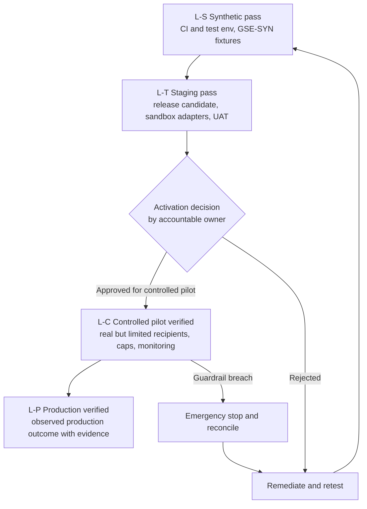
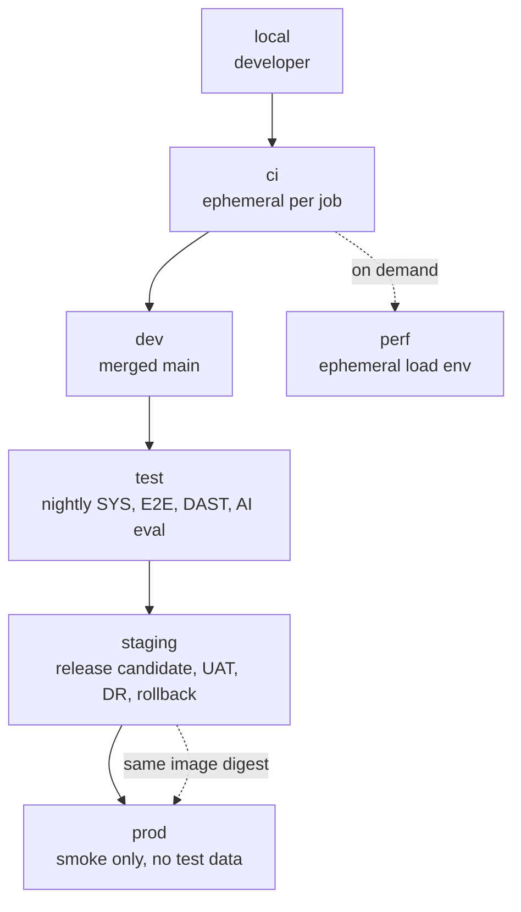

# AI Growth Engine: Employee Sales & Marketing Automation
## Application Blueprint: PART 6 (Batch 6.1), Test Strategy

| Field | Value |
|---|---|
| Document | Application Blueprint, Part 6 (Batch 6.1): Test Strategy. Batches 6.2 and 6.3 add test scenarios (TS), test cases (TC), AI evaluation cases (TC-AI) and the requirement-to-test traceability matrix, following the conventions set here (§6.1.12) |
| Version | 1.0 · 27 Nov 2026 |
| Baseline | Part 0 (NFR-001…038, EP-01…21, citation convention §0.1.2), Part 0A (DEC-001…065, binding), Part 1 (BR register, personas P01–P16, KPI-01…31, waves W0–W6), Part 2.1 (FR register, acceptance profiles CA-*), Part 2.2 (WF-01…14, engine invariants E-1…E-9), Part 2.3 (162 BRL rules, roles R01–R20, ABAC-01…12, state machines), Part 2.4 (reports RP-01…30, isolation layers, I18N-01…11), Part 2.5 (WCAG 2.2 AA, UI states, public performance budgets). Read for alignment (in progress in parallel, not depended on): Part 3.3 (data architecture), Part 4.1 (security; THR-, SC-, LT- references), Part 5.2 (stories US-08xx…US-14xx with Gherkin AC and dimensions D1–D8) |
| Roles applied | QA Lead (primary), Business Systems Analyst, Principal Engineer, Security/Compliance/AI Governance Lead, DevOps/SRE Lead, Data Architect/DBA, Lead UX/UI Designer, FinOps Lead, Product Owner |
| Tag ranges used | RECOMMENDATION-070…074 · ASSUMPTION-180…184 · GAP-165…167 |

**Acronyms used in this batch.** AC acceptance criterion · AP acceptance procedure (Part 0A DEC-014) · ASVS OWASP Application Security Verification Standard · BFF Backend-for-Frontend · BVA boundary value analysis · CI continuous integration · CLS Cumulative Layout Shift · CT contract test · DAST dynamic application security testing · DPIA data protection impact assessment · DR disaster recovery · DRE defect removal efficiency · E2E end-to-end · EP equivalence partitioning · EVR evidence record (BRD §12.2) · INP Interaction to Next Paint · IT integration test · LCP Largest Contentful Paint · MTTR mean time to repair · PBT property-based testing · PDP Policy Decision Point · PITR point-in-time recovery · POM page object model · RLS row-level security · RPO recovery point objective · RTO recovery time objective · SAST static application security testing · SCA software composition analysis · SIT system integration testing (BRD §10) · SUT system under test · SYS system test · TTFB time to first byte · UAT user acceptance testing · UT unit test.

**Time-sensitive facts.** Tool versions, provider sandbox capabilities (Amazon SES, Meta WhatsApp Cloud API, Indian payment gateways, e-sign providers, Google Calendar, search APIs, Anthropic models), browser versions, OWASP and WCAG revision status and all prices are **unverified; verify at time of implementation (as of 27 Nov 2026)** (DEC-042). No price or provider capability is stated as fact in this batch.

---

## 6.1.1 Purpose, scope and principles

### 6.1.1.1 What this batch decides

| # | Decision area | Section | Consumed by |
|---|---|---|---|
| 1 | Test levels with scope, owner, tools, environment, entry and exit criteria | §6.1.2 | All teams; Part 8 sprint plans |
| 2 | Test types (21) with objective, approach, tools, cadence, owner and pass criteria | §6.1.3 | Batches 6.2/6.3; Part 4 NFR catalogue |
| 3 | Risk-based prioritization: risk matrix of 30 functional areas, P0 rule for activation blockers, test depth levels | §6.1.4 | Batch 6.2 scenario priority |
| 4 | Entry and exit criteria per level, per wave (W0–W6) and per release; evidence record; certification ladder | §6.1.5 | A090 release readiness; Part 8 go-live checklist |
| 5 | Test environments, provider sandboxes and simulators, clock control | §6.1.6 | Part 3 environments; Part 4 CI/CD |
| 6 | Test data strategy: synthetic dataset, masking rules, seed/reset, privacy in test | §6.1.7 | Data Architect; Part 3.3 §3.3.16 |
| 7 | Defect management: lifecycle, severity S1–S4, priority, SLAs, release blocking | §6.1.8 | Part 4 incident management; Part 8 |
| 8 | Automation strategy: pyramid, tools, framework, CI gates, coverage targets, mutation testing, flaky policy | §6.1.9 | Engineering DoD (Part 5.1) |
| 9 | Metrics, test dashboard and release readiness report | §6.1.10 | RP-26, A090 |
| 10 | Test design techniques catalogue with worked examples from this product | §6.1.11 | Batches 6.2/6.3 |
| 11 | Conventions for TS, TC, TC-AI, the test case template and the SM-UT/SM-UAT/SM-UX-UAT alias mapping | §6.1.12 | Batches 6.2/6.3; Part 9 traceability |
| 12 | UAT plan: participants, vertical scenario packs, sign-off, AP-01…AP-10 | §6.1.13 | Business owners; Part 8 |
| 13 | Non-functional test plans: performance, security, accessibility, DR/failover, data migration, localization | §6.1.14 | SRE, Security, UX, Data |
| 14 | Test organization, responsibilities and effort range | §6.1.15 | Part 8 RACI and capacity |

### 6.1.1.2 Binding sources

| Source | What it fixes for testing |
|---|---|
| BRD §10 | "Positive and negative unit, system integration (SIT) and business-user acceptance (UAT) evidence for Website, authenticated portal and confidential Admin operations." No launch on failed **confidentiality, unauthorized external action, payment accuracy, regulatory eligibility or critical rollback** checks. Reused login/security still needs compatibility tests |
| BRD §11 | Vertical acceptance statements (AppNAI, MedMaarg, EduVerse, OrganicSpec, campaigns). "Open critical confidentiality, financial integrity or unauthorized-action defects block activation" |
| BRD §12.1, §12.2 | Delivery exit: no required FR left without a tested result; any waiver documented with owner and independent reviewer. Evidence record fields (§6.1.5.4) |
| BRD §13.2, §15, §16 | "No pending design proposal, synthetic test or document score is treated as production certification." Use only authorized synthetic or staging fixtures before external activation. Acceptance procedures and the two-tenant boundary condition |
| FRD §10, §11, §11.1, §12 | Mandatory path coverage per function (normal, validation, denied, timeout, duplicate, stale revision, recovery); functional behaviour standards; worked decision examples FR-DM-01…04; global UI states |
| FRD §11, §16.2 | Test IDs referenced but undefined: SM-UT-001…066 (63 distinct), SM-UAT-S001…S138, SM-UX-UAT-W01…A113 (147). Kept as aliases (DEC-017) |
| DEC-001 | AI gates: signal precision ≥ 80% on ≥ 100 reviewed signals (W1 exit); qualification precision ≥ 90% on ≥ 200 labelled items per vertical before L2/L3; recall ≥ 60% tracked |
| DEC-006, DEC-034, DEC-060–063 | Waves W0–W6; release gates from W0; eval harness and CI regression gate in W0 (DEC-061); full synthetic E2E suite completed in W5 (DEC-063) |
| DEC-014 | Acceptance Procedure Register AP-01…AP-10 |
| DEC-017 | Part 6 defines TC IDs; SM-UT/SM-UAT/SM-UX-UAT kept as aliases in the traceability matrix |
| DEC-018, DEC-032, NFR-008 | Availability, latency, TTFB, outbox lag, RPO/RTO, 10× pilot capacity; automation timeliness windows; Customer 360 freshness ≤ 60 s |
| DEC-031 | Workload design points (Year 1 and Year 2) |
| DEC-026, DEC-039, DEC-040 | Locales; migration via A103 imports; hosting and backup topology |
| NFR-001…038 | Testable non-functional statements, each needing a test method (Part 0 §0.3.3) |
| RECOMMENDATION-001, -011, -017 | WCAG 2.2 AA; consumer-driven/schema contract tests for adapters; synthetic data sets as a versioned test asset |

### 6.1.1.3 Test principles (binding for Batches 6.2/6.3 and for every engineer)

| ID | Principle | Consequence for test design | Source |
|---|---|---|---|
| TP-01 | **Fail closed is the oracle.** When a rule is uncertain, the expected result is deny, approval required, or no external effect | Every "Unknown" input class has a test whose expected result is a denial or a review task, never a default allow | FRD §12; Part 0A §A.2; BRL-ELG-01 |
| TP-02 | **Evidence over activity.** A test passes only on an observed result recorded with the build, environment and reviewer | No "assumed pass"; missing evidence = *Pending* | BRD §12.2, §14 acceptance protocol |
| TP-03 | **Synthetic before real.** Every externally consequential path is proven on synthetic or staging fixtures before any real recipient, payment, signature or publication | Staging and test environments use sandbox adapters only (ABAC-12) | BRD §9, §15 |
| TP-04 | **No production certification by inference.** Synthetic, staging or offline results never count as production sign-off | Certification ladder (§6.1.5.5) separates synthetic pass from production verification | BRD §13.2, §16 |
| TP-05 | **Every rule is a decision table.** Each of the 162 BRL rules has at least one decision-table or boundary test | Coverage target 100% (§6.1.9.6) | Part 2.3 §2.25 note |
| TP-06 | **Every external side effect passes the CA-DISPATCH battery**: plan-time and dispatch-time recheck, idempotency, uncertain path, simulation zero-effect, emergency stop | A standard negative pack per dispatching FR (§6.1.3.3) | CA-DISPATCH; E-3…E-7 |
| TP-07 | **Two-tenant by default.** Every integration, system and E2E test that reads or writes business data runs with the two-tenant fixture loaded and asserts zero foreign rows | Fixture T1 + T2 always present (§6.1.7) | NFR-032; AP-10; BRD §16 |
| TP-08 | **Negative cases are first-class.** Each story's AC set includes denial, validation, stale revision and recovery scenarios | Batch 6.2 rejects a scenario set without them | FRD §10; Part 5.2 §5.2.1 |
| TP-09 | **Money is Decimal, always.** Any float in a money path is a defect | Static check plus property tests (§6.1.11.7) | NFR-017; DEC-027 |
| TP-10 | **AI is tested like code and like a product.** Deterministic tests for the gateway, schema, routing and budget; statistical evals for quality; red-team for safety | Eval regression blocks deploy (NFR-033) | M54; DEC-061 |
| TP-11 | **Tests never contact real people.** Non-production outbound goes only to sink domains, simulators or provider test numbers | Outbound allowlist guard (§6.1.6.4) | BRD §9 "no unapproved external communication" |
| TP-12 | **Shift left, but prove right.** Most checks run on every pull request; the slow, expensive checks run nightly and before release, never skipped for a release | CI gates G0–G5 (§6.1.9.5) | NFR-012, NFR-013 |

### 6.1.1.4 Quality objectives (what "good enough to activate" means)

| QO | Objective | Measure (owner of truth) | Target | Source |
|---|---|---|---|---|
| QO-1 | Zero confidentiality breach | Cross-scope disclosure incidents in all test levels and production (KPI-30) | 0 | B-TENANT; NFR-032 |
| QO-2 | Zero unauthorized external action | Sends to suppressed/ineligible recipients (KPI-17); dispatches without matching approved hash | 0 | OPT-04-03; E-8 |
| QO-3 | Payment and revenue accuracy | Duplicate revenue or ledger entries; deals Won without route evidence (KPI-31); usage reconciliation (KPI-24) | 0 / 0 / 100% | M47; BRD §11; OPT-20-02 |
| QO-4 | Regulatory eligibility | Jurisdiction, consent, minors and health-data rules pass decision-table tests | 100% of BRL-ELG and BRL-PRV rules | DEC-029, DEC-030; BRD §15 |
| QO-5 | Rollback works | Rollback rehearsal per release; restore drill per release | 100% pass | NFR-012, NFR-013 |
| QO-6 | Requirements are tested | FRs with ≥ 1 passing test; AC with ≥ 1 TC | 100% / 100% | BRD §12.1 delivery exit |
| QO-7 | AI quality gates | Signal precision; qualification precision; regression suite | ≥ 80%; ≥ 90%; 0 regressions beyond tolerance | DEC-001; NFR-033 |
| QO-8 | Performance and availability | API p95 read/write; TTFB; outbox lag; automation timeliness | ≤ 500/800 ms; ≤ 800 ms; ≤ 60 s; ≥ 99% within window | DEC-018; DEC-032 |
| QO-9 | Accessibility | Critical/serious axe violations on top journeys; manual audit | 0; pass per wave | RECOMMENDATION-001; Part 2.5 §2.46 |
| QO-10 | Cost control | Simulated cap stops paid calls; zero unapproved paid calls | 100%; 0 | NFR-014; NFR-037 |

---

## 6.1.2 Test levels

The BRD names three evidence levels: unit, SIT and UAT (BRD §10). This strategy splits SIT into **integration, contract and system** tests and adds an **E2E** level for browser journeys, so that each level has one clear owner and one environment. The mapping back to the BRD vocabulary is in the last column.

### 6.1.2.1 Level summary

| Level | Code | Scope | Owner | Tools (verify versions) | Environment | Entry criteria | Exit criteria | BRD term |
|---|---|---|---|---|---|---|---|---|
| **Unit** | UT | One function, class, serializer, React component or hook. Pure domain logic: money, tax, rounding, scoring, PDP rules, state-machine guards, schema validators, prompt builders. No network; DB only where the ORM is the unit (fast transactional tests) | Developer who writes the code (reviewed in PR) | pytest, pytest-django, factory_boy, Hypothesis, time-machine/freezegun; Vitest, React Testing Library, vitest-axe | Developer machine and CI container (`local`, `ci`) | Story in progress; acceptance criteria known; interfaces stubbed | All new/changed code covered to the per-layer target (§6.1.9.6); 0 failing; mutation score met for money/eligibility modules; PR review approved | Unit |
| **Integration** | IT | Two or more real components inside the monolith: Django + PostgreSQL (RLS on) + Valkey + Celery worker + outbox relay + S3 (local emulator) + adapter fakes. Includes RLS policy tests, transaction and locking tests, webhook ingestion, migration tests | Developer; QA automation reviews the suite design | pytest-django with real PostgreSQL (pgvector), Celery worker in-process and out-of-process, testcontainers or CI services, moto/MinIO for S3, provider simulator (§6.1.6.3) | `ci`, `dev` | Unit tests green; migrations apply cleanly; fixtures T1/T2 loadable | 0 failing; every E-1…E-9 invariant exercised for the changed flow; RLS suite green; no unscoped query (static check) | SIT |
| **Contract** | CT | (a) Internal API contracts: OpenAPI schema of each surface (public, portal, admin, internal) against the implementation; (b) provider adapter contracts: request/response/webhook schemas and signatures for SES, WhatsApp, calendar, payment, e-sign, search, model gateway; (c) frontend ↔ BFF consumer contracts | Principal Engineer (owns schemas); developers write tests | schemathesis (property-based API fuzzing from OpenAPI), OpenAPI diff (breaking-change check), Pact or JSON-Schema contract tests for adapters (RECOMMENDATION-011), recorded sandbox fixtures | `ci`, `test` (sandbox calls nightly) | Schema published in the repository; adapter interface frozen for the sprint | No breaking change without version bump; all adapter fixtures validate; nightly sandbox contract run green or a ticket raised within 1 business day | SIT |
| **System** | SYS | The deployed application through its public interfaces (BFF/API and workers) in a production-like environment, with sandbox adapters. API-level functional tests, workflow tests WF-01…WF-14, CA-DISPATCH batteries, tenancy matrix, DAST, performance, DR, migration | QA automation (0.5 FTE) with developers; SRE for performance and DR | pytest API client suites, k6, OWASP ZAP, schemathesis (stateful), provider simulator, clock control | `test` (nightly), `staging` (pre-release), `perf` (ephemeral) | Build deployed by the pipeline; smoke green; dataset GSE-SYN loaded at the expected version; clock control enabled | All P0 and P1 system tests pass; non-functional thresholds met (§6.1.14); no open S1; S2 per §6.1.8.5 | SIT |
| **End-to-end** | E2E | Browser journeys across Website/Portal and Admin (both React apps) through the BFFs to workers and sandbox providers. Top journeys per persona, cross-surface flows (public intake → Admin review → portal quote → payment evidence) | QA automation; Lead UX/UI Designer reviews journey selection | Playwright (Chromium, Firefox, WebKit; trace **off** by default, on-first-retry only in quarantine runs), @axe-core/playwright, Playwright clock API | `test` (nightly), `staging` (pre-release) | System level green for the same build; journeys tagged in the journey register | All P0 journeys pass on Chromium and WebKit; P1 on Chromium; 0 critical/serious axe violations on journey pages | SIT |
| **User acceptance** | UAT | Business users execute vertical scenario packs and acceptance procedures AP-01…AP-10 on staging with synthetic data; usability observations (NFR-034) | Product Owner (accountable); QA Lead (facilitates); vertical owners (P02) execute | Test management tool (§6.1.9.2), UAT scripts from Batch 6.2, Admin A090 evidence capture | `staging` (`uat` data profile) | Exit criteria of System and E2E met for the scope; UAT readiness review passed (§6.1.13.4); trained participants | All UAT P0/P1 scenarios pass; AP evidence recorded; sign-off by PO + vertical owner + independent reviewer; open defects within release-blocking rules | UAT |

### 6.1.2.2 Level details

**Unit (UT).**
- *Unit boundaries.* Domain services (`pdp`, `money`, `ledger`, `scoring`, `statemachines`, `routing`, `templates`) are written as pure functions or small classes so they can be tested without Django. Serializers, permission classes and querysets are tested with the database in a transaction (pytest-django `db` fixture) and count as unit tests only when no worker, network or other app is involved.
- *Mandatory unit test sets* per module: decision tables for every BRL it enforces; BVA for every numeric or temporal threshold; property tests for money, scoring and state machines (§6.1.11.7); invalid-transition tests for every state-machine guard.
- *Frontend:* every shared component (Part 2.5 §2.45.2) has rendering, interaction, keyboard and axe tests in Vitest + React Testing Library. MoneyInput and QuantityInput have Decimal-safety tests (no `Number` arithmetic).

**Integration (IT).**
- Runs against **real PostgreSQL with RLS enabled** and the application role (not superuser), because RLS is bypassed by superusers and table owners. A test that connects as an owner role fails the suite (guard fixture).
- Verifies the **transactional outbox** (NFR-006): state change, audit append, budget reservation and outbox insert in one transaction (E-2), proven by forced failure after each step and assertion that nothing persisted.
- Verifies **workers set RLS context** from the job payload before any query; a job with forged scope is rejected (Part 2.4 §2.35.2).
- Verifies **webhook ingestion**: signature check, persist-then-acknowledge, dedupe by provider account + event ID (FR-ENG-01), out-of-order and duplicate delivery.
- Verifies **migrations**: forward migration on a seeded database, backward compatibility of the previous application version against the new schema (expand/contract), and RLS policies present on every operational table (catalogue query test).

**Contract (CT).**
- *API contracts.* Each surface has its own OpenAPI document. A route-inventory test diffs deployed routes against the per-origin allowlist (NFR-001; THR-007 in Part 4.1). Breaking changes (removed field, narrowed type, new required field) fail the PR unless the version is bumped (NFR-015).
- *Adapter contracts.* Each provider adapter has (1) an outbound request schema test, (2) a normalized response mapping test over recorded fixtures, (3) a webhook signature and payload schema test, (4) a failure classification test (transient, permanent, uncertain). Recorded fixtures are refreshed from sandboxes nightly; a schema drift opens a defect.
- *Model gateway contract.* Structured output JSON schemas per agent task; invalid outputs are rejected and retried within cap (BRL-AI-02).

**System (SYS).**
- Tests the deployed build through the BFF and internal APIs exactly as a client does, including cookies, CSRF tokens and audiences (DEC-019).
- Includes the **tenancy matrix**, **CA-DISPATCH battery**, **workflow suites** WF-01…WF-14, **DAST**, **performance**, **DR drills** and **migration rehearsals** (§6.1.14).

**End-to-end (E2E).**
- Journey register: top 20 journeys per wave (aligned with the manual accessibility audit scope in Part 2.5 §2.46), plus cross-surface journeys. Each journey maps to personas P01–P15 and to FRs.
- Flows that depend on time (quiet hours, approval expiry, bid deadlines) use the clock control endpoint, never `sleep`.

**User acceptance (UAT).** See §6.1.13.

---

## 6.1.3 Test types

### 6.1.3.1 Test type catalogue

| # | Type | Objective | Approach | Tools | Cadence | Owner | Pass criteria |
|---|---|---|---|---|---|---|---|
| T01 | **Functional** | Each FR behaves per its acceptance profile and story AC: normal, alternate, validation, denied, timeout, duplicate, stale revision and recovery paths (FRD §10) | Specification-based design from FR/US/AC/BRL using the technique catalogue (§6.1.11); executed at UT, IT, SYS and E2E | pytest, Vitest, Playwright | Every PR (UT/IT); nightly (SYS/E2E) | Developers; QA automation | 100% of FRs have ≥ 1 passing test; 100% of AC have ≥ 1 TC; all P0/P1 pass |
| T02 | **Regression** | Nothing that worked breaks; permanent negatives stay negative (e.g. DEC-002 no-fundraising test) | Full automated suite; risk-based selection on PR (tests mapped to changed modules) plus the full suite nightly and pre-release; every fixed defect adds a regression test | pytest (with test impact selection by module markers), Playwright, CI | PR (selected), nightly (full), pre-release (full) | QA automation | 100% pass of gating suites; quarantined tests ≤ 2% and none P0 (§6.1.9.7) |
| T03 | **Performance: load** | Meet latency and throughput targets at the Year 2 design point and at 10× pilot volume | Workload model §6.1.14.1; steady-state load for 30–60 min | k6 (HTTP), Python queue injector for Celery, Lighthouse CI (public pages) | Per wave in `perf`; smoke nightly (5 min) | SRE (0.5 FTE) with backend | API p95 ≤ 500 ms read / ≤ 800 ms write; TTFB p95 ≤ 800 ms (≤ 200 ms cached); outbox lag p95 ≤ 60 s; error rate < 0.5% [ASSUMPTION-181] |
| T04 | **Performance: stress** | Find the breaking point and verify graceful degradation (429, queueing, Tier 3) rather than data loss | Ramp to 3× Year 2 design load until SLO breach; observe recovery | k6, queue injector | Per release (W2, W3, W5) | SRE | No data loss; no duplicate side effect; 429/503 returned per NFR-015; recovery to SLO ≤ 10 min after load drops [ASSUMPTION-181] |
| T05 | **Performance: soak** | Find leaks, connection exhaustion, queue drift and outbox lag growth over time | Year 1 peak load for 24 h (W2) and 72 h (W5) with clock advanced through quiet-hour windows | k6, queue injector, CloudWatch/OpenTelemetry metrics | W2, W5 | SRE | Memory growth < 10% after warm-up; no worker restarts; outbox lag p95 ≤ 60 s throughout; ≥ 99% of due runs on time (DEC-032) [ASSUMPTION-181] |
| T06 | **Performance: spike** | Campaign launch bursts and webhook floods do not starve transactional work | Sudden 10× burst of sends and provider events | k6, provider simulator | W3, W5 | SRE | Transactional queue p95 start ≤ 15 min (DEC-032) during a batch burst; webhooks persisted before acknowledgement; no event loss (NFR-007) |
| T07 | **Security** | Prevent the STRIDE threats in Part 4.1 (THR-###) and the OWASP Top 10 classes; prove authorization at every enforcement point | SAST, SCA, secret scan, IaC scan, container scan, DAST, API fuzzing, authorization matrix, RLS suite, prompt-injection red team, external penetration test (§6.1.14.2) | Semgrep, Bandit, pip-audit/OSV-Scanner, npm audit, gitleaks, Trivy, Checkov, OWASP ZAP, schemathesis | PR (static), nightly (ZAP baseline), pre-release (ZAP full, authz matrix), pen test before first real pilot and first external tenant (RECOMMENDATION-073) | Security/Compliance Lead; DevOps | 0 open critical/high findings without approved risk acceptance; 0 authorization matrix failures; 0 RLS failures |
| T08 | **Accessibility** | WCAG 2.2 AA on Website, Portal and Admin | Automated axe in components and pages; keyboard scripts; screen-reader passes; zoom/reflow; publication gate BRL-PUB-06 (§6.1.14.3) | vitest-axe, @axe-core/playwright, Lighthouse CI, NVDA + Chrome, VoiceOver + Safari | PR (components), nightly (pages), per wave (manual audit top 20 journeys) | Lead UX/UI Designer; QA | 0 critical/serious automated violations; manual audit pass or approved waiver; publication blocked on failure |
| T09 | **Usability** | Users find the approved operation and complete core scenarios; clicks and time measured against a baseline (NFR-034; OPT-15-01) | Moderated task-based sessions (5 participants per persona group per wave), System Usability Scale (SUS) questionnaire, task success, time on task, error count | Session recordings (consented, internal staff only), analytics in staging | W2 (Admin core), W3 (Website/Portal), W5 (full) | Lead UX/UI Designer | Task success ≥ 80% on core tasks; SUS ≥ 68; no critical usability issue open on P0 journeys [ASSUMPTION-181] |
| T10 | **Compatibility** | Supported browsers and devices (DEC-043): last 2 versions of Chrome, Edge, Firefox, Safari (iOS/macOS); Website/Portal mobile-first from 360 px, Admin desktop-first from 1280 px and usable to 768 px for review/approval screens | Playwright projects per engine and viewport; manual check on real iOS Safari and Android Chrome per wave | Playwright (Chromium, Firefox, WebKit), real devices or a device cloud (verify cost; optional under B10) | Nightly (engines); per wave (real devices) | QA | P0 journeys pass on all engines; layout checks at 360, 768, 1280 px pass |
| T11 | **Data migration** | Imports through A103 are complete, correct, consent-gated and idempotent (DEC-039) | Dry-run, full-run, re-run and rollback rehearsals with reconciliation counts (§6.1.14.5) | pytest IT suites, import fixtures (CSV/JSON template versions), reconciliation SQL | Each template version; before each seed-startup conversion; W4/W5 | Data Architect; QA | 100% row reconciliation; 0 imported contacts eligible for outreach without verified lawful basis; re-run creates 0 duplicates |
| T12 | **DR / failover** | RPO ≤ 15 min and RTO ≤ 4 h (DEC-018); restore drill per release (NFR-012); provider outage loses no events (NFR-007) | Drills DR-1…DR-8 (§6.1.14.4) with timed measurements and post-restore integrity checks | AWS RDS PITR, S3 versioning, IaC, chaos scripts | Restore drill each release; full DR drill quarterly and before W4 activation | SRE; Data Architect | Measured RPO ≤ 15 min and RTO ≤ 4 h; 0 duplicate external effects after restore; audit chain verifies |
| T13 | **Localization** | en-IN correct at launch; hi-IN, ta-IN, or-IN content locales in W5; formats per I18N-01…11 (§6.1.14.6) | Pseudo-localization in CI, ICU plural tests, format tests, script rendering checks, linguistic review | Vitest, Playwright screenshots, ICU message linting | PR (pseudo-locale), W5 (locales) | Frontend lead; bilingual reviewers | 0 hard-coded strings; 0 truncation on pseudo-locale; formats correct; translations approved per BRL-APR-01/02 |
| T14 | **AI evaluation** | Each agent meets its quality, safety, cost and latency thresholds; changes do not regress (NFR-033) | Offline eval datasets per agent and per vertical; groundedness/citation checks; abstention tests; red-team prompt injection; routing tier and data-classification tests; cost-per-task measurement (§6.1.3.4) | In-house harness on pytest (primary), promptfoo or DeepEval optional for red-team and LLM-graded rubrics (align with Part 7, GAP-166) | PR when prompts, models, routes or tools change (smoke on recorded set); nightly full; per model version | AI lead (Principal Engineer in pilot); Security for red team | Thresholds per agent (Part 7); signal precision ≥ 80%; qualification precision ≥ 90% for L2/L3; 0 Restricted data reaching Tier 2; 0 prohibited-content passes in red-team set |
| T15 | **Multi-tenant isolation** | Zero cross-tenant and cross-startup disclosure or side effects (NFR-031, NFR-032; AP-10) | Two-tenant fixture matrix across every isolation layer (§6.1.3.3 A) | pytest IT/SYS suites, Playwright, ZAP authenticated scans | PR (subset), nightly (full matrix), pre-release | QA automation; Security | 0 foreign rows, objects, chunks, cache hits, files, notifications or side effects in every cell |
| T16 | **Idempotency and replay** | Duplicate delivery has exactly one effect; replay produces no duplicate message, revenue or publication (NFR-005; E-4) | Duplicate and out-of-order injection at API (same idempotency key ± same body hash), outbox relay, Celery redelivery, webhook duplicates, import re-runs (§6.1.3.3 B) | Provider simulator, pytest, Hypothesis stateful tests | PR (unit/IT), nightly (SYS) | Developers; QA | Exactly one effect in 100% of duplicate cases; body-hash mismatch on reused key → 409/422 per API contract |
| T17 | **Simulation zero-effect** | Simulation or dry run has zero live effects (NFR-038; E-6; BRL-AUT-04) | Run each dispatching workflow in simulation with a spy on every adapter and the ledger; assert zero provider calls, zero ledger/budget consumption, flagged records excluded from KPIs (§6.1.3.3 C) | Adapter spies, provider simulator call log, KPI projection assertions | PR (unit), nightly (SYS for every workflow template) | QA automation | 0 provider calls; 0 spend; 0 ledger entries; simulated records excluded from every KPI |
| T18 | **Uncertain-outcome reconciliation** | Timeout after submission is *uncertain*, never failed; no retry before reconciliation (NFR-026; E-5; FR-STD-02; DEC-050) | Inject timeout-after-submit for each provider adapter; verify state, retry block, re-query, human task after 3 attempts, final reconciled state (§6.1.3.3 D) | Provider simulator fault modes, clock control | PR (unit), nightly (SYS) | QA automation | 100% of adapters pass; 0 blind retries; reconciled states recorded with cost |
| T19 | **Compliance** | Consent, opt-out, jurisdiction, quiet hours, frequency caps, children and health-data exclusion, retention and privacy requests behave as the rule packs require (§6.1.3.3 E) | Decision tables per BRL-ELG/BRL-PRV rule; cross-channel opt-out propagation; jurisdiction pack matrix; sensitive-data fixtures (AP-05); retention clock tests; DPIA evidence check before activation | pytest, clock control, provider simulator, Playwright for preference centre (W29) | PR (rules), nightly (SYS), pre-activation (DPIA evidence) | Security/Compliance Lead (accountable), QA | KPI-17 = 0 in all tests; 100% BRL-ELG and BRL-PRV rules decision-table tested; 0 minor outreach; 0 health attributes in messages, audiences, ad events or prompts |
| T20 | **Cost control (FinOps)** | Budget caps stop paid calls before they happen; zero unapproved paid calls (NFR-014, NFR-037; BRL-AI-08) | Simulated cap tests per agent/startup/tenant; paid fallback disabled by default; usage metering reconciliation (NFR-035) | pytest, provider simulator with cost metering, A012 assertions | PR (unit), nightly (SYS) | FinOps Lead; backend | 100% of over-cap calls denied before the provider call; 80% alert raised; 100% usage reconciled to invoice lines |
| T21 | **Operability and observability** | Health/ready endpoints, correlation IDs end to end, alerts fire, logs redacted (NFR-019; RECOMMENDATION-006) | Assert `/health` without DB and `/ready` without secrets; trace propagation HTTP → outbox → Celery → adapter → webhook; alert rule tests with synthetic faults; log redaction corpus | pytest, OpenTelemetry test exporter, Sentry test DSN, CloudWatch alarm tests | PR (endpoints), nightly (traces), per release (alerts) | SRE | 100% of sampled flows carry one correlation ID; 0 PII/secrets in logs in the redaction corpus; each critical alert fires in drill |

### 6.1.3.2 Additional permanent negative tests

| Test | Rule | Level | Gate |
|---|---|---|---|
| No fundraising/investor capability: no entity, route, filter, role, permission, translation key or UI term from the forbidden lexicon (DEC-002 replacement list) | FR-NEG-01; BRL-TEN-12; DEC-002 | CT (build check on models, URL conf, OpenAPI, i18n catalogues) | G1 every PR |
| Investor-audience tokens rejected | DEC-058; NFR-001; BRL-TEN-02 | IT, SYS | G1, G4 |
| No Admin JavaScript, routes or private data in public bundles | NFR-001 | CT (bundle inspection: route manifest and string scan of built public assets) | G2 |
| No provider call or secret from browser code | CA-ALL; NFR-004 | CT (bundle scan for provider hosts and key patterns), SYS (CSP `connect-src` allowlist test) | G2 |
| Portal content never in public snapshot or CDN cache | BRL-PUB-05; NFR-020 | SYS (cache-key and response-header assertions) | G3 |
| AI never approves, signs, submits, pays, changes price/terms or permissions | BRL-AI-07; DEC-064; R20 | UT (tool registry has no such tool), SYS (agent identity denied on approval endpoints) | G1, G3 |

### 6.1.3.3 Detailed approach for the product-specific test types

**A. Multi-tenant isolation matrix (T15).** Every cell is one automated test parameterized over the two-tenant fixture. The attacker principal is a valid T2 user (or T1 user of another startup) holding a real session.

| Isolation layer (Part 2.4 §2.35.2) | Read foreign object by ID | List/search/filter leakage | Write/mutate foreign object | Forged scope (header/body/job payload) | Stale or wrong-audience credential | Expected |
|---|---|---|---|---|---|---|
| Identity / BFF | n/a | n/a | n/a | Requested scope not in membership | Investor audience, expired membership, revoked session (≤ 60 s, BRL-TEN-07) | 401/404; session revoked within 60 s |
| API objects and nested FKs | `GET /…/{foreign_id}` | Filters, sort keys, cursor tokens from T1 replayed by T2 | PATCH/POST with foreign FK in body | `X-Startup` of another tenant | Old grant | Uniform 404 (BRL-TEN-04); 0 foreign rows |
| Database (RLS) | Direct ORM query in worker context without scope | Aggregation and reporting views | Raw SQL path (repository modules) | Session variable not set → no rows | n/a | 0 rows; missing context raises |
| Global search (DEC-037) | n/a | Query terms unique to T1 data | n/a | n/a | n/a | 0 hits from foreign scope |
| Vector retrieval / Copilot | n/a | Semantic query matching T1 chunks | n/a | Namespace omitted | n/a | 0 foreign chunks; Copilot refuses without evidence (BRL-AI-12) |
| Exports (A103) and reports | Export link of T1 used by T2 | Report filters | n/a | n/a | Expired link (72 h) | 404/expired; 0 foreign records |
| Notifications and digests | n/a | Digest content | n/a | n/a | n/a | 0 foreign items in digests |
| Object storage | Signed URL of T1 used by T2 | Prefix listing | Upload to foreign prefix | n/a | Expired signed URL (≤ 15 min) | 403; 0 objects |
| Caches / CDN | n/a | Cache key collision across tenant/startup/locale/revision | Cache poisoning via headers | n/a | n/a | 0 foreign cache hits |
| Workers / queues | n/a | n/a | Job with foreign scope | Forged job payload | n/a | Job rejected and audited |
| Webhooks | n/a | n/a | Event for T1 provider account delivered to T2 route | Unsigned or mis-signed event | Replayed old event | Rejected; deduped; 0 effect |
| Sender identities | n/a | n/a | n/a | n/a | n/a | Bounce in T1 startup does not suppress T2 address; reputation isolated |
| Budgets / ledgers | n/a | n/a | Spend in T2 debits T1 | n/a | n/a | Exhausted T2 budget blocks only T2 |
| Logs and traces | n/a | Log query by T2 support user without grant | n/a | n/a | Support grant > 72 h | Denied; grant expiry enforced (BRL-TEN-09) |
| Portfolio scope (DEC-055) | n/a | n/a | Any mutation with > 1 startup selected | n/a | n/a | 409 `SELECT_SINGLE_STARTUP` (BRL-TEN-05) |

**B. Idempotency and replay (T16).**

| Injection point | Case | Expected |
|---|---|---|
| Public intake API (CA-INTAKE) | Same idempotency key and same body hash twice | One lead; second response returns the original result (M22) |
| Any mutating API | Same key, different body hash | Rejected per the API contract (Part 3 status code; 409 or 422) with no effect |
| Outbox relay | Relay crashes after provider accepted, before marking sent | Re-dispatch carries the same provider idempotency key; provider dedupes or result is *uncertain* and reconciled; one effect |
| Celery | Task redelivered (`acks_late`) after commit | Handler detects completed step by step key; no second effect |
| Webhooks | Same provider event ID 2×, 10× and out of order (delivered before sent) | One state change; out-of-order event parked and applied after the send record exists |
| Payments (BRL-FIN-02) | Same provider payment ID twice; uploaded proof with the same UTR/reference twice | One ledger entry; second marked *Duplicate* (Payment machine) |
| Fulfilment (FR-DM-03) | Deliver 1 kg twice with the same event key against a 2 kg order, then 2 kg more | Accepted once; duplicate no effect; over-delivery rejected |
| Publication | Publish the same approved hash twice; concurrent publish of two revisions | Single pointer swap; concurrent mismatch → 409 (FR-PUB-01) |
| Imports (A103) | Re-run the same import file | 0 duplicate records; run report shows "unchanged" rows |
| Provisioning (§2.35.4 step 7) | Re-run provisioning with the same application ID | No duplicate tenant, roles, storage prefixes or budgets |

**C. Simulation zero-effect oracle (T17).** A simulation test passes only when **all** of the following hold after the run: (1) the provider simulator call log for the run's correlation ID is empty; (2) no budget reservation or actual cost row exists; (3) no ledger, receivable, payable, publication pointer or calendar hold changed; (4) every created record carries `simulated = true` and the UI shows the Simulated state (Part 2.5 §2.47); (5) KPI projections exclude the records (BRL-AUT-04); (6) the simulation report lists the PDP decisions that a live run would have produced. Every workflow template in A113 gets one simulation test per published version.

**D. Uncertain-outcome reconciliation (T18).** For each adapter (email, WhatsApp, social, ads, e-sign, payments, calendar):

| Step | Injected condition | Expected (Part 2.2 §2.22.5) |
|---|---|---|
| 1 | Provider accepts the request, then the connection times out before the response | Outcome `uncertain`; message/action shows the amber certainty badge; retries blocked |
| 2 | Reconciliation query by idempotency key returns success | `reconciled_confirmed`; cost recorded; no second request |
| 3 | Reconciliation returns failure | `reconciled_failed`; eligible for retry only after PDP recheck |
| 4 | Provider query unavailable 3 times (clock advanced with backoff) | Human task created in A110; still no retry |
| 5 | Operator attempts manual retry while uncertain | Denied with "reconcile first" (BRL-AUT-07) |
| 6 | Emergency stop during reconciliation | Reconciliation queries continue (read-only); no new dispatch |

**E. Compliance (T19).**

| Area | What is tested | Key rules | Technique |
|---|---|---|---|
| Consent and lawful basis | Verified ≠ consent; lawful basis recorded per purpose and channel; imported contacts ineligible until verified | BRL-ELG-01, -03, -17; DEC-039 | Decision table |
| Opt-out | STOP keywords in supported languages, one-click unsubscribe, preference centre (W29); propagation to queued and scheduled items "immediately" and to every workflow; suppression survives deletion (BRL-PRV-03) | BRL-ELG-02; M04; NFR-036 | State transition, error guessing (case, whitespace, emoji, Unicode variants of STOP) |
| Jurisdiction | Rule pack per DEC-029: India, EU/EEA/UK, US, UAE/SG/AU; unknown → deny outbound; inbound replies allowed | BRL-ELG-05, -06 | Equivalence partitioning + decision table |
| Quiet hours and frequency caps | Recipient local time windows; rolling 7/30-day caps across all workflows | BRL-ELG-08, -09 | BVA with clock control |
| Children | Age band first; under 18 → guardian path with OTP to guardian channel; learner data limited to name, grade band, programme; no minor data in prompts beyond grade band; no outbound to learner | DEC-030; BRL-ELG-13; AP-05 | Decision table, BVA on age (17 / 18), negative fixtures |
| Health-data exclusion | Messages, audiences, ad events and AI inputs never contain health conditions or patient attributes; free-text intake redaction | BRL-ELG-14; BRL-PRV-06; AP-05 | Fixture-driven detection corpus, error guessing |
| Complaints and bounces | Complaint → suppress + incident; campaign pause above 0.1% or 3 complaints/24 h; hard and soft bounce rules | BRL-ELG-11, -12 | BVA |
| Privacy requests and retention | Identity verification, deadline escalation at 70%, legal hold, retention purge per DEC-028 data class | BRL-PRV-01…05 | Clock control, state transition (Privacy request machine) |
| Claims (MedMaarg) | Management claims publishable only after approval with evidence (DEC-021) | BRL-MKT (claims rules); A051 | Decision table |
| DPIA gate | EduVerse and MedMaarg flows cannot be activated without a recorded DPIA approval (RECOMMENDATION-007; DEC-030) | Activation flag guard | Negative system test |

### 6.1.3.4 AI evaluation (summary; full cases in Batch 6.3 and Part 7)

| Dimension | Metric | Dataset rule | Gate |
|---|---|---|---|
| Classification quality (signals M14) | Precision; recall | ≥ 100 human-reviewed pilot signals (W1) | Precision ≥ 80% to exit W1 (DEC-001) |
| Qualification quality (OPT-04-02) | Precision; recall | ≥ 200 labelled items per vertical, versioned benchmark | Precision ≥ 90% before L2/L3; recall ≥ 60% tracked (DEC-001; BRL-SCR-07) |
| Groundedness | Share of factual claims carrying a valid citation to approved knowledge or evidence | Per drafting agent, includes stale-evidence cases | 100% of claims cited or removed (BRL-AI-03) |
| Abstention | Correct abstention when evidence is missing or below threshold | "No evidence" and "expired evidence" subsets | 100% abstain on the no-evidence subset (BRL-AI-04) |
| Prohibited content | Invented relationships, diagnoses, medical advice, guarantees, binding commitments, disparagement | Red-team corpus incl. prompt injection in inbound messages, web pages and uploaded documents | 0 passes (BRL-AI-05) |
| Data classification routing | Restricted data never reaches Tier 2; Internal data redacted before Tier 2 | Synthetic PII, minors and health fixtures | 0 violations (DEC-007; BRL-AI-06) |
| Schema validity | Valid structured output rate; repair retries | All tasks | Invalid → repair ≤ 2 → Tier 3 (BRL-AI-02) |
| Cost and latency | INR per task; p95 latency per tier | Same dataset across candidate models (NFR-030) | Within agent budget (Part 7); route to lighter tier only at parity (DEC-007) |
| Regression | Delta versus the last accepted baseline per metric | Frozen baseline per prompt/model version | No metric worse than tolerance (Part 7); any failure blocks deploy (NFR-033, BRL-AI-09) |

---

## 6.1.4 Risk-based prioritization

### 6.1.4.1 Scales

| Score | Likelihood (of a defect reaching production in this area) | Impact (if it does) |
|---|---|---|
| 1 | Rare: simple, stable, well-covered code | Cosmetic; no business effect |
| 2 | Unlikely | Minor inconvenience; workaround exists |
| 3 | Possible: moderate logic, some external dependency | Feature unusable for a role; delayed business outcome |
| 4 | Likely: complex rules, concurrency, time, many providers | Wrong business record, financial misstatement contained internally, or SLO breach |
| 5 | Very likely: novel, AI-driven, many combinations | **Activation blocker class:** confidentiality breach, unauthorized external action, payment inaccuracy, regulatory ineligibility, failed rollback (BRD §10, §11) |

**Risk score = Likelihood × Impact (1–25).** **Priority rule:** any area whose impact is an activation-blocker class (impact 5) is **P0 regardless of likelihood** (BRD §10, §11). Otherwise P1 for score ≥ 12, P2 for 6–11, P3 for ≤ 5.

### 6.1.4.2 Test depth levels

| Depth | Name | Minimum required |
|---|---|---|
| **D4** | Exhaustive | All techniques that apply (EP, BVA, decision table with every rule, state transition with 0-switch 100% + invalid transitions per state + 1-switch for money and messaging machines, PBT, pairwise over all relevant dimensions); mutation testing; negative security tests; E2E journey; UAT scenario; tests at ≥ 3 levels; 100% automated except UAT |
| **D3** | Thorough | EP, BVA, decision tables, state transition 0-switch, pairwise on key dimensions; negative and permission tests; tests at ≥ 2 levels; ≥ 90% automated |
| **D2** | Standard | EP and BVA on inputs; happy, alternate, validation and permission paths; tests at UT + one higher level; ≥ 80% automated |
| **D1** | Light | Happy path and one negative per FR; smoke in E2E or SYS |

### 6.1.4.3 Risk matrix (functional areas × likelihood × impact → priority and depth)

| # | Functional area | Key requirements | L | I | Score | Priority | Depth | Rationale |
|---|---|---|---|---|---|---|---|---|
| RA-01 | Tenant/startup isolation, RLS, scope resolution, portfolio read-only | BR-TENANT; NFR-002, -031, -032; BRL-TEN-01…06; DEC-055, DEC-065 | 4 | 5 | 20 | **P0** | D4 | Confidentiality blocker (BRD §10) |
| RA-02 | Identity reuse, BFF sessions, MFA, audiences, revocation | DEC-003, DEC-019; NFR-001, -003; BRL-TEN-02, -07, -08 | 3 | 5 | 15 | **P0** | D4 | Confidentiality; compatibility tests required by BRD §10 |
| RA-03 | Policy Decision Point: consent, suppression, jurisdiction, quiet hours, caps, recheck at dispatch | BR-M04, BR-M24; BRL-ELG-01…18; DEC-029 | 4 | 5 | 20 | **P0** | D4 | Regulatory eligibility and unauthorized external action |
| RA-04 | Outbound dispatch engine: outbox, idempotency, uncertain outcomes, emergency stop | NFR-005, -006, -007, -026; E-2…E-7; BRL-AUT-05, -07 | 4 | 5 | 20 | **P0** | D4 | Unauthorized or duplicate external action |
| RA-05 | Approvals and separation of duties (hash-bound, thresholds, maker-checker) | CA-APPROVE; BRL-APR-01…11; DEC-038 | 3 | 5 | 15 | **P0** | D4 | Unauthorized external action; payment accuracy |
| RA-06 | Quotes, pricing, tax, rounding, currency | BR-M44; BRL-QTE-01…07; DEC-027; FR-DM-01 | 4 | 5 | 20 | **P0** | D4 | Payment accuracy |
| RA-07 | Payments, invoices, ledgers, closure, revenue | BR-M47, BR-M52; BRL-FIN-01…08; DEC-054; RECOMMENDATION-018 | 4 | 5 | 20 | **P0** | D4 | Financial integrity; duplicate revenue |
| RA-08 | Orders and fulfilment, receivable/payable separation (OrganicSpec) | WF-10; BRL-ORD-01…06; FR-DM-03; DEC-045 | 4 | 5 | 20 | **P0** | D4 | Payment accuracy; BRD §11 OrganicSpec acceptance |
| RA-09 | Bids and tenders (AppNAI): deadlines, checklist, human submission evidence | WF-08; BRL-BID-01…06; DEC-053; FR-DM-02 | 3 | 5 | 15 | **P0** | D4 | "No submission without mandatory checks" (BRD §11); unauthorized action |
| RA-10 | Contracts and e-signature | BR-M46; BRL-CTR-01…05; DEC-023 | 3 | 5 | 15 | **P0** | D3 | Unauthorized action (AI never signs) |
| RA-11 | Children and guardian consent (EduVerse) | DEC-030; BRL-ELG-13; AP-05 | 3 | 5 | 15 | **P0** | D4 | Regulatory eligibility |
| RA-12 | Health-data exclusion (MedMaarg) and sensitive-data redaction | BRL-ELG-14; BRL-PRV-06; AP-05 | 3 | 5 | 15 | **P0** | D4 | Regulatory eligibility; confidentiality |
| RA-13 | Model gateway: routing tiers, data classification, budget reservation, schema, guardrails | BR-M08, BR-M53; DEC-007, DEC-008; BRL-AI-01…12; FR-OP001 | 5 | 5 | 25 | **P0** | D4 | Restricted data to Tier 2 = confidentiality; overspend |
| RA-14 | Website publication, hosts, CDN, previews | BR-WEB; FR-PUB-01; BRL-PUB-01…06; NFR-020 | 3 | 5 | 15 | **P0** | D4 | Draft/private exposure = confidentiality |
| RA-15 | External portal object grants and field-minimized DTOs | CA-PORTAL; ABAC-09 | 3 | 5 | 15 | **P0** | D4 | Confidentiality |
| RA-16 | Release, rollback, backup and restore | BR-M09, BR-M62, BR-QA; NFR-012, -013; DEC-018 | 3 | 5 | 15 | **P0** | D3 | Critical rollback (BRD §10) |
| RA-17 | Privacy requests, retention purge, legal hold, exports | BR-M56; BRL-PRV-01…07; DEC-028 | 3 | 5 | 15 | **P0** | D3 | Regulatory; deletion must not re-enable outreach |
| RA-18 | SaaS lifecycle: application, provisioning, entitlements, metering, billing, suspension, export | BR-SVC; BRL-SVC-01…07; W31–W34; NFR-035 | 4 | 5 | 20 | **P0** | D3 | Cross-tenant risk and billing accuracy |
| RA-19 | Automation engine, autonomy caps, simulation, conflicts, triggers/webhooks | BR-AUTO; BRL-AUT-01…10; DEC-064; A109–A113 | 4 | 5 | 20 | **P0** | D4 | Unauthorized external action |
| RA-20 | Campaigns, ads spend caps, landing pages, referrals | BR-M37…M39, M42; BRL-MKT; BRL-ELG-17 | 3 | 5 | 15 | **P0** | D3 | Unapproved spend or message (BRD §11 campaigns) |
| RA-21 | Opportunity scoring and qualification | BR-M17, BR-M20; BRL-SCR-01…09; DEC-011 | 4 | 4 | 16 | P1 | D3 | Wrong prioritization; score never grants permission (tested in RA-03) |
| RA-22 | Discovery, source permissions, evidence provenance | BR-M07, M10–M16; BRL-SRC; NFR-028 | 4 | 4 | 16 | P1 | D3 | Prohibited source fetch is a compliance issue (OPT-04-01); kept P1 because no outbound effect, but "prohibited source never fetched" tests are P0 |
| RA-23 | CRM, lead capture, Customer 360, dedupe | BR-M21…M23; NFR-008; CA-INTAKE | 3 | 4 | 12 | P1 | D3 | Duplicate leads; freshness ≤ 60 s |
| RA-24 | Messaging drafting, inbox, sequences, follow-ups | BR-M25…M28; BRL-SEQ | 4 | 4 | 16 | P1 | D3 | Dispatch itself is covered by RA-03/04 (P0) |
| RA-25 | Meetings, calendar, webinars | BR-M29, BR-M40; BRL-MTG | 3 | 3 | 9 | P2 | D2 | Booking errors are recoverable |
| RA-26 | WhatsApp and website assistant | BR-M31, BR-M32; BRL-ELG-07; BRL-AI-11 | 4 | 5 | 20 | **P0** | D4 | Clinical-question handover, opt-in and template rules (regulatory) |
| RA-27 | Dashboards, reports, forecasts, attribution | BR-M30, M52, M60, M61; RP-01…30 | 3 | 4 | 12 | P1 | D2 | Mixing forecast and actuals misleads (BRL-FIN-06); cross-tenant aggregate covered by RA-01 |
| RA-28 | Content, SEO, social publishing | BR-M34…M36 | 3 | 4 | 12 | P1 | D2 | Publication approval covered by RA-14 |
| RA-29 | Onboarding, retention, renewal, partners, expansion pilots | BR-M48…M51, M63…M65 | 2 | 3 | 6 | P2 | D2 | Lower volume, internal effects |
| RA-30 | Admin UX shell, navigation, search, notifications, localization | BR-M61; DEC-036, DEC-037; DEC-026 | 3 | 3 | 9 | P2 | D2 | Search leakage covered by RA-01; a11y covered by T08 |

**How the matrix drives Batch 6.2.** Each scenario inherits the priority of its area unless the scenario itself exercises an activation-blocker condition, in which case it is P0. Example: a meeting-reminder scenario (RA-25, P2) that tests quiet-hour exceptions for reminders ≤ 2 h (BRL-ELG-08) is promoted to P0 because it tests a regulatory eligibility rule.

### 6.1.4.4 Risk heat summary

| Impact ↓ / Likelihood → | 2 | 3 | 4 | 5 |
|---|---|---|---|---|
| **5** (blocker class) | — | RA-02, 05, 09, 10, 11, 12, 14, 15, 16, 17, 20 | RA-01, 03, 04, 06, 07, 08, 18, 19, 26 | RA-13 |
| **4** | — | RA-23, 27, 28 | RA-21, 22, 24 | — |
| **3** | RA-29 | RA-25, 30 | — | — |

---
## 6.1.5 Entry and exit criteria

### 6.1.5.1 Per level (consolidated checklist)

| Level | Entry: all must be true | Exit: all must be true | Suspension trigger | Resumption |
|---|---|---|---|---|
| UT | Story meets Definition of Ready (Part 5.1); module interfaces agreed | Coverage targets for the changed layer (§6.1.9.6); 0 failures; no new lint/SAST high; mutation threshold for money/eligibility modules on changed files | > 5% of unit tests failing on main | Root cause fixed; main green |
| IT | UT green; migration applies; containers healthy; GSE-SYN `s` profile loads | 0 failures; RLS suite 100%; outbox atomicity tests pass; no unscoped query | PostgreSQL/Valkey/Celery container instability > 2 runs | Infra fixed; 3 consecutive green runs |
| CT | OpenAPI and adapter schemas committed; recorded fixtures present | No unversioned breaking change; all adapter fixtures validate; nightly sandbox drift report reviewed | Sandbox unavailable > 24 h | Recorded fixtures used; drift recheck when sandbox returns |
| SYS | Pipeline deployed build to `test`/`staging`; smoke green; dataset version matches manifest; clock control on; provider simulator healthy | All P0/P1 pass; non-functional thresholds met for the wave scope; 0 open S1; S2 per §6.1.8.5; evidence recorded | Smoke fails; > 10% of P0 failing; data reset failing | Fixed build redeployed; smoke and P0 rerun |
| E2E | SYS green for the build; journey register current | All P0 journeys pass on Chromium and WebKit; P1 on Chromium; 0 critical/serious axe violations on journey pages | Environment instability (> 2% infra-caused failures) | Infra fixed; affected journeys rerun |
| UAT | SYS/E2E exit met for scope; UAT readiness review passed; participants trained; scripts approved | §6.1.13.5 | S1 found in UAT; environment unavailable > 4 business hours | Fix deployed and verified in SYS; UAT pack restarted from the failed scenario |

### 6.1.5.2 Per wave (DEC-006, DEC-034; Part 1 §1.6.1)

| Wave (days) | Scope tested | Wave entry (test) | Wave exit (test evidence required) |
|---|---|---|---|
| **W0** (1–15) Foundation | M01–M09, M53, M56, M58; M54 eval harness; M62 pipeline; B-TENANT core; M61 shell | Sprint 0 identity compatibility spike executed: **12 checks** pass/fail report (DEC-019); CI gates G0–G3 operational; GSE-SYN v1 (two tenants) seeded; provider simulator for SES, model gateway and webhooks | Controls tested (BRD §8): RA-01, RA-02, RA-13, RA-16 P0 suites pass; RLS two-tenant suite 100%; budget hard cap proven in test (KR1.4; NFR-014); eval harness and CI regression gate live (DEC-061); first restore drill and rollback rehearsal pass (NFR-012/013); no-fundraising build check live (DEC-002); owner and claims sign-off recorded |
| **W1** (16–30) Intelligence pilot | M10–M20 | W0 exit; source permission register seeded; eval dataset for signals ≥ 100 items prepared | Signal precision ≥ 80% on ≥ 100 human-reviewed signals (DEC-001; KPI-02); "prohibited source never fetched" tests 100% (OPT-04-01); provenance 100% (NFR-028); scoring decision tables and BVA (DEC-011) pass |
| **W2** (31–60) Sales foundation | M21–M30, M55; B-AUTO manual/assisted/supervised, simulation, stop; B-WEB core | W1 exit; SES sandbox contract tests green; Website publication tests ready | CA-DISPATCH battery for email; simulation zero-effect for every W2 workflow; emergency stop ≤ 60 s (E-7); public site tests for 4 seed startups with 0 draft/private exposure (KR2.4); first load/soak run (24 h); W2 usability sessions; accessibility manual audit of W2 journeys |
| **W3** (61–90) Omnichannel | M31–M42, M57; B-WEB remainder | W2 exit; WhatsApp and social sandbox/test numbers verified (ASSUMPTION-183) | **Channel opt-out and replay tests pass** on email, WhatsApp and web (BRD §8; KR2.2); KPI-17 = 0 across all suites; ads spend cap tests; spike test for campaign bursts; ≥ 99% transactional runs within 15 min in soak (KR2.3) |
| **W4** (91–120) Closure | M43–M51; A104, A105; W14–W16, W23–W28 | W3 exit; payment and e-sign adapters with sandbox or evidence-upload path (DEC-022, DEC-023); external pen test scheduled (RECOMMENDATION-073) | **Full synthetic deal** per route (AppNAI bid, MedMaarg pilot, EduVerse enrolment, OrganicSpec order) passes end to end; AP-04 partial-then-full receipt passes; money/ledger mutation targets met; pen test findings: 0 critical/high open; DR drill before real pilot; then **one real controlled pilot** under the certification ladder (§6.1.5.5) |
| **W5** (121–180) Optimization and SaaS | M52, M54 feedback loop, M59–M62; B-AUTO controlled autonomous; B-SVC | W4 exit; external tenant fixture T3 loaded; locales hi/ta/or content available for test | **30-day monitored pilot** with budget and compliance gates (BRD §8); qualification precision ≥ 90% before any L2/L3 (DEC-001); SaaS lifecycle (provision, meter, invoice, suspend, export) for 2 tenants without affecting another (BR-SVC); full synthetic E2E suite complete (DEC-063); 72 h soak; localization tests; quarterly DR drill |
| **W6** (181–365) Expansion | M63–M66 launch workflow; L-items as triggered | W5 exit; readiness approvals for each pilot | AP-01 (26th startup by template, no code change) re-run on production-like data; regression green; contract and market-fit milestones are business evidence, not test results (BRD §11) |

### 6.1.5.3 Per release (planning groupings, DEC-006)

| Release | Waves | Release entry | Release exit (activation gate for that scope) |
|---|---|---|---|
| Release 1 | W0–W3 | Wave exits W0–W2 met; release candidate built once and promoted unchanged | (1) 0 open S1; 0 open S2 in P0 areas; (2) every FR in scope has ≥ 1 passing test (BRD §12.1); (3) P0 suites 100% pass in `staging`; (4) restore drill and rollback rehearsal pass for this release (NFR-012/013); (5) DAST full scan: 0 high/critical; (6) AI regression green (NFR-033); (7) UAT sign-off for W0–W3 packs; (8) evidence complete in A090 with independent reviewer; (9) every external channel flag remains OFF until its activation decision (RECOMMENDATION-005) |
| Release 2 | W4–W5 | Release 1 exit; pen test completed | Release 1 criteria plus: (10) full synthetic deal per route; (11) AP-01…AP-10 evidence complete; (12) DR full drill with measured RPO/RTO; (13) 30-day monitored pilot report accepted; (14) SaaS isolation and reconciliation 100% (NFR-035) |
| Future | W6 | Release 2 exit | Release criteria per pilot; readiness approval (DEC-060) |

**Hotfix path.** A production hotfix runs G1 + the P0 regression subset for the affected area + rollback rehearsal of that change in `staging`. It needs the same evidence record; the independent reviewer may review after deployment only for an S1 containment change, within 1 business day [RECOMMENDATION-074].

### 6.1.5.4 Evidence record (BRD §12.2) and its data model

Every executed test that counts toward a gate writes an **evidence record (EVR)**. The record is append-only (NFR-018) and is what A090 reads.

| EVR field | BRD §12.2 field | Content | Rule |
|---|---|---|---|
| `evr_id` | n/a | UUID | Immutable |
| `responsible` | Responsible / reviewer | Name and role of the implementing owner | Must differ from `reviewer` |
| `reviewer` | Responsible / reviewer | Name and role of the independent reviewer | Not the author of the code or the test (BRD §12.1, §13.2) |
| `scope` | Artifact / test evidence | Product, tenant fixture, startup, surface, wave, release | Fixture IDs, never real tenants for synthetic evidence |
| `commit` / `artifact_digest` | Artifact / test evidence | Git commit SHA and container image digest | Must match the deployed build (A090 `evidence digest`) |
| `config_revision` | (BRD §15: "policy/configuration revision") | Policy, rule-pack, prompt and model versions in force | Captured automatically from the running build |
| `environment` | Artifact / test evidence | `ci`, `test`, `staging`, `perf`, `prod` | Synthetic results cannot carry `prod` certification (§6.1.5.5) |
| `scenario_id` / `test_ids` | Artifact / test evidence | TS-/TC-/TC-AI IDs, plus SM-UT/SM-UAT/SM-UX-UAT aliases | Must resolve in the traceability matrix |
| `actual_result` | Artifact / test evidence | Observed outcome, metrics, counts | Free text plus structured metrics |
| `evidence_ref` | Artifact / test evidence | Secure reference (S3 object key with hash) to logs, reports, screenshots (redacted) | No personal data; retained per DEC-028 audit class |
| `decision` | Decision | `Pending` / `Pass` / `Fail` / `Approved N/A` + reason | Missing evidence = `Pending` (BRD §14 acceptance protocol) |
| `remediation` | Remediation | Defect ID, owner, corrective action, retest EVR | Required when `decision = Fail` |
| `business_acceptance` | Business acceptance | Authorized sign-off reference after required gates pass | Only for UAT and AP records |
| `certification_level` | n/a | Ladder level L-S, L-T, L-C, L-P (§6.1.5.5) | Set by the gate, not by the tester |

[RECOMMENDATION-072] The EVR schema above and the certification ladder below are added so that A090 can compute "Fail closed on incomplete evidence" (FR-A090) mechanically.

### 6.1.5.5 Certification ladder ("no production sign-off inferred from synthetic tests")

| Level | Meaning | Who may set it | What it allows |
|---|---|---|---|
| L-S | Test passed on synthetic data in `ci`/`test` | Pipeline | Merge and promote to `staging` |
| L-T | Test passed on the release candidate in `staging` with sandbox adapters; UAT accepted | QA Lead + independent reviewer | Release approval in A090 with all external channels still OFF |
| L-C | A real but bounded activation (named startup, channel, recipient cap, budget cap, monitoring window) produced the expected observed result | Accountable owner + independent reviewer | Expansion of the activation within approved caps |
| L-P | Production outcome observed over the monitoring window (for example the 30-day monitored pilot, BRD §8) | Product Owner | Normal operation for that scope |

**Rule.** A090 never shows a production activation as ready based on L-S or L-T evidence alone (BRD §13.2, §16). A report or dashboard that displays test results labels them with their ladder level.

---

## 6.1.6 Test environments

### 6.1.6.1 Environment catalogue

| Env | Purpose | Topology (DEC-040; Part 3 owns sizing) | Data | External adapters | Clock control | Deployed by | Refresh / reset |
|---|---|---|---|---|---|---|---|
| `local` | Developer UT/IT | Docker Compose: PostgreSQL + pgvector, Valkey, MinIO, Celery, provider simulator | GSE-SYN profile `s` | Simulator only | Yes (freezegun/time-machine in-process; clock API) | Developer | On demand (`make reset`) |
| `ci` | PR and main pipelines | Ephemeral containers per job; PostgreSQL template DB cloned per worker | Profile `s` | Simulator; recorded fixtures | Yes | Pipeline | Per job |
| `dev` | Integration of merged work; demo to team | Small AWS footprint (same container images) | Profile `m` | Simulator; sandbox for SES (simulator addresses only) | Yes | Pipeline on merge | Nightly reset |
| `test` | Nightly SYS, E2E, DAST baseline, AI eval full, contract drift | Prod-like single-AZ (pilot topology) | Profile `m` + edge pack | Provider sandboxes + simulator fault modes | Yes | Pipeline nightly | Nightly reset to manifest version |
| `staging` | Release candidate, regression, UAT, DR and rollback rehearsal, pen test | Mirror of production topology (Multi-AZ once production moves to Multi-AZ at the scale gate) | Profile `uat` (m + vertical UAT packs) | **Sandbox adapters only** (ABAC-12); outbound allowlist guard | Yes (disabled during DR timing runs) | Pipeline on release tag | Reset per release; UAT data frozen during UAT window |
| `perf` | Load, stress, soak, spike | Ephemeral; production-equivalent instance classes; created by IaC for the run and destroyed after (cost control under B07/B01; verify) | Profile `l` (Year 2 design point) | Simulator with latency profiles (no real provider load) | Yes | SRE via IaC | Created per run |
| `prod` | Live service | Production | Real data | Live providers | **No** (clock control code path not deployed) | Pipeline with approval | n/a; post-deploy smoke only, read-only and without external effects |

### 6.1.6.2 Environment promotion and isolation rules

1. One image per release candidate, promoted by digest. A rebuilt image restarts testing at `ci` (EVR `artifact_digest` must match).
2. **No production data in non-production environments** by default (§6.1.7.4).
3. **No production credentials outside `prod`.** Non-production environments have their own provider accounts, sandbox keys and sender identities (Part 4.1 secrets rules).
4. **Outbound allowlist guard** in every non-production environment (§6.1.6.4).
5. **Clock control is compiled out of `prod`** (settings flag plus absence of the URL route; a CT test asserts the route is missing from the production route manifest).
6. Tenancy fixtures T1/T2 are present in every non-production environment (TP-07).

### 6.1.6.3 Provider sandboxes, simulators and mocks

[RECOMMENDATION-071] A **provider simulator** (an internal service, test-only) implements each adapter's provider API surface with scriptable **fault modes**, and a **clock control** facility lets tests move time. Both exist only in non-production builds.

| Provider (adapter) | Sandbox / test facility (verify availability and terms, as of 27 Nov 2026) [ASSUMPTION-183] | Use in `ci`/`local` | Use in `test`/`staging` | Simulator fault modes required |
|---|---|---|---|---|
| Amazon SES (DEC-025) | SES sandbox mode and mailbox simulator addresses for success, bounce, complaint, suppression list (verify) | Simulator | SES sandbox with simulator addresses only; real SNS webhooks to the env | accept, hard bounce, soft bounce ×3, complaint, delayed delivery event, duplicate SNS message, out-of-order events, invalid signature, timeout-after-submit, throttling (429-equivalent) |
| Meta WhatsApp Cloud API (M31) | Test business number and test recipients; template approval in test account (verify) | Simulator | Test number to registered staff test handsets only | template rejected, outside customer-service window, opt-out keyword, duplicate webhook, timeout-after-submit, rate limit |
| Indian payment gateway (DEC-022; shortlist Razorpay/Cashfree/PayU) | Test mode keys, test payment links and signed test webhooks (verify per provider) | Simulator | Gateway test mode | paid, partial, failed, duplicate webhook, webhook before link record, amount mismatch, currency mismatch, refund, signature invalid, timeout-after-submit |
| Bank transfer / UPI evidence (DEC-022) | Not a provider: uploaded evidence + maker-checker | Fixture files (PDF/PNG with synthetic UTR) | Same | duplicate UTR, mismatched amount/payer, malware test file (EICAR) |
| E-sign (DEC-023) | W4: signed-PDF upload + SHA-256; W5: provider sandbox (Leegality/Digio/Zoho Sign/DocuSign shortlist, verify) | Simulator | Signed-PDF fixtures; provider sandbox in W5 | hash mismatch, signer authority missing, provider callback duplicate, timeout-after-submit |
| Google Calendar (DEC-024), Microsoft Graph (W5) | Test Workspace account / developer tenant (verify) | Simulator | Test accounts | slot taken concurrently, token revoked, free/busy unavailable, timezone/DST edge |
| Search and extraction APIs (B03/B04: Tavily, Exa, self-hosted extraction) | Free credits or test keys (verify) | Recorded fixtures | Recorded fixtures by default; live only in a capped nightly contract run | blocked host, robots disallow, timeout, oversized page, prompt-injection content in page |
| Anthropic models via gateway (DEC-007) | No sandbox: real API with a separate test key and a hard test budget | Recorded responses (record/replay keyed by prompt hash and model version) | Live calls only for the nightly AI eval and staging smoke, within a test budget cap | timeout, 429, 5xx, invalid JSON, schema-invalid output, refusal, latency spike |
| Tier 2 free/open-weight fallbacks (DEC-007) | Disabled by default; tested only with Public/Internal-non-personal synthetic data | Simulator | Opt-in test tenant only | unavailable, quality below threshold |
| S3 / object storage | MinIO or moto | Yes | Real S3 in the env account | access denied cross-prefix, expired signed URL |
| Social and ads platforms (M35, M39) | Developer apps / test ad accounts where offered (verify); otherwise simulator only | Simulator | Simulator unless a sandbox is verified | spend cap reached, post rejected, duplicate publish, timeout-after-submit |

**Simulator contract.** The simulator is itself contract-tested against recorded sandbox fixtures (§6.1.2.2 CT), so a passing simulated test cannot drift silently from provider behaviour.

### 6.1.6.4 Outbound allowlist guard (non-production)

| Channel | Allowed recipients in non-production | Enforcement point | Test |
|---|---|---|---|
| Email | Provider simulator addresses; `*.example.com`, `*.example.org`, `*.invalid` (RFC 2606 reserved names); a staff test inbox domain on an explicit allowlist | Adapter layer (after PDP) + SES configuration set in the non-prod account | Attempt to send to a non-allowlisted real-looking address → blocked and S1 alert in the test report |
| WhatsApp | Registered test handsets only | Adapter layer | Same |
| Payments, e-sign, calendar, social, ads | Sandbox/test-mode accounts only | Adapter credential type check (test keys only) | Startup check fails if a live key is configured outside `prod` |
| Webhooks | Inbound only from sandbox providers or simulator | Signature keys per environment | Production-signed payload rejected in `staging` |

### 6.1.6.5 Clock control (time travel)

| Layer | Mechanism | Used for |
|---|---|---|
| Domain code | All "now" reads go through one `Clock` service (UTC). Direct `datetime.now()`/`timezone.now()` in business code fails a lint rule | Makes every time rule testable |
| Unit tests | `time-machine` or `freezegun` fixtures; Hypothesis strategies for datetimes across time zones | BVA on quiet hours, expiries, caps |
| Integration/system | Test-only endpoint `POST /api/v1/internal/test/clock` (non-prod only, service identity + test role) sets a per-environment virtual offset; Celery Beat due-run scanner and expiry jobs read the virtual clock | Advancing to bid deadline − 24 h, approval expiry, retention purge |
| Frontend/E2E | Playwright clock API to control timers and `Date` in the browser, synchronized with the server offset | Session-timeout warnings (WCAG 2.2.1), slot holds, countdowns |

| Time-dependent rule | Scenario to drive with clock control | Source |
|---|---|---|
| Bid deadline buffer | Submission approval at deadline − 24 h − 1 s (allowed) and at − 24 h (blocked) | BRL-BID-01; FR-DM-02 |
| Quiet hours | Recipients in IST, CET/CEST, US Eastern across DST change dates | BRL-ELG-08 |
| Frequency caps | Touches at t, t + 6 d 23 h 59 m, t + 7 d | BRL-ELG-09 |
| Approval expiry | Content 90 days, campaign end date, plan 30 days | BRL-APR-03 |
| Approval SLA escalation | Pending > 1 business day, across a weekend and an India public holiday | BRL-APR-10 |
| Preview grants and export links | 24 h preview, 72 h export link | BRL-PUB-03; BRL-PRV-07 |
| Support access grants | 72 h maximum | BRL-TEN-09 |
| Membership expiry and session revocation | Revocation effective ≤ 60 s | BRL-TEN-07 |
| Quote validity | Default 30 days; acceptance after expiry rejected | BRL-QTE-05 |
| Deemed acceptance of orders | 7 days | BRL-ORD-05 |
| Post-loss cooling | 90 days | BRL-ELG-16 |
| Trial | 14 days → read-only + export | BRL-SVC-05 |
| Application drafts | 30-day expiry | BRL-SVC-02; DEC-028 |
| Retention purge | Each DEC-028 class at its boundary; legal hold blocks purge | BRL-PRV-04, -05 |
| Privacy request deadline | Escalation at 70% of the deadline | BRL-PRV-02 |
| Budget periods | Month-end reset; 80% alert; 100% hard stop | BRL-AI-08 |
| Renewal notice | 60 days before expiry | BRL-CTR-05 |
| Missed scheduled runs | Recover once; further misses alert | BRL-AUT-10 |
| Automation timeliness | Due runs within 15 min / 24 h; quiet hours not counted as late | DEC-032 |

---

## 6.1.7 Test data strategy

### 6.1.7.1 Synthetic dataset GSE-SYN (RECOMMENDATION-017)

GSE-SYN is a **versioned test asset** in the repository (`testdata/gse_syn/`), generated deterministically by a management command from factory_boy factories and seed files. Its manifest records the version (semantic versioning), generator commit, random seed, checksums and the profile.

**Core composition (two tenants, 26 startups) [ASSUMPTION-182]:**

| Fixture | Tenant type | Startups | Purpose |
|---|---|---|---|
| **T1 "Owner Portfolio"** | Owner Portfolio Tenant (DEC-065) | **25 workspaces:** the 4 seed startups (AppNAI, MedMaarg, EduVerse, OrganicSpec) with their capability profiles (DEC-052) + **21 synthetic owned startups** generated from the four vertical templates (6 AI-services, 5 wellness-partnership, 5 education, 5 agri-trade) | Portfolio scope, cross-startup read-only aggregation (DEC-055), template reuse, per-startup budgets and sender identities |
| **T2 "Client B"** | External SaaS client tenant (Growth plan archetype, DEC-047) | **1 workspace** | Two-tenant isolation fixture (AP-10; NFR-032; Part 5.2 Background) |
| *Extension* **T3 "Client C"** | External SaaS client (Starter archetype; trial state) | 1 workspace | BR-TENANT acceptance "2 independent external tenants"; BR-SVC suspend/export without affecting another; trial rules (BRL-SVC-05) |
| *Runtime* **26th owned startup** | Created in T1 during AP-01 | Not pre-seeded | Proves template onboarding without code change (AP-01; BRL-TEN-11) |

**Per-startup content (seed startups, profile `m`):**

| Entity family | AppNAI | MedMaarg | EduVerse | OrganicSpec | Synthetic startups (each) | T2 |
|---|---|---|---|---|---|---|
| Users and roles | R01, R02, R03 ×2, R04, R05, R05L, R06, R08, R09, R10, R11, R12, R15 (shared across T1 where role is tenant-wide) | R02, R03 ×2, R04, R05 | R02, R03, R05 | R02, R03, R07, R08, R09 | R02, R03 | R12, R02, R03, R08, R09 |
| Offerings (by readiness state) | 6 (Planned 1, Approved 1, Available 4) | 5 (Scanner/Planner/Advisor; Doctor Connect Planned) | 6 programmes/products | 12 SKUs with units (kg, quintal, litre, piece) | 3 | 4 |
| Organizations / contacts | 120 / 300 (12 countries) | 80 / 200 (India; institutions, HR) | 90 / 250 (schools, colleges, guardians) | 70 buyers + 40 suppliers / 220 | 30 / 60 | 60 / 150 |
| Signals and evidence | 150 (incl. 20 stale, 10 prohibited-source) | 80 | 80 | 60 | 10 | 40 |
| Opportunities by state | All Opportunity and Deal states incl. Lost/OnHold | Pilot variant states | Enrolment variant states | Order states | Qualified/Engaged | Mixed |
| Bids / quotes / orders | 15 bids (deadline edges) / 20 quotes | 8 pilot proposals | 10 quotes | 40 orders (Sell and Buy), partial deliveries | — | 5 quotes |
| Invoices / payments | 10 / 14 (partial, duplicate, discrepancy) | 4 / 4 | 6 / 8 | 30 / 45 (receivable and payable) | — | 3 / 3 |
| Consent / suppression | Mixed lawful bases; EU role-based addresses with LIA; US recipients | Consent records; complaint fixtures | Guardian consents (verified, pending, revoked) | WhatsApp opt-ins | Minimal | Own records only |
| Content and publications | Site in Draft/Approved/Published/Retired | Claims pending and approved (DEC-021) | Programme pages | Catalogue pages | 1 published site | 1 site |
| Workflows | Templates WF-02, WF-06, WF-08, WF-09 | WF-04, WF-07 | WF-04 education route | WF-10 | 1 template | 2 templates |

**Profiles.**

| Profile | Use | Size (approximate, [ASSUMPTION-181]) | Generation time target |
|---|---|---|---|
| `s` | `local`, `ci` | T1 with 4 seed startups + 2 synthetic + T2; ~2,000 rows of business data | ≤ 60 s; cloned from a template DB in ≤ 5 s per worker |
| `m` | `dev`, `test` | Full core composition above; ~50,000 rows | ≤ 10 min |
| `uat` | `staging` | `m` + vertical UAT packs (§6.1.13.3) + T3 | ≤ 15 min |
| `l` | `perf` | Year 2 design point (DEC-031): 100 startup workspaces, 30 tenants, 200 internal users, 5,000 portal users; 1 year of history: ~500,000 contacts, 2 million messages, 200,000 webhook events, 50,000 audit events per month | Generated once per dataset version and stored as a compressed snapshot in S3 (test account) |

### 6.1.7.2 Edge-data packs (always loaded in `test` and `staging`)

| Pack | Contents | Purpose |
|---|---|---|
| EDGE-MINORS | Learners aged 12, 15, 17 years 364 days, 18 years 0 days; guardian with verified OTP, pending OTP, revoked consent; school-learner flag without age | DEC-030; BRL-ELG-13; AP-05 |
| EDGE-HEALTH | Intake free text containing synthetic diagnoses, medication names, lab values, "patient" records, health-condition audience attributes | BRL-ELG-14; BRL-PRV-06; AP-05 |
| EDGE-JURIS | Contacts in IN, DE, FR, GB, IE, US, AE, SG, AU, BR, NG, unknown country; EU role-based vs personal addresses | DEC-029; BRL-ELG-05/06 |
| EDGE-MONEY | Currencies INR, USD, EUR, GBP, AED, SGD, AUD; amounts at rounding half-points (x.xx5); very large (₹99,99,99,999.99) and minimum (0.01) values; discount 0.00/10.00/20.00 boundaries; margin at floor; FxSnapshot records; tax intra/inter-state and LUT exports | DEC-027; BRL-QTE; BRL-APR-04 |
| EDGE-TEXT | Names and addresses in Devanagari, Tamil and Odia scripts; combining characters and Unicode normalization variants (NFC/NFD) of the same email/name; emoji; 1-character and maximum-length fields; right-to-left text pasted into fields (not a supported locale, I18N-10) | I18N-02; dedupe correctness |
| EDGE-TIME | Bid deadlines at buffer boundary; recipients across DST transitions; leap day 2028-02-29; events at 23:59:59 IST month-end | §6.1.6.5 |
| EDGE-SEC | XSS, SQL injection, SSRF URLs, path traversal, oversized payloads (> 256 KB), EICAR test file, prompt-injection strings in inbound emails, web pages and PDFs | Part 4.1 THR-004, THR-027, THR-041; BRL-AI-05 |
| EDGE-NEG-FUND | Forbidden fundraising/investor lexicon used in content, filters and AI prompts | DEC-002; FR-NEG-01 |
| EDGE-DUP | Duplicate leads, duplicate webhook events, duplicate payment references, duplicate imports | NFR-005 |

### 6.1.7.3 Generation rules

1. **Deterministic:** fixed Faker seed per dataset version; factory_boy sequences; no wall-clock values (all timestamps relative to a dataset epoch, then shifted by clock control).
2. **Obviously synthetic:** organization names carry a recognizable suffix ("… (Synthetic)") in profile `uat`; emails use reserved domains; phone numbers use provider test numbers or clearly fictitious ranges agreed with the provider (verify), never random real-looking numbers.
3. **Referentially valid:** every row obeys composite tenant/startup keys and RLS (NFR-017).
4. **State-complete:** every state of every state machine in Part 2.3 §2.27 appears at least once in profile `m` (asserted by a dataset test).
5. **Reviewed changes:** a change to GSE-SYN is a pull request with a manifest bump and a diff summary; dataset tests must pass.

### 6.1.7.4 Masked and pseudonymized data rules (production-derived data)

Default: **no production-derived data in any non-production environment.** Exception process (only for reproducing a production defect that synthetic data cannot reproduce):

| Rule | Detail |
|---|---|
| Approval | Request by the engineer, approval by the DPO (R10) and the tenant's administrator for external tenants; recorded in the audit log with purpose |
| Minimization | Only the tables and rows needed; Restricted fields (ABAC-05) excluded unless the defect is in that field, in which case they are masked |
| Excluded entirely | Children's data (any record with age band < 18 or learner flag), health-related free text, payment evidence documents, signed contracts, credentials and tokens, AI prompt logs |
| Pseudonymization | Identifiers replaced by keyed HMAC (environment-specific key, destroyed after the exercise) so joins survive; emails → `<hmac>@example.invalid`; phones → test-range numbers; names → synthetic names of the same script; free text → dropped or replaced by length-preserving placeholders |
| Amounts | Kept only if the defect is numeric; otherwise scaled by a random factor per tenant |
| Location | Only into `staging` in the same AWS region; never to `local` or `ci` |
| Time box | ≤ 14 days, then purged with an audit event; purge verified by a query test |
| Outbound | Outbound allowlist guard remains on (§6.1.6.4); suppression list copied as hashes so no masked contact could ever be messaged |

### 6.1.7.5 Seed and reset procedures

| Procedure | Command (indicative) | Behaviour | Verification |
|---|---|---|---|
| Seed | `manage.py gse_seed --profile m --version 1.4.0 --epoch 2026-12-01T00:00:00Z` | Idempotent; creates tenants, startups, users (test IdP accounts), data, storage objects, vector chunks, budgets | Dataset tests: counts per manifest, every state present, RLS policies effective |
| Fast reset (`ci`) | PostgreSQL `CREATE DATABASE … TEMPLATE gse_syn_s` per pytest-xdist worker | ≤ 5 s per worker | Fixture asserts template checksum |
| Unit isolation | Transaction rollback per test (pytest-django) | No residue | n/a |
| E2E isolation | Each Playwright worker uses its own synthetic startup in T1 (synthetic startups 1–21 serve as parallel lanes) | Parallel runs do not collide | Lane-lock table |
| Environment reset (`dev`/`test`) | Nightly job: drop and restore DB snapshot for the manifest version; purge env S3 prefixes; flush Valkey namespaces; rebuild vector namespaces; reset provider simulator state; reset virtual clock | ≤ 30 min | Smoke + dataset tests |
| UAT freeze (`staging`) | Snapshot taken at UAT start; resets only between UAT cycles with QA Lead approval | Stable data for business users | Snapshot ID in UAT EVR |

### 6.1.7.6 Data privacy in test

| Control | Rule |
|---|---|
| Real personal data | Not used (synthetic only); exception per §6.1.7.4 |
| AI evaluation datasets | Synthetic or consented, labelled, versioned; Restricted-class items never sent to Tier 2 even in test; test budget cap on live calls |
| Test artifacts | Playwright traces off by default, screenshots only on failure, video off; artifacts retained 14 days in CI; logs pass the redaction corpus (T21) |
| Test accounts | Created in the IdP test realm only; MFA seeds stored in the CI secret store, not in the repository |
| Usability recordings | Internal staff participants with written consent; stored in the test account; deleted after 90 days |
| Access | Non-production data access follows the same RBAC; support grants (BRL-TEN-09) are exercised in tests, not bypassed |

---
