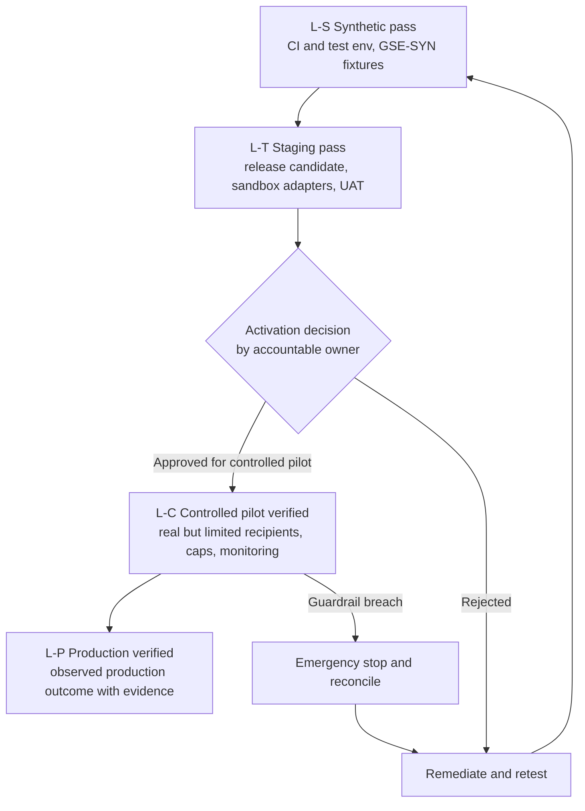
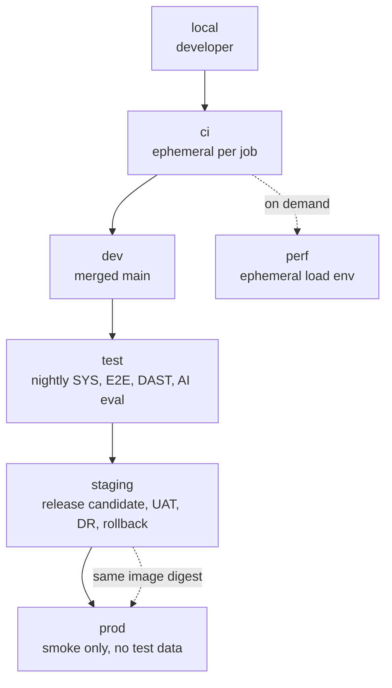
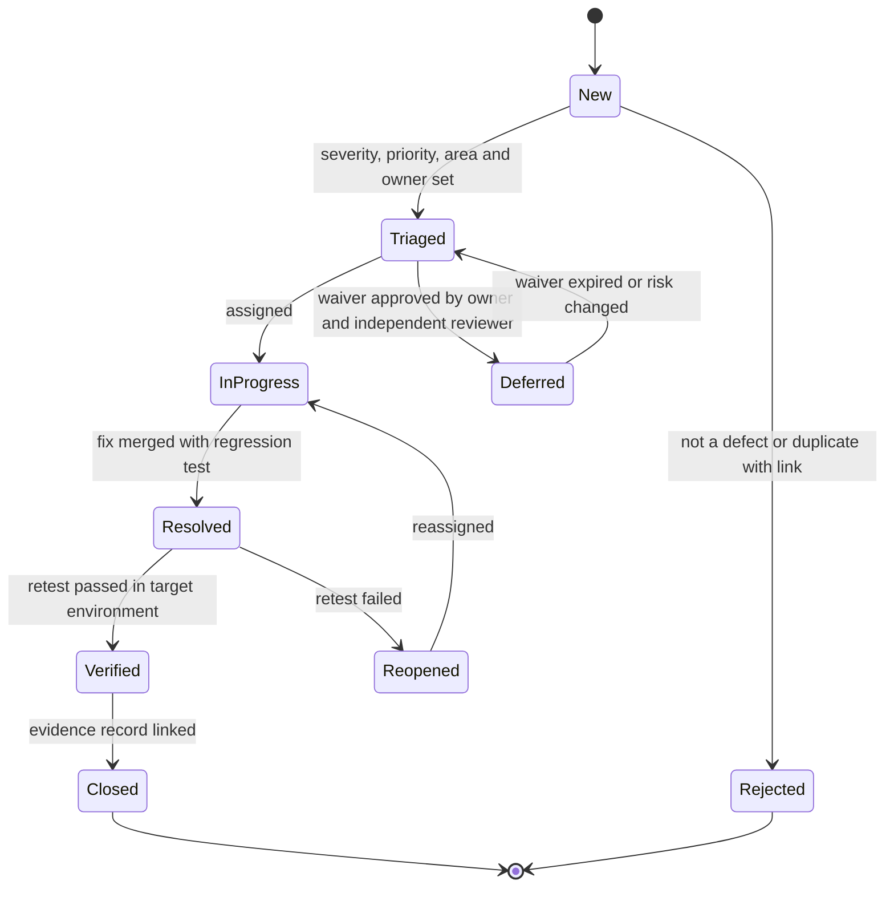
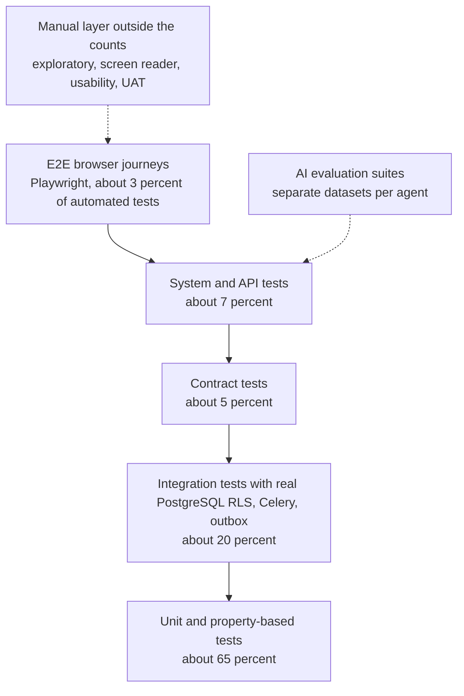
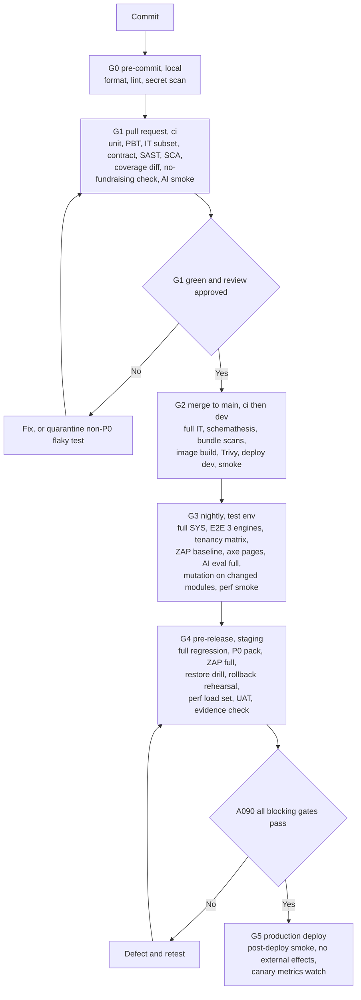
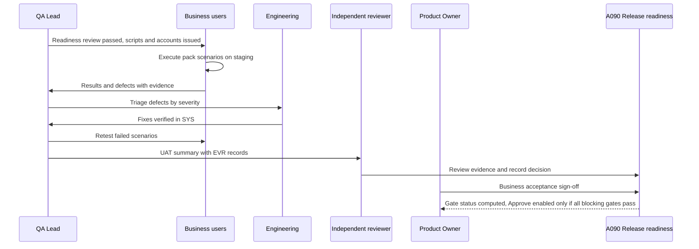

# AI Growth Engine: Employee Sales & Marketing Automation
## Application Blueprint: PART 6 (Batch 6.1), Test Strategy

| Field | Value |
|---|---|
| Document | Application Blueprint, Part 6 (Batch 6.1): Test Strategy. Batches 6.2 and 6.3 add test scenarios (TS), test cases (TC), AI evaluation cases (TC-AI) and the requirement-to-test traceability matrix, following the conventions set here (§6.1.12) |
| Version | 1.0 · 27 Nov 2026 |
| Baseline | Part 0 (NFR-001…038, EP-01…21, citation convention §0.1.2), Part 0A (DEC-001…065, binding), Part 1 (BR register, personas P01–P16, KPI-01…31, waves W0–W6), Part 2.1 (FR register, acceptance profiles CA-*), Part 2.2 (WF-01…14, engine invariants E-1…E-9), Part 2.3 (162 BRL rules, roles R01–R20, ABAC-01…12, state machines), Part 2.4 (reports RP-01…30, isolation layers, I18N-01…11), Part 2.5 (WCAG 2.2 AA, UI states, public performance budgets). Read for alignment (in progress in parallel, not depended on): Part 3.3 (data architecture), Part 4.1 (security; THR-, SC-, LT- references), Part 5.2 (stories US-08xx…US-14xx with Gherkin AC and dimensions D1–D8) |
| Roles applied | QA Lead (primary), Business Systems Analyst, Principal Engineer, Security/Compliance/AI Governance Lead, DevOps/SRE Lead, Data Architect/DBA, Lead UX/UI Designer, FinOps Lead, Product Owner |
| Tag ranges used | RECOMMENDATION-070…074 · ASSUMPTION-180…184 · GAP-165…167 |

**Acronyms used in this batch.** AC acceptance criterion · AP acceptance procedure (Part 0A DEC-014) · ASVS OWASP Application Security Verification Standard · BFF Backend-for-Frontend · BVA boundary value analysis · CI continuous integration · CLS Cumulative Layout Shift · CT contract test · DAST dynamic application security testing · DPIA data protection impact assessment · DR disaster recovery · DRE defect removal efficiency · E2E end-to-end · EP equivalence partitioning · EVR evidence record (BRD §12.2) · INP Interaction to Next Paint · IT integration test · LCP Largest Contentful Paint · MTTR mean time to repair · PBT property-based testing · PDP Policy Decision Point · PITR point-in-time recovery · POM page object model · RLS row-level security · RPO recovery point objective · RTO recovery time objective · SAST static application security testing · SCA software composition analysis · SIT system integration testing (BRD §10) · SUT system under test · SYS system test · TTFB time to first byte · UAT user acceptance testing · UT unit test.

**Time-sensitive facts.** Tool versions, provider sandbox capabilities (Amazon SES, Meta WhatsApp Cloud API, Indian payment gateways, e-sign providers, Google Calendar, search APIs, Anthropic models), browser versions, OWASP and WCAG revision status and all prices are **unverified; verify at time of implementation (as of 27 Nov 2026)** (DEC-042). No price or provider capability is stated as fact in this batch.

---

## 6.1.1 Purpose, scope and principles

### 6.1.1.1 What this batch decides

| # | Decision area | Section | Consumed by |
|---|---|---|---|
| 1 | Test levels with scope, owner, tools, environment, entry and exit criteria | §6.1.2 | All teams; Part 8 sprint plans |
| 2 | Test types (21) with objective, approach, tools, cadence, owner and pass criteria | §6.1.3 | Batches 6.2/6.3; Part 4 NFR catalogue |
| 3 | Risk-based prioritization: risk matrix of 30 functional areas, P0 rule for activation blockers, test depth levels | §6.1.4 | Batch 6.2 scenario priority |
| 4 | Entry and exit criteria per level, per wave (W0–W6) and per release; evidence record; certification ladder | §6.1.5 | A090 release readiness; Part 8 go-live checklist |
| 5 | Test environments, provider sandboxes and simulators, clock control | §6.1.6 | Part 3 environments; Part 4 CI/CD |
| 6 | Test data strategy: synthetic dataset, masking rules, seed/reset, privacy in test | §6.1.7 | Data Architect; Part 3.3 §3.3.16 |
| 7 | Defect management: lifecycle, severity S1–S4, priority, SLAs, release blocking | §6.1.8 | Part 4 incident management; Part 8 |
| 8 | Automation strategy: pyramid, tools, framework, CI gates, coverage targets, mutation testing, flaky policy | §6.1.9 | Engineering DoD (Part 5.1) |
| 9 | Metrics, test dashboard and release readiness report | §6.1.10 | RP-26, A090 |
| 10 | Test design techniques catalogue with worked examples from this product | §6.1.11 | Batches 6.2/6.3 |
| 11 | Conventions for TS, TC, TC-AI, the test case template and the SM-UT/SM-UAT/SM-UX-UAT alias mapping | §6.1.12 | Batches 6.2/6.3; Part 9 traceability |
| 12 | UAT plan: participants, vertical scenario packs, sign-off, AP-01…AP-10 | §6.1.13 | Business owners; Part 8 |
| 13 | Non-functional test plans: performance, security, accessibility, DR/failover, data migration, localization | §6.1.14 | SRE, Security, UX, Data |
| 14 | Test organization, responsibilities and effort range | §6.1.15 | Part 8 RACI and capacity |

### 6.1.1.2 Binding sources

| Source | What it fixes for testing |
|---|---|
| BRD §10 | "Positive and negative unit, system integration (SIT) and business-user acceptance (UAT) evidence for Website, authenticated portal and confidential Admin operations." No launch on failed **confidentiality, unauthorized external action, payment accuracy, regulatory eligibility or critical rollback** checks. Reused login/security still needs compatibility tests |
| BRD §11 | Vertical acceptance statements (AppNAI, MedMaarg, EduVerse, OrganicSpec, campaigns). "Open critical confidentiality, financial integrity or unauthorized-action defects block activation" |
| BRD §12.1, §12.2 | Delivery exit: no required FR left without a tested result; any waiver documented with owner and independent reviewer. Evidence record fields (§6.1.5.4) |
| BRD §13.2, §15, §16 | "No pending design proposal, synthetic test or document score is treated as production certification." Use only authorized synthetic or staging fixtures before external activation. Acceptance procedures and the two-tenant boundary condition |
| FRD §10, §11, §11.1, §12 | Mandatory path coverage per function (normal, validation, denied, timeout, duplicate, stale revision, recovery); functional behaviour standards; worked decision examples FR-DM-01…04; global UI states |
| FRD §11, §16.2 | Test IDs referenced but undefined: SM-UT-001…066 (63 distinct), SM-UAT-S001…S138, SM-UX-UAT-W01…A113 (147). Kept as aliases (DEC-017) |
| DEC-001 | AI gates: signal precision ≥ 80% on ≥ 100 reviewed signals (W1 exit); qualification precision ≥ 90% on ≥ 200 labelled items per vertical before L2/L3; recall ≥ 60% tracked |
| DEC-006, DEC-034, DEC-060–063 | Waves W0–W6; release gates from W0; eval harness and CI regression gate in W0 (DEC-061); full synthetic E2E suite completed in W5 (DEC-063) |
| DEC-014 | Acceptance Procedure Register AP-01…AP-10 |
| DEC-017 | Part 6 defines TC IDs; SM-UT/SM-UAT/SM-UX-UAT kept as aliases in the traceability matrix |
| DEC-018, DEC-032, NFR-008 | Availability, latency, TTFB, outbox lag, RPO/RTO, 10× pilot capacity; automation timeliness windows; Customer 360 freshness ≤ 60 s |
| DEC-031 | Workload design points (Year 1 and Year 2) |
| DEC-026, DEC-039, DEC-040 | Locales; migration via A103 imports; hosting and backup topology |
| NFR-001…038 | Testable non-functional statements, each needing a test method (Part 0 §0.3.3) |
| RECOMMENDATION-001, -011, -017 | WCAG 2.2 AA; consumer-driven/schema contract tests for adapters; synthetic data sets as a versioned test asset |

### 6.1.1.3 Test principles (binding for Batches 6.2/6.3 and for every engineer)

| ID | Principle | Consequence for test design | Source |
|---|---|---|---|
| TP-01 | **Fail closed is the oracle.** When a rule is uncertain, the expected result is deny, approval required, or no external effect | Every "Unknown" input class has a test whose expected result is a denial or a review task, never a default allow | FRD §12; Part 0A §A.2; BRL-ELG-01 |
| TP-02 | **Evidence over activity.** A test passes only on an observed result recorded with the build, environment and reviewer | No "assumed pass"; missing evidence = *Pending* | BRD §12.2, §14 acceptance protocol |
| TP-03 | **Synthetic before real.** Every externally consequential path is proven on synthetic or staging fixtures before any real recipient, payment, signature or publication | Staging and test environments use sandbox adapters only (ABAC-12) | BRD §9, §15 |
| TP-04 | **No production certification by inference.** Synthetic, staging or offline results never count as production sign-off | Certification ladder (§6.1.5.5) separates synthetic pass from production verification | BRD §13.2, §16 |
| TP-05 | **Every rule is a decision table.** Each of the 162 BRL rules has at least one decision-table or boundary test | Coverage target 100% (§6.1.9.6) | Part 2.3 §2.25 note |
| TP-06 | **Every external side effect passes the CA-DISPATCH battery**: plan-time and dispatch-time recheck, idempotency, uncertain path, simulation zero-effect, emergency stop | A standard negative pack per dispatching FR (§6.1.3.3) | CA-DISPATCH; E-3…E-7 |
| TP-07 | **Two-tenant by default.** Every integration, system and E2E test that reads or writes business data runs with the two-tenant fixture loaded and asserts zero foreign rows | Fixture T1 + T2 always present (§6.1.7) | NFR-032; AP-10; BRD §16 |
| TP-08 | **Negative cases are first-class.** Each story's AC set includes denial, validation, stale revision and recovery scenarios | Batch 6.2 rejects a scenario set without them | FRD §10; Part 5.2 §5.2.1 |
| TP-09 | **Money is Decimal, always.** Any float in a money path is a defect | Static check plus property tests (§6.1.11.7) | NFR-017; DEC-027 |
| TP-10 | **AI is tested like code and like a product.** Deterministic tests for the gateway, schema, routing and budget; statistical evals for quality; red-team for safety | Eval regression blocks deploy (NFR-033) | M54; DEC-061 |
| TP-11 | **Tests never contact real people.** Non-production outbound goes only to sink domains, simulators or provider test numbers | Outbound allowlist guard (§6.1.6.4) | BRD §9 "no unapproved external communication" |
| TP-12 | **Shift left, but prove right.** Most checks run on every pull request; the slow, expensive checks run nightly and before release, never skipped for a release | CI gates G0–G5 (§6.1.9.5) | NFR-012, NFR-013 |

### 6.1.1.4 Quality objectives (what "good enough to activate" means)

| QO | Objective | Measure (owner of truth) | Target | Source |
|---|---|---|---|---|
| QO-1 | Zero confidentiality breach | Cross-scope disclosure incidents in all test levels and production (KPI-30) | 0 | B-TENANT; NFR-032 |
| QO-2 | Zero unauthorized external action | Sends to suppressed/ineligible recipients (KPI-17); dispatches without matching approved hash | 0 | OPT-04-03; E-8 |
| QO-3 | Payment and revenue accuracy | Duplicate revenue or ledger entries; deals Won without route evidence (KPI-31); usage reconciliation (KPI-24) | 0 / 0 / 100% | M47; BRD §11; OPT-20-02 |
| QO-4 | Regulatory eligibility | Jurisdiction, consent, minors and health-data rules pass decision-table tests | 100% of BRL-ELG and BRL-PRV rules | DEC-029, DEC-030; BRD §15 |
| QO-5 | Rollback works | Rollback rehearsal per release; restore drill per release | 100% pass | NFR-012, NFR-013 |
| QO-6 | Requirements are tested | FRs with ≥ 1 passing test; AC with ≥ 1 TC | 100% / 100% | BRD §12.1 delivery exit |
| QO-7 | AI quality gates | Signal precision; qualification precision; regression suite | ≥ 80%; ≥ 90%; 0 regressions beyond tolerance | DEC-001; NFR-033 |
| QO-8 | Performance and availability | API p95 read/write; TTFB; outbox lag; automation timeliness | ≤ 500/800 ms; ≤ 800 ms; ≤ 60 s; ≥ 99% within window | DEC-018; DEC-032 |
| QO-9 | Accessibility | Critical/serious axe violations on top journeys; manual audit | 0; pass per wave | RECOMMENDATION-001; Part 2.5 §2.46 |
| QO-10 | Cost control | Simulated cap stops paid calls; zero unapproved paid calls | 100%; 0 | NFR-014; NFR-037 |

---

## 6.1.2 Test levels

The BRD names three evidence levels: unit, SIT and UAT (BRD §10). This strategy splits SIT into **integration, contract and system** tests and adds an **E2E** level for browser journeys, so that each level has one clear owner and one environment. The mapping back to the BRD vocabulary is in the last column.

### 6.1.2.1 Level summary

| Level | Code | Scope | Owner | Tools (verify versions) | Environment | Entry criteria | Exit criteria | BRD term |
|---|---|---|---|---|---|---|---|---|
| **Unit** | UT | One function, class, serializer, React component or hook. Pure domain logic: money, tax, rounding, scoring, PDP rules, state-machine guards, schema validators, prompt builders. No network; DB only where the ORM is the unit (fast transactional tests) | Developer who writes the code (reviewed in PR) | pytest, pytest-django, factory_boy, Hypothesis, time-machine/freezegun; Vitest, React Testing Library, vitest-axe | Developer machine and CI container (`local`, `ci`) | Story in progress; acceptance criteria known; interfaces stubbed | All new/changed code covered to the per-layer target (§6.1.9.6); 0 failing; mutation score met for money/eligibility modules; PR review approved | Unit |
| **Integration** | IT | Two or more real components inside the monolith: Django + PostgreSQL (RLS on) + Valkey + Celery worker + outbox relay + S3 (local emulator) + adapter fakes. Includes RLS policy tests, transaction and locking tests, webhook ingestion, migration tests | Developer; QA automation reviews the suite design | pytest-django with real PostgreSQL (pgvector), Celery worker in-process and out-of-process, testcontainers or CI services, moto/MinIO for S3, provider simulator (§6.1.6.3) | `ci`, `dev` | Unit tests green; migrations apply cleanly; fixtures T1/T2 loadable | 0 failing; every E-1…E-9 invariant exercised for the changed flow; RLS suite green; no unscoped query (static check) | SIT |
| **Contract** | CT | (a) Internal API contracts: OpenAPI schema of each surface (public, portal, admin, internal) against the implementation; (b) provider adapter contracts: request/response/webhook schemas and signatures for SES, WhatsApp, calendar, payment, e-sign, search, model gateway; (c) frontend ↔ BFF consumer contracts | Principal Engineer (owns schemas); developers write tests | schemathesis (property-based API fuzzing from OpenAPI), OpenAPI diff (breaking-change check), Pact or JSON-Schema contract tests for adapters (RECOMMENDATION-011), recorded sandbox fixtures | `ci`, `test` (sandbox calls nightly) | Schema published in the repository; adapter interface frozen for the sprint | No breaking change without version bump; all adapter fixtures validate; nightly sandbox contract run green or a ticket raised within 1 business day | SIT |
| **System** | SYS | The deployed application through its public interfaces (BFF/API and workers) in a production-like environment, with sandbox adapters. API-level functional tests, workflow tests WF-01…WF-14, CA-DISPATCH batteries, tenancy matrix, DAST, performance, DR, migration | QA automation (0.5 FTE) with developers; SRE for performance and DR | pytest API client suites, k6, OWASP ZAP, schemathesis (stateful), provider simulator, clock control | `test` (nightly), `staging` (pre-release), `perf` (ephemeral) | Build deployed by the pipeline; smoke green; dataset GSE-SYN loaded at the expected version; clock control enabled | All P0 and P1 system tests pass; non-functional thresholds met (§6.1.14); no open S1; S2 per §6.1.8.5 | SIT |
| **End-to-end** | E2E | Browser journeys across Website/Portal and Admin (both React apps) through the BFFs to workers and sandbox providers. Top journeys per persona, cross-surface flows (public intake → Admin review → portal quote → payment evidence) | QA automation; Lead UX/UI Designer reviews journey selection | Playwright (Chromium, Firefox, WebKit; trace **off** by default, on-first-retry only in quarantine runs), @axe-core/playwright, Playwright clock API | `test` (nightly), `staging` (pre-release) | System level green for the same build; journeys tagged in the journey register | All P0 journeys pass on Chromium and WebKit; P1 on Chromium; 0 critical/serious axe violations on journey pages | SIT |
| **User acceptance** | UAT | Business users execute vertical scenario packs and acceptance procedures AP-01…AP-10 on staging with synthetic data; usability observations (NFR-034) | Product Owner (accountable); QA Lead (facilitates); vertical owners (P02) execute | Test management tool (§6.1.9.2), UAT scripts from Batch 6.2, Admin A090 evidence capture | `staging` (`uat` data profile) | Exit criteria of System and E2E met for the scope; UAT readiness review passed (§6.1.13.4); trained participants | All UAT P0/P1 scenarios pass; AP evidence recorded; sign-off by PO + vertical owner + independent reviewer; open defects within release-blocking rules | UAT |

### 6.1.2.2 Level details

**Unit (UT).**
- *Unit boundaries.* Domain services (`pdp`, `money`, `ledger`, `scoring`, `statemachines`, `routing`, `templates`) are written as pure functions or small classes so they can be tested without Django. Serializers, permission classes and querysets are tested with the database in a transaction (pytest-django `db` fixture) and count as unit tests only when no worker, network or other app is involved.
- *Mandatory unit test sets* per module: decision tables for every BRL it enforces; BVA for every numeric or temporal threshold; property tests for money, scoring and state machines (§6.1.11.7); invalid-transition tests for every state-machine guard.
- *Frontend:* every shared component (Part 2.5 §2.45.2) has rendering, interaction, keyboard and axe tests in Vitest + React Testing Library. MoneyInput and QuantityInput have Decimal-safety tests (no `Number` arithmetic).

**Integration (IT).**
- Runs against **real PostgreSQL with RLS enabled** and the application role (not superuser), because RLS is bypassed by superusers and table owners. A test that connects as an owner role fails the suite (guard fixture).
- Verifies the **transactional outbox** (NFR-006): state change, audit append, budget reservation and outbox insert in one transaction (E-2), proven by forced failure after each step and assertion that nothing persisted.
- Verifies **workers set RLS context** from the job payload before any query; a job with forged scope is rejected (Part 2.4 §2.35.2).
- Verifies **webhook ingestion**: signature check, persist-then-acknowledge, dedupe by provider account + event ID (FR-ENG-01), out-of-order and duplicate delivery.
- Verifies **migrations**: forward migration on a seeded database, backward compatibility of the previous application version against the new schema (expand/contract), and RLS policies present on every operational table (catalogue query test).

**Contract (CT).**
- *API contracts.* Each surface has its own OpenAPI document. A route-inventory test diffs deployed routes against the per-origin allowlist (NFR-001; THR-007 in Part 4.1). Breaking changes (removed field, narrowed type, new required field) fail the PR unless the version is bumped (NFR-015).
- *Adapter contracts.* Each provider adapter has (1) an outbound request schema test, (2) a normalized response mapping test over recorded fixtures, (3) a webhook signature and payload schema test, (4) a failure classification test (transient, permanent, uncertain). Recorded fixtures are refreshed from sandboxes nightly; a schema drift opens a defect.
- *Model gateway contract.* Structured output JSON schemas per agent task; invalid outputs are rejected and retried within cap (BRL-AI-02).

**System (SYS).**
- Tests the deployed build through the BFF and internal APIs exactly as a client does, including cookies, CSRF tokens and audiences (DEC-019).
- Includes the **tenancy matrix**, **CA-DISPATCH battery**, **workflow suites** WF-01…WF-14, **DAST**, **performance**, **DR drills** and **migration rehearsals** (§6.1.14).

**End-to-end (E2E).**
- Journey register: top 20 journeys per wave (aligned with the manual accessibility audit scope in Part 2.5 §2.46), plus cross-surface journeys. Each journey maps to personas P01–P15 and to FRs.
- Flows that depend on time (quiet hours, approval expiry, bid deadlines) use the clock control endpoint, never `sleep`.

**User acceptance (UAT).** See §6.1.13.

---

## 6.1.3 Test types

### 6.1.3.1 Test type catalogue

| # | Type | Objective | Approach | Tools | Cadence | Owner | Pass criteria |
|---|---|---|---|---|---|---|---|
| T01 | **Functional** | Each FR behaves per its acceptance profile and story AC: normal, alternate, validation, denied, timeout, duplicate, stale revision and recovery paths (FRD §10) | Specification-based design from FR/US/AC/BRL using the technique catalogue (§6.1.11); executed at UT, IT, SYS and E2E | pytest, Vitest, Playwright | Every PR (UT/IT); nightly (SYS/E2E) | Developers; QA automation | 100% of FRs have ≥ 1 passing test; 100% of AC have ≥ 1 TC; all P0/P1 pass |
| T02 | **Regression** | Nothing that worked breaks; permanent negatives stay negative (e.g. DEC-002 no-fundraising test) | Full automated suite; risk-based selection on PR (tests mapped to changed modules) plus the full suite nightly and pre-release; every fixed defect adds a regression test | pytest (with test impact selection by module markers), Playwright, CI | PR (selected), nightly (full), pre-release (full) | QA automation | 100% pass of gating suites; quarantined tests ≤ 2% and none P0 (§6.1.9.7) |
| T03 | **Performance: load** | Meet latency and throughput targets at the Year 2 design point and at 10× pilot volume | Workload model §6.1.14.1; steady-state load for 30–60 min | k6 (HTTP), Python queue injector for Celery, Lighthouse CI (public pages) | Per wave in `perf`; smoke nightly (5 min) | SRE (0.5 FTE) with backend | API p95 ≤ 500 ms read / ≤ 800 ms write; TTFB p95 ≤ 800 ms (≤ 200 ms cached); outbox lag p95 ≤ 60 s; error rate < 0.5% [ASSUMPTION-181] |
| T04 | **Performance: stress** | Find the breaking point and verify graceful degradation (429, queueing, Tier 3) rather than data loss | Ramp to 3× Year 2 design load until SLO breach; observe recovery | k6, queue injector | Per release (W2, W3, W5) | SRE | No data loss; no duplicate side effect; 429/503 returned per NFR-015; recovery to SLO ≤ 10 min after load drops [ASSUMPTION-181] |
| T05 | **Performance: soak** | Find leaks, connection exhaustion, queue drift and outbox lag growth over time | Year 1 peak load for 24 h (W2) and 72 h (W5) with clock advanced through quiet-hour windows | k6, queue injector, CloudWatch/OpenTelemetry metrics | W2, W5 | SRE | Memory growth < 10% after warm-up; no worker restarts; outbox lag p95 ≤ 60 s throughout; ≥ 99% of due runs on time (DEC-032) [ASSUMPTION-181] |
| T06 | **Performance: spike** | Campaign launch bursts and webhook floods do not starve transactional work | Sudden 10× burst of sends and provider events | k6, provider simulator | W3, W5 | SRE | Transactional queue p95 start ≤ 15 min (DEC-032) during a batch burst; webhooks persisted before acknowledgement; no event loss (NFR-007) |
| T07 | **Security** | Prevent the STRIDE threats in Part 4.1 (THR-###) and the OWASP Top 10 classes; prove authorization at every enforcement point | SAST, SCA, secret scan, IaC scan, container scan, DAST, API fuzzing, authorization matrix, RLS suite, prompt-injection red team, external penetration test (§6.1.14.2) | Semgrep, Bandit, pip-audit/OSV-Scanner, npm audit, gitleaks, Trivy, Checkov, OWASP ZAP, schemathesis | PR (static), nightly (ZAP baseline), pre-release (ZAP full, authz matrix), pen test before first real pilot and first external tenant (RECOMMENDATION-073) | Security/Compliance Lead; DevOps | 0 open critical/high findings without approved risk acceptance; 0 authorization matrix failures; 0 RLS failures |
| T08 | **Accessibility** | WCAG 2.2 AA on Website, Portal and Admin | Automated axe in components and pages; keyboard scripts; screen-reader passes; zoom/reflow; publication gate BRL-PUB-06 (§6.1.14.3) | vitest-axe, @axe-core/playwright, Lighthouse CI, NVDA + Chrome, VoiceOver + Safari | PR (components), nightly (pages), per wave (manual audit top 20 journeys) | Lead UX/UI Designer; QA | 0 critical/serious automated violations; manual audit pass or approved waiver; publication blocked on failure |
| T09 | **Usability** | Users find the approved operation and complete core scenarios; clicks and time measured against a baseline (NFR-034; OPT-15-01) | Moderated task-based sessions (5 participants per persona group per wave), System Usability Scale (SUS) questionnaire, task success, time on task, error count | Session recordings (consented, internal staff only), analytics in staging | W2 (Admin core), W3 (Website/Portal), W5 (full) | Lead UX/UI Designer | Task success ≥ 80% on core tasks; SUS ≥ 68; no critical usability issue open on P0 journeys [ASSUMPTION-181] |
| T10 | **Compatibility** | Supported browsers and devices (DEC-043): last 2 versions of Chrome, Edge, Firefox, Safari (iOS/macOS); Website/Portal mobile-first from 360 px, Admin desktop-first from 1280 px and usable to 768 px for review/approval screens | Playwright projects per engine and viewport; manual check on real iOS Safari and Android Chrome per wave | Playwright (Chromium, Firefox, WebKit), real devices or a device cloud (verify cost; optional under B10) | Nightly (engines); per wave (real devices) | QA | P0 journeys pass on all engines; layout checks at 360, 768, 1280 px pass |
| T11 | **Data migration** | Imports through A103 are complete, correct, consent-gated and idempotent (DEC-039) | Dry-run, full-run, re-run and rollback rehearsals with reconciliation counts (§6.1.14.5) | pytest IT suites, import fixtures (CSV/JSON template versions), reconciliation SQL | Each template version; before each seed-startup conversion; W4/W5 | Data Architect; QA | 100% row reconciliation; 0 imported contacts eligible for outreach without verified lawful basis; re-run creates 0 duplicates |
| T12 | **DR / failover** | RPO ≤ 15 min and RTO ≤ 4 h (DEC-018); restore drill per release (NFR-012); provider outage loses no events (NFR-007) | Drills DR-1…DR-8 (§6.1.14.4) with timed measurements and post-restore integrity checks | AWS RDS PITR, S3 versioning, IaC, chaos scripts | Restore drill each release; full DR drill quarterly and before W4 activation | SRE; Data Architect | Measured RPO ≤ 15 min and RTO ≤ 4 h; 0 duplicate external effects after restore; audit chain verifies |
| T13 | **Localization** | en-IN correct at launch; hi-IN, ta-IN, or-IN content locales in W5; formats per I18N-01…11 (§6.1.14.6) | Pseudo-localization in CI, ICU plural tests, format tests, script rendering checks, linguistic review | Vitest, Playwright screenshots, ICU message linting | PR (pseudo-locale), W5 (locales) | Frontend lead; bilingual reviewers | 0 hard-coded strings; 0 truncation on pseudo-locale; formats correct; translations approved per BRL-APR-01/02 |
| T14 | **AI evaluation** | Each agent meets its quality, safety, cost and latency thresholds; changes do not regress (NFR-033) | Offline eval datasets per agent and per vertical; groundedness/citation checks; abstention tests; red-team prompt injection; routing tier and data-classification tests; cost-per-task measurement (§6.1.3.4) | In-house harness on pytest (primary), promptfoo or DeepEval optional for red-team and LLM-graded rubrics (align with Part 7, GAP-166) | PR when prompts, models, routes or tools change (smoke on recorded set); nightly full; per model version | AI lead (Principal Engineer in pilot); Security for red team | Thresholds per agent (Part 7); signal precision ≥ 80%; qualification precision ≥ 90% for L2/L3; 0 Restricted data reaching Tier 2; 0 prohibited-content passes in red-team set |
| T15 | **Multi-tenant isolation** | Zero cross-tenant and cross-startup disclosure or side effects (NFR-031, NFR-032; AP-10) | Two-tenant fixture matrix across every isolation layer (§6.1.3.3 A) | pytest IT/SYS suites, Playwright, ZAP authenticated scans | PR (subset), nightly (full matrix), pre-release | QA automation; Security | 0 foreign rows, objects, chunks, cache hits, files, notifications or side effects in every cell |
| T16 | **Idempotency and replay** | Duplicate delivery has exactly one effect; replay produces no duplicate message, revenue or publication (NFR-005; E-4) | Duplicate and out-of-order injection at API (same idempotency key ± same body hash), outbox relay, Celery redelivery, webhook duplicates, import re-runs (§6.1.3.3 B) | Provider simulator, pytest, Hypothesis stateful tests | PR (unit/IT), nightly (SYS) | Developers; QA | Exactly one effect in 100% of duplicate cases; body-hash mismatch on reused key → 409/422 per API contract |
| T17 | **Simulation zero-effect** | Simulation or dry run has zero live effects (NFR-038; E-6; BRL-AUT-04) | Run each dispatching workflow in simulation with a spy on every adapter and the ledger; assert zero provider calls, zero ledger/budget consumption, flagged records excluded from KPIs (§6.1.3.3 C) | Adapter spies, provider simulator call log, KPI projection assertions | PR (unit), nightly (SYS for every workflow template) | QA automation | 0 provider calls; 0 spend; 0 ledger entries; simulated records excluded from every KPI |
| T18 | **Uncertain-outcome reconciliation** | Timeout after submission is *uncertain*, never failed; no retry before reconciliation (NFR-026; E-5; FR-STD-02; DEC-050) | Inject timeout-after-submit for each provider adapter; verify state, retry block, re-query, human task after 3 attempts, final reconciled state (§6.1.3.3 D) | Provider simulator fault modes, clock control | PR (unit), nightly (SYS) | QA automation | 100% of adapters pass; 0 blind retries; reconciled states recorded with cost |
| T19 | **Compliance** | Consent, opt-out, jurisdiction, quiet hours, frequency caps, children and health-data exclusion, retention and privacy requests behave as the rule packs require (§6.1.3.3 E) | Decision tables per BRL-ELG/BRL-PRV rule; cross-channel opt-out propagation; jurisdiction pack matrix; sensitive-data fixtures (AP-05); retention clock tests; DPIA evidence check before activation | pytest, clock control, provider simulator, Playwright for preference centre (W29) | PR (rules), nightly (SYS), pre-activation (DPIA evidence) | Security/Compliance Lead (accountable), QA | KPI-17 = 0 in all tests; 100% BRL-ELG and BRL-PRV rules decision-table tested; 0 minor outreach; 0 health attributes in messages, audiences, ad events or prompts |
| T20 | **Cost control (FinOps)** | Budget caps stop paid calls before they happen; zero unapproved paid calls (NFR-014, NFR-037; BRL-AI-08) | Simulated cap tests per agent/startup/tenant; paid fallback disabled by default; usage metering reconciliation (NFR-035) | pytest, provider simulator with cost metering, A012 assertions | PR (unit), nightly (SYS) | FinOps Lead; backend | 100% of over-cap calls denied before the provider call; 80% alert raised; 100% usage reconciled to invoice lines |
| T21 | **Operability and observability** | Health/ready endpoints, correlation IDs end to end, alerts fire, logs redacted (NFR-019; RECOMMENDATION-006) | Assert `/health` without DB and `/ready` without secrets; trace propagation HTTP → outbox → Celery → adapter → webhook; alert rule tests with synthetic faults; log redaction corpus | pytest, OpenTelemetry test exporter, Sentry test DSN, CloudWatch alarm tests | PR (endpoints), nightly (traces), per release (alerts) | SRE | 100% of sampled flows carry one correlation ID; 0 PII/secrets in logs in the redaction corpus; each critical alert fires in drill |

### 6.1.3.2 Additional permanent negative tests

| Test | Rule | Level | Gate |
|---|---|---|---|
| No fundraising/investor capability: no entity, route, filter, role, permission, translation key or UI term from the forbidden lexicon (DEC-002 replacement list) | FR-NEG-01; BRL-TEN-12; DEC-002 | CT (build check on models, URL conf, OpenAPI, i18n catalogues) | G1 every PR |
| Investor-audience tokens rejected | DEC-058; NFR-001; BRL-TEN-02 | IT, SYS | G1, G4 |
| No Admin JavaScript, routes or private data in public bundles | NFR-001 | CT (bundle inspection: route manifest and string scan of built public assets) | G2 |
| No provider call or secret from browser code | CA-ALL; NFR-004 | CT (bundle scan for provider hosts and key patterns), SYS (CSP `connect-src` allowlist test) | G2 |
| Portal content never in public snapshot or CDN cache | BRL-PUB-05; NFR-020 | SYS (cache-key and response-header assertions) | G3 |
| AI never approves, signs, submits, pays, changes price/terms or permissions | BRL-AI-07; DEC-064; R20 | UT (tool registry has no such tool), SYS (agent identity denied on approval endpoints) | G1, G3 |

### 6.1.3.3 Detailed approach for the product-specific test types

**A. Multi-tenant isolation matrix (T15).** Every cell is one automated test parameterized over the two-tenant fixture. The attacker principal is a valid T2 user (or T1 user of another startup) holding a real session.

| Isolation layer (Part 2.4 §2.35.2) | Read foreign object by ID | List/search/filter leakage | Write/mutate foreign object | Forged scope (header/body/job payload) | Stale or wrong-audience credential | Expected |
|---|---|---|---|---|---|---|
| Identity / BFF | n/a | n/a | n/a | Requested scope not in membership | Investor audience, expired membership, revoked session (≤ 60 s, BRL-TEN-07) | 401/404; session revoked within 60 s |
| API objects and nested FKs | `GET /…/{foreign_id}` | Filters, sort keys, cursor tokens from T1 replayed by T2 | PATCH/POST with foreign FK in body | `X-Startup` of another tenant | Old grant | Uniform 404 (BRL-TEN-04); 0 foreign rows |
| Database (RLS) | Direct ORM query in worker context without scope | Aggregation and reporting views | Raw SQL path (repository modules) | Session variable not set → no rows | n/a | 0 rows; missing context raises |
| Global search (DEC-037) | n/a | Query terms unique to T1 data | n/a | n/a | n/a | 0 hits from foreign scope |
| Vector retrieval / Copilot | n/a | Semantic query matching T1 chunks | n/a | Namespace omitted | n/a | 0 foreign chunks; Copilot refuses without evidence (BRL-AI-12) |
| Exports (A103) and reports | Export link of T1 used by T2 | Report filters | n/a | n/a | Expired link (72 h) | 404/expired; 0 foreign records |
| Notifications and digests | n/a | Digest content | n/a | n/a | n/a | 0 foreign items in digests |
| Object storage | Signed URL of T1 used by T2 | Prefix listing | Upload to foreign prefix | n/a | Expired signed URL (≤ 15 min) | 403; 0 objects |
| Caches / CDN | n/a | Cache key collision across tenant/startup/locale/revision | Cache poisoning via headers | n/a | n/a | 0 foreign cache hits |
| Workers / queues | n/a | n/a | Job with foreign scope | Forged job payload | n/a | Job rejected and audited |
| Webhooks | n/a | n/a | Event for T1 provider account delivered to T2 route | Unsigned or mis-signed event | Replayed old event | Rejected; deduped; 0 effect |
| Sender identities | n/a | n/a | n/a | n/a | n/a | Bounce in T1 startup does not suppress T2 address; reputation isolated |
| Budgets / ledgers | n/a | n/a | Spend in T2 debits T1 | n/a | n/a | Exhausted T2 budget blocks only T2 |
| Logs and traces | n/a | Log query by T2 support user without grant | n/a | n/a | Support grant > 72 h | Denied; grant expiry enforced (BRL-TEN-09) |
| Portfolio scope (DEC-055) | n/a | n/a | Any mutation with > 1 startup selected | n/a | n/a | 409 `SELECT_SINGLE_STARTUP` (BRL-TEN-05) |

**B. Idempotency and replay (T16).**

| Injection point | Case | Expected |
|---|---|---|
| Public intake API (CA-INTAKE) | Same idempotency key and same body hash twice | One lead; second response returns the original result (M22) |
| Any mutating API | Same key, different body hash | Rejected per the API contract (Part 3 status code; 409 or 422) with no effect |
| Outbox relay | Relay crashes after provider accepted, before marking sent | Re-dispatch carries the same provider idempotency key; provider dedupes or result is *uncertain* and reconciled; one effect |
| Celery | Task redelivered (`acks_late`) after commit | Handler detects completed step by step key; no second effect |
| Webhooks | Same provider event ID 2×, 10× and out of order (delivered before sent) | One state change; out-of-order event parked and applied after the send record exists |
| Payments (BRL-FIN-02) | Same provider payment ID twice; uploaded proof with the same UTR/reference twice | One ledger entry; second marked *Duplicate* (Payment machine) |
| Fulfilment (FR-DM-03) | Deliver 1 kg twice with the same event key against a 2 kg order, then 2 kg more | Accepted once; duplicate no effect; over-delivery rejected |
| Publication | Publish the same approved hash twice; concurrent publish of two revisions | Single pointer swap; concurrent mismatch → 409 (FR-PUB-01) |
| Imports (A103) | Re-run the same import file | 0 duplicate records; run report shows "unchanged" rows |
| Provisioning (§2.35.4 step 7) | Re-run provisioning with the same application ID | No duplicate tenant, roles, storage prefixes or budgets |

**C. Simulation zero-effect oracle (T17).** A simulation test passes only when **all** of the following hold after the run: (1) the provider simulator call log for the run's correlation ID is empty; (2) no budget reservation or actual cost row exists; (3) no ledger, receivable, payable, publication pointer or calendar hold changed; (4) every created record carries `simulated = true` and the UI shows the Simulated state (Part 2.5 §2.47); (5) KPI projections exclude the records (BRL-AUT-04); (6) the simulation report lists the PDP decisions that a live run would have produced. Every workflow template in A113 gets one simulation test per published version.

**D. Uncertain-outcome reconciliation (T18).** For each adapter (email, WhatsApp, social, ads, e-sign, payments, calendar):

| Step | Injected condition | Expected (Part 2.2 §2.22.5) |
|---|---|---|
| 1 | Provider accepts the request, then the connection times out before the response | Outcome `uncertain`; message/action shows the amber certainty badge; retries blocked |
| 2 | Reconciliation query by idempotency key returns success | `reconciled_confirmed`; cost recorded; no second request |
| 3 | Reconciliation returns failure | `reconciled_failed`; eligible for retry only after PDP recheck |
| 4 | Provider query unavailable 3 times (clock advanced with backoff) | Human task created in A110; still no retry |
| 5 | Operator attempts manual retry while uncertain | Denied with "reconcile first" (BRL-AUT-07) |
| 6 | Emergency stop during reconciliation | Reconciliation queries continue (read-only); no new dispatch |

**E. Compliance (T19).**

| Area | What is tested | Key rules | Technique |
|---|---|---|---|
| Consent and lawful basis | Verified ≠ consent; lawful basis recorded per purpose and channel; imported contacts ineligible until verified | BRL-ELG-01, -03, -17; DEC-039 | Decision table |
| Opt-out | STOP keywords in supported languages, one-click unsubscribe, preference centre (W29); propagation to queued and scheduled items "immediately" and to every workflow; suppression survives deletion (BRL-PRV-03) | BRL-ELG-02; M04; NFR-036 | State transition, error guessing (case, whitespace, emoji, Unicode variants of STOP) |
| Jurisdiction | Rule pack per DEC-029: India, EU/EEA/UK, US, UAE/SG/AU; unknown → deny outbound; inbound replies allowed | BRL-ELG-05, -06 | Equivalence partitioning + decision table |
| Quiet hours and frequency caps | Recipient local time windows; rolling 7/30-day caps across all workflows | BRL-ELG-08, -09 | BVA with clock control |
| Children | Age band first; under 18 → guardian path with OTP to guardian channel; learner data limited to name, grade band, programme; no minor data in prompts beyond grade band; no outbound to learner | DEC-030; BRL-ELG-13; AP-05 | Decision table, BVA on age (17 / 18), negative fixtures |
| Health-data exclusion | Messages, audiences, ad events and AI inputs never contain health conditions or patient attributes; free-text intake redaction | BRL-ELG-14; BRL-PRV-06; AP-05 | Fixture-driven detection corpus, error guessing |
| Complaints and bounces | Complaint → suppress + incident; campaign pause above 0.1% or 3 complaints/24 h; hard and soft bounce rules | BRL-ELG-11, -12 | BVA |
| Privacy requests and retention | Identity verification, deadline escalation at 70%, legal hold, retention purge per DEC-028 data class | BRL-PRV-01…05 | Clock control, state transition (Privacy request machine) |
| Claims (MedMaarg) | Management claims publishable only after approval with evidence (DEC-021) | BRL-MKT (claims rules); A051 | Decision table |
| DPIA gate | EduVerse and MedMaarg flows cannot be activated without a recorded DPIA approval (RECOMMENDATION-007; DEC-030) | Activation flag guard | Negative system test |

### 6.1.3.4 AI evaluation (summary; full cases in Batch 6.3 and Part 7)

| Dimension | Metric | Dataset rule | Gate |
|---|---|---|---|
| Classification quality (signals M14) | Precision; recall | ≥ 100 human-reviewed pilot signals (W1) | Precision ≥ 80% to exit W1 (DEC-001) |
| Qualification quality (OPT-04-02) | Precision; recall | ≥ 200 labelled items per vertical, versioned benchmark | Precision ≥ 90% before L2/L3; recall ≥ 60% tracked (DEC-001; BRL-SCR-07) |
| Groundedness | Share of factual claims carrying a valid citation to approved knowledge or evidence | Per drafting agent, includes stale-evidence cases | 100% of claims cited or removed (BRL-AI-03) |
| Abstention | Correct abstention when evidence is missing or below threshold | "No evidence" and "expired evidence" subsets | 100% abstain on the no-evidence subset (BRL-AI-04) |
| Prohibited content | Invented relationships, diagnoses, medical advice, guarantees, binding commitments, disparagement | Red-team corpus incl. prompt injection in inbound messages, web pages and uploaded documents | 0 passes (BRL-AI-05) |
| Data classification routing | Restricted data never reaches Tier 2; Internal data redacted before Tier 2 | Synthetic PII, minors and health fixtures | 0 violations (DEC-007; BRL-AI-06) |
| Schema validity | Valid structured output rate; repair retries | All tasks | Invalid → repair ≤ 2 → Tier 3 (BRL-AI-02) |
| Cost and latency | INR per task; p95 latency per tier | Same dataset across candidate models (NFR-030) | Within agent budget (Part 7); route to lighter tier only at parity (DEC-007) |
| Regression | Delta versus the last accepted baseline per metric | Frozen baseline per prompt/model version | No metric worse than tolerance (Part 7); any failure blocks deploy (NFR-033, BRL-AI-09) |

---

## 6.1.4 Risk-based prioritization

### 6.1.4.1 Scales

| Score | Likelihood (of a defect reaching production in this area) | Impact (if it does) |
|---|---|---|
| 1 | Rare: simple, stable, well-covered code | Cosmetic; no business effect |
| 2 | Unlikely | Minor inconvenience; workaround exists |
| 3 | Possible: moderate logic, some external dependency | Feature unusable for a role; delayed business outcome |
| 4 | Likely: complex rules, concurrency, time, many providers | Wrong business record, financial misstatement contained internally, or SLO breach |
| 5 | Very likely: novel, AI-driven, many combinations | **Activation blocker class:** confidentiality breach, unauthorized external action, payment inaccuracy, regulatory ineligibility, failed rollback (BRD §10, §11) |

**Risk score = Likelihood × Impact (1–25).** **Priority rule:** any area whose impact is an activation-blocker class (impact 5) is **P0 regardless of likelihood** (BRD §10, §11). Otherwise P1 for score ≥ 12, P2 for 6–11, P3 for ≤ 5.

### 6.1.4.2 Test depth levels

| Depth | Name | Minimum required |
|---|---|---|
| **D4** | Exhaustive | All techniques that apply (EP, BVA, decision table with every rule, state transition with 0-switch 100% + invalid transitions per state + 1-switch for money and messaging machines, PBT, pairwise over all relevant dimensions); mutation testing; negative security tests; E2E journey; UAT scenario; tests at ≥ 3 levels; 100% automated except UAT |
| **D3** | Thorough | EP, BVA, decision tables, state transition 0-switch, pairwise on key dimensions; negative and permission tests; tests at ≥ 2 levels; ≥ 90% automated |
| **D2** | Standard | EP and BVA on inputs; happy, alternate, validation and permission paths; tests at UT + one higher level; ≥ 80% automated |
| **D1** | Light | Happy path and one negative per FR; smoke in E2E or SYS |

### 6.1.4.3 Risk matrix (functional areas × likelihood × impact → priority and depth)

| # | Functional area | Key requirements | L | I | Score | Priority | Depth | Rationale |
|---|---|---|---|---|---|---|---|---|
| RA-01 | Tenant/startup isolation, RLS, scope resolution, portfolio read-only | BR-TENANT; NFR-002, -031, -032; BRL-TEN-01…06; DEC-055, DEC-065 | 4 | 5 | 20 | **P0** | D4 | Confidentiality blocker (BRD §10) |
| RA-02 | Identity reuse, BFF sessions, MFA, audiences, revocation | DEC-003, DEC-019; NFR-001, -003; BRL-TEN-02, -07, -08 | 3 | 5 | 15 | **P0** | D4 | Confidentiality; compatibility tests required by BRD §10 |
| RA-03 | Policy Decision Point: consent, suppression, jurisdiction, quiet hours, caps, recheck at dispatch | BR-M04, BR-M24; BRL-ELG-01…18; DEC-029 | 4 | 5 | 20 | **P0** | D4 | Regulatory eligibility and unauthorized external action |
| RA-04 | Outbound dispatch engine: outbox, idempotency, uncertain outcomes, emergency stop | NFR-005, -006, -007, -026; E-2…E-7; BRL-AUT-05, -07 | 4 | 5 | 20 | **P0** | D4 | Unauthorized or duplicate external action |
| RA-05 | Approvals and separation of duties (hash-bound, thresholds, maker-checker) | CA-APPROVE; BRL-APR-01…11; DEC-038 | 3 | 5 | 15 | **P0** | D4 | Unauthorized external action; payment accuracy |
| RA-06 | Quotes, pricing, tax, rounding, currency | BR-M44; BRL-QTE-01…07; DEC-027; FR-DM-01 | 4 | 5 | 20 | **P0** | D4 | Payment accuracy |
| RA-07 | Payments, invoices, ledgers, closure, revenue | BR-M47, BR-M52; BRL-FIN-01…08; DEC-054; RECOMMENDATION-018 | 4 | 5 | 20 | **P0** | D4 | Financial integrity; duplicate revenue |
| RA-08 | Orders and fulfilment, receivable/payable separation (OrganicSpec) | WF-10; BRL-ORD-01…06; FR-DM-03; DEC-045 | 4 | 5 | 20 | **P0** | D4 | Payment accuracy; BRD §11 OrganicSpec acceptance |
| RA-09 | Bids and tenders (AppNAI): deadlines, checklist, human submission evidence | WF-08; BRL-BID-01…06; DEC-053; FR-DM-02 | 3 | 5 | 15 | **P0** | D4 | "No submission without mandatory checks" (BRD §11); unauthorized action |
| RA-10 | Contracts and e-signature | BR-M46; BRL-CTR-01…05; DEC-023 | 3 | 5 | 15 | **P0** | D3 | Unauthorized action (AI never signs) |
| RA-11 | Children and guardian consent (EduVerse) | DEC-030; BRL-ELG-13; AP-05 | 3 | 5 | 15 | **P0** | D4 | Regulatory eligibility |
| RA-12 | Health-data exclusion (MedMaarg) and sensitive-data redaction | BRL-ELG-14; BRL-PRV-06; AP-05 | 3 | 5 | 15 | **P0** | D4 | Regulatory eligibility; confidentiality |
| RA-13 | Model gateway: routing tiers, data classification, budget reservation, schema, guardrails | BR-M08, BR-M53; DEC-007, DEC-008; BRL-AI-01…12; FR-OP001 | 5 | 5 | 25 | **P0** | D4 | Restricted data to Tier 2 = confidentiality; overspend |
| RA-14 | Website publication, hosts, CDN, previews | BR-WEB; FR-PUB-01; BRL-PUB-01…06; NFR-020 | 3 | 5 | 15 | **P0** | D4 | Draft/private exposure = confidentiality |
| RA-15 | External portal object grants and field-minimized DTOs | CA-PORTAL; ABAC-09 | 3 | 5 | 15 | **P0** | D4 | Confidentiality |
| RA-16 | Release, rollback, backup and restore | BR-M09, BR-M62, BR-QA; NFR-012, -013; DEC-018 | 3 | 5 | 15 | **P0** | D3 | Critical rollback (BRD §10) |
| RA-17 | Privacy requests, retention purge, legal hold, exports | BR-M56; BRL-PRV-01…07; DEC-028 | 3 | 5 | 15 | **P0** | D3 | Regulatory; deletion must not re-enable outreach |
| RA-18 | SaaS lifecycle: application, provisioning, entitlements, metering, billing, suspension, export | BR-SVC; BRL-SVC-01…07; W31–W34; NFR-035 | 4 | 5 | 20 | **P0** | D3 | Cross-tenant risk and billing accuracy |
| RA-19 | Automation engine, autonomy caps, simulation, conflicts, triggers/webhooks | BR-AUTO; BRL-AUT-01…10; DEC-064; A109–A113 | 4 | 5 | 20 | **P0** | D4 | Unauthorized external action |
| RA-20 | Campaigns, ads spend caps, landing pages, referrals | BR-M37…M39, M42; BRL-MKT; BRL-ELG-17 | 3 | 5 | 15 | **P0** | D3 | Unapproved spend or message (BRD §11 campaigns) |
| RA-21 | Opportunity scoring and qualification | BR-M17, BR-M20; BRL-SCR-01…09; DEC-011 | 4 | 4 | 16 | P1 | D3 | Wrong prioritization; score never grants permission (tested in RA-03) |
| RA-22 | Discovery, source permissions, evidence provenance | BR-M07, M10–M16; BRL-SRC; NFR-028 | 4 | 4 | 16 | P1 | D3 | Prohibited source fetch is a compliance issue (OPT-04-01); kept P1 because no outbound effect, but "prohibited source never fetched" tests are P0 |
| RA-23 | CRM, lead capture, Customer 360, dedupe | BR-M21…M23; NFR-008; CA-INTAKE | 3 | 4 | 12 | P1 | D3 | Duplicate leads; freshness ≤ 60 s |
| RA-24 | Messaging drafting, inbox, sequences, follow-ups | BR-M25…M28; BRL-SEQ | 4 | 4 | 16 | P1 | D3 | Dispatch itself is covered by RA-03/04 (P0) |
| RA-25 | Meetings, calendar, webinars | BR-M29, BR-M40; BRL-MTG | 3 | 3 | 9 | P2 | D2 | Booking errors are recoverable |
| RA-26 | WhatsApp and website assistant | BR-M31, BR-M32; BRL-ELG-07; BRL-AI-11 | 4 | 5 | 20 | **P0** | D4 | Clinical-question handover, opt-in and template rules (regulatory) |
| RA-27 | Dashboards, reports, forecasts, attribution | BR-M30, M52, M60, M61; RP-01…30 | 3 | 4 | 12 | P1 | D2 | Mixing forecast and actuals misleads (BRL-FIN-06); cross-tenant aggregate covered by RA-01 |
| RA-28 | Content, SEO, social publishing | BR-M34…M36 | 3 | 4 | 12 | P1 | D2 | Publication approval covered by RA-14 |
| RA-29 | Onboarding, retention, renewal, partners, expansion pilots | BR-M48…M51, M63…M65 | 2 | 3 | 6 | P2 | D2 | Lower volume, internal effects |
| RA-30 | Admin UX shell, navigation, search, notifications, localization | BR-M61; DEC-036, DEC-037; DEC-026 | 3 | 3 | 9 | P2 | D2 | Search leakage covered by RA-01; a11y covered by T08 |

**How the matrix drives Batch 6.2.** Each scenario inherits the priority of its area unless the scenario itself exercises an activation-blocker condition, in which case it is P0. Example: a meeting-reminder scenario (RA-25, P2) that tests quiet-hour exceptions for reminders ≤ 2 h (BRL-ELG-08) is promoted to P0 because it tests a regulatory eligibility rule.

### 6.1.4.4 Risk heat summary

| Impact ↓ / Likelihood → | 2 | 3 | 4 | 5 |
|---|---|---|---|---|
| **5** (blocker class) | — | RA-02, 05, 09, 10, 11, 12, 14, 15, 16, 17, 20 | RA-01, 03, 04, 06, 07, 08, 18, 19, 26 | RA-13 |
| **4** | — | RA-23, 27, 28 | RA-21, 22, 24 | — |
| **3** | RA-29 | RA-25, 30 | — | — |

---
## 6.1.5 Entry and exit criteria

### 6.1.5.1 Per level (consolidated checklist)

| Level | Entry: all must be true | Exit: all must be true | Suspension trigger | Resumption |
|---|---|---|---|---|
| UT | Story meets Definition of Ready (Part 5.1); module interfaces agreed | Coverage targets for the changed layer (§6.1.9.6); 0 failures; no new lint/SAST high; mutation threshold for money/eligibility modules on changed files | > 5% of unit tests failing on main | Root cause fixed; main green |
| IT | UT green; migration applies; containers healthy; GSE-SYN `s` profile loads | 0 failures; RLS suite 100%; outbox atomicity tests pass; no unscoped query | PostgreSQL/Valkey/Celery container instability > 2 runs | Infra fixed; 3 consecutive green runs |
| CT | OpenAPI and adapter schemas committed; recorded fixtures present | No unversioned breaking change; all adapter fixtures validate; nightly sandbox drift report reviewed | Sandbox unavailable > 24 h | Recorded fixtures used; drift recheck when sandbox returns |
| SYS | Pipeline deployed build to `test`/`staging`; smoke green; dataset version matches manifest; clock control on; provider simulator healthy | All P0/P1 pass; non-functional thresholds met for the wave scope; 0 open S1; S2 per §6.1.8.5; evidence recorded | Smoke fails; > 10% of P0 failing; data reset failing | Fixed build redeployed; smoke and P0 rerun |
| E2E | SYS green for the build; journey register current | All P0 journeys pass on Chromium and WebKit; P1 on Chromium; 0 critical/serious axe violations on journey pages | Environment instability (> 2% infra-caused failures) | Infra fixed; affected journeys rerun |
| UAT | SYS/E2E exit met for scope; UAT readiness review passed; participants trained; scripts approved | §6.1.13.5 | S1 found in UAT; environment unavailable > 4 business hours | Fix deployed and verified in SYS; UAT pack restarted from the failed scenario |

### 6.1.5.2 Per wave (DEC-006, DEC-034; Part 1 §1.6.1)

| Wave (days) | Scope tested | Wave entry (test) | Wave exit (test evidence required) |
|---|---|---|---|
| **W0** (1–15) Foundation | M01–M09, M53, M56, M58; M54 eval harness; M62 pipeline; B-TENANT core; M61 shell | Sprint 0 identity compatibility spike executed: **12 checks** pass/fail report (DEC-019); CI gates G0–G3 operational; GSE-SYN v1 (two tenants) seeded; provider simulator for SES, model gateway and webhooks | Controls tested (BRD §8): RA-01, RA-02, RA-13, RA-16 P0 suites pass; RLS two-tenant suite 100%; budget hard cap proven in test (KR1.4; NFR-014); eval harness and CI regression gate live (DEC-061); first restore drill and rollback rehearsal pass (NFR-012/013); no-fundraising build check live (DEC-002); owner and claims sign-off recorded |
| **W1** (16–30) Intelligence pilot | M10–M20 | W0 exit; source permission register seeded; eval dataset for signals ≥ 100 items prepared | Signal precision ≥ 80% on ≥ 100 human-reviewed signals (DEC-001; KPI-02); "prohibited source never fetched" tests 100% (OPT-04-01); provenance 100% (NFR-028); scoring decision tables and BVA (DEC-011) pass |
| **W2** (31–60) Sales foundation | M21–M30, M55; B-AUTO manual/assisted/supervised, simulation, stop; B-WEB core | W1 exit; SES sandbox contract tests green; Website publication tests ready | CA-DISPATCH battery for email; simulation zero-effect for every W2 workflow; emergency stop ≤ 60 s (E-7); public site tests for 4 seed startups with 0 draft/private exposure (KR2.4); first load/soak run (24 h); W2 usability sessions; accessibility manual audit of W2 journeys |
| **W3** (61–90) Omnichannel | M31–M42, M57; B-WEB remainder | W2 exit; WhatsApp and social sandbox/test numbers verified (ASSUMPTION-183) | **Channel opt-out and replay tests pass** on email, WhatsApp and web (BRD §8; KR2.2); KPI-17 = 0 across all suites; ads spend cap tests; spike test for campaign bursts; ≥ 99% transactional runs within 15 min in soak (KR2.3) |
| **W4** (91–120) Closure | M43–M51; A104, A105; W14–W16, W23–W28 | W3 exit; payment and e-sign adapters with sandbox or evidence-upload path (DEC-022, DEC-023); external pen test scheduled (RECOMMENDATION-073) | **Full synthetic deal** per route (AppNAI bid, MedMaarg pilot, EduVerse enrolment, OrganicSpec order) passes end to end; AP-04 partial-then-full receipt passes; money/ledger mutation targets met; pen test findings: 0 critical/high open; DR drill before real pilot; then **one real controlled pilot** under the certification ladder (§6.1.5.5) |
| **W5** (121–180) Optimization and SaaS | M52, M54 feedback loop, M59–M62; B-AUTO controlled autonomous; B-SVC | W4 exit; external tenant fixture T3 loaded; locales hi/ta/or content available for test | **30-day monitored pilot** with budget and compliance gates (BRD §8); qualification precision ≥ 90% before any L2/L3 (DEC-001); SaaS lifecycle (provision, meter, invoice, suspend, export) for 2 tenants without affecting another (BR-SVC); full synthetic E2E suite complete (DEC-063); 72 h soak; localization tests; quarterly DR drill |
| **W6** (181–365) Expansion | M63–M66 launch workflow; L-items as triggered | W5 exit; readiness approvals for each pilot | AP-01 (26th startup by template, no code change) re-run on production-like data; regression green; contract and market-fit milestones are business evidence, not test results (BRD §11) |

### 6.1.5.3 Per release (planning groupings, DEC-006)

| Release | Waves | Release entry | Release exit (activation gate for that scope) |
|---|---|---|---|
| Release 1 | W0–W3 | Wave exits W0–W2 met; release candidate built once and promoted unchanged | (1) 0 open S1; 0 open S2 in P0 areas; (2) every FR in scope has ≥ 1 passing test (BRD §12.1); (3) P0 suites 100% pass in `staging`; (4) restore drill and rollback rehearsal pass for this release (NFR-012/013); (5) DAST full scan: 0 high/critical; (6) AI regression green (NFR-033); (7) UAT sign-off for W0–W3 packs; (8) evidence complete in A090 with independent reviewer; (9) every external channel flag remains OFF until its activation decision (RECOMMENDATION-005) |
| Release 2 | W4–W5 | Release 1 exit; pen test completed | Release 1 criteria plus: (10) full synthetic deal per route; (11) AP-01…AP-10 evidence complete; (12) DR full drill with measured RPO/RTO; (13) 30-day monitored pilot report accepted; (14) SaaS isolation and reconciliation 100% (NFR-035) |
| Future | W6 | Release 2 exit | Release criteria per pilot; readiness approval (DEC-060) |

**Hotfix path.** A production hotfix runs G1 + the P0 regression subset for the affected area + rollback rehearsal of that change in `staging`. It needs the same evidence record; the independent reviewer may review after deployment only for an S1 containment change, within 1 business day [RECOMMENDATION-074].

### 6.1.5.4 Evidence record (BRD §12.2) and its data model

Every executed test that counts toward a gate writes an **evidence record (EVR)**. The record is append-only (NFR-018) and is what A090 reads.

| EVR field | BRD §12.2 field | Content | Rule |
|---|---|---|---|
| `evr_id` | n/a | UUID | Immutable |
| `responsible` | Responsible / reviewer | Name and role of the implementing owner | Must differ from `reviewer` |
| `reviewer` | Responsible / reviewer | Name and role of the independent reviewer | Not the author of the code or the test (BRD §12.1, §13.2) |
| `scope` | Artifact / test evidence | Product, tenant fixture, startup, surface, wave, release | Fixture IDs, never real tenants for synthetic evidence |
| `commit` / `artifact_digest` | Artifact / test evidence | Git commit SHA and container image digest | Must match the deployed build (A090 `evidence digest`) |
| `config_revision` | (BRD §15: "policy/configuration revision") | Policy, rule-pack, prompt and model versions in force | Captured automatically from the running build |
| `environment` | Artifact / test evidence | `ci`, `test`, `staging`, `perf`, `prod` | Synthetic results cannot carry `prod` certification (§6.1.5.5) |
| `scenario_id` / `test_ids` | Artifact / test evidence | TS-/TC-/TC-AI IDs, plus SM-UT/SM-UAT/SM-UX-UAT aliases | Must resolve in the traceability matrix |
| `actual_result` | Artifact / test evidence | Observed outcome, metrics, counts | Free text plus structured metrics |
| `evidence_ref` | Artifact / test evidence | Secure reference (S3 object key with hash) to logs, reports, screenshots (redacted) | No personal data; retained per DEC-028 audit class |
| `decision` | Decision | `Pending` / `Pass` / `Fail` / `Approved N/A` + reason | Missing evidence = `Pending` (BRD §14 acceptance protocol) |
| `remediation` | Remediation | Defect ID, owner, corrective action, retest EVR | Required when `decision = Fail` |
| `business_acceptance` | Business acceptance | Authorized sign-off reference after required gates pass | Only for UAT and AP records |
| `certification_level` | n/a | Ladder level L-S, L-T, L-C, L-P (§6.1.5.5) | Set by the gate, not by the tester |

[RECOMMENDATION-072] The EVR schema above and the certification ladder below are added so that A090 can compute "Fail closed on incomplete evidence" (FR-A090) mechanically.

### 6.1.5.5 Certification ladder ("no production sign-off inferred from synthetic tests")



| Level | Meaning | Who may set it | What it allows |
|---|---|---|---|
| L-S | Test passed on synthetic data in `ci`/`test` | Pipeline | Merge and promote to `staging` |
| L-T | Test passed on the release candidate in `staging` with sandbox adapters; UAT accepted | QA Lead + independent reviewer | Release approval in A090 with all external channels still OFF |
| L-C | A real but bounded activation (named startup, channel, recipient cap, budget cap, monitoring window) produced the expected observed result | Accountable owner + independent reviewer | Expansion of the activation within approved caps |
| L-P | Production outcome observed over the monitoring window (for example the 30-day monitored pilot, BRD §8) | Product Owner | Normal operation for that scope |

**Rule.** A090 never shows a production activation as ready based on L-S or L-T evidence alone (BRD §13.2, §16). A report or dashboard that displays test results labels them with their ladder level.

---

## 6.1.6 Test environments

### 6.1.6.1 Environment catalogue

| Env | Purpose | Topology (DEC-040; Part 3 owns sizing) | Data | External adapters | Clock control | Deployed by | Refresh / reset |
|---|---|---|---|---|---|---|---|
| `local` | Developer UT/IT | Docker Compose: PostgreSQL + pgvector, Valkey, MinIO, Celery, provider simulator | GSE-SYN profile `s` | Simulator only | Yes (freezegun/time-machine in-process; clock API) | Developer | On demand (`make reset`) |
| `ci` | PR and main pipelines | Ephemeral containers per job; PostgreSQL template DB cloned per worker | Profile `s` | Simulator; recorded fixtures | Yes | Pipeline | Per job |
| `dev` | Integration of merged work; demo to team | Small AWS footprint (same container images) | Profile `m` | Simulator; sandbox for SES (simulator addresses only) | Yes | Pipeline on merge | Nightly reset |
| `test` | Nightly SYS, E2E, DAST baseline, AI eval full, contract drift | Prod-like single-AZ (pilot topology) | Profile `m` + edge pack | Provider sandboxes + simulator fault modes | Yes | Pipeline nightly | Nightly reset to manifest version |
| `staging` | Release candidate, regression, UAT, DR and rollback rehearsal, pen test | Mirror of production topology (Multi-AZ once production moves to Multi-AZ at the scale gate) | Profile `uat` (m + vertical UAT packs) | **Sandbox adapters only** (ABAC-12); outbound allowlist guard | Yes (disabled during DR timing runs) | Pipeline on release tag | Reset per release; UAT data frozen during UAT window |
| `perf` | Load, stress, soak, spike | Ephemeral; production-equivalent instance classes; created by IaC for the run and destroyed after (cost control under B07/B01; verify) | Profile `l` (Year 2 design point) | Simulator with latency profiles (no real provider load) | Yes | SRE via IaC | Created per run |
| `prod` | Live service | Production | Real data | Live providers | **No** (clock control code path not deployed) | Pipeline with approval | n/a; post-deploy smoke only, read-only and without external effects |

### 6.1.6.2 Environment promotion and isolation rules



1. One image per release candidate, promoted by digest. A rebuilt image restarts testing at `ci` (EVR `artifact_digest` must match).
2. **No production data in non-production environments** by default (§6.1.7.4).
3. **No production credentials outside `prod`.** Non-production environments have their own provider accounts, sandbox keys and sender identities (Part 4.1 secrets rules).
4. **Outbound allowlist guard** in every non-production environment (§6.1.6.4).
5. **Clock control is compiled out of `prod`** (settings flag plus absence of the URL route; a CT test asserts the route is missing from the production route manifest).
6. Tenancy fixtures T1/T2 are present in every non-production environment (TP-07).

### 6.1.6.3 Provider sandboxes, simulators and mocks

[RECOMMENDATION-071] A **provider simulator** (an internal service, test-only) implements each adapter's provider API surface with scriptable **fault modes**, and a **clock control** facility lets tests move time. Both exist only in non-production builds.

| Provider (adapter) | Sandbox / test facility (verify availability and terms, as of 27 Nov 2026) [ASSUMPTION-183] | Use in `ci`/`local` | Use in `test`/`staging` | Simulator fault modes required |
|---|---|---|---|---|
| Amazon SES (DEC-025) | SES sandbox mode and mailbox simulator addresses for success, bounce, complaint, suppression list (verify) | Simulator | SES sandbox with simulator addresses only; real SNS webhooks to the env | accept, hard bounce, soft bounce ×3, complaint, delayed delivery event, duplicate SNS message, out-of-order events, invalid signature, timeout-after-submit, throttling (429-equivalent) |
| Meta WhatsApp Cloud API (M31) | Test business number and test recipients; template approval in test account (verify) | Simulator | Test number to registered staff test handsets only | template rejected, outside customer-service window, opt-out keyword, duplicate webhook, timeout-after-submit, rate limit |
| Indian payment gateway (DEC-022; shortlist Razorpay/Cashfree/PayU) | Test mode keys, test payment links and signed test webhooks (verify per provider) | Simulator | Gateway test mode | paid, partial, failed, duplicate webhook, webhook before link record, amount mismatch, currency mismatch, refund, signature invalid, timeout-after-submit |
| Bank transfer / UPI evidence (DEC-022) | Not a provider: uploaded evidence + maker-checker | Fixture files (PDF/PNG with synthetic UTR) | Same | duplicate UTR, mismatched amount/payer, malware test file (EICAR) |
| E-sign (DEC-023) | W4: signed-PDF upload + SHA-256; W5: provider sandbox (Leegality/Digio/Zoho Sign/DocuSign shortlist, verify) | Simulator | Signed-PDF fixtures; provider sandbox in W5 | hash mismatch, signer authority missing, provider callback duplicate, timeout-after-submit |
| Google Calendar (DEC-024), Microsoft Graph (W5) | Test Workspace account / developer tenant (verify) | Simulator | Test accounts | slot taken concurrently, token revoked, free/busy unavailable, timezone/DST edge |
| Search and extraction APIs (B03/B04: Tavily, Exa, self-hosted extraction) | Free credits or test keys (verify) | Recorded fixtures | Recorded fixtures by default; live only in a capped nightly contract run | blocked host, robots disallow, timeout, oversized page, prompt-injection content in page |
| Anthropic models via gateway (DEC-007) | No sandbox: real API with a separate test key and a hard test budget | Recorded responses (record/replay keyed by prompt hash and model version) | Live calls only for the nightly AI eval and staging smoke, within a test budget cap | timeout, 429, 5xx, invalid JSON, schema-invalid output, refusal, latency spike |
| Tier 2 free/open-weight fallbacks (DEC-007) | Disabled by default; tested only with Public/Internal-non-personal synthetic data | Simulator | Opt-in test tenant only | unavailable, quality below threshold |
| S3 / object storage | MinIO or moto | Yes | Real S3 in the env account | access denied cross-prefix, expired signed URL |
| Social and ads platforms (M35, M39) | Developer apps / test ad accounts where offered (verify); otherwise simulator only | Simulator | Simulator unless a sandbox is verified | spend cap reached, post rejected, duplicate publish, timeout-after-submit |

**Simulator contract.** The simulator is itself contract-tested against recorded sandbox fixtures (§6.1.2.2 CT), so a passing simulated test cannot drift silently from provider behaviour.

### 6.1.6.4 Outbound allowlist guard (non-production)

| Channel | Allowed recipients in non-production | Enforcement point | Test |
|---|---|---|---|
| Email | Provider simulator addresses; `*.example.com`, `*.example.org`, `*.invalid` (RFC 2606 reserved names); a staff test inbox domain on an explicit allowlist | Adapter layer (after PDP) + SES configuration set in the non-prod account | Attempt to send to a non-allowlisted real-looking address → blocked and S1 alert in the test report |
| WhatsApp | Registered test handsets only | Adapter layer | Same |
| Payments, e-sign, calendar, social, ads | Sandbox/test-mode accounts only | Adapter credential type check (test keys only) | Startup check fails if a live key is configured outside `prod` |
| Webhooks | Inbound only from sandbox providers or simulator | Signature keys per environment | Production-signed payload rejected in `staging` |

### 6.1.6.5 Clock control (time travel)

| Layer | Mechanism | Used for |
|---|---|---|
| Domain code | All "now" reads go through one `Clock` service (UTC). Direct `datetime.now()`/`timezone.now()` in business code fails a lint rule | Makes every time rule testable |
| Unit tests | `time-machine` or `freezegun` fixtures; Hypothesis strategies for datetimes across time zones | BVA on quiet hours, expiries, caps |
| Integration/system | Test-only endpoint `POST /api/v1/internal/test/clock` (non-prod only, service identity + test role) sets a per-environment virtual offset; Celery Beat due-run scanner and expiry jobs read the virtual clock | Advancing to bid deadline − 24 h, approval expiry, retention purge |
| Frontend/E2E | Playwright clock API to control timers and `Date` in the browser, synchronized with the server offset | Session-timeout warnings (WCAG 2.2.1), slot holds, countdowns |

| Time-dependent rule | Scenario to drive with clock control | Source |
|---|---|---|
| Bid deadline buffer | Submission approval at deadline − 24 h − 1 s (allowed) and at − 24 h (blocked) | BRL-BID-01; FR-DM-02 |
| Quiet hours | Recipients in IST, CET/CEST, US Eastern across DST change dates | BRL-ELG-08 |
| Frequency caps | Touches at t, t + 6 d 23 h 59 m, t + 7 d | BRL-ELG-09 |
| Approval expiry | Content 90 days, campaign end date, plan 30 days | BRL-APR-03 |
| Approval SLA escalation | Pending > 1 business day, across a weekend and an India public holiday | BRL-APR-10 |
| Preview grants and export links | 24 h preview, 72 h export link | BRL-PUB-03; BRL-PRV-07 |
| Support access grants | 72 h maximum | BRL-TEN-09 |
| Membership expiry and session revocation | Revocation effective ≤ 60 s | BRL-TEN-07 |
| Quote validity | Default 30 days; acceptance after expiry rejected | BRL-QTE-05 |
| Deemed acceptance of orders | 7 days | BRL-ORD-05 |
| Post-loss cooling | 90 days | BRL-ELG-16 |
| Trial | 14 days → read-only + export | BRL-SVC-05 |
| Application drafts | 30-day expiry | BRL-SVC-02; DEC-028 |
| Retention purge | Each DEC-028 class at its boundary; legal hold blocks purge | BRL-PRV-04, -05 |
| Privacy request deadline | Escalation at 70% of the deadline | BRL-PRV-02 |
| Budget periods | Month-end reset; 80% alert; 100% hard stop | BRL-AI-08 |
| Renewal notice | 60 days before expiry | BRL-CTR-05 |
| Missed scheduled runs | Recover once; further misses alert | BRL-AUT-10 |
| Automation timeliness | Due runs within 15 min / 24 h; quiet hours not counted as late | DEC-032 |

---

## 6.1.7 Test data strategy

### 6.1.7.1 Synthetic dataset GSE-SYN (RECOMMENDATION-017)

GSE-SYN is a **versioned test asset** in the repository (`testdata/gse_syn/`), generated deterministically by a management command from factory_boy factories and seed files. Its manifest records the version (semantic versioning), generator commit, random seed, checksums and the profile.

**Core composition (two tenants, 26 startups) [ASSUMPTION-182]:**

| Fixture | Tenant type | Startups | Purpose |
|---|---|---|---|
| **T1 "Owner Portfolio"** | Owner Portfolio Tenant (DEC-065) | **25 workspaces:** the 4 seed startups (AppNAI, MedMaarg, EduVerse, OrganicSpec) with their capability profiles (DEC-052) + **21 synthetic owned startups** generated from the four vertical templates (6 AI-services, 5 wellness-partnership, 5 education, 5 agri-trade) | Portfolio scope, cross-startup read-only aggregation (DEC-055), template reuse, per-startup budgets and sender identities |
| **T2 "Client B"** | External SaaS client tenant (Growth plan archetype, DEC-047) | **1 workspace** | Two-tenant isolation fixture (AP-10; NFR-032; Part 5.2 Background) |
| *Extension* **T3 "Client C"** | External SaaS client (Starter archetype; trial state) | 1 workspace | BR-TENANT acceptance "2 independent external tenants"; BR-SVC suspend/export without affecting another; trial rules (BRL-SVC-05) |
| *Runtime* **26th owned startup** | Created in T1 during AP-01 | Not pre-seeded | Proves template onboarding without code change (AP-01; BRL-TEN-11) |

**Per-startup content (seed startups, profile `m`):**

| Entity family | AppNAI | MedMaarg | EduVerse | OrganicSpec | Synthetic startups (each) | T2 |
|---|---|---|---|---|---|---|
| Users and roles | R01, R02, R03 ×2, R04, R05, R05L, R06, R08, R09, R10, R11, R12, R15 (shared across T1 where role is tenant-wide) | R02, R03 ×2, R04, R05 | R02, R03, R05 | R02, R03, R07, R08, R09 | R02, R03 | R12, R02, R03, R08, R09 |
| Offerings (by readiness state) | 6 (Planned 1, Approved 1, Available 4) | 5 (Scanner/Planner/Advisor; Doctor Connect Planned) | 6 programmes/products | 12 SKUs with units (kg, quintal, litre, piece) | 3 | 4 |
| Organizations / contacts | 120 / 300 (12 countries) | 80 / 200 (India; institutions, HR) | 90 / 250 (schools, colleges, guardians) | 70 buyers + 40 suppliers / 220 | 30 / 60 | 60 / 150 |
| Signals and evidence | 150 (incl. 20 stale, 10 prohibited-source) | 80 | 80 | 60 | 10 | 40 |
| Opportunities by state | All Opportunity and Deal states incl. Lost/OnHold | Pilot variant states | Enrolment variant states | Order states | Qualified/Engaged | Mixed |
| Bids / quotes / orders | 15 bids (deadline edges) / 20 quotes | 8 pilot proposals | 10 quotes | 40 orders (Sell and Buy), partial deliveries | — | 5 quotes |
| Invoices / payments | 10 / 14 (partial, duplicate, discrepancy) | 4 / 4 | 6 / 8 | 30 / 45 (receivable and payable) | — | 3 / 3 |
| Consent / suppression | Mixed lawful bases; EU role-based addresses with LIA; US recipients | Consent records; complaint fixtures | Guardian consents (verified, pending, revoked) | WhatsApp opt-ins | Minimal | Own records only |
| Content and publications | Site in Draft/Approved/Published/Retired | Claims pending and approved (DEC-021) | Programme pages | Catalogue pages | 1 published site | 1 site |
| Workflows | Templates WF-02, WF-06, WF-08, WF-09 | WF-04, WF-07 | WF-04 education route | WF-10 | 1 template | 2 templates |

**Profiles.**

| Profile | Use | Size (approximate, [ASSUMPTION-181]) | Generation time target |
|---|---|---|---|
| `s` | `local`, `ci` | T1 with 4 seed startups + 2 synthetic + T2; ~2,000 rows of business data | ≤ 60 s; cloned from a template DB in ≤ 5 s per worker |
| `m` | `dev`, `test` | Full core composition above; ~50,000 rows | ≤ 10 min |
| `uat` | `staging` | `m` + vertical UAT packs (§6.1.13.3) + T3 | ≤ 15 min |
| `l` | `perf` | Year 2 design point (DEC-031): 100 startup workspaces, 30 tenants, 200 internal users, 5,000 portal users; 1 year of history: ~500,000 contacts, 2 million messages, 200,000 webhook events, 50,000 audit events per month | Generated once per dataset version and stored as a compressed snapshot in S3 (test account) |

### 6.1.7.2 Edge-data packs (always loaded in `test` and `staging`)

| Pack | Contents | Purpose |
|---|---|---|
| EDGE-MINORS | Learners aged 12, 15, 17 years 364 days, 18 years 0 days; guardian with verified OTP, pending OTP, revoked consent; school-learner flag without age | DEC-030; BRL-ELG-13; AP-05 |
| EDGE-HEALTH | Intake free text containing synthetic diagnoses, medication names, lab values, "patient" records, health-condition audience attributes | BRL-ELG-14; BRL-PRV-06; AP-05 |
| EDGE-JURIS | Contacts in IN, DE, FR, GB, IE, US, AE, SG, AU, BR, NG, unknown country; EU role-based vs personal addresses | DEC-029; BRL-ELG-05/06 |
| EDGE-MONEY | Currencies INR, USD, EUR, GBP, AED, SGD, AUD; amounts at rounding half-points (x.xx5); very large (₹99,99,99,999.99) and minimum (0.01) values; discount 0.00/10.00/20.00 boundaries; margin at floor; FxSnapshot records; tax intra/inter-state and LUT exports | DEC-027; BRL-QTE; BRL-APR-04 |
| EDGE-TEXT | Names and addresses in Devanagari, Tamil and Odia scripts; combining characters and Unicode normalization variants (NFC/NFD) of the same email/name; emoji; 1-character and maximum-length fields; right-to-left text pasted into fields (not a supported locale, I18N-10) | I18N-02; dedupe correctness |
| EDGE-TIME | Bid deadlines at buffer boundary; recipients across DST transitions; leap day 2028-02-29; events at 23:59:59 IST month-end | §6.1.6.5 |
| EDGE-SEC | XSS, SQL injection, SSRF URLs, path traversal, oversized payloads (> 256 KB), EICAR test file, prompt-injection strings in inbound emails, web pages and PDFs | Part 4.1 THR-004, THR-027, THR-041; BRL-AI-05 |
| EDGE-NEG-FUND | Forbidden fundraising/investor lexicon used in content, filters and AI prompts | DEC-002; FR-NEG-01 |
| EDGE-DUP | Duplicate leads, duplicate webhook events, duplicate payment references, duplicate imports | NFR-005 |

### 6.1.7.3 Generation rules

1. **Deterministic:** fixed Faker seed per dataset version; factory_boy sequences; no wall-clock values (all timestamps relative to a dataset epoch, then shifted by clock control).
2. **Obviously synthetic:** organization names carry a recognizable suffix ("… (Synthetic)") in profile `uat`; emails use reserved domains; phone numbers use provider test numbers or clearly fictitious ranges agreed with the provider (verify), never random real-looking numbers.
3. **Referentially valid:** every row obeys composite tenant/startup keys and RLS (NFR-017).
4. **State-complete:** every state of every state machine in Part 2.3 §2.27 appears at least once in profile `m` (asserted by a dataset test).
5. **Reviewed changes:** a change to GSE-SYN is a pull request with a manifest bump and a diff summary; dataset tests must pass.

### 6.1.7.4 Masked and pseudonymized data rules (production-derived data)

Default: **no production-derived data in any non-production environment.** Exception process (only for reproducing a production defect that synthetic data cannot reproduce):

| Rule | Detail |
|---|---|
| Approval | Request by the engineer, approval by the DPO (R10) and the tenant's administrator for external tenants; recorded in the audit log with purpose |
| Minimization | Only the tables and rows needed; Restricted fields (ABAC-05) excluded unless the defect is in that field, in which case they are masked |
| Excluded entirely | Children's data (any record with age band < 18 or learner flag), health-related free text, payment evidence documents, signed contracts, credentials and tokens, AI prompt logs |
| Pseudonymization | Identifiers replaced by keyed HMAC (environment-specific key, destroyed after the exercise) so joins survive; emails → `<hmac>@example.invalid`; phones → test-range numbers; names → synthetic names of the same script; free text → dropped or replaced by length-preserving placeholders |
| Amounts | Kept only if the defect is numeric; otherwise scaled by a random factor per tenant |
| Location | Only into `staging` in the same AWS region; never to `local` or `ci` |
| Time box | ≤ 14 days, then purged with an audit event; purge verified by a query test |
| Outbound | Outbound allowlist guard remains on (§6.1.6.4); suppression list copied as hashes so no masked contact could ever be messaged |

### 6.1.7.5 Seed and reset procedures

| Procedure | Command (indicative) | Behaviour | Verification |
|---|---|---|---|
| Seed | `manage.py gse_seed --profile m --version 1.4.0 --epoch 2026-12-01T00:00:00Z` | Idempotent; creates tenants, startups, users (test IdP accounts), data, storage objects, vector chunks, budgets | Dataset tests: counts per manifest, every state present, RLS policies effective |
| Fast reset (`ci`) | PostgreSQL `CREATE DATABASE … TEMPLATE gse_syn_s` per pytest-xdist worker | ≤ 5 s per worker | Fixture asserts template checksum |
| Unit isolation | Transaction rollback per test (pytest-django) | No residue | n/a |
| E2E isolation | Each Playwright worker uses its own synthetic startup in T1 (synthetic startups 1–21 serve as parallel lanes) | Parallel runs do not collide | Lane-lock table |
| Environment reset (`dev`/`test`) | Nightly job: drop and restore DB snapshot for the manifest version; purge env S3 prefixes; flush Valkey namespaces; rebuild vector namespaces; reset provider simulator state; reset virtual clock | ≤ 30 min | Smoke + dataset tests |
| UAT freeze (`staging`) | Snapshot taken at UAT start; resets only between UAT cycles with QA Lead approval | Stable data for business users | Snapshot ID in UAT EVR |

### 6.1.7.6 Data privacy in test

| Control | Rule |
|---|---|
| Real personal data | Not used (synthetic only); exception per §6.1.7.4 |
| AI evaluation datasets | Synthetic or consented, labelled, versioned; Restricted-class items never sent to Tier 2 even in test; test budget cap on live calls |
| Test artifacts | Playwright traces off by default, screenshots only on failure, video off; artifacts retained 14 days in CI; logs pass the redaction corpus (T21) |
| Test accounts | Created in the IdP test realm only; MFA seeds stored in the CI secret store, not in the repository |
| Usability recordings | Internal staff participants with written consent; stored in the test account; deleted after 90 days |
| Access | Non-production data access follows the same RBAC; support grants (BRL-TEN-09) are exercised in tests, not bypassed |

---
## 6.1.8 Defect management

### 6.1.8.1 Lifecycle



| State | Entry rule | Who |
|---|---|---|
| New | Any team member, UAT participant or monitoring alert raises it with steps, expected/actual, environment, build digest, fixture IDs, evidence (no personal data) | Anyone |
| Triaged | Severity (S1–S4) and fix priority (FP1–FP4) set; risk area RA-## and requirement IDs linked; release-blocking flag computed (§6.1.8.5) | QA Lead (S1/S2 with Principal Engineer; security defects with Security Lead) |
| InProgress | Owner assigned; for S1 a containment action is recorded first (feature flag off, emergency stop, rollback) | Engineering |
| Resolved | Fix merged; a **regression test that failed before the fix** is linked (mandatory for S1/S2, expected for S3) | Engineer + reviewer |
| Verified | Retest passed in the environment where it was found (or higher); EVR written | QA (not the fixer) |
| Deferred | Waiver with owner, independent reviewer, expiry date and compensating control (BRD §12.1). Not allowed for S1, nor for S2 in P0 areas | PO + independent reviewer |
| Closed | EVR linked; root-cause category recorded | QA Lead |

**Mandatory defect fields.** ID, title, severity, fix priority, status, risk area, linked FR/BR/BRL/US/AC/TC IDs, environment, build digest, dataset version, steps, expected, actual, evidence reference, found-in level (UT…UAT, prod), injected-in phase (requirements, design, code, config, data, environment), root-cause category, containment, fix commit, regression TC, verifier, waiver reference.

### 6.1.8.2 Severity matrix S1–S4 (product-specific)

Defect severity measures **impact on the product's integrity and users**. It is distinct from the support ticket severity in DEC-044, which measures customer urgency; a production S1 defect always opens at least a support/incident S1.

| Severity | Definition | Product-specific examples (each is that severity or higher) |
|---|---|---|
| **S1 Critical** (activation blocker class) | Breach of confidentiality, an unauthorized or duplicate external effect, financial misstatement, regulatory ineligibility, data loss beyond RPO, or failed rollback. Any occurrence, any environment, any frequency | **Any cross-tenant or cross-startup disclosure** (record, search hit, vector chunk, file, cache entry, notification, log line, export) · **any send to a suppressed or ineligible recipient** (KPI-17) · **any duplicate revenue, payment, ledger or receivable/payable entry** · a dispatch, publication, booking, spend, e-sign request or bid record without a matching current approval hash (E-8) · AI agent performing an L1-capped action (DEC-064) · outreach to a minor or use of a minor's data beyond grade band in prompts (DEC-030) · health/patient attributes in messages, audiences, ad events or prompts (BRL-ELG-14) · Restricted data routed to a Tier 2 model (DEC-007) · spend beyond a hard budget cap (BRL-AI-08) · wrong quote/invoice total or tax on a customer-visible document · deal marked Won/Paid without route evidence (KPI-31) · simulation causing any live effect (NFR-038) · uncertain outcome blindly retried · RLS bypass or authorization bypass, secret in an API response (NFR-004) · draft/private content served publicly · restore drill fails RPO/RTO or rollback fails · audit records mutable · fundraising capability present (DEC-002) |
| **S2 Major** | A core function is broken or wrong with no acceptable workaround, or a control degrades without an actual breach | Approval routed to a **higher** level than required (safe but blocking) · webhook processing stalls but events are persisted (no loss) · outbox lag p95 > 60 s or automation timeliness < 99% in soak · emergency stop takes > 60 s but < 5 min · Customer 360 freshness > 60 s · WCAG A/AA failure that blocks a P0 journey for keyboard or screen-reader users · AI precision below gate on the benchmark (blocks L2/L3, not activation of L1) · eval regression beyond tolerance (blocks deploy, NFR-033) · p95 latency > 2× target · data import produces wrong counts but is caught by the dry-run report · KPI shows wrong numerator/denominator |
| **S3 Moderate** | A non-core function is wrong, or a core function has a reasonable workaround; no integrity or compliance effect | Filter combination returns correct data but wrong sort · saved view not restored · digest email arrives in the wrong batch window · non-blocking WCAG issue with an alternative path · p95 latency 1.0–2.0× target on a non-critical endpoint · translation fallback indicator missing |
| **S4 Minor** | Cosmetic or wording issues without functional effect | Misaligned icon, typo in non-legal copy, inconsistent spacing |

**Escalation rules.** (1) If the severity is uncertain between two levels, choose the higher one (TP-01). (2) A defect that *could* produce an S1 effect under another data condition is S1 (for example a missing tenant filter that returns no foreign rows only because the fixture has none). (3) Security vulnerabilities map by exploitability and impact: critical/high CVSS (verify current CVSS version) in a reachable path → S1; medium → S2; low → S3.

### 6.1.8.3 Fix priority

| Priority | Meaning | Typical pairing |
|---|---|---|
| FP1 Immediate | Stop other work; containment now | S1 always; S2 in production P0 areas |
| FP2 High | Fix in the current sprint before release | S2; S3 on a P0 journey |
| FP3 Normal | Plan into the next sprint | S3 |
| FP4 Low | Backlog; fix opportunistically | S4 |

Priority may be raised (never lowered below the pairing) by the Product Owner, for example to meet a UAT date.

### 6.1.8.4 Service levels to fix (pilot team capacity, DEC-005) [RECOMMENDATION-074]

| Severity | Acknowledge / triage | Containment | Fix available (pre-production) | Fix in production | Verification |
|---|---|---|---|---|---|
| S1 | ≤ 1 business hour (≤ 30 min in production business hours, aligned with DEC-044 S1 response ≤ 2 h) | Production: ≤ 4 h via flag off, emergency stop or rollback | ≤ 2 business days; blocks merge to release branch | ≤ 2 business days after containment | Same day as fix; independent verifier |
| S2 | ≤ 4 business hours | Production: ≤ 1 business day if a P0 area | ≤ 5 business days | Next release or hotfix if a P0 area | ≤ 2 business days |
| S3 | ≤ 2 business days | n/a | Next sprint | Next scheduled release | Next regression cycle |
| S4 | ≤ 5 business days | n/a | Backlog | Backlog | Opportunistic |

Business hours follow the pilot support window (10:00–18:00 IST, Monday–Saturday, DEC-044). SLA breach for S1/S2 raises a High notification to the Product Owner (Part 2.4 §2.30.2).

### 6.1.8.5 Release-blocking rules

| Rule | Condition | Effect |
|---|---|---|
| RBR-1 | Any open S1 in the release scope | Release and activation **blocked** (BRD §11: open critical confidentiality, financial integrity or unauthorized-action defects block activation) |
| RBR-2 | Any open S2 in a P0 risk area (RA-01…RA-20, RA-26) | Blocked; no waiver |
| RBR-3 | Open S2 outside P0 areas | Allowed only with a waiver (owner + independent reviewer + expiry ≤ 30 days + compensating control) recorded in the EVR (BRD §12.1) |
| RBR-4 | Open S3/S4 | Allowed; listed in the release readiness report |
| RBR-5 | Any P0 test failing, skipped or quarantined | Blocked (a quarantined P0 test counts as failing) |
| RBR-6 | Required evidence missing (EVR `Pending`) for a gate | Blocked: A090 fails closed (FR-A090) |
| RBR-7 | Critical rollback check failed or not executed for this release | Blocked (BRD §10; NFR-013) |
| RBR-8 | AI regression suite failing (NFR-033) | Deploy of the affected agent/prompt/model blocked; unrelated changes may proceed only if the AI change is reverted |

### 6.1.8.6 Root-cause analysis and escaped defects

- Every S1 and every production escape gets a blameless root-cause analysis within 5 business days, recording why existing tests missed it and which test was added (the "test gap" field).
- Root-cause categories: requirement gap, design gap, code, configuration/policy, data/migration, environment, third-party/provider, test gap.
- Escaped defects feed the risk matrix: an area with an escape in the last two releases has its likelihood raised by 1 for the next release.

---

## 6.1.9 Automation strategy

### 6.1.9.1 Test pyramid and target proportions [RECOMMENDATION-070]



| Layer | Target share of automated test count | Target share of CI time | Rationale |
|---|---|---|---|
| Unit + PBT | 60–70% | ≤ 20% | Rules, money, scoring and state machines are pure logic: fastest feedback |
| Integration | 15–25% | ≈ 30% | RLS, outbox atomicity, workers and webhooks only fail for real with a real database and broker |
| Contract | 4–6% | ≈ 10% | Seven provider adapters and four API surfaces change independently |
| System / API | 5–8% | ≈ 20% | Tenancy matrix, CA-DISPATCH batteries, workflow suites |
| E2E | 2–4% | ≈ 20% | Expensive; only top journeys and cross-surface flows |
| Manual | Not counted | n/a | Exploratory (session-based, 90-minute charters per wave per risk area P0), assistive technology, usability, UAT |

Anti-pattern guard: if the E2E share exceeds 6% or the E2E nightly runtime exceeds 45 minutes, the QA Lead must push tests down a layer before adding more.

### 6.1.9.2 Tool stack (all versions: verify at implementation, as of 27 Nov 2026)

| Purpose | Tool | Notes |
|---|---|---|
| Backend test runner | pytest, pytest-django, pytest-xdist, pytest-cov | Markers: `tc`, `req`, `risk`, `level`, `p0` (§6.1.9.3) |
| Factories and data | factory_boy, Faker (fixed seed) | Shared factories build GSE-SYN |
| Property-based tests | Hypothesis (incl. `RuleBasedStateMachine`) | Money, scoring, state machines, idempotency (§6.1.11.7) |
| Time control | time-machine or freezegun; Playwright clock | §6.1.6.5 |
| API contract and fuzzing | schemathesis (stateless and stateful), openapi-diff | Per surface |
| Adapter contracts | Pact (consumer-driven) where both sides are ours (frontend ↔ BFF); JSON Schema + recorded fixtures for third-party providers | RECOMMENDATION-011 |
| Frontend unit/component | Vitest, React Testing Library, user-event, MSW (Mock Service Worker) for network, vitest-axe | Both React apps and the shared component package |
| E2E | Playwright (Chromium, Firefox, WebKit) | Trace **off** by default; `on-first-retry` only in the quarantine job; screenshots on failure only |
| Accessibility | @axe-core/playwright, vitest-axe, Lighthouse CI; NVDA, VoiceOver for manual passes | §6.1.14.3 |
| Load | **k6** (primary, HTTP and browser-less scenarios); Python queue injector for Celery; Locust allowed for Python-heavy worker scenarios | §6.1.14.1 |
| DAST | OWASP ZAP (baseline, full, API scan with OpenAPI import, authenticated contexts per role) | §6.1.14.2 |
| SAST / SCA / secrets / IaC / containers | Semgrep, Bandit, ESLint security rules; pip-audit or OSV-Scanner, npm audit; gitleaks; Checkov; Trivy | Part 4.1 SC-11 |
| Mutation testing | mutmut (Python) on money, tax, ledger, PDP and scoring modules; Stryker (TypeScript) optional for MoneyInput/QuantityInput | §6.1.9.6 |
| AI evaluation | In-house harness on pytest (datasets, scorers, thresholds, baselines) as the gate; promptfoo or DeepEval optional for red-team generation and rubric grading (align with Part 7, GAP-166) | §6.1.3.4 |
| Test management and traceability | Requirement/test IDs as code markers; traceability matrix generated from markers and Gherkin tags into the test dashboard; issue tracker for defects (tool chosen in Part 8; open-source-first per BRD §10) | §6.1.10 |

### 6.1.9.3 Framework structure and conventions

```
repo/
  backend/
    apps/<app>/tests/unit/          # pure domain and serializer tests
    apps/<app>/tests/integration/   # DB/RLS/Celery/outbox/webhook tests
    tests/contract/                 # OpenAPI, adapters, route inventory, bundle scans
    tests/system/                   # API-level SYS suites against a deployed env
    tests/properties/               # Hypothesis suites (money, scoring, state machines)
    tests/tenancy/                  # two-tenant isolation matrix (T15)
    tests/dispatch/                 # CA-DISPATCH batteries (T16-T18)
    tests/ai_eval/                  # datasets/, scorers/, baselines/, test_<agent>.py
    testdata/gse_syn/               # manifest.json, seeds, factories, edge packs
  frontend/
    packages/ui/src/**/__tests__/   # component tests + axe
    apps/website/src/**/__tests__/
    apps/admin/src/**/__tests__/
  e2e/
    journeys/<persona>/<journey>.spec.ts   # Playwright, POM in e2e/pages/
    fixtures/                               # login states per role, lanes
  perf/
    k6/<LT-ID>.js                   # one script per load test
    workload/model.yaml             # §6.1.14.1 parameters
  tools/provider_simulator/         # RECOMMENDATION-071
```

| Convention | Rule |
|---|---|
| Naming | `test_<behaviour>__<condition>__<expected>` (Python); `it("<expected> when <condition>")` (TS) |
| Traceability markers | Every test carries `@pytest.mark.tc("TC-13-004")` and `@pytest.mark.req("FR-A067","BRL-QTE-02")`; Playwright tests carry tags `@TC-19-003 @FR-W12 @P0`; Gherkin scenarios from Part 5 carry `@AC-0801-03 @TC-08-012` |
| Priority marker | `@pytest.mark.p0` / Playwright `@P0`; P0 selection runs in every pipeline stage that gates release |
| One assertion focus | Each test verifies one behaviour; multiple asserts allowed for one outcome (e.g. "exactly one effect" checks DB, outbox and simulator log) |
| No sleeps | Waiting uses explicit conditions or clock control; `time.sleep`/`page.waitForTimeout` fail lint |
| No hidden data | Tests build what they need with factories or reference GSE-SYN IDs by stable keys, never by position |
| Isolation | Tests are order-independent (pytest-randomly in CI); no shared mutable global state |
| Page objects | Playwright uses page objects with role-based locators (`getByRole`) to reinforce accessible markup |
| Secrets | No credentials in tests; test IdP accounts from the CI secret store |
| Ownership | `CODEOWNERS` assigns test folders to the owning module team; QA reviews new SYS/E2E tests |

### 6.1.9.4 Where AI coding assistants fit

Claude Code seats (B09, ASSUMPTION-020) may draft tests. Drafted tests follow the same review, marker and mutation rules; a generated test that does not fail against a mutated implementation is rejected (mutation check on money/eligibility modules makes this visible).

### 6.1.9.5 CI integration: gates and where they run



| Gate | Trigger | Environment | Contents | Time budget | Blocking? |
|---|---|---|---|---|---|
| G0 | Local commit | `local` | Ruff/format, ESLint, type check, gitleaks, forbidden-call lint (`datetime.now`, float in money modules, `sleep`) | ≤ 1 min | Local (also re-run in G1) |
| G1 | Pull request | `ci` | Backend and frontend unit + PBT (default Hypothesis profile), IT subset for touched apps, CT (OpenAPI diff, adapter fixtures, route inventory), SAST, SCA, no-fundraising check (DEC-002), migration check, tenancy fast subset, coverage diff vs targets, mutation on changed money/eligibility files (incremental), AI eval smoke on recorded set if prompts/models/routes changed | ≤ 15 min p90 | Yes |
| G2 | Merge to `main` | `ci` → `dev` | Full IT, schemathesis per surface, bundle scans (NFR-001), image build, Trivy and Checkov, deploy to `dev`, smoke | ≤ 30 min | Yes (main stays green; failing main blocks merges) |
| G3 | Nightly | `test` | Full SYS, full tenancy matrix, CA-DISPATCH batteries, E2E on Chromium/Firefox/WebKit, ZAP baseline (authenticated per role), axe page scans, full AI eval (live within test budget), Hypothesis extended profile, full mutation on money/eligibility weekly, k6 smoke 5 min, sandbox contract drift | ≤ 3 h | Next-morning triage; a red nightly blocks the next release candidate |
| G4 | Release candidate tag | `staging` (+ `perf`) | Full regression, P0 pack ×2 consecutive green runs, ZAP full + API scan, authz matrix, restore drill, rollback rehearsal, load/stress set for the wave, accessibility manual audit, UAT, EVR completeness | 1–5 days | Yes (A090) |
| G5 | Approved deployment | `prod` | Health/ready, read-only synthetic checks (public pages per startup, login page, API version), no writes with external effects; error-budget watch for 60 min; automatic rollback trigger on SLO breach (Part 4) | ≤ 60 min | Yes (rollback on failure) |

### 6.1.9.6 Coverage targets [RECOMMENDATION-070]

| Layer / artefact | Line coverage | Branch coverage | Other targets |
|---|---|---|---|
| Domain core: money, tax, rounding, ledgers, PDP/eligibility, scoring, state-machine guards, approval policy | ≥ 95% | ≥ 90% | **Mutation score ≥ 85%** (money, tax, ledger, PDP); ≥ 80% (scoring); ≥ 75% (state-machine guards) |
| API layer (views, serializers, permissions, BFF) | ≥ 85% | ≥ 75% | 100% of endpoints in OpenAPI exercised by schemathesis |
| Workers, outbox relay, adapters, webhook handlers | ≥ 85% | ≥ 75% | 100% of failure classes (transient, permanent, uncertain) per adapter |
| Model gateway and guardrails | ≥ 90% | ≥ 85% | 100% of routing tiers and data-class paths |
| Overall backend | ≥ 85% | ≥ 75% | No file in domain core below 90% line |
| Shared UI component package | ≥ 85% | ≥ 75% | 100% of components with an axe test |
| Website/Portal and Admin app code | ≥ 75% | ≥ 65% | 100% of UI states in Part 2.5 §2.47 rendered in tests for each LP pattern |
| **State machines** (17 diagrams + 21 tabular lifecycles, Part 2.3 §2.27) | — | — | **100% of valid transitions** (0-switch); ≥ 1 invalid-event test per state; 1-switch for Payment, Message, Order and Deal machines |
| **Business rules** (162 BRL) | — | — | **100% with a decision-table test** (each rule row = ≥ 1 TC); 100% of numeric/temporal thresholds with BVA |
| **Functional requirements** (150 interface/operation FRs + 33 cross-cutting) | — | — | **100% of FRs with ≥ 1 test**; 100% of FR acceptance profiles CA-* applied per FR |
| Acceptance criteria (Part 5 Gherkin AC) | — | — | 100% of AC with ≥ 1 TC; 100% of P0 AC automated |
| NFR-001…038 (and Part 4 extensions) | — | — | 100% with a test method and at least one executed test before Release 2 |
| RBAC matrix (Part 2.3 §2.26.3) | — | — | 100% of role × screen-group × mutating-action cells tested (allow and deny) |
| AP-01…AP-10 | — | — | 100% executed with EVR before Release 2 |

Coverage is measured per PR as a **diff gate** (new/changed lines must meet the layer target) and as an absolute trend. Coverage exclusions (migrations, generated code, settings) are listed in configuration and reviewed.

### 6.1.9.7 Flaky-test policy [RECOMMENDATION-074]

| Item | Rule |
|---|---|
| Definition | A test that both passes and fails on the same commit and environment |
| Detection | Gating jobs do **not** auto-retry (except E2E: 1 retry, reported as "flaky pass" and counted). A nightly flake detector reruns failures 3× and computes a per-test flake rate over 14 days |
| Quarantine | A non-P0 test with flake rate > 2% is moved to the quarantine job within 1 business day, with a ticket (FP2) and owner |
| P0 tests | **Cannot be quarantined.** A flaky P0 test blocks release (RBR-5) until fixed |
| Time limit | Quarantined tests are fixed or deleted (with a replacement covering the same requirement) within 10 business days |
| Cap | Quarantine ≤ 2% of the suite; above the cap, new feature merges pause for the owning team until under the cap |
| Root causes to check | Real-time waits, shared data lanes, ordering assumptions, clock not controlled, network to sandboxes, async UI without role-based waits, Celery eager vs real differences |
| Reporting | Flake rate per suite on the test dashboard; quarantined tests listed in the release readiness report |

---

## 6.1.10 Metrics and reporting

### 6.1.10.1 Test metrics

| Metric | Formula | Target | Source | Cadence | Owner |
|---|---|---|---|---|---|
| Requirement coverage % | FRs with ≥ 1 linked TC that passed in the current release ÷ FRs in release scope | 100% at release exit (BRD §12.1) | Traceability matrix (Batch 6.3) | Per build | QA Lead |
| AC coverage % | AC with ≥ 1 passing TC ÷ AC in scope | 100% | Gherkin tags | Per build | QA Lead |
| BRL coverage % | BRL rules with ≥ 1 decision-table TC passing ÷ 162 | 100% | Markers | Per build | QA Lead |
| State transition coverage % | Valid transitions exercised ÷ valid transitions defined (per machine) | 100% | Transition coverage plugin (records `from→to` per test) | Nightly | QA automation |
| Code coverage (line/branch per layer) | Per §6.1.9.6 | Targets met | pytest-cov, Vitest coverage | Per PR | Engineering |
| Mutation score | Killed mutants ÷ (total − equivalent) | §6.1.9.6 | mutmut | Weekly | Principal Engineer |
| Pass rate | Passed ÷ executed (per suite, per gate) | 100% for gating suites | CI | Per run | QA |
| Automation rate | Automated TC ÷ total TC (and for P0) | ≥ 85% overall; 100% of P0 except UAT and assistive-technology checks | Test catalogue | Per sprint | QA Lead |
| Defect density | Valid defects found ÷ story points delivered (also ÷ KLOC changed) per wave | Trend down per wave; baseline in W1 | Issue tracker | Per wave | QA Lead |
| Defect removal efficiency (DRE) | Defects found before release ÷ (before + found in production within 30 days) | ≥ 90% | Issue tracker | Per release | QA Lead |
| Escape rate | Production defects (30 days) ÷ total defects for the release | ≤ 10%; **0 S1 escapes** | Issue tracker | Per release | QA Lead |
| MTTR for defects | Mean (verified time − triaged time) by severity | Within SLAs (§6.1.8.4) | Issue tracker | Weekly | Engineering lead |
| Open defects by severity and age | Count and age buckets | 0 S1; S2 within SLA | Issue tracker | Daily | QA Lead |
| Flake rate | Flaky executions ÷ executions (14-day window) | ≤ 1% suite average | CI | Daily | QA automation |
| Pipeline time | p90 duration per gate | G1 ≤ 15 min; G2 ≤ 30 min; G3 ≤ 3 h | CI | Weekly | DevOps |
| AI eval scores | Per agent: precision, recall, groundedness, abstention accuracy, red-team pass rate, schema validity, INR/task, p95 latency | Per Part 7 thresholds; DEC-001 gates | AI harness | Nightly and per change | AI lead |
| Non-functional results | p95 latency, TTFB, outbox lag, error rate, RPO/RTO measured, axe violations, ZAP findings | §6.1.14 targets | k6, ZAP, axe, DR logs | Per run | SRE, Security, UX |
| Evidence completeness | Gates with complete EVR ÷ required gates | 100% for release | A090 | Per release candidate | QA Lead |
| Compliance test health | KPI-17 and KPI-30 in tests | 0 / 0 | Test suites | Per run | Compliance Lead |

### 6.1.10.2 Test dashboard (RP-26 extension)

The test dashboard extends RP-26 *Release readiness* (Part 2.4) and is rendered inside the Admin Automation view → Operations (A090) for engineering and the Product Owner.

| Panel | Content | Freshness |
|---|---|---|
| Gate status | G1–G5 last runs, pass/fail, duration, build digest | Real time |
| Requirement coverage | % by epic EP-01…EP-21 and by wave; drill-down to FRs without passing tests | Per build |
| Risk coverage | RA-01…RA-30 with test depth achieved vs required (D1–D4) | Nightly |
| P0 health | P0 pass rate, failing P0 list, quarantined count (must be 0) | Per run |
| Defects | Open by severity/area/age; SLA breaches; release-blocking flags | Real time |
| Non-functional | Latest load/soak/DR/DAST/axe results vs targets | Per run |
| AI quality | Per-agent scores vs thresholds and baseline; last eval date | Nightly |
| Flakiness | Top 10 flaky tests; quarantine size vs 2% cap | Daily |
| Evidence | EVR completeness per gate; ladder level per activation scope (L-S/L-T/L-C/L-P) | Real time |

### 6.1.10.3 Release readiness report (A090)

A090 computes the report; the QA Lead prepares the narrative; the independent reviewer signs.

| Section | Content | Source |
|---|---|---|
| 1. Release identity | Release ID, waves, scope (FRs, stories), build digest, config revision, environment | Pipeline, EVR |
| 2. Gate table | Each required control ID → evidence digest, environment, reviewer, blocking gate, severity, status (computed: Pass / Fail / Pending) | FR-A090 fields |
| 3. Coverage | Requirement, AC, BRL, state-transition, RBAC coverage %; FRs without tests (must be none or waived) | Traceability matrix |
| 4. Results | Pass rates per level; P0 summary; non-functional results; AI eval summary; DR/rollback measured values | Dashboard |
| 5. Defects | Open by severity; blocking rules RBR-1…RBR-8 evaluation; waivers with expiry | Issue tracker |
| 6. Risks | Residual risks by RA; untested combinations accepted (pairwise exclusions) | QA Lead |
| 7. Certification level | Ladder level per scope; explicit statement "Synthetic/staging evidence; not production certification" where applicable (BRD §13.2) | EVR |
| 8. Activation recommendation | Which feature flags may be turned on, with caps and monitoring windows | PO + Compliance |
| 9. Sign-offs | QA Lead, Principal Engineer, Security/Compliance Lead, Product Owner, independent reviewer | EVR `business_acceptance` |

A090 shows **Approve release** disabled until every blocking gate is Pass (Part 2.5 §2.43.11 A090 row; FR-A090 "fail closed on incomplete evidence").

---
## 6.1.11 Test design techniques catalogue (with worked examples from this product)

| Code | Technique | Use it when | Primary sources of conditions |
|---|---|---|---|
| EP | Equivalence partitioning | Inputs fall into classes that the system treats the same way | Field specs (FRD §16.2), filters (FR-FLT-*), jurisdiction packs |
| BVA | Boundary value analysis | Numeric, temporal or count thresholds | BRL thresholds, DEC-038, DEC-011, DEC-028, quiet hours, caps |
| DT | Decision tables | Several conditions combine into an action | BRL rules, PDP, approval policy, routing (DEC-052) |
| ST | State-transition testing | Entities with lifecycles | Part 2.3 §2.27 state machines |
| PW | Pairwise / combinatorial | Many independent dimensions | Part 5.1 dimension matrix D1–D8 (persona/role, permission, state, data condition, channel, tenant/config, integration availability, locale; as applied in Part 5.2) |
| EG | Error guessing | Known failure patterns of this stack and domain | Defect history, threat model (Part 4.1), this catalogue |
| PBT | Property-based testing | Invariants over large input spaces | Money, scoring, state machines, idempotency |
| UC | Use-case / journey testing | End-to-end business flows | WF-01…WF-14, vertical routes, personas |
| EXP | Exploratory (session-based) | New or risky areas; UX | Risk matrix P0 areas, new screens |

**Boundary inclusivity and precedence.** Where the baseline gives a threshold without saying whether it is inclusive, the oracle below states the interpretation used; Part 3/Part 4 specifications must confirm it, and any difference changes the tests, not the code silently [ASSUMPTION-184].

### 6.1.11.1 Equivalence partitioning: outbound first-touch email recipient jurisdiction (BRL-ELG-05/06, DEC-029)

| Partition | Class | Representative value | Expected PDP result |
|---|---|---|---|
| EP-J1 | India, lawful basis recorded | `IN`, consent recorded | Allow (subject to other rules) |
| EP-J2 | EU/EEA/UK, role-based or professionally published business address, LIA recorded, one-click opt-out present | `DE`, `procurement@…` | Allow |
| EP-J3 | EU/EEA/UK, personal address or no LIA | `FR`, `firstname.lastname@gmail.example` | Deny `EU_LIA_OR_ROLE_ADDRESS_REQUIRED` |
| EP-J4 | US with identification, physical address and opt-out in template | `US` | Allow |
| EP-J5 | US template missing physical address | `US` | Deny at template validation (CAN-SPAM pack) |
| EP-J6 | UAE/Singapore/Australia with opt-in | `AE` opt-in | Allow |
| EP-J7 | UAE/Singapore/Australia without opt-in | `SG` no opt-in | Deny `OPT_IN_REQUIRED` |
| EP-J8 | Any other listed-but-not-enabled country | `BR` | Deny `JURISDICTION_NOT_ENABLED` |
| EP-J9 | Unknown or unresolvable jurisdiction | country null | Deny (fail closed, BRL-ELG-01) |
| EP-J10 | Reply within an existing inbound conversation (any jurisdiction) | `BR` reply | Allow (exception in BRL-ELG-05) |

Result: 10 partitions replace 200+ country values; each partition is one TC, and the jurisdiction pack's country list itself is tested by a data test (every enabled country maps to exactly one pack).

### 6.1.11.2 Boundary value analysis: discount thresholds 0/10/20% and margin floor (DEC-038; BRL-APR-04)

Interpretation: discount stored to 2 decimal places of a percent; thresholds as written in BRL-APR-04 (0 < d ≤ 10; 10 < d ≤ 20; d > 20); "margin below floor" means strictly less than 25.00% [ASSUMPTION-184]. Base case margin = 40% unless stated.

| TC hint | Discount d (%) | Margin after discount (%) | Expected required approver(s) | Note |
|---|---|---|---|---|
| BVA-D01 | −0.01 | n/a | 400 validation error; no quote revision created | Invalid partition |
| BVA-D02 | 0.00 | 40.00 | No discount approval (standard quote approval rules still apply) | "> 0%" triggers Sales Manager |
| BVA-D03 | 0.01 | 39.99 | Sales Lead (R03L) or Startup Head (R02) | Lower boundary + ε |
| BVA-D04 | 9.99 | 33.3 | R03L or R02 | |
| BVA-D05 | **10.00** | 33.3 | R03L or R02 | On boundary (≤ 10) |
| BVA-D06 | 10.01 | 33.3 | Startup Head (R02) | Boundary + ε |
| BVA-D07 | 19.99 | 25.0 | R02 | |
| BVA-D08 | **20.00** | 25.0 | R02 | On boundary (≤ 20); margin exactly at floor is not below floor |
| BVA-D09 | 20.01 | 24.99 | Founder (R01) + Finance | Both conditions true; one approval chain, not two |
| BVA-D10 | 5.00 | **25.00** | R03L or R02 | Margin at floor |
| BVA-D11 | 5.00 | **24.99** | R01 + Finance | Margin below floor overrides the low discount |
| BVA-D12 | 100.00 | negative | R01 + Finance; warning "price zero" | Upper valid bound |
| BVA-D13 | 100.01 | n/a | 400 validation error | Invalid partition |
| BVA-D14 | 10.00 by R03L who authored the quote | n/a | Approval denied (author ≠ approver, BRL-APR-01) | SoD combined with boundary |

Worked arithmetic check (FR-DM-01; DEC-027): 2 × INR 150.00 × (1 − 0.10) = **270.00 INR**; approver at d = 10.00 is R03L/R02 (BVA-D05).

**Other boundaries to be generated in Batch 6.2 using the same pattern:**

| Threshold | Values to test | Source |
|---|---|---|
| Contract value ≥ ₹10 lakh → Founder + Legal | ₹9,99,999.99 / ₹10,00,000.00 / ₹10,00,000.01; any cross-border at ₹1 | BRL-APR-06 |
| Score bands | 49 / 50 / 74 / 75; known weight 0.59 / 0.60; score computing to x.5 (rounding half-up, not banker's rounding) | BRL-SCR-01…03; DEC-011 [ASSUMPTION-184] |
| Quiet hours 09:00–19:00 recipient local, Monday–Saturday | 08:59:59 defer · 09:00:00 allow · 18:59:59 allow · 19:00:00 defer (half-open window [09:00, 19:00)) · Sunday 10:00 defer · India public holiday | BRL-ELG-08 [ASSUMPTION-184] |
| Frequency caps | 2nd marketing touch in 7 days allow; 3rd deny; touch at exactly t + 168 h allow | BRL-ELG-09 |
| Bid deadline − 24 h buffer | deadline − 24 h − 1 s allow; − 24 h deny; buffer configured 2 h (minimum) and 1 h 59 m (invalid) | BRL-BID-01; FR-DM-02 |
| Complaint threshold | 0.10% vs 0.11%; 2 vs 3 complaints in 24 h | BRL-ELG-11 |
| Soft bounces | 2 vs 3 in 7 days | BRL-ELG-12 |
| Over-delivery tolerance | 0% default; with policy 2%: 102.00% allow, 102.01% reject | BRL-ORD-02 |
| Age | 17 y 364 d → minor path; 18 y 0 d → adult path; birthday at IST midnight vs UTC | DEC-030; BRL-ELG-13 |
| Budget | 79.99% no alert; 80.00% alert; 100.00% hard stop; reservation that would cross 100% denied | BRL-AI-08 |
| Support grant | 72 h allowed; 72 h + 1 s denied | BRL-TEN-09 |
| Page size | 200 allowed; 201 rejected or clamped per API contract | Part 4.1 THR-028 |
| Webhook payload | 256 KB allowed; 256 KB + 1 B rejected | Part 4.1 THR-041 |

### 6.1.11.3 Decision table: eligibility Policy Decision Point (dispatch-time recheck)

Conditions are evaluated at dispatch (BRL-ELG-18). The table is written as a **first-match** table in precedence order; precedence is deny-before-defer and compliance-before-commercial [ASSUMPTION-184]. "–" = don't care. Every rule column is at least one TC; the PDP returns the primary reason code and the list of all failed checks.

| Condition / Rule | R1 | R2 | R3 | R4 | R5 | R6 | R7 | R8 | R9 | R10 | R11 | R12 | R13 | R14 |
|---|---|---|---|---|---|---|---|---|---|---|---|---|---|---|
| C1 Subject and object in the same tenant/startup scope | N | Y | Y | Y | Y | Y | Y | Y | Y | Y | Y | Y | Y | Y |
| C2 Emergency stop active in scope | – | Y | N | N | N | N | N | N | N | N | N | N | N | N |
| C3 Recipient suppressed for channel × purpose × startup (or global) | – | – | Y | Y | N | N | N | N | N | N | N | N | N | N |
| C4 Message flagged lawful *transactional* notice | – | – | N | Y | – | – | – | – | – | – | – | – | Y | – |
| C5 Recipient is a minor or learner-flagged | – | – | – | – | Y | N | N | N | N | N | N | N | N | N |
| C6 Health/patient attributes in content or audience | – | – | – | – | – | Y | N | N | N | N | N | N | N | N |
| C7 Jurisdiction enabled for channel (or reply in inbound thread) | – | – | – | – | – | – | N | Y | Y | Y | Y | Y | Y | Y |
| C8 Lawful basis recorded and known for purpose and channel | – | – | – | – | – | – | – | N | Y | Y | Y | Y | Y | Y |
| C9 Approved hash equals content hash and approval unexpired | – | – | – | – | – | – | – | – | N | Y | Y | Y | Y | Y |
| C10 Budget reservation succeeds (entitlement, caps) | – | – | – | – | – | – | – | – | – | N | Y | Y | Y | Y |
| C11 Frequency cap would be exceeded (not a reply to own inbound) | – | – | – | – | – | – | – | – | – | – | Y | N | N | N |
| C12 Outside recipient quiet hours | – | – | – | – | – | – | – | – | – | – | – | Y | Y | N |
| **Action** | Deny 404 `SCOPE` | Deny `STOPPED` | Deny `SUPPRESSED`; cancel queued | Suppression waived for a lawful transactional notice only; evaluation continues with C5–C12 (C3 treated as N) | Deny `MINOR` | Deny `HEALTH_DATA` | Deny `JURISDICTION` | Deny `NO_LAWFUL_BASIS`; task | Deny `APPROVAL_STALE` | Deny `BUDGET` | Deny `FREQ_CAP` | Defer to next window `QUIET_HOURS` | Allow (transactional exception to quiet hours) | **Allow** |
| Rule source | BRL-TEN-03/04 | BRL-AUT-05 | BRL-ELG-02 | BRL-ELG-02 exception | BRL-ELG-13 | BRL-ELG-14 | BRL-ELG-05/06 | BRL-ELG-01/03 | BRL-APR-02/03 | BRL-AI-08; BRL-SVC-03 | BRL-ELG-09 | BRL-ELG-08 | BRL-ELG-08 exception | — |

Complete-table check: 12 binary conditions = 4,096 raw combinations; the first-match structure collapses them to 14 rules. Batch 6.2 adds (a) one TC per rule, (b) **precedence pairs** (two conditions failing at once, e.g. C3 and C7, verify the primary reason is C3 and both are listed), and (c) a Hypothesis test that generates random condition vectors and compares the PDP with this table implemented as an independent reference oracle in the test code.

### 6.1.11.4 State-transition testing: Deal and Payment machines (Part 2.3 §2.27.3, §2.27.7)

**Deal (default commercial template): 23 valid transitions.**

| # | From → To | Event / guard | Test focus |
|---|---|---|---|
| 1 | Qualified → Engaged | First eligible contact or inbound reply | Eligibility checked (PDP), not just state |
| 2 | Engaged → MeetingScheduled | Meeting booked | Calendar adapter success |
| 3 | MeetingScheduled → Discovery | Meeting held | Attended status, not booked (KPI-06) |
| 4 | Discovery → ProposalDraft | Scope agreed | |
| 5 | ProposalDraft → ProposalSent | Approved hash published | Hash match (BRL-APR-02) |
| 6 | ProposalSent → Negotiation | Objection or change request | |
| 7 | Negotiation → ProposalDraft | New revision | Old approval voided (BRL-QTE-06) |
| 8 | ProposalSent → Committed | Accepted [quote valid] | Expired quote rejected (BRL-QTE-05) |
| 9 | Committed → WonContracted | Signed contract verified [contract-type policy] | Hash equals legally approved hash (BRL-CTR-02) |
| 10 | Committed → Fulfilment | Order issued [order-type policy] | ClosurePolicy by type (DEC-054) |
| 11 | WonContracted → Fulfilment | Delivery starts | |
| 12 | Fulfilment → PartiallyPaid | Partial verified payment | Driven by Payment machine CheckerVerified |
| 13 | PartiallyPaid → Paid | Allocations equal invoice total | BRL-FIN-04 |
| 14 | Fulfilment → Paid | Full verified payment | |
| 15–20 | Qualified, Engaged, Discovery, ProposalSent, Negotiation, Committed → Lost | Reason required; Committed only "cancelled before signature" | Reason code mandatory (BRL-APR-08 pattern) |
| 21 | Lost → Qualified | Reopen [policy allows, new evidence] | Cooling period (BRL-ELG-16) |
| 22 | Qualified → OnHold | Hold reason | |
| 23 | OnHold → Qualified | Resume | |

**Payment and invoice: 16 valid transitions.** InvoiceDraft → InvoiceApproved (maker and checker) · InvoiceApproved → Issued · Issued → AwaitingPayment · AwaitingPayment → EvidenceReceived · EvidenceReceived → Duplicate · EvidenceReceived → MakerVerified · EvidenceReceived → Discrepancy · Discrepancy → MakerVerified · Discrepancy → Rejected · MakerVerified → CheckerVerified · CheckerVerified → PartiallyPaid · CheckerVerified → Paid · PartiallyPaid → AwaitingPayment · Issued → Cancelled · Paid → Refunded · Rejected → AwaitingPayment.

**Invalid transitions (sneak paths) — at least one per state; examples that must be rejected with `INVALID_TRANSITION` and no side effect:**

| Machine | From | Attempted event / target | Why invalid | Expected |
|---|---|---|---|---|
| Deal | Qualified | → Paid | Skips proposal, commitment and verified payment | 409; audit of attempt; KPI-31 unaffected |
| Deal | ProposalDraft | → Committed | Proposal not sent with approved hash | 409 |
| Deal | Committed | → Paid | Must pass through WonContracted/Fulfilment per ClosurePolicy | 409 |
| Deal | Paid | → Lost | Terminal | 409 |
| Deal | Lost | → Qualified without new evidence or inside cooling period | Guard false | 409 with guard reason |
| Payment | MakerVerified | → Paid | Checker step skipped | 409 |
| Payment | MakerVerified | → CheckerVerified by the same user | Maker = checker (BRL-APR-07; ABAC-03) | 403 |
| Payment | Duplicate | any | Terminal for the duplicate evidence | 409; original unaffected |
| Payment | Refunded | → Paid | Terminal | 409 |
| Payment | AwaitingPayment | → CheckerVerified | Evidence and maker steps skipped | 409 |
| Payment | Issued | → Paid via external portal user action | External users cannot change receipt state (CA-PORTAL) | 403 |

**Coverage required:** 0-switch 100% (23 + 16 transitions); every state × every event not in the table (sneak-path matrix generated from the machine definition); **1-switch** (pairs of consecutive transitions) for Payment, because duplicate and partial paths interact — e.g. `CheckerVerified → PartiallyPaid → AwaitingPayment → EvidenceReceived → Duplicate` must leave allocations unchanged. A Hypothesis `RuleBasedStateMachine` (§6.1.11.7) drives random event sequences against both machines and checks invariants after each step.

### 6.1.11.5 Pairwise testing: role × scope × channel × integration availability (× mode)

Dimensions follow the Part 5.1 dimension matrix as applied in Part 5.2 (D1 persona/role, D3 object state, D5 channel, D6 tenant/config, D7 integration availability). Action under test: *dispatch an approved outbound message* (CA-DISPATCH).

**Set A (scope and permission).** Factors: Role {R03 assigned, R03 unassigned, R12, R01} × Scope {single startup T1/MedMaarg, portfolio, object in T2} × Channel {email first-touch, WhatsApp template, email reply in inbound thread} × Integration {available, timeout after submit, down before submit} × Mode {live, simulation}. Full factorial = 216; all-pairs = **14 rows** (generated with a greedy all-pairs algorithm; Batch 6.2 regenerates with the chosen tool and the same factor file).

| Row | Role | Scope | Channel | Integration | Mode | Expected |
|---|---|---|---|---|---|---|
| PW-01 | R03 assigned | Single startup | Email first-touch | Available | Live | PDP allow; outbox → provider; Sent, then Delivered by signed webhook |
| PW-02 | R03 assigned | Portfolio | WhatsApp template | Timeout after submit | Simulation | 409 `SELECT_SINGLE_STARTUP`; nothing queued (BRL-TEN-05) |
| PW-03 | R03 unassigned | Single startup | Email reply in inbound thread | Down before submit | Simulation | Uniform 404 (ABAC-02; BRL-TEN-04) |
| PW-04 | R12 | Object in T2 | WhatsApp template | Down before submit | Live | Uniform 404; no PDP call; denial audited (BRL-TEN-03/04) |
| PW-05 | R01 | Portfolio | Email reply in inbound thread | Available | Live | 409 `SELECT_SINGLE_STARTUP` |
| PW-06 | R01 | Object in T2 | Email first-touch | Timeout after submit | Simulation | Uniform 404 |
| PW-07 | R03 unassigned | Single startup | WhatsApp template | Timeout after submit | Live | Uniform 404 |
| PW-08 | R12 | Portfolio | Email first-touch | Available | Simulation | 409 `SELECT_SINGLE_STARTUP` |
| PW-09 | R03 assigned | Object in T2 | Email reply in inbound thread | Available | Live | Uniform 404 |
| PW-10 | R03 unassigned | Portfolio | Email first-touch | Down before submit | Live | 409 `SELECT_SINGLE_STARTUP` |
| PW-11 | R12 | Single startup | Email reply in inbound thread | Timeout after submit | Live | 403: R12 is not a business sender (Part 2.3 §2.26.1) |
| PW-12 | R03 unassigned | Object in T2 | WhatsApp template | Available | Live | Uniform 404 |
| PW-13 | R01 | Single startup | WhatsApp template | Down before submit | Live | Transient failure before submit; backoff retry ≤ 3; then exception queue (BRL-AUT-07) |
| PW-14 | R03 assigned | Single startup | Email first-touch | Down before submit | Live | Same as PW-13 |

**Masking lesson.** In Set A, denial values (portfolio, T2, unassigned, R12) mask the channel/integration/mode values in 11 of 14 rows, so those pairs are not really exercised. Rule for Batch 6.2: run **separate pairwise sets for invalid (denial) values and for valid values**, so each valid pair is exercised in a row whose other values are all valid.

**Set B (valid scope only).** Factors: Role {R03 assigned, R01} × Channel {email first-touch, WhatsApp template, email reply in inbound thread} × Recipient jurisdiction {IN, DE (EU), BR (not enabled)} × Integration {3} × Mode {2}. Full factorial = 108; all-pairs = **12 rows**. Fixture: IN and DE contacts have recorded lawful basis; the DE email address is role-based with an LIA; the IN contact has WhatsApp opt-in.

| Row | Role | Channel | Jurisdiction | Integration | Mode | Expected |
|---|---|---|---|---|---|---|
| PW-15 | R03 assigned | Email first-touch | IN | Available | Live | Sent → Delivered via signed SES webhook |
| PW-16 | R03 assigned | WhatsApp template | DE | Timeout after submit | Simulation | Deny `EU_NO_WHATSAPP_COLD` (BRL-ELG-06); listed in simulation report; 0 provider calls |
| PW-17 | R01 | Email first-touch | BR | Down before submit | Simulation | Deny `JURISDICTION_NOT_ENABLED` (BRL-ELG-05); listed in simulation report |
| PW-18 | R01 | Email reply in inbound thread | IN | Timeout after submit | Live | `uncertain`; retry blocked until reconciled (FR-STD-02) |
| PW-19 | R03 assigned | WhatsApp template | BR | Down before submit | Live | Deny `JURISDICTION_NOT_ENABLED`; message Blocked; task created |
| PW-20 | R01 | Email reply in inbound thread | DE | Available | Simulation | Allow; simulated send; 0 provider calls (BRL-AUT-04) |
| PW-21 | R03 assigned | Email reply in inbound thread | IN | Down before submit | Simulation | Allow; simulated; 0 provider calls |
| PW-22 | R03 assigned | Email first-touch | DE | Timeout after submit | Live | `uncertain`; retry blocked |
| PW-23 | R01 | WhatsApp template | IN | Available | Live | Sent → Delivered via signed WhatsApp webhook |
| PW-24 | R03 assigned | Email reply in inbound thread | BR | Available | Live | Allow (inbound-reply exception) → Sent → Delivered |
| PW-25 | R03 assigned | Email first-touch | DE | Down before submit | Live | Retry with backoff ≤ 3, then exception queue |
| PW-26 | R03 assigned | Email first-touch | BR | Timeout after submit | Live | Deny `JURISDICTION_NOT_ENABLED` before any provider call |

**Higher-strength rule.** For P0 areas with 3 or more interacting factors known to interact (scope × role × action in RA-01; channel × jurisdiction × consent in RA-03), Batch 6.2 uses **3-wise** coverage on the valid set. Exclusions (impossible combinations, e.g. WhatsApp for a startup without the WhatsApp capability, ABAC-08) are listed explicitly in the factor file and reported as "excluded by constraint".

### 6.1.11.6 Error guessing catalogue (stack- and domain-specific)

| # | Suspected error | Test idea | Related |
|---|---|---|---|
| EG-01 | Float sneaks into money (JSON number parsed as float in TS or Python) | Send `"unit_price": 0.1` × 3 and compare with Decimal; lint check | NFR-017; TP-09 |
| EG-02 | Python `round()` banker's rounding used for scores or money | Score exactly 74.5 and line total x.xx5 | DEC-011; DEC-027 |
| EG-03 | Double-click on Approve/Send creates two effects | Two concurrent POSTs with and without the same idempotency key | NFR-005 |
| EG-04 | Browser back after approval re-submits a stale form | Replay old revision → 409 | NFR-025 |
| EG-05 | Two tabs with different startup scopes; stale tab mutates | Switch scope in tab B, act in tab A | NFR-027; FR-STD-01 |
| EG-06 | Webhook arrives before the outbox transaction commits | Simulator sends event within 1 ms of submit | E-2, E-4 |
| EG-07 | Celery task retried after commit causes second side effect | Kill worker after provider call, before ack | NFR-005 |
| EG-08 | Unicode normalization defeats dedupe and suppression (NFC vs NFD, case, Gmail dots/plus) | Same email in variant forms; suppression must match by normalized blind index | BRL-ELG-02; Part 4.1 blind index |
| EG-09 | STOP variants not recognized (lowercase, trailing space, "stop." , Hindi/Tamil/Odia words, emoji) | Corpus of opt-out phrasings per language | BRL-ELG-02; DEC-026 |
| EG-10 | Time zone stored as local instead of UTC; DST shifts quiet hours | US/EU recipients on DST change dates | I18N-03 |
| EG-11 | Cache key misses tenant or locale; CDN serves T1 page on T2 host | Same slug on two hosts | NFR-020 |
| EG-12 | Search/trigram or vector query forgets tenant filter in one code path (e.g. "similar records") | Unique token search from T2 | DEC-037 |
| EG-13 | Export job runs with the requester's scope at creation but the scope changed before execution | Revoke membership between request and run | NFR-002 |
| EG-14 | Prompt injection in an inbound email instructs the agent to send or reveal data | Red-team corpus | BRL-AI-05, BRL-AI-07 |
| EG-15 | Large file or zip bomb in uploads | Size and decompression limits | NFR-021 |
| EG-16 | Approval delegation chain lets an author approve via a delegate they control | Delegate = author's subordinate | BRL-APR-09 |
| EG-17 | Partial refund after partial payment yields negative receivable | Sequence test | BRL-FIN-04/05 |
| EG-18 | Restored backup re-dispatches outbox rows already sent | DR drill with in-flight outbox | §6.1.14.4 |
| EG-19 | Translation outdated but still published after source change | Change source; try republish locale | Part 2.4 §2.36.3 |
| EG-20 | Feature flag default ON in a new environment | Environment bootstrap test asserts all channel/paid flags OFF | RECOMMENDATION-005; BRD §10 |

### 6.1.11.7 Property-based testing (Hypothesis)

| Domain | Property (must hold for all generated inputs) | Generators |
|---|---|---|
| Line money | `line_total == quantize_half_up(qty × unit_price × (1 − d/100), 2)`; `0 ≤ line_total ≤ qty × unit_price` for 0 ≤ d ≤ 100 | Decimals with 2 dp, quantities per unit rules, d in [0, 100] at 0.01 step |
| Document totals | `doc_total == Σ rounded line totals + Σ tax lines` (never round the sum again) | Lists of 1–200 lines, mixed tax types |
| Currency | No operation mixes currencies; adding INR to USD raises | Pairs of Money values |
| Allocations | `Σ allocations ≤ invoice_total` after any event sequence; `state == Paid ⇔ Σ allocations == invoice_total` | Event sequences incl. duplicates and refunds |
| Ledgers | Append-only: entry count never decreases; balance equals Σ entries; corrections only via reversing entries | Random operations including "edit" attempts |
| Score | `0 ≤ score ≤ 100`; monotonic non-decreasing in each component; result "Unknown" iff known weight < 0.60; weights sum to 1.00 | Component values in [0, 1] or None |
| PDP | PDP(c) equals the decision-table oracle (§6.1.11.3) for random condition vectors | 12 booleans + context |
| Idempotency | For any request r: `apply(r); apply(r)` ≡ `apply(r)` (DB state, outbox, simulator log) | Random mutating API requests |
| State machines | No sequence reaches a state not reachable in the diagram; terminal states have no outgoing transitions | `RuleBasedStateMachine` per machine |
| Frequency caps | For any send history, the number of allowed marketing touches in any 7-day window ≤ 2 | Random timestamps across time zones |

Sketch (illustrative only; final code in the repository):

```python
from decimal import Decimal, ROUND_HALF_UP
from hypothesis import given, strategies as st

money = st.decimals(min_value=Decimal("0.01"), max_value=Decimal("9999999.99"), places=2)
pct = st.decimals(min_value=Decimal("0"), max_value=Decimal("100"), places=2)
qty = st.integers(min_value=1, max_value=10_000)

@given(qty, money, pct)
def test_line_total_is_half_up_and_bounded(q, price, d):
    total = line_total(q, price, d)  # system under test
    expected = (Decimal(q) * price * (1 - d / 100)).quantize(Decimal("0.01"), ROUND_HALF_UP)
    assert total == expected
    assert Decimal("0") <= total <= Decimal(q) * price
```

Hypothesis profiles: `ci` (100 examples per test, deadline 200 ms), `nightly` (2,000 examples), `release` (10,000 examples for money and PDP). Failing examples are stored in the Hypothesis database and promoted to explicit regression tests.

### 6.1.11.8 Use-case and exploratory testing

- **Use-case (journey) tests** follow WF-01…WF-14 and the vertical routes (Part 2.2), one main success scenario plus the alternate and exception flows listed in each workflow; they become TS-level scenarios in Batch 6.2.
- **Exploratory sessions**: 90-minute chartered sessions, two per P0 area per wave, with a charter ("Explore *quote revisions* with *concurrent approvers* to discover *approval binding errors*"), notes, bugs and test ideas recorded; new test ideas enter the backlog as TCs.

---
## 6.1.12 Conventions for Batches 6.2 and 6.3

### 6.1.12.1 Identifier formats

| Artefact | Format | Example | Rules |
|---|---|---|---|
| Test scenario | **TS-<epic 2 digits>-<2-digit seq>** | TS-13-02 | Epic = EP-01…EP-21 (Part 0 §0.10.2, as finalized in Part 5). Sequence restarts per epic. A scenario is a business-level situation ("Quote above 20% discount needs Founder and Finance") grouping several test cases |
| Test case | **TC-<epic 2 digits>-<3-digit seq>** | TC-13-004 | Sequence restarts per epic; never reused after deletion (retired IDs are kept with status *Retired*) |
| AI evaluation case | **TC-AI-<agent>-<3-digit seq>** | TC-AI-AG07-012 | `<agent>` = the Part 7 agent ID with the hyphen removed (AG-07 → `AG07`); automations without a model call are tested by ordinary TCs, not TC-AI. Until Part 7 is published, Batch 6.3 must wait for the AG IDs rather than invent them (GAP-166) |
| Load test | LT-<2 digits> | LT-03 | Shared with Part 4 (Part 4.1 cites LT-03, LT-05, LT-07); defined in §6.1.14.1 |
| UAT scenario pack | UAT-PK-<code> | UAT-PK-AN | Codes in §6.1.13.3 |
| Evidence record | EVR UUID | n/a | §6.1.5.4 |

**Cross-cutting tests and epic ownership.** A TS/TC always carries one epic number: the epic that owns the control. Platform-wide controls use these owners:

| Control family | Owning epic for TS/TC numbering |
|---|---|
| Tenancy isolation, RLS, identity, BFF, roles | EP-01 |
| Product truth, claims, readiness gate | EP-02 |
| Consent, eligibility (PDP), privacy, retention, jurisdiction, children, health-data exclusion | EP-03 |
| Model gateway, budgets, AI quality harness | EP-04 |
| Workflow engine, outbox, idempotency, simulation, emergency stop, uncertain outcomes | EP-18 |
| Release gates, rollback, restore, observability, performance, DR | EP-21 |
| Website publication, hosts, CDN, portal grants | EP-19 |
| SaaS lifecycle, metering, portability, migration imports (A103) | EP-20 |

### 6.1.12.2 Test case template (mandatory fields)

| Field | Content rule | Allowed values / format |
|---|---|---|
| **ID** | TC-<epic>-<seq> or TC-AI-<agent>-<seq> | §6.1.12.1 |
| **Title** | Verb + object + condition + expected outcome, ≤ 120 characters | "Reject quote approval by author at 10.00% discount" |
| **Linked requirement / story** | All applicable: FR-…, BR-…, US-…, AC-…, BRL-…, NFR-…, DEC-…, AP-…, plus aliases SM-UT-…, SM-UAT-S…, SM-UX-UAT-… | At least one FR or NFR or BRL; P0 TCs must also link a BRL or NFR |
| **Scenario** | Parent TS ID | TS-<epic>-<seq> |
| **Preconditions** | System state, role/session, scope, feature flags, clock offset, provider simulator mode | Explicit; no "as usual" |
| **Test data** | GSE-SYN stable keys and edge-pack items; dataset version | e.g. `T1/MedMaarg/OPP-311`, `EDGE-MONEY#7`, `gse_syn 1.4.0` |
| **Steps** | Numbered, one action each; API calls with method and path; UI steps by accessible role/name | 1…n |
| **Expected result** | Observable outcome for each verification point: response code, state, records, audit event, outbox row, simulator call log, UI state (Part 2.5 §2.47), KPI effect | Must include the "no side effect" assertion for every denial |
| **Priority** | P0–P3 (§6.1.12.3) | P0, P1, P2, P3 |
| **Type** | Test type code | T01–T21 (§6.1.3.1); Part 4.1 abbreviations DAST, RLS, AIE, CHAOS, CFG, MAN map to T07, T15, T14, T12, T07, manual respectively |
| **Technique** | Design technique code(s) | EP, BVA, DT, ST, PW, EG, PBT, UC, EXP |
| **Automation candidate** | Y/N with reason when N | Y by default; N only for assistive-technology passes, usability, UAT sign-off steps, physical-device checks, exploratory |
| **Level** | Execution level | UT, IT, CT, SYS, E2E, UAT |
| *Risk area* (recommended) | RA-## from §6.1.4.3 | RA-01…RA-30 |
| *Dimensions* (recommended) | D1–D8 values exercised (Part 5.1 matrix) | e.g. D1 R03; D3 Committed; D7 timeout |
| *Wave* (recommended) | W0–W6 of the linked FR | From Part 2.1 |
| *Status* (execution, not design) | Draft, Ready, Automated, Retired | Managed in the repository |

### 6.1.12.3 Test case priority

| Priority | Definition | Execution rule |
|---|---|---|
| **P0** | Verifies an activation-blocker condition (confidentiality, unauthorized external action, payment/financial accuracy, regulatory eligibility, rollback) or a P0 risk area's core rule | Runs in G1 (when its module changes), G3 and G4; 100% must pass; cannot be quarantined; must be automated unless inherently manual |
| **P1** | Core functional behaviour of a Must requirement, or a key NFR threshold | G3 and G4; 100% pass for release |
| **P2** | Alternate paths, Should requirements, secondary validation | G3; failures triaged, may ship with waiver per RBR-3/RBR-4 |
| **P3** | Cosmetic, low-risk, Could requirements | Weekly or per release |

### 6.1.12.4 Worked examples of the templates

**Scenario.**

| Field | Value |
|---|---|
| ID | TS-13-02 |
| Title | Quote discount approval routing at threshold boundaries |
| Links | FR-A067, FR-A068; BR-M44; BRL-APR-01, BRL-APR-04, BRL-QTE-02; DEC-038; US-13xx (Part 5.2 EP-13 quote stories) |
| Risk area · Priority | RA-06 · P0 |
| Test cases | TC-13-004 … TC-13-017 (BVA-D01…BVA-D14 in §6.1.11.2) |

**Test case.**

| Field | Value |
|---|---|
| ID | TC-13-008 |
| Title | Route a 20.01% discount to Founder and Finance only, even when margin is above the floor |
| Linked requirement / story | FR-A068; BR-M44; BRL-APR-04; DEC-038; US-13xx AC-13xx-yy (as numbered in Part 5.2); SM-UT-056, SM-UT-057; SM-UAT-S098 (FR-A068); SM-UX-UAT-A068 |
| Scenario | TS-13-02 |
| Preconditions | R03 "Asha" logged in to T1 scope OrganicSpec only; approval policy v3 default (DEC-038); clock at 2026-12-10 11:00 IST; simulator mode normal |
| Test data | `gse_syn 1.4.0`: `T1/OrganicSpec/QTE-220` draft, 1 line SKU `OS-RICE-25KG`, qty 40, unit price INR 2,400.00 from price version PV-9; direct cost per unit INR 1,300.00 |
| Steps | 1. PATCH `/api/v1/commercial/admin/quotes/QTE-220` with line discount 20.01 and `If-Match` revision 3. 2. POST `/…/quotes/QTE-220/submit-for-approval`. 3. GET approval request. 4. As R02 (Startup Head) POST approve. 5. As R01 POST approve; as R09 Finance POST approve |
| Expected result | 1: 200, revision 4, line total = ROUND_HALF_UP(40 × 2,400.00 × (1 − 0.2001), 2) = **76,790.40**; direct cost 52,000.00; margin = 24,790.40 ÷ 76,790.40 = **32.28%** (above the 25% floor, so the discount alone drives the route). 2: approval chain = [Founder, Finance]; no R03L/R02 step. 3: chain shows both approvers pending, hash = SHA-256 of revision 4. 4: 403 "not an approver for this threshold" and no state change; audit event written. 5: quote state Approved only after both approvals; approval bound to revision-4 hash; outbox contains 0 external messages (approval is internal) |
| Priority | P0 |
| Type | T01 Functional |
| Technique | BVA, DT |
| Automation candidate | Y |
| Level | SYS (domain rule also covered at UT by TC-13-005…TC-13-017 parameterized) |

Companion case TC-13-009 uses the same quote at a 5.00% discount with the fixture cost set by the helper `margin_fixture(target=Decimal("24.99"))`, so that the margin-below-floor branch (BVA-D11) is reached; fixture costs are always computed by the helper, never by hand.

**AI evaluation case.**

| Field | Value |
|---|---|
| ID | TC-AI-AGxx-001 (xx = Part 7 ID of the outreach drafting agent) |
| Title | Abstain and cite nothing when the only evidence is stale |
| Linked requirement | FR-A034; BR-M25; BRL-AI-03, BRL-AI-04; US-0801 AC-0801-02 |
| Preconditions | Gateway route Tier 1b; prompt version pinned; dataset `outreach_eval v2` |
| Test data | 40 items with only stale evidence (BRL-SRC freshness), 3 verticals |
| Steps | Run the agent on each item through the eval harness |
| Expected result | Abstention rate = 100%; 0 uncited factual claims; schema-valid output 100%; cost per item within the agent budget |
| Priority · Type · Technique · Automation · Level | P0 · T14 · EP (stale-evidence class) · Y · SYS (eval harness) |

### 6.1.12.5 Mapping of the FRD's undefined test IDs (DEC-017)

The FRD references three families of test IDs that it never defines (Part 0 §0.3.1; GAP-003). They are kept as **aliases** in the traceability matrix so source references still resolve.

| Alias family | Count in FRD | Mapping rule | Covered when |
|---|---|---|---|
| **SM-UAT-S###** | 138 (S001–S138) | One per SM-FR row in order: **S001–S030 = FR-W01…FR-W30; S031–S138 = FR-A001…FR-A108** (S = 030 + n ↔ A(n)). Verified against FRD §11 row order. FR-W31–W34, FR-A109–A113 and FR-OP001–003 have no SM-UAT alias | The FR's UAT scenario (TS in the vertical or cross-cutting pack) has a Pass EVR with business acceptance |
| **SM-UX-UAT-<screen>** | 147 (W01–W34, A001–A113) | One per screen; maps to FR-UX-<screen> (FRD §16.2 field and automation spec) | Each field and automation decision in the screen spec is exercised by ≥ 1 TC and the screen appears in a UAT pack step |
| **SM-UT-###** | 63 distinct (001–066; 037, 049 and 050 never appear) | Each SM-UT ID is attached in the FRD to a set of SM-FR rows. The alias maps to **all TCs of the families below that cover those FRs**. The family label is inferred from the co-occurrence pattern and is informative only [ASSUMPTION-180]; coverage is computed mechanically from the FR set | Every FR in the alias's FR set has ≥ 1 passing TC of the alias family's type |

**SM-UT alias clusters (derived from FRD §11 co-occurrence).**

| SM-UT IDs | FRs referencing (count) | Representative FRs | Inferred control family [ASSUMPTION-180] | Primary TC families |
|---|---|---|---|---|
| 001, 002 | 138 (all) | every SM-FR | Universal CA-ALL controls: scope resolution, validation and denial paths, request/correlation ID | EP-01 tenancy, T01 negative pack |
| 003 | 26 | W02, W21, A001–A003, A029–A032, A090, A107 | Scope filter hierarchy, saved views, scope switch | FR-FLT-01, FR-STD-01 tests |
| 004 | 22 | W12, W13, W29, A007, A013, A103 | Personal-data intake and consent capture | EP-03 consent TCs |
| 005, 006 | 10 | W21, A001, A002, A099, A100, A107 | Identity, membership, MFA, provisioning | EP-01 identity TCs (DEC-019 checks) |
| 007 | 17 | W22, W24, W28, A071–A074 | Grant- or approval-bound access to sensitive records | CA-PORTAL, CA-FIN access TCs |
| 008, 009 | 19 | A042, A043, A087, A088, A090 | KPI correctness: distinct counts, as-of, Unknown ≠ 0, portfolio read-only | RP- report TCs |
| 010, 011, 012 | 26 | W01–W10, A051, A056, A057, A108 | Publication: verified host, approved snapshot, cache invalidation | EP-19 publication TCs |
| 013 | 44 | union of 008/009 and 010–012 sets | Read-only rendering, cache keying and freshness | Cache and freshness TCs |
| 014 | 19 | W18, W23, A040, A065, A079, A080 | Versioned documents, scheduling and time-zone handling | Clock-controlled TCs |
| 015 | 69 | most mutating Admin screens | Revisioned mutation: stale revision → 409, audit on every state change | FR-STD-03 TCs |
| 016–019, 047 | 15 | A033, A051, A059, A066, A089, A102, A106 | Approval queues, escalation, exceptions, stop controls | CA-APPROVE, E-7 TCs |
| 020–022 | 14 | A024–A026, A034–A039, A044–A046 | Contact data and messaging eligibility | PDP decision-table TCs |
| 023 | 23 | 020–022 set + intake forms | Consent and suppression at intake and in messaging | BRL-ELG-02/03 TCs |
| 024 | 41 | discovery, messaging, meetings | Evidence provenance and freshness | BRL-SRC TCs |
| 025–027 | 18 | A010, A015–A023, A027, A028 | Source permissions, research runs, discovery budgets | OPT-04-01 TCs |
| 028 | 27 | AI-assisted screens | AI gateway: schema, grounding, cost reservation | CA-AI, FR-OP001 TCs |
| 029, 031 | 10 / 9 | W08, W11, A005, A006, A011, A050, A069, A084 | Knowledge retrieval and AI guardrails | TC-AI groundedness/red-team |
| 030 | 34 | public pages, content, claims | Content and claims approval, locale | BRL-PUB, claims TCs |
| 032 | 23 | approval screens and AI screens | Human-in-the-loop decision records | CA-APPROVE + AI TCs |
| 033 | 37 | finance, cost, automation | Budget, cost and entitlement enforcement | T20 TCs |
| 034, 035, 043, 044 | 10 | W24, A008, A012, A017, A021, A058, A061, A090, A094, A101 | Paid provider adapters: disabled by default, budgets, fallbacks | NFR-037 TCs |
| 036 | 25 | automation and operations screens | Exception queue and recovery (FR-STD-04) | T18, T21 TCs |
| 038, 039 | 2 | W27, A006 | File upload scanning | NFR-021 TCs |
| 040, 041 | 13 | W26, A037, A052, A071, A073, A074 | Provider callbacks: signature, dedupe, uncertain outcome | T16, T18 TCs |
| 042 | 10 | intake forms, A007, A013, A103 | Abuse controls, rate limits, privacy at intake | NFR-022 TCs, LT-07 |
| 045 | 35 | discovery and dashboard lists | Filter allowlists, cursor pagination, Unknown ≠ 0 | FR-FLT-RULES TCs |
| 046 | 21 | contacts, messages, finance records | Field-level security and DTO minimization | ABAC-05 TCs |
| 048 | 6 | W15, W17, W29, A038, A039, A104 | Deadlines, quiet hours, time-zone rules | BVA clock TCs |
| 051, 052 | 2 | W15, A104 | Bid intake and checklist | BRL-BID TCs |
| 053, 054 | 9 | A024–A026, A077, A078, A091–A096 | Record matching/merge and partner/pilot records | Dedupe TCs |
| 055 | 4 | W17, W29, A038, A039 | Minors, guardian consent and preferences | DEC-030 TCs |
| 056, 057, 059 | 9 | W06, W14, W16, W23, A067, A068, A105 | Quote and order money: price version, tax, currency | BRL-QTE PBT/BVA TCs |
| 058 | 11 | + W15, A104 | Quote/bid/order line validation (units, quantities) | BRL-QTE-07, BRL-ORD TCs |
| 060–064 | 22 | W10, W19, W20, A048–A062, A082, A083, A108 | Campaigns, landing pages, attribution, ads spend | RA-20 TCs |
| 065 | 7 | W28, W30, A013, A046, A079–A081 | Lifecycle requests: support, privacy, renewal | BRL-PRV, BRL-LCY TCs |
| 066 | 27 | commercial and privacy lifecycles | Commercial lifecycle states and invalid transitions | ST TCs (§6.1.11.4) |

Batch 6.3 publishes the full alias → FR set → TC list table (generated from the FRD extraction), so the clustering above is reproducible.

### 6.1.12.6 Traceability matrix specification (Batch 6.3)

| Column | Content |
|---|---|
| Requirement ID | BR, FR, NFR, BRL, DEC (with rule), AP |
| Source citation | BRD §/FRD § per Part 0 convention |
| Story / AC | US-…, AC-… (Part 5) |
| Screen / API / entity | Screen ID; operation path; entity (Part 3) |
| Aliases | SM-UT, SM-UAT-S, SM-UX-UAT |
| TS IDs | Scenarios |
| TC IDs | Test cases (incl. TC-AI) |
| Levels covered | UT/IT/CT/SYS/E2E/UAT |
| Priority / risk area | P0–P3; RA-## |
| Latest result | Pass / Fail / Pending with EVR ID and build digest |
| Coverage flag | Covered, Partially covered (missing a level required by depth), Not covered, Waived (with waiver ID) |

**Coverage % formulas (reported per epic, wave and overall):** FR coverage = FRs with ≥ 1 linked passing TC ÷ FRs in scope; AC coverage = AC with ≥ 1 passing TC ÷ AC in scope; BRL coverage = rules with ≥ 1 passing DT/BVA TC ÷ 162; depth compliance = risk areas whose required depth (§6.1.4.2) is met ÷ 30.

---
## 6.1.13 User acceptance testing (UAT) plan

### 6.1.13.1 Objectives

1. Business users confirm that each vertical route and cross-cutting control produces the intended business result (BRD §10, §11).
2. Acceptance procedures AP-01…AP-10 are executed and recorded with evidence (DEC-014; BRD §15, §16).
3. Usability is observed on real tasks (NFR-034) and issues are triaged before activation.
4. Sign-off is recorded by authorized, independent people, and never treated as production certification (BRD §13.2; ladder level L-T).

### 6.1.13.2 Participants by persona

| Persona (Part 1 §1.8) | Role(s) | UAT participant (real person class) | Packs | Minimum per UAT cycle |
|---|---|---|---|---|
| P01 Founder / Portfolio Owner | R01 | Founder/CTO (also Product Owner; signs as accountable, **not** as independent reviewer) | All (portfolio view, approvals > 20%, high-value contracts) | 1 |
| P02 Startup Head | R02 | Each seed startup head (AppNAI, MedMaarg, EduVerse, OrganicSpec) | Own vertical pack | 1 per vertical |
| P03 Growth Manager | R03, R03L | Growth/sales staff | Outreach, CRM, quotes ≤ 10% | 2 |
| P04 Research Analyst | R04 | Research lead | Discovery and review | 1 |
| P05 Marketing Specialist | R05, R05L | Marketing staff (author and lead must be different people) | Content, campaigns, publication | 2 |
| P06 Bid & Proposal Manager | R06 | AppNAI bid staff | UAT-PK-AN | 1 |
| P07 Order & Fulfilment Coordinator | R07 | OrganicSpec order staff | UAT-PK-OS | 1 |
| P08 Finance Officer | R08, R09 | Two different finance users (maker and checker) | UAT-PK-FIN and vertical closure steps | 2 |
| P09 Legal, Compliance & DPO | R10 | Growth/compliance lead (0.5 FTE, DEC-005) or external counsel delegate | UAT-PK-GOV; claims; contracts; DPIA evidence | 1 |
| P10 Automation Lead | R11 | Engineer or growth lead acting as automation lead | UAT-PK-AUTO | 1 |
| P11 Tenant Administrator | R12 | Internal admin for T1; client admin for T2/T3 | UAT-PK-SC; users and templates | 1 |
| P12 Platform Support & Billing | R13, R14 | DevOps/support engineer | UAT-PK-SC (support grants, billing) | 1 |
| P13 SaaS Client Administrator | R17 → R12 of own tenant | Friendly pilot client representative, or an internal proxy using synthetic identity | UAT-PK-SC (W31–W34) | 1 |
| P14 External customer/supplier/institution/guardian | R16 | Internal proxies with synthetic identities; friendly customers only at L-C | Portal steps in vertical packs | 2 |
| P15 Anonymous visitor | R18 | Any participant using a clean browser | Public site steps | 1 |
| Independent reviewer | n/a | A person who did not build or test the scope (e.g. another startup head, external QA reviewer) | Reviews evidence and signs EVR | 1 |

Participant time is not in the engineering budget; see GAP-165.

### 6.1.13.3 Scenario packs per vertical and cross-cutting

| Pack | Vertical / area | Scenarios (each becomes TS in Batch 6.2) | Key rules and acceptance | AP | Waves |
|---|---|---|---|---|---|
| **UAT-PK-AN** | AppNAI (global AI project bids) | (1) Discover an RFP from a permitted source with evidence; (2) bid/no-bid decision by Startup Head with mandatory checklist; (3) checklist item fails → no "Bid" decision without approved waiver; (4) proposal and quote with discount approval; (5) human submits on the portal and records submission ID, timestamp, receipt hash; (6) submission blocked at deadline − 24 h (clock control); (7) award recorded only with award proof; (8) contract signed (hash match) → Won-Contracted; (9) invoice, payment in USD with FX snapshot for reporting only; (10) EU recipient outreach under LIA rules | "No submission without mandatory checks" (BRD §11); BRL-BID-01…06; DEC-053; DEC-054 | AP-02, AP-03, AP-04 | W1, W4 |
| **UAT-PK-MM** | MedMaarg (institutional wellness partnerships) | (1) Organization-level need qualification; (2) claim "750+ users" cannot be published until approved with evidence (DEC-021); (3) outreach draft uses approved claims only and never health data; (4) website chat routes a clinical question to a human; (5) intake free text containing patient details is redacted and flagged; (6) pilot proposal → pilot running → evaluated (healthcare pilot variant); (7) partnership handoff | "Approved claims and appropriate partnership handoff" (BRD §11); BRL-ELG-14; BRL-AI-11 | AP-02, AP-03, AP-05 | W2, W3, W4 |
| **UAT-PK-EV** | EduVerse (education; no direct outreach to minors) | (1) Institution enquiry routed to EduVerse; (2) external AI development request entered on EduVerse site is routed to AppNAI (FR-DM-04); (3) learner aged 15: guardian path, OTP to guardian, declaration, consent record; (4) attempt to message the learner is blocked; (5) learner data limited to name, grade band, programme; AI prompt contains grade band only; (6) guardian revokes consent → queued items cancelled; (7) cohort enrolment states | "Correct routing and applicable consent" (BRD §11); DEC-030; BRL-ELG-13 | AP-02, AP-05 | W2, W3, W4 |
| **UAT-PK-OS** | OrganicSpec (agri buy/sell) | (1) Supplier registration and verification; (2) buyer RFQ with SKU, unit and quantity validation; (3) sell order reserves availability; (4) partial deliveries; duplicate delivery event no effect; over-delivery rejected (FR-DM-03); (5) receivable and payable in separate ledgers, never netted; (6) partial payment then full payment → Paid only when allocations equal total; (7) payment evidence with mismatched amount → discrepancy; (8) maker and checker are different people | "Accurate order, receipt and reconciliation" (BRD §11); BRL-ORD-01…06; BRL-FIN-01…08 | AP-04 | W4 |
| **UAT-PK-SC** | SaaS client (external tenants T2/T3) | (1) W31 SaaS page shows only approved service terms; (2) W32 registration proves administrator authority; no provisioning before verification and approval; (3) W33 onboarding wizard: AI proposals marked unverified; simulation only, no dispatch or spend; (4) provisioning idempotent; (5) entitlements and trial limits enforced; (6) usage metered and reconciled 100% to invoice; (7) suspend T3 without affecting T2; (8) export T2 data and revoke; (9) T2 users never see T1 data anywhere; (10) support access grant approved by tenant admin, ≤ 72 h, visible to tenant | BR-SVC; BRL-SVC-01…07; DEC-056; NFR-035 | AP-09, AP-10 | W5 |
| UAT-PK-GOV | Compliance and privacy (cross-cutting) | Opt-out across channels; jurisdiction denials; complaint containment; privacy request with legal hold; retention purge evidence; DPIA presence before activation | BRL-ELG, BRL-PRV | AP-05, AP-10 | W0, W3, W5 |
| UAT-PK-FIN | Finance (cross-cutting) | Quote tax intra/inter-state and LUT export; invoice maker-checker; refunds; revenue reports from verified ledger only; forecasts labelled estimate | BRL-QTE, BRL-FIN; DEC-027 | AP-04 | W4, W5 |
| UAT-PK-AUTO | Automation (cross-cutting) | Template from approved nodes only; simulation report; emergency stop ≤ 60 s; pause/resume revalidates policy; conflict resolution priority; uncertain outcome reconciliation before retry; autonomy caps | BRL-AUT-01…10; DEC-064 | AP-06, AP-07 | W2, W3, W5 |
| UAT-PK-WEB | Website and portal (cross-cutting) | Publish/rollback by approved hash; draft never public; unknown host 404; preview grant expiry; portal object grants; accessibility statement | BRL-PUB-01…06; CA-PORTAL | AP-02, AP-10 | W2, W3 |
| UAT-PK-PORT | Portfolio and configuration | 26th startup by template, no code change; portfolio read-only; configuration change with diff, approval and pinned revisions; requirements traceability semantic approval | BRL-TEN-05, -11; A112 | AP-01, AP-07, AP-08 | W0, W5, W6 |

### 6.1.13.4 UAT readiness review (entry)

| Check | Owner |
|---|---|
| SYS and E2E exit criteria met for the pack's scope; no open S1; S2 per RBR rules | QA Lead |
| `staging` deployed with the release candidate digest; GSE-SYN `uat` profile at the manifest version; UAT snapshot taken | DevOps |
| Participants named, trained (60-minute walkthrough per pack), accounts with MFA ready | QA Lead + PO |
| Scripts approved by the vertical owner (P02) and the Product Owner | PO |
| Evidence capture ready in A090 (EVR templates) | QA Lead |
| Outbound allowlist guard verified; all external channel flags OFF in `staging` except sandbox adapters | Security Lead |

### 6.1.13.5 Execution, sign-off and exit



| Exit criterion | Rule |
|---|---|
| Scenario results | 100% of P0 and P1 UAT scenarios Pass; P2 ≥ 95% Pass with the rest waived per RBR-3/RBR-4 |
| Defects | No open S1; no open S2 in P0 areas |
| AP evidence | Each AP in scope has an EVR with decision Pass and business acceptance |
| Usability | No critical usability issue open on P0 journeys; SUS and task success recorded (T09) |
| Sign-off | Product Owner (accountable) + vertical owner (P02) + independent reviewer; for UAT-PK-GOV also the DPO (R10); for UAT-PK-FIN also a Finance user not involved in the build |
| Statement | The UAT sign-off text states: "Accepted on synthetic/staging evidence (ladder L-T). Not production certification." (BRD §13.2) |

### 6.1.13.6 Acceptance procedures AP-01…AP-10 (DEC-014)

| AP | Procedure (BRD §15/§16) | Verification steps | Fixture | Evidence required | Accountable (BRD) | Wave |
|---|---|---|---|---|---|---|
| AP-01 | Configurable owned startups | Create the 26th owned startup in T1 from an approved template and capability profile; customize offerings and commercial objectives (DEC-002 wording); run one simulated workflow; verify independent scoping (users, budgets, sender identity, publication host) | GSE-SYN T1 + template v1 | Commit/digest, config revision, screenshots, no code change (diff of deployed image = none) | Capacity architect | W0 (template), W6 (re-run) |
| AP-02 | Scope separation of business capabilities | Route: external AI project → AppNAI; education → EduVerse; healthcare partnership → MedMaarg; organic trade → OrganicSpec (DEC-052; FR-DM-04). Negative: no fundraising capability exists (DEC-002 replacement acceptance) | T1 seed startups; EDGE-NEG-FUND | Routing results; build check report | Solution architect | W2, W4 |
| AP-03 | Opportunity qualification | Eligible and ineligible opportunities with approved fit criteria and evidence; compare score breakdown; Unknown when known weight < 0.60 | Opportunity fixtures per vertical | Score breakdowns; qualified funnel entries with reason and owner | Business conversion lead | W1 |
| AP-04 | Closure and receipt distinction | Submit partial receipt, then complete verified payment/approval; reconcile ledger and closure state; Awarded, Signed, Delivered and Paid shown separately (DEC-054) | OrganicSpec and AppNAI deal fixtures | Ledger entries, closure states, dashboard separation | Business conversion lead | W4 |
| AP-05 | Sensitive-data exclusions | Inspect research, contact and AI input policies; run patient and school-minor fixtures through intake, research, messaging, ads audiences and AI prompts | EDGE-HEALTH, EDGE-MINORS | Redaction logs, PDP denials, prompt captures (redacted), 0 violations | Privacy and compliance lead | W2, W3 |
| AP-06 | Autonomy and approval | Each DEC-064 cap: L1-capped actions never execute without hash-bound human approval; L2/L3 only where allowed and gates pass (DEC-001) | Workflow templates | Run histories, approval records | Automation lead | W2, W5 |
| AP-07 | Reusable business templates | Template versioning; clone to another startup; running runs keep pinned revisions | A113 templates | Template diff, run pins | Automation lead | W3, W5 |
| AP-08 | Requirements traceability semantic approval | Product Owner approves the requirement → test mapping (Batch 6.3) for the release scope; spot-check of 10% of links for semantic correctness | Traceability matrix | Approval record, spot-check results | Product Owner | Each release |
| AP-09 | Entitlement and trial controls | Trial quota; over-quota blocked; expiry → read-only + export; no billable action outside entitlement | T3 (trial), T2 (Growth) | Metering records, denial evidence | Service owner | W5 |
| AP-10 | Boundary and acceptance conditions | In the two-tenant fixture: deny cross-scope access, reject stale grants, verify correct successful scope; revalidate permission, eligibility, budget and approved content at execution | T1 + T2 | Positive, denial and recovery evidence (BRD §16) | Solution architect + Security | W0, every release |

---

## 6.1.14 Non-functional test plans

### 6.1.14.1 Performance test plan

**Targets (binding).** API p95 ≤ 500 ms reads and ≤ 800 ms writes, excluding provider latency; public page TTFB p95 ≤ 800 ms (CDN-cached ≤ 200 ms); outbox dispatch lag p95 ≤ 60 s; availability 99.5% (pilot) → 99.9% Website/Portal at the scale gate; capacity for 10× pilot volume (DEC-018). Transactional automation ≥ 99% started within 15 min of due time; scheduled batch ≥ 99% within 24 h (DEC-032). Customer 360 visible within 60 s (NFR-008). Public pages LCP ≤ 2.5 s (p75, mid-range mobile on 4G), INP ≤ 200 ms, CLS ≤ 0.1, JS ≤ 150 KB gzip per public route (Part 2.5 §2.48, RECOMMENDATION-028).

**Workload model (derived from DEC-031 design points and BRD §8 pilot volumes) [ASSUMPTION-181].**

| Stream | Design input | Derivation (assumed factors shown) | Test rate (Year 2 load) | Stress (3×) |
|---|---|---|---|---|
| Public website | 50,000 sessions/month (Year 2) | ÷ 30 days × peak-day factor 2 = 3,333 sessions/day; peak hour 15% = 500 sessions/h; 6 page views/session = 3,000 views/h ≈ 0.8 views/s; ≈ 3 origin requests per uncached view ≈ 2.5 req/s; × 5 safety | **15 req/s origin**, cache-cold and 80% CDN-hit variants | 45 req/s |
| Public intake | 2% of sessions submit a form | 500 sessions/h × 2% = 10 submissions/h; × 5 safety | 1 submission/min steady + abusive profile LT-07 | n/a (LT-07) |
| Portal | 5,000 portal users/month | 10% active on peak day = 500; peak hour 20% = 100 users/h; 15 requests/visit = 1,500 req/h ≈ 0.4 req/s; × 10 safety | **5 req/s** | 15 req/s |
| Admin | 200 internal users | 40% concurrently active = 80; 1 request/10 s each = 8 req/s; peak × 2 = 16 req/s; read:write 80:20 | **20 req/s** | 60 req/s |
| Global search | Admin subset | 10% of Admin requests | 2 req/s on profile `l` | 6 req/s |
| Outbound messages | 10× pilot: 20,000 emails + 10,000 WhatsApp/month | Campaign burst of 5,000 messages released in 1 h plus transactional replies | **1.4 msg/s burst** through PDP + outbox | 4.2 msg/s |
| Provider webhooks | ≈ 2 events per message | 60,000 events/month; burst after campaign | **50 events/s for 2 min** (LT-05) | 150 events/s |
| Scheduled runs | 100 workspaces × 50 due runs/day | 5,000 due runs/day, clustered at window opening 09:00 local | 1,000 due runs released at 09:00 IST | 3,000 |
| Discovery fetches | 10× pilot = 5,000/month | Nightly batch | 500 fetches in a 2 h window | 1,500 |
| AI tasks | Budget-capped (DEC-008) | Gateway overhead and queueing, simulator latency 2–20 s | 10 concurrent model calls | 30 (expect Tier 3 degrade, no thread starvation) |

**Load test catalogue (aligned with Part 4.1 references LT-03, LT-05, LT-07).**

| LT | Name | Profile | Duration | Environment | Pass criteria |
|---|---|---|---|---|---|
| LT-01 | Admin mixed API load | 20 req/s, 80/20 read/write, 80 virtual users across T1 startups and T2 | 60 min | `perf`, profile `l` | p95 read ≤ 500 ms, write ≤ 800 ms; errors < 0.5%; DB CPU < 70% |
| LT-02 | Public website and portal | 15 req/s public (cold and warm cache) + 5 req/s portal | 60 min each variant | `perf` + CDN in front | TTFB p95 ≤ 800 ms uncached, ≤ 200 ms cached; portal p95 ≤ 500 ms |
| LT-03 | Expensive queries | Deep cursor pagination, widest allowed filters, global search, 3 concurrent large exports, dashboard aggregates | 30 min | `perf` | Statement timeouts enforced (5 s API, 60 s reporting, Part 4.1 THR-028); page size cap 200; API p95 for other users unaffected (≤ 10% degradation) |
| LT-04 | Outbound burst | Campaign 5,000 messages/h + transactional replies + reminders | 2 h | `perf`, simulator latencies | Outbox lag p95 ≤ 60 s; transactional runs start ≤ 15 min (DEC-032); 0 duplicates; 0 sends to suppressed fixtures |
| LT-05 | Webhook flood | 50 events/s for 2 min incl. 10% duplicates, 5% out-of-order, oversized payloads > 256 KB | 15 min | `perf` | All valid events persisted before ack; duplicates no effect; oversized rejected by WAF/app; queue drains ≤ 10 min |
| LT-06 | Soak | Year 1 peak mix (LT-01 at 50%, LT-02 at 30%, LT-04 at 20% rate) with clock advancing through quiet hours | 24 h (W2), 72 h (W5) | `perf` | Memory growth < 10% after warm-up; no worker restarts; outbox lag within target; ≥ 99% due runs on time |
| LT-07 | Abusive public intake and chat | Bot profile: 100 req/min per IP, 1,000 req/min per site, chat token abuse | 20 min | `staging` with WAF rules | Per-IP 30 req/min and per-site 600 req/min limits enforced (Part 2.4 §2.35.3); 429 with retry-after; AI budget hard stop reached without overspend (BRL-AI-08); CRM not filled with junk (dedupe and abuse flags) |
| LT-08 | Stress to break | Ramp LT-01 + LT-02 + LT-04 to 3× | until SLO breach | `perf` | Graceful degradation (429/503, Tier 3); no data loss or duplicate effects; recovery to SLO ≤ 10 min after load drops |
| LT-09 | Due-run timeliness | 1,000 due runs released at 09:00 IST across startups with mixed quiet hours | 2 h | `perf` with clock control | ≥ 99% transactional runs start ≤ 15 min; quiet-hour deferrals not counted as late |
| LT-10 | Customer 360 freshness | Events at LT-01 rate; probe writes and reads projection | 60 min | `perf` | 95% of updates visible ≤ 60 s; 100% ≤ 120 s (NFR-008) |
| LT-11 | 10× pilot capacity | Combined LT-01, LT-02, LT-04 at 10× BRD §8 pilot volumes on the pilot topology (DEC-040) | 60 min | `perf` sized as pilot production | All DEC-018 targets met without architecture change |
| LT-12 | Front-end budgets | Lighthouse CI on top 10 public routes per seed startup (mobile, throttled) | Per build | `test` | LCP ≤ 2.5 s, INP proxy (TBT) within budget, CLS ≤ 0.1, JS ≤ 150 KB gzip |

**Method.** k6 scripts per LT in `perf/k6/`; data from profile `l`; virtual users authenticate through the BFF like real users (cookies, CSRF); provider simulator latencies follow recorded sandbox distributions; metrics from k6 + OpenTelemetry + CloudWatch; results stored as EVR with the run's commit and infrastructure revision. Baseline the first run in W2; regressions > 20% on p95 versus baseline fail G4 even when below the absolute target.

### 6.1.14.2 Security test plan

| Activity | Scope | Tool / method | Cadence | Pass criteria | Owner |
|---|---|---|---|---|---|
| SAST | Python, TypeScript, Django templates | Semgrep (Part 4.1 SC-11 rules), Bandit, ESLint security | G1 | 0 new high/critical; banned patterns absent | Security Lead |
| SCA and licences | Python and npm dependencies, container base images | pip-audit/OSV-Scanner, npm audit, Trivy; licence allowlist (open-source-first, BRD §10) | G1 and daily | 0 known exploitable critical/high without risk acceptance | DevOps |
| Secret scanning | Repository and history, CI logs, built bundles | gitleaks; bundle string scan | G0/G1/G2 | 0 findings | DevOps |
| IaC and cloud configuration | Terraform/OpenTofu modules (RECOMMENDATION-010) | Checkov; AWS Config rules (Part 4) | G2 | 0 high findings | DevOps |
| Authorization matrix | Role (R01–R20) × endpoint × method × scope (own startup, other startup, portfolio, other tenant) generated from Part 2.3 RBAC matrix and the OpenAPI inventory | pytest generator; schemathesis authenticated runs | G3 (full), G1 (changed endpoints) | 100% match with the expected matrix; 0 unexpected allow | QA + Security |
| RLS and tenancy | All operational tables; two-tenant fixture | IT suite + catalogue test that every operational table has RLS enabled and forced | G1 subset, G3 full | 0 failures | Data Architect |
| DAST | Website, Portal and Admin through BFFs; authenticated contexts per role; API scan from OpenAPI | OWASP ZAP baseline (G3), full + API scan (G4) | Nightly; per release | 0 high/critical; mediums triaged | Security Lead |
| API fuzzing | All OpenAPI operations | schemathesis (stateless + stateful links) | G2, G3 | No 5xx; no schema violations; no auth bypass | QA |
| Session and BFF | Cookie flags (`HttpOnly; Secure; SameSite=Strict`), CSRF, logout propagation, revocation ≤ 60 s, wrong audience, PKCE | DEC-019 12-check spike reused as automated tests | W0 then G3 | 12/12 pass | Security Lead |
| Webhooks and callbacks | Signature verification, replay window, dedupe, size limits | IT + LT-05 | G1, G3 | Unsigned/expired/replayed rejected | Backend |
| SSRF and fetchers | Research fetchers and URL inputs | Payload corpus (internal IPs, metadata endpoints, redirects, DNS rebinding) | G3 | 0 internal reach | Backend |
| File uploads | All upload points | EICAR, polyglots, oversized, zip bombs, content-type spoofing | G3 | Rejected or quarantined before use (NFR-021) | Backend |
| AI red team | Every agent and the website assistant | Prompt-injection corpus (inbound email, web page, PDF), data-exfiltration prompts, jailbreaks, tool-abuse attempts | G3; on prompt/model change | 0 policy violations; 0 tool calls outside registry (DEC-048) | AI lead + Security |
| Threat-model coverage | Every THR-### in Part 4.1 with a verification method | Traceability THR → TC | Per release | 100% of THR rated H impact with ≥ 1 passing TC | Security Lead |
| External penetration test | Website, Portal, Admin, APIs, webhooks, cloud configuration | Independent tester using OWASP WSTG and ASVS Level 2 as checklist (verify current versions) | Before the first real controlled pilot (W4) and before the first external tenant (W5); then annually and after major changes [RECOMMENDATION-073] | 0 critical/high open; mediums with dated plan | Security Lead (budget: B07/B10 or approved change, verify cost) |
| Security regression | Each fixed security defect | Regression TC mandatory | Always | Never reappears | QA |

### 6.1.14.3 Accessibility test plan (WCAG 2.2 AA)

| Layer | What | Tool / method | Cadence | Pass criteria |
|---|---|---|---|---|
| Components | Every shared component: roles, names, states, focus management, contrast tokens | vitest-axe + RTL keyboard tests | G1 | 0 violations |
| Pages | All public routes per seed startup; top 20 Admin and Portal journeys; every UI state in Part 2.5 §2.47 | @axe-core/playwright in E2E; Lighthouse accessibility | G3 | 0 critical/serious; moderate triaged |
| Publication gate | Every page/landing page before publication | Automated WCAG check in the publish flow (BRL-PUB-06; A057) | Each publish | Pass or approved waiver |
| Keyboard | Full keyboard operation incl. board drag alternative ("Move to stage"), no traps, skip links, visible focus ≥ 2 px 3:1 | Scripted manual checks per journey | Per wave | All P0 journeys operable |
| WCAG 2.2 additions | 2.4.11 focus not obscured; 2.5.7 dragging alternatives; 2.5.8 target size ≥ 24×24 CSS px; 3.2.6 consistent help; 3.3.7 redundant entry; 3.3.8 accessible authentication (passkeys, password managers, no cognitive tests) | Checklist + automated target-size script | Per wave | All pass |
| Zoom and reflow | 200% text resize; reflow at 320 CSS px (tables scroll in container) | Playwright viewport + manual | Per wave | No loss of content or function |
| Screen readers | NVDA + Chrome (Admin, Website); VoiceOver + Safari (macOS and iOS for Website/Portal) | Manual passes on top journeys | Per release (Part 2.5 §2.46) | P0 journeys completable; live regions announce async status |
| Time limits | Session timeouts and slot holds warn ≥ 60 s with extension (2.2.1) | Clock-controlled E2E + manual | Per release | Pass |
| Content | Alt text, captions on public videos, accessibility statement per startup (W30) | Content review checklist | Per publication | Present |
| Users with disabilities | At least one participant using assistive technology in usability sessions (W3, W5) | Moderated sessions | W3, W5 | Findings triaged; no critical open |

Accessibility defects that block a P0 journey for keyboard or screen-reader users are S2 (§6.1.8.2) and block release in P0 areas (RBR-2).

### 6.1.14.4 DR / failover drill plan (RPO ≤ 15 min, RTO ≤ 4 h)

**Measurement method.** A heartbeat writer inserts a timestamped row every 10 s in `staging` during the drill. **RPO measured** = failure-injection time − timestamp of the last heartbeat present after restore. **RTO measured** = time the incident is declared → `/ready` green **and** post-restore smoke and integrity checks pass.

| Drill | Scenario | Steps | Target | Cadence | Owner |
|---|---|---|---|---|---|
| DR-1 | PITR restore of PostgreSQL to a point before a destructive change | Inject a bad migration/data deletion; restore to T − 5 min into a new instance; repoint application | RPO ≤ 15 min; RTO ≤ 4 h | Every release (NFR-012) | SRE + DBA |
| DR-2 | Loss of the database instance | Simulate instance failure (pilot single-AZ, DEC-040); restore from latest PITR | RPO ≤ 15 min; RTO ≤ 4 h | Quarterly; before W4 activation | SRE |
| DR-3 | Region-level loss (pilot topology) | Restore from the cross-region backup copy into the secondary Indian region (verify ap-south-2 availability); bring up the stack from IaC | Documented actual RPO/RTO; gap vs target raised as risk if > target | Twice a year (first before W5) | SRE |
| DR-4 | Object storage loss or corruption | Delete/overwrite objects in a tenant prefix; recover from versioning | 100% objects recovered | Quarterly | SRE |
| DR-5 | Application or worker instance loss | Kill web and worker containers during LT-04 load | No lost events; outbox resumes; no duplicate sends | Per release | SRE |
| DR-6 | Valkey loss (cache/broker) | Flush or kill Valkey during dispatch | Outbox remains source of truth; tasks re-enqueued from outbox; no duplicates | Per release | Backend |
| DR-7 | Provider outage | Simulator returns 5xx/timeouts for SES/WhatsApp/payment for 30 min | No event loss (NFR-007); retries with backoff; uncertain outcomes reconciled; exception queue | Per release | QA |
| DR-8 | Bad deployment rollback | Deploy a release with a deliberately failing health/SLO; automatic or manual rollback | Rollback ≤ 15 min; schema compatible (expand/contract) | Every release (NFR-013) | DevOps |
| DR-9 | Multi-AZ failover (from the scale gate) | Force database failover; app instances behind load balancer | Failover within managed-service time (verify); no data loss | Quarterly after scale gate | SRE |

**Post-restore integrity checklist (all must pass before declaring recovery).** (1) Audit hash chain verifies end to end (NFR-018). (2) Outbox reconciliation: every outbox row after the restore point is compared with provider records by idempotency key; rows already executed by the provider are marked reconciled, not re-sent (EG-18). (3) Uncertain outcomes queue reviewed. (4) Ledger balances equal Σ entries; no orphan allocations. (5) RLS policies present and enabled on all operational tables. (6) Search and vector indexes rebuilt or verified for row counts. (7) Caches flushed (tenant-keyed). (8) Budget reservations reconciled with provider usage. (9) Smoke and P0 subset green. (10) Incident record and EVR with measured RPO/RTO.

### 6.1.14.5 Data migration test plan (DEC-039)

Migration is **import through A103** using versioned CSV/JSON templates for organizations, contacts (with consent evidence and source), offerings, price lists and open deals; dry-run validation report first; **imported contacts are not eligible for outreach until consent or lawful basis is verified** (DEC-039). Part 3.3 §3.3.12 owns the conversion design for the four seed startups; this plan tests it.

| # | Test | Technique | Expected |
|---|---|---|---|
| M-01 | Template version mismatch (old header set) | EP | Rejected with a clear report; nothing imported |
| M-02 | Encoding: UTF-8, UTF-8 with BOM, Indic scripts, invalid bytes | EP | Valid encodings accepted; invalid rows rejected with row numbers |
| M-03 | Required fields missing; field length overflow; invalid email/E.164 phone | EP, BVA | Row-level errors in dry-run; no partial row |
| M-04 | Number formats: `1,00,000.00` (Indian grouping), `100000.00`, comma decimal | EP | Only the template's documented format accepted; others rejected (no silent reinterpretation) |
| M-05 | Currency codes and minor units per ISO 4217; price lists in mixed currencies | EP | Stored as Decimal + currency; no conversion (DEC-027) |
| M-06 | Duplicates within the file and against existing records (normalized email/domain, blind index) | EG | Duplicates reported; merge only through controlled merge rules |
| M-07 | Referential links (contact → organization; deal → offering version) | DT | Unresolved references rejected |
| M-08 | Consent evidence present / absent / unverifiable source | DT | All imported contacts `eligibility = Unknown` until verified; PDP denies outreach (BRL-ELG-01) |
| M-09 | Open deals with states: only states allowed for import; no Won/Paid without route evidence | ST | Disallowed states rejected (KPI-31 protection) |
| M-10 | CSV formula injection (`=`, `+`, `-`, `@` leading cells) | EG | Values neutralized on import and on any later export |
| M-11 | Restricted data classification on import (children's data, health text) | EP | Children's records require guardian evidence; health text redacted/blocked (BRL-PRV-06) |
| M-12 | Re-run the same file | Idempotency | 0 duplicates; rows reported "unchanged" |
| M-13 | Import reversal of a batch (per the Part 3.3 design; records carry the import batch ID) | UC | Batch reversed with audit; no effect on records changed later without review (verify mechanism in Part 3.3) |
| M-14 | Volume: 50,000 contacts and 10,000 organizations per file | Performance | Completes asynchronously; Admin p95 unaffected beyond 10%; progress visible |
| M-15 | Tenant scoping: file for T2 cannot create rows in T1 | Isolation | 0 foreign rows |
| M-16 | Approval: import execution requires approval per A103 (CA-APPROVE) | DT | Unapproved job cannot run |
| M-17 | Reconciliation report | Count check | Source rows = imported + rejected + duplicates; checksums per entity; sample of 5% verified field by field |

**Exit.** 100% row reconciliation; 0 contacts eligible without verified lawful basis; dry-run and real run produce identical validation results; rehearsal on a `staging` copy of each seed startup's import before the production import.

### 6.1.14.6 Localization test plan (DEC-026)

| Area | Test | Tool | Cadence | Pass criteria |
|---|---|---|---|---|
| Externalized strings | No hard-coded UI strings; ICU MessageFormat syntax valid | ESLint i18n rule; ICU lint; pseudo-locale build | G1 | 0 hard-coded strings in changed files |
| Pseudo-localization | `en-XA`-style pseudo-locale with +40% expansion and accented characters on Website/Portal | Playwright screenshots + overflow detector | G3 | No truncation, overlap or clipped controls |
| Plurals and grammar | ICU plural categories for en-IN, hi-IN, ta-IN, or-IN | Unit tests per message with counts 0, 1, 2, 5, 21 | G1 | Correct category per locale |
| Numbers | Indian digit grouping (1,00,000) in en-IN; international grouping option in Admin; lakh/crore labels in INR summaries | Unit tests with `Intl` and server formatting | G1 | Exact expected strings |
| Currency | ISO-4217 code + symbol; minor units; no silent conversion | Unit + SYS | G1 | Formats correct; totals unchanged by display |
| Dates and time zones | UTC storage; Admin in user time zone; Website in recipient/startup time zone; both zones for cross-zone meetings and deadlines | Clock-controlled E2E | G3 | Correct display incl. DST for EU/US |
| Scripts and fonts | Devanagari, Tamil, Odia rendering on public pages (font subsetting, line height, conjuncts) | Screenshot review by bilingual reviewers | W5 per locale | No broken glyphs or clipped matras |
| Locale fallback | ta-IN → en-IN fallback with author-visible indicator; outdated translation blocks republication | SYS | W5 | Fallback chain per I18N-08; block per Part 2.4 §2.36.3 |
| Templates | Email and WhatsApp templates per language; WhatsApp language codes equal provider-approved templates (verify provider list) | CT with provider fixtures | W5 | 0 mismatches |
| Inbound language | Language detection for any language; replies only in approved languages; otherwise human handover | SYS + AI eval subset | W3, W5 | Handover in 100% of unsupported-language cases |
| Search | Locale-aware full-text configuration (English stemming; simple config for Indic scripts) | IT | W5 | Expected hits for test corpus per script |
| Linguistic review | Translations reviewed by bilingual startup reviewer; claims identical to approved source (no new claims) | Manual; approval workflow | Per publication | Approved per BRL-APR-01/02 |
| STOP keywords | Opt-out words in hi/ta/or and transliterated forms | EG corpus | W5 | 100% recognized (BRL-ELG-02) |

---

## 6.1.15 Test organization, responsibilities and effort

### 6.1.15.1 Responsibilities (RACI)

R = responsible, A = accountable, C = consulted, I = informed.

| Activity | QA automation (0.5 FTE) | Developers (BE, FS, FE) | DevOps/SRE (0.5 FTE) | Principal Engineer / CTO | Security/Compliance lead (0.5 growth/compliance) | UX lead (FE) | Product Owner | Business users |
|---|---|---|---|---|---|---|---|---|
| Test strategy and standards | R | C | C | A | C | C | I | I |
| Unit and integration tests | C | R | I | A | I | C | I | I |
| Contract tests | C | R | C | A | I | I | I | I |
| System and E2E automation | R | R (own modules) | C | A | C | C | I | I |
| Tenancy, dispatch and compliance batteries | R | R | I | A | C | I | I | I |
| Performance and DR | C | C | R | A | I | I | I | I |
| Security testing and pen test coordination | C | C | R | C | A | I | I | I |
| Accessibility and usability | C | R | I | I | I | A/R | C | C |
| AI evaluation | C | R | I | A | C (red team) | I | I | C (labelling) |
| UAT preparation and facilitation | R | C | C | C | C | C | A | R (execution) |
| Release readiness (A090) | R | C | C | C | C | I | A | I |
| Independent review | n/a | n/a | n/a | n/a | n/a | n/a | n/a | R (independent reviewer) |

### 6.1.15.2 Test effort range (estimate)

| Item | Low | High | Basis |
|---|---|---|---|
| QA-owned effort (strategy, scenario/case design, framework, SYS/E2E automation, NFR testing, UAT facilitation) | 43 pd | 97 pd | 15–20% of the build estimate 287–483 pd (DEC-012); 287 × 0.15 = 43; 483 × 0.20 = 97 |
| Developer-owned tests (unit, integration, contract) | Inside story estimates | Inside story estimates | Definition of Done (Part 5.1); typically 25–35% of each story's effort (industry norm; not a source figure) |
| QA capacity available | ≈ 50 pd | ≈ 50 pd | 0.5 FTE × 125 working days × 0.8 focus (DEC-005 capacity formula) |
| SRE capacity for performance and DR drills | 10 pd | 20 pd | Share of 0.5 DevOps/SRE FTE over W0–W5 (estimate) |
| Business UAT participation | 60 participant-days | 120 participant-days | W0 1 d × 4 people; W1 2 × 3; W2 3 × 6; W3 3 × 6; W4 4 × 8; W5 5 × 8 = 118 (high); about half with smaller packs (low) |
| **Shortfall at the high end** | 0 | ≈ 47 pd QA | 97 − 50; mitigations in GAP-165 |

---
