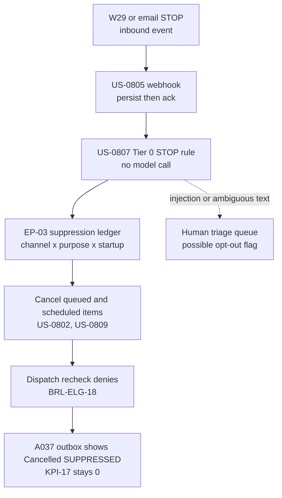

# AI Growth Engine: Employee Sales & Marketing Automation
## Application Blueprint: PART 6 (Batch 6.2, file a), Test Scenarios and Test Cases: EP-08 to EP-11

| Field | Value |
|---|---|
| Document | Application Blueprint, Part 6 (Batch 6.2, file a of 2): test scenarios (TS) and test cases (TC) for **EP-08 Messaging**, **EP-09 Meetings, webinars and demos**, **EP-10 WhatsApp and website assistant** and **EP-11 Content, SEO and social publishing**. File b (`Part-06-2b_Test_Cases_EP12-EP14.md`) covers EP-12 to EP-14 and holds the batch-wide totals |
| Version | 1.0 · 27 Nov 2026 |
| Baseline | Part 6.1 (test strategy: §6.1.12 conventions, template, priorities, types T01–T21, techniques, GSE-SYN, provider simulator, clock control, risk matrix RA-01…RA-30), Part 5.2 (stories US-0801…US-1110 and Gherkin AC-0801-01…AC-1110-04), Part 2.1 (FR register), Part 2.3 (BRL rules, roles R01–R20, ABAC-01…12, state machines §2.27), Part 2.4 (NT/NX, CFG), Part 2.5 (screens, WCAG 2.2 AA), Part 0A (DEC-001…065), Part 7.1 (agent IDs AG-011…AG-018 for cross-reference only) |
| Roles applied | QA Lead (primary), Business Systems Analyst, Principal Engineer, Security/Compliance/AI Governance Lead, Lead UX/UI Designer, DevOps/SRE Lead, FinOps Lead, Product Owner |
| Tag ranges used | RECOMMENDATION-075…076 · ASSUMPTION-185…187 (shared with file b; register in §6.2.7 and in file b §6.2.13) |

**Acronyms used in this file.** AC acceptance criterion · AT assistive technology · BVA boundary value analysis · CT contract test · DT decision table · E2E end-to-end · EG error guessing · EP equivalence partitioning · EXP exploratory · IT integration test · NSE no side effect · PBT property-based testing · PDP Policy Decision Point · PP precondition profile · PW pairwise · SoD separation of duties · ST state-transition testing · SYS system test · TC test case · TS test scenario · U404 uniform 404 · UC use-case (journey) testing · UT unit test · WABA WhatsApp Business Account.

**Time-sensitive facts.** Provider behaviour exercised here (Amazon SES sandbox and mailbox simulator, SNS signatures, Google Calendar free/busy, Meta WhatsApp Cloud API error codes, template categories and customer-service window, social platform APIs, Google Search Console API), assistive-technology versions and tool versions are **unverified; verify at time of implementation (as of 27 Nov 2026)** (DEC-042). No price is stated as fact; AI budget amounts in test data are fixture values, not estimates.

---

## 6.2.1 Purpose, inputs and how to read the test cases

### 6.2.1.1 Scope of Batch 6.2 and the file split

| File | Epics | Stories (Part 5.2) | Acceptance criteria | FRs in scope (Part 2.1 epic) | Section numbers |
|---|---|---|---|---|---|
| **6.2a (this file)** | EP-08, EP-09, EP-10, EP-11 | 38 (US-0801…US-0815, US-0901…US-0906, US-1001…US-1007, US-1101…US-1110) | 192 | 24 (FR-A034…A041, A044…A046, A050…A055, A062, A063, W08, W09, W11, W18, W19) | §6.2.1 – §6.2.7 |
| 6.2b | EP-12, EP-13, EP-14 | 35 | 178 | 25 | §6.2.8 – §6.2.14 |
| **Batch total** | 7 epics | **73** | **370** | **49** (plus cross-cutting FR-ENG-01, FR-STD-02, FR-UIS-04, FR-ADP-01, FR-DM-01…04, FR-PUB-01, FR-CSM-01) | |

Every AC in Part 5.2 is covered by at least one TC; every FR whose Part 2.1 epic is in scope and every BRL rule cited by a story in scope has at least one TC (Part 6.1 §6.1.9.6, QO-6). Coverage is proven in §6.2.6 (this file) and §6.2.12 (file b).

### 6.2.1.2 Conventions applied from Part 6.1

| Item | Rule used in this batch | Source |
|---|---|---|
| Scenario ID | `TS-<epic>-<nn>`, one table per epic; scenario priority = highest priority of its TCs, which follows the risk area of §6.1.4.3 and the P0 promotion rule (§6.1.4.3 note) | §6.1.12.1, §6.1.4 |
| Test case ID | `TC-<epic>-<nnn>`, sequence restarts per epic, never reused | §6.1.12.1 |
| Cross-cutting ownership | A TC is numbered under the epic of the story whose AC it verifies. Where the control is owned by another epic (for example the PDP by EP-03, the outbox by EP-18), the TC is kept here because it verifies this epic's AC, and the owning epic's suite still holds the control's full decision table | §6.1.12.1 |
| Template | Two table forms. **Full form** columns: ID · Title · Links · Preconditions · Test data (one cell, `Pre:` and `Data:`) · Steps · Expected result · P · Type · Tech · Auto · Lvl. **Parameterized form** (one test function with a data table, used for BVA, DT, PW and ST rows): a *Common* block gives title, links, preconditions and steps once; each row is still a separate TC with its own ID, data, expected result, priority, type, technique, automation and level | §6.1.12.2 |
| Links cell | Starts with the parent TS, then story and AC, then FR / BRL / NFR / DEC / ABAC / KPI. SM-UAT and SM-UX-UAT aliases are derivable from the FR (S = 030 + n for FR-A0nn; S001–S030 = FR-W01…W30) and are listed per FR in §6.2.6.3, not per row | §6.1.12.5 |
| Priority | P0 activation-blocker condition (confidentiality, unauthorized or duplicate external action, financial accuracy, regulatory eligibility, rollback) · P1 core Must behaviour or key NFR · P2 alternate path, Should/Could · P3 cosmetic | §6.1.12.3 |
| Type | T01 functional · T03 performance (load) · T07 security · T08 accessibility · T10 compatibility · T13 localization · T14 AI evaluation (deterministic gateway/guardrail behaviour only; statistical quality is TC-AI in Part 7/Batch 6.3) · T15 multi-tenant isolation · T16 idempotency/replay · T17 simulation zero-effect · T18 uncertain-outcome · T19 compliance · T20 cost control · T21 operability | §6.1.3.1 |
| Technique | EP · BVA · DT · ST · PW · EG · PBT · UC · EXP; each group heading names the primary technique | §6.1.11 |
| Automation | `Y` by default; `N (reason)` only for assistive-technology passes, document reviews and exploratory/UAT steps | §6.1.12.2 |
| Level | UT · IT · CT · SYS · E2E · UAT (manual AT passes are recorded as `SYS-M`, a manual check on the system test environment) | §6.1.2 |
| Shorthand in expected results | **NSE** = *no side effect*: no state change, no outbox row, empty provider-simulator call log for the correlation ID, no budget reservation, and a denial audit event written. **U404** = uniform 404 per BRL-TEN-04 plus NSE. **409 SSS** = 409 `SELECT_SINGLE_STARTUP` per BRL-TEN-05 plus NSE | TP-01, TP-08 |
| Money and time | Decimal strings with ISO 4217 currency; timestamps written in the zone named, stored UTC (BRL-MTG-03); IST = Asia/Kolkata UTC+05:30 | NFR-017; DEC-027 |

### 6.2.1.3 Precondition profiles and default clock

Each TC names one profile and only states what differs from it.

| Profile | Context | Defaults |
|---|---|---|
| **PP-01 Admin API (SYS)** | Deployed build in `test`; BFF session (audience `growth-engine`, client `growth-admin`, DEC-003); dataset `gse_syn 1.4.0` profile `m` with edge packs and story pack EDGE-P52 (§6.2.1.4); fixtures T1 and T2 loaded (TP-07) | Scope = the single startup named in the row; approvers' MFA age 1 h (ABAC-11); provider simulator mode `normal`; virtual clock **CLK-0 = Tue 2026-12-01 10:00:00 IST (04:30:00 UTC)**; Tier 2 disabled for all tenants (DEC-007); channel adapters in sandbox mode with the outbound allowlist guard on (§6.1.6.4) |
| **PP-02 Public website (SYS/E2E)** | Verified host of the named startup (e.g. `medmaarg.example`, BRL-TEN-10); anonymous R18 session token from the public BFF; consent notice revision PN-5 current | Rate-limit counters reset; CDN in front (cache keys asserted where stated) |
| **PP-03 Portal (SYS/E2E)** | R16 user signed in through W21 (client `growth-website`); object grants exactly as stated in the row (ABAC-09) | MFA as required by the screen (W24 re-verification) |
| **PP-04 Unit (UT)** | Pure domain module (PDP rule, engine, pricing, state guard); no DB or network | Frozen clock at CLK-0; Hypothesis profile `ci` (100 examples), `release` (10,000) for PBT rows marked P0 |
| **PP-05 Integration (IT)** | Real PostgreSQL with RLS and the application role, Valkey, Celery worker, outbox relay, provider simulator | Same dataset profile `s` plus the story pack |
| **PP-06 E2E browser** | Playwright on Chromium and WebKit (P0) or Chromium (P1/P2); role-based locators | Login states per role from the fixture store; Playwright clock synchronized with the server offset |
| **PP-07 Manual AT pass** | NVDA + Chrome (Windows) and VoiceOver + Safari (macOS), versions verified at implementation (as of 27 Nov 2026) | Same build as the nightly E2E run; findings logged as defects with WCAG criterion |

### 6.2.1.4 Story fixture pack EDGE-P52 [ASSUMPTION-187]

The object keys used in Part 5.2 Gherkin are added to GSE-SYN as a versioned edge pack, so each TC refers to the same objects as the AC it verifies. Keys are stable (`<tenant>/<startup>/<key>`); values not stated in Part 5.2 are fixture choices.

| Area | Keys (startup) | Used by |
|---|---|---|
| Users | `asha` R03, `kiran` R03, `neha` R03L, `meera` R02, `priya` R05, `farah` R05L, `ravi` R05 (unassigned to Sunrise) (MedMaarg); `sunil` R07, `gopal` R02 (OrganicSpec); `imran` R06, `rhea` R02 (AppNAI); tenant-wide `vikram` R01, `dev` R10, `arjun` R11, `sana` R12, `lata` R08, `mohan` R09, `kavya` R15; platform `tom` R13; T2 `b-admin` R12, `b-r03` R03, `b-r06` R06 | All epics |
| Messaging | OPP-311, EV-901, CL-12, CL-07 (expired 2026-11-01), MD-501, M-77, M-91, TH-88, ENR-40, C-501 (`rao@sunrise.example`, +919876543210), C-502 (BR), CMP-9, templates MM-INTRO v3, MM-MEET v2, OS-RFQ-ACK v1, sequence MM-NURTURE r4, policy MM-FUP v2 (MedMaarg) | EP-08 |
| Meetings and events | MTG-12, slot sets for 2026-12-02/03, event "MedMaarg corporate wellness demo" (2026-12-10 16:00 IST, capacity 100), content revision CV-33 (Approved), CV-34 (Draft), attendance CSV `att_62rows.csv` | EP-09 |
| WhatsApp and chat | OrganicSpec WABA `1234567890`, templates OS-ORDER-UPDATE v2 (en-IN, hi-IN, or-IN), buyer +919812345678 (opt-in), +447700900123 (UK, no opt-in), EduVerse learner number (age band < 18), knowledge revision KR-14, FAQ-31 | EP-10 |
| Content | ContentVersion v1…v5 for "Corporate wellness" article, CS-4 (no consent), brand revision BR-REV-3, SEO-17, page revision r12, LinkedIn organisation page `li-os` | EP-11 |
| Campaigns to bids/orders | Listed in file b §6.2.8.1 | EP-12…EP-14 |

### 6.2.1.5 Risk mapping for this file

| Epic | Risk areas (§6.1.4.3) | Default scenario priority | Promoted to P0 when the scenario tests |
|---|---|---|---|
| EP-08 | RA-24 (P1); RA-03, RA-04 (P0) for dispatch, eligibility, idempotency, uncertain outcome | P1 | Any dispatch recheck, suppression, cap, quiet-hour, SoD, scope or duplicate-effect rule |
| EP-09 | RA-25 (P2) | P2 | Calendar double booking with external effect, reminder eligibility (BRL-ELG-08), minors (DEC-030), private calendar exposure |
| EP-10 | RA-26 (P0) | P0 | (already P0) |
| EP-11 | RA-28 (P1); RA-14 (P0) for publication | P1 | Hash-bound publication, draft exposure, exactly-once social posting, consent for case studies |

### 6.2.1.6 Shared batteries applied to every adapter in this batch [RECOMMENDATION-075]

[RECOMMENDATION-075] Each provider adapter in EP-08 to EP-14 (SES, WhatsApp Cloud API, Google Calendar, social publishing, ads, e-sign) runs one **adapter conformance battery**: a single parameterized pytest suite, keyed by adapter name, that executes the same seven checks against the provider simulator and the recorded sandbox fixtures. The battery implements the shared contract kit of RECOMMENDATION-054 (Part 5.2) and the CA-DISPATCH battery of TP-06. A new adapter cannot be enabled (CFG-31 flag) until its battery row is green. Story-specific TCs below reference the battery rows instead of repeating them.

| Battery check | What it asserts | Adapters | TC IDs per adapter |
|---|---|---|---|
| B1 Outcome normalisation | accepted → `sent`; throttled → `retryable`; invalid/permanent → `permanent`; timeout after submit → `uncertain`; provider and correlation IDs returned (FR-ADP-01) | all | SES TC-08-037 · WhatsApp TC-10-007 · Calendar TC-09-002 · Social TC-11-028 · Ads TC-12-031 · E-sign TC-13-064 |
| B2 Idempotent submit | Re-submit with the same idempotency key after a worker crash → one provider effect (NFR-005) | all | TC-08-040 · TC-10-008 · TC-09-014 · TC-11-033 · TC-12-034 · TC-13-066 |
| B3 Uncertain path | Timeout after submit → Uncertain, retry blocked, reconcile before any retry (FR-STD-02, BRL-AUT-07) | all | TC-08-138…145 · TC-10-009 · TC-09-016 · TC-11-036…040 · TC-12-035 · TC-13-067 |
| B4 Signed webhook | Valid signature accepted; tampered rejected; duplicate deduplicated (US-0805) | SES, WhatsApp, e-sign, social, ads (where webhooks exist) | TC-08-045…052 · TC-10-003, TC-10-016 · TC-13-065 |
| B5 Secret hygiene | Credential stored as reference; never returned by API, UI or logs (NFR-004) | all | TC-08-036 · TC-10-001 · TC-09-001 · TC-11-027 · TC-12-030 |
| B6 Environment guard | Non-production uses sandbox/test credentials only; live key outside `prod` fails start-up (ABAC-12) | all | TC-08-043 · TC-10-006 · TC-11-026 |
| B7 Disabled-by-default | Paid or new channel flag OFF in a fresh environment (EG-20, NFR-037) | ads, social, WhatsApp | TC-12-029 · TC-11-026 · TC-10-006 |

### 6.2.1.7 E2E journey register for EP-08 to EP-14 [RECOMMENDATION-076]

[RECOMMENDATION-076] Part 2.5 §2.46 asks for a manual accessibility audit of the "top 20 journeys" per wave without listing them, and Part 6.1 §6.1.16.5 item 5 assigns the register to Batch 6.2. The register below lists the journeys of EP-08 to EP-14; each journey is one E2E TC (Playwright, axe scan on every page) and is a candidate for the wave's manual audit. Journeys marked ★ are proposed for the top-20 audit list.

| Journey | Persona → surface | Path (screens) | E2E TC | Wave |
|---|---|---|---|---|
| J-08-01 ★ | P03 Admin | A037 inbox reply intent → A034 draft → approval (R02) → outbox Sent → Delivered | TC-08-188 | W2 |
| J-08-02 | P15/P14 email recipient → P03 | STOP reply → opt-out → queued items cancelled → A037 shows Suppressed | TC-08-189 | W2 |
| J-09-01 ★ | P15 Public | W18 booking (America/New_York) → hold → extend → confirm → A040 Confirmed | TC-09-033 | W2 |
| J-09-02 | P15 Public | W19 registration with captions need → waitlist at capacity | TC-09-034 | W3 |
| J-10-01 ★ | P15 Public | W11 chat → grounded answer → handover form with consent → lead in A021/A037 | TC-10-041 | W3 |
| J-10-02 | P07 Admin | A045 WhatsApp thread inside window → reply → window closed → template only | TC-10-042 | W3 |
| J-11-01 ★ | P05 → R05L | A050 brief → draft → validate (a11y, claims) → A051 approve → W08 published | TC-11-056 | W3 |
| J-12-01 ★ | P15 Public | W10 campaign landing page → consented RFQ → lead with attribution | TC-12-058 (file b) | W3 |
| J-12-02 | P05 → R05L | A058 campaign simulate → A059 approve and reserve → run with execution-time suppression | TC-12-059 (file b) | W3 |
| J-13-01 ★ | P07 → R03L → R16 | A067 quote → A068 approval → W23 accept | TC-13-083 (file b) | W4 |
| J-13-02 ★ | R10 → R16 signatory | A071/A072 contract → W24 sign (signed-PDF path) → Executed | TC-13-084 (file b) | W4 |
| J-14-01 ★ | P06 → R02 | A104 bid → checklist → decision → submission evidence → award | TC-14-076 (file b) | W4 |
| J-14-02 ★ | P14d buyer → P07 | W14 RFQ → A067 quote → A105 order → fulfilment → W25 accept → receivable | TC-14-077 (file b) | W4 |

*Figure: journey J-08-02 (TC-08-189) with the stories whose TCs it chains.*

### 6.2.1.8 Test-oracle interpretations for EP-08 to EP-11 [ASSUMPTION-185]

Where Part 5.2 or Part 2.3 leave a boundary or precedence open, the TCs use the interpretations below (same rule as ASSUMPTION-184: a different confirmed interpretation changes the tests, not the code silently).

| # | Topic | Interpretation used by the oracle | Affected TCs |
|---|---|---|---|
| O-1 | Rolling windows (soft bounces 7 d, caps 7/30 d, complaint 24 h) | Half-open window (t − W, t]: an event exactly W old has left the window | TC-08-057…059, TC-08-122…124, TC-08-060 |
| O-2 | SES daily sending limit | Counter resets at 00:00 in the sender's configured zone (IST); a deferred message's next time is the later of the reset and the recipient's next quiet-hour window | TC-08-041 |
| O-3 | STOP matching (ASSUMPTION-163 list) | Tier 0 opts out when the normalized message (NFC, case-folded, trimmed, trailing punctuation and emoji removed) equals a keyword, or a line equals a keyword. A keyword embedded in other text ("please stop by our stall") is **not** an automatic opt-out but goes to human triage with a "possible opt-out" flag, and new marketing to the contact is held until triage (TP-01 fail closed) | TC-08-067, TC-08-068 |
| O-4 | Confidence gate | Auto-routing when confidence ≥ 0.70 (inclusive); 0.69 → human triage | TC-08-071 |
| O-5 | Loosening approver for follow-up policy | AC-0810-03 names R02; BRL-APR-11 requires the Founder (R01) for loosening. Oracle uses the stricter **R01**, and R02 approval alone leaves the change pending (reported as inconsistency 1 in §6.2.7.3) | TC-08-109 |
| O-6 | DST example AC-0811-05 | 2027-03-28 is a Sunday; with the default Monday–Saturday window the deferral is to **Mon 2027-03-29 09:00 BST (08:00 UTC)**. The AC's "09:00 local" holds only with a seven-day window; both are tested (inconsistency 2 in §6.2.7.3) | TC-08-130, TC-08-131 |
| O-7 | Hold extension (CONFLICT-134) | Warning fires when 60 s remain (± 1 s); one extension of 15 min after a fresh free/busy check; the extension time counts from the original expiry | TC-09-020, TC-09-021 |
| O-8 | Public rate limits (ASSUMPTION-164) | Limits are counts per sliding window; request number N = limit is allowed, N + 1 gets 429 | TC-09-024, TC-10-024 |
| O-9 | Template and content approval expiry | Expiry instant = approval instant + 90 × 24 h; usable at expiry − 1 s, Expired at expiry | TC-08-027, TC-11-013 |
| O-10 | Webhook dedup window (ASSUMPTION-161) | 30 × 24 h from first receipt; after the window the event is stored again but the consumer's own idempotency (E-4) produces no second effect | TC-08-054 |

---
