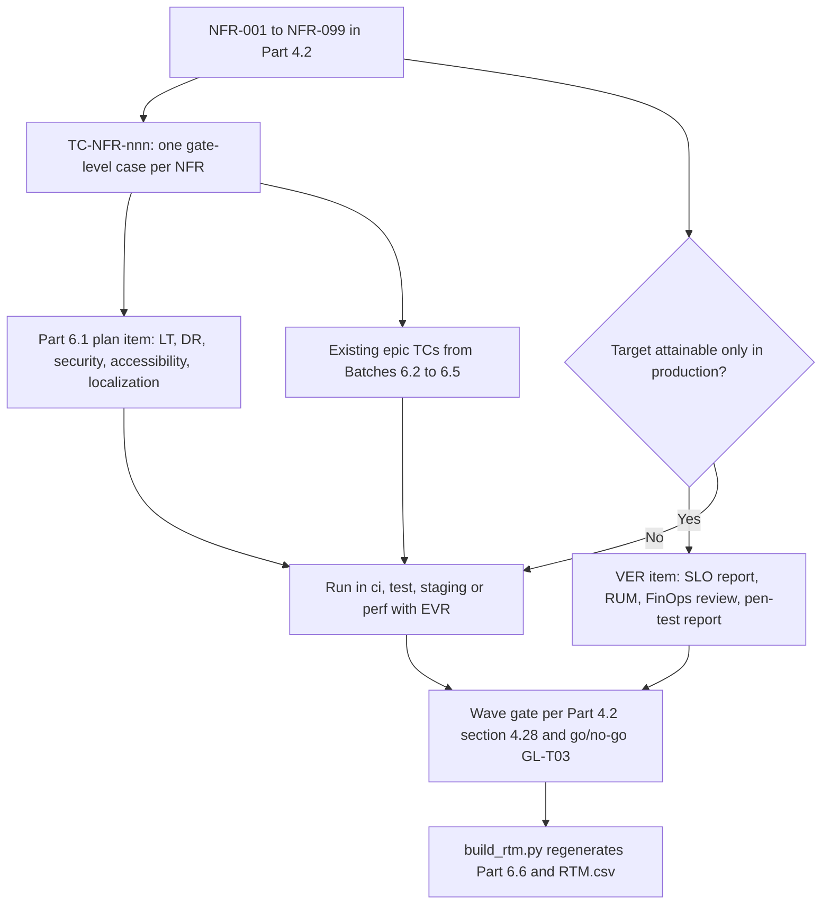

# AI Growth Engine: Employee Sales & Marketing Automation
## Application Blueprint: PART 6 (Batch 6.7), NFR and Coverage Closure Test Cases

| Field | Value |
|---|---|
| Document | Application Blueprint, Part 6 (Batch 6.7): closes every traceability gap that the Part 6.6 matrix flagged (errata 87). It contains (1) **NFR test cases** TC-NFR-001…099, one per NFR-001…NFR-099, each mapped to the Part 6.1 load tests LT-01…LT-12, DR drills DR-1…DR-9, the security, accessibility and localization plans and the existing epic test cases; (2) a **parameterized filter suite** TC-FLT-001…045 for FR-FLT-01…11 and FR-FLT-RULES; (3) **supplementary business requirement (BR-S) closure**: test cases TC-BRS-001…013 for the testable statements and **verification items** VER-001…048 (inspection, review, analysis or demonstration) for the statements and production-only targets that are not software behaviour; (4) the extension of `assembly/build_rtm.py` that reads these items and regenerates Part 6.6 and `final/RTM.csv` |
| Version | 1.0 · 27 Nov 2026 |
| Baseline | Part 1 §1.12.2 (BR-S001…S140), Part 2.1 §2.4.10 (FR-FLT-01…11, FR-FLT-RULES), Part 2.3 (BRL rules, roles R01–R20), Part 4.2 §4.21–§4.28 (NFR-001…099, latency budgets, NFR load profiles, wave verification plan), Part 4.3 §4.46 (FinOps governance), Part 6.1 (template §6.1.12.2, priorities §6.1.12.3, test types T01–T21, techniques §6.1.11, GSE-SYN §6.1.7, environments §6.1.6, non-functional plans §6.1.14), Batches 6.2–6.5 (existing TCs), Part 6.6 (uncovered list), Part 8.1 §8.1.2.5 (wave gates), Part 8.2 §8.2.4 (go/no-go checklist GL-*) and §8.2.7 (budget lines B01–B23); errata 81–87 (Part 9.1); DEC-005, DEC-008, DEC-009, DEC-018, DEC-020, DEC-026, DEC-031, DEC-032, DEC-040, DEC-043, DEC-065 |
| Roles applied | QA Lead (primary), DevOps/SRE Lead (load, DR, observability), Security/Compliance/AI Governance Lead (security and privacy cases), Lead UX/UI Designer (accessibility, usability, localization), FinOps Lead (cost cases and budget verification items), Product Owner (BR-S verification owners), Business Systems Analyst (filter rules) |
| Tag ranges used | ASSUMPTION-215…218, RECOMMENDATION-090 |

**Acronyms used in this batch.** AC acceptance criterion · BR-S supplementary business requirement · BVA boundary value analysis · CI continuous integration · CDN content delivery network · CLS cumulative layout shift · CMK customer-managed key · DLQ dead-letter queue · DR disaster recovery · DSR data-subject (data-principal) request · DT decision table · EG error guessing · EP equivalence partitioning · EVR evidence record · FLT filter · INP interaction to next paint · KMS key management service · LCP largest contentful paint · LT load test · MTTA mean time to acknowledge · NFR non-functional requirement · PBT property-based testing · PITR point-in-time recovery · PW pairwise · RPO recovery point objective · RTO recovery time objective · RTM requirements traceability matrix · RUM real-user monitoring · SLI/SLO service level indicator/objective · ST state transition · SUS System Usability Scale · TC test case · TTFB time to first byte · UC use case · VER verification item · WAF web application firewall.

**Time-sensitive facts.** Tool names (k6, Lighthouse CI, axe-core, testssl.sh, gitleaks, Trivy, Checkov, import-linter, schemathesis, Renovate), probe locations, regulator deadlines (DPDP, CERT-In) and provider limits are stated as design intent: **verify at time of implementation (as of 27 Nov 2026)**. Cost figures are the Part 8.2 §8.2.7 estimates, not quotes.

---

## 6.7.1 Purpose, conventions and coverage rule

### 6.7.1.1 What this batch closes

The Part 6.6 build before this batch reported 70 uncovered items (errata 87): **61 NFRs** with no test case (NFR-010, 015, 024, 034 of part A and 57 of part B; NFR-039, 077, 078 and 083 already had one), **9 cross-cutting filter FRs** (FR-FLT-02, FR-FLT-04…11) and **34 BR-S statements** with no test path (BR-S021, 025, 028, 029, 030, 033, 048, 072, 074, 076…079, 081, 082, 086…091, 094…100, 102…105, 108, 133). The client rule is that no requirement lacks a test (BRD §12.1). This batch closes all of them and, as asked, gives **one TC-NFR per NFR** so that every NFR has a gate-level case that measures its target, also where epic-level cases already exist.

### 6.7.1.2 Identifier formats introduced here (local identifiers, Part 6.1 §6.1.12.1 extended)

| Artefact | Format | Range used | Owning epic (Part 6.1 §6.1.12.1 control families) | Counts as |
|---|---|---|---|---|
| NFR test case | **TC-NFR-###** where ### = the NFR number | TC-NFR-001…TC-NFR-099 (99) | The NFR's epic in Part 4.2 (EP-21 for load, DR and release; EP-01 for security and tenancy; EP-03 privacy; EP-04 AI and cost; EP-17/EP-19 UI; EP-18 workflow) | Test case |
| Filter test case | **TC-FLT-###** | TC-FLT-001…TC-FLT-045 (45) | EP-17 (shell, list framework) with the list screen's epic | Test case |
| BR-S test case | **TC-BRS-###** | TC-BRS-001…TC-BRS-013 (13) | Epic of the screen or control exercised | Test case |
| Verification item | **VER-###** | VER-001…VER-048 (48) | Owner named per item | Verification item (not a test case) |

The TC-NFR number equals the NFR number so that the pair is obvious in CI markers (`@pytest.mark.req("NFR-045")` on `tc("TC-NFR-045")`). TC-NFR/TC-FLT/TC-BRS use the mandatory template of Part 6.1 §6.1.12.2. Columns used in the tables below: **ID · Title · Linked** (requirements; parsed by `build_rtm.py`) **· Pre-conditions, environment and data or workload · Steps · Expected result** (the measurable target) **· Tool · Maps to** (Part 6.1 plan item and existing TCs) **· P** (priority P0–P3) **· Type** (T01–T21) **· Tech** (EP, BVA, DT, ST, PW, EG, PBT, UC, EXP) **· Auto** (automation candidate Y/N) **· Lvl** (UT, IT, CT, SYS, E2E, UAT).

### 6.7.1.3 Coverage rule: test case versus verification item [ASSUMPTION-217]

| Item | Used when | Evidence and status | Counts toward |
|---|---|---|---|
| **Test case** (TC-NFR, TC-FLT, TC-BRS, and the existing TC, TC-AI, TC-AU) | The requirement is software behaviour or a measurable system property that can be exercised in `ci`, `test`, `staging` or `perf` | EVR with commit and image digest; Pass/Fail (Part 6.1 §6.1.5.4) | "Covered by test case" |
| **Verification item** (VER) | (a) The statement is not software behaviour: budget line, effort range, team or timeline assumption, phase-gate exit, procurement, business goal; or (b) the NFR target can only be attained in production over a period (monthly availability, field Core Web Vitals, DORA, monthly FinOps) and its staging test case proves only the measurement and control | EVR of type *review*, *inspection*, *analysis* or *demonstration* with owner, independent reviewer and wave; Pending until the review record exists (Part 8.2 §8.2.4.2) | "Covered by verification item" |

A requirement is **covered** when it has at least one test case **or** at least one verification item. The regenerated Part 6.6 reports both columns separately so a reader can see which coverage is by test and which by review. Every NFR has a test case; VER items for NFRs are **in addition** (production attainment), never instead.

### 6.7.1.4 Part 4.2 NFR load profiles mapped to Part 6.1 load tests and drills (errata 83)

Part 6.1 owns the LT-xx identifiers (DEC-116; errata 83). Part 4.2 §4.26 profiles are read as **NFR load profiles** ("4.2-LT-nn" below) and run inside the Part 6.1 tests. Where Part 4.2 has a profile with no Part 6.1 equivalent, it runs as a **named variant** of a Part 6.1 run (suffix after the LT ID), not as a new LT ID [ASSUMPTION-215].

| Part 4.2 profile | Part 4.2 purpose | Runs as (Part 6.1) | Variant settings | NFRs verified | TC-NFR |
|---|---|---|---|---|---|
| 4.2-LT-01 Baseline API mix | API read/write latency at Year 1 design 30 RPS | **LT-01** Admin mixed API load | Mix 70% C2/C3, 15% C5, 10% C6, 5% C4; steps 30 RPS (design) and 60 RPS (2×) | NFR-039, NFR-040 | 039, 040 |
| 4.2-LT-02 Soak at design load | 10× pilot capacity sustained | **LT-11** 10× pilot capacity, then **LT-06** soak | LT-11 60 min; LT-06 24 h (W2) / 72 h (W5) | NFR-060 | 060 |
| 4.2-LT-03 Search and heavy lists | Search and filter latency over Year 2 data | **LT-03** Expensive queries | Profile `l` (Year 2 data); 20 concurrent users on C4/C3 | NFR-046, FR-FLT-RULES | 046; TC-FLT-036 |
| 4.2-LT-04 Projection freshness | Customer 360 and dashboards under event load | **LT-10** Customer 360 freshness + **LT-04** outbound burst | 3× Y1 outbox events/day compressed into 1 h | NFR-008, NFR-045, NFR-047 | 008, 045, 047 |
| 4.2-LT-05 Webhook storm | Webhook acknowledgement | **LT-05** Webhook flood | 50 events/s; 10% duplicates; 1% invalid signatures | NFR-051 | 051 |
| 4.2-LT-06 Automation timeliness | Due runs started on time | **LT-09** Due-run timeliness | 5,000 due runs at 09:00 IST across 26 startups (Part 4.2 volume) instead of 1,000 | NFR-009, NFR-058 | 009, 058 |
| 4.2-LT-07 Public abuse | Rate limits and WAF | **LT-07** Abusive public intake and chat | 500 RPS abusive from rotating IPs + 1 RPS legitimate | NFR-022 | 022 |
| 4.2-LT-08 Public edge performance | TTFB and cache hit | **LT-02** Public website and portal | Crawl of all published pages, cold and warm | NFR-041 | 041 |
| 4.2-LT-09 AI gateway throughput | Gateway overhead and first token | **LT-01-AIGW** (variant of LT-01 using the §6.1.14.1 "AI tasks" workload stream) | Stub model latency 2–8 s at 3× Y1 interactive peak + batch; live sample 50 turns | NFR-052 | 052 |
| 4.2-LT-10 Year 2 profile | Year 2 reachable by scale-out only | **LT-08-Y2** (LT-08 ramp held at the Year 2 step) | Hold 120 RPS + 25 msg/s for 60 min on profile `l` before continuing the ramp | NFR-061 | 061 |
| 4.2-LT-11 Noisy neighbour | Tenant fairness | **LT-01-SKEW** (variant of LT-01) | T2 External-A at 10× its normal share; T1 AppNAI and MedMaarg at normal share | NFR-062 | 062 |
| — | Front-end budgets | **LT-12** Front-end budgets (+ Admin variant **LT-12-ADM**) | Top 10 public routes per seed startup; Admin top 10 routes on desktop profile | NFR-042, NFR-043, NFR-044 | 042, 043, 044 |
| CH-01 Provider outage | No event loss | **DR-7** Provider outage (60 min variant of the 30 min drill) | SES, WhatsApp, Anthropic 503 for 60 min | NFR-007, NFR-063 | 007, 063 |
| CH-02 Worker and broker crash | Outbox durability, DLQ | **DR-5** + **DR-6** during LT-09 | Kill 50% workers; restart Valkey | NFR-063, NFR-064 | 063, 064 |
| CH-03 Database failover / restore | RPO/RTO | **DR-1**, **DR-2**, **DR-3**, **DR-4**, **DR-9** | As Part 6.1 §6.1.14.4 | NFR-056, NFR-057 | 056, 057 |
| CH-04 Emergency stop under burst | Stop propagation | **LT-04-STOP** (STOP issued during LT-04) | STOP at minute 5 of a 1,000-message dispatch | NFR-049 | 049 |

### 6.7.1.5 NFR verification flow

---

## 6.7.2 NFR test cases TC-NFR-001…099

Every NFR in Part 4.2 has exactly one TC-NFR whose expected result is the Part 4.2 measurable target. Where Batches 6.2–6.5 already test the behaviour, the TC-NFR is the **gate-level measurement** (aggregate threshold, full inventory or timed run) and the "Maps to" column names the existing cases it consolidates. Fixtures are GSE-SYN (`gse_syn 1.4.0`, Part 6.1 §6.1.7.1) with the canonical second tenant **T2 External-A** (errata 84); load runs use profile `l` in `perf`. Wave gate per Part 4.2 §4.28.

### 6.7.2.1 Group TC-NFR-A: Security, tenancy and integrity gates from part A (techniques: EP, DT, EG, BVA)

| ID | Title | Linked | Pre-conditions, environment and data or workload | Steps | Expected result (target) | Tool | Maps to | P | Type | Tech | Auto | Lvl |
|---|---|---|---|---|---|---|---|---|---|---|---|---|
| TC-NFR-001 | Prove separate frontends: 0 Admin identifiers in public bundles and 0 cross-origin session reuse | NFR-001; FR-A001; FR-W21; DEC-009; BRL-TEN-02 | `ci` release-candidate build of Website/Portal and Admin; `staging` with R03 Asha (T1/AppNAI) Admin session and R16 portal session (T1/OrganicSpec buyer) | 1. Run bundle scanner SC-02 over public and portal `dist/` for the Admin route manifest, `/api/v1/*/admin/` paths and the Admin component list. 2. Diff the public route inventory against the allowlist. 3. Replay the Admin session cookie on the portal origin and the portal cookie on the Admin origin | 1: 0 matches. 2: diff empty (route inventory = allowlist). 3: both 401; 0 session reuse; audit event `SESSION_AUDIENCE_MISMATCH` twice | Bundle scanner, Playwright | §6.1.3.2; TC-19-087, TC-21-010, TC-17-008 | P0 | T07 | EP | Y | CT |
| TC-NFR-002 | Measure BOLA/BFLA suite completeness: every catalogued endpoint has a generated authorization case and all pass | NFR-002; FR-ENG-01; BRL-TEN-04 | `test`; OpenAPI inventory of the build (e.g. 612 operations); RBAC matrix R01–R20 from Part 2.3; two-tenant fixture | 1. Generate role × endpoint × method × scope cases. 2. Run full suite (nightly). 3. Compute operations-with-case ÷ operations | 100% of operations have ≥ 1 case; 0 failures; 0 unexpected allow; report lists generated cases per operation | pytest generator, schemathesis | §6.1.14.2 authorization matrix; TC-01-111, TC-10-044, TC-15-085 | P0 | T07 | DT | Y | SYS |
| TC-NFR-003 | Audit MFA on privileged logins and refuse revoked or wrong-audience tokens | NFR-003; FR-A001; DEC-019; BRL-TEN-08 | `staging`; R01, R08, R09, R12 users; IdP test tenant; investor-audience token fixture (DEC-058); revoked refresh token | 1. Log in each privileged role without MFA. 2. Log in with MFA; read `amr`. 3. Call Admin API with investor-audience token and with revoked token. 4. Revoke membership and time the next denial | 1: session refused. 2: 100% sessions have `amr` containing `mfa`. 3: 0 successes (401). 4: denial ≤ 60 s | IdP audit export, Playwright | DEC-019 spike; TC-01-004…007, TC-01-037 | P0 | T07 | DT | Y | E2E |
| TC-NFR-004 | Find 0 secret patterns in API responses, staging logs and gateway prompts | NFR-004; FR-A008; BR-M05 | `staging`; canary secrets planted in the integration registry (`AKIAFAKE00000CANARY`, `whsec_canary_7f3a`) and in a provider error body | 1. Contract-scan every response schema and recorded response. 2. Run gitleaks patterns over 24 h of staging logs. 3. Scan gateway DLP log of prompts | 0 matches in all three corpora; the canaries appear only as `****` references | gitleaks, response scanner, gateway DLP | §6.1.3.2; TC-01-082, TC-01-095, TC-04-056 | P0 | T07 | EG | Y | CT |
| TC-NFR-015 | Conform 100% of API operations to the OpenAPI schema and the defined status-code set | NFR-015; FR-ENG-01; FR-FLT-RULES | `ci`; schemathesis stateless + stateful links; status set {200, 201, 202, 400, 401, 403, 404, 409, 429, 503} | 1. Run schemathesis over all operations. 2. Assert `X-Request-ID` echoed, `revision` on mutable resources, cursor pagination on lists. 3. Reuse an idempotency key with a different body hash. 4. Send a list filter outside the allowlist | 1: 0 schema violations, 0 status codes outside the set, 0 5xx. 2: 100% present. 3: 409 `IDEMPOTENCY_BODY_MISMATCH`, no effect. 4: 400 `FILTER_FIELD_NOT_ALLOWED` | schemathesis | T04; §6.1.14.2 API fuzzing; TC-FLT-005 | P1 | T01 | EP | Y | CT |
| TC-NFR-017 | Pass the schema linter on 100% of operational tables | NFR-017; FR-ENG-01 | `ci`; migration linter; all Django apps | 1. Run linter on the migration graph. 2. Add a fixture table without `startup_id` in a throw-away branch | 1: 100% tables have UUID PK, `tenant_id`, `startup_id`, RLS policy, `revision`; Decimal + ISO 4217 money. 2: CI fails naming the table | Migration linter | TC-21-007, TC-01-051 | P1 | T01 | EP | Y | CT |
| TC-NFR-018 | Hold 0 UPDATE/DELETE grants on approval, financial and audit tables and verify the hash chain | NFR-018; FR-A009; FR-ENG-01 | `test`; application DB role; 10,000 audit events | 1. Query grants. 2. As app role run `UPDATE approval_decision SET …`. 3. Run the daily chain job; then alter one event in a copy and rerun | 1: 0 grants. 2: permission denied. 3: chain passes; tampered copy fails at the exact event | psql grant check; chain job | TC-01-073…074 | P0 | T07 | EG | Y | IT |
| TC-NFR-020 | Return 404 for unknown hosts, make publish visible at the edge within 60 s and never cache portal responses | NFR-020; FR-A108; BRL-PUB-02; BRL-PUB-05 | `staging` with CloudFront; 100 random unknown hosts; T1/MedMaarg site revision 12 approved | 1. GET each unknown host. 2. Publish revision 12; poll edge every 5 s. 3. GET 20 portal URLs; read cache headers | 1: 100% 404. 2: revision visible ≤ 60 s. 3: 0 cacheable portal responses (`Cache-Control: private, no-store`) | Synthetic host tests, curl | §6.1.3.2; TC-19-002, TC-11-075, TC-19-017 | P0 | T07 | EP | Y | SYS |
| TC-NFR-021 | Scan 100% of uploads before first use with p95 ≤ 60 s for files up to 25 MB | NFR-021; FR-A006; FR-W15; BRL-PUB-04 | `test`; 50 uploads from 1 KB to 25 MB incl. EICAR, polyglot PDF and zip bomb (EDGE-SEC) | 1. Upload each. 2. Attempt use (attach, publish) before the scan completes. 3. Read scanner timings | 1: all scanned; EICAR and bomb quarantined. 2: use blocked until `clean`. 3: p95 ≤ 60 s | Scanner metrics | §6.1.14.2 file uploads; TC-02-019…021 | P0 | T07 | BVA | Y | IT |
| TC-NFR-025 | Give exactly one success and one 409 under concurrent update and require revision on 100% of mutating endpoints | NFR-025; FR-STD-03; FR-ENG-01 | `test`; T1/OrganicSpec QTE-220 revision 3 | 1. Send two PATCH with `If-Match: 3` concurrently (50 trials). 2. Catalogue test: call each mutating operation without `If-Match` | 1: per trial one 200 and one 409; never two successes. 2: 100% return 428/409 per contract; 0 silent overwrite | pytest concurrency harness | TC-02-007, TC-02-009, TC-07-006 | P0 | T01 | EG | Y | IT |
| TC-NFR-029 | Fail CI on a runtime dependency without an ADR or register entry | NFR-029; NFR-085 | `ci`; dependency register; throw-away PR adding an unregistered package | 1. Run register diff on the PR. 2. Add the register entry with ADR link; rerun | 1: CI fails naming the package. 2: passes; 100% runtime dependencies registered | Dependency register diff | TC-18-001 | P2 | T01 | EG | Y | CT |
| TC-NFR-031 | Find 0 resources shared with the investor product in the IaC inventory | NFR-031; BR-TENANT; DEC-002 | `ci`; IaC state for all environments; investor-product resource list (ARN prefixes) | 1. Export resources (DB, buckets, vector index, queues, KMS keys, secrets, budgets, backups). 2. Intersect with the investor list | 0 shared resources; report per class | IaC inventory check | T15; TC-01-054 | P0 | T15 | EP | Y | CT |
| TC-NFR-032 | Pass the full two-tenant matrix with 0 cross-scope reads, writes, notifications, exports, retrievals or provider calls | NFR-032; BR-TENANT; AP-10; BRL-TEN-03 | `test`; T1 Owner Portfolio and **T2 External-A**; attacker = valid T2 user with real session | 1. Run every isolation-layer cell (API, nested FK, RLS, search, vector, cache, files, notifications, exports, workers, webhooks, provider adapters). 2. Count foreign hits | 0 in every cell; matrix report attached to EVR | pytest IT/SYS, Playwright, ZAP | T15; TC-01-110…121, TC-21-065 | P0 | T15 | PW | Y | SYS |

### 6.7.2.2 Group TC-NFR-B: Reliability, workflow and automation from part A (techniques: EG, PBT, EP, DT)

| ID | Title | Linked | Pre-conditions, environment and data or workload | Steps | Expected result (target) | Tool | Maps to | P | Type | Tech | Auto | Lvl |
|---|---|---|---|---|---|---|---|---|---|---|---|---|
| TC-NFR-005 | Replay 10,000 events with duplicates and count exactly one effect each | NFR-005; FR-ENG-01; BRL-AUT-08 | `test`; EDGE-DUP; 10,000 events (email sends, webhooks, payments, publications) each delivered 1–3 times, 5% out of order | 1. Feed through the replay harness. 2. Count messages, revenue entries, publications | Effects = 10,000 unique; 0 duplicate messages, revenue entries or publications | Replay harness, Hypothesis | T16; TC-15-001, TC-07-052, TC-13-089 | P0 | T16 | PBT | Y | SYS |
| TC-NFR-006 | Leave 0 orphan state or outbox rows under kill-between-statements and DB failover | NFR-006; FR-ENG-01 | `test` (fault points F1–F3) and `staging` (RDS reboot with failover) | 1. Kill the process at F1, F2, F3 for 300 transitions each. 2. Force DB failover during 500 transitions. 3. Run the consistency checker | 0 state changes without an outbox row; 0 outbox rows without state | Fault injector, checker query | DR-5; TC-01-067…068 | P0 | T12 | EG | Y | IT |
| TC-NFR-007 | Lose 0 events in a 60-minute provider outage and drain within 2× the outage | NFR-007; FR-ADP-01 | `staging`; simulator returns 503 for SES, WhatsApp, Anthropic for 60 min; 1,000 queued sends | 1. Start outage. 2. Count outbox before/after. 3. End outage; time the drain | 0 lost; backlog drained ≤ 120 min; each send exactly once | Simulator, outbox counts | DR-7 (CH-01); TC-21-035, TC-21-097 | P0 | T12 | EG | Y | SYS |
| TC-NFR-009 | Start ≥ 99% of eligible due runs within 15 min (transactional) and 24 h (batch) | NFR-009; FR-A033; DEC-032 | `perf`; clock control; LT-09 with the 4.2-LT-06 volume (5,000 due runs at 09:00 IST, 26 startups, 20% in quiet hours) | 1. Release runs. 2. Compute KPI-20 from run records, excluding quiet-hour deferrals | Transactional ≥ 99% started ≤ 15 min; batch ≥ 99% ≤ 24 h; quiet-hour deferrals not counted late | k6, queue injector | LT-09; TC-08-102, TC-08-132 | P1 | T03 | EP | Y | SYS |
| TC-NFR-010 | Compute KPI-19 correctly and execute 0 steps that need an approval that is absent | NFR-010; FR-A033; FR-A110; BRL-AUT-01; KPI-19 | `test`; 200 eligible steps built from the decision table (approval required Y/N × approval present Y/N × autonomy L1/L2/L3 × channel email/WhatsApp) | 1. Run all steps. 2. Read PDP decision logs. 3. Compute KPI-19 = automated eligible steps ÷ eligible steps | 0 executions where approval is required and absent (`DENY_APPROVAL_MISSING`); KPI-19 = exact fixture value 180/200 = 90.0%; production attainment ≥ 90% by VER-001 | pytest, PDP log assertions | T19; DT §6.1.11.3 | P1 | T01 | DT | Y | SYS |
| TC-NFR-016 | Back off with base 30 s, factor 2, full jitter, cap 15 min, 3 retries, then DLQ | NFR-016; BRL-AUT-06 | `ci`; retry policy unit; Hypothesis 10,000 seeds | 1. Generate delays for attempts 1–4. 2. Assert bounds per attempt. 3. Fail a task 4 times | Delay attempt n ∈ [0, min(900, 30 × 2^(n−1))] s; ≤ 3 retries; 4th failure → DLQ | pytest, Hypothesis | TC-21-043, TC-01-095…096 | P1 | T01 | PBT | Y | UT |
| TC-NFR-026 | Mark every adapter's timeout-after-submit as uncertain with 0 retries before reconciliation | NFR-026; FR-STD-02; FR-UIS-04; DEC-050 | `test`; simulator mode `timeout_after_submit` per adapter (SES, WhatsApp, payment gateway, e-sign, calendar) | 1. Dispatch one call per adapter. 2. Advance the clock 1 h. 3. Inspect retries and states | 100% adapters → `uncertain`; 0 retries before reconciliation; re-query task created | Simulator, clock control | T18; TC-04-003, TC-21-040, TC-08-138 | P0 | T18 | EP | Y | SYS |
| TC-NFR-038 | Make 0 provider calls from simulated runs while live credentials are present | NFR-038; FR-A102; BRL-AUT-04 | `test`; live-format credentials loaded (sandbox endpoints blocked by allowlist guard); every workflow template WF-01…WF-14 in simulation | 1. Run each template in simulation. 2. Read adapter call counters and ledger | 0 provider calls; 0 spend; 0 ledger entries; simulated records excluded from KPIs | Adapter spies | T17; TC-03-033, TC-08-019 | P0 | T17 | EP | Y | SYS |

### 6.7.2.3 Group TC-NFR-C: AI quality, release and cost from part A (techniques: BVA, DT, EP)

| ID | Title | Linked | Pre-conditions, environment and data or workload | Steps | Expected result (target) | Tool | Maps to | P | Type | Tech | Auto | Lvl |
|---|---|---|---|---|---|---|---|---|---|---|---|---|
| TC-NFR-011 | Gate L2/L3 on signal precision ≥ 0.80 (≥ 100 reviewed) and qualification precision ≥ 0.90 (≥ 200 per vertical) with recall ≥ 0.60 | NFR-011; FR-A084; DEC-001; KPI-01; KPI-02 | `test`; eval sets: signals 100 and 99 items; qualification 200 and 199 items per vertical; precision fixtures 0.799/0.800 and 0.899/0.900 | 1. Run eval harness on each set. 2. Request L2 eligibility | Precision 0.800 at n = 100 passes, 0.799 fails; n = 99 refused; qualification 0.900 at n = 200 passes, 199 refused; recall < 0.60 refused | Eval harness | T14; TC-04-009…010, TC-05-044 | P0 | T14 | BVA | Y | SYS |
| TC-NFR-014 | Stop paid calls within 1 call of cap exhaustion with 100% reservations | NFR-014; FR-A012; BRL-AI-08 | `test`; agent budget cap ₹10.00; each call reserves ₹0.50 | 1. Run 100 calls. 2. Reconcile reservation vs actual ledger | Exactly 20 complete; 21st denied before the provider call; 100% calls preceded by a reservation | Simulator with cost metering | T20; TC-04-026 | P0 | T20 | BVA | Y | IT |
| TC-NFR-030 | Record a Tier 0 attempt or justification for every AI task and refuse a tier change without a comparison report | NFR-030; FR-A011; DEC-007 | `test`; one replayed day of 871 AI-eligible tasks (Part 4.2 §4.25.4) | 1. Replay. 2. Query routing logs. 3. Submit a tier change without the comparison report | 1–2: 100% tasks have Tier 0 attempt or justification. 3: change rejected | Gateway routing logs | TC-04-014…016 | P1 | T14 | DT | Y | IT |
| TC-NFR-033 | Block deployment when a prompt or model change fails its eval thresholds | NFR-033; BRL-AI-09; DEC-061 | `ci`; prompt change for the outreach drafting agent that lowers groundedness below threshold | 1. Open PR. 2. Run eval gate | Gate fails; deploy job not created; EVR records the failing metric | Eval harness in CI | T14; TC-21-003, TC-04-011 | P0 | T14 | DT | Y | CT |
| TC-NFR-035 | Reconcile 100% attributable usage to invoice lines for a billing cycle | NFR-035; FR-A101; BR-SVC; KPI-24 | `test`; T2 External-A cycle with 1,000 metered events across 4 meters; one event injected without a meter mapping | 1. Run metering-to-invoice reconciliation. 2. Read KPI-24 | 999 events reconciled; the injected event flagged as an exception (not silently dropped); KPI-24 = 100% after resolution | Reconciliation job | T20; TC-20-036, TC-04-028 | P1 | T20 | EP | Y | IT |
| TC-NFR-037 | Make 0 paid calls without an enabled flag and approved budget line | NFR-037; FR-ADP-01; BRL-AI-08 | `test`; 500 synthetic calls across paid adapters with flag OFF/ON × budget line absent/present | 1. Run calls. 2. Compare adapter logs with the flag register | Calls only where flag ON and line approved; 0 otherwise; paid fallback OFF by default | Adapter logs | T20; TC-01-104…108, TC-04-005 | P0 | T20 | DT | Y | IT |

### 6.7.2.4 Group TC-NFR-D: Operability, release, UX and data from part A (techniques: BVA, EP, ST, PW, UC)

| ID | Title | Linked | Pre-conditions, environment and data or workload | Steps | Expected result (target) | Tool | Maps to | P | Type | Tech | Auto | Lvl |
|---|---|---|---|---|---|---|---|---|---|---|---|---|
| TC-NFR-008 | Make Customer 360 updates visible within 60 s p95 and 120 s p99 under event load | NFR-008; FR-A032 | `perf`; LT-10 (with 4.2-LT-04: 3× Y1 outbox events/day in 1 h); probe writes on 200 T1 contacts | 1. Write probe events. 2. Poll projection. 3. Compute event-to-projection lag | p95 ≤ 60 s; p99 ≤ 120 s | k6, projection lag metric | LT-10; TC-07-023, TC-07-046…047 | P1 | T03 | EP | Y | SYS |
| TC-NFR-012 | Block a release without passing secret scan, smoke and a current restore drill | NFR-012; FR-A090 | `staging`; release R-2027.07.1 candidate; restore drill EVR older than the schedule | 1. Request A090 approval. 2. Supply a fresh DR-1 EVR. 3. Re-request | 1: approval disabled naming the restore-drill gate. 3: approval enabled when secret scan and smoke are Pass | A090, pipeline | DR-1; TC-21-045, TC-01-014 | P0 | T12 | DT | Y | SYS |
| TC-NFR-013 | Block deploy on any failing critical test and verify rollback within 15 min | NFR-013; FR-A090 | `staging`; one P0 test forced to fail; release N+1 with failing health | 1. Run G4. 2. Remove the failure, deploy N+1. 3. Trigger rollback | 1: deploy blocked. 3: rollback to N ≤ 15 min; smoke green; no data loss | Pipeline, DR-8 | DR-8; TC-21-076, TC-21-098 | P0 | T02 | DT | Y | SYS |
| TC-NFR-019 | Serve `/health` within 50 ms p95 without DB and `/ready` within 500 ms without sensitive detail | NFR-019; FR-OP002; FR-OP003 | `ci` and `staging`; PostgreSQL stopped for the `/health` run | 1. 1,000 probes to each endpoint. 2. Scan bodies | `/health` p95 ≤ 50 ms with DB down; `/ready` ≤ 500 ms; 0 hostnames, versions, connection strings or tenant data | Synthetic probes | T21; TC-21-013…015 | P1 | T21 | BVA | Y | CT |
| TC-NFR-022 | Enforce per-IP 30 req/min and per-site 600 req/min with WAF blocking ≥ 95% abuse and ≤ 1% legitimate | NFR-022; FR-W11; FR-W12 | `staging` with WAF; LT-07 (4.2-LT-07 profile: 500 RPS abuse from rotating IPs + 1 RPS legitimate) | 1. Send 31 requests/min from one IP. 2. Run LT-07 15 min. 3. Chat: 21 turns in one session; 4 sessions per IP per hour | 1: 31st → 429 with `Retry-After`. 2: ≥ 95% abusive blocked; legitimate success ≥ 99%. 3: turn 21 and session 4 refused; AI budget not exceeded | k6, WAF metrics | LT-07; TC-01-011, TC-05-073 | P0 | T04 | BVA | Y | SYS |
| TC-NFR-023 | Record accessibility preferences and result on page approval and block publication on a serious violation | NFR-023; NFR-088; FR-A057; BRL-PUB-06 | `test`; landing page with a missing form label (serious) | 1. Submit for approval. 2. Fix label; resubmit | 1: publication blocked; approval record shows the axe result. 2: approved with result Pass | axe-core in publish flow | §6.1.14.3 publication gate; TC-11-068, TC-01-103 | P1 | T08 | EP | Y | E2E |
| TC-NFR-024 | Apply language, locale fallback, time zone and currency per scope | NFR-024; NFR-096; NFR-097; FR-A107; FR-FLT-02; DEC-026 | `test`; pairwise over scope (AppNAI, MedMaarg, EduVerse, OrganicSpec) × user locale (en-IN, hi-IN) × user zone (Asia/Kolkata, Europe/London) × record currency (INR, USD, EUR) | 1. Open the record list and detail per combination. 2. Read rendered values | Language falls back to en-IN with an author-visible indicator when hi-IN is missing; times in the user zone with UTC stored; amounts in the record currency with ISO code, never converted | Playwright, Vitest | §6.1.14.6; TC-08-030, TC-09-014 | P1 | T13 | PW | Y | E2E |
| TC-NFR-027 | Abort in-flight requests within 100 ms and render 0 stale-scope records after a scope switch | NFR-027; FR-STD-01; FR-UIS-01; FR-FLT-RULES | `ci`; Playwright with 3G throttling; R01 switches T1/AppNAI → T1/OrganicSpec while a 2 s list request is pending | 1. Start the list load. 2. Switch scope at 500 ms. 3. Let the old response arrive | Old request aborted ≤ 100 ms; 0 AppNAI rows rendered; cache and selections cleared | Playwright | TC-17-003…004; TC-FLT-020 | P0 | T15 | ST | Y | E2E |
| TC-NFR-028 | Quarantine records without permitted provenance and report 100% coverage | NFR-028; FR-A010; BRL-SRC-03 | `test`; 5 records inserted without source permission among 2,000 | 1. Run the nightly DQ job. 2. Try to act on a quarantined record | Coverage report 1,995/1,995 actionable with provenance; 5 quarantined; action refused | DQ job | TC-05-001, TC-05-026 | P0 | T19 | EP | Y | SYS |
| TC-NFR-034 | Locate the approved operation and complete core scenarios against the click and time baseline | NFR-034; NFR-090; FR-A003; FR-A089 | `staging`; moderated session plan (see TC-NFR-090) | 1. Ask each participant to find and execute the approved operation for 5 core tasks. 2. Record clicks and time | Clicks and time ≤ W2 baseline per task; findings triaged | Session recordings (consented, internal staff) | T09 | P2 | T09 | UC | N (moderated study) | UAT |
| TC-NFR-036 | Honour erasure without re-enabling outreach and respect legal hold | NFR-036; NFR-075; FR-A013; BRL-PRV-03; BRL-PRV-04 | `test`; principal `ravi.k@example.in` erased; later CSV import contains the same address; second principal under legal hold | 1. Execute erasure. 2. Re-import. 3. Plan outreach. 4. Erase the held principal | 2–3: suppression hash blocks; 0 re-contacts. 4: data restricted, not deleted | pytest, Playwright | TC-03-001, TC-03-006, TC-03-074 | P0 | T19 | ST | Y | E2E |

### 6.7.2.5 Group TC-NFR-E: Performance (NFR-039…052) (techniques: EP on workload classes, BVA on thresholds)

Workloads follow Part 4.2 §4.25 (Year 1 design 30 RPS, Year 2 design 120 RPS, stress 240 RPS) executed as the Part 6.1 runs in §6.7.1.4. A latency target is met when the percentile over the steady-state window (after a 5-minute warm-up) is within target; regressions > 20% on p95 versus the W2 baseline fail G4 even below the absolute target (Part 6.1 §6.1.14.1).

| ID | Title | Linked | Pre-conditions, environment and data or workload | Steps | Expected result (target) | Tool | Maps to | P | Type | Tech | Auto | Lvl |
|---|---|---|---|---|---|---|---|---|---|---|---|---|
| TC-NFR-039 | Hold API read latency p95 ≤ 500 ms and p99 ≤ 1,200 ms at Year 1 design load and p95 ≤ 800 ms at 2× | NFR-039; FR-ENG-01; DEC-018 | `perf`, profile `l`; LT-01 with 4.2-LT-01 mix (70% C2/C3 reads, 15% C5, 10% C6, 5% C4); 80 virtual users across T1 startups and T2 External-A; steps 30 RPS × 30 min then 60 RPS × 30 min | 1. Run steps. 2. Read OpenTelemetry server spans for C2/C3, excluding provider waits | 30 RPS: read p95 ≤ 500 ms, p99 ≤ 1,200 ms; 60 RPS: p95 ≤ 800 ms; error rate < 0.5% | k6, OpenTelemetry | LT-01; TC-03-035 | P1 | T03 | EP | Y | SYS |
| TC-NFR-040 | Hold synchronous write latency p95 ≤ 800 ms and p99 ≤ 1,500 ms before the 202 | NFR-040; FR-ENG-01; DEC-018 | As TC-NFR-039; C5 writes (create draft, transition, approve) and C6 accepted-async | 1. Run LT-01 at 30 RPS. 2. Break down C5 spans by the Part 4.2 §4.24 budget split | C5 p95 ≤ 800 ms, p99 ≤ 1,500 ms; PDP span p95 ≤ 100 ms; C6 time to 202 p95 ≤ 300 ms | k6, OpenTelemetry | LT-01 | P1 | T03 | EP | Y | SYS |
| TC-NFR-041 | Serve public pages with TTFB p95 ≤ 800 ms at origin, ≤ 200 ms cached and cache hit ≥ 90% warm | NFR-041; FR-W01; FR-W03; DEC-018 | `staging` with CloudFront; LT-02 (4.2-LT-08 crawl of all published pages of the 4 seed startups and 21 synthetic sites, cold then warm); probes from Mumbai and one non-India location (verify probe provider) | 1. Cold crawl. 2. Warm crawl. 3. Read CloudFront logs | Origin TTFB p95 ≤ 800 ms; cached TTFB p95 ≤ 200 ms; warm cache-hit ratio ≥ 90% | k6, CloudFront logs, synthetic probes | LT-02; TC-19-017 | P1 | T03 | EP | Y | SYS |
| TC-NFR-042 | Keep lab LCP ≤ 2.0 s per PR and field LCP ≤ 2.5 s, INP ≤ 200 ms and CLS ≤ 0.1 at p75 | NFR-042; FR-W01; FR-W05; RECOMMENDATION-028 | `ci` Lighthouse CI mobile profile (simulated mid-range device on 4G) on top 10 public routes per seed startup; RUM in `prod` for the field part | 1. Run LT-12 per PR. 2. Read RUM p75 monthly | Lab: LCP ≤ 2.0 s simulated, CLS ≤ 0.1, TBT within the INP-proxy budget; route at 2.01 s fails. Field p75 verified by VER-003 | Lighthouse CI, web-vitals RUM | LT-12; TC-19-039, TC-19-082 | P1 | T03 | BVA | Y | CT |
| TC-NFR-043 | Fail CI when a public route exceeds 150 KB gzip JS or the landing page exceeds 1 MB | NFR-043; FR-W01; FR-W10 | `ci`; size-limit config per public route; fixture route at 150 KB and 150 KB + 1 byte; landing page images | 1. Build. 2. Run size-limit. 3. Inspect image formats | 150 KB passes; 150 KB + 1 byte fails; landing total ≤ 1 MB; images AVIF/WebP with `srcset` | size-limit, Lighthouse | LT-12; TC-19-082 | P1 | T03 | BVA | Y | CT |
| TC-NFR-044 | Load Admin with LCP ≤ 3.0 s, route transitions ≤ 1.0 s p95, main bundle ≤ 350 KB gzip and 200-row tables ≤ 300 ms | NFR-044; FR-A003; FR-A029; DEC-043 | `staging`; LT-12-ADM desktop broadband profile; top 10 Admin routes (A029, A019, A037, A042, A067, A105…); 200-row pipeline list | 1. Lighthouse first load. 2. 50 route transitions with Playwright performance marks. 3. Bundle analysis. 4. React profiler on the 200-row table | LCP ≤ 3.0 s; transition p95 ≤ 1.0 s with data; main bundle ≤ 350 KB gzip with route splitting; render ≤ 300 ms | Lighthouse CI, Playwright, React profiler | LT-12-ADM [ASSUMPTION-215] | P2 | T03 | BVA | Y | E2E |
| TC-NFR-045 | Keep outbox dispatch lag p95 ≤ 60 s and p99 ≤ 180 s and alert at 1,000 events or oldest > 5 min | NFR-045; FR-ENG-01; DEC-018 | `perf`; LT-04 (campaign 5,000 messages/h + transactional replies) and LT-06 soak; backlog fixtures of 999 and 1,000 events; oldest event 4 m 59 s and 5 m 01 s | 1. Run LT-04 2 h. 2. Pause workers to build backlogs. 3. Read alerts | Lag p95 ≤ 60 s, p99 ≤ 180 s; no alert at 999 events or 4 m 59 s; alert at 1,000 events and at 5 m 01 s | k6, outbox lag metric | LT-04, LT-06; TC-01-067 | P1 | T03 | BVA | Y | SYS |
| TC-NFR-046 | Return scoped global search p95 ≤ 1.0 s over ≤ 1 million rows per tenant and list filters p95 ≤ 500 ms | NFR-046; FR-SRCH-01; FR-FLT-RULES; DEC-037 | `perf` profile `l` (≈ 500,000 contacts; 1,000,000 searchable rows for T1); LT-03 with 20 concurrent users, widest allowed filters, deep cursors | 1. Run LT-03 30 min. 2. Measure C4 and C3 spans | Search p95 ≤ 1.0 s; filtered lists p95 ≤ 500 ms; DB CPU < 70%; other users' p95 degraded ≤ 10% | k6 | LT-03; TC-02-034, TC-05-043, TC-FLT-036 | P1 | T03 | EP | Y | SYS |
| TC-NFR-047 | Keep dashboards ≤ 15 min, the automation monitor ≤ 5 min and the SLO dashboard ≤ 1 min behind | NFR-047; FR-A042; FR-A043; FR-A110 | `perf`; LT-04 event load; RP-01…RP-21, RP-22 and the SLO dashboard | 1. Every minute read each dashboard's `as_of`. 2. Compare with now | Max lag RP-01…RP-21 ≤ 15 min; RP-22 ≤ 5 min; SLO ≤ 1 min; each tile shows `as_of` | k6, dashboard probe | LT-04 (4.2-LT-04) | P1 | T03 | BVA | Y | SYS |
| TC-NFR-048 | Complete 50,000-row synchronous exports ≤ 60 s p95, 1,000,000-row async exports ≤ 15 min and scheduled reports ≤ 10 min late | NFR-048; FR-A042; FR-A103; BRL-PRV-07 | `staging` with Year 2 data volume; 10 sync exports of 50,000 rows; 3 async exports of 1,000,000 rows (concurrent, as in LT-03); 5 scheduled reports at 08:00 IST | 1. Run exports. 2. Time scheduled delivery | Sync p95 ≤ 60 s; async ≤ 15 min each; reports delivered ≤ 08:10 IST; exports audited and redacted per classification | Job metrics | LT-03; TC-01-079, TC-03-070 | P1 | T03 | BVA | Y | IT |
| TC-NFR-049 | Block all new external calls in scope ≤ 60 s after STOP during a 1,000-message burst | NFR-049; FR-A033; BRL-AUT-05 | `staging`; LT-04-STOP: 1,000-message dispatch for T1/AppNAI; STOP issued at minute 5 by R01 | 1. Issue STOP. 2. Read the simulator call log. 3. Inspect queued items | Last external call ≤ 60 s after STOP (p100); queued items cancelled or held; 0 calls in scope after 60 s; other startups unaffected | Simulator call log | LT-04-STOP (CH-04); TC-03-016, TC-08-020 | P0 | T12 | BVA | Y | SYS |
| TC-NFR-050 | End all sessions of a revoked user within 60 s | NFR-050; FR-A002; FR-A099; BRL-TEN-07; DEC-019 | `staging`; R03 Asha signed in on 3 browsers (Chromium, Firefox, WebKit) and holding a long-poll | 1. R12 revokes membership at T0. 2. Each session polls every 5 s. 3. Record the first 401 per session | Every session denied by T0 + 60 s; jobs started on the revoked authority dropped; audit event | Playwright, revocation timer | TC-01-007, TC-01-035, TC-17-006 | P0 | T07 | BVA | Y | E2E |
| TC-NFR-051 | Acknowledge webhooks with p95 ≤ 500 ms and p99 ≤ 2 s after persisting the event | NFR-051; FR-ENG-01; FR-A036; FR-A044 | `perf`; LT-05: 50 events/s for 10 min, 10% duplicates, 5% out of order, 1% invalid signatures, oversized > 256 KB | 1. Run LT-05. 2. Read spans per provider. 3. Count persisted vs acknowledged | p95 ≤ 500 ms, p99 ≤ 2 s; every acknowledged event persisted first; invalid → 401; duplicates no effect | k6, server spans | LT-05; TC-15-001, TC-21-042 | P1 | T03 | EP | Y | SYS |
| TC-NFR-052 | Keep gateway overhead p95 ≤ 150 ms excluding model time and first token ≤ 3 s p95 for assistant and Copilot | NFR-052; FR-W11; FR-COP-01; DEC-007 | `staging`; LT-01-AIGW: stub model latency 2–8 s at 3× Y1 interactive peak (≈ 3.6 calls/min) + batch ≤ 20/min; live sample of 50 streamed turns (Tier 1a/1b availability permitting; verify) | 1. Run 30 min. 2. Subtract model time from gateway spans. 3. Time first token on the live sample | Overhead p95 ≤ 150 ms; first token p95 ≤ 3 s; budget reservations correct; no thread starvation | k6, gateway spans | LT-01-AIGW [ASSUMPTION-215] | P1 | T03 | EP | Y | SYS |

### 6.7.2.6 Group TC-NFR-F: Availability, recovery, timeliness and scalability (NFR-053…062) (techniques: BVA, EP, UC)

Availability NFRs are production targets over a calendar month. The test case proves the **measurement rule** of Part 4.2 §4.21 with injected faults in `staging`; attainment is a verification item (§6.7.3) [ASSUMPTION-218].

| ID | Title | Linked | Pre-conditions, environment and data or workload | Steps | Expected result (target) | Tool | Maps to | P | Type | Tech | Auto | Lvl |
|---|---|---|---|---|---|---|---|---|---|---|---|---|
| TC-NFR-053 | Count bad minutes for Website and Portal exactly as the availability rule defines | NFR-053; FR-W01; FR-W22; DEC-018 | `staging`; synthetic probes every 60 s from two locations; fault injector; maintenance window announced 48 h ahead | 1. Fail both probes for 10 min. 2. Fail one probe for 10 min. 3. Inject 5xx ratio 5.0% for 1 min, then 5.1%. 4. Run a 90-min announced maintenance | 1: 10 bad minutes. 2: 0. 3: 5.0% not bad; 5.1% bad. 4: excluded (≤ 2 h/month cap). Report computes 99.5% budget = 216 min/30 days; production attainment by VER-004 | Synthetic probes, SLO report job | T21; TC-21-027…029 | P1 | T21 | BVA | Y | SYS |
| TC-NFR-054 | Count bad minutes for Admin with the same rule and a 99.5% monthly objective | NFR-054; FR-A089; DEC-018 | As TC-NFR-053 for the Admin origin and BFF | Steps 1–3 of TC-NFR-053 | Same counts; error budget burn alerts at 2%/1 h and 5%/6 h; attainment by VER-005 | Synthetic probes | T21; TC-21-028…029 | P1 | T21 | BVA | Y | SYS |
| TC-NFR-055 | Detect and recover a webhook missing from the provider delivery report so that 0 events are lost | NFR-055; NFR-007; FR-A036; FR-A044 | `test`; provider delivery report of 2,433 events (Y1 day); one event deleted before persistence | 1. Run the monthly reconciliation job. 2. Request redelivery. 3. Rerun | 1: 1 missing flagged with provider event ID. 3: 0 missing; event applied once (dedupe); attainment by VER-006 | Reconciliation job, simulator | TC-21-042, TC-15-095 | P1 | T16 | EG | Y | IT |
| TC-NFR-056 | Measure RPO ≤ 15 min with the heartbeat writer and confirm transaction logs ship ≤ 5 min | NFR-056; FR-A014; DEC-018 | `staging`; heartbeat row every 10 s; DR-1 and DR-2; S3 versioned bucket for DR-4 | 1. Inject failure at T0. 2. Restore from PITR. 3. RPO = T0 − last heartbeat present. 4. Read latest-restorable-time lag. 5. Overwrite 100 S3 objects and recover | RPO ≤ 15 min; log-shipping lag ≤ 5 min; 100% committed S3 objects recovered (RPO 0) | RDS PITR, heartbeat | DR-1, DR-2, DR-4 (CH-03); TC-21-069, TC-21-091, TC-21-094 | P0 | T12 | UC | Y | SYS |
| TC-NFR-057 | Recover within RTO 4 h for instance, deployment or data-corruption failures and 24 h for a regional disaster | NFR-057; FR-A014; DEC-018; DEC-040 | `staging` and DR account; DR-2 (instance loss) and DR-3 (region-level restore into the secondary Indian region, verify availability) | 1. Declare incident at T0. 2. Restore. 3. Run post-restore checklist (10 items, Part 6.1 §6.1.14.4). 4. Stop the clock at `/ready` green + smoke | DR-2 RTO ≤ 4 h; DR-3 RTO ≤ 24 h at pilot; checklist 10/10; > 4 h marks the drill Fail and blocks A090 | Drill stopwatch | DR-2, DR-3, DR-9; TC-21-068, TC-21-071…072, TC-21-092…093 | P0 | T12 | UC | N (timed drill with human steps) | SYS |
| TC-NFR-058 | Start ≥ 99% of transactional due runs within 15 min at the Part 4.2 volume | NFR-058; FR-A033; FR-A109; DEC-032 | `perf`; LT-09 with 4.2-LT-06 volume (5,000 due runs at the same minute, 26 startups, quiet-hour mix); per-tenant cap configured | 1. Release runs. 2. Compute KPI-20 (transactional) | ≥ 99% started ≤ 15 min; quiet-hour deferrals excluded; per-tenant cap honoured; prod SLI by VER-007 | k6, queue injector, clock control | LT-09; TC-08-102 | P1 | T03 | BVA | Y | SYS |
| TC-NFR-059 | Complete ≥ 99% of scheduled batch runs within 24 h | NFR-059; FR-A015; FR-A019; DEC-032 | `test`; 500 research-fetch runs in a 2 h window (Part 6.1 discovery stream) plus 200 digest jobs; clock advanced 24 h; 3 runs forced to miss once | 1. Release. 2. Advance clock. 3. Compute KPI-20 (batch) | ≥ 99% within 24 h; missed runs recover once (BRL-AUT-10); prod SLI by VER-007 | Clock control | TC-05-083 | P1 | T03 | BVA | Y | SYS |
| TC-NFR-060 | Sustain Year 1 design load (10× pilot) for 1 h on the pilot topology changed only by configuration | NFR-060; DEC-018; DEC-040 | `perf` sized as pilot production; LT-11 (60 min) then LT-06 soak (24 h at W2) | 1. Run LT-11. 2. Diff IaC against pilot topology. 3. Run LT-06 | NFR-039/040/045 met; IaC diff shows only count/size variables; soak memory growth < 10% after warm-up, no worker restarts | k6, IaC diff | LT-11, LT-06 (4.2-LT-02) | P1 | T03 | EP | Y | SYS |
| TC-NFR-061 | Reach the Year 2 design point with ≤ 4 app tasks, ≤ 6 worker tasks and one DB class step-up | NFR-061; DEC-031; DEC-040 | `perf` profile `l`; LT-08-Y2: hold 120 RPS + 25 msg/s for 60 min | 1. Scale per runbook. 2. Hold load. 3. Inspect migrations applied | NFR-039/040/045 met at the step; ≤ 4 app, ≤ 6 workers, one DB class step-up; 0 schema redesign migrations | k6 | LT-08-Y2 [ASSUMPTION-215] | P2 | T04 | EP | Y | SYS |
| TC-NFR-062 | Limit the noisy-neighbour effect to ≤ 20% p95 rise and ≤ 5 min transactional delay for other tenants | NFR-062; BR-TENANT; BRL-TEN-03 | `perf`; LT-01-SKEW: T2 External-A at 10× its share up to its rate limit and concurrency cap; T1 AppNAI, MedMaarg and T3 at normal share | 1. Baseline 15 min without skew. 2. 30 min with skew. 3. Compare per-tenant SLIs | Others' p95 ≤ 1.20 × baseline; transactional start delay ≤ 5 min; T2 receives 429 at its cap | k6, per-tenant SLIs | LT-01-SKEW [ASSUMPTION-215] | P1 | T03 | EP | Y | SYS |

### 6.7.2.7 Group TC-NFR-G: Reliability and integrity (NFR-063…066) (techniques: EG, BVA)

| ID | Title | Linked | Pre-conditions, environment and data or workload | Steps | Expected result (target) | Tool | Maps to | P | Type | Tech | Auto | Lvl |
|---|---|---|---|---|---|---|---|---|---|---|---|---|
| TC-NFR-063 | Lose 0 committed outbox events across worker crash, Valkey restart and deploy | NFR-063; FR-ENG-01 | `staging`; LT-09 running; CH-02: kill 50% of workers at minute 10, restart Valkey at minute 15, rolling deploy at minute 20 | 1. Inject faults. 2. Run the daily outbox reconciliation (committed vs processed) | Committed = processed; 0 lost; 0 duplicate effects | Chaos scripts, reconciliation | DR-5, DR-6 (CH-02); TC-21-036, TC-21-095…096 | P0 | T12 | EG | Y | SYS |
| TC-NFR-064 | Move a message failing 3 times to the DLQ within 15 min with ≤ 5% throughput drop and age alert at 1 business day | NFR-064; BRL-AUT-06 | `staging`; LT-09 at steady rate; 20 poison messages injected | 1. Inject. 2. Time DLQ arrival. 3. Compare throughput. 4. Advance clock 1 business day for an untriaged item | DLQ ≤ 15 min after first failure; throughput drop ≤ 5%; DLQ age alert raised; replay rechecks policy | Chaos scripts, queue metrics | CH-02; TC-21-037…039 | P1 | T12 | BVA | Y | SYS |
| TC-NFR-065 | Reconcile ≥ 95% of uncertain outcomes within 24 h and 100% within 72 h with 0 blind retries | NFR-065; FR-STD-02; DEC-050 | `test`; 100 timeouts-after-submit across email, WhatsApp, payment; simulator answers re-query for 90, holds 10 for operator | 1. Advance clock 24 h. 2. Operators resolve 10 tasks. 3. Advance to 72 h | ≥ 95 reconciled ≤ 24 h (simulator 90 + ≥ 5 operator); 100 ≤ 72 h; 0 retries without reconciliation; prod SLI by VER-008 | Simulator, clock control | T18; TC-08-138…139, TC-21-077 | P0 | T18 | BVA | Y | SYS |
| TC-NFR-066 | Retain API idempotency keys ≥ 24 h and webhook dedupe ≥ 7 days | NFR-066; FR-ENG-01; BRL-AUT-08 | `ci`/`test`; clock control | 1. Replay an API request with the same key at 23 h 59 m and 24 h 00 m. 2. Replay a webhook event at 6 d 23 h 59 m and 7 d 00 m. 3. Read config | Both API replays return the stored response, no new effect; both webhook replays deduped; config values ≥ 24 h and ≥ 7 d | pytest, clock control | TC-08-054, TC-03-061 | P0 | T16 | BVA | Y | IT |

### 6.7.2.8 Group TC-NFR-H: Security (NFR-067…074) (techniques: BVA, EP, EG, EXP)

| ID | Title | Linked | Pre-conditions, environment and data or workload | Steps | Expected result (target) | Tool | Maps to | P | Type | Tech | Auto | Lvl |
|---|---|---|---|---|---|---|---|---|---|---|---|---|
| TC-NFR-067 | Block release on overdue Critical or High findings by remediation SLA | NFR-067; FR-A090; RECOMMENDATION-041 | `ci`; findings tracker fixtures: Critical aged 7 d and 8 d; High 30 d and 31 d; Medium 90 d and 91 d | 1. Run the release gate | Critical 8 d and High 31 d block; 7 d and 30 d do not; Medium 91 d reported overdue (non-blocking); 0 overdue Critical/High at release | Findings tracker, gate script | §6.1.14.2 SCA; TC-21-008 | P1 | T07 | BVA | Y | CT |
| TC-NFR-068 | Find 0 secrets in repository history, images and logs and fail the gate on a planted canary | NFR-068; NFR-004 | `ci` and `staging`; canary key committed in a throw-away branch, baked into a test image and written to a log line | 1. Run gitleaks on history. 2. Trivy secret scan on the image. 3. Nightly log scan | Each canary detected; gate fails; clean tree → 0 findings | gitleaks, Trivy, log scanner | §6.1.14.2 secret scanning; TC-21-002, TC-01-016 | P0 | T07 | EG | Y | CT |
| TC-NFR-069 | Refuse TLS 1.0/1.1 and weak ciphers and serve HSTS 1 year with grade A on public endpoints | NFR-069 | `staging` and post-deploy `prod` smoke; Website, Portal, Admin, API and webhook hosts | 1. Run testssl.sh against each host | TLS ≥ 1.2 only; 0 weak ciphers; `Strict-Transport-Security: max-age=31536000` or more; SSL Labs-equivalent grade A on public endpoints | testssl.sh | §6.1.14.2 | P1 | T07 | EP | Y | SYS |
| TC-NFR-070 | Encrypt 100% of data stores with customer-managed keys and 100% of Restricted fields at field level | NFR-070; FR-ENG-01 | `ci` IaC policy; `test` DB inspection | 1. Run Checkov/IaC policy on RDS, S3, EBS, Valkey and backups. 2. Read raw column bytes of Restricted fields (phone, Aadhaar-like test values) | 1: 100% CMK. 2: ciphertext only; decrypt only via the application service | Checkov, DB inspection test | §6.1.14.2 IaC | P0 | T07 | EP | Y | CT |
| TC-NFR-071 | Return CSP without `unsafe-inline` scripts, HSTS, nosniff and frame-ancestors on every HTML response | NFR-071; FR-W01; FR-A003 | `staging`; crawl of public, portal and Admin HTML routes | 1. Collect headers. 2. Evaluate per surface | 0 missing headers; CSP has no `unsafe-inline` in `script-src`; frame-ancestors `'none'` for Admin and the per-surface value elsewhere | Header test | §6.1.14.2 DAST | P1 | T07 | EP | Y | SYS |
| TC-NFR-072 | Close all Critical and High pen-test findings before Release 1 portal exposure and before Release 2 | NFR-072; FR-A090 | `staging`; independent tester; OWASP WSTG and ASVS Level 2 checklist (verify current versions) | 1. Execute test. 2. Fix. 3. Retest | 0 open Critical/High at go-live; mediums with dated plan; report filed by VER-009 | External tester | §6.1.14.2 external pen test; GL-S03 | P0 | T07 | EXP | N (independent manual test) | SYS |
| TC-NFR-073 | Emit an audit event for 100% of state-changing endpoints and privileged actions | NFR-073; FR-A009; RECOMMENDATION-024 | `test`; OpenAPI list of mutating operations; privileged action list (role change, grant, flag change, stop) | 1. Call each with a valid actor. 2. Query audit events by correlation ID. 3. Run daily chain verification | 100% have exactly one event with actor, scope, before/after hash; chain 100% Pass | Audit coverage test | TC-01-012, TC-01-074 | P0 | T07 | EP | Y | IT |
| TC-NFR-074 | Throttle authentication abuse and leak no user enumeration by response or timing | NFR-074; FR-A001; FR-W21; DEC-019 | `staging`; IdP config; 200 login attempts for existing and non-existing accounts | 1. 11 attempts/min on one account. 2. 101/min from one IP. 3. Compare responses and median timings | Attempt 11/min and 101/min throttled with progressive delay; identical bodies; median timing difference within ±50 ms | k6, timing harness, ZAP | DEC-019 check 10; TC-01-037 | P0 | T07 | BVA | Y | SYS |

### 6.7.2.9 Group TC-NFR-I: Privacy and compliance (NFR-075…078, 094, 095) (techniques: BVA, DT, EG, UC)

| ID | Title | Linked | Pre-conditions, environment and data or workload | Steps | Expected result (target) | Tool | Maps to | P | Type | Tech | Auto | Lvl |
|---|---|---|---|---|---|---|---|---|---|---|---|---|
| TC-NFR-075 | Acknowledge a data principal request within 2 business days, complete within 15 days and escalate at 70% of the deadline | NFR-075; FR-W29; FR-A013; BRL-PRV-02 | `test`; clock control; access request submitted Friday 2027-05-14 18:00 IST; statutory deadline value from config (verify DPDP rules) | 1. Advance to Tuesday 2027-05-18 17:59 IST. 2. Advance to 70% of the deadline. 3. Complete on day 15 | 1: acknowledgement sent (due Tue 18:00). 2: escalation NT to R10. 3: closed within internal target and statutory deadline; monthly report by VER-010 | Clock control, Playwright | TC-03-059…060, TC-03-070…071 | P0 | T19 | BVA | Y | SYS |
| TC-NFR-076 | Purge or anonymize 100% of records within 7 days of retention expiry except legal hold | NFR-076; FR-A013; BRL-PRV-04; BRL-PRV-05; DEC-028 | `test`; aged fixtures per data class expiring 2027-07-10; one record under legal hold | 1. Run nightly purge on days +6, +7, +8. 2. Read purge evidence report | All expired records purged/anonymized by day +7; held record restricted, not deleted; daily evidence report lists counts per class | Purge job | TC-03-072, TC-03-075, TC-04-053 | P0 | T19 | BVA | Y | IT |
| TC-NFR-077 | Send 0 Restricted or Confidential payloads to Tier 2 and keep Tier 2 off by default | NFR-077; FR-A011; BRL-AI-06; DEC-007 | `test`; Restricted fixtures (EDGE-HEALTH, EDGE-MINORS); Tier 2 flag OFF then ON for Public data only | 1. Route 300 tasks. 2. Scan Tier 2 prompts with DLP | 0 Restricted/Confidential in Tier 2; with flag OFF 0 Tier 2 calls | Gateway DLP log, AIE | T14; TC-AI-AG001-012, TC-AI-AG002-011 | P0 | T14 | DT | Y | SYS |
| TC-NFR-078 | Find 0 personal data patterns in a 10,000-line daily log sample | NFR-078; FR-A014 | `staging`; requests carrying email, phone, Aadhaar-like and PAN-like test values; Sentry test DSN | 1. Run 1 day of traffic. 2. Sample 10,000 lines. 3. Run log scanner and Sentry scrub check | 0 matches; Sentry events scrubbed | Log scanner | T21; TC-21-021, TC-21-025, TC-AI-AG028-003 | P0 | T21 | EG | Y | SYS |
| TC-NFR-094 | Produce an affected-principal list within 4 h and a CERT-In draft within 6 h in a breach tabletop | NFR-094; FR-A047; FR-A013 | `staging`; tabletop scenario: T1/EduVerse bucket exposure; scripted query by tenant, data class and jurisdiction | 1. Declare incident. 2. Run list query. 3. Draft CERT-In report. 4. Draft regulator report | List ≤ 4 h; CERT-In draft ≤ 6 h; regulator draft ≤ 72 h (verify current deadlines); record by VER-011 | Tabletop, query | GL-S09 | P1 | T19 | UC | N (semi-annual tabletop) | SYS |
| TC-NFR-095 | Require a lawful-basis or consent record and resolved jurisdiction for 100% of recipients at dispatch | NFR-095; FR-A007; BRL-ELG-01; BRL-ELG-05; KPI-17 | `test`; decision table: lawful basis present/absent × jurisdiction resolved/unknown × channel email/WhatsApp (8 rules) | 1. Dispatch one message per rule. 2. Read PDP decisions | Only "present × resolved" sends; others deny with reason code; KPI-17 = 0; monthly audit sample by VER-012 | pytest, PDP logs | T19; TC-03-021…022 | P0 | T19 | DT | Y | SYS |

### 6.7.2.10 Group TC-NFR-J: Observability and operability (NFR-079…081, 099) (techniques: EP, UC)

| ID | Title | Linked | Pre-conditions, environment and data or workload | Steps | Expected result (target) | Tool | Maps to | P | Type | Tech | Auto | Lvl |
|---|---|---|---|---|---|---|---|---|---|---|---|---|
| TC-NFR-079 | Carry one correlation ID through request, outbox, task, adapter and webhook in ≥ 99% of sampled traces | NFR-079; FR-STD-04; RECOMMENDATION-006 | `staging`; 1,000 sampled flows (quote approval email, WhatsApp reply, payment webhook); sampling 100% errors + 10% success | 1. Run flows. 2. Read collector stats | 100% hops carry the ID; ≥ 99% traces complete; sampling ratios as configured | OpenTelemetry test exporter | T21; TC-21-020, TC-01-094, TC-08-163 | P1 | T21 | EP | Y | SYS |
| TC-NFR-080 | Acknowledge a Sev1 within 15 min in support hours and a Sev2 within 1 h in a game day | NFR-080; FR-A014; DEC-044 | `staging`; synthetic Sev1 alert at 11:00 IST Tuesday and Sev2 at 15:00 IST; one Sev1 at 22:00 IST (best effort) | 1. Fire alerts. 2. Record acknowledgement times | Sev1 MTTA ≤ 15 min in hours, ≤ 30 min out of hours (best effort); Sev2 ≤ 1 h; monthly review by VER-013 | Paging tool, incident records | GL-P02; TC-21-028, TC-21-031 | P1 | T21 | UC | N (game day) | SYS |
| TC-NFR-081 | Configure log retention of 30 days hot + 1 year archive, security ≥ 1 year with ≥ 180 days in India, audit 7 years | NFR-081; FR-A009 | `ci`; IaC log groups and S3 lifecycle rules | 1. Read configuration. 2. Assert region of security log storage | Values equal targets; security logs stored in ap-south-1 ≥ 180 days | CFG check | T21 | P1 | T21 | EP | Y | CT |
| TC-NFR-099 | Keep clock drift ≤ 1 s on all hosts and log UTC millisecond timestamps | NFR-099; FR-ENG-01 | `staging`; chrony/Time Sync metrics on app, worker and DB hosts | 1. Read drift. 2. Regex-check 1,000 log and audit lines | Drift ≤ 1 s everywhere; 100% timestamps `YYYY-MM-DDTHH:MM:SS.mmmZ` | CFG check | T21 | P2 | T21 | EP | Y | CT |

### 6.7.2.11 Group TC-NFR-K: Maintainability and portability (NFR-082…087) (techniques: BVA, EP, UC)

| ID | Title | Linked | Pre-conditions, environment and data or workload | Steps | Expected result (target) | Tool | Maps to | P | Type | Tech | Auto | Lvl |
|---|---|---|---|---|---|---|---|---|---|---|---|---|
| TC-NFR-082 | Fail CI when coverage drops more than 0.5 pp or a critical module falls below 90% | NFR-082; NFR-029 | `ci`; coverage.py and Vitest/Istanbul; PR fixtures dropping 0.5 pp and 0.6 pp; PDP module at 90.0% and 89.9% | 1. Run gate per fixture | 0.5 pp passes; 0.6 pp fails; PDP 89.9% fails; overall ≥ 80%, branch ≥ 70%, frontend shared UI ≥ 70%; mutation ≥ 60% on PDP and finance at W5 | coverage.py, Vitest, mutmut | §6.1.9.6; TC-01-022 | P1 | T02 | BVA | Y | CT |
| TC-NFR-083 | Compute DORA metrics correctly from pipeline and incident data | NFR-083; FR-A090; RECOMMENDATION-046 | `test`; fixture month: 6 deployments, lead times, 1 failed change, 1 incident of 3 h | 1. Run the monthly DORA job | Frequency 6/month (≥ weekly); median lead time computed; change failure rate 16.7% flagged > 15%; MTTR 3 h ≤ 4 h; attainment by VER-014 | DORA report job | TC-AI-AG034-001 | P3 | T21 | EP | Y | IT |
| TC-NFR-084 | Flag runtime dependencies past end-of-life or more than one major version behind | NFR-084; NFR-029 | `ci`; lockfile fixtures: a package past EOL; Django two majors behind; Node on a non-LTS line | 1. Run the monthly EOL check | Each fixture reported and the gate fails; current lockfile passes; monthly record by VER-015 | Renovate dashboard, EOL check | §6.1.14.2 SCA | P2 | T07 | EP | Y | CT |
| TC-NFR-085 | Fail CI on an import-contract violation between Django apps or complexity above 15 | NFR-085; NFR-029; FR-CSM-01 | `ci`; import-linter contracts per Part 2.1 module map; fixture importing `commercial.models` from `discovery`; function with complexity 16 | 1. Run import-linter and Ruff/radon | Violation and complexity 16 fail; complexity 15 passes; 0 violations on main | import-linter, Ruff/radon | TC-02-037 | P2 | T01 | BVA | Y | CT |
| TC-NFR-086 | Run the stack outside AWS in Docker Compose and export a Year 2-sized tenant within 24 h | NFR-086; FR-A103; BR-SVC | `ci` compose smoke (MinIO for S3); `test` with T2 External-A scaled to Year 2 size | 1. `docker compose up` and run smoke. 2. Run tenant export. 3. Validate files against documented JSON/CSV schemas | Smoke green outside AWS; export ≤ 24 h; 100% files schema-valid | Docker Compose, export job | TC-20-070 | P1 | T01 | EP | Y | IT |
| TC-NFR-087 | Rebuild staging from IaC and images within one working day | NFR-087; RECOMMENDATION-010 | Quarterly drill; empty staging account; tagged images | 1. Apply IaC. 2. Restore seed data. 3. Run smoke | Ready ≤ 8 working hours; smoke green; drill timer in EVR | IaC pipeline, drill timer | TC-01-014, TC-01-018 | P2 | T12 | UC | Y | SYS |

### 6.7.2.12 Group TC-NFR-L: Accessibility, usability, localization and compatibility (NFR-088…090, 096…098) (techniques: EP, BVA, PW, UC, EXP)

| ID | Title | Linked | Pre-conditions, environment and data or workload | Steps | Expected result (target) | Tool | Maps to | P | Type | Tech | Auto | Lvl |
|---|---|---|---|---|---|---|---|---|---|---|---|---|
| TC-NFR-088 | Find 0 critical or serious axe violations on every public, portal and Admin route in CI | NFR-088; NFR-023; FR-A057; BRL-PUB-06 | `ci`; route inventory (34 Website/Portal, 113 Admin screens as built); every UI state of Part 2.5 §2.47 for top journeys | 1. Run @axe-core/playwright per route and state | 0 critical/serious; moderate triaged; build fails on any critical/serious | @axe-core/playwright | §6.1.14.3 pages; TC-01-103, TC-21-009 | P0 | T08 | EP | Y | E2E |
| TC-NFR-089 | Complete the top 20 journeys with keyboard only, NVDA + Chrome and VoiceOver + Safari | NFR-089; FR-A003; FR-W01 | `staging`; top 20 journeys list (approve quote, opt-out W29, publish page, stop automation…) | 1. Keyboard-only pass. 2. NVDA + Chrome. 3. VoiceOver + Safari (macOS, iOS) | All 20 completable; 0 open A/AA defects at the wave gate | Manual audit checklist | §6.1.14.3 keyboard, screen readers; TC-03-088, TC-08-157 | P1 | T08 | EXP | N (assistive-technology pass) | SYS |
| TC-NFR-090 | Reach task success ≥ 90%, SUS ≥ 70 and median clicks ≤ baseline on 5 core scenarios | NFR-090; NFR-034; FR-A068; FR-A019; FR-A037; FR-A108; FR-A033 | `staging`; 5 participants per persona group (P02, P03, P05, P08, P10); tasks: approve quote, review signal, reply to inbound, publish page, stop automation | 1. Moderated sessions. 2. SUS questionnaire. 3. Count clicks | Task success ≥ 90%; SUS ≥ 70; median clicks ≤ W2 baseline (Part 4.2 target governs over the Part 6.1 T09 values, finding F-2) | Moderated test kit | T09 | P1 | T09 | UC | N (moderated study) | UAT |
| TC-NFR-096 | Render hi-IN, ta-IN and or-IN without tofu glyphs and format en-IN numbers as 1,00,000 | NFR-096; NFR-024; FR-A107; DEC-026 | `ci`; EDGE-TEXT strings; visual regression snapshots on Chromium, Firefox, WebKit | 1. Render content pages per locale. 2. Format 100000 and 12345678.9 in en-IN. 3. Remove a ta-IN string | 0 tofu glyphs or clipped matras; `1,00,000` and `1,23,45,678.90`; fallback to en-IN with indicator | Playwright screenshots, Vitest | §6.1.14.6; TC-10-028, TC-08-030 | P2 | T13 | EP | Y | E2E |
| TC-NFR-097 | Pass quiet-hour and deadline tests across IST, UTC, US and EU zones including DST changes | NFR-097; FR-A039; BRL-ELG-08 | `ci`; zones Asia/Kolkata, UTC, America/New_York, Europe/London; dates 2027-03-14 (US DST start), 2027-03-28 (EU), 2027-10-31 (EU end), 2027-11-07 (US end) | 1. Evaluate quiet-hour windows and bid deadlines at boundaries (08:59:59, 09:00:00) per zone and date | 0 failures; no message inside quiet hours; deadline instants equal in UTC | pytest, clock control | §6.1.14.6; TC-03-043…045 | P1 | T13 | BVA | Y | UT |
| TC-NFR-098 | Pass P0 journeys on the last 2 versions of Chrome, Edge, Firefox and Safari at 360, 768 and 1280 px | NFR-098; FR-W01; FR-A003; DEC-043 | `ci` Playwright projects (Chromium, Firefox, WebKit) with device emulation; manual iOS Safari per wave | 1. Run P0 journeys per engine × viewport (pairwise with role). 2. Manual iOS check | 0 Sev1/Sev2; Website/Portal usable at 360 px; Admin at 1280 px; approval screens at 768 px | Playwright | T10; TC-01-028, TC-08-084, TC-01-101 | P1 | T10 | PW | Y | E2E |

### 6.7.2.13 Group TC-NFR-M: Cost efficiency (NFR-091…093) (techniques: BVA, EP)

| ID | Title | Linked | Pre-conditions, environment and data or workload | Steps | Expected result (target) | Tool | Maps to | P | Type | Tech | Auto | Lvl |
|---|---|---|---|---|---|---|---|---|---|---|---|---|
| TC-NFR-091 | Alert at 80% of each budget line and require Founder approval above 100% | NFR-091; FR-A012; DEC-004; DEC-020 | `test`; cost ledger with lines B01–B11; B01 ₹5,000; fixtures at ₹3,999, ₹4,000 and ₹5,000.01 | 1. Post costs. 2. Read alerts and tasks. 3. IaC check that AWS Budgets exist per line | Alert at ₹4,000 (80%) not at ₹3,999; above 100% creates a Founder approval task; budgets present for every active line; monthly ≤ ₹16,675 by VER-016 | Cost ledger, AWS Budgets IaC check | T20; TC-01-019 | P1 | T20 | BVA | Y | IT |
| TC-NFR-092 | Keep KPI-21 within each agent budget and resolve ≥ 20% of AI-eligible tasks at Tier 0 | NFR-092; NFR-030; FR-A012; DEC-008 | `test`; replay of a Year 1 day (871 AI-eligible tasks, §4.25.4) with Tier 0 cache and rules enabled | 1. Replay. 2. Compute Tier 0 share and cost per task per agent | Tier 0 ≥ 174 of 871 (≥ 20%); KPI-21 per agent within Part 7 budget; monthly by VER-017 | Gateway ledger | T20; TC-04-015, TC-04-052 | P1 | T20 | EP | Y | SYS |
| TC-NFR-093 | Allocate ≥ 95% of monthly spend to a tenant, startup, agent or shared pool | NFR-093; FR-A101; KPI-22; KPI-23 | `ci` tag policy; `test` ledger month with 1,000 cost lines, 40 untagged | 1. Run Checkov tag policy. 2. Run allocation | Untagged resources fail CI; allocation 960/1,000 = 96% ≥ 95%; monthly by VER-018 | Checkov, cost ledger | T20 | P2 | T20 | EP | Y | CT |

---

## 6.7.3 NFR production verification items (VER-001…022)

These items are **in addition** to the TC-NFR cases. They record attainment of targets that Part 4.2 measures in production over a period (§4.21 conventions; §4.28 wave plan). Each is an EVR of type *analysis* or *inspection* with an independent reviewer (BR-S043; Part 8.2 §8.2.4.2) and feeds go/no-go item GL-T03 (NFR evidence pack) [ASSUMPTION-218].

| ID | Verification item | Linked | Method | Owner | Independent reviewer | Evidence | Wave / gate | Acceptance criterion |
|---|---|---|---|---|---|---|---|---|
| VER-001 | Monthly automation efficiency and approval-bypass check | NFR-010; KPI-19 | Analysis | Automation Lead (R11) | QA Lead | RP-22 monthly report; PDP decision-log query for `DENY_APPROVAL_MISSING` overrides | W5 (30-day monitored pilot) | KPI-19 ≥ 90%; 0 bypasses |
| VER-002 | Weekly precision review on production labels | NFR-011; KPI-01; KPI-02 | Analysis | AI lead (Principal Engineer) | Product Owner | A019/A027 review data with sample sizes | W1 signal gate; W5 exit | Signal precision ≥ 80% on ≥ 100; qualification ≥ 90% on ≥ 200 per vertical before L2/L3 |
| VER-003 | Field Core Web Vitals from RUM | NFR-042 | Analysis | Frontend lead | Lead UX/UI Designer | RUM p75 monthly (mobile, 4G) | W2 onwards, monthly | LCP ≤ 2.5 s, INP ≤ 200 ms, CLS ≤ 0.1 |
| VER-004 | Website and portal monthly availability | NFR-053 | Analysis | SRE | Founder/PO | Monthly SLO report (probes + server ratio) | W2 onwards; W6 at 99.9% | ≥ 99.5% (≥ 99.9% after the scale gate) |
| VER-005 | Admin monthly availability | NFR-054 | Analysis | SRE | Founder/PO | Monthly SLO report | W2 onwards | ≥ 99.5% |
| VER-006 | Webhook ingestion availability and loss | NFR-055 | Analysis | Backend lead | SRE | Monthly provider delivery reconciliation | W3 onwards | ≥ 99.5%; 0 lost events |
| VER-007 | Production timeliness SLIs | NFR-009; NFR-058; NFR-059; KPI-20 | Analysis | SRE | Automation Lead | KPI-20 transactional and batch from run records | W3 (transactional), W1 (batch) onwards | ≥ 99% within 15 min / 24 h |
| VER-008 | Uncertain-outcome queue age | NFR-065 | Analysis | Backend lead | Finance Checker (R09) for payment items | Reconciliation queue age report | W3 onwards | ≥ 95% ≤ 24 h; 100% ≤ 72 h; 0 blind retries |
| VER-009 | External penetration test reports and retests | NFR-072 | Inspection | Security/Compliance Lead | Founder/PO | Pen-test report 1 (before Release 1 portal exposure), report 2 (before Release 2), retest letters | R1 and R2 go/no-go (GL-S03) | 0 open Critical/High |
| VER-010 | Monthly data principal request report | NFR-075 | Analysis | Legal/Compliance/DPO (R10) | QA Lead | Privacy request register export | W5 onwards | Acknowledged ≤ 2 business days; completed ≤ 15 days and within the statutory deadline (verify) |
| VER-011 | Breach-notification tabletop record | NFR-094 | Demonstration | Legal/Compliance/DPO (R10) | Security/Compliance Lead | Tabletop minutes with timings | W5 and semi-annually | List ≤ 4 h; CERT-In draft ≤ 6 h; regulator ≤ 72 h (verify) |
| VER-012 | Monthly lawful-basis audit sample | NFR-095; KPI-17 | Inspection | Legal/Compliance/DPO (R10) | Growth/compliance lead | RP-07 sample of 50 dispatches per month | W3 onwards | 100% with lawful basis and resolved jurisdiction; KPI-17 = 0 |
| VER-013 | Monthly incident response review | NFR-080 | Analysis | SRE | Founder/PO | Incident records (MTTA, MTTR) | W5 onwards | Sev1 MTTA ≤ 15 min in hours; Sev2 ≤ 1 h; Sev1 MTTR ≤ 4 h |
| VER-014 | Monthly DORA report | NFR-083 | Analysis | DevOps lead | Principal Engineer | Pipeline and incident data | W5 onwards | Weekly deploys; lead time ≤ 2 days; change failure ≤ 15%; MTTR ≤ 4 h |
| VER-015 | Monthly dependency freshness review | NFR-084 | Inspection | DevOps lead | Security/Compliance Lead | Renovate dashboard, EOL report | W5 onwards | 0 past EOL; ≤ 1 major behind for the listed frameworks |
| VER-016 | Monthly FinOps run-cost review | NFR-091; DEC-004; DEC-020 | Analysis (FinOps review, Part 4.3 §4.46) | FinOps Lead | Founder | AWS Budgets, provider invoices, cost ledger (M53) | Monthly from Day 1; R1/R2 go/no-go | ≤ ₹16,675 base at pilot; every line > 100% has Founder approval |
| VER-017 | Monthly AI unit-cost review | NFR-092; KPI-21; DEC-008 | Analysis | FinOps Lead with AI lead | Founder | Gateway ledger per agent | W1 onwards | KPI-21 within agent budgets; Tier 0 ≥ 20% |
| VER-018 | Monthly cost allocation review | NFR-093; KPI-22; KPI-23 | Analysis | FinOps Lead | Platform Billing (R14) | Cost Explorer by tag + ledger | W5 onwards | ≥ 95% allocated |
| VER-019 | Billing-cycle usage reconciliation in production | NFR-035; KPI-24 | Analysis | Platform Billing (R14) | Finance Checker (R09) | Metering vs invoice reconciliation | W4 (preview), W6 (full) | KPI-24 = 100% per cycle |
| VER-020 | Monthly paid-call audit | NFR-037 | Inspection | FinOps Lead | Security/Compliance Lead | Gateway and adapter logs vs flag register | Monthly from W1 | 0 paid calls without enabled flag and approved line |
| VER-021 | Production provenance coverage | NFR-028 | Analysis | Research lead (R04 owner) | Legal/Compliance/DPO | Nightly DQ report (A010 coverage) | W1 onwards | 100% provenance; 0 actionable records without permission |
| VER-022 | Per-release pipeline evidence inspection | NFR-012; NFR-013 | Inspection | QA Lead | Release approver (not the builder) | A090 release record: secret scan, smoke, restore drill, rollback rehearsal | Every production release | 100% of releases with passing evidence |

---

## 6.7.4 Parameterized filter suite TC-FLT-001…045 (FR-FLT-01…11, FR-FLT-RULES)

### 6.7.4.1 Rule model and test oracle

The suite runs one parameterized test body per rule against **every list endpoint that declares a filter allowlist** in the OpenAPI document (the generator reads the allowlist, so a new list screen is covered automatically). The oracle is a reference implementation in pytest that evaluates the same filter over the fixture rows in Python and compares row IDs, counts and order with the API response.

| Rule (FR-FLT-RULES, FRD §2) | Oracle | Cases |
|---|---|---|
| OR within a multi-select, AND across fields | Set union within a field, intersection across fields | TC-FLT-001, 002 |
| Empty multi-select = no constraint | Field omitted from the predicate | TC-FLT-003 |
| Unknown distinct from zero | `NULL` matches only the explicit `Unknown` value; numeric 0 matches only 0; KPI tiles show Unknown as its own bucket | TC-FLT-004 |
| Allowlisted fields and operators | Field and operator not in the endpoint allowlist → 400 before any query | TC-FLT-005, 006, 032 |
| Validated ranges and currency units | min ≤ max; money range carries one ISO 4217 code; quantity range carries one unit; no FX or unit conversion (BRL-QTE-04, BRL-QTE-07) | TC-FLT-007, 008, 009, 010, 045 |
| Reset invalid child filters on scope change | Child values not valid in the new parent are removed with a notice | TC-FLT-011, 012, 013 |
| Cancel stale queries; clear cache and selections | Only the latest request's response renders | TC-FLT-017, 018, 019, 020 |
| Saved views scoped to user/product/tenant/startup | View visible only where all four match (or shared within the same startup) | TC-FLT-021…024 |
| Stable cursor sort plus ID | Order key = (sort field, `id`); cursor binds scope and filter hash | TC-FLT-025…028 |
| KPIs use matching distinct records with `as_of` and original currency | Distinct IDs; per-currency sums; `as_of` shown | TC-FLT-029 |
| Server rechecks exports and bulk actions | Export and bulk recompute the set with current permissions and policy | TC-FLT-030, 031 |

### 6.7.4.2 Fixture FLT-FIX-A (T1/AppNAI opportunities; used by rule cases and FR-FLT-08)

Added to GSE-SYN as an edge pack `EDGE-FLT` [ASSUMPTION-216]. Deadlines are UTC.

| Key | Country | Stage | Technology | Work mode | Source (RFP/portal) | Budget | Deadline | Eligibility | Award | Score |
|---|---|---|---|---|---|---|---|---|---|---|
| OPP-A01 | IN | Qualified | GenAI | Remote | Public tender portal | 40,000.00 USD | 2027-06-01 09:00 | Eligible | Pending | 0.91 |
| OPP-A02 | IN | Engaged | Computer Vision | Onsite | Private RFP | 25,00,000.00 INR | 2027-06-15 12:00 | Eligible | Pending | 0.84 |
| OPP-A03 | AE | Qualified | GenAI | Hybrid | Public tender portal | 80,000.00 USD | 2027-07-01 06:00 | Unknown | Pending | 0.84 |
| OPP-A04 | AE | Proposal | NLP | Remote | Direct invitation | Unknown (null) | 2027-06-20 10:00 | Eligible | Pending | 0.77 |
| OPP-A05 | DE | Qualified | GenAI | Remote | Public tender portal | 0.00 USD | 2027-08-01 09:00 | Ineligible | Pending | 0.60 |
| OPP-A06 | US | Qualified | Data Engineering | Remote | Private RFP | 150,000.00 USD | Unknown (null) | Unknown | Unknown | 0.84 |
| OPP-A07 | SG | Engaged | GenAI | Onsite | Public tender portal | 60,000.00 SGD | 2027-06-30 08:00 | Eligible | Pending | 0.72 |
| OPP-A08 | IN | Qualified | Unknown (null) | Remote | Private RFP | 12,00,000.00 INR | 2027-06-05 04:00 | Eligible | Pending | 0.69 |
| OPP-A09 | GB | Lost | Computer Vision | Hybrid | Direct invitation | 30,000.00 GBP | 2027-05-10 09:00 | Eligible | Lost | 0.55 |
| OPP-A10 | Unknown (null) | Qualified | GenAI | Remote | Public tender portal | 20,000.00 USD | 2027-06-25 09:00 | Unknown | Unknown | 0.50 |

### 6.7.4.3 Decision table DT-FLT: filter combination semantics (technique: DT)

| Rule | Country | Stage | Budget filter | Expected keys | Count |
|---|---|---|---|---|---|
| DT-F1 | {IN, AE} | (empty) | (none) | A01, A02, A03, A04, A08 | 5 |
| DT-F2 | {IN, AE} | {Qualified} | (none) | A01, A03, A08 | 3 |
| DT-F3 | (empty) | (empty) | (none) | A01…A10 | 10 |
| DT-F4 | (empty) | {Qualified} | USD 20,000.00–80,000.00 | A01, A03, A10 | 3 |
| DT-F5 | (empty) | (empty) | Unknown | A04 | 1 |
| DT-F6 | (empty) | (empty) | USD 0.00–0.00 | A05 | 1 |
| DT-F7 | {Unknown} | (empty) | (none) | A10 | 1 |
| DT-F8 | {IN} | {Lost} | (none) | (none) | 0 (empty-state UI, not an error) |

### 6.7.4.4 State transitions on scope change (technique: ST)

| From state | Event | To state | Filter effect | Request effect | Case |
|---|---|---|---|---|---|
| S1 Filters valid (AppNAI) | Switch startup to OrganicSpec | S2 Re-scoped | AppNAI-only fields (technology, work mode, award, source) and offering removed; country and stage kept; notice "5 filters removed" | In-flight requests aborted; cache and selections cleared | TC-FLT-012, 020 |
| S1 | Change parent country IN → AE | S1' | Child state "Odisha" and city "Bhubaneswar" removed | Count re-queried | TC-FLT-013 |
| S2 | Browser Back | S2 (no stale restore) | AppNAI filters not restored from cache | Fresh request in OrganicSpec scope | TC-FLT-019 |
| S1 | Open a saved view whose field is no longer allowlisted | S1'' | Invalid field dropped with notice; view not rewritten until saved | Query without the field | TC-FLT-023 |
| Any | Membership revoked | S0 Signed out | All filter state discarded | All requests 401 ≤ 60 s (NFR-050) | TC-NFR-050 |

### 6.7.4.5 Per-vertical filter values (FR-FLT-08…11) [ASSUMPTION-216]

Values come from the FR-FLT text and the seed-startup capability profiles (DEC-052); concrete labels are fixture values, configurable per tenant.

| FR | Screens | Filter fields (allowlist) | Fixture rows and values | Parameter sets (OR within, AND across) → expected |
|---|---|---|---|---|
| FR-FLT-08 AppNAI | A104 bid desk, A022 shortlist, A029 pipeline | technology, RFP/portal source, eligibility, project budget (money range), deadline (date range), work mode, award | FLT-FIX-A (§6.7.4.2) | P08-1 technology {GenAI, NLP} AND work mode {Remote} → A01, A04, A05, A10 (4). P08-2 source {Public tender portal} AND deadline 2027-06-01…2027-06-30 → A01, A07, A10 (3). P08-3 award {Unknown} → A06, A10 (2); award {Lost} → A09 (1). P08-4 eligibility {Unknown} → A03, A06, A10 (3); {Ineligible} → A05 (1). P08-5 budget USD 20,000.00–80,000.00 → A01, A03, A10 (3) |
| FR-FLT-09 MedMaarg | A018 organizations, A029 pipeline, A077 partner deployment | organization type, preventive healthcare need, product (Scanner/Planner/Advisor), connect (Doctor Connect/Lab Connect), demo/pilot stage, deployment | FLT-FIX-M: M01 Hospital · Preventive health camp · Scanner · Lab Connect · Demo requested · Not started; M02 Corporate HR · Employee wellness screening · Planner · none · Pilot proposed · Not started; M03 Insurer · Corporate health programme · Advisor · Doctor Connect · Demo held · Not started; M04 Hospital · Employee wellness screening · Scanner · Lab Connect · Pilot live · In deployment; M05 Diagnostic lab · Preventive health camp · Scanner · Lab Connect · Pilot live · Live; M06 Corporate HR · Unknown need · Unknown product · none · Demo requested · Not started | P09-1 org type {Hospital, Diagnostic lab} AND product {Scanner} → M01, M04, M05 (3). P09-2 deployment {In deployment} → M04 (1). P09-3 need {Unknown} → M06 (1). P09-4 connect {Doctor Connect} → M03 (1) with "Planned" readiness badge (DEC-060). P09-N fields `diagnosis`, `patient_condition`, `lab_value` → 400 (no patient data; BRL-ELG-14) |
| FR-FLT-10 EduVerse | A018, A029, A062 events | subject (GenAI/ML/DL/NLP/CV), track (frontend/backend/cloud), learner/grade band, institution, mode, cohort, product/service, guardian permission | FLT-FIX-E: E01 GenAI · Backend · Grade 11–12 · Sunrise School · Hybrid · 2027-Jul · Programme · Verified; E02 ML · Cloud · Undergraduate · Coastal Engineering College · Online · 2027-Jul · Programme · Not applicable; E03 CV · Frontend · Grade 9–10 · Sunrise School · Offline · 2027-Oct · Programme · Pending; E04 NLP · Backend · Working professional · none · Online · 2027-Oct · Service · Not applicable; E05 GenAI · Frontend · Grade 11–12 · Lakeview School · Online · 2027-Jul · Product · Revoked; E06 DL · Cloud · Grade 9–10 · Lakeview School · Hybrid · 2027-Oct · Programme · Unknown | P10-1 subject {GenAI, CV} AND band {Grade 9–10, Grade 11–12} → E01, E03, E05 (3). P10-2 guardian {Verified} → E01 (1); {Unknown} → E06 (1), distinct from {Pending} → E03 (1). P10-3 mode {Online} AND cohort {2027-Jul} → E02, E05 (2). P10-4 bulk "start sequence to learner" on P10-1 result → 0 queued, 3 denied `MINOR` (BRL-ELG-13) |
| FR-FLT-11 OrganicSpec | A105 order desk, A029, A074 reconciliation | direction (buy/sell/service/training), SKU, unit, quantity (range + unit), certification, buyer/supplier, price (money range), delivery region | FLT-FIX-O: O01 Sell · OS-RICE-25KG · kg · 1,000 · Certified organic · buyer · 96.00 INR/kg · Odisha; O02 Buy · OS-RICE-25KG · quintal · 12 · In conversion · supplier · 7,800.00 INR/quintal · Odisha; O03 Sell · OS-DAL-1KG · kg · 250 · Certified organic · buyer · 140.00 INR/kg · Karnataka; O04 Service (soil testing) · piece · 1 · Unknown · buyer · 2,500.00 INR · Odisha; O05 Training (organic farming workshop) · piece · 30 · Not certified · buyer · 500.00 INR/seat · Maharashtra; O06 Sell · OS-OIL-1L · litre · 400 · Certified organic · buyer · 18.00 AED/litre · Export UAE | P11-1 direction {Sell} AND certification {Certified organic} → O01, O03, O06 (3). P11-2 quantity 100–1,000 kg → O01, O03 (2); O02 (12 quintal) not converted. P11-3 price INR 90.00–150.00 → O01, O03 (2); O06 AED excluded. P11-4 region {Odisha} → O01, O02, O04 (3). P11-5 certification {Unknown} → O04 (1). P11-N quantity range without unit → 400 |

### 6.7.4.6 Test cases

| ID | Title | Linked | Pre-conditions, environment and data or workload | Steps | Expected result (target) | Tool | Maps to | P | Type | Tech | Auto | Lvl |
|---|---|---|---|---|---|---|---|---|---|---|---|---|
| TC-FLT-001 | Apply OR within a multi-select | FR-FLT-RULES; FR-FLT-02; FR-A022 | `ci`; R03 Asha, T1/AppNAI; FLT-FIX-A | 1. GET `/api/v1/discovery/admin/opportunities?country=IN&country=AE`. 2. Compare with oracle | DT-F1: A01, A02, A03, A04, A08 (5) | pytest oracle | DT-FLT | P1 | T01 | DT | Y | IT |
| TC-FLT-002 | Apply AND across fields | FR-FLT-RULES; FR-FLT-04; FR-A022 | As TC-FLT-001 | 1. Add `stage=Qualified`. 2. Compare | DT-F2: A01, A03, A08 (3) | pytest oracle | DT-FLT | P1 | T01 | DT | Y | IT |
| TC-FLT-003 | Treat an empty multi-select as no constraint, not as "match nothing" | FR-FLT-RULES; FR-A022 | As TC-FLT-001; UI chip group with all options deselected | 1. Clear country chips in the UI. 2. Inspect request and result | No `country` parameter sent; DT-F3: 10 rows; empty-state only for DT-F8 (0 rows with message, not error) | Playwright, pytest | DT-FLT | P2 | T01 | DT | Y | E2E |
| TC-FLT-004 | Keep Unknown distinct from zero in filters and KPI tiles | FR-FLT-RULES; FR-UIS-02; FR-A022 | As TC-FLT-001 | 1. Filter budget = Unknown. 2. Filter USD 0.00–0.00. 3. Read the "Budget" KPI tile | 1: A04 only. 2: A05 only. 3: tile shows "Unknown 1" separately from "0.00 USD 1"; never an invented value | pytest, Playwright | DT-F5, DT-F6; TC-04-055 | P0 | T01 | EP | Y | IT |
| TC-FLT-005 | Reject filter fields and operators outside the allowlist before any query | FR-FLT-RULES; FR-ENG-01; FR-NEG-01; NFR-015; BRL-TEN-12 | `ci`; SQL statement counter; parameters `investor_stage=Seed`, `password__startswith=a`, `name__regex=.*`, `ordering=-created_by__email` | 1. Send each. 2. Count SQL statements on the list table | 400 `FILTER_FIELD_NOT_ALLOWED` or `FILTER_OPERATOR_NOT_ALLOWED`; 0 list queries executed; audit event for the forbidden-lexicon field | pytest | §6.1.3.2 permanent negatives; TC-01-124 | P0 | T07 | EP | Y | CT |
| TC-FLT-006 | Restrict filterable fields by role to permitted fields | FR-FLT-RULES; FR-SRCH-01; DEC-037 | `test`; R04 Research Analyst and R02 Startup Head on A029; field `margin_pct` permitted for R02 only [ASSUMPTION-216] | 1. R04 filters `margin_pct__gte=25`. 2. R02 same | 1: 400 `FILTER_FIELD_NOT_ALLOWED` (indistinguishable from a non-existent field). 2: 200 with matching rows | pytest | DEC-037 | P1 | T07 | DT | Y | IT |
| TC-FLT-007 | Validate range bounds inclusively and reject min > max | FR-FLT-RULES; FR-FLT-08 | `ci`; FLT-FIX-A | 1. Budget USD 20,000.00–80,000.00. 2. 20,000.01–79,999.99. 3. min 80,000.00 max 20,000.00 | 1: A01, A03, A10. 2: A01 only. 3: 400 `RANGE_INVALID` | pytest | DT-F4 | P1 | T01 | BVA | Y | IT |
| TC-FLT-008 | Require one currency per money range and never convert currencies | FR-FLT-RULES; FR-FLT-07; BRL-QTE-04; DEC-027 | `ci`; FLT-FIX-A | 1. Budget 20,000–80,000 without currency. 2. Same in USD. 3. Range with `min_currency=USD&max_currency=INR` | 1: 400 `CURRENCY_REQUIRED`. 2: USD rows only (INR, SGD, GBP rows excluded, no FX). 3: 400 `CURRENCY_MISMATCH` | pytest | EDGE-MONEY | P0 | T01 | EP | Y | IT |
| TC-FLT-009 | Convert a date range in the user's time zone to an exact UTC window | FR-FLT-RULES; FR-FLT-02; FR-FLT-05; NFR-097 | `ci`; user zone Asia/Kolkata; FLT-FIX-A | 1. Deadline on 2027-06-01 (one day). 2. Same for a user in Europe/London (BST) | 1: window 2027-05-31T18:30:00Z…2027-06-01T18:29:59.999Z → A01. 2: window 2027-05-31T23:00:00Z…2027-06-01T22:59:59.999Z → A01 | pytest, clock control | EDGE-TIME | P1 | T13 | BVA | Y | UT |
| TC-FLT-010 | Accept en-IN formatted input in the UI and only canonical decimals in the API | FR-FLT-RULES; FR-FLT-11; NFR-096 | `ci`; en-IN user; OrganicSpec price filter | 1. Type `1,00,000` in the UI. 2. Send API `price_min=1,00,000.00`. 3. Send `price_min=100000.00` | 1: request carries `100000.00`. 2: 400 `DECIMAL_FORMAT`. 3: 200 | Playwright, pytest | §6.1.14.6 numbers | P2 | T13 | EP | Y | E2E |
| TC-FLT-011 | Offer the scope chain tenant → startup → business line → offering → opportunity type → contextual filters | FR-FLT-01; FR-A003; DEC-055 | `test`; R01 Founder with T1 portfolio | 1. Open A029. 2. Select startup AppNAI, then business line, offering, opportunity type | Each level lists only children of the selected parent; contextual filter panel shows FR-FLT-08 fields for AppNAI only | Playwright | FR-FLT-01 | P1 | T01 | ST | Y | E2E |
| TC-FLT-012 | Remove AppNAI-only filters with a notice when switching to OrganicSpec | FR-FLT-RULES; FR-FLT-01; FR-STD-01; FR-UIS-01 | `test`; R01; AppNAI filters: technology GenAI, work mode Remote, award Pending, source Public tender portal, offering "AI PoC", country IN, stage Qualified | 1. Switch startup to OrganicSpec | Notice "5 filters removed"; country IN and stage Qualified kept; request carries only kept fields; URL updated | Playwright | ST §6.7.4.4; TC-17-003 | P0 | T01 | ST | Y | E2E |
| TC-FLT-013 | Reset child geography when the parent country changes | FR-FLT-02; FR-FLT-RULES | `test`; filters country IN, state Odisha, city Bhubaneswar, currency INR | 1. Change country to AE | State and city removed; currency INR kept; state picker lists AE emirates only | Playwright | ST §6.7.4.4 | P1 | T01 | ST | Y | E2E |
| TC-FLT-014 | Keep the portfolio aggregate read-only and reject multi-startup mutations | FR-FLT-01; FR-A089; DEC-055; BRL-TEN-05 | `test`; R01 in portfolio scope; 3 rows selected from AppNAI and MedMaarg | 1. Read KPI aggregate. 2. Try bulk "assign owner". 3. API PATCH with two startup IDs | 1: aggregate shown, labelled read-only. 2: action disabled with reason. 3: 409 `MULTI_STARTUP_MUTATION`; no change | Playwright, pytest | TC-01-122 | P0 | T15 | DT | Y | SYS |
| TC-FLT-015 | Refuse a filter scope for a startup the user is not assigned to | FR-FLT-01; BRL-TEN-01; BRL-TEN-04 | `test`; R03 Asha assigned to AppNAI only | 1. Request `?startup=<MedMaarg id>`. 2. Open the URL in the UI | 1: 404 (no existence leak). 2: UI falls back to AppNAI with notice; 0 MedMaarg rows | pytest, Playwright | TC-01-111 | P0 | T15 | EP | Y | SYS |
| TC-FLT-016 | Return no rows and no existence signal for a foreign-tenant filter value | FR-FLT-RULES; FR-FLT-07; BR-TENANT; NFR-032 | `test`; T2 External-A user; T1 offering ID `off-7c1…` | 1. Filter `offering=<T1 id>`. 2. Filter `offering=<random UUID>` | Both 400 `FILTER_VALUE_INVALID` with identical body and timing within ±50 ms | pytest | T15 | P0 | T15 | EP | Y | SYS |
| TC-FLT-017 | Clear cache and selections on scope switch | FR-FLT-RULES; FR-UIS-01; NFR-027 | `ci`; R01 with 3 AppNAI rows selected and cached pages 1–2 | 1. Switch to MedMaarg. 2. Inspect selection count and query cache | Selection 0; AppNAI cache keys evicted; bulk bar hidden | Playwright | TC-17-003…004 | P0 | T15 | ST | Y | E2E |
| TC-FLT-018 | Render only the latest response when filters change rapidly | FR-FLT-RULES; NFR-027 | `ci`; 3G throttling; server delay 800 ms; 5 filter changes within 1 s | 1. Type into the organization filter. 2. Record rendered results | Earlier 4 requests aborted; rendered rows equal the oracle for the 5th filter; no flash of earlier results | Playwright | — | P1 | T01 | ST | Y | E2E |
| TC-FLT-019 | Do not restore stale-scope results on browser Back | FR-FLT-RULES; FR-STD-01 | `ci`; AppNAI → OrganicSpec switch done | 1. Press Back | Scope stays OrganicSpec or re-authorizes AppNAI with a fresh request; 0 cached AppNAI rows rendered without a server check | Playwright | ST §6.7.4.4 | P1 | T15 | ST | Y | E2E |
| TC-FLT-020 | Abort in-flight list, KPI and count requests on scope switch | FR-FLT-RULES; FR-STD-01; NFR-027 | `ci`; list 2 s, KPI 3 s and export-count 4 s pending | 1. Switch scope at 500 ms. 2. Let responses arrive | All three aborted ≤ 100 ms; 0 stale rows, KPIs or counts rendered | Playwright | TC-NFR-027 | P0 | T15 | ST | Y | E2E |
| TC-FLT-021 | Scope a personal saved view to user, product, tenant and startup | FR-FLT-RULES; FR-A022 | `test`; R03 Asha saves "IN+AE qualified" (DT-F2) in Admin, T1/AppNAI | 1. Reopen in AppNAI. 2. Open MedMaarg. 3. Sign in as R03 Vikram (AppNAI) | 1: view listed, returns A01, A03, A08. 2: not listed. 3: not listed (personal) | pytest, Playwright | — | P1 | T01 | DT | Y | SYS |
| TC-FLT-022 | Share a view within one startup only and hide it from other tenants | FR-FLT-RULES; BR-TENANT; NFR-032 | `test`; Asha shares the view to AppNAI team | 1. Vikram (AppNAI) opens it. 2. R03 of MedMaarg lists views. 3. T2 External-A user GETs the view ID | 1: visible. 2: absent. 3: 404 | pytest | T15 | P0 | T15 | DT | Y | SYS |
| TC-FLT-023 | Open a saved view whose field is no longer allowlisted | FR-FLT-RULES | `test`; view with field `award`; allowlist change removes `award` from A022 | 1. Open view | Loads with `award` dropped and a notice; stored view unchanged until the user saves | Playwright | ST §6.7.4.4 | P2 | T01 | ST | Y | E2E |
| TC-FLT-024 | Keep Admin saved views out of the portal and portal views out of Admin | FR-FLT-RULES; FR-W25; FR-A105 | `test`; R16 buyer (T1/OrganicSpec) saves "open orders" on W25; R07 saves a view on A105 | 1. R16 lists views in Admin origin (denied) and portal. 2. R07 lists views in portal | Each product lists only its own views; cross-product GET → 404 | pytest | — | P1 | T15 | EP | Y | SYS |
| TC-FLT-025 | Return a stable order by sort field plus ID across pages | FR-FLT-RULES; FR-ENG-01 | `test`; 450 T1/AppNAI opportunities, 50 with score 0.84; page size 200; sort `-score` | 1. Fetch 3 pages by cursor. 2. Concatenate | 450 unique IDs; order = (score desc, id asc); tie group contiguous; equal on 3 repeated runs | pytest, Hypothesis | — | P1 | T01 | PBT | Y | IT |
| TC-FLT-026 | Skip and duplicate nothing when rows change between pages | FR-FLT-RULES | As TC-FLT-025; after page 1, insert a row with score 0.99 and update one page-2 row's owner | 1. Fetch pages 2 and 3 | Pre-existing rows appear exactly once; the new row is not interleaved into later pages (it appears on refresh) | pytest | — | P1 | T01 | EG | Y | IT |
| TC-FLT-027 | Reject a tampered cursor or a cursor from another scope or filter set | FR-FLT-RULES; BRL-TEN-04 | `test`; cursor from AppNAI DT-F2 | 1. Flip one byte. 2. Reuse with MedMaarg scope. 3. Reuse with a different filter | All 400 `CURSOR_INVALID` / `CURSOR_SCOPE_MISMATCH`; no rows | pytest | TC-01-111 | P0 | T07 | EG | Y | IT |
| TC-FLT-028 | Never return more than 200 rows per page | FR-FLT-RULES; FR-ENG-01 | `ci`; `limit` 200, 201, 10,000 | 1. Request each | 200 → 200 rows; 201 and 10,000 → rejected or clamped per the API contract; never > 200 rows | pytest | LT-03 page-size cap | P2 | T01 | BVA | Y | CT |
| TC-FLT-029 | Count distinct matching records with `as_of` and sum per original currency | FR-FLT-RULES; FR-A042; BRL-FIN-06 | `test`; FLT-FIX-A plus one contact linked to A01 and A03 | 1. Apply DT-F3. 2. Read KPI tiles | Opportunities 10; contacts counted once; pipeline value shown per currency: USD 290,000.00 · INR 37,00,000.00 · SGD 60,000.00 · GBP 30,000.00 · Unknown 1; no FX total; `as_of` timestamp shown | Playwright, pytest | — | P0 | T01 | EP | Y | SYS |
| TC-FLT-030 | Recheck scope and permissions when exporting a filtered list | FR-FLT-RULES; FR-A103; BRL-PRV-07 | `test`; R03 Asha filters DT-F1 (5 rows); before export, A08 is reassigned to a team Asha cannot see | 1. Request export with the filter state. 2. Open the file | Export contains A01, A02, A03, A04 (4); recomputed server-side; audit event with filter hash; classification-aware redaction; expiring link | pytest | TC-01-115, TC-03-070 | P0 | T07 | DT | Y | SYS |
| TC-FLT-031 | Recheck policy per item on a bulk action from a filtered selection | FR-FLT-RULES; FR-A038; BRL-ELG-18 | `test`; 10 contacts selected from a filtered list; 2 become suppressed after selection | 1. Bulk "start sequence" | 8 queued; 2 denied `SUPPRESSED`; per-item results shown; 0 messages to the suppressed contacts | pytest, simulator | TC-03-028 | P0 | T19 | DT | Y | SYS |
| TC-FLT-032 | Reject an export whose filter state contains a non-allowlisted field | FR-FLT-RULES; FR-A103 | `test`; export request body adds `owner__email__contains` | 1. POST export | 400 `FILTER_FIELD_NOT_ALLOWED`; no job created | pytest | — | P1 | T07 | EG | Y | IT |
| TC-FLT-033 | Filter by geography fields with valid and invalid codes | FR-FLT-02; FR-FLT-RULES | `ci`; parameters: country `IN` (valid), `in` (normalized), `XX` (invalid); currency `INR`, `INX`; language `hi-IN`, `xx-YY`; timezone `Asia/Kolkata`, `IST`; delivery geography `Odisha` | 1. Send each parameter set | Valid → rows per oracle; `XX`, `INX`, `xx-YY`, `IST` → 400 with field name; `in` → treated as `IN` | pytest | EDGE-JURIS | P2 | T01 | EP | Y | IT |
| TC-FLT-034 | Filter evidence by source, permission, date, freshness, verified status and confidence | FR-FLT-03; FR-A017; BRL-SRC-06 | `test`; T1/AppNAI signals incl. 20 stale and 10 prohibited-source | 1. Freshness {Stale}. 2. Confidence 0.70–1.00. 3. Permission {Restricted} AND verified {false} | 1: 20 rows. 2: oracle rows; 0.699 excluded, 0.700 included. 3: oracle rows; prohibited-source rows never actionable | pytest | TC-05-082 | P2 | T01 | BVA | Y | IT |
| TC-FLT-035 | Filter engagement by owner, priority, stage, channel, eligibility, response, follow-up, meeting, objection and escalation | FR-FLT-04; FR-A037; FR-A038 | `test`; pairwise sets over owner {me, team}, channel {email, WhatsApp}, eligibility {Eligible, Denied, Unknown}, follow-up {overdue, due today}, escalation {open, none} | 1. Run each pairwise set | Rows equal the oracle per set; eligibility Unknown never merged into Denied | pytest | — | P2 | T01 | PW | Y | IT |
| TC-FLT-036 | Run the widest allowed filter combinations over Year 2 data within p95 ≤ 500 ms | FR-FLT-RULES; NFR-046; NFR-039 | `perf` profile `l`; LT-03 with 20 users; filter sets with every allowlisted field of A022, A029, A105 | 1. Run 30 min | List p95 ≤ 500 ms; statement timeout 5 s never hit; DB CPU < 70% | k6 | LT-03; TC-NFR-046 | P1 | T03 | EP | Y | SYS |
| TC-FLT-037 | Filter operations by workflow state, approval, cost, quota, deadline, task, error and `as_of` | FR-FLT-05; FR-A110; FR-A012 | `test`; runs with states Running, Failed, Uncertain; approvals Pending/Approved; cost INR 0.01–500.00 | 1. Error class {Uncertain}. 2. Cost INR 0.00–0.00. 3. Quota ≥ 80% | 1: uncertain runs only. 2: zero-cost runs only (Unknown-cost runs excluded). 3: oracle rows; `as_of` shown | pytest | TC-08-079 | P2 | T01 | EP | Y | IT |
| TC-FLT-038 | Filter marketing by campaign, audience, content, channel, sender reputation, spend, source, attribution and conversion window | FR-FLT-06; FR-A058; FR-A060; BRL-ELG-14 | `test`; T1/MedMaarg campaigns; spend INR; attribution first-touch/last-touch; conversion window 30 days | 1. Spend INR 1,000.00–5,000.00. 2. Audience attribute `health_condition` | 1: oracle rows. 2: 400 (health attributes never filterable or targetable) | pytest | TC-12-024 | P1 | T19 | EP | Y | IT |
| TC-FLT-039 | Filter commercial records by offering, party type, need, bid, quotation, order direction, fulfilment, renewal and receivable/payable | FR-FLT-07; FR-A074; BRL-ORD-06 | `test`; T1/OrganicSpec invoices for Sell (receivable) and Buy (payable) orders | 1. Ledger {Receivable}. 2. Ledger {Receivable, Payable}. 3. Read totals | 1: receivables only. 2: both listed with separate subtotals; never netted | pytest | — | P0 | T01 | EP | Y | IT |
| TC-FLT-040 | Run the AppNAI parameter sets P08-1…P08-5 | FR-FLT-08; FR-A104; FR-A022 | `test`; FLT-FIX-A; R06 Bid Manager | 1. Run each set via API and UI chips | Counts 4, 3, 2/1, 3/1, 3 with the keys in §6.7.4.5 | pytest, Playwright | §6.7.4.5 | P1 | T01 | EP | Y | SYS |
| TC-FLT-041 | Run the MedMaarg parameter sets P09-1…P09-4 and refuse patient-data fields | FR-FLT-09; FR-A018; BRL-ELG-14; BRL-PRV-06 | `test`; FLT-FIX-M; R03 of MedMaarg | 1. Run sets. 2. Send P09-N | Counts 3, 1, 1, 1 with keys; P09-N → 400 for each field; 0 queries | pytest | §6.7.4.5; AP-05 | P0 | T19 | EP | Y | SYS |
| TC-FLT-042 | Run the EduVerse parameter sets P10-1…P10-4 and deny bulk learner outreach | FR-FLT-10; FR-A018; BRL-ELG-13 | `test`; FLT-FIX-E; EDGE-MINORS; R03 of EduVerse | 1. Run sets. 2. Bulk action on P10-1 | Counts 3, 1/1/1, 2; bulk → 0 queued, 3 denied `MINOR` | pytest, simulator | §6.7.4.5; TC-03-048 | P0 | T19 | EP | Y | SYS |
| TC-FLT-043 | Run the OrganicSpec parameter sets P11-1…P11-5 without unit or currency conversion | FR-FLT-11; FR-A105; BRL-QTE-07 | `test`; FLT-FIX-O; R07 Order Coordinator | 1. Run sets. 2. Send P11-N | Counts 3, 2, 2, 3, 1; O02 not in P11-2; O06 not in P11-3; P11-N → 400 `UNIT_REQUIRED` | pytest | §6.7.4.5 | P1 | T01 | EP | Y | SYS |
| TC-FLT-044 | Operate the filter panel by keyboard and announce result counts | FR-FLT-RULES; NFR-088; NFR-089 | `ci`; A022 filter panel | 1. Tab through chips, ranges and "Clear all". 2. Apply DT-F2. 3. axe scan | Every control reachable and operable; result count announced via live region ("3 results"); focus returns to the trigger; 0 serious axe findings | Playwright, axe | §6.1.14.3 | P1 | T08 | EP | Y | E2E |
| TC-FLT-045 | Show filter chips and ranges in hi-IN with en-IN digit grouping | FR-FLT-RULES; FR-FLT-02; NFR-096 | `ci`; hi-IN user with fallback to en-IN; INR range 1,00,000–25,00,000 | 1. Open A029 filter panel. 2. Read chips | Labels in hi-IN or en-IN with fallback indicator; amounts `₹1,00,000.00`–`₹25,00,000.00`; request carries canonical decimals | Playwright | §6.1.14.6 | P2 | T13 | EP | Y | E2E |

---

## 6.7.5 Supplementary business requirement (BR-S) closure

The Part 6.6 build flagged 34 BR-S statements with no test path. Each is classified below as **testable** (software behaviour → TC-BRS) or **not testable by execution** (budget, effort, team, phase gate, procurement, business goal → VER). Two phase-gate statements that already had a test path (BR-S080, BR-S083) also receive a gate VER so that every day-phase statement is verified the same way.

### 6.7.5.1 Classification

| BR-S | Statement (Part 1 §1.12.2, condensed) | Class | Closed by |
|---|---|---|---|
| BR-S021 | Employee/growth manager: assigned startup/account/team, permitted campaigns and sales actions; no investor records | Testable | TC-BRS-001, 002 |
| BR-S025 | External prospect/customer: own invite/portal records; approved information only; no internal directory | Testable | TC-BRS-003, 004 |
| BR-S028 | View "Discovery" | Testable | TC-BRS-005 |
| BR-S029 | View "Outreach & Marketing" | Testable | TC-BRS-006 |
| BR-S030 | View "Follow-ups" | Testable | TC-BRS-007 |
| BR-S033 | View "Automation": separate permissioned workspace (DEC-009) | Testable | TC-BRS-008 |
| BR-S048 | Owned portfolio: staff operate only assigned startups; founder oversight (DEC-065) | Testable | TC-BRS-009 |
| BR-S074 | Scope: multi-tenant; two React apps; Django REST; PostgreSQL; no medical-record storage | Testable | TC-BRS-010 |
| BR-S108 | Admin: assigned employees and authorized management; confidential Command Centre | Testable | TC-BRS-011 |
| BR-S133 | Commercial scope per startup; employee access by role and startup (DEC-052) | Testable | TC-BRS-012, 013 |
| BR-S072 | Business goal: optimize qualified opportunities, meetings, paid conversions, retention; not contact volume | Business goal | VER-023 |
| BR-S076 | Team/timeline assumption (superseded by DEC-005) | Team/timeline | VER-024 |
| BR-S077 | Multi-role review as checklist; no claim of independent parallel agents | Process | VER-025 |
| BR-S078 | Source limitation: integration candidates need procurement validation | Procurement | VER-026 |
| BR-S079, 080, 081, 082, 083 | Day-phase gates Day 1–15, 16–30, 31–60, 61–90, 91–120 | Phase gate | VER-027…031 (release readiness review per wave gate) |
| BR-S086, 087, 088 | Illustrative pilot ranges and estimate basis (superseded) | Budget basis | VER-032…034 |
| BR-S089, 090 | Pilot volumes; scale gate for vendor spend | Business measure | VER-035, VER-036 |
| BR-S091, 094…100 | Budget lines B01, B04…B10 | Budget line | VER-037…044 (FinOps review at go/no-go) |
| BR-S102…105 | Effort ranges | Effort | VER-045…048 |

### 6.7.5.2 Test cases TC-BRS-001…013 (techniques: DT for role × view, EP)

Role × view decision table used by TC-BRS-005…008 (Admin views per BRD §3; screens per Part 1 traces): **Discovery** A015–A028, A104 → R01, R02, R04, R06 (bid desk), R03 read; **Outreach & Marketing** A034–A064 → R01, R02, R03, R05, R05L; **Follow-ups** A038–A041, A075–A080 → R01, R02, R03, R07 (order onboarding); **Automation** A033, A099–A103, A109–A113 → R11, R12 (and R01); R16, R17 and R18 never reach any Admin view. Exact grants come from the Part 2.3 RBAC matrix; the test generator reads that matrix, so the table here is the oracle's summary.

| ID | Title | Linked | Pre-conditions, environment and data or workload | Steps | Expected result (target) | Tool | Maps to | P | Type | Tech | Auto | Lvl |
|---|---|---|---|---|---|---|---|---|---|---|---|---|
| TC-BRS-001 | Limit a growth manager to the assigned startup, accounts and team | BR-S021; BRL-TEN-01; BRL-TEN-04; FR-A029 | `test`; R03 Asha (P03) assigned T1/AppNAI, team "Enterprise-IN", 40 accounts; MedMaarg account `ORG-M-118` exists | 1. List A029. 2. GET `ORG-M-118`. 3. GET an AppNAI account of team "Global" | 1: only team accounts. 2: 404. 3: 404 unless the team grant includes it; 0 rows leaked in counts | pytest, Playwright | TC-01-111 | P0 | T15 | EP | Y | SYS |
| TC-BRS-002 | Allow permitted sales actions, refuse approvals outside the role and expose no investor records | BR-S021; BRL-TEN-12; FR-NEG-01; FR-A038; FR-A059 | `test`; Asha; approved sequence SEQ-12; campaign CMP-7 pending approval | 1. Start SEQ-12 for an eligible contact. 2. Approve CMP-7. 3. Global search "investor", "fundraise" | 1: queued (PDP allow). 2: 403, no state change. 3: 0 entities, 0 routes, 0 filters | pytest | §6.1.3.2; TC-01-124 | P0 | T07 | DT | Y | SYS |
| TC-BRS-003 | Show a portal customer only own invites and records | BR-S025; FR-W22; FR-W23; BRL-TEN-04 | `test`; R16 buyer "Bhubaneswar Fresh Mart" (P14, T1/OrganicSpec) with quote QTE-220; another buyer's QTE-221 | 1. List portal quotes. 2. GET QTE-221 by ID | 1: QTE-220 only. 2: 404 with no existence signal | pytest | TC-11-075 | P0 | T15 | EP | Y | SYS |
| TC-BRS-004 | Show only approved information and no internal directory in the portal | BR-S025; FR-W23; FR-A066 | `test`; QTE-220 revision 4 approved, revision 5 draft; internal users list | 1. Open the quote in the portal. 2. Call `/api/v1/portal/users`, `/…/team`, `/…/contacts` | 1: revision 4 shown; draft 5 invisible. 2: 404 for each; portal payloads contain no internal user emails | pytest, Playwright | — | P0 | T07 | EP | Y | SYS |
| TC-BRS-005 | Present the Discovery view to permitted roles only | BR-S028; FR-A003; FR-A015; FR-A027; FR-A104 | `test`; users for R01–R18 in T1/AppNAI | 1. Sign in per role. 2. Read navigation. 3. Direct-load A015, A019, A027, A104 | Navigation and direct loads match the role × view table; denied roles get 403 page and no data request succeeds | Playwright, generated matrix | DT above | P1 | T07 | DT | Y | E2E |
| TC-BRS-006 | Present the Outreach & Marketing view to permitted roles only | BR-S029; FR-A003; FR-A034; FR-A050; FR-A058 | As TC-BRS-005; screens A034, A037, A050, A056, A058, A060 (flags OFF hide ads screens) | As TC-BRS-005 | Matches the table; flag-OFF screens absent from navigation and 404 on direct load | Playwright | DT above | P1 | T07 | DT | Y | E2E |
| TC-BRS-007 | Present the Follow-ups view to permitted roles only | BR-S030; FR-A003; FR-A038; FR-A040; FR-A075; FR-A079 | As TC-BRS-005; screens A038–A041, A075–A080 | As TC-BRS-005 | Matches the table | Playwright | DT above | P1 | T07 | DT | Y | E2E |
| TC-BRS-008 | Keep the Automation workspace separate and permissioned | BR-S033; FR-A033; FR-A099; FR-A101; FR-A109; DEC-009 | `test`; R03 Asha; R11 automation lead; R12 tenant admin; R14 platform billing | 1. Asha opens A033, A099, A109. 2. R11 opens A033, A109–A113. 3. R12 opens A099–A101. 4. R14 opens A101 business content | 1: 403 each. 2–3: allowed. 4: billing metadata only, no business content | Playwright, pytest | TC-17-008 | P0 | T07 | DT | Y | E2E |
| TC-BRS-009 | Let staff operate only assigned startups while the founder has portfolio oversight | BR-S048; DEC-065; DEC-055; BRL-TEN-05 | `test`; R02 of MedMaarg; R01 Founder | 1. R02 PATCH an AppNAI deal. 2. R01 reads the portfolio dashboard. 3. R01 PATCH in portfolio scope without selecting a startup | 1: 404. 2: aggregates for 25 workspaces, read-only. 3: 409 until a single startup is selected | pytest | TC-FLT-014, TC-01-122 | P0 | T15 | DT | Y | SYS |
| TC-BRS-010 | Confirm two separate React apps over Django REST and PostgreSQL with no medical-record storage | BR-S074; NFR-001; BRL-PRV-06; BRL-ELG-14; DEC-009 | `ci`; build manifests; Django model registry; MedMaarg intake fixture with "diagnosis: hypertension" (EDGE-HEALTH) | 1. Assert two frontend builds with separate origins. 2. Scan models and migrations for the medical-record lexicon (diagnosis, prescription, lab_result, patient_id, medical_history). 3. Submit the intake | 1: two builds. 2: 0 fields. 3: health text redacted or rejected; nothing stored in any field | Build check, model scanner | AP-05; TC-NFR-001 | P0 | T19 | EP | Y | CT |
| TC-BRS-011 | Admit only assigned employees and authorized management to the confidential Command Centre | BR-S108; FR-A001; FR-A089; BRL-TEN-01 | `staging`; R18 anonymous, R16 portal user, R17 applicant, R03 without membership, R03 with membership | 1. Each opens the Admin origin and calls `/api/v1/*/admin/` | Only the member is admitted; others 401/403; Admin responses carry `Cache-Control: no-store` | Playwright | TC-17-008 | P0 | T07 | EP | Y | E2E |
| TC-BRS-012 | Route requests per the commercial scope of each startup | BR-S133; FR-DM-04; FR-W12; FR-W13; FR-W17; DEC-052 | `test`; enquiries: external AI development request (US company), school AI education request, organic rice bulk buy, corporate wellness partnership | 1. Submit each on the Website. 2. Read routing | AppNAI, EduVerse, OrganicSpec (Buy direction), MedMaarg (partnership; no patient data) respectively; templates configured per startup | pytest | TC-21-054 | P1 | T01 | EP | Y | SYS |
| TC-BRS-013 | Grant desk access by role and startup capability | BR-S133; FR-A104; FR-A105; DEC-052 | `test`; R06 Bid Manager (AppNAI); R07 Order Coordinator (OrganicSpec) | 1. R06 opens A104 for AppNAI and for EduVerse. 2. R07 opens A105 for OrganicSpec and for AppNAI | Allowed only where the startup grants the capability; otherwise 403 | Playwright | — | P1 | T07 | DT | Y | E2E |

### 6.7.5.3 Verification items VER-023…048

Method definitions: **Inspection** = examine an artefact against a checklist; **Review** = a decision meeting with a record (gate review, FinOps review); **Analysis** = compute from data (KPI report, cost ledger, effort actuals); **Demonstration** = show the capability working end to end for an approver. Budget-line statements are verified by **FinOps review at the go/no-go gate** (Part 8.2 §8.2.4.3 GL-A03, GL-T03; Part 4.3 §4.46); phase-gate statements by the **release readiness review** at the wave gate (Part 8.1 §8.1.2.5; A090).

| ID | Verification item | Linked | Method | Owner | Independent reviewer | Evidence | Wave / gate | Acceptance criterion |
|---|---|---|---|---|---|---|---|---|
| VER-023 | KPI catalogue measures qualified opportunities, meetings, paid conversions and retention, not contact volume | BR-S072; PP-01 | Review | Product Owner | Founder | KPI-01…31 definitions and RP dashboards (Part 8.2 §8.2.6) | W2 (dashboards) and W5 | No KPI or target rewards raw contact or send volume; north-star tiles use qualified and paid outcomes |
| VER-024 | Capacity plan matches DEC-005 at each wave gate | BR-S076; DEC-005 | Review | Founder/PO | Principal Engineer | Part 8.1 capacity plan vs actual FTE | W0-A and every wave gate | Variance recorded; re-baseline decision when capacity < plan (CONFLICT-142) |
| VER-025 | Cross-role reviews recorded as checklists without claims of independent agents | BR-S077 | Inspection | QA Lead | Security/Compliance Lead | Review checklists for Parts 3, 7, 9; release notes wording | Each release | Every review has named human roles; no statement claims parallel independent agents |
| VER-026 | Procurement validation before any integration adapter is enabled | BR-S078; DEC-021 | Review | Founder | Legal/Compliance/DPO | Procurement record (entitlement, cost, listing, India coverage; verify) per adapter; flag registry (GL-T08); contract register (GL-L02) | Before each adapter flag turns ON | 100% enabled adapters have a validated record |
| VER-027 | Day 1–15 Foundation exit | BR-S079; W0 | Review (release readiness review) | Founder/PO | Independent reviewer | W0-A gate EVRs (Part 8.1 §8.1.2.5): DEC-019 report, IaC, CI gates, RLS fixture, product-truth and claims sign-off | W0-A (Day 15) | All W0 BR tests Pass; owner and claims sign-off recorded |
| VER-028 | Day 16–30 Intelligence pilot exit | BR-S080; DEC-001 | Review | Founder/PO | Independent reviewer | W1 signal gate EVRs; VER-002 | W1 signal gate | ≥ 100 reviewed signals at ≥ 80% precision; 0 prohibited sources |
| VER-029 | Day 31–60 Sales foundation exit | BR-S081 | Review + Demonstration | Founder/PO | Independent reviewer | W2 gate EVRs; demonstration of qualified opportunity → CRM → email/inbound demo → approval → follow-up; KPI report | W2 exit | Demonstration passes; 20 qualified accounts and 5 demo requests reported as targets (business evidence, not a test pass) |
| VER-030 | Day 61–90 Omnichannel exit with opt-out and replay tests passing | BR-S082 | Review + Inspection | Founder/PO | DPO | W3 gate EVRs; opt-out and replay suites on email, WhatsApp and web (GL-C03); KPI-17 = 0 | W3 exit (Day 138, re-baselined) | 100% of opt-out and replay suites Pass |
| VER-031 | Day 91–120 Closure exit | BR-S083 | Review + Demonstration | Founder/PO | Independent reviewer | Full synthetic deal per route (TC-21-055…058); controlled pilot record | W4 exit | Synthetic deals complete; real controlled pilot started with participants agreed (GL-B06) |
| VER-032 | Illustrative bootstrapped range not used as a budget basis | BR-S086; DEC-004 | Review (FinOps) | FinOps Lead | Founder | Budget register B01–B11 | R1 go/no-go | Caps derive from B01–B11 only |
| VER-033 | Growth pilot range applied only after measured consumption and not added to B rows | BR-S087; DEC-008 | Review (FinOps) | FinOps Lead | Founder | Scale-gate budget memo | Scale gate (W6) | No growth spend before measured consumption; no double counting |
| VER-034 | Person-day estimate is the effort basis | BR-S088; DEC-012 | Review | Product Owner | Principal Engineer | Part 8.2 §8.2.7.1 engineering budget | Plan baseline; R1 | Plan and budget cite the person-day estimate (287–483 pd) |
| VER-035 | Pilot volumes tracked with conversion before any budget increase | BR-S089 | Analysis | Product Owner | FinOps Lead | Monthly pilot report: fetches (500), reviewed signals (100), qualified accounts (20), demos (5), emails (2,000), WhatsApp templates (1,000); conversion | 30-day monitored pilot (W5) | Report present; every budget increase request cites conversion |
| VER-036 | Scale gate for vendor spend | BR-S090; DEC-008; KPI-22; KPI-17 | Review (FinOps) | Founder | FinOps Lead + DPO | Cost per qualified opportunity, consent compliance, conversion, India contact accuracy, opt-out compliance | Scale gate | Spend increase approved only with all five measures attached |
| VER-037 | B01 AWS hosting line | BR-S091; DEC-020 | Review (FinOps at go/no-go) | FinOps Lead | Founder | AWS Budgets line ₹5,000 with 80% alert; revised estimate ₹5,000–7,000 (Part 8.2) | R1 and R2 go/no-go; monthly | Line configured; actual vs line explained; overrun approved |
| VER-038 | B04 Extraction compute line | BR-S094 | Review (FinOps at go/no-go) | FinOps Lead | Founder | Ledger line ₹1,000; self-host first | R1, R2 | As VER-037 |
| VER-039 | B05 Email delivery line | BR-S095; DEC-025 | Review (FinOps at go/no-go) | FinOps Lead | Founder | Ledger line ₹500 for 2,000 eligible sends (verify SES rates) | R1, R2 | As VER-037 |
| VER-040 | B06 WhatsApp Business line | BR-S096 | Review (FinOps at go/no-go) | FinOps Lead | Founder | Ledger line ₹2,000; template pricing verified at time of implementation | R1, R2 | As VER-037 |
| VER-041 | B07 Monitoring/security/CI line | BR-S097; DEC-041 | Review (FinOps at go/no-go) | FinOps Lead | Founder | Ledger line ₹500 (WAF outside B07, errata 18) | R1, R2 | As VER-037 |
| VER-042 | B08 Apollo enrichment reserve OFF until the scale gate | BR-S098 | Review + Inspection | FinOps Lead | Founder | Flag registry shows enrichment OFF; ledger line ₹0 | R1, R2, scale gate | 0 paid enrichment calls before the scale gate |
| VER-043 | B09 developer seats line | BR-S099 | Review (FinOps) | FinOps Lead | Founder | Seat invoices (2 × $20 × ₹90; verify plan) | Monthly | Seats match the line or zero when existing seats are used |
| VER-044 | B10 Optional integration reserve with approval per use | BR-S100; DEC-020 | Review (FinOps at go/no-go) | FinOps Lead | Founder | Approval records per use | R1, R2 | Every spend has an approval |
| VER-045 | Effort for the 66 original modules within 194–323 pd | BR-S102 | Analysis | Product Owner | Principal Engineer | Effort actuals by epic (Part 8.1) | R1 and R2 retrospectives | Actual within range or variance explained with a change record |
| VER-046 | Effort for tenant and SaaS controls within 35–60 pd | BR-S103 | Analysis | Product Owner | Principal Engineer | Effort actuals | R2 retrospective | As VER-045 |
| VER-047 | Effort for four-vertical projects, orders and fulfilment within 30–52 pd | BR-S104 | Analysis | Product Owner | Principal Engineer | Effort actuals | R2 retrospective | As VER-045 |
| VER-048 | Effort for autonomous planning, portability and QA within 28–48 pd | BR-S105 | Analysis | Product Owner | Principal Engineer | Effort actuals | R2 retrospective | As VER-045 |

---

## 6.7.6 Coverage closure tables

### 6.7.6.1 NFR → TC-NFR → existing test cases, plan items and verification items

First wave gate from Part 4.2 §4.28 (W0–W6). "Existing TCs" are the Batch 6.2–6.5 cases the TC-NFR consolidates; `build_rtm.py` credits them to the NFR through this table.

| NFR | Gate-level TC | Existing TCs | Part 6.1 plan item | Verification items | First gate |
|---|---|---|---|---|---|
| NFR-001 | TC-NFR-001 | TC-19-087, TC-21-010, TC-17-008 | §6.1.3.2 | — | W0 |
| NFR-002 | TC-NFR-002 | TC-01-111, TC-10-044, TC-15-085 | §6.1.14.2 authorization matrix | — | W0 |
| NFR-003 | TC-NFR-003 | TC-01-004…007, TC-01-037 | DEC-019 spike | — | W0 |
| NFR-004 | TC-NFR-004 | TC-01-082, TC-01-095, TC-04-056 | §6.1.3.2 | — | W0 |
| NFR-005 | TC-NFR-005 | TC-15-001, TC-07-052, TC-13-089 | T16 | — | W3 |
| NFR-006 | TC-NFR-006 | TC-01-067…068 | DR-5 | — | W0 |
| NFR-007 | TC-NFR-007 | TC-21-035, TC-21-097 | DR-7 (CH-01) | — | W3 |
| NFR-008 | TC-NFR-008 | TC-07-023, TC-07-046…047 | LT-10 | — | W2 |
| NFR-009 | TC-NFR-009 | TC-08-102, TC-08-132 | LT-09 | VER-007 | W3 |
| NFR-010 | TC-NFR-010 | — | T19; DT §6.1.11.3 | VER-001 | W5 |
| NFR-011 | TC-NFR-011 | TC-04-009…010, TC-05-044 | T14 | VER-002 | W1 |
| NFR-012 | TC-NFR-012 | TC-21-045, TC-01-014 | DR-1 | VER-022 | W0 |
| NFR-013 | TC-NFR-013 | TC-21-076, TC-21-098 | DR-8 | VER-022 | W0 |
| NFR-014 | TC-NFR-014 | TC-04-026 | T20 | — | W1 |
| NFR-015 | TC-NFR-015 | — | T04; §6.1.14.2 API fuzzing | — | W0 |
| NFR-016 | TC-NFR-016 | TC-21-043, TC-01-095…096 | — | — | W3 |
| NFR-017 | TC-NFR-017 | TC-21-007, TC-01-051 | — | — | W0 |
| NFR-018 | TC-NFR-018 | TC-01-073…074 | — | — | W0 |
| NFR-019 | TC-NFR-019 | TC-21-013…015 | T21 | — | W0 |
| NFR-020 | TC-NFR-020 | TC-19-002, TC-11-075, TC-19-017 | §6.1.3.2 | — | W2 |
| NFR-021 | TC-NFR-021 | TC-02-019…021 | §6.1.14.2 file uploads | — | W3 |
| NFR-022 | TC-NFR-022 | TC-01-011, TC-05-073 | LT-07 | — | W2 |
| NFR-023 | TC-NFR-023 | TC-11-068, TC-01-103 | §6.1.14.3 publication gate | — | W2 (with NFR-088) |
| NFR-024 | TC-NFR-024 | TC-08-030, TC-09-014 | §6.1.14.6 | — | W2 (with NFR-096, NFR-097) |
| NFR-025 | TC-NFR-025 | TC-02-007, TC-02-009, TC-07-006 | — | — | W3 |
| NFR-026 | TC-NFR-026 | TC-04-003, TC-21-040, TC-08-138 | T18 | — | W3 |
| NFR-027 | TC-NFR-027 | TC-17-003…004 | — | — | W2 |
| NFR-028 | TC-NFR-028 | TC-05-001, TC-05-026 | — | VER-021 | W1 |
| NFR-029 | TC-NFR-029 | TC-18-001 | — | — | W0 |
| NFR-030 | TC-NFR-030 | TC-04-014…016 | — | — | W1 |
| NFR-031 | TC-NFR-031 | TC-01-054 | T15 | — | W0 |
| NFR-032 | TC-NFR-032 | TC-01-110…121, TC-21-065 | T15 | — | W0 |
| NFR-033 | TC-NFR-033 | TC-21-003, TC-04-011 | T14 | — | W0 |
| NFR-034 | TC-NFR-034 | — | T09 | — | W5 |
| NFR-035 | TC-NFR-035 | TC-20-036, TC-04-028 | T20 | VER-019 | W4 |
| NFR-036 | TC-NFR-036 | TC-03-001, TC-03-006, TC-03-074 | — | — | W5 |
| NFR-037 | TC-NFR-037 | TC-01-104…108, TC-04-005 | T20 | VER-020 | W0 |
| NFR-038 | TC-NFR-038 | TC-03-033, TC-08-019 | T17 | — | W0 |
| NFR-039 | TC-NFR-039 | TC-03-035 | LT-01 | — | W2 |
| NFR-040 | TC-NFR-040 | — | LT-01 | — | W2 |
| NFR-041 | TC-NFR-041 | TC-19-017 | LT-02 | — | W2 |
| NFR-042 | TC-NFR-042 | TC-19-039, TC-19-082 | LT-12 | VER-003 | W2 |
| NFR-043 | TC-NFR-043 | TC-19-082 | LT-12 | — | W2 |
| NFR-044 | TC-NFR-044 | — | LT-12-ADM [ASSUMPTION-215] | — | W2 |
| NFR-045 | TC-NFR-045 | TC-01-067 | LT-04, LT-06 | — | W2 |
| NFR-046 | TC-NFR-046 | TC-02-034, TC-05-043 | LT-03 | — | W2 |
| NFR-047 | TC-NFR-047 | — | LT-04 (4.2-LT-04) | — | W2 |
| NFR-048 | TC-NFR-048 | TC-01-079, TC-03-070 | LT-03 | — | W4 |
| NFR-049 | TC-NFR-049 | TC-03-016, TC-08-020 | LT-04-STOP (CH-04) | — | W2 |
| NFR-050 | TC-NFR-050 | TC-01-007, TC-01-035, TC-17-006 | — | — | W0 |
| NFR-051 | TC-NFR-051 | TC-15-001, TC-21-042 | LT-05 | — | W3 |
| NFR-052 | TC-NFR-052 | — | LT-01-AIGW [ASSUMPTION-215] | — | W1, W3 (LT-09 profile dates; not listed in §4.28) |
| NFR-053 | TC-NFR-053 | TC-21-027…029 | T21 | VER-004 | W2 |
| NFR-054 | TC-NFR-054 | TC-21-028…029 | T21 | VER-005 | W2 |
| NFR-055 | TC-NFR-055 | TC-21-042, TC-15-095 | — | VER-006 | W3 |
| NFR-056 | TC-NFR-056 | TC-21-069, TC-21-091, TC-21-094 | DR-1, DR-2, DR-4 (CH-03) | — | W4 |
| NFR-057 | TC-NFR-057 | TC-21-068, TC-21-071…072, TC-21-092…093 | DR-2, DR-3, DR-9 | — | W4 |
| NFR-058 | TC-NFR-058 | TC-08-102 | LT-09 | VER-007 | W3 |
| NFR-059 | TC-NFR-059 | TC-05-083 | — | VER-007 | W1 |
| NFR-060 | TC-NFR-060 | — | LT-11, LT-06 (4.2-LT-02) | — | W2 |
| NFR-061 | TC-NFR-061 | — | LT-08-Y2 [ASSUMPTION-215] | — | W5 |
| NFR-062 | TC-NFR-062 | — | LT-01-SKEW [ASSUMPTION-215] | — | W5 |
| NFR-063 | TC-NFR-063 | TC-21-036, TC-21-095…096 | DR-5, DR-6 (CH-02) | — | W0 |
| NFR-064 | TC-NFR-064 | TC-21-037…039 | CH-02 | — | W3 |
| NFR-065 | TC-NFR-065 | TC-08-138…139, TC-21-077 | T18 | VER-008 | W3 |
| NFR-066 | TC-NFR-066 | TC-08-054, TC-03-061 | — | — | W0 |
| NFR-067 | TC-NFR-067 | TC-21-008 | §6.1.14.2 SCA | — | W5 |
| NFR-068 | TC-NFR-068 | TC-21-002, TC-01-016 | §6.1.14.2 secret scanning | — | W0 |
| NFR-069 | TC-NFR-069 | — | §6.1.14.2 | — | W0 |
| NFR-070 | TC-NFR-070 | — | §6.1.14.2 IaC | — | W0 |
| NFR-071 | TC-NFR-071 | — | §6.1.14.2 DAST | — | W2 |
| NFR-072 | TC-NFR-072 | — | §6.1.14.2 external pen test; GL-S03 | VER-009 | W3 |
| NFR-073 | TC-NFR-073 | TC-01-012, TC-01-074 | — | — | W0 |
| NFR-074 | TC-NFR-074 | TC-01-037 | DEC-019 check 10 | — | W2 |
| NFR-075 | TC-NFR-075 | TC-03-059…060, TC-03-070…071 | — | VER-010 | W5 |
| NFR-076 | TC-NFR-076 | TC-03-072, TC-03-075, TC-04-053 | — | — | W5 |
| NFR-077 | TC-NFR-077 | TC-AI-AG001-012, TC-AI-AG002-011 | T14 | — | W1 |
| NFR-078 | TC-NFR-078 | TC-21-021, TC-21-025, TC-AI-AG028-003 | T21 | — | W5 |
| NFR-079 | TC-NFR-079 | TC-21-020, TC-01-094, TC-08-163 | T21 | — | W0 |
| NFR-080 | TC-NFR-080 | TC-21-028, TC-21-031 | GL-P02 | VER-013 | W5 |
| NFR-081 | TC-NFR-081 | — | T21 | — | W0 |
| NFR-082 | TC-NFR-082 | TC-01-022 | §6.1.9.6 | — | W0 |
| NFR-083 | TC-NFR-083 | TC-AI-AG034-001 | — | VER-014 | W5 |
| NFR-084 | TC-NFR-084 | — | §6.1.14.2 SCA | VER-015 | W5 |
| NFR-085 | TC-NFR-085 | TC-02-037 | — | — | W0 |
| NFR-086 | TC-NFR-086 | TC-20-070 | — | — | W5 |
| NFR-087 | TC-NFR-087 | TC-01-014, TC-01-018 | — | — | W0 |
| NFR-088 | TC-NFR-088 | TC-01-103, TC-21-009 | §6.1.14.3 pages | — | W2 |
| NFR-089 | TC-NFR-089 | TC-03-088, TC-08-157 | §6.1.14.3 keyboard, screen readers | — | W3 |
| NFR-090 | TC-NFR-090 | — | T09 | — | W2 |
| NFR-091 | TC-NFR-091 | TC-01-019 | T20 | VER-016 | W5 |
| NFR-092 | TC-NFR-092 | TC-04-015, TC-04-052 | T20 | VER-017 | W1 |
| NFR-093 | TC-NFR-093 | — | T20 | VER-018 | W5 |
| NFR-094 | TC-NFR-094 | — | GL-S09 | VER-011 | W5 |
| NFR-095 | TC-NFR-095 | TC-03-021…022 | T19 | VER-012 | W3 |
| NFR-096 | TC-NFR-096 | TC-10-028, TC-08-030 | §6.1.14.6 | — | W2 |
| NFR-097 | TC-NFR-097 | TC-03-043…045 | §6.1.14.6 | — | W3 |
| NFR-098 | TC-NFR-098 | TC-01-028, TC-08-084, TC-01-101 | T10 | — | W2 |
| NFR-099 | TC-NFR-099 | — | T21 | — | W0 |

### 6.7.6.2 Filter FRs → TC-FLT

| FR | TC-FLT cases | # |
|---|---|---|
| FR-FLT-01 | TC-FLT-011…012, TC-FLT-014…015 | 4 |
| FR-FLT-02 | TC-FLT-001, TC-FLT-009, TC-FLT-013, TC-FLT-033, TC-FLT-045 | 5 |
| FR-FLT-03 | TC-FLT-034 | 1 |
| FR-FLT-04 | TC-FLT-002, TC-FLT-035 | 2 |
| FR-FLT-05 | TC-FLT-009, TC-FLT-037 | 2 |
| FR-FLT-06 | TC-FLT-038 | 1 |
| FR-FLT-07 | TC-FLT-008, TC-FLT-016, TC-FLT-039 | 3 |
| FR-FLT-08 | TC-FLT-007, TC-FLT-040 | 2 |
| FR-FLT-09 | TC-FLT-041 | 1 |
| FR-FLT-10 | TC-FLT-042 | 1 |
| FR-FLT-11 | TC-FLT-010, TC-FLT-043 | 2 |
| FR-FLT-RULES | TC-FLT-001…010, TC-FLT-012…013, TC-FLT-016…033, TC-FLT-036, TC-FLT-044…045 | 33 |

### 6.7.6.3 Totals for Batch 6.7 test cases

| Priority | P0 | P1 | P2 | P3 | Total |
|---|---|---|---|---|---|
| TC-NFR | 43 | 45 | 10 | 1 | 99 |
| TC-FLT | 17 | 19 | 9 | 0 | 45 |
| TC-BRS | 8 | 5 | 0 | 0 | 13 |
| **All** | 68 | 69 | 19 | 1 | 157 |

| Type | T01 | T02 | T03 | T04 | T07 | T08 | T09 | T10 | T12 | T13 | T14 | T15 | T16 | T17 | T18 | T19 | T20 | T21 | Total |
|---|---|---|---|---|---|---|---|---|---|---|---|---|---|---|---|---|---|---|---|
| TC-NFR | 8 | 2 | 18 | 2 | 17 | 3 | 2 | 1 | 9 | 3 | 4 | 3 | 3 | 1 | 2 | 6 | 6 | 9 | 99 |
| TC-FLT | 23 | 0 | 1 | 0 | 5 | 1 | 0 | 0 | 0 | 3 | 0 | 8 | 0 | 0 | 0 | 4 | 0 | 0 | 45 |
| TC-BRS | 1 | 0 | 0 | 0 | 8 | 0 | 0 | 0 | 0 | 0 | 0 | 3 | 0 | 0 | 0 | 1 | 0 | 0 | 13 |
| **All** | 32 | 2 | 19 | 2 | 30 | 4 | 2 | 1 | 9 | 6 | 4 | 14 | 3 | 1 | 2 | 11 | 6 | 9 | 157 |

| Technique (first listed) | BVA | DT | EG | EP | EXP | PBT | PW | ST | UC | Total |
|---|---|---|---|---|---|---|---|---|---|---|
| TC-NFR | 28 | 10 | 10 | 35 | 2 | 2 | 3 | 2 | 7 | 99 |
| TC-FLT | 4 | 9 | 3 | 19 | 0 | 1 | 1 | 8 | 0 | 45 |
| TC-BRS | 0 | 7 | 0 | 6 | 0 | 0 | 0 | 0 | 0 | 13 |
| **All** | 32 | 26 | 13 | 60 | 2 | 3 | 4 | 10 | 7 | 157 |

| Automation candidate | N | Y | Total |
|---|---|---|---|
| TC-NFR | 7 | 92 | 99 |
| TC-FLT | 0 | 45 | 45 |
| TC-BRS | 0 | 13 | 13 |
| **All** | 7 | 150 | 157 |

| Level | CT | E2E | IT | SYS | UAT | UT | Total |
|---|---|---|---|---|---|---|---|
| TC-NFR | 19 | 10 | 16 | 50 | 2 | 2 | 99 |
| TC-FLT | 2 | 12 | 16 | 14 | 0 | 1 | 45 |
| TC-BRS | 1 | 6 | 0 | 6 | 0 | 0 | 13 |
| **All** | 22 | 28 | 32 | 70 | 2 | 3 | 157 |

Verification items by method: Analysis 21, Demonstration 1, Inspection 6, Review 20 (total 48; combined methods counted under the first).

### 6.7.6.4 BR-S closure summary

| Closure route | BR-S statements | Count |
|---|---|---|
| Test case TC-BRS | BR-S021, 025, 028, 029, 030, 033, 048, 074, 108, 133 | 10 |
| Verification item only (review, inspection, analysis, demonstration) | BR-S072, 076, 077, 078, 079, 081, 082, 086, 087, 088, 089, 090, 091, 094, 095, 096, 097, 098, 099, 100, 102, 103, 104, 105 | 24 |
| Already covered by a test path and also gate-verified | BR-S080 (VER-028), BR-S083 (VER-031) | 2 |
| **Total previously uncovered now covered** | | **34 of 34** |

---

## 6.7.7 RTM generator update and regenerated coverage

### 6.7.7.1 Changes to `assembly/build_rtm.py`

| Change | Detail |
|---|---|
| New identifiers | `TC-NFR-###`, `TC-FLT-###`, `TC-BRS-###` are test cases (added to the TC pattern, range expansion and sort order); `VER-###` are verification items, parsed by a separate loader and never counted as test cases |
| Sources | Batch 6.7 added to the batch list (status read from its status line); links read from the **Linked** column of every TC and VER row of this file; method, owner and wave read from the VER columns |
| Coverage rule | A requirement is covered by a test case (as before) or by a verification item; BR-S and NFR rows report both, with the basis *Test case*, *Verification item* or *Test case + VER* (§6.7.1.3) |
| New generated tables in Part 6.6 | §6.6.2.1 adds the columns "Covered by verification item" and "Covered (test case or VER)" and an "All FRs (150 + 31)" row; §6.6.3.1 lists BR-S001…S140 with TC and VER; §6.6.5 adds the VER column to the NFR table; §6.6.8 flags a BR-S only when it has neither |
| Header and counts | Part 6.6 header states **161 business rules** (errata 81) and **181 FRs = 150 + 31 cross-cutting** (errata 82); LT ownership per errata 83; findings and remediation plan show closure status |
| NFR plan items | The "Part 6.1 plan item" column of §6.7.6.1 (LT-xx, LT variants, DR-x, T-type, §6.1.x) is added to the NFR plan items shown in Part 6.6 §6.6.5 |
| Mention scan | `TC-NFR-###` inside a row is no longer read as a mention of `NFR-###` (negative look-behind), so only real NFR citations count |
| CSV | `final/RTM.csv` gains `ver_count`, `ver_ids` and `coverage_basis` (rows without VER data are padded: 0, empty, basis from the TC count); existing columns unchanged so `build_xlsx.py` keeps working |

### 6.7.7.2 Final coverage (from the regenerated Part 6.6)

| Level | Items | Covered by test case | Covered by verification item | Covered (either) | Coverage |
|---|---|---|---|---|---|
| Primary BR (BR-M, BR-TENANT/WEB/AUTO/SVC/QA) | 71 | 71 | — | 71 | **100.0%** |
| Supplementary BR (BR-S) | 140 | 116 | 26 (24 by VER only) | 140 | **100.0%** |
| Interface and operation FRs | 150 | 150 | — | 150 | **100.0%** |
| Cross-cutting FRs | 31 | 31 | — | 31 | **100.0%** |
| All FRs (errata 82) | 181 | 181 | — | 181 | **100.0%** |
| User stories | 230 | 230 | — | 230 | **100.0%** |
| Acceptance criteria | 1,357 | 1,357 | — | 1,357 | **100.0%** |
| Business rules (BRL; errata 81) | 161 | 161 | — | 161 | **100.0%** (146 with a DT or BVA case) |
| NFRs | 99 | 99 | 25 (0 by VER only) | 99 | **100.0%** |
| AI agents | 36 | 36 | — | 36 | **100.0%** |
| Automations | 43 | 43 | — | 43 | **100.0%** |
| Test cases parsed | 2,912 | 1,981 epic · 586 TC-AI · 188 TC-AU · 99 TC-NFR · 45 TC-FLT · 13 TC-BRS | 48 VER | — | — |

**Remaining exceptions: none.** The only coverage that is not by test case is the 24 BR-S statements verified by VER only; each is a budget line, effort range, team/timeline assumption, phase-gate exit, procurement step or business goal that no software test can prove (§6.7.5.1), and each VER has a method, owner, independent reviewer, evidence and wave. Two design-level limits remain and are not coverage gaps: (1) the matrix proves a designed test or verification exists, not that it passed (execution status arrives through CI markers and EVRs, RECOMMENDATION-080/090); (2) 7 TC-NFR cases are manual by nature (pen test, AT passes, usability, tabletop, game day, DR stopwatch) and carry Auto = N with a reason.

---

## 6.7.8 Register of tags issued in this batch

| ID | Type | Statement | Basis | Owner / validate by |
|---|---|---|---|---|
| ASSUMPTION-215 | Assumption | Part 4.2 NFR load profiles with no Part 6.1 equivalent run as **named variants** of Part 6.1 runs, not as new LT IDs: LT-01-AIGW (AI gateway, 4.2-LT-09), LT-01-SKEW (noisy neighbour, 4.2-LT-11), LT-08-Y2 (Year 2 profile, 4.2-LT-10), LT-12-ADM (Admin front-end budget), LT-04-STOP (CH-04) | Errata 83 (Part 6.1 owns LT-xx); Part 4.2 §4.26 | SRE Lead: confirm in the `perf/k6/` scenario list at W2 |
| ASSUMPTION-216 | Assumption | A filter fixture pack **EDGE-FLT** (FLT-FIX-A/M/E/O) is added to GSE-SYN with the exact rows of §6.7.4; the per-vertical filter labels are fixture values (configurable per tenant), and role-specific filter fields (e.g. `margin_pct` for R02 only) follow the "permitted fields" rule of DEC-037 | FR-FLT-08…11 text; DEC-037; DEC-052; Part 6.1 §6.1.7 | QA Lead with the Business Systems Analyst: confirm allowlists per list endpoint in the OpenAPI document (W2) |
| ASSUMPTION-217 | Assumption | A **verification item** (inspection, review, analysis, demonstration) with owner, independent reviewer, evidence and wave counts as coverage for statements that are not software behaviour; the RTM reports it separately from test-case coverage | BRD §12.1 (owner and independent reviewer for any non-test acceptance); BRD §12.2; Part 8.2 §8.2.4.2 | Product Owner: confirm at the AP-08 approval of the release RTM |
| ASSUMPTION-218 | Assumption | NFR targets defined over a production period (availability, field Core Web Vitals, DORA, monthly FinOps, DSR completion, timeliness SLIs) are verified in two steps: a TC-NFR proves the measurement and control in `staging`/`test`; a VER records attainment from production data | Part 4.2 §4.21 measurement conventions and §4.28 wave plan | SRE Lead and FinOps Lead: first monthly VER evidence at W2 (availability) and W5 (pilot) |
| RECOMMENDATION-090 | Recommendation | Store every VER item's evidence as an EVR of type review/inspection/analysis/demonstration and extend `build_rtm.py` to read EVR status, so VER items show Pending/Pass like TCs; a VER without an EVR by its wave gate blocks A090 | Part 6.1 §6.1.5.4; Part 8.2 §8.2.4.2; RECOMMENDATION-080 | QA Lead; Product Owner |

## 6.7.9 Findings in earlier parts (reported, not fixed)

| # | Where | Finding | Suggested action |
|---|---|---|---|
| F-1 | Part 6.1 §6.1.12.1 | Coverage formula still divides BRL coverage by 162 | Use 161 (errata 81) |
| F-2 | Part 6.1 §6.1.3.1 T09 vs Part 4.2 NFR-090 | Usability pass criteria differ (≥ 80% task success, SUS ≥ 68 vs ≥ 90%, SUS ≥ 70) | Align T09 to NFR-090; TC-NFR-090 uses Part 4.2 |
| F-3 | Part 6.1 §6.1.14.1 vs Part 4.2 §4.26 | Part 6.1 LT-01 runs 20 req/s Admin; Part 4.2 design load is 30 RPS total mix; LT-09 releases 1,000 due runs vs 5,000 in the Part 4.2 profile | TC-NFR-039 and TC-NFR-058 run the Part 4.2 volumes inside the Part 6.1 runs (§6.7.1.4); Part 6.1 owner to state both |
| F-4 | Part 6.1 §6.1.7.1 | Second tenant is named "Client B" in GSE-SYN; errata 84 makes "T2 External-A" canonical | Rename in Part 6.1 |
| F-5 | Part 4.2 §4.28 | NFR-023, NFR-024 and NFR-052 have no wave gate in the verification plan | Add W2 (023, 024 via 088/096) and W1/W3 (052, LT-09 profile dates) |

---

## 6.7.10 Quality gate: Batch 6.7

| # | Check | Result | Notes and fixes applied |
|---|---|---|---|
| 1 | Every requirement traced to a source | **Pass** | Every TC-NFR cites its NFR and Part 4.2 target; every TC-FLT cites FR-FLT-xx; every TC-BRS and VER cites its BR-S or NFR with the Part 1 / Part 4.2 / Part 8 source |
| 2 | Assumptions, gaps and conflicts tagged and logged | **Pass** | ASSUMPTION-215…218 and RECOMMENDATION-090 issued (§6.7.8); no other tags issued |
| 3 | IDs unique and consistent with earlier parts | **Pass** | 99 TC-NFR (number = NFR number), 45 TC-FLT, 13 TC-BRS, 48 VER; no collision with existing IDs (checked by grep and by the RTM parser); LT IDs used only as Part 6.1 defines them, variants suffixed (ASSUMPTION-215); T2 External-A per errata 84 |
| 4 | No story lacks AC and no requirement lacks a test | **Pass** | Regenerated RTM: 100% at every level (§6.7.7.2); every NFR has a test case; 24 BR-S covered by verification item by design, each justified |
| 5 | Negative, edge, security and accessibility cases covered | **Pass** | Negatives: forbidden filter fields and operators, foreign-tenant values, tampered cursors, patient-data and minor-outreach filters, revoked sessions, unknown hosts, overdue vulnerabilities; edges: BVA on every numeric threshold (latency, 59/60/61 s, 80% budget, 7-day dedupe, coverage 0.5 pp); security group TC-NFR-H; accessibility TC-NFR-088/089, TC-FLT-044 |
| 6 | No agent lacks guardrail, fallback, KPI and cost estimate | **N/A** | No new agents; AI NFRs (011, 030, 033, 052, 077, 092) reference Batch 6.4 |
| 7 | Time-sensitive facts flagged "verify" with an as-of date | **Pass** | Tools, probe locations, regulator deadlines, provider pricing and model availability marked "verify (as of 27 Nov 2026)" |
| 8 | No restricted data routed to free-tier models | **Pass** | TC-NFR-077 asserts 0 Restricted/Confidential payloads to Tier 2 and Tier 2 OFF by default |
| 9 | Consistent with earlier parts | **Pass, with findings** | Five findings reported, not fixed (§6.7.9) |

**Status: Part 6 Batch 6.7 complete. 157 test cases (99 TC-NFR, 45 TC-FLT, 13 TC-BRS; 68 P0, 69 P1, 19 P2, 1 P3; 150 automation candidates) and 48 verification items close every gap of the Part 6.6 matrix; `build_rtm.py` now reads them and the regenerated RTM reports 100% coverage at every level with no remaining exception.**
