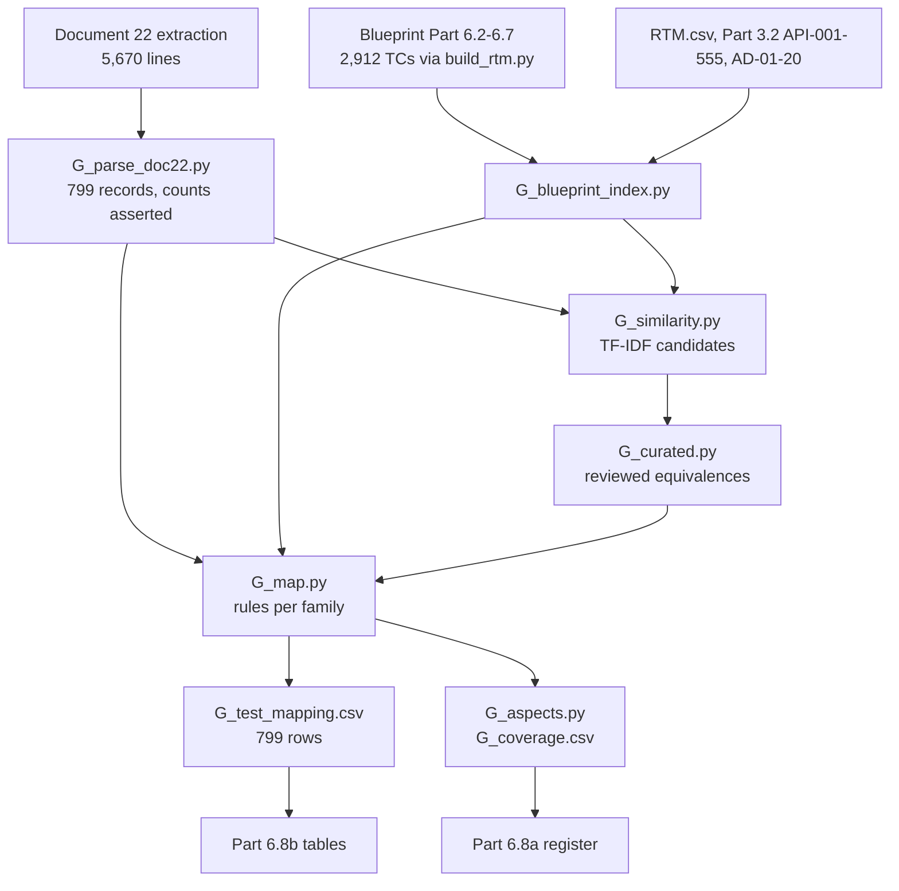

# AI Growth Engine: Employee Sales & Marketing Automation
## Application Blueprint: PART 6 (Batch 6.8b), Source Pack Test Specification Reconciliation: Catalogue Reconciliation (799 Source Tests → Blueprint TCs)

| Field | Value |
|---|---|
| Document | Application Blueprint · Part 6.8b. Complete source-test → blueprint-TC mapping for document 22: method, counts, SM-UT alias realignment, and one row per source test for all nine families (§6.8.4). Generated by `assembly/source_pack/G_render.py` from `final/coverage/G_test_mapping.csv` |
| Version | 1.0 · 27 Nov 2026 |
| Baseline | Part 6.1 (test strategy, template §6.1.12.2, alias rules §6.1.12.5, UAT packs §6.1.13.3, EVR §6.1.5.4, severity §6.1.8.2), Batches 6.2–6.5 and 6.7 (2,912 TCs), Part 6.6 RTM and `final/RTM.csv`, Part 3.2 API catalogue (API-001…555, AD-01…20), Part 2.1 module and FR register, DEC-015, DEC-017, DEC-018, DEC-093, DEC-094; source pack documents 19 and 22 (DOCX extractions), document 38 counts |
| Roles applied | QA Lead / Test Architect (primary), UAT Manager, Business Systems Analyst (journey acceptance), Principal Engineer (operation contracts), Security/Compliance Lead (negative fixtures), FinOps Lead (budget and billing cases), Product Owner (sign-off model) |
| Tag ranges used | ASSUMPTION-420…424, GAP-420…425, CONFLICT-420…424, RECOMMENDATION-420…425 (register in Part 6.8c §6.8.8) |

**Acronyms.** See Part 6.8a. ENH = TC-ENH-G-### (Part 6.8c). Status abbreviations: **Eq** Equivalent · **Al** Alias-equivalent · **Cl** Class-mapped · **P+** Partial + ENH · **New** New ENH.

---

## 6.8.4 Catalogue reconciliation

### 6.8.4.1 Method

| Family | Count | Mapping rule |
|---|---|---|
| SM-UT (unit) | 66 | Hand-reviewed against TF-IDF candidates; equivalence requires the same condition and the same expected outcome |
| SM-UX-UNIT | 9 | FR of the screen (W31–W34, A109–A113) → RTM TCs at level UT/CT ranked by similarity |
| SM-SIT-F (end-to-end) | 35 | Hand-reviewed; journey TCs TC-21-054…064 preferred |
| SM-SIT-M (module gates) | 66 | Module **name** → BR-M## (ASSUMPTION-420) → RTM TCs; best gate TC by similarity to the gate text; overrides where the gate needs an added assertion |
| SM-SIT-A (operations) | 302 | Method + path → Part 3.2 operation (exact, namespace-normalized, nearest with last-segment containment and Jaccard ≥ 0.5 [ASSUMPTION-422], or Approval consolidation) → FR → RTM TCs; adapters → AD-##; negative-fixture sentence → operation class TC-ENH-G-001…017 |
| SM-UX-SIT (screen + X) | 19 | Screens: FR → TCs at IT/SYS/E2E; X01…X10 hand-reviewed |
| SM-UAT-F (journeys) | 17 | Hand-reviewed to UAT packs (Part 6.1 §6.1.13.3) and E2E journeys |
| SM-UAT-S (screens) | 138 | DEC-017 alias rule, verified against the screen code in each row → FR → TCs at E2E/UAT/SYS; UAT pack by epic; template TC-ENH-G-036 |
| SM-UX-UAT | 147 | Screen → FR / FR-UX-<screen>; TCs that already cite the alias (Part 6.2–6.5) first; template TC-ENH-G-037 |

### 6.8.4.2 Counts

| Family | Level | Tests | Equivalent | Alias-equivalent | Class-mapped | Partial + ENH | New ENH |
|---|---|---|---|---|---|---|---|
| UT | Unit | 66 | 54 | 0 | 0 | 11 | 1 |
| UX-UNIT | Unit | 9 | 9 | 0 | 0 | 0 | 0 |
| SIT-F | SIT | 35 | 31 | 0 | 0 | 4 | 0 |
| SIT-M | SIT | 66 | 63 | 0 | 0 | 3 | 0 |
| SIT-A | SIT | 302 | 0 | 0 | 302 | 0 | 0 |
| UX-SIT | SIT | 19 | 16 | 0 | 0 | 3 | 0 |
| UAT-F | UAT | 17 | 14 | 0 | 0 | 3 | 0 |
| UAT-S | UAT | 138 | 0 | 138 | 0 | 0 | 0 |
| UX-UAT | UAT | 147 | 0 | 147 | 0 | 0 | 0 |
| **Total** |  | 799 | 187 | 285 | 302 | 24 | 1 |

Operation match results (302 SIT operation cases):

| Match type | Count | Meaning |
|---|---|---|
| exact | 101 | Same method and identical path (FRD-named ★ operations, DEC-015) |
| normalized | 73 | Same method; path equal after removing `/api/v1`, `/commercial`, `/workspace` and namespace prefixes, with the namespace compatible (admin ↔ admin; portal/public ↔ portal/public) |
| nearest | 21 | Same method and namespace; last path segment contained; token Jaccard ≥ 0.5 (ASSUMPTION-422: to be confirmed by the API owner) |
| consolidated | 9 | Per-object approve/review/decide merged into the Approval resource API-541 (Part 3.2 §3.2.2.1 step 4) |
| adapter port | 17 | Internal adapter contract → AD-## (Part 3.2 §3.2.4) |
| no blueprint operation | 81 | GAP-421; still covered by class TC and nearest functional TCs |

### 6.8.4.3 SM-UT alias realignment (supersedes the inferred family labels of ASSUMPTION-180)

Part 6.1 inferred a "control family" for each SM-UT ID from the FRD co-occurrence pattern. Document 22 now gives each ID its actual unit under test. The table keeps the inferred label for traceability and records the source meaning that governs from now on (CONFLICT-420 for 037/049/050). Coverage in the RTM stays FR-based, so no existing coverage figure changes; the equivalent TCs below are added to the alias column.

| Alias | Source unit under test (doc 22 §4) | Part 6.1 inferred family | Status | Equivalent blueprint TCs | ENH |
|---|---|---|---|---|---|
| SM-UT-001 | Authorization: Principal role and product audience | Universal CA-ALL controls: scope resolution, validation and denial paths, request/correlation ID | Equivalent | TC-17-008 TC-01-125 TC-19-064 |  |
| SM-UT-002 | Authorization: Tenant/issuer object lookup | Universal CA-ALL controls: scope resolution, validation and denial paths, request/correlation ID | Equivalent | TC-01-049 TC-03-015 TC-01-111 |  |
| SM-UT-003 | Authorization: Scope switch / aggregate | Scope filter hierarchy, saved views, scope switch | Equivalent | TC-FLT-014 TC-17-013 TC-17-017 |  |
| SM-UT-004 | Authorization: Revocation | Personal-data intake and consent capture | Equivalent | TC-01-062 TC-19-090 TC-20-057 |  |
| SM-UT-005 | Authorization: Support grant | Identity, membership, MFA, provisioning | Partial + ENH | TC-15-087 TC-01-061 TC-08-166 | TC-ENH-G-018 |
| SM-UT-006 | Configuration: Template field validation | Identity, membership, MFA, provisioning | Equivalent | TC-AU-AU003-004 TC-20-080 TC-12-002 |  |
| SM-UT-007 | Configuration: Approved config revision | Grant- or approval-bound access to sensitive records | Equivalent | TC-18-026 TC-AU-AU029-001 TC-02-011 |  |
| SM-UT-008 | Filters: Typed filter parser | KPI correctness: distinct counts, as-of, Unknown ≠ 0, portfolio read-only | Equivalent | TC-FLT-005 TC-FLT-033 TC-17-064 |  |
| SM-UT-009 | Filters: Sort/cursor stability | KPI correctness: distinct counts, as-of, Unknown ≠ 0, portfolio read-only | Equivalent | TC-FLT-025 TC-FLT-027 |  |
| SM-UT-010 | Publication: Verified host mapping | Publication: verified host, approved snapshot, cache invalidation | Equivalent | TC-19-002 TC-07-027 TC-NFR-020 |  |
| SM-UT-011 | Publication: Public DTO allowlist | Publication: verified host, approved snapshot, cache invalidation | Equivalent | TC-19-044 TC-19-058 TC-11-075 |  |
| SM-UT-012 | Publication: Approval hash and publish | Publication: verified host, approved snapshot, cache invalidation | Equivalent | TC-19-028 TC-11-027 TC-AU-AU029-001 |  |
| SM-UT-013 | Publication: Cache key | Read-only rendering, cache keying and freshness | Equivalent | TC-19-016 TC-01-118 TC-11-028 |  |
| SM-UT-014 | Enquiry: Input normalization | Versioned documents, scheduling and time-zone handling | Partial + ENH | TC-07-072 TC-AI-AG017-008 | TC-ENH-G-019 |
| SM-UT-015 | Enquiry: Idempotency | Revisioned mutation: stale revision → 409, audit on every state change | Partial + ENH | TC-04-004 TC-12-016 TC-03-061 | TC-ENH-G-020 |
| SM-UT-016 | Workflow: DAG validation | Approval queues, escalation, exceptions, stop controls | Equivalent | TC-18-011 TC-AI-AG016-001 |  |
| SM-UT-017 | Workflow: Dry run | Approval queues, escalation, exceptions, stop controls | Equivalent | TC-08-019 TC-NFR-038 TC-11-044 |  |
| SM-UT-018 | Workflow: Lease/retry | Approval queues, escalation, exceptions, stop controls | Equivalent | TC-18-002 TC-01-075 TC-AU-AU026-001 |  |
| SM-UT-019 | Workflow: Stop/resume | Approval queues, escalation, exceptions, stop controls | Equivalent | TC-08-099 TC-12-041 TC-18-050 |  |
| SM-UT-020 | Workflow: Quiet hours | Contact data and messaging eligibility | Equivalent | TC-03-026 TC-03-043 TC-16-032 |  |
| SM-UT-021 | Workflow: Reply interruption | Contact data and messaging eligibility | Equivalent | TC-03-049 TC-18-089 TC-08-066 |  |
| SM-UT-022 | Workflow: Outreach cap | Contact data and messaging eligibility | Equivalent | TC-08-108 TC-08-110 TC-03-046 |  |
| SM-UT-023 | Consent: Suppression precedence | Consent and suppression at intake and in messaging | Equivalent | TC-03-028 TC-03-029 |  |
| SM-UT-024 | Consent: Contact evidence | Evidence provenance and freshness | Equivalent | TC-06-019 TC-AI-AG019-004 |  |
| SM-UT-025 | Evidence: Freshness | Source permissions, research runs, discovery budgets | Equivalent | TC-05-028 TC-FLT-034 |  |
| SM-UT-026 | Evidence: Canonical URL and dedup | Source permissions, research runs, discovery budgets | Equivalent | TC-AU-AU014-001 TC-05-022 |  |
| SM-UT-027 | Evidence: Source permission | Source permissions, research runs, discovery budgets | Equivalent | TC-05-073 TC-05-006 TC-05-001 |  |
| SM-UT-028 | AI: Structured output schema | AI gateway: schema, grounding, cost reservation | Equivalent | TC-04-040 TC-AI-AG005-017 |  |
| SM-UT-029 | AI: RAG authorization | Knowledge retrieval and AI guardrails | Equivalent | TC-02-030 TC-AI-AG015-012 TC-AI-AG015-013 |  |
| SM-UT-030 | AI: Unsupported claim | Content and claims approval, locale | Equivalent | TC-17-084 TC-AI-AG012-001 |  |
| SM-UT-031 | AI: Prompt injection | Knowledge retrieval and AI guardrails | Equivalent | TC-17-087 TC-AI-AG004-008 |  |
| SM-UT-032 | AI: Autonomy policy | Human-in-the-loop decision records | Equivalent | TC-03-032 TC-04-040 |  |
| SM-UT-033 | Budget: Atomic reservation | Budget, cost and entitlement enforcement | Partial + ENH | TC-08-008 TC-04-001 TC-NFR-014 | TC-ENH-G-021 |
| SM-UT-034 | Budget: Provider failure accounting | Paid provider adapters: disabled by default, budgets, fallbacks | Equivalent | TC-04-023 TC-04-001 |  |
| SM-UT-035 | Integration: Adapter preference | Paid provider adapters: disabled by default, budgets, fallbacks | Equivalent | TC-NFR-037 TC-01-084 TC-12-042 |  |
| SM-UT-036 | Integration: Retry policy | Exception queue and recovery (FR-STD-04) | Partial + ENH | TC-08-170 TC-21-043 | TC-ENH-G-022 |
| SM-UT-037 | Integration: Webhook signature | — (DEC-094: unassigned) | Equivalent | TC-15-005 TC-08-048 TC-13-089 |  |
| SM-UT-038 | Storage: Secure file intake | File upload scanning | Equivalent | TC-02-020 TC-16-022 TC-NFR-021 |  |
| SM-UT-039 | Storage: Download authorization | File upload scanning | Equivalent | TC-01-117 TC-16-019 |  |
| SM-UT-040 | Financial: Decimal rounding | Provider callbacks: signature, dedupe, uncertain outcome | Equivalent | TC-13-017 TC-15-019 TC-15-055 |  |
| SM-UT-041 | Financial: Receipt identity | Provider callbacks: signature, dedupe, uncertain outcome | Partial + ENH | TC-15-040 TC-15-038 | TC-ENH-G-023 |
| SM-UT-042 | Privacy: Export and deletion | Abuse controls, rate limits, privacy at intake | Equivalent | TC-FLT-030 TC-03-070 TC-15-089 |  |
| SM-UT-043 | SaaS: Subscription entitlements | Paid provider adapters: disabled by default, budgets, fallbacks | Equivalent | TC-20-086 TC-20-042 |  |
| SM-UT-044 | SaaS: Usage meter dedup | Paid provider adapters: disabled by default, budgets, fallbacks | Equivalent | TC-20-035 TC-04-028 TC-15-074 |  |
| SM-UT-045 | Reporting: KPI computation | Filter allowlists, cursor pagination, Unknown ≠ 0 | Partial + ENH | TC-15-098 TC-15-074 TC-FLT-004 | TC-ENH-G-024 |
| SM-UT-046 | Notifications: Recipient selection | Field-level security and DTO minimization | Equivalent | TC-01-116 TC-NFR-032 |  |
| SM-UT-047 | Recovery: Outbox transaction | Approval queues, escalation, exceptions, stop controls | Equivalent | TC-01-067 TC-08-024 |  |
| SM-UT-048 | Commercial: Business routing | Deadlines, quiet hours, time-zone rules | Equivalent | TC-14-008 TC-BRS-012 TC-14-002 |  |
| SM-UT-049 | Commercial: Offering publication | — (DEC-094: unassigned) | Equivalent | TC-11-008 TC-13-003 TC-02-036 TC-AU-AU043-002 |  |
| SM-UT-050 | Commercial: Need matching | — (DEC-094: unassigned) | Partial + ENH | TC-05-058 TC-02-035 | TC-ENH-G-041 |
| SM-UT-051 | Commercial: Tender deadline | Bid intake and checklist | Equivalent | TC-14-022 TC-AU-AU034-003 TC-21-055 |  |
| SM-UT-052 | Commercial: Bidding authority | Bid intake and checklist | Equivalent | TC-18-123 TC-18-035 |  |
| SM-UT-053 | Commercial: Healthcare claims | Record matching/merge and partner/pilot records | Equivalent | TC-AI-AG017-010 TC-AI-AG018-007 |  |
| SM-UT-054 | Commercial: Healthcare data segregation | Record matching/merge and partner/pilot records | Partial + ENH | TC-16-070 TC-16-018 | TC-ENH-G-025 |
| SM-UT-055 | Commercial: Education safeguarding | Minors, guardian consent and preferences | Equivalent | TC-AI-AG017-011 TC-07-038 TC-07-043 |  |
| SM-UT-056 | Commercial: Procurement direction | Quote and order money: price version, tax, currency | Equivalent | TC-14-062 TC-14-074 TC-15-074 |  |
| SM-UT-057 | Commercial: Quote line calculation | Quote and order money: price version, tax, currency | Partial + ENH | TC-13-016 TC-13-017 | TC-ENH-G-026 |
| SM-UT-058 | Commercial: Price approval | Quote/bid/order line validation (units, quantities) | Equivalent | TC-13-052 TC-13-032 |  |
| SM-UT-059 | Commercial: Order fulfillment | Quote and order money: price version, tax, currency | Equivalent | TC-21-058 TC-14-089 |  |
| SM-UT-060 | Commercial: Campaign audience | Campaigns, landing pages, attribution, ads spend | Equivalent | TC-12-023 TC-12-083 |  |
| SM-UT-061 | Commercial: Ad budget | Campaigns, landing pages, attribution, ads spend | Equivalent | TC-12-035 TC-AU-AU032-001 |  |
| SM-UT-062 | Commercial: Attribution | Campaigns, landing pages, attribution, ads spend | New ENH | TC-12-015 TC-12-082 | TC-ENH-G-027 |
| SM-UT-063 | Commercial: Referral conflict | Campaigns, landing pages, attribution, ads spend | Equivalent | TC-12-065 TC-12-062 |  |
| SM-UT-064 | Commercial: Webinar capacity | Campaigns, landing pages, attribution, ads spend | Partial + ENH | TC-09-038 TC-09-046 | TC-ENH-G-028 |
| SM-UT-065 | Commercial: Renewal | Lifecycle requests: support, privacy, renewal | Equivalent | TC-16-031 TC-16-032 |  |
| SM-UT-066 | Commercial: Commercial closure | Commercial lifecycle states and invalid transitions | Equivalent | TC-15-067 TC-15-050 TC-07-013 |  |

### 6.8.4.4 Unit: SM-UX-UNIT (9)

| Source test | Screen | Expected (source) | FR | Status | Blueprint TCs (UT/CT) |
|---|---|---|---|---|---|
| SM-UX-UNIT-W31 | W31 | No private fundraising offers or implied outcomes; publish only approved service terms | FR-W31 | Equivalent | TC-20-003 TC-20-006 |
| SM-UX-UNIT-W32 | W32 | Prove administrator authority; no provisioning before verified identity and approval | FR-W32 | Equivalent | TC-20-009 |
| SM-UX-UNIT-W33 | W33 | AI proposals are unverified; no real dispatch or spend during onboarding | FR-W33 | Equivalent | TC-20-020 |
| SM-UX-UNIT-W34 | W34 | Client-only scoped billing; no cross-tenant or investor/customer records | FR-W34 | Equivalent | TC-20-056 |
| SM-UX-UNIT-A109 | A109 | Verify signatures and scope; dedupe; never replay a live side effect | FR-A109 | Equivalent | TC-18-067 |
| SM-UX-UNIT-A110 | A110 | Pause/resume revalidate policy; unknown external outcome must reconcile before retry | FR-A110 | Equivalent | TC-18-083 TC-18-084 |
| SM-UX-UNIT-A111 | A111 | Never expose unrelated tenant data; use idempotency and policy before dispatch | FR-A111 | Equivalent | TC-18-085 TC-18-129 |
| SM-UX-UNIT-A112 | A112 | Running workflow revisions remain immutable; no authorization expansion without review | FR-A112 | Equivalent | TC-20-080 TC-20-082 |
| SM-UX-UNIT-A113 | A113 | Only approved nodes; no arbitrary code or secret values; immutable published versions | FR-A113 | Equivalent | TC-18-008 TC-18-007 TC-18-011 |

### 6.8.4.5 SIT end-to-end SM-SIT-F (35), SM-UX-SIT screens (9) and cross-cutting X01…X10 (10)

| Source test | Title | Expected (source) | Status | Blueprint TCs | ENH |
|---|---|---|---|---|---|
| SM-SIT-F001 | Product boundary | Access denied; no cross-product event, cached payload or private content. | Equivalent | TC-01-029 TC-17-010 TC-NFR-031 |  |
| SM-SIT-F002 | Tenant and startup isolation | Uniform deny; no foreign row/cache; correct scope switch; no mutation in group view. | Equivalent | TC-01-049 TC-NFR-032 TC-17-003 TC-17-017 |  |
| SM-SIT-F003 | Tenant onboarding | Independent roles, billing, data and credentials; duplicate domain blocked; no access to owned portfolio. | Equivalent | TC-21-063 TC-01-056 TC-19-003 TC-20-084 |  |
| SM-SIT-F004 | Website publication | Draft never public; correct approved snapshot and hash; cache invalidated; audit retained. | Equivalent | TC-19-028 TC-19-033 TC-11-024 TC-11-075 |  |
| SM-SIT-F005 | Public enquiry | One scoped enquiry/event; opaque response only; spoofed scope denied; worker uses authorized scope. | Equivalent | TC-21-054 TC-12-016 TC-07-028 |  |
| SM-SIT-F006 | External portal invitations | Only granted actions allowed; no staff route access; revocation effective. | Equivalent | TC-19-066 TC-19-070 TC-20-057 |  |
| SM-SIT-F007 | Evidence and source policy | Blocked source not fetched; exact evidence and source retained; duplicate not counted; stale evidence flagged. | Equivalent | TC-05-006 TC-05-030 TC-05-022 TC-05-028 |  |
| SM-SIT-F008 | Provider swap | No unapproved paid call; fallback only eligible; consistent DTO and cost ledger. | Equivalent | TC-NFR-037 TC-01-084 TC-12-046 |  |
| SM-SIT-F009 | Knowledge ingestion | No unapproved/foreign content; valid evidence only; revoked content excluded; audit. | Partial + ENH | TC-AI-AG001-005 TC-20-096 TC-01-114 TC-02-020 | TC-ENH-G-029 |
| SM-SIT-F010 | AI output validation | Only allowed knowledge/actions; bounded retry and escalation; no confidential leak. | Equivalent | TC-17-087 TC-AI-AG015-011 TC-04-040 |  |
| SM-SIT-F011 | Workflow simulation | Simulation has zero external effects; eligible/blocked/cost displayed; real execution rechecks approvals. | Equivalent | TC-21-062 TC-08-019 TC-NFR-038 |  |
| SM-SIT-F012 | Outbox and recovery | Durable outbox; reconcile uncertain outcome; at most one business effect; exception visible. | Equivalent | TC-01-069 TC-01-071 TC-01-075 TC-18-002 |  |
| SM-SIT-F013 | Budget concurrency | No negative balance, one charge per event; blocked action visible; no cross-tenant budget borrowing. | Partial + ENH | TC-20-037 TC-04-028 TC-20-085 | TC-ENH-G-021 |
| SM-SIT-F014 | Outbound and inbound sequence | One send and message history; no generic follow-up after reply/suppression; channel policy respected. | Equivalent | TC-08-066 TC-03-005 TC-10-003 TC-08-099 |  |
| SM-SIT-F015 | Calendar and meetings | One booking; no private calendar details; accurate timezone and notification. | Equivalent | TC-AU-AU023-003 TC-09-015 TC-05-020 |  |
| SM-SIT-F016 | Document exchange | Safe quarantine/reject; only permitted document access; no direct storage disclosure. | Equivalent | TC-16-016 TC-19-070 TC-02-020 |  |
| SM-SIT-F017 | Webhooks and replay | Invalid rejected; duplicate not applied; terminal state not regressed; provider identity scoped. | Equivalent | TC-10-003 TC-NFR-005 TC-01-120 TC-21-042 |  |
| SM-SIT-F018 | Billing and portability | Independent service charges; no data leak; workflows stop and approved export/retention applied. | Equivalent | TC-NFR-035 TC-21-063 TC-20-068 |  |
| SM-SIT-F019 | Admin notifications and approvals | Authorized assignee only; stale/unauthorized approval denied; approved state audited. | Equivalent | TC-AU-AU027-002 TC-01-116 TC-13-109 |  |
| SM-SIT-F020 | Disaster recovery | Critical RPO ≤15 min; RTO ≤4h initial/≤2h growth targets; no duplicate effect; report observed times. | Equivalent | TC-21-069 TC-NFR-057 TC-21-091 TC-AU-AU028-003 |  |
| SM-SIT-F021 | Load and latency | p95 dashboard ≤2s initial/≤2.5s growth, async ack ≤2s; no tenant starvation; actual measurements and failures | Equivalent | TC-NFR-046 TC-NFR-048 |  |
| SM-SIT-F022 | AppNAI bid discovery | AppNAI pipeline only; no unauthorized bid; amendments tracked; award separate from actual payment. | Equivalent | TC-21-055 TC-14-099 TC-14-004 |  |
| SM-SIT-F023 | MedMaarg healthcare acquisition | No patient clinical data or unapproved clinical claims; pilot and verified revenue distinct. | Equivalent | TC-21-056 TC-07-012 TC-16-077 |  |
| SM-SIT-F024 | EduVerse education acquisition | Education pipeline only; external AI project requests go AppNAI; applicable permissions respected. | Equivalent | TC-21-057 TC-14-002 TC-19-061 |  |
| SM-SIT-F025 | OrganicSpec buying | Payable not revenue; partial delivery and approved supplier recorded. | Equivalent | TC-14-062 TC-14-074 TC-14-100 |  |
| SM-SIT-F026 | OrganicSpec selling/services/training | Correct quantity, currency, terms and receipt; no duplicate fulfillment or revenue. | Equivalent | TC-21-058 TC-20-050 TC-14-047 |  |
| SM-SIT-F027 | Content and SEO | No draft content public; approved revision and measurable technical SEO results; no guaranteed rank. | Equivalent | TC-AI-AG018-001 TC-AI-AG018-004 TC-19-028 |  |
| SM-SIT-F028 | Social publishing and listening | One approved publication, no private group scrape; source evidence and cost recorded. | Equivalent | TC-05-067 TC-06-020 TC-11-071 |  |
| SM-SIT-F029 | Campaign, ads and attribution | Suppressed blocked; no live ads without approval; one attributable conversion; cap enforced. | Partial + ENH | TC-12-082 TC-12-035 TC-12-015 | TC-ENH-G-027 |
| SM-SIT-F030 | Website assistant and omnichannel | Public uses approved FAQ only; one scoped lead, authorized transition; no private disclosures. | Equivalent | TC-10-036 TC-AI-AG017-010 TC-08-152 |  |
| SM-SIT-F031 | Event and referral | Capacity and consent respected; dedup; actual attendance not assumed. | Partial + ENH | TC-12-065 TC-09-033 TC-09-046 | TC-ENH-G-028 |
| SM-SIT-F032 | Proposal, quote and discount | Unapproved discount blocked; correct quote/contract revision and audit. | Equivalent | TC-13-052 TC-21-064 TC-13-067 |  |
| SM-SIT-F033 | Commercial closure and reconciliation | No duplicate cash; exceptions visible; commercial ledger only. | Equivalent | TC-07-013 TC-15-050 TC-14-038 TC-15-061 |  |
| SM-SIT-F034 | Retention and lost deal learning | Retain scoped feedback; no spam or unwanted follow-up; accurate renewal forecast. | Equivalent | TC-16-043 TC-08-093 TC-04-048 |  |
| SM-SIT-F035 | Insurance and licensing expansion | Unsupported pilot/launch blocked; route-specific approvals; no patient data in CRM. | Equivalent | TC-16-055 TC-02-046 TC-16-053 |  |

| Source test | Title | Expected (source) | Status | Blueprint TCs | ENH |
|---|---|---|---|---|---|
| SM-UX-SIT-W31 | SaaS introduction, plans & demo SIT validation | No private fundraising offers or implied outcomes; publish only approved service terms | Equivalent | TC-20-004 TC-20-005 TC-20-002 |  |
| SM-UX-SIT-W32 | Startup & third-party client registration SIT validation | Prove administrator authority; no provisioning before verified identity and approval | Equivalent | TC-20-008 TC-20-014 TC-20-011 |  |
| SM-UX-SIT-W33 | AI business onboarding & configuration wizard SIT validation | AI proposals are unverified; no real dispatch or spend during onboarding | Equivalent | TC-20-024 TC-20-019 TC-AI-AG030-001 |  |
| SM-UX-SIT-W34 | SaaS client service portal SIT validation | Client-only scoped billing; no cross-tenant or investor/customer records | Equivalent | TC-20-051 TC-20-073 TC-20-068 |  |
| SM-UX-SIT-A109 | Event & Trigger Management Centre SIT validation | Verify signatures and scope; dedupe; never replay a live side effect | Equivalent | TC-BRS-008 TC-18-060 TC-08-045 |  |
| SM-UX-SIT-A110 | Live Automation Execution Monitor SIT validation | Pause/resume revalidate policy; unknown external outcome must reconcile before retry | Equivalent | TC-18-074 TC-18-070 TC-18-045 |  |
| SM-UX-SIT-A111 | Automation Coordination & Conflict Resolution SIT validation | Never expose unrelated tenant data; use idempotency and policy before dispatch | Equivalent | TC-18-092 TC-18-091 TC-18-089 |  |
| SM-UX-SIT-A112 | Business Configuration Change Centre SIT validation | Running workflow revisions remain immutable; no authorization expansion without review | Equivalent | TC-20-077 TC-20-076 TC-20-081 |  |
| SM-UX-SIT-A113 | Automation Template & Node Library SIT validation | Only approved nodes; no arbitrary code or secret values; immutable published versions | Equivalent | TC-18-018 TC-18-017 TC-18-009 |  |
| SM-UX-SIT-X01 | Scope and onboarding | Only authorized startup options; no cross-client data; 26+ owned profiles without code changes. | Partial + ENH | TC-01-054 TC-02-009 TC-FLT-011 | TC-ENH-G-030 |
| SM-UX-SIT-X02 | Capability-based routing | Owned EduVerse blocked from external commercial AI project acquisition; AppNAI permitted; independent clients | Equivalent | TC-14-007 TC-14-008 TC-14-006 TC-BRS-012 |  |
| SM-UX-SIT-X03 | Concurrent workflows | Independent run state, immutable revision references and no unauthorized actions. | Equivalent | TC-18-003 TC-18-095 TC-18-020 |  |
| SM-UX-SIT-X04 | Event replay and conflict | Single logical event and one eligible action; competing action held or suppressed. | Equivalent | TC-08-094 TC-08-047 TC-18-091 |  |
| SM-UX-SIT-X05 | Omnichannel suppression | Shared scoped timeline; ineligible pending follow-ups stopped; no new dispatch after suppression. | Equivalent | TC-08-152 TC-AU-AU022-002 TC-03-001 |  |
| SM-UX-SIT-X06 | Budget and recovery | No overspend; reconcile uncertain outcome before retry; bounded retries. | Equivalent | TC-20-085 TC-01-071 TC-18-070 |  |
| SM-UX-SIT-X07 | Shared closure state | Consistent opportunity, quotation and order IDs; calculated prices and verified payment status only from commi | Partial + ENH | TC-19-089 TC-21-064 TC-07-013 | TC-ENH-G-031 |
| SM-UX-SIT-X08 | Website and Admin handoff | Distinct identities; explicit synthetic handoff; no private Admin export to public website. | Equivalent | TC-21-063 TC-21-010 TC-01-003 |  |
| SM-UX-SIT-X09 | Configuration lifecycle | New runs use approved revision; existing runs retain snapshot; suspended work blocked; rollback audited. | Equivalent | TC-18-003 TC-20-044 TC-20-083 |  |
| SM-UX-SIT-X10 | Accessibility and navigation | No broken route or JS error; correct focus and accessible labels; scoped fields and readable layout. | Partial + ENH | TC-17-067 TC-10-054 TC-17-009 | TC-ENH-G-035 |

### 6.8.4.6 SIT module acceptance SM-SIT-M (66)

The source numbers modules in its own table order. For 50 modules the number differs from the BRD module number used by BR-M## (for example SM-SIT-M009 "Cost and usage control" = BR-M53, SM-SIT-M013 "Search query planner" = BR-M10). Mapping is by module name (ASSUMPTION-420); the alias column of the RTM must carry both numbers.

| Source test | Module | Expected business gate (source) | BR (renumbering) | Status | Gate TCs | ENH |
|---|---|---|---|---|---|---|
| SM-SIT-M001 | Identity & access | Cross-role access denied; session revoked | BR-M01 | Equivalent | TC-01-110 TC-01-035 TC-19-065 |  |
| SM-SIT-M002 | Product knowledge catalog | Planned products blocked from promotion | BR-M02 | Equivalent | TC-19-048 TC-02-036 TC-02-038 |  |
| SM-SIT-M003 | Knowledge document ingestion | Every answer cites approved version | BR-M03 | Partial + ENH | TC-02-033 TC-02-031 TC-02-028 | TC-ENH-G-029 |
| SM-SIT-M004 | Consent and suppression | Opt-out blocks all scoped sends | BR-M04 | Equivalent | TC-03-008 TC-03-051 TC-03-001 |  |
| SM-SIT-M005 | Integration registry | Secrets never returned in API | BR-M05 | Equivalent | TC-01-082 TC-08-036 TC-NFR-004 |  |
| SM-SIT-M006 | Event and audit foundation | Duplicate delivery has one effect | BR-M06 | Equivalent | TC-08-046 TC-01-069 TC-21-036 |  |
| SM-SIT-M007 | Source permissions register | Unapproved URL blocked | BR-M07 | Equivalent | TC-05-006 TC-05-019 TC-05-002 |  |
| SM-SIT-M008 | AI gateway and evaluation | Invalid outputs rejected; cost cap enforced | BR-M08 | Equivalent | TC-17-080 TC-04-002 TC-04-055 |  |
| SM-SIT-M009 | Cost and usage control | Simulated cap stops requests | BR-M53 · renumbered: source M009 = BR-M53 | Equivalent | TC-18-051 TC-18-054 TC-04-028 |  |
| SM-SIT-M010 | Privacy requests and retention | Deletion does not re-enable outreach | BR-M56 · renumbered: source M010 = BR-M56 | Equivalent | TC-03-071 TC-03-060 TC-03-069 |  |
| SM-SIT-M011 | DevSecOps & environment | Restore drill; secret scan; smoke test | BR-M09 · renumbered: source M011 = BR-M09 | Equivalent | TC-21-068 TC-21-073 TC-21-072 |  |
| SM-SIT-M012 | Operational observability | Provider outage does not lose events | BR-M58 · renumbered: source M012 = BR-M58 | Equivalent | TC-21-097 TC-21-035 TC-21-042 |  |
| SM-SIT-M013 | Search query planner | No personal health targeting queries | BR-M10 · renumbered: source M013 = BR-M10 | Equivalent | TC-AI-AG003-003 TC-05-015 TC-05-016 |  |
| SM-SIT-M014 | Public web discovery | Source URL/date recorded; blocked hosts rejected | BR-M11 · renumbered: source M014 = BR-M11 | Equivalent | TC-AU-AU014-002 TC-05-021 TC-BRS-005 |  |
| SM-SIT-M015 | Evidence extraction | Evidence traceable; injection ignored | BR-M12 · renumbered: source M015 = BR-M12 | Equivalent | TC-04-043 TC-04-039 TC-05-076 |  |
| SM-SIT-M016 | Account discovery | Duplicate domain/location merge safe | BR-M13 · renumbered: source M016 = BR-M13 | Equivalent | TC-05-037 TC-AU-AU015-001 TC-AU-AU015-003 |  |
| SM-SIT-M017 | Buying signal classification | ≥80% precision on reviewed pilot sample target | BR-M14 · renumbered: source M017 = BR-M14 | Equivalent | TC-05-048 TC-05-045 TC-05-044 |  |
| SM-SIT-M018 | Business need discovery | No inference labeled confirmed | BR-M15 · renumbered: source M018 = BR-M15 | Equivalent | TC-05-053 TC-05-055 TC-05-054 |  |
| SM-SIT-M019 | Product solution matching | Unavailable offering excluded from sales | BR-M16 · renumbered: source M019 = BR-M16 | Equivalent | TC-05-059 TC-05-062 TC-05-061 |  |
| SM-SIT-M020 | Opportunity scoring | Score recalculates; consent independent | BR-M17 · renumbered: source M020 = BR-M17 | Equivalent | TC-06-012 TC-06-044 TC-06-045 |  |
| SM-SIT-M021 | Decision-maker role discovery | No private contacts or guessed emails | BR-M18 · renumbered: source M021 = BR-M18 | Equivalent | TC-06-019 TC-06-035 TC-06-033 |  |
| SM-SIT-M022 | Contact verification | Verified not synonymous with consent | BR-M19 · renumbered: source M022 = BR-M19 | Equivalent | TC-AU-AU018-002 TC-06-025 TC-06-027 |  |
| SM-SIT-M023 | Research review and alerts | Rejected leads never sent to channel | BR-M20 · renumbered: source M023 = BR-M20 | Equivalent | TC-AU-AU019-003 TC-06-042 TC-06-047 |  |
| SM-SIT-M024 | CRM pipeline | Invalid stage transition rejected | BR-M21 · renumbered: source M024 = BR-M21 | Equivalent | TC-07-015 TC-07-060 TC-07-010 |  |
| SM-SIT-M025 | Lead capture and forms | Duplicate submission one lead | BR-M22 · renumbered: source M025 = BR-M22 | Equivalent | TC-07-029 TC-14-040 TC-03-061 |  |
| SM-SIT-M026 | Customer 360 | Updates visible within 60s target | BR-M23 · renumbered: source M026 = BR-M23 | Equivalent | TC-NFR-008 TC-07-046 TC-07-055 |  |
| SM-SIT-M027 | Engagement eligibility | No send when opt-out/unknown eligibility | BR-M24 · renumbered: source M027 = BR-M24 | Equivalent | TC-07-050 TC-08-016 TC-07-049 |  |
| SM-SIT-M028 | Workflow control center | Emergency stop blocks queued sends | BR-M55 · renumbered: source M028 = BR-M55 | Equivalent | TC-18-041 TC-18-015 TC-18-116 |  |
| SM-SIT-M029 | Personalized message drafting | No invented relationship or diagnosis | BR-M25 · renumbered: source M029 = BR-M25 | Equivalent | TC-08-004 TC-AI-AG011-003 TC-03-020 |  |
| SM-SIT-M030 | Email integration | Replay no duplicate; bounce suppress | BR-M26 · renumbered: source M030 = BR-M26 | Equivalent | TC-08-064 TC-08-065 TC-08-056 |  |
| SM-SIT-M031 | Unified inbound processing | STOP cancels; urgent/clinical routes to human | BR-M27 · renumbered: source M031 = BR-M27 | Equivalent | TC-AI-AG013-003 TC-08-069 TC-10-027 |  |
| SM-SIT-M032 | Follow-up sequences | No follow-up after stop or reply | BR-M28 · renumbered: source M032 = BR-M28 | Equivalent | TC-03-049 TC-FLT-035 TC-AU-AU022-001 |  |
| SM-SIT-M033 | Meeting and calendar | No invented availability; conflict handled | BR-M29 · renumbered: source M033 = BR-M29 | Equivalent | TC-09-009 TC-09-006 TC-09-015 |  |
| SM-SIT-M034 | Growth dashboard | Counts reconcile with deal records | BR-M30 · renumbered: source M034 = BR-M30 | Equivalent | TC-17-029 TC-17-035 TC-17-033 |  |
| SM-SIT-M035 | WhatsApp Business | No private group scrape; opt-in gate | BR-M31 · renumbered: source M035 = BR-M31 | Equivalent | TC-10-027 TC-10-022 TC-08-149 |  |
| SM-SIT-M036 | Website conversational assistant | Clinical question routed; no medical data | BR-M32 · renumbered: source M036 = BR-M32 | Equivalent | TC-AI-AG017-010 TC-10-031 TC-10-036 |  |
| SM-SIT-M037 | Unified omnichannel routing | No duplicate replies across linked channels | BR-M41 · renumbered: source M037 = BR-M41 | Equivalent | TC-10-051 TC-08-152 TC-03-047 |  |
| SM-SIT-M038 | Compliance monitoring | Simulated complaints stop campaign | BR-M57 · renumbered: source M038 = BR-M57 | Equivalent | TC-AI-AG013-005 TC-03-080 TC-03-078 |  |
| SM-SIT-M039 | Social listening | No restricted profiles or automated DMs | BR-M33 · renumbered: source M039 = BR-M33 | Equivalent | TC-05-065 TC-AI-AG004-008 TC-05-067 |  |
| SM-SIT-M040 | Content studio | Unapproved claims cannot publish | BR-M34 · renumbered: source M040 = BR-M34 | Equivalent | TC-AI-AG018-001 TC-11-009 TC-11-008 |  |
| SM-SIT-M041 | Social publishing | No unsupported DMs; idempotent publishing | BR-M35 · renumbered: source M041 = BR-M35 | Equivalent | TC-11-031 TC-11-039 |  |
| SM-SIT-M042 | SEO and search visibility | No fabricated ranking data | BR-M36 · renumbered: source M042 = BR-M36 | Equivalent | TC-AI-AG018-004 TC-11-064 TC-11-055 |  |
| SM-SIT-M043 | Landing pages and attribution | No health events to ad pixels | BR-M37 · renumbered: source M043 = BR-M37 | Partial + ENH | TC-12-005 TC-12-082 TC-AI-AG018-002 | TC-ENH-G-027 |
| SM-SIT-M044 | Campaign management | Suppression applied at execution | BR-M38 · renumbered: source M044 = BR-M38 | Equivalent | TC-12-033 TC-12-040 TC-12-034 |  |
| SM-SIT-M045 | Paid ads integration | Budget exceeded → pause; no sensitive data | BR-M39 · renumbered: source M045 = BR-M39 | Equivalent | TC-12-042 TC-12-047 TC-12-052 |  |
| SM-SIT-M046 | Webinars and demonstrations | Opt-outs respected; attendance dedup | BR-M40 · renumbered: source M046 = BR-M40 | Equivalent | TC-09-033 |  |
| SM-SIT-M047 | Referral and partner lead capture | No unauthorized third-party contact enrollment | BR-M42 · renumbered: source M047 = BR-M42 | Equivalent | TC-12-062 TC-12-067 TC-12-065 |  |
| SM-SIT-M048 | Proposal builder | Only approved version externally shared | BR-M43 · renumbered: source M048 = BR-M43 | Equivalent | TC-13-004 TC-13-001 TC-13-003 |  |
| SM-SIT-M049 | Quote and pricing engine | No unauthorized discount; totals exact | BR-M44 · renumbered: source M049 = BR-M44 | Equivalent | TC-13-022 TC-13-021 TC-13-050 |  |
| SM-SIT-M050 | Negotiation and objection handling | Contract/price exception escalates | BR-M45 · renumbered: source M050 = BR-M45 | Equivalent | TC-13-071 TC-13-064 TC-AI-AG021-002 |  |
| SM-SIT-M051 | Contract and MoU workflow | No AI signs contract; signed version hash stored | BR-M46 · renumbered: source M051 = BR-M46 | Equivalent | TC-13-073 TC-13-095 TC-13-128 |  |
| SM-SIT-M052 | Payment and closure | Replay no duplicate revenue; no invented closure | BR-M47 · renumbered: source M052 = BR-M47 | Equivalent | TC-15-097 TC-15-004 TC-15-054 |  |
| SM-SIT-M053 | Onboarding and handoff | No patient data copied | BR-M48 · renumbered: source M053 = BR-M48 | Equivalent | TC-16-077 TC-16-014 TC-16-004 |  |
| SM-SIT-M054 | Partner deployment pipeline | No deployment claims before approval | BR-M49 · renumbered: source M054 = BR-M49 | Equivalent | TC-16-046 TC-16-049 TC-16-048 |  |
| SM-SIT-M055 | Retention and renewal | No medical data in scoring | BR-M50 · renumbered: source M055 = BR-M50 | Equivalent | TC-AU-AU039-002 TC-16-024 TC-16-035 |  |
| SM-SIT-M056 | Lost deal and feedback | No auto-recontact after loss without policy | BR-M51 · renumbered: source M056 = BR-M51 | Equivalent | TC-16-039 TC-16-043 TC-16-044 |  |
| SM-SIT-M057 | Revenue and attribution | Revenue reconciles with finance; attribution caveat | BR-M52 · renumbered: source M057 = BR-M52 | Equivalent | TC-15-071 TC-AU-AU040-001 TC-15-084 |  |
| SM-SIT-M058 | AI quality and feedback | Regression fails block deploy | BR-M54 · renumbered: source M058 = BR-M54 | Equivalent | TC-04-049 TC-04-050 TC-04-047 |  |
| SM-SIT-M059 | Competitor and market watch | No unverified comparative claim | BR-M59 | Equivalent | TC-05-071 TC-AI-AG018-002 TC-AI-AG027-002 |  |
| SM-SIT-M060 | Forecast and sales optimization | Forecast labeled estimate | BR-M60 | Equivalent | TC-17-045 TC-17-049 TC-AI-AG029-002 |  |
| SM-SIT-M061 | Admin command center | Admin totals reconcile; no direct unsafe DB edits | BR-M61 | Equivalent | TC-BRS-011 TC-17-008 TC-17-010 |  |
| SM-SIT-M062 | End-to-end production release | All critical tests pass; rollback verified | BR-M62 | Partial + ENH | TC-21-081 TC-NFR-013 TC-21-100 | TC-ENH-G-040 |
| SM-SIT-M063 | Insurance institutional pilot | No underwriting or personal profiling | BR-M63 | Equivalent | TC-16-053 TC-AI-AG032-003 TC-16-054 |  |
| SM-SIT-M064 | Technology licensing pipeline | No promised unready API | BR-M64 | Equivalent | TC-16-063 TC-16-061 |  |
| SM-SIT-M065 | Phygital expansion | Deployment sign-off required | BR-M65 | Equivalent | TC-16-057 |  |
| SM-SIT-M066 | Future product commercialization | Planned offerings not promoted | BR-M66 | Equivalent | TC-AU-AU043-002 TC-19-048 TC-02-036 |  |

### 6.8.4.7 SIT operation-level contracts SM-SIT-A (302)

Class key (Part 6.8c §6.8.5.2.1): G-001 audience/auth · G-002 scoped list/read · G-003 revisioned or idempotent write · G-004 hash-bound approval · G-005 publication snapshot · G-006 AI evidence/output · G-007 discovery source and cap · G-008 messaging eligibility and dispatch · G-009 portal object grant · G-010 workflow simulation · G-011 financial allocation · G-012 self-service/privacy request · G-013 fulfilment quantity · G-014 bid deadline · G-015 adapter port · G-016 provider callback · G-017 health/readiness.

| Source test | Audience | Method and path | Blueprint operation | Match | FR | Class TC | Functional TCs |
|---|---|---|---|---|---|---|---|
| SM-SIT-A001 | Authentication | POST /auth/login | API-001 POST /api/v1/auth/login | normalized | FR-A001 FR-W21 | G-001 | TC-NFR-074 TC-01-012 TC-01-100 |
| SM-SIT-A002 | Authentication | GET /me | API-002 GET /api/v1/me | normalized | FR-A001 FR-A003 | G-002 | TC-BRS-005 TC-17-009 TC-BRS-006 |
| SM-SIT-A005 | Authentication | POST /auth/logout |  | no blueprint operation |  | G-001 | TC-01-012 TC-01-013 TC-NFR-001 |
| SM-SIT-A003 | Admin | GET /admin/users | API-019 GET ~/admin/users | normalized | FR-A002 | G-002 | TC-01-042 TC-01-045 TC-01-037 |
| SM-SIT-A004 | Admin | POST /admin/users/{id}/roles |  | no blueprint operation |  | G-003 | TC-07-017 TC-BRS-011 TC-BRS-005 |
| SM-SIT-A006 | Admin | GET /api/v1/products | API-048 GET /api/v1/products | exact | FR-A004 FR-A005 | G-004 | TC-02-038 TC-02-005 TC-02-037 |
| SM-SIT-A007 | Admin | GET /api/v1/products/{id} | API-048 GET /api/v1/products | nearest | FR-A004 FR-A005 | G-002 | TC-02-013 TC-02-034 TC-02-009 |
| SM-SIT-A008 | Admin | POST /api/v1/admin/products | API-050 POST /api/v1/admin/products/{id}/launch | nearest | FR-A098 | G-003 | TC-02-049 TC-02-046 |
| SM-SIT-A009 | Admin | PATCH /api/v1/admin/products/{id} |  | no blueprint operation |  | G-003 | TC-01-010 TC-01-009 TC-FLT-021 |
| SM-SIT-A010 | Admin | POST /api/v1/admin/claims/approve | API-049 POST /api/v1/admin/claims/approve | exact | FR-A051 | G-004 | TC-11-016 TC-11-018 TC-11-074 |
| SM-SIT-A011 | Admin | POST /api/v1/admin/products/{id}/prices |  | no blueprint operation |  | G-004 | TC-AI-AG017-012 TC-AI-AG014-003 TC-AI-AG030-002 |
| SM-SIT-A012 | Admin | POST /api/v1/knowledge/uploads | API-051 POST /api/v1/knowledge/uploads | exact | FR-A006 | G-006 | TC-NFR-021 TC-02-025 TC-02-024 |
| SM-SIT-A013 | Admin | GET /api/v1/knowledge/documents | API-061 GET ~/admin/knowledge/documents | normalized | FR-A006 | G-006 | TC-AI-AG001-001 TC-02-033 TC-02-034 |
| SM-SIT-A014 | Admin | POST /api/v1/knowledge/documents/{id}/review | API-541 POST ~/admin/approvals | consolidated |  | G-006 | TC-AU-AU001-004 TC-20-015 TC-12-014 |
| SM-SIT-A015 | Admin | GET /api/v1/knowledge/search | API-052 GET /api/v1/knowledge/search | exact | FR-A005 | G-006 | TC-02-034 TC-02-033 TC-02-028 |
| SM-SIT-A020 | Admin | GET /api/v1/admin/policies | API-071 GET ~/admin/policies | normalized | FR-A007 | G-008 | TC-03-013 TC-03-005 TC-03-003 |
| SM-SIT-A021 | Admin | POST /api/v1/admin/policies | API-072 POST ~/admin/policies | normalized | FR-A007 | G-005 | TC-03-013 TC-03-009 TC-03-007 |
| SM-SIT-A022 | Admin | GET /api/v1/admin/suppressions | API-074 GET ~/admin/suppressions | normalized | FR-A007 | G-008 | TC-03-008 TC-03-005 TC-03-007 |
| SM-SIT-A023 | Admin | GET /api/v1/integrations | API-095 GET /api/v1/integrations | exact | FR-A008 | G-002 | TC-01-087 TC-01-083 TC-01-082 |
| SM-SIT-A024 | Admin | POST /api/v1/admin/integrations | API-097 POST ~/admin/integrations | normalized | FR-A008 | G-003 | TC-01-081 TC-01-082 TC-01-085 |
| SM-SIT-A025 | Admin | POST /api/v1/admin/integrations/test | API-096 POST /api/v1/admin/integrations/test | exact | FR-A008 | G-003 | TC-01-087 TC-01-083 TC-01-082 |
| SM-SIT-A026 | Admin | POST /api/v1/admin/integrations/{id}/disable | API-099 POST ~/admin/integrations/{id}/disable | normalized | FR-A008 | G-003 | TC-01-087 TC-01-083 TC-01-082 |
| SM-SIT-A027 | Admin | GET /api/v1/events | API-115 GET /api/v1/events | exact | FR-A009 | G-002 | TC-01-012 TC-NFR-073 TC-01-073 |
| SM-SIT-A028 | Admin | GET /api/v1/admin/jobs | API-124 GET ~/admin/jobs | normalized | FR-A009 | G-010 | TC-01-075 TC-01-078 TC-NFR-073 |
| SM-SIT-A029 | Admin | POST /api/v1/admin/jobs/{id}/retry | API-116 POST /api/v1/admin/jobs/{id}/retry | exact | FR-A009 | G-010 | TC-01-078 TC-21-043 TC-01-075 |
| SM-SIT-A030 | Admin | GET /api/v1/sources | API-158 GET /api/v1/sources | exact | FR-A010 | G-007 | TC-05-008 TC-05-004 TC-05-005 |
| SM-SIT-A031 | Admin | POST /api/v1/admin/sources | API-159 POST /api/v1/admin/sources | exact | FR-A010 | G-007 | TC-05-008 TC-05-002 TC-05-003 |
| SM-SIT-A032 | Admin | PATCH /api/v1/admin/sources/{id} |  | no blueprint operation |  | G-007 | TC-19-037 TC-15-103 TC-AU-AU007-001 |
| SM-SIT-A034 | Admin | GET /api/v1/admin/ai/runs | API-135 GET /api/v1/admin/ai/runs | exact | FR-A011 | G-006 | TC-04-037 TC-04-055 TC-04-053 |
| SM-SIT-A035 | Admin | POST /api/v1/admin/ai/prompts | API-142 POST ~/admin/ai/prompts | normalized | FR-A011 | G-006 | TC-04-032 TC-NFR-077 TC-04-033 |
| SM-SIT-A036 | Admin | GET /api/v1/admin/ai/eval-cases |  | no blueprint operation |  | G-006 | TC-19-088 TC-01-091 TC-19-087 |
| SM-SIT-A038 | Admin | GET /api/v1/admin/costs | API-136 GET /api/v1/admin/costs | exact | FR-A012 | G-002 | TC-NFR-091 TC-04-023 TC-04-055 |
| SM-SIT-A039 | Admin | POST /api/v1/admin/budgets | API-137 POST /api/v1/admin/budgets | exact | FR-A012 | G-010 | TC-NFR-091 TC-04-031 TC-01-121 |
| SM-SIT-A040 | Admin | POST /api/v1/admin/budgets/{id}/pause |  | no blueprint operation |  | G-010 | TC-04-030 TC-AU-AU032-003 TC-12-045 |
| SM-SIT-A042 | Admin | GET /api/v1/admin/privacy/requests | API-084 GET ~/admin/privacy-requests | nearest | FR-A013 | G-012 | TC-03-071 TC-NFR-094 TC-03-064 |
| SM-SIT-A043 | Admin | POST /api/v1/admin/privacy/requests/{id}/resolve |  | no blueprint operation |  | G-012 | TC-03-064 TC-21-031 TC-19-001 |
| SM-SIT-A044 | Admin | POST /api/v1/admin/retention-policies |  | no blueprint operation |  | G-012 | TC-NFR-081 TC-NFR-076 TC-19-088 |
| SM-SIT-A047 | Admin | GET /api/v1/admin/health | API-117 GET /api/v1/health | normalized | FR-OP002 | G-002 | TC-NFR-019 TC-21-017 TC-21-013 |
| SM-SIT-A048 | Admin | POST /api/v1/admin/incidents/{id}/resolve | API-130 POST ~/admin/incidents/{id}/resolve | normalized | FR-A014 | G-006 | TC-21-031 TC-21-030 TC-21-033 |
| SM-SIT-A049 | Admin | GET /api/v1/research/plans | API-180 GET ~/admin/research/plans | normalized | FR-A015 | G-007 | TC-05-020 TC-AI-AG003-001 TC-05-081 |
| SM-SIT-A050 | Admin | POST /api/v1/research/plans | API-160 POST /api/v1/research/plans | exact | FR-A015 | G-007 | TC-05-020 TC-05-019 TC-05-085 |
| SM-SIT-A051 | Admin | POST /api/v1/research/run | API-161 POST /api/v1/research/run | exact | FR-A015 | G-007 | TC-05-081 TC-05-084 TC-05-083 |
| SM-SIT-A052 | Admin | PATCH /api/v1/research/plans/{id} | API-181 PATCH ~/admin/research/plans/{id} | normalized | FR-A015 | G-007 | TC-05-020 TC-05-015 TC-AI-AG003-001 |
| SM-SIT-A053 | Admin | GET /api/v1/research/results | API-162 GET /api/v1/research/results | exact | FR-A016 | G-007 | TC-05-004 TC-05-080 TC-05-021 |
| SM-SIT-A054 | Admin | GET /api/v1/research/runs/{id} | API-183 GET ~/admin/research/runs/{id} | normalized | FR-A016 | G-007 | TC-05-081 TC-05-021 TC-05-084 |
| SM-SIT-A056 | Admin | GET /api/v1/evidence/{id} | API-163 GET /api/v1/evidence/{id} | exact | FR-A017 | G-002 | TC-05-030 TC-05-034 TC-04-039 |
| SM-SIT-A057 | Admin | GET /api/v1/evidence | API-186 GET ~/admin/evidence | normalized | FR-A017 | G-002 | TC-FLT-034 TC-04-039 TC-05-076 |
| SM-SIT-A059 | Admin | GET /api/v1/organizations | API-164 GET /api/v1/organizations | exact | FR-A018 | G-007 | TC-05-043 TC-05-038 TC-05-042 |
| SM-SIT-A060 | Admin | POST /api/v1/organizations | API-165 POST /api/v1/organizations | exact | FR-A018 | G-007 | TC-05-036 TC-05-043 TC-05-038 |
| SM-SIT-A061 | Admin | GET /api/v1/organizations/{id} | API-189 GET ~/admin/organizations/{id} | normalized | FR-A018 | G-007 | TC-05-043 TC-05-036 TC-05-042 |
| SM-SIT-A062 | Admin | POST /api/v1/organizations/{id}/merge | API-190 POST ~/admin/organizations/merge-previews | nearest | FR-A018 FR-A026 | G-007 | TC-05-039 TC-05-040 TC-05-037 |
| SM-SIT-A063 | Admin | GET /api/v1/signals | API-166 GET /api/v1/signals | exact | FR-A019 | G-007 | TC-05-050 TC-05-044 TC-05-048 |
| SM-SIT-A064 | Admin | POST /api/v1/signals/{id}/review | API-167 POST /api/v1/signals/{id}/review | exact | FR-A019 | G-007 | TC-05-046 TC-05-050 TC-05-051 |
| SM-SIT-A065 | Admin | POST /api/v1/admin/signal-types |  | no blueprint operation |  | G-007 | TC-16-080 TC-16-075 TC-AI-AG021-001 |
| SM-SIT-A066 | Admin | GET /api/v1/needs | API-168 GET /api/v1/needs | exact | FR-A020 | G-002 | TC-AI-AG006-002 TC-05-057 TC-05-056 |
| SM-SIT-A067 | Admin | POST /api/v1/needs/{id}/verify | API-169 POST /api/v1/needs/{id}/verify | exact | FR-A020 | G-003 | TC-05-054 TC-05-053 TC-05-055 |
| SM-SIT-A068 | Admin | GET /api/v1/matches | API-192 GET ~/admin/matches | normalized | FR-A021 | G-007 | TC-05-061 TC-05-060 TC-05-059 |
| SM-SIT-A069 | Admin | POST /api/v1/matches/recompute | API-170 POST /api/v1/matches/recompute | exact | FR-A021 | G-007 | TC-05-062 TC-05-061 TC-05-060 |
| SM-SIT-A070 | Admin | GET /api/v1/opportunities | API-171 GET /api/v1/opportunities | exact | FR-A022 | G-002 | TC-FLT-001 TC-06-011 TC-FLT-004 |
| SM-SIT-A071 | Admin | POST /api/v1/opportunities/{id}/score | API-172 POST /api/v1/opportunities/{id}/score | exact | FR-A022 | G-003 | TC-06-052 TC-06-010 TC-06-001 |
| SM-SIT-A072 | Admin | POST /api/v1/admin/scoring-rules |  | no blueprint operation |  | G-003 | TC-AU-AU039-002 TC-20-005 TC-20-083 |
| SM-SIT-A073 | Admin | GET /api/v1/organizations/{id}/contacts | API-173 GET /api/v1/organizations/{id}/contacts | exact | FR-A024 | G-007 | TC-06-022 TC-06-019 |
| SM-SIT-A074 | Admin | POST /api/v1/organizations/{id}/contacts/discover |  | no blueprint operation |  | G-007 | TC-BRS-005 TC-03-060 TC-06-037 |
| SM-SIT-A075 | Admin | POST /api/v1/admin/role-mappings |  | no blueprint operation |  | G-003 | TC-01-073 TC-NFR-018 TC-06-018 |
| SM-SIT-A077 | Admin | GET /api/v1/contacts/verification-queue |  | no blueprint operation |  | G-007 | TC-01-074 TC-AU-AU018-003 TC-15-029 |
| SM-SIT-A078 | Admin | POST /api/v1/contacts/{id}/verify | API-174 POST /api/v1/contacts/{id}/verify | exact | FR-A025 | G-007 | TC-06-052 TC-06-054 TC-06-053 |
| SM-SIT-A079 | Admin | PATCH /api/v1/contacts/{id} | API-197 PATCH ~/admin/contacts/{id} | normalized | FR-A025 | G-007 | TC-06-030 TC-06-027 TC-06-025 |
| SM-SIT-A081 | Admin | POST /api/v1/opportunities/{id}/review | API-175 POST /api/v1/opportunities/{id}/review | exact | FR-A027 | G-004 | TC-06-040 TC-06-037 TC-06-043 |
| SM-SIT-A082 | Admin | GET /api/v1/alerts | API-176 GET /api/v1/alerts | exact | FR-A028 | G-007 | TC-06-047 TC-06-046 |
| SM-SIT-A083 | Admin | POST /api/v1/admin/research-review-rules |  | no blueprint operation |  | G-007 | TC-19-088 TC-02-013 TC-AI-AG031-007 |
| SM-SIT-A084 | Admin | POST /api/v1/alerts/{id}/read |  | no blueprint operation |  | G-003 | TC-AU-AU042-002 TC-NFR-045 TC-NFR-091 |
| SM-SIT-A085 | Admin | GET /api/v1/deals | API-209 GET /api/v1/deals | exact | FR-A029 | G-002 | TC-07-011 TC-07-010 TC-07-058 |
| SM-SIT-A086 | Admin | POST /api/v1/deals | API-210 POST /api/v1/deals | exact | FR-A029 | G-003 | TC-07-001 TC-07-004 TC-07-060 |
| SM-SIT-A087 | Admin | GET /api/v1/deals/{id} | API-214 GET ~/admin/deals/{id} | normalized | FR-A029 | G-002 | TC-07-060 TC-07-001 TC-07-058 |
| SM-SIT-A088 | Admin | POST /api/v1/deals/{id}/transition | API-211 POST /api/v1/deals/{id}/transition | exact | FR-A029 | G-003 | TC-07-060 TC-07-058 TC-07-010 |
| SM-SIT-A089 | Admin | GET /api/v1/admin/pipeline-stages |  | no blueprint operation |  | G-002 | TC-08-092 TC-20-005 TC-20-083 |
| SM-SIT-A090 | Admin | POST /api/v1/admin/pipeline-stages |  | no blueprint operation |  | G-003 | TC-08-092 TC-07-017 TC-07-015 |
| SM-SIT-A091 | Admin | POST /api/v1/deals/{id}/assign | API-216 POST ~/admin/deals/{id}/assign | normalized | FR-A029 FR-A030 | G-003 | TC-07-017 TC-07-014 TC-07-008 |
| SM-SIT-A094 | Admin | GET /api/v1/admin/forms | API-221 GET ~/admin/forms | normalized | FR-A031 | G-002 | TC-07-018 TC-07-019 TC-07-021 |
| SM-SIT-A095 | Admin | POST /api/v1/admin/forms | API-222 POST ~/admin/forms | normalized | FR-A031 | G-005 | TC-07-020 TC-07-018 TC-07-019 |
| SM-SIT-A096 | Admin | GET /api/v1/organizations/{id}/360 | API-213 GET /api/v1/organizations/{id}/360 | exact | FR-A032 | G-007 | TC-07-054 TC-07-052 TC-07-046 |
| SM-SIT-A097 | Admin | POST /api/v1/engagement/check | API-068 POST /api/v1/engagement/check | exact | FR-A032 FR-A034 | G-003 | TC-07-050 TC-03-036 TC-03-019 |
| SM-SIT-A098 | Admin | GET /api/v1/workflows | API-444 GET /api/v1/workflows | exact | FR-A033 | G-010 | TC-18-046 TC-NFR-010 TC-18-029 |
| SM-SIT-A099 | Admin | POST /api/v1/admin/workflows | API-446 POST ~/admin/workflows | normalized | FR-A033 | G-010 | TC-18-015 TC-18-116 TC-18-046 |
| SM-SIT-A100 | Admin | POST /api/v1/admin/workflows/pause | API-445 POST /api/v1/admin/workflows/pause | exact | FR-A033 | G-010 | TC-18-046 TC-18-124 TC-18-096 |
| SM-SIT-A101 | Admin | POST /api/v1/admin/workflows/{id}/resume |  | no blueprint operation |  | G-010 | TC-AU-AU025-009 TC-18-109 TC-20-044 |
| SM-SIT-A102 | Admin | GET /api/v1/workflows/{id}/executions |  | no blueprint operation |  | G-010 | TC-03-064 TC-12-033 TC-18-020 |
| SM-SIT-A103 | Admin | POST /api/v1/messages/draft | API-237 POST /api/v1/messages/draft | exact | FR-A034 | G-008 | TC-08-011 TC-08-006 TC-08-018 |
| SM-SIT-A104 | Admin | GET /api/v1/admin/message-templates |  | no blueprint operation |  | G-008 | TC-NFR-001 TC-01-111 TC-NFR-031 |
| SM-SIT-A105 | Admin | POST /api/v1/admin/message-templates |  | no blueprint operation |  | G-008 | TC-AI-AG020-002 TC-10-021 TC-18-057 |
| SM-SIT-A106 | Admin | POST /api/v1/messages/drafts/{id}/review | API-541 POST ~/admin/approvals | consolidated |  | G-008 | TC-12-014 TC-AI-AG015-004 TC-AI-AG015-005 |
| SM-SIT-A107 | Admin | GET /api/v1/admin/approvals | API-540 GET ~/admin/approvals | normalized | FR-A089 FR-A106 | G-004 | TC-17-039 TC-NFR-054 TC-17-040 |
| SM-SIT-A108 | Admin | POST /api/v1/messages/send | API-238 POST /api/v1/messages/send | exact | FR-A034 FR-A037 FR-A045 | G-008 | TC-08-025 TC-08-013 TC-AI-AG013-003 |
| SM-SIT-A110 | Admin | GET /api/v1/messages/{id} | API-250 GET ~/admin/messages/drafts/{id} | nearest | FR-A034 | G-008 | TC-08-001 TC-08-159 TC-08-020 |
| SM-SIT-A113 | Admin | GET /api/v1/threads | API-241 GET /api/v1/threads | exact | FR-A037 | G-008 | TC-08-080 TC-10-026 TC-08-084 |
| SM-SIT-A114 | Admin | GET /api/v1/threads/{id}/messages |  | no blueprint operation |  | G-008 | TC-10-026 TC-07-054 TC-08-080 |
| SM-SIT-A115 | Admin | POST /api/v1/threads/{id}/handoff |  | no blueprint operation |  | G-008 | TC-10-026 TC-16-002 TC-AI-AG031-002 |
| SM-SIT-A116 | Admin | GET /api/v1/sequences | API-261 GET ~/admin/sequences | normalized | FR-A038 FR-A039 | G-008 | TC-08-121 TC-FLT-031 |
| SM-SIT-A117 | Admin | POST /api/v1/admin/sequences | API-262 POST ~/admin/sequences | normalized | FR-A039 | G-008 | TC-03-049 TC-08-122 TC-03-040 |
| SM-SIT-A118 | Admin | POST /api/v1/sequences/{id}/enroll | API-242 POST /api/v1/sequences/{id}/enroll | exact | FR-A038 | G-008 | TC-08-085 TC-03-037 TC-03-036 |
| SM-SIT-A119 | Admin | POST /api/v1/enrollments/{id}/stop | API-264 POST ~/admin/enrollments/{id}/stop | normalized | FR-A038 | G-008 | TC-03-049 TC-FLT-035 TC-08-100 |
| SM-SIT-A120 | Admin | GET /api/v1/enrollments | API-263 GET ~/admin/enrollments | normalized | FR-A038 | G-008 | TC-BRS-002 TC-08-134 TC-08-191 |
| SM-SIT-A121 | Admin | GET /api/v1/meetings | API-268 GET ~/admin/meetings | normalized | FR-A040 | G-002 | TC-17-029 TC-13-035 TC-14-048 |
| SM-SIT-A125 | Admin | POST /api/v1/admin/calendar-links |  | no blueprint operation |  | G-003 | TC-BRS-011 TC-09-021 TC-06-046 |
| SM-SIT-A127 | Admin | GET /api/v1/metrics/funnel | API-537 GET /api/v1/metrics/funnel | exact | FR-A042 | G-002 | TC-17-036 TC-17-029 TC-17-068 |
| SM-SIT-A128 | Admin | GET /api/v1/tasks | API-265 GET ~/admin/tasks | normalized | FR-A038 FR-A042 | G-002 | TC-17-035 TC-17-074 TC-FLT-029 |
| SM-SIT-A129 | Admin | PATCH /api/v1/tasks/{id} | API-266 PATCH ~/admin/tasks/{id} | normalized | FR-A042 | G-003 | TC-17-035 |
| SM-SIT-A130 | Admin | GET /api/v1/admin/whatsapp/accounts |  | no blueprint operation |  | G-008 | TC-08-184 TC-10-006 TC-BRS-001 |
| SM-SIT-A131 | Admin | POST /api/v1/admin/whatsapp/accounts | API-107 POST ~/admin/channels/whatsapp/accounts | nearest | FR-A044 | G-008 | TC-10-006 TC-10-001 TC-10-005 |
| SM-SIT-A132 | Admin | POST /api/v1/admin/whatsapp/templates | API-108 POST ~/admin/channels/whatsapp/templates/sync | nearest | FR-A044 | G-008 | TC-10-018 TC-10-016 TC-10-010 |
| SM-SIT-A135 | Admin | GET /api/v1/whatsapp/conversations |  | no blueprint operation |  | G-008 | TC-10-026 TC-10-027 TC-18-047 |
| SM-SIT-A138 | Admin | POST /api/v1/admin/chat/settings |  | no blueprint operation |  | G-012 | TC-10-051 TC-10-059 TC-NFR-081 |
| SM-SIT-A139 | Admin | GET /api/v1/inbox | API-247 GET /api/v1/inbox | exact | FR-A037 FR-A046 | G-002 | TC-08-084 TC-08-080 TC-08-159 |
| SM-SIT-A140 | Admin | POST /api/v1/threads/{id}/assign | API-248 POST /api/v1/threads/{id}/assign | exact | FR-A046 | G-008 | TC-08-148 TC-10-059 |
| SM-SIT-A141 | Admin | POST /api/v1/admin/routing-rules | API-283 POST ~/admin/routing-rules | normalized | FR-A046 | G-003 | TC-10-051 TC-10-059 |
| SM-SIT-A142 | Admin | GET /api/v1/admin/compliance | API-070 GET /api/v1/admin/compliance | exact | FR-A047 | G-002 | TC-03-086 TC-03-097 TC-03-087 |
| SM-SIT-A143 | Admin | POST /api/v1/admin/compliance/{id}/resolve | API-094 POST ~/admin/compliance/incidents/{id}/resolve | nearest | FR-A047 | G-004 | TC-03-085 TC-03-086 TC-03-087 |
| SM-SIT-A144 | Admin | GET /api/v1/social/signals | API-177 GET /api/v1/social/signals | exact | FR-A048 | G-007 | TC-05-063 TC-05-067 TC-05-008 |
| SM-SIT-A145 | Admin | POST /api/v1/admin/social/sources | API-206 POST ~/admin/social/sources | normalized | FR-A049 | G-007 | TC-05-008 TC-05-067 TC-05-063 |
| SM-SIT-A147 | Admin | GET /api/v1/content | API-299 GET ~/admin/content | normalized | FR-A050 | G-002 | TC-11-007 TC-11-068 TC-11-008 |
| SM-SIT-A148 | Admin | POST /api/v1/content/draft | API-284 POST /api/v1/content/draft | exact | FR-A050 | G-006 | TC-11-009 TC-11-001 TC-11-008 |
| SM-SIT-A149 | Admin | PATCH /api/v1/content/{id} |  | no blueprint operation |  | G-003 | TC-09-031 TC-AU-AU014-003 TC-02-001 |
| SM-SIT-A150 | Admin | POST /api/v1/content/{id}/approve | API-285 POST /api/v1/content/{id}/approve | exact | FR-A051 | G-004 | TC-11-016 TC-11-012 TC-11-018 |
| SM-SIT-A151 | Admin | GET /api/v1/social/posts | API-302 GET ~/admin/social/posts | normalized | FR-A052 | G-005 | TC-11-042 TC-11-044 TC-11-052 |
| SM-SIT-A152 | Admin | POST /api/v1/social/posts | API-286 POST /api/v1/social/posts | exact | FR-A052 | G-005 | TC-11-046 TC-11-053 TC-11-044 |
| SM-SIT-A153 | Admin | GET /api/v1/social/status | API-287 GET /api/v1/social/status | exact | FR-A052 FR-A053 | G-005 | TC-11-039 TC-11-029 TC-11-045 |
| SM-SIT-A154 | Admin | POST /api/v1/admin/social/accounts | API-113 POST ~/admin/social/accounts | normalized | FR-A053 | G-003 | TC-11-039 TC-11-037 TC-11-032 |
| SM-SIT-A155 | Admin | POST /api/v1/social/posts/{id}/cancel | API-303 POST ~/admin/social/posts/{id}/cancel | normalized | FR-A052 FR-A053 | G-005 | TC-11-035 TC-11-052 TC-11-036 |
| SM-SIT-A157 | Admin | GET /api/v1/seo/audit | API-288 GET /api/v1/seo/audit | exact | FR-A054 | G-002 | TC-11-059 TC-11-055 TC-11-057 |
| SM-SIT-A158 | Admin | POST /api/v1/seo/tasks | API-289 POST /api/v1/seo/tasks | exact | FR-A054 FR-A055 | G-004 | TC-11-064 TC-11-061 |
| SM-SIT-A159 | Admin | POST /api/v1/seo/audit/run |  | no blueprint operation |  | G-003 | TC-AI-AG018-004 TC-11-064 TC-AI-AG009-007 |
| SM-SIT-A161 | Admin | GET /api/v1/landing-pages | API-308 GET ~/admin/landing-pages | normalized | FR-A056 | G-005 | TC-12-005 TC-12-003 |
| SM-SIT-A162 | Admin | POST /api/v1/landing-pages | API-309 POST ~/admin/landing-pages | normalized | FR-A056 | G-005 | TC-12-001 TC-12-003 TC-12-007 |
| SM-SIT-A163 | Admin | POST /api/v1/landing-pages/{id}/publish |  | no blueprint operation |  | G-005 | TC-AU-AU029-001 TC-19-035 TC-18-034 |
| SM-SIT-A166 | Admin | GET /api/v1/campaigns | API-311 GET ~/admin/campaigns | normalized | FR-A058 | G-002 | TC-12-028 TC-FLT-038 |
| SM-SIT-A167 | Admin | POST /api/v1/campaigns | API-292 POST /api/v1/campaigns | exact | FR-A058 | G-003 | TC-12-028 TC-FLT-038 TC-12-029 |
| SM-SIT-A168 | Admin | POST /api/v1/campaigns/{id}/approve | API-293 POST /api/v1/campaigns/{id}/approve | exact | FR-A059 | G-004 | TC-12-037 TC-12-032 TC-12-040 |
| SM-SIT-A169 | Admin | POST /api/v1/campaigns/{id}/pause | API-319 POST ~/admin/ads/campaigns/{id}/pause | nearest | FR-A060 FR-A061 | G-003 | TC-12-059 TC-12-052 TC-FLT-038 |
| SM-SIT-A170 | Admin | POST /api/v1/ads/drafts | API-294 POST /api/v1/ads/drafts | exact | FR-A060 | G-003 | TC-12-047 TC-12-042 |
| SM-SIT-A171 | Admin | GET /api/v1/ads/metrics | API-295 GET /api/v1/ads/metrics | exact | FR-A060 | G-002 | TC-12-047 TC-12-042 TC-12-051 |
| SM-SIT-A172 | Admin | POST /api/v1/ads/{id}/launch | API-318 POST ~/admin/ads/campaigns/{id}/launch | nearest | FR-A061 | G-004 | TC-12-042 TC-12-055 TC-12-060 |
| SM-SIT-A173 | Admin | POST /api/v1/ads/{id}/pause | API-319 POST ~/admin/ads/campaigns/{id}/pause | nearest | FR-A060 FR-A061 | G-003 | TC-12-052 TC-12-045 TC-12-047 |
| SM-SIT-A175 | Admin | GET /api/v1/events/business |  | no blueprint operation |  | G-002 | TC-AU-AU021-002 TC-AU-AU021-001 TC-18-060 |
| SM-SIT-A176 | Admin | POST /api/v1/events/business |  | no blueprint operation |  | G-003 | TC-AU-AU021-001 TC-AU-AU021-002 TC-09-031 |
| SM-SIT-A180 | Admin | POST /api/v1/admin/events/{id}/settings |  | no blueprint operation |  | G-003 | TC-17-049 TC-16-034 TC-09-043 |
| SM-SIT-A183 | Admin | GET /api/v1/admin/referrals | API-327 GET ~/admin/referrals | normalized | FR-A064 | G-004 | TC-12-068 TC-12-069 |
| SM-SIT-A184 | Admin | POST /api/v1/admin/referrals/{id}/review | API-541 POST ~/admin/approvals | consolidated |  | G-004 | TC-12-072 TC-12-068 TC-12-067 |
| SM-SIT-A185 | Admin | GET /api/v1/deals/{id}/proposals | API-335 GET ~/admin/proposals/{id} | nearest | FR-A065 | G-002 | TC-13-006 TC-13-001 TC-13-003 |
| SM-SIT-A186 | Admin | POST /api/v1/deals/{id}/proposals | API-328 POST /api/v1/deals/{id}/proposals | exact | FR-A065 | G-003 | TC-13-006 TC-13-001 TC-13-008 |
| SM-SIT-A187 | Admin | POST /api/v1/proposals/{id}/review | API-541 POST ~/admin/approvals | consolidated |  | G-004 | TC-13-006 TC-12-014 TC-11-016 |
| SM-SIT-A188 | Admin | GET /api/v1/quotes | API-338 GET ~/admin/quotes | normalized | FR-A067 | G-013 | TC-13-030 TC-13-035 |
| SM-SIT-A189 | Admin | POST /api/v1/quotes | API-329 POST /api/v1/quotes | exact | FR-A067 | G-013 | TC-13-035 TC-13-032 TC-13-034 |
| SM-SIT-A190 | Admin | POST /api/v1/quotes/{id}/approve | API-330 POST /api/v1/quotes/{id}/approve | exact | FR-A068 | G-013 | TC-13-052 TC-13-050 TC-13-037 |
| SM-SIT-A191 | Admin | GET /api/v1/deals/{id}/objections |  | no blueprint operation |  | G-006 | TC-AI-AG021-001 TC-13-068 TC-AI-AG014-005 |
| SM-SIT-A192 | Admin | POST /api/v1/deals/{id}/objections | API-331 POST /api/v1/deals/{id}/objections | exact | FR-A069 | G-006 | TC-13-068 TC-AI-AG021-001 TC-13-064 |
| SM-SIT-A193 | Admin | POST /api/v1/negotiations/{id}/review | API-541 POST ~/admin/approvals | consolidated |  | G-004 | TC-AU-AU007-003 TC-13-057 TC-AI-AG020-003 |
| SM-SIT-A194 | Admin | GET /api/v1/contracts | API-348 GET ~/admin/contracts | normalized | FR-A071 | G-002 | TC-13-077 |
| SM-SIT-A195 | Admin | POST /api/v1/contracts | API-332 POST /api/v1/contracts | exact | FR-A071 | G-003 | TC-13-073 TC-13-128 |
| SM-SIT-A198 | Admin | POST /api/v1/contracts/{id}/approve | API-541 POST ~/admin/approvals | consolidated |  | G-004 | TC-11-016 TC-16-052 TC-AI-AG035-002 |
| SM-SIT-A201 | Admin | GET /api/v1/deals/{id}/payments | API-393 GET ~/admin/payments | nearest | FR-A073 FR-A074 | G-011 | TC-15-098 TC-15-092 TC-15-001 |
| SM-SIT-A202 | Admin | POST /api/v1/deals/{id}/invoices | API-390 POST ~/admin/invoices | nearest | FR-A073 | G-011 | TC-15-021 TC-15-014 TC-15-025 |
| SM-SIT-A205 | Admin | POST /api/v1/deals/{id}/close | API-386 POST /api/v1/deals/{id}/close | exact | FR-A073 | G-011 | TC-15-052 TC-15-048 TC-15-047 |
| SM-SIT-A206 | Admin | POST /api/v1/payments/{id}/reconcile |  | no blueprint operation |  | G-011 | TC-AU-AU040-003 TC-20-046 TC-18-070 |
| SM-SIT-A209 | Admin | GET /api/v1/onboarding | API-412 GET /api/v1/onboarding | exact | FR-A075 | G-002 | TC-16-008 TC-16-065 TC-16-073 |
| SM-SIT-A212 | Admin | POST /api/v1/onboarding/{id}/assign | API-425 POST ~/admin/onboarding/tasks/{id}/assign | nearest | FR-A076 | G-003 | TC-16-013 TC-16-014 TC-16-015 |
| SM-SIT-A213 | Admin | GET /api/v1/partners | API-427 GET ~/admin/partners | normalized | FR-A077 | G-002 | TC-16-046 |
| SM-SIT-A214 | Admin | POST /api/v1/partners | API-414 POST /api/v1/partners | exact | FR-A077 | G-003 | TC-16-046 |
| SM-SIT-A215 | Admin | POST /api/v1/pilots/{id}/status | API-415 POST /api/v1/pilots/{id}/status | exact | FR-A077 FR-A078 | G-004 | TC-16-051 TC-16-049 TC-16-047 |
| SM-SIT-A216 | Admin | POST /api/v1/partner-pilots |  | no blueprint operation |  | G-003 | TC-16-055 TC-NFR-060 TC-16-006 |
| SM-SIT-A217 | Admin | GET /api/v1/renewals | API-416 GET /api/v1/renewals | exact | FR-A079 | G-002 | TC-16-072 TC-16-024 TC-16-029 |
| SM-SIT-A218 | Admin | POST /api/v1/renewals/{id}/review | API-417 POST /api/v1/renewals/{id}/review | exact | FR-A079 | G-007 | TC-16-024 TC-16-072 TC-16-035 |
| SM-SIT-A219 | Admin | POST /api/v1/admin/renewal-policies |  | no blueprint operation |  | G-004 | TC-16-035 TC-20-051 TC-16-034 |
| SM-SIT-A220 | Admin | POST /api/v1/deals/{id}/lost | API-387 POST /api/v1/deals/{id}/lost | exact | FR-A081 | G-008 | TC-16-039 TC-16-044 TC-AI-AG026-001 |
| SM-SIT-A221 | Admin | POST /api/v1/feedback | API-418 POST /api/v1/feedback | exact | FR-A081 FR-W28 | G-003 | TC-16-066 TC-16-045 TC-16-026 |
| SM-SIT-A222 | Admin | GET /api/v1/feedback | API-431 GET ~/admin/feedback | normalized | FR-A081 | G-002 | TC-16-066 TC-16-068 |
| SM-SIT-A223 | Admin | GET /api/v1/metrics/revenue | API-388 GET /api/v1/metrics/revenue | exact | FR-A082 | G-002 | TC-15-078 TC-15-071 TC-15-074 |
| SM-SIT-A224 | Admin | POST /api/v1/admin/kpi-definitions |  | no blueprint operation |  | G-003 | TC-15-079 TC-FLT-020 TC-19-088 |
| SM-SIT-A225 | Admin | POST /api/v1/admin/evals/run | API-138 POST /api/v1/admin/evals/run | exact | FR-A084 | G-006 | TC-04-050 TC-04-047 TC-04-046 |
| SM-SIT-A226 | Admin | GET /api/v1/admin/evals/results |  | no blueprint operation |  | G-006 | TC-05-004 TC-17-062 TC-17-060 |
| SM-SIT-A227 | Admin | GET /api/v1/market/competitors | API-178 GET /api/v1/market/competitors | exact | FR-A085 | G-002 | TC-05-068 TC-05-071 TC-05-069 |
| SM-SIT-A228 | Admin | POST /api/v1/admin/competitor-sources |  | no blueprint operation |  | G-007 | TC-NFR-029 TC-05-068 TC-05-072 |
| SM-SIT-A229 | Admin | GET /api/v1/metrics/forecast | API-389 GET /api/v1/metrics/forecast | exact | FR-A087 | G-002 | TC-17-049 TC-17-045 TC-17-044 |
| SM-SIT-A230 | Admin | POST /api/v1/admin/forecast-settings |  | no blueprint operation |  | G-003 | TC-17-044 TC-19-088 TC-17-080 |
| SM-SIT-A231 | Admin | GET /api/v1/admin/dashboard | API-538 GET /api/v1/admin/dashboard | exact | FR-A089 | G-002 | TC-FLT-014 TC-17-012 TC-17-039 |
| SM-SIT-A232 | Admin | POST /api/v1/admin/approvals/{id}/decide | API-539 POST /api/v1/admin/approvals/{id}/decide | exact | FR-A089 | G-004 | TC-17-039 TC-17-040 TC-BRS-011 |
| SM-SIT-A233 | Admin | GET /api/v1/admin/releases | API-120 GET /api/v1/admin/releases | exact | FR-A090 | G-002 | TC-21-049 TC-21-048 TC-21-100 |
| SM-SIT-A234 | Admin | POST /api/v1/admin/releases/{id}/approve | API-132 POST ~/admin/releases/{id}/approve | normalized | FR-A090 | G-004 | TC-21-049 TC-21-100 TC-21-044 |
| SM-SIT-A236 | Admin | GET /api/v1/insurance/pilots |  | no blueprint operation |  | G-007 | TC-16-053 TC-16-056 TC-16-052 |
| SM-SIT-A237 | Admin | POST /api/v1/pilots | API-419 POST /api/v1/pilots | exact | FR-A091 | G-003 | TC-16-056 TC-16-053 TC-16-055 |
| SM-SIT-A238 | Admin | POST /api/v1/insurance/pilots/{id}/approve | API-541 POST ~/admin/approvals | consolidated |  | G-004 | TC-16-053 TC-16-056 TC-16-052 |
| SM-SIT-A239 | Admin | GET /api/v1/integration-enquiries | API-433 GET ~/admin/integration-enquiries | normalized | FR-A093 | G-002 | TC-16-063 TC-16-061 |
| SM-SIT-A240 | Admin | POST /api/v1/integration-enquiries | API-420 POST /api/v1/integration-enquiries | exact | FR-A093 | G-003 | TC-16-063 TC-16-061 |
| SM-SIT-A241 | Admin | POST /api/v1/integration-enquiries/{id}/approve | API-541 POST ~/admin/approvals | consolidated |  | G-004 | TC-20-028 TC-AI-AG035-002 TC-13-072 |
| SM-SIT-A242 | Admin | GET /api/v1/deployments | API-421 GET /api/v1/deployments | exact | FR-A095 | G-002 | TC-16-057 |
| SM-SIT-A243 | Admin | POST /api/v1/deployments/{id}/approve | API-541 POST ~/admin/approvals | consolidated |  | G-004 | TC-16-046 TC-20-077 TC-16-050 |
| SM-SIT-A244 | Admin | PATCH /api/v1/deployments/{id} | API-435 PATCH ~/admin/deployments/{id}/progress | nearest | FR-A095 | G-003 | TC-16-057 |
| SM-SIT-A245 | Admin | GET /api/v1/admin/products/planned | API-064 GET ~/admin/products/planned | normalized | FR-A097 | G-002 | TC-02-041 TC-02-043 TC-02-042 |
| SM-SIT-A246 | Admin | POST /api/v1/admin/products/{id}/launch | API-050 POST /api/v1/admin/products/{id}/launch | exact | FR-A098 | G-004 | TC-02-045 TC-02-049 TC-02-050 |
| SM-SIT-A247 | Admin | GET /api/v1/sales/tenants | API-026 GET ~/admin/tenants | normalized | FR-A099 | G-001 | TC-01-056 TC-01-064 TC-01-058 |
| SM-SIT-A248 | Admin | POST /api/v1/sales/tenants | API-027 POST ~/admin/tenants | normalized | FR-A099 | G-001 | TC-01-056 TC-01-058 TC-01-054 |
| SM-SIT-A249 | Admin | POST /api/v1/sales/tenants/{id}/control | API-028 POST ~/admin/tenants/{id}/lifecycle | nearest | FR-A099 | G-001 | TC-01-056 TC-01-062 TC-01-058 |
| SM-SIT-A250 | Admin | GET /api/v1/sales/startups | API-029 GET ~/admin/startups | normalized | FR-A099 | G-001 | TC-01-056 TC-01-058 TC-01-054 |
| SM-SIT-A251 | Admin | POST /api/v1/sales/startups | API-030 POST ~/admin/startups | normalized | FR-A099 | G-001 | TC-01-054 TC-01-058 TC-01-056 |
| SM-SIT-A252 | Admin | PATCH /api/v1/sales/startups/{id} | API-031 PATCH ~/admin/startups/{id}/capabilities | nearest |  | G-001 | TC-18-090 TC-20-005 TC-AU-AU030-001 |
| SM-SIT-A253 | Admin | POST /api/v1/sales/memberships |  | no blueprint operation |  | G-001 | TC-18-090 TC-16-054 TC-AU-AU030-001 |
| SM-SIT-A254 | Admin | POST /api/v1/sales/support-grants | API-024 POST ~/admin/support-grants | normalized |  | G-009 | TC-01-065 TC-20-052 TC-19-070 |
| SM-SIT-A255 | Admin | GET /api/v1/sales/templates | API-255 GET ~/admin/templates | normalized | FR-A035 | G-002 | TC-08-034 TC-10-018 TC-10-011 |
| SM-SIT-A256 | Admin | POST /api/v1/sales/templates | API-256 POST ~/admin/templates | normalized | FR-A035 | G-003 | TC-08-034 TC-10-018 TC-10-015 |
| SM-SIT-A257 | Admin | POST /api/v1/sales/templates/{id}/control |  | no blueprint operation |  | G-004 | TC-18-090 TC-19-036 TC-16-068 |
| SM-SIT-A258 | Admin | GET /api/v1/sales/domains | API-044 GET ~/admin/domains | normalized | FR-A100 FR-A107 | G-002 | TC-19-007 TC-19-003 TC-19-001 |
| SM-SIT-A259 | Admin | POST /api/v1/sales/domains | API-045 POST ~/admin/domains | normalized | FR-A107 | G-003 | TC-19-003 TC-19-007 TC-19-001 |
| SM-SIT-A260 | Admin | POST /api/v1/sales/domains/{id}/control |  | no blueprint operation |  | G-003 | TC-19-001 TC-05-074 TC-NFR-069 |
| SM-SIT-A261 | Admin | GET /api/v1/sales/service-plans |  | no blueprint operation |  | G-002 | TC-18-090 TC-AI-AG016-001 TC-AU-AU030-001 |
| SM-SIT-A262 | Admin | POST /api/v1/sales/service-plans |  | no blueprint operation |  | G-004 | TC-13-052 TC-18-090 TC-AU-AU030-001 |
| SM-SIT-A263 | Admin | GET /api/v1/sales/service-subscriptions |  | no blueprint operation |  | G-002 | TC-18-090 TC-AU-AU030-001 TC-20-004 |
| SM-SIT-A264 | Admin | POST /api/v1/sales/service-subscriptions/{id}/control |  | no blueprint operation |  | G-003 | TC-18-090 TC-20-048 TC-20-093 |
| SM-SIT-A265 | Admin | GET /api/v1/sales/service-invoices | API-526 GET ~/admin/service-invoices | normalized | FR-A101 | G-011 | TC-20-047 TC-20-050 TC-20-041 |
| SM-SIT-A266 | Admin | POST /api/v1/sales/service-invoices/{id}/reconcile |  | no blueprint operation |  | G-011 | TC-AU-AU040-003 TC-18-070 TC-AU-AU042-003 |
| SM-SIT-A267 | Admin | GET /api/v1/sales/usage-charges |  | no blueprint operation |  | G-011 | TC-18-090 TC-20-024 TC-AU-AU030-001 |
| SM-SIT-A268 | Admin | POST /api/v1/sales/usage-charges/{id}/adjust |  | no blueprint operation |  | G-011 | TC-20-045 TC-20-032 TC-18-090 |
| SM-SIT-A269 | Admin | GET /api/v1/sales/action-plans |  | no blueprint operation |  | G-010 | TC-18-090 TC-AI-AG016-001 TC-AU-AU030-001 |
| SM-SIT-A270 | Admin | POST /api/v1/sales/action-plans |  | no blueprint operation |  | G-010 | TC-18-090 TC-AU-AU030-001 TC-20-004 |
| SM-SIT-A271 | Admin | POST /api/v1/sales/action-plans/{id}/control |  | no blueprint operation |  | G-010 | TC-AU-AU032-003 TC-13-052 TC-18-090 |
| SM-SIT-A272 | Admin | GET /api/v1/sales/data-transfers |  | no blueprint operation |  | G-012 | TC-18-090 TC-AU-AU030-001 TC-AU-AU016-004 |
| SM-SIT-A273 | Admin | POST /api/v1/sales/data-transfers |  | no blueprint operation |  | G-012 | TC-18-090 TC-AU-AU030-001 TC-20-004 |
| SM-SIT-A274 | Admin | POST /api/v1/sales/data-transfers/{id}/complete |  | no blueprint operation |  | G-012 | TC-18-090 TC-AU-AU030-001 TC-20-004 |
| SM-SIT-A275 | Admin | POST /api/v1/sales/data-transfers/{id}/control |  | no blueprint operation |  | G-012 | TC-13-052 TC-18-090 TC-05-012 |
| SM-SIT-A276 | Admin | GET /api/v1/sales/data-transfers/{id}/download |  | no blueprint operation |  | G-012 | TC-15-103 TC-03-070 TC-20-068 |
| SM-SIT-A277 | Admin | GET /api/v1/sales/bids | API-362 GET ~/admin/bids | normalized | FR-A104 | G-014 | TC-14-088 TC-14-005 TC-14-006 |
| SM-SIT-A278 | Admin | POST /api/v1/sales/bids | API-363 POST ~/admin/bids | normalized | FR-A104 | G-014 | TC-14-005 TC-14-006 TC-14-088 |
| SM-SIT-A279 | Admin | PATCH /api/v1/sales/bids/{id} | API-365 PATCH ~/admin/bids/{id}/checklist/{item} | nearest | FR-A104 | G-014 | TC-14-088 TC-14-005 TC-14-018 |
| SM-SIT-A280 | Admin | POST /api/v1/sales/bids/{id}/control |  | no blueprint operation |  | G-014 | TC-14-088 TC-14-005 TC-13-052 |
| SM-SIT-A281 | Admin | GET /api/v1/sales/orders | API-370 GET ~/admin/orders | normalized | FR-A105 | G-013 | TC-FLT-024 TC-14-090 |
| SM-SIT-A282 | Admin | POST /api/v1/sales/orders | API-371 POST ~/admin/orders | normalized | FR-A105 | G-013 | TC-14-064 TC-14-062 TC-14-058 |
| SM-SIT-A283 | Admin | PATCH /api/v1/sales/orders/{id} | API-373 PATCH ~/admin/orders/{id} | normalized | FR-A105 | G-013 | TC-FLT-024 TC-14-087 TC-14-098 |
| SM-SIT-A284 | Admin | POST /api/v1/sales/orders/{id}/control |  | no blueprint operation |  | G-013 | TC-13-052 TC-18-090 TC-20-041 |
| SM-SIT-A285 | Admin | POST /api/v1/sales/orders/{id}/milestones |  | no blueprint operation |  | G-013 | TC-18-090 TC-AU-AU030-001 TC-20-004 |
| SM-SIT-A286 | Admin | POST /api/v1/sales/milestones/{id}/accept |  | no blueprint operation |  | G-013 | TC-14-085 TC-14-076 TC-06-037 |
| SM-SIT-A287 | Admin | GET /api/v1/sales/notifications | API-549 GET ~/admin/notifications | normalized | FR-A106 | G-002 | TC-15-095 TC-15-097 TC-17-025 |
| SM-SIT-A288 | Admin | PATCH /api/v1/sales/notifications/{id} |  | no blueprint operation |  | G-003 | TC-AU-AU027-002 TC-18-090 TC-01-116 |
| SM-SIT-A290 | Admin | GET /api/v1/commercial/admin/website/pages |  | no blueprint operation |  | G-005 | TC-01-003 TC-21-079 TC-11-036 |
| SM-SIT-A291 | Admin | POST /api/v1/commercial/admin/website/pages |  | no blueprint operation |  | G-005 | TC-19-034 TC-16-025 TC-11-072 |
| SM-SIT-A292 | Admin | POST /api/v1/commercial/admin/website/pages/{id}/control |  | no blueprint operation |  | G-005 | TC-21-079 TC-19-025 TC-AU-AU029-001 |
| SM-SIT-A293 | Admin | POST /api/v1/commercial/admin/external-grants |  | no blueprint operation |  | G-009 | TC-19-045 TC-01-026 TC-01-044 |
| SM-SIT-A294 | Admin | POST /api/v1/commercial/admin/external-grants/{id}/control |  | no blueprint operation |  | G-009 | TC-19-006 TC-19-070 TC-01-065 |
| SM-SIT-A016 | Internal adapter | ADAPTER Object storage / document extraction | AD-20 (malware scan) + S3; extraction AD-07 | adapter port |  | G-015 G-006 | TC-01-117 TC-AI-AG019-002 TC-21-018 |
| SM-SIT-A037 | Internal adapter | ADAPTER AI inference / embeddings | AD-13, AD-14 | adapter port |  | G-015 G-010 | TC-12-043 TC-08-037 TC-13-093 |
| SM-SIT-A055 | Internal adapter | ADAPTER Public web search | AD-05, AD-06 | adapter port |  | G-015 G-007 | TC-AU-AU033-002 TC-AU-AU016-004 TC-12-043 |
| SM-SIT-A058 | Internal adapter | ADAPTER Permitted website fetch / extraction | AD-07 | adapter port |  | G-015 G-005 | TC-AI-AG019-002 TC-05-079 TC-05-080 |
| SM-SIT-A076 | Internal adapter | ADAPTER Apollo.io account / person enrichment | AD-19 | adapter port |  | G-015 G-007 | TC-20-045 TC-12-043 TC-01-106 |
| SM-SIT-A080 | Internal adapter | ADAPTER Business contact verification provider | AD-19 (EnrichmentPort, verification mode) | adapter port |  | G-015 G-007 | TC-AU-AU007-001 TC-12-043 TC-13-093 |
| SM-SIT-A111 | Internal adapter | ADAPTER Email delivery / inbound provider | AD-01 | adapter port |  | G-015 G-011 | TC-08-037 TC-08-045 TC-12-043 |
| SM-SIT-A126 | Internal adapter | ADAPTER Calendar availability / booking | AD-03, AD-04 | adapter port |  | G-015 G-003 | TC-AU-AU023-001 TC-09-002 TC-09-021 |
| SM-SIT-A136 | Internal adapter | ADAPTER Meta WhatsApp Business API | AD-02 | adapter port |  | G-015 G-008 | TC-12-043 TC-01-094 TC-AI-AG034-002 |
| SM-SIT-A146 | Internal adapter | ADAPTER Authorized social listening API | AD-08 | adapter port |  | G-015 G-007 | TC-12-043 TC-AU-AU033-002 TC-AI-AG034-002 |
| SM-SIT-A156 | Internal adapter | ADAPTER Official social publishing API | AD-08 | adapter port |  | G-015 G-011 | TC-12-043 TC-AI-AG034-002 TC-AU-AU018-001 |
| SM-SIT-A160 | Internal adapter | ADAPTER Search Console / site audit | AD-17 | adapter port |  | G-015 G-007 | TC-AU-AU033-002 TC-18-096 TC-12-043 |
| SM-SIT-A174 | Internal adapter | ADAPTER Advertising provider API | AD-09 | adapter port |  | G-015 G-004 | TC-12-043 TC-AU-AU032-001 TC-AU-AU032-003 |
| SM-SIT-A181 | Internal adapter | ADAPTER Webinar provider API | AD-18 | adapter port |  | G-015 G-003 | TC-12-043 TC-01-094 TC-13-093 |
| SM-SIT-A200 | Internal adapter | ADAPTER E-sign provider API | AD-10 | adapter port |  | G-015 G-004 | TC-12-043 TC-13-093 TC-10-004 |
| SM-SIT-A208 | Internal adapter | ADAPTER Payment gateway API | AD-11 | adapter port |  | G-015 G-011 | TC-15-108 TC-15-001 TC-15-004 |
| SM-SIT-A235 | Internal adapter | ADAPTER CI/CD and health monitoring | AD-15, AD-16 (+ CI, Part 4.3) | adapter port |  | G-015 G-003 | TC-01-020 TC-12-043 TC-21-080 |
| SM-SIT-A017 | Portal | GET /api/v1/public/preferences/{token} | API-083 GET ~/public/preferences/{token} | normalized | FR-W29 | G-002 | TC-03-052 TC-03-057 TC-03-093 |
| SM-SIT-A122 | Portal | GET /api/v1/public/meeting-slots/{token} |  | no blueprint operation |  | G-002 | TC-AI-AG017-009 TC-10-044 TC-09-004 |
| SM-SIT-A196 | Portal | GET /api/v1/public/agreements/{token} | API-358 GET ~/portal/agreements/{id} | normalized | FR-W24 | G-009 | TC-13-099 TC-13-092 TC-13-097 |
| SM-SIT-A197 | Portal | POST /api/v1/public/agreements/{token}/sign | API-359 POST ~/portal/agreements/{id}/sign | normalized | FR-W24 | G-009 | TC-13-092 TC-13-097 TC-13-094 |
| SM-SIT-A203 | Portal | GET /api/v1/public/payment-status/{token} |  | no blueprint operation |  | G-009 | TC-15-070 TC-AI-AG017-009 TC-10-044 |
| SM-SIT-A210 | Portal | GET /api/v1/public/onboarding/{token} | API-437 GET ~/portal/onboarding | nearest | FR-W27 | G-002 | TC-16-065 TC-16-020 TC-16-070 |
| SM-SIT-A295 | Portal | POST /api/v1/commercial/portal/external-grants/accept |  | no blueprint operation |  | G-009 | TC-03-064 TC-17-008 TC-15-027 |
| SM-SIT-A296 | Portal | POST /api/v1/commercial/portal/documents |  | no blueprint operation |  | G-009 | TC-14-084 TC-20-015 TC-19-088 |
| SM-SIT-A297 | Portal | POST /api/v1/commercial/portal/documents/{id}/complete |  | no blueprint operation |  | G-009 | TC-20-015 TC-15-046 TC-16-016 |
| SM-SIT-A298 | Portal | GET /api/v1/commercial/portal/overview |  | no blueprint operation |  | G-009 | TC-BRS-003 TC-19-089 TC-16-004 |
| SM-SIT-A299 | Portal | GET /api/v1/commercial/portal/quotations/{id} |  | no blueprint operation |  | G-009 | TC-21-064 TC-BRS-004 TC-19-088 |
| SM-SIT-A300 | Portal | POST /api/v1/commercial/portal/quotations/{id}/respond |  | no blueprint operation |  | G-009 | TC-BRS-004 TC-13-012 TC-FLT-039 |
| SM-SIT-A301 | Portal | GET /api/v1/commercial/portal/orders/{id} | API-382 GET ~/portal/orders/{id} | normalized | FR-W25 | G-009 | TC-14-082 TC-FLT-024 TC-14-085 |
| SM-SIT-A302 | Portal | POST /api/v1/commercial/portal/requests |  | no blueprint operation |  | G-009 | TC-AU-AU020-003 TC-20-051 TC-03-071 |
| SM-SIT-A018 | Portal + Admin | POST /api/v1/consents | API-066 POST /api/v1/consents | exact | FR-A007 | G-008 | TC-03-007 TC-NFR-095 TC-03-022 |
| SM-SIT-A041 | Portal + Admin | POST /api/v1/privacy/requests | API-069 POST /api/v1/privacy/requests | exact | FR-W30 FR-A013 | G-012 | TC-03-071 TC-03-060 TC-03-090 |
| SM-SIT-A123 | Portal + Admin | POST /api/v1/meetings/book | API-243 POST /api/v1/meetings/book | exact | FR-A040 | G-004 | TC-09-016 TC-09-013 TC-09-011 |
| SM-SIT-A207 | Portal + Admin | POST /api/v1/invoices/{id}/payment-link |  | no blueprint operation |  | G-011 | TC-13-062 TC-20-051 TC-15-010 |
| SM-SIT-A211 | Portal + Admin | POST /api/v1/onboarding/{id}/complete | API-413 POST /api/v1/onboarding/{id}/complete | exact | FR-A075 | G-003 | TC-16-008 TC-16-065 TC-16-073 |
| SM-SIT-A019 | Public | POST /api/v1/opt-out | API-067 POST /api/v1/opt-out | exact | FR-W29 | G-008 | TC-03-054 TC-03-088 TC-03-051 |
| SM-SIT-A092 | Public | GET /api/v1/public/forms/{slug} | API-228 GET ~/public/forms/{id} | normalized | FR-W12 | G-005 | TC-07-031 TC-07-023 TC-07-030 |
| SM-SIT-A093 | Public | POST /api/v1/public/leads | API-212 POST /api/v1/public/leads | exact | FR-W12 FR-W13 | G-008 | TC-07-023 TC-07-069 TC-07-031 |
| SM-SIT-A137 | Public | POST /api/v1/public/chat | API-246 POST /api/v1/public/chat | exact | FR-W11 | G-008 | TC-10-059 TC-10-032 TC-10-044 |
| SM-SIT-A164 | Public | GET /api/v1/public/pages/{slug} | API-290 GET /api/v1/public/pages/{slug} | exact | FR-W01 | G-005 | TC-NFR-043 TC-NFR-041 TC-19-087 |
| SM-SIT-A165 | Public | POST /api/v1/public/events | API-291 POST /api/v1/public/events | exact | FR-W10 | G-003 | TC-12-020 TC-NFR-043 TC-12-082 |
| SM-SIT-A177 | Public | GET /api/v1/public/events/{id} | API-326 GET ~/public/events/{id} | normalized | FR-W19 | G-005 | TC-09-040 TC-09-039 TC-09-046 |
| SM-SIT-A178 | Public | POST /api/v1/events/register | API-296 POST /api/v1/events/register | exact | FR-W19 | G-003 | TC-09-036 TC-09-038 TC-09-044 |
| SM-SIT-A182 | Public | POST /api/v1/public/referrals | API-298 POST /api/v1/public/referrals | exact | FR-W20 | G-003 | TC-12-067 TC-12-065 TC-12-062 |
| SM-SIT-A289 | Public | GET /api/v1/commercial/public/site/pages/{slug} | API-290 GET /api/v1/public/pages/{slug} | nearest | FR-W01 | G-005 | TC-NFR-041 TC-19-045 TC-19-039 |
| SM-SIT-A033 | Internal worker | POST /api/v1/internal/ai/run | API-134 POST /api/v1/internal/ai/run | exact | FR-OP001 | G-006 | TC-04-001 TC-17-080 TC-08-190 |
| SM-SIT-A045 | Internal worker | GET /api/v1/health | API-117 GET /api/v1/health | exact | FR-OP002 | G-002 G-017 | TC-21-013 TC-21-019 TC-21-014 |
| SM-SIT-A046 | Internal worker | GET /api/v1/ready | API-118 GET /api/v1/ready | exact | FR-OP003 | G-002 G-017 | TC-NFR-019 TC-21-018 TC-21-016 |
| SM-SIT-A109 | Provider callback | POST /api/v1/webhooks/email | API-239 POST /api/v1/webhooks/email | exact |  | G-011 G-016 | TC-18-061 TC-21-042 TC-14-032 |
| SM-SIT-A112 | Provider callback | POST /api/v1/webhooks/inbound | API-240 POST /api/v1/webhooks/inbound | exact |  | G-003 G-016 | TC-08-076 TC-08-074 TC-08-088 |
| SM-SIT-A124 | Provider callback | POST /api/v1/webhooks/calendar | API-244 POST /api/v1/webhooks/calendar | exact |  | G-003 G-016 | TC-09-006 TC-09-021 TC-20-004 |
| SM-SIT-A133 | Provider callback | GET /api/v1/webhooks/whatsapp | API-249 GET /api/v1/webhooks/whatsapp | normalized | FR-A045 | G-008 G-016 | TC-10-027 TC-10-023 TC-08-149 |
| SM-SIT-A134 | Provider callback | POST /api/v1/webhooks/whatsapp | API-245 POST /api/v1/webhooks/whatsapp | exact | FR-A045 | G-008 G-016 | TC-10-027 TC-08-149 TC-10-023 |
| SM-SIT-A179 | Provider callback | POST /api/v1/webhooks/events | API-297 POST /api/v1/webhooks/events | exact |  | G-003 G-016 | TC-09-033 TC-01-073 TC-21-042 |
| SM-SIT-A199 | Provider callback | POST /api/v1/webhooks/esign | API-333 POST /api/v1/webhooks/esign | exact | FR-A071 | G-011 G-016 | TC-13-075 TC-13-091 TC-13-089 |
| SM-SIT-A204 | Provider callback | POST /api/v1/webhooks/payment | API-385 POST /api/v1/webhooks/payment | exact | FR-A073 | G-011 G-016 | TC-15-004 TC-15-108 TC-15-003 |

### 6.8.4.8 UAT business journeys SM-UAT-F (17)

| Source test | Journey | Acceptance user | Business acceptance (source) | UAT pack | Status | Blueprint TCs | ENH |
|---|---|---|---|---|---|---|---|
| SM-UAT-F001 | Platform onboarding | External client founder | Own site and Admin workspace work; no owner portfolio or other client data; plan limits and costs visible. | UAT-PK-SC steps 2–5 | Equivalent | TC-21-063 TC-20-084 TC-20-086 |  |
| SM-UAT-F002 | Business template onboarding | Portfolio owner / assigned administrator | New standard startup operates without code change; independent data and sender identity. | UAT-PK-PORT step 1 | Equivalent | TC-20-025 TC-01-054 |  |
| SM-UAT-F003 | Website and Admin | Public visitor / authorized content publisher | Only approved information and own record available; enquiry appears once in correct Admin scope; Admin denied. | UAT-PK-WEB | Equivalent | TC-21-054 TC-17-008 TC-01-003 |  |
| SM-UAT-F004 | Command Centre scope | Authorized internal operator | Correct scoped metrics and filters; no stale data; aggregate view read-only. | UAT-PK-PORT | Equivalent | TC-17-012 TC-FLT-014 TC-FLT-011 |  |
| SM-UAT-F005 | Autonomous workflow | Owner / authorized workflow operator | Clear preview, approvals and actual results; no external side effects before approval; pause stops future actions. | UAT-PK-AUTO | Equivalent | TC-21-062 TC-08-099 TC-AU-AU031-002 |  |
| SM-UAT-F006 | Budget and replacement | Authorized budget administrator | Free/self-hosted default visible; unapproved paid operation blocked; cost preview and audit understandable. | UAT-PK-AUTO / FinOps | Equivalent | TC-NFR-037 TC-12-046 TC-01-084 |  |
| SM-UAT-F007 | External account | Invited external user | Own record accessible, other records denied; revocation and privacy settings honored. | UAT-PK-WEB portal grants | Equivalent | TC-19-070 TC-19-066 TC-03-093 |  |
| SM-UAT-F008 | Billing and support | Client administrator | Independent service ledger and export; support expires and cannot see unrelated clients; automation ceases. | UAT-PK-SC steps 6, 10 | Equivalent | TC-20-047 TC-20-052 TC-20-056 |  |
| SM-UAT-F009 | AppNAI global projects | Assigned business development executive | AppNAI only; required documents/authority enforced; awarded and received cash distinct. | UAT-PK-AN | Equivalent | TC-21-055 TC-14-099 |  |
| SM-UAT-F010 | MedMaarg acquisition | Healthcare partnership executive | Healthcare offering matched; approved claims only; no patient data; correct pilot stage. | UAT-PK-MM | Equivalent | TC-21-056 TC-07-012 |  |
| SM-UAT-F011 | EduVerse education | Training executive / adult student / school administrator | Education opportunity routed correctly; safeguards for minors; external software project referred to AppNAI. | UAT-PK-EV | Equivalent | TC-21-057 TC-14-002 |  |
| SM-UAT-F012 | OrganicSpec procurement | Procurement employee / supplier | Purchase workflow not sales revenue; quantity and payment balances correct. | UAT-PK-OS | Equivalent | TC-14-100 TC-14-062 |  |
| SM-UAT-F013 | OrganicSpec selling, services and training | Sales employee / buyer | Correct item, price, quantity, stage and verified cash; independent product/service workflow. | UAT-PK-OS | Equivalent | TC-21-058 TC-14-100 |  |
| SM-UAT-F014 | Marketing publishing and SEO | Marketing executive / reviewer | Only approved facts published; no unsupported claims; technical visibility and actual metrics displayed. | UAT-PK-MKT (proposed) | Partial + ENH | TC-AI-AG018-001 TC-19-028 TC-11-019 | TC-ENH-G-032 |
| SM-UAT-F015 | Campaign and attribution | Campaign manager | No suppressed send; one converted lead; approved budget and actual channel attribution. | UAT-PK-MKT (proposed) | Partial + ENH | TC-12-082 TC-12-083 | TC-ENH-G-033 |
| SM-UAT-F016 | Sales proposal and closure | Sales executive / approver / customer | Unapproved discount blocked; customer only own agreement; signed/won/paid distinguished. | UAT-PK-FIN + vertical closure steps | Equivalent | TC-21-064 TC-13-128 TC-15-098 |  |
| SM-UAT-F017 | Renewals and service | Customer success employee | No unwanted messages; renewal and retention metrics accurate; scoped handoff to assigned team. | UAT-PK-CS (proposed) | Partial + ENH | TC-16-029 TC-16-031 TC-16-071 | TC-ENH-G-034 |

### 6.8.4.9 UAT screen acceptance SM-UAT-S (138)

Alias rule check: the screen code printed in every source row equals the FR given by the Part 6.1 rule (138/138). Execution template: TC-ENH-G-036.

| Source test | Screen | Title | Alias FR | UAT pack | Blueprint TCs (E2E/UAT/SYS) | FR TC count |
|---|---|---|---|---|---|---|
| SM-UAT-S001 | W01 | Business growth platform homepage | FR-W01 | UAT-PK-WEB | TC-19-039 TC-19-078 | 32 |
| SM-UAT-S002 | W02 | Company and startup business directory | FR-W02 | UAT-PK-WEB | TC-19-040 TC-19-042 TC-19-041 | 25 |
| SM-UAT-S003 | W03 | Individual startup website | FR-W03 | UAT-PK-WEB | TC-19-046 TC-19-078 TC-19-002 | 34 |
| SM-UAT-S004 | W04 | Product, service and programme catalog | FR-W04 | UAT-PK-WEB | TC-19-048 TC-19-046 TC-19-047 | 25 |
| SM-UAT-S005 | W05 | Product, service or programme details | FR-W05 | UAT-PK-WEB | TC-19-049 TC-19-047 TC-19-078 | 26 |
| SM-UAT-S006 | W06 | Approved pricing and commercial packagesPublic / | FR-W06 | UAT-PK-WEB | TC-19-055 TC-19-053 TC-19-054 | 24 |
| SM-UAT-S007 | W07 | Industry and business solution pages | FR-W07 | UAT-PK-WEB | TC-19-062 TC-19-059 TC-19-061 | 22 |
| SM-UAT-S008 | W08 | Blog, articles and knowledge centre | FR-W08 | UAT-PK-MKT (proposed) | TC-11-026 TC-11-074 TC-11-020 | 20 |
| SM-UAT-S009 | W09 | Case studies, testimonials and business evidence | FR-W09 | UAT-PK-MKT (proposed) | TC-11-019 TC-11-026 TC-11-074 | 20 |
| SM-UAT-S010 | W10 | Campaign landing pages | FR-W10 | UAT-PK-MKT (proposed) | TC-12-082 TC-12-015 TC-12-020 | 10 |
| SM-UAT-S011 | W11 | AI website chat assistant | FR-W11 | UAT-PK-MM | TC-10-059 TC-10-036 TC-10-044 | 36 |
| SM-UAT-S012 | W12 | General business enquiry | FR-W12 | UAT-PK-WEB | TC-07-023 TC-07-029 TC-07-030 | 23 |
| SM-UAT-S013 | W13 | Product demo and partnership enquiry | FR-W13 | UAT-PK-WEB | TC-07-033 TC-07-032 TC-07-037 | 14 |
| SM-UAT-S014 | W14 | Request for quotationPublic / | FR-W14 | UAT-PK-AN/OS | TC-14-052 TC-14-048 TC-14-047 | 7 |
| SM-UAT-S015 | W15 | Project requirement submissionPublic / | FR-W15 | UAT-PK-AN/OS | TC-14-040 TC-14-044 TC-14-046 | 8 |
| SM-UAT-S016 | W16 | Supplier registration and product supply enquiryPublic / | FR-W16 | UAT-PK-AN/OS | TC-14-053 TC-14-057 TC-14-056 | 5 |
| SM-UAT-S017 | W17 | Student training and institutional enquiryPublic / | FR-W17 | UAT-PK-WEB | TC-07-043 TC-07-038 TC-07-042 | 17 |
| SM-UAT-S018 | W18 | Meeting and appointment bookingPublic / | FR-W18 | UAT-PK-WEB | TC-09-045 TC-09-018 TC-09-023 | 9 |
| SM-UAT-S019 | W19 | Webinar and event registration | FR-W19 | UAT-PK-WEB | TC-09-046 TC-09-044 TC-09-038 | 10 |
| SM-UAT-S020 | W20 | Partner referral form | FR-W20 | UAT-PK-MKT (proposed) | TC-12-062 TC-12-067 TC-12-065 | 6 |
| SM-UAT-S021 | W21 | Customer registration, login and recoveryAuthentication | FR-W21 | UAT-PK-WEB | TC-01-012 TC-01-011 TC-19-089 | 42 |
| SM-UAT-S022 | W22 | Customer self-service dashboard | FR-W22 | UAT-PK-WEB | TC-BRS-003 TC-19-074 TC-19-089 | 26 |
| SM-UAT-S023 | W23 | Proposal and quotation review | FR-W23 | UAT-PK-FIN | TC-13-057 TC-13-063 TC-13-060 | 13 |
| SM-UAT-S024 | W24 | Agreement review and e-signature | FR-W24 | UAT-PK-FIN | TC-13-099 TC-13-101 TC-13-098 | 17 |
| SM-UAT-S025 | W25 | Order, project and service status | FR-W25 | UAT-PK-AN/OS | TC-14-082 TC-14-081 TC-14-100 | 8 |
| SM-UAT-S026 | W26 | Payment and invoice status | FR-W26 | UAT-PK-FIN | TC-15-070 TC-15-063 TC-15-027 | 43 |
| SM-UAT-S027 | W27 | Customer onboarding and document exchange | FR-W27 | UAT-PK-CS (proposed) | TC-16-016 TC-16-020 TC-16-021 | 16 |
| SM-UAT-S028 | W28 | Support, feedback and renewal requests | FR-W28 | UAT-PK-CS (proposed) | TC-16-024 TC-16-023 TC-16-027 | 15 |
| SM-UAT-S029 | W29 | Communication preferences and opt-outPublic / | FR-W29 | UAT-PK-GOV | TC-03-054 TC-03-052 TC-03-088 | 17 |
| SM-UAT-S030 | W30 | Contact, privacy, terms and help centrePublic / | FR-W30 | UAT-PK-GOV | TC-03-090 TC-03-060 TC-03-059 | 19 |
| SM-UAT-S031 | A001 | Login, MFA and account recovery | FR-A001 | UAT-PK-PORT | TC-01-011 TC-01-010 TC-01-012 | 39 |
| SM-UAT-S032 | A002 | User and role administration | FR-A002 | UAT-PK-PORT | TC-01-045 TC-01-037 TC-NFR-050 | 22 |
| SM-UAT-S033 | A003 | Growth workspace navigation | FR-A003 | UAT-PK-PORT | TC-17-009 TC-17-067 TC-BRS-005 | 45 |
| SM-UAT-S034 | A004 | Product and capability editor | FR-A004 | UAT-PK-PORT | TC-02-040 TC-02-017 TC-02-039 | 25 |
| SM-UAT-S035 | A005 | Product knowledge catalog | FR-A005 | UAT-PK-PORT | TC-02-033 TC-02-028 TC-02-031 | 16 |
| SM-UAT-S036 | A006 | Knowledge documents and approval | FR-A006 | UAT-PK-PORT | TC-AI-AG001-001 TC-02-031 TC-02-033 | 20 |
| SM-UAT-S037 | A007 | Consent and communication policies | FR-A007 | UAT-PK-GOV | TC-03-013 TC-NFR-095 | 18 |
| SM-UAT-S038 | A008 | Integration connections | FR-A008 | UAT-PK-PORT | TC-01-083 TC-01-081 TC-01-086 | 9 |
| SM-UAT-S039 | A009 | Audit and job activity | FR-A009 | UAT-PK-PORT | TC-01-012 TC-01-075 TC-21-039 | 25 |
| SM-UAT-S040 | A010 | Source permissions and registry | FR-A010 | UAT-PK-AN/MM/EV/OS | TC-05-013 TC-05-003 TC-05-008 | 15 |
| SM-UAT-S041 | A011 | AI configuration and evaluation | FR-A011 | UAT-PK-AUTO | TC-04-033 TC-NFR-077 TC-04-035 | 28 |
| SM-UAT-S042 | A012 | API cost and budget dashboard | FR-A012 | UAT-PK-AUTO | TC-04-030 TC-NFR-092 TC-04-026 | 21 |
| SM-UAT-S043 | A013 | Privacy request queue | FR-A013 | UAT-PK-GOV | TC-03-071 TC-03-068 TC-03-064 | 19 |
| SM-UAT-S044 | A014 | System health and incidents | FR-A014 | UAT-PK-PORT | TC-21-027 TC-NFR-057 TC-21-028 | 13 |
| SM-UAT-S045 | A015 | Research planner | FR-A015 | UAT-PK-AN/MM/EV/OS | TC-AI-AG003-001 TC-05-081 TC-05-014 | 17 |
| SM-UAT-S046 | A016 | Market discovery results | FR-A016 | UAT-PK-AN/MM/EV/OS | TC-05-082 TC-AI-AG004-001 | 26 |
| SM-UAT-S047 | A017 | Evidence detail panel | FR-A017 | UAT-PK-AN/MM/EV/OS | TC-05-035 TC-05-030 TC-05-031 | 27 |
| SM-UAT-S048 | A018 | Organization directory | FR-A018 | UAT-PK-AN/MM/EV/OS | TC-05-036 TC-05-043 TC-05-041 | 11 |
| SM-UAT-S049 | A019 | Buying signals board | FR-A019 | UAT-PK-AN/MM/EV/OS | TC-05-050 TC-05-048 TC-05-051 | 18 |
| SM-UAT-S050 | A020 | Business need review | FR-A020 | UAT-PK-AN/MM/EV/OS | TC-AI-AG006-002 TC-05-055 TC-05-054 | 7 |
| SM-UAT-S051 | A021 | Product solution matching | FR-A021 | UAT-PK-AN/MM/EV/OS | TC-05-062 TC-05-060 TC-05-058 | 7 |
| SM-UAT-S052 | A022 | Opportunity shortlist and scoring | FR-A022 | UAT-PK-AN/MM/EV/OS | TC-06-012 TC-06-010 TC-06-051 | 25 |
| SM-UAT-S053 | A023 | Research rules and scoring settings | FR-A023 | UAT-PK-AN/MM/EV/OS | TC-06-013 TC-06-014 TC-06-015 | 6 |
| SM-UAT-S054 | A024 | Decision-maker and contact discovery | FR-A024 | UAT-PK-AN/MM/EV/OS | TC-06-018 TC-06-022 TC-AI-AG008-002 | 9 |
| SM-UAT-S055 | A025 | Contact verification queue | FR-A025 | UAT-PK-AN/MM/EV/OS | TC-06-028 TC-06-030 TC-06-051 | 13 |
| SM-UAT-S056 | A026 | Contact quality and role mapping | FR-A026 | UAT-PK-AN/MM/EV/OS | TC-06-031 TC-06-032 TC-06-033 | 6 |
| SM-UAT-S057 | A027 | Qualified opportunity review | FR-A027 | UAT-PK-AN/MM/EV/OS | TC-06-051 TC-06-036 TC-06-042 | 18 |
| SM-UAT-S058 | A028 | Research approval and alert rules | FR-A028 | UAT-PK-AN/MM/EV/OS | TC-06-046 TC-06-048 TC-06-050 | 6 |
| SM-UAT-S059 | A029 | CRM sales pipeline | FR-A029 | UAT-PK-WEB | TC-07-011 TC-07-010 TC-07-004 | 23 |
| SM-UAT-S060 | A030 | Sales pipeline and assignment rules | FR-A030 | UAT-PK-WEB | TC-07-017 TC-07-012 | 7 |
| SM-UAT-S061 | A031 | Lead form and routing configuration | FR-A031 | UAT-PK-WEB | TC-07-020 TC-07-018 TC-07-021 | 6 |
| SM-UAT-S062 | A032 | Customer 360 profile | FR-A032 | UAT-PK-WEB | TC-07-049 TC-NFR-008 TC-07-051 | 40 |
| SM-UAT-S063 | A033 | Workflow control centre | FR-A033 | UAT-PK-AUTO | TC-18-029 TC-18-046 TC-18-025 | 84 |
| SM-UAT-S064 | A034 | Personalized outreach editor | FR-A034 | UAT-PK-GOV | TC-BRS-006 TC-08-002 TC-08-011 | 104 |
| SM-UAT-S065 | A035 | Message templates and approval queue | FR-A035 | UAT-PK-GOV | TC-08-034 TC-08-035 TC-10-018 | 19 |
| SM-UAT-S066 | A036 | Email channel configuration | FR-A036 | UAT-PK-GOV | TC-08-042 TC-08-038 TC-08-036 | 28 |
| SM-UAT-S067 | A037 | Unified inbox and outbox | FR-A037 | UAT-PK-GOV | TC-08-080 TC-08-084 TC-10-026 | 147 |
| SM-UAT-S068 | A038 | Follow-up sequences and tasks | FR-A038 | UAT-PK-GOV | TC-BRS-002 TC-08-085 TC-08-100 | 72 |
| SM-UAT-S069 | A039 | Follow-up policies | FR-A039 | UAT-PK-GOV | TC-08-113 | 58 |
| SM-UAT-S070 | A040 | Meeting calendar and agenda | FR-A040 | UAT-PK-WEB | TC-09-024 TC-09-029 TC-09-015 | 19 |
| SM-UAT-S071 | A041 | Calendar configuration | FR-A041 | UAT-PK-WEB | TC-09-006 TC-09-001 TC-09-007 | 7 |
| SM-UAT-S072 | A042 | Growth dashboard | FR-A042 | UAT-PK-PORT | TC-17-035 TC-17-033 TC-NFR-047 | 24 |
| SM-UAT-S073 | A043 | Management dashboard | FR-A043 | UAT-PK-PORT | TC-17-033 TC-NFR-047 TC-17-035 | 22 |
| SM-UAT-S074 | A044 | WhatsApp channel and templates | FR-A044 | UAT-PK-MM | TC-10-001 TC-10-006 TC-10-018 | 20 |
| SM-UAT-S075 | A045 | WhatsApp conversations | FR-A045 | UAT-PK-MM | TC-10-027 TC-08-152 TC-08-149 | 18 |
| SM-UAT-S076 | A046 | Chat FAQ and omnichannel routing | FR-A046 | UAT-PK-MM | TC-10-051 TC-10-059 TC-10-050 | 16 |
| SM-UAT-S077 | A047 | Compliance incident dashboard | FR-A047 | UAT-PK-GOV | TC-03-080 TC-03-079 TC-03-078 | 17 |
| SM-UAT-S078 | A048 | Social listening feed | FR-A048 | UAT-PK-AN/MM/EV/OS | TC-05-063 TC-05-067 TC-05-064 | 7 |
| SM-UAT-S079 | A049 | Social source permissions | FR-A049 | UAT-PK-AN/MM/EV/OS | TC-05-067 TC-05-008 TC-05-063 | 7 |
| SM-UAT-S080 | A050 | Content studio | FR-A050 | UAT-PK-MKT (proposed) | TC-11-007 TC-11-009 TC-11-068 | 17 |
| SM-UAT-S081 | A051 | Content and claims approval | FR-A051 | UAT-PK-MKT (proposed) | TC-11-018 TC-11-012 TC-11-014 | 11 |
| SM-UAT-S082 | A052 | Social publishing calendar | FR-A052 | UAT-PK-MKT (proposed) | TC-11-046 TC-11-044 TC-11-052 | 19 |
| SM-UAT-S083 | A053 | Social account and publishing controls | FR-A053 | UAT-PK-MKT (proposed) | TC-11-039 TC-11-037 TC-11-034 | 11 |
| SM-UAT-S084 | A054 | SEO and visibility dashboard | FR-A054 | UAT-PK-MKT (proposed) | TC-11-055 TC-11-059 TC-11-057 | 6 |
| SM-UAT-S085 | A055 | SEO review backlog | FR-A055 | UAT-PK-MKT (proposed) | TC-11-064 TC-11-063 TC-11-061 | 5 |
| SM-UAT-S086 | A056 | Landing page builder | FR-A056 | UAT-PK-MKT (proposed) | TC-12-005 TC-12-006 TC-12-003 | 7 |
| SM-UAT-S087 | A057 | Landing page approvals | FR-A057 | UAT-PK-MKT (proposed) | TC-NFR-023 TC-12-012 TC-12-008 | 9 |
| SM-UAT-S088 | A058 | Campaign builder and audience | FR-A058 | UAT-PK-MKT (proposed) | TC-12-028 TC-12-024 TC-12-030 | 16 |
| SM-UAT-S089 | A059 | Campaign approval and budgets | FR-A059 | UAT-PK-MKT (proposed) | TC-12-040 TC-12-039 TC-12-037 | 17 |
| SM-UAT-S090 | A060 | Paid advertising dashboard | FR-A060 | UAT-PK-MKT (proposed) | TC-12-042 TC-12-047 TC-12-046 | 14 |
| SM-UAT-S091 | A061 | Advertising spend controls | FR-A061 | UAT-PK-MKT (proposed) | TC-12-045 TC-12-057 TC-12-055 | 15 |
| SM-UAT-S092 | A062 | Webinar and demo event manager | FR-A062 | UAT-PK-WEB | TC-09-034 TC-09-031 TC-09-035 | 5 |
| SM-UAT-S093 | A063 | Event and reminder settings | FR-A063 | UAT-PK-WEB | TC-09-042 TC-09-041 TC-09-040 | 10 |
| SM-UAT-S094 | A064 | Referral and partner approvals | FR-A064 | UAT-PK-MKT (proposed) | TC-12-068 TC-12-072 | 6 |
| SM-UAT-S095 | A065 | Proposal builder and preview | FR-A065 | UAT-PK-FIN | TC-13-006 TC-13-003 TC-13-001 | 8 |
| SM-UAT-S096 | A066 | Proposal approval queue | FR-A066 | UAT-PK-FIN | TC-13-009 TC-13-108 TC-13-014 | 18 |
| SM-UAT-S097 | A067 | Quotation builder | FR-A067 | UAT-PK-FIN | TC-13-029 TC-13-034 | 31 |
| SM-UAT-S098 | A068 | Price and discount approval | FR-A068 | UAT-PK-FIN | TC-13-052 TC-13-108 TC-13-051 | 35 |
| SM-UAT-S099 | A069 | Negotiation and objections | FR-A069 | UAT-PK-FIN | TC-AI-AG021-001 TC-13-068 TC-13-065 | 6 |
| SM-UAT-S100 | A070 | Negotiation exception queue | FR-A070 | UAT-PK-FIN | TC-AI-AG021-002 TC-13-070 TC-13-071 | 14 |
| SM-UAT-S101 | A071 | Contracts and MoUs | FR-A071 | UAT-PK-FIN |  | 19 |
| SM-UAT-S102 | A072 | Contract and legal approvals | FR-A072 | UAT-PK-FIN | TC-13-128 TC-13-109 TC-13-085 | 16 |
| SM-UAT-S103 | A073 | Payment and deal closure | FR-A073 | UAT-PK-FIN | TC-15-054 TC-15-098 TC-15-047 | 75 |
| SM-UAT-S104 | A074 | Payment reconciliation | FR-A074 | UAT-PK-FIN | TC-15-061 TC-15-098 TC-15-062 | 56 |
| SM-UAT-S105 | A075 | Customer onboarding checklist | FR-A075 | UAT-PK-CS (proposed) | TC-16-001 TC-16-009 TC-16-076 | 27 |
| SM-UAT-S106 | A076 | Onboarding assignment | FR-A076 | UAT-PK-CS (proposed) | TC-16-014 | 6 |
| SM-UAT-S107 | A077 | Partner deployment pipeline | FR-A077 | UAT-PK-CS (proposed) | TC-16-046 TC-16-048 | 11 |
| SM-UAT-S108 | A078 | Deployment readiness approval | FR-A078 | UAT-PK-CS (proposed) | TC-16-046 TC-16-048 | 6 |
| SM-UAT-S109 | A079 | Renewal and retention calendar | FR-A079 | UAT-PK-CS (proposed) | TC-16-035 TC-16-024 TC-BRS-007 | 26 |
| SM-UAT-S110 | A080 | Renewal policies | FR-A080 | UAT-PK-CS (proposed) | TC-16-035 TC-16-038 TC-16-032 | 10 |
| SM-UAT-S111 | A081 | Lost deal and feedback | FR-A081 | UAT-PK-CS (proposed) | TC-16-039 TC-AI-AG026-001 TC-16-080 | 26 |
| SM-UAT-S112 | A082 | Revenue and attribution dashboard | FR-A082 | UAT-PK-FIN | TC-15-071 TC-15-074 TC-15-076 | 14 |
| SM-UAT-S113 | A083 | Revenue reconciliation and KPI settings | FR-A083 | UAT-PK-FIN | TC-15-079 | 6 |
| SM-UAT-S114 | A084 | AI quality and feedback review | FR-A084 | UAT-PK-AUTO | TC-04-051 TC-04-047 TC-04-049 | 15 |
| SM-UAT-S115 | A085 | Competitor and market watch | FR-A085 | UAT-PK-AN/MM/EV/OS | TC-05-071 TC-05-068 TC-05-069 | 8 |
| SM-UAT-S116 | A086 | Competitor source review | FR-A086 | UAT-PK-AN/MM/EV/OS | TC-05-068 TC-05-072 TC-05-069 | 7 |
| SM-UAT-S117 | A087 | Sales forecasting dashboard | FR-A087 | UAT-PK-PORT | TC-17-044 | 7 |
| SM-UAT-S118 | A088 | Forecast model settings | FR-A088 | UAT-PK-PORT | TC-17-045 TC-17-044 | 7 |
| SM-UAT-S119 | A089 | Unified admin command centre | FR-A089 | UAT-PK-PORT | TC-BRS-011 TC-17-039 TC-NFR-054 | 31 |
| SM-UAT-S120 | A090 | Production release readiness | FR-A090 | UAT-PK-PORT | TC-21-051 TC-21-100 TC-21-101 | 18 |
| SM-UAT-S121 | A091 | Insurance institutional pilot | FR-A091 | UAT-PK-CS (proposed) | TC-16-052 | 14 |
| SM-UAT-S122 | A092 | Insurance pilot approval | FR-A092 | UAT-PK-CS (proposed) | TC-16-052 | 5 |
| SM-UAT-S123 | A093 | Technology licensing enquiries | FR-A093 | UAT-PK-CS (proposed) | TC-16-062 TC-16-060 | 4 |
| SM-UAT-S124 | A094 | Licensing and API scope approval | FR-A094 | UAT-PK-CS (proposed) | TC-16-060 | 4 |
| SM-UAT-S125 | A095 | Phygital expansion tracker | FR-A095 | UAT-PK-CS (proposed) | TC-16-057 | 3 |
| SM-UAT-S126 | A096 | Phygital readiness approval | FR-A096 | UAT-PK-CS (proposed) | TC-16-057 | 3 |
| SM-UAT-S127 | A097 | Future product catalog view | FR-A097 | UAT-PK-PORT | TC-02-041 TC-02-043 TC-02-042 | 5 |
| SM-UAT-S128 | A098 | Future product launch approval | FR-A098 | UAT-PK-PORT | TC-02-046 TC-02-045 TC-02-050 | 7 |
| SM-UAT-S129 | A099 | Tenant, startup and membership administration | FR-A099 | UAT-PK-PORT | TC-01-056 TC-01-054 TC-01-060 | 16 |
| SM-UAT-S130 | A100 | Business profile templates and branding | FR-A100 | UAT-PK-SC | TC-20-025 | 7 |
| SM-UAT-S131 | A101 | Service subscriptions, usage and billing | FR-A101 | UAT-PK-SC | TC-20-038 TC-20-041 TC-BRS-008 | 27 |
| SM-UAT-S132 | A102 | Autonomous commercial planner and simulation | FR-A102 | UAT-PK-AUTO | TC-18-102 TC-18-055 TC-18-051 | 60 |
| SM-UAT-S133 | A103 | Import, export and client portability | FR-A103 | UAT-PK-SC | TC-20-073 TC-20-068 TC-20-058 | 40 |
| SM-UAT-S134 | A104 | Global project bid and tender desk | FR-A104 | UAT-PK-AN/OS | TC-14-007 TC-14-009 TC-14-010 | 55 |
| SM-UAT-S135 | A105 | Purchase, sales order and fulfillment desk | FR-A105 | UAT-PK-AN/OS | TC-AI-AG023-001 TC-14-074 TC-14-064 | 59 |
| SM-UAT-S136 | A106 | Persistent action and notification centre | FR-A106 | UAT-PK-PORT | TC-17-019 TC-17-026 TC-17-073 | 23 |
| SM-UAT-S137 | A107 | Website configuration and content management | FR-A107 | UAT-PK-WEB | TC-19-023 TC-19-003 TC-19-001 | 18 |
| SM-UAT-S138 | A108 | Website preview, approval, publishing and analytics | FR-A108 | UAT-PK-WEB | TC-19-031 TC-19-028 TC-19-025 | 50 |

### 6.8.4.10 Field and journey acceptance SM-UX-UAT (147)

Execution template: TC-ENH-G-037. "Cites" counts blueprint TCs that already carry the SM-UX-UAT alias.

| Source test | Screen | Exercise (source) | Requirement | Blueprint TCs | Cites / FR TCs | UAT pack |
|---|---|---|---|---|---|---|
| SM-UX-UAT-W01 | W01 | Render approved tenant-specific homepage and acquisition CTA | FR-W01 / FR-UX-W01 | TC-19-039 TC-19-044 TC-NFR-042 | 0 / 32 | UAT-PK-WEB |
| SM-UX-UAT-W02 | W02 | Load published business directory dynamically | FR-W02 / FR-UX-W02 | TC-19-040 TC-19-042 TC-19-044 | 0 / 25 | UAT-PK-WEB |
| SM-UX-UAT-W03 | W03 | Render approved business-specific site | FR-W03 / FR-UX-W03 | TC-19-091 TC-19-085 TC-19-078 | 0 / 34 | UAT-PK-WEB |
| SM-UX-UAT-W04 | W04 | Filter approved offering catalog by availability and capability | FR-W04 / FR-UX-W04 | TC-19-047 TC-19-052 TC-19-049 | 0 / 25 | UAT-PK-WEB |
| SM-UX-UAT-W05 | W05 | Show approved details; route eligible enquiry | FR-W05 / FR-UX-W05 | TC-19-049 TC-NFR-042 TC-19-078 | 0 / 26 | UAT-PK-WEB |
| SM-UX-UAT-W06 | W06 | Render current approved prices and expiry | FR-W06 / FR-UX-W06 | TC-19-058 TC-19-054 TC-19-053 | 0 / 24 | UAT-PK-WEB |
| SM-UX-UAT-W07 | W07 | Match industry to approved solutions | FR-W07 / FR-UX-W07 | TC-19-062 TC-19-059 TC-19-079 | 0 / 22 | UAT-PK-WEB |
| SM-UX-UAT-W08 | W08 | Serve approved content and permitted updates | FR-W08 / FR-UX-W08 | TC-11-074 TC-11-066 TC-11-068 | 0 / 20 | UAT-PK-MKT (proposed) |
| SM-UX-UAT-W09 | W09 | Only publish authorized claims and case evidence | FR-W09 / FR-UX-W09 | TC-11-019 TC-11-074 TC-11-026 | 0 / 20 | UAT-PK-MKT (proposed) |
| SM-UX-UAT-W10 | W10 | Route qualified leads with campaign attribution | FR-W10 / FR-UX-W10 | TC-12-082 TC-NFR-043 TC-12-015 | 0 / 10 | UAT-PK-MKT (proposed) |
| SM-UX-UAT-W11 | W11 | Ground responses; route unresolved questions | FR-W11 / FR-UX-W11 | TC-10-036 TC-10-059 TC-10-044 | 0 / 36 | UAT-PK-MM |
| SM-UX-UAT-W12 | W12 | Qualify and assign; send permitted acknowledgement | FR-W12 / FR-UX-W12 | TC-07-025 TC-07-030 TC-07-023 | 0 / 23 | UAT-PK-WEB |
| SM-UX-UAT-W13 | W13 | Route demo/partner workflow and eligible scheduling | FR-W13 / FR-UX-W13 | TC-07-033 TC-07-032 TC-01-133 | 0 / 14 | UAT-PK-WEB |
| SM-UX-UAT-W14 | W14 | Validate request; create scoped quotation draft | FR-W14 / FR-UX-W14 | TC-14-100 TC-14-050 TC-14-047 | 0 / 7 | UAT-PK-AN/OS |
| SM-UX-UAT-W15 | W15 | Route owned project requests to AppNAI; block ineligible capability | FR-W15 / FR-UX-W15 | TC-14-040 | 0 / 8 | UAT-PK-AN/OS |
| SM-UX-UAT-W16 | W16 | Route supplier review; verify attachments and eligibility | FR-W16 / FR-UX-W16 | TC-14-053 TC-14-057 TC-14-056 | 0 / 5 | UAT-PK-AN/OS |
| SM-UX-UAT-W17 | W17 | Route education enquiry; avoid unnecessary minor data | FR-W17 / FR-UX-W17 | TC-07-043 TC-07-038 TC-01-133 | 0 / 17 | UAT-PK-WEB |
| SM-UX-UAT-W18 | W18 | Reserve verified slot; trigger reminders | FR-W18 / FR-UX-W18 | TC-20-004 TC-09-045 TC-09-021 | 0 / 9 | UAT-PK-WEB |
| SM-UX-UAT-W19 | W19 | Register; issue approved reminders; track attendance | FR-W19 / FR-UX-W19 | TC-09-042 TC-09-044 TC-09-046 | 0 / 10 | UAT-PK-WEB |
| SM-UX-UAT-W20 | W20 | Qualify and assign referral; prevent duplicates | FR-W20 / FR-UX-W20 | TC-12-062 TC-12-065 TC-12-067 | 0 / 6 | UAT-PK-MKT (proposed) |
| SM-UX-UAT-W21 | W21 | Reuse identity service; scope customer access | FR-W21 / FR-UX-W21 | TC-19-089 TC-19-065 TC-01-012 | 0 / 42 | UAT-PK-WEB |
| SM-UX-UAT-W22 | W22 | Project shared customer journey with scoped records | FR-W22 / FR-UX-W22 | TC-BRS-003 TC-19-075 TC-19-089 | 0 / 26 | UAT-PK-WEB |
| SM-UX-UAT-W23 | W23 | Validate current quote; route customer response | FR-W23 / FR-UX-W23 | TC-13-127 TC-BRS-003 TC-13-061 | 0 / 13 | UAT-PK-FIN |
| SM-UX-UAT-W24 | W24 | Route authorized e-sign; reject stale document | FR-W24 / FR-UX-W24 | TC-13-092 TC-13-094 TC-13-099 | 0 / 17 | UAT-PK-FIN |
| SM-UX-UAT-W25 | W25 | Reflect verified fulfillment and service events | FR-W25 / FR-UX-W25 | TC-14-100 TC-14-082 TC-14-080 | 0 / 8 | UAT-PK-AN/OS |
| SM-UX-UAT-W26 | W26 | Show verified transactions; no raw bank secrets | FR-W26 / FR-UX-W26 | TC-15-063 TC-15-104 TC-15-086 | 0 / 43 | UAT-PK-FIN |
| SM-UX-UAT-W27 | W27 | Route documents and update checklist | FR-W27 / FR-UX-W27 | TC-16-065 TC-16-016 TC-16-020 | 0 / 16 | UAT-PK-CS (proposed) |
| SM-UX-UAT-W28 | W28 | Classify support and renewal requests; escalate | FR-W28 / FR-UX-W28 | TC-16-024 TC-16-028 TC-16-023 | 0 / 15 | UAT-PK-CS (proposed) |
| SM-UX-UAT-W29 | W29 | Apply scoped opt-out; stop scheduled messages | FR-W29 / FR-UX-W29 | TC-03-054 TC-03-088 TC-03-092 | 0 / 17 | UAT-PK-GOV |
| SM-UX-UAT-W30 | W30 | Route privacy and support requests | FR-W30 / FR-UX-W30 | TC-03-090 TC-03-060 TC-01-129 | 0 / 19 | UAT-PK-GOV |
| SM-UX-UAT-W31 | W31 | Select plan; request demo; begin registration | FR-W31 / FR-UX-W31 | TC-20-004 TC-20-001 TC-20-005 | 0 / 6 | UAT-PK-SC |
| SM-UX-UAT-W32 | W32 | Submit application; verify administrator; resume registration | FR-W32 / FR-UX-W32 | TC-20-016 TC-20-011 TC-20-014 | 0 / 10 | UAT-PK-SC |
| SM-UX-UAT-W33 | W33 | Generate draft; edit; simulate; submit for approval; activate only when authoriz | FR-W33 / FR-UX-W33 | TC-AI-AG030-001 TC-20-019 TC-20-024 | 0 / 24 | UAT-PK-SC |
| SM-UX-UAT-W34 | W34 | View invoices; request support; request plan change; open authorized Admin | FR-W34 / FR-UX-W34 | TC-20-051 TC-20-056 TC-20-040 | 0 / 21 | UAT-PK-SC |
| SM-UX-UAT-A001 | A001 | Reuse existing identity; enforce session boundary | FR-A001 / FR-UX-A001 | TC-01-010 TC-01-006 TC-NFR-001 | 0 / 39 | UAT-PK-PORT |
| SM-UX-UAT-A002 | A002 | Invite and revoke; invalidate permissions | FR-A002 / FR-UX-A002 | TC-01-039 TC-01-127 TC-01-102 | 0 / 22 | UAT-PK-PORT |
| SM-UX-UAT-A003 | A003 | Restore permitted context; clear stale scoped cache | FR-A003 / FR-UX-A003 | TC-17-009 TC-BRS-005 TC-17-003 | 0 / 45 | UAT-PK-PORT |
| SM-UX-UAT-A004 | A004 | Generate approved offering config and publish options | FR-A004 / FR-UX-A004 | TC-02-038 TC-02-001 TC-02-040 | 0 / 25 | UAT-PK-PORT |
| SM-UX-UAT-A005 | A005 | Refresh authorized knowledge only | FR-A005 / FR-UX-A005 | TC-01-128 TC-02-033 TC-02-038 | 0 / 16 | UAT-PK-PORT |
| SM-UX-UAT-A006 | A006 | Scan, classify, route approval and refresh index | FR-A006 / FR-UX-A006 | TC-01-128 TC-02-025 TC-02-022 | 0 / 20 | UAT-PK-PORT |
| SM-UX-UAT-A007 | A007 | Enforce unified suppression and cross-workflow caps | FR-A007 / FR-UX-A007 | TC-01-129 TC-03-013 TC-03-005 | 0 / 18 | UAT-PK-GOV |
| SM-UX-UAT-A008 | A008 | Validate entitlement and suspend failing connection | FR-A008 / FR-UX-A008 | TC-01-081 TC-01-127 TC-01-083 | 0 / 9 | UAT-PK-PORT |
| SM-UX-UAT-A009 | A009 | Correlate events; surface anomalies | FR-A009 / FR-UX-A009 | TC-01-077 TC-01-076 TC-01-075 | 0 / 25 | UAT-PK-PORT |
| SM-UX-UAT-A010 | A010 | Block expired or unauthorized research source | FR-A010 / FR-UX-A010 | TC-05-002 TC-05-003 TC-05-013 | 0 / 15 | UAT-PK-AN/MM/EV/OS |
| SM-UX-UAT-A011 | A011 | Route lower-cost model only if quality gates pass | FR-A011 / FR-UX-A011 | TC-04-036 TC-04-022 TC-04-011 | 0 / 28 | UAT-PK-AUTO |
| SM-UX-UAT-A012 | A012 | Enforce budgets before provider execution | FR-A012 / FR-UX-A012 | TC-01-130 TC-NFR-091 TC-04-031 | 0 / 21 | UAT-PK-AUTO |
| SM-UX-UAT-A013 | A013 | Route requests and suppression; prevent unauthorized deletion | FR-A013 / FR-UX-A013 | TC-03-071 TC-01-129 TC-03-069 | 0 / 19 | UAT-PK-GOV |
| SM-UX-UAT-A014 | A014 | Detect incident; pause impacted workflows | FR-A014 / FR-UX-A014 | TC-21-033 TC-21-032 TC-21-030 | 0 / 13 | UAT-PK-PORT |
| SM-UX-UAT-A015 | A015 | Schedule research within approved source and cost bounds | FR-A015 / FR-UX-A015 | TC-01-131 TC-05-081 TC-05-017 | 0 / 17 | UAT-PK-AN/MM/EV/OS |
| SM-UX-UAT-A016 | A016 | Deduplicate results; trigger qualification | FR-A016 / FR-UX-A016 | TC-05-021 TC-05-004 TC-05-023 | 0 / 26 | UAT-PK-AN/MM/EV/OS |
| SM-UX-UAT-A017 | A017 | Refresh evidence; invalidate stale derived scores | FR-A017 / FR-UX-A017 | TC-05-029 TC-05-028 TC-05-035 | 0 / 27 | UAT-PK-AN/MM/EV/OS |
| SM-UX-UAT-A018 | A018 | Resolve duplicates in authorized scope | FR-A018 / FR-UX-A018 | TC-05-043 TC-05-037 TC-FLT-041 | 0 / 11 | UAT-PK-AN/MM/EV/OS |
| SM-UX-UAT-A019 | A019 | Create eligible opportunity from verified signals | FR-A019 / FR-UX-A019 | TC-05-050 TC-06-054 TC-05-044 | 0 / 18 | UAT-PK-AN/MM/EV/OS |
| SM-UX-UAT-A020 | A020 | Classify need and route uncertain evidence | FR-A020 / FR-UX-A020 | TC-05-053 TC-05-054 TC-05-055 | 0 / 7 | UAT-PK-AN/MM/EV/OS |
| SM-UX-UAT-A021 | A021 | Match approved offerings; block unsupported capability | FR-A021 / FR-UX-A021 | TC-01-131 TC-05-058 TC-AI-AG007-004 | 0 / 7 | UAT-PK-AN/MM/EV/OS |
| SM-UX-UAT-A022 | A022 | Prioritize eligible leads and deduplicate | FR-A022 / FR-UX-A022 | TC-06-012 TC-06-011 TC-06-054 | 0 / 25 | UAT-PK-AN/MM/EV/OS |
| SM-UX-UAT-A023 | A023 | Simulate rules; approve version before activation | FR-A023 / FR-UX-A023 | TC-06-014 TC-06-017 TC-06-015 | 0 / 6 | UAT-PK-AN/MM/EV/OS |
| SM-UX-UAT-A024 | A024 | Discover only permitted professional contacts | FR-A024 / FR-UX-A024 | TC-06-018 TC-06-022 TC-06-021 | 0 / 9 | UAT-PK-AN/MM/EV/OS |
| SM-UX-UAT-A025 | A025 | Verify allowed channels and refresh evidence | FR-A025 / FR-UX-A025 | TC-06-054 TC-06-028 TC-06-027 | 0 / 13 | UAT-PK-AN/MM/EV/OS |
| SM-UX-UAT-A026 | A026 | Normalize role and route uncertain match | FR-A026 / FR-UX-A026 | TC-06-032 TC-06-031 TC-06-033 | 0 / 6 | UAT-PK-AN/MM/EV/OS |
| SM-UX-UAT-A027 | A027 | Advance eligible opportunities and assign owner | FR-A027 / FR-UX-A027 | TC-06-051 TC-06-036 TC-06-054 | 0 / 18 | UAT-PK-AN/MM/EV/OS |
| SM-UX-UAT-A028 | A028 | Fire qualified alerts; suppress duplicates | FR-A028 / FR-UX-A028 | TC-01-132 TC-06-046 TC-06-047 | 0 / 6 | UAT-PK-AN/MM/EV/OS |
| SM-UX-UAT-A029 | A029 | Update shared pipeline from business events | FR-A029 / FR-UX-A029 | TC-01-133 TC-07-011 TC-NFR-044 | 0 / 23 | UAT-PK-WEB |
| SM-UX-UAT-A030 | A030 | Validate transitions; route eligible assignment | FR-A030 / FR-UX-A030 | TC-07-017 TC-07-014 TC-07-012 | 0 / 7 | UAT-PK-WEB |
| SM-UX-UAT-A031 | A031 | Generate adaptive forms and route inbound leads | FR-A031 / FR-UX-A031 | TC-07-019 TC-07-020 TC-07-018 | 0 / 6 | UAT-PK-WEB |
| SM-UX-UAT-A032 | A032 | Unify shared customer history and stop conflicting outreach | FR-A032 / FR-UX-A032 | TC-01-133 TC-NFR-008 TC-07-049 | 0 / 40 | UAT-PK-WEB |
| SM-UX-UAT-A033 | A033 | Edit graph; validate; simulate; version and publish | FR-A033 / FR-UX-A033 | TC-18-007 TC-18-029 TC-18-057 | 0 / 84 | UAT-PK-AUTO |
| SM-UX-UAT-A034 | A034 | Draft and evaluate channel/action preflight | FR-A034 / FR-UX-A034 | TC-BRS-006 TC-08-005 TC-08-171 | 0 / 104 | UAT-PK-GOV |
| SM-UX-UAT-A035 | A035 | Validate templates and permitted localization | FR-A035 / FR-UX-A035 | TC-08-035 | 1 / 19 | UAT-PK-GOV |
| SM-UX-UAT-A036 | A036 | Check sender health; pause invalid connection | FR-A036 / FR-UX-A036 | TC-08-036 TC-08-042 TC-08-038 | 0 / 28 | UAT-PK-GOV |
| SM-UX-UAT-A037 | A037 | Unify channels; cancel inappropriate follow-ups | FR-A037 / FR-UX-A037 | TC-08-084 TC-08-080 TC-08-161 | 0 / 147 | UAT-PK-GOV |
| SM-UX-UAT-A038 | A038 | Trigger follow-up only if eligible; cancel on reply | FR-A038 / FR-UX-A038 | TC-03-049 TC-FLT-035 TC-03-042 | 0 / 72 | UAT-PK-GOV |
| SM-UX-UAT-A039 | A039 | Coordinate contact timing and suppression | FR-A039 / FR-UX-A039 | TC-03-049 TC-08-129 TC-08-125 | 0 / 58 | UAT-PK-GOV |
| SM-UX-UAT-A040 | A040 | Coordinate booking, reminders and action items | FR-A040 / FR-UX-A040 | TC-09-045 TC-09-024 TC-09-016 | 0 / 19 | UAT-PK-WEB |
| SM-UX-UAT-A041 | A041 | Sync slots and prevent double bookings | FR-A041 / FR-UX-A041 | TC-09-007 TC-09-005 TC-09-006 | 0 / 7 | UAT-PK-WEB |
| SM-UX-UAT-A042 | A042 | Project scoped KPIs and drill down | FR-A042 / FR-UX-A042 | TC-17-032 TC-17-033 TC-17-035 | 0 / 24 | UAT-PK-PORT |
| SM-UX-UAT-A043 | A043 | Aggregate scoped team metrics and alerts | FR-A043 / FR-UX-A043 | TC-17-033 TC-17-035 TC-NFR-047 | 0 / 22 | UAT-PK-PORT |
| SM-UX-UAT-A044 | A044 | Check template and conversation eligibility | FR-A044 / FR-UX-A044 | TC-10-005 TC-10-018 TC-10-010 | 0 / 20 | UAT-PK-MM |
| SM-UX-UAT-A045 | A045 | Use same state as A037; no duplicate messaging engine | FR-A045 / FR-UX-A045 | TC-10-026 TC-10-027 TC-08-148 | 0 / 18 | UAT-PK-MM |
| SM-UX-UAT-A046 | A046 | Route eligible conversations and abstain on unknowns | FR-A046 / FR-UX-A046 | TC-10-051 TC-10-059 TC-10-050 | 0 / 16 | UAT-PK-MM |
| SM-UX-UAT-A047 | A047 | Suspend violating actions and escalate | FR-A047 / FR-UX-A047 | TC-01-129 TC-03-087 TC-03-079 | 0 / 17 | UAT-PK-GOV |
| SM-UX-UAT-A048 | A048 | Ingest permitted mentions; alert eligible owners | FR-A048 / FR-UX-A048 | TC-05-065 TC-05-066 TC-05-063 | 0 / 7 | UAT-PK-AN/MM/EV/OS |
| SM-UX-UAT-A049 | A049 | Block unsupported social collection | FR-A049 / FR-UX-A049 | TC-05-067 TC-05-008 TC-01-131 | 0 / 7 | UAT-PK-AN/MM/EV/OS |
| SM-UX-UAT-A050 | A050 | Generate content drafts; verify evidence and brand | FR-A050 / FR-UX-A050 | TC-11-007 TC-11-001 TC-11-009 | 0 / 17 | UAT-PK-MKT (proposed) |
| SM-UX-UAT-A051 | A051 | Hold unsupported claims; version approvals | FR-A051 / FR-UX-A051 | TC-11-018 | 1 / 11 | UAT-PK-MKT (proposed) |
| SM-UX-UAT-A052 | A052 | Schedule approved publishing; reconcile unknown outcome | FR-A052 / FR-UX-A052 | TC-11-046 TC-11-049 TC-11-042 | 0 / 19 | UAT-PK-MKT (proposed) |
| SM-UX-UAT-A053 | A053 | Enforce platform account permissions and quotas | FR-A053 / FR-UX-A053 | TC-11-030 TC-11-033 TC-11-039 | 0 / 11 | UAT-PK-MKT (proposed) |
| SM-UX-UAT-A054 | A054 | Collect authorized metrics; identify optimization tasks | FR-A054 / FR-UX-A054 | TC-11-055 TC-11-059 TC-11-056 | 0 / 6 | UAT-PK-MKT (proposed) |
| SM-UX-UAT-A055 | A055 | Queue proposed fixes; verify after change | FR-A055 / FR-UX-A055 | TC-11-064 TC-11-061 TC-11-063 | 0 / 5 | UAT-PK-MKT (proposed) |
| SM-UX-UAT-A056 | A056 | Generate page drafts and capture permitted attribution | FR-A056 / FR-UX-A056 | TC-12-005 TC-12-006 TC-12-001 | 0 / 7 | UAT-PK-MKT (proposed) |
| SM-UX-UAT-A057 | A057 | Gate page publication and rollback | FR-A057 / FR-UX-A057 | TC-NFR-023 TC-12-011 TC-12-012 | 0 / 9 | UAT-PK-MKT (proposed) |
| SM-UX-UAT-A058 | A058 | Simulate campaigns and hold until approval | FR-A058 / FR-UX-A058 | TC-FLT-038 TC-12-028 TC-12-030 | 0 / 16 | UAT-PK-MKT (proposed) |
| SM-UX-UAT-A059 | A059 | Reserve authorized budget; block stale changes | FR-A059 / FR-UX-A059 | TC-12-032 TC-12-040 TC-12-039 | 0 / 17 | UAT-PK-MKT (proposed) |
| SM-UX-UAT-A060 | A060 | Detect spend anomalies and reconcile metrics | FR-A060 / FR-UX-A060 | TC-12-050 TC-12-051 TC-12-043 | 0 / 14 | UAT-PK-MKT (proposed) |
| SM-UX-UAT-A061 | A061 | Enforce caps before chargeable actions | FR-A061 / FR-UX-A061 | TC-12-043 TC-12-045 TC-12-057 | 0 / 15 | UAT-PK-MKT (proposed) |
| SM-UX-UAT-A062 | A062 | Schedule event and permitted follow-up | FR-A062 / FR-UX-A062 | TC-09-034 TC-09-031 TC-09-035 | 0 / 5 | UAT-PK-WEB |
| SM-UX-UAT-A063 | A063 | Send eligible reminders; stop on cancellation | FR-A063 / FR-UX-A063 | TC-09-040 TC-09-042 TC-09-041 | 0 / 10 | UAT-PK-WEB |
| SM-UX-UAT-A064 | A064 | Validate referrals; assign qualified opportunity | FR-A064 / FR-UX-A064 | TC-12-068 TC-12-072 | 0 / 6 | UAT-PK-MKT (proposed) |
| SM-UX-UAT-A065 | A065 | Generate draft; route scope and pricing approval | FR-A065 / FR-UX-A065 | TC-13-001 TC-13-002 TC-13-008 | 0 / 8 | UAT-PK-FIN |
| SM-UX-UAT-A066 | A066 | Approve exact revision; block stale proposals | FR-A066 / FR-UX-A066 | TC-13-015 TC-13-009 TC-13-014 | 0 / 18 | UAT-PK-FIN |
| SM-UX-UAT-A067 | A067 | Calculate exact decimal totals; route exceptions | FR-A067 / FR-UX-A067 | TC-13-029 TC-13-127 TC-13-016 | 0 / 31 | UAT-PK-FIN |
| SM-UX-UAT-A068 | A068 | Hold excessive discount; approve exact quote version | FR-A068 / FR-UX-A068 | TC-13-052 TC-13-127 TC-13-037 | 0 / 35 | UAT-PK-FIN |
| SM-UX-UAT-A069 | A069 | Retrieve evidence; route concessions | FR-A069 / FR-UX-A069 | TC-AI-AG021-001 TC-13-068 TC-13-066 | 0 / 6 | UAT-PK-FIN |
| SM-UX-UAT-A070 | A070 | Escalate nonroutine negotiation | FR-A070 / FR-UX-A070 | TC-AI-AG021-002 TC-13-071 TC-13-070 | 0 / 14 | UAT-PK-FIN |
| SM-UX-UAT-A071 | A071 | Route agreement review and authorized signing | FR-A071 / FR-UX-A071 | TC-13-078 TC-13-074 | 0 / 19 | UAT-PK-FIN |
| SM-UX-UAT-A072 | A072 | Enforce legal approval before execution | FR-A072 / FR-UX-A072 | TC-13-128 TC-13-085 TC-13-080 | 0 / 16 | UAT-PK-FIN |
| SM-UX-UAT-A073 | A073 | Reconcile receipt; close only eligible deal | FR-A073 / FR-UX-A073 | TC-15-048 TC-15-047 TC-15-052 | 0 / 75 | UAT-PK-FIN |
| SM-UX-UAT-A074 | A074 | Prevent double allocation; escalate mismatch | FR-A074 / FR-UX-A074 | TC-15-062 TC-15-086 TC-15-038 | 0 / 56 | UAT-PK-FIN |
| SM-UX-UAT-A075 | A075 | Instantiate offering-specific onboarding | FR-A075 / FR-UX-A075 | TC-16-009 TC-16-065 TC-16-001 | 0 / 27 | UAT-PK-CS (proposed) |
| SM-UX-UAT-A076 | A076 | Assign, remind and escalate overdue tasks | FR-A076 / FR-UX-A076 | TC-16-014 TC-16-015 TC-16-012 | 0 / 6 | UAT-PK-CS (proposed) |
| SM-UX-UAT-A077 | A077 | Coordinate partner readiness and deployment | FR-A077 / FR-UX-A077 | TC-16-046 TC-16-049 TC-16-050 | 0 / 11 | UAT-PK-CS (proposed) |
| SM-UX-UAT-A078 | A078 | Block deployment if mandatory checks fail | FR-A078 / FR-UX-A078 | TC-16-046 TC-16-048 TC-16-049 | 0 / 6 | UAT-PK-CS (proposed) |
| SM-UX-UAT-A079 | A079 | Trigger eligible reminders and renewal review | FR-A079 / FR-UX-A079 | TC-16-024 TC-16-035 TC-16-071 | 0 / 26 | UAT-PK-CS (proposed) |
| SM-UX-UAT-A080 | A080 | Stop reminders on renewal, opt-out or cancellation | FR-A080 / FR-UX-A080 | TC-16-035 TC-16-029 TC-16-033 | 0 / 10 | UAT-PK-CS (proposed) |
| SM-UX-UAT-A081 | A081 | Classify loss and recommend process improvements | FR-A081 / FR-UX-A081 | TC-16-039 TC-AI-AG026-001 TC-16-080 | 0 / 26 | UAT-PK-CS (proposed) |
| SM-UX-UAT-A082 | A082 | Reconcile attribution against verified revenue | FR-A082 / FR-UX-A082 | TC-15-071 TC-15-074 TC-15-078 | 0 / 14 | UAT-PK-FIN |
| SM-UX-UAT-A083 | A083 | Validate KPI formula and source provenance | FR-A083 / FR-UX-A083 | TC-15-080 TC-15-079 TC-15-083 | 0 / 6 | UAT-PK-FIN |
| SM-UX-UAT-A084 | A084 | Compare model quality, cost and latency | FR-A084 / FR-UX-A084 | TC-04-046 TC-04-050 TC-01-130 | 0 / 15 | UAT-PK-AUTO |
| SM-UX-UAT-A085 | A085 | Monitor allowed market signals and route review | FR-A085 / FR-UX-A085 | TC-05-068 TC-05-072 TC-05-071 | 0 / 8 | UAT-PK-AN/MM/EV/OS |
| SM-UX-UAT-A086 | A086 | Block disallowed competitor source | FR-A086 / FR-UX-A086 | TC-05-072 TC-05-068 TC-05-069 | 0 / 7 | UAT-PK-AN/MM/EV/OS |
| SM-UX-UAT-A087 | A087 | Recalculate from shared pipeline and assumptions | FR-A087 / FR-UX-A087 | TC-17-044 TC-17-047 TC-17-045 | 0 / 7 | UAT-PK-PORT |
| SM-UX-UAT-A088 | A088 | Backtest; approve or rollback forecast config | FR-A088 / FR-UX-A088 | TC-17-049 TC-17-045 TC-17-048 | 0 / 7 | UAT-PK-PORT |
| SM-UX-UAT-A089 | A089 | Aggregate seven views; drill down; avoid portfolio mutation | FR-A089 / FR-UX-A089 | TC-BRS-011 TC-17-037 TC-FLT-014 | 0 / 31 | UAT-PK-PORT |
| SM-UX-UAT-A090 | A090 | Fail closed on incomplete release evidence | FR-A090 / FR-UX-A090 | TC-21-051 TC-21-101 TC-21-048 | 0 / 18 | UAT-PK-PORT |
| SM-UX-UAT-A091 | A091 | Route eligible institutional pilot and approvals | FR-A091 / FR-UX-A091 | TC-16-053 TC-16-055 TC-16-065 | 0 / 14 | UAT-PK-CS (proposed) |
| SM-UX-UAT-A092 | A092 | Block unapproved pilot deployment | FR-A092 / FR-UX-A092 | TC-16-055 TC-16-053 TC-16-052 | 0 / 5 | UAT-PK-CS (proposed) |
| SM-UX-UAT-A093 | A093 | Qualify licensing enquiry; route legal review | FR-A093 / FR-UX-A093 | TC-16-063 TC-16-061 | 0 / 4 | UAT-PK-CS (proposed) |
| SM-UX-UAT-A094 | A094 | Provision only approved entitlements | FR-A094 / FR-UX-A094 | TC-16-063 TC-16-061 TC-16-062 | 0 / 4 | UAT-PK-CS (proposed) |
| SM-UX-UAT-A095 | A095 | Trigger deployment tasks and exceptions | FR-A095 / FR-UX-A095 | TC-16-057 TC-16-059 | 0 / 3 | UAT-PK-CS (proposed) |
| SM-UX-UAT-A096 | A096 | Gate site activation on readiness | FR-A096 / FR-UX-A096 | TC-16-058 TC-16-057 TC-16-059 | 0 / 3 | UAT-PK-CS (proposed) |
| SM-UX-UAT-A097 | A097 | Track product readiness without publishing draft claims | FR-A097 / FR-UX-A097 | TC-02-041 TC-01-128 TC-02-043 | 0 / 5 | UAT-PK-PORT |
| SM-UX-UAT-A098 | A098 | Publish approved offering version only | FR-A098 / FR-UX-A098 | TC-02-045 TC-02-049 TC-01-128 | 0 / 7 | UAT-PK-PORT |
| SM-UX-UAT-A099 | A099 | Provision owned and third-party workspaces with independent data | FR-A099 / FR-UX-A099 | TC-01-054 TC-01-056 TC-01-127 | 0 / 16 | UAT-PK-PORT |
| SM-UX-UAT-A100 | A100 | Generate reusable business config; review before activation | FR-A100 / FR-UX-A100 | TC-20-025 | 0 / 7 | UAT-PK-SC |
| SM-UX-UAT-A101 | A101 | Meter use; enforce plan and notify billing | FR-A101 / FR-UX-A101 | TC-20-038 TC-NFR-035 TC-20-047 | 0 / 27 | UAT-PK-SC |
| SM-UX-UAT-A102 | A102 | Generate plan; simulate; launch eligible runs | FR-A102 / FR-UX-A102 | TC-18-102 TC-18-137 TC-18-108 | 0 / 60 | UAT-PK-AUTO |
| SM-UX-UAT-A103 | A103 | Export scoped records; controlled offboarding | FR-A103 / FR-UX-A103 | TC-20-070 TC-20-065 TC-20-073 | 0 / 40 | UAT-PK-SC |
| SM-UX-UAT-A104 | A104 | Route owned AI projects to AppNAI; allow eligible external clients | FR-A104 / FR-UX-A104 | TC-14-007 TC-14-009 TC-14-010 | 0 / 55 | UAT-PK-AN/OS |
| SM-UX-UAT-A105 | A105 | Validate stock/order and update shared fulfillment state | FR-A105 / FR-UX-A105 | TC-14-064 TC-BRS-013 TC-AI-AG023-001 | 0 / 59 | UAT-PK-AN/OS |
| SM-UX-UAT-A106 | A106 | Deduplicate and prioritize interventions | FR-A106 / FR-UX-A106 | TC-17-028 TC-17-019 TC-17-023 | 0 / 23 | UAT-PK-PORT |
| SM-UX-UAT-A107 | A107 | Generate white-label pages from scoped config | FR-A107 / FR-UX-A107 | TC-19-023 TC-19-021 TC-19-024 | 0 / 18 | UAT-PK-WEB |
| SM-UX-UAT-A108 | A108 | Publish immutable approved snapshot; roll back safely | FR-A108 / FR-UX-A108 | TC-19-028 TC-19-031 TC-19-013 | 0 / 50 | UAT-PK-WEB |
| SM-UX-UAT-A109 | A109 | Create; test synthetic event; replay in sandbox; enable; pause | FR-A109 / FR-UX-A109 | TC-18-060 TC-18-059 TC-BRS-008 | 0 / 33 | UAT-PK-AUTO |
| SM-UX-UAT-A110 | A110 | Filter; inspect run; pause; resume; request retry; cancel; export evidence | FR-A110 / FR-UX-A110 | TC-18-077 TC-18-074 TC-NFR-047 | 0 / 60 | UAT-PK-AUTO |
| SM-UX-UAT-A111 | A111 | Hold; merge candidate; choose eligible action; escalate; audit | FR-A111 / FR-UX-A111 | TC-18-092 TC-18-091 TC-18-089 | 0 / 14 | UAT-PK-AUTO |
| SM-UX-UAT-A112 | A112 | Compare; simulate; approve; publish; revert future config | FR-A112 / FR-UX-A112 | TC-20-076 TC-20-083 TC-18-057 | 0 / 16 | UAT-PK-SC |
| SM-UX-UAT-A113 | A113 | Search; clone; configure; test; approve; publish; deprecate | FR-A113 / FR-UX-A113 | TC-18-011 TC-18-008 TC-18-018 | 0 / 18 | UAT-PK-AUTO |

---

### Quality gate: Part 6.8b

| # | Check | Result | Notes |
|---|---|---|---|
| 1 | Every requirement traced to a source | Pass | Each row cites the source ID; each blueprint TC is a defined ID (script check) |
| 2 | Tags logged | Pass | ASSUMPTION-420, -422; GAP-421; CONFLICT-420 (register in Part 6.8c) |
| 3 | IDs unique and consistent | Pass | 799 unique source IDs; TC IDs resolved against Parts 6.2–6.7 |
| 4 | No requirement lacks a test | Pass | 799/799 rows carry at least one blueprint TC or TC-ENH-G |
| 5 | Negative, edge, security, accessibility | Pass | Negative fixture class recorded per operation |
| 6 | Agents | N/A | — |
| 7 | Time-sensitive facts | Pass | No prices or provider limits stated here |
| 8 | No restricted data to free-tier models | N/A | — |
| 9 | Consistent with earlier parts | Pass, with findings | Module renumbering and catalogue gaps reported, not fixed |

**Status: Part 6 Batch 6.8b complete. 799 source tests mapped one-to-one: Alias-equivalent 285, Equivalent 187, Class-mapped 302, New ENH 1, Partial + ENH 24.**
