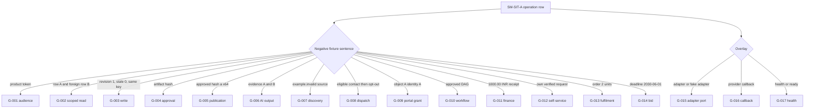

# AI Growth Engine: Employee Sales & Marketing Automation
## Application Blueprint: PART 6 (Batch 6.8c), Source Pack Test Specification Reconciliation: Enhancements, Conflicts and Decisions

| Field | Value |
|---|---|
| Document | Application Blueprint · Part 6.8c. New and refined test content from source documents 19 and 22: conventions and crosswalks (§6.8.5.1), 45 new test cases TC-ENH-G-001…045 (§6.8.5.2), conflicts with proposed resolutions (§6.8.6), expert persona review (§6.8.7), tags register (§6.8.8) and quality gate (§6.8.9). Parts 6.8a and 6.8b hold the coverage register and the 799-row mapping |
| Version | 1.0 · 27 Nov 2026 |
| Baseline | Part 6.1 (§6.1.3 types T01–T21, §6.1.5.4 EVR, §6.1.5.5 certification ladder, §6.1.7 GSE-SYN, §6.1.8 defects, §6.1.9.6 coverage, §6.1.12 templates and alias rules, §6.1.13 UAT), Batches 6.2–6.5 and 6.7, Part 6.6 RTM, Part 3.2 (§3.2.1.5 idempotency, §3.2.1.8 revisions, §3.2.1.13 webhooks, §3.2.5 CT-01…14, §3.2.7.2 retry policy), Part 2.3 (BRL-APR, BRL-FIN, BRL-PUB, BRL-AI-08, roles R01–R20), Part 4.2 (NFR-015, NFR-018, NFR-031, NFR-057, NFR-082), DEC-007, DEC-015, DEC-017, DEC-018, DEC-030, DEC-038, DEC-093, DEC-094; source documents 19 and 22 |
| Roles applied | QA Lead / Test Architect (primary), UAT Manager, Principal Engineer, Security/Compliance/AI Governance Lead, FinOps Lead, Lead UX/UI Designer (accessibility), DevOps/SRE Lead (capacity, recovery), Product Owner |
| Tag ranges used | ASSUMPTION-420…424, GAP-420…425, CONFLICT-420…424, RECOMMENDATION-420…425 |

**Acronyms used in this file.** AT assistive technology · BVA boundary value analysis · CT contract test · DT decision table · DTO data transfer object · E2E end-to-end · EG error guessing · ENH enhancement · EP equivalence partitioning · EVR evidence record · IT integration test · NSE no side effect · OPT optimization control (source pack) · PBT property-based testing · PDP Policy Decision Point · PW pairwise · RPO/RTO recovery point/time objective · SIT system integration testing · ST state transition · SYS system test · TC test case · UAT user acceptance testing · UC use case · UT unit test.

**Time-sensitive facts.** Tool names (pytest, Hypothesis, schemathesis, Playwright, axe-core, k6, gitleaks, license scanners), provider sandbox behaviour, `Retry-After` semantics of individual providers and model behaviour are design intent: **verify at time of implementation (as of 27 Nov 2026)**. No prices are stated in this file.

---

## 6.8.5 Enhancements

### 6.8.5.1 Conventions, crosswalks and UAT packs (Part 6.1 extensions)

#### 6.8.5.1.1 Source ID aliases (extends DEC-017) [RECOMMENDATION-423]

| Source family | Count | Alias rule in the RTM | Covered when |
|---|---|---|---|
| SM-UT-001…066 | 66 | Alias → the equivalent TCs of Part 6.8b §6.8.4.3 (replaces the inferred family label of ASSUMPTION-180) | All listed TCs pass and any TC-ENH-G listed passes |
| SM-UX-UNIT-<screen> | 9 | → FR-<screen> TCs at UT/CT (§6.8.4.4) | ≥ 1 passing UT/CT TC on the screen's FR |
| SM-SIT-F001…035 | 35 | → hand-reviewed TCs (§6.8.4.5) | All listed TCs pass |
| SM-SIT-M001…066 | 66 | → BR-M## **by module name** (ASSUMPTION-420); the gate TC is named | Gate TC passes and BR-M## is Covered in the RTM |
| SM-SIT-A001…302 | 302 | → operation-class TC (TC-ENH-G-001…017) with the operation as data row + the FR's functional TCs | Class TC row for that operation passes |
| SM-UX-SIT-<screen>, SM-UX-SIT-X01…X10 | 19 | → listed TCs | All listed TCs pass |
| SM-UAT-F001…017 | 17 | → UAT pack step(s) and E2E journey TCs (§6.8.4.8) | Pack step has a Pass EVR with business acceptance |
| SM-UAT-S001…138 | 138 | Part 6.1 rule (S001–S030 = W01–W30; S031–S138 = A001–A108), **verified 138/138** | TC-ENH-G-036 row for the screen passes |
| SM-UX-UAT-<screen> | 147 | Unchanged (screen ↔ FR-UX-<screen>) | TC-ENH-G-037 row for the screen passes |
| SM-CORE-01…04 | 4 fixtures | → TC-13-016, TC-14-022…024, TC-21-058, TC-14-008 | Fixtures loaded in GSE-SYN with these keys |

`assembly/build_rtm.py` should read `final/coverage/G_test_mapping.csv` and add the source IDs to the *Aliases* column (RECOMMENDATION-425). The source IDs are never used as blueprint TC IDs (DEC-093: epic-based IDs govern).

#### 6.8.5.1.2 Fixture crosswalk: document 22 §2 → GSE-SYN (Part 6.1 §6.1.7.1) [ASSUMPTION-424]

| Source fixture | Meaning in document 22 | GSE-SYN equivalent | Rule |
|---|---|---|---|
| T1 owned portfolio; S-A, S-M, S-E, S-O; S-05 | Four owned startups + one configured startup | T1 Owner Portfolio; AppNAI, MedMaarg, EduVerse, OrganicSpec; fifth startup created by template (TC-01-054 "26th startup" fixture) | Keep source short codes as fixture aliases in seed files |
| T2 external client, S-X | Independent client with own domain, budget, users, providers | T2 External-A (errata 84) | Same |
| T3 forbidden | Look-alike tenant, same slug, distinct IDs | T3 (two-tenant matrix, Part 6.1 §6.1.3.3 A) | Used only for deny and cache-isolation cases |
| O1, D1/E1, L1, F1, A1, N1 | Owner, assigned operator, legal, finance, admin, unauthorized staff | R01, R03/R03L, R10, R08/R09, R12, staff user with no membership | MFA and revoked variants per Part 6.5 §6.5.1.4 |
| X1, X2, X3, V1 | External grant holder, other identity, expired/revoked grant, anonymous | R16 with grant, R16 without grant, R16 expired, R18 | Portal token audience `growth-website` only |
| R1/H1, R2/H2 | Approved revision/hash, unapproved revision/hash | Publication fixtures of EP-19 (revision 12/13 pattern) | Hash = SHA-256 of canonical revision |
| Evidence snapshot, stale, conflicting, denied domain | Source policy fixtures | EP-05 F1…F6 fixtures | `example.invalid` hosts only |
| Approved/cyclic DAG; fake clock; budget 10 units; provider success/429/timeout/unknown | Workflow fixtures | EP-18 fixtures; provider simulator modes (§6.1.6.3); clock control (§6.1.6.5) | Budget fixture `BUD-10U` added (TC-ENH-G-021) |
| ₹1,000 split ₹600 + ₹400; wrong beneficiary/currency; duplicate callback; over-allocation; refund | Financial fixtures | EP-15 fixtures + `FIN-1000-600-400` added (TC-ENH-G-011, -023) | Decimal strings, INR, 2 dp |
| Benign PDF, oversized, malware test file, wrong-scope knowledge, prompt injection | Files and AI fixtures | EICAR/scripted PDF/decompression bomb (TC-02-020); T14 red-team corpus | No real documents |

#### 6.8.5.1.3 Severity crosswalk (document 22 §10 → Part 6.1 §6.1.8) [CONFLICT-423]

| Source severity | Source examples | Blueprint severity | Fix priority | Release rule |
|---|---|---|---|---|
| Critical / P0 | Cross-product/tenant leak, wrong-issuer payment, unauthorized send/sign/offer, unsafe disclosure, unrecoverable corruption | **S1** | FP1 | RBR-1 (blocks deployment and activation); rerun full relevant regression |
| High / P1 | Broken core lifecycle, wrong approved financial/clinical/commercial claim, recovery unavailable, major scope/cost control failure | **S1** when it has an integrity or compliance effect (wrong claim, cost control failure); otherwise **S2** | FP1/FP2 | RBR-1 or RBR-2 (affected workflow activation blocked) |
| Medium / P2 | Non-critical integration limitation with safe workaround; non-blocking UX defect | **S3** (S2 if in a P0 risk area) | FP3 | RBR-3/RBR-4 |
| Low / P3 | Cosmetic or documentation | **S4** | FP4 | RBR-4 |

The blueprint keeps the two-axis model (severity S, fix priority FP); "P0–P3" in source documents means severity, not the test-case priority P0–P3 of §6.1.12.3.

#### 6.8.5.1.4 Execution status extension of the EVR [GAP-423, RECOMMENDATION-422]

Document 22 §10 requires execution statuses *Not run, Pass, Fail, Blocked, Not applicable with rationale*. The EVR `decision` field (Part 6.1 §6.1.5.4) has *Pending, Pass, Fail, Approved N/A*. Add `execution_status` to the EVR:

| `execution_status` | Meaning | Maps to `decision` | Gate effect (A090) |
|---|---|---|---|
| `not_run` | Designed, never executed (all 799 source cases today) | Pending | Blocks the gate (RBR-6) |
| `blocked` | Could not execute: provider sandbox unavailable, fixture missing, environment defect; `blocked_reason` mandatory | Pending | Blocks the gate; listed in the readiness report as "blocked provider / untested route" (document 22 §3) |
| `executed` | Ran to completion | Pass or Fail | Pass counts; Fail blocks per RBR-1…5 |
| `not_applicable` | Approved N/A with rationale, approver ≠ executor | Approved N/A | Counts as dispositioned; never allowed for mandatory P0 cases |

Verified by TC-ENH-G-044.

#### 6.8.5.1.5 Optimization testing controls crosswalk (OPT-17-01…04, OPT-18-01)

| Source control | Acceptance (source) | Blueprint implementation | Added |
|---|---|---|---|
| OPT-17-01 Risk-based tests | 100% mandatory regression passed at gate; no pass without execution | §6.1.4 risk matrix; §6.1.12.3 priorities; RBR-5 | Source ID referenced in A090 readiness report section "Testing & QC" |
| OPT-17-02 Automated evidence | 100% mandatory QC complete with independent review; missing evidence blocks | §6.1.5.4 EVR; RBR-6 | TC-ENH-G-039 (integrity preflight) |
| OPT-17-03 Traceability and orphan review | 100% applicable mappings approved; exceptions documented | Part 6.6 RTM (FR level) | Operation and source-test mapping (Part 6.8b); RECOMMENDATION-425 |
| OPT-17-04 Test efficiency | Repeat critical suite without unexpected flake; fail on external side effect | §6.1.9.7 flaky policy; §6.1.6.4 outbound allowlist guard | — |
| OPT-18-01 Independent CI/CD | Staging rehearsal and rollback per frontend/backend/worker | Part 4.3 pipelines; TC-NFR-013 | — |

#### 6.8.5.1.6 New UAT packs [GAP-422, RECOMMENDATION-421]

Part 6.1 §6.1.13.3 has no pack for marketing journeys (source SM-UAT-F014, F015) or for renewals and service (SM-UAT-F017). Two packs are added, using the same format and sign-off rule (§6.1.13.5).

| Pack | Vertical / scope | Scenario steps | Acceptance statement | AP | Waves |
|---|---|---|---|---|---|
| **UAT-PK-MKT** | Marketing (cross-cutting; MedMaarg and EduVerse lead the pilot) | (1) Content brief → AI draft cites approved claims only (AG-018); (2) unapproved claim blocks approval; (3) SEO metadata limits and preview not indexed; (4) social post scheduled from the approved hash; (5) landing page published from the approved hash, health-free analytics only; (6) campaign simulation shows eligible count, exclusions and cost; (7) campaign approval within budget; (8) launch, opt-out mid-campaign suppresses at execution; (9) lead with campaign code attributed once under replay; (10) campaign report reconciles leads and spend | "Validate audience, claims, consent, spend and attribution before publishing or sending. No unapproved spend, message or private data disclosure" (BRD §11; document 22 vertical statement) | AP-02, AP-05 | W3 |
| **UAT-PK-CS** | Customer success (onboarding, renewals, support, lost deals) | (1) Onboarding instantiated once from the approved template; (2) requested document uploaded through a portal grant and scanned; (3) renewal calendar shows due dates from contract expiry; (4) opted-out contact gets no promotional reminder, an internal task is created; (5) support request from the portal reaches the assigned team only; (6) renewal recorded as won with signed evidence; (7) lost deal recorded with reason, no automatic recontact inside the cooling period; (8) renewal and retention metrics show numerator, denominator and as-of | "No unwanted messages; renewal and retention metrics accurate; scoped handoff to assigned team" (document 22 SM-UAT-F017) | AP-03, AP-05 | W4, W5 |

Participants: UAT-PK-MKT — P05 Marketing Specialist (R05) and P03 Growth Manager (R03), sign-off by R05L Marketing Lead and R10 for claims; UAT-PK-CS — customer success employee (R03 with renewal assignment), R02 Startup Head sign-off, R16 external customer on the portal.

---

### 6.8.5.2 New test cases TC-ENH-G-001…045

Format: the compact table of Part 6.5 §6.5.1.2 (ID · Title · Links · Pre-conditions and data · Steps · Expected · P · Type · Tech · Auto · Lvl). Every denial asserts **NSE** (no side effect: no row change, no outbox row, no adapter call, audit event written). Parameterized cases run once per data row; the data rows are the source operations or screens listed in Part 6.8b, so each source test has its own executed row and its own EVR. Epic ownership for numbering follows Part 6.1 §6.1.12.1; the ENH prefix is used because these cases come from the source pack reconciliation (DEC-093 governs future renumbering into epic sequences).

#### 6.8.5.2.1 Operation-contract classes (closes GAP-420; one data row per SM-SIT-A operation)

| ID | Title | Links | Pre-conditions and data | Steps | Expected | P | Type | Tech | Auto | Lvl |
|---|---|---|---|---|---|---|---|---|---|---|
| TC-ENH-G-001 | Refuse wrong product, wrong audience and revoked membership on identity and tenancy operations (9 operations) | SM-SIT-A001, A005, A247…A253; FR-A001, FR-A002, FR-A099; BRL-TEN-02; DEC-019; NFR-001; CT-05 | Data rows: POST /auth/login, POST /auth/logout, GET/POST /sales/tenants, POST /sales/tenants/{id}/control, GET/POST/PATCH /sales/startups, POST /sales/memberships (blueprint API-001, API-007, API-026…031). Tokens: valid Admin token product A (`growth-admin`), external audience token (`growth-website`), revoked membership token, product B (investor) token. Scope A tenant UUID …0001 / startup …0002; scope B …0003/…0004 | For each row: 1. Call with the valid Admin token in scope A and the operation's valid body. 2. Repeat with the external-audience token. 3. Repeat with the revoked-membership token. 4. Repeat with the product B token. 5. Repeat step 1 with a scope B object ID | 1: 2xx per source result (existing response contract for reused auth; 201 for creates) and an audit event with correlation ID. 2–4: 401 `WRONG_AUDIENCE` / 401 `SESSION_REVOKED` / 401 `WRONG_AUDIENCE`; NSE. 5: uniform 404; no foreign field or existence hint; NSE. Reused authentication components are not replaced (compatibility only) | P0 | T07, T15 | EP, DT | Y | CT |
| TC-ENH-G-002 | Return only scoped rows with stable pagination and hide foreign rows on every list and detail read (49 operations) | 49 SM-SIT-A rows (Part 6.8b class G-002); FR-FLT-RULES; NFR-031, NFR-032; ABAC-02; CT-05, CT-06 | Seed authorized row A, foreign row B (scope B, same slug/name) and an empty scope; page size 1; role with the minimum read permission of the operation (catalogue Auth column) | For each row: 1. GET in scope A with page size 1; follow the cursor to the end. 2. GET detail of row B by ID in scope A. 3. GET list in the empty scope. 4. Compare the serializer output with the role's field mask snapshot | 1: 200; rows = scope A rows only; count equals the scoped count; no duplicate or skipped row across pages (stable sort + ID); `as_of` present where the source result says "scoped rows and as_of". 2: 404 uniform (same body and timing class as a missing ID). 3: 200 with empty list and accessible empty state data (no error). 4: no field outside the role mask (CT-06); Restricted fields masked. All: no write, no outbox row | P0 | T15, T01 | EP, BVA | Y | CT |
| TC-ENH-G-003 | Enforce revision preconditions, idempotency keys and rollback on every consequential write (54 operations) | 54 SM-SIT-A rows (class G-003); FR-STD-03; NFR-015, NFR-017; Part 3.2 §3.2.1.5, §3.2.1.8 | Scoped fixture A at revision 1; valid candidate DTO from document 22 (e.g. `{"expected_revision": 1}`); invalid fixture from the same row (missing required field); idempotency key K1 | For each row: 1. Send the valid DTO with `If-Match: "r1"` (or `expected_revision: 1`) and key K1. 2. Repeat the identical request with K1. 3. Send K1 with an altered body. 4. Send the valid body with stale revision 0. 5. Send the invalid fixture. 6. Force a database error after validation (fault injection) | 1: 200/201/202 per source result; revision 2; audit event. 2: stored response with `Idempotent-Replayed: true`; no second row. 3: 409 `IDEMPOTENCY_KEY_REUSED`; NSE. 4: 409 `STALE_REVISION` with `current_revision`; NSE. 5: 400 problem+json with field errors and rule ID; NSE. 6: 500-free rollback (503 or 409 per contract), no partial row, no outbox row | P0 | T01, T16 | EP, EG | Y | CT |
| TC-ENH-G-004 | Bind every approval or decision to the exact artifact hash, refuse changed content and self-approval (28 operations) | 28 SM-SIT-A rows (class G-004); BRL-APR-01, BRL-APR-02; CA-APPROVE; API-541 consolidation | Artifact at revision 1 with hash `aaaa…a` (64 hex); author user U1; eligible approver U2 (different person, MFA fresh ≤ 1 h per ABAC-11); approval policy per DEC-038 | For each row: 1. U2 approves hash `aaaa…a`. 2. U2 repeats the same decision. 3. Change the artifact to revision 2 (hash `bbbb…b`) and U2 submits approval quoting `aaaa…a`. 4. U1 approves own artifact. 5. U2 approves with MFA older than 1 h | 1: one immutable Approval record (hash, approver, timestamp, reason); state advances. 2: idempotent replay, no second record. 3: 409 `HASH_MISMATCH` (pending approvals voided on revision change); NSE. 4: 403 self-approval refused; NSE; audit. 5: 401 step-up required; NSE. Where the source path is a per-object approve/review, the call is routed to the Approval resource with the matching object type (Part 3.2 §3.2.2.3) | P0 | T01, T07 | DT, ST | Y | SYS |
| TC-ENH-G-005 | Serve only the approved publication snapshot and clear caches on publish, unpublish and rollback (17 operations) | 17 SM-SIT-A rows (class G-005); BRL-PUB-01…03; FR-PUB-01; NFR-020 | Approved hash `a×64` at publication revision 1; stale revision 2 (unapproved); verified host `ms.t1.example`; foreign host `ms.t3.example` with the same slug; CDN emulator | For each row: 1. Read/publish through the operation with the approved hash. 2. Request with the stale revision. 3. Request the slug on the foreign host. 4. Unpublish; read through the CDN emulator. 5. Concurrent publish of two revisions | 1: public DTO contains only approved blocks (slug, title, approved blocks, public assets, allowed form types, publication revision). 2: 409 or 404 per operation; draft never served. 3: 404 generic, no tenant identifiers. 4: cache key for (product, tenant, startup, locale, revision) purged; 404 within the NFR-020 window. 5: one pointer swap wins; the other 409 `PUBLICATION_MOVED` | P0 | T01, T15 | ST, EG | Y | SYS |
| TC-ENH-G-006 | Reject malformed or unsupported AI output and foreign evidence with zero external side effect (15 operations) | 15 SM-SIT-A rows (class G-006); FR-OP001; BRL-AI-03, BRL-AI-04; NFR-033; CT-14 | Approved evidence A (scope A), foreign evidence B (scope B); model mock modes: valid JSON citing A, malformed JSON, valid JSON citing B, claim not in the approved claim store; budget available | For each row: 1. Run the operation with the valid mock. 2. Malformed JSON. 3. Output citing evidence B. 4. Unsupported claim. 5. Exhausted budget | 1: 202 job then structured result with evidence IDs; cost ledger entry. 2: schema rejection, bounded retry (≤ 1) then escalation task; no business state change. 3: rejected; evidence B never in the prompt or result (retrieval scope check). 4: abstain/escalate; no draft marked approved. 5: denied before the provider call (BRL-AI-08). All: 0 external adapter calls | P0 | T14, T01 | EG, EP | Y | IT |
| TC-ENH-G-007 | Fetch only permitted sources, qualify only evidenced records and stop at the discovery cap (36 operations) | 36 SM-SIT-A rows (class G-007); BRL-SRC; FR-A010, FR-A015…A028; NFR-028 | Permitted source `src-ok.example.invalid` with 2 evidenced records; stale source; denied source `deny.example.invalid`; redirect from the permitted to the denied host; discovery budget with 2 units left | For each row: 1. Run with the permitted source. 2. Include the stale source. 3. Include the denied source and the redirect. 4. Run a third request after the cap | 1: two records with provenance (URL, retrieval time, content hash, licence/permission revision). 2: stale flagged; confidence recomputed or review queued; not auto-approved. 3: blocked before network call including after redirect; reason recorded. 4: request stopped "budget stopped"; partial run visible; no provider call | P0 | T01, T19 | EP, BVA | Y | SYS |
| TC-ENH-G-008 | Recheck eligibility at dispatch: suppression or substantive reply before the worker lease stops the send (29 operations) | 29 SM-SIT-A rows (class G-008); BRL-ELG-01…14; PDP; NFR-026; CT-12, CT-13 | Eligible contact C1 (consented, permitted jurisdiction); message approved; idempotency key K; provider simulator modes success/timeout | For each row: 1. Queue the action. 2. Set opt-out for C1 before the worker lease. 3. Variant: deliver a substantive reply before the lease. 4. Repeat the queue call with K. 5. Variant: provider timeout after submit | 2/3: PDP denies at dispatch with reason `SUPPRESSED`/`REPLIED`; no send; reservation released. 4: one outbox row only. 5: step state `uncertain`; no retry before reconciliation (§3.2.7.2) | P0 | T19, T16, T18 | DT, EG | Y | SYS |
| TC-ENH-G-009 | Allow external users only their own granted objects; reject other identity and expired grants (14 operations) | 14 SM-SIT-A rows (class G-009); CA-PORTAL; ABAC-09; FR-W22…W28; NFR-001 | Object A granted to identity X1; identity X2 without grant; X3 with expired grant; one-time invite secret S | For each row: 1. X1 calls the operation on object A. 2. X2 calls on object A. 3. X3 calls on object A. 4. Inspect logs and the response DTO | 1: 200/201/202 with the field-minimized portal DTO; no internal membership or staff fields. 2: 404 uniform; NSE. 3: 401/404 per contract; NSE. 4: invite secret never logged; no staff route reachable from the portal origin | P0 | T15, T07 | EP | Y | SYS |
| TC-ENH-G-010 | Simulate workflows with zero live effect; real execution only with valid approval; reject cycles and exhausted budget (13 operations) | 13 SM-SIT-A rows (class G-010); BRL-AUT-01…10; NFR-038; DEC-064 | Approved DAG with two steps (send, publish) at simulated cost 1.00; cyclic DAG; budget 0; worker crash injection between steps | For each row: 1. Simulate. 2. Request real execution without approval. 3. With valid approval. 4. Submit the cyclic DAG. 5. Execute with budget 0. 6. Crash the worker after step 1 | 1: simulation report (eligible, blocked, cost 1.00); 0 adapter calls, 0 ledger entries. 2: 409 approval required; NSE. 3: execution with PDP recheck per step. 4: 400 with cycle node IDs. 5: denied before step 1. 6: resume at step 2; step 1 effect not repeated | P0 | T17, T01 | ST, EG | Y | SYS |
| TC-ENH-G-011 | Allocate a ₹1,000.00 receipt to a ₹600.00 obligation once; refuse duplicate reference and wrong issuer or currency (15 operations) | 15 SM-SIT-A rows (class G-011); BRL-FIN-01…08; DEC-054; NFR-005 | Fixture `FIN-1000-600-400`: receipt INR 1,000.00 to the issuing startup's account; obligation INR 600.00; duplicate provider reference; variant receipt in USD; variant to another startup's account | For each row: 1. Process the receipt. 2. Replay with the same provider reference. 3. Process the USD variant. 4. Process the wrong-issuer variant | 1: 600.00 allocated; 400.00 unallocated credit on the reference; no revenue beyond verified allocation. 2: no effect (BRL-FIN-02). 3: discrepancy case; no conversion (TC-15-040 rule). 4: discrepancy case "beneficiary mismatch"; no allocation (TC-ENH-G-023) | P0 | T01, T16 | DT, BVA | Y | SYS |
| TC-ENH-G-012 | Serve self-service and privacy requests for the verified requester only; route duplicates and legal holds to review (10 operations) | 10 SM-SIT-A rows (class G-012); BRL-PRV-01…; FR-A013; FR-W29, FR-W30; DEC-028 | Own verified request R1 (identity I1); other identity I2; duplicate R1; record under legal hold | For each row: 1. I1 submits/reads R1. 2. I2 reads R1. 3. Submit duplicate. 4. Execute deletion for the legal-hold record | 1: 202 reference and status. 2: 404; NSE. 3: linked to R1 and routed to review; no second job. 4: retained with legal-hold reason; outreach suppression hash kept; no raw sensitive data in logs | P0 | T19 | EP, DT | Y | SYS |
| TC-ENH-G-013 | Record only actual fulfilment: duplicate event no effect, cumulative quantity capped, foreign line refused (9 operations) | 9 SM-SIT-A rows (class G-013); FR-A105; FR-DM-03; BRL-ORD-01…06; SM-CORE-03 | Order: 2 units at INR 150.00; event key E1 for 1 unit; foreign order line L-B | For each row: 1. Record 1 unit with E1. 2. Repeat E1. 3. Record 2 more units. 4. Record against L-B | 1: delivered 1. 2: no effect. 3: 409 over-delivery; NSE. 4: 404; NSE | P0 | T01, T16 | BVA | Y | SYS |
| TC-ENH-G-014 | Block bid submission at or after the deadline or with missing proof (4 operations) | SM-SIT-A277…A280; FR-A104; FR-DM-02; BRL-BID-01…06; DEC-053; SM-CORE-02 | Deadline 2030-06-01T09:00:00Z; clock at 08:59:59 and 09:00:00; complete vs missing mandatory proof | For each row: 1. Submit at 08:59:59 with complete eligibility. 2. Submit at 09:00:00. 3. Submit at 08:59:59 with missing proof | 1: accepted per the human-submission evidence rule (O-21). 2: rejected; exception task; no award or external call. 3: rejected listing the missing item | P0 | T19 | BVA | Y | SYS |
| TC-ENH-G-015 | Run each adapter port contract against fake, sandbox and live-canary adapters (17 adapters) | SM-SIT-A016, A037, A055, A058, A076, A080, A111, A126, A136, A146, A156, A160, A174, A181, A200, A208, A235; AD-01…AD-20; CT-08, CT-09; NFR-037 | Fake adapter with deterministic stub; modes: success, timeout, malformed result, quota exceeded; sandbox credentials where available (verify per provider, as of 27 Nov 2026) | For each adapter: 1. Success call. 2. Timeout before send. 3. Timeout after send. 4. Malformed provider result. 5. Quota exceeded | 1: normalized result + usage + external reference. 2: `transient`, retried per §3.2.7.2. 3: `uncertain`, no retry, reconciliation scheduled. 4: typed provider error; no state corruption. 5: `rate_limited`/permanent for period; FinOps alert. Paid adapters (AD-06, AD-09, AD-19) make 0 calls unless enabled with an approved budget line | P0 | T16, T18, T20 | EG | Y | IT |
| TC-ENH-G-016 | Accept only signed, correctly-accounted callbacks once and in order (8 callbacks) | SM-SIT-A109, A112, A124, A133, A134, A179, A199, A204; Part 3.2 §3.2.1.13, §3.2.6; CT-10; NFR-005 | Signed sample payloads per provider (test keys); tampered body; wrong secret; expired timestamp; duplicate event ID; out-of-order status (delivered before sent); payload for another tenant's provider account | For each callback: 1. Valid payload. 2. Tampered. 3. Wrong secret. 4. Expired timestamp. 5. Duplicate. 6. Out of order. 7. Wrong provider account. 8. WhatsApp GET verification challenge (A133) with right and wrong token | 1: persisted before 200/202; one event. 2–4: 401; nothing persisted. 5: 200, no second effect. 6: state machine keeps the latest valid state. 7: routed only to the owning tenant or rejected. 8: challenge echoed only with the configured token | P0 | T16, T07 | EG, ST | Y | CT |
| TC-ENH-G-017 | Report liveness without the database and readiness without secret details | SM-SIT-A045, A046; NFR-019; T21 | Database stopped (liveness); Secrets Manager stub returning an error (readiness) | 1. GET /api/v1/health with the database stopped. 2. GET /api/v1/ready with the secret error. 3. Inspect bodies and headers | 1: 200. 2: 503. 3: no hostnames, versions, connection strings or stack traces (TC-21-015 rule) | P1 | T21 | EP | Y | CT |

#### 6.8.5.2.2 Specific cases from unit, end-to-end and journey gaps

| ID | Title | Links | Pre-conditions and data | Steps | Expected | P | Type | Tech | Auto | Lvl |
|---|---|---|---|---|---|---|---|---|---|---|
| TC-ENH-G-018 | Deny a write under a read-only support grant and audit the attempt | SM-UT-005; FR-A002; BRL-TEN-09 (support access); TC-01-061 | R13 support user with an approved read-only grant on T1/MedMaarg, valid for 48 h | 1. GET a T1 contact list. 2. PATCH a T1 contact. 3. View the tenant's support-access log as R12 | 1: 200 within the grant scope. 2: 403 `GRANT_READ_ONLY`; NSE. 3: the denied write is listed with time, operation and grant ID | P0 | T07 | EP | Y | UT |
| TC-ENH-G-019 | Normalize valid enquiry fields, reject invalid or oversized input and escape markup | SM-UT-014; FR-W12…W17; NFR-022; TC-07-072 | Public form W12 (approved); inputs: name "  Asha  Rao ", email "ASHA@Example.COM ", 64 KB + 1 B body, message `<b>hi</b>`, email "asha@", phone "+91 98765 43210" | 1. Submit valid inputs with whitespace and mixed case. 2. Submit the invalid email. 3. Submit the oversized body. 4. Submit the markup message; open the lead in Admin A032 and the notification email | 1: stored as "Asha Rao", "asha@example.com", phone E.164 `+919876543210`. 2: 400 field error; NSE. 3: 413; NSE. 4: stored as text; rendered escaped in Admin and email (no script execution, CSP violation report count 0) | P0 | T07, T01 | EP, BVA | Y | UT |
| TC-ENH-G-020 | Reject reuse of an idempotency key with a changed body | SM-UT-015; NFR-015; Part 3.2 §3.2.1.5 | POST /api/v1/public/leads with key K (form session) and canonical body B1 | 1. Send K + B1. 2. Send K + B1 again. 3. Send K + B2 (message changed) | 1: 202 reference R. 2: same response, `Idempotent-Replayed: true`. 3: 409 `IDEMPOTENCY_KEY_REUSED`; no second lead | P0 | T16 | EG | Y | UT |
| TC-ENH-G-021 | Allow at most one of two concurrent reservations of 7 units against 10 available | SM-UT-033; SM-SIT-F013; G19 matrix "Cost"; BRL-AI-08; NFR-014 | Budget fixture `BUD-10U`: tenant T1, startup MedMaarg, 10 units available; two workers; database isolation per Part 3.3 | 1. Start two reserve(7) calls simultaneously (barrier). 2. Repeat 1,000 times (Hypothesis stateful). 3. Read the budget ledger. 4. T2 workflow tries to reserve against T1 | 1: exactly one succeeds; other denied `BUDGET_EXCEEDED` with no provider call. 2: balance never negative in any run. 3: one reservation row; 3 units available. 4: denied; no cross-tenant borrowing | P0 | T20, T16 | PBT | Y | IT |
| TC-ENH-G-022 | Honour Retry-After on 429 and stop on a permanent 400 | SM-UT-036; Part 3.2 §3.2.7.2; NFR-026 | Provider simulator: first response 429 `Retry-After: 30`; second 400 validation | 1. Execute the step. 2. Advance the clock 29 s. 3. Advance to 30 s. 4. Observe the second response | 2: no request sent. 3: exactly one retry. 4: classified `permanent`; no further attempts; step Failed with provider reason; exception queue | P1 | T18 | BVA | Y | UT |
| TC-ENH-G-023 | Do not allocate a receipt whose beneficiary account or issuing startup differs from the approved record | SM-UT-041; BRL-FIN-03; DEC-054 | Invoice INV-OS-301 issued by OrganicSpec, INR 600.00, receiving account ACC-OS-1; callback with amount 600.00 INR to ACC-MM-1 (MedMaarg) | 1. Process the callback. 2. Open the reconciliation queue | 1: no allocation; discrepancy "beneficiary mismatch"; invoice remains Issued. 2: case visible to R08/R09 of OrganicSpec only; NT-018 High | P0 | T01 | DT | Y | UT |
| TC-ENH-G-024 | Show potential, commitment and receipt as distinct metrics; a repeated receipt counts once | SM-UT-045; RP- revenue reports; KPI-31; BRL-FIN-04 | Opportunity potential INR 100.00; signed commitment 50.00; verified receipt 20.00 delivered twice with the same payment ID | 1. Compute the revenue KPI set. 2. Replay the receipt. 3. Recompute | 1/3: potential 100.00, commitment 50.00, receipt 20.00; three separate tiles with as-of; no sum across them; receipt unchanged after replay | P1 | T01 | EP | Y | UT |
| TC-ENH-G-025 | Quarantine a patient report uploaded through a public sales enquiry and route to the approved healthcare channel | SM-UT-054; BRL-ELG-14; BRL-AI-11; DEC-007 | MedMaarg W13 demo enquiry with optional attachment; file `lab_report.pdf` whose extracted text contains patient name, test values and "diagnosis" | 1. Submit with the attachment. 2. Check the lead, knowledge index and AI context. 3. Check the visitor response | 1: attachment quarantined and not stored with the lead; sensitive-content flag. 2: no chunk in any RAG index; no field in prompts. 3: message directs to the approved healthcare channel; no clinical advice | P0 | T19 | EG | Y | SYS |
| TC-ENH-G-026 | Calculate a quote with an absolute INR 10.00 discount before tax: subtotal 350.00, base 340.00 | SM-UT-057; FR-A067; BRL-QTE-02; DEC-038; CONFLICT-422 | Quote lines: 2 × INR 100.00; 3 × INR 50.00; absolute discount INR 10.00 entered by R03L; tax rule from approved price version (intra-state) | 1. Save the quote. 2. Read totals. 3. Submit for approval | 2: subtotal 350.00; discount 10.00; taxable base 340.00; tax from the approved rule on 340.00; effective discount 2.86% (10.00 ÷ 350.00, ROUND_HALF_UP 2 dp) displayed. 3: approval routing uses the effective percentage (below 10%: no approval needed per DEC-038) | P0 | T01 | BVA | Y | UT |
| TC-ENH-G-027 | Apply the declared attribution model once when a conversion event is replayed | SM-UT-062; SM-SIT-F029; FR-A082, FR-A083; BRL-FIN-02 | Lead L1 with two campaign touch events (C-1 first touch, C-2 last touch); attribution model "last touch" v2; conversion event CV-9 delivered twice | 1. Process CV-9. 2. Replay CV-9. 3. Read campaign revenue and the attribution caveat | 1: C-2 credited with the verified revenue once. 2: no change. 3: totals reconcile to finance; caveat states model and version | P0 | T16 | EG | Y | UT |
| TC-ENH-G-028 | Confirm one of two concurrent bookings for the last webinar seat and waitlist the other | SM-UT-064; SM-SIT-F031; FR-A062; FR-W19 | Event capacity 100 with 99 confirmed; users U1, U2 | 1. Submit both registrations simultaneously (barrier). 2. Repeat 200 times | Exactly one Confirmed, one Waitlisted per policy; confirmed count never exceeds 100 | P1 | T01, T16 | PBT | Y | IT |
| TC-ENH-G-029 | Exclude a revoked knowledge document from retrieval, answers and citations | SM-SIT-F009; SM-SIT-M003; G19 matrix "RAG"; FR-A005, FR-A006 | Approved document D1 (MedMaarg) indexed; question Q answerable only from D1 | 1. Ask Q in Admin Copilot and website assistant. 2. Revoke D1. 3. Ask Q again. 4. Query the vector store for D1 chunks | 1: answers cite D1 version. 3: abstain or answer from other approved sources; no D1 citation. 4: 0 chunks retrievable within the reindex SLA; audit records the revocation | P0 | T14, T15 | ST | Y | SYS |
| TC-ENH-G-030 | Operate 26 owned startups and 10 client tenants with two startups each without code change or cross-client data | SM-UX-SIT-X01; G19-042; NFR-030; BRL-TEN-05, BRL-TEN-11 | Seed: T1 with 26 startups from templates; T2…T11 with 2 startups each; client admin of T5 | 1. Create the startups through templates only. 2. As T5 admin, open the scope switcher; reload. 3. Search a T1 company name | 1: no deployment or code change. 2: only T5's two startups listed after reload. 3: no T1 result; NSE | P0 | T15 | PW | Y | SYS |
| TC-ENH-G-031 | Show the same opportunity, quotation and order IDs in CRM and the customer portal; payment only from committed evidence | SM-UX-SIT-X07; FR-A029, FR-A067, FR-A105, FR-W23, FR-W25, FR-W26 | Approved synthetic quotation Q-OS-77 for buyer B1 (R16 grant) | 1. Open A029 pipeline and A105 order desk. 2. Open the portal quotation and order as B1. 3. Post an unverified payment proof | 1/2: identical opportunity, quotation and order IDs and totals. 3: portal shows "verification pending", never Paid; CRM stage unchanged | P1 | T01 | UC | Y | E2E |
| TC-ENH-G-032 | UAT-PK-MKT: marketing publishing and SEO journey accepted by the marketing lead | SM-UAT-F014; UAT-PK-MKT steps 1–5; FR-A050…A057 | `staging`; P05 Marketing Specialist and R05L Marketing Lead (sandbox social account) | Execute pack steps 1–5 (§6.8.5.1.6) | Every step accepted with recording and trace ID; unapproved claim blocked; published items match approved hashes; EVR with business acceptance | P1 | T01 | UC | N (UAT sign-off) | UAT |
| TC-ENH-G-033 | UAT-PK-MKT: campaign, ads and attribution journey accepted within budget | SM-UAT-F015; UAT-PK-MKT steps 6–10; FR-A058…A061, FR-A082 | `staging`; ads sandbox (verify availability, as of 27 Nov 2026); campaign budget INR 2,000.00 | Execute pack steps 6–10 | Simulation count equals execution-eligible count minus suppression; no spend over cap; attributed once; EVR accepted | P1 | T01 | UC | N (UAT sign-off) | UAT |
| TC-ENH-G-034 | UAT-PK-CS: renewals and service journey accepted by the customer success owner | SM-UAT-F017; UAT-PK-CS steps 1–8; FR-A075…A081, FR-W27, FR-W28 | `staging`; renewal due in 30 days; one opted-out contact | Execute pack steps 1–8 | No promotional message to the opted-out contact; metrics with numerator, denominator and as-of; EVR accepted by R02 | P1 | T01 | UC | N (UAT sign-off) | UAT |
| TC-ENH-G-035 | Visit every catalogued route at 360, 768 and 1280 px with no broken route or JavaScript error and keyboard access | SM-UX-SIT-X10; WCAG 2.2 AA; T08, T10; Part 2.5 screen inventory | Route list generated from both frontends' route manifests (34 Website + 113 Admin); role per route | 1. Crawl each route per role and viewport. 2. Tab through forms, errors, filters and detail links. 3. Run axe | 1: no 4xx/5xx except expected denials; 0 console errors. 2: visible focus, correct order, labels. 3: 0 critical/serious violations | P1 | T08, T10 | EXP | Y | E2E |
| TC-ENH-G-036 | Screen acceptance template: exercise each screen's visible action in success, empty, loading, invalid, denied and error/retry states (138 rows) | SM-UAT-S001…S138; FR-W01…W30, FR-A001…A108; Part 2.5 §2.47 UI states | Data row per SM-UAT-S: screen, role, synthetic record from the screen's pack; external user for W21–W30 | For each row: 1. Perform the visible action with valid data. 2. Empty scope. 3. Slow network (loading). 4. Malformed input. 5. Wrong role/tenant/startup or external identity. 6. Provider/server error then retry. 7. Scope switch or policy change, then repeat 1 | 1: intended result. 2–6: the defined state with accessible message; NSE on 4–6. 5: denied; external users never reach Admin. 7: no stale or unauthorized data; recovery accessible | P1 | T01, T08 | UC, EP | Y (sign-off N) | UAT |
| TC-ENH-G-037 | Field and journey conformance template: added/removed fields, dropdown sources and related routes match FR-UX-<screen> (147 rows) | SM-UX-UAT-W01…W34, A001…A113; FR-UX-<screen> (FRD §16.2) | Data row per screen: field list and selector sources from the screen spec; authorized and unauthorized fixtures | For each row: 1. Open the screen. 2. Compare rendered fields and dropdown options with the spec. 3. Exercise the listed automation action. 4. Wrong role, removed field, stale configuration. 5. Reload and scope switch | 2: exact field set; public pages show no confidential filters. 3: no unauthorized or duplicate side effect. 4: reject without mutation. 5: context preserved; accessible denied/empty state | P1 | T01 | EP | Y | UAT |
| TC-ENH-G-038 | Capacity acceptance at the initial and growth design points | G19-C01…C09; NFR-030, NFR-046, NFR-057; LT-01, LT-04, LT-06; GAP-424; CONFLICT-424 | `perf`; synthetic volume: 25 owned + 10 external tenants (initial), 50 + 100 (growth); 50/250 concurrent staff sessions; 100,000/1,000,000 opportunities; 50/250 concurrent jobs; 10,000/100,000 scheduled actions per day | 1. Run LT-01 + LT-04 at the initial point for 60 min. 2. Run at the growth point. 3. Measure dashboard p95, webhook ack p95, projection refresh. 4. Restore drill for critical and regenerable data classes | 1: dashboard p95 ≤ 2 s; ack p95 ≤ 2 s; projection ≤ 60 s. 2: dashboard p95 ≤ 2.5 s; same ack and projection. 4: critical RPO ≤ 15 min, RTO ≤ 4 h (DEC-018; growth ≤ 2 h only if CONFLICT-424 is accepted); regenerable research RPO ≤ 24 h, RTO ≤ 8 h | P1 | T03, T12 | BVA | Y | SYS |
| TC-ENH-G-039 | Fail closed on incomplete or inconsistent evidence before evaluating results | G19-P04, G19-P05; OPT-17-02; FR-A090; RBR-6; §6.1.5.4 | Immutable required-ID baseline for the release (TC, alias, QC IDs) signed with the artifact digest; evidence manifest variants: complete; one missing ID; one extra ID; duplicate ID; mandatory case `not_applicable`; blank `actual_result`; executor "Asha Rao " and reviewer "asha rao"; digest mismatch | 1. Run the preflight on each variant. 2. Try to edit the baseline from the evidence register | 1: only the complete manifest passes; every other variant fails with the specific reason; executor = reviewer detected after trim and case-fold. 2: refused; the register cannot define its own required scope | P0 | T01 | DT | Y | CT |
| TC-ENH-G-040 | Combined production preflight rejects release until all six evidence groups are complete and signed | SM-SIT-M062; G19-P06; GAP-425; FR-A090; AP-01…AP-10 | Groups: decision approvals, product test execution, quality controls, optimization controls, optimization scenarios, 21 mandatory OKPIs (counts per source document 38, verify at build); one group incomplete; all complete but unsigned; all complete and signed by CTO and Product Owner | 1. Run the preflight for each state. 2. Recompute a mandatory OKPI from raw evidence | 1: rejected, rejected, accepted (necessary, not sufficient: activation still needs A090 owner action). 2: recomputed value within its numeric domain and target, else rejected | P0 | T01 | DT | Y | SYS |
| TC-ENH-G-041 | Match a corporate wellness need to the healthcare offering with evidence and confidence | SM-UT-050; FR-A021; BR-M16; TC-05-058 | Need "corporate wellness programme" (organization-level, evidence E-12); offerings: MedMaarg AI Hospital (Available), EduVerse cloud course (Available) | 1. Run matching. 2. Inspect the match record | 1: AI Hospital ranked first; cloud course not matched or below threshold. 2: evidence ID E-12, confidence, rule/model version recorded; no patient data used | P1 | T01, T14 | EP | Y | UT |
| TC-ENH-G-042 | Return a safe unavailable page for a disabled or suspended client site | G19-X12; FR-A099, FR-A101; NFR-020 | T3 client site suspended for non-payment; verified host `t3.example` | 1. GET the home page. 2. Submit a form. 3. Inspect cache | 1: 503 or branded "temporarily unavailable" page, no tenant data or reason disclosed. 2: refused; no lead. 3: no cached pre-suspension content served | P1 | T01 | ST | Y | SYS |
| TC-ENH-G-043 | Block merge of AI-assisted code without human review, licence check and secret scan | G19-P02; §6.1.9.4; TC-AI-AG034-002; NFR-082 | Pull request labelled `ai-assisted` with (a) no human approval, (b) a dependency with an incompatible licence, (c) a test-only secret pattern | 1. Run CI for each variant | (a) merge blocked "human review required"; (b) licence gate fails; (c) secret scan fails; evidence attached to the PR | P1 | T07 | EG | Y | CT |
| TC-ENH-G-044 | Treat Not run and Blocked executions as Pending and list them in the readiness report | GAP-423; RECOMMENDATION-422; document 22 §3, §10; FR-A090 | Release with 10 P0 cases: 7 executed Pass, 1 `blocked` (sandbox down), 1 `not_run`, 1 `not_applicable` approved by the executor | 1. Open A090 readiness | Gate fails; report lists the blocked provider, the untested route and the invalid N/A (approver = executor); no "ready" shown | P0 | T01 | DT | Y | SYS |
| TC-ENH-G-045 | Quarantine imported rows that identify a minor or contain patient data before any targeting | G19 matrix "Education/health"; A103 import; DEC-030; BRL-ELG-13, BRL-ELG-14; T11 | Import file (CSV template v2) with 100 rows: 3 learners aged 15 without guardian consent, 2 rows with diagnosis text, 95 valid institutional contacts | 1. Dry run. 2. Full run. 3. Build an audience from the import | 1: report flags 5 rows with reasons. 2: 95 imported; 5 quarantined, not eligible, not in any index. 3: audience excludes the 5; 0 minor or health attributes in segments, prompts or ad events | P0 | T19, T11 | EG | Y | IT |

**Counts.** 45 cases: 30 P0, 15 P1; 42 automation candidates (the 3 UAT pack sign-off cases G-032…034 are manual); levels: SYS 17, UT 9, CT 7, IT 5, UAT 5, E2E 2.

---

## 6.8.6 Conflicts and proposed resolutions

| Tag | Conflict | Sources | Proposed resolution (for the coordinator to make binding) |
|---|---|---|---|
| CONFLICT-420 | DEC-094 retains SM-UT-037, -049 and -050 as **unassigned aliases with no test obligation**, but document 22 defines them (webhook signature/replay; planned offering cannot be published; wellness need matching) | DEC-094; Part 6.1 GAP-167; document 22 §4 | Supersede DEC-094: the three IDs carry test obligations mapped to TC-15-005/TC-08-048, TC-11-008/TC-13-003 and TC-05-058 + TC-ENH-G-041. Replace all inferred family labels of ASSUMPTION-180 with the source titles (Part 6.8b §6.8.4.3) |
| CONFLICT-421 | Unit coverage gates differ: document 22 "≥ 80% domain-service branch", document 19 "critical branch ≥ 90%", Part 6.1 §6.1.9.6 "domain core ≥ 90% branch + mutation score", NFR-082 "branch ≥ 70% overall" | Documents 19, 22; Part 6.1; Part 4.2 | Keep the blueprint's layered targets (they are stricter than both sources for critical code and explicit for the rest); record "document 22 ≥ 80% domain-service branch" as the floor for non-core domain services |
| CONFLICT-422 | Document 22 SM-UT-057 uses an **absolute** INR discount; DEC-038 thresholds and BRL-APR-04 are percentages | Document 22; DEC-038 | Allow absolute discounts per line or quote; store both the amount and the effective percentage (amount ÷ pre-discount subtotal, ROUND_HALF_UP 2 dp); approval routing uses the effective percentage; tested by TC-ENH-G-026 |
| CONFLICT-423 | Severity scales: document 22 "Critical/P0 … Low/P3" vs Part 6.1 S1–S4 with separate fix priority FP1–FP4 | Document 22 §10; Part 6.1 §6.1.8.2–3 | Keep S/FP; adopt the crosswalk in §6.8.5.1.3; never use "P0" for defect severity inside the blueprint (P0–P3 is TC priority) |
| CONFLICT-424 | Growth-point RTO for critical data ≤ 2 h (document 19) vs DEC-018 RTO ≤ 4 h | Document 19 capacity table; DEC-018; NFR-057 | Keep ≤ 4 h for W0–W6; treat ≤ 2 h as a growth target that requires a new decision with cost (warm standby) before adoption; TC-ENH-G-038 measures both |

---

## 6.8.7 Expert persona review

| Persona | How the perspective was applied | What would still be flagged |
|---|---|---|
| QA Lead / Test Architect | Parsed all 799 cases with count assertions; required the same condition **and** outcome for "Equivalent"; turned the source's negative-fixture sentences into 17 operation classes so every operation gets its own executed row and EVR | 21 "nearest" operation matches need confirmation by the API owner (ASSUMPTION-422); class rows still need concrete DTOs where the source marks "payload not yet confirmed" (164 of 302) |
| UAT Manager | Mapped the 17 journeys to packs; added UAT-PK-MKT and UAT-PK-CS; screen template TC-ENH-G-036 makes the 138 screen cases executable with explicit states | UAT capacity: 138 + 147 screen rows exceed one person-week per wave; sample by risk area in W2–W4 and complete before Release 2 (Part 8.1) |
| Principal Engineer | Namespace-aware path matching; Approval consolidation honoured; adapter ports bound to CT-08 | 81 source operations have no catalogue counterpart (GAP-421); `/control` verbs and `/api/v1/sales/*` need alias rows or explicit rejection |
| Security / Compliance / AI Governance Lead | Every class asserts NSE on denials; patient report, minors on import, revoked knowledge and prompt injection covered | Pen-test scope must include the portal grant routes (class G-009) and callback endpoints (G-016) |
| FinOps Lead | Concurrent reservation (G-021), Retry-After (G-022), adapter quota (G-015) | Live-canary adapter runs consume real provider quota; schedule within B-line budgets |
| Lead UX/UI Designer | Route crawl at three viewports (G-035); state template (G-036) | Manual screen-reader pass remains per wave (T08) |
| DevOps / SRE Lead | Capacity at two design points; regenerable data class | Regenerable data class needs a backup policy entry in Part 4.3 (GAP-424) |
| Product Owner | Sign-off owners mapped; combined preflight (G-040) | Decision needed on CONFLICT-420…424 |

---

## 6.8.8 Tags register

| Tag | Type | Statement | Source / basis | Owner / follow-up |
|---|---|---|---|---|
| ASSUMPTION-420 | Assumption | SM-SIT-M### numbers follow document 22's table order; 50 of 66 differ from BR-M## (BRD module numbers); mapping is by module name | Document 22 §6 vs Part 1 §1.12 | QA Lead; RTM alias column carries both |
| ASSUMPTION-421 | Assumption | A source test is "Equivalent" only when a blueprint TC asserts the same condition and the same observable outcome; otherwise Partial with an ENH case | Method §6.8.4.1 | QA Lead |
| ASSUMPTION-422 | Assumption | "Nearest" operation matches (same method and namespace, last segment contained, token Jaccard ≥ 0.5) are provisional | G_map.py | API owner to confirm |
| ASSUMPTION-423 | Assumption | All 799 source cases keep status Not run; no source result is imported as evidence | Documents 19, 22 | QA Lead |
| ASSUMPTION-424 | Assumption | Source fixtures map to GSE-SYN keys as in §6.8.5.1.2; new keys `BUD-10U`, `FIN-1000-600-400` | Document 22 §2 | Data Architect |
| GAP-420 | Gap | Part 6 had no operation-level SIT TCs; CT-01…14 had no TC IDs | Part 3.2 §3.2.5 | Closed by TC-ENH-G-001…017 |
| GAP-421 | Gap | 81 source operations have no Part 3.2 counterpart (list in Part 6.8a §6.8.3.4) | Document 22 §7 | API catalogue owner (document 07 reconciliation); DEC-015 |
| GAP-422 | Gap | No UAT pack for marketing or customer-success journeys | Part 6.1 §6.1.13.3 | Closed by UAT-PK-MKT, UAT-PK-CS |
| GAP-423 | Gap | EVR lacks execution statuses Not run and Blocked | Part 6.1 §6.1.5.4 | Closed by §6.8.5.1.4 and TC-ENH-G-044 |
| GAP-424 | Gap | Capacity growth targets and the regenerable data class (RPO 24 h / RTO 8 h) are not in Part 4.2/4.3 | Document 19 | SRE Lead; TC-ENH-G-038 |
| GAP-425 | Gap | Combined production preflight over six evidence groups is not in the blueprint | Document 19 final controls; document 38 | Product Owner; TC-ENH-G-040 |
| CONFLICT-420…424 | Conflict | See §6.8.6 | — | Coordinator decision |
| RECOMMENDATION-420 | Recommendation | Generate the operation-class data rows from the OpenAPI documents so new operations get a class row automatically (CT-05/CT-03 with IDs) | GAP-420 | Principal Engineer |
| RECOMMENDATION-421 | Recommendation | Adopt UAT-PK-MKT and UAT-PK-CS | GAP-422 | UAT Manager |
| RECOMMENDATION-422 | Recommendation | Add `execution_status` to the EVR | GAP-423 | QA Lead |
| RECOMMENDATION-423 | Recommendation | Extend DEC-017 aliases to all SM-* source families | §6.8.5.1.1 | QA Lead |
| RECOMMENDATION-424 | Recommendation | Import the source's 164 candidate request and 165 response examples as OpenAPI examples once DTOs are approved (CT-04) | Document 22 | Principal Engineer |
| RECOMMENDATION-425 | Recommendation | `build_rtm.py` reads `final/coverage/G_test_mapping.csv` into the Aliases column | §6.8.5.1.1 | QA Lead |

**Inconsistencies in earlier parts (reported, not fixed).** (1) DEC-094 and Part 6.1 GAP-167/ASSUMPTION-180 are overtaken by the supplied catalogue (CONFLICT-420). (2) Part 6.1 §6.1.12.5 says the full alias → FR → TC table is "published by Batch 6.3"; it is now Part 6.8b. (3) Part 3.2 §3.2.2.1 states that the 302-operation catalogue was not supplied (GAP-103); it now is, and 81 operations lack a counterpart (GAP-421). (4) NFR-082 (branch ≥ 70%) and Part 6.1 §6.1.9.6 (domain core ≥ 90%) use different scopes without cross-reference.

---

## 6.8.9 Quality gate

| # | Check | Result | Notes and fixes applied |
|---|---|---|---|
| 1 | Every requirement traced to a source | **Pass** | Each TC-ENH-G cites the SM-* source ID(s), FR/BRL/NFR/DEC and the blueprint section; the coverage CSV cites document and section for every aspect |
| 2 | Assumptions, gaps and conflicts tagged and logged | **Pass** | ASSUMPTION-420…424, GAP-420…425, CONFLICT-420…424, RECOMMENDATION-420…425 in §6.8.8; all within the allocated range |
| 3 | IDs unique and consistent with earlier parts | **Pass** | TC-ENH-G-001…045 new; all referenced blueprint TC IDs resolved against the 2,912 defined TCs by script (0 undefined); OKPI naming used for optimization KPIs |
| 4 | No story lacks AC and no requirement lacks a test | **Pass** | 799/799 source tests mapped; every Partial or New has a TC-ENH-G |
| 5 | Negative, edge, security and accessibility cases covered | **Pass** | NSE on every denial; BVA on deadlines, budgets, capacity, Retry-After; security classes G-001, G-009, G-016, G-043; accessibility G-035, G-036 |
| 6 | No agent lacks guardrail, fallback, KPI and cost estimate | **N/A** | No agents defined; AI output class G-006 references NFR-033 and BRL-AI-08 |
| 7 | Time-sensitive facts flagged "verify" with an as-of date | **Pass** | Tools, sandboxes and provider behaviour marked verify (as of 27 Nov 2026); no prices |
| 8 | No restricted data routed to free-tier models | **Pass** | G-025 and G-045 assert no patient or minor data in prompts; DEC-007 unchanged |
| 9 | Consistent with earlier parts | **Pass, with findings** | Four inconsistencies reported above, not fixed |

**Status: Part 6 Batch 6.8c complete. 45 new test cases (TC-ENH-G-001…045; 17 operation classes covering all 302 SIT operations, 2 screen templates covering 285 UAT screen cases, 26 specific cases), two UAT packs, four crosswalks and five conflicts with proposed resolutions; together with Parts 6.8a and 6.8b every one of the 799 source tests of document 22 and every aspect of document 19 is mapped.**
