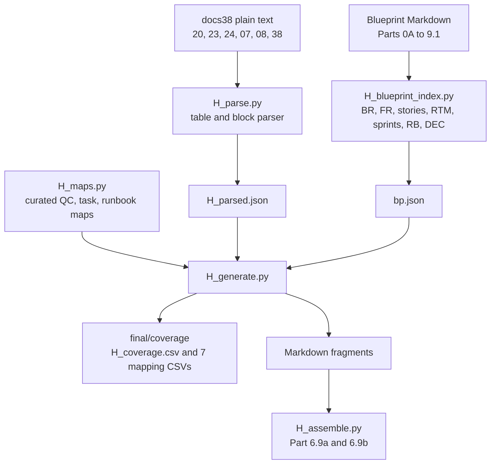

# AI Growth Engine: Employee Sales & Marketing Automation
## Application Blueprint: PART 6 (Batch 6.9a), Source Pack Reconciliation: Quality Controls, Requirements Traceability and Delivery Backlog (Review and Catalogue Reconciliation)

| Field | Value |
|---|---|
| Document | Part 6.9a: line-by-line review of source documents 20, 23 and 24 (plus the decision records of documents 07 and 08 and the inventory of document 38) against the blueprint; coverage register and catalogue reconciliation |
| Version | 1.0 · 27 Nov 2026 |
| Baseline | Parts 0–9 as published (Part 0A DEC-001…065; Part 9.1 DEC-066…156); Part 1 BR register; Part 2.1 FR register; Part 5 stories; Part 6.1 test strategy; Part 6.6 RTM; Part 8.1 sprints; Part 8.2 go-live; Part 4.3 runbooks |
| Roles applied | QA Lead (quality-control register, evidence gate), Delivery Lead (backlog, estimates, runbook), Business Systems Analyst / traceability manager (BR/FR/RTM and decisions), Product Owner (acceptance, semantic approval, sign-off) |
| Companion | Part 6.9b (enhancements, conflicts, persona review, tags, quality gate) |
| Machine-readable outputs | `final/coverage/H_coverage.csv` (all aspects) and mapping files `H_br_map.csv`, `H_fr_map.csv`, `H_qc_map.csv`, `H_decision_map.csv`, `H_workitem_story_map.csv`, `H_sit_alias_map.csv`, `H_ops_runbook_map.csv` |
| Scripts | `assembly/source_pack/H_parse.py` (source tables), `H_blueprint_index.py` (blueprint registers), `H_maps.py` (curated mappings), `H_generate.py` (CSV and tables), `H_assemble.py` (this file) |

**Acronyms used in this part.** BR = business requirement · FR = functional requirement · QC = quality control · QCL = quality-control layer · RTM = requirements traceability matrix · SIT = system integration test · UAT = user acceptance test · PD = person-day · SP = story point · EVR = evidence record (Part 6.1 §6.1.5.4) · SPDEC = source-pack engineering decision (alias defined in this part) · OKPI = source-pack optimization KPI (the pack's KPI-01…35, renamed per the Source Pack brief) · DAG = directed acyclic graph · DoR / DoD = Definition of Ready / Done · PO = Product Owner.

**Reading guide.** Batch 6.9a answers *"what did documents 20, 23 and 24 say, and where is each item in the blueprint?"*. Batch 6.9b answers *"what was missing, and what is the full-depth specification that closes it?"*. Every number in the tables below was computed by the scripts listed above from the plain-text extraction of the pack and from the blueprint Markdown; the CSV files hold one row per atomic aspect.

---

## 6.9.1 Documents reviewed

### 6.9.1.1 Inventory

| Doc | Title | Size (extraction) | Historical pages (doc 38) | Sections (Heading 1 / Heading 2) | Atomic aspects recorded |
|---|---|---|---|---|---|
| 20 | Development Backlog, Deployment and Operational Runbook | 66,579 bytes · 1,605 lines | 21 | 15 / 30 | 225 |
| 23 | Layer-Wise Quality Control Checklist and Delivery Sign-off | 186,981 bytes · 1,858 lines | 59 | 11 / 92 | 276 |
| 24 | Requirements Traceability Matrix and Acceptance Management | 394,516 bytes · 2,605 lines | 108 | 10 / 288 | 811 |
| 07 / 08 (decision records only) | REST API catalogue (DEC-001…038); PostgreSQL catalogue (DEC-039…042) | sections at lines 8,140–8,330 and 4,279–4,300 | — | 42 decision headings | 38 + 4 |
| 38 (counts only) | All Numbers | 18,600 bytes | — | 12 / 12 | 178 (expansion decisions, candidate operations/entities, BR count, evidence records) |

All prose sections were read in full. Every table row of the three documents was parsed by `H_parse.py`: 245 QC rows, 138 screen trace blocks plus 3 non-screen rows, 147 expansion trace rows, 180 decision records (138 in document 24, 38 in document 07, 4 in document 08), 149 + 13 work items, 66 module backlog rows, 8 runbook rows, 7 work packages, 9 capacity rows, 6 execution-backlog rows, 11 cost rows, 5 effort rows and 21 mandatory gate rows. Counts match document 38 exactly (288 FRs = 141 + 147; 162 work items = 149 + 13; 245 QCs = 235 + 10; 352 decisions = 180 + 172).

### 6.9.1.2 What each document is trying to tell

| Doc | Purpose | Pattern | Domain-specific content (reviewed here) | Common core (not re-listed; see document 01/02 coverage) |
|---|---|---|---|---|
| 20 | Turn the requirement set into an executable, dependency-ordered delivery plan and the operator runbook that keeps the product safe once deployed | Seven work packages → 66-module dependency backlog → 149-item task register with low/base/high PD, predecessors and owners → 13 expansion tasks; runbook of 8 routines; capacity, cost and effort envelopes; release-to-operations gate | Task register (TASK-W01…W30, TASK-A001…A108, TASK-OP001…003, TASK-FND01…08), UX-TASK-*, runbook, capacity targets, discipline PD split, longest path 113.5 PD, review effort 32.55/62.85/123.70 PD, approval-gate counts (38/0/4/138) | Purpose and boundary; startup profiles; Website/Admin operating contract; OPT-03…18 optimization controls (doc 36 review) |
| 23 | Make delivery acceptance *auditable*: one independently reviewed check per quality concern, grouped into 25 engineering layers and 5 business invariants, with owner, reviewer, priority, procedure, command template and evidence path, and a fail-closed evidence gate | 30 layer-level checks (QC-01…QC-30) → 205 granular checks (QC-031…QC-235) → 10 expansion checks (UX-QC-01…10); evidence gate; 21 mandatory measurable gates; combined preflight (1,188 records; 1,545 with expansion per doc 38) | Every QC; evidence-manifest rules (expected/observed, executor ≠ reviewer after normalisation, SHA-256, required-ID baseline, no mandatory N/A); offline completeness command returning exit code 2 while pending | Purpose and boundary; OPT-01…20 controls; KPI thresholds (OKPI, doc 36 review) |
| 24 | Prove that every interface is linked to a business requirement, an exact operation and entity set, and unit/SIT/UAT tests, and that each link is *semantically* approved by PO, technical lead and QA | 138 screen trace blocks (SM-FR) + 3 non-screen rows → 138 review decisions (DEC-043…180) → 147 expansion trace rows (SM-UX-FR) → exception disposition and change-impact procedures | BR→FR→operation→entity→SM-UT/SM-SIT/SM-UAT associations, semantic approval procedure, change impact, outstanding approval gate counts, non-screen operation review | Purpose and boundary; optimization intelligence reuse; OPT controls |

### 6.9.1.3 Identifier collisions handled in this part

| Source identifier | Collides with | Handling in the blueprint |
|---|---|---|
| Source decisions DEC-001…DEC-180 (docs 07, 08, 24) | Blueprint binding decisions DEC-001…DEC-156 (Parts 0A, 9.1) | Source decisions are referred to as **SPDEC-001…180**; the 172 unnumbered expansion decisions as **SPDEC-X-…** [CONFLICT-445] |
| Source optimization KPIs KPI-01…35 (docs 23, 36, 38) | Blueprint business KPIs KPI-01…31 (Part 1) | **OKPI-01…35** (Source Pack brief) |
| Source layer checks QC-01…QC-30 (two digits) and granular QC-031…QC-235 (three digits) | None in the blueprint; but QC-03 and QC-031 differ only by one digit | Kept verbatim; the layer of each QC is carried as **QCL-01…31** so the two-digit layer checks are never confused with granular checks |
| SM-SIT-A001…A302 | None (not aliased in the blueprint) | FR-level alias in §6.9.5.3.2; operation-level mapping is owned by Part 6.8 (`G_test_mapping.csv`) |

---

## 6.9.2 Coverage register summary

### 6.9.2.1 Counts by status per source document

The primary document of an aspect is the first document in its `doc` column (e.g. "24/20" counts under 24).

| Doc (primary) | Covered | Partially covered | Not covered | Conflict | Not applicable | Total |
|---|---|---|---|---|---|---|
| 24 | 354 | 444 | 0 | 12 | 1 | 811 |
| 38 | 169 | 7 | 2 | 0 | 0 | 178 |
| 23 | 240 | 24 | 7 | 5 | 0 | 276 |
| 07 | 5 | 33 | 0 | 0 | 0 | 38 |
| 08 | 4 | 0 | 0 | 0 | 0 | 4 |
| 20 | 197 | 17 | 5 | 5 | 1 | 225 |
| **Total** | 969 | 525 | 14 | 22 | 2 | 1532 |

### 6.9.2.2 Counts by aspect group

| Aspect group | Covered | Partially covered | Not covered | Conflict | Not applicable | Total |
|---|---|---|---|---|---|---|
| Business requirements | 71 | 5 | 0 | 0 | 0 | 76 |
| Trace rows (SM-FR) | 130 | 1 | 0 | 11 | 0 | 142 |
| Expansion trace (SM-UX-FR) / backlog | 306 | 2 | 0 | 1 | 0 | 309 |
| SIT associations | 0 | 302 | 0 | 0 | 0 | 302 |
| Quality controls (QC) | 224 | 18 | 1 | 2 | 0 | 245 |
| Mandatory measurable gates | 16 | 2 | 0 | 3 | 0 | 21 |
| Decisions (numbered) | 9 | 171 | 0 | 0 | 0 | 180 |
| Candidate operations | 19 | 0 | 0 | 0 | 0 | 19 |
| Candidate entities | 3 | 2 | 1 | 0 | 0 | 6 |
| Work items | 146 | 3 | 0 | 0 | 0 | 149 |
| Production runbook | 5 | 3 | 0 | 0 | 0 | 8 |
| Dependency-ordered implementation | 7 | 0 | 0 | 0 | 0 | 7 |
| Capacity, reliability and recovery acceptance | 2 | 2 | 1 | 4 | 0 | 9 |
| Execution backlog and definition of done | 4 | 2 | 0 | 0 | 0 | 6 |
| Operating cost assumptions | 11 | 0 | 0 | 0 | 0 | 11 |
| Consolidated effort | 5 | 0 | 0 | 0 | 0 | 5 |
| Traceability method and status | 1 | 0 | 0 | 0 | 0 | 1 |
| Acceptance workflow | 0 | 1 | 0 | 0 | 0 | 1 |
| Traceability exception disposition | 1 | 0 | 0 | 0 | 0 | 1 |
| Change impact assessment | 0 | 1 | 0 | 0 | 0 | 1 |
| Requirements traceability semantic approval | 0 | 0 | 0 | 1 | 0 | 1 |
| Outstanding approval gates | 0 | 1 | 0 | 0 | 0 | 1 |
| Optimization Intelligence reuse of Admin screens | 1 | 0 | 0 | 0 | 0 | 1 |
| Optimization controls (OPT-xx-yy) | 0 | 0 | 0 | 0 | 1 | 1 |
| Purpose and operating boundary | 1 | 0 | 0 | 0 | 0 | 1 |
| Completion and approval roles | 1 | 0 | 0 | 0 | 0 | 1 |
| Acceptance and evidence record | 1 | 0 | 0 | 0 | 0 | 1 |
| Quality gates and disposition | 0 | 1 | 0 | 0 | 0 | 1 |
| Evidence gate and independent reviewer procedure | 0 | 0 | 1 | 0 | 0 | 1 |
| Evidence gate fail-closed | 0 | 0 | 1 | 0 | 0 | 1 |
| Granular QC and evidence | 0 | 0 | 1 | 0 | 0 | 1 |
| Go-live and rollback gate | 0 | 1 | 0 | 0 | 0 | 1 |
| Fail-closed evidence inventory | 0 | 0 | 1 | 0 | 0 | 1 |
| Evidence integrity and final acceptance | 0 | 1 | 0 | 0 | 0 | 1 |
| Combined preflight for production acceptance | 0 | 0 | 1 | 0 | 0 | 1 |
| Offline completeness command | 0 | 0 | 1 | 0 | 0 | 1 |
| Task-level estimates and discipline split | 0 | 1 | 0 | 0 | 0 | 1 |
| Dependency-only longest path | 1 | 0 | 0 | 0 | 0 | 1 |
| Approval review effort | 0 | 0 | 1 | 0 | 0 | 1 |
| Artifact and version consistency | 0 | 0 | 1 | 0 | 0 | 1 |
| Complete document inventory | 0 | 0 | 1 | 0 | 0 | 1 |
| Development dependencies | 0 | 1 | 0 | 0 | 0 | 1 |
| Workbook source and formulas | 0 | 1 | 0 | 0 | 0 | 1 |
| Unresolved contract decision management | 0 | 0 | 1 | 0 | 0 | 1 |
| Resource and deployment approval | 0 | 1 | 0 | 0 | 0 | 1 |
| Optimization estimate reconciliation | 0 | 0 | 0 | 0 | 1 | 1 |
| Website and Admin operating contract | 1 | 0 | 0 | 0 | 0 | 1 |
| Deployment and operational runbook (website) | 0 | 1 | 0 | 0 | 0 | 1 |
| Implementation backlog and release-to-operations gate | 1 | 0 | 0 | 0 | 0 | 1 |
| Operational delivery and lifecycle | 0 | 1 | 0 | 0 | 0 | 1 |
| SaaS billing model | 1 | 0 | 0 | 0 | 0 | 1 |
| Initial startup configurations | 1 | 0 | 0 | 0 | 0 | 1 |
| Required evidence records | 0 | 0 | 1 | 0 | 0 | 1 |

**How to read the large "Partially covered" groups.** (1) *SIT associations (302)*: every SM-SIT ID cited in document 24 resolves to an FR and to TCs, but the blueprint RTM never carried the SM-SIT alias; this part adds the FR-level alias and Part 6.8 adds the operation-level one [GAP-442]. (2) *Decisions (numbered)*: the substance of each source decision is already settled in the blueprint (DEC-015 derived API catalogue, DEC-019 identity reuse, DEC-088 embedding dimension, AP-08 semantic approval), but the blueprint holds **no per-item approval record** for them; §6.9.5.2 adds the SPDEC record and queue [GAP-444]. (3) *Business requirements*: all 71 enumerated BRs are covered; 5 "added" BRs in document 38 have no IDs [GAP-440].

---

## 6.9.3 Detailed coverage register

The complete register (1,532 rows, one per atomic aspect) is `final/coverage/H_coverage.csv`. Covered items are grouped there; **every Not covered, Conflict and Partially covered item is listed individually below**, except two homogeneous Partial families that are listed individually in their own reconciliation tables: the 302 SIT associations (§6.9.4.4 and `H_sit_alias_map.csv`) and the 171 numbered source decisions that lack an approval record (§6.9.4.7, all rows).

### 6.9.3.1 Not covered, Conflict and Partially covered aspects (individual)

> **Erratum v1.2 (E-V-39):** superseded by budget DEC-230 plus the funded V12 change requests (DEC-770/790). See Part 11.23c.

| Doc | Aspect | Summary | Status | Blueprint location | Action |
|---|---|---|---|---|---|
| 38/24 | XBR-01 | Expansion business requirement counted in doc 38 but not enumerated | Partially covered | Part 1 BR-S138 | Interpreted and mapped [GAP-440] |
| 38/24 | XBR-02 | Expansion business requirement counted in doc 38 but not enumerated | Partially covered | Part 1 BR-S138 | Interpreted and mapped [GAP-440] |
| 38/24 | XBR-03 | Expansion business requirement counted in doc 38 but not enumerated | Partially covered | Part 1 BR-S138 | Interpreted and mapped [GAP-440] |
| 38/24 | XBR-04 | Expansion business requirement counted in doc 38 but not enumerated | Partially covered | Part 1 BR-S138 | Interpreted and mapped [GAP-440] |
| 38/24 | XBR-05 | Expansion business requirement counted in doc 38 but not enumerated | Partially covered | Part 1 BR-S138 | Interpreted and mapped [GAP-440] |
| 24 | SM-FR-W04 | Product, service and programme catalog: Implement Product, service and programme catalog. Published offerings  | Conflict | Part 2.1 FR-W04; Part 6.6 §6.6.4 | Alias confirmed; BR traces compared; add BR-TENANT [CONFLICT-447] |
| 24 | SM-FR-W13 | Product demo and partnership enquiry: Implement Product demo and partnership enquiry. Capture demo and partner | Conflict | Part 2.1 FR-W13; Part 6.6 §6.6.4 | Alias confirmed; BR traces compared; add BR-WEB [CONFLICT-447] |
| 24 | SM-FR-W14 | Request for quotation: Implement Request for quotation. Submit line items, quantity, unit, delivery region and | Conflict | Part 2.1 FR-W14; Part 6.6 §6.6.4 | Alias confirmed; BR traces compared; add BR-WEB [CONFLICT-447] |
| 24 | SM-FR-W15 | Project requirement submission: Implement Project requirement submission. AppNAI project intake; file uploads  | Conflict | Part 2.1 FR-W15; Part 6.6 §6.6.4 | Alias confirmed; BR traces compared; add BR-WEB [CONFLICT-447] |
| 24 | SM-FR-W16 | Supplier registration and product supply enquiry: Implement Supplier registration and product supply enquiry.  | Conflict | Part 2.1 FR-W16; Part 6.6 §6.6.4 | Alias confirmed; BR traces compared; add BR-WEB [CONFLICT-447] |
| 24 | SM-FR-W17 | Student training and institutional enquiry: Implement Student training and institutional enquiry. EduVerse pro | Conflict | Part 2.1 FR-W17; Part 6.6 §6.6.4 | Alias confirmed; BR traces compared; add BR-WEB [CONFLICT-447] |
| 24 | SM-FR-W18 | Meeting and appointment booking: Implement Meeting and appointment booking. Public request or token-bound book | Conflict | Part 2.1 FR-W18; Part 6.6 §6.6.4 | Alias confirmed; BR traces compared; add BR-WEB [CONFLICT-447] |
| 24 | SM-FR-W19 | Webinar and event registration: Implement Webinar and event registration. Approved event information and eligi | Conflict | Part 2.1 FR-W19; Part 6.6 §6.6.4 | Alias confirmed; BR traces compared; add BR-WEB [CONFLICT-447] |
| 24 | SM-FR-W20 | Partner referral form: Implement Partner referral form. Authorized referral submission with source and consent | Conflict | Part 2.1 FR-W20; Part 6.6 §6.6.4 | Alias confirmed; BR traces compared; add BR-WEB [CONFLICT-447] |
| 24 | SM-FR-A023 | Research rules and scoring settings: Implement Research rules and scoring settings. List research plans; Creat | Conflict | Part 2.1 FR-A023; Part 6.6 §6.6.4 | Alias confirmed; BR traces compared; add BR-M11, BR-M12, BR-M13, BR-M14, BR-M15, BR-M16, B |
| 24 | SM-FR-A025 | Contact verification queue: Implement Contact verification queue. List verification work; Verify provenance an | Conflict | Part 2.1 FR-A025; Part 6.6 §6.6.4 | Alias confirmed; BR traces compared; add BR-M18 [CONFLICT-447] |
| 23 | QC-038 | Change impact: Record affected requirements, interfaces, contracts and tests before approval. | Partially covered | Part 8.2 §8.2.2.4 change control; BR-S134; register §6.9.5.1.8 | Mapped; QC register row, owner, evidence path and gate added; Impact record exists; no mac |
| 23 | QC-058 | Responsive layout: Test 360, 768 and 1440 px with no horizontal overflow except data grids. | Partially covered | DEC-043 (360 px Website, 1280 px Admin, 768 px review); §2.48; registe | Mapped; QC register row, owner, evidence path and gate added; 1440 px viewport not in the  |
| 23 | QC-082 | Bulk preview: Preview eligible records, exclusions and estimated costs before dispatch. | Partially covered | CA-DISPATCH; FR-A058; DEC-038; register §6.9.5.1.8 | Mapped; QC register row, owner, evidence path and gate added; Bulk-action preview with exc |
| 23 | QC-100 | Timeout: External calls bounded and outside long database transaction. | Partially covered | FR-ENG-01; NFR-016; register §6.9.5.1.8 | Mapped; QC register row, owner, evidence path and gate added; Rule 'external call outside  |
| 23 | QC-103 | Contract: Every route has reviewed fields, types, requiredness and response examples. | Partially covered | DEC-015 derived catalogue; Part 3.2 §3.2.2; register §6.9.5.1.8 | Mapped; QC register row, owner, evidence path and gate added; Source DEC-001…038 exact con |
| 23 | QC-134 | Export/delete: Derived vectors and cached snippets included in deletion review. | Partially covered | NFR-036; DEC-028; register §6.9.5.1.8 | Mapped; QC register row, owner, evidence path and gate added; Erasure of derived embedding |
| 23 | QC-16 | Verify licence, security, feature parity, reliability, hosting cost and fallback disabled until approved.: Dep | Partially covered | NFR-037; BR-S131; GL-L06; register §6.9.5.1.8 | Mapped; QC register row, owner, evidence path and gate added; No generic paid-vs-replaceme |
| 23 | QC-152 | Benchmark: Run same labeled workload for paid and replacement tool. | Partially covered | NFR-030 (AI only); register §6.9.5.1.8 | Mapped; QC register row, owner, evidence path and gate added; Same-workload benchmark for  |
| 23 | QC-153 | Coverage: Compare required countries/source categories; gaps explicitly recorded. | Partially covered | BR-S131; register §6.9.5.1.8 | Mapped; QC register row, owner, evidence path and gate added; Country/source-category cove |
| 23 | QC-154 | Accuracy: Measure precision/recall or task pass rate with same ground truth. | Partially covered | NFR-011 (AI precision); register §6.9.5.1.8 | Mapped; QC register row, owner, evidence path and gate added; Precision/recall for non-AI  |
| 23 | QC-155 | Reliability: Measure error rate, retries and latency under same workload. | Partially covered | NFR-016; register §6.9.5.1.8 | Mapped; QC register row, owner, evidence path and gate added; Error rate/latency compariso |
| 23 | QC-156 | TCO: Include hosting, maintenance, model and engineering effort. | Partially covered | Part 4.3 §4.46; Part 8.2 §8.2.7; register §6.9.5.1.8 | Mapped; QC register row, owner, evidence path and gate added; TCO comparison formula inclu |
| 23 | QC-187 | Branch coverage: Proposed critical rule branch coverage >=90%; measured result retained. | Conflict | DoD D-8 (critical modules line ≥ 90%, branch ≥ 85%); §4.33.4; register | Mapped; QC register row, owner, evidence path and gate added; Source proposes critical-rul |
| 23 | QC-191 | API contracts: Every catalog operation has reviewable positive/negative assertions. | Partially covered | D-4; D-6; register §6.9.5.1.8 | Mapped; QC register row, owner, evidence path and gate added; 302 operation-specific SIT v |
| 23 | QC-200 | All interfaces: Each named Website/Admin item has UAT and accessible error path. | Partially covered | §6.1.13.3 scenario packs; register §6.9.5.1.8 | Mapped; QC register row, owner, evidence path and gate added; UAT does not require one acc |
| 23 | QC-215 | Load: Initial and growth workload measured against agreed p95 targets. | Conflict | NFR-039, NFR-060, NFR-061; Part 4.2 §4.25; register §6.9.5.1.8 | Mapped; QC register row, owner, evidence path and gate added; Source initial/growth worklo |
| 23 | QC-25 | Transfer runbooks, access ownership, source, training and acceptance record; confirm support and unresolved ri | Partially covered | §8.2.2; §8.2.5; GL-B03; register §6.9.5.1.8 | Mapped; QC register row, owner, evidence path and gate added; No access-ownership inventor |
| 23 | QC-224 | Access handover: Production credentials transferred by secure approved mechanism. | Not covered | —; register §6.9.5.1.8 | Mapped; QC register row, owner, evidence path and gate added; No secure production-credent |
| 23 | QC-227 | Documentation: Approved requirements, contracts and runbooks match deployed artifact. | Partially covered | D-13 documentation; register §6.9.5.1.8 | Mapped; QC register row, owner, evidence path and gate added; No artefact/version consiste |
| 23 | UX-QC-01 | Create 26 owned startups and ten client tenants with two startups each; switch to a client role; reload.: Only | Partially covered | AP-01 (26th startup); AP-10; DEC-031; register §6.9.5.1.8 | Mapped; QC register row, owner, evidence path and gate added; Fixture of ten client tenant |
| 23 | UX-QC-10 | Visit every catalog route; keyboard navigate forms, errors, filters and detail links at desktop/mobile widths. | Partially covered | NFR-088/089; D-10; register §6.9.5.1.8 | Mapped; QC register row, owner, evidence path and gate added; Full-route keyboard sweep of |
| 23 | OKPI-17 | Mandatory QC completion >= 1 ratio (Independent reviewer, approved evidence) | Partially covered | No QC register in blueprint → §6.9.5.1 | Bound to the combined preflight (§6.9.5.6) |
| 23 | OKPI-20 | Approved traceability mappings >= 1 ratio (Owner and engineering review) | Conflict | AP-08 10% spot check [CONFLICT-442] | Bound to the combined preflight (§6.9.5.6) |
| 23 | OKPI-26 | Growth dashboard p95 <= 2500 ms (250 staff; 1m scoped opportunities) | Partially covered | Year 2 profile differs [CONFLICT-441] | Bound to the combined preflight (§6.9.5.6) |
| 23 | OKPI-28 | Projection refresh <= 60 seconds (Committed event to scoped projection) | Conflict | NFR-047 15 min [CONFLICT-443] | Bound to the combined preflight (§6.9.5.6) |
| 23 | OKPI-32 | Growth critical RTO <= 120 minutes (Growth workload recovery drill) | Conflict | No 2 h growth RTO [CONFLICT-444] | Bound to the combined preflight (§6.9.5.6) |
| 38 | sales_ui_trigger_revision | Candidate entity sales_ui_trigger_revision | Partially covered | Part 3.3 ENT-161 Trigger (revisioned via ENT-160 WorkflowRevision) | Mapped; revision versioning note §6.9.5.7 |
| 38 | sales_ui_template_revision | Candidate entity sales_ui_template_revision | Partially covered | Part 3.3 ENT-166 NodeTemplate / ENT-167 WorkflowTemplate | Mapped; revision versioning note §6.9.5.7 |
| 38 | sales_ui_service_request | Candidate entity sales_ui_service_request | Not covered | Part 3.3 — (no SaaS service request entity) | Mapped; GAP-448 entity proposed §6.9.5.7 |
| 20 | TASK-FND03 | Contract review and mock service baseline (6/8/10 PD; preds TASK-FND02) | Partially covered | Part 5 US-0112, US-0113, US-2110; Part 8.1 §8.1.4.6 | Mapped to stories; Partial: source contract review of 38 exact API definitions and 4 DB co |
| 20 | TASK-FND05 | Provider benchmarks and approved activation (4/5.5/6.5 PD; preds TASK-FND03;TASK-FND04) | Partially covered | Part 5 US-0112, US-0404, US-0804, US-2105; Part 8.1 §8.1.4.6 | Mapped to stories; Partial: provider benchmarks before activation have no story (§6.9.5.4  |
| 20 | TASK-FND08 | Go-live, training and handover (4/5.5/6.5 PD; preds TASK-FND06;TASK-FND07) | Partially covered | Part 5 US-2106; Part 8.1 §8.1.4.6 | Mapped to stories; Partial: training, access handover and go-live are Part 8.2 activities  |
| 20 | UX-TASK-FIELDS | Dynamic fields, linked records and shared UI state for retained screens (18/32/55 PD; preds UX-TASK-FOUNDATION | Partially covered | Part 5 US-1701, US-1708, US-1709; Part 8.1 §8.1.4.6 | Mapped to stories; Partial: dynamic field standardization of 138 retained screens (FRD §16 |
| 20 | RUN-Predeployment | Predeployment: Validate independent environment, secret references, migration dry run, provider access and app | Partially covered | Part 4.3 §4.37, §4.48; GL-T01…T10 | No single predeployment runbook (freeze unsafe actions, provider access check) → RB-ENH-H- |
| 20 | RUN-Daily_operations | Daily operations: Review failed jobs, pending approvals, budget, receipts, source freshness, suppression, back | Partially covered | Part 4.3 §4.45; Part 8.2 §8.2.5.3 (hypercare only) | Steady-state daily operations routine absent → RB-ENH-H-02 |
| 20 | RUN-Client_offboard | Client offboard: Stop workflows, revoke access, approved export, retention and charge settlement | Partially covered | US-2009; AP-09 | No operator runbook (stop workflows, revoke, export, retention, settlement) → RB-ENH-H-03 |
| 20 | CAP-Owned_startups_/_external_tena | Owned startups / external tenants: initial 25 / 10, growth 50+ / 100 | Conflict | DEC-031 (25–40 / 2–10 Year 1; 100 / 30 Year 2); §4.25.1 | Growth 50+/100 vs Year 2 100/30 [CONFLICT-441] |
| 20 | CAP-Concurrent_staff_sessions | Concurrent staff sessions: initial 50, growth 250 | Conflict | §4.25.1 (60 internal users Year 1, 200 Year 2; peak concurrency 0.5) | 50/250 concurrent sessions vs 30/100 peak [CONFLICT-441] |
| 20 | CAP-Scoped_opportunities | Scoped opportunities: initial 100,000, growth 1,000,000 | Partially covered | §4.25.5 data volume; NFR-060 | 100k / 1M opportunity volume not a named load profile [CONFLICT-441] |
| 20 | CAP-Concurrent_jobs_/_scheduled_ac | Concurrent jobs / scheduled actions/day: initial 50 / 10,000, growth 250 / 100,000 | Partially covered | NFR-058, NFR-059; §4.25.3 | 10k / 100k scheduled actions per day not stated [CONFLICT-441] |
| 20 | CAP-Projection_refresh | Projection refresh: initial ≤60 s, growth ≤60 s | Conflict | NFR-008 (Customer 360 ≤ 60 s); NFR-047 (dashboards ≤ 15 min) | Source ≤ 60 s for all projections [CONFLICT-443] |
| 20 | CAP-Critical_data_RPO_/_RTO | Critical data RPO / RTO: initial ≤15 min / ≤4 h, growth ≤15 min / ≤2 h | Conflict | DEC-018 as amended by DEC-079 (≤ 15 min / ≤ 4 h; regional ≤ 24 h) | Growth target RTO ≤ 2 h not in blueprint [CONFLICT-444] |
| 20 | CAP-Regenerable_research_RPO/RTO | Regenerable research RPO/RTO: initial ≤24 h / ≤8 h, growth ≤24 h / ≤8 h | Not covered | — | ≤ 24 h / ≤ 8 h class absent from NFR-056/057 [GAP-446] |
| 20 | DOD-Operational_handover | Named on-call, support, data retention, backup, recovery, cost caps, incident response and credential ownershi | Partially covered | Part 4.3 §4.45; §4.48; Part 8.2 §8.2.3.2 (credential ownership absent  | Enhanced §6.9.5.4–§6.9.5.5 |
| 20 | DOD-Progress_measurement | Count accepted tasks only; track blocked tasks and open defects, estimated vs actual person-days and verified  | Partially covered | Part 8.1 §8.1.6 (estimates); no estimate-vs-actual PD tracking or acce | Enhanced §6.9.5.4–§6.9.5.5 |
| 24 | RTM-NONSCREEN | Review unmapped routes/tables for internal use; do not delete because no screen | Partially covered | Part 6.6 §6.6.4.1 | Orphan review procedure added §6.9.5.3.6 |
| 24 | RTM-ACCEPT-FLOW | Assign BR/FR IDs, map unit rules, validate route/table links, attach immutable build and evidence, close defec | Partially covered | Part 6.1 §6.1.5.4; US-2110 | Workflow states added §6.9.5.3.5 |
| 24 | AP-CIA | List affected UI/API/DB/workflow/test before merge; no stale dependent contract | Partially covered | Part 8.2 §8.2.2.4 | FR-ENH-H-004 §6.9.5.3.4 |
| 24 | AP-RTSA | 100% applicable mappings approved or justified exception; no synthetic approval | Conflict | AP-08 10% spot check | [CONFLICT-442] §6.9.5.3.5 |
| 24/20 | GATE-COUNTS | Exact API definitions 38; partial API 0; DB confirmations 4; UI semantic approvals 138 | Partially covered | DEC-015; DEC-019; AP-08 | Decision queue §6.9.5.2 |
| 23 | QC-DISPOSITION | Pass requires evidence; Fail requires defect and retest; Pending ≠ acceptance; N/A requires rationale; critica | Partially covered | Part 6.1 §6.1.8.5 RBR; EVR decision | QC state machine §6.9.5.1.3 |
| 23 | QC-EVIDENCE-GATE | Artifact manifest: control ID, expected, observed, executor, different reviewer, owner approval, path, SHA-256 | Not covered | — | Manifest schema §6.9.5.1.4 [GAP-443] |
| 23 | AP-EGFC | Delete row, duplicate ID, mandatory N/A in synthetic fixture → all rejected | Not covered | — | TC-ENH-H-001…006 |
| 23 | AP-GQC | Enforce required ID baseline; pending blocks release | Not covered | — | FR-ENH-H-001/002 |
| 23 | AP-GLRG | Rehearse deployment with incomplete QC evidence; no activation on pending gate | Partially covered | GL-T05; RBR-6 | TC-ENH-H-012 |
| 23 | AP-FCEI | Authoritative required-ID list from immutable baseline; register cannot define its own scope | Not covered | — | FR-ENH-H-002 |
| 23 | AP-EIFA | Blank evidence, identical executor/reviewer after trim/case normalisation rejected; hash verified; signed appr | Partially covered | EVR responsible ≠ reviewer | FR-ENH-H-002 normalisation rule |
| 23 | AP-CPPA | 1,188 required records across six groups; recompute 21 mandatory KPIs | Not covered | A090 gate table | FR-ENH-H-005 (nine groups, 1,545 records) §6.9.5.6 |
| 23 | QC-OFFLINE-CMD | release_gate.py register evidence-root → exit code 2 while pending | Not covered | — | Gate evaluator exit-code contract §6.9.5.1.5 |
| 23 | UX-QC-RELEASE | Combined gate includes baseline and expansion; no N/A bypass | Partially covered | GL-B02 | §6.9.5.6 |
| 20 | EST-DISCIPLINE | Frontend 90.68; Backend 111.55; DB 52.85; AI 36.23; QA 65.64; DevOps/security 28.05 PD | Partially covered | Part 8.1 §8.1.6 (per-epic, not per discipline) | Reconciliation §6.9.5.4.2 [GAP-451] |
| 20 | EST-EXPANSION | 62/114/196 PD before overlap reconciliation | Conflict | Part 8.1 §8.1.6.4 (287–483 includes W31–A113) | [CONFLICT-446] |
| 20 | EST-REVIEW | 32.55/62.85/123.70 PD | Not covered | — | [GAP-450] §6.9.5.4.2 |
| 20 | AP-AVC | Compare package manifests and catalog hashes | Not covered | — | FR-ENH-H-008 |
| 20 | AP-CDI | Open all documents; verify unique numbers | Not covered | — | FR-ENH-H-008 (38 documents) |
| 20 | AP-DD | No missing/cyclic dependency; low ≤ base ≤ high | Partially covered | Part 8.1 §8.1.7 | FR-ENH-H-007 DAG validation |
| 20 | AP-WSF | All workbook tabs preserved; formulas compute | Partially covered | final/AI_Growth_Engine_Blueprint_Workbook_v1.0.xlsx | Workbook check in §6.9.5.5 |
| 20 | AP-UCDM | Every blocker has a decision queue; no unapproved contract in production | Not covered | — | FR-ENH-H-003 §6.9.5.2 |
| 20 | AP-RDA | Estimate incremental effort per change; approve before promising cost or SLA | Partially covered | Part 8.2 §8.2.2.4 | §6.9.5.4.2 |
| 20 | WEB-DEPLOY-RB | Separate builds, audiences, CSP; deploy schema+DRF policy before routes; independent rollback; monitor separat | Partially covered | Part 4.3 §4.37–§4.38; RB-012 | Website kill switch step added to RB-ENH-H-01 |
| 20 | OPS-LIFECYCLE | Immutable artefacts; handover runbooks, ownership, access inventory, training | Partially covered | Part 8.2 §8.2.2, §8.2.5 | Access inventory §6.9.5.5 |
| 38 | EVID-1545 | Nine groups, 1,545 required records (180+624+235+104+24+21+172+175+10) | Not covered | — | FR-ENH-H-005 |

### 6.9.3.2 Quality controls that are not fully covered

| QC | Layer | Check | Status | Blueprint location | Gap and action |
|---|---|---|---|---|---|
| QC-038 | Business requirements | Change impact | Partially covered | Part 8.2 §8.2.2.4 change control; BR-S134 | Impact record exists; no machine-readable impact set (UI/API/DB/workflow/test) gate before merge (§6.9.5.3.4) |
| QC-058 | UI/UX | Responsive layout | Partially covered | DEC-043 (360 px Website, 1280 px Admin, 768 px review); §2.48 | 1440 px viewport not in the blueprint test matrix [RECOMMENDATION-444] |
| QC-082 | Confidential Admin | Bulk preview | Partially covered | CA-DISPATCH; FR-A058; DEC-038 | Bulk-action preview with exclusions and cost estimate before dispatch not specified as a common control (§6.9.5.1.6) |
| QC-100 | Django backend | Timeout | Partially covered | FR-ENG-01; NFR-016 | Rule 'external call outside the DB transaction' implied by outbox but not stated as a review check [RECOMMENDATION-445] |
| QC-103 | REST operations | Contract | Partially covered | DEC-015 derived catalogue; Part 3.2 §3.2.2 | Source DEC-001…038 exact contract approvals not represented as decision records (§6.9.5.2) |
| QC-134 | RAG and knowledge | Export/delete | Partially covered | NFR-036; DEC-028 | Erasure of derived embeddings and cached snippets not listed explicitly in the erasure job scope [GAP-447] |
| QC-16 | Open-source replacement | Verify licence, security, feature parity, reliability, hosting cost and fallback disabled until approved. | Partially covered | NFR-037; BR-S131; GL-L06 | No generic paid-vs-replacement benchmark protocol outside AI routing (§6.9.5.1.6) |
| QC-152 | Open-source replacement | Benchmark | Partially covered | NFR-030 (AI only) | Same-workload benchmark for non-AI replacements (search, extraction, enrichment) absent (§6.9.5.1.6) |
| QC-153 | Open-source replacement | Coverage | Partially covered | BR-S131 | Country/source-category coverage comparison not specified (§6.9.5.1.6) |
| QC-154 | Open-source replacement | Accuracy | Partially covered | NFR-011 (AI precision) | Precision/recall for non-AI replacements not specified (§6.9.5.1.6) |
| QC-155 | Open-source replacement | Reliability | Partially covered | NFR-016 | Error rate/latency comparison under same workload absent (§6.9.5.1.6) |
| QC-156 | Open-source replacement | TCO | Partially covered | Part 4.3 §4.46; Part 8.2 §8.2.7 | TCO comparison formula including maintenance effort absent (§6.9.5.1.6) |
| QC-187 | Unit testing | Branch coverage | Conflict | DoD D-8 (critical modules line ≥ 90%, branch ≥ 85%); §4.33.4 | Source proposes critical-rule branch coverage ≥ 90% [CONFLICT-440] |
| QC-191 | SIT | API contracts | Partially covered | D-4; D-6 | 302 operation-specific SIT variants (SM-SIT-A001…A302) not aliased in the RTM [GAP-442] |
| QC-200 | UAT | All interfaces | Partially covered | §6.1.13.3 scenario packs | UAT does not require one accessible-error-path scenario per named interface (147) [RECOMMENDATION-447] |
| QC-215 | Production readiness | Load | Conflict | NFR-039, NFR-060, NFR-061; Part 4.2 §4.25 | Source initial/growth workloads (50/250 staff; 100k/1M opportunities; 25+10 → 50+/100 tenants) differ from blueprint design points [CONFLICT-441] |
| QC-25 | Delivery and handover | Transfer runbooks, access ownership, source, training and acceptance record; confirm support and unresolved risks. | Partially covered | §8.2.2; §8.2.5; GL-B03 | No access-ownership inventory or source/credential transfer record (§6.9.5.5) |
| QC-224 | Delivery and handover | Access handover | Not covered | — | No secure production-credential handover procedure or access inventory (§6.9.5.5) |
| QC-227 | Delivery and handover | Documentation | Partially covered | D-13 documentation | No artefact/version consistency check between approved documents and the deployed artefact (§6.9.5.5) |
| UX-QC-01 | Expansion QC and sign-off | Create 26 owned startups and ten client tenants with two startups each; switch to a client role; reload. | Partially covered | AP-01 (26th startup); AP-10; DEC-031 | Fixture of ten client tenants × two startups not defined; GSE-SYN has fewer tenants [RECOMMENDATION-446] |
| UX-QC-10 | Expansion QC and sign-off | Visit every catalog route; keyboard navigate forms, errors, filters and detail links at desktop/mobile widths. | Partially covered | NFR-088/089; D-10 | Full-route keyboard sweep of all 147 routes at desktop and mobile not a named suite [RECOMMENDATION-447] |

### 6.9.3.3 FR business-requirement trace differences (Conflict, 11 FRs)

Document 24 links each screen FR to one or more parent BRs. For 11 FRs the blueprint Part 2.1 *Traces* column omits a BR that the source names. None changes scope: the missing links are a public-boundary BR (B-WEB) on intake forms, a tenancy BR on the catalogue, and the discovery-chain BRs (M11–M17, M18) on the two settings/review screens that configure them. Resolution in §6.9.6 [CONFLICT-447].

| FR | Source BR (doc 24) | Blueprint traces (Part 2.1) | Missing in blueprint | Proposed resolution |
|---|---|---|---|---|
| FR-W04 | BR-TENANT, BR-WEB | BR-M02, BR-M66, BR-WEB | BR-TENANT | Add as secondary trace in the Part 2.1 errata batch; no scope change |
| FR-W13 | BR-M22, BR-WEB | BR-M22, BR-M29, BR-M49 | BR-WEB | Add as secondary trace in the Part 2.1 errata batch; no scope change |
| FR-W14 | BR-M22, BR-WEB | BR-M22, BR-M44 | BR-WEB | Add as secondary trace in the Part 2.1 errata batch; no scope change |
| FR-W15 | BR-M22, BR-WEB | BR-M22 | BR-WEB | Add as secondary trace in the Part 2.1 errata batch; no scope change |
| FR-W16 | BR-M22, BR-WEB | BR-M22 | BR-WEB | Add as secondary trace in the Part 2.1 errata batch; no scope change |
| FR-W17 | BR-M22, BR-WEB | BR-M22 | BR-WEB | Add as secondary trace in the Part 2.1 errata batch; no scope change |
| FR-W18 | BR-M22, BR-M29, BR-WEB | BR-M22, BR-M29 | BR-WEB | Add as secondary trace in the Part 2.1 errata batch; no scope change |
| FR-W19 | BR-M40, BR-WEB | BR-M40 | BR-WEB | Add as secondary trace in the Part 2.1 errata batch; no scope change |
| FR-W20 | BR-M42, BR-WEB | BR-M42 | BR-WEB | Add as secondary trace in the Part 2.1 errata batch; no scope change |
| FR-A023 | BR-M10, BR-M11, BR-M12, BR-M13, BR-M14, BR-M15, BR-M16, BR-M17 | BR-M10 | BR-M11, BR-M12, BR-M13, BR-M14, BR-M15, BR-M16, BR-M17 | Add as secondary trace in the Part 2.1 errata batch; no scope change |
| FR-A025 | BR-M18, BR-M19 | BR-M19 | BR-M18 | Add as secondary trace in the Part 2.1 errata batch; no scope change |

---

## 6.9.4 Catalogue reconciliation

### 6.9.4.1 Method

| Step | Rule | Result |
|---|---|---|
| Parse | `[TABLE]` blocks are split on `---row`; header cells are the lines before the first row; trace blocks are read by their fixed line order (Access → BR text → Implement → REST → entities → tests) | 0 unparsed rows; counts equal document 38 |
| BR | `M##` → `BR-M##`; `B-X` → `BR-X`; module names in document 20 matched to Part 1 BR names (exact, case-insensitive), then dependency sets compared | 66/66 names matched; 66/66 dependency sets identical |
| FR | `SM-FR-W##/A###/OP###` → `FR-…` (Part 0 alias); `SM-UX-FR-…` → `FR-UX-…` (Part 0 alias) and the same screen's FR; source BRs compared with Part 2.1 *Traces* | 141 + 147 = 288 mapped; 11 trace differences |
| Tests | SM-UAT-S### checked against the Part 6.1 rule *S = 030 + n*; SM-UT set compared with the 63 aliased IDs; SM-SIT grouped by FR | 138/138 UAT aliases follow the rule; 63/63 unit IDs already aliased; 302 SIT IDs newly aliased |
| Work items | `TASK-W##/A###/OP###` and `UX-TASK-W/A` → same-screen FR → stories from Part 6.6 §6.6.4; `TASK-FND##` and `UX-TASK-FOUNDATION/FIELDS/EVENTS/QA` → curated story sets | 162/162 mapped to ≥ 1 story |
| QC | Each QC mapped to its layer anchor and to specific NFR/DoD/GL/BLK/AP/RB/TC references, then classified | 245/245 mapped |
| Decisions | SPDEC alias; API decisions joined to FRs through the operation path used in the trace blocks; UI decisions joined to the FR of the screen | 352/352 mapped |
| DAG | Predecessor IDs resolved; cycle check; longest base-duration path | Valid; 2 symbolic predecessors ("None", "All feature and adapter tasks"); longest path **113.5 PD** (matches source) |

### 6.9.4.2 Business requirements (76)

| Population | Count | Blueprint | Status |
|---|---|---|---|
| Module BRs M01…M66 | 66 | BR-M01…BR-M66 (Part 1) — names identical; dependency sets identical; epic and wave from Part 1 | Covered |
| Cross-cutting BRs B-TENANT, B-WEB, B-AUTO, B-SVC, B-QA | 5 | BR-TENANT, BR-WEB, BR-AUTO, BR-SVC, BR-QA | Covered |
| "Added" BRs counted by document 38 (71 + 5 = 76) | 5 | No IDs in any pack document. Interpreted as the five BRD §17.1 scope statements (XBR-01…05) and mapped to BR-S138 [GAP-440] [ASSUMPTION-441] | Partially covered |
| BRs cited in the document 24 trace blocks | 71 | All 71 resolve; M09 is cited only by the non-screen readiness/health rows and is the subject of the document 24 exception "M09 maps to foundational infrastructure" (realized by US-2101…US-2110) | Covered |

Module backlog of document 20 (dependency order, sequence 1–66) against Part 1:

| M | Module | Acceptance (doc 20) | Blueprint BR / epic / wave | Status |
|---|---|---|---|---|
| M01 | Identity & access (seq 1) | Existing capability; validate growth/admin access before lau | BR-M01 · EP-01 · W0 | Covered |
| M02 | Product knowledge catalog (seq 2) | Planned products blocked from promotion | BR-M02 · EP-02 · W0 | Covered |
| M03 | Knowledge document ingestion (seq 3) | Every answer cites approved version | BR-M03 · EP-02 · W0 | Covered |
| M04 | Consent and suppression (seq 4) | Opt-out blocks all scoped sends | BR-M04 · EP-03 · W0 | Covered |
| M05 | Integration registry (seq 5) | Secrets never returned in API | BR-M05 · EP-01 · W0 | Covered |
| M06 | Event and audit foundation (seq 6) | Duplicate delivery has one effect | BR-M06 · EP-01 · W0 | Covered |
| M07 | Source permissions register (seq 7) | Unapproved URL blocked | BR-M07 · EP-05 · W0 | Covered |
| M08 | AI gateway and evaluation (seq 8) | Invalid outputs rejected; cost cap enforced | BR-M08 · EP-04 · W0 | Covered |
| M09 | DevSecOps & environment (seq 11) | Restore drill; secret scan; smoke test | BR-M09 · EP-21 · W0 | Covered |
| M10 | Search query planner (seq 13) | No personal health targeting queries | BR-M10 · EP-05 · W1 | Covered |
| M11 | Public web discovery (seq 14) | Source URL/date recorded; blocked hosts rejected | BR-M11 · EP-05 · W1 | Covered |
| M12 | Evidence extraction (seq 15) | Evidence traceable; injection ignored | BR-M12 · EP-05 · W1 | Covered |
| M13 | Account discovery (seq 16) | Duplicate domain/location merge safe | BR-M13 · EP-05 · W1 | Covered |
| M14 | Buying signal classification (seq 17) | ≥80% precision on reviewed pilot sample target | BR-M14 · EP-05 · W1 | Covered |
| M15 | Business need discovery (seq 18) | No inference labeled confirmed | BR-M15 · EP-05 · W1 | Covered |
| M16 | Product solution matching (seq 19) | Unavailable offering excluded from sales | BR-M16 · EP-05 · W1 | Covered |
| M17 | Opportunity scoring (seq 20) | Score recalculates; consent independent | BR-M17 · EP-06 · W1 | Covered |
| M18 | Decision-maker role discovery (seq 21) | No private contacts or guessed emails | BR-M18 · EP-06 · W1 | Covered |
| M19 | Contact verification (seq 22) | Verified not synonymous with consent | BR-M19 · EP-06 · W1 | Covered |
| M20 | Research review and alerts (seq 23) | Rejected leads never sent to channel | BR-M20 · EP-06 · W1 | Covered |
| M21 | CRM pipeline (seq 24) | Invalid stage transition rejected | BR-M21 · EP-07 · W2 | Covered |
| M22 | Lead capture and forms (seq 25) | Duplicate submission one lead | BR-M22 · EP-07 · W2 | Covered |
| M23 | Customer 360 (seq 26) | Updates visible within 60s target | BR-M23 · EP-07 · W2 | Covered |
| M24 | Engagement eligibility (seq 27) | No send when opt-out/unknown eligibility | BR-M24 · EP-03 · W2 | Covered |
| M25 | Personalized message drafting (seq 29) | No invented relationship or diagnosis | BR-M25 · EP-08 · W2 | Covered |
| M26 | Email integration (seq 30) | Replay no duplicate; bounce suppress | BR-M26 · EP-08 · W2 | Covered |
| M27 | Unified inbound processing (seq 31) | STOP cancels; urgent/clinical routes to human | BR-M27 · EP-08 · W2 | Covered |
| M28 | Follow-up sequences (seq 32) | No follow-up after stop or reply | BR-M28 · EP-08 · W2 | Covered |
| M29 | Meeting and calendar (seq 33) | No invented availability; conflict handled | BR-M29 · EP-09 · W2 | Covered |
| M30 | Growth dashboard (seq 34) | Counts reconcile with deal records | BR-M30 · EP-17 · W2 | Covered |
| M31 | WhatsApp Business (seq 35) | No private group scrape; opt-in gate | BR-M31 · EP-10 · W3 | Covered |
| M32 | Website conversational assistant (seq 36) | Clinical question routed; no medical data | BR-M32 · EP-10 · W3 | Covered |
| M33 | Social listening (seq 39) | No restricted profiles or automated DMs | BR-M33 · EP-05 · W3 | Covered |
| M34 | Content studio (seq 40) | Unapproved claims cannot publish | BR-M34 · EP-11 · W3 | Covered |
| M35 | Social publishing (seq 41) | No unsupported DMs; idempotent publishing | BR-M35 · EP-11 · W3 | Covered |
| M36 | SEO and search visibility (seq 42) | No fabricated ranking data | BR-M36 · EP-11 · W3 | Covered |
| M37 | Landing pages and attribution (seq 43) | No health events to ad pixels | BR-M37 · EP-12 · W3 | Covered |
| M38 | Campaign management (seq 44) | Suppression applied at execution | BR-M38 · EP-12 · W3 | Covered |
| M39 | Paid ads integration (seq 45) | Budget exceeded → pause; no sensitive data | BR-M39 · EP-12 · W3 | Covered |
| M40 | Webinars and demonstrations (seq 46) | Opt-outs respected; attendance dedup | BR-M40 · EP-09 · W3 | Covered |
| M41 | Unified omnichannel routing (seq 37) | No duplicate replies across linked channels | BR-M41 · EP-08 · W3 | Covered |
| M42 | Referral and partner lead capture (seq 47) | No unauthorized third-party contact enrollment | BR-M42 · EP-12 · W3 | Covered |
| M43 | Proposal builder (seq 48) | Only approved version externally shared | BR-M43 · EP-13 · W4 | Covered |
| M44 | Quote and pricing engine (seq 49) | No unauthorized discount; totals exact | BR-M44 · EP-13 · W4 | Covered |
| M45 | Negotiation and objection handling (seq 50) | Contract/price exception escalates | BR-M45 · EP-13 · W4 | Covered |
| M46 | Contract and MoU workflow (seq 51) | No AI signs contract; signed version hash stored | BR-M46 · EP-13 · W4 | Covered |
| M47 | Payment and closure (seq 52) | Replay no duplicate revenue; no invented closure | BR-M47 · EP-15 · W4 | Covered |
| M48 | Onboarding and handoff (seq 53) | No patient data copied | BR-M48 · EP-16 · W4 | Covered |
| M49 | Partner deployment pipeline (seq 54) | No deployment claims before approval | BR-M49 · EP-16 · W4 | Covered |
| M50 | Retention and renewal (seq 55) | No medical data in scoring | BR-M50 · EP-16 · W4 | Covered |
| M51 | Lost deal and feedback (seq 56) | No auto-recontact after loss without policy | BR-M51 · EP-16 · W4 | Covered |
| M52 | Revenue and attribution (seq 57) | Revenue reconciles with finance; attribution caveat | BR-M52 · EP-15 · W5 | Covered |
| M53 | Cost and usage control (seq 9) | Simulated cap stops requests | BR-M53 · EP-04 · W0 | Covered |
| M54 | AI quality and feedback (seq 58) | Regression fails block deploy | BR-M54 · EP-04 · W0 (harness) / W5 (loop) | Covered |
| M55 | Workflow control center (seq 28) | Emergency stop blocks queued sends | BR-M55 · EP-18 · W2 | Covered |
| M56 | Privacy requests and retention (seq 10) | Deletion does not re-enable outreach | BR-M56 · EP-03 · W0 | Covered |
| M57 | Compliance monitoring (seq 38) | Simulated complaints stop campaign | BR-M57 · EP-03 · W3 | Covered |
| M58 | Operational observability (seq 12) | Provider outage does not lose events | BR-M58 · EP-21 · W0 | Covered |
| M59 | Competitor and market watch (seq 59) | No unverified comparative claim | BR-M59 · EP-05 · W5 | Covered |
| M60 | Forecast and sales optimization (seq 60) | Forecast labeled estimate | BR-M60 · EP-17 · W5 | Covered |
| M61 | Admin command center (seq 61) | Admin totals reconcile; no direct unsafe DB edits | BR-M61 · EP-17 · W0 (shell) / W5 | Covered |
| M62 | End-to-end production release (seq 62) | All critical tests pass; rollback verified | BR-M62 · EP-21 · W0 (pipeline) / W5 | Covered |
| M63 | Insurance institutional pilot (seq 63) | No underwriting or personal profiling | BR-M63 · EP-16 · W6 | Covered |
| M64 | Technology licensing pipeline (seq 64) | No promised unready API | BR-M64 · EP-16 · W6 | Covered |
| M65 | Phygital expansion (seq 65) | Deployment sign-off required | BR-M65 · EP-16 · W6 | Covered |
| M66 | Future product commercialization (seq 66) | Planned offerings not promoted | BR-M66 · EP-02 · W0 / W6 | Covered |

### 6.9.4.3 Functional requirements (288)

| Population | Count | Blueprint mapping | Status |
|---|---|---|---|
| Screen FRs SM-FR-W01…W30, SM-FR-A001…A108 | 138 | FR-W01…W30, FR-A001…A108 (Part 2.1; alias per Part 0 §0.4) | 127 Covered, 11 Conflict (BR trace) |
| Non-screen FRs SM-FR-OP001…003 | 3 | FR-OP001…003 (Part 2.1 §2.4.9; stories US-0401/0403/0404/0406, US-2102) | Covered |
| Expansion field/journey FRs SM-UX-FR-W01…W34, A001…A113 ("147 new") | 147 | FR-UX-W01…FR-UX-A113 (Part 0 alias) = the *Key fields* and *Automation* columns of FR-W/FR-A in Part 2.1 and the screen inventory of Part 2.5 §2.43; W31–W34 and A109–A113 also have full FRs (DEC-033) | Covered |
| **Total** | **288** | | 277 Covered, 11 Conflict |

The hypothesis in the task brief is confirmed: the 147 "new" FRs are the SM-UX-FR screen field and journey specifications, one per interface (34 Website + 113 Admin), each with its own UAT (SM-UX-UAT-…, all *Pending* in the source). Their field-level content (current/added/removed fields) is reconciled by the document 06/17 review; this part confirms the ID mapping and the UAT alias.

Screen and non-screen FRs (BR check: "=" all source BRs present in Part 2.1; "+X" X must be added):

| Source FR | Blueprint FR | Interface | Source BR | BR check | # SIT | UAT alias | Stories (US-) | # TC | Status |
|---|---|---|---|---|---|---|---|---|---|
| SM-FR-W01 | FR-W01 | Business growth platform homepage | B-WEB | = | 1 | SM-UAT-S001 | 1905, 1911, 1912 | 32 | Covered |
| SM-FR-W02 | FR-W02 | Company and startup business directory | B-WEB;B-TENANT | = | 1 | SM-UAT-S002 | 1905, 1911, 1912 | 25 | Covered |
| SM-FR-W03 | FR-W03 | Individual startup website | B-WEB;B-TENANT | = | 1 | SM-UAT-S003 | 1901, 1906, 1911, 1912 | 34 | Covered |
| SM-FR-W04 | FR-W04 | Product, service and programme catalog | B-WEB;B-TENANT | +TENANT | 1 | SM-UAT-S004 | 1906, 1911, 1912 | 25 | Conflict |
| SM-FR-W05 | FR-W05 | Product, service or programme details | B-WEB | = | 1 | SM-UAT-S005 | 1906, 1911, 1912 | 26 | Covered |
| SM-FR-W06 | FR-W06 | Approved pricing and commercial packages | B-WEB | = | 1 | SM-UAT-S006 | 1907, 1911, 1912 | 24 | Covered |
| SM-FR-W07 | FR-W07 | Industry and business solution pages | B-WEB | = | 1 | SM-UAT-S007 | 1908, 1911, 1912 | 22 | Covered |
| SM-FR-W08 | FR-W08 | Blog, articles and knowledge centre | B-WEB | = | 1 | SM-UAT-S008 | 1103, 1110 | 20 | Covered |
| SM-FR-W09 | FR-W09 | Case studies, testimonials and business evid | B-WEB | = | 1 | SM-UAT-S009 | 1103, 1110 | 20 | Covered |
| SM-FR-W10 | FR-W10 | Campaign landing pages | M37;B-WEB | = | 2 | SM-UAT-S010 | 1203 | 10 | Covered |
| SM-FR-W11 | FR-W11 | AI website chat assistant | M32;B-WEB | = | 1 | SM-UAT-S011 | 1004, 1005, 1007 | 36 | Covered |
| SM-FR-W12 | FR-W12 | General business enquiry | M22;B-WEB | = | 2 | SM-UAT-S012 | 0704, 0709, 0710 | 23 | Covered |
| SM-FR-W13 | FR-W13 | Product demo and partnership enquiry | M22;B-WEB | +WEB | 2 | SM-UAT-S013 | 0705, 0710 | 14 | Conflict |
| SM-FR-W14 | FR-W14 | Request for quotation | M22;B-WEB | +WEB | 2 | SM-UAT-S014 | 1406 | 7 | Conflict |
| SM-FR-W15 | FR-W15 | Project requirement submission | M22;B-WEB | +WEB | 2 | SM-UAT-S015 | 1405 | 8 | Conflict |
| SM-FR-W16 | FR-W16 | Supplier registration and product supply enq | M22;B-WEB | +WEB | 2 | SM-UAT-S016 | 1407 | 5 | Conflict |
| SM-FR-W17 | FR-W17 | Student training and institutional enquiry | M22;B-WEB | +WEB | 2 | SM-UAT-S017 | 0706, 0710 | 17 | Conflict |
| SM-FR-W18 | FR-W18 | Meeting and appointment booking | M29;M22;B-WEB | +WEB | 3 | SM-UAT-S018 | 0903 | 9 | Conflict |
| SM-FR-W19 | FR-W19 | Webinar and event registration | M40;B-WEB | +WEB | 2 | SM-UAT-S019 | 0906 | 10 | Conflict |
| SM-FR-W20 | FR-W20 | Partner referral form | M42;B-WEB | +WEB | 1 | SM-UAT-S020 | 1209 | 6 | Conflict |
| SM-FR-W21 | FR-W21 | Customer registration, login and recovery | M01;B-WEB | = | 4 | SM-UAT-S021 | 0101, 1909, 1911, 1912 | 42 | Covered |
| SM-FR-W22 | FR-W22 | Customer self-service dashboard | B-WEB | = | 1 | SM-UAT-S022 | 1910, 1911, 1912 | 26 | Covered |
| SM-FR-W23 | FR-W23 | Proposal and quotation review | B-WEB | = | 2 | SM-UAT-S023 | 1306 | 13 | Covered |
| SM-FR-W24 | FR-W24 | Agreement review and e-signature | M46;B-WEB | = | 2 | SM-UAT-S024 | 1311, 1312 | 17 | Covered |
| SM-FR-W25 | FR-W25 | Order, project and service status | B-WEB | = | 1 | SM-UAT-S025 | 1411 | 8 | Covered |
| SM-FR-W26 | FR-W26 | Payment and invoice status | M47;B-WEB | = | 2 | SM-UAT-S026 | 1503, 1506, 1509, 1511 | 43 | Covered |
| SM-FR-W27 | FR-W27 | Customer onboarding and document exchange | M48;B-WEB | = | 4 | SM-UAT-S027 | 1603, 1611 | 16 | Covered |
| SM-FR-W28 | FR-W28 | Support, feedback and renewal requests | B-WEB | = | 1 | SM-UAT-S028 | 1604, 1611 | 15 | Covered |
| SM-FR-W29 | FR-W29 | Communication preferences and opt-out | M04;M56;B-WEB | = | 4 | SM-UAT-S029 | 0305, 0310 | 17 | Covered |
| SM-FR-W30 | FR-W30 | Contact, privacy, terms and help centre | M22;B-WEB | = | 3 | SM-UAT-S030 | 0306, 0310, 0710 | 19 | Covered |
| SM-FR-A001 | FR-A001 | Login, MFA and account recovery | M01 | = | 3 | SM-UAT-S031 | 0101, 0104, 0105, 0116 | 39 | Covered |
| SM-FR-A002 | FR-A002 | User and role administration | M01 | = | 3 | SM-UAT-S032 | 0105, 0106, 0116 | 22 | Covered |
| SM-FR-A003 | FR-A003 | Growth workspace navigation | M01 | = | 1 | SM-UAT-S033 | 1701, 1702, 1709, 1806 | 45 | Covered |
| SM-FR-A004 | FR-A004 | Product and capability editor | M02 | = | 6 | SM-UAT-S034 | 0201, 0202, 0205 | 25 | Covered |
| SM-FR-A005 | FR-A005 | Product knowledge catalog | M02;M03 | = | 3 | SM-UAT-S035 | 0204, 0205 | 16 | Covered |
| SM-FR-A006 | FR-A006 | Knowledge documents and approval | M03 | = | 5 | SM-UAT-S036 | 0203, 0204 | 20 | Covered |
| SM-FR-A007 | FR-A007 | Consent and communication policies | M04 | = | 4 | SM-UAT-S037 | 0301, 0302 | 18 | Covered |
| SM-FR-A008 | FR-A008 | Integration connections | M05 | = | 4 | SM-UAT-S038 | 0112 | 9 | Covered |
| SM-FR-A009 | FR-A009 | Audit and job activity | M06 | = | 3 | SM-UAT-S039 | 0111, 2105 | 25 | Covered |
| SM-FR-A010 | FR-A010 | Source permissions and registry | M07 | = | 3 | SM-UAT-S040 | 0501 | 15 | Covered |
| SM-FR-A011 | FR-A011 | AI configuration and evaluation | M08 | = | 4 | SM-UAT-S041 | 0402, 0403, 0405, 0408 | 28 | Covered |
| SM-FR-A012 | FR-A012 | API cost and budget dashboard | M53 | = | 3 | SM-UAT-S042 | 0404, 0408 | 21 | Covered |
| SM-FR-A013 | FR-A013 | Privacy request queue | M56 | = | 4 | SM-UAT-S043 | 0307, 0308 | 19 | Covered |
| SM-FR-A014 | FR-A014 | System health and incidents | M06;M58 | = | 3 | SM-UAT-S044 | 2104 | 13 | Covered |
| SM-FR-A015 | FR-A015 | Research planner | M07;M10;M11 | = | 6 | SM-UAT-S045 | 0502, 0512 | 17 | Covered |
| SM-FR-A016 | FR-A016 | Market discovery results | M11;M12 | = | 4 | SM-UAT-S046 | 0503, 0511, 0512 | 26 | Covered |
| SM-FR-A017 | FR-A017 | Evidence detail panel | M08;M12 | = | 5 | SM-UAT-S047 | 0406, 0504, 0511 | 27 | Covered |
| SM-FR-A018 | FR-A018 | Organization directory | M13 | = | 4 | SM-UAT-S048 | 0505 | 11 | Covered |
| SM-FR-A019 | FR-A019 | Buying signals board | M14 | = | 2 | SM-UAT-S049 | 0506, 0608 | 18 | Covered |
| SM-FR-A020 | FR-A020 | Business need review | M15 | = | 2 | SM-UAT-S050 | 0507 | 7 | Covered |
| SM-FR-A021 | FR-A021 | Product solution matching | M16;M08 | = | 3 | SM-UAT-S051 | 0508 | 7 | Covered |
| SM-FR-A022 | FR-A022 | Opportunity shortlist and scoring | M17 | = | 2 | SM-UAT-S052 | 0601, 0608 | 25 | Covered |
| SM-FR-A023 | FR-A023 | Research rules and scoring settings | M10;M11;M12;M13;M14;M15;M16;M17 | +M11,M12,M13,M14,M15,M16,M17 | 11 | SM-UAT-S053 | 0602 | 6 | Conflict |
| SM-FR-A024 | FR-A024 | Decision-maker and contact discovery | M18 | = | 3 | SM-UAT-S054 | 0603 | 9 | Covered |
| SM-FR-A025 | FR-A025 | Contact verification queue | M19;M18 | +M18 | 5 | SM-UAT-S055 | 0604, 0608 | 13 | Conflict |
| SM-FR-A026 | FR-A026 | Contact quality and role mapping | M13;M18;M19;B-QA | = | 7 | SM-UAT-S056 | 0605 | 6 | Covered |
| SM-FR-A027 | FR-A027 | Qualified opportunity review | M17;M20 | = | 4 | SM-UAT-S057 | 0606, 0608 | 18 | Covered |
| SM-FR-A028 | FR-A028 | Research approval and alert rules | M20 | = | 2 | SM-UAT-S058 | 0607 | 6 | Covered |
| SM-FR-A029 | FR-A029 | CRM sales pipeline | M21 | = | 5 | SM-UAT-S059 | 0701, 0708 | 23 | Covered |
| SM-FR-A030 | FR-A030 | Sales pipeline and assignment rules | M21 | = | 3 | SM-UAT-S060 | 0702 | 7 | Covered |
| SM-FR-A031 | FR-A031 | Lead form and routing configuration | M22 | = | 2 | SM-UAT-S061 | 0703 | 6 | Covered |
| SM-FR-A032 | FR-A032 | Customer 360 profile | M21;M23;M24 | = | 5 | SM-UAT-S062 | 0304, 0707, 0709 | 40 | Covered |
| SM-FR-A033 | FR-A033 | Workflow control centre | M53;M55;B-AUTO | = | 6 | SM-UAT-S063 | 1801, 1802, 1804, 1805, 1806 | 84 | Covered |
| SM-FR-A034 | FR-A034 | Personalized outreach editor | M24;M25;M26;M08 | = | 5 | SM-UAT-S064 | 0304, 0801, 0802, 0811, 0814 | 104 | Covered |
| SM-FR-A035 | FR-A035 | Message templates and approval queue | M25;M27 | = | 5 | SM-UAT-S065 | 0803, 1002 | 19 | Covered |
| SM-FR-A036 | FR-A036 | Email channel configuration | M05;M26 | = | 3 | SM-UAT-S066 | 0804, 0806, 0815 | 28 | Covered |
| SM-FR-A037 | FR-A037 | Unified inbox and outbox | M26;M27;M41 | = | 9 | SM-UAT-S067 | 0304, 0802, 0805, 0806, 0807 | 147 | Covered |
| SM-FR-A038 | FR-A038 | Follow-up sequences and tasks | M28;M30 | = | 6 | SM-UAT-S068 | 0304, 0809, 0811 | 72 | Covered |
| SM-FR-A039 | FR-A039 | Follow-up policies | M28 | = | 3 | SM-UAT-S069 | 0304, 0810, 0811 | 58 | Covered |
| SM-FR-A040 | FR-A040 | Meeting calendar and agenda | M29 | = | 4 | SM-UAT-S070 | 0902, 0904 | 19 | Covered |
| SM-FR-A041 | FR-A041 | Calendar configuration | M29 | = | 2 | SM-UAT-S071 | 0901 | 7 | Covered |
| SM-FR-A042 | FR-A042 | Growth dashboard | M30 | = | 3 | SM-UAT-S072 | 1704, 1709, 1710 | 24 | Covered |
| SM-FR-A043 | FR-A043 | Management dashboard | M30 | = | 2 | SM-UAT-S073 | 1704, 1709, 1710 | 22 | Covered |
| SM-FR-A044 | FR-A044 | WhatsApp channel and templates | M31 | = | 4 | SM-UAT-S074 | 1001, 1002 | 20 | Covered |
| SM-FR-A045 | FR-A045 | WhatsApp conversations | M26;M31;M41 | = | 7 | SM-UAT-S075 | 0813, 1003 | 18 | Covered |
| SM-FR-A046 | FR-A046 | Chat FAQ and omnichannel routing | M32;M41 | = | 4 | SM-UAT-S076 | 0813, 1006 | 16 | Covered |
| SM-FR-A047 | FR-A047 | Compliance incident dashboard | M57 | = | 2 | SM-UAT-S077 | 0309, 0311 | 17 | Covered |
| SM-FR-A048 | FR-A048 | Social listening feed | M33 | = | 2 | SM-UAT-S078 | 0509 | 7 | Covered |
| SM-FR-A049 | FR-A049 | Social source permissions | M33 | = | 2 | SM-UAT-S079 | 0509 | 7 | Covered |
| SM-FR-A050 | FR-A050 | Content studio | M34 | = | 3 | SM-UAT-S080 | 1101, 1110 | 17 | Covered |
| SM-FR-A051 | FR-A051 | Content and claims approval | M25;M34 | = | 3 | SM-UAT-S081 | 1102 | 11 | Covered |
| SM-FR-A052 | FR-A052 | Social publishing calendar | M35 | = | 5 | SM-UAT-S082 | 1104, 1106, 1107 | 19 | Covered |
| SM-FR-A053 | FR-A053 | Social account and publishing controls | M35 | = | 5 | SM-UAT-S083 | 1104, 1105 | 11 | Covered |
| SM-FR-A054 | FR-A054 | SEO and visibility dashboard | M36 | = | 3 | SM-UAT-S084 | 1108 | 6 | Covered |
| SM-FR-A055 | FR-A055 | SEO review backlog | M36 | = | 3 | SM-UAT-S085 | 1109 | 5 | Covered |
| SM-FR-A056 | FR-A056 | Landing page builder | M37 | = | 2 | SM-UAT-S086 | 1201 | 7 | Covered |
| SM-FR-A057 | FR-A057 | Landing page approvals | M37 | = | 2 | SM-UAT-S087 | 1202 | 9 | Covered |
| SM-FR-A058 | FR-A058 | Campaign builder and audience | M38 | = | 2 | SM-UAT-S088 | 1204 | 16 | Covered |
| SM-FR-A059 | FR-A059 | Campaign approval and budgets | M25;M38 | = | 4 | SM-UAT-S089 | 1205 | 17 | Covered |
| SM-FR-A060 | FR-A060 | Paid advertising dashboard | M39 | = | 3 | SM-UAT-S090 | 1206, 1207 | 14 | Covered |
| SM-FR-A061 | FR-A061 | Advertising spend controls | M39 | = | 4 | SM-UAT-S091 | 1206, 1208 | 15 | Covered |
| SM-FR-A062 | FR-A062 | Webinar and demo event manager | M40 | = | 4 | SM-UAT-S092 | 0905 | 5 | Covered |
| SM-FR-A063 | FR-A063 | Event and reminder settings | M40 | = | 3 | SM-UAT-S093 | 0906 | 10 | Covered |
| SM-FR-A064 | FR-A064 | Referral and partner approvals | M42 | = | 2 | SM-UAT-S094 | 1210 | 6 | Covered |
| SM-FR-A065 | FR-A065 | Proposal builder and preview | M43 | = | 2 | SM-UAT-S095 | 1301 | 8 | Covered |
| SM-FR-A066 | FR-A066 | Proposal approval queue | M25;M43 | = | 3 | SM-UAT-S096 | 1302, 1313 | 18 | Covered |
| SM-FR-A067 | FR-A067 | Quotation builder | M44 | = | 2 | SM-UAT-S097 | 1303, 1304 | 31 | Covered |
| SM-FR-A068 | FR-A068 | Price and discount approval | M44 | = | 2 | SM-UAT-S098 | 1305, 1313 | 35 | Covered |
| SM-FR-A069 | FR-A069 | Negotiation and objections | M45 | = | 2 | SM-UAT-S099 | 1307 | 6 | Covered |
| SM-FR-A070 | FR-A070 | Negotiation exception queue | M45 | = | 2 | SM-UAT-S100 | 1308, 1313 | 14 | Covered |
| SM-FR-A071 | FR-A071 | Contracts and MoUs | M46 | = | 4 | SM-UAT-S101 | 1309, 1311 | 19 | Covered |
| SM-FR-A072 | FR-A072 | Contract and legal approvals | M46 | = | 3 | SM-UAT-S102 | 1310, 1313 | 16 | Covered |
| SM-FR-A073 | FR-A073 | Payment and deal closure | M47 | = | 6 | SM-UAT-S103 | 1501, 1502, 1503, 1504, 1509 | 75 | Covered |
| SM-FR-A074 | FR-A074 | Payment reconciliation | M47 | = | 5 | SM-UAT-S104 | 1501, 1503, 1505, 1509, 1511 | 56 | Covered |
| SM-FR-A075 | FR-A075 | Customer onboarding checklist | M48 | = | 2 | SM-UAT-S105 | 1601, 1611, 1612 | 27 | Covered |
| SM-FR-A076 | FR-A076 | Onboarding assignment | M48 | = | 2 | SM-UAT-S106 | 1602 | 6 | Covered |
| SM-FR-A077 | FR-A077 | Partner deployment pipeline | M49 | = | 4 | SM-UAT-S107 | 1607, 1612 | 11 | Covered |
| SM-FR-A078 | FR-A078 | Deployment readiness approval | M49 | = | 2 | SM-UAT-S108 | 1607 | 6 | Covered |
| SM-FR-A079 | FR-A079 | Renewal and retention calendar | M50 | = | 2 | SM-UAT-S109 | 1605, 1611, 1612 | 26 | Covered |
| SM-FR-A080 | FR-A080 | Renewal policies | M50 | = | 2 | SM-UAT-S110 | 1605 | 10 | Covered |
| SM-FR-A081 | FR-A081 | Lost deal and feedback | M51 | = | 3 | SM-UAT-S111 | 1606, 1611, 1612 | 26 | Covered |
| SM-FR-A082 | FR-A082 | Revenue and attribution dashboard | M52 | = | 1 | SM-UAT-S112 | 1507, 1710 | 14 | Covered |
| SM-FR-A083 | FR-A083 | Revenue reconciliation and KPI settings | M52 | = | 2 | SM-UAT-S113 | 1508 | 6 | Covered |
| SM-FR-A084 | FR-A084 | AI quality and feedback review | M51;M54;B-QA | = | 4 | SM-UAT-S114 | 0402, 0407 | 15 | Covered |
| SM-FR-A085 | FR-A085 | Competitor and market watch | M59 | = | 1 | SM-UAT-S115 | 0510 | 8 | Covered |
| SM-FR-A086 | FR-A086 | Competitor source review | M59 | = | 2 | SM-UAT-S116 | 0510 | 7 | Covered |
| SM-FR-A087 | FR-A087 | Sales forecasting dashboard | M60 | = | 1 | SM-UAT-S117 | 1706 | 7 | Covered |
| SM-FR-A088 | FR-A088 | Forecast model settings | M60 | = | 2 | SM-UAT-S118 | 1706 | 7 | Covered |
| SM-FR-A089 | FR-A089 | Unified admin command centre | M25;M61 | = | 3 | SM-UAT-S119 | 1702, 1705, 1709, 1710 | 31 | Covered |
| SM-FR-A090 | FR-A090 | Production release readiness | M62;B-QA | = | 3 | SM-UAT-S120 | 2106 | 18 | Covered |
| SM-FR-A091 | FR-A091 | Insurance institutional pilot | M63 | = | 2 | SM-UAT-S121 | 1608, 1611 | 14 | Covered |
| SM-FR-A092 | FR-A092 | Insurance pilot approval | M63 | = | 2 | SM-UAT-S122 | 1608 | 5 | Covered |
| SM-FR-A093 | FR-A093 | Technology licensing enquiries | M64 | = | 2 | SM-UAT-S123 | 1609 | 4 | Covered |
| SM-FR-A094 | FR-A094 | Licensing and API scope approval | M64 | = | 2 | SM-UAT-S124 | 1609 | 4 | Covered |
| SM-FR-A095 | FR-A095 | Phygital expansion tracker | M65 | = | 2 | SM-UAT-S125 | 1610 | 3 | Covered |
| SM-FR-A096 | FR-A096 | Phygital readiness approval | M65 | = | 2 | SM-UAT-S126 | 1610 | 3 | Covered |
| SM-FR-A097 | FR-A097 | Future product catalog view | M66 | = | 1 | SM-UAT-S127 | 0206 | 5 | Covered |
| SM-FR-A098 | FR-A098 | Future product launch approval | M66 | = | 2 | SM-UAT-S128 | 0207 | 7 | Covered |
| SM-FR-A099 | FR-A099 | Tenant, startup and membership administratio | B-TENANT | = | 8 | SM-UAT-S129 | 0108, 0109 | 16 | Covered |
| SM-FR-A100 | FR-A100 | Business profile templates and branding | B-TENANT | = | 6 | SM-UAT-S130 | 2004 | 7 | Covered |
| SM-FR-A101 | FR-A101 | Service subscriptions, usage and billing | B-SVC | = | 8 | SM-UAT-S131 | 2005, 2006, 2011 | 27 | Covered |
| SM-FR-A102 | FR-A102 | Autonomous commercial planner and simulation | B-AUTO | = | 3 | SM-UAT-S132 | 1805, 1807, 1811, 1812, 1813 | 60 | Covered |
| SM-FR-A103 | FR-A103 | Import, export and client portability | B-SVC | = | 5 | SM-UAT-S133 | 0208, 0708, 2008, 2009 | 40 | Covered |
| SM-FR-A104 | FR-A104 | Global project bid and tender desk | B-TENANT | = | 4 | SM-UAT-S134 | 1401, 1402, 1403, 1404, 1412 | 55 | Covered |
| SM-FR-A105 | FR-A105 | Purchase, sales order and fulfillment desk | B-TENANT | = | 6 | SM-UAT-S135 | 1303, 1408, 1409, 1410, 1412 | 59 | Covered |
| SM-FR-A106 | FR-A106 | Persistent action and notification centre | B-AUTO | = | 2 | SM-UAT-S136 | 1510, 1703, 1709 | 23 | Covered |
| SM-FR-A107 | FR-A107 | Website configuration and content management | B-WEB;B-TENANT | = | 2 | SM-UAT-S137 | 1901, 1903 | 18 | Covered |
| SM-FR-A108 | FR-A108 | Website preview, approval, publishing and an | B-WEB;B-TENANT | = | 2 | SM-UAT-S138 | 1902, 1904, 1911, 1912, 1913 | 50 | Covered |
| SM-FR-OP001 | FR-OP001 | POST /api/v1/internal/ai/run Internal model  | M08 | = | 1 | — | 0401, 0403, 0404, 0406 | 36 | Covered |
| SM-FR-OP002 | FR-OP002 | GET /api/v1/health Liveness; no database req | M09 | = | 1 | — | 2102 | 8 | Covered |
| SM-FR-OP003 | FR-OP003 | GET /api/v1/ready Readiness check without se | M09 | = | 1 | — | 2102 | 8 | Covered |

### 6.9.4.4 RTM trace rows: test associations

| Association | Source population | Blueprint | Result |
|---|---|---|---|
| UAT (SM-UAT-S001…S138) | 138, one per screen FR in register order | Part 6.1 §6.1.12.5 rule S = 030 + n for A-screens; S001–S030 = W01–W30 | 138/138 consistent |
| Unit (SM-UT-001…066) | 63 distinct IDs cited (037, 049, 050 never cited) | Part 6.1 §6.1.12.5 aliases the same 63 IDs (DEC-094) | Consistent |
| SIT (SM-SIT-A001…A302) | 302 distinct IDs; 95 shared by ≥ 2 FRs | Not aliased in Part 6.6 or `final/RTM.csv` | Partially covered → FR-level alias added (§6.9.5.3.2) [GAP-442] |
| QC / Acceptance per trace row | "QC: Pending · Acceptance: Not run" on all 138 | EVR decision = Pending (Part 6.1 §6.1.5.4) | Consistent: no row asserts a pass |
| Operations and entities per trace row | 299 distinct operation strings; 149 distinct entity names | Derived catalogue (DEC-015, DEC-016) | Reconciled by the document 07/08 reviews (Part 3 enhancement files); recorded per FR in `H_fr_map.csv` |

| Metric | Value |
|---|---|
| Distinct SM-SIT IDs cited in doc 24 | 302 |
| Cited by exactly one FR | 207 |
| Cited by two or more FRs (shared operations) | 95 |
| Cited by most FRs | SM-SIT-A289 (10 FRs) |
| Already aliased in Part 6.6 / final/RTM.csv | 0 |

### 6.9.4.5 Work items (162) → stories

> **Erratum v1.2 (E-V-39):** superseded by budget DEC-230 plus the funded V12 change requests (DEC-770/790). See Part 11.23c.

| Metric | Source (doc 20) | Blueprint | Note |
|---|---|---|---|
| Work items | 149 + 13 = 162 | 230 stories (Part 5); 205 scheduled S0–S12 (Part 8.1) | Many-to-many: a work item is a screen/API slice; a story is a user outcome |
| Work items mapped to ≥ 1 story | — | 162 | All 162 |
| Base effort | 385.0 PD (149 items); +114 PD expansion | 382.2 pd central committed S0–S12 (546 SP × 0.7) | Difference 2.8 pd (0.7%) on the 149-item baseline; expansion overlap per [CONFLICT-446] |
| Low / high envelope | 287 / 483 PD (+62 / +196) | 287–483 PD (DEC-012) | Same envelope |
| Dependency-only longest path | 113.5 PD (verified: FND01→FND02→FND03→FND05→A008→…→W25→FND06→FND07→FND08) | Part 8.1 §8.1.7 critical chain | Recomputed by H_generate (DAG valid, no cycle, 2 symbolic predecessors) |
| Approval review effort | 32.55 / 62.85 / 123.70 PD | Not budgeted | [GAP-450] §6.9.5.4.2 |

| Work item | Title | PD L/B/H | FR | Stories (US-) | Sprints | Status |
|---|---|---|---|---|---|---|
| TASK-W01 | Business growth platform homepage | 1.5/2/2 | FR-W01 | 1905, 1911, 1912 | S7, S8 | Covered |
| TASK-W02 | Company and startup business directory | 0.5/1/1.5 | FR-W02 | 1905, 1911, 1912 | S7, S8 | Covered |
| TASK-W03 | Individual startup website | 0.5/1/1.5 | FR-W03 | 1901, 1906, 1911, 1912 | S7, S8 | Covered |
| TASK-W04 | Product, service and programme catalog | 0.5/1/1.5 | FR-W04 | 1906, 1911, 1912 | S7, S8 | Covered |
| TASK-W05 | Product, service or programme details | 1/1.5/2 | FR-W05 | 1906, 1911, 1912 | S7, S8 | Covered |
| TASK-W06 | Approved pricing and commercial packages | 0.5/1/1.5 | FR-W06 | 1907, 1911, 1912 | S8 | Covered |
| TASK-W07 | Industry and business solution pages | 0.5/1/1.5 | FR-W07 | 1908, 1911, 1912 | S8, spill/W6 | Covered |
| TASK-W08 | Blog, articles and knowledge centre | 0.5/1/1.5 | FR-W08 | 1103, 1110 | S9 | Covered |
| TASK-W09 | Case studies, testimonials and business eviden | 0.5/1/1.5 | FR-W09 | 1103, 1110 | S9 | Covered |
| TASK-W10 | Campaign landing pages | 2/3/3.5 | FR-W10 | 1203 | S9 | Covered |
| TASK-W11 | AI website chat assistant | 2/2.5/3.5 | FR-W11 | 1004, 1005, 1007 | S8 | Covered |
| TASK-W12 | General business enquiry | 1.5/2/2.5 | FR-W12 | 0704, 0709, 0710 | S4, S5 | Covered |
| TASK-W13 | Product demo and partnership enquiry | 0.5/1/1.5 | FR-W13 | 0705, 0710 | S4 | Covered |
| TASK-W14 | Request for quotation | 1/1.5/2 | FR-W14 | 1406 | S10 | Covered |
| TASK-W15 | Project requirement submission | 0.5/1/1.5 | FR-W15 | 1405 | S9 | Covered |
| TASK-W16 | Supplier registration and product supply enqui | 0.5/1/1.5 | FR-W16 | 1407 | S10 | Covered |
| TASK-W17 | Student training and institutional enquiry | 1/1.5/2 | FR-W17 | 0706, 0710 | S4, S8 | Covered |
| TASK-W18 | Meeting and appointment booking | 1.5/2/2.5 | FR-W18 | 0903 | S6 | Covered |
| TASK-W19 | Webinar and event registration | 1.5/2/2.5 | FR-W19 | 0906 | spill/W6 | Covered |
| TASK-W20 | Partner referral form | 1/1.5/2 | FR-W20 | 1209 | spill/W6 | Covered |
| TASK-W21 | Customer registration, login and recovery | 2.5/3.5/4.5 | FR-W21 | 0101, 1909, 1911, 1912 | S0, S8 | Covered |
| TASK-W22 | Customer self-service dashboard | 1.5/2/2.5 | FR-W22 | 1910, 1911, 1912 | S8 | Covered |
| TASK-W23 | Proposal and quotation review | 2.5/3/4 | FR-W23 | 1306 | S10 | Covered |
| TASK-W24 | Agreement review and e-signature | 2/2.5/3 | FR-W24 | 1311, 1312 | S9 | Covered |
| TASK-W25 | Order, project and service status | 2/3/3.5 | FR-W25 | 1411 | S10 | Covered |
| TASK-W26 | Payment and invoice status | 2/3/4 | FR-W26 | 1503, 1506, 1509, 1511 | S10, S11 | Covered |
| TASK-W27 | Customer onboarding and document exchange | 2.5/3.5/4 | FR-W27 | 1603, 1611 | S11 | Covered |
| TASK-W28 | Support, feedback and renewal requests | 1.5/2/2.5 | FR-W28 | 1604, 1611 | S11 | Covered |
| TASK-W29 | Communication preferences and opt-out | 2/3/3.5 | FR-W29 | 0305, 0310 | S4 | Covered |
| TASK-W30 | Contact, privacy, terms and help centre | 0.5/1/1.5 | FR-W30 | 0306, 0310, 0710 | S4 | Covered |
| TASK-A001 | Login, MFA and account recovery | 1/1.5/1.5 | FR-A001 | 0101, 0104, 0105, 0116 | S0, S1, S2, S4 | Covered |
| TASK-A002 | User and role administration | 1.5/2/2.5 | FR-A002 | 0105, 0106, 0116 | S2, S4 | Covered |
| TASK-A003 | Growth workspace navigation | 1/1.5/1.5 | FR-A003 | 1701, 1702, 1709, 1806 | S1, S5, S6, S7 | Covered |
| TASK-A004 | Product and capability editor | 3/4/5 | FR-A004 | 0201, 0202, 0205 | S0, S2 | Covered |
| TASK-A005 | Product knowledge catalog | 1.5/2/2.5 | FR-A005 | 0204, 0205 | S2, S6 | Covered |
| TASK-A006 | Knowledge documents and approval | 2/3/3.5 | FR-A006 | 0203, 0204 | S6 | Covered |
| TASK-A007 | Consent and communication policies | 2/2.5/3 | FR-A007 | 0301, 0302 | S1, S3 | Covered |
| TASK-A008 | Integration connections | 2.5/3/4 | FR-A008 | 0112 | S1 | Covered |
| TASK-A009 | Audit and job activity | 2/2.5/3 | FR-A009 | 0111, 2105 | S0, S4 | Covered |
| TASK-A010 | Source permissions and registry | 2.5/3.5/4 | FR-A010 | 0501 | S2 | Covered |
| TASK-A011 | AI configuration and evaluation | 3/4.5/5.5 | FR-A011 | 0402, 0403, 0405, 0408 | S1, S2, S6 | Covered |
| TASK-A012 | API cost and budget dashboard | 2/2.5/3 | FR-A012 | 0404, 0408 | S1, S6 | Covered |
| TASK-A013 | Privacy request queue | 2/2.5/3 | FR-A013 | 0307, 0308 | S3, S6 | Covered |
| TASK-A014 | System health and incidents | 1.5/2.5/3 | FR-A014 | 2104 | S6 | Covered |
| TASK-A015 | Research planner | 2.5/3.5/4.5 | FR-A015 | 0502, 0512 | S2, S3 | Covered |
| TASK-A016 | Market discovery results | 2/2.5/3 | FR-A016 | 0503, 0511, 0512 | S2, S3 | Covered |
| TASK-A017 | Evidence detail panel | 2/2.5/3.5 | FR-A017 | 0406, 0504, 0511 | S2 | Covered |
| TASK-A018 | Organization directory | 2.5/3/4 | FR-A018 | 0505 | S2 | Covered |
| TASK-A019 | Buying signals board | 1.5/2.5/3 | FR-A019 | 0506, 0608 | S2, S3 | Covered |
| TASK-A020 | Business need review | 1.5/2.5/3 | FR-A020 | 0507 | S3 | Covered |
| TASK-A021 | Product solution matching | 1.5/2/3 | FR-A021 | 0508 | S3 | Covered |
| TASK-A022 | Opportunity shortlist and scoring | 1.5/2.5/3 | FR-A022 | 0601, 0608 | S3 | Covered |
| TASK-A023 | Research rules and scoring settings | 1.5/2/2.5 | FR-A023 | 0602 | S3 | Covered |
| TASK-A024 | Decision-maker and contact discovery | 2/3/3.5 | FR-A024 | 0603 | S3 | Covered |
| TASK-A025 | Contact verification queue | 2/2.5/3.5 | FR-A025 | 0604, 0608 | S3 | Covered |
| TASK-A026 | Contact quality and role mapping | 1.5/2/2 | FR-A026 | 0605 | S3 | Covered |
| TASK-A027 | Qualified opportunity review | 2/2.5/3.5 | FR-A027 | 0606, 0608 | S3 | Covered |
| TASK-A028 | Research approval and alert rules | 1.5/2/2 | FR-A028 | 0607 | S3 | Covered |
| TASK-A029 | CRM sales pipeline | 2.5/3.5/4 | FR-A029 | 0701, 0708 | S4, S5 | Covered |
| TASK-A030 | Sales pipeline and assignment rules | 1.5/2/2.5 | FR-A030 | 0702 | S4 | Covered |
| TASK-A031 | Lead form and routing configuration | 1.5/2/2.5 | FR-A031 | 0703 | S4 | Covered |
| TASK-A032 | Customer 360 profile | 2/3/4 | FR-A032 | 0304, 0707, 0709 | S3, S5 | Covered |
| TASK-A033 | Workflow control centre | 3/4/5 | FR-A033 | 1801, 1802, 1804, 1805, 1806 | S3, S5, S6 | Covered |
| TASK-A034 | Personalized outreach editor | 2/2.5/3.5 | FR-A034 | 0304, 0801, 0802, 0811, 0814 | S3, S5, S6 | Covered |
| TASK-A035 | Message templates and approval queue | 2/3/3.5 | FR-A035 | 0803, 1002 | S4, S8 | Covered |
| TASK-A036 | Email channel configuration | 2/2.5/3.5 | FR-A036 | 0804, 0806, 0815 | S4, S5 | Covered |
| TASK-A037 | Unified inbox and outbox | 2.5/3.5/4.5 | FR-A037 | 0304, 0802, 0805, 0806, 0807 | S3, S5, S6 | Covered |
| TASK-A038 | Follow-up sequences and tasks | 2.5/3.5/4.5 | FR-A038 | 0304, 0809, 0811 | S3, S5, S7 | Covered |
| TASK-A039 | Follow-up policies | 1.5/2/2 | FR-A039 | 0304, 0810, 0811 | S3, S5, S6 | Covered |
| TASK-A040 | Meeting calendar and agenda | 2/2.5/3 | FR-A040 | 0902, 0904 | S6 | Covered |
| TASK-A041 | Calendar configuration | 1.5/2/2 | FR-A041 | 0901 | S5 | Covered |
| TASK-A042 | Growth dashboard | 1.5/2/2.5 | FR-A042 | 1704, 1709, 1710 | S6, S7 | Covered |
| TASK-A043 | Management dashboard | 1/1.5/1.5 | FR-A043 | 1704, 1709, 1710 | S6, S7 | Covered |
| TASK-A044 | WhatsApp channel and templates | 2/3/3.5 | FR-A044 | 1001, 1002 | S8 | Covered |
| TASK-A045 | WhatsApp conversations | 2/2.5/3.5 | FR-A045 | 0813, 1003 | S8, S9 | Covered |
| TASK-A046 | Chat FAQ and omnichannel routing | 1.5/2/2.5 | FR-A046 | 0813, 1006 | S8, S9 | Covered |
| TASK-A047 | Compliance incident dashboard | 1.5/2.5/3 | FR-A047 | 0309, 0311 | S8 | Covered |
| TASK-A048 | Social listening feed | 1.5/2/3 | FR-A048 | 0509 | spill/W6 | Covered |
| TASK-A049 | Social source permissions | 2/2.5/3 | FR-A049 | 0509 | spill/W6 | Covered |
| TASK-A050 | Content studio | 2/2.5/3 | FR-A050 | 1101, 1110 | S8, S9 | Covered |
| TASK-A051 | Content and claims approval | 2/2.5/3 | FR-A051 | 1102 | S8 | Covered |
| TASK-A052 | Social publishing calendar | 2.5/3/4 | FR-A052 | 1104, 1106, 1107 | spill/W6 | Covered |
| TASK-A053 | Social account and publishing controls | 1.5/2/2 | FR-A053 | 1104, 1105 | spill/W6 | Covered |
| TASK-A054 | SEO and visibility dashboard | 2/3/3.5 | FR-A054 | 1108 | spill/W6 | Covered |
| TASK-A055 | SEO review backlog | 1.5/2/2 | FR-A055 | 1109 | spill/W6 | Covered |
| TASK-A056 | Landing page builder | 1.5/2/2.5 | FR-A056 | 1201 | S9 | Covered |
| TASK-A057 | Landing page approvals | 1.5/2/2 | FR-A057 | 1202 | S9 | Covered |
| TASK-A058 | Campaign builder and audience | 2.5/3/4 | FR-A058 | 1204 | S9 | Covered |
| TASK-A059 | Campaign approval and budgets | 2/2.5/3.5 | FR-A059 | 1205 | S9 | Covered |
| TASK-A060 | Paid advertising dashboard | 2.5/3.5/4 | FR-A060 | 1206, 1207 | spill/W6 | Covered |
| TASK-A061 | Advertising spend controls | 1.5/2/2.5 | FR-A061 | 1206, 1208 | spill/W6 | Covered |
| TASK-A062 | Webinar and demo event manager | 2/3/3.5 | FR-A062 | 0905 | spill/W6 | Covered |
| TASK-A063 | Event and reminder settings | 1.5/2/2 | FR-A063 | 0906 | spill/W6 | Covered |
| TASK-A064 | Referral and partner approvals | 1.5/2/2.5 | FR-A064 | 1210 | spill/W6 | Covered |
| TASK-A065 | Proposal builder and preview | 1.5/2/3 | FR-A065 | 1301 | S10 | Covered |
| TASK-A066 | Proposal approval queue | 1.5/2/2 | FR-A066 | 1302, 1313 | S9, S10 | Covered |
| TASK-A067 | Quotation builder | 2/2.5/3.5 | FR-A067 | 1303, 1304 | S9 | Covered |
| TASK-A068 | Price and discount approval | 1.5/2/2 | FR-A068 | 1305, 1313 | S9, S10 | Covered |
| TASK-A069 | Negotiation and objections | 1.5/2.5/3 | FR-A069 | 1307 | S11 | Covered |
| TASK-A070 | Negotiation exception queue | 1.5/1.5/2 | FR-A070 | 1308, 1313 | S9, S11 | Covered |
| TASK-A071 | Contracts and MoUs | 2/2.5/3.5 | FR-A071 | 1309, 1311 | S9, S10 | Covered |
| TASK-A072 | Contract and legal approvals | 1.5/1.5/2 | FR-A072 | 1310, 1313 | S9, S10 | Covered |
| TASK-A073 | Payment and deal closure | 3/3.5/4.5 | FR-A073 | 1501, 1502, 1503, 1504, 1509 | S10, S11 | Covered |
| TASK-A074 | Payment reconciliation | 2/2.5/3 | FR-A074 | 1501, 1503, 1505, 1509, 1511 | S10, S11 | Covered |
| TASK-A075 | Customer onboarding checklist | 1.5/1.5/2 | FR-A075 | 1601, 1611, 1612 | S11, spill/W6 | Covered |
| TASK-A076 | Onboarding assignment | 1.5/1.5/2 | FR-A076 | 1602 | S11 | Covered |
| TASK-A077 | Partner deployment pipeline | 2/3/4 | FR-A077 | 1607, 1612 | spill/W6 | Covered |
| TASK-A078 | Deployment readiness approval | 1/1.5/1.5 | FR-A078 | 1607 | spill/W6 | Covered |
| TASK-A079 | Renewal and retention calendar | 1.5/2.5/3 | FR-A079 | 1605, 1611, 1612 | S11, spill/W6 | Covered |
| TASK-A080 | Renewal policies | 1.5/1.5/2 | FR-A080 | 1605 | S11 | Covered |
| TASK-A081 | Lost deal and feedback | 2/2.5/3.5 | FR-A081 | 1606, 1611, 1612 | S11, spill/W6 | Covered |
| TASK-A082 | Revenue and attribution dashboard | 1.5/1.5/2 | FR-A082 | 1507, 1710 | S6, S12 | Covered |
| TASK-A083 | Revenue reconciliation and KPI settings | 2/2.5/3 | FR-A083 | 1508 | S12 | Covered |
| TASK-A084 | AI quality and feedback review | 2/3/3.5 | FR-A084 | 0402, 0407 | S1, S11 | Covered |
| TASK-A085 | Competitor and market watch | 1.5/2/2.5 | FR-A085 | 0510 | spill/W6 | Covered |
| TASK-A086 | Competitor source review | 1.5/1.5/2 | FR-A086 | 0510 | spill/W6 | Covered |
| TASK-A087 | Sales forecasting dashboard | 1.5/2/2.5 | FR-A087 | 1706 | spill/W6 | Covered |
| TASK-A088 | Forecast model settings | 1.5/1.5/2 | FR-A088 | 1706 | spill/W6 | Covered |
| TASK-A089 | Unified admin command centre | 1.5/2/3 | FR-A089 | 1702, 1705, 1709, 1710 | S6, S7 | Covered |
| TASK-A090 | Production release readiness | 2/2.5/3 | FR-A090 | 2106 | S7 | Covered |
| TASK-A091 | Insurance institutional pilot | 1.5/2/2.5 | FR-A091 | 1608, 1611 | S11, spill/W6 | Covered |
| TASK-A092 | Insurance pilot approval | 1.5/1.5/2 | FR-A092 | 1608 | spill/W6 | Covered |
| TASK-A093 | Technology licensing enquiries | 1.5/2/3 | FR-A093 | 1609 | spill/W6 | Covered |
| TASK-A094 | Licensing and API scope approval | 1.5/1.5/2 | FR-A094 | 1609 | spill/W6 | Covered |
| TASK-A095 | Phygital expansion tracker | 1.5/2/2.5 | FR-A095 | 1610 | spill/W6 | Covered |
| TASK-A096 | Phygital readiness approval | 1.5/1.5/2 | FR-A096 | 1610 | spill/W6 | Covered |
| TASK-A097 | Future product catalog view | 1.5/2/2.5 | FR-A097 | 0206 | spill/W6 | Covered |
| TASK-A098 | Future product launch approval | 1.5/1.5/2 | FR-A098 | 0207 | spill/W6 | Covered |
| TASK-A099 | Tenant, startup and membership administration | 4/5/6.5 | FR-A099 | 0108, 0109 | S4, S5 | Covered |
| TASK-A100 | Business profile templates and branding | 2.5/3.5/4.5 | FR-A100 | 2004 | S12 | Covered |
| TASK-A101 | Service subscriptions, usage and billing | 3.5/4.5/6 | FR-A101 | 2005, 2006, 2011 | S11, S12 | Covered |
| TASK-A102 | Autonomous commercial planner and simulation | 2/2.5/3 | FR-A102 | 1805, 1807, 1811, 1812, 1813 | S5, S6, S7, S11 | Covered |
| TASK-A103 | Import, export and client portability | 2.5/3/4 | FR-A103 | 0208, 0708, 2008, 2009 | S4, S12 | Covered |
| TASK-A104 | Global project bid and tender desk | 2.5/3.5/4.5 | FR-A104 | 1401, 1402, 1403, 1404, 1412 | S9, S10, S11 | Covered |
| TASK-A105 | Purchase, sales order and fulfillment desk | 3/4/5 | FR-A105 | 1303, 1408, 1409, 1410, 1412 | S9, S10, S11 | Covered |
| TASK-A106 | Persistent action and notification centre | 1.5/2/2.5 | FR-A106 | 1510, 1703, 1709 | S5, S7, S11 | Covered |
| TASK-A107 | Website configuration and content management | 1.5/2/2.5 | FR-A107 | 1901, 1903 | S7 | Covered |
| TASK-A108 | Website preview, approval, publishing and anal | 1.5/1.5/2 | FR-A108 | 1902, 1904, 1911, 1912, 1913 | S7, S8 | Covered |
| TASK-OP001 | POST /api/v1/internal/ai/run | 1/1.5/2 | FR-OP001 | 0401, 0403, 0404, 0406 | S1, S2 | Covered |
| TASK-OP002 | GET /api/v1/health | 0.5/1/1.5 | FR-OP002 | 2102 | S4 | Covered |
| TASK-OP003 | GET /api/v1/ready | 0.5/1/1.5 | FR-OP003 | 2102 | S4 | Covered |
| TASK-FND01 | Identity and platform boundary reuse | 6/8/10 | — | 0101, 0104, 0105, 0107 | S0, S1, S2 | Covered |
| TASK-FND02 | Scoped data model and migration rehearsal | 7.5/10/12.5 | — | 0107, 0108, 0110, 0111, 2108 | S0, S3, S4 | Covered |
| TASK-FND03 | Contract review and mock service baseline | 6/8/10 | — | 0112, 0113, 2110 | S0, S1, S4 | Partially covered: source contract review of 38 exact API definitions and 4 DB confirmati |
| TASK-FND04 | Independent pipeline and environment provision | 5/6.5/8.5 | — | 0102, 0103, 0117, 2101, 2103 | S0, S3 | Covered |
| TASK-FND05 | Provider benchmarks and approved activation | 4/5.5/6.5 | — | 0112, 0404, 0804, 2105 | S1, S4 | Partially covered: provider benchmarks before activation have no story (§6.9.5.4 US-21-EH |
| TASK-FND06 | Quality and security acceptance | 7.5/10/12.5 | — | 0114, 2106, 2107 | S4, S7, S11 | Covered |
| TASK-FND07 | Load, backup and recovery rehearsal | 6/8/10 | — | 2108, 2109, 2104 | S3, S6 | Covered |
| TASK-FND08 | Go-live, training and handover | 4/5.5/6.5 | — | 2106 | S7 | Partially covered: training, access handover and go-live are Part 8.2 activities without  |
| UX-TASK-FOUNDATION | Scoped configuration and identity/audience fou | 8/14/24 | — | 0107, 0108, 1701, 2004 | S0, S1, S4, S12 | Covered |
| UX-TASK-FIELDS | Dynamic fields, linked records and shared UI s | 18/32/55 | — | 1701, 1708, 1709 | S1, S7 | Partially covered: dynamic field standardization of 138 retained screens (FRD §16.2 add/r |
| UX-TASK-EVENTS | Event/run/conflict orchestration and versioned | 10/18/30 | — | 1801, 1802, 1808, 1809, 1810 | S3, S5, S6, S8 | Covered |
| UX-TASK-W31 | SaaS introduction, plans & demo | 2/4/7 | FR-W31 | 2001 | S11 | Covered |
| UX-TASK-W32 | Startup & third-party client registration | 2/4/7 | FR-W32 | 2002 | S11 | Covered |
| UX-TASK-W33 | AI business onboarding & configuration wizard | 2/4/7 | FR-W33 | 1807, 2003 | S5, S12 | Covered |
| UX-TASK-W34 | SaaS client service portal | 2/4/7 | FR-W34 | 2007, 2009, 2011 | S12 | Covered |
| UX-TASK-A109 | Event & Trigger Management Centre | 2/4/7 | FR-A109 | 0805, 1807, 1808 | S5, S6 | Covered |
| UX-TASK-A110 | Live Automation Execution Monitor | 2/4/7 | FR-A110 | 1801, 1806, 1809, 1811, 1814 | S3, S5, S6, S12 | Covered |
| UX-TASK-A111 | Automation Coordination & Conflict Resolution | 2/4/7 | FR-A111 | 1810, 1815 | S7, S8 | Covered |
| UX-TASK-A112 | Business Configuration Change Centre | 2/4/7 | FR-A112 | 1807, 2010 | S5, S11 | Covered |
| UX-TASK-A113 | Automation Template & Node Library | 2/4/7 | FR-A113 | 1802, 1803 | S5, S6 | Covered |
| UX-TASK-QA | Integrated expansion regression and release ev | 8/14/24 | — | 2107, 2011, 2012, 1814 | S11, S12 | Covered |

### 6.9.4.6 Quality controls (245) → blueprint controls (summary)

The per-QC table with sign-off role and gate is the register in Part 6.9b §6.9.5.1.8. The layer summary is:

| Layer ID | Layer (doc 23) | Checks | Critical | High | Covered | Partial / Conflict / Not | Blueprint anchors | Sign-off role | Signed at |
|---|---|---|---|---|---|---|---|---|---|
| QCL-01 | Business requirements | 9 | 0 | 9 | 8 | 1 | Part 1 BR register (BR-M/BR-X/BR-S); BR-S134; Part 8.2 §8.2.2.4; AP-08; DoR R-1…R-7 | Product Owner (R01 delegate) | Wave entry (DoR) and G4 |
| QCL-02 | Functional specifications | 9 | 0 | 9 | 9 | 0 | Part 2.1 FR register; Part 2.2 WF-01…14; Part 2.3 BRL and state machines; Part 6.1 §6.1.11.4 | Product Owner + Principal Engineer | Story ready (DoR) and G3 |
| QCL-03 | User personas | 9 | 0 | 9 | 9 | 0 | Part 1 P01–P16; Part 2.3 R01–R20 and ABAC-01…12; Part 6.1 §6.1.13.2; Part 8.2 §8.2.2.1 | Product Owner | UAT entry (§6.1.13.4) |
| QCL-04 | UI/UX | 9 | 0 | 9 | 8 | 1 | Part 2.5 §2.46–§2.49; NFR-023, NFR-088, NFR-089, NFR-098; DoD D-10 | UX Lead | G3 (axe) and UAT |
| QCL-05 | Public Website | 9 | 0 | 9 | 9 | 0 | FR-W01…W20, W30, W31; FR-PUB-01; NFR-020, NFR-021, NFR-022, NFR-041…043; GL-S07, GL-T09 | Frontend Lead (FS) | G4 staging and GL-T09 |
| QCL-06 | External portal | 9 | 8 | 1 | 9 | 0 | FR-W21…W29, W34; CA-PORTAL; NFR-002, NFR-050; BRL-TEN; BR-S107 | Security Lead | G4 and GL-S04 |
| QCL-07 | Confidential Admin | 9 | 1 | 8 | 8 | 1 | FR-A003, FR-FLT-01…11, FR-FLT-RULES; CA-ADMIN; NFR-027; DEC-055; US-1701/1702 | Product Owner | G4 and UAT |
| QCL-08 | React implementation | 9 | 0 | 9 | 9 | 0 | Part 4.3 §4.33.2–§4.33.4; DoD D-1, D-7, D-8; NFR-043, NFR-044; EG-05, EG-11 | Frontend Lead (FS) | G1–G3 CI |
| QCL-09 | Django backend | 9 | 0 | 9 | 8 | 1 | FR-ENG-01; NFR-005, NFR-006, NFR-025, NFR-066; DoD D-3, D-4; Part 3.1 service layer | Backend Lead (BE) | G1–G3 CI |
| QCL-10 | REST operations | 9 | 1 | 8 | 8 | 1 | Part 3.2 §3.2.1 standards and §3.2.2 catalogue; NFR-015; DoD D-4, D-6 | Backend Lead (BE) | G3 contract stage |
| QCL-11 | PostgreSQL | 9 | 0 | 9 | 9 | 0 | Part 3.3 (ENT, RLS, indexes); NFR-017; Part 4.3 §4.37.2; RB-007; DEC-019 | Data Architect / DBA | G3 migration check and DR drill |
| QCL-12 | AI agents/prompts | 9 | 0 | 9 | 9 | 0 | Part 7.2 AG specs; Part 6.4 TC-AI; NFR-033; DEC-007, DEC-061; BRL-AI-01…; DoD D-11 | AI Lead | G3 eval gate (RBR-8) |
| QCL-13 | RAG and knowledge | 9 | 0 | 9 | 8 | 1 | Part 7.2 retrieval guards; Part 6.4; NFR-002; DEC-037, DEC-088; BRL-AI-05/07 | AI Lead | G3 eval gate |
| QCL-14 | Workflow automation | 9 | 2 | 7 | 9 | 0 | Part 2.2 engine; EP-18 US-1801…1815; NFR-038, NFR-049, NFR-065; DEC-050, DEC-051, DEC-064 | Automation Lead (R11) | G4 and AP-06 |
| QCL-15 | External integrations | 9 | 0 | 9 | 9 | 0 | Part 3.2 adapter catalogue and §3.2.1.13; DoD D-6; GL-T10; NFR-026, NFR-055 | Integration Lead (BE) | G3 contract tests and GL-T10 |
| QCL-16 | Open-source replacement | 9 | 0 | 9 | 3 | 6 | NFR-037; BR-S131; Part 7.3; GL-L06; DEC-020 | Solutions Architect | Provider activation approval |
| QCL-17 | Security and privacy | 9 | 8 | 1 | 9 | 0 | Part 4.1; NFR-003, NFR-004, NFR-067…078, NFR-094; GL-S01…S09; RB-013 | Security/Compliance Lead | G2–G4 and GL-S |
| QCL-18 | Multi-tenant isolation | 9 | 8 | 1 | 9 | 0 | NFR-002, NFR-031, NFR-032, NFR-062; AP-10; DoD D-5; GL-S04; US-0107, US-0114 | Security/Compliance Lead | G3 tenancy gate (0 failures) |
| QCL-19 | Financial processing | 9 | 8 | 1 | 9 | 0 | CA-FIN; DEC-022, DEC-027, DEC-054; BRL-FIN; AP-04; NFR-017, NFR-018; BLK-2, BLK-6 | Finance (R08/R09) + QA Lead | AP-04 and BLK-2/BLK-6 |
| QCL-20 | Unit testing | 9 | 0 | 9 | 8 | 1 | Part 6.1 §6.1.2, §6.1.9; DoD D-3, D-8; NFR-082 | Principal Engineer | G1/G2 CI |
| QCL-21 | SIT | 9 | 0 | 9 | 8 | 1 | Part 6.1 §6.1.2 SIT; DoD D-4, D-6; Part 6.2/6.3/6.5 TCs | QA Lead | G4 staging |
| QCL-22 | UAT | 9 | 0 | 9 | 8 | 1 | Part 6.1 §6.1.13; GL-B01, GL-B02; AP-01…AP-10 | Product Owner + vertical owner | UAT exit and GL-B01 |
| QCL-23 | Infrastructure and deployment | 9 | 8 | 1 | 9 | 0 | Part 4.3 §4.32–§4.38; GL-T01, GL-T05; NFR-012, NFR-013, NFR-087; RB-012 | DevOps/SRE Lead | G4/G5 promotion |
| QCL-24 | Production readiness | 9 | 1 | 8 | 8 | 1 | Part 4.3 §4.40–§4.48; Part 8.2 §8.2.3; GL-T04, GL-T06, GL-T07, GL-P02; RB-001…015 | DevOps/SRE Lead + Operations | Go/no-go (Part 8.2 §8.2.4) |
| QCL-25 | Delivery and handover | 9 | 0 | 9 | 6 | 3 | Part 8.2 §8.2.2, §8.2.4, §8.2.5; GL-B03, GL-P01…P05; US-2106 | Product Owner + Founder (R01) | Go/no-go and hypercare exit |
| QCL-26 | AppNAI project delivery | 2 | 1 | 1 | 2 | 0 | DEC-052, DEC-053, DEC-068; FR-DM-02; BRL-BID; FR-A104; EP-14 | AppNAI Startup Head (R02) + QA | UAT pack AppNAI |
| QCL-27 | MedMaarg healthcare | 2 | 1 | 1 | 2 | 0 | DEC-021; AP-05; BRL-PRV; NFR-077; FR-W11 clinical routing | MedMaarg Startup Head (R02) + DPO (R10) | UAT pack MedMaarg |
| QCL-28 | EduVerse education | 2 | 1 | 1 | 2 | 0 | DEC-030, DEC-052; AP-02, AP-05; FR-W17; FR-DM-04 | EduVerse Startup Head (R02) + DPO (R10) | UAT pack EduVerse |
| QCL-29 | OrganicSpec trade | 2 | 1 | 1 | 2 | 0 | DEC-045, DEC-070; FR-DM-03; FR-A105; AP-04; BRL-ORD; BRL-FIN | OrganicSpec Startup Head (R02) + Finance | UAT pack OrganicSpec |
| QCL-30 | Commercial campaigns | 2 | 1 | 1 | 2 | 0 | BRL-MKT; CA-DISPATCH; DEC-038; FR-A058/A059/A061; NFR-014 | Marketing Lead (R05L) + DPO | UAT pack Marketing |
| QCL-31 | Expansion QC and sign-off | 10 | 10 | 0 | 8 | 2 | FR-W31…W34, FR-A109…A113; EP-18, EP-20; AP-01, AP-07, AP-09, AP-10 | QA Lead + Product Owner | R2 go/no-go |

### 6.9.4.7 Engineering decisions (352) → blueprint decisions

| Decision class | Source IDs | Count | Covered | Partial | Not covered | Blueprint home |
|---|---|---|---|---|---|---|
| Exact API contract | DEC-001…038 (doc 07) | 38 | 5 | 33 | 0 | DEC-015, DEC-019; Part 3.2 |
| Database reuse confirmation | DEC-039…041 (doc 08) | 3 | 3 | 0 | 0 | DEC-019; Part 3.3 |
| Database field confirmation | DEC-042 (doc 08) | 1 | 1 | 0 | 0 | DEC-088 |
| UI semantic mapping approval | DEC-043…180 (doc 24) | 138 | 0 | 138 | 0 | AP-08; Part 6.6 |
| Expansion field decision | 147 unnumbered (FRD §16.2) | 147 | 147 | 0 | 0 | Part 2.1 key fields; Part 2.5 |
| Candidate HTTP operation approval | SM-UX-API-01…19 | 19 | 19 | 0 | 0 | DEC-015; Part 3.2 |
| Candidate entity approval | 6 candidate entities | 6 | 3 | 2 | 1 | DEC-016, DEC-084; Part 3.3 |
| **Total** |  | 352 | 178 | 173 | 1 |  |

All 180 numbered source decisions with their alias, class, FR and blueprint resolution (the 172 expansion decisions are listed in `H_decision_map.csv`; their classes are fully covered except the three entity items in §6.9.3.1):

| Alias | Subject | Class | FR | Blueprint resolution | Status |
|---|---|---|---|---|---|
| SPDEC-001 | POST /auth/login | Exact API contract | FR-A001, FR-W21 | DEC-019, DEC-003; US-0101 12-check spike; Part 3.2 BFF rows | Covered |
| SPDEC-002 | GET /me | Exact API contract | FR-A001, FR-A002, FR-A003, FR-W21 | DEC-019, DEC-003; US-0101 12-check spike; Part 3.2 BFF rows | Covered |
| SPDEC-003 | GET /admin/users | Exact API contract | FR-A002 | DEC-019, DEC-003; US-0101 12-check spike; Part 3.2 BFF rows | Covered |
| SPDEC-004 | POST /admin/users/{id}/roles | Exact API contract | FR-A002 | DEC-019, DEC-003; US-0101 12-check spike; Part 3.2 BFF rows | Covered |
| SPDEC-005 | POST /auth/logout | Exact API contract | FR-A001, FR-W21 | DEC-019, DEC-003; US-0101 12-check spike; Part 3.2 BFF rows | Covered |
| SPDEC-006 | GET /api/v1/products/{id} | Exact API contract | FR-A004, FR-A005 | DEC-015 derived contract; Part 3.2 rows for FR-A004, FR-A005; approval record §6.9.5.2 | Partially covered |
| SPDEC-007 | GET /api/v1/public/preferences/{token} | Exact API contract | FR-W29 | DEC-015 derived contract; Part 3.2 rows for FR-W29; approval record §6.9.5.2 | Partially covered |
| SPDEC-008 | GET /api/v1/admin/ai/runs | Exact API contract | FR-A011, FR-A017 | DEC-015 derived contract; Part 3.2 rows for FR-A011, FR-A017; approval record §6.9.5.2 | Partially covered |
| SPDEC-009 | GET /api/v1/health | Exact API contract | FR-OP002 | DEC-015 derived contract; Part 3.2 rows for FR-OP002; approval record §6.9.5.2 | Partially covered |
| SPDEC-010 | GET /api/v1/admin/health | Exact API contract | FR-A014 | DEC-015 derived contract; Part 3.2 rows for FR-A014; approval record §6.9.5.2 | Partially covered |
| SPDEC-011 | GET /api/v1/research/runs/{id} | Exact API contract | FR-A016, FR-A023 | DEC-015 derived contract; Part 3.2 rows for FR-A016, FR-A023; approval record §6.9.5.2 | Partially covered |
| SPDEC-012 | GET /api/v1/evidence/{id} | Exact API contract | FR-A017 | DEC-015 derived contract; Part 3.2 rows for FR-A017; approval record §6.9.5.2 | Partially covered |
| SPDEC-013 | GET /api/v1/evidence | Exact API contract | FR-A017, FR-A023 | DEC-015 derived contract; Part 3.2 rows for FR-A017, FR-A023; approval record §6.9.5.2 | Partially covered |
| SPDEC-014 | GET /api/v1/organizations/{id} | Exact API contract | FR-A018 | DEC-015 derived contract; Part 3.2 rows for FR-A018; approval record §6.9.5.2 | Partially covered |
| SPDEC-015 | GET /api/v1/deals/{id} | Exact API contract | FR-A029, FR-A032 | DEC-015 derived contract; Part 3.2 rows for FR-A029, FR-A032; approval record §6.9.5.2 | Partially covered |
| SPDEC-016 | GET /api/v1/public/forms/{slug} | Exact API contract | FR-W12, FR-W13, FR-W14, FR-W15, FR-W16, FR-W17 | DEC-015 derived contract; Part 3.2 rows for FR-W12, FR-W13, FR-W14, FR-W15, FR-W16, FR-W17 | Partially covered |
| SPDEC-017 | GET /api/v1/workflows/{id}/executions | Exact API contract | FR-A033 | DEC-015 derived contract; Part 3.2 rows for FR-A033; approval record §6.9.5.2 | Partially covered |
| SPDEC-018 | POST /api/v1/webhooks/email | Exact API contract | FR-A037 | DEC-015 derived contract; Part 3.2 rows for FR-A037; approval record §6.9.5.2 | Partially covered |
| SPDEC-019 | GET /api/v1/messages/{id} | Exact API contract | FR-A037 | DEC-015 derived contract; Part 3.2 rows for FR-A037; approval record §6.9.5.2 | Partially covered |
| SPDEC-020 | POST /api/v1/webhooks/inbound | Exact API contract | FR-A037 | DEC-015 derived contract; Part 3.2 rows for FR-A037; approval record §6.9.5.2 | Partially covered |
| SPDEC-021 | GET /api/v1/public/meeting-slots/{token} | Exact API contract | FR-W18 | DEC-015 derived contract; Part 3.2 rows for FR-W18; approval record §6.9.5.2 | Partially covered |
| SPDEC-022 | POST /api/v1/webhooks/calendar | Exact API contract | FR-A040 | DEC-015 derived contract; Part 3.2 rows for FR-A040; approval record §6.9.5.2 | Partially covered |
| SPDEC-023 | GET /api/v1/webhooks/whatsapp | Exact API contract | FR-A045 | DEC-015 derived contract; Part 3.2 rows for FR-A045; approval record §6.9.5.2 | Partially covered |
| SPDEC-024 | POST /api/v1/webhooks/whatsapp | Exact API contract | FR-A045 | DEC-015 derived contract; Part 3.2 rows for FR-A045; approval record §6.9.5.2 | Partially covered |
| SPDEC-025 | GET /api/v1/inbox | Exact API contract | FR-A037, FR-A045, FR-A046 | DEC-015 derived contract; Part 3.2 rows for FR-A037, FR-A045, FR-A046; approval record §6. | Partially covered |
| SPDEC-026 | GET /api/v1/public/pages/{slug} | Exact API contract | FR-W10 | DEC-015 derived contract; Part 3.2 rows for FR-W10; approval record §6.9.5.2 | Partially covered |
| SPDEC-027 | GET /api/v1/public/events/{id} | Exact API contract | FR-W19 | DEC-015 derived contract; Part 3.2 rows for FR-W19; approval record §6.9.5.2 | Partially covered |
| SPDEC-028 | POST /api/v1/webhooks/events | Exact API contract | FR-A062 | DEC-015 derived contract; Part 3.2 rows for FR-A062; approval record §6.9.5.2 | Partially covered |
| SPDEC-029 | GET /api/v1/admin/referrals | Exact API contract | FR-A064 | DEC-015 derived contract; Part 3.2 rows for FR-A064; approval record §6.9.5.2 | Partially covered |
| SPDEC-030 | GET /api/v1/public/agreements/{token} | Exact API contract | FR-W24 | DEC-015 derived contract; Part 3.2 rows for FR-W24; approval record §6.9.5.2 | Partially covered |
| SPDEC-031 | POST /api/v1/webhooks/esign | Exact API contract | FR-A071 | DEC-015 derived contract; Part 3.2 rows for FR-A071; approval record §6.9.5.2 | Partially covered |
| SPDEC-032 | GET /api/v1/public/payment-status/{token} | Exact API contract | FR-W26 | DEC-015 derived contract; Part 3.2 rows for FR-W26; approval record §6.9.5.2 | Partially covered |
| SPDEC-033 | POST /api/v1/webhooks/payment | Exact API contract | FR-A073, FR-A074 | DEC-015 derived contract; Part 3.2 rows for FR-A073, FR-A074; approval record §6.9.5.2 | Partially covered |
| SPDEC-034 | GET /api/v1/public/onboarding/{token} | Exact API contract | FR-W27 | DEC-015 derived contract; Part 3.2 rows for FR-W27; approval record §6.9.5.2 | Partially covered |
| SPDEC-035 | GET /api/v1/sales/data-transfers/{id}/download | Exact API contract | FR-A103 | DEC-015 derived contract; Part 3.2 rows for FR-A103; approval record §6.9.5.2 | Partially covered |
| SPDEC-036 | GET /api/v1/commercial/portal/overview | Exact API contract | FR-W22 | DEC-015 derived contract; Part 3.2 rows for FR-W22; approval record §6.9.5.2 | Partially covered |
| SPDEC-037 | GET /api/v1/commercial/portal/quotations/{id} | Exact API contract | FR-W23 | DEC-015 derived contract; Part 3.2 rows for FR-W23; approval record §6.9.5.2 | Partially covered |
| SPDEC-038 | GET /api/v1/commercial/portal/orders/{id} | Exact API contract | FR-W25 | DEC-015 derived contract; Part 3.2 rows for FR-W25; approval record §6.9.5.2 | Partially covered |
| SPDEC-039 | existing user table / all | Database reuse confirmation | FR-A001, FR-A002 | DEC-019; Part 3.3 identity mapping; QC-112 | Covered |
| SPDEC-040 | existing role table / all | Database reuse confirmation | FR-A001, FR-A002 | DEC-019; Part 3.3 identity mapping; QC-112 | Covered |
| SPDEC-041 | existing membership table / all | Database reuse confirmation | FR-A001, FR-A002 | DEC-019; Part 3.3 identity mapping; QC-112 | Covered |
| SPDEC-042 | growth_embedding / vector:vector(d) | Database field confirmation | FR-A006, FR-OP001 | DEC-088 provisional dimension; DEC-042 | Covered |
| SPDEC-043 | W01 / Business growth platform homepage | UI semantic mapping approval | FR-W01 | FR-W01; AP-08; Part 6.6 §6.6.8.2; 100% approval [CONFLICT-442] | Partially covered |
| SPDEC-044 | W02 / Company and startup business directory | UI semantic mapping approval | FR-W02 | FR-W02; AP-08; Part 6.6 §6.6.8.2; 100% approval [CONFLICT-442] | Partially covered |
| SPDEC-045 | W03 / Individual startup website | UI semantic mapping approval | FR-W03 | FR-W03; AP-08; Part 6.6 §6.6.8.2; 100% approval [CONFLICT-442] | Partially covered |
| SPDEC-046 | W04 / Product, service and programme catalog | UI semantic mapping approval | FR-W04 | FR-W04; AP-08; Part 6.6 §6.6.8.2; 100% approval [CONFLICT-442] | Partially covered |
| SPDEC-047 | W05 / Product, service or programme details | UI semantic mapping approval | FR-W05 | FR-W05; AP-08; Part 6.6 §6.6.8.2; 100% approval [CONFLICT-442] | Partially covered |
| SPDEC-048 | W06 / Approved pricing and commercial packages | UI semantic mapping approval | FR-W06 | FR-W06; AP-08; Part 6.6 §6.6.8.2; 100% approval [CONFLICT-442] | Partially covered |
| SPDEC-049 | W07 / Industry and business solution pages | UI semantic mapping approval | FR-W07 | FR-W07; AP-08; Part 6.6 §6.6.8.2; 100% approval [CONFLICT-442] | Partially covered |
| SPDEC-050 | W08 / Blog, articles and knowledge centre | UI semantic mapping approval | FR-W08 | FR-W08; AP-08; Part 6.6 §6.6.8.2; 100% approval [CONFLICT-442] | Partially covered |
| SPDEC-051 | W09 / Case studies, testimonials and business ev | UI semantic mapping approval | FR-W09 | FR-W09; AP-08; Part 6.6 §6.6.8.2; 100% approval [CONFLICT-442] | Partially covered |
| SPDEC-052 | W10 / Campaign landing pages | UI semantic mapping approval | FR-W10 | FR-W10; AP-08; Part 6.6 §6.6.8.2; 100% approval [CONFLICT-442] | Partially covered |
| SPDEC-053 | W11 / AI website chat assistant | UI semantic mapping approval | FR-W11 | FR-W11; AP-08; Part 6.6 §6.6.8.2; 100% approval [CONFLICT-442] | Partially covered |
| SPDEC-054 | W12 / General business enquiry | UI semantic mapping approval | FR-W12 | FR-W12; AP-08; Part 6.6 §6.6.8.2; 100% approval [CONFLICT-442] | Partially covered |
| SPDEC-055 | W13 / Product demo and partnership enquiry | UI semantic mapping approval | FR-W13 | FR-W13; AP-08; Part 6.6 §6.6.8.2; 100% approval [CONFLICT-442] | Partially covered |
| SPDEC-056 | W14 / Request for quotation | UI semantic mapping approval | FR-W14 | FR-W14; AP-08; Part 6.6 §6.6.8.2; 100% approval [CONFLICT-442] | Partially covered |
| SPDEC-057 | W15 / Project requirement submission | UI semantic mapping approval | FR-W15 | FR-W15; AP-08; Part 6.6 §6.6.8.2; 100% approval [CONFLICT-442] | Partially covered |
| SPDEC-058 | W16 / Supplier registration and product supply e | UI semantic mapping approval | FR-W16 | FR-W16; AP-08; Part 6.6 §6.6.8.2; 100% approval [CONFLICT-442] | Partially covered |
| SPDEC-059 | W17 / Student training and institutional enquiry | UI semantic mapping approval | FR-W17 | FR-W17; AP-08; Part 6.6 §6.6.8.2; 100% approval [CONFLICT-442] | Partially covered |
| SPDEC-060 | W18 / Meeting and appointment booking | UI semantic mapping approval | FR-W18 | FR-W18; AP-08; Part 6.6 §6.6.8.2; 100% approval [CONFLICT-442] | Partially covered |
| SPDEC-061 | W19 / Webinar and event registration | UI semantic mapping approval | FR-W19 | FR-W19; AP-08; Part 6.6 §6.6.8.2; 100% approval [CONFLICT-442] | Partially covered |
| SPDEC-062 | W20 / Partner referral form | UI semantic mapping approval | FR-W20 | FR-W20; AP-08; Part 6.6 §6.6.8.2; 100% approval [CONFLICT-442] | Partially covered |
| SPDEC-063 | W21 / Customer registration, login and recovery | UI semantic mapping approval | FR-W21 | FR-W21; AP-08; Part 6.6 §6.6.8.2; 100% approval [CONFLICT-442] | Partially covered |
| SPDEC-064 | W22 / Customer self-service dashboard | UI semantic mapping approval | FR-W22 | FR-W22; AP-08; Part 6.6 §6.6.8.2; 100% approval [CONFLICT-442] | Partially covered |
| SPDEC-065 | W23 / Proposal and quotation review | UI semantic mapping approval | FR-W23 | FR-W23; AP-08; Part 6.6 §6.6.8.2; 100% approval [CONFLICT-442] | Partially covered |
| SPDEC-066 | W24 / Agreement review and e-signature | UI semantic mapping approval | FR-W24 | FR-W24; AP-08; Part 6.6 §6.6.8.2; 100% approval [CONFLICT-442] | Partially covered |
| SPDEC-067 | W25 / Order, project and service status | UI semantic mapping approval | FR-W25 | FR-W25; AP-08; Part 6.6 §6.6.8.2; 100% approval [CONFLICT-442] | Partially covered |
| SPDEC-068 | W26 / Payment and invoice status | UI semantic mapping approval | FR-W26 | FR-W26; AP-08; Part 6.6 §6.6.8.2; 100% approval [CONFLICT-442] | Partially covered |
| SPDEC-069 | W27 / Customer onboarding and document exchange | UI semantic mapping approval | FR-W27 | FR-W27; AP-08; Part 6.6 §6.6.8.2; 100% approval [CONFLICT-442] | Partially covered |
| SPDEC-070 | W28 / Support, feedback and renewal requests | UI semantic mapping approval | FR-W28 | FR-W28; AP-08; Part 6.6 §6.6.8.2; 100% approval [CONFLICT-442] | Partially covered |
| SPDEC-071 | W29 / Communication preferences and opt-out | UI semantic mapping approval | FR-W29 | FR-W29; AP-08; Part 6.6 §6.6.8.2; 100% approval [CONFLICT-442] | Partially covered |
| SPDEC-072 | W30 / Contact, privacy, terms and help centre | UI semantic mapping approval | FR-W30 | FR-W30; AP-08; Part 6.6 §6.6.8.2; 100% approval [CONFLICT-442] | Partially covered |
| SPDEC-073 | A001 / Login, MFA and account recovery | UI semantic mapping approval | FR-A001 | FR-A001; AP-08; Part 6.6 §6.6.8.2; 100% approval [CONFLICT-442] | Partially covered |
| SPDEC-074 | A002 / User and role administration | UI semantic mapping approval | FR-A002 | FR-A002; AP-08; Part 6.6 §6.6.8.2; 100% approval [CONFLICT-442] | Partially covered |
| SPDEC-075 | A003 / Growth workspace navigation | UI semantic mapping approval | FR-A003 | FR-A003; AP-08; Part 6.6 §6.6.8.2; 100% approval [CONFLICT-442] | Partially covered |
| SPDEC-076 | A004 / Product and capability editor | UI semantic mapping approval | FR-A004 | FR-A004; AP-08; Part 6.6 §6.6.8.2; 100% approval [CONFLICT-442] | Partially covered |
| SPDEC-077 | A005 / Product knowledge catalog | UI semantic mapping approval | FR-A005 | FR-A005; AP-08; Part 6.6 §6.6.8.2; 100% approval [CONFLICT-442] | Partially covered |
| SPDEC-078 | A006 / Knowledge documents and approval | UI semantic mapping approval | FR-A006 | FR-A006; AP-08; Part 6.6 §6.6.8.2; 100% approval [CONFLICT-442] | Partially covered |
| SPDEC-079 | A007 / Consent and communication policies | UI semantic mapping approval | FR-A007 | FR-A007; AP-08; Part 6.6 §6.6.8.2; 100% approval [CONFLICT-442] | Partially covered |
| SPDEC-080 | A008 / Integration connections | UI semantic mapping approval | FR-A008 | FR-A008; AP-08; Part 6.6 §6.6.8.2; 100% approval [CONFLICT-442] | Partially covered |
| SPDEC-081 | A009 / Audit and job activity | UI semantic mapping approval | FR-A009 | FR-A009; AP-08; Part 6.6 §6.6.8.2; 100% approval [CONFLICT-442] | Partially covered |
| SPDEC-082 | A010 / Source permissions and registry | UI semantic mapping approval | FR-A010 | FR-A010; AP-08; Part 6.6 §6.6.8.2; 100% approval [CONFLICT-442] | Partially covered |
| SPDEC-083 | A011 / AI configuration and evaluation | UI semantic mapping approval | FR-A011 | FR-A011; AP-08; Part 6.6 §6.6.8.2; 100% approval [CONFLICT-442] | Partially covered |
| SPDEC-084 | A012 / API cost and budget dashboard | UI semantic mapping approval | FR-A012 | FR-A012; AP-08; Part 6.6 §6.6.8.2; 100% approval [CONFLICT-442] | Partially covered |
| SPDEC-085 | A013 / Privacy request queue | UI semantic mapping approval | FR-A013 | FR-A013; AP-08; Part 6.6 §6.6.8.2; 100% approval [CONFLICT-442] | Partially covered |
| SPDEC-086 | A014 / System health and incidents | UI semantic mapping approval | FR-A014 | FR-A014; AP-08; Part 6.6 §6.6.8.2; 100% approval [CONFLICT-442] | Partially covered |
| SPDEC-087 | A015 / Research planner | UI semantic mapping approval | FR-A015 | FR-A015; AP-08; Part 6.6 §6.6.8.2; 100% approval [CONFLICT-442] | Partially covered |
| SPDEC-088 | A016 / Market discovery results | UI semantic mapping approval | FR-A016 | FR-A016; AP-08; Part 6.6 §6.6.8.2; 100% approval [CONFLICT-442] | Partially covered |
| SPDEC-089 | A017 / Evidence detail panel | UI semantic mapping approval | FR-A017 | FR-A017; AP-08; Part 6.6 §6.6.8.2; 100% approval [CONFLICT-442] | Partially covered |
| SPDEC-090 | A018 / Organization directory | UI semantic mapping approval | FR-A018 | FR-A018; AP-08; Part 6.6 §6.6.8.2; 100% approval [CONFLICT-442] | Partially covered |
| SPDEC-091 | A019 / Buying signals board | UI semantic mapping approval | FR-A019 | FR-A019; AP-08; Part 6.6 §6.6.8.2; 100% approval [CONFLICT-442] | Partially covered |
| SPDEC-092 | A020 / Business need review | UI semantic mapping approval | FR-A020 | FR-A020; AP-08; Part 6.6 §6.6.8.2; 100% approval [CONFLICT-442] | Partially covered |
| SPDEC-093 | A021 / Product solution matching | UI semantic mapping approval | FR-A021 | FR-A021; AP-08; Part 6.6 §6.6.8.2; 100% approval [CONFLICT-442] | Partially covered |
| SPDEC-094 | A022 / Opportunity shortlist and scoring | UI semantic mapping approval | FR-A022 | FR-A022; AP-08; Part 6.6 §6.6.8.2; 100% approval [CONFLICT-442] | Partially covered |
| SPDEC-095 | A023 / Research rules and scoring settings | UI semantic mapping approval | FR-A023 | FR-A023; AP-08; Part 6.6 §6.6.8.2; 100% approval [CONFLICT-442] | Partially covered |
| SPDEC-096 | A024 / Decision-maker and contact discovery | UI semantic mapping approval | FR-A024 | FR-A024; AP-08; Part 6.6 §6.6.8.2; 100% approval [CONFLICT-442] | Partially covered |
| SPDEC-097 | A025 / Contact verification queue | UI semantic mapping approval | FR-A025 | FR-A025; AP-08; Part 6.6 §6.6.8.2; 100% approval [CONFLICT-442] | Partially covered |
| SPDEC-098 | A026 / Contact quality and role mapping | UI semantic mapping approval | FR-A026 | FR-A026; AP-08; Part 6.6 §6.6.8.2; 100% approval [CONFLICT-442] | Partially covered |
| SPDEC-099 | A027 / Qualified opportunity review | UI semantic mapping approval | FR-A027 | FR-A027; AP-08; Part 6.6 §6.6.8.2; 100% approval [CONFLICT-442] | Partially covered |
| SPDEC-100 | A028 / Research approval and alert rules | UI semantic mapping approval | FR-A028 | FR-A028; AP-08; Part 6.6 §6.6.8.2; 100% approval [CONFLICT-442] | Partially covered |
| SPDEC-101 | A029 / CRM sales pipeline | UI semantic mapping approval | FR-A029 | FR-A029; AP-08; Part 6.6 §6.6.8.2; 100% approval [CONFLICT-442] | Partially covered |
| SPDEC-102 | A030 / Sales pipeline and assignment rules | UI semantic mapping approval | FR-A030 | FR-A030; AP-08; Part 6.6 §6.6.8.2; 100% approval [CONFLICT-442] | Partially covered |
| SPDEC-103 | A031 / Lead form and routing configuration | UI semantic mapping approval | FR-A031 | FR-A031; AP-08; Part 6.6 §6.6.8.2; 100% approval [CONFLICT-442] | Partially covered |
| SPDEC-104 | A032 / Customer 360 profile | UI semantic mapping approval | FR-A032 | FR-A032; AP-08; Part 6.6 §6.6.8.2; 100% approval [CONFLICT-442] | Partially covered |
| SPDEC-105 | A033 / Workflow control centre | UI semantic mapping approval | FR-A033 | FR-A033; AP-08; Part 6.6 §6.6.8.2; 100% approval [CONFLICT-442] | Partially covered |
| SPDEC-106 | A034 / Personalized outreach editor | UI semantic mapping approval | FR-A034 | FR-A034; AP-08; Part 6.6 §6.6.8.2; 100% approval [CONFLICT-442] | Partially covered |
| SPDEC-107 | A035 / Message templates and approval queue | UI semantic mapping approval | FR-A035 | FR-A035; AP-08; Part 6.6 §6.6.8.2; 100% approval [CONFLICT-442] | Partially covered |
| SPDEC-108 | A036 / Email channel configuration | UI semantic mapping approval | FR-A036 | FR-A036; AP-08; Part 6.6 §6.6.8.2; 100% approval [CONFLICT-442] | Partially covered |
| SPDEC-109 | A037 / Unified inbox and outbox | UI semantic mapping approval | FR-A037 | FR-A037; AP-08; Part 6.6 §6.6.8.2; 100% approval [CONFLICT-442] | Partially covered |
| SPDEC-110 | A038 / Follow-up sequences and tasks | UI semantic mapping approval | FR-A038 | FR-A038; AP-08; Part 6.6 §6.6.8.2; 100% approval [CONFLICT-442] | Partially covered |
| SPDEC-111 | A039 / Follow-up policies | UI semantic mapping approval | FR-A039 | FR-A039; AP-08; Part 6.6 §6.6.8.2; 100% approval [CONFLICT-442] | Partially covered |
| SPDEC-112 | A040 / Meeting calendar and agenda | UI semantic mapping approval | FR-A040 | FR-A040; AP-08; Part 6.6 §6.6.8.2; 100% approval [CONFLICT-442] | Partially covered |
| SPDEC-113 | A041 / Calendar configuration | UI semantic mapping approval | FR-A041 | FR-A041; AP-08; Part 6.6 §6.6.8.2; 100% approval [CONFLICT-442] | Partially covered |
| SPDEC-114 | A042 / Growth dashboard | UI semantic mapping approval | FR-A042 | FR-A042; AP-08; Part 6.6 §6.6.8.2; 100% approval [CONFLICT-442] | Partially covered |
| SPDEC-115 | A043 / Management dashboard | UI semantic mapping approval | FR-A043 | FR-A043; AP-08; Part 6.6 §6.6.8.2; 100% approval [CONFLICT-442] | Partially covered |
| SPDEC-116 | A044 / WhatsApp channel and templates | UI semantic mapping approval | FR-A044 | FR-A044; AP-08; Part 6.6 §6.6.8.2; 100% approval [CONFLICT-442] | Partially covered |
| SPDEC-117 | A045 / WhatsApp conversations | UI semantic mapping approval | FR-A045 | FR-A045; AP-08; Part 6.6 §6.6.8.2; 100% approval [CONFLICT-442] | Partially covered |
| SPDEC-118 | A046 / Chat FAQ and omnichannel routing | UI semantic mapping approval | FR-A046 | FR-A046; AP-08; Part 6.6 §6.6.8.2; 100% approval [CONFLICT-442] | Partially covered |
| SPDEC-119 | A047 / Compliance incident dashboard | UI semantic mapping approval | FR-A047 | FR-A047; AP-08; Part 6.6 §6.6.8.2; 100% approval [CONFLICT-442] | Partially covered |
| SPDEC-120 | A048 / Social listening feed | UI semantic mapping approval | FR-A048 | FR-A048; AP-08; Part 6.6 §6.6.8.2; 100% approval [CONFLICT-442] | Partially covered |
| SPDEC-121 | A049 / Social source permissions | UI semantic mapping approval | FR-A049 | FR-A049; AP-08; Part 6.6 §6.6.8.2; 100% approval [CONFLICT-442] | Partially covered |
| SPDEC-122 | A050 / Content studio | UI semantic mapping approval | FR-A050 | FR-A050; AP-08; Part 6.6 §6.6.8.2; 100% approval [CONFLICT-442] | Partially covered |
| SPDEC-123 | A051 / Content and claims approval | UI semantic mapping approval | FR-A051 | FR-A051; AP-08; Part 6.6 §6.6.8.2; 100% approval [CONFLICT-442] | Partially covered |
| SPDEC-124 | A052 / Social publishing calendar | UI semantic mapping approval | FR-A052 | FR-A052; AP-08; Part 6.6 §6.6.8.2; 100% approval [CONFLICT-442] | Partially covered |
| SPDEC-125 | A053 / Social account and publishing controls | UI semantic mapping approval | FR-A053 | FR-A053; AP-08; Part 6.6 §6.6.8.2; 100% approval [CONFLICT-442] | Partially covered |
| SPDEC-126 | A054 / SEO and visibility dashboard | UI semantic mapping approval | FR-A054 | FR-A054; AP-08; Part 6.6 §6.6.8.2; 100% approval [CONFLICT-442] | Partially covered |
| SPDEC-127 | A055 / SEO review backlog | UI semantic mapping approval | FR-A055 | FR-A055; AP-08; Part 6.6 §6.6.8.2; 100% approval [CONFLICT-442] | Partially covered |
| SPDEC-128 | A056 / Landing page builder | UI semantic mapping approval | FR-A056 | FR-A056; AP-08; Part 6.6 §6.6.8.2; 100% approval [CONFLICT-442] | Partially covered |
| SPDEC-129 | A057 / Landing page approvals | UI semantic mapping approval | FR-A057 | FR-A057; AP-08; Part 6.6 §6.6.8.2; 100% approval [CONFLICT-442] | Partially covered |
| SPDEC-130 | A058 / Campaign builder and audience | UI semantic mapping approval | FR-A058 | FR-A058; AP-08; Part 6.6 §6.6.8.2; 100% approval [CONFLICT-442] | Partially covered |
| SPDEC-131 | A059 / Campaign approval and budgets | UI semantic mapping approval | FR-A059 | FR-A059; AP-08; Part 6.6 §6.6.8.2; 100% approval [CONFLICT-442] | Partially covered |
| SPDEC-132 | A060 / Paid advertising dashboard | UI semantic mapping approval | FR-A060 | FR-A060; AP-08; Part 6.6 §6.6.8.2; 100% approval [CONFLICT-442] | Partially covered |
| SPDEC-133 | A061 / Advertising spend controls | UI semantic mapping approval | FR-A061 | FR-A061; AP-08; Part 6.6 §6.6.8.2; 100% approval [CONFLICT-442] | Partially covered |
| SPDEC-134 | A062 / Webinar and demo event manager | UI semantic mapping approval | FR-A062 | FR-A062; AP-08; Part 6.6 §6.6.8.2; 100% approval [CONFLICT-442] | Partially covered |
| SPDEC-135 | A063 / Event and reminder settings | UI semantic mapping approval | FR-A063 | FR-A063; AP-08; Part 6.6 §6.6.8.2; 100% approval [CONFLICT-442] | Partially covered |
| SPDEC-136 | A064 / Referral and partner approvals | UI semantic mapping approval | FR-A064 | FR-A064; AP-08; Part 6.6 §6.6.8.2; 100% approval [CONFLICT-442] | Partially covered |
| SPDEC-137 | A065 / Proposal builder and preview | UI semantic mapping approval | FR-A065 | FR-A065; AP-08; Part 6.6 §6.6.8.2; 100% approval [CONFLICT-442] | Partially covered |
| SPDEC-138 | A066 / Proposal approval queue | UI semantic mapping approval | FR-A066 | FR-A066; AP-08; Part 6.6 §6.6.8.2; 100% approval [CONFLICT-442] | Partially covered |
| SPDEC-139 | A067 / Quotation builder | UI semantic mapping approval | FR-A067 | FR-A067; AP-08; Part 6.6 §6.6.8.2; 100% approval [CONFLICT-442] | Partially covered |
| SPDEC-140 | A068 / Price and discount approval | UI semantic mapping approval | FR-A068 | FR-A068; AP-08; Part 6.6 §6.6.8.2; 100% approval [CONFLICT-442] | Partially covered |
| SPDEC-141 | A069 / Negotiation and objections | UI semantic mapping approval | FR-A069 | FR-A069; AP-08; Part 6.6 §6.6.8.2; 100% approval [CONFLICT-442] | Partially covered |
| SPDEC-142 | A070 / Negotiation exception queue | UI semantic mapping approval | FR-A070 | FR-A070; AP-08; Part 6.6 §6.6.8.2; 100% approval [CONFLICT-442] | Partially covered |
| SPDEC-143 | A071 / Contracts and MoUs | UI semantic mapping approval | FR-A071 | FR-A071; AP-08; Part 6.6 §6.6.8.2; 100% approval [CONFLICT-442] | Partially covered |
| SPDEC-144 | A072 / Contract and legal approvals | UI semantic mapping approval | FR-A072 | FR-A072; AP-08; Part 6.6 §6.6.8.2; 100% approval [CONFLICT-442] | Partially covered |
| SPDEC-145 | A073 / Payment and deal closure | UI semantic mapping approval | FR-A073 | FR-A073; AP-08; Part 6.6 §6.6.8.2; 100% approval [CONFLICT-442] | Partially covered |
| SPDEC-146 | A074 / Payment reconciliation | UI semantic mapping approval | FR-A074 | FR-A074; AP-08; Part 6.6 §6.6.8.2; 100% approval [CONFLICT-442] | Partially covered |
| SPDEC-147 | A075 / Customer onboarding checklist | UI semantic mapping approval | FR-A075 | FR-A075; AP-08; Part 6.6 §6.6.8.2; 100% approval [CONFLICT-442] | Partially covered |
| SPDEC-148 | A076 / Onboarding assignment | UI semantic mapping approval | FR-A076 | FR-A076; AP-08; Part 6.6 §6.6.8.2; 100% approval [CONFLICT-442] | Partially covered |
| SPDEC-149 | A077 / Partner deployment pipeline | UI semantic mapping approval | FR-A077 | FR-A077; AP-08; Part 6.6 §6.6.8.2; 100% approval [CONFLICT-442] | Partially covered |
| SPDEC-150 | A078 / Deployment readiness approval | UI semantic mapping approval | FR-A078 | FR-A078; AP-08; Part 6.6 §6.6.8.2; 100% approval [CONFLICT-442] | Partially covered |
| SPDEC-151 | A079 / Renewal and retention calendar | UI semantic mapping approval | FR-A079 | FR-A079; AP-08; Part 6.6 §6.6.8.2; 100% approval [CONFLICT-442] | Partially covered |
| SPDEC-152 | A080 / Renewal policies | UI semantic mapping approval | FR-A080 | FR-A080; AP-08; Part 6.6 §6.6.8.2; 100% approval [CONFLICT-442] | Partially covered |
| SPDEC-153 | A081 / Lost deal and feedback | UI semantic mapping approval | FR-A081 | FR-A081; AP-08; Part 6.6 §6.6.8.2; 100% approval [CONFLICT-442] | Partially covered |
| SPDEC-154 | A082 / Revenue and attribution dashboard | UI semantic mapping approval | FR-A082 | FR-A082; AP-08; Part 6.6 §6.6.8.2; 100% approval [CONFLICT-442] | Partially covered |
| SPDEC-155 | A083 / Revenue reconciliation and KPI settings | UI semantic mapping approval | FR-A083 | FR-A083; AP-08; Part 6.6 §6.6.8.2; 100% approval [CONFLICT-442] | Partially covered |
| SPDEC-156 | A084 / AI quality and feedback review | UI semantic mapping approval | FR-A084 | FR-A084; AP-08; Part 6.6 §6.6.8.2; 100% approval [CONFLICT-442] | Partially covered |
| SPDEC-157 | A085 / Competitor and market watch | UI semantic mapping approval | FR-A085 | FR-A085; AP-08; Part 6.6 §6.6.8.2; 100% approval [CONFLICT-442] | Partially covered |
| SPDEC-158 | A086 / Competitor source review | UI semantic mapping approval | FR-A086 | FR-A086; AP-08; Part 6.6 §6.6.8.2; 100% approval [CONFLICT-442] | Partially covered |
| SPDEC-159 | A087 / Sales forecasting dashboard | UI semantic mapping approval | FR-A087 | FR-A087; AP-08; Part 6.6 §6.6.8.2; 100% approval [CONFLICT-442] | Partially covered |
| SPDEC-160 | A088 / Forecast model settings | UI semantic mapping approval | FR-A088 | FR-A088; AP-08; Part 6.6 §6.6.8.2; 100% approval [CONFLICT-442] | Partially covered |
| SPDEC-161 | A089 / Unified admin command centre | UI semantic mapping approval | FR-A089 | FR-A089; AP-08; Part 6.6 §6.6.8.2; 100% approval [CONFLICT-442] | Partially covered |
| SPDEC-162 | A090 / Production release readiness | UI semantic mapping approval | FR-A090 | FR-A090; AP-08; Part 6.6 §6.6.8.2; 100% approval [CONFLICT-442] | Partially covered |
| SPDEC-163 | A091 / Insurance institutional pilot | UI semantic mapping approval | FR-A091 | FR-A091; AP-08; Part 6.6 §6.6.8.2; 100% approval [CONFLICT-442] | Partially covered |
| SPDEC-164 | A092 / Insurance pilot approval | UI semantic mapping approval | FR-A092 | FR-A092; AP-08; Part 6.6 §6.6.8.2; 100% approval [CONFLICT-442] | Partially covered |
| SPDEC-165 | A093 / Technology licensing enquiries | UI semantic mapping approval | FR-A093 | FR-A093; AP-08; Part 6.6 §6.6.8.2; 100% approval [CONFLICT-442] | Partially covered |
| SPDEC-166 | A094 / Licensing and API scope approval | UI semantic mapping approval | FR-A094 | FR-A094; AP-08; Part 6.6 §6.6.8.2; 100% approval [CONFLICT-442] | Partially covered |
| SPDEC-167 | A095 / Phygital expansion tracker | UI semantic mapping approval | FR-A095 | FR-A095; AP-08; Part 6.6 §6.6.8.2; 100% approval [CONFLICT-442] | Partially covered |
| SPDEC-168 | A096 / Phygital readiness approval | UI semantic mapping approval | FR-A096 | FR-A096; AP-08; Part 6.6 §6.6.8.2; 100% approval [CONFLICT-442] | Partially covered |
| SPDEC-169 | A097 / Future product catalog view | UI semantic mapping approval | FR-A097 | FR-A097; AP-08; Part 6.6 §6.6.8.2; 100% approval [CONFLICT-442] | Partially covered |
| SPDEC-170 | A098 / Future product launch approval | UI semantic mapping approval | FR-A098 | FR-A098; AP-08; Part 6.6 §6.6.8.2; 100% approval [CONFLICT-442] | Partially covered |
| SPDEC-171 | A099 / Tenant, startup and membership administra | UI semantic mapping approval | FR-A099 | FR-A099; AP-08; Part 6.6 §6.6.8.2; 100% approval [CONFLICT-442] | Partially covered |
| SPDEC-172 | A100 / Business profile templates and branding | UI semantic mapping approval | FR-A100 | FR-A100; AP-08; Part 6.6 §6.6.8.2; 100% approval [CONFLICT-442] | Partially covered |
| SPDEC-173 | A101 / Service subscriptions, usage and billing | UI semantic mapping approval | FR-A101 | FR-A101; AP-08; Part 6.6 §6.6.8.2; 100% approval [CONFLICT-442] | Partially covered |
| SPDEC-174 | A102 / Autonomous commercial planner and simulat | UI semantic mapping approval | FR-A102 | FR-A102; AP-08; Part 6.6 §6.6.8.2; 100% approval [CONFLICT-442] | Partially covered |
| SPDEC-175 | A103 / Import, export and client portability | UI semantic mapping approval | FR-A103 | FR-A103; AP-08; Part 6.6 §6.6.8.2; 100% approval [CONFLICT-442] | Partially covered |
| SPDEC-176 | A104 / Global project bid and tender desk | UI semantic mapping approval | FR-A104 | FR-A104; AP-08; Part 6.6 §6.6.8.2; 100% approval [CONFLICT-442] | Partially covered |
| SPDEC-177 | A105 / Purchase, sales order and fulfillment des | UI semantic mapping approval | FR-A105 | FR-A105; AP-08; Part 6.6 §6.6.8.2; 100% approval [CONFLICT-442] | Partially covered |
| SPDEC-178 | A106 / Persistent action and notification centre | UI semantic mapping approval | FR-A106 | FR-A106; AP-08; Part 6.6 §6.6.8.2; 100% approval [CONFLICT-442] | Partially covered |
| SPDEC-179 | A107 / Website configuration and content managem | UI semantic mapping approval | FR-A107 | FR-A107; AP-08; Part 6.6 §6.6.8.2; 100% approval [CONFLICT-442] | Partially covered |
| SPDEC-180 | A108 / Website preview, approval, publishing and | UI semantic mapping approval | FR-A108 | FR-A108; AP-08; Part 6.6 §6.6.8.2; 100% approval [CONFLICT-442] | Partially covered |

### 6.9.4.8 Runbook, work packages, capacity and execution backlog

> **Erratum v1.2 (E-V-39):** superseded by budget DEC-230 plus the funded V12 change requests (DEC-770/790). See Part 11.23c.

| Kind | Item | Source | Status | Blueprint | Note |
|---|---|---|---|---|---|
| Runbook | Predeployment | Validate independent environment, secret references, migration dry run, provider | Partially covered | Part 4.3 §4.37, §4.48; GL-T01…T10 | No single predeployment runbook (freeze unsafe actions, provider access check) → RB-ENH-H-01 |
| Runbook | Release | Apply validated migration, deploy API then workers and frontend; verify health,  | Covered | Part 4.3 §4.37.1 deploy order; RB-012; GL-T05 | Order API → workers → frontend matches §4.37.1 |
| Runbook | Daily operations | Review failed jobs, pending approvals, budget, receipts, source freshness, suppr | Partially covered | Part 4.3 §4.45; Part 8.2 §8.2.5.3 (hypercare only) | Steady-state daily operations routine absent → RB-ENH-H-02 |
| Runbook | Provider outage | Circuit break adapter, pause affected actions, reconcile uncertain effects, retr | Covered | RB-001; RB-003 |  |
| Runbook | Budget cap | Block new reservations, notify, approve revised budget only within authority | Covered | RB-005 |  |
| Runbook | Data incident | Isolate scope/product, revoke credential, preserve audit, investigate, restore a | Covered | RB-008; RB-013; §4.43 |  |
| Runbook | Recovery | Restore independent backup in isolated environment; validate RPO/RTO and financi | Covered | RB-007; §4.47; US-2108 |  |
| Runbook | Client offboard | Stop workflows, revoke access, approved export, retention and charge settlement | Partially covered | US-2009; AP-09 | No operator runbook (stop workflows, revoke, export, retention, settlement) → RB-ENH-H-03 |
| Work package | 1 Tenant/product boundaries and reuse | Identity compatibility, separate database/roles, scope and negative tests | Covered | W0; EP-01; US-0101, US-0107; DEC-019 |  |
| Work package | 2 Startup configuration and source policies | Templates, approved thesis/offerings, contacts and permission | Covered | W0–W1; EP-02, EP-03, EP-05; US-0201, US-0501 |  |
| Work package | 3 Discovery and qualification | Evidence, scoring and dedupe, directory and workflow | Covered | W1; EP-05, EP-06 |  |
| Work package | 4 Engagement and follow-up | Approved channels, inbox, suppression, objections and meetings | Covered | W2; EP-07…EP-10 |  |
| Work package | 5 Route-specific conversion | Bid, campaign, proposal, quote, commercial agreement, order and fulfillment | Covered | W3–W4; EP-11…EP-15 |  |
| Work package | 6 Independent operations | Billing, usage, planner, alerts, portability, retention, audit | Covered | W4–W5; EP-16, EP-18, EP-20 |  |
| Work package | 7 Production verification | Tests, migration/restore, provider entitlement, approvals, monitored deployment | Covered | Every wave gate; EP-21; Part 8.2 §8.2.4 |  |
| Capacity | Owned startups / external tenants | Initial 25 / 10; growth 50+ / 100 | Conflict | DEC-031 (25–40 / 2–10 Year 1; 100 / 30 Year 2); §4.25.1 | Growth 50+/100 vs Year 2 100/30 [CONFLICT-441] |
| Capacity | Concurrent staff sessions | Initial 50; growth 250 | Conflict | §4.25.1 (60 internal users Year 1, 200 Year 2; peak concurrency 0.5) | 50/250 concurrent sessions vs 30/100 peak [CONFLICT-441] |
| Capacity | Scoped opportunities | Initial 100,000; growth 1,000,000 | Partially covered | §4.25.5 data volume; NFR-060 | 100k / 1M opportunity volume not a named load profile [CONFLICT-441] |
| Capacity | Concurrent jobs / scheduled actions/day | Initial 50 / 10,000; growth 250 / 100,000 | Partially covered | NFR-058, NFR-059; §4.25.3 | 10k / 100k scheduled actions per day not stated [CONFLICT-441] |
| Capacity | Dashboard query p95 | Initial ≤2 s; growth ≤2.5 s | Covered | Part 4.2 C10 Dashboards p95 800 ms / p99 2,000 ms | Blueprint is stricter |
| Capacity | Async/webhook acknowledgement p95 | Initial ≤2 s; growth ≤2 s | Covered | NFR-051 |  |
| Capacity | Projection refresh | Initial ≤60 s; growth ≤60 s | Conflict | NFR-008 (Customer 360 ≤ 60 s); NFR-047 (dashboards ≤ 15 min) | Source ≤ 60 s for all projections [CONFLICT-443] |
| Capacity | Critical data RPO / RTO | Initial ≤15 min / ≤4 h; growth ≤15 min / ≤2 h | Conflict | DEC-018 as amended by DEC-079 (≤ 15 min / ≤ 4 h; regional ≤ 24 h) | Growth target RTO ≤ 2 h not in blueprint [CONFLICT-444] |
| Capacity | Regenerable research RPO/RTO | Initial ≤24 h / ≤8 h; growth ≤24 h / ≤8 h | Not covered | — | ≤ 24 h / ≤ 8 h class absent from NFR-056/057 [GAP-446] |
| Execution backlog | Task selection | Use approved requirement and dependency; assign one accountable engineer/lead; c | Covered | Part 8.1 §8.1.4.1 ceremonies; RACI §8.1.5.5 |  |
| Execution backlog | Definition of ready | Source requirement, scope, exact UI/API/table effects, test fixture and approval | Covered | Part 5.1a §5.2 DoR R-1…R-7 |  |
| Execution backlog | Definition of done | Code reviewed, actual contracts/migration approved, automated tests pass, QC evi | Covered | Part 5.1a §5.3 DoD D-1…D-18 |  |
| Execution backlog | Dependency tracking | Foundation → vertical slice → integration → performance/security → deployment/ac | Covered | Part 8.1 §8.1.7 critical path; story Dependencies field |  |
| Execution backlog | Operational handover | Named on-call, support, data retention, backup, recovery, cost caps, incident re | Partially covered | Part 4.3 §4.45; §4.48; Part 8.2 §8.2.3.2 (credential ownership absent → §6.9.5.5) |  |
| Execution backlog | Progress measurement | Count accepted tasks only; track blocked tasks and open defects, estimated vs ac | Partially covered | Part 8.1 §8.1.6 (estimates); no estimate-vs-actual PD tracking or accepted-task count → §6.9.5.4.4 |  |

Cost rows (B01–B11, ₹14,500 base, ₹16,675 with 15% contingency, ₹31,165 with conditional items) and effort rows (194–323, 35–60, 30–52, 28–48, total 287–483 PD; ₹13.05–32.93 lakh) are identical to DEC-004, DEC-012 and DEC-020 and are Covered (provider prices and free quotas: verify at time of implementation, as of 27 Nov 2026).

### 6.9.4.9 Mandatory measurable gates (21 OKPIs in document 23)

| OKPI | Metric | Target | Verification context | Blueprint | Status |
|---|---|---|---|---|---|
| OKPI-01 | Successful unauthorized cross-tenant access | <= 0 count | Authorized negative suite; at least two tenants/startups | NFR-032; GL-S04 | Covered |
| OKPI-02 | Successful Website-to-Admin access | <= 0 count | Anonymous/portal tokens against Admin routes | NFR-001; QC-079 | Covered |
| OKPI-03 | Unresolved critical security findings | <= 0 count | Approved security scan and triage | NFR-067; GL-S01…S03 | Covered |
| OKPI-04 | Exposed live secrets | <= 0 count | Secret scan and confirmed credential audit | NFR-068 | Covered |
| OKPI-05 | Initial dashboard p95 | <= 2000 ms | 50 staff; 100k scoped opportunities | Part 4.2 C10 (p95 800 ms) | Covered |
| OKPI-07 | Duplicate financial side effects | <= 0 count | Concurrent and replay receipt/closure fixtures | NFR-005; AP-04 | Covered |
| OKPI-08 | Duplicate external message execution | <= 0 count | Repeated identical action keys and callback fixtures | NFR-005, NFR-066 | Covered |
| OKPI-11 | Unapproved paid provider calls | <= 0 count | Denied paid fallback and budget simulation | NFR-037 | Covered |
| OKPI-12 | Unauthorized budget overspend | <= 0 count | Concurrent reservation and reconciliation | NFR-014 | Covered |
| OKPI-16 | Mandatory regression pass rate | >= 1 ratio | Skipped required tests do not pass | RBR-5; GL-T02 | Covered |
| OKPI-17 | Mandatory QC completion | >= 1 ratio | Independent reviewer, approved evidence | No QC register in blueprint → §6.9.5.1 | Partially covered |
| OKPI-18 | Critical RPO | <= 15 minutes | Isolated restore plus ledger reconciliation | NFR-056; DEC-018 | Covered |
| OKPI-19 | Initial critical RTO | <= 240 minutes | Timed restore and verified service readiness | NFR-057; DEC-079 | Covered |
| OKPI-20 | Approved traceability mappings | >= 1 ratio | Owner and engineering review | AP-08 10% spot check [CONFLICT-442] | Conflict |
| OKPI-22 | Verified transaction reconciliation | >= 1 ratio | Financial ledger, scope and currency | AP-04; NFR-035 | Covered |
| OKPI-23 | Applicable accessibility criteria passed | >= 1 ratio | WCAG 2.2 AA checklist and manual keyboard/screen reader | NFR-088/089 | Covered |
| OKPI-26 | Growth dashboard p95 | <= 2500 ms | 250 staff; 1m scoped opportunities | Year 2 profile differs [CONFLICT-441] | Partially covered |
| OKPI-27 | Async acknowledgement p95 | <= 2000 ms | Durable accept, verified webhooks, not external completion | NFR-051 | Covered |
| OKPI-28 | Projection refresh | <= 60 seconds | Committed event to scoped projection | NFR-047 15 min [CONFLICT-443] | Conflict |
| OKPI-32 | Growth critical RTO | <= 120 minutes | Growth workload recovery drill | No 2 h growth RTO [CONFLICT-444] | Conflict |
| OKPI-35 | Disallowed dispatch or formal offer | <= 0 count | Consent, jurisdiction, legal approval and suppression suite | BLK-7; KPI-17 | Covered |

---

## Quality gate: Batch 6.9a

| # | Check | Result | Notes and fixes applied |
|---|---|---|---|
| 1 | Every requirement traced to a source | **Pass** | Every row cites the source document and section; blueprint locations cite Part/section/ID |
| 2 | Assumptions, gaps, conflicts tagged and logged | **Pass** | Tags used here are registered in Part 6.9b §6.9.8 (range 440–459) |
| 3 | IDs unique and consistent with earlier parts | **Pass** | SPDEC, OKPI, QCL and XBR aliases avoid the DEC/KPI collisions; no new ID reuses an existing family |
| 4 | No story lacks AC; no requirement lacks a test | **N/A (6.9a)** | Reconciliation only; new stories and TCs are in 6.9b |
| 5 | Negative, edge, security and accessibility cases | **Pass** | QC negative/isolation/accessibility checks reconciled individually |
| 6 | No agent lacks guardrail, fallback, KPI and cost estimate | **N/A** | No agent introduced |
| 7 | Time-sensitive facts flagged | **Pass** | Cost rows flagged "verify at time of implementation (as of 27 Nov 2026)" |
| 8 | No restricted data routed to free-tier models | **Pass** | Not affected |
| 9 | Consistent with earlier parts | **Pass** | Differences reported as CONFLICT-440…447, not changed in place |

**Status: Part 6 Batch 6.9a complete. 1,532 atomic aspects reconciled (969 Covered, 525 Partially covered, 14 Not covered, 22 Conflict, 2 Not applicable); 288 FRs, 76 BRs, 162 work items, 245 QCs and 352 decisions mapped. Continue with Batch 6.9b.**
