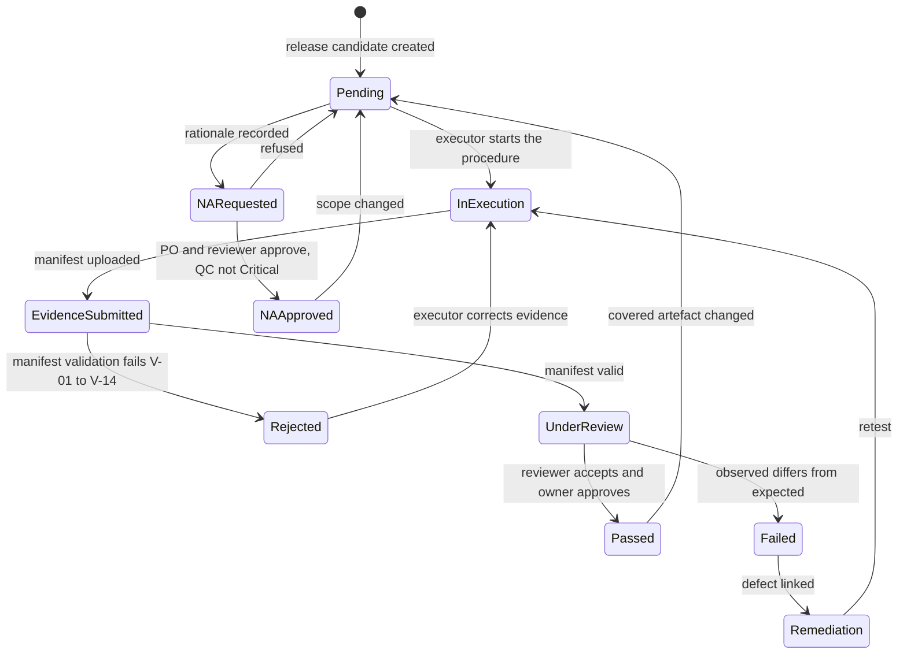
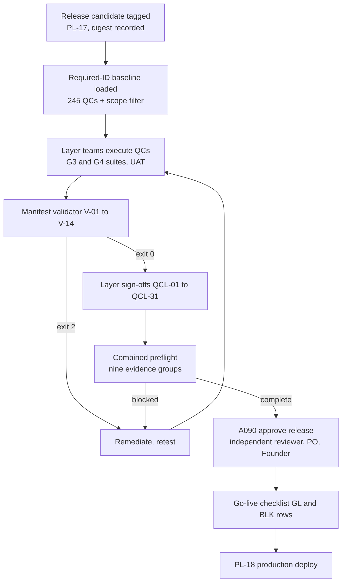
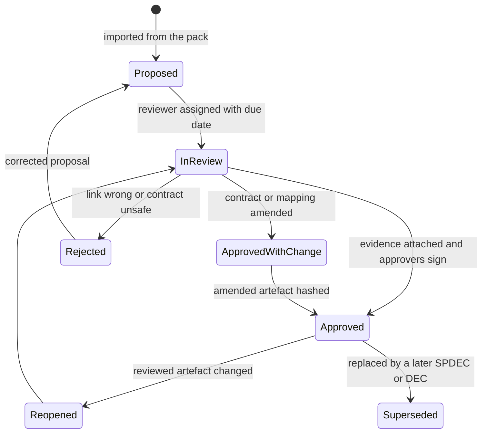
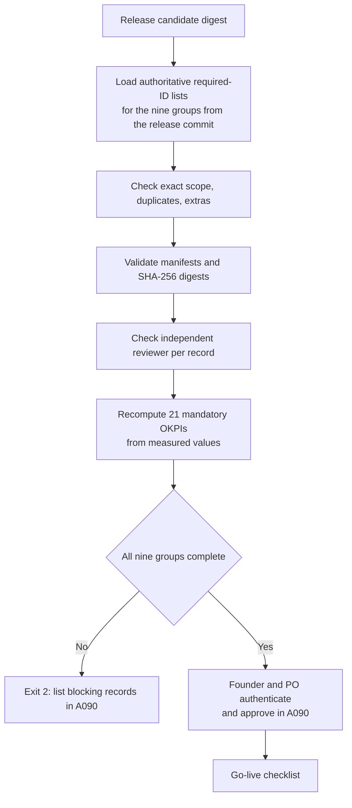
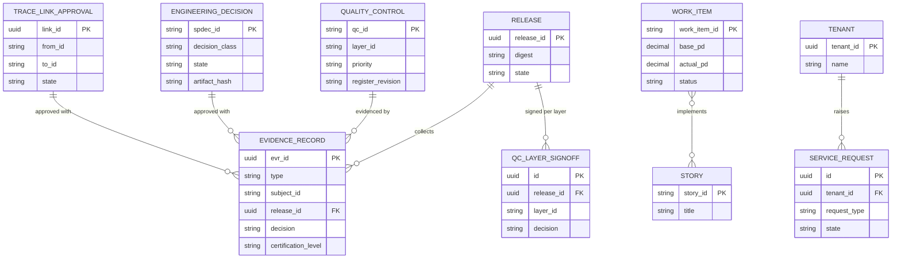

# AI Growth Engine: Employee Sales & Marketing Automation
## Application Blueprint: PART 6 (Batch 6.9b), Source Pack Reconciliation: Quality Controls, Requirements Traceability and Delivery Backlog (Enhancements, Conflicts and Sign-off)

| Field | Value |
|---|---|
| Document | Part 6.9b: full-depth enhancements that close every Partially covered, Not covered and Conflict item found in Part 6.9a for source documents 20, 23 and 24 |
| Version | 1.0 · 27 Nov 2026 |
| Baseline | Part 6.9a; Parts 0A, 1, 2.1, 3.3, 4.2, 4.3, 5.1a, 5.3, 6.1, 6.6, 8.1, 8.2, 9.1 |
| Roles applied | QA Lead, Delivery Lead, Business Systems Analyst / traceability manager, Product Owner; consulted: Principal Engineer, DevOps/SRE Lead, Security/Compliance Lead, FinOps Lead, Data Architect |
| New IDs issued | QCL-01…31 · SPDEC-001…180, SPDEC-X-… · FR-ENH-H-001…010 · US-21-EH01…EH04, US-17-EH01, US-20-EH01 · TC-ENH-H-001…036 · RB-ENH-H-01…03 · ENT-ENH-H-01…07 · XBR-01…05 |
| Tags | ASSUMPTION-440…446 · GAP-440…453 · CONFLICT-440…447 · RECOMMENDATION-440…449 |

**Scope rule.** Nothing in this batch edits an earlier part. Each enhancement states the blueprint part it extends; conflicts carry a proposed resolution for the coordinator to make binding in Part 9.1.

---

## 6.9.5 Enhancements

### 6.9.5.1 Layer-wise quality-control register and delivery sign-off (extends Part 6.1 §6.1.5 and Part 8.2 §8.2.4) [GAP-443] [RECOMMENDATION-440]

**Why it is needed.** The blueprint verifies quality through tests (TC), evidence records (EVR, Part 6.1 §6.1.5.4), CI gates G0–G5 (Part 6.1 §6.1.9.5), release-blocking rules RBR-1…8, the go-live checklist (GL-/BLK-, Part 8.2) and acceptance procedures AP-01…10. It has no single **register of independently reviewed quality checks per engineering layer** with an owner, reviewer, priority, procedure and evidence path for each check, and no layer-level sign-off. Document 23 supplies 245 such checks. This section adopts them as the **QC register**, binds each one to the blueprint control that verifies it, and defines how a QC moves from *Pending* to *Pass* and how layers are signed.

#### 6.9.5.1.1 Binding rules of the QC register

| Rule | Statement | Source | Enforced by |
|---|---|---|---|
| QR-01 | *Pending* is never acceptance. Every QC starts *Pending* for every release candidate | Doc 23 §Quality gates; BRD §14 | FR-ENH-H-001; A090 gate table |
| QR-02 | *Pass* requires an EVR whose evidence manifest (§6.9.5.1.4) validates; a Pass without a valid manifest and artefact digest is rejected | Doc 23 §Evidence gate | FR-ENH-H-002 (V-01…V-14) |
| QR-03 | *Fail* requires a linked defect (Part 6.1 §6.1.8), a corrective action and a retest EVR | Doc 23 §Quality gates | Defect lifecycle §6.1.8.1 |
| QR-04 | *N/A* requires a written rationale, approval by the Product Owner **and** the independent reviewer; **Critical** QCs and the 21 mandatory OKPI gates can never be N/A | Doc 23 §Evidence integrity | V-07 |
| QR-05 | Executor and reviewer must be different people after trimming and case-normalising both identities; reviewer must not have authored the change or the test | Doc 23 §Evidence integrity; BRD §12.1 | V-06 |
| QR-06 | The set of required QC IDs comes from the **immutable register baseline in the release candidate** (`qc_register.csv` at the release commit), never from the register being evaluated; missing, extra and duplicate IDs are rejected | Doc 23 §Fail-closed evidence inventory | V-01…V-03 |
| QR-07 | A QC result is valid only for the release digest and configuration revision it was executed against; a change to any artefact the QC covers resets it to *Pending* | Doc 24 §Change impact | Change impact (FR-ENH-H-004) |
| QR-08 | Any open **Critical** QC failure, or any QC failure that is an S1 defect, blocks release and activation (RBR-1, BLK-1…BLK-3) | Doc 23 §Completion; BRD §11 | A090 |
| QR-09 | A layer (QCL) is signed only when all of its QCs in scope are *Pass* or approved *N/A* | Doc 23 §Quality gates | FR-ENH-H-001 |
| QR-10 | A release requires every in-scope layer signed and the combined preflight (§6.9.5.6) green; completion is necessary, **not sufficient**: the CTO-equivalent (Founder, R01) and the Product Owner still authenticate and approve in A090 | Doc 23 §Combined preflight | US-2106; FR-ENH-H-005 |

#### 6.9.5.1.2 Layer register and signatories

The 31 layers are the 25 engineering layers and 5 business invariants of document 23 plus the expansion layer. Source owners are translated to blueprint roles [ASSUMPTION-442]: the source "Product manager" becomes the Product Owner (the DEC-005 team has no separate product manager); "Business owner" becomes the vertical Startup Head (R02); "Finance lead" becomes Finance maker/checker (R08/R09); "Operations lead" becomes the DevOps/SRE Lead, who also runs operations in the pilot (Part 4.3 §4.43.2).

| Layer | Name | Source owner | Blueprint signatory | Independent reviewer | Signed at | Cadence | Sign-off evidence key |
|---|---|---|---|---|---|---|---|
| QCL-01 | Business requirements | Product owner | Product Owner (R01 delegate) | QA Lead | Wave entry (DoR) and G4 | Every wave gate that changes the layer | evr/qc/<release>/QCL-01-signoff.json |
| QCL-02 | Functional specifications | Product manager | Product Owner + Principal Engineer | QA Lead | Story ready (DoR) and G3 | Every wave gate that changes the layer | evr/qc/<release>/QCL-02-signoff.json |
| QCL-03 | User personas | Product manager | Product Owner | QA Lead or Auditor (R15) | UAT entry (§6.1.13.4) | Every wave gate that changes the layer | evr/qc/<release>/QCL-03-signoff.json |
| QCL-04 | UI/UX | Design lead | UX Lead | QA Lead (or Security Lead for QA-owned layers) | G3 (axe) and UAT | Every wave gate that changes the layer | evr/qc/<release>/QCL-04-signoff.json |
| QCL-05 | Public Website | Frontend lead | Frontend Lead (FS) | QA Lead (or Security Lead for QA-owned layers) | G4 staging and GL-T09 | Every wave gate that changes the layer | evr/qc/<release>/QCL-05-signoff.json |
| QCL-06 | External portal | Security lead | Security Lead | QA Lead (or Security Lead for QA-owned layers) | G4 and GL-S04 | Every release (R1, R2) and every later activation | evr/qc/<release>/QCL-06-signoff.json |
| QCL-07 | Confidential Admin | Product owner | Product Owner | QA Lead or Auditor (R15) | G4 and UAT | Every release (R1, R2) and every later activation | evr/qc/<release>/QCL-07-signoff.json |
| QCL-08 | React implementation | Frontend lead | Frontend Lead (FS) | QA Lead (or Security Lead for QA-owned layers) | G1–G3 CI | Every wave gate that changes the layer | evr/qc/<release>/QCL-08-signoff.json |
| QCL-09 | Django backend | Backend lead | Backend Lead (BE) | QA Lead (or Security Lead for QA-owned layers) | G1–G3 CI | Every wave gate that changes the layer | evr/qc/<release>/QCL-09-signoff.json |
| QCL-10 | REST operations | Backend lead | Backend Lead (BE) | QA Lead (or Security Lead for QA-owned layers) | G3 contract stage | Every release (R1, R2) and every later activation | evr/qc/<release>/QCL-10-signoff.json |
| QCL-11 | PostgreSQL | Database lead | Data Architect / DBA | QA Lead (or Security Lead for QA-owned layers) | G3 migration check and DR drill | Every wave gate that changes the layer | evr/qc/<release>/QCL-11-signoff.json |
| QCL-12 | AI agents/prompts | AI lead | AI Lead | QA Lead (or Security Lead for QA-owned layers) | G3 eval gate (RBR-8) | Every wave gate that changes the layer | evr/qc/<release>/QCL-12-signoff.json |
| QCL-13 | RAG and knowledge | AI lead | AI Lead | QA Lead (or Security Lead for QA-owned layers) | G3 eval gate | Every wave gate that changes the layer | evr/qc/<release>/QCL-13-signoff.json |
| QCL-14 | Workflow automation | Automation lead | Automation Lead (R11) | QA Lead (or Security Lead for QA-owned layers) | G4 and AP-06 | Every release (R1, R2) and every later activation | evr/qc/<release>/QCL-14-signoff.json |
| QCL-15 | External integrations | Integration lead | Integration Lead (BE) | QA Lead (or Security Lead for QA-owned layers) | G3 contract tests and GL-T10 | Every wave gate that changes the layer | evr/qc/<release>/QCL-15-signoff.json |
| QCL-16 | Open-source replacement | Architect | Solutions Architect | QA Lead (or Security Lead for QA-owned layers) | Provider activation approval | Every wave gate that changes the layer | evr/qc/<release>/QCL-16-signoff.json |
| QCL-17 | Security and privacy | Security lead | Security/Compliance Lead | QA Lead (or Security Lead for QA-owned layers) | G2–G4 and GL-S | Every release (R1, R2) and every later activation | evr/qc/<release>/QCL-17-signoff.json |
| QCL-18 | Multi-tenant isolation | Security lead | Security/Compliance Lead | QA Lead (or Security Lead for QA-owned layers) | G3 tenancy gate (0 failures) | Every release (R1, R2) and every later activation | evr/qc/<release>/QCL-18-signoff.json |
| QCL-19 | Financial processing | Finance lead | Finance (R08/R09) + QA Lead | Independent engineer not on the change, or Auditor (R15) | AP-04 and BLK-2/BLK-6 | Every release (R1, R2) and every later activation | evr/qc/<release>/QCL-19-signoff.json |
| QCL-20 | Unit testing | Development lead | Principal Engineer | QA Lead (or Security Lead for QA-owned layers) | G1/G2 CI | Every wave gate that changes the layer | evr/qc/<release>/QCL-20-signoff.json |
| QCL-21 | SIT | QA lead | QA Lead | Independent engineer not on the change, or Auditor (R15) | G4 staging | Every wave gate that changes the layer | evr/qc/<release>/QCL-21-signoff.json |
| QCL-22 | UAT | Business owner | Product Owner + vertical owner | QA Lead (or Security Lead for QA-owned layers) | UAT exit and GL-B01 | Every wave gate that changes the layer | evr/qc/<release>/QCL-22-signoff.json |
| QCL-23 | Infrastructure and deployment | DevOps lead | DevOps/SRE Lead | QA Lead (or Security Lead for QA-owned layers) | G4/G5 promotion | Every release (R1, R2) and every later activation | evr/qc/<release>/QCL-23-signoff.json |
| QCL-24 | Production readiness | Operations lead | DevOps/SRE Lead + Operations | QA Lead (or Security Lead for QA-owned layers) | Go/no-go (Part 8.2 §8.2.4) | Every release (R1, R2) and every later activation | evr/qc/<release>/QCL-24-signoff.json |
| QCL-25 | Delivery and handover | Product owner | Product Owner + CTO | QA Lead (or Security Lead for QA-owned layers) | Go/no-go and hypercare exit | Every wave gate that changes the layer | evr/qc/<release>/QCL-25-signoff.json |
| QCL-26 | AppNAI project delivery | Business owner | AppNAI Startup Head (R02) + QA | Independent engineer not on the change, or Auditor (R15) | UAT pack AppNAI | Every release (R1, R2) and every later activation | evr/qc/<release>/QCL-26-signoff.json |
| QCL-27 | MedMaarg healthcare | Business owner | MedMaarg Startup Head (R02) + DPO (R10) | QA Lead (or Security Lead for QA-owned layers) | UAT pack MedMaarg | Every release (R1, R2) and every later activation | evr/qc/<release>/QCL-27-signoff.json |
| QCL-28 | EduVerse education | Business owner | EduVerse Startup Head (R02) + DPO (R10) | QA Lead (or Security Lead for QA-owned layers) | UAT pack EduVerse | Every release (R1, R2) and every later activation | evr/qc/<release>/QCL-28-signoff.json |
| QCL-29 | OrganicSpec trade | Business owner | OrganicSpec Startup Head (R02) + Finance | QA Lead (or Security Lead for QA-owned layers) | UAT pack OrganicSpec | Every release (R1, R2) and every later activation | evr/qc/<release>/QCL-29-signoff.json |
| QCL-30 | Commercial campaigns | Business owner | Marketing Lead (R05L) + DPO | QA Lead (or Security Lead for QA-owned layers) | UAT pack Marketing | Every release (R1, R2) and every later activation | evr/qc/<release>/QCL-30-signoff.json |
| QCL-31 | Expansion QC and sign-off | QA lead + product owner | QA Lead + Product Owner | Independent engineer not on the change, or Auditor (R15) | R2 go/no-go | Every release (R1, R2) and every later activation | evr/qc/<release>/QCL-31-signoff.json |

Checks and priorities per layer are in Part 6.9a §6.9.4.6. Of the 235 baseline checks, **50 are Critical** (QC-071…QC-079, QC-105, QC-140, QC-141, QC-159…QC-182, QC-207…QC-214, QC-221 and QC-231…QC-235) and 185 are High. The ten expansion checks UX-QC-01…10 carry no source priority; they are treated as **Critical** here (60 Critical in total) because document 23 forbids an N/A bypass for them.

#### 6.9.5.1.3 QC execution lifecycle



| State | Who may move it | Allowed next states | Effect on A090 |
|---|---|---|---|
| Pending | System (on release candidate creation) | InExecution, NARequested | Blocks |
| InExecution | Executor (QC owner's team) | EvidenceSubmitted | Blocks |
| EvidenceSubmitted | System (validator) | UnderReview, Rejected | Blocks |
| Rejected | System | InExecution | Blocks |
| UnderReview | Independent reviewer | Passed, Failed | Blocks |
| Passed | Reviewer + layer signatory | Pending (on change) | Clears the QC |
| Failed | Reviewer | Remediation | Blocks; S1/Critical also blocks activation |
| Remediation | Executor | InExecution | Blocks |
| NARequested | QC owner | NAApproved, Pending | Blocks |
| NAApproved | PO + reviewer | Pending (on scope change) | Clears the QC (never for Critical or mandatory OKPI) |

#### 6.9.5.1.4 Evidence manifest and validation rules

Each QC execution writes one EVR (Part 6.1 §6.1.5.4) of type `qc` with the manifest below. Source path `evidence/qc/QC-###.json` maps to the S3 key `evr/qc/<release_id>/<qc_id>.json` in the evidence bucket under Object Lock compliance mode (DEC-082) [ASSUMPTION-443].

| Manifest field | Type | Rule |
|---|---|---|
| `qc_id` | string | Must exist in the release's required-ID baseline (QR-06) |
| `layer_id` | string | QCL-01…31; must equal the register's layer for the QC |
| `release_id` / `artifact_digest` | string / sha256 | Must equal the release candidate digest in A090 (GL-T01) |
| `config_revision` | string | Policy, rule-pack, prompt and model versions in force |
| `scope` | object | Product, tenant fixture, startup, surface; synthetic fixture IDs only before L-C |
| `procedure_ref` | string | Command or test selector actually run (bound form of the source command template, §6.9.5.1.5) |
| `expected` | string | Copied from the register's acceptance text; non-blank after trimming |
| `observed` | string + metrics | Non-blank after trimming; structured metrics where the QC has a threshold |
| `executor` / `reviewer` / `owner_approval` | identity (IdP subject + display name) | Three non-blank identities; executor ≠ reviewer after normalisation; owner approval by the layer signatory role |
| `artifacts[]` | list of {path, sha256, bytes} | At least one; each hash re-computed by the validator |
| `decision` | enum | Pending / Pass / Fail / NA |
| `na_rationale`, `na_approvals[]` | string, identities | Required when decision = NA; forbidden for Critical QCs |
| `defect_ids[]`, `retest_of` | list, EVR id | Required when decision = Fail and on retests |
| `certification_level` | enum | L-S / L-T / L-C / L-P (Part 6.1 §6.1.5.5); set by the gate, not the executor |
| `created_at` | UTC timestamp | Append-only; corrections create a new EVR |

```json
{
  "qc_id": "QC-177", "layer_id": "QCL-19", "release_id": "R-2027.05.1",
  "artifact_digest": "sha256:<release image digest>", "config_revision": "cfg-rev-0142",
  "scope": {"product": "growth-engine", "tenant_fixture": "T1,T2", "startup": "S-ORG-01", "surface": "worker"},
  "procedure_ref": "pytest -m 'qc(\"QC-177\")' --junitxml=qc-financial.xml",
  "expected": "Provider reference deduplicated; no second credit.",
  "observed": "2 identical payment callbacks; 1 ledger credit; 2nd callback status=duplicate_ignored",
  "metrics": {"ledger_credits": 1, "callbacks": 2},
  "executor": "idp|eng-be-02", "reviewer": "idp|qa-01", "owner_approval": "idp|fin-checker-01",
  "artifacts": [{"path": "qc-financial.xml", "sha256": "<hash>", "bytes": 18234}],
  "decision": "Pass", "certification_level": "L-T", "created_at": "2027-05-18T09:41:07Z"
}
```

| Validation | Rejects | Source |
|---|---|---|
| V-01 | A required QC ID missing from the submission set | Doc 23 fail-closed inventory |
| V-02 | An extra ID not in the baseline | Same |
| V-03 | A duplicate QC ID in one release | Same |
| V-04 | Manifest shape invalid (missing field, wrong type) | Same |
| V-05 | Blank or whitespace-only `expected` or `observed` | Doc 23 evidence integrity |
| V-06 | `executor` equals `reviewer` after trim + case-fold; reviewer is the change author | Same; BRD §12.1 |
| V-07 | `decision = NA` on a Critical QC or a mandatory OKPI; NA without two approvals | Doc 23 |
| V-08 | Artifact hash mismatch or missing artifact | Doc 23 evidence gate |
| V-09 | `artifact_digest` ≠ release candidate digest | GL-T01 |
| V-10 | `owner_approval` missing or not held by the layer signatory role | Doc 23 |
| V-11 | `certification_level = L-P` set by a synthetic run (`environment ≠ prod`) | Part 6.1 §6.1.5.5 |
| V-12 | Fail without defect ID, or retest without `retest_of` | QR-03 |
| V-13 | Evidence older than the last change to a covered artefact (QR-07) | Doc 24 change impact |
| V-14 | Register edited in the same commit that submits its evidence (the register cannot define its own scope) | Doc 23 |

Validator exit codes (bound form of the source `release_gate.py` contract): **0** all required records valid and Pass/approved N/A; **1** validator error (bad input); **2** one or more required records Pending, Failed or invalid. Document 23 records that the pending baseline returns exit code 2; the blueprint gate must do the same and A090 must show the blocking list [RECOMMENDATION-442].

#### 6.9.5.1.5 Source command templates bound to the blueprint pipeline

| Source command template | Count of QCs | Blueprint implementation | Where it runs |
|---|---|---|---|
| `python starter/verify_catalogs.py` | 27 | `build_rtm.py` (Part 6.6) extended to check BR/FR/US/TC/QC/SPDEC links and fail on orphans [RECOMMENDATION-443] | G1 (changed files), G4 (full) |
| `npx playwright test --grep <approved-test-tag>` | 45 | Playwright projects with tag `@QC-###`; widths 360/768/1280/1440 [RECOMMENDATION-444] | G3 nightly, G4 |
| `python -m pytest -k <approved-test-selector>` (backend, AI, isolation, workflow, financial, domain) | 82 | pytest marker `@pytest.mark.qc("QC-###")`; suites per layer | G1/G2 (subset), G3/G4 (full) |
| `python starter/benchmark_synthetic.py` | 18 | Benchmark harness for open-source replacements and AI routing (§6.9.5.1.6 C-4) | Before provider activation (GL-T10) |
| `python starter/release_gate.py --help` | 18 | A090 gate evaluator + combined preflight (FR-ENH-H-005) | PL-17 / G4 |
| `python manage.py makemigrations --check --dry-run; migrate --plan` | 9 | PL-07 migrations check | G1 |
| `python -m pytest --junitxml=unit.xml` / `-m integration` | 18 | PL-04 / G2 full integration | G1/G2 |
| `npx playwright test --grep <approved-uat-tag>` | 9 | UAT packs (Part 6.1 §6.1.13.3) | UAT window |
| `docker compose config; terraform validate` | 9 | PL-02 OpenTofu `fmt/validate` (ADR per Part 4.3 §4.34) | G1 |
| (none: expansion checks UX-QC-01…10) | 10 | Playwright + pytest on fixture GSE-SYN-X10 [RECOMMENDATION-446] | G4 R2 |

Placeholders such as `<approved-test-selector>` are **not runnable** until bound to a real selector; a manifest whose `procedure_ref` still contains `<…>` fails V-04.

#### 6.9.5.1.6 New or tightened controls for partially covered checks

| Control | Closes | Specification | Acceptance |
|---|---|---|---|
| C-1 Bulk-action preview | QC-082 | Every bulk action that can cause an external effect (bulk enrol, bulk send, bulk publish, campaign launch) first returns a **preview resource**: eligible count, excluded count by reason code (suppressed, consent missing, jurisdiction, quiet hours, frequency cap, missing approval), estimated cost (₹, from M53 rates) and a preview hash. The execute call must carry the preview hash; the PDP rechecks at dispatch (CA-DISPATCH) | TC-ENH-H-020: execute without preview → 409; execute with a stale preview (population changed) → 409; exclusions match the PDP decision table |
| C-2 Viewport matrix | QC-058, UX-QC-10 | Playwright projects at 360, 768, 1280 and 1440 px for both apps; no horizontal overflow except data grids | TC-ENH-H-021 |
| C-3 No external I/O inside a database transaction | QC-100 | Code-review checklist item and a Semgrep rule: calls to adapter clients, `requests`/`httpx` or the model gateway inside `transaction.atomic` blocks fail PL-05 [RECOMMENDATION-445] | TC-ENH-H-022 (rule fires on a seeded violation) |
| C-4 Replacement benchmark protocol | QC-016, QC-152…156 | For any open-source or self-hosted replacement of a paid tool (search, extraction, enrichment, validation, social listening): same labelled workload (≥ 200 items, stratified by country and source category), measure precision/recall or task pass rate, error and retry rate, p95 latency, coverage gaps by country/category, and **TCO = hosting + provider fees + maintenance PD × ₹ rate + model cost** per 1,000 tasks; paid wrapper stays disabled until the record is approved (NFR-037) [RECOMMENDATION-449] | TC-ENH-H-023: activation API refuses a paid adapter without an approved benchmark record |
| C-5 Derived-data erasure | QC-134 | Erasure and retention jobs include embeddings, chunk caches, search indexes and Copilot answer caches derived from the erased record; the job reports counts per derived store [GAP-447] | TC-ENH-H-024: after erasure, vector and trigram search for the unique token returns 0 |
| C-6 Accessible-error UAT per interface | QC-200 | Each of the 147 interfaces has at least one UAT step that triggers a validation or denied state and checks the accessible error message and focus [RECOMMENDATION-447] | UAT pack coverage report = 147/147 |
| C-7 Scale fixture | UX-QC-01, UX-QC-03 | Fixture **GSE-SYN-X10**: Owner Portfolio tenant with 26 owned startups; 10 client tenants × 2 startups; 20 concurrent workflow runs; used only in G4 R2 and scale-gate tests [RECOMMENDATION-446] | TC-ENH-H-025 |
| C-8 Coverage of critical rules | QC-187 | Proposed resolution of [CONFLICT-440]: branch coverage ≥ 90% for PDP, approvals, finance/ledger and tenancy rule modules from R2; ≥ 85% stays the R1 floor | PL-04 threshold change recorded in Part 4.3 §4.33.4 by its owner |
| C-9 Change impact gate | QC-038 | §6.9.5.3.4 | TC-ENH-H-013…015 |
| C-10 Handover inventory | QC-025, QC-224, QC-227 | §6.9.5.5.4 and §6.9.5.5.5 | TC-ENH-H-030…032 |

#### 6.9.5.1.7 Layer sign-off sheet and release sign-off sequence

Each signed layer produces a sign-off EVR (`evr/qc/<release>/QCL-##-signoff.json`) with the BRD §12.2 fields:

| Field | Content |
|---|---|
| Layer and scope | QCL-## · release ID · waves · startups/tenants in scope |
| QC summary | Count of QCs in scope; Pass; approved N/A (with IDs); Failed (must be 0); Pending (must be 0) |
| Evidence | Manifest IDs and hashes; validator report digest (exit code 0) |
| Defects | Open defects by severity linked to the layer (S1 = 0; S2 in P0 areas = 0) |
| Signatory | Blueprint signatory role (§6.9.5.1.2): name, IdP subject, timestamp |
| Independent reviewer | Name, IdP subject, timestamp; not the signatory |
| Residual risk | RSK IDs accepted, with expiry |
| Decision | Signed / Refused (reason) |



#### 6.9.5.1.8 QC register (245 checks)

Columns: QC ID · layer · check (source title) · priority · blueprint signatory · blueprint verification (the control, test family, NFR, DoD, GL/BLK, AP or RB that produces the evidence) · gate · status of the blueprint coverage. Owner, reviewer, procedure, command template and evidence path per QC are in `H_qc_map.csv`.

| QC | Layer | Check | Prio | Blueprint sign-off role | Blueprint verification | Gate | Status |
|---|---|---|---|---|---|---|---|
| QC-01 | QCL-01 | Confirm funding or commercial objective, legal entity, permi | High | Product Owner (R01 delegate) | BR-S134; AP-08; Part 1 §BR register; DEC-002 | Wave entry (DoR) and G4 | Covered |
| QC-031 | QCL-01 | Approved legal entity | High | Product Owner (R01 delegate) | DEC-027 TaxProfile per startup; DEC-065; BRL-TEN; US-0108 | Wave entry (DoR) and G4 | Covered |
| QC-032 | QCL-01 | Business objective | High | Product Owner (R01 delegate) | KPI-01…31 (Part 1); Part 8.2 §8.2.6 baselines; BR-S134 | Wave entry (DoR) and G4 | Covered |
| QC-033 | QCL-01 | Requirement uniqueness | High | Product Owner (R01 delegate) | Part 0 §0.4; final/duplicate_ids.csv; DEC-014 | Wave entry (DoR) and G4 | Covered |
| QC-034 | QCL-01 | Scope separation | High | Product Owner (R01 delegate) | FR-NEG-01; DEC-002, DEC-058; US-0114 | Wave entry (DoR) and G4 | Covered |
| QC-035 | QCL-01 | Stakeholder acceptance | High | Product Owner (R01 delegate) | Part 1 BR register accountable role column; AC per story | Wave entry (DoR) and G4 | Covered |
| QC-036 | QCL-01 | Business configuration | High | Product Owner (R01 delegate) | AP-01; AP-07; US-2004 | Wave entry (DoR) and G4 | Covered |
| QC-037 | QCL-01 | Jurisdiction review | High | Product Owner (R01 delegate) | DEC-029 Jurisdiction Rule Pack; GL-C02 | Wave entry (DoR) and G4 | Covered |
| QC-038 | QCL-01 | Change impact | High | Product Owner (R01 delegate) | Part 8.2 §8.2.2.4 change control; BR-S134 | Wave entry (DoR) and G4 | Partially covered: Impact record exists; no machine-readable impact set (UI/API/DB/workflow/test) gate before merge (§6.9.5.3.4) |
| QC-02 | QCL-02 | Walk every normal, alternate and exception path; define vali | High | Product Owner + Principal Engineer | Part 2.2 WF-01…14; Part 2.3 state machines; §6.1.11.4 | Story ready (DoR) and G3 | Covered |
| QC-039 | QCL-02 | State transitions | High | Product Owner + Principal Engineer | Part 2.3 state machines; §6.1.11.4; NFR-025 | Story ready (DoR) and G3 | Covered |
| QC-040 | QCL-02 | Required fields | High | Product Owner + Principal Engineer | D-4 400 paths; §6.1.11.2 BVA | Story ready (DoR) and G3 | Covered |
| QC-041 | QCL-02 | Duplicate event | High | Product Owner + Principal Engineer | NFR-005, NFR-066; EG-03, EG-07 | Story ready (DoR) and G3 | Covered |
| QC-042 | QCL-02 | Concurrency | High | Product Owner + Principal Engineer | NFR-025; EG-04, EG-05 | Story ready (DoR) and G3 | Covered |
| QC-043 | QCL-02 | Failure behavior | High | Product Owner + Principal Engineer | NFR-016; FR-STD-04; RB-011 | Story ready (DoR) and G3 | Covered |
| QC-044 | QCL-02 | Eligibility | High | Product Owner + Principal Engineer | CA-DISPATCH; BLK-5; §6.1.11.3 | Story ready (DoR) and G3 | Covered |
| QC-045 | QCL-02 | Read/write boundaries | High | Product Owner + Principal Engineer | Part 3.2 serializers; NFR-002; ABAC-01…12 | Story ready (DoR) and G3 | Covered |
| QC-046 | QCL-02 | Acceptance evidence | High | Product Owner + Principal Engineer | D-3; BLK-10; §6.6.8 | Story ready (DoR) and G3 | Covered |
| QC-03 | QCL-03 | Validate role, task, frequency, accessibility, delegated aut | High | Product Owner | P01–P16; R01–R20; §6.1.13.2 | UAT entry (§6.1.13.4) | Covered |
| QC-047 | QCL-03 | Role matrix | High | Product Owner | Part 2.3 RBAC matrix; §6.1.11.5 pairwise | UAT entry (§6.1.13.4) | Covered |
| QC-048 | QCL-03 | External visitor | High | Product Owner | R18; CA-PUB; FR-W12 field minimization | UAT entry (§6.1.13.4) | Covered |
| QC-049 | QCL-03 | External account | High | Product Owner | R16; CA-PORTAL; BRL-TEN | UAT entry (§6.1.13.4) | Covered |
| QC-050 | QCL-03 | Owner authority | High | Product Owner | DEC-055; R01; BRL-APR-09 | UAT entry (§6.1.13.4) | Covered |
| QC-051 | QCL-03 | Support access | High | Product Owner | DEC-056; US-0109; GL-P05 | UAT entry (§6.1.13.4) | Covered |
| QC-052 | QCL-03 | Finance/approval | High | Product Owner | R08/R09; BRL-APR; GL-B07 | UAT entry (§6.1.13.4) | Covered |
| QC-053 | QCL-03 | Revocation | High | Product Owner | NFR-050; US-0105; EG-13 | UAT entry (§6.1.13.4) | Covered |
| QC-054 | QCL-03 | Accessibility needs | High | Product Owner | NFR-089; §6.1.13.2 | UAT entry (§6.1.13.4) | Covered |
| QC-04 | QCL-04 | Review mobile/desktop, keyboard, focus, readable contrast, e | High | UX Lead | Part 2.5 §2.46–2.48; D-10; NFR-088/089 | G3 (axe) and UAT | Covered |
| QC-055 | QCL-04 | Keyboard navigation | High | UX Lead | NFR-089; D-10 | G3 (axe) and UAT | Covered |
| QC-056 | QCL-04 | Accessible names | High | UX Lead | NFR-088; D-10 | G3 (axe) and UAT | Covered |
| QC-057 | QCL-04 | Contrast | High | UX Lead | Part 2.5 §2.45.1 tokens; NFR-088 | G3 (axe) and UAT | Covered |
| QC-058 | QCL-04 | Responsive layout | High | UX Lead | DEC-043 (360 px Website, 1280 px Admin, 768 px review); §2.48 | G3 (axe) and UAT | Partially covered: 1440 px viewport not in the blueprint test matrix [RECOMMENDATION-444] |
| QC-059 | QCL-04 | Loading and empty | High | UX Lead | Part 2.5 §2.47 UI state catalogue | G3 (axe) and UAT | Covered |
| QC-060 | QCL-04 | Destructive action | High | UX Lead | Part 2.5 §2.47; CA-APPROVE | G3 (axe) and UAT | Covered |
| QC-061 | QCL-04 | Filter reset | High | UX Lead | NFR-027; FR-UIS-01; EG-05 | G3 (axe) and UAT | Covered |
| QC-062 | QCL-04 | Localization | High | UX Lead | NFR-024, NFR-096, NFR-097 | G3 (axe) and UAT | Covered |
| QC-05 | QCL-05 | Verify approved publication, host resolution, form validatio | High | Frontend Lead (FS) | NFR-020/021/022; FR-PUB-01; TC-19 family | G4 staging and GL-T09 | Covered |
| QC-063 | QCL-05 | Published snapshot | High | Frontend Lead (FS) | NFR-020; FR-PUB-01 | G4 staging and GL-T09 | Covered |
| QC-064 | QCL-05 | Host resolution | High | Frontend Lead (FS) | NFR-020 unknown host 404 | G4 staging and GL-T09 | Covered |
| QC-065 | QCL-05 | Enquiry validation | High | Frontend Lead (FS) | FR-W12; NFR-022 | G4 staging and GL-T09 | Covered |
| QC-066 | QCL-05 | Rate limit | High | Frontend Lead (FS) | NFR-022; Part 3.2 §3.2.1.7 | G4 staging and GL-T09 | Covered |
| QC-067 | QCL-05 | Public DTO | High | Frontend Lead (FS) | BR-S120; NFR-001; bundle boundary test | G4 staging and GL-T09 | Covered |
| QC-068 | QCL-05 | Unpublish | High | Frontend Lead (FS) | NFR-020 purge; GL-T09 | G4 staging and GL-T09 | Covered |
| QC-069 | QCL-05 | SEO metadata | High | Frontend Lead (FS) | FR-PUB-01 preview no-index; BR-S127 | G4 staging and GL-T09 | Covered |
| QC-070 | QCL-05 | Chat boundary | High | Frontend Lead (FS) | FR-W11; DEC-035 Copilot Admin-only; AG tool registry DEC-048 | G4 staging and GL-T09 | Covered |
| QC-06 | QCL-06 | Test invitation redemption, expiration, object grants, priva | High | Security Lead | CA-PORTAL; NFR-002; US-1909…1913 | G4 and GL-S04 | Covered |
| QC-071 | QCL-06 | Audience | Critical | Security Lead | NFR-001, NFR-003; DEC-058 | G4 and GL-S04 | Covered |
| QC-072 | QCL-06 | Object grant | Critical | Security Lead | NFR-002; CA-PORTAL | G4 and GL-S04 | Covered |
| QC-073 | QCL-06 | Invitation expiry | Critical | Security Lead | US-1909 portal registration/recovery; NFR-050 | G4 and GL-S04 | Covered |
| QC-074 | QCL-06 | Document grant | Critical | Security Lead | NFR-050; signed URLs Part 3.1 | G4 and GL-S04 | Covered |
| QC-075 | QCL-06 | Upload quarantine | Critical | Security Lead | NFR-021 | G4 and GL-S04 | Covered |
| QC-076 | QCL-06 | Own transaction | Critical | Security Lead | FR-W25, FR-W26 | G4 and GL-S04 | Covered |
| QC-077 | QCL-06 | Session recovery | Critical | Security Lead | NFR-074 enumeration resistance | G4 and GL-S04 | Covered |
| QC-078 | QCL-06 | Signed agreement | Critical | Security Lead | FR-W24; DEC-023 | G4 and GL-S04 | Covered |
| QC-07 | QCL-07 | Check tenant/startup selector, seven views, adaptive filters | High | Product Owner | US-1701, US-1702; FR-FLT-RULES; NFR-027 | G4 and UAT | Covered |
| QC-079 | QCL-07 | Admin audience | Critical | Product Owner | NFR-001; BR-S126 default deny | G4 and UAT | Covered |
| QC-080 | QCL-07 | Startup selector | High | Product Owner | DEC-055; US-1702 | G4 and UAT | Covered |
| QC-081 | QCL-07 | Filter query | High | Product Owner | FR-FLT-RULES; NFR-015 | G4 and UAT | Covered |
| QC-082 | QCL-07 | Bulk preview | High | Product Owner | CA-DISPATCH; FR-A058; DEC-038 | G4 and UAT | Partially covered: Bulk-action preview with exclusions and cost estimate before dispatch not specified as a common control (§6.9.5.1.6) |
| QC-083 | QCL-07 | Approval queue | High | Product Owner | CA-APPROVE; BRL-APR-09 | G4 and UAT | Covered |
| QC-084 | QCL-07 | Audit panel | High | Product Owner | NFR-073, NFR-078; FR-A009 | G4 and UAT | Covered |
| QC-085 | QCL-07 | Pause control | High | Product Owner | NFR-049; RB-004; US-1806 | G4 and UAT | Covered |
| QC-086 | QCL-07 | Export control | High | Product Owner | EG-13; NFR-048 | G4 and UAT | Covered |
| QC-08 | QCL-08 | Type-check, lint, component tests, safe rich-text rendering, | High | Frontend Lead (FS) | §4.33.2 G1–G3; D-1, D-7, D-8 | G1–G3 CI | Covered |
| QC-087 | QCL-08 | TypeScript | High | Frontend Lead (FS) | §4.33.2 typecheck stage | G1–G3 CI | Covered |
| QC-088 | QCL-08 | Tests | High | Frontend Lead (FS) | D-3 (Testing Library accessible queries) | G1–G3 CI | Covered |
| QC-089 | QCL-08 | Cache keys | High | Frontend Lead (FS) | NFR-027; EG-11 | G1–G3 CI | Covered |
| QC-090 | QCL-08 | Abort stale fetch | High | Frontend Lead (FS) | NFR-027; FR-UIS-01 | G1–G3 CI | Covered |
| QC-091 | QCL-08 | Secrets | High | Frontend Lead (FS) | NFR-068; GL-S01 | G1–G3 CI | Covered |
| QC-092 | QCL-08 | Error handling | High | Frontend Lead (FS) | Part 3.2 §3.2.1.9 problem details | G1–G3 CI | Covered |
| QC-093 | QCL-08 | Form validation | High | Frontend Lead (FS) | D-4; FR-ENG-01 | G1–G3 CI | Covered |
| QC-094 | QCL-08 | Build size | High | Frontend Lead (FS) | NFR-043, NFR-044; §4.33.4 | G1–G3 CI | Covered |
| QC-09 | QCL-09 | Verify services, serializer validation, explicit permissions | High | Backend Lead (BE) | FR-ENG-01; D-3, D-4; NFR-006 | G1–G3 CI | Covered |
| QC-095 | QCL-09 | Scoped query | High | Backend Lead (BE) | NFR-002; US-0107 RLS | G1–G3 CI | Covered |
| QC-096 | QCL-09 | Service transaction | High | Backend Lead (BE) | NFR-006 | G1–G3 CI | Covered |
| QC-097 | QCL-09 | Revision lock | High | Backend Lead (BE) | NFR-025 | G1–G3 CI | Covered |
| QC-098 | QCL-09 | Domain rules | High | Backend Lead (BE) | Part 3.1 service layer; BRL | G1–G3 CI | Covered |
| QC-099 | QCL-09 | Idempotency | High | Backend Lead (BE) | Part 3.2 §3.2.1.5; NFR-066 | G1–G3 CI | Covered |
| QC-100 | QCL-09 | Timeout | High | Backend Lead (BE) | FR-ENG-01; NFR-016 | G1–G3 CI | Partially covered: Rule 'external call outside the DB transaction' implied by outbox but not stated as a review check [RECOMMENDATION-445] |
| QC-101 | QCL-09 | Error mapping | High | Backend Lead (BE) | Part 3.2 §3.2.1.9–3.2.1.10 | G1–G3 CI | Covered |
| QC-102 | QCL-09 | Worker scope | High | Backend Lead (BE) | BR-S128; CA-DISPATCH | G1–G3 CI | Covered |
| QC-10 | QCL-10 | Assert method/path, request/response contract, boundary, sta | High | Backend Lead (BE) | Part 3.2 §3.2.1; D-6; NFR-015 | G3 contract stage | Covered |
| QC-103 | QCL-10 | Contract | High | Backend Lead (BE) | DEC-015 derived catalogue; Part 3.2 §3.2.2 | G3 contract stage | Partially covered: Source DEC-001…038 exact contract approvals not represented as decision records (§6.9.5.2) |
| QC-104 | QCL-10 | Permission | High | Backend Lead (BE) | D-4; §6.1.11.5 | G3 contract stage | Covered |
| QC-105 | QCL-10 | Object scope | Critical | Backend Lead (BE) | NFR-002 uniform 403/404 | G3 contract stage | Covered |
| QC-106 | QCL-10 | Input size | High | Backend Lead (BE) | NFR-021; Part 3.2 size limits | G3 contract stage | Covered |
| QC-107 | QCL-10 | Pagination | High | Backend Lead (BE) | NFR-015; FR-FLT-RULES stable cursor | G3 contract stage | Covered |
| QC-108 | QCL-10 | Mutation replay | High | Backend Lead (BE) | NFR-005, NFR-066 | G3 contract stage | Covered |
| QC-109 | QCL-10 | Error envelope | High | Backend Lead (BE) | Part 3.2 §3.2.1.9 | G3 contract stage | Covered |
| QC-110 | QCL-10 | Adapter callbacks | High | Backend Lead (BE) | Part 3.2 §3.2.1.13 replay window | G3 contract stage | Covered |
| QC-11 | QCL-11 | Verify FK ordering, composite ownership, constraints, indexe | High | Data Architect / DBA | Part 3.3; §4.37.2; RB-007; US-2108 | G3 migration check and DR drill | Covered |
| QC-111 | QCL-11 | Ownership | High | Data Architect / DBA | NFR-017; D-5 | G3 migration check and DR drill | Covered |
| QC-112 | QCL-11 | Identity reuse | High | Data Architect / DBA | DEC-019; US-0101; BLK-9 | G3 migration check and DR drill | Covered |
| QC-113 | QCL-11 | Unique keys | High | Data Architect / DBA | Part 3.3 unique constraints; NFR-066 | G3 migration check and DR drill | Covered |
| QC-114 | QCL-11 | Decimal | High | Data Architect / DBA | NFR-017; DEC-027 | G3 migration check and DR drill | Covered |
| QC-115 | QCL-11 | Migration | High | Data Architect / DBA | §4.37.2 expand/contract; GL-D01 | G3 migration check and DR drill | Covered |
| QC-116 | QCL-11 | Index | High | Data Architect / DBA | Part 3.3 index strategy (EXPLAIN plans) | G3 migration check and DR drill | Covered |
| QC-117 | QCL-11 | Backup | High | Data Architect / DBA | US-2108; RB-007; §4.47 | G3 migration check and DR drill | Covered |
| QC-118 | QCL-11 | Delete policy | High | Data Architect / DBA | DEC-028; NFR-076; legal hold | G3 migration check and DR drill | Covered |
| QC-12 | QCL-12 | Use typed output, approved evidence, no invented claims, con | High | AI Lead | Part 7.2; Part 6.4; NFR-033; D-11 | G3 eval gate (RBR-8) | Covered |
| QC-119 | QCL-12 | Schema | High | AI Lead | CA-AI schema validation; BRL-AI | G3 eval gate (RBR-8) | Covered |
| QC-120 | QCL-12 | Grounding | High | AI Lead | CA-AI citations; Part 6.4 grounding sets | G3 eval gate (RBR-8) | Covered |
| QC-121 | QCL-12 | Unknowns | High | AI Lead | FR-UIS-02; CA-AI abstain | G3 eval gate (RBR-8) | Covered |
| QC-122 | QCL-12 | Injection | High | AI Lead | US-0406; EG-14; GL-A05 | G3 eval gate (RBR-8) | Covered |
| QC-123 | QCL-12 | Model routing | High | AI Lead | DEC-007; DEC-008; US-0403 | G3 eval gate (RBR-8) | Covered |
| QC-124 | QCL-12 | Evaluation | High | AI Lead | NFR-033; DEC-061; GL-A01 | G3 eval gate (RBR-8) | Covered |
| QC-125 | QCL-12 | Fallback | High | AI Lead | DEC-007 Tier 3 degrade; RB-001 | G3 eval gate (RBR-8) | Covered |
| QC-126 | QCL-12 | Autonomy | High | AI Lead | DEC-064; AP-06 | G3 eval gate (RBR-8) | Covered |
| QC-13 | QCL-13 | Scope retrieval by product, tenant, startup, purpose and app | High | AI Lead | Part 7.2 retrieval guards; TC-AI injection sets; DEC-037 | G3 eval gate | Covered |
| QC-127 | QCL-13 | Scope | High | AI Lead | NFR-002 vector retrieval; DEC-037 | G3 eval gate | Covered |
| QC-128 | QCL-13 | Version | High | AI Lead | Part 7.2 knowledge revision invalidation; US-0203/0204 | G3 eval gate | Covered |
| QC-129 | QCL-13 | Document quarantine | High | AI Lead | NFR-021; US-0204 | G3 eval gate | Covered |
| QC-130 | QCL-13 | Revocation | High | AI Lead | NFR-036; Part 3.3 erasure | G3 eval gate | Covered |
| QC-131 | QCL-13 | Evidence metadata | High | AI Lead | NFR-028; ENT-059 Evidence | G3 eval gate | Covered |
| QC-132 | QCL-13 | Relevance | High | AI Lead | Part 7.2/7.3 retrieval recall@k targets | G3 eval gate | Covered |
| QC-133 | QCL-13 | Public separation | High | AI Lead | FR-W11; DEC-035 | G3 eval gate | Covered |
| QC-134 | QCL-13 | Export/delete | High | AI Lead | NFR-036; DEC-028 | G3 eval gate | Partially covered: Erasure of derived embeddings and cached snippets not listed explicitly in the erasure job scope [GAP-447] |
| QC-14 | QCL-14 | Simulate zero side effects; verify triggers, revalidation, c | High | Automation Lead (R11) | US-1807 simulation; NFR-038; DEC-050 | G4 and AP-06 | Covered |
| QC-135 | QCL-14 | DAG validation | High | Automation Lead (R11) | DEC-051; US-1802 | G4 and AP-06 | Covered |
| QC-136 | QCL-14 | Simulation | High | Automation Lead (R11) | NFR-038; US-1807 | G4 and AP-06 | Covered |
| QC-137 | QCL-14 | Lease | High | Automation Lead (R11) | NFR-006 outbox lease; EG-07 | G4 and AP-06 | Covered |
| QC-138 | QCL-14 | Stop | High | Automation Lead (R11) | CA-DISPATCH; BRL-SEQ | G4 and AP-06 | Covered |
| QC-139 | QCL-14 | Retry | High | Automation Lead (R11) | NFR-016 | G4 and AP-06 | Covered |
| QC-140 | QCL-14 | Unknown result | Critical | Automation Lead (R11) | NFR-026, NFR-065; DEC-050 | G4 and AP-06 | Covered |
| QC-141 | QCL-14 | Budget | Critical | Automation Lead (R11) | NFR-014; US-0404 | G4 and AP-06 | Covered |
| QC-142 | QCL-14 | Outbox | High | Automation Lead (R11) | NFR-063 | G4 and AP-06 | Covered |
| QC-15 | QCL-15 | Verify credentials, consent, provider terms, signatures, ent | High | Integration Lead (BE) | D-6; GL-T10; DEC-050 | G3 contract tests and GL-T10 | Covered |
| QC-143 | QCL-15 | Entitlement | High | Integration Lead (BE) | GL-L02; GL-A06; Part 3.2 adapter catalogue | G3 contract tests and GL-T10 | Covered |
| QC-144 | QCL-15 | Credentials | High | Integration Lead (BE) | US-0112; Part 4.1 §4.6.2 rotation | G3 contract tests and GL-T10 | Covered |
| QC-145 | QCL-15 | Timeout | High | Integration Lead (BE) | NFR-016; RB-001 | G3 contract tests and GL-T10 | Covered |
| QC-146 | QCL-15 | Quota | High | Integration Lead (BE) | Retry-After handling Part 3.2 | G3 contract tests and GL-T10 | Covered |
| QC-147 | QCL-15 | Callback | High | Integration Lead (BE) | §3.2.1.13; RB-009 | G3 contract tests and GL-T10 | Covered |
| QC-148 | QCL-15 | Data minimization | High | Integration Lead (BE) | NFR-077; Part 4.1 data minimization | G3 contract tests and GL-T10 | Covered |
| QC-149 | QCL-15 | Provider drift | High | Integration Lead (BE) | GL-T10; D-6 | G3 contract tests and GL-T10 | Covered |
| QC-150 | QCL-15 | Cost reconciliation | High | Integration Lead (BE) | NFR-035; NFR-093 | G3 contract tests and GL-T10 | Covered |
| QC-16 | QCL-16 | Verify licence, security, feature parity, reliability, hosti | High | Solutions Architect | NFR-037; BR-S131; GL-L06 | Provider activation approval | Partially covered: No generic paid-vs-replacement benchmark protocol outside AI routing (§6.9.5.1.6) |
| QC-151 | QCL-16 | Licence | High | Solutions Architect | GL-L06 | Provider activation approval | Covered |
| QC-152 | QCL-16 | Benchmark | High | Solutions Architect | NFR-030 (AI only) | Provider activation approval | Partially covered: Same-workload benchmark for non-AI replacements (search, extraction, enrichment) absent (§6.9.5.1.6) |
| QC-153 | QCL-16 | Coverage | High | Solutions Architect | BR-S131 | Provider activation approval | Partially covered: Country/source-category coverage comparison not specified (§6.9.5.1.6) |
| QC-154 | QCL-16 | Accuracy | High | Solutions Architect | NFR-011 (AI precision) | Provider activation approval | Partially covered: Precision/recall for non-AI replacements not specified (§6.9.5.1.6) |
| QC-155 | QCL-16 | Reliability | High | Solutions Architect | NFR-016 | Provider activation approval | Partially covered: Error rate/latency comparison under same workload absent (§6.9.5.1.6) |
| QC-156 | QCL-16 | TCO | High | Solutions Architect | Part 4.3 §4.46; Part 8.2 §8.2.7 | Provider activation approval | Partially covered: TCO comparison formula including maintenance effort absent (§6.9.5.1.6) |
| QC-157 | QCL-16 | Fallback | High | Solutions Architect | NFR-037; D-14 flags OFF | Provider activation approval | Covered |
| QC-158 | QCL-16 | Reversibility | High | Solutions Architect | FR-ADP-01 provider-independent adapters | Provider activation approval | Covered |
| QC-17 | QCL-17 | Verify MFA, least privilege, input sanitization, encryption, | High | Security/Compliance Lead | Part 4.1; GL-S01…S09 | G2–G4 and GL-S | Covered |
| QC-159 | QCL-17 | Threat model | Critical | Security/Compliance Lead | Part 4.1 threat model; GL-S08 | G2–G4 and GL-S | Covered |
| QC-160 | QCL-17 | Dependency scan | Critical | Security/Compliance Lead | NFR-067; GL-S01 | G2–G4 and GL-S | Covered |
| QC-161 | QCL-17 | Secrets scan | Critical | Security/Compliance Lead | NFR-068 | G2–G4 and GL-S | Covered |
| QC-162 | QCL-17 | CSRF/CORS | Critical | Security/Compliance Lead | Part 4.1 CSRF/CORS; BR-S126 | G2–G4 and GL-S | Covered |
| QC-163 | QCL-17 | Injection | Critical | Security/Compliance Lead | GL-S02 DAST; NFR-072 | G2–G4 and GL-S | Covered |
| QC-164 | QCL-17 | Retention | Critical | Security/Compliance Lead | NFR-075, NFR-076 | G2–G4 and GL-S | Covered |
| QC-165 | QCL-17 | Logging | Critical | Security/Compliance Lead | NFR-078 | G2–G4 and GL-S | Covered |
| QC-166 | QCL-17 | Incident response | Critical | Security/Compliance Lead | Part 4.3 §4.43; RB-013; NFR-094 | G2–G4 and GL-S | Covered |
| QC-18 | QCL-18 | Use two owned startups and two unrelated clients; probe API, | High | Security/Compliance Lead | NFR-032; AP-10; GL-S04 | G3 tenancy gate (0 failures) | Covered |
| QC-167 | QCL-18 | HTTP boundary | Critical | Security/Compliance Lead | NFR-032; AP-10 | G3 tenancy gate (0 failures) | Covered |
| QC-168 | QCL-18 | Database ownership | Critical | Security/Compliance Lead | NFR-017 composite FKs | G3 tenancy gate (0 failures) | Covered |
| QC-169 | QCL-18 | Cache boundary | Critical | Security/Compliance Lead | EG-11 | G3 tenancy gate (0 failures) | Covered |
| QC-170 | QCL-18 | Queue boundary | Critical | Security/Compliance Lead | BR-S123; EG-13 | G3 tenancy gate (0 failures) | Covered |
| QC-171 | QCL-18 | Object storage | Critical | Security/Compliance Lead | Part 3.1 signed URLs; NFR-002 | G3 tenancy gate (0 failures) | Covered |
| QC-172 | QCL-18 | Vector retrieval | Critical | Security/Compliance Lead | NFR-002; EG-12 | G3 tenancy gate (0 failures) | Covered |
| QC-173 | QCL-18 | Export | Critical | Security/Compliance Lead | NFR-048; EG-13 | G3 tenancy gate (0 failures) | Covered |
| QC-174 | QCL-18 | Noisy neighbor | Critical | Security/Compliance Lead | NFR-062 | G3 tenancy gate (0 failures) | Covered |
| QC-19 | QCL-19 | Use Decimal, currency and issuer checks; reconcile receipts, | High | Finance (R08/R09) + QA Lead | CA-FIN; AP-04; BLK-2 | AP-04 and BLK-2/BLK-6 | Covered |
| QC-175 | QCL-19 | Currency | Critical | Finance (R08/R09) + QA Lead | NFR-017; DEC-027 | AP-04 and BLK-2/BLK-6 | Covered |
| QC-176 | QCL-19 | Account ownership | Critical | Finance (R08/R09) + QA Lead | CA-FIN; DEC-022 legal entity accounts | AP-04 and BLK-2/BLK-6 | Covered |
| QC-177 | QCL-19 | Duplicate receipt | Critical | Finance (R08/R09) + QA Lead | NFR-005; BRL-FIN | AP-04 and BLK-2/BLK-6 | Covered |
| QC-178 | QCL-19 | Partial receipt | Critical | Finance (R08/R09) + QA Lead | AP-04; DEC-054 | AP-04 and BLK-2/BLK-6 | Covered |
| QC-179 | QCL-19 | Reversal | Critical | Finance (R08/R09) + QA Lead | NFR-018; EG-17 | AP-04 and BLK-2/BLK-6 | Covered |
| QC-180 | QCL-19 | Maker-checker | Critical | Finance (R08/R09) + QA Lead | R08/R09; GL-B07 | AP-04 and BLK-2/BLK-6 | Covered |
| QC-181 | QCL-19 | Reconciliation | Critical | Finance (R08/R09) + QA Lead | AP-04; NFR-035 | AP-04 and BLK-2/BLK-6 | Covered |
| QC-182 | QCL-19 | Reporting | Critical | Finance (R08/R09) + QA Lead | DEC-054; FR-A087 forecast labelled estimate | AP-04 and BLK-2/BLK-6 | Covered |
| QC-20 | QCL-20 | Run deterministic rule and component tests including boundar | High | Principal Engineer | D-3; D-8; NFR-082 | G1/G2 CI | Covered |
| QC-183 | QCL-20 | Business rules | High | Principal Engineer | D-3 | G1/G2 CI | Covered |
| QC-184 | QCL-20 | Boundary values | High | Principal Engineer | §6.1.11.2 BVA; EG-02 | G1/G2 CI | Covered |
| QC-185 | QCL-20 | Scope | High | Principal Engineer | D-3; ABAC tests | G1/G2 CI | Covered |
| QC-186 | QCL-20 | Deterministic fixtures | High | Principal Engineer | §6.1.6.4 outbound allowlist guard; GSE-SYN | G1/G2 CI | Covered |
| QC-187 | QCL-20 | Branch coverage | High | Principal Engineer | DoD D-8 (critical modules line ≥ 90%, branch ≥ 85%); §4.33.4 | G1/G2 CI | Conflict: Source proposes critical-rule branch coverage ≥ 90% [CONFLICT-440] |
| QC-188 | QCL-20 | Regression | High | Principal Engineer | §6.1.8.6 escaped defects | G1/G2 CI | Covered |
| QC-189 | QCL-20 | Failure paths | High | Principal Engineer | D-3 failure cases | G1/G2 CI | Covered |
| QC-190 | QCL-20 | CI evidence | High | Principal Engineer | §6.1.9.7 flaky policy; RBR-5 | G1/G2 CI | Covered |
| QC-21 | QCL-21 | Exercise API, persistence, worker, adapter and frontend path | High | QA Lead | §6.1.2 SIT; D-4; D-6 | G4 staging | Covered |
| QC-191 | QCL-21 | API contracts | High | QA Lead | D-4; D-6 | G4 staging | Partially covered: 302 operation-specific SIT variants (SM-SIT-A001…A302) not aliased in the RTM [GAP-442] |
| QC-192 | QCL-21 | Website handoff | High | QA Lead | BR-S128; FR-W12 | G4 staging | Covered |
| QC-193 | QCL-21 | End-to-end workers | High | QA Lead | NFR-063; E2E worker suite | G4 staging | Covered |
| QC-194 | QCL-21 | Isolation | High | QA Lead | NFR-032 | G4 staging | Covered |
| QC-195 | QCL-21 | Financial flow | High | QA Lead | AP-04; EG-17 | G4 staging | Covered |
| QC-196 | QCL-21 | Fault injection | High | QA Lead | §6.1.11.6 error guessing; RB-011 | G4 staging | Covered |
| QC-197 | QCL-21 | Migration regression | High | QA Lead | §4.37.2 N-1 compatibility | G4 staging | Covered |
| QC-198 | QCL-21 | Evidence | High | QA Lead | EVR §6.1.5.4 | G4 staging | Covered |
| QC-22 | QCL-22 | Representative users execute business journeys; verify outpu | High | Product Owner + vertical owner | §6.1.13; GL-B01 | UAT exit and GL-B01 | Covered |
| QC-199 | QCL-22 | Business acceptance | High | Product Owner + vertical owner | §6.1.13.5; GL-B01 | UAT exit and GL-B01 | Covered |
| QC-200 | QCL-22 | All interfaces | High | Product Owner + vertical owner | §6.1.13.3 scenario packs | UAT exit and GL-B01 | Partially covered: UAT does not require one accessible-error-path scenario per named interface (147) [RECOMMENDATION-447] |
| QC-201 | QCL-22 | Startup journeys | High | Product Owner + vertical owner | AP-02; §6.1.13.3 vertical packs | UAT exit and GL-B01 | Covered |
| QC-202 | QCL-22 | New tenant | High | Product Owner + vertical owner | AP-01; AP-10; US-2012 | UAT exit and GL-B01 | Covered |
| QC-203 | QCL-22 | Automation | High | Product Owner + vertical owner | AP-06; US-1814 | UAT exit and GL-B01 | Covered |
| QC-204 | QCL-22 | Reporting | High | Product Owner + vertical owner | US-1710 totals reconciliation | UAT exit and GL-B01 | Covered |
| QC-205 | QCL-22 | Exception | High | Product Owner + vertical owner | FR-STD-04; RB-011 | UAT exit and GL-B01 | Covered |
| QC-206 | QCL-22 | Sign-off | High | Product Owner + vertical owner | RBR-1…RBR-3 waivers | UAT exit and GL-B01 | Covered |
| QC-23 | QCL-23 | Verify separate product environments, image integrity, migra | High | DevOps/SRE Lead | §4.32–§4.38; GL-T01, GL-T05 | G4/G5 promotion | Covered |
| QC-207 | QCL-23 | IaC review | Critical | DevOps/SRE Lead | Part 4.3 §4.34 IaC plan review | G4/G5 promotion | Covered |
| QC-208 | QCL-23 | Environment isolation | Critical | DevOps/SRE Lead | NFR-031; DEC-009 | G4/G5 promotion | Covered |
| QC-209 | QCL-23 | Artifact integrity | Critical | DevOps/SRE Lead | GL-T01 | G4/G5 promotion | Covered |
| QC-210 | QCL-23 | CI gates | Critical | DevOps/SRE Lead | §4.33.2 | G4/G5 promotion | Covered |
| QC-211 | QCL-23 | Migration order | Critical | DevOps/SRE Lead | §4.37.2 | G4/G5 promotion | Covered |
| QC-212 | QCL-23 | TLS/network | Critical | DevOps/SRE Lead | NFR-069; Part 3.1 network | G4/G5 promotion | Covered |
| QC-213 | QCL-23 | Rollback rehearsal | Critical | DevOps/SRE Lead | US-2109; GL-T05; RB-012 | G4/G5 promotion | Covered |
| QC-214 | QCL-23 | Restore rehearsal | Critical | DevOps/SRE Lead | US-2108; RB-007; DEC-079 | G4/G5 promotion | Covered |
| QC-24 | QCL-24 | Validate load targets, alerts, backup restore, support roste | High | DevOps/SRE Lead + Operations | §4.48; GL-T04, GL-T06, GL-P02; RB-004 | Go/no-go (Part 8.2 §8.2.4) | Covered |
| QC-215 | QCL-24 | Load | High | DevOps/SRE Lead + Operations | NFR-039, NFR-060, NFR-061; Part 4.2 §4.25 | Go/no-go (Part 8.2 §8.2.4) | Conflict: Source initial/growth workloads (50/250 staff; 100k/1M opportunities; 25+10 → 50+/100 tenants) differ from blueprint design points [CONFLICT-441] |
| QC-216 | QCL-24 | Monitoring | High | DevOps/SRE Lead + Operations | GL-T06; §4.41 | Go/no-go (Part 8.2 §8.2.4) | Covered |
| QC-217 | QCL-24 | Runbooks | High | DevOps/SRE Lead + Operations | §4.44; GL-T07 | Go/no-go (Part 8.2 §8.2.4) | Covered |
| QC-218 | QCL-24 | Health | High | DevOps/SRE Lead + Operations | NFR-019; US-2102 | Go/no-go (Part 8.2 §8.2.4) | Covered |
| QC-219 | QCL-24 | Cost alarm | High | DevOps/SRE Lead + Operations | GL-A03; NFR-014 | Go/no-go (Part 8.2 §8.2.4) | Covered |
| QC-220 | QCL-24 | Support | High | DevOps/SRE Lead + Operations | DEC-044; §4.45 | Go/no-go (Part 8.2 §8.2.4) | Covered |
| QC-221 | QCL-24 | Kill switch | Critical | DevOps/SRE Lead + Operations | NFR-049; RB-004 | Go/no-go (Part 8.2 §8.2.4) | Covered |
| QC-222 | QCL-24 | Go/no-go | High | DevOps/SRE Lead + Operations | §8.2.4; US-2106 | Go/no-go (Part 8.2 §8.2.4) | Covered |
| QC-25 | QCL-25 | Transfer runbooks, access ownership, source, training and ac | High | Product Owner + CTO | §8.2.2; §8.2.5; GL-B03 | Go/no-go and hypercare exit | Partially covered: No access-ownership inventory or source/credential transfer record (§6.9.5.5) |
| QC-223 | QCL-25 | Training | High | Product Owner + CTO | §8.2.2.2; GL-B03 | Go/no-go and hypercare exit | Covered |
| QC-224 | QCL-25 | Access handover | High | Product Owner + CTO | — | Go/no-go and hypercare exit | Not covered: No secure production-credential handover procedure or access inventory (§6.9.5.5) |
| QC-225 | QCL-25 | Customer onboarding | High | Product Owner + CTO | US-2002; DEC-047 | Go/no-go and hypercare exit | Covered |
| QC-226 | QCL-25 | Support ownership | High | Product Owner + CTO | §8.2.3.2; GL-P01 | Go/no-go and hypercare exit | Covered |
| QC-227 | QCL-25 | Documentation | High | Product Owner + CTO | D-13 documentation | Go/no-go and hypercare exit | Partially covered: No artefact/version consistency check between approved documents and the deployed artefact (§6.9.5.5) |
| QC-228 | QCL-25 | Data portability | High | Product Owner + CTO | US-2009; AP-09 | Go/no-go and hypercare exit | Covered |
| QC-229 | QCL-25 | Billing | High | Product Owner + CTO | US-2006; NFR-035 | Go/no-go and hypercare exit | Covered |
| QC-230 | QCL-25 | Acceptance | High | Product Owner + CTO | §8.2.5.4 hypercare exit; GL-B01 | Go/no-go and hypercare exit | Covered |
| QC-26 | QCL-26 | Verify tender eligibility, deadline, budget, technical requi | High | AppNAI Startup Head (R02) + QA | DEC-053; FR-DM-02; DEC-068 | UAT pack AppNAI | Covered |
| QC-231 | QCL-26 | Tender submission | Critical | AppNAI Startup Head (R02) + QA | DEC-053; DEC-068; FR-DM-02 | UAT pack AppNAI | Covered |
| QC-27 | QCL-27 | Qualify organization-level needs, approved AI Hospital claim | High | MedMaarg Startup Head (R02) + DPO (R10) | AP-05; DEC-021 | UAT pack MedMaarg | Covered |
| QC-232 | QCL-27 | Clinical separation | Critical | MedMaarg Startup Head (R02) + DPO (R10) | AP-05; DEC-021 | UAT pack MedMaarg | Covered |
| QC-28 | QCL-28 | Route student/institutional training, school AI products/ser | High | EduVerse Startup Head (R02) + DPO (R10) | DEC-030; AP-02; FR-DM-04 | UAT pack EduVerse | Covered |
| QC-233 | QCL-28 | Education routing | Critical | EduVerse Startup Head (R02) + DPO (R10) | DEC-030; DEC-052; AP-02 | UAT pack EduVerse | Covered |
| QC-29 | QCL-29 | Verify supplier/buyer, SKU, unit, quantity, price, fulfillme | High | OrganicSpec Startup Head (R02) + Finance | DEC-045; FR-DM-03; AP-04 | UAT pack OrganicSpec | Covered |
| QC-234 | QCL-29 | Buy/sell accounting | Critical | OrganicSpec Startup Head (R02) + Finance | DEC-045; FR-DM-03; AP-04 | UAT pack OrganicSpec | Covered |
| QC-30 | QCL-30 | Validate audience, claims, consent, spend and attribution be | High | Marketing Lead (R05L) + DPO | BRL-MKT; CA-DISPATCH; DEC-038 | UAT pack Marketing | Covered |
| QC-235 | QCL-30 | Audience and budget | Critical | Marketing Lead (R05L) + DPO | CA-DISPATCH; NFR-014; RB-006 | UAT pack Marketing | Covered |
| UX-QC-01 | QCL-31 | Create 26 owned startups and ten client tenants with two sta | Critical | QA Lead + Product Owner | AP-01 (26th startup); AP-10; DEC-031 | R2 go/no-go | Partially covered: Fixture of ten client tenants × two startups not defined; GSE-SYN has fewer tenants [RECOMMENDATION-446] |
| UX-QC-02 | QCL-31 | Enable external AI projects for an entitled independent soft | Critical | QA Lead + Product Owner | DEC-052; AP-02 | R2 go/no-go | Covered |
| UX-QC-03 | QCL-31 | Create 20 runs; change published config and workflow; tick o | Critical | QA Lead + Product Owner | US-1809; DEC-051 pinned revisions | R2 go/no-go | Covered |
| UX-QC-04 | QCL-31 | Replay event E1 twice; enqueue two identical actions for the | Critical | QA Lead + Product Owner | US-1810; NFR-005 | R2 go/no-go | Covered |
| UX-QC-05 | QCL-31 | Receive permitted email and WhatsApp sample replies, then op | Critical | QA Lead + Product Owner | BRL-ELG-02; US-0807; US-0809 | R2 go/no-go | Covered |
| UX-QC-06 | QCL-31 | Set remaining budget below estimated charge; mark a provider | Critical | QA Lead + Product Owner | NFR-014; DEC-050 | R2 go/no-go | Covered |
| UX-QC-07 | QCL-31 | Create an approved synthetic commercial quotation; inspect C | Critical | QA Lead + Product Owner | US-1710; FR-W23/W26 | R2 go/no-go | Covered |
| UX-QC-08 | QCL-31 | Register SaaS client and export sample application; import i | Critical | QA Lead + Product Owner | US-2002; US-2008; FR-PUB-01 | R2 go/no-go | Covered |
| UX-QC-09 | QCL-31 | Approve configuration revision 2; suspend startup; rollback  | Critical | QA Lead + Product Owner | US-2010; DEC-051 | R2 go/no-go | Covered |
| UX-QC-10 | QCL-31 | Visit every catalog route; keyboard navigate forms, errors,  | Critical | QA Lead + Product Owner | NFR-088/089; D-10 | R2 go/no-go | Partially covered: Full-route keyboard sweep of all 147 routes at desktop and mobile not a named suite [RECOMMENDATION-447] |

---

### 6.9.5.2 Engineering decision register (SPDEC) and decision queue (extends Part 9.1 and Part 3) [GAP-444] [CONFLICT-445] [RECOMMENDATION-441]

**Problem.** The pack contains 352 engineering decisions that must be approved before dependent work or release: 38 exact API contracts (doc 07), 4 database confirmations (doc 08), 138 UI semantic mapping approvals (doc 24) and 172 expansion decisions (147 per-screen field decisions, 19 candidate operations, 6 candidate entities) [ASSUMPTION-440] [GAP-441]. Their numbers DEC-001…180 collide with the blueprint's binding decisions DEC-001…156. The blueprint already *resolves the substance* of most of them (DEC-015 derived API catalogue, DEC-016 derived entities, DEC-019 identity reuse, DEC-088 embedding dimension, DEC-033 new FRs, AP-08 semantic approval) but holds no per-item **approval record**, so a release cannot prove that, for example, the contract of `GET /api/v1/commercial/portal/orders/{id}` was reviewed against the real serializer.

#### 6.9.5.2.1 Alias and precedence rules

| Rule | Statement |
|---|---|
| D-ALIAS-1 | Source DEC-### is always written **SPDEC-###** in the blueprint; unnumbered expansion decisions are SPDEC-X-<screen> (field decisions), SPDEC-X-API-## (SM-UX-API-##) and SPDEC-X-ENT-<name> (candidate entities) |
| D-ALIAS-2 | Blueprint DEC-### (Parts 0A, 9.1) are **binding** and take precedence. An SPDEC approval may refine a derived contract but never contradict a DEC; a contradiction is raised as a CONFLICT and resolved in Part 9.1 |
| D-ALIAS-3 | An SPDEC is *approved* only with the evidence its class requires (table below); approval binds to the artefact hash it reviewed (OpenAPI document hash, migration hash, mapping row hash) |
| D-ALIAS-4 | A change to the reviewed artefact re-opens the SPDEC (change impact, §6.9.5.3.4) |

#### 6.9.5.2.2 Decision classes, evidence and approvers

| Class | Count | Evidence required (from the source "Review evidence") | Approvers | Blocks |
|---|---|---|---|---|
| Exact API contract (SPDEC-001…038) | 38 | Redacted OpenAPI/serializer export; positive fixture; foreign-scope denial; missing/unknown field; stale revision or replay where applicable; identity ops also need the US-0101 12-check report | Backend Lead + Product Owner; Security Lead for identity ops | The stories implementing the FRs that use the operation (G3 contract stage) |
| Database reuse confirmation (SPDEC-039…041) | 3 | Django model metadata / PostgreSQL introspection of the existing identity tables; migration plan; two-tenant negative test | Data Architect + Security Lead | US-0104, US-0106, US-0107 |
| Database field confirmation (SPDEC-042) | 1 | Approved embedding model and dimension; index type; tenant/startup isolation of the vector table (DEC-088) | Data Architect + AI Lead | US-0203, US-0204 |
| UI semantic mapping approval (SPDEC-043…180) | 138 | PO confirms business fit (BR), technical lead confirms the API/entity path, QA confirms the TCs cover the behaviour (SM-UAT-S###) | PO + Principal Engineer + QA Lead | G4 of the release containing the FR (§6.9.5.3.5) |
| Expansion field decision (SPDEC-X-W01…A113) | 147 | Field set in Part 2.1 *Key fields* and Part 2.5 §2.43 compared with the source add/standardize/remove decision | PO + UX Lead | Story of the screen (DoR R-3) |
| Candidate HTTP operation (SPDEC-X-API-01…19) | 19 | Reuse of an existing Part 3.2 operation, or a new contract with the same evidence as an exact API contract | Backend Lead + PO | US-1808…1810, US-2001…2010 |
| Candidate entity (SPDEC-X-ENT-…) | 6 | Reuse of ENT-187, ENT-168, ENT-161, ENT-165, ENT-166/167, or new entity ENT-ENH-H-07 (service request) | Data Architect | Migrations of EP-18/EP-20 |

#### 6.9.5.2.3 Decision record lifecycle



Queue service levels (pilot, DEC-005 team) [ASSUMPTION-446]: identity and database decisions within 5 working days of Sprint 0 start (they gate W0-A); API contracts before the story's DoR; UI semantic approvals before G4 of the containing release; expansion decisions before the W5 stories' DoR. Records live in ENT-ENH-H-04 and are shown in the existing A090 (release view, "Open decisions" section) and A112 (configuration-related decisions) screens; no new screen is added.

#### 6.9.5.2.4 Current decision queue by wave (UI semantic approvals)

| Wave of the FR | UI semantic approvals (SPDEC) | Count | Must be approved before |
|---|---|---|---|
| W0 | SPDEC-073 … SPDEC-171 (15 records; see H_decision_map.csv) | 15 | G4 of the release containing W0 |
| W0 / W5 | SPDEC-162 | 1 | G4 of the release containing W0 / W5 |
| W1 | SPDEC-087 … SPDEC-100 (14 records; see H_decision_map.csv) | 14 | G4 of the release containing W1 |
| W1 (import) / W5 (portability) | SPDEC-175 | 1 | G4 of the release containing W1 (import) / W5 (portability) |
| W2 | SPDEC-043 … SPDEC-180 (30 records; see H_decision_map.csv) | 30 | G4 of the release containing W2 |
| W2 (simulation) / W5 (L3) | SPDEC-174 | 1 | G4 of the release containing W2 (simulation) / W5 (L3) |
| W2 shell / W5 | SPDEC-161 | 1 | G4 of the release containing W2 shell / W5 |
| W3 | SPDEC-048 … SPDEC-136 (30 records; see H_decision_map.csv) | 30 | G4 of the release containing W3 |
| W4 | SPDEC-056 … SPDEC-177 (28 records; see H_decision_map.csv) | 28 | G4 of the release containing W4 |
| W5 | SPDEC-154, SPDEC-155, SPDEC-156, SPDEC-157, SPDEC-158, SPDEC-159, SPDEC-160, SPDEC-172, SPDEC-173 | 9 | G4 of the release containing W5 |
| W6 | SPDEC-163, SPDEC-164, SPDEC-165, SPDEC-166, SPDEC-167, SPDEC-168, SPDEC-169, SPDEC-170 | 8 | G4 of the release containing W6 |

Opening position at 27 Nov 2026: **352 Proposed, 0 Approved** (the source marks every record "pending authorized approval"). Of these, 178 are already settled in substance by blueprint decisions and need only the approval record; 173 need reviewer work (33 exact API contracts, 138 UI mapping approvals, 2 entity revisions); 1 needs a new entity (service request, GAP-448).

---

### 6.9.5.3 Requirements traceability enhancements (extends Part 6.6)

#### 6.9.5.3.1 Alias rules adopted for the source test and requirement IDs

| Source ID family | Count | Blueprint alias rule | RTM column |
|---|---|---|---|
| SM-FR-W##/A###/OP### | 141 | = FR-W##/A###/OP### | `requirement_id` |
| SM-UX-FR-W##/A### | 147 | = FR-UX-<screen> (field and journey spec of the same-screen FR) | `aliases` |
| SM-UAT-S### | 138 | S001–S030 = FR-W01…W30; S031–S138 = FR-A001…A108 | `aliases` (existing) |
| SM-UX-UAT-<screen> | 147 | Same screen FR | `aliases` (existing) |
| SM-UT-### | 63 | Control family per Part 6.1 §6.1.12.5 | `aliases` (existing) |
| **SM-SIT-A###** | **302** | **New:** FR-level alias = all FRs whose doc 24 trace row cites the SIT ID; operation-level TC mapping per Part 6.8 [ASSUMPTION-444] | **New column `sit_aliases`** |
| UX-QC-## / QC-### | 245 | QC register (§6.9.5.1.8) | **New column `qc_ids`** (QCs whose blueprint verification cites the FR or its story) |
| SPDEC-### | 180 + 172 | Decision register (§6.9.5.2) | **New column `decision_ids`** |

#### 6.9.5.3.2 SM-SIT alias register [GAP-442]

`final/coverage/H_sit_alias_map.csv` lists all 302 SIT IDs with their FRs and stories. 207 IDs belong to exactly one FR; 95 are shared operations (for example SM-SIT-A289, the public page read, is cited by 10 Website FRs). `build_rtm.py` must read this file and add the `sit_aliases` column so that a TC tagged `@SM-SIT-A###` counts toward every FR in the alias set. A SIT ID with no passing TC in the release scope makes its FRs *Not covered* in §6.6.8 (blocks A090 under RBR-6).

#### 6.9.5.3.3 BR trace corrections for 11 FRs [CONFLICT-447]

Proposed for the next Part 2.1 errata batch (no scope, wave or epic change): add **BR-WEB** as a secondary trace to FR-W13…W20 (all public or portal intake forms are governed by the public-boundary acceptance of BR-WEB); add **BR-TENANT** to FR-W04 (catalogue is tenant/startup-scoped); add **BR-M11…BR-M17** to FR-A023 (research rules and scoring settings configure search planning, discovery, extraction, account discovery, signals, needs and matching); add **BR-M18** to FR-A025 (contact verification consumes the decision-maker discovery output). Effect: BR → FR reverse coverage gains 18 links; no BR loses coverage.

#### 6.9.5.3.4 Change impact assessment (FR-ENH-H-004) [closes QC-038 partial; AP "Change impact assessment"]

| Step | Actor | Output |
|---|---|---|
| 1 Select change | Author of the PR or configuration revision | Change record: type (contract, schema, rule, prompt, UI field, workflow template), artefact path, before/after hash |
| 2 Compute impact set | `build_rtm.py --impact <paths>` | Affected FRs, stories, AC, TCs, QCs, SPDECs, BRLs, NFRs, workflows (WF-), automations (AU-), agents (AG-), reports (RP-) from the RTM graph; affected open runs (pinned revisions, DEC-051) |
| 3 Review | Principal Engineer + QA Lead | Each impacted item marked *re-test*, *re-approve* or *no effect* with reason |
| 4 Reset | System | QCs, SPDECs and AP EVRs marked *re-test/re-approve* go back to *Pending* (QR-07, D-ALIAS-4) |
| 5 Gate | PL-05 (PR) and A090 | PR cannot merge while the impact record is missing for a contract/schema/rule change; A090 blocks while any reset item is *Pending* |

Acceptance: "All impacted requirements and tests reviewed; no stale dependent contract" (doc 24). Owner: Principal Engineer (the source "maintainability lead").

#### 6.9.5.3.5 Semantic approval of every mapping (FR-ENH-H-006) [CONFLICT-442]

Document 24 and OKPI-20 require **100% of applicable mappings approved or justified as exceptions**; Part 6.6 §6.6.8.2 (AP-08) asks the PO to approve after a **10% spot check**. Proposed resolution: keep the 10% stratified spot check as the *sampling audit* of the QA Lead, and add a **per-FR approval** that is lightweight but complete:

| Tier | Population | Review depth | Approvers | Effort estimate |
|---|---|---|---|---|
| T-A | FRs in P0 risk areas (RA-01…RA-20, RA-26) and all FRs with CA-FIN, CA-DISPATCH or CA-AI | Every BR, operation, entity and TC link reviewed | PO + Principal Engineer + QA Lead | ≈ 20 min per FR |
| T-B | Other screen FRs | Mapping row reviewed; links sampled by QA | PO + QA Lead | ≈ 8 min per FR |
| T-C | Field specs SM-UX-FR (147) | Approved with the screen's story at DoR | PO + UX Lead | Inside DoR |

Basis of estimate: 141 numbered FRs, of which ≈ 70 are T-A → 70 × 20 min + 71 × 8 min ≈ 33 h ≈ 4.1 PD for three roles combined per full pass; repeated only for impacted FRs afterwards. A mapping is either approved, corrected or rejected with reason; nothing is approved by default ("remove incorrect links rather than approve them"). OKPI-20 = approved applicable mappings ÷ applicable mappings, recomputed by the preflight.

#### 6.9.5.3.6 Non-screen and orphan review

| Check | Rule | Owner |
|---|---|---|
| Unmatched operation | Every Part 3.2 operation with no screen FR must map to FR-OP###, a worker/adapter/callback (M06, BR-S109) or a governance item; otherwise it is an orphan and is removed or justified | Backend Lead |
| Unmatched table | Every Part 3.3 entity with no FR/operation must map to a worker, projection or audit purpose | Data Architect |
| Internal endpoints | `POST /api/v1/internal/ai/run`, `GET /api/v1/health`, `GET /api/v1/ready` reachable only from service identities (R19) and monitoring; never through public or portal ingress (BR-S126) | Security Lead |
| M09 exception | BR-M09 (DevSecOps) maps to US-2101…US-2110 and PL-01…PL-20, not to a screen | QA Lead |

---

### 6.9.5.4 Delivery backlog and estimate enhancements (extends Part 8.1)

#### 6.9.5.4.1 Work-item layer under stories

The 162 source work items are adopted as the **engineering task layer** beneath stories. A work item is a vertical slice for one interface, operation or foundation activity; a story is a user outcome. The mapping is many-to-many (`H_workitem_story_map.csv`).

| Field | Rule |
|---|---|
| `work_item_id` | TASK-W##, TASK-A###, TASK-OP###, TASK-FND##, UX-TASK-… (source IDs kept) |
| `stories[]` | ≥ 1 story; a work item without a story is not schedulable |
| `predecessors[]` | Resolvable IDs; the graph is a DAG; symbolic predecessors allowed only for "start" and "all feature tasks" |
| `estimate_pd` | low ≤ base ≤ high; base PD counts first-owned shared API/entity work once |
| `actual_pd` | Logged weekly per work item [RECOMMENDATION-448] |
| `status` | Proposed → Ready → In progress → Done (DoD met) → **Accepted** (PO acceptance on the story) |
| Progress | Only *Accepted* work counts toward progress; blocked items and open defects are reported separately (doc 20 "count accepted tasks only") |

#### 6.9.5.4.2 Estimate reconciliation [CONFLICT-446] [GAP-450] [GAP-451]

| Quantity | Source (doc 20 / 38) | Blueprint | Reconciliation |
|---|---|---|---|
| Programme envelope | 287 / 385 / 483 PD (149 items) | 287–483 PD (DEC-012) | Identical |
| Central plan | 385 PD base allocation | 546 SP × 0.7 = 382.2 pd committed S0–S12 (Part 8.1 §8.1.4.6) | Difference 2.8 pd (0.7%); within estimating error |
| Discipline split (base) | Frontend 90.68 · Backend 111.55 · Database 52.85 · AI/integration 36.23 · QA 65.64 · DevOps/security 28.05 | Team of 4.0 engineering FTE + 0.5 growth/compliance (DEC-005); QA capacity resolved by errata (DEC-095, DEC-133) | Adopt the source split as the **baseline for estimate-vs-actual tracking**; the FS/BE/DevOps role mix of DEC-005 covers frontend+backend+database (255 PD) through full-stack engineers; QA 65.64 PD vs the DEC-095 QA allocation is the risk to monitor |
| Expansion (nine screens + shared work) | +62 / +114 / +196 PD *before overlap* | Already inside 287–483 (W31–W34, A109–A113 have stories US-1808…1810, US-2001…2010) | **Proposed:** treat the expansion estimate as overlapping; budget only *UX-TASK-FIELDS* (18/32/55 PD) as possibly additional until the field-standardization review (US-17-EH01) sizes it |
| Approval review effort | 32.55 / 62.85 / 123.70 PD | Not budgeted | Reserve **≈ 35 PD** (low + overlap with AP-08 and DoR work) inside PO + Principal Engineer + QA time, from S0 to S12; base 62.85 PD only if the SPDEC queue exceeds plan |
| Dependency-only longest path | 113.5 PD | Part 8.1 §8.1.7 critical chain | Same structure (identity → data → contracts → discovery → engagement → closure → acceptance → load/restore → go-live); not a schedule |
| Rate | ₹1.0–1.5 lakh per resource-month, 22 working days | Same (Part 8.1 §8.1.6.5) | Indicative value of 385 PD = ₹17.5–26.3 lakh (385 ÷ 22 × ₹1.0–1.5 L); an estimate, not a quote |

Formula used for any incremental change (doc 38): adjusted effort = 385 + Δ × (1 − overlap fraction); cost = adjusted effort ÷ 22 × monthly rate. No incremental PD is approved without a change record (Part 8.2 §8.2.2.4).

#### 6.9.5.4.3 New stories

##### US-21-EH01 Provider benchmark and activation record

| Field | Value |
|---|---|
| ID · Title | US-21-EH01 · Provider benchmark and activation record |
| Story | As the **Solutions Architect**, I want every paid or replacement provider to have an approved benchmark and activation record before its flag can be enabled, so that we never pay for or depend on a tool that has not beaten the alternative on the same workload |
| Linked | TASK-FND05; QC-016, QC-151…158; NFR-030, NFR-037; BR-S131; GL-T10, GL-L06; C-4 |
| Priority · Wave · Points | Must · W0 (framework) / each activation · 2–3 |
| Dependencies | US-0112, US-0117 |

```gherkin
Feature: Provider benchmark and activation record
  Scenario: AC-21-EH01-01 Activation blocked without an approved benchmark
    Given provider adapter "enrichment-paid" has no approved benchmark record
    When an Automation Lead tries to enable its feature flag
    Then the request is rejected with "Benchmark record required" and the flag stays OFF

  Scenario: AC-21-EH01-02 Benchmark compares the same labelled workload
    Given 200 labelled enrichment tasks stratified by country and source category
    When the harness runs the paid tool and the self-hosted replacement
    Then the record shows precision, recall, error rate, p95 latency, coverage gaps and TCO per 1,000 tasks for both

  Scenario: AC-21-EH01-03 Negative: benchmark on a different dataset is rejected
    Given the replacement was measured on 150 items and the paid tool on 200
    When the record is submitted for approval
    Then validation fails with "Workloads differ"
```

##### US-21-EH02 Go-live handover, access inventory and training completion

| Field | Value |
|---|---|
| ID · Title | US-21-EH02 · Go-live handover, access inventory and training completion |
| Story | As the **Founder (P01)**, I want a handover record that lists every production credential, its owner, rotation date and transfer method, plus runbook and training completion, so that operation does not depend on one engineer |
| Linked | TASK-FND08; QC-25, QC-223, QC-224, QC-226, QC-227, QC-230; GL-B03, GL-P01…P05; §6.9.5.5.4 |
| Priority · Wave · Points | Must · W4 (R1 go-live) and W5 (R2) · 2–3 |
| Dependencies | US-2104, US-2106 |

```gherkin
Feature: Go-live handover and access inventory
  Scenario: AC-21-EH02-01 Handover complete
    Given every production secret reference in the secrets inventory has a named owner and backup owner
    And each runbook RB-001 to RB-015 and RB-ENH-H-01 to RB-ENH-H-03 has a rehearsal date within 90 days
    When the handover record is submitted
    Then QC-224 and QC-227 can be marked Pass by the independent reviewer

  Scenario: AC-21-EH02-02 Negative: secret value in the record
    Given the handover record contains a field that matches a secret pattern
    Then the record is rejected and the secret scanner raises an incident (NFR-068)

  Scenario: AC-21-EH02-03 Negative: single owner
    Given the AWS root and IdP admin credentials share one owner
    Then the record is incomplete with "Backup owner required"
```

##### US-21-EH03 Engineering decision queue (SPDEC)

| Field | Value |
|---|---|
| ID · Title | US-21-EH03 · Engineering decision queue (SPDEC) |
| Story | As the **Principal Engineer**, I want each source contract, database and mapping decision imported as an SPDEC record with reviewer, due date, evidence and approval, so that no unapproved contract is used for production |
| Linked | TASK-FND03; §6.9.5.2; FR-ENH-H-003; QC-103, QC-112; GAP-444; CONFLICT-445 |
| Priority · Wave · Points | Must · W0 · 3–5 |
| Dependencies | US-2110 |

```gherkin
Feature: Engineering decision queue
  Scenario: AC-21-EH03-01 Story blocked by an open contract decision
    Given SPDEC-038 "GET /api/v1/commercial/portal/orders/{id}" is InReview
    When the story implementing FR-W25 is moved to Ready
    Then DoR check R-3 fails with "Open decision SPDEC-038"

  Scenario: AC-21-EH03-02 Approval binds to the artefact hash
    Given SPDEC-038 is Approved for OpenAPI hash "h1"
    When the serializer changes and the OpenAPI hash becomes "h2"
    Then SPDEC-038 becomes Reopened and the release gate lists it as blocking

  Scenario: AC-21-EH03-03 Negative: contradiction with a binding decision
    Given an SPDEC proposal reintroduces a replacement password protocol contrary to DEC-019
    Then approval is refused and a CONFLICT is raised to Part 9.1
```

##### US-21-EH04 QC register, evidence manifest validator and layer sign-off

| Field | Value |
|---|---|
| ID · Title | US-21-EH04 · QC register, evidence manifest validator and layer sign-off |
| Story | As the **QA Lead**, I want the 245-check register with manifest validation and layer sign-off wired into A090, so that a release cannot be approved while any required quality check lacks independently reviewed evidence |
| Linked | FR-ENH-H-001, FR-ENH-H-002, FR-ENH-H-005; §6.9.5.1; QC-198; GAP-443; FR-A090; US-2106, US-2110 |
| Priority · Wave · Points | Must · W0 (register, validator) / W4 (sign-off in A090) · 3–5 |
| Dependencies | US-2106, US-2110 |

```gherkin
Feature: QC register and evidence gate
  Scenario: AC-21-EH04-01 Fail closed on a deleted QC row
    Given the release baseline lists 245 required QC IDs
    And the submitted register omits QC-177
    When the validator runs
    Then it exits with code 2 and A090 shows "QC-177 missing"

  Scenario: AC-21-EH04-02 Executor equals reviewer after normalisation
    Given a manifest with executor " QA-01 " and reviewer "qa-01"
    Then validation rule V-06 rejects the manifest

  Scenario: AC-21-EH04-03 Critical QC cannot be N/A
    Given QC-168 is Critical
    When its owner requests N/A
    Then the request is refused with "Mandatory control cannot be waived"

  Scenario: AC-21-EH04-04 Layer sign-off requires all QCs resolved
    Given QCL-19 has 9 QCs in scope and 1 is Pending
    When the Finance checker tries to sign the layer
    Then the sign-off is disabled with "1 QC pending"
```

##### US-17-EH01 Field standardization of the 138 retained screens

| Field | Value |
|---|---|
| ID · Title | US-17-EH01 · Field standardization of the 138 retained screens (FRD §16.2 add/standardize/remove decisions) |
| Story | As the **UX Lead**, I want each retained screen's field set aligned with its approved field decision (SPDEC-X-<screen>), using shared dynamic-field, linked-record and scope-state components, so that the 147 interfaces behave consistently without per-startup code |
| Linked | UX-TASK-FIELDS; SM-UX-FR-W01…A108; Part 2.1 Key fields; Part 2.5 §2.43, §2.45.2; QC-061, QC-081 |
| Priority · Wave · Points | Should · W2–W5 (with each screen's story) · 5–8 (shared components) |
| Dependencies | US-1701, US-1708 |

```gherkin
Feature: Field standardization
  Scenario: AC-17-EH01-01 Field set matches the approved decision
    Given SPDEC-X-A029 is Approved with the standardized field list
    When the A029 screen is rendered for a startup without the "order desk" capability
    Then only the approved fields for that capability profile are shown

  Scenario: AC-17-EH01-02 Removed field is not sent by the API
    Given the field decision for W12 removes "full postal address"
    Then the W12 request schema rejects the field with 400
```

##### US-20-EH01 SaaS client service request

| Field | Value |
|---|---|
| ID · Title | US-20-EH01 · SaaS client service request (support, plan change, export) |
| Story | As a **SaaS client administrator (R17/R12)**, I want to raise support, plan-change and export requests from W34 and track them, so that service changes are recorded, scoped to my tenant and handled within the support hours (DEC-044) |
| Linked | FR-W34; SM-UX-API-07; SPDEC-X-ENT-service_request; ENT-ENH-H-07; GAP-448; DEC-044, DEC-047; US-2007, US-2009 |
| Priority · Wave · Points | Should · W5 · 2–3 |
| Dependencies | US-2005, US-2007 |

```gherkin
Feature: SaaS client service request
  Scenario: AC-20-EH01-01 Request scoped to own tenant
    Given client admin of tenant T2 raises a plan-change request
    Then the request is visible to T2 users with the grant and to R13 Platform Support only

  Scenario: AC-20-EH01-02 Negative: cross-tenant read
    Given a T3 user requests the T2 service request by ID
    Then the API returns 404 without existence hint

  Scenario: AC-20-EH01-03 Plan change never applies without approval
    Given a plan-change request to the Grow plan
    Then no entitlement changes until the Service Owner approves and a new ServiceSubscription revision is created
```

#### 6.9.5.4.4 DAG validation and progress measurement (FR-ENH-H-007)

| Check | Rule | Current result |
|---|---|---|
| Unknown predecessor | Every predecessor resolves to a work item or an allowed symbol | Pass (2 symbols) |
| Cycle | Topological sort succeeds | Pass |
| Estimate order | low ≤ base ≤ high on every item | Pass (162/162) |
| Totals | Σ base = 385.0 (149 items); expansion Σ base = 114 | Pass |
| Longest path | Recomputed on base durations | 113.5 PD |
| Story link | Every work item maps to ≥ 1 story | Pass (162/162) |
| Accepted-only progress | Weekly burn-up counts Accepted work items and stories only | New report RP-26 extension |

#### 6.9.5.4.5 Module backlog dependency check

All 66 module dependency sets in document 20 are identical to the Part 1 dependency column (the source sequence 1–66 is a topological order of the same graph; DEC-034 phase gates remain binding). No action required.

---

### 6.9.5.5 Operations and handover enhancements (extends Part 4.3 §4.44 and Part 8.2)

#### 6.9.5.5.1 RB-ENH-H-01 Predeployment (every production release) [GAP-452]

| Step | Action | Verification | Owner |
|---|---|---|---|
| 1 | Confirm the release candidate digest, config revision and A090 approval | Digest equals GL-T01 record | DevOps |
| 2 | Validate the independent environment: secret **references** resolve (no values printed), provider access tokens valid, budgets loaded | Secrets inventory check; adapter health in sandbox mode | DevOps + BE |
| 3 | Migration dry run on a production-like clone (expand step only) | Row counts and constraints reconciled; lock budget ≤ 60 s (Part 4.3 §4.33.4) | Data Architect |
| 4 | **Freeze unsafe actions**: put external-effect flags for changed adapters into *pause*; drain the outbox to < 100 pending rows | Outbox lag dashboard | Automation Lead |
| 5 | Confirm rollback point (previous task definition, previous frontend prefix, flag snapshot) | PL-20 dry run | DevOps |
| 6 | Website-specific: separate builds and CSP per app, DNS/TLS valid, emergency **disable public intake** switch tested | GL-T09; synthetic fetch | FS |
| 7 | Go/no-go call (Founder or delegate, QA Lead, DevOps) | Recorded in A090 | Founder/PO |

#### 6.9.5.5.2 RB-ENH-H-02 Daily operations review (steady state, after hypercare) [GAP-452]

| Time (IST) | Check | Threshold / action | Owner |
|---|---|---|---|
| 10:00 | Failed jobs and DLQ (A009) | DLQ > 0 → RB-011; failed > 1% of runs → incident | DevOps |
| 10:10 | Pending approvals older than SLA (A089, A106) | Escalate per DEC-038 approvers | PO / Startup Heads |
| 10:20 | Budgets: AI (DEC-008 ceilings), provider, AWS (A012) | ≥ 80% → notify; 100% → RB-005 | FinOps (Founder) |
| 10:30 | Receipts and reconciliation exceptions (A074) | Unmatched > 2 business days → Finance checker | R08/R09 |
| 10:40 | Source freshness and blocked sources (A010) | Stale > policy → research lead | R04 |
| 10:45 | Suppression and complaint rates (A007, A047) | Complaint > 0.1% or bounce > 2% → RB-006 | Growth/compliance lead |
| 10:50 | Backup status and last restore drill (A014) | Missed backup → RB-007 check; drill > 31 days → schedule | DevOps |
| 10:55 | Uncertain outcomes awaiting reconciliation (A110) | Any > 24 h → RB-003 | Automation Lead |

The review is recorded as a daily operations EVR (type `ops-daily`); two missed reviews in a week are a reportable process defect.

#### 6.9.5.5.3 RB-ENH-H-03 Client offboarding [GAP-452]

| Step | Action | Verification | Owner |
|---|---|---|---|
| 1 | Confirm the offboarding request (W34/ENT-ENH-H-07) and contractual notice; record the effective date | Service request approved by Service Owner | Service Owner |
| 2 | **Stop workflows**: pause all runs and schedules for the tenant; reconcile uncertain outcomes (DEC-050) | 0 running, 0 uncertain | Automation Lead |
| 3 | Revoke access: memberships, portal grants, API tokens, support-access grants (DEC-056); rotate tenant sender credentials | Revocation test: login and token use fail (NFR-050) | Security Lead |
| 4 | Approved export (US-2009; A103) with manifest hash delivered to the verified admin | Export receipt acknowledged | Tenant admin + R13 |
| 5 | Final usage reading, credit/charge settlement, final ServiceInvoice | Usage reconciles to charges (NFR-035) | R14 Platform Billing |
| 6 | Retention: switch tenant data to the retention class (DEC-028); legal holds respected; schedule deletion; derived data included (C-5) | Retention job plan approved by DPO (R10) | DPO |
| 7 | Close: audit summary, offboarding certificate | Auditor (R15) review | Founder/PO |

#### 6.9.5.5.4 Access and credential handover inventory [GAP-449]

| Field | Rule |
|---|---|
| Credential / access | Name and secret **reference** (never the value), system (AWS, IdP, Anthropic, SES, Meta, Tavily, payment, e-sign, DNS registrar, GitHub, monitoring) |
| Owner / backup owner | Two different people; the Founder holds break-glass for AWS root and IdP super-admin |
| Rotation | Last and next rotation date (Part 4.1 §4.6.2) |
| Transfer method | Through the secrets manager or IdP role assignment only; never by chat or e-mail; transfer logged |
| Evidence | Access review EVR quarterly; QC-224 Pass requires the inventory complete at go-live |

#### 6.9.5.5.5 Artefact, version and document consistency (FR-ENH-H-008) [GAP-453]

At each release candidate: (1) the hashes of the approved requirement, contract (OpenAPI), migration and runbook files in the repository are recorded in A090; (2) the deployed images' labels carry the same commit; (3) the blueprint/document inventory (38 source documents, Parts 0–9 and their PDFs) opens and has unique numbers; (4) the management workbook (`final/AI_Growth_Engine_Blueprint_Workbook_v1.0.xlsx`) recalculates without formula errors. A stale artefact presented as current evidence is a QC-227 Fail.

#### 6.9.5.5.6 Regenerable-data recovery class [GAP-446]

Proposed addition to NFR-056/057 (owner: DevOps/SRE Lead): data that can be regenerated from approved sources (research fetch caches, extraction outputs before human review, search indexes, embeddings, projections) gets **RPO ≤ 24 h and RTO ≤ 8 h**; critical data keeps DEC-018/DEC-079. Restore order in RB-007: critical stores first, regenerable stores rebuilt by job afterwards. This lets backup cost for caches drop without weakening critical recovery.

---

### 6.9.5.6 Combined acceptance preflight (FR-ENH-H-005)

Document 23 defines a combined preflight over 1,188 required records (six groups); document 38 extends it to nine groups and **1,545** records with the expansion. The blueprint A090 gate table (Part 6.1 §6.1.10.3) is extended to evaluate all nine groups.

| Group | Required records | Blueprint source of truth | Pass rule |
|---|---|---|---|
| G-1 Decision approvals (baseline) | 180 | SPDEC-001…180 (§6.9.5.2) | Approved or Superseded |
| G-2 Product test execution (baseline) | 624 | TC/EVR results for the in-scope TCs mapped to the 624 source tests (Part 6.8) | Pass EVR at L-T |
| G-3 Quality controls (baseline) | 235 | QC-01…QC-235 (§6.9.5.1.8) | Pass or approved N/A |
| G-4 Optimization controls | 104 | Doc 36 review (OPT controls) | Pass EVR |
| G-5 Optimization scenarios | 24 | Doc 36 review | Pass EVR |
| G-6 Mandatory KPI verification | 21 | OKPI gates (Part 6.9a §6.9.4.9) recomputed from measured values | Within target on the stated numeric domain |
| G-7 Expansion decisions | 172 | SPDEC-X-… | Approved |
| G-8 Expansion product tests | 175 | TCs for W31–W34, A109–A113 and field specs | Pass EVR at L-T |
| G-9 Expansion QC | 10 | UX-QC-01…10 | Pass (no N/A) |
| **Total** | **1,545** | | All groups complete; completion is necessary, not sufficient |



Rules: a zero denominator is not evidence of compliance (OKPI with no measured workload = Pending); improvement metrics need a measured, comparable baseline; offline or synthetic results never set L-P (Part 6.1 §6.1.5.5).

---

### 6.9.5.7 Data model additions (extends Part 3.3) [GAP-445] [GAP-448]

| ID | Entity | Table | Key fields | Purpose | Retention |
|---|---|---|---|---|---|
| ENT-ENH-H-01 | QualityControl | `ops_quality_control` | `qc_id` UK, `layer_id`, `title`, `acceptance`, `priority`, `owner_role`, `reviewer_rule`, `blueprint_refs`, `register_revision` | QC register baseline (245 rows per revision) | Audit class (DEC-028 amended by DEC-078) |
| ENT-ENH-H-02 | QcLayerSignoff | `ops_qc_layer_signoff` | `release_id` FK, `layer_id`, `signatory`, `reviewer`, `decision`, `evr_id` | Layer sign-off | Audit class |
| ENT-ENH-H-03 | EvidenceRecord | `ops_evidence_record` | `evr_id` PK, `type` (qc, test, ap, decision, ops-daily, signoff), `subject_id`, `release_id`, `artifact_digest`, `manifest` (JSONB validated), `decision`, `certification_level` | The EVR of Part 6.1 §6.1.5.4 as a table (append-only, NFR-018) | Audit class; evidence objects in S3 Object Lock |
| ENT-ENH-H-04 | EngineeringDecision | `ops_engineering_decision` | `spdec_id` UK, `class`, `subject`, `source_doc`, `frs[]`, `state`, `artifact_hash`, `approvers[]`, `due_at`, `binding_dec_ref` | SPDEC queue | Audit class |
| ENT-ENH-H-05 | TraceLinkApproval | `ops_trace_link_approval` | `link_id`, `from_id`, `to_id`, `link_type`, `tier`, `state`, `approvers[]`, `row_hash` | Per-link semantic approval | Audit class |
| ENT-ENH-H-06 | WorkItem | `ops_work_item` | `work_item_id` UK, `title`, `predecessors[]`, `low_pd`, `base_pd`, `high_pd`, `actual_pd`, `status`, `stories[]` | Task layer under stories | Project lifetime |
| ENT-ENH-H-07 | ServiceRequest | `svc_service_request` | `tenant_id`, `startup_id`, `request_type` (support, plan_change, export, offboarding), `state`, `sla_due_at`, `requested_by`, `approved_by` | SaaS client requests from W34 (candidate `sales_ui_service_request`) | Commercial records class |

ENT-ENH-H-01…06 are platform-operations tables in the `ops` schema without tenant data (release evidence is product-level); ENT-ENH-H-07 is tenant-scoped with RLS and composite tenant/startup FKs (NFR-017). Candidate entities `sales_ui_trigger_revision` and `sales_ui_template_revision` are covered by revision rows on ENT-161 Trigger and ENT-166/167 templates; Part 3.3 owners should confirm that trigger and template edits create immutable revision rows (DEC-051) rather than in-place updates.



---

### 6.9.5.8 New functional requirements

| FR | Requirement | Acceptance | Profiles | Traces | Wave · Epic |
|---|---|---|---|---|---|
| FR-ENH-H-001 | QC register in A090: load the register baseline per release; show each QC's state, owner, reviewer, evidence and gate; layer sign-off per QCL | 245 rows per baseline; sign-off disabled while any QC in the layer is unresolved; Critical QC never N/A | CA-ALL, CA-ADMIN, CA-APPROVE | Doc 23; BR-QA; BR-S135, BR-S136; GAP-443 | W0 (register) / W4 · EP-21 |
| FR-ENH-H-002 | Evidence manifest validator V-01…V-14 with exit codes 0/1/2 and a blocking list | Each rule has a negative TC; validator digest stored in the sign-off EVR | CA-ALL | Doc 23 evidence gate; RECOMMENDATION-442 | W0 · EP-21 |
| FR-ENH-H-003 | SPDEC decision queue: import, assign, evidence, approve, reopen on hash change; DoR and A090 integration | 352 records imported; no story Ready while its SPDEC is open; reopened on artefact change | CA-ALL, CA-ADMIN, CA-APPROVE | Docs 07/08/24; GAP-444; CONFLICT-445 | W0 · EP-21 |
| FR-ENH-H-004 | Change impact assessment record and impact-set computation from the RTM graph | Contract/schema/rule PR without an impact record cannot merge; reset items return to Pending | CA-ALL, CA-CONFIG | Doc 24 change impact; QC-038 | W0 · EP-21 |
| FR-ENH-H-005 | Combined acceptance preflight across nine evidence groups (1,545 records) with OKPI recomputation | Exit 2 while any group incomplete; approval still requires authenticated Founder and PO | CA-ALL, CA-APPROVE | Docs 23, 38 | W4 (R1 subset) / W5 · EP-21 |
| FR-ENH-H-006 | Per-link semantic approval (tiers T-A/T-B/T-C) with OKPI-20 computation | 100% applicable mappings approved or justified; rejected links removed, not approved | CA-ALL, CA-APPROVE | Doc 24; CONFLICT-442; AP-08 | W0 → each release · EP-21 |
| FR-ENH-H-007 | Work-item register: DAG validation, estimate order, estimate-vs-actual, accepted-only progress | Checks of §6.9.5.4.4 run on every change to the register | CA-ALL | Doc 20; GAP-451; RECOMMENDATION-448 | W0 · EP-21 |
| FR-ENH-H-008 | Artefact, version and document consistency check at release candidate | Hash list in A090; stale artefact = QC-227 Fail | CA-ALL | Doc 20; GAP-453 | W0 · EP-21 |
| FR-ENH-H-009 | Bulk-action preview resource with exclusions, cost estimate and preview hash; execute requires the hash | 409 without/with stale preview; exclusions equal PDP results | CA-ALL, CA-ADMIN, CA-DISPATCH | QC-082; DEC-038 | W2 · EP-08 / EP-18 |
| FR-ENH-H-010 | SaaS client service request (support, plan change, export, offboarding) from W34 with Admin handling | Tenant-scoped; plan change only after Service Owner approval; offboarding triggers RB-ENH-H-03 | CA-ALL, CA-PORTAL | GAP-448; SM-UX-API-07; DEC-044 | W5 · EP-20 |

### 6.9.5.9 Test cases

| TC | Title | Type · Level | Steps (summary) | Expected | Links |
|---|---|---|---|---|---|
| TC-ENH-H-001 | Deleted required QC row | Negative · SIT | Remove QC-177 from the submitted register | Exit 2; "QC-177 missing" | FR-ENH-H-002 V-01 |
| TC-ENH-H-002 | Extra QC ID | Negative · SIT | Add QC-999 | Exit 2; "unexpected ID" | V-02 |
| TC-ENH-H-003 | Duplicate QC ID | Negative · SIT | Submit QC-140 twice | Exit 2 | V-03 |
| TC-ENH-H-004 | Mandatory N/A | Negative · SIT | Mark QC-168 (Critical) N/A with two approvals | Rejected | V-07 |
| TC-ENH-H-005 | Blank evidence | Negative · Unit | `observed = "   "` | Rejected | V-05 |
| TC-ENH-H-006 | Executor equals reviewer after normalisation | Negative · Unit | " QA-01 " vs "qa-01" | Rejected | V-06 |
| TC-ENH-H-007 | Artifact hash mismatch | Negative · Unit | Alter one byte of the artifact | Rejected | V-08 |
| TC-ENH-H-008 | Wrong release digest | Negative · SIT | Manifest digest of the previous release | Rejected | V-09 |
| TC-ENH-H-009 | Synthetic run claims L-P | Negative · Unit | `environment = staging`, `certification_level = L-P` | Rejected | V-11 |
| TC-ENH-H-010 | Register edited with its evidence | Negative · SIT | One commit changes `qc_register.csv` and adds evidence | Rejected | V-14 |
| TC-ENH-H-011 | All valid | Positive · SIT | 245 valid manifests on fixture | Exit 0; layers signable | FR-ENH-H-001/002 |
| TC-ENH-H-012 | Go-live with incomplete QC evidence | Negative · SYS | Rehearse deploy with QCL-19 unsigned | A090 approve disabled; PL-18 not triggered; rollback decision recorded | Doc 23 go-live gate; RBR-6 |
| TC-ENH-H-013 | Contract change without impact record | Negative · SIT | PR edits a serializer | PL-05 fails "impact record required" | FR-ENH-H-004 |
| TC-ENH-H-014 | Impact set completeness | Positive · SIT | Change BRL-APR-04 threshold | Impact set lists FR-A068, US-1305, AC-, TCs, QC-180, SPDEC-140 | FR-ENH-H-004 |
| TC-ENH-H-015 | Reset to Pending | Positive · SIT | Approve impacted SPDEC, then change the artefact | SPDEC Reopened; QC Pending | QR-07; D-ALIAS-4 |
| TC-ENH-H-016 | Open SPDEC blocks DoR | Negative · SIT | SPDEC-038 InReview; move FR-W25 story to Ready | DoR R-3 fails | FR-ENH-H-003 |
| TC-ENH-H-017 | SPDEC contradicting a DEC | Negative · SIT | Proposal violates DEC-019 | Approval refused; CONFLICT raised | D-ALIAS-2 |
| TC-ENH-H-018 | Semantic approval coverage | Positive · SIT | Approve all T-A links, leave one T-B link pending | OKPI-20 < 100%; A090 blocking | FR-ENH-H-006 |
| TC-ENH-H-019 | Rejected link is removed | Positive · SIT | Reject FR-A023 → SM-SIT-A0xx link | Link removed from RTM; FR coverage recomputed | FR-ENH-H-006 |
| TC-ENH-H-020 | Bulk preview required | Negative · SIT | Execute bulk send without/with stale preview hash | 409 both; exclusions equal PDP | FR-ENH-H-009 |
| TC-ENH-H-021 | Viewport matrix | Positive · E2E | 147 routes at 360/768/1280/1440 | No overflow except grids; axe 0 serious | C-2 |
| TC-ENH-H-022 | External call in transaction | Negative · Unit | Seed `httpx.post` inside `transaction.atomic` | PL-05 Semgrep rule fires | C-3 |
| TC-ENH-H-023 | Paid adapter without benchmark | Negative · SIT | Enable flag of a paid adapter lacking a record | Rejected; flag OFF | C-4; US-21-EH01 |
| TC-ENH-H-024 | Derived data erasure | Positive · SIT | Erase a contact with a unique token | Vector, trigram and Copilot cache return 0 hits | C-5 |
| TC-ENH-H-025 | Scale fixture isolation | Positive · SYS | GSE-SYN-X10; switch roles across 10 tenants | Only authorized startups; 26 owned profiles without code change | C-7; UX-QC-01 |
| TC-ENH-H-026 | DAG validation | Negative · Unit | Add a cycle A008 → A012 → A008 | Register rejected | FR-ENH-H-007 |
| TC-ENH-H-027 | Estimate order | Negative · Unit | low 3 > base 2 | Rejected | FR-ENH-H-007 |
| TC-ENH-H-028 | Accepted-only progress | Positive · Unit | 3 Done, 2 Accepted | Burn-up counts 2 | FR-ENH-H-007 |
| TC-ENH-H-029 | Stale artefact | Negative · SIT | OpenAPI hash in A090 differs from deployed label | QC-227 Fail | FR-ENH-H-008 |
| TC-ENH-H-030 | Handover inventory completeness | Negative · SIT | Credential with one owner | Record incomplete | US-21-EH02 |
| TC-ENH-H-031 | Secret value in handover | Negative · SIT | Paste a key-shaped value | Rejected; scanner incident | US-21-EH02; NFR-068 |
| TC-ENH-H-032 | Client offboarding | Positive · SYS | Run RB-ENH-H-03 on fixture tenant T3 | 0 runs; access revoked; export hashed; final invoice reconciles | RB-ENH-H-03 |
| TC-ENH-H-033 | Combined preflight blocked | Negative · SYS | One G-8 expansion test Pending | Exit 2; group G-8 listed | FR-ENH-H-005 |
| TC-ENH-H-034 | Zero-denominator OKPI | Negative · Unit | OKPI-22 with 0 transactions | Pending, not Pass | FR-ENH-H-005 |
| TC-ENH-H-035 | Service request isolation | Negative · SIT | T3 reads T2 request | 404 uniform | FR-ENH-H-010 |
| TC-ENH-H-036 | SIT alias coverage | Positive · Unit | Tag a TC `@SM-SIT-A289` | Counts toward all 10 aliased FRs in `build_rtm.py` | §6.9.5.3.2 |

---

## 6.9.6 Conflicts and proposed resolutions

| Tag | Conflict | Source | Blueprint | Proposed resolution (for Part 9.1) |
|---|---|---|---|---|
| CONFLICT-440 | Critical-rule branch coverage | Doc 23 QC-187: ≥ 90% | DoD D-8 / §4.33.4: line ≥ 90%, branch ≥ 85% for critical modules | Keep 85% as the R1 floor; raise to 90% branch for PDP, approvals, finance/ledger and tenancy rule modules from R2 (Release 2 build go/no-go); measured value retained in the EVR |
| CONFLICT-441 | Capacity and workload targets | Doc 20 / QC-215: initial 25 owned + 10 tenants, 50 concurrent staff, 100k opportunities, 10k scheduled actions/day; growth 50+ owned + 100 tenants, 250 staff, 1M opportunities, 100k actions/day | DEC-031 / Part 4.2 §4.25.1: Year 1 40 workspaces, 10 tenants, 60 users; Year 2 100 workspaces, 30 tenants, 200 users | Blueprint design points govern sizing and pilot cost. Adopt the source initial figures as the **R2 staging load profile** (they are within 2× Year 1 except opportunities, which are a data-volume test) and the growth figures as a **scale-gate validation profile** (LT-10 extension) before onboarding the 31st external tenant; never as pilot capacity or SLA |
| CONFLICT-442 | Semantic approval coverage | Doc 24 / OKPI-20: 100% of applicable mappings approved | AP-08: PO approval after a 10% spot check | Per-link approval at 100% with tiers T-A/T-B/T-C (§6.9.5.3.5); the 10% spot check stays as the QA sampling audit |
| CONFLICT-443 | Projection refresh | Doc 20 / OKPI-28: ≤ 60 s from committed event to scoped projection | NFR-008 Customer 360 ≤ 60 s; NFR-047 dashboards ≤ 15 min | ≤ 60 s for **operational projections** (Customer 360, pipeline, approval and exception queues, automation monitor); ≤ 15 min stays for analytical dashboards RP-01…21; OKPI-28 measured on the operational set |
| CONFLICT-444 | Growth critical RTO | Doc 20: growth target RTO ≤ 2 h | DEC-079: ≤ 4 h (instance/AZ/DB), regional ≤ 24 h | Keep DEC-079 for the pilot; adopt ≤ 2 h as the scale-gate target together with the warm-standby option already named in DEC-079 |
| CONFLICT-445 | Decision ID collision | Source DEC-001…180 | Blueprint DEC-001…156 (binding) | SPDEC alias (§6.9.5.2.1); blueprint DECs take precedence |
| CONFLICT-446 | Expansion effort | Doc 20/38: +62/114/196 PD in addition to 287/385/483 | Part 8.1: 287–483 PD already include W31–W34, A109–A113 stories | Treat as overlapping; only UX-TASK-FIELDS (18/32/55 PD) is potentially additional until US-17-EH01 is sized; no change to the DEC-012 envelope without a change record |
| CONFLICT-447 | BR traces on 11 FRs | Doc 24 links B-WEB/B-TENANT/M11–M18 | Part 2.1 omits them | Add the 18 secondary traces (§6.9.5.3.3); no scope change |

Conflicts already resolved by earlier binding decisions (no new tag): "no staged product-release classification" in doc 20 vs Release 1/2 (DEC-006); "H02/H03" identity prerequisites (DEC-019); 287–483 PD envelope and ₹13.05–32.93 lakh (DEC-012); ₹14,500/₹16,675/₹31,165 run cost (DEC-004).

### 6.9.6.1 Inconsistencies found in earlier parts (reported, not changed)

| # | Part | Finding | Suggested owner action |
|---|---|---|---|
| 1 | Part 0 §0.4 vs Part 2.1 §2.4 | Part 0 aliases SM-UX-FR as `FR-UX-W01…A113`; Part 2.1 says FR-W/FR-A alias both SM-FR and SM-UX-FR and never uses FR-UX | Use FR-UX-<screen> only as the alias of field specs (this part) |
| 2 | Part 6.1 §6.1.5.4 vs Part 3.3 | The EVR is specified as a data model but no entity exists in Part 3.3 | Add ENT-ENH-H-03 (§6.9.5.7) |
| 3 | Part 6.6 / `final/RTM.csv` | No SM-SIT alias column although 302 SIT IDs are cited by the FRD trace rows | Add `sit_aliases` (§6.9.5.3.2) |
| 4 | Part 4.2 NFR-008 vs NFR-047 | Two freshness targets for projections without a stated boundary | CONFLICT-443 resolution |
| 5 | Part 2.1 §2.4 | 11 FRs omit BRs the FRD trace rows name | CONFLICT-447 resolution |
| 6 | Part 3.3 | No SaaS service request entity although FR-W34 and W28 raise requests | ENT-ENH-H-07 |
| 7 | Part 1 BR count | Part 1 has 71 primary BRs; the pack counts 76 | GAP-440 |

---

## 6.9.7 Expert persona review

| Persona | How the perspective was applied | What the persona would still flag |
|---|---|---|
| QA Lead | Adopted the 245-check register with owners, reviewers, priorities and evidence paths; bound each check to a blueprint control; specified the manifest validator, exit codes, QC lifecycle, layer sign-off and 36 TCs including every fail-closed rule of doc 23 | QA capacity (DEC-095, DEC-133) is thin for executing 245 checks per release; the register should be scoped by wave so R1 does not carry W5 checks. Automating evidence capture (pytest/Playwright markers) is a prerequisite, not an option |
| Delivery Lead | Mapped all 162 work items to stories and sprints, verified the DAG and the 113.5 PD longest path, reconciled 385 PD vs 382 pd, budgeted the review effort and set accepted-only progress | The 4.0 FTE team carries 33 open API contract decisions and 138 mapping approvals on top of delivery; SPDEC queue SLAs must be planned into S0–S2 or W0-B slips |
| BSA / traceability manager | Reconciled 76 BRs, 288 FRs, 302 SIT, 138 UAT and 63 unit aliases, 352 decisions; found 11 BR trace gaps; added change impact and per-link semantic approval | The five unnumbered "added" BRs and 172 unnumbered expansion decisions are interpretations (ASSUMPTION-440/441) until the client confirms; field-level SM-UX-FR content depends on the doc 06/17 reconciliation |
| Product Owner | Defined signatories per layer, tiered semantic approval effort (≈ 4 PD per pass), go-live handover story and acceptance that completion of evidence is necessary but not sufficient | Wants the semantic approval of P0 FRs done before W0-B, not at G4, so that wrong links do not drive wrong tests for months |
| Security/Compliance Lead (consulted) | Critical QCs non-waivable; credential handover inventory; executor ≠ reviewer; derived-data erasure | Credential inventory must itself be access-controlled (R15 read, Founder write) |
| DevOps/SRE Lead (consulted) | Predeployment, daily operations and offboarding runbooks; regenerable recovery class; preflight placement in PL-17 | Growth RTO 2 h needs warm standby cost (scale gate), not pilot budget |
| FinOps Lead (consulted) | Benchmark TCO formula; estimate-vs-actual tracking; review effort reserve | Provider prices in any benchmark must be re-verified at implementation (as of 27 Nov 2026) |

---

## 6.9.8 Tags register

| Tag | Type | Statement | Basis | Owner / validate by |
|---|---|---|---|---|
| ASSUMPTION-440 | Assumption | The 172 expansion decisions = 147 per-screen field decisions + 19 candidate operations + 6 candidate entities | Doc 38 counts (180 + 172 = 352; 147 + 19 + 6 = 172) | BSA; client confirmation |
| ASSUMPTION-441 | Assumption | The 5 "added" BRs of doc 38 are the five BRD §17.1 scope statements (XBR-01…05 → BR-S138) | Doc 38 §01; BRD §17.1 | Product Owner |
| ASSUMPTION-442 | Assumption | Source QC owners translate to blueprint roles (product manager → PO; business owner → R02; finance lead → R08/R09; operations lead → DevOps/SRE) | DEC-005 team; Part 2.3 roles | QA Lead |
| ASSUMPTION-443 | Assumption | Evidence path `evidence/qc/QC-###.json` → S3 key `evr/qc/<release>/<qc>.json` under Object Lock | DEC-082 | DevOps |
| ASSUMPTION-444 | Assumption | SM-SIT alias granularity is the FR; operation-level mapping in Part 6.8 | Doc 24 rows; G_test_mapping.csv | QA Lead |
| ASSUMPTION-445 | Assumption | Source PD equals blueprint person-day; SP → pd at 0.7 | Part 5.1a §5.5.1 | Delivery Lead |
| ASSUMPTION-446 | Assumption | SPDEC records are handled inside A090 and A112 (no new screen); queue SLAs as in §6.9.5.2.3 | Screen inventory stability (147) | Product Owner |
| GAP-440 | Gap | Doc 38 counts 76 BRs; only 71 are enumerated anywhere in the pack | Docs 01, 24, 38 | Product Owner; client |
| GAP-441 | Gap | The 172 expansion decisions have no IDs or individual records in the pack | Doc 38 | BSA; client |
| GAP-442 | Gap | SM-SIT-A001…A302 not aliased in the blueprint RTM | Doc 24; Part 6.6 | QA Lead (closed by §6.9.5.3.2 + Part 6.8) |
| GAP-443 | Gap | No layer-wise QC register, evidence manifest or layer sign-off | Doc 23 | QA Lead (closed by §6.9.5.1) |
| GAP-444 | Gap | No per-item approval record for source contract/DB/UI decisions | Docs 07, 08, 24 | Principal Engineer (closed by §6.9.5.2) |
| GAP-445 | Gap | No entities for EVR, QC, decision, trace approval, work item | Part 3.3 | Data Architect (§6.9.5.7) |
| GAP-446 | Gap | No regenerable-data RPO/RTO class | Doc 20 capacity table | DevOps/SRE (§6.9.5.5.6) |
| GAP-447 | Gap | Erasure scope omits derived embeddings and cached snippets | QC-134 | DPO + AI Lead (C-5) |
| GAP-448 | Gap | No SaaS client service request entity | Candidate `sales_ui_service_request` | Data Architect (ENT-ENH-H-07, US-20-EH01) |
| GAP-449 | Gap | No production credential handover procedure or access inventory | QC-224 | Security Lead (§6.9.5.5.4) |
| GAP-450 | Gap | Approval review effort (32.55/62.85/123.70 PD) unbudgeted | Doc 20 | Delivery Lead (§6.9.5.4.2) |
| GAP-451 | Gap | No discipline baseline or estimate-vs-actual tracking | Doc 20 | Delivery Lead (FR-ENH-H-007) |
| GAP-452 | Gap | No predeployment, daily operations or client offboarding runbook | Doc 20 runbook | DevOps/SRE (RB-ENH-H-01…03) |
| GAP-453 | Gap | No artefact/version consistency or document inventory check | Doc 20 | QA Lead (FR-ENH-H-008) |
| CONFLICT-440…447 | Conflict | See §6.9.6 | Docs 20, 23, 24 | Coordinator → Part 9.1 |
| RECOMMENDATION-440 | Recommendation | Adopt the QC register and layer sign-off as A090 inputs | GAP-443 | QA Lead |
| RECOMMENDATION-441 | Recommendation | Use the SPDEC alias and decision queue | GAP-444; CONFLICT-445 | Principal Engineer |
| RECOMMENDATION-442 | Recommendation | Run the fail-closed validator in PL-17 / G4 with exit-code contract 0/1/2 | Doc 23 | DevOps + QA |
| RECOMMENDATION-443 | Recommendation | Link tests to QCs by `qc("QC-###")` markers and extend `build_rtm.py` with `qc_ids`, `sit_aliases`, `decision_ids` | Part 6.6 RECOMMENDATION-080 | QA Lead |
| RECOMMENDATION-444 | Recommendation | Add 1440 px to the viewport matrix | QC-058 | UX Lead |
| RECOMMENDATION-445 | Recommendation | Semgrep rule: no external I/O inside `transaction.atomic` | QC-100 | Principal Engineer |
| RECOMMENDATION-446 | Recommendation | Fixture GSE-SYN-X10 (26 owned + 10 × 2 client startups, 20 runs) | UX-QC-01/03 | QA Lead |
| RECOMMENDATION-447 | Recommendation | Full route keyboard sweep and one accessible-error UAT step per interface | QC-200; UX-QC-10 | UX Lead + QA |
| RECOMMENDATION-448 | Recommendation | Log actual PD per work item weekly; report estimate vs actual | Doc 20 | Delivery Lead |
| RECOMMENDATION-449 | Recommendation | Same-workload benchmark protocol for non-AI replacements with TCO formula | QC-152…156 | Solutions Architect |

New non-tag IDs: QCL-01…31; SPDEC-001…180, SPDEC-X-W01…A113, SPDEC-X-API-01…19, SPDEC-X-ENT-(6); XBR-01…05; FR-ENH-H-001…010; US-21-EH01…EH04, US-17-EH01, US-20-EH01; TC-ENH-H-001…036; RB-ENH-H-01…03; ENT-ENH-H-01…07; C-1…C-10; QR-01…10; V-01…V-14; D-ALIAS-1…4; G-1…G-9 (preflight groups).

---

## 6.9.9 Quality gate

| # | Check | Result | Notes and fixes applied |
|---|---|---|---|
| 1 | Every requirement traced to a source | **Pass** | Each enhancement cites doc 20/23/24 (or 07/08/38) and the blueprint section it extends; 1,532 aspect rows in `H_coverage.csv` |
| 2 | Assumptions, gaps, conflicts tagged and logged | **Pass** | 7 ASSUMPTION, 14 GAP, 8 CONFLICT, 10 RECOMMENDATION within 440–459; all in §6.9.8 |
| 3 | IDs unique and consistent with earlier parts | **Pass** | Source DEC and KPI collisions handled (SPDEC, OKPI); new families checked against all parts (no prior use of QCL, SPDEC, XBR, RB-ENH, ENT-ENH) |
| 4 | No story lacks AC; no requirement lacks a test | **Pass** | 6 new stories with Gherkin AC; FR-ENH-H-001…010 each covered by TC-ENH-H-001…036 |
| 5 | Negative, edge, security and accessibility cases covered | **Pass** | 25 of 36 TCs are negative; isolation (TC-ENH-H-025, -035), security (-031), accessibility (-021) included |
| 6 | No agent lacks guardrail, fallback, KPI and cost estimate | **N/A** | No AI agent added |
| 7 | Time-sensitive facts flagged with as-of date | **Pass** | Provider prices and benchmark costs: "verify at time of implementation (as of 27 Nov 2026)" |
| 8 | No restricted data routed to free-tier models | **Pass** | Evidence and handover records contain no personal data or secret values; no model routing added |
| 9 | Consistent with earlier parts | **Pass** | Earlier parts unchanged; differences raised as CONFLICT-440…447 and listed in §6.9.6.1 |

**Status: Part 6 Batch 6.9b complete. 245 QCs registered with layer sign-off (QCL-01…31), 352 decisions aliased and queued (SPDEC), 288 FRs and 302 SIT IDs reconciled, 162 work items mapped to stories, 3 runbooks, 7 entities, 10 FRs, 6 stories and 36 test cases added; 8 conflicts proposed for Part 9.1.**
