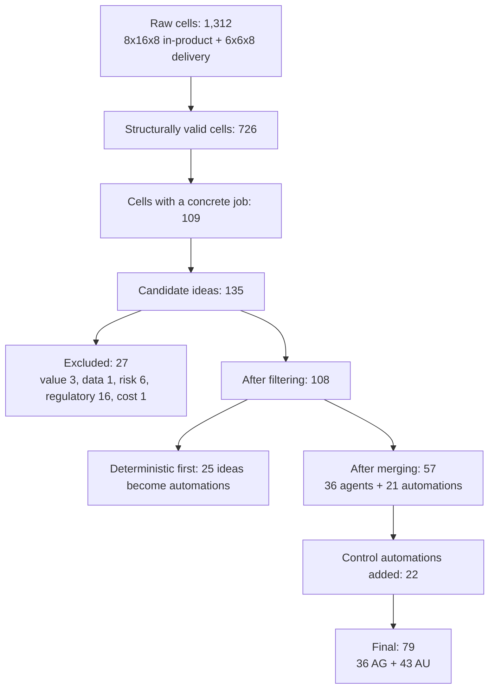

# AI Growth Engine: Employee Sales & Marketing Automation
## Application Blueprint: PART 7 (Batch 7.1), AI Agents and Automations: Discovery Method and Catalogue

| Field | Value |
|---|---|
| Document | Part 7, Batch 1 of 3 (7.1 Discovery and catalogue · 7.2 Agent specifications and orchestration · 7.3 Model strategy, cost and governance) |
| Version | 1.0 · 27 Nov 2026 |
| Baseline | BRD, FRD, Parts 0, 0A (DEC-001…065), 1, 2.1–2.5; Part 4.1 (data classes, THR-051…058, SC-32…35) and Part 5.2 (US-08xx) read for consistency |
| Roles applied | AI/ML Architect (lead), Product Owner, Business Systems Analyst, Security/Compliance/AI Governance Lead, FinOps Lead, QA Lead, Principal Engineer |
| Tag ranges used in Part 7 | RECOMMENDATION-060…069 · ADR-070…085 · ASSUMPTION-140…147 · GAP-140…145 · CONFLICT-120…122 · RSK-360…379 · IDs AG-001…036, AU-001…043, CI-001…135 (candidate ideas), TL-01…20 (tool registry) |

**Acronyms used in Part 7.** AI (artificial intelligence) · LLM (large language model) · RAG (retrieval-augmented generation: answer from retrieved approved text) · HITL (human in the loop) · PII (personally identifiable information) · PDP (Policy Decision Point, RECOMMENDATION-012) · DAG (directed acyclic graph, the workflow form in DEC-051) · TCO (total cost of ownership) · FinOps (financial operations for cloud and AI spend) · MTok (one million tokens, the unit of model pricing) · TTL (time to live of a cache entry) · SLA (service level agreement) · DPDP (India Digital Personal Data Protection Act 2023 and its Rules) · EU AI Act (Regulation (EU) 2024/1689) · KPI (key performance indicator) · CI (continuous integration) · MTTR (mean time to resolve).

**How Part 7 uses the decisions already taken.** Part 7 does not reopen DEC-007 (routing tiers), DEC-008 (₹3,000 / ₹12,000 / ₹40,000 ceilings), DEC-035 (Copilot), DEC-038 (approval thresholds), DEC-048 (tool registry), DEC-053 (no automated tender submission) or DEC-064 (autonomy caps). It applies them to every candidate and shows the arithmetic.

---

## 7.1 Discovery method (client spec 7.1, with the work shown)

### 7.1.1 What "maximum justified" means here

The goal is the **largest set of agents and automations that are valuable, safe and affordable**, not the largest list. Four tests decide whether a candidate survives, and every exclusion below cites one of them:

| Test | Question | Evidence used |
|---|---|---|
| Valuable | Does it move a business KPI (KPI-01…31) or remove recurring manual effort for a persona with a real job in that stage? | Part 1 §1.4 KPIs, persona goals, module objectives (BRD §7) |
| Safe | Can it run inside the binding limits: AI never approves, signs, pays, submits or sets prices (BRL-AI-07, DEC-064); no minors' data beyond grade band (DEC-030); no guessed contacts (BR-M18)? | BRL catalogue (Part 2.3), DEC log (Part 0A), Part 4.1 threat model |
| Affordable | Does it fit the ₹3,000/month pilot ceiling together with everything else, with headroom (DEC-008)? | Cost model in §7.5 (Batch 7.3) |
| Right tool | Would deterministic rules, search, a template or classical statistics do the job better? ("deterministic first", PP-02, FRD OPT-10-01) | Module specs (Part 2.1 §2.2) |

A candidate that fails only the *right tool* test is **not discarded**: it becomes a deterministic automation (**AU**), so the business capability survives at near-zero marginal cost.

### 7.1.2 Step 1: the six dimensions

**A. Scope**

| Code | Scope | Who benefits | Budget line |
|---|---|---|---|
| A-i | In-product agents for end users and administrators | P01–P16 (Part 1 §1.8) | B02 production inference (owned portfolio); tenant-metered budget for SaaS clients (DEC-008) |
| A-ii | Delivery-lifecycle agents for build, test, DevOps and support teams | D01–D06 (delivery personas, [ASSUMPTION-146]) | B09 developer seats; delivery AI reserve [RECOMMENDATION-061] |

**B. Lifecycle / journey stage**

| In-product stage | Meaning in this product | Typical modules | Delivery stage | Meaning |
|---|---|---|---|---|
| Intake | Data or requests enter: forms, inbound messages, uploads, imports, fetched pages | M03, M11, M22, M27, A103 | Requirements | Stories, AC, traceability, change impact |
| Onboarding | New startup, tenant, customer or partner is set up | M48, W32–W33, A099–A100 | Design | ADRs, threat models, UX copy |
| Processing | The main work: research, drafting, matching, quoting, orders | M10–M19, M25, M34, M43–M45 | Coding | Implementation, IaC, refactoring |
| Approval | A human decides on an exact revision/hash | A027, A035, A051, A066, A068, A072 | Testing | Test design, review, fixtures |
| Exception handling | Something failed, conflicted or needs escalation | A070, A110, A111, M57, M58 | Deploy | Release notes, go/no-go |
| Reporting | Dashboards, digests, forecasts | M30, M52, M60, M61 | Operate | Logs, incidents, support knowledge |
| Support | Answering questions from visitors, customers, staff | M32, W28, W34, Copilot | | |
| Administration | Configuration, policies, budgets, privacy | A002, A007, A011, A012, A013, A112 | | |

**C. Persona / role.** In-product: P01–P16 (Part 1 §1.8; roles R01–R20, Part 2.3 §2.26.1). Delivery: D01 Product Owner (founder/CTO), D02 Backend engineer, D03 Frontend engineer, D04 QA automation, D05 DevOps/SRE, D06 Growth/compliance/support lead — derived from the DEC-005 team [ASSUMPTION-146].

**D. Agent pattern**

| Pattern | Definition used for classification |
|---|---|
| Assistant / copilot | Converses with a human and answers or drafts on request |
| Classifier / router | Assigns a label from a closed set and routes work |
| Extractor | Produces structured fields from unstructured input |
| Generator | Produces new text (drafts) for human review |
| Validator / QA | Checks another artefact against rules and evidence |
| Monitor / anomaly detector | Watches a stream and raises alerts |
| Orchestrator | Plans multi-step work across other components |
| Autonomous workflow agent | Acts end-to-end without per-item human review, within guardrails |

**E. Trigger:** user action · event (domain event or webhook) · schedule (Celery Beat) · threshold (budget, SLA, anomaly). **F. Autonomy:** L0 suggest only · L1 draft for approval · L2 act with post-review · L3 act autonomously within guardrails (ASSUMPTION-010; caps in DEC-064 and BRL-AUT-01). Triggers and autonomy are **attributes assigned to each candidate**, not multipliers of the matrix: multiplying them in would inflate the raw count (1,312 × 4 × 4 = 20,992) without creating new jobs.

### 7.1.3 Persona participation matrices (input to the structural screen)

A cell is "active" when the persona does real work in that stage (● active, · not active). Sources: persona goals and surfaces (Part 1 §1.8, §1.8.1) and role permissions (Part 2.3 §2.26.3).

**In-product (16 personas × 8 stages)**

| Persona | Intake | Onboarding | Processing | Approval | Exception handling | Reporting | Support | Administration | Active stages |
|---|---|---|---|---|---|---|---|---|---|
| P01 | · | · | · | ● | ● | ● | · | ● | 4 |
| P02 | · | ● | ● | ● | ● | ● | · | ● | 6 |
| P03 | ● | ● | ● | ● | ● | ● | ● | · | 7 |
| P04 | ● | · | ● | ● | ● | ● | · | · | 5 |
| P05 | ● | · | ● | ● | ● | ● | · | · | 5 |
| P06 | ● | · | ● | · | ● | ● | · | · | 4 |
| P07 | ● | ● | ● | · | ● | ● | ● | · | 6 |
| P08 | · | · | ● | ● | ● | ● | · | · | 4 |
| P09 | · | · | ● | ● | ● | ● | ● | ● | 6 |
| P10 | · | · | ● | · | ● | ● | · | ● | 4 |
| P11 | · | ● | · | · | · | ● | ● | ● | 4 |
| P12 | · | ● | · | · | ● | ● | ● | ● | 5 |
| P13 | ● | ● | · | · | · | ● | ● | ● | 5 |
| P14 | ● | ● | · | ● | · | · | ● | · | 4 |
| P15 | ● | · | · | · | · | · | ● | · | 2 |
| P16 | ● | · | ● | · | ● | ● | · | · | 4 |
| **Cells** | 9 | 7 | 10 | 8 | 12 | 14 | 8 | 7 | **75** |

**Delivery (6 personas × 6 stages)** [ASSUMPTION-146]

| Persona | Requirements | Design | Coding | Testing | Deploy | Operate | Active stages |
|---|---|---|---|---|---|---|---|
| D01 | ● | ● | · | ● | ● | ● | 5 |
| D02 | · | ● | ● | ● | ● | ● | 5 |
| D03 | · | ● | ● | ● | · | · | 3 |
| D04 | ● | · | ● | ● | ● | · | 4 |
| D05 | · | ● | ● | · | ● | ● | 4 |
| D06 | ● | · | · | ● | · | ● | 3 |
| **Cells** | 3 | 4 | 4 | 5 | 4 | 4 | **24** |

### 7.1.4 Step 2: the candidate matrix and the raw count

| Matrix | Formula | Raw combinations |
|---|---|---|
| In-product | 8 stages × 16 personas × 8 patterns | 1,024 |
| Delivery lifecycle | 6 stages × 6 personas × 8 patterns | 288 |
| **Total raw candidates (stage × persona × pattern)** | | **1,312** |

**Structural screen.** Before judging value, impossible or forbidden cells are removed by six rules. The counts are computed, not estimated (rules applied in order; a cell is counted once, under the first rule that removes it).

| Rule | Structural screen | Source | Cells removed |
|---|---|---|---|
| S1 | Persona does not work in that stage (participation matrix §7.1.3) | Part 1 §1.8; Part 2.3 §2.26.1 | 520 |
| S2 | Approval stage: no Generator, Orchestrator or Autonomous pattern — AI never approves or authors the approved artefact at the approval step | BRL-AI-07; DEC-064 | 24 |
| S3 | External/anonymous personas (P14, P15): no Orchestrator, Autonomous or Monitor agents acting for them | BRD §2; BR-S106, BR-S107 | 16 |
| S4 | Service identity P16: no Assistant pattern (needs a human user) | Part 1 P16 | 4 |
| S5 | Reporting stage: no Autonomous pattern (no external action from a report) | PP-01; BRL-AI-07 | 14 |
| S6 | Coding and Deploy stages: no Autonomous pattern (no autonomous merge or production deploy) | M62; DEC-063 | 8 |
| **Total** | | | **586** |

**Structurally valid cells: 726** (1,312 − 586).

### 7.1.5 Step 3: generating candidates and applying the filters

**Generation.** For each valid cell the team asked one question: *is there a recurring job, anchored to a module, FR or workflow step, that this pattern would do for this persona in this stage?* Each "yes" became a named **candidate idea (CI-###)**. One idea may cover several cells (e.g. CI-027 covers Processing and Approval for P03 and P04). 109 of the 726 valid cells anchor at least one idea; the other 617 cells have **no concrete job** (for example *Monitor × P11 Tenant Administrator × Onboarding*) and produce no candidate. The table shows where the jobs are by pattern:

| Pattern | Valid cells | Cells with a concrete job (anchored by ≥ 1 candidate) | Cells with no concrete job | Kept agents using the pattern |
|---|---|---|---|---|
| Assistant / copilot | 95 | 18 | 77 | 4 |
| Classifier / router | 99 | 21 | 78 | 6 |
| Extractor | 99 | 19 | 80 | 10 |
| Generator | 91 | 26 | 65 | 13 |
| Validator / QA | 99 | 11 | 88 | 4 |
| Monitor / anomaly detector | 93 | 7 | 86 | 0 |
| Orchestrator | 86 | 1 | 85 | 1 |
| Autonomous workflow agent | 64 | 6 | 58 | 0 |
| **Total** | **726** | **109** | **617** | |

**Filters (applied to each of the 135 ideas, in this order).**

| Filter | Pass condition | Fail action |
|---|---|---|
| F1 Business value | Moves a KPI or removes recurring effort at pilot or Year-1 volume (DEC-031) | Excluded |
| F2 Data feasibility | Required input data exists in scope with lawful basis and provenance (NFR-028) | Excluded |
| F3 Risk | Residual impact of an error is acceptable with the planned HITL checkpoint | Excluded |
| F4 Regulatory / binding policy | Allowed by DPDP, DEC-029/030 jurisdiction and children rules, DEC-053, DEC-064, BR acceptance statements | Excluded |
| F5 Deterministic first | An LLM is better than rules, search, templates or classical statistics for this job | **Re-classified as AU** (automation) |
| F6 Cost | Expected cost at pilot volume is proportionate to value and fits DEC-008 | Excluded or deferred |

### 7.1.6 Candidate idea register (all 135 ideas with dispositions)

| ID | Candidate idea | Stage | Persona | Pattern | Disposition | Target | Reason / merge note |
|---|---|---|---|---|---|---|---|
| CI-001 | Answer anonymous visitors' product questions from approved public knowledge | Support, Intake | P15 | Assistant | Kept (primary) | AG-017 | Primary job of the agent |
| CI-002 | Classify public enquiry type and route to the owning startup | Intake | P15, P16 | Classifier | Deterministic first → AU | AU-020 | Typed form fields and routing rules decide deterministically (M22) |
| CI-003 | Summarize free-text enquiries for the owner | Intake | P03 | Extractor | Merged | AG-013 | Same inbound call returns a summary field |
| CI-004 | Classify intent of inbound email, WhatsApp and web replies | Intake | P16 | Classifier | Kept (primary) | AG-013 | Primary job of the agent |
| CI-005 | Detect STOP / opt-out in inbound text | Intake | P16 | Classifier | Deterministic first → AU | AU-008 | Keyword and List-Unsubscribe handling must be deterministic and instant (M04) |
| CI-006 | Detect complaints in inbound messages | Exception handling | P09 | Classifier | Merged | AG-013 | Complaint is one intent class; deterministic threshold handling is AU-031 |
| CI-007 | Extract proposed meeting times from replies | Processing | P03 | Extractor | Merged | AG-013 | Entity extraction in the same intent call; slots computed by AU-023 |
| CI-008 | Extract RFQ / purchase-order lines from documents and emails | Intake, Processing | P07 | Extractor | Kept (primary) | AG-023 | Primary job of the agent |
| CI-009 | Summarize submitted project requirements (W15) for AppNAI | Intake | P06 | Extractor | Merged | AG-019 | Same document-analysis capability as RFP analysis |
| CI-010 | AI verification of supplier registration documents | Intake | P07 | Validator | Excluded: risk | — | False verification risk; legal documents need human verification; format checks are field validation |
| CI-011 | Triage student / guardian intake with AI | Intake | P15 | Classifier | Excluded: regulatory / policy | — | Children's data (DEC-030): no minor data in AI beyond grade band; age-band routing is deterministic in AU-020 |
| CI-012 | Extract claim candidates and summaries from uploaded knowledge documents | Intake | P05, P09 | Extractor | Kept (primary) | AG-001 | Primary job of the agent |
| CI-013 | Map import file columns to versioned templates | Administration, Onboarding | P11 | Classifier | Kept (primary) | AG-010 | Primary job of the agent |
| CI-014 | Infer consent from imported contact lists | Administration | P09 | Extractor | Excluded: regulatory / policy | — | Consent must be explicit recorded evidence (BRL-ELG, DEC-039); inference prohibited |
| CI-015 | Generate research search queries from approved capabilities | Processing | P04 | Generator | Kept (primary) | AG-003 | Primary job of the agent |
| CI-016 | Extract structured evidence from permitted web pages | Processing | P16 | Extractor | Kept (primary) | AG-004 | Primary job of the agent |
| CI-017 | Extract evidence from permitted social posts | Processing | P04 | Extractor | Merged | AG-004 | Same extraction schema with source type = social (M33) |
| CI-018 | Classify buying signals with confidence | Processing | P04 | Classifier | Kept (primary) | AG-005 | Primary job of the agent |
| CI-019 | Derive explicit vs inferred business needs | Processing | P04 | Extractor | Kept (primary) | AG-006 | Primary job of the agent |
| CI-020 | Rank offerings against needs | Processing | P04 | Classifier | Deterministic first → AU | AU-016 | pgvector similarity + readiness gate is deterministic and cheaper (M16, BRL-SCR-04) |
| CI-021 | Explain matches and exclusions in plain language | Processing | P04 | Generator | Kept (primary) | AG-007 | Primary job of the agent |
| CI-022 | Score opportunities with an LLM | Processing | P04 | Classifier | Deterministic first → AU | AU-017 | Scoring formula is fixed by DEC-011; an LLM would add variance and cost |
| CI-023 | Deduplicate and merge organizations | Processing | P04 | Validator | Deterministic first → AU | AU-015 | Domain + location + alias rules; ambiguous cases become human merge tasks (M13) |
| CI-024 | Extract decision-maker roles and published work channels | Processing | P04 | Extractor | Kept (primary) | AG-008 | Primary job of the agent |
| CI-025 | Guess email addresses from name patterns | Processing | P04 | Generator | Excluded: regulatory / policy | — | Prohibited: no guessed emails (BR-M18) |
| CI-026 | Verify contacts with an LLM | Processing | P04 | Validator | Deterministic first → AU | AU-018 | Verification is provenance + channel checks, not language understanding (M19) |
| CI-027 | Prepare cited qualification brief for the reviewer | Approval, Processing | P04, P03 | Extractor, Assistant | Kept (primary) | AG-009 | Primary job of the agent |
| CI-028 | Accept qualification automatically once the 90% gate is met | Processing | P16 | Classifier | Merged | AG-009 | Same agent at L2 after DEC-001 benchmark gate (BRL-SCR-07) |
| CI-029 | Generate queries targeting personal health conditions | Processing | P04 | Generator | Excluded: regulatory / policy | — | Prohibited (BR-M10, PP-11) |
| CI-030 | Draft personalized first-touch emails with evidence citations | Processing | P03 | Generator | Kept (primary) | AG-011 | Primary job of the agent |
| CI-031 | Draft WhatsApp template messages | Processing | P03 | Generator | Merged | AG-011 | Same drafter, channel = WhatsApp, template constraints |
| CI-032 | Draft follow-up sequence steps | Processing | P03 | Generator | Merged | AG-011 | Same drafter, mode = follow-up |
| CI-033 | Draft renewal reminders | Processing | P03 | Generator | Merged | AG-011 | Same drafter, mode = renewal (M50) |
| CI-034 | Draft webinar invitations and follow-ups | Processing | P05 | Generator | Merged | AG-011 | Same drafter, mode = event (M40) |
| CI-035 | Optimize send time with an LLM | Processing | P16 | Classifier | Excluded: low value | — | Low value at pilot volume; quiet hours and time zones are rules (BRL-ELG); revisit with classical statistics after 6 months of data |
| CI-036 | Check drafts for unsupported claims and prohibited content | Processing | P09 | Validator | Kept (primary) | AG-012 | Primary job of the agent |
| CI-037 | Check tone and brand voice | Processing | P05 | Validator | Merged | AG-012 | Same validator call with brand rubric |
| CI-038 | Suggest replies to inbound questions from approved knowledge | Support | P03 | Generator | Kept (primary) | AG-014 | Primary job of the agent |
| CI-039 | Send approved-FAQ answers autonomously | Processing | P16 | Autonomous workflow agent | Merged | AG-014 | Same agent at L3 limited to approved FAQ (DEC-064) |
| CI-040 | Auto-reply to objections with price concessions | Processing | P03 | Autonomous workflow agent | Excluded: regulatory / policy | — | Prices, discounts and terms are capped at L1 (DEC-064, BRL-AI-07) |
| CI-041 | Classify objections and draft approved responses | Processing | P03 | Classifier, Generator | Kept (primary) | AG-021 | Primary job of the agent |
| CI-042 | Prepare meeting briefs from Customer 360 | Processing | P03 | Generator | Merged | AG-015 | Copilot skill 'brief me on this account' |
| CI-043 | Summarize meeting recordings / transcripts | Processing | P03 | Extractor | Excluded: data not available | — | No recording or transcript source in scope; calendar is free/busy only (DEC-024) |
| CI-044 | Summarize Customer 360 timelines | Reporting | P03 | Extractor | Merged | AG-015 | Copilot skill over the same scoped records |
| CI-045 | Answer staff questions over permitted records and knowledge | Support | P01, P02, P03 | Assistant | Kept (primary) | AG-015 | Primary job of the agent |
| CI-046 | Turn natural-language questions into saved-view filters | Support | P03 | Classifier | Merged | AG-015 | Copilot proposes a filter draft; keyword search stays deterministic (DEC-037) |
| CI-047 | Propose a commercial plan for simulation | Processing | P10 | Orchestrator | Kept (primary) | AG-016 | Primary job of the agent |
| CI-048 | Narrate simulation results | Reporting | P10 | Generator | Merged | AG-016 | Planner returns the narrative with the plan |
| CI-049 | Draft workflow DAGs from a description | Administration | P10 | Generator | Merged | AG-016 | Planner 'workflow draft' mode using approved node types only (DEC-051) |
| CI-050 | Resolve conflicting automation actions | Exception handling | P10 | Classifier | Deterministic first → AU | AU-030 | Priority rules compliance > transactional > sales > marketing (BRL-AUT-09) |
| CI-051 | Capture consented leads inside website chat | Intake | P15 | Extractor | Merged | AG-017 | Website assistant hands a structured lead to M22 |
| CI-052 | Detect clinical questions in chat | Support | P15 | Classifier | Merged | AG-017 | Keyword pre-filter plus the assistant's handover classifier (BRL-AI-11) |
| CI-053 | Converse with minors in chat | Support | P15 | Assistant | Excluded: regulatory / policy | — | No profiling or data collection from minors (DEC-030); becomes a guardrail of AG-017 |
| CI-054 | Draft blog articles and knowledge-centre content | Processing | P05 | Generator | Kept (primary) | AG-018 | Primary job of the agent |
| CI-055 | Draft social post variants | Processing | P05 | Generator | Merged | AG-018 | Content studio mode = social (M35) |
| CI-056 | Draft landing-page copy | Processing | P05 | Generator | Merged | AG-018 | Content studio mode = landing (M37) |
| CI-057 | Draft ad copy variants | Processing | P05 | Generator | Merged | AG-018 | Content studio mode = ad (M39); launch stays human |
| CI-058 | Suggest SEO titles and meta descriptions | Processing | P05 | Generator | Merged | AG-018 | Content studio mode = SEO metadata (M36) |
| CI-059 | Run technical SEO audits | Reporting | P05 | Monitor | Deterministic first → AU | AU-033 | Crawl checks and Search Console metrics are deterministic (M36) |
| CI-060 | Draft translations to hi-IN, ta-IN, or-IN | Processing | P05 | Generator | Merged | AG-018 | Content studio mode = translate; draft only (DEC-026) |
| CI-061 | Generate images for creatives | Processing | P05 | Generator | Excluded: cost | — | Not in BRD; image generation adds cost and likeness/claims risk; approved brand assets suffice |
| CI-062 | Optimize ad budgets autonomously | Processing | P05 | Autonomous workflow agent | Excluded: regulatory / policy | — | Spend only within approved caps (DEC-038); budget moves are human decisions |
| CI-063 | Select campaign audiences with an LLM | Processing | P05 | Classifier | Excluded: regulatory / policy | — | Audience = deterministic eligibility (M38); LLM profiling raises DPDP/fairness risk |
| CI-064 | Classify permitted social posts into signals | Processing | P04 | Classifier | Merged | AG-005 | Same signal taxonomy (M33) |
| CI-065 | Send automated social DMs | Processing | P05 | Autonomous workflow agent | Excluded: regulatory / policy | — | Prohibited (BR-M33, BR-M35) |
| CI-066 | Analyse RFP / tender documents into a compliance matrix | Processing | P06 | Extractor | Kept (primary) | AG-019 | Primary job of the agent |
| CI-067 | Recommend bid / no-bid | Processing | P06, P02 | Assistant | Merged | AG-019 | Analyzer produces an L0 bid/no-bid brief; decision stays human |
| CI-068 | Submit tenders autonomously | Processing | P06 | Autonomous workflow agent | Excluded: regulatory / policy | — | Never automated (DEC-053) |
| CI-069 | Draft bid response sections | Processing | P06 | Generator | Merged | AG-020 | Proposal drafter mode = bid response |
| CI-070 | Draft proposals from approved templates | Processing | P03 | Generator | Kept (primary) | AG-020 | Primary job of the agent |
| CI-071 | Recommend prices or discounts | Processing | P03 | Generator | Excluded: regulatory / policy | — | Prices come from approved price versions; AI never sets prices (DEC-064) |
| CI-072 | Calculate quote lines | Processing | P07 | Validator | Deterministic first → AU | AU-035 | Decimal arithmetic with ROUND_HALF_UP (DEC-027) |
| CI-073 | Assemble contracts from templates | Processing | P09 | Generator | Deterministic first → AU | AU-036 | Template merge + hash is deterministic (M46) |
| CI-074 | Review counterparty redlines against the approved template | Approval, Processing | P09 | Validator | Kept (primary) | AG-022 | Primary job of the agent |
| CI-075 | Sign agreements on behalf of the business | Processing | P09 | Autonomous workflow agent | Excluded: regulatory / policy | — | AI never signs (M46, BRL-AI-07) |
| CI-076 | Extract fields from payment evidence for the maker | Processing | P08 | Extractor | Kept (primary) | AG-024 | Primary job of the agent |
| CI-077 | Verify payments with AI | Approval | P08 | Validator | Excluded: regulatory / policy | — | Maker-checker by two humans (DEC-038, BRL-FIN) |
| CI-078 | Match bank receipts to invoices | Processing | P08 | Classifier | Deterministic first → AU | AU-037 | Amount/reference/date matching rules |
| CI-079 | Generate invoices | Processing | P08 | Generator | Deterministic first → AU | AU-035 | Deterministic from approved quote and tax profile |
| CI-080 | Explain fulfilment discrepancies | Exception handling | P07 | Assistant | Excluded: low value | — | Ledger already shows the exact discrepancy (AU-038); narrative adds little |
| CI-081 | Summarize the deal for onboarding handoff | Onboarding | P03, P02 | Generator | Kept (primary) | AG-025 | Primary job of the agent |
| CI-082 | Generate onboarding checklists | Onboarding | P02 | Generator | Deterministic first → AU | AU-036 | Offering onboarding templates (CFG-19) |
| CI-083 | Answer authenticated customers' portal questions | Onboarding, Support | P14 | Assistant | Merged | AG-031 | Support desk assistant, portal mode, own records only |
| CI-084 | Predict churn / account health with an LLM | Reporting | P02 | Classifier | Deterministic first → AU | AU-039 | Rule-based health score; classical ML later; no medical data (M50) |
| CI-085 | Classify loss reasons and aggregate themes | Reporting | P02, P03 | Classifier | Kept (primary) | AG-026 | Primary job of the agent |
| CI-086 | Re-contact lost deals automatically | Processing | P03 | Autonomous workflow agent | Excluded: regulatory / policy | — | No auto-recontact after loss without policy (BR-M51) |
| CI-087 | Attribute revenue to channels | Reporting | P01 | Classifier | Deterministic first → AU | AU-040 | Attribution models are deterministic (M52) |
| CI-088 | Forecast pipeline with an LLM | Reporting | P01 | Generator | Deterministic first → AU | AU-041 | Stage-weighted forecast with backtests (M60); LLMs are not forecasting models |
| CI-089 | Narrate dashboards: what changed and why | Reporting | P01, P02 | Generator | Kept (primary) | AG-029 | Primary job of the agent |
| CI-090 | Detect KPI anomalies | Reporting | P01 | Monitor | Deterministic first → AU | AU-012 | Statistical thresholds on metric snapshots |
| CI-091 | Summarize competitor and market changes | Reporting | P04, P02 | Generator | Kept (primary) | AG-027 | Primary job of the agent |
| CI-092 | Generate comparative claims against competitors | Processing | P05 | Generator | Excluded: regulatory / policy | — | No unverified comparative claims (BR-M59, BRL-AI-05) |
| CI-093 | Triage failed runs, DLQ items and incidents | Exception handling | P12, P10 | Extractor | Kept (primary) | AG-028 | Primary job of the agent |
| CI-094 | Self-heal by letting an LLM retry steps | Exception handling | P16 | Classifier | Excluded: risk | — | Retries are deterministic and uncertain outcomes reconcile first (BRL-AUT-07) |
| CI-095 | Write the founder's weekly insight digest | Reporting | P01 | Generator | Merged | AG-029 | Narrative agent, portfolio mode (read-only aggregates, DEC-055) |
| CI-096 | Propose SaaS client configuration from a business description | Onboarding | P13 | Generator | Kept (primary) | AG-030 | Primary job of the agent |
| CI-097 | Verify SaaS applicant authority | Onboarding | P12 | Validator | Excluded: risk | — | Authority proof is a human/document check (BR-S111) |
| CI-098 | Triage support tickets | Support | P12, P13 | Classifier | Kept (primary) | AG-031 | Primary job of the agent |
| CI-099 | Draft support replies | Support | P12 | Generator | Merged | AG-031 | Same agent drafts the reply |
| CI-100 | Explain billing disputes to clients | Support | P13 | Assistant | Deterministic first → AU | AU-042 | Deterministic usage statement from metering; financial data stays out of prompts |
| CI-101 | Handle privacy requests | Administration | P09 | Assistant | Deterministic first → AU | AU-011 | Identifier search and purge are deterministic (M56) |
| CI-102 | Draft DPIAs | Administration | P09 | Generator | Merged | AG-033 | Delivery requirements assistant drafts compliance documents for legal review |
| CI-103 | Recommend policy configuration | Administration | P11 | Generator | Excluded: risk | — | Loosening requires founder approval; low value; risk of unsafe defaults (DEC-038) |
| CI-104 | Recommend roles and permissions | Administration | P11 | Classifier | Excluded: risk | — | Authorization expansion risk (BR-S117) |
| CI-105 | Prepare partner due-diligence briefs | Processing | P02 | Extractor | Kept (primary) | AG-032 | Primary job of the agent |
| CI-106 | Profile individuals for insurance underwriting | Processing | P02 | Classifier | Excluded: regulatory / policy | — | No underwriting or personal profiling (BR-M63) |
| CI-107 | Monitor approval SLAs and escalate | Approval | P01 | Monitor | Deterministic first → AU | AU-027 | Timers and notifications (NT-009) |
| CI-108 | Summarize changes for approvers | Approval | P02 | Extractor | Deterministic first → AU | AU-036 | Deterministic diff between hashed revisions is exact; an LLM summary could omit a change |
| CI-109 | Forecast AI spend and stop at cap | Administration | P01 | Monitor | Deterministic first → AU | AU-002 | Reserve-before-call and caps (M53) |
| CI-110 | Judge AI outputs against eval rubrics | Administration | P10 | Validator | Kept (primary) | AG-002 | Primary job of the agent |
| CI-111 | Sample production outputs for hallucination drift | Reporting | P10 | Monitor | Merged | AG-002 | Same judge, production sampling mode |
| CI-112 | Monitor claim and knowledge expiry | Reporting | P09 | Monitor | Deterministic first → AU | AU-029 | Expiry dates and notifications (NT-036) |
| CI-113 | Draft user stories and Gherkin acceptance criteria | Requirements | D01 | Generator | Kept (primary) | AG-033 | Primary job of the agent |
| CI-114 | Check requirement-to-test traceability gaps | Requirements | D04 | Validator | Merged | AG-033 | Assistant proposes; the trace matrix check itself is a script in AU-013 |
| CI-115 | Draft architecture decision records | Design | D02 | Generator | Merged | AG-033 | Same assistant, ADR template |
| CI-116 | Draft threat models | Design | D05 | Generator | Merged | AG-035 | Security review agent, design mode |
| CI-117 | Suggest UI microcopy and accessibility fixes | Design | D03 | Generator | Merged | AG-034 | Coding assistant in the IDE |
| CI-118 | Generate and refactor code | Coding | D02, D03 | Assistant | Kept (primary) | AG-034 | Primary job of the agent |
| CI-119 | Generate infrastructure-as-code | Coding | D05 | Generator | Merged | AG-034 | Coding assistant; plan reviewed in PR |
| CI-120 | Review pull requests | Testing | D02 | Validator | Kept (primary) | AG-035 | Primary job of the agent |
| CI-121 | Triage SAST and dependency findings | Testing | D02 | Validator | Merged | AG-035 | Same review agent |
| CI-122 | Generate test cases from acceptance criteria | Testing | D04 | Generator | Kept (primary) | AG-036 | Primary job of the agent |
| CI-123 | Generate synthetic fixtures (two tenants, 26 startups) | Testing | D04 | Generator | Merged | AG-036 | RECOMMENDATION-017 data sets |
| CI-124 | Triage flaky tests and CI failures | Testing | D04 | Classifier | Merged | AG-035 | Review agent, CI-failure mode |
| CI-125 | Write release notes | Deploy | D01 | Generator | Merged | AG-035 | Review agent, release mode |
| CI-126 | Summarize go/no-go risk for a release | Deploy | D01 | Assistant | Merged | AG-035 | Review agent, release mode |
| CI-127 | Triage production logs and alerts | Operate | D05 | Monitor | Merged | AG-028 | Same ops triage agent |
| CI-128 | Remediate production autonomously (restart, scale, roll back) | Operate | D05 | Autonomous workflow agent | Excluded: risk | — | Runbooks executed by humans; infrastructure changes via reviewed PRs (M09) |
| CI-129 | Detect cost anomalies | Operate | D05 | Monitor | Deterministic first → AU | AU-012 | Cost ledger thresholds (A012) |
| CI-130 | Draft help-centre articles from resolved tickets | Operate | D06 | Generator | Merged | AG-031 | Support desk assistant, KB mode; publish via approval |
| CI-131 | Upgrade dependencies automatically | Coding | D05 | Generator | Deterministic first → AU | AU-013 | Renovate/Dependabot-style bot with CI gates |
| CI-132 | Curate eval datasets from feedback | Testing | D04 | Generator | Merged | AG-036 | Redacted feedback becomes eval cases after review |
| CI-133 | Analyse impact of a requirement change | Requirements | D01 | Assistant | Merged | AG-033 | Same assistant over the traceability matrix |
| CI-134 | Write cited answers for reviewers about evidence freshness | Processing | P04 | Assistant | Excluded: low value | — | Freshness is a date field; the evidence panel already shows it (A017) |
| CI-135 | Draft negotiation summaries for the Startup Head | Approval | P02 | Extractor | Merged | AG-021 | Objection assistant produces the exception summary for A070 |

### 7.1.7 Step 3 results: exclusions and re-classifications

| Filter | Meaning | Ideas excluded | IDs |
|---|---|---|---|
| F1 | Business value too low for the cost/complexity at pilot and Year-1 volume | 3 | CI-035, CI-080, CI-134 |
| F2 | Feasibility: required data does not exist in scope | 1 | CI-043 |
| F3 | Risk: error or misuse impact unacceptable even with human review | 6 | CI-010, CI-094, CI-097, CI-103, CI-104, CI-128 |
| F4 | Regulatory or binding policy prohibits it (DPDP, DEC-030, DEC-053, DEC-064, BR acceptance) | 16 | CI-011, CI-014, CI-025, CI-029, CI-040, CI-053, CI-062, CI-063, CI-065, CI-068, CI-071, CI-075, CI-077, CI-086, CI-092, CI-106 |
| F6 | Cost exceeds value; no source requirement | 1 | CI-061 |
| F5 | Deterministic logic, rules, search or classical statistics work better than an LLM → **re-classified as automation (AU), not discarded** | 25 (re-classified) | CI-002, CI-005, CI-020, CI-022, CI-023, CI-026, CI-050, CI-059, CI-072, CI-073, CI-078, CI-079, CI-082, CI-084, CI-087, CI-088, CI-090, CI-100, CI-101, CI-107, CI-108, CI-109, CI-112, CI-129, CI-131 |

**Notable exclusions explained.**
- **Autonomous tender submission (CI-068), price recommendations (CI-071), AI payment verification (CI-077), AI signature (CI-075):** forbidden by DEC-053, DEC-064, DEC-038 and BRL-AI-07. These are permanent exclusions, not deferrals. Part 6 negative tests prove they do not exist.
- **Guessed emails (CI-025), personal health targeting (CI-029), minors in chat (CI-053), consent inference (CI-014), insurance profiling (CI-106):** each contradicts a BR acceptance statement or DEC-030. Where a safe variant exists, it is a guardrail of a kept agent (e.g. CI-053 becomes the age-band guardrail of AG-017).
- **Meeting transcript summaries (CI-043):** valuable elsewhere, but the product has no lawful recording source (calendar is free/busy only, DEC-024). Re-open only if a recording integration with consent is approved [GAP-143].
- **LLM scoring, forecasting, verification and matching (CI-020, -022, -026, -088):** deterministic or statistical methods are cheaper, explainable and already specified (DEC-011, M16, M19, M60). They live on as AU-016, AU-017, AU-018 and AU-041.

### 7.1.8 Step 4: merging duplicates and overlapping candidates

108 ideas survived filtering (36 primary jobs, 47 overlapping jobs, 25 re-classified to automations). Ideas that share the **same input, output schema, guardrails and eval set** were consolidated into one agent with *modes*, because separate agents would duplicate prompts, evals and cost lines without adding capability. 25 consolidation groups resulted:

| Consolidated into | Name | Ideas consolidated | Count | Merge rationale |
|---|---|---|---|---|
| AG-002 | AI Quality Judge & Eval Runner | CI-110, CI-111 | 2 | Same judge, production sampling mode |
| AG-004 | Evidence Extractor | CI-016, CI-017 | 2 | Same extraction schema with source type = social (M33) |
| AG-005 | Buying Signal Classifier | CI-018, CI-064 | 2 | Same signal taxonomy (M33) |
| AG-009 | Qualification Brief Assistant | CI-027, CI-028 | 2 | Same agent at L2 after DEC-001 benchmark gate (BRL-SCR-07) |
| AG-011 | Outreach & Follow-up Message Drafter | CI-030, CI-031, CI-032, CI-033, CI-034 | 5 | Same drafter, channel = WhatsApp, template constraints; Same drafter, mode = follow-up; Same drafter, mode = renewal (M50); Same drafter, mode = event (M40) |
| AG-012 | Claims & Policy Guard | CI-036, CI-037 | 2 | Same validator call with brand rubric |
| AG-013 | Inbound Intent Classifier & Router | CI-003, CI-004, CI-006, CI-007 | 4 | Same inbound call returns a summary field; Complaint is one intent class; deterministic threshold handling is AU-031; Entity extraction in the same intent call; slots computed by AU-023 |
| AG-014 | Reply Assistant | CI-038, CI-039 | 2 | Same agent at L3 limited to approved FAQ (DEC-064) |
| AG-015 | Admin Copilot | CI-042, CI-044, CI-045, CI-046 | 4 | Copilot skill 'brief me on this account'; Copilot skill over the same scoped records; Copilot proposes a filter draft; keyword search stays deterministic (DEC-037) |
| AG-016 | Autonomous Commercial Planner | CI-047, CI-048, CI-049 | 3 | Planner returns the narrative with the plan; Planner 'workflow draft' mode using approved node types only (DEC-051) |
| AG-017 | Website Assistant | CI-001, CI-051, CI-052 | 3 | Website assistant hands a structured lead to M22; Keyword pre-filter plus the assistant's handover classifier (BRL-AI-11) |
| AG-018 | Content & Campaign Studio Drafter | CI-054, CI-055, CI-056, CI-057, CI-058, CI-060 | 6 | Content studio mode = social (M35); Content studio mode = landing (M37); Content studio mode = ad (M39); launch stays human; Content studio mode = SEO metadata (M36); Content studio mode = translate; draft only (DEC-026) |
| AG-019 | Bid / RFP Analyzer | CI-009, CI-066, CI-067 | 3 | Same document-analysis capability as RFP analysis; Analyzer produces an L0 bid/no-bid brief; decision stays human |
| AG-020 | Proposal & Bid Response Drafter | CI-069, CI-070 | 2 | Proposal drafter mode = bid response |
| AG-021 | Objection & Negotiation Assistant | CI-041, CI-135 | 2 | Objection assistant produces the exception summary for A070 |
| AG-028 | Ops & Incident Triage Agent | CI-093, CI-127 | 2 | Same ops triage agent |
| AG-029 | Insight Narrative Agent | CI-089, CI-095 | 2 | Narrative agent, portfolio mode (read-only aggregates, DEC-055) |
| AG-031 | Support Desk Assistant | CI-083, CI-098, CI-099, CI-130 | 4 | Support desk assistant, portal mode, own records only; Same agent drafts the reply; Support desk assistant, KB mode; publish via approval |
| AG-033 | Requirements & Story Assistant | CI-102, CI-113, CI-114, CI-115, CI-133 | 5 | Delivery requirements assistant drafts compliance documents for legal review; Assistant proposes; the trace matrix check itself is a script in AU-013; Same assistant, ADR template; Same assistant over the traceability matrix |
| AG-034 | Coding Assistant | CI-117, CI-118, CI-119 | 3 | Coding assistant in the IDE; Coding assistant; plan reviewed in PR |
| AG-035 | PR, Security & Release Review Agent | CI-116, CI-120, CI-121, CI-124, CI-125, CI-126 | 6 | Security review agent, design mode; Same review agent; Review agent, CI-failure mode; Review agent, release mode; Review agent, release mode |
| AG-036 | Test & Synthetic Data Generator | CI-122, CI-123, CI-132 | 3 | RECOMMENDATION-017 data sets; Redacted feedback becomes eval cases after review |
| AU-012 | FinOps cost attribution & anomaly alerts | CI-090, CI-129 | 2 | Same deterministic capability |
| AU-035 | Quote calculator, invoice generation & approval routing | CI-072, CI-079 | 2 | Same deterministic capability |
| AU-036 | Document assembly, hashing & diff | CI-073, CI-082, CI-108 | 3 | Same deterministic capability |

**Merge rule.** Two ideas merge when (a) the same model call or retrieval context serves both, (b) their data class is the same or the merged agent takes the stricter class, and (c) their autonomy caps are compatible (the merged agent keeps per-mode autonomy, e.g. AG-014 is L1 by default and L3 only for exact approved FAQ answers). Ideas were **not** merged when their guardrails conflict: for example, the Website Assistant (AG-017, public data, L3) and the Support Desk Assistant (AG-031, a customer's own Restricted records, L1) stay separate even though both answer questions.

### 7.1.9 Step 5: the funnel

| Funnel stage | Unit | Count | How the number is obtained |
|---|---|---|---|
| Raw candidates | stage × persona × pattern cells | **1,312** | §7.1.4 formula |
| After structural screen | valid cells | 726 | Rules S1–S6 |
| Cells with a concrete job | cells | 109 | Anchored by ≥ 1 candidate idea |
| Candidate ideas generated | ideas (CI-###) | **135** | §7.1.6 |
| After filtering (F1–F4, F6 exclude; F5 re-classifies) | ideas | **108** | 135 − 27 excluded (F1 3, F2 1, F3 6, F4 16, F6 1) |
| After merging | distinct agents + automations | **57** | 36 agents + 21 automations from ideas |
| Control automations added | automations | 22 | Required by DEC-007/008/048, BRL-AI, BRL-AUT and NFRs to make the agents safe (AU-001, AU-003, AU-004, AU-005, AU-006, AU-007, AU-009, AU-010, AU-014, AU-019, AU-021, AU-022, AU-023, AU-024, AU-025, AU-026, AU-028, AU-031, AU-032, AU-034, AU-038, AU-043) |
| **Final catalogue** | | **79** | **36 agents (AG) + 43 automations (AU)** |

### 7.1.10 Final catalogue by release (DEC-006)

| Release (waves) | Agents (AG) | Automations (AU) | Total | What it delivers |
|---|---|---|---|---|
| **Release 1** (W0–W3, Day 1–90) | 22 | 33 | 55 | Gateway, budget, guardrails and eval harness; discovery and qualification agents for the 100-signal / 20-account pilot; drafting, inbound, Copilot, website assistant and content studio; delivery-lifecycle agents from W0 |
| **Release 2** (W4–W5, Day 91–180) | 13 | 9 | 22 | Commercial closure agents (bids, proposals, objections, contracts, orders, payment evidence), lifecycle analysis, ops triage, insight narratives, SaaS onboarding and support |
| **Future** (W6, Day 181–365) | 1 | 1 | 2 | Partner due diligence and expansion readiness gates |

Distribution of the 36 agents. **Autonomy:** L0: 7 · L1: 19 · L2: 3 · L3: 7 (no agent is L3 for any consequential action; the 7 L3 agents classify, extract, route, plan internal research or deliver internal digests). **Pattern:** Assistant / copilot: 3 · Classifier + Generator: 2 · Classifier / router: 4 · Extractor: 8 · Extractor + Assistant: 1 · Extractor + Monitor: 1 · Generator: 12 · Orchestrator: 1 · Validator / QA: 4. **Trigger** (an agent may have several): Event: 23 · Schedule: 6 · CI event: 5 · User action: 15.

### 7.1.11 Catalogue summary table

Model tiers: Tier 0 = deterministic/cache/template; 1a = Claude Haiku 5.5; 1b = Claude Sonnet 5.5 (DEC-007; §7.3). Costs are **pilot base estimates** of model tokens before the overhead allowance; formulas in §7.5 (verify prices at implementation, as of 27 Nov 2026).

| ID | Name | Type | Scope | Pattern | Wave | Release | Autonomy | Model tier | Base pilot cost / month |
|---|---|---|---|---|---|---|---|---|---|
| AG-001 | Knowledge & Claim Ingestion Assistant | Agent | Product | Extractor | W0 | Release 1 | L1 | 1a Haiku 5.5 | ₹5 |
| AG-002 | AI Quality Judge & Eval Runner | Agent | Product + Delivery | Validator / QA | W0 | Release 1 | L2 | 1b Sonnet 5.5 via Batch API | ₹139 |
| AG-003 | Research Query Planner | Agent | Product | Generator | W1 | Release 1 | L3 within guardrails | Tier 0 templates first | ₹1 |
| AG-004 | Evidence Extractor | Agent | Product | Extractor | W1 | Release 1 | L3 within guardrails | 1a Haiku 5.5 via Batch API | ₹19 |
| AG-005 | Buying Signal Classifier | Agent | Product | Classifier / router | W1 | Release 1 | L2 | 1a Haiku 5.5 via Batch API | ₹6 |
| AG-006 | Need Discovery Agent | Agent | Product | Extractor | W1 | Release 1 | L1 | 1a Haiku 5.5 via Batch | ₹6 |
| AG-007 | Solution Match Explainer | Agent | Product | Generator | W1 | Release 1 | L0 | 1a Haiku 5.5 via Batch | ₹2 |
| AG-008 | Decision-Maker Role Extractor | Agent | Product | Extractor | W1 | Release 1 | L1 | 1a Haiku 5.5 via Batch | ₹1 |
| AG-009 | Qualification Brief Assistant | Agent | Product | Extractor + Assistant | W1 | Release 1 | L1 until benchmark precision ≥ 90% on ≥ 200 labelled items per vertical; then L2 | 1a Haiku 5.5 pre-generated in Batch | ₹11 |
| AG-010 | Import Mapping Assistant | Agent | Product | Classifier / router | W1 | Release 1 | L1 | Tier 0 header dictionary first | ₹0 |
| AG-011 | Outreach & Follow-up Message Drafter | Agent | Product | Generator | W2 | Release 1 | L1 | 1b Sonnet 5.5 | ₹165 |
| AG-012 | Claims & Policy Guard | Agent | Product | Validator / QA | W2 | Release 1 | L3 within guardrails | Tier 0 deterministic rules first | ₹20 |
| AG-013 | Inbound Intent Classifier & Router | Agent | Product | Classifier / router | W2 | Release 1 | L3 | Tier 0: STOP keywords, auto-responder headers, bounce formats | ₹9 |
| AG-014 | Reply Assistant | Agent | Product | Generator | W2 | Release 1 | L1 by default; L3 only when the answer is an exact approved FAQ | Tier 0 semantic cache of approved FAQ answers | ₹27 |
| AG-015 | Admin Copilot | Agent | Product | Assistant / copilot | W3 (Q&A) / W5 (drafts) | Release 1 | L0 answers; L1 drafts | 1a Haiku 5.5 for lookups | ₹222 |
| AG-016 | Autonomous Commercial Planner | Agent | Product | Orchestrator | W2 (simulation) / W5 (L3 execution of approved plans) | Release 1 | L1 | 1b Sonnet 5.5 | ₹26 |
| AG-017 | Website Assistant | Agent | Product | Assistant / copilot | W3 | Release 1 | L3 | Tier 0 FAQ cache | ₹13 |
| AG-018 | Content & Campaign Studio Drafter | Agent | Product | Generator | W3 | Release 1 | L1 | 1b Sonnet 5.5 | ₹98 |
| AG-019 | Bid / RFP Analyzer | Agent | Product | Extractor | W4 | Release 2 | L1 | 1b Sonnet 5.5 | ₹141 |
| AG-020 | Proposal & Bid Response Drafter | Agent | Product | Generator | W4 | Release 2 | L1 | 1b Sonnet 5.5 | ₹63 |
| AG-021 | Objection & Negotiation Assistant | Agent | Product | Classifier + Generator | W4 | Release 2 | L1 | 1b Sonnet 5.5 | ₹22 |
| AG-022 | Contract Clause Reviewer | Agent | Product | Validator / QA | W4 | Release 2 | L0 | 1b Sonnet 5.5 | ₹18 |
| AG-023 | Order Document Extractor | Agent | Product | Extractor | W4 | Release 2 | L1 | 1a Haiku 5.5 | ₹5 |
| AG-024 | Payment Evidence Extractor | Agent | Product | Extractor | W4 | Release 2 | L0 | 1a Haiku 5.5 | ₹1 |
| AG-025 | Onboarding Handoff Summarizer | Agent | Product | Generator | W4 | Release 2 | L1 | 1a Haiku 5.5 via Batch | ₹0 |
| AG-026 | Loss & Feedback Analyzer | Agent | Product | Classifier / router | W4 | Release 2 | L2 | 1a Haiku 5.5 via Batch | ₹0 |
| AG-027 | Market & Competitor Watch Summarizer | Agent | Product | Generator | W5 | Release 2 | L3 | 1a Haiku 5.5 via Batch | ₹1 |
| AG-028 | Ops & Incident Triage Agent | Agent | Product + Delivery | Extractor + Monitor | W5 | Release 2 | L0 | 1a Haiku 5.5 | ₹7 |
| AG-029 | Insight Narrative Agent | Agent | Product | Generator | W5 | Release 2 | L3 | 1a Haiku 5.5 via Batch | ₹1 |
| AG-030 | SaaS Onboarding Configuration Assistant | Agent | Product (SaaS) | Generator | W5 | Release 2 | L1 | 1b Sonnet 5.5 | ₹35 |
| AG-031 | Support Desk Assistant | Agent | Product | Classifier + Generator | W5 | Release 2 | L1 | 1a Haiku 5.5 | ₹14 |
| AG-032 | Partner Due-Diligence Brief | Agent | Product | Extractor | W6 | Future | L0 | 1b Sonnet 5.5 via Batch | ₹10 |
| AG-033 | Requirements & Story Assistant | Agent | Delivery | Generator | W0 | Release 1 | L1 | Claude Code developer seats | within B09 seats |
| AG-034 | Coding Assistant | Agent | Delivery | Assistant / copilot | W0 | Release 1 | L1 | Claude Code developer seats | within B09 seats |
| AG-035 | PR, Security & Release Review Agent | Agent | Delivery | Validator / QA | W0 | Release 1 | L0 | 1b Sonnet 5.5 via CI API key | ₹505 |
| AG-036 | Test & Synthetic Data Generator | Agent | Delivery | Generator | W0 | Release 1 | L1 | Claude Code seats + 1a Haiku 5.5 via Batch for bulk fixtures | ₹6 |
| AU-001 | Model gateway router, Tier 0 cache & template responder | Automation | Product | Deterministic | W0 | Release 1 | L3 rules | Tier 0 (no LLM) | ₹0 incremental |
| AU-002 | Budget reservation, alerts & hard stop | Automation | Product | Deterministic | W0 | Release 1 | L3 rules | Tier 0 (no LLM) | ₹0 incremental |
| AU-003 | Output schema validation & repair controller | Automation | Product | Deterministic | W0 | Release 1 | L3 rules | Tier 0 (no LLM) | ₹0 incremental |
| AU-004 | Data classification & PII redaction | Automation | Product | Deterministic | W0 | Release 1 | L3 rules | Tier 0 (no LLM) | ₹0 incremental |
| AU-005 | Untrusted-content sanitizer & injection pre-filter | Automation | Product | Deterministic | W0 | Release 1 | L3 rules | Tier 0 (no LLM) | ₹0 incremental |
| AU-006 | Eval regression CI gate | Automation | Product | Deterministic | W0 | Release 1 | L3 rules | Tier 0 (no LLM) | ₹0 incremental |
| AU-007 | Source permission & expiry enforcer | Automation | Product | Deterministic | W0 | Release 1 | L3 rules | Tier 0 (no LLM) | ₹0 incremental |
| AU-008 | STOP / opt-out handler & queued-send cancellation | Automation | Product | Deterministic | W0 | Release 1 | L3 rules | Tier 0 (no LLM) | ₹0 incremental |
| AU-009 | Policy Decision Point dispatch guard | Automation | Product | Deterministic | W0 | Release 1 | L3 rules | Tier 0 (no LLM) | ₹0 incremental |
| AU-010 | Provider health checks & circuit breakers | Automation | Product | Deterministic | W0 | Release 1 | L3 rules | Tier 0 (no LLM) | ₹0 incremental |
| AU-011 | Privacy request locator & retention purge | Automation | Product | Deterministic | W0 | Release 1 | L3 rules | Tier 0 (no LLM) | ₹0 incremental |
| AU-012 | FinOps cost attribution & anomaly alerts | Automation | Product | Deterministic | W0 | Release 1 | L3 rules | Tier 0 (no LLM) | ₹0 incremental |
| AU-013 | Release pipeline gates | Automation | Product + Delivery | Deterministic | W0 | Release 1 | L3 rules | Tier 0 (no LLM) | ₹0 incremental |
| AU-014 | URL normalization, blocked-host & duplicate-content filter | Automation | Product | Deterministic | W1 | Release 1 | L3 rules | Tier 0 (no LLM) | ₹0 incremental |
| AU-015 | Organization canonical upsert & safe merge | Automation | Product | Deterministic | W1 | Release 1 | L3 rules | Tier 0 (no LLM) | ₹0 incremental |
| AU-016 | Readiness-gated solution match ranking | Automation | Product | Deterministic | W1 | Release 1 | L3 rules | Tier 0 (no LLM) | ₹0 incremental |
| AU-017 | Opportunity scoring | Automation | Product | Deterministic | W1 | Release 1 | L3 rules | Tier 0 (no LLM) | ₹0 incremental |
| AU-018 | Contact verification & freshness expiry | Automation | Product | Deterministic | W1 | Release 1 | L3 rules | Tier 0 (no LLM) | ₹0 incremental |
| AU-019 | Research review assignment & alerts | Automation | Product | Deterministic | W1 | Release 1 | L3 rules | Tier 0 (no LLM) | ₹0 incremental |
| AU-020 | Lead dedupe, consent capture & form routing | Automation | Product | Deterministic | W2 | Release 1 | L3 rules | Tier 0 (no LLM) | ₹0 incremental |
| AU-021 | Customer 360 projection | Automation | Product | Deterministic | W2 | Release 1 | L3 rules | Tier 0 (no LLM) | ₹0 incremental |
| AU-022 | Sequence scheduler with stop-on-reply | Automation | Product | Deterministic | W2 | Release 1 | L3 rules | Tier 0 (no LLM) | ₹0 incremental |
| AU-023 | Meeting slot offer & booking conflict check | Automation | Product | Deterministic | W2 | Release 1 | L3 rules | Tier 0 (no LLM) | ₹0 incremental |
| AU-024 | Bounce/complaint suppression | Automation | Product | Deterministic | W2 | Release 1 | L3 rules | Tier 0 (no LLM) | ₹0 incremental |
| AU-025 | Emergency stop & runaway guard | Automation | Product | Deterministic | W2 | Release 1 | L3 rules | Tier 0 (no LLM) | ₹0 incremental |
| AU-026 | Uncertain-outcome reconciliation | Automation | Product | Deterministic | W2 | Release 1 | L3 rules | Tier 0 (no LLM) | ₹0 incremental |
| AU-027 | Notification digest & approval SLA escalation | Automation | Product | Deterministic | W2 | Release 1 | L3 rules | Tier 0 (no LLM) | ₹0 incremental |
| AU-028 | Missed-schedule recovery | Automation | Product | Deterministic | W2 | Release 1 | L3 rules | Tier 0 (no LLM) | ₹0 incremental |
| AU-029 | Publication pipeline & expiry monitor | Automation | Product | Deterministic | W2 | Release 1 | L3 rules | Tier 0 (no LLM) | ₹0 incremental |
| AU-030 | Automation conflict resolution by priority rules | Automation | Product | Deterministic | W3 | Release 1 | L3 rules | Tier 0 (no LLM) | ₹0 incremental |
| AU-031 | Compliance auto-pause on complaint threshold | Automation | Product | Deterministic | W3 | Release 1 | L3 rules | Tier 0 (no LLM) | ₹0 incremental |
| AU-032 | Ad spend cap & anomaly pause | Automation | Product | Deterministic | W3 | Release 1 | L3 rules | Tier 0 (no LLM) | ₹0 incremental |
| AU-033 | SEO technical audit | Automation | Product | Deterministic | W3 | Release 1 | L3 rules | Tier 0 (no LLM) | ₹0 incremental |
| AU-034 | Bid deadline & mandatory-checklist tracker | Automation | Product | Deterministic | W4 | Release 2 | L3 rules | Tier 0 (no LLM) | ₹0 incremental |
| AU-035 | Quote calculator, invoice generation & approval routing | Automation | Product | Deterministic | W4 | Release 2 | L3 rules | Tier 0 (no LLM) | ₹0 incremental |
| AU-036 | Document assembly, hashing & diff | Automation | Product | Deterministic | W4 | Release 2 | L3 rules | Tier 0 (no LLM) | ₹0 incremental |
| AU-037 | Payment matching proposal & maker-checker routing | Automation | Product | Deterministic | W4 | Release 2 | L3 rules | Tier 0 (no LLM) | ₹0 incremental |
| AU-038 | Fulfilment ledger & over-delivery guard | Automation | Product | Deterministic | W4 | Release 2 | L3 rules | Tier 0 (no LLM) | ₹0 incremental |
| AU-039 | Renewal calendar & rule-based account health score | Automation | Product | Deterministic | W4 | Release 2 | L3 rules | Tier 0 (no LLM) | ₹0 incremental |
| AU-040 | Revenue attribution & reconciliation | Automation | Product | Deterministic | W5 | Release 2 | L3 rules | Tier 0 (no LLM) | ₹0 incremental |
| AU-041 | Stage-weighted forecast & backtest | Automation | Product | Deterministic | W5 | Release 2 | L3 rules | Tier 0 (no LLM) | ₹0 incremental |
| AU-042 | Usage metering & entitlement enforcement | Automation | Product | Deterministic | W5 | Release 2 | L3 rules | Tier 0 (no LLM) | ₹0 incremental |
| AU-043 | Expansion readiness gates | Automation | Product | Deterministic | W6 | Future | L3 rules | Tier 0 (no LLM) | ₹0 incremental |

### 7.1.12 Traceability of the catalogue to modules and epics

| Epic | Agents | Automations |
|---|---|---|
| EP-02 Product truth and knowledge | AG-001 | AU-029 |
| EP-03 Consent, privacy, eligibility | — | AU-008, AU-009, AU-011, AU-020, AU-031 |
| EP-04 AI gateway, cost and quality | AG-002, AG-012 | AU-001…AU-006, AU-010, AU-012 |
| EP-05 Market intelligence and discovery | AG-003, AG-004, AG-005, AG-006, AG-007, AG-027 | AU-007, AU-014, AU-015, AU-016 |
| EP-06 Scoring, contacts, research review | AG-008, AG-009 | AU-017, AU-018, AU-019 |
| EP-07 CRM, lead capture, Customer 360 | — | AU-020, AU-021 |
| EP-08 Messaging | AG-011, AG-013, AG-014 | AU-022, AU-024 |
| EP-09 Meetings | (AG-013 time extraction) | AU-023 |
| EP-10 WhatsApp and website assistant | AG-017 (AG-011, AG-013 channel modes) | — |
| EP-11 / EP-12 Content, SEO, campaigns, ads | AG-018 | AU-032, AU-033 |
| EP-13 Proposal, quote, negotiation, contract | AG-020, AG-021, AG-022 | AU-035, AU-036 |
| EP-14 Bids, orders, fulfilment | AG-019, AG-023 | AU-034, AU-038 |
| EP-15 Payment, closure, revenue | AG-024 | AU-037, AU-040 |
| EP-16 Onboarding, retention, partners | AG-025, AG-026, AG-032 | AU-039, AU-043 |
| EP-17 Dashboards, forecast, Command Centre | AG-015, AG-029 | AU-041 |
| EP-18 Workflow, autonomy, automation engine | AG-016 | AU-025, AU-026, AU-027, AU-028, AU-030 |
| EP-20 SaaS lifecycle and portability | AG-010, AG-030, AG-031 | AU-042 |
| EP-21 Release readiness, QA, observability | AG-028, AG-033, AG-034, AG-035, AG-036 | AU-013 |

User stories are written in parallel with IDs US-<EP two digits><two-digit seq>; agent cards link by epic and FR (for example "US: see EP-05"), and to specific stories where Part 5.2 already defines them (US-0801, US-0803, US-0807).

---

## 7.1.13 Tags issued in this batch

| Tag | Statement | Owner / validation |
|---|---|---|
| [ASSUMPTION-146] | Delivery personas D01–D06 are derived from the DEC-005 team (PO/architect, backend, frontend, QA 0.5, DevOps 0.5, growth/compliance 0.5) | PO confirms in Sprint 0 |
| [GAP-143] | No lawful meeting-recording or transcript source exists; meeting summarization is excluded until one is approved with consent | PO / DPO |
| [RECOMMENDATION-061] | Delivery-lifecycle API usage (CI review, eval judge, fixture generation) gets its own delivery AI reserve under C03 rather than consuming B02 | Founder / FinOps (detail in §7.5) |

All other Part 7 tags are registered in Batch 7.3 §7.8.

## 7.1.14 Quality gate: Batch 7.1

| # | Check | Result | Notes / fixes applied |
|---|---|---|---|
| 1 | Every requirement traced to a source | Pass | Each idea cites a module, BR, FR, BRL or DEC in its reason; every agent links BR/FR/EP |
| 2 | Assumptions/gaps/conflicts tagged and logged | Pass | ASSUMPTION-146, GAP-143, RECOMMENDATION-061 here; full register in 7.3 |
| 3 | IDs unique and consistent | Pass | AG-001…036, AU-001…043, CI-001…135 new; persona, role, FR, EP IDs from Parts 1–2 |
| 4 | No story lacks AC; no requirement lacks a test | N/A | Stories are in Part 5; eval dimensions per agent are listed in 7.2 for Part 6 |
| 5 | Negative, edge, security and accessibility cases | Pass | Forbidden candidates recorded as permanent exclusions for negative tests |
| 6 | No agent lacks guardrail, fallback, KPI and cost | Pass | Enforced by the generator: a card without any of these fields fails the build (7.2) |
| 7 | Time-sensitive facts flagged | Pass | Costs flagged as estimates; prices verified in 7.3 with as-of date |
| 8 | No restricted data to free-tier models | Pass | Tier 2 eligibility is per agent and Restricted/Confidential agents are "No" (7.2, 7.3.6) |
| 9 | Consistent with earlier parts | Pass | Uses DEC-006 release mapping, DEC-007 tiers, DEC-064 caps; Part 2.2 WF-02 tier choices kept |

**Fix applied during drafting:** four ideas were first placed in cells that the participation matrix marks inactive (e.g. import mapping in *Intake* for P11). The generator rejected them; they were re-anchored to the correct stage (*Administration/Onboarding*), which is why the funnel counts are reproducible.

**Status: Part 7 Batch 7.1 complete. Next: Batch 7.2 (agent specifications, detail cards, tool registry, orchestration design).**
