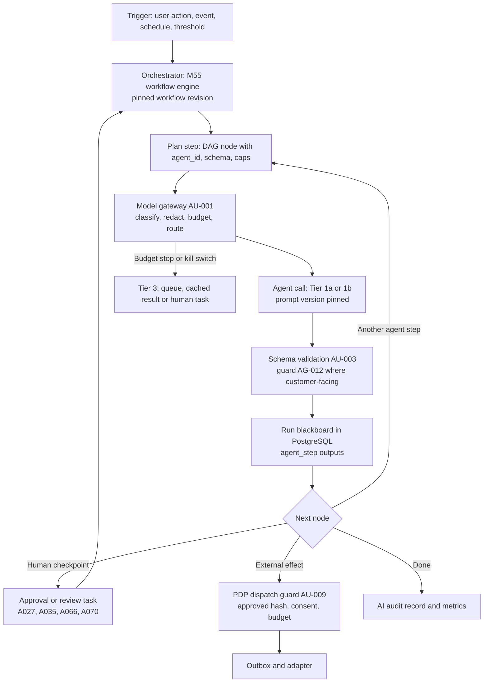
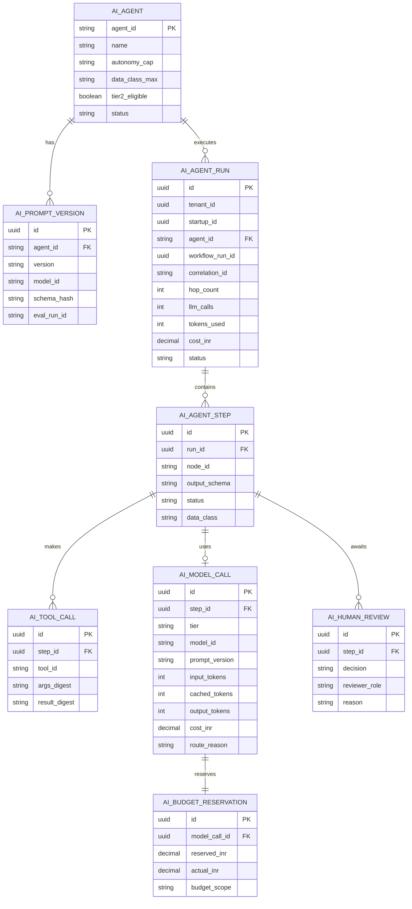
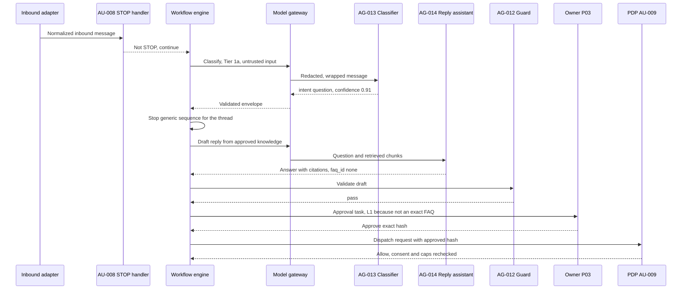
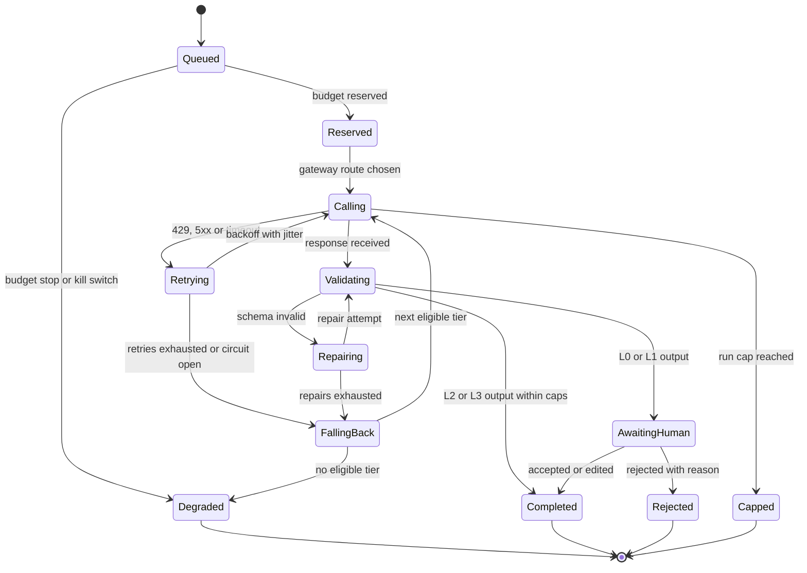

# AI Growth Engine: Employee Sales & Marketing Automation
## Application Blueprint: PART 7 (Batch 7.2), AI Agent and Automation Specifications and Multi-Agent Orchestration

| Field | Value |
|---|---|
| Document | Part 7, Batch 2 of 3 |
| Version | 1.0 · 27 Nov 2026 |
| Baseline | BRD, FRD, Parts 0, 0A (DEC-001…065), 1, 2.1–2.5, 4.1, 5.2; Part 7.1 catalogue (36 AG + 43 AU) |
| Roles applied | AI/ML Architect (lead), Principal Engineer, Security/AI Governance Lead, Data Architect, QA Lead, FinOps Lead |

**Reading guide.** §7.2.1 gives the full specification table for the 36 agents (split in two parts to stay readable). §7.2.2 has one detail card per agent with every field the client asked for. §7.2.3 specifies the 43 deterministic automations (one row each is their card, because they have no model, prompt or token fields). §7.2.4 is the tool registry required by DEC-048. §7.2.5–§7.2.11 describe how agents work together: orchestrator, shared memory and state, inter-agent protocol, conflict handling, runaway prevention and human escalation. §7.2.12 lists the evaluation dimensions per agent for Part 6.

**Conventions.** Model tiers per DEC-007: **Tier 0** deterministic rules, templates and exact/semantic cache; **Tier 1a** Claude Haiku 5.5 (`claude-haiku-5-5`); **Tier 1b** Claude Sonnet 5.5 (`claude-sonnet-5-5`); **Tier 2** free/open-weight fallbacks (Public or Internal-non-personal data only, opt-in per tenant, default OFF); **Tier 3** graceful degradation. Model IDs and prices: *verify at time of implementation (as of 27 Nov 2026)*; see Batch 7.3. Data classes per Part 4.1 §4.1.2: Public, Internal, Confidential, Restricted. Costs are **pilot base estimates** (BR-S089 volumes) with low/base/high ranges; the formula is in §7.5. Tool side-effect classes: **R0** read-only, **R0-ext** read-only external call within budget, **W1** internal draft/label write (no external effect), **X2** external side effect (no agent holds an X2 tool; ADR-082).

---

## 7.2.1 Specification table

**Part A: purpose, links, people, triggers, autonomy, release**

| ID | Name | Type | Purpose and business outcome (short) | Linked BR / FR / US | Persona | Trigger | Autonomy | Release |
|---|---|---|---|---|---|---|---|---|
| AG-001 | Knowledge & Claim Ingestion Assistant | Agent | Turns approved uploaded decks, brochures and FAQs into chunk summaries and *claim candidates* with page citations, so R10/R05 approve claims in minutes instead of reading whole documents. | BR-M02, BR-M03; FR-A005, FR-A006; EP-02 (US: see EP-02) | P05, P09 (reviewers); P16 executes | Event: `document.scanned_clean` after upload (M03 pipeline) | L1 | Release 1 (W0) |
| AG-002 | AI Quality Judge & Eval Runner | Agent | Scores generative outputs against rubrics (groundedness, claim compliance, tone, refusal correctness) for the CI regression gate and for a 5% sample of production outputs. | BR-M08, BR-M54; FR-A011, FR-A084; NFR-033; EP-04 (US: see EP-04) | P10 Automation Lead; AI lead; D04 QA | CI: prompt/model/config change (AU-006); Schedule: nightly production sample batch | L2 (scores recorded automatically; a human reviews failures and every threshold change) | Release 1 (W0) |
| AG-003 | Research Query Planner | Agent | Expands approved capability codes, geography and organization types into scoped search queries within the plan's source and cost bounds. | BR-M10; FR-A015; WF-02 step 3; EP-05 (US: see EP-05) | P04 Research Analyst | Schedule (research plan, Celery Beat) or user action (Run now in A015) | L3 within guardrails (queries only reach permitted search adapters; no side effect beyond a budgeted search) | Release 1 (W1) |
| AG-004 | Evidence Extractor | Agent | Extracts organization-level business facts (projects, tenders, expansions, hiring for relevant functions, budgets, dates) with quotes and provenance from permitted pages and permitted social posts. | BR-M12, BR-M33; FR-A016, FR-A017, FR-A048; NFR-028; EP-05 (US: see EP-05) | P04; P16 executes | Event: `source_record.fetched` (permitted page fetched, content hash new) | L3 within guardrails (writes evidence records only; no external effect) | Release 1 (W1) |
| AG-005 | Buying Signal Classifier | Agent | Classifies each evidence item into the approved signal taxonomy with confidence; below-threshold items go to review. | BR-M14, BR-M33; FR-A019, FR-A048; KPI-02, KPI-08; EP-05 (US: see EP-05) | P04 | Event: `evidence.created` | L2 (classification stored; items below threshold or in the weekly sample reviewed in A019) | Release 1 (W1) |
| AG-006 | Need Discovery Agent | Agent | Derives business needs from signals and evidence and labels each as *explicit* (stated in a source) or *inferred*. | BR-M15; FR-A020; BRL-SCR-05; EP-05 (US: see EP-05) | P04 | Event: `signal.classified` with confidence ≥ threshold | L1 for inferred needs (reviewer verifies in A020); L2 for explicit needs with quote | Release 1 (W1) |
| AG-007 | Solution Match Explainer | Agent | Explains why each deterministically ranked offering (AU-016) fits a need and why others were excluded (readiness, geography, capability). | BR-M16; FR-A021; BRL-SCR-04; EP-05 (US: see EP-05) | P04, P03 | Event: `match.recomputed` | L0 (suggestion only; ranking is deterministic) | Release 1 (W1) |
| AG-008 | Decision-Maker Role Extractor | Agent | Extracts role hypotheses (function, seniority) and *published* professional channels from official organization pages for qualified accounts. | BR-M18; FR-A024, FR-A026; EP-06 (US: see EP-06) | P04 | Event: opportunity band ≥ 75 or reviewer request | L1 (contact records created as *unverified*; AU-018 verifies; consent stays separate) | Release 1 (W1) |
| AG-009 | Qualification Brief Assistant | Agent | Prepares a one-screen cited brief per opportunity (need, fit, evidence freshness, score components, open questions) for the reviewer; at L2 (after the 90% gate) proposes accept/reject. | BR-M20, BR-M17; FR-A027; DEC-001; BRL-SCR-06/07; EP-06 (US: see EP-06) | P04, P03 | Event: `opportunity.scored` (band ≥ 50 or Unknown) | L1 until benchmark precision ≥ 90% on ≥ 200 labelled items per vertical; then L2 for the recommendation (BRL-SCR-07) | Release 1 (W1) |
| AG-010 | Import Mapping Assistant | Agent | Maps unmatched CSV/JSON column headers and value formats to versioned import templates after deterministic header matching. | FR-A103; DEC-039; EP-20 (US: see EP-20) | P11, P13 | User action: upload in A103 (dry run) | L1 (user confirms mapping before import) | Release 1 (W1) |
| AG-011 | Outreach & Follow-up Message Drafter | Agent | Drafts evidence-cited first-touch emails, WhatsApp template variants, follow-up steps, event invitations and renewal reminders using approved claims only. | BR-M25, BR-M28, BR-M31, BR-M40, BR-M50; FR-A034, FR-A035, FR-A038, FR-A044; EP-08 (US-0801, US-0803) | P03, P05 | User action (Draft in A034) or event (`opportunity.qualified`, sequence step due needing a personalised variant) | L1 for personalised drafts (human approves exact hash); L2/L3 only via pre-approved templates with variables (DEC-064, BRL-AUT-01) | Release 1 (W2) |
| AG-012 | Claims & Policy Guard | Agent | Second-line check of every customer-facing draft (messages, content, proposals, chat answers sampled) for unsupported claims, prohibited content, tone and brand. | BR-M08, BR-M25, BR-M34, BR-M43; BRL-AI-03, BRL-AI-05; SC-33; EP-04, EP-08, EP-11 (US: see EP-04) | P09, P05 (indirect); P16 executes | Event: `draft.created` for any customer-facing artefact | L3 within guardrails for *block/fix* decisions (it can only make things stricter); never approves | Release 1 (W2) |
| AG-013 | Inbound Intent Classifier & Router | Agent | Classifies every inbound email, WhatsApp and web reply (positive, question, objection, out-of-office, complaint, urgent/clinical, wrong person, other), extracts proposed times and a one-line summary, and routes it. | BR-M27, BR-M41, BR-M31, BR-M57; FR-A037, FR-A045, FR-A046; EP-08 (US-0807), EP-10 | P03; P16 executes | Event: `inbound.received` (after AU-008 STOP handling) | L3 for routing and sequence stop (classification only; any reply still follows AG-014 rules) | Release 1 (W2) |
| AG-014 | Reply Assistant | Agent | Drafts answers to inbound questions from approved FAQ and knowledge with citations; at L3, sends only *approved FAQ answers* verbatim with variables. | BR-M27, BR-M41, BR-M45 (routine); FR-A037, FR-A046; DEC-064; EP-08, EP-10 (US: see EP-08) | P03 | Event: intent = question (AG-013) | L1 by default; L3 only when the answer is an exact approved FAQ (faq_id) and policy allows (DEC-064) | Release 1 (W2) |
| AG-015 | Admin Copilot | Agent | Side-panel assistant that answers staff questions over records the user can already see and approved knowledge, with citations; briefs on accounts and meetings; proposes saved-view filters and drafts (message, task, note). | DEC-035; FR-COP-01; BRL-AI-12; BR-S124; FR-A003, FR-A032; EP-17 (US: see EP-17) | P01, P02, P03, P04, P05, P06, P07 | User action (Copilot panel) | L0 answers; L1 drafts (DEC-035) | Release 1 (W3 (Q&A) / W5 (drafts)) |
| AG-016 | Autonomous Commercial Planner | Agent | Proposes commercial plans (objective, eligible segment, channel mix, sequence, budget, schedule) and workflow drafts from approved node types; narrates simulation results. | FR-A102, FR-A113; BR-AUTO; WF-13; BR-S018; DEC-051, DEC-064; EP-18 (US: see EP-18) | P10, P01, P02 | User action (Propose plan / Draft workflow) | L1 for the plan (approval of the exact plan hash by R01 for L3, R02 for L2 — CFG-27) | Release 1 (W2 (simulation) / W5 (L3 execution of approved plans)) |
| AG-017 | Website Assistant | Agent | Public chat on each verified startup site that answers from approved public knowledge with citations, captures a consented lead and hands over clinical, legal, pricing-negotiation and complaint topics. | BR-M32; FR-W11, FR-A046; BRL-AI-11; DEC-030; EP-10 (US: see EP-10) | P15 (and P14 when signed in) | User action (chat widget) | L3 for answers grounded in approved public knowledge; lead capture via deterministic form (M22) | Release 1 (W3) |
| AG-018 | Content & Campaign Studio Drafter | Agent | Drafts articles, social variants, landing-page copy, ad copy, SEO titles/meta and translation drafts (hi-IN, ta-IN, or-IN) from a brief using approved claims. | BR-M34, BR-M35, BR-M36, BR-M37, BR-M38, BR-M39; FR-A050, FR-A052, FR-A055, FR-A056, FR-A058, FR-A060; DEC-026; EP-11, EP-12 (US: see EP-11) | P05 | User action (brief submitted in A050/A056/A058) | L1 (content approver ≠ author; claims approval; DEC-038) | Release 1 (W3) |
| AG-019 | Bid / RFP Analyzer | Agent | Parses RFPs, tenders and submitted project requirements into eligibility criteria, deadlines, mandatory documents, evaluation criteria and a compliance matrix, plus an L0 bid/no-bid brief. | WF-08; FR-A104, FR-W15; BR-S001, BR-S013, BR-S034; DEC-053; EP-14 (US: see EP-14) | P06, P02 | Event: tender document uploaded / RFP attached to a bid | L1 for checklist items; L0 for bid/no-bid | Release 2 (W4) |
| AG-020 | Proposal & Bid Response Drafter | Agent | Drafts proposals and bid response sections from approved templates, meeting notes entered by staff, approved claims and the deterministic price snapshot (prices inserted by AU-035, never by the model). | BR-M43; FR-A065, FR-A066, FR-W23; DEC-038; EP-13 (US: see EP-13) | P03, P06, P02 | User action (Draft proposal) or event `meeting.completed` (draft offered, not auto-created) | L1 (DEC-064: proposals/quotes ≤ L1) | Release 2 (W4) |
| AG-021 | Objection & Negotiation Assistant | Agent | Classifies objections into the approved taxonomy, drafts approved responses, and prepares exception summaries for A070 when a request exceeds concession limits. | BR-M45; FR-A069, FR-A070; DEC-038, DEC-064; EP-13 (US: see EP-13) | P03, P02 | Event: intent = objection (AG-013) or user action | L1 (price/terms ≤ L1, DEC-064) | Release 2 (W4) |
| AG-022 | Contract Clause Reviewer | Agent | Compares counterparty redlines or third-party paper against the approved template and clause library; flags non-standard, missing or risky clauses for Legal with references. | BR-M46; FR-A071, FR-A072; DEC-023, DEC-038; EP-13 (US: see EP-13) | P09 | Event: counterparty document uploaded to a contract | L0 (suggest only) | Release 2 (W4) |
| AG-023 | Order Document Extractor | Agent | Extracts RFQ/PO lines (SKU, description, unit, quantity, requested price, delivery date/region) from uploaded documents and emails into a draft order or RFQ for OrganicSpec and other order-desk startups. | FR-A105, FR-W14, FR-W16; WF-10; DEC-045; EP-14 (US: see EP-14) | P07 | Event: RFQ/PO document received (W14/W16 upload or inbound attachment) | L1 (draft order; coordinator confirms) | Release 2 (W4) |
| AG-024 | Payment Evidence Extractor | Agent | Pre-fills payment verification fields (UTR/reference, amount, currency, date, payer name, bank) from uploaded bank/UPI evidence for the Finance Maker. | BR-M47; FR-A073, FR-A074, FR-W26; DEC-022, DEC-038; EP-15 (US: see EP-15) | P08 | Event: payment evidence uploaded | L0 (pre-fill; maker confirms every field) | Release 2 (W4) |
| AG-025 | Onboarding Handoff Summarizer | Agent | Produces the commercial-to-delivery handoff summary (scope, commitments, contacts' roles, open risks, approved terms references) when a deal closes. | BR-M48; FR-A075, FR-A076; EP-16 (US: see EP-16) | P03, P02 (delivery team receives) | Event: `deal.won` (closure policy satisfied, DEC-054) | L1 | Release 2 (W4) |
| AG-026 | Loss & Feedback Analyzer | Agent | Classifies free-text loss reasons and customer feedback into the loss taxonomy and produces a monthly theme report. | BR-M51, BR-M54; FR-A081, FR-A084; EP-16 (US: see EP-16) | P02, P03 | Event: `deal.lost` / feedback submitted; Schedule: monthly theme batch | L2 (labels stored; owner can correct) | Release 2 (W4) |
| AG-027 | Market & Competitor Watch Summarizer | Agent | Summarizes permitted public competitor and market events into internal alerts with sources. | BR-M59; FR-A085, FR-A086; EP-05 (US: see EP-05) | P04, P02 | Schedule: weekly per startup; Event: high-relevance market event | L3 for internal alerts only (no external use) | Release 2 (W5) |
| AG-028 | Ops & Incident Triage Agent | Agent | Clusters failed runs, DLQ items, provider errors and alerts; summarizes probable cause and links the runbook (RB-) for on-call staff. | BR-M58; FR-A014, FR-A110; NT-030, NT-034; EP-21 (US: see EP-21) | P12, P10; D05 | Event: incident opened / DLQ growth alarm; Schedule: daily failure digest | L0 (suggestions only); remediation by humans (CI-128 excluded) | Release 2 (W5) |
| AG-029 | Insight Narrative Agent | Agent | Writes weekly 'what changed and why' narratives on deterministic KPI snapshots for startup heads and a portfolio digest for the founder. | BR-M30, BR-M60, BR-M61; FR-A042, FR-A043, FR-A089; RP-01; EP-17 (US: see EP-17) | P01, P02 | Schedule: weekly (Monday 07:00 IST) | L3 for internal digest delivery | Release 2 (W5) |
| AG-030 | SaaS Onboarding Configuration Assistant | Agent | During W33, proposes business profile, industry taxonomy, offering structure, objective templates and workflow bindings from the applicant's description. | FR-W33, FR-A100; BR-S112; AP-01; EP-20 (US: see EP-20) | P13 | User action in the W33 wizard | L1 (applicant edits; platform approval before provisioning) | Release 2 (W5) |
| AG-031 | Support Desk Assistant | Agent | Triages portal support tickets (W28, W34) by category and severity, drafts replies from the help centre, answers authenticated customers' questions about their own records, and drafts KB articles from resolved tickets. | FR-W28, FR-W34, FR-W30; DEC-044; EP-16, EP-20 (US: see EP-20) | P12, P13, P14 | Event: ticket created; user action in portal help | L1 for replies; L2 for category/severity | Release 2 (W5) |
| AG-032 | Partner Due-Diligence Brief | Agent | Compiles public evidence on prospective partners, insurers and licensees into a due-diligence checklist with sources. | BR-M49, BR-M63, BR-M64, BR-M65; FR-A077, FR-A091, FR-A093; EP-16 (US: see EP-16) | P02, P09 | User action (Prepare diligence brief) | L0 | Future (W6) |
| AG-033 | Requirements & Story Assistant | Agent | Drafts user stories, Gherkin AC, ADR and DPIA skeletons from FR/BRL/DEC text, and runs change-impact analysis over the traceability matrix. | BR-QA, BR-S134; EP-21; Part 5/6 process | D01, D04, D06 | User action (developer/PO in Claude Code or the repository) | L1 (PR review by PO) | Release 1 (W0) |
| AG-034 | Coding Assistant | Agent | Claude Code for implementation, refactoring, IaC, UI microcopy and accessibility fixes, with repository rules (RLS scoping, outbox, no secrets). | BR-QA; DEC-005; BRD §6 B09; ASSUMPTION-020 | D02, D03, D05 | User action (developer) | L1 (all changes through PR review + CI gates) | Release 1 (W0) |
| AG-035 | PR, Security & Release Review Agent | Agent | Reviews each pull request for tenancy/RLS scoping, outbox use, secret exposure, OWASP issues, missing tests; triages CI failures and SAST/dependency findings; drafts release notes and go/no-go summaries; drafts threat-model updates. | BR-M09, BR-M62, BR-QA; NFR-012, NFR-013; EP-21 (US: see EP-21) | D02, D04, D05, D01 | Event: PR opened/updated; CI failure; release candidate tagged | L0 (comments only; cannot approve or merge) | Release 1 (W0) |
| AG-036 | Test & Synthetic Data Generator | Agent | Generates test cases from Gherkin AC (EP/BVA/decision-table techniques), synthetic two-tenant fixtures (RECOMMENDATION-017), injection corpora and eval cases from reviewed feedback. | BR-QA; DEC-017; RECOMMENDATION-017; EP-21 (US: see EP-21) | D04 | User action; CI batch job for fixture regeneration | L1 (QA review) | Release 1 (W0) |

**Part B: model, data, tokens, cost, dependencies** (cost = model tokens per month at pilot volume, before the overhead allowance in §7.5.5)

| ID | Model tier | Tier 2 eligible | Data class | Tokens per call | Calls / month (pilot base) | Cost low / base / high (₹/month, pilot) | Budget line | Key dependencies |
|---|---|---|---|---|---|---|---|---|
| AG-001 | 1a Haiku 5.5 (10% escalation to 1b for documents > 40 pages or low-confidence tables) | No (Internal/Confidential business documents) | Internal–Confidential | 6,000 in (1,200 cacheable) / 800 out | 40 | ₹2 / ₹5 / ₹15 | B02 | AU-001, AU-003, AU-004, AU-005; M03 parser; pgvector index (ADR-077) |
| AG-002 | 1b Sonnet 5.5 via Batch API (judge must be at least as capable as the judged model); classifier/extractor evals use deterministic graders (exact match, F1) with no LLM | No | Internal (redacted fixtures) | 2,500 in (1,500 cacheable) / 250 out | 480 | ₹66 / ₹139 / ₹337 | B02, DEL | AU-006, Langfuse datasets (ADR-078), promptfoo/DeepEval (ADR-079) |
| AG-003 | Tier 0 templates first (≈60% of runs reuse cached query sets); 1a Haiku 5.5 for expansion | Yes (Public: capability codes and geography), if tenant opted in | Public / Internal-non-personal | 1,500 in (900 cacheable) / 300 out | 60 | ₹0 / ₹1 / ₹2 | B02 | AU-007 source permissions, AU-001 cache |
| AG-004 | 1a Haiku 5.5 via Batch API; 5% escalation to 1b for long tables | Yes for pages classified Public **after** Presidio masks person names (AU-004); never for pages flagged `contains_personal_data` without masking | Public (may contain incidental personal data → masked) | 3,200 in (1,200 cacheable) / 450 out | 425 | ₹7 / ₹19 / ₹56 | B02 | AU-005 sanitizer, AU-007, AU-014 URL filter, AU-004 |
| AG-005 | 1a Haiku 5.5 via Batch API (thinking disabled, effort low) | Yes (Public evidence, opted-in tenants) | Public / Internal-non-personal | 1,100 in (700 cacheable) / 120 out | 465 | ₹2 / ₹6 / ₹19 | B02 | AG-004, AU-001 |
| AG-006 | 1a Haiku 5.5 via Batch; 10% escalation to 1b on conflicting evidence | Yes (Public evidence only), opted-in | Internal-non-personal | 1,400 in (800 cacheable) / 250 out | 200 | ₹2 / ₹6 / ₹21 | B02 | AG-005 |
| AG-007 | 1a Haiku 5.5 via Batch | Yes (approved offering text is Public/Internal-non-personal), opted-in | Internal-non-personal | 1,800 in (700 cacheable) / 250 out | 120 | ₹1 / ₹2 / ₹4 | B02 | AU-016, pgvector (ADR-077) |
| AG-008 | 1a Haiku 5.5 via Batch | **No** (personal data → Restricted) | Restricted | 2,800 in (900 cacheable) / 300 out | 60 | ₹1 / ₹1 / ₹3 | B02 | AU-004, AU-005, AU-018 |
| AG-009 | 1a Haiku 5.5 pre-generated in Batch; 15% escalation to 1b for conflicting evidence | No (includes contact status → Restricted fields excluded; still Confidential pipeline data) | Confidential | 3,500 in (1,200 cacheable) / 500 out | 110 | ₹3 / ₹11 / ₹35 | B02 | AU-017, AG-006, AG-007 |
| AG-010 | Tier 0 header dictionary first; 1a Haiku 5.5 for unmatched columns | No (samples may contain personal data) | Restricted (masked) | 1,500 in (800 cacheable) / 400 out | 10 | ₹0 / ₹0 / ₹1 | B02 | AU-004 |
| AG-011 | 1b Sonnet 5.5 (customer-facing, DEC-007), effort low; Tier 0 approved templates for sequence steps | No (recipient data is Restricted) | Restricted | 3,500 in (2,000 cacheable) / 450 out | 200 | ₹78 / ₹165 / ₹404 | B02 | AG-012, AU-009, M02 approved claims |
| AG-012 | Tier 0 deterministic rules first (regex/lexicon for guarantees, medical terms, competitor names); 1a Haiku 5.5 semantic check; 10% escalation to 1b | No | Restricted (drafts may contain recipient data) | 2,200 in (1,400 cacheable) / 150 out | 350 | ₹6 / ₹20 / ₹64 | B02 | M02 claims, AU-003 |
| AG-013 | Tier 0: STOP keywords, auto-responder headers, bounce formats; 1a Haiku 5.5 (thinking off); 5% escalation to 1b | No (personal communications) | Restricted | 1,000 in (650 cacheable) / 120 out | 420 | ₹3 / ₹9 / ₹28 | B02 | AU-008, AU-022, AU-031 |
| AG-014 | Tier 0 semantic cache of approved FAQ answers (pgvector, similarity ≥ 0.92) first; 1a Haiku 5.5; 20% escalation to 1b | No (thread content) | Restricted | 3,200 in (1,000 cacheable) / 300 out | 150 | ₹8 / ₹27 / ₹86 | B02 | AG-013, AG-012, AU-001 semantic cache |
| AG-015 | 1a Haiku 5.5 for lookups (≈70%); 1b Sonnet 5.5 for synthesis (≈30%); router decides from tool plan size | No | Up to Restricted (user's own permitted data) | 6,000 in (2,500 cacheable) / 400 out | 528 | ₹106 / ₹222 / ₹520 | B02 | AU-001, AU-004, SR-04 retrieval, R20 identity |
| AG-016 | 1b Sonnet 5.5 (effort medium) | No | Confidential | 8,000 in (3,000 cacheable) / 1,500 out | 10 | ₹13 / ₹26 / ₹61 | B02 | AU-025 runaway guard, AU-009, M55 engine |
| AG-017 | Tier 0 FAQ cache (≈40%); 1a Haiku 5.5; 5% escalation to 1b | Yes (Public knowledge; visitor text masked by AU-004; blocked if PII remains) | Public (visitor input may be Restricted → masked) | 2,600 in (1,500 cacheable) / 250 out | 240 | ₹4 / ₹13 / ₹38 | B02 | AU-004, AU-020, M03 approved public knowledge |
| AG-018 | 1b Sonnet 5.5 (customer-facing); 1a for SEO metadata and short social variants | Yes for Public briefs and public approved claims (opted-in); No if the brief includes customer/confidential data | Internal-non-personal / Public | 4,000 in (2,000 cacheable) / 1,200 out | 60 | ₹48 / ₹98 / ₹238 | B02 | AG-012, M02 |
| AG-019 | 1b Sonnet 5.5; document cached with 1-hour TTL for follow-up questions (ADR-075) | No (tender documents may be Confidential) | Confidential | 26,000 in (25,000 cacheable) / 2,000 out | 32 | ₹56 / ₹141 / ₹423 | B02 | AU-034 deadline tracker |
| AG-020 | 1b Sonnet 5.5 | No | Confidential | 6,000 in (2,500 cacheable) / 2,500 out | 20 | ₹31 / ₹63 / ₹154 | B02 | AU-035, AU-036, AG-012 |
| AG-021 | 1b Sonnet 5.5 (effort low) | No | Confidential / Restricted | 3,000 in (1,800 cacheable) / 400 out | 30 | ₹11 / ₹22 / ₹55 | B02 | AG-013, AG-012 |
| AG-022 | 1b Sonnet 5.5 | No | Confidential | 20,000 in (8,000 cacheable) / 1,500 out | 4 | ₹9 / ₹18 / ₹41 | B02 | AU-036 |
| AG-023 | 1a Haiku 5.5; 5% escalation to 1b | No | Confidential | 2,500 in (900 cacheable) / 500 out | 60 | ₹2 / ₹5 / ₹14 | B02 | AU-035, AU-038 |
| AG-024 | 1a Haiku 5.5 (vision); 5% escalation to 1b | **No** (financial evidence → Restricted) | Restricted | 1,800 in (600 cacheable) / 150 out | 30 | ₹0 / ₹1 / ₹4 | B02 | AU-037 |
| AG-025 | 1a Haiku 5.5 via Batch (not urgent) | No | Confidential | 5,000 in (900 cacheable) / 600 out | 8 | ₹0 / ₹0 / ₹1 | B02 | AU-036 |
| AG-026 | 1a Haiku 5.5 via Batch | Yes for de-identified text (Internal-non-personal) if opted-in | Internal | 900 in (600 cacheable) / 120 out | 21 | ₹0 / ₹0 / ₹0 | B02 | AU-004 |
| AG-027 | 1a Haiku 5.5 via Batch | Yes (Public), opted-in | Public | 2,600 in (900 cacheable) / 300 out | 40 | ₹0 / ₹1 / ₹2 | B02 | AG-004, AU-007 |
| AG-028 | 1a Haiku 5.5; 10% escalation to 1b | No (logs may contain identifiers despite redaction) | Internal–Confidential | 3,000 in (1,000 cacheable) / 400 out | 60 | ₹2 / ₹7 / ₹22 | B02 | AU-010, AU-012, M58 |
| AG-029 | 1a Haiku 5.5 via Batch; 10% escalation to 1b for portfolio digest | No (Confidential financial aggregates) | Confidential | 3,000 in (1,200 cacheable) / 500 out | 20 | ₹0 / ₹1 / ₹4 | B02 | AU-040, AU-041 |
| AG-030 | 1b Sonnet 5.5 | No (applicant business data, admin identity) | Confidential | 5,000 in (2,500 cacheable) / 1,200 out | 20 | ₹17 / ₹35 / ₹86 | SVC | FR-A100 templates |
| AG-031 | 1a Haiku 5.5; 20% escalation to 1b | No | Restricted | 3,000 in (1,500 cacheable) / 350 out | 80 | ₹4 / ₹14 / ₹47 | B02, SVC | AU-042 |
| AG-032 | 1b Sonnet 5.5 via Batch | Yes (Public), opted-in | Public / Internal | 12,000 in (2,000 cacheable) / 1,500 out | 6 | ₹5 / ₹10 / ₹23 | B02 | AG-004 |
| AG-033 | Claude Code developer seats (B09; model per seat plan, verify) | No | Internal (no production data) | n/a (seat) | n/a | ₹540 seat share (B09) | B09 | B09 seats, repository lint (AU-013) |
| AG-034 | Claude Code developer seats (B09) | No | Internal (code); no production data | n/a (seat) | n/a | ₹2,520 seat share (B09) | B09 | B09, AU-013 |
| AG-035 | 1b Sonnet 5.5 via CI API key (separate delivery budget, RECOMMENDATION-061) | No (source code is Confidential) | Confidential | 18,000 in (6,000 cacheable) / 1,500 out | 120 | ₹245 / ₹505 / ₹1,154 | DEL | AU-013, GitHub |
| AG-036 | Claude Code seats + 1a Haiku 5.5 via Batch for bulk fixtures | No | Internal (synthetic) | 3,000 in (1,000 cacheable) / 2,000 out | 100 | ₹3 / ₹6 / ₹14 + ₹540 seat share | DEL, B09 | AU-013 |

---

## 7.2.2 Agent detail cards

Every card has the same 19 fields. The fields are produced from one source dataset, and the build fails if any card lacks a guardrail, fallback, KPI, eval dimensions or cost (quality-gate item 6). Eval dimension codes are expanded in each card; test cases themselves are written in Part 6.

#### AG-001 Knowledge & Claim Ingestion Assistant

| Field | Specification |
|---|---|
| Type | Agent · Extractor · scope: Product |
| Purpose and business outcome | Turns approved uploaded decks, brochures and FAQs into chunk summaries and *claim candidates* with page citations, so R10/R05 approve claims in minutes instead of reading whole documents. Outcome: faster, evidence-backed product truth (M02/M03), which every customer-facing agent depends on. |
| Linked BR / FR / US | BR-M02, BR-M03; FR-A005, FR-A006; EP-02 (US: see EP-02) |
| Persona | P05, P09 (reviewers); P16 executes |
| Trigger | Event: `document.scanned_clean` after upload (M03 pipeline) |
| Inputs and data sources | Parsed document text (M03 parser, malware-scanned), offering taxonomy, existing approved claims (for duplicate detection) |
| Tools / APIs it can call (registry §7.2.4) | TL-14 document.parse (R0), TL-09 claims.lookup (R0), TL-06 draft.create (W1: claim candidates only) |
| Outputs | JSON: `{chunks[{id, summary}], claim_candidates[{text, page, evidence_quote, offering_id, risk_flags[]}], duplicates[]}` |
| Autonomy level and human-in-the-loop checkpoints | **L1.** Every claim candidate needs R10 approval in A051/A006 before it can be cited; nothing is indexed for retrieval until the document is approved (THR-057). |
| Model tier used | 1a Haiku 5.5 (10% escalation to 1b for documents > 40 pages or low-confidence tables) |
| Tier 2 (free fallback) eligibility · data class | No (Internal/Confidential business documents) · Internal–Confidential |
| Prompt / context strategy | Static system prompt + claim schema + 6 few-shot examples cached (≈1,200 tokens); document processed in ≤ 6,000-token windows; Batch API (no user waiting). |
| Guardrails | Quote-must-match check (claim text must appear verbatim or as a page-cited paraphrase; deterministic string/page check); health-claim and guarantee flags (BRL-AI-05); no claim auto-approval; injection text in documents treated as data (AU-005). |
| Failure modes and fallback | Schema failure → 2 repair retries (BRL-AI-02) → Tier 3: document marked *manual review* with a task to R05. Batch expiry → resubmit next window. Budget stop → queue until next day. |
| Success KPIs | ≥ 85% of approved claims originate from candidates; claim-candidate precision ≥ 80% (reviewer accepts); median approval time per document −50% vs manual baseline; cost ≤ ₹0.50 per document. |
| Eval dimensions (cases written in Part 6) | groundedness, accuracy, injection resistance, schema compliance, cost per task, fallback behaviour |
| Estimated tokens, calls and monthly cost | Claude Haiku 5.5 + 10% Sonnet escalation; 6,000 input tokens (1,200 cacheable, hit 40%, TTL 5m), 800 output; Batch API; 40 calls/month; ≈ ₹0.13 per call; line B02 **Monthly (pilot): low ₹2 · base ₹5 · high ₹15** (before the 25% overhead allowance in §7.5.5) |
| Dependencies | AU-001, AU-003, AU-004, AU-005; M03 parser; pgvector index (ADR-077) |
| Release | Release 1 · W0 (DEC-006) |

#### AG-002 AI Quality Judge & Eval Runner

> **Erratum v1.2 (E-V-26):** superseded by AI-judge calibration uses Cohen's κ ≥ 0.8 (DEC-603). See Part 11.23c.

| Field | Specification |
|---|---|
| Type | Agent · Validator / QA · scope: Product + Delivery |
| Purpose and business outcome | Scores generative outputs against rubrics (groundedness, claim compliance, tone, refusal correctness) for the CI regression gate and for a 5% sample of production outputs. Outcome: regressions block deploys (NFR-033) and quality drift is detected within a week. |
| Linked BR / FR / US | BR-M08, BR-M54; FR-A011, FR-A084; NFR-033; EP-04 (US: see EP-04) |
| Persona | P10 Automation Lead; AI lead; D04 QA |
| Trigger | CI: prompt/model/config change (AU-006); Schedule: nightly production sample batch |
| Inputs and data sources | Eval cases (versioned, redacted), agent output, cited evidence/knowledge chunks, rubric |
| Tools / APIs it can call (registry §7.2.4) | TL-16 eval.read_cases (R0), TL-01 knowledge.search (R0), TL-08 classification.write (W1: eval scores only) |
| Outputs | JSON: `{case_id, scores{groundedness, claim_compliance, tone, refusal_ok}, verdict, rationale_short}` |
| Autonomy level and human-in-the-loop checkpoints | **L2 (scores recorded automatically; a human reviews failures and every threshold change).** AI lead reviews all failing cases before a gate override; judge itself is calibrated quarterly against ≥ 100 human-labelled cases (agreement ≥ 85%). |
| Model tier used | 1b Sonnet 5.5 via Batch API (judge must be at least as capable as the judged model); classifier/extractor evals use deterministic graders (exact match, F1) with no LLM |
| Tier 2 (free fallback) eligibility · data class | No · Internal (redacted fixtures) |
| Prompt / context strategy | Rubric + scoring scale cached; one case per request; Batch API; structured output. |
| Guardrails | Judge never sees unredacted Restricted data (fixtures are synthetic, RECOMMENDATION-017); position-bias control (randomized order for pairwise); judge-agreement monitoring; judge cannot change thresholds. |
| Failure modes and fallback | Batch failure → rerun failed IDs; judge unavailable → gate falls back to deterministic graders only and blocks generative-prompt releases (fail closed). |
| Success KPIs | Judge–human agreement ≥ 85%; 100% of prompt/model changes gated; drift alert ≤ 7 days after onset; eval cost per release ≤ ₹150. |
| Eval dimensions (cases written in Part 6) | accuracy, bias/fairness, schema compliance, cost per task, fallback behaviour |
| Estimated tokens, calls and monthly cost | Claude Sonnet 5.5; 2,500 input tokens (1,500 cacheable, hit 50%, TTL 5m), 250 output; Batch API; 80 calls/month; ≈ ₹0.29 per call; line B02 (production sample) Claude Sonnet 5.5; 2,500 input tokens (1,500 cacheable, hit 50%, TTL 5m), 250 output; Batch API; 400 calls/month; ≈ ₹0.29 per call; line DEL (CI regression runs) **Monthly (pilot): low ₹66 · base ₹139 · high ₹337** (before the 25% overhead allowance in §7.5.5) |
| Dependencies | AU-006, Langfuse datasets (ADR-078), promptfoo/DeepEval (ADR-079) |
| Release | Release 1 · W0 (DEC-006) |

#### AG-003 Research Query Planner

| Field | Specification |
|---|---|
| Type | Agent · Generator · scope: Product |
| Purpose and business outcome | Expands approved capability codes, geography and organization types into scoped search queries within the plan's source and cost bounds. Outcome: broader, relevant discovery without staff writing queries (M10). |
| Linked BR / FR / US | BR-M10; FR-A015; WF-02 step 3; EP-05 (US: see EP-05) |
| Persona | P04 Research Analyst |
| Trigger | Schedule (research plan, Celery Beat) or user action (Run now in A015) |
| Inputs and data sources | Research plan (objective, approved capability codes, country/industry, max results), source policy set, past query performance |
| Tools / APIs it can call (registry §7.2.4) | TL-01 knowledge.search (R0, approved capabilities only) |
| Outputs | JSON: `{queries[{text, source_policy_id, rationale}], rejected[{text, rule}]}` |
| Autonomy level and human-in-the-loop checkpoints | **L3 within guardrails (queries only reach permitted search adapters; no side effect beyond a budgeted search).** Plan owner approves the plan template (CFG-09); query safety filter is deterministic; owner can review the query log. |
| Model tier used | Tier 0 templates first (≈60% of runs reuse cached query sets); 1a Haiku 5.5 for expansion |
| Tier 2 (free fallback) eligibility · data class | Yes (Public: capability codes and geography), if tenant opted in · Public / Internal-non-personal |
| Prompt / context strategy | Query-writing rules + forbidden-query list cached; plan fields as variables; max 12 queries per call; max_tokens 400. |
| Guardrails | Deterministic query-safety filter after generation: no personal names, no health conditions, no minors (BR-M10, PP-11); allowlisted operators only; dedupe against previous 30 days. |
| Failure modes and fallback | Model unavailable → reuse last successful query set (Tier 0 cache) → Tier 2 (if opted in) → run skipped with reason (WF-02 X1). |
| Success KPIs | Share of queries yielding ≥ 1 accepted signal ≥ 25%; 0 unsafe queries reaching search; cost per plan run ≤ ₹0.05. |
| Eval dimensions (cases written in Part 6) | accuracy, refusal correctness, injection resistance, schema compliance, cost per task, fallback behaviour |
| Estimated tokens, calls and monthly cost | Claude Haiku 5.5; 1,500 input tokens (900 cacheable, hit 40%, TTL 5m), 300 output; Batch API; 60 calls/month; ≈ ₹0.01 per call; line B02 **Monthly (pilot): low ₹0 · base ₹1 · high ₹2** (before the 25% overhead allowance in §7.5.5) |
| Dependencies | AU-007 source permissions, AU-001 cache |
| Release | Release 1 · W1 (DEC-006) |

#### AG-004 Evidence Extractor

| Field | Specification |
|---|---|
| Type | Agent · Extractor · scope: Product |
| Purpose and business outcome | Extracts organization-level business facts (projects, tenders, expansions, hiring for relevant functions, budgets, dates) with quotes and provenance from permitted pages and permitted social posts. Outcome: evidence-backed signals instead of assumptions (M12, M33). |
| Linked BR / FR / US | BR-M12, BR-M33; FR-A016, FR-A017, FR-A048; NFR-028; EP-05 (US: see EP-05) |
| Persona | P04; P16 executes |
| Trigger | Event: `source_record.fetched` (permitted page fetched, content hash new) |
| Inputs and data sources | Cleaned page text (HTML stripped, ≤ 2,500 tokens after trimming), source metadata (URL, published/observed date, licence), extraction schema |
| Tools / APIs it can call (registry §7.2.4) | None at inference time (no tool access for agents that read untrusted content, SC-32); results written by the pipeline |
| Outputs | JSON: `{organization{name, domain, location}, facts[{type, statement, quote, date, confidence}], contains_personal_data, injection_suspected}` |
| Autonomy level and human-in-the-loop checkpoints | **L3 within guardrails (writes evidence records only; no external effect).** Evidence becomes actionable only after signal review (A019) or qualification review (A027). |
| Model tier used | 1a Haiku 5.5 via Batch API; 5% escalation to 1b for long tables |
| Tier 2 (free fallback) eligibility · data class | Yes for pages classified Public **after** Presidio masks person names (AU-004); never for pages flagged `contains_personal_data` without masking · Public (may contain incidental personal data → masked) |
| Prompt / context strategy | Untrusted page wrapped in `<untrusted_document>` delimiters with provenance; instruction hierarchy states the document is data; cached schema + examples; max_tokens 600. |
| Guardrails | Quote verification (every fact must quote text present in the page; deterministic substring check); dates normalized; inference labelled `inferred` (BRL-SCR-05); injection markers logged (THR-051). |
| Failure modes and fallback | Repair retry ×2 → mark page *unextracted* for re-batch; Tier 2 only if eligible; budget stop → defer to next window (24 h SLA, DEC-032). |
| Success KPIs | Fact precision ≥ 90% on reviewed sample; quote-verification pass ≥ 98%; 100% provenance (NFR-028); cost per page ≤ ₹0.03. |
| Eval dimensions (cases written in Part 6) | groundedness, accuracy, injection resistance, schema compliance, latency, cost per task, fallback behaviour |
| Estimated tokens, calls and monthly cost | Claude Haiku 5.5 + 5% Sonnet escalation; 3,200 input tokens (1,200 cacheable, hit 40%, TTL 5m), 450 output; Batch API; 425 calls/month; ≈ ₹0.05 per call; line B02 (500 fetches/month (BR-S089) less 15% duplicate content) **Monthly (pilot): low ₹7 · base ₹19 · high ₹56** (before the 25% overhead allowance in §7.5.5) |
| Dependencies | AU-005 sanitizer, AU-007, AU-014 URL filter, AU-004 |
| Release | Release 1 · W1 (DEC-006) |

#### AG-005 Buying Signal Classifier

| Field | Specification |
|---|---|
| Type | Agent · Classifier / router · scope: Product |
| Purpose and business outcome | Classifies each evidence item into the approved signal taxonomy with confidence; below-threshold items go to review. Outcome: 100 reviewed signals at ≥ 80% precision by Day 30 (BR-S080, DEC-001). |
| Linked BR / FR / US | BR-M14, BR-M33; FR-A019, FR-A048; KPI-02, KPI-08; EP-05 (US: see EP-05) |
| Persona | P04 |
| Trigger | Event: `evidence.created` |
| Inputs and data sources | Structured evidence JSON from AG-004 (not raw page), signal taxonomy with definitions and examples (CFG reference data) |
| Tools / APIs it can call (registry §7.2.4) | None (pure function over structured input) |
| Outputs | JSON: `{signal_type, confidence, rationale_short, evidence_ids[]}` |
| Autonomy level and human-in-the-loop checkpoints | **L2 (classification stored; items below threshold or in the weekly sample reviewed in A019).** Reviewer accepts/rejects in A019; rejections feed AG-002 eval sets; threshold per signal type (BRL-AI-04). |
| Model tier used | 1a Haiku 5.5 via Batch API (thinking disabled, effort low) |
| Tier 2 (free fallback) eligibility · data class | Yes (Public evidence, opted-in tenants) · Public / Internal-non-personal |
| Prompt / context strategy | Taxonomy + 2 examples per class cached (≈700 tokens); evidence JSON ≈ 400 tokens; enum output; max_tokens 150. |
| Guardrails | Closed enum output; confidence calibration checked monthly; unknown class allowed (no forced labels). |
| Failure modes and fallback | Fallback to keyword rules (Tier 0) with `confidence=low` → review queue; never silently dropped. |
| Success KPIs | Precision ≥ 80% (W1 exit), ≥ 85% by W5; recall ≥ 60% (DEC-001); per-class precision reported; cost per signal ≤ ₹0.01. |
| Eval dimensions (cases written in Part 6) | accuracy, bias/fairness, injection resistance, schema compliance, cost per task, fallback behaviour |
| Estimated tokens, calls and monthly cost | Claude Haiku 5.5 + 5% Sonnet escalation; 1,100 input tokens (700 cacheable, hit 40%, TTL 5m), 120 output; Batch API; 465 calls/month; ≈ ₹0.01 per call; line B02 (425 evidence + 40 social items) **Monthly (pilot): low ₹2 · base ₹6 · high ₹19** (before the 25% overhead allowance in §7.5.5) |
| Dependencies | AG-004, AU-001 |
| Release | Release 1 · W1 (DEC-006) |

#### AG-006 Need Discovery Agent

| Field | Specification |
|---|---|
| Type | Agent · Extractor · scope: Product |
| Purpose and business outcome | Derives business needs from signals and evidence and labels each as *explicit* (stated in a source) or *inferred*. Outcome: needs that sales can trust, with no inference presented as fact (BR-M15). |
| Linked BR / FR / US | BR-M15; FR-A020; BRL-SCR-05; EP-05 (US: see EP-05) |
| Persona | P04 |
| Trigger | Event: `signal.classified` with confidence ≥ threshold |
| Inputs and data sources | Signals + evidence for one organization, need taxonomy, startup's approved capability list |
| Tools / APIs it can call (registry §7.2.4) | TL-03 evidence.read (R0) |
| Outputs | JSON: `{needs[{category, statement, basis: explicit|inferred, evidence_ids[], confidence}]}` |
| Autonomy level and human-in-the-loop checkpoints | **L1 for inferred needs (reviewer verifies in A020); L2 for explicit needs with quote.** Inferred needs cannot become `confirmed` without evidence and reviewer (BRL-SCR-05). |
| Model tier used | 1a Haiku 5.5 via Batch; 10% escalation to 1b on conflicting evidence |
| Tier 2 (free fallback) eligibility · data class | Yes (Public evidence only), opted-in · Internal-non-personal |
| Prompt / context strategy | Need taxonomy cached; evidence summarised by AG-004 output (no raw pages); max_tokens 350. |
| Guardrails | `explicit` requires a quote ID; health needs limited to organization-level (no patient conditions, BR-M10); no needs for minors. |
| Failure modes and fallback | Tier 3: need left blank with *Review required* (FR-UIS-02). |
| Success KPIs | Explicit-label precision ≥ 95%; reviewer acceptance of inferred needs ≥ 70%; cost ≤ ₹0.02 per organization. |
| Eval dimensions (cases written in Part 6) | groundedness, accuracy, bias/fairness, injection resistance, schema compliance, cost per task, fallback behaviour |
| Estimated tokens, calls and monthly cost | Claude Haiku 5.5 + 10% Sonnet escalation; 1,400 input tokens (800 cacheable, hit 40%, TTL 5m), 250 output; Batch API; 200 calls/month; ≈ ₹0.03 per call; line B02 **Monthly (pilot): low ₹2 · base ₹6 · high ₹21** (before the 25% overhead allowance in §7.5.5) |
| Dependencies | AG-005 |
| Release | Release 1 · W1 (DEC-006) |

#### AG-007 Solution Match Explainer

| Field | Specification |
|---|---|
| Type | Agent · Generator · scope: Product |
| Purpose and business outcome | Explains why each deterministically ranked offering (AU-016) fits a need and why others were excluded (readiness, geography, capability). Outcome: reviewers trust matches and catch bad fits quickly (BR-M16). |
| Linked BR / FR / US | BR-M16; FR-A021; BRL-SCR-04; EP-05 (US: see EP-05) |
| Persona | P04, P03 |
| Trigger | Event: `match.recomputed` |
| Inputs and data sources | Need, top-3 ranked offerings with approved capability text (from AU-016), exclusions with rule IDs |
| Tools / APIs it can call (registry §7.2.4) | TL-20 offering.match_rank (R0), TL-01 knowledge.search (R0) |
| Outputs | JSON: `{explanations[{offering_id, fit_points[], gaps[], citations[]}]}` |
| Autonomy level and human-in-the-loop checkpoints | **L0 (suggestion only; ranking is deterministic).** Shown in A021; the human decides qualification. |
| Model tier used | 1a Haiku 5.5 via Batch |
| Tier 2 (free fallback) eligibility · data class | Yes (approved offering text is Public/Internal-non-personal), opted-in · Internal-non-personal |
| Prompt / context strategy | Offering capability chunks via RAG (top-k 4) instead of the full catalogue; cached style rules; max_tokens 300. |
| Guardrails | May not alter rank or readiness; every fit point cites a capability chunk ID; planned/unavailable offerings never described as available (BR-M66, DEC-060). |
| Failure modes and fallback | Tier 3: show ranking with rule-generated reasons only. |
| Success KPIs | Reviewer 'explanation helpful' ≥ 80%; 0 explanations citing unavailable offerings; cost ≤ ₹0.01 per need. |
| Eval dimensions (cases written in Part 6) | groundedness, accuracy, schema compliance, cost per task, fallback behaviour |
| Estimated tokens, calls and monthly cost | Claude Haiku 5.5; 1,800 input tokens (700 cacheable, hit 40%, TTL 5m), 250 output; Batch API; 120 calls/month; ≈ ₹0.01 per call; line B02 **Monthly (pilot): low ₹1 · base ₹2 · high ₹4** (before the 25% overhead allowance in §7.5.5) |
| Dependencies | AU-016, pgvector (ADR-077) |
| Release | Release 1 · W1 (DEC-006) |

#### AG-008 Decision-Maker Role Extractor

| Field | Specification |
|---|---|
| Type | Agent · Extractor · scope: Product |
| Purpose and business outcome | Extracts role hypotheses (function, seniority) and *published* professional channels from official organization pages for qualified accounts. Outcome: legitimate contacts without guessing (BR-M18). |
| Linked BR / FR / US | BR-M18; FR-A024, FR-A026; EP-06 (US: see EP-06) |
| Persona | P04 |
| Trigger | Event: opportunity band ≥ 75 or reviewer request |
| Inputs and data sources | Permitted official pages (team, leadership, contact, procurement), target role list per offering |
| Tools / APIs it can call (registry §7.2.4) | TL-04 web.fetch_permitted (R0-ext, via M07 source checks) |
| Outputs | JSON: `{roles[{title, function, name_if_published, channel_if_published, source_url, quote}]}` |
| Autonomy level and human-in-the-loop checkpoints | **L1 (contact records created as *unverified*; AU-018 verifies; consent stays separate).** Reviewer confirms in A025; verified ≠ consented (BR-M19). |
| Model tier used | 1a Haiku 5.5 via Batch |
| Tier 2 (free fallback) eligibility · data class | **No** (personal data → Restricted) · Restricted |
| Prompt / context strategy | Untrusted page delimiters; cached schema; max_tokens 400; minimization: only role, name, published work channel. |
| Guardrails | Never constructs email addresses (BR-M18); channel must be quoted from the page; personal (non-work) channels dropped by a deterministic filter; no minors/patients. |
| Failure modes and fallback | Tier 3: task for manual research; no Tier 2 under any setting. |
| Success KPIs | 0 guessed channels (audited); role precision ≥ 85%; verified-contact rate +10 pp by W5 (KPI-03). |
| Eval dimensions (cases written in Part 6) | groundedness, accuracy, bias/fairness, injection resistance, schema compliance, cost per task, fallback behaviour |
| Estimated tokens, calls and monthly cost | Claude Haiku 5.5; 2,800 input tokens (900 cacheable, hit 40%, TTL 5m), 300 output; Batch API; 60 calls/month; ≈ ₹0.02 per call; line B02 **Monthly (pilot): low ₹1 · base ₹1 · high ₹3** (before the 25% overhead allowance in §7.5.5) |
| Dependencies | AU-004, AU-005, AU-018 |
| Release | Release 1 · W1 (DEC-006) |

#### AG-009 Qualification Brief Assistant

| Field | Specification |
|---|---|
| Type | Agent · Extractor + Assistant · scope: Product |
| Purpose and business outcome | Prepares a one-screen cited brief per opportunity (need, fit, evidence freshness, score components, open questions) for the reviewer; at L2 (after the 90% gate) proposes accept/reject. Outcome: 20 qualified accounts by Day 60 with less review time (KPI-07). |
| Linked BR / FR / US | BR-M20, BR-M17; FR-A027; DEC-001; BRL-SCR-06/07; EP-06 (US: see EP-06) |
| Persona | P04, P03 |
| Trigger | Event: `opportunity.scored` (band ≥ 50 or Unknown) |
| Inputs and data sources | Opportunity, score components (AU-017), needs, matches, evidence summaries, contact status |
| Tools / APIs it can call (registry §7.2.4) | TL-02 records.read (R0), TL-03 evidence.read (R0) |
| Outputs | JSON: `{summary, strengths[], risks[], missing_evidence[], recommendation: accept|reject|research, citations[]}` |
| Autonomy level and human-in-the-loop checkpoints | **L1 until benchmark precision ≥ 90% on ≥ 200 labelled items per vertical; then L2 for the recommendation (BRL-SCR-07).** Human accepts each item at L1; at L2 weekly 10% sample audit; score is never changed by AI. |
| Model tier used | 1a Haiku 5.5 pre-generated in Batch; 15% escalation to 1b for conflicting evidence |
| Tier 2 (free fallback) eligibility · data class | No (includes contact status → Restricted fields excluded; still Confidential pipeline data) · Confidential |
| Prompt / context strategy | Cached brief template; record fields as compact JSON; max_tokens 600. |
| Guardrails | Recommendation cannot override eligibility or score; missing evidence → `research`; consent independent of score (DEC-011). |
| Failure modes and fallback | Tier 3: reviewer sees raw components (current UI) with *brief unavailable*. |
| Success KPIs | Qualification precision ≥ 90% (KPI-01) before L2; review time per opportunity −40%; cost ≤ ₹0.10 per brief. |
| Eval dimensions (cases written in Part 6) | groundedness, accuracy, bias/fairness, schema compliance, cost per task, fallback behaviour |
| Estimated tokens, calls and monthly cost | Claude Haiku 5.5 + 15% Sonnet escalation; 3,500 input tokens (1,200 cacheable, hit 40%, TTL 5m), 500 output; Batch API; 110 calls/month; ≈ ₹0.10 per call; line B02 **Monthly (pilot): low ₹3 · base ₹11 · high ₹35** (before the 25% overhead allowance in §7.5.5) |
| Dependencies | AU-017, AG-006, AG-007 |
| Release | Release 1 · W1 (DEC-006) |

#### AG-010 Import Mapping Assistant

| Field | Specification |
|---|---|
| Type | Agent · Classifier / router · scope: Product |
| Purpose and business outcome | Maps unmatched CSV/JSON column headers and value formats to versioned import templates after deterministic header matching. Outcome: faster onboarding imports with a dry-run report (DEC-039). |
| Linked BR / FR / US | FR-A103; DEC-039; EP-20 (US: see EP-20) |
| Persona | P11, P13 |
| Trigger | User action: upload in A103 (dry run) |
| Inputs and data sources | Column headers + 5 sample rows **masked** by AU-004, template schema |
| Tools / APIs it can call (registry §7.2.4) | None |
| Outputs | JSON: `{mappings[{source_column, target_field, transform, confidence}], unmapped[]}` |
| Autonomy level and human-in-the-loop checkpoints | **L1 (user confirms mapping before import).** Dry-run validation report; imported contacts not outreach-eligible until consent verified (DEC-039). |
| Model tier used | Tier 0 header dictionary first; 1a Haiku 5.5 for unmatched columns |
| Tier 2 (free fallback) eligibility · data class | No (samples may contain personal data) · Restricted (masked) |
| Prompt / context strategy | Template schema cached; masked samples only; max_tokens 500. |
| Guardrails | Masking before prompt; never maps any column to consent fields (consent requires evidence columns explicitly mapped by a human). |
| Failure modes and fallback | Tier 3: manual mapping UI (always available). |
| Success KPIs | ≥ 80% columns auto-mapped correctly; import time −50%; cost ≤ ₹0.05 per file. |
| Eval dimensions (cases written in Part 6) | accuracy, schema compliance, injection resistance, cost per task, fallback behaviour |
| Estimated tokens, calls and monthly cost | Claude Haiku 5.5; 1,500 input tokens (800 cacheable, hit 50%, TTL 5m), 400 output; 10 calls/month; ≈ ₹0.03 per call; line B02 **Monthly (pilot): low ₹0 · base ₹0 · high ₹1** (before the 25% overhead allowance in §7.5.5) |
| Dependencies | AU-004 |
| Release | Release 1 · W1 (DEC-006) |

#### AG-011 Outreach & Follow-up Message Drafter

| Field | Specification |
|---|---|
| Type | Agent · Generator · scope: Product |
| Purpose and business outcome | Drafts evidence-cited first-touch emails, WhatsApp template variants, follow-up steps, event invitations and renewal reminders using approved claims only. Outcome: relevant outreach that converts (KPI-05) with zero invented relationships or diagnoses (BR-M25). |
| Linked BR / FR / US | BR-M25, BR-M28, BR-M31, BR-M40, BR-M50; FR-A034, FR-A035, FR-A038, FR-A044; EP-08 (US-0801, US-0803) |
| Persona | P03, P05 |
| Trigger | User action (Draft in A034) or event (`opportunity.qualified`, sequence step due needing a personalised variant) |
| Inputs and data sources | Qualified opportunity, cited evidence, approved claims and offering version, eligible channel, template constraints, recipient role (name only if needed) |
| Tools / APIs it can call (registry §7.2.4) | TL-01 knowledge.search (R0), TL-09 claims.lookup (R0), TL-10 pdp.check_eligibility (R0 dry check), TL-06 draft.create (W1) |
| Outputs | JSON (US-0801 schema): `{subject, body_blocks[], citations[], claims_used[], abstained}` |
| Autonomy level and human-in-the-loop checkpoints | **L1 for personalised drafts (human approves exact hash); L2/L3 only via pre-approved templates with variables (DEC-064, BRL-AUT-01).** R03 approves in A034/A035; claims guard (AG-012) runs before the approval screen; PDP rechecks at dispatch. |
| Model tier used | 1b Sonnet 5.5 (customer-facing, DEC-007), effort low; Tier 0 approved templates for sequence steps |
| Tier 2 (free fallback) eligibility · data class | No (recipient data is Restricted) · Restricted |
| Prompt / context strategy | Cached prefix: system rules, brand style guide, approved-claim list for the startup (≈2,000 tokens); evidence passed as IDs + short quotes; structured output; max_tokens 700. |
| Guardrails | Claims must map to approved claim IDs; no invented relationship, diagnosis, guarantee, urgency pressure; jurisdiction footer and opt-out inserted deterministically; abstain when evidence missing (BRL-AI-03/04/05). |
| Failure modes and fallback | Sonnet 429/5xx → retry with backoff → 1a Haiku draft flagged *lower tier* (still needs approval) → Tier 3: approved template with variables; never Tier 2. |
| Success KPIs | Approval without edit ≥ 60%; 0 unsupported claims sent (KPI-17 adjacent); reply rate vs template baseline +20% (KPI-05); p95 latency ≤ 15 s; cost ≤ ₹1 per draft. |
| Eval dimensions (cases written in Part 6) | groundedness, accuracy, bias/fairness, refusal correctness, injection resistance, schema compliance, latency, cost per task, fallback behaviour |
| Estimated tokens, calls and monthly cost | Claude Sonnet 5.5; 3,500 input tokens (2,000 cacheable, hit 70%, TTL 5m), 450 output; 200 calls/month; ≈ ₹0.82 per call; line B02 (~150 personalised first touches + regenerations; 2,000 emails mostly template-based) **Monthly (pilot): low ₹78 · base ₹165 · high ₹404** (before the 25% overhead allowance in §7.5.5) |
| Dependencies | AG-012, AU-009, M02 approved claims |
| Release | Release 1 · W2 (DEC-006) |

#### AG-012 Claims & Policy Guard

| Field | Specification |
|---|---|
| Type | Agent · Validator / QA · scope: Product |
| Purpose and business outcome | Second-line check of every customer-facing draft (messages, content, proposals, chat answers sampled) for unsupported claims, prohibited content, tone and brand. Outcome: unapproved claims cannot reach customers (BR-M34, BR-M25). |
| Linked BR / FR / US | BR-M08, BR-M25, BR-M34, BR-M43; BRL-AI-03, BRL-AI-05; SC-33; EP-04, EP-08, EP-11 (US: see EP-04) |
| Persona | P09, P05 (indirect); P16 executes |
| Trigger | Event: `draft.created` for any customer-facing artefact |
| Inputs and data sources | Draft, approved claims for the scope, prohibited-content policy, brand rubric |
| Tools / APIs it can call (registry §7.2.4) | TL-09 claims.lookup (R0) |
| Outputs | JSON: `{verdict: pass|fix|block, issues[{span, rule_id, suggestion}]}` |
| Autonomy level and human-in-the-loop checkpoints | **L3 within guardrails for *block/fix* decisions (it can only make things stricter); never approves.** Human approver sees issues; overrides need R10 with reason (CA-APPROVE). |
| Model tier used | Tier 0 deterministic rules first (regex/lexicon for guarantees, medical terms, competitor names); 1a Haiku 5.5 semantic check; 10% escalation to 1b |
| Tier 2 (free fallback) eligibility · data class | No · Restricted (drafts may contain recipient data) |
| Prompt / context strategy | Policy + approved claims cached; draft as variable; enum verdict; max_tokens 250. |
| Guardrails | Fail closed: guard error = `block`; disagreement between rules and model → stricter result wins. |
| Failure modes and fallback | Model unavailable → rules-only verdict, and any draft containing a factual claim is routed to human review. |
| Success KPIs | Recall of seeded unsupported claims ≥ 95%; false-block rate ≤ 10%; p95 ≤ 4 s; cost ≤ ₹0.03 per check. |
| Eval dimensions (cases written in Part 6) | accuracy, bias/fairness, injection resistance, schema compliance, latency, cost per task, fallback behaviour |
| Estimated tokens, calls and monthly cost | Claude Haiku 5.5 + 10% Sonnet escalation; 2,200 input tokens (1,400 cacheable, hit 70%, TTL 5m), 150 output; 350 calls/month; ≈ ₹0.06 per call; line B02 **Monthly (pilot): low ₹6 · base ₹20 · high ₹64** (before the 25% overhead allowance in §7.5.5) |
| Dependencies | M02 claims, AU-003 |
| Release | Release 1 · W2 (DEC-006) |

#### AG-013 Inbound Intent Classifier & Router

| Field | Specification |
|---|---|
| Type | Agent · Classifier / router · scope: Product |
| Purpose and business outcome | Classifies every inbound email, WhatsApp and web reply (positive, question, objection, out-of-office, complaint, urgent/clinical, wrong person, other), extracts proposed times and a one-line summary, and routes it. Outcome: no missed replies, generic sequences stop on any substantive reply (BR-M27, BR-M41). |
| Linked BR / FR / US | BR-M27, BR-M41, BR-M31, BR-M57; FR-A037, FR-A045, FR-A046; EP-08 (US-0807), EP-10 |
| Persona | P03; P16 executes |
| Trigger | Event: `inbound.received` (after AU-008 STOP handling) |
| Inputs and data sources | Normalized inbound text (untrusted), thread context (last 2 messages, minimized), channel |
| Tools / APIs it can call (registry §7.2.4) | None at inference; router applies the result |
| Outputs | JSON: `{intent, confidence, urgent, clinical, complaint, proposed_times[], summary}` |
| Autonomy level and human-in-the-loop checkpoints | **L3 for routing and sequence stop (classification only; any reply still follows AG-014 rules).** Urgent/clinical/complaint → immediate human handoff (NT-007); low confidence → owner review. |
| Model tier used | Tier 0: STOP keywords, auto-responder headers, bounce formats; 1a Haiku 5.5 (thinking off); 5% escalation to 1b |
| Tier 2 (free fallback) eligibility · data class | No (personal communications) · Restricted |
| Prompt / context strategy | Intent definitions + examples cached; inbound wrapped as untrusted; max_tokens 200. |
| Guardrails | Any doubt about STOP → treated as STOP (fail closed); clinical keywords force human route regardless of model output; complaints open a compliance incident via AU-031. |
| Failure modes and fallback | Model down → rule classifier: everything not matched → *needs human* queue, sequences paused for that thread. |
| Success KPIs | Intent macro-F1 ≥ 0.85; STOP recall 100% (rules + model); urgent/clinical recall ≥ 98%; p95 ≤ 5 s; cost ≤ ₹0.01 per message. |
| Eval dimensions (cases written in Part 6) | accuracy, bias/fairness, injection resistance, schema compliance, latency, cost per task, fallback behaviour |
| Estimated tokens, calls and monthly cost | Claude Haiku 5.5 + 5% Sonnet escalation; 1,000 input tokens (650 cacheable, hit 70%, TTL 5m), 120 output; 420 calls/month; ≈ ₹0.02 per call; line B02 (~600 inbound, 30% resolved by Tier 0 rules) **Monthly (pilot): low ₹3 · base ₹9 · high ₹28** (before the 25% overhead allowance in §7.5.5) |
| Dependencies | AU-008, AU-022, AU-031 |
| Release | Release 1 · W2 (DEC-006) |

#### AG-014 Reply Assistant

| Field | Specification |
|---|---|
| Type | Agent · Generator · scope: Product |
| Purpose and business outcome | Drafts answers to inbound questions from approved FAQ and knowledge with citations; at L3, sends only *approved FAQ answers* verbatim with variables. Outcome: faster responses (NT-006 ≤ 1 business day) without unapproved statements. |
| Linked BR / FR / US | BR-M27, BR-M41, BR-M45 (routine); FR-A037, FR-A046; DEC-064; EP-08, EP-10 (US: see EP-08) |
| Persona | P03 |
| Trigger | Event: intent = question (AG-013) |
| Inputs and data sources | Question, thread summary, retrieved approved FAQ/knowledge chunks (top-k 5) |
| Tools / APIs it can call (registry §7.2.4) | TL-01 knowledge.search (R0), TL-06 draft.create (W1) |
| Outputs | JSON: `{answer_blocks[], citations[], faq_id_if_exact, confidence, handover_reason}` |
| Autonomy level and human-in-the-loop checkpoints | **L1 by default; L3 only when the answer is an exact approved FAQ (faq_id) and policy allows (DEC-064).** Owner approves non-FAQ answers; pricing negotiation, legal, clinical, complaint → human (BRL-AI-11). |
| Model tier used | Tier 0 semantic cache of approved FAQ answers (pgvector, similarity ≥ 0.92) first; 1a Haiku 5.5; 20% escalation to 1b |
| Tier 2 (free fallback) eligibility · data class | No (thread content) · Restricted |
| Prompt / context strategy | RAG with citations; cached system + style; abstain instruction; max_tokens 450. |
| Guardrails | No answer without a citation; AG-012 guard on every non-FAQ draft; prices only quoted from approved price version links. |
| Failure modes and fallback | Tier 3: holding reply template (approved) + task to owner. |
| Success KPIs | Share answered by approved FAQ ≥ 40%; median response time −50%; 0 uncited answers sent; cost ≤ ₹0.10 per answer. |
| Eval dimensions (cases written in Part 6) | groundedness, accuracy, refusal correctness, injection resistance, schema compliance, latency, cost per task, fallback behaviour |
| Estimated tokens, calls and monthly cost | Claude Haiku 5.5 + 20% Sonnet escalation; 3,200 input tokens (1,000 cacheable, hit 70%, TTL 5m), 300 output; 150 calls/month; ≈ ₹0.18 per call; line B02 **Monthly (pilot): low ₹8 · base ₹27 · high ₹86** (before the 25% overhead allowance in §7.5.5) |
| Dependencies | AG-013, AG-012, AU-001 semantic cache |
| Release | Release 1 · W2 (DEC-006) |

#### AG-015 Admin Copilot

| Field | Specification |
|---|---|
| Type | Agent · Assistant / copilot · scope: Product |
| Purpose and business outcome | Side-panel assistant that answers staff questions over records the user can already see and approved knowledge, with citations; briefs on accounts and meetings; proposes saved-view filters and drafts (message, task, note). Outcome: less time hunting across screens (NFR-034). |
| Linked BR / FR / US | DEC-035; FR-COP-01; BRL-AI-12; BR-S124; FR-A003, FR-A032; EP-17 (US: see EP-17) |
| Persona | P01, P02, P03, P04, P05, P06, P07 |
| Trigger | User action (Copilot panel) |
| Inputs and data sources | User question, current scope and screen context, retrieved records via scoped read tools, approved knowledge |
| Tools / APIs it can call (registry §7.2.4) | TL-02 records.read (R0, caller's permissions), TL-01 knowledge.search (R0), TL-12 metrics.query (R0, parameterized), TL-06 draft.create (W1, from W5) |
| Outputs | Streamed answer with citations; optional draft object IDs |
| Autonomy level and human-in-the-loop checkpoints | **L0 answers; L1 drafts (DEC-035).** Cannot approve, send, publish, spend, change configuration or reveal other scopes; every turn logged. |
| Model tier used | 1a Haiku 5.5 for lookups (≈70%); 1b Sonnet 5.5 for synthesis (≈30%); router decides from tool plan size |
| Tier 2 (free fallback) eligibility · data class | No · Up to Restricted (user's own permitted data) |
| Prompt / context strategy | Cached system + tool definitions (≈2,500 tokens); per-turn retrieved context ≤ 3,000 tokens; history summarised after 6 turns; max_tokens 600; streaming. |
| Guardrails | Tools execute with the *user's* token (no privilege elevation); portfolio scope read-only (DEC-055); refusal when no evidence; per-user quota 20 turns/day (pilot); max 5 tool calls per turn. |
| Failure modes and fallback | Sonnet unavailable → Haiku answer with *limited* badge → Tier 3 message 'Copilot unavailable, use search'. |
| Success KPIs | Answer acceptance (thumbs-up) ≥ 75%; 0 cross-scope disclosures (KPI-30); p95 first token ≤ 3 s; cost ≤ ₹0.50 per turn. |
| Eval dimensions (cases written in Part 6) | groundedness, accuracy, refusal correctness, injection resistance, schema compliance, latency, cost per task, fallback behaviour |
| Estimated tokens, calls and monthly cost | Claude Haiku 5.5; 6,000 input tokens (2,500 cacheable, hit 70%, TTL 5m), 400 output; 370 calls/month; ≈ ₹0.06 per call; line B02 (70% of 528 turns (ASSUMPTION-141)) Claude Sonnet 5.5; 6,000 input tokens (2,500 cacheable, hit 70%, TTL 5m), 500 output; 158 calls/month; ≈ ₹1.26 per call; line B02 (30% synthesis turns) **Monthly (pilot): low ₹106 · base ₹222 · high ₹520** (before the 25% overhead allowance in §7.5.5) |
| Dependencies | AU-001, AU-004, SR-04 retrieval, R20 identity |
| Release | Release 1 · W3 (Q&A) / W5 (drafts) (DEC-006) |

#### AG-016 Autonomous Commercial Planner

| Field | Specification |
|---|---|
| Type | Agent · Orchestrator · scope: Product |
| Purpose and business outcome | Proposes commercial plans (objective, eligible segment, channel mix, sequence, budget, schedule) and workflow drafts from approved node types; narrates simulation results. The deterministic engine executes only an approved plan hash. Outcome: more automated eligible steps (KPI-19 ≥ 90%) with zero bypassed approvals. |
| Linked BR / FR / US | FR-A102, FR-A113; BR-AUTO; WF-13; BR-S018; DEC-051, DEC-064; EP-18 (US: see EP-18) |
| Persona | P10, P01, P02 |
| Trigger | User action (Propose plan / Draft workflow) |
| Inputs and data sources | Objective, approved templates and node library, eligibility counts (aggregate, no personal data), budget remaining, historical step metrics |
| Tools / APIs it can call (registry §7.2.4) | TL-18 workflow.validate_simulate (R0/simulation), TL-12 metrics.query (R0), TL-06 draft.create (W1) |
| Outputs | Plan draft JSON (validated against the DAG schema) + simulation narrative |
| Autonomy level and human-in-the-loop checkpoints | **L1 for the plan (approval of the exact plan hash by R01 for L3, R02 for L2 — CFG-27).** Simulation mandatory before approval (BRL-AUT-04); execution rechecks at every dispatch. |
| Model tier used | 1b Sonnet 5.5 (effort medium) |
| Tier 2 (free fallback) eligibility · data class | No · Confidential |
| Prompt / context strategy | Node library schema + plan schema cached; aggregate metrics only; max_tokens 2,000. |
| Guardrails | Only approved node types (BRL-AUT-02); caps cannot exceed policy (BRL-AUT-06); no audience lists in prompt (counts only); output rejected if validation fails. |
| Failure modes and fallback | Tier 3: start from a template plan manually. |
| Success KPIs | Plans passing validation first time ≥ 80%; approved plans ≥ 50% of proposals; cost ≤ ₹5 per plan. |
| Eval dimensions (cases written in Part 6) | accuracy, schema compliance, injection resistance, cost per task, fallback behaviour |
| Estimated tokens, calls and monthly cost | Claude Sonnet 5.5; 8,000 input tokens (3,000 cacheable, hit 50%, TTL 5m), 1,500 output; 10 calls/month; ≈ ₹2.60 per call; line B02 **Monthly (pilot): low ₹13 · base ₹26 · high ₹61** (before the 25% overhead allowance in §7.5.5) |
| Dependencies | AU-025 runaway guard, AU-009, M55 engine |
| Release | Release 1 · W2 (simulation) / W5 (L3 execution of approved plans) (DEC-006) |

#### AG-017 Website Assistant

| Field | Specification |
|---|---|
| Type | Agent · Assistant / copilot · scope: Product |
| Purpose and business outcome | Public chat on each verified startup site that answers from approved public knowledge with citations, captures a consented lead and hands over clinical, legal, pricing-negotiation and complaint topics. Outcome: more qualified public enquiries (KPI-26). |
| Linked BR / FR / US | BR-M32; FR-W11, FR-A046; BRL-AI-11; DEC-030; EP-10 (US: see EP-10) |
| Persona | P15 (and P14 when signed in) |
| Trigger | User action (chat widget) |
| Inputs and data sources | Visitor message (untrusted; PII masked before any model call), approved public knowledge for the site's startup |
| Tools / APIs it can call (registry §7.2.4) | TL-01 knowledge.search (R0, public namespace only) |
| Outputs | Answer + citations; handover flag; lead capture form trigger (structured) |
| Autonomy level and human-in-the-loop checkpoints | **L3 for answers grounded in approved public knowledge; lead capture via deterministic form (M22).** Handover queue (A046) with SLA; transcripts reviewed weekly (sample). |
| Model tier used | Tier 0 FAQ cache (≈40%); 1a Haiku 5.5; 5% escalation to 1b |
| Tier 2 (free fallback) eligibility · data class | Yes (Public knowledge; visitor text masked by AU-004; blocked if PII remains) · Public (visitor input may be Restricted → masked) |
| Prompt / context strategy | Cached system + site knowledge index summary; RAG top-k 4; max_tokens 350; AI disclosure banner (EU AI Act Art. 50, verify). |
| Guardrails | AI disclosure; no medical advice (BRL-AI-05); age-band question routes minors to guardian/institution path with no data collection (DEC-030); rate limits (NFR-022); no pricing beyond approved public prices. |
| Failure modes and fallback | Tier 2 (opted-in) → Tier 3: 'leave your question' form + email follow-up. |
| Success KPIs | Containment (answered without handover, correct) ≥ 60%; groundedness ≥ 95%; 0 medical advice incidents; p95 first token ≤ 2.5 s; cost ≤ ₹0.05 per turn. |
| Eval dimensions (cases written in Part 6) | groundedness, accuracy, bias/fairness, refusal correctness, injection resistance, schema compliance, latency, cost per task, fallback behaviour |
| Estimated tokens, calls and monthly cost | Claude Haiku 5.5 + 5% Sonnet escalation; 2,600 input tokens (1,500 cacheable, hit 70%, TTL 5m), 250 output; 240 calls/month; ≈ ₹0.05 per call; line B02 (~100 chats × 4 turns, 40% served from cache) **Monthly (pilot): low ₹4 · base ₹13 · high ₹38** (before the 25% overhead allowance in §7.5.5) |
| Dependencies | AU-004, AU-020, M03 approved public knowledge |
| Release | Release 1 · W3 (DEC-006) |

#### AG-018 Content & Campaign Studio Drafter

| Field | Specification |
|---|---|
| Type | Agent · Generator · scope: Product |
| Purpose and business outcome | Drafts articles, social variants, landing-page copy, ad copy, SEO titles/meta and translation drafts (hi-IN, ta-IN, or-IN) from a brief using approved claims. Outcome: steady approved content output for small teams (BR-M34–M39). |
| Linked BR / FR / US | BR-M34, BR-M35, BR-M36, BR-M37, BR-M38, BR-M39; FR-A050, FR-A052, FR-A055, FR-A056, FR-A058, FR-A060; DEC-026; EP-11, EP-12 (US: see EP-11) |
| Persona | P05 |
| Trigger | User action (brief submitted in A050/A056/A058) |
| Inputs and data sources | Brief, audience segment description (no personal data), approved claims and offering version, brand guide, locale |
| Tools / APIs it can call (registry §7.2.4) | TL-01 knowledge.search (R0), TL-09 claims.lookup (R0), TL-06 draft.create (W1) |
| Outputs | Content version draft JSON (`{blocks[], claims_used[], citations[], seo{title, meta}, locale}`) |
| Autonomy level and human-in-the-loop checkpoints | **L1 (content approver ≠ author; claims approval; DEC-038).** Approval in A051/A057/A059 with hash; translation drafts marked 'Draft – translation' (§2.36.3). |
| Model tier used | 1b Sonnet 5.5 (customer-facing); 1a for SEO metadata and short social variants |
| Tier 2 (free fallback) eligibility · data class | Yes for Public briefs and public approved claims (opted-in); No if the brief includes customer/confidential data · Internal-non-personal / Public |
| Prompt / context strategy | Cached brand guide + claims (≈2,000 tokens); one asset per call; max_tokens 1,500. |
| Guardrails | AG-012 guard; no comparative claims (BR-M59); no health events for ad audiences (BR-M37); AI-generated label until approved (Part 2.5). |
| Failure modes and fallback | Sonnet unavailable → queue (content is not real-time) → Tier 2 if eligible → Tier 3 manual. |
| Success KPIs | Approved with light edits ≥ 60%; time to first draft −70%; 0 unapproved claims published; cost ≤ ₹2 per asset. |
| Eval dimensions (cases written in Part 6) | groundedness, accuracy, bias/fairness, refusal correctness, injection resistance, schema compliance, cost per task, fallback behaviour |
| Estimated tokens, calls and monthly cost | Claude Sonnet 5.5; 4,000 input tokens (2,000 cacheable, hit 60%, TTL 5m), 1,200 output; 60 calls/month; ≈ ₹1.63 per call; line B02 **Monthly (pilot): low ₹48 · base ₹98 · high ₹238** (before the 25% overhead allowance in §7.5.5) |
| Dependencies | AG-012, M02 |
| Release | Release 1 · W3 (DEC-006) |

#### AG-019 Bid / RFP Analyzer

| Field | Specification |
|---|---|
| Type | Agent · Extractor · scope: Product |
| Purpose and business outcome | Parses RFPs, tenders and submitted project requirements into eligibility criteria, deadlines, mandatory documents, evaluation criteria and a compliance matrix, plus an L0 bid/no-bid brief. Outcome: no submission without mandatory checks (BR-S034), more bids per Bid Manager hour. |
| Linked BR / FR / US | WF-08; FR-A104, FR-W15; BR-S001, BR-S013, BR-S034; DEC-053; EP-14 (US: see EP-14) |
| Persona | P06, P02 |
| Trigger | Event: tender document uploaded / RFP attached to a bid |
| Inputs and data sources | RFP text (≤ 60 pages per call, chunked beyond), AppNAI capability profile, past bid outcomes (aggregate) |
| Tools / APIs it can call (registry §7.2.4) | TL-14 document.parse (R0), TL-01 knowledge.search (R0) |
| Outputs | JSON: `{deadlines[], eligibility[{criterion, met: yes|no|unknown, evidence}], mandatory_docs[], evaluation_criteria[], risks[], bid_no_bid_brief}` → populates BidChecklistItem drafts |
| Autonomy level and human-in-the-loop checkpoints | **L1 for checklist items; L0 for bid/no-bid.** R06 confirms each checklist item; R02 decides bid/no-bid; submission is human-only (DEC-053). |
| Model tier used | 1b Sonnet 5.5; document cached with 1-hour TTL for follow-up questions (ADR-075) |
| Tier 2 (free fallback) eligibility · data class | No (tender documents may be Confidential) · Confidential |
| Prompt / context strategy | Document as cached prefix (1h TTL), questions as suffix; structured output; max_tokens 2,500. |
| Guardrails | Deadlines cross-checked by a deterministic date parser (mismatch → flag); `unknown` allowed; no claims of eligibility without evidence. |
| Failure modes and fallback | Long-document failure → chunked map-reduce on 1a; Tier 3: manual checklist template. |
| Success KPIs | Deadline extraction accuracy 100% on test set; mandatory-document recall ≥ 95%; analysis time −60%; cost ≤ ₹25 per RFP. |
| Eval dimensions (cases written in Part 6) | groundedness, accuracy, injection resistance, schema compliance, latency, cost per task, fallback behaviour |
| Estimated tokens, calls and monthly cost | Claude Sonnet 5.5; 26,000 input tokens (25,000 cacheable, hit 75%, TTL 1h), 2,000 output; 32 calls/month; ≈ ₹4.40 per call; line B02 (8 RFPs × 4 calls (1 analysis + 3 follow-ups on cached document)) **Monthly (pilot): low ₹56 · base ₹141 · high ₹423** (before the 25% overhead allowance in §7.5.5) |
| Dependencies | AU-034 deadline tracker |
| Release | Release 2 · W4 (DEC-006) |

#### AG-020 Proposal & Bid Response Drafter

| Field | Specification |
|---|---|
| Type | Agent · Generator · scope: Product |
| Purpose and business outcome | Drafts proposals and bid response sections from approved templates, meeting notes entered by staff, approved claims and the deterministic price snapshot (prices inserted by AU-035, never by the model). Outcome: proposals in hours, only approved versions shared (BR-M43). |
| Linked BR / FR / US | BR-M43; FR-A065, FR-A066, FR-W23; DEC-038; EP-13 (US: see EP-13) |
| Persona | P03, P06, P02 |
| Trigger | User action (Draft proposal) or event `meeting.completed` (draft offered, not auto-created) |
| Inputs and data sources | Deal, needs, staff meeting notes, approved template sections, approved claims, price snapshot reference |
| Tools / APIs it can call (registry §7.2.4) | TL-02 records.read (R0), TL-01 knowledge.search (R0), TL-06 draft.create (W1) |
| Outputs | ProposalVersion draft sections with citations; price table placeholder bound to quote ID |
| Autonomy level and human-in-the-loop checkpoints | **L1 (DEC-064: proposals/quotes ≤ L1).** Approval per DEC-038 thresholds in A066; external share only of the approved hash. |
| Model tier used | 1b Sonnet 5.5 |
| Tier 2 (free fallback) eligibility · data class | No · Confidential |
| Prompt / context strategy | Template + claims cached; section-by-section generation; max_tokens 3,000. |
| Guardrails | Model output may not contain currency amounts (deterministic check; amounts only from AU-035); AG-012 guard; delivery commitments limited to approved offering terms. |
| Failure modes and fallback | Tier 3: template-only proposal assembled by AU-036. |
| Success KPIs | Draft-to-approval cycle time −50%; 0 model-written prices; approval without major rework ≥ 60%; cost ≤ ₹5 per proposal. |
| Eval dimensions (cases written in Part 6) | groundedness, accuracy, refusal correctness, injection resistance, schema compliance, cost per task, fallback behaviour |
| Estimated tokens, calls and monthly cost | Claude Sonnet 5.5; 6,000 input tokens (2,500 cacheable, hit 50%, TTL 5m), 2,500 output; 20 calls/month; ≈ ₹3.17 per call; line B02 **Monthly (pilot): low ₹31 · base ₹63 · high ₹154** (before the 25% overhead allowance in §7.5.5) |
| Dependencies | AU-035, AU-036, AG-012 |
| Release | Release 2 · W4 (DEC-006) |

#### AG-021 Objection & Negotiation Assistant

| Field | Specification |
|---|---|
| Type | Agent · Classifier + Generator · scope: Product |
| Purpose and business outcome | Classifies objections into the approved taxonomy, drafts approved responses, and prepares exception summaries for A070 when a request exceeds concession limits. Outcome: faster objection resolution (KPI-28) with every price/term exception escalated (BR-M45). |
| Linked BR / FR / US | BR-M45; FR-A069, FR-A070; DEC-038, DEC-064; EP-13 (US: see EP-13) |
| Persona | P03, P02 |
| Trigger | Event: intent = objection (AG-013) or user action |
| Inputs and data sources | Objection text, deal context (stage, offering, list price reference, policy limits as flags not numbers), approved responses |
| Tools / APIs it can call (registry §7.2.4) | TL-01 knowledge.search (R0), TL-06 draft.create (W1), TL-07 task.create (W1: exception) |
| Outputs | JSON: `{category, response_draft, needs_exception, exception_summary}` |
| Autonomy level and human-in-the-loop checkpoints | **L1 (price/terms ≤ L1, DEC-064).** Exceptions go to the A070 queue for R02/R01/Legal per DEC-038. |
| Model tier used | 1b Sonnet 5.5 (effort low) |
| Tier 2 (free fallback) eligibility · data class | No · Confidential / Restricted |
| Prompt / context strategy | Taxonomy + approved responses cached; max_tokens 600. |
| Guardrails | Cannot offer discounts, credits, terms or deadlines; any concession language → `needs_exception=true` (deterministic lexicon check too). |
| Failure modes and fallback | Tier 3: categorized by rules; owner drafts manually. |
| Success KPIs | Category accuracy ≥ 85%; exception recall 100% on test set; median resolution time −30%; cost ≤ ₹1 per objection. |
| Eval dimensions (cases written in Part 6) | accuracy, groundedness, bias/fairness, injection resistance, schema compliance, cost per task, fallback behaviour |
| Estimated tokens, calls and monthly cost | Claude Sonnet 5.5; 3,000 input tokens (1,800 cacheable, hit 60%, TTL 5m), 400 output; 30 calls/month; ≈ ₹0.75 per call; line B02 **Monthly (pilot): low ₹11 · base ₹22 · high ₹55** (before the 25% overhead allowance in §7.5.5) |
| Dependencies | AG-013, AG-012 |
| Release | Release 2 · W4 (DEC-006) |

#### AG-022 Contract Clause Reviewer

> **Erratum v1.2 (E-V-02):** superseded by payments and bid submission allowed only under a bounded mandate; AI still never signs contracts or sets prices autonomously (DEC-779/780/781). See Part 11.23c.

| Field | Specification |
|---|---|
| Type | Agent · Validator / QA · scope: Product |
| Purpose and business outcome | Compares counterparty redlines or third-party paper against the approved template and clause library; flags non-standard, missing or risky clauses for Legal with references. Outcome: faster legal review; nothing non-standard slips through (DEC-038 'any non-standard term → Legal'). |
| Linked BR / FR / US | BR-M46; FR-A071, FR-A072; DEC-023, DEC-038; EP-13 (US: see EP-13) |
| Persona | P09 |
| Trigger | Event: counterparty document uploaded to a contract |
| Inputs and data sources | Approved template (cached), counterparty document text, clause library with risk notes |
| Tools / APIs it can call (registry §7.2.4) | TL-14 document.parse (R0) |
| Outputs | JSON: `{clauses[{ref, status: standard|modified|missing|new, risk: low|med|high, explanation, template_ref}]}` |
| Autonomy level and human-in-the-loop checkpoints | **L0 (suggest only).** R10 decides; AI never signs or accepts terms (BRL-AI-07). |
| Model tier used | 1b Sonnet 5.5 |
| Tier 2 (free fallback) eligibility · data class | No · Confidential |
| Prompt / context strategy | Template + clause library cached; counterparty document as suffix; max_tokens 2,000. |
| Guardrails | Deterministic diff (AU-036) runs first and is shown beside the AI review; 'no issues' verdict never auto-clears Legal review. |
| Failure modes and fallback | Tier 3: deterministic diff only. |
| Success KPIs | Recall of seeded non-standard clauses ≥ 95%; legal review time −40%; cost ≤ ₹10 per contract. |
| Eval dimensions (cases written in Part 6) | accuracy, groundedness, injection resistance, schema compliance, cost per task, fallback behaviour |
| Estimated tokens, calls and monthly cost | Claude Sonnet 5.5; 20,000 input tokens (8,000 cacheable, hit 50%, TTL 5m), 1,500 output; 4 calls/month; ≈ ₹4.45 per call; line B02 **Monthly (pilot): low ₹9 · base ₹18 · high ₹41** (before the 25% overhead allowance in §7.5.5) |
| Dependencies | AU-036 |
| Release | Release 2 · W4 (DEC-006) |

#### AG-023 Order Document Extractor

| Field | Specification |
|---|---|
| Type | Agent · Extractor · scope: Product |
| Purpose and business outcome | Extracts RFQ/PO lines (SKU, description, unit, quantity, requested price, delivery date/region) from uploaded documents and emails into a draft order or RFQ for OrganicSpec and other order-desk startups. Outcome: order entry in minutes, fewer quantity/unit errors (KPI-12). |
| Linked BR / FR / US | FR-A105, FR-W14, FR-W16; WF-10; DEC-045; EP-14 (US: see EP-14) |
| Persona | P07 |
| Trigger | Event: RFQ/PO document received (W14/W16 upload or inbound attachment) |
| Inputs and data sources | Document text/table, SKU catalogue (codes + units), customer/supplier ID |
| Tools / APIs it can call (registry §7.2.4) | TL-14 document.parse (R0), TL-02 records.read (R0: SKU catalogue) |
| Outputs | JSON: `{direction: buy|sell, lines[{sku_match, raw_text, unit, qty, requested_price, confidence}], delivery{}}` |
| Autonomy level and human-in-the-loop checkpoints | **L1 (draft order; coordinator confirms).** Totals recomputed by AU-035; reservation only on human approval (DEC-045). |
| Model tier used | 1a Haiku 5.5; 5% escalation to 1b |
| Tier 2 (free fallback) eligibility · data class | No · Confidential |
| Prompt / context strategy | SKU list via retrieval (top-k 20) not full catalogue; max_tokens 800. |
| Guardrails | Unit normalization by deterministic table; unmatched SKUs left unmatched (no guessing); price is a *requested* value only. |
| Failure modes and fallback | Tier 3: manual line entry with the document side by side. |
| Success KPIs | Line-level accuracy ≥ 95%; entry time −60%; cost ≤ ₹0.05 per document. |
| Eval dimensions (cases written in Part 6) | accuracy, injection resistance, schema compliance, cost per task, fallback behaviour |
| Estimated tokens, calls and monthly cost | Claude Haiku 5.5 + 5% Sonnet escalation; 2,500 input tokens (900 cacheable, hit 60%, TTL 5m), 500 output; 60 calls/month; ≈ ₹0.08 per call; line B02 **Monthly (pilot): low ₹2 · base ₹5 · high ₹14** (before the 25% overhead allowance in §7.5.5) |
| Dependencies | AU-035, AU-038 |
| Release | Release 2 · W4 (DEC-006) |

#### AG-024 Payment Evidence Extractor

| Field | Specification |
|---|---|
| Type | Agent · Extractor · scope: Product |
| Purpose and business outcome | Pre-fills payment verification fields (UTR/reference, amount, currency, date, payer name, bank) from uploaded bank/UPI evidence for the Finance Maker. Outcome: faster maker step; humans still verify (BR-M47). |
| Linked BR / FR / US | BR-M47; FR-A073, FR-A074, FR-W26; DEC-022, DEC-038; EP-15 (US: see EP-15) |
| Persona | P08 |
| Trigger | Event: payment evidence uploaded |
| Inputs and data sources | Evidence image/PDF (scanned, ≤ 2 pages), expected invoice reference and amount (for highlight only) |
| Tools / APIs it can call (registry §7.2.4) | TL-14 document.parse (R0) |
| Outputs | JSON: `{reference, amount, currency, date, payer, bank, confidence_per_field}` |
| Autonomy level and human-in-the-loop checkpoints | **L0 (pre-fill; maker confirms every field).** Maker-checker by two different humans (DEC-038); AU-037 proposes matches. |
| Model tier used | 1a Haiku 5.5 (vision); 5% escalation to 1b |
| Tier 2 (free fallback) eligibility · data class | **No** (financial evidence → Restricted) · Restricted |
| Prompt / context strategy | Field schema cached; image tokens ≈ 1,200; max_tokens 200. |
| Guardrails | Amount mismatch is highlighted, never auto-corrected; no verification status set by AI; evidence file hash stored. |
| Failure modes and fallback | Tier 3: manual entry (always available). |
| Success KPIs | Field accuracy ≥ 97%; maker time −50%; cost ≤ ₹0.02 per evidence. |
| Eval dimensions (cases written in Part 6) | accuracy, injection resistance, schema compliance, cost per task, fallback behaviour |
| Estimated tokens, calls and monthly cost | Claude Haiku 5.5 + 5% Sonnet escalation; 1,800 input tokens (600 cacheable, hit 50%, TTL 5m), 150 output; 30 calls/month; ≈ ₹0.04 per call; line B02 **Monthly (pilot): low ₹0 · base ₹1 · high ₹4** (before the 25% overhead allowance in §7.5.5) |
| Dependencies | AU-037 |
| Release | Release 2 · W4 (DEC-006) |

#### AG-025 Onboarding Handoff Summarizer

| Field | Specification |
|---|---|
| Type | Agent · Generator · scope: Product |
| Purpose and business outcome | Produces the commercial-to-delivery handoff summary (scope, commitments, contacts' roles, open risks, approved terms references) when a deal closes. Outcome: complete handoffs, fewer onboarding delays (BR-M48). |
| Linked BR / FR / US | BR-M48; FR-A075, FR-A076; EP-16 (US: see EP-16) |
| Persona | P03, P02 (delivery team receives) |
| Trigger | Event: `deal.won` (closure policy satisfied, DEC-054) |
| Inputs and data sources | Deal record, approved proposal/contract references, activity timeline summary, onboarding template |
| Tools / APIs it can call (registry §7.2.4) | TL-02 records.read (R0), TL-06 draft.create (W1) |
| Outputs | Handoff note draft with links to source records |
| Autonomy level and human-in-the-loop checkpoints | **L1.** Owner approves before the handoff is sent to the delivery team. |
| Model tier used | 1a Haiku 5.5 via Batch (not urgent) |
| Tier 2 (free fallback) eligibility · data class | No · Confidential |
| Prompt / context strategy | Template cached; timeline pre-summarised; max_tokens 800. |
| Guardrails | No patient data copied (BR-M48); commitments must cite contract/proposal clause IDs. |
| Failure modes and fallback | Tier 3: template with record links only. |
| Success KPIs | Handoff completeness checklist ≥ 95%; onboarding start delay −30%; cost ≤ ₹0.10 per handoff. |
| Eval dimensions (cases written in Part 6) | groundedness, accuracy, schema compliance, cost per task, fallback behaviour |
| Estimated tokens, calls and monthly cost | Claude Haiku 5.5; 5,000 input tokens (900 cacheable, hit 30%, TTL 5m), 600 output; Batch API; 8 calls/month; ≈ ₹0.04 per call; line B02 **Monthly (pilot): low ₹0 · base ₹0 · high ₹1** (before the 25% overhead allowance in §7.5.5) |
| Dependencies | AU-036 |
| Release | Release 2 · W4 (DEC-006) |

#### AG-026 Loss & Feedback Analyzer

| Field | Specification |
|---|---|
| Type | Agent · Classifier / router · scope: Product |
| Purpose and business outcome | Classifies free-text loss reasons and customer feedback into the loss taxonomy and produces a monthly theme report. Outcome: learning actions from real outcomes (BR-M51) and inputs for AG-002 eval sets. |
| Linked BR / FR / US | BR-M51, BR-M54; FR-A081, FR-A084; EP-16 (US: see EP-16) |
| Persona | P02, P03 |
| Trigger | Event: `deal.lost` / feedback submitted; Schedule: monthly theme batch |
| Inputs and data sources | Loss reason text, stage, offering, (no personal data beyond role) |
| Tools / APIs it can call (registry §7.2.4) | TL-08 classification.write (W1) |
| Outputs | JSON: `{category, sub_reason, confidence}`; monthly themes report |
| Autonomy level and human-in-the-loop checkpoints | **L2 (labels stored; owner can correct).** Monthly review by R02; never triggers re-contact (BR-M51). |
| Model tier used | 1a Haiku 5.5 via Batch |
| Tier 2 (free fallback) eligibility · data class | Yes for de-identified text (Internal-non-personal) if opted-in · Internal |
| Prompt / context strategy | Taxonomy cached; max_tokens 150. |
| Guardrails | PII masked before call; categories closed enum + 'other'. |
| Failure modes and fallback | Tier 3: uncategorized bucket for manual tagging. |
| Success KPIs | Category accuracy ≥ 85%; ≥ 1 learning action per month accepted; cost ≤ ₹0.01 per item. |
| Eval dimensions (cases written in Part 6) | accuracy, bias/fairness, schema compliance, cost per task, fallback behaviour |
| Estimated tokens, calls and monthly cost | Claude Haiku 5.5; 900 input tokens (600 cacheable, hit 40%, TTL 5m), 120 output; Batch API; 21 calls/month; ≈ ₹0.01 per call; line B02 **Monthly (pilot): low ₹0 · base ₹0 · high ₹0** (before the 25% overhead allowance in §7.5.5) |
| Dependencies | AU-004 |
| Release | Release 2 · W4 (DEC-006) |

#### AG-027 Market & Competitor Watch Summarizer

| Field | Specification |
|---|---|
| Type | Agent · Generator · scope: Product |
| Purpose and business outcome | Summarizes permitted public competitor and market events into internal alerts with sources. Outcome: timely internal awareness without unverified comparative claims (BR-M59). |
| Linked BR / FR / US | BR-M59; FR-A085, FR-A086; EP-05 (US: see EP-05) |
| Persona | P04, P02 |
| Trigger | Schedule: weekly per startup; Event: high-relevance market event |
| Inputs and data sources | Evidence items from permitted competitor sources (via AG-004), competitor list |
| Tools / APIs it can call (registry §7.2.4) | TL-03 evidence.read (R0) |
| Outputs | Internal alert digest with citations |
| Autonomy level and human-in-the-loop checkpoints | **L3 for internal alerts only (no external use).** Any external use requires claims approval (AG-012 + R10). |
| Model tier used | 1a Haiku 5.5 via Batch |
| Tier 2 (free fallback) eligibility · data class | Yes (Public), opted-in · Public |
| Prompt / context strategy | Digest template cached; max_tokens 500. |
| Guardrails | Label 'internal – not for external use'; no comparative statements without source quote. |
| Failure modes and fallback | Tier 2 (opted-in) → Tier 3: list of raw evidence links. |
| Success KPIs | Alert usefulness rating ≥ 70%; 0 external use of unverified comparisons; cost ≤ ₹0.50 per digest. |
| Eval dimensions (cases written in Part 6) | groundedness, accuracy, injection resistance, schema compliance, cost per task, fallback behaviour |
| Estimated tokens, calls and monthly cost | Claude Haiku 5.5; 2,600 input tokens (900 cacheable, hit 40%, TTL 5m), 300 output; Batch API; 40 calls/month; ≈ ₹0.02 per call; line B02 **Monthly (pilot): low ₹0 · base ₹1 · high ₹2** (before the 25% overhead allowance in §7.5.5) |
| Dependencies | AG-004, AU-007 |
| Release | Release 2 · W5 (DEC-006) |

#### AG-028 Ops & Incident Triage Agent

| Field | Specification |
|---|---|
| Type | Agent · Extractor + Monitor · scope: Product + Delivery |
| Purpose and business outcome | Clusters failed runs, DLQ items, provider errors and alerts; summarizes probable cause and links the runbook (RB-) for on-call staff. Outcome: lower mean time to resolve; ≥ 99% workflow timeliness held (KPI-20). |
| Linked BR / FR / US | BR-M58; FR-A014, FR-A110; NT-030, NT-034; EP-21 (US: see EP-21) |
| Persona | P12, P10; D05 |
| Trigger | Event: incident opened / DLQ growth alarm; Schedule: daily failure digest |
| Inputs and data sources | Redacted error records (stack traces without payload bodies), job metadata, recent deploys, runbook index |
| Tools / APIs it can call (registry §7.2.4) | TL-19 incident.read (R0, redacted), TL-01 knowledge.search (R0: runbooks) |
| Outputs | JSON: `{cluster_id, probable_cause, affected_scope_counts, suggested_runbook, confidence}` |
| Autonomy level and human-in-the-loop checkpoints | **L0 (suggestions only); remediation by humans (CI-128 excluded).** On-call engineer acts; reconciliation via A110. |
| Model tier used | 1a Haiku 5.5; 10% escalation to 1b |
| Tier 2 (free fallback) eligibility · data class | No (logs may contain identifiers despite redaction) · Internal–Confidential |
| Prompt / context strategy | Runbook titles cached; error records truncated to signatures; max_tokens 500. |
| Guardrails | Never triggers retries, restarts or replays (BRL-AUT-07); secrets scrubbed by AU-004 before prompt. |
| Failure modes and fallback | Tier 3: raw clustered list by error signature (deterministic). |
| Success KPIs | Correct runbook suggested ≥ 70%; MTTR −25%; cost ≤ ₹0.10 per incident. |
| Eval dimensions (cases written in Part 6) | accuracy, injection resistance, schema compliance, cost per task, fallback behaviour |
| Estimated tokens, calls and monthly cost | Claude Haiku 5.5 + 10% Sonnet escalation; 3,000 input tokens (1,000 cacheable, hit 50%, TTL 5m), 400 output; 60 calls/month; ≈ ₹0.12 per call; line B02 **Monthly (pilot): low ₹2 · base ₹7 · high ₹22** (before the 25% overhead allowance in §7.5.5) |
| Dependencies | AU-010, AU-012, M58 |
| Release | Release 2 · W5 (DEC-006) |

#### AG-029 Insight Narrative Agent

| Field | Specification |
|---|---|
| Type | Agent · Generator · scope: Product |
| Purpose and business outcome | Writes weekly 'what changed and why' narratives on deterministic KPI snapshots for startup heads and a portfolio digest for the founder. Outcome: decisions on numerators/denominators, not anecdotes (PP-01). |
| Linked BR / FR / US | BR-M30, BR-M60, BR-M61; FR-A042, FR-A043, FR-A089; RP-01; EP-17 (US: see EP-17) |
| Persona | P01, P02 |
| Trigger | Schedule: weekly (Monday 07:00 IST) |
| Inputs and data sources | KPI snapshot JSON (numerator, denominator, as-of, deltas) from AU queries; no record-level data |
| Tools / APIs it can call (registry §7.2.4) | TL-12 metrics.query (R0, parameterized) |
| Outputs | Narrative with every number linked to its KPI ID |
| Autonomy level and human-in-the-loop checkpoints | **L3 for internal digest delivery.** Numbers are inserted deterministically; the model writes text around placeholders. |
| Model tier used | 1a Haiku 5.5 via Batch; 10% escalation to 1b for portfolio digest |
| Tier 2 (free fallback) eligibility · data class | No (Confidential financial aggregates) · Confidential |
| Prompt / context strategy | Template with numeric placeholders `{{KPI-07.value}}`; model may not write digits (validator rejects digits outside placeholders); max_tokens 700. |
| Guardrails | Forecasts labelled *estimate* (BR-M60); Unknown ≠ 0; portfolio digest read-only aggregates (DEC-055). |
| Failure modes and fallback | Tier 3: KPI table without narrative. |
| Success KPIs | Digest open rate ≥ 70%; 0 numeric mismatches (validator); cost ≤ ₹0.30 per digest. |
| Eval dimensions (cases written in Part 6) | groundedness, accuracy, schema compliance, cost per task, fallback behaviour |
| Estimated tokens, calls and monthly cost | Claude Haiku 5.5 + 10% Sonnet escalation; 3,000 input tokens (1,200 cacheable, hit 40%, TTL 5m), 500 output; Batch API; 20 calls/month; ≈ ₹0.07 per call; line B02 **Monthly (pilot): low ₹0 · base ₹1 · high ₹4** (before the 25% overhead allowance in §7.5.5) |
| Dependencies | AU-040, AU-041 |
| Release | Release 2 · W5 (DEC-006) |

#### AG-030 SaaS Onboarding Configuration Assistant

| Field | Specification |
|---|---|
| Type | Agent · Generator · scope: Product (SaaS) |
| Purpose and business outcome | During W33, proposes business profile, industry taxonomy, offering structure, objective templates and workflow bindings from the applicant's description. Outcome: standard onboarding ≤ 1 business day (KPI-25) without core code changes (BR-S112). |
| Linked BR / FR / US | FR-W33, FR-A100; BR-S112; AP-01; EP-20 (US: see EP-20) |
| Persona | P13 |
| Trigger | User action in the W33 wizard |
| Inputs and data sources | Applicant-entered business description, selected plan archetype, template library |
| Tools / APIs it can call (registry §7.2.4) | TL-01 knowledge.search (R0: template library), TL-06 draft.create (W1: ApplicationDraft fields) |
| Outputs | Configuration proposal (all fields marked *unverified proposal*) |
| Autonomy level and human-in-the-loop checkpoints | **L1 (applicant edits; platform approval before provisioning).** No dispatch or spend during onboarding (BR-S112); R12/platform approver reviews. |
| Model tier used | 1b Sonnet 5.5 |
| Tier 2 (free fallback) eligibility · data class | No (applicant business data, admin identity) · Confidential |
| Prompt / context strategy | Template catalogue cached; max_tokens 1,500. |
| Guardrails | Cannot create users, send messages, set prices or enable channels; no fundraising capabilities (DEC-002). |
| Failure modes and fallback | Tier 3: manual wizard with templates. |
| Success KPIs | Proposal acceptance ≥ 60% of fields; onboarding time ≤ 1 business day; cost ≤ ₹10 per applicant (charged to SaaS service cost, not B02). |
| Eval dimensions (cases written in Part 6) | accuracy, refusal correctness, injection resistance, schema compliance, cost per task, fallback behaviour |
| Estimated tokens, calls and monthly cost | Claude Sonnet 5.5; 5,000 input tokens (2,500 cacheable, hit 60%, TTL 5m), 1,200 output; 20 calls/month; ≈ ₹1.77 per call; line SVC **Monthly (pilot): low ₹17 · base ₹35 · high ₹86** (before the 25% overhead allowance in §7.5.5) |
| Dependencies | FR-A100 templates |
| Release | Release 2 · W5 (DEC-006) |

#### AG-031 Support Desk Assistant

| Field | Specification |
|---|---|
| Type | Agent · Classifier + Generator · scope: Product |
| Purpose and business outcome | Triages portal support tickets (W28, W34) by category and severity, drafts replies from the help centre, answers authenticated customers' questions about their own records, and drafts KB articles from resolved tickets. Outcome: support targets met (DEC-044: S1 2 h, S2 8 h). |
| Linked BR / FR / US | FR-W28, FR-W34, FR-W30; DEC-044; EP-16, EP-20 (US: see EP-20) |
| Persona | P12, P13, P14 |
| Trigger | Event: ticket created; user action in portal help |
| Inputs and data sources | Ticket text (untrusted), customer's own records via portal grant, help-centre articles |
| Tools / APIs it can call (registry §7.2.4) | TL-01 knowledge.search (R0), TL-02 records.read (R0, portal grant scope), TL-06 draft.create (W1) |
| Outputs | JSON: `{category, severity, reply_draft, citations[]}` |
| Autonomy level and human-in-the-loop checkpoints | **L1 for replies; L2 for category/severity.** Support operator sends; S1 always human-first. |
| Model tier used | 1a Haiku 5.5; 20% escalation to 1b |
| Tier 2 (free fallback) eligibility · data class | No · Restricted |
| Prompt / context strategy | Help-centre index cached; max_tokens 500. |
| Guardrails | Portal object grants enforced (CA-PORTAL); no billing adjustments or promises; no cross-tenant content. |
| Failure modes and fallback | Tier 3: manual triage queue. |
| Success KPIs | Severity accuracy ≥ 90%; first-response time within DEC-044 targets ≥ 95%; cost ≤ ₹0.10 per ticket. |
| Eval dimensions (cases written in Part 6) | accuracy, groundedness, refusal correctness, injection resistance, schema compliance, cost per task, fallback behaviour |
| Estimated tokens, calls and monthly cost | Claude Haiku 5.5 + 20% Sonnet escalation; 3,000 input tokens (1,500 cacheable, hit 60%, TTL 5m), 350 output; 40 calls/month; ≈ ₹0.18 per call; line B02 (owned-portfolio customers) Claude Haiku 5.5 + 20% Sonnet escalation; 3,000 input tokens (1,500 cacheable, hit 60%, TTL 5m), 350 output; 40 calls/month; ≈ ₹0.18 per call; line SVC (SaaS client tickets) **Monthly (pilot): low ₹4 · base ₹14 · high ₹47** (before the 25% overhead allowance in §7.5.5) |
| Dependencies | AU-042 |
| Release | Release 2 · W5 (DEC-006) |

#### AG-032 Partner Due-Diligence Brief

| Field | Specification |
|---|---|
| Type | Agent · Extractor · scope: Product |
| Purpose and business outcome | Compiles public evidence on prospective partners, insurers and licensees into a due-diligence checklist with sources. Outcome: faster readiness decisions for expansion pilots (BR-M49, BR-M63–M65). |
| Linked BR / FR / US | BR-M49, BR-M63, BR-M64, BR-M65; FR-A077, FR-A091, FR-A093; EP-16 (US: see EP-16) |
| Persona | P02, P09 |
| Trigger | User action (Prepare diligence brief) |
| Inputs and data sources | Permitted public sources about the organization (via AG-004 evidence), checklist template |
| Tools / APIs it can call (registry §7.2.4) | TL-03 evidence.read (R0), TL-05 search.query (R0-ext, budgeted) |
| Outputs | Checklist draft with sources; gaps list |
| Autonomy level and human-in-the-loop checkpoints | **L0.** R02 and R10 decide; no underwriting or personal profiling (BR-M63). |
| Model tier used | 1b Sonnet 5.5 via Batch |
| Tier 2 (free fallback) eligibility · data class | Yes (Public), opted-in · Public / Internal |
| Prompt / context strategy | Checklist cached; evidence summaries; max_tokens 2,000. |
| Guardrails | Organization-level only; sources required per item; 'unknown' default. |
| Failure modes and fallback | Tier 3: blank checklist. |
| Success KPIs | Checklist completeness ≥ 80%; diligence time −50%; cost ≤ ₹15 per brief. |
| Eval dimensions (cases written in Part 6) | groundedness, accuracy, bias/fairness, injection resistance, schema compliance, cost per task, fallback behaviour |
| Estimated tokens, calls and monthly cost | Claude Sonnet 5.5; 12,000 input tokens (2,000 cacheable, hit 30%, TTL 5m), 1,500 output; Batch API; 6 calls/month; ≈ ₹1.74 per call; line B02 **Monthly (pilot): low ₹5 · base ₹10 · high ₹23** (before the 25% overhead allowance in §7.5.5) |
| Dependencies | AG-004 |
| Release | Future · W6 (DEC-006) |

#### AG-033 Requirements & Story Assistant

| Field | Specification |
|---|---|
| Type | Agent · Generator · scope: Delivery |
| Purpose and business outcome | Drafts user stories, Gherkin AC, ADR and DPIA skeletons from FR/BRL/DEC text, and runs change-impact analysis over the traceability matrix. Outcome: Definition of Ready met faster; no requirement without AC (quality gate item 4). |
| Linked BR / FR / US | BR-QA, BR-S134; EP-21; Part 5/6 process |
| Persona | D01, D04, D06 |
| Trigger | User action (developer/PO in Claude Code or the repository) |
| Inputs and data sources | Blueprint Markdown (Parts 0–9), FR/BRL registers, existing stories |
| Tools / APIs it can call (registry §7.2.4) | Claude Code built-in read/edit tools on the documentation repository only (no production access) |
| Outputs | Markdown story/ADR drafts in a pull request |
| Autonomy level and human-in-the-loop checkpoints | **L1 (PR review by PO).** PO approves story PRs; Legal approves DPIA content. |
| Model tier used | Claude Code developer seats (B09; model per seat plan, verify) |
| Tier 2 (free fallback) eligibility · data class | No · Internal (no production data) |
| Prompt / context strategy | Repository CLAUDE.md with ID conventions; skills for story templates. |
| Guardrails | No production data or secrets in repository; IDs validated by a lint script; generated stories marked until reviewed. |
| Failure modes and fallback | Seat limit reached → manual writing; no business impact. |
| Success KPIs | Story DoR pass first time ≥ 80%; story drafting time −50%; cost within B09. |
| Eval dimensions (cases written in Part 6) | accuracy, schema compliance, cost per task |
| Estimated tokens, calls and monthly cost | No API tokens; allocated share of B09 Claude Code seats = ₹540/month (2 seats × $20 × ₹90, BRD §6; verify plan price and usage caps) |
| Dependencies | B09 seats, repository lint (AU-013) |
| Release | Release 1 · W0 (DEC-006) |

#### AG-034 Coding Assistant

> **Erratum v1.2 (E-V-39):** superseded by budget DEC-230 plus the funded V12 change requests (DEC-770/790). See Part 11.23c.

| Field | Specification |
|---|---|
| Type | Agent · Assistant / copilot · scope: Delivery |
| Purpose and business outcome | Claude Code for implementation, refactoring, IaC, UI microcopy and accessibility fixes, with repository rules (RLS scoping, outbox, no secrets). Outcome: delivery of 287–483 person-days with 4.0 FTE (DEC-005). |
| Linked BR / FR / US | BR-QA; DEC-005; BRD §6 B09; ASSUMPTION-020 |
| Persona | D02, D03, D05 |
| Trigger | User action (developer) |
| Inputs and data sources | Source repository, tickets, blueprint |
| Tools / APIs it can call (registry §7.2.4) | Claude Code built-in tools in developer environments; no production credentials |
| Outputs | Code changes in branches/PRs |
| Autonomy level and human-in-the-loop checkpoints | **L1 (all changes through PR review + CI gates).** Human reviewer approval required to merge; protected main branch. |
| Model tier used | Claude Code developer seats (B09) |
| Tier 2 (free fallback) eligibility · data class | No · Internal (code); no production data |
| Prompt / context strategy | CLAUDE.md conventions; hooks blocking secrets; MCP limited to read-only issue tracker. |
| Guardrails | Pre-commit secret scan; no production DB access; dependency additions need ADR (NFR-029). |
| Failure modes and fallback | Seat/plan limit → developers continue manually. |
| Success KPIs | PR cycle time −30%; escaped-defect rate not worse than baseline; cost within B09. |
| Eval dimensions (cases written in Part 6) | accuracy, cost per task |
| Estimated tokens, calls and monthly cost | No API tokens; allocated share of B09 Claude Code seats = ₹2,520/month (2 seats × $20 × ₹90, BRD §6; verify plan price and usage caps) |
| Dependencies | B09, AU-013 |
| Release | Release 1 · W0 (DEC-006) |

#### AG-035 PR, Security & Release Review Agent

| Field | Specification |
|---|---|
| Type | Agent · Validator / QA · scope: Delivery |
| Purpose and business outcome | Reviews each pull request for tenancy/RLS scoping, outbox use, secret exposure, OWASP issues, missing tests; triages CI failures and SAST/dependency findings; drafts release notes and go/no-go summaries; drafts threat-model updates. Outcome: fewer defects reaching staging; release evidence complete (BR-QA, M62). |
| Linked BR / FR / US | BR-M09, BR-M62, BR-QA; NFR-012, NFR-013; EP-21 (US: see EP-21) |
| Persona | D02, D04, D05, D01 |
| Trigger | Event: PR opened/updated; CI failure; release candidate tagged |
| Inputs and data sources | Diff (≤ 1,500 lines; larger PRs summarised per file), repository rules file, CI logs (redacted) |
| Tools / APIs it can call (registry §7.2.4) | TL-17 repo.read / ci.comment (W1-dev: PR comments only) |
| Outputs | PR review comments; CI triage note; release notes draft |
| Autonomy level and human-in-the-loop checkpoints | **L0 (comments only; cannot approve or merge).** Human reviewer remains required approver; release approved by PO (M62). |
| Model tier used | 1b Sonnet 5.5 via CI API key (separate delivery budget, RECOMMENDATION-061) |
| Tier 2 (free fallback) eligibility · data class | No (source code is Confidential) · Confidential |
| Prompt / context strategy | Rules file + architecture summary cached (≈6,000 tokens); diff as suffix; max_tokens 2,000. |
| Guardrails | Read-only token; no secrets in prompts (CI masks); comment rate limit; cannot re-run deploys. |
| Failure modes and fallback | API unavailable → CI continues without AI review (non-blocking); human review unchanged. |
| Success KPIs | Valid-finding rate ≥ 60% of comments; RLS/tenancy defects caught pre-merge ≥ 80% of seeded; cost ≤ ₹10 per PR. |
| Eval dimensions (cases written in Part 6) | accuracy, injection resistance, schema compliance, cost per task, fallback behaviour |
| Estimated tokens, calls and monthly cost | Claude Sonnet 5.5; 18,000 input tokens (6,000 cacheable, hit 50%, TTL 5m), 1,500 output; 120 calls/month; ≈ ₹4.21 per call; line DEL (60 PRs × 2 review runs) **Monthly (pilot): low ₹245 · base ₹505 · high ₹1,154** (before the 25% overhead allowance in §7.5.5) |
| Dependencies | AU-013, GitHub |
| Release | Release 1 · W0 (DEC-006) |

#### AG-036 Test & Synthetic Data Generator

| Field | Specification |
|---|---|
| Type | Agent · Generator · scope: Delivery |
| Purpose and business outcome | Generates test cases from Gherkin AC (EP/BVA/decision-table techniques), synthetic two-tenant fixtures (RECOMMENDATION-017), injection corpora and eval cases from reviewed feedback. Outcome: coverage targets in Part 6 met with a 0.5 FTE QA (DEC-005). |
| Linked BR / FR / US | BR-QA; DEC-017; RECOMMENDATION-017; EP-21 (US: see EP-21) |
| Persona | D04 |
| Trigger | User action; CI batch job for fixture regeneration |
| Inputs and data sources | Stories and AC, schemas, anonymized feedback (redacted) |
| Tools / APIs it can call (registry §7.2.4) | Claude Code (seats); CI batch API key for bulk fixture generation |
| Outputs | Test files, fixtures, eval cases in PRs |
| Autonomy level and human-in-the-loop checkpoints | **L1 (QA review).** QA approves; synthetic data must pass the 'no real person' check. |
| Model tier used | Claude Code seats + 1a Haiku 5.5 via Batch for bulk fixtures |
| Tier 2 (free fallback) eligibility · data class | No · Internal (synthetic) |
| Prompt / context strategy | Fixture schema cached; max_tokens 3,000. |
| Guardrails | Synthetic data validators (no real phone/email formats from production; reserved test domains); minors fixtures clearly synthetic. |
| Failure modes and fallback | Manual authoring. |
| Success KPIs | Generated cases accepted ≥ 70%; Part 6 coverage targets met; cost ≤ ₹200/month CI. |
| Eval dimensions (cases written in Part 6) | accuracy, schema compliance, cost per task |
| Estimated tokens, calls and monthly cost | Claude Haiku 5.5; 3,000 input tokens (1,000 cacheable, hit 40%, TTL 5m), 2,000 output; Batch API; 100 calls/month; ≈ ₹0.06 per call; line DEL **Monthly (pilot): low ₹3 · base ₹6 · high ₹14** (before the 25% overhead allowance in §7.5.5) Plus ₹540/month allocated share of B09 developer seats |
| Dependencies | AU-013 |
| Release | Release 1 · W0 (DEC-006) |

---

## 7.2.3 Automation specifications (AU, deterministic, Tier 0)

Automations use no model. Their incremental cost is compute on the existing B01 infrastructure (DEC-020), shown as ₹0 incremental; where a paid component exists it is named in §7.5. AU-001…AU-006, AU-009, AU-010, AU-012 are **control automations** without which no agent may run.

| ID | Name | Wave / Release | Linked BR / FR / rule | Trigger | Deterministic logic | Outputs | Autonomy | Guardrail | Failure / fallback | KPI | Cost |
|---|---|---|---|---|---|---|---|---|---|---|---|
| AU-001 | Model gateway router, Tier 0 cache & template responder | W0 · Release 1 | BR-M08; FR-OP001; DEC-007; BRL-AI-01; ADR-070, ADR-076 | Every AI request | Routing decision table (§7.3.4); exact-match cache key = hash(agent, prompt version, model, normalized input, scope); semantic cache (pgvector cosine ≥ 0.92, same tenant/startup namespace, Public/Internal only); approved template responses | Model call or cached/template result with route record | L3 (deterministic, within policy) | No direct provider calls outside the gateway (BRL-AI-01); cache entries scoped and invalidated on knowledge/prompt version change | Gateway down → callers receive Tier 3 status; queued work retained | Cache hit rate ≥ 30% (target by agent); p95 gateway overhead ≤ 50 ms | ₹0 incremental (Celery/PostgreSQL on B01) |
| AU-002 | Budget reservation, alerts & hard stop | W0 · Release 1 | BR-M53; BRL-AI-08; NT-025; NFR-014; ADR-083 | Before every paid call; on reconciliation | Reserve estimated ₹ (max_tokens × output price + input estimate) against agent, startup, tenant and global budgets; reconcile actual usage; 80% alert, 100% hard stop; founder top-up audited | Reservation ID or denial with reason | L3 (deterministic, within policy) | Fail closed: ledger unavailable → deny paid calls | Paid calls queue (Tier 3) until budget resets | 0 overspend beyond cap; simulated cap stops requests (NFR-014) | ₹0 incremental (Celery/PostgreSQL on B01) |
| AU-003 | Output schema validation & repair controller | W0 · Release 1 | BRL-AI-02; CA-AI; ADR-072 | Every model response | Validate JSON against versioned schema; up to 2 repair retries with the validation error; then route per §7.3.4 (Tier 2 only if data class allows) else Tier 3 | Valid object or failure record | L3 (deterministic, within policy) | Invalid output never reaches business state | Tier 3 human task | Schema failure rate ≤ 1% per agent | ₹0 incremental (Celery/PostgreSQL on B01) |
| AU-004 | Data classification & PII redaction | W0 · Release 1 | BRL-AI-06; ABAC-05; SC-35; ADR-080; Part 4.1 §4.1.2 | Before prompt assembly and before any Tier 2 call | Field-level classification from the data dictionary + Presidio analyzers (email, phone, Aadhaar/PAN patterns, names, health terms) with Indian recognizers; mask/pseudonymize; block Tier 2 if Restricted/Confidential remains | Redacted prompt + classification label | L3 (deterministic, within policy) | Highest class governs (fail closed) | Redactor error → block Tier 2 and log; Tier 1 continues with minimized fields | 0 Restricted items reach Tier 2 (NFR-077 test); redaction recall ≥ 98% on fixture set | ₹0 incremental (Celery/PostgreSQL on B01) |
| AU-005 | Untrusted-content sanitizer & injection pre-filter | W0 · Release 1 | BR-M12; THR-051; SC-32 | Before any untrusted text (web page, inbound, upload) enters a prompt | HTML-to-text cleaning, hidden-text removal, length caps, delimiter wrapping with provenance, injection heuristics (instruction verbs aimed at the model, tool-call syntax, canary probes) flagging `injection_suspected` | Sanitized wrapped content + flags | L3 (deterministic, within policy) | Flags never grant tools; suspected items forced to L1 | On error, content is excluded (fail closed) | Injection corpus (≥ 200 cases) pass ≥ 98% | ₹0 incremental (Celery/PostgreSQL on B01) |
| AU-006 | Eval regression CI gate | W0 · Release 1 | BR-M54; NFR-033; DEC-061; BRL-AI-09; ADR-079 | Prompt, model, schema or routing change (PR) | Run promptfoo/DeepEval suites per agent (deterministic graders + AG-002 judge); compare to thresholds in §7.6.9; block merge on failure | Gate pass/fail with report | L3 (deterministic, within policy) | Thresholds changed only via reviewed PR (R11 + AI lead) | Judge unavailable → generative changes blocked | 100% of AI changes gated | ₹0 incremental (Celery/PostgreSQL on B01) |
| AU-007 | Source permission & expiry enforcer | W0 · Release 1 | BR-M07; NT-003 | Before every search/fetch; daily expiry scan | Check purpose, licence, robots/terms flag, quotas and expiry per source; stop collection on expiry (M07 trigger) | Allow/deny with rule ID | L3 (deterministic, within policy) | Unknown source = deny | Deny and alert R04/R10 | 0 fetches from unapproved sources | ₹0 incremental (Celery/PostgreSQL on B01) |
| AU-008 | STOP / opt-out handler & queued-send cancellation | W0 · Release 1 | BR-M04; BRL-ELG; NT-008 | Inbound message, unsubscribe link, preference change | Multilingual STOP lexicon, List-Unsubscribe, WhatsApp opt-out; suppression write; cancel queued sends in scope atomically | Suppression record; cancelled outbox items | L3 (deterministic, within policy) | Ambiguous opt-out treated as opt-out | Retry; if cancellation uncertain, pause scope | STOP recall 100%; cancellation ≤ 60 s | ₹0 incremental (Celery/PostgreSQL on B01) |
| AU-009 | Policy Decision Point dispatch guard | W0 · Release 1 | RECOMMENDATION-012; DEC-048; CA-DISPATCH; ADR-082 | Every external side effect, including any agent-originated item | Recheck scope, role, consent, jurisdiction, quiet hours, caps, entitlement, budget reservation and approved hash at dispatch | Allow/deny with rule IDs (audited) | L3 (deterministic, within policy) | Agents never hold dispatch tools; only the engine calls the PDP | Deny (fail closed) | 0 dispatches without PDP allow | ₹0 incremental (Celery/PostgreSQL on B01) |
| AU-010 | Provider health checks & circuit breakers | W0 · Release 1 | BR-M05, BR-M58; NT-033; §7.3.7 | Every 60 s per provider; on errors | Synthetic health probe; error-rate/latency windows; open circuit after 5 consecutive failures or 50% errors in 60 s; half-open probe after 30 s | Provider state open/half-open/closed | L3 (deterministic, within policy) | Open circuit triggers routing to next tier | Alert R11 | Fallback switch ≤ 60 s after outage onset | ₹0 incremental (Celery/PostgreSQL on B01) |
| AU-011 | Privacy request locator & retention purge | W0 · Release 1 | BR-M56; DEC-028 | Privacy request; nightly retention job | Identifier search across tables incl. AI run logs and caches; purge AI payloads after 90 days; keep digests; legal hold respected | Fulfilment report | L3 (deterministic, within policy) | Suppression record never deleted | Retry; escalate to R10 at 70% of deadline | 100% requests within legal deadline | ₹0 incremental (Celery/PostgreSQL on B01) |
| AU-012 | FinOps cost attribution & anomaly alerts | W0 · Release 1 | FR-A012; RP-20, RP-21; KPI-21, KPI-22 | Every reconciled call; hourly roll-up | Cost per task/agent/startup/tenant/provider; z-score and >150% of 7-day baseline alerts; KPI anomaly thresholds | Dashboards A012/RP-21; alerts | L3 (deterministic, within policy) | Read-only | Alert on missing data | Cost visibility ≤ 1 h lag | ₹0 incremental (Celery/PostgreSQL on B01) |
| AU-013 | Release pipeline gates | W0 · Release 1 | BR-M09, BR-M62; NFR-012, NFR-013 | Every PR/release | Secret scan, SAST, dependency update bot (Renovate-style), licence check, ID/trace lint, restore drill schedule, smoke test | Gate results | L3 (deterministic, within policy) | Protected branches | Block release | 100% releases with complete evidence | ₹0 incremental (Celery/PostgreSQL on B01) |
| AU-014 | URL normalization, blocked-host & duplicate-content filter | W1 · Release 1 | BR-M11 | Search results | Canonicalize URLs, strip tracking, reject blocked hosts, content-hash dedupe (saves AG-004 calls) | Fetch queue | L3 (deterministic, within policy) | Blocked hosts never fetched | Skip and log | Duplicate fetch rate ≤ 5% | ₹0 incremental (Celery/PostgreSQL on B01) |
| AU-015 | Organization canonical upsert & safe merge | W1 · Release 1 | BR-M13 | Evidence created | Match by domain + location + alias; conflicting attributes → merge task | Organization record / merge task | L3 (deterministic, within policy) | No automatic merge across startups or tenants | Merge task to R04 | Duplicate organizations ≤ 2% | ₹0 incremental (Celery/PostgreSQL on B01) |
| AU-016 | Readiness-gated solution match ranking | W1 · Release 1 | BR-M16; BRL-SCR-04; ADR-077 | Need created/changed; offering version change | pgvector similarity between need and approved capability chunks + rule filters (readiness Approved and Available, geography, capability profile) | Ranked matches with exclusion reasons | L3 (deterministic, within policy) | Unavailable offerings excluded | Ranking unavailable → match pending | Top-3 contains reviewer-chosen offering ≥ 85% | ₹0 incremental (Celery/PostgreSQL on B01) |
| AU-017 | Opportunity scoring | W1 · Release 1 | BR-M17; DEC-011; BRL-SCR-01…09 | Match/evidence change | score = round(100 × Σ wᵢcᵢ / Σ w_known); Unknown if known weight < 0.60; bands | Score version | L3 (deterministic, within policy) | Score never grants contact permission | Recalculate on retry | 100% recalculation on trigger events | ₹0 incremental (Celery/PostgreSQL on B01) |
| AU-018 | Contact verification & freshness expiry | W1 · Release 1 | BR-M19 | Contact created; expiry date | Provenance check (published on official page), channel syntax/MX check, freshness expiry and recheck | Verification status | L3 (deterministic, within policy) | Verified ≠ consent | Mark unverified | Verified contact rate tracked (KPI-03) | ₹0 incremental (Celery/PostgreSQL on B01) |
| AU-019 | Research review assignment & alerts | W1 · Release 1 | BR-M20; NT-001 | Opportunity ready for review | Round-robin/owner rules; SLA timers | Assignment, notifications | L3 (deterministic, within policy) | Rejected leads never sent to channel | Escalate per SLA | Owner action ≤ 2 business days | ₹0 incremental (Celery/PostgreSQL on B01) |
| AU-020 | Lead dedupe, consent capture & form routing | W2 · Release 1 | BR-M22; DEC-030; CA-INTAKE | Form submission | Idempotency key; dedupe; consent with policy revision; route by typed fields; age band < 18 → guardian/institution path with no minor data beyond grade band | Lead + routing | L3 (deterministic, within policy) | No direct approval from public intake | Queue on failure | One lead per duplicate submission | ₹0 incremental (Celery/PostgreSQL on B01) |
| AU-021 | Customer 360 projection | W2 · Release 1 | BR-M23; NFR-008 | Domain events | Event-sourced projection | Account view | L3 (deterministic, within policy) | RLS | Rebuild from events | Visible ≤ 60 s | ₹0 incremental (Celery/PostgreSQL on B01) |
| AU-022 | Sequence scheduler with stop-on-reply | W2 · Release 1 | BR-M28; BRL-SEQ | Schedule tick; reply/opt-out events | Eligibility recheck, quiet hours, caps; stop on any substantive reply (AG-013) or STOP (AU-008) | Due steps to outbox | L3 (deterministic, within policy) | No follow-up after reply/stop | Pause enrolment | 0 follow-ups after reply | ₹0 incremental (Celery/PostgreSQL on B01) |
| AU-023 | Meeting slot offer & booking conflict check | W2 · Release 1 | BR-M29; DEC-024 | Positive intent with proposed times (AG-013) | Free/busy query, buffers, time-zone conversion, hold-and-confirm | Slot offer / booking | L3 (deterministic, within policy) | No invented availability | Manual scheduling task | 0 double bookings | ₹0 incremental (Celery/PostgreSQL on B01) |
| AU-024 | Bounce/complaint suppression | W2 · Release 1 | BR-M26; DEC-025 | SES SNS webhooks | Hard bounce/complaint → suppression; soft bounce counters | Suppression | L3 (deterministic, within policy) | Signature verified | Retry webhook processing | Complaint rate < 0.1% (KPI-18) | ₹0 incremental (Celery/PostgreSQL on B01) |
| AU-025 | Emergency stop & runaway guard | W2 · Release 1 | BRL-AUT-05, BRL-AUT-06; NT-032; ADR-085 | Operator stop; cap breach | Kill switch at platform/tenant/startup/workflow/agent/tier/channel scope; caps on steps, retries, concurrency, actions per relationship, LLM calls and tokens per run | Blocked calls/runs with reason | L3 (deterministic, within policy) | Effective ≤ 60 s | Fail closed | Stop effective ≤ 60 s in drills | ₹0 incremental (Celery/PostgreSQL on B01) |
| AU-026 | Uncertain-outcome reconciliation | W2 · Release 1 | RECOMMENDATION-015; FR-STD-02; DEC-050 | Provider timeout after submission | Query provider by reference; mark reconciled_confirmed/failed; block retry until reconciled | Reconciled outcome | L3 (deterministic, within policy) | No blind retries | Human task after 3 attempts | Uncertain items reconciled ≤ 1 business day | ₹0 incremental (Celery/PostgreSQL on B01) |
| AU-027 | Notification digest & approval SLA escalation | W2 · Release 1 | DEC-036; NT-009 | Notification events; SLA timers | Severity routing, digests, escalation ladders | In-app/email notifications | L3 (deterministic, within policy) | Dedup keys | Retry delivery | Approval SLA breach alerts 100% | ₹0 incremental (Celery/PostgreSQL on B01) |
| AU-028 | Missed-schedule recovery | W2 · Release 1 | BRL-AUT-10; OPT-04-01 | Scheduler start / missed run detection | Recover once; further misses alert | Recovered run | L3 (deterministic, within policy) | No duplicate side effects (idempotency) | Alert R11 | ≥ 99% scheduled runs within window (DEC-032) | ₹0 incremental (Celery/PostgreSQL on B01) |
| AU-029 | Publication pipeline & expiry monitor | W2 · Release 1 | FR-PUB-01; NT-036, NT-037 | Approve/publish/rollback; daily expiry scan | Approved-hash check, atomic pointer swap, tenant-keyed cache invalidation; claim/knowledge expiry notifications | Published snapshot; alerts | L3 (deterministic, within policy) | Only approved hash publishes | Rollback | 0 unapproved publications | ₹0 incremental (Celery/PostgreSQL on B01) |
| AU-030 | Automation conflict resolution by priority rules | W3 · Release 1 | FR-A111; BRL-AUT-09 | Two runs target the same relationship | Hold both; priority compliance > transactional > sales > marketing; merge or escalate | ConflictCase decision | L3 (deterministic, within policy) | No cross-tenant context | Escalate to owner | 0 duplicate contacts from conflicting runs | ₹0 incremental (Celery/PostgreSQL on B01) |
| AU-031 | Compliance auto-pause on complaint threshold | W3 · Release 1 | BR-M57; NT-027 | Complaint events | Threshold per channel/campaign → pause + incident | Paused campaign, incident | L3 (deterministic, within policy) | Resume needs R10 | Pause anyway on error | Pause ≤ 5 min after threshold | ₹0 incremental (Celery/PostgreSQL on B01) |
| AU-032 | Ad spend cap & anomaly pause | W3 · Release 1 | BR-M39; BRL-MKT-05; NT-026 | Spend events | Cap check and >150% anomaly → pause via provider API | Paused ad set | L3 (deterministic, within policy) | Spend within approved cap only | Pause on uncertainty | 0 spend beyond cap | ₹0 incremental (Celery/PostgreSQL on B01) |
| AU-033 | SEO technical audit | W3 · Release 1 | BR-M36 | Weekly | Crawl checks (status, canonical, sitemap, metadata length), Search Console metrics from authorized source | Prioritized fix list (A055) | L3 (deterministic, within policy) | No fabricated ranking data | Skip run | Audit weekly 100% | ₹0 incremental (Celery/PostgreSQL on B01) |
| AU-034 | Bid deadline & mandatory-checklist tracker | W4 · Release 2 | BRL-BID; NT-020, NT-021; DEC-053 | Bid created; timers | Deadline countdown (UTC, FR-DM-02), checklist completeness gate before human submission | Alerts, gate | L3 (deterministic, within policy) | Submission at/after deadline rejected | Escalate | 100% on-time submissions for approved bids | ₹0 incremental (Celery/PostgreSQL on B01) |
| AU-035 | Quote calculator, invoice generation & approval routing | W4 · Release 2 | BR-M44; DEC-027, DEC-038; FR-DM-01 | Quote/invoice change | Decimal lines, ROUND_HALF_UP, tax profile; threshold routing to approvers | Quote/invoice totals; approval tasks | L3 (deterministic, within policy) | Server recompute; no client totals | Reject invalid | 0 total mismatches | ₹0 incremental (Celery/PostgreSQL on B01) |
| AU-036 | Document assembly, hashing & diff | W4 · Release 2 | BR-M43, BR-M46; CA-APPROVE; CFG-19 | Template merge; new revision | Assemble from approved templates and onboarding checklists; SHA-256 hash; deterministic diff between revisions for approvers | Document revision + hash + diff | L3 (deterministic, within policy) | Changed revision voids approval | Block share | 0 shares of unapproved hash | ₹0 incremental (Celery/PostgreSQL on B01) |
| AU-037 | Payment matching proposal & maker-checker routing | W4 · Release 2 | BR-M47; BRL-FIN; DEC-038 | Payment evidence/bank entry | Match on amount, reference, date window, payer; propose to maker; checker ≠ maker | Match proposal, tasks | L3 (deterministic, within policy) | AI/automation never verifies | Manual matching | Reconciliation 100% (KPI-13) | ₹0 incremental (Celery/PostgreSQL on B01) |
| AU-038 | Fulfilment ledger & over-delivery guard | W4 · Release 2 | WF-10; BRL-ORD; FR-DM-03; DEC-045 | Fulfilment events | Idempotent event keys; over-delivery rejection; reservation/release | Ledger entries | L3 (deterministic, within policy) | Duplicate event no effect | Dispute task | Fulfilment accuracy ≥ 98% (KPI-12) | ₹0 incremental (Celery/PostgreSQL on B01) |
| AU-039 | Renewal calendar & rule-based account health score | W4 · Release 2 | BR-M50; NT-024 | Daily | Rules on usage, tickets, payments, engagement (no medical data) | Renewal tasks; health band | L3 (deterministic, within policy) | No medical data in scoring | Skip and alert | Renewal reminders 90/60/30 days 100% | ₹0 incremental (Celery/PostgreSQL on B01) |
| AU-040 | Revenue attribution & reconciliation | W5 · Release 2 | BR-M52; RPT-R9 | Payment verified | Last non-direct touch default + alternative models with caveat | Attribution records | L3 (deterministic, within policy) | Revenue only from verified ledgers | Recompute | Revenue reconciles with finance 100% | ₹0 incremental (Celery/PostgreSQL on B01) |
| AU-041 | Stage-weighted forecast & backtest | W5 · Release 2 | BR-M60; CFG-22 | Weekly | Stage probabilities from history; MAPE backtest (KPI-29); labelled estimate | Forecast snapshot | L3 (deterministic, within policy) | Never mixed with actuals | Show last forecast | Forecast labelled 100% | ₹0 incremental (Celery/PostgreSQL on B01) |
| AU-042 | Usage metering & entitlement enforcement | W5 · Release 2 | BR-SVC; BRL-SVC-03; DEC-047; RECOMMENDATION-064 | Each metered action incl. AI tasks | Meter AI tasks per tenant (definition §7.5.4), messages, fetches, storage; 80/100% alerts; deny beyond entitlement | Usage readings; statements | L3 (deterministic, within policy) | Tenant budgets separate (DEC-008) | Deny metered action | Usage reconciliation 100% (KPI-24) | ₹0 incremental (Celery/PostgreSQL on B01) |
| AU-043 | Expansion readiness gates | W6 · Future | BR-M63…M66; DEC-060 | Pilot/launch status change | Checklist completion and approvals before promotion or rollout | Gate status | L3 (deterministic, within policy) | Planned offerings never promoted | Block | 0 promotions without approval | ₹0 incremental (Celery/PostgreSQL on B01) |

---

## 7.2.4 Tool registry (DEC-048)

Agents can call only tools listed here, only with the scopes listed, and only through the gateway's tool executor. Each call is authorized with the **calling principal's** permissions (user for Copilot; R20 AI Agent Identity with the per-agent scope for background agents; Part 2.3 R20). No tool lets an agent approve, send, publish, sign, pay, submit or change configuration.

| Tool ID | Name | Side-effect class | Scope enforcement | Rate limit (default, per agent run) | Allowed agents | Audit |
|---|---|---|---|---|---|---|
| TL-01 | `knowledge.search` | R0 | Approved versions only; vector namespace = (tenant, startup); public namespace for AG-017 (SR-04, THR-058) | 5 calls, top-k ≤ 8 | AG-001, 002, 003, 007, 011, 014, 015, 017, 018, 019, 020, 021, 028, 030, 031 | Query digest, chunk IDs returned |
| TL-02 | `records.read` | R0 | Caller's RLS scope and field-level security (ABAC-05); allowlisted object types per agent | 10 calls, ≤ 50 records | AG-009, 015, 020, 023, 025, 031 | Object IDs read |
| TL-03 | `evidence.read` | R0 | Startup scope; evidence with permitted source only | 10 calls | AG-006, 009, 027, 032 | Evidence IDs |
| TL-04 | `web.fetch_permitted` | R0-ext | M07 source check (AU-007), SSRF-safe fetcher (THR-048), budget reservation | 5 pages | AG-008 | URL, hash, cost |
| TL-05 | `search.query` | R0-ext | Approved search adapter, source policy, B03 budget | 3 queries | AG-032 | Query, cost |
| TL-06 | `draft.create` | W1 | Creates a *Draft* object only (message, content, proposal section, note, task, filter, plan, claim candidate); never changes state beyond Draft | 3 drafts | AG-001, 011, 014, 015 (W5), 016, 018, 020, 021, 025, 030, 031 | Draft ID, revision hash |
| TL-07 | `task.create` | W1 | Human task in caller's scope; assignee by rules | 2 tasks | AG-021 (and gateway Tier 3 path) | Task ID |
| TL-08 | `classification.write` | W1 | Label + confidence on a specific object; previous label kept in history | 1 per object | AG-002, 026 (pipeline writes for AG-005/013) | Object, label, model version |
| TL-09 | `claims.lookup` | R0 | Approved claims for the scope, with expiry | 3 calls | AG-001, 011, 012, 018 | Claim IDs |
| TL-10 | `pdp.check_eligibility` | R0 | Dry-run eligibility (no reservation, no send) | 1 call | AG-011 | Decision digest |
| TL-11 | `calendar.freebusy` | R0-ext | Owner's calendar free/busy only (DEC-024) | 1 call | (AU-023 only; listed for completeness) | — |
| TL-12 | `metrics.query` | R0 | Parameterized, pre-approved KPI queries; no free SQL; aggregates only in portfolio scope (DEC-055) | 5 calls | AG-015, 016, 029 | Query ID, parameters |
| TL-13 | `dispatch.request` | X2 | **Not granted to any agent.** Only the deterministic engine requests dispatch through the PDP (AU-009) | — | none | — |
| TL-14 | `document.parse` | R0 | Malware-scanned uploads in scope; size cap | 2 docs | AG-001, 019, 022, 023, 024 | Document hash |
| TL-15 | `org.match_candidates` | R0 | Candidate organizations for merge review (AU-015 output) | 1 call | (reserved; AU-015 uses directly) | — |
| TL-16 | `eval.read_cases` | R0 | Versioned, redacted eval sets | n/a | AG-002 | Eval run ID |
| TL-17 | `repo.read` / `ci.comment` | W1-dev | Read-only repository token; PR comment scope only | 30 comments per PR | AG-035 | PR, comment IDs |
| TL-18 | `workflow.validate_simulate` | R0 (simulation) | Approved node types; simulation produces zero live effects (BRL-AUT-04) | 3 runs | AG-016 | Simulation ID |
| TL-19 | `incident.read` | R0 | Redacted error records, no payload bodies | 5 calls | AG-028 | Incident IDs |
| TL-20 | `offering.match_rank` | R0 | Results of AU-016 for the need | 1 call | AG-007 | Need ID |

**Registry rules.** (1) Agents that read untrusted content (AG-004, AG-005, AG-008 page reading, AG-013, AG-017 visitor text) get **no write tools during the same call**; their outputs are written by the pipeline after schema validation (SC-32). (2) Adding a tool or widening a scope is a configuration change under A112 (CA-CONFIG) with R11 + R10 approval and an eval run (AU-006). (3) Each tool call carries `run_id`, `agent_id`, `prompt_version`, `correlation_id` and is written to the AI audit record (Part 2.4 §2.34). (4) Rate limits above are per agent run; per-tenant quotas are enforced by AU-002 and AU-042.

---

## 7.2.5 Multi-agent orchestration design: overview

**Decision.** Orchestration is **in-house on the existing Celery/PostgreSQL stack** (ADR-071), not a separate agent framework. The orchestrator is the deterministic workflow engine (M55, A033/A110), and agents are **steps** in its DAGs. Only one agent (AG-016) plans, and it plans *drafts* that the engine validates and humans approve; it never drives other agents at run time. This keeps every hop inspectable, idempotent and covered by the existing outbox and audit (BRD §5 engine pattern; NFR-029 "each runtime dependency justified").

**Why not a free-running multi-agent loop.** The use cases are pipelines with known steps (discovery: AG-003 → AU-014 → AG-004 → AU-015 → AG-005 → AG-006 → AU-016 → AG-007 → AU-017 → AG-009). A model-driven loop would add cost and unpredictability without adding capability, and would make BRL-AUT-06 caps hard to prove. The Copilot (AG-015) is the only agent with a bounded tool-use loop (≤ 5 tool calls per turn, read-only tools).

## 7.2.6 Shared memory and state

| Memory type | Store | Content | Scope and isolation | Retention |
|---|---|---|---|---|
| Run state | PostgreSQL `ai_agent_run`, `ai_agent_step` | Inputs (digests), outputs (validated JSON), route, model, tokens, cost, status | RLS by tenant/startup; correlation to workflow run | Bodies 90 days redacted; digests and aggregates 7 years with audit (DEC-028) |
| Working memory (blackboard) | `ai_agent_step.output` JSONB, read by later steps of the same run | Structured outputs only (no free text passed between agents unless schema says so) | Same run only | As run state |
| Long-term knowledge | Approved documents/chunks + pgvector embeddings (M03, SR-04) | Approved knowledge and claims | Namespace (tenant, startup, visibility) | Per document lifecycle |
| Business records | Operational tables via TL-02 | Deals, contacts, evidence | Caller's RLS and field security | Per DEC-028 |
| Conversation memory | `copilot_turn`, `chat_session` | Last 6 turns, then summary | Per user / per visitor session | 90 days (chat transcripts DEC-028) |
| Short-term cache and locks | Valkey | Exact-match cache, idempotency locks, rate-limit counters | Key prefix includes tenant/startup | TTL (minutes–24 h) |
| Semantic cache | pgvector table `ai_semantic_cache` | Approved FAQ answers and Public/Internal results | Namespace + prompt version + knowledge version; invalidated on change | 30 days or on version change |
| Prompt registry | `ai_prompt_version` (source of truth in git) | Prompts, schemas, model routing per agent | Platform-wide with tenant overrides only for tone/brand variables | Immutable versions (ADR-084) |

Part 3 owns the physical data model; the entities above are the *logical* AI subset it must include ([RECOMMENDATION-062] for observability storage).

## 7.2.7 Inter-agent protocol

Agents never call each other. They exchange **typed envelopes through the orchestrator** (blackboard pattern). Every envelope is JSON validated against a versioned schema:

| Field | Type | Rule |
|---|---|---|
| `envelope_version` | string | Semantic version; unknown major → reject |
| `run_id`, `step_id`, `correlation_id` | uuid/string | Propagated from the workflow run (RECOMMENDATION-006) |
| `tenant_id`, `startup_id` | uuid | Must equal the run scope; mismatch → reject and security alert (NFR-032) |
| `from_agent`, `to_node` | string | Registered agent and DAG node IDs |
| `intent` | enum | `extract`, `classify`, `draft`, `validate`, `summarize`, `plan`, `answer` |
| `payload_schema` / `payload` | string / object | Validated output of the previous step |
| `data_class` | enum | Highest class present; downstream routing must respect it (BRL-AI-06) |
| `evidence_ids[]`, `citation_ids[]` | uuid[] | Required for any factual claim (BRL-AI-03) |
| `confidence` | number 0–1 | Threshold per agent (BRL-AI-04) |
| `hop_count` | int | Incremented per agent step; cap in §7.2.9 |
| `budget_remaining_inr` | decimal | From AU-002 reservation for the run |
| `deadline_utc` | timestamp | Run deadline; expired → Tier 3 |
| `untrusted_input` | boolean | True if any upstream content came from outside (web, inbound, upload); forces L1 for drafts |
| `idempotency_key` | string | Hash(run_id, node_id, input digest); duplicate → reuse stored output |

## 7.2.8 Conflict handling

| Conflict | Example | Resolution rule |
|---|---|---|
| Two workflows act on the same relationship | Follow-up sequence and campaign both target one contact | AU-030 priority: compliance > transactional > sales > marketing (BRL-AUT-09); held conflict case NT-031 |
| Agent vs deterministic rule | AG-013 says "positive", keyword rule says "STOP" | Deterministic safety rule wins; the stricter outcome always wins (fail closed, PP-03) |
| Agent vs guard | AG-011 draft passes its own checks, AG-012 says `block` | Guard wins; draft returns to author with issues |
| Two agents disagree | AG-005 high-confidence signal, AG-006 finds no need | Both stored; opportunity marked *Review required*; no automatic promotion |
| Model vs model in fallback | Tier 1a and 1b produce different classifications in shadow evaluation | Tier 1b result used; disagreement logged to eval set (AG-002) |
| Output vs approved state | Agent proposes change to an approved revision | Rejected; a new draft revision is created (FR-STD-03) |
| Concurrent runs on one object | Two qualification briefs for the same opportunity | Idempotency key + row lock; second run reuses result |

## 7.2.9 Loop and runaway prevention (BRL-AUT-06 extended for agents)

| Control | Default (policy, configurable down without approval, up only with R01) | Enforced by |
|---|---|---|
| Max steps per workflow run | 50 (BRL-AUT-06) | M55 engine |
| Max retries per step | 3 (BRL-AUT-06); schema repair retries ≤ 2 (BRL-AI-02) | Engine, AU-003 |
| Max concurrent runs per startup | 20 (BRL-AUT-06) | Engine |
| Max actions per relationship per day | 3 (BRL-AUT-06) | PDP |
| **Max LLM calls per agent run** | 8 (Copilot turn: 6) | AU-001 counter in run state |
| **Max tool calls per model turn** | 5 | Tool executor |
| **Max hop count per run** | 12 agent steps | Envelope `hop_count` |
| **Token budget per run** | Agent-specific (e.g. AG-019: 120K; AG-015 turn: 15K; extractors: 8K) | AU-002 reservation |
| **Wall-clock deadline** | Interactive 60 s; batch 24 h (DEC-032) | Envelope `deadline_utc` |
| Duplicate-call suppression | Same (agent, prompt version, input digest) within 24 h → cached output | AU-001 exact cache |
| Cycle detection | DAG validation rejects cycles at publish (DEC-051); runtime check of repeated node IDs | Engine |
| Budget hard stop | 100% of agent/startup/tenant/global budget → stop (BRL-AI-08) | AU-002 |
| Kill switch | Platform, tenant, startup, workflow, agent, tier, channel scope; effective ≤ 60 s (BRL-AUT-05) | AU-025 |

A run that hits any cap ends in state `capped`, writes the reason, creates a human task when a business object is waiting, and raises NT-030. Caps are tested in Part 6 by simulation (NFR-014, NFR-038).

## 7.2.10 Human escalation

| Escalation trigger | Route | SLA |
|---|---|---|
| Urgent, clinical, legal or complaint content (AG-013, AG-017, BRL-AI-11) | Thread owner + R10 for complaints (NT-007) | ≤ 4 business hours |
| Confidence below threshold or abstention (BRL-AI-04) | Owner's review queue (A019, A020, A027, A037) | Per queue SLA |
| Price, discount, term or concession request (AG-021) | A070 exception queue → approver by DEC-038 threshold | 1 business day → escalate (NT-009) |
| Guard block on a customer-facing draft (AG-012) | Author; override only by R10 with reason | Same day |
| Run capped, Tier 3 degradation, uncertain outcome | R11 + run owner (NT-030), reconciliation (AU-026) | ≤ 1 business day |
| Suspected prompt injection or data leak | R10 + AI lead; incident per §7.6.11 | Immediate |
| Budget 80% / 100% | R01, R08, R11 (NT-025) | Immediate |

## 7.2.11 Agent run lifecycle

---

## 7.2.12 Evaluation dimensions per agent (input to Part 6)

● = required dimension. Groundedness = factual statements supported by cited approved knowledge/evidence; Accuracy = task correctness vs labelled set; Bias = performance parity across country, sector, organization type, language and startup; Refusal = correct refusal/handover on out-of-scope or prohibited requests; Injection = resistance to direct and indirect prompt injection; Schema = valid structured output; Latency = p95 within the card's target; Cost = cost per completed task within the card's ceiling; Fallback = correct behaviour when the primary tier fails (next tier or Tier 3, never a restricted route).

| Agent | Groundedness | Accuracy | Bias | Refusal | Injection | Schema | Latency | Cost | Fallback |
|---|---|---|---|---|---|---|---|---|---|
| AG-001 | ● | ● | · | · | ● | ● | · | ● | ● |
| AG-002 | · | ● | ● | · | · | ● | · | ● | ● |
| AG-003 | · | ● | · | ● | ● | ● | · | ● | ● |
| AG-004 | ● | ● | · | · | ● | ● | ● | ● | ● |
| AG-005 | · | ● | ● | · | ● | ● | · | ● | ● |
| AG-006 | ● | ● | ● | · | ● | ● | · | ● | ● |
| AG-007 | ● | ● | · | · | · | ● | · | ● | ● |
| AG-008 | ● | ● | ● | · | ● | ● | · | ● | ● |
| AG-009 | ● | ● | ● | · | · | ● | · | ● | ● |
| AG-010 | · | ● | · | · | ● | ● | · | ● | ● |
| AG-011 | ● | ● | ● | ● | ● | ● | ● | ● | ● |
| AG-012 | · | ● | ● | · | ● | ● | ● | ● | ● |
| AG-013 | · | ● | ● | · | ● | ● | ● | ● | ● |
| AG-014 | ● | ● | · | ● | ● | ● | ● | ● | ● |
| AG-015 | ● | ● | · | ● | ● | ● | ● | ● | ● |
| AG-016 | · | ● | · | · | ● | ● | · | ● | ● |
| AG-017 | ● | ● | ● | ● | ● | ● | ● | ● | ● |
| AG-018 | ● | ● | ● | ● | ● | ● | · | ● | ● |
| AG-019 | ● | ● | · | · | ● | ● | ● | ● | ● |
| AG-020 | ● | ● | · | ● | ● | ● | · | ● | ● |
| AG-021 | ● | ● | ● | · | ● | ● | · | ● | ● |
| AG-022 | ● | ● | · | · | ● | ● | · | ● | ● |
| AG-023 | · | ● | · | · | ● | ● | · | ● | ● |
| AG-024 | · | ● | · | · | ● | ● | · | ● | ● |
| AG-025 | ● | ● | · | · | · | ● | · | ● | ● |
| AG-026 | · | ● | ● | · | · | ● | · | ● | ● |
| AG-027 | ● | ● | · | · | ● | ● | · | ● | ● |
| AG-028 | · | ● | · | · | ● | ● | · | ● | ● |
| AG-029 | ● | ● | · | · | · | ● | · | ● | ● |
| AG-030 | · | ● | · | ● | ● | ● | · | ● | ● |
| AG-031 | ● | ● | · | ● | ● | ● | · | ● | ● |
| AG-032 | ● | ● | ● | · | ● | ● | · | ● | ● |
| AG-033 | · | ● | · | · | · | ● | · | ● | · |
| AG-034 | · | ● | · | · | · | · | · | ● | · |
| AG-035 | · | ● | · | · | ● | ● | · | ● | ● |
| AG-036 | · | ● | · | · | · | ● | · | ● | · |

Acceptance thresholds for each dimension are defined in §7.6.9 (Batch 7.3).

---

## 7.2.13 Quality gate: Batch 7.2

| # | Check | Result | Notes / fixes applied |
|---|---|---|---|
| 1 | Every requirement traced to a source | Pass | Each card links BR/FR/EP/DEC; tool registry cites DEC-048, BRL, THR |
| 2 | Assumptions/gaps/conflicts tagged and logged | Pass | RECOMMENDATION-062 referenced; full register in 7.3 §7.8 |
| 3 | IDs unique and consistent | Pass | AG/AU/TL IDs unique; roles R20, NT-xxx, CFG-xx, SC-xx, THR-xxx reused from Parts 2 and 4.1 |
| 4 | No story lacks AC; no requirement lacks a test | N/A | Eval dimensions per agent listed for Part 6 |
| 5 | Negative, edge, security and accessibility cases | Pass | Guardrails, conflict rules, caps and escalation defined; injection and leakage dimensions per agent |
| 6 | No agent lacks guardrail, fallback, KPI and cost | **Pass (machine-checked)** | Generator asserts non-empty guardrail, failure/fallback, KPI, evals and cost for 36 AG and 43 AU |
| 7 | Time-sensitive facts flagged | Pass | Model IDs/prices marked verify; costs are estimates |
| 8 | No restricted data to free-tier models | Pass | Every Restricted/Confidential agent has Tier 2 = No; eligible agents mask PII first (AU-004) |
| 9 | Consistent with earlier parts | Pass | US-0801 output schema reused for AG-011; Part 4.1 data classes and SC-32…35 applied |

**Fix applied during drafting:** AG-012 (guard) was first given `draft.create`; removed, because a validator must not author content. AG-008 was first marked Tier-2 eligible for "public pages"; changed to **No** because role pages contain personal data (Restricted).

**Status: Part 7 Batch 7.2 complete. Next: Batch 7.3 (model strategy, routing and fallback, quantified cost optimization, subscriptions and TCO, AI governance, cross-role review).**
