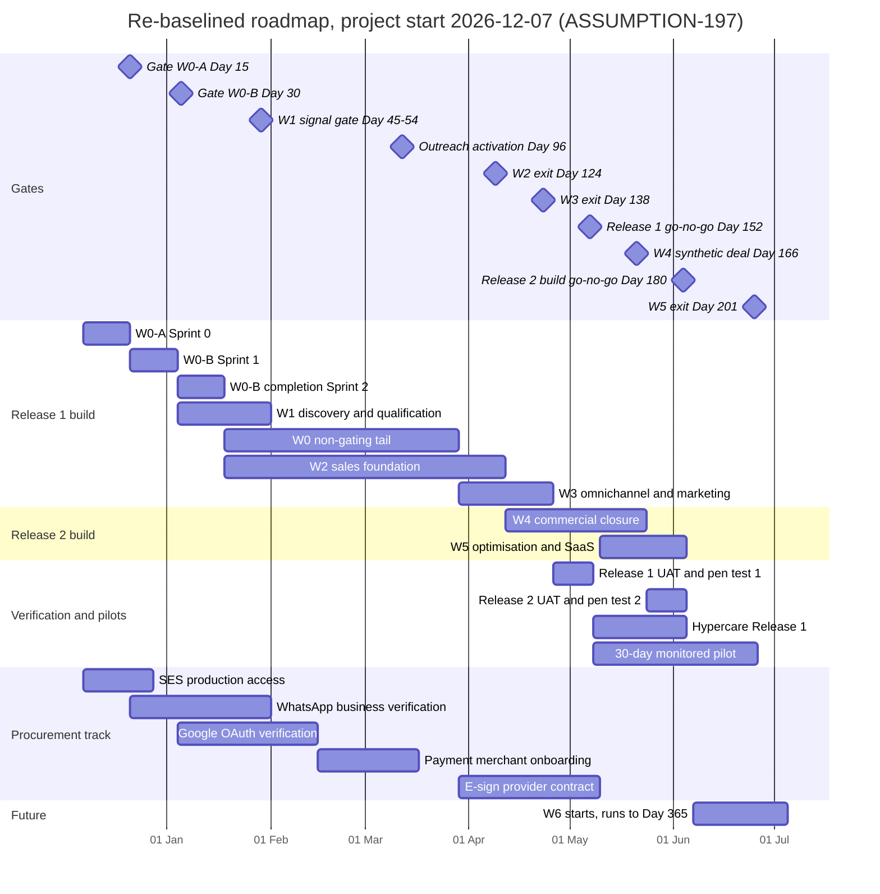
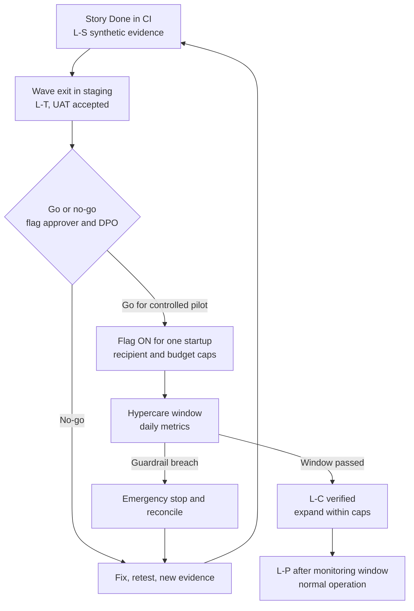
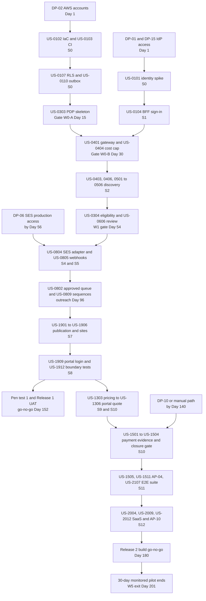

# AI Growth Engine: Employee Sales & Marketing Automation
## Application Blueprint: PART 8 (Batch 8.1), Delivery Plan: Roadmap, Releases, Sprint Plans, Team and RACI, Estimation, Critical Path

| Field | Value |
|---|---|
| Document | Application Blueprint, Part 8, Batch 8.1 (client Section 6.11, first half) |
| Version | 1.0 · 27 Nov 2026 |
| Baseline | Part 0 (epic map, waves), Part 0A (DEC-001…DEC-065; in particular DEC-005, DEC-006, DEC-008, DEC-012, DEC-020, DEC-034, DEC-044, DEC-060…DEC-064), Part 1 (BR, personas P01–P16, KPI-01…31, waves, MoSCoW, constraints CN-, dependencies DP-01…DP-15), Part 2.1 (FR register: wave and epic per FR), Part 3.1 (ADRs, hosting cost), Part 3.2 (adapter catalogue), Part 3.3 (data risks), Part 4.1–4.3 (security, NFR wave plan, DevOps, support, DR), Part 5.1a/5.1b/5.1c, 5.2, 5.3 (230 stories, estimation basis, velocity), Part 6.1 (entry/exit criteria, UAT, evidence record, certification ladder), Part 7.1–7.3 (agent catalogue by release, AI cost), `.brief/ERRATA_LOG.md` items 1–48 (binding resolutions) |
| Roles applied | Product Owner, Business Systems Analyst, Solutions Architect, Principal Engineer, Lead UX/UI Designer, Data Architect, QA Lead, Security/Compliance/AI Governance Lead, DevOps/SRE Lead, FinOps Lead |
| Companion file | Part 8.2 (`Part-08-2_Risks_Change_GoLive_Hypercare.md`): risk register, change management and training, go-live checklist, hypercare, KPI tracking, budget summary |
| Tag ranges used in Part 8 | RECOMMENDATION-081…089 · ASSUMPTION-197…209 · GAP-173…179 · CONFLICT-140…144 · RSK-001…092 |

**Acronyms used in this batch.** AC acceptance criterion · AP acceptance procedure (DEC-014) · BE backend engineer · CCB change control board · CR change request · DoD/DoR Definition of Done/Ready · DP external or internal dependency (Part 1 §1.11) · E2E end to end · EVR evidence record (Part 6.1 §6.1.5.4) · FE frontend engineer · FS full-stack engineer · FTE full-time equivalent · IaC infrastructure as code · L-S/L-T/L-C/L-P certification ladder levels (Part 6.1 §6.1.5.5) · MoSCoW Must/Should/Could/Won't · pd person-day · PERT programme evaluation and review technique (three-point estimate) · PO Product Owner · QA quality assurance · R1/R2 Release 1/Release 2 (DEC-006) · RACI Responsible/Accountable/Consulted/Informed · SP story point · SYS system test · UAT user acceptance testing · W0-A/W0-B the two halves of Wave 0 (errata 34).

---

## 8.1.1 Purpose, inputs and planning baseline

### 8.1.1.1 What this batch decides

| # | Decision area | Output in this batch | Owner after approval |
|---|---|---|---|
| 1 | Phased roadmap | Re-baselined calendar for W0-A, W0-B, W1…W6 with gate dates and a Gantt chart (§8.1.2) | Founder/PO |
| 2 | Release plan | Release 1, Release 2, Future: scope by epic and FR count, feature flags, entry/exit gates, go/no-go owners (§8.1.3) | Founder/PO |
| 3 | Sprint plans | Sprint 0, Sprint 1, Sprint 2 ready to start; sprint-by-sprint allocation S0–S12 through Day 180; MoSCoW spill list (§8.1.4) | Founder/PO with the team |
| 4 | Team and RACI | Team per DEC-005, QA gap resolution (errata 33), UAT participants and time per wave, RACI (§8.1.5) | Founder/PO |
| 5 | Estimation | SP→pd basis, per-epic and per-wave totals, programme low/central/high against BRD §6, staffing cost and calendar fit, contingency (§8.1.6) | Founder/PO, Finance |
| 6 | Critical path | Dependency chain and DP-01…DP-15 lead times (§8.1.7) | Founder/PO, DevOps |

### 8.1.1.2 Binding inputs used

> **Erratum v1.2 (E-V-39):** superseded by budget DEC-230 plus the funded V12 change requests (DEC-770/790). See Part 11.23c.


| Input | What it fixes for this plan | Source |
|---|---|---|
| Team | 4.0 engineering FTE (1 BE, 1 FS, 1 FE, 0.5 QA automation, 0.5 DevOps/SRE contractor) + 0.5 growth/compliance lead; founder/CTO is PO and architect; capacity ≈ 400 pd in 180 days; overflow to W6 by MoSCoW; fallback 3 FTE over ≈ 7.5 months | DEC-005 |
| Waves and releases | W0 (Day 1–15) … W5 (Day 121–180), W6 (Day 181–365); R1 = W0–W3, R2 = W4–W5, Future = W6; planning groupings, one continuously deployed product behind flags | DEC-006, DEC-034, Part 1 §1.6.1 |
| W0 split | **W0-A Day 1–15** (environments, identity spike, CI, RLS/outbox/PDP skeletons, catalogue core); **W0-B Day 16–30** (remaining governance controls, AI gateway and eval harness, cost control, privacy, observability); **W1 Day 24–45** with overlap; **100 reviewed signals at about Day 45** | Errata 34 (CONFLICT-130, RECOMMENDATION-050) |
| Programme effort | Central ≈ 421.5 − 5.5 ≈ **416 pd** (EP-01/EP-21 overlap removed), inside 287–483 pd | Errata 41; DEC-012 |
| Estimation basis | 1 SP ≈ 0.5–1.0 pd, central 0.7; velocity 32–64 SP/sprint, planning value 40–46 SP; Sprint 0–1 at ≈ 70% | Part 5.1a §5.5 (ASSUMPTION-150, ASSUMPTION-157) |
| QA and UAT | QA-owned effort 43–97 pd vs ≈ 50 pd capacity; business UAT 60–120 participant-days unplanned | Errata 33 (GAP-165), Part 6.1 §6.1.15.2 |
| DR and support | Regional RTO ≤ 24 h / RPO ≤ 15 min in the pilot; monitoring 24×7, human on-call best effort outside 10:00–18:00 IST for S1 categories | Errata 16, 17, 43; DEC-044 |
| Hosting and DR budget | B01 ₹5,000–7,000/month (prod + staging); B20 ≈ ₹300–600/month; WAF from W2; B23 delivery AI reserve ≈ ₹1,000; scale gate ≈ ₹21,000 (Y1) / ≈ ₹66,600 (Y2) | Errata 18, 27, 44; Part 3.1 §3.1.6 |
| Architecture choices | Part 3.1 ADRs govern compute (ECS on EC2, ADR-013), IaC (OpenTofu, ADR-012), CI (GitHub Actions + OIDC, ADR-026), flags (ADR-015) | Errata 48 |
| Evidence | BRD §12.2 evidence record; no production sign-off inferred from synthetic tests | BRD §12.2, §13.2; BR-S136; Part 6.1 §6.1.5.4–5 |

### 8.1.1.3 Calendar conventions [ASSUMPTION-197] [ASSUMPTION-198]

**Project start: Monday 7 December 2026 = Day 1 [ASSUMPTION-197].** "Day n" is the calendar day counted from that date, as in BRD §8's day-phases. Sprints are two calendar weeks (Monday to Friday of the following week, 10 working days). Day 180 is **Friday 4 June 2027**, the last working day of Sprint 12. Day 365 is Monday 6 December 2027.

| Sprint | Calendar | Days | Working days | Holiday or leave allowance [ASSUMPTION-198] |
|---|---|---|---|---|
| S0 | 07 Dec – 18 Dec 2026 | 1–12 | 10 | none |
| S1 | 21 Dec 2026 – 01 Jan 2027 | 15–26 | 8 | 25 Dec (Christmas) and 1 Jan (New Year leave) |
| S2 | 04 Jan – 15 Jan 2027 | 29–40 | 10 | none |
| S3 | 18 Jan – 29 Jan 2027 | 43–54 | 9 | 26 Jan (Republic Day) |
| S4 | 01 Feb – 12 Feb 2027 | 57–68 | 10 | none |
| S5 | 15 Feb – 26 Feb 2027 | 71–82 | 10 | none |
| S6 | 01 Mar – 12 Mar 2027 | 85–96 | 10 | none |
| S7 | 15 Mar – 26 Mar 2027 | 99–110 | 8 | Holi and Good Friday (dates to verify for 2027) |
| S8 | 29 Mar – 09 Apr 2027 | 113–124 | 10 | none |
| S9 | 12 Apr – 23 Apr 2027 | 127–138 | 9 | 14 Apr (Ambedkar Jayanti; verify) |
| S10 | 26 Apr – 07 May 2027 | 141–152 | 10 | none |
| S11 | 10 May – 21 May 2027 | 155–166 | 10 | none |
| S12 | 24 May – 04 Jun 2027 | 169–180 | 10 | none |
| **Total** | | **1–180** | **124** | DEC-005 assumes ≈ 125 working days; the difference is within rounding |

The holiday list is an assumption; the organisation's own holiday calendar and approved leave replace it at Sprint 0 planning (verify, as of 27 Nov 2026) [GAP-177].

---

## 8.1.2 Phased roadmap

### 8.1.2.1 Why the source day-phases cannot be held as written [CONFLICT-142]

The BRD §8 day-phases (Part 1 §1.6.1) place most of the work early: W0–W2 must deliver M01–M30, M53–M56, M58 and the automation and website cores by Day 60. The Part 5 story estimates show where that work actually sits. The table compares each wave's estimated content with the capacity that exists in its source window.

| Wave | Source window (BRD §8) | Content (SP mid; central pd = SP × 0.7) | Capacity in the source window at DEC-005 (pd, after ramp-up and holidays) | Cumulative content vs cumulative capacity |
|---|---|---|---|---|
| W0 | Day 1–15 | 139.0 SP; 97.3 pd (92.1 pd net of the errata 41 overlap) | ≈ 25 pd (S0 at 70%) | 92 vs 25 |
| W1 | Day 16–30 | 58.0 SP; 40.6 pd | ≈ 20 pd (S1: 8 days at 70%) | 133 vs 45 |
| W2 | Day 31–60 | 157.0 SP; 109.9 pd | ≈ 60 pd | 243 vs 105 |
| W3 | Day 61–90 | 92.0 SP; 64.4 pd | ≈ 64 pd | **307 vs 169** (Release 1) |
| W4 | Day 91–120 | 104.0 SP; 72.8 pd | ≈ 62 pd | 380 vs 231 |
| W5 | Day 121–180 | 44.5 SP; 31.1 pd | ≈ 128 pd | **411 vs 359** (+ ≈ 40 pd uplift, §8.1.5.2) |
| W6 | Day 181–365 | 7.5 SP; 5.3 pd + spill | n/a | Future |

**Finding.** DEC-005 is right that the *total* (≈ 400 pd in 180 days against ≈ 416 pd central) nearly fits. The *distribution* does not: Release 1 holds ≈ 307 pd of content against ≈ 169 pd of capacity by Day 90. No sequencing can deliver W0–W3 by Day 90 at 4.0 FTE. This is logged as **[CONFLICT-142]**. The binding W0-A/W0-B split (errata 34) solves Wave 0 only.

**Resolution adopted in this plan [RECOMMENDATION-081].** (1) Keep the errata 34 gates (W0-A Day 15, W0-B Day 30, 100 reviewed signals ≈ Day 45). (2) Re-baseline the later gate dates to the capacity-feasible calendar in §8.1.2.2. (3) Activate each capability as soon as its stories pass, so the business sees value continuously (DEC-006: one continuously deployed product behind flags). (4) Offer **Option B** (two contract engineers in S2–S6, §8.1.5.2, RECOMMENDATION-086) if the Founder needs Release 1 near Day 112 instead of Day 152.

### 8.1.2.2 Re-baselined wave calendar

| Wave | Theme (Part 1 §1.6.1) | Source days | Build sprints (this plan) | Planned build window | Gate (date, day) | Gate evidence (summary; full list §8.1.2.5) |
|---|---|---|---|---|---|---|
| **W0-A** | Foundation: environments, identity spike, CI, RLS, outbox, PDP skeleton, catalogue core | 1–15 | S0 | 07 Dec – 18 Dec 2026 | **Mon 21 Dec 2026 (Day 15)** | 12-check identity spike report; IaC applied to dev/test/staging/prod; CI gates G0–G3; RLS two-tenant fixture green; outbox atomicity; flags default OFF |
| **W0-B** | Governance controls, AI gateway, eval harness, cost caps, privacy, observability | 16–30 | S1 (control set) + S2 (completion) | 21 Dec 2026 – 15 Jan 2027 | **Tue 5 Jan 2027 (Day 30)** control set; **Fri 15 Jan (Day 40)** completion checkpoint | BFF sign-in; consent ledger; gateway + eval regression gate; hard cap proven (KR1.4); then MFA step-up, claims approval, tier routing, injection guard by Day 40 [CONFLICT-141] |
| W0 tail | Non-gating W0 stories (admin screens, knowledge documents, retention purge, SLO dashboards, release readiness) | (W0) | S3–S7 | 18 Jan – 26 Mar 2027 | Each item before the first activation that uses it | Listed in §8.1.4.6 |
| **W1** | Intelligence pilot | 16–30 (errata: 24–45) | S2–S3 (+ imports S4) | 04 Jan – 29 Jan 2027 | **Signal gate: target Day 45 (Thu 21 Jan), decision at S3 review Fri 29 Jan (Day 54) at the latest** | ≥ 100 human-reviewed signals at ≥ 80% precision (DEC-001; KPI-02, KPI-08); 0 prohibited sources fetched; provenance 100% |
| **W2** | Sales foundation, automation core, website core | 31–60 | S3–S8 | 18 Jan – 09 Apr 2027 | **Fri 12 Mar (Day 96)** outreach activation; **Fri 9 Apr (Day 124)** W2 exit | Email CA-DISPATCH battery; simulation zero-effect; emergency stop ≤ 60 s; public sites for 4 seed startups with 0 draft exposure; targets 20 qualified accounts and 5 demo requests (KPI-07, KPI-06) measured from Day 96 |
| **W3** | Omnichannel and marketing | 61–90 | S8–S9 | 29 Mar – 23 Apr 2027 | **Fri 23 Apr (Day 138)** | Channel opt-out and replay tests pass on email, WhatsApp and web (BRD §8; KR2.2); KPI-17 = 0 |
| **Release 1 go/no-go** | W0–W3 | Day 90 | UAT + pen test 1 in S10 | 26 Apr – 07 May 2027 | **Fri 7 May 2027 (Day 152)** | Part 6.1 §6.1.5.3 Release 1 criteria (1)–(9); §8.2.4 go-live checklist |
| **W4** | Commercial closure | 91–120 | S9–S11 | 12 Apr – 21 May 2027 | **Fri 21 May (Day 166)** synthetic deal per route; real controlled pilot from **Mon 24 May (Day 169)** | Full synthetic deal per route; AP-04; pen test 1 findings closed; DR drill before real pilot |
| **W5** | Optimisation and SaaS readiness | 121–180 | S11–S12 | 10 May – 04 Jun 2027 | **Fri 4 Jun (Day 180)** Release 2 build go/no-go; **Fri 25 Jun 2027 (Day 201)** W5 exit after the 30-day monitored pilot | AP-06, AP-09, AP-10; SaaS lifecycle for 2 tenants; full E2E suite; 30-day monitored pilot report (Release 1 scope from Day 153, closure scope from Day 169) [ASSUMPTION-209] |
| **W6** | Selective expansion | 181–365 | S13+ | 07 Jun – 06 Dec 2027 | Per pilot | Spill list (§8.1.4.7), W6 stories, M63–M66 launch workflow |

**What the business can use, and when (activation sequence).** Discovery and research review from ≈ Day 38–43 (L-C, internal use, no outbound); qualified-opportunity queue from Day 54; inbound web enquiries and opt-out pages from Day 68; approved email outreach and meetings from Day 96; public websites from Day 110; WhatsApp, website assistant, campaigns and landing pages from Day 124–138; closure on manual payment and signed-PDF evidence from Day 169; SaaS tenant onboarding from Day 180. Every activation follows the certification ladder (§8.1.3.5).

### 8.1.2.3 Gantt chart



### 8.1.2.4 Epics and stories mapped to waves and sprints

Story IDs are abbreviated to their four digits (0101 = US-0101). Sprints are from the allocation in §8.1.4.6. "Spill" = moved to W6 under DEC-005 (§8.1.4.7).

| Epic | W0-A (S0) | W0-B (S1–S2) | W0 tail (S3–S7) | W1 | W2 | W3 | W4 | W5 | W6 / spill |
|---|---|---|---|---|---|---|---|---|---|
| EP-01 Platform foundation | 0101, 0102, 0103, 0107, 0110, 0111, 0113, 0117 | 0104, 0105, 0112, 0115 | 0106, 0108, 0109, 0114, 0116 | — | — | — | — | — | — |
| EP-02 Product truth | 0201 | 0202, 0205 | 0203, 0204 | 0208 (S4) | — | — | — | — | 0206, 0207 (W6) |
| EP-03 Consent and compliance | 0303 | 0301 | 0302, 0307, 0308 | — | 0304 (S3), 0305, 0306, 0310 (S4) | 0309, 0311 (S8) | — | — | — |
| EP-04 AI gateway and quality | — | 0401, 0402, 0403, 0404, 0406 | 0405, 0408 | — | — | — | — | 0407 (S11) | — |
| EP-05 Discovery | — | 0501 (S2) | — | 0502–0506, 0511 (S2); 0507, 0508, 0512 (S3) | — | — | — | — | 0509, 0510 (spill) |
| EP-06 Scoring and contacts | — | — | — | 0601–0608 (S3) | — | — | — | — | — |
| EP-07 CRM and Customer 360 | — | — | — | 0708 (S4) | 0702–0705, 0710 (S4); 0701, 0707, 0709 (S5) | 0706 (S8) | — | — | — |
| EP-08 Messaging | — | — | — | — | 0803, 0804 (S4); 0801, 0805–0807, 0811, 0812, 0815 (S5); 0802, 0808, 0810, 0814 (S6); 0809 (S7) | 0813 (S9) | — | — | — |
| EP-09 Meetings | — | — | — | — | 0901 (S5); 0902–0904 (S6) | — | — | — | 0905, 0906 (spill) |
| EP-10 WhatsApp and assistant | — | — | — | — | — | 1001–1007 (S8) | — | — | — |
| EP-11 Content and SEO | — | — | — | — | — | 1101, 1102 (S8); 1103, 1110 (S9) | — | — | 1104–1109 (spill) |
| EP-12 Campaigns and landing pages | — | — | — | — | — | 1201–1205 (S9) | — | — | 1206–1210 (spill) |
| EP-13 Proposal to contract | — | — | — | — | — | — | 1303, 1304, 1311–1313 (S9); 1301, 1302, 1305, 1306, 1309, 1310 (S10); 1307, 1308 (S11) | — | — |
| EP-14 Bids, orders, fulfilment | — | — | — | — | — | — | 1401, 1402, 1405 (S9); 1403, 1404, 1406–1411 (S10); 1412 (S11) | — | — |
| EP-15 Payment and closure | — | — | — | — | — | — | 1501–1504 (S10); 1505, 1506, 1509–1511 (S11) | 1507, 1508 (S12) | — |
| EP-16 Onboarding and retention | — | — | — | — | — | — | 1601–1605, 1611 (S11) | — | 1606, 1607, 1612 (spill); 1608–1610 (W6) |
| EP-17 Command Centre | — | 1701 (S1) | 1702 (S6) | — | 1703 (S5); 1710 (S6); 1704, 1705, 1708, 1709 (S7) | 1707 (S9) | — | — | 1706 (spill) |
| EP-18 Automation engine | — | — | — | 1801 (S3) | 1802, 1805–1807 (S5); 1803, 1804, 1808, 1809, 1811 (S6); 1812, 1815 (S7) | 1810 (S8) | — | 1813 (S11), 1814 (S12) | — |
| EP-19 Website and portal | — | — | — | — | 1901–1906 (S7); 1909–1913 (S8) | 1907 (S8) | — | — | 1908 (spill) |
| EP-20 SaaS lifecycle | — | — | — | 2008 (S4) | — | — | — | 2001, 2002, 2005, 2006, 2010 (S11); 2003, 2004, 2007, 2009, 2011, 2012 (S12) | — |
| EP-21 Release readiness | — | 2101, 2103 (S3) | 2102, 2105, 2110 (S4); 2108 (S3); 2104, 2109 (S6); 2106 (S7) | — | — | — | — | 2107 (S11) | — |

### 8.1.2.5 Wave gates: entry, exit and owners

All exits require the BRD §12.2 evidence record for every story and test that counts toward the gate (Part 6.1 §6.1.5.4), and an independent reviewer who did not build or test the scope (BR-S043). Test-side criteria are those of Part 6.1 §6.1.5.2; NFR gates are those of Part 4.2 §4.28.

| Gate | Entry (all true) | Exit evidence (all true) | Accountable | Independent reviewer | If not met |
|---|---|---|---|---|---|
| **W0-A** (Day 15) | AWS accounts and budgets live (DP-02); IdP non-production access (DP-01, DP-15) | US-0101 report: 12 checks Pass/Fail with evidence (DEC-019); IaC applies cleanly to 4 environments; CI G0–G3 run on every PR; RLS two-tenant fixture 100% (BRL-TEN-03); outbox atomicity and idempotent consumer tests; audit append-only; seed GSE-SYN v1 loaded; flags default OFF; PDP skeleton returns deny-by-default | Founder/PO | FS engineer reviews BE work and vice versa; Founder signs | Fail of spike checks 1–3, 7 or 12 → change request (ASSUMPTION-154); hold W0-B items that depend on sign-in |
| **W0-B** (Day 30; completion Day 40) | W0-A passed | Day 30: BFF sign-in with `growth-engine` audience; integration registry never returns secrets (BR-M05); opt-out blocks all scoped sends (BR-M04); gateway rejects invalid outputs; eval regression gate blocks merge (DEC-061); **simulated cap stops requests** (BR-M53, KR1.4); Command Centre shell. Day 40: MFA step-up; claims and price approval bound to hash; readiness gate blocks planned offerings (DEC-060); Tier 2 refuses Restricted data (DEC-007); injection guard eval set passes | Founder/PO | Growth/compliance lead for compliance controls | Discovery runs (W1) start only after US-0403, US-0406, US-0501 and US-0511 are Done (sequenced first in S2, target Day 36) |
| **W1 signal gate** (target Day 45; decision ≤ Day 54) | W0-B completion; source register seeded and approved by R10; labelling protocol agreed (§8.1.5.4) | ≥ 100 human-reviewed signals at ≥ 80% precision (DEC-001); 0 prohibited sources fetched (OPT-04-01); 100% provenance (NFR-028); scoring decision tables (DEC-011) pass | Research lead (P04) with Founder/PO | AI lead not involved in labelling | Continue review until 100; precision < 80% → classifier stays L1, tune prompts, re-run eval; W2 build proceeds (no dependency on the precision result) |
| **W2** (activation Day 96; exit Day 124) | W1 build complete; SES production access (DP-06); DMARC/DKIM verified | CA-DISPATCH battery for email; replay causes no duplicate (BR-M26); bounce suppresses; emergency stop ≤ 60 s (BR-M55); simulation has zero live effects (BR-AUTO); 4 seed startup sites with 0 draft/private exposure (KR2.4); 24 h soak; W2 usability session; KPI-06/07 counted from Day 96 | Founder/PO + startup heads | Independent reviewer (§8.1.5.3) | Flag stays OFF for the failing channel; Release 1 date holds if fixed within S8 |
| **W3** (Day 138) | W2 exit; WhatsApp verified business (DP-08) or Meta test number | Opt-out and replay tests pass on email, WhatsApp and web; KPI-17 = 0 across suites; ads spend cap tests (only if ads stories not spilled); complaint containment (BR-M57); EduVerse DPIA approved before `eduverse.minor_intake` flag | Founder/PO + Legal/DPO | Independent reviewer | Channel excluded from Release 1; activation in hypercare window only after pass |
| **Release 1 go/no-go** (Day 152) | W0–W3 exits; UAT readiness review (Part 6.1 §6.1.13.4); pen test 1 report | Part 6.1 §6.1.5.3 criteria (1)–(9); BRD §11 activation blockers clear (Part 8.2 §8.2.4.1) | Founder/PO | Independent reviewer + DPO for governance pack | No-go → fix forward within 10 business days; re-run the go/no-go |
| **W4** (Day 166 synthetic; real pilot from Day 169) | Release 1 live or approved; manual payment and signed-PDF paths ready (DEC-022, DEC-023) | Full synthetic deal per route (AppNAI bid, MedMaarg pilot, EduVerse enrolment, OrganicSpec order); AP-04 partial-then-full receipt; maker ≠ checker; restore drill on production-sized data (NFR-057) before the real pilot; pen test 1 findings closed | Founder/PO + Finance | Finance user not involved in the build | Real pilot deferred; synthetic evidence stays at L-T |
| **Release 2 build go/no-go** (Day 180) | W4 exit; pen test 2 report; SaaS fixture T3 loaded | Part 6.1 §6.1.5.3 criteria (1)–(12) and (14); AP-01…AP-10 evidence; DR full drill with measured RPO/RTO | Founder/PO | Independent reviewer | External tenant activation waits; owned-portfolio closure continues under hypercare |
| **W5 exit** (Day 201) | Release 2 build go/no-go passed | 30-day monitored pilot report accepted (criterion 13); qualification precision ≥ 90% on ≥ 200 labelled items per vertical before any L2/L3 (DEC-001); budget and compliance gates (BRD §8) | Founder/PO | Independent reviewer | L2/L3 stays OFF; W6 starts on Release 1 + closure scope |
| **W6 items** | W5 exit; readiness approvals (DEC-060) | AP-01 re-run (26th startup, no code change); contract and market-fit milestones are business evidence, not test results (BRD §11) | Founder/PO | Per pilot | Pilot not started |

---

## 8.1.3 Release plan

### 8.1.3.1 Release summary

| Release (DEC-006) | Waves | Epics with work in the release | Interface/operation FRs (Part 2.1) | Stories (Part 5) | SP mid | Central pd (SP × 0.7) | Agents / automations (Part 7.1 §7.1.10) | Build window (this plan) | Go/no-go |
|---|---|---|---|---|---|---|---|---|---|
| **Release 1** | W0–W3 | EP-01…EP-12, EP-17, EP-18, EP-19, EP-20 (import), EP-21 | **100** of 150 | 163 (148 scheduled, 15 spilled to W6) | 446.0 (416.0 scheduled) | 312.2 (306.7 net of overlap; 291.2 scheduled net) | 22 AG / 33 AU | S0–S9, Day 1–138 | Day 152 |
| **Release 2** | W4–W5 | EP-04, EP-05, EP-13…EP-18, EP-20, EP-21 | **42** | 62 (57 scheduled, 5 spilled) | 148.5 (137.5 scheduled) | 104.0 (96.3 scheduled) | 13 AG / 9 AU | S9–S12, Day 127–180 | Day 180 (build), Day 201 (W5 exit) |
| **Future** | W6 | EP-02, EP-16 + spill from all releases | **8** (+ 21 FRs whose only stories spilled, §8.1.4.7) | 5 (+ 20 spilled) | 7.5 (+ 41.0 spilled) | 5.3 (+ 28.7) | 1 AG / 1 AU | Day 181–365 | Per pilot |
| **Total** | | 21 epics | **150** (+ 33 cross-cutting FRs that inherit their consumer's wave) | **230** | **602.0** | **421.4 → ≈ 416 net** | 36 AG / 43 AU | | |

### 8.1.3.2 Scope by epic and FR count per release

FR counts are the interface and operation FRs whose *Wave · Epic* column in Part 2.1 §2.4 falls in the release (FR-OP001 → EP-04; FR-OP002/OP003 → EP-21, following Part 5.1b and 5.3). FR-A103 is counted once in Release 1 (import, W1) per CONFLICT-138; its portability half is delivered in Release 2 by US-2009.

| Epic | R1 FRs | R2 FRs | Future FRs | R1 scheduled stories (SP mid) | R2 scheduled stories (SP mid) | W6 and spill stories (SP mid) | MoSCoW of primary BRs (Part 1 §1.12.1) |
|---|---|---|---|---|---|---|---|
| EP-01 Platform foundation | 5 | 0 | 0 | 17 (51.5) | 0 | 0 | Must |
| EP-02 Product truth | 3 | 0 | 2 | 6 (21.0) | 0 | 2 (3.0) W6: 0206, 0207 | Must (M66 launch workflow W6) |
| EP-03 Consent and compliance | 5 | 0 | 0 | 11 (36.0) | 0 | 0 | Must |
| EP-04 AI gateway and quality | 3 | 1 | 0 | 7 (22.5) | 1 (2.5) | 0 | Must |
| EP-05 Discovery | 10 | 2 | 0 | 10 (33.0) | 0 | 2 (5.0) spill: 0509, 0510 | Must; M33, M59 Could |
| EP-06 Scoring and contacts | 7 | 0 | 0 | 8 (20.0) | 0 | 0 | Must |
| EP-07 CRM and Customer 360 | 7 | 0 | 0 | 10 (28.0) | 0 | 0 | Must |
| EP-08 Messaging | 6 | 0 | 0 | 15 (39.5) | 0 | 0 | Must; M41 Should |
| EP-09 Meetings | 6 | 0 | 0 | 4 (8.0) | 0 | 2 (4.0) spill: 0905, 0906 | Must; M40 Could |
| EP-10 WhatsApp and assistant | 4 | 0 | 0 | 7 (18.0) | 0 | 0 | Should |
| EP-11 Content and SEO | 8 | 0 | 0 | 4 (10.5) | 0 | 6 (12.0) spill: 1104–1109 | Should; M36 Could |
| EP-12 Campaigns and landing pages | 9 | 0 | 0 | 5 (14.0) | 0 | 5 (9.5) spill: 1206–1210 | M37 Must; M38, M42 Should; M39 Could |
| EP-13 Proposal to contract | 0 | 10 | 0 | 0 | 13 (32.5) | 0 | Must; M45 Should |
| EP-14 Bids, orders, fulfilment | 0 | 6 | 0 | 0 | 12 (26.5) | 0 | Must (BR-TENANT) |
| EP-15 Payment and closure | 0 | 5 | 0 | 0 | 11 (28.0) | 0 | Must |
| EP-16 Onboarding and retention | 0 | 9 | 6 | 0 | 6 (14.5) | 6 (11.0): 1608–1610 W6; 1606, 1607, 1612 spill | M48 Must; M49–M51 Should; M63–M65 Could |
| EP-17 Command Centre | 5 | 2 | 0 | 9 (23.0) | 0 | 1 (2.5) spill: 1706 | M30, M61 Must; M60 Could |
| EP-18 Automation engine | 6 | 0 | 0 | 13 (36.5) | 2 (3.0) | 0 | Must |
| EP-19 Website and portal | 11 | 0 | 0 | 12 (32.5) | 0 | 1 (1.5) spill: 1908 | Must (BR-WEB) |
| EP-20 SaaS lifecycle | 1 | 7 | 0 | 1 (2.5) | 11 (26.0) | 0 | Should (BR-SVC); US-2004, US-2010, US-2012 Must |
| EP-21 Release readiness | 4 | 0 | 0 | 9 (20.0) | 1 (4.0) | 0 | Must |
| **Total** | **100** | **42** | **8** | | | | |

### 8.1.3.3 Feature flags per release (RECOMMENDATION-005; Part 4.3 §4.36; DoD D-14)

Every external channel, paid adapter, autonomy mode and Tier 2 route ships **OFF** in production. A flag is turned ON only by its approver after the certification ladder reaches L-C for that scope (Part 6.1 §6.1.5.5). Flag names follow the Part 4.3 §4.36.2 pattern; names not already in Part 4.3 or Part 5 are proposals within [RECOMMENDATION-081].

| Flag (class) | Release | Default | Turned ON by (approver) | Earliest ON (this plan) | Precondition |
|---|---|---|---|---|---|
| `intel.discovery.runs` (external channel: public web fetch) | R1 | OFF | R10 + R01 | Day 38–43 | W0-B completion checkpoint; source register approved |
| `adapter.search.tavily` / `adapter.search.exa` (paid adapter) | R1 | OFF / OFF | R12 + R01 | Day 38–43 / never by default | B03 budget line; Exa only if pre-authorised (BRD §10) |
| `adapter.contact_api` (paid enrichment, B08/B18) | R1 | OFF | R01 | Scale gate only | BRD §8 scale gate (BR-S090) |
| `intake.public_forms` (public intake) | R1 | OFF | R02 per startup + R10 | Day 68 | WAF live (errata 18); abuse controls US-0710 |
| `channel.email.dispatch` (external channel) | R1 | OFF | R02 + R10 per startup | Day 96 | SES production access; DMARC; eligibility rule set; templates approved |
| `calendar.google` (adapter) | R1 | OFF | R12 | Day 96 | OAuth verification or internal app (DP-07) |
| `web.publication.<startup>` (publication) | R1 | OFF | R05L + R02 | Day 110 | Approved snapshot; accessibility statement (US-1911) |
| `channel.whatsapp.dispatch` (external channel) | R1 | OFF | R02 + R10 | Day 124 | Verified WABA; approved templates; opt-in records |
| `web.assistant` (chat; AI) | R1 | OFF | R02 + R10 | Day 124 | Grounded knowledge index approved; clinical handover tested |
| `eduverse.minor_intake` | R1 | OFF | R10 + R01 | Day 124 | DPIA approved (DEC-030); guardian OTP verified |
| `marketing.campaigns` | R1 | OFF | R05L + R10 | Day 138 | Claims approved; suppression applied at execution |
| `copilot.panel` (AI) | R1 | OFF | R01 | Day 138 (Q&A); drafts W5 (CONFLICT-121) | Copilot eval and cross-scope tests (RSK-372) |
| `ai.tier2.<provider>` (Tier 2 route) | R1 | OFF | R01 + R10 per tenant | Not in plan | Legal review of terms (GAP-144); Public/Internal-non-personal only (DEC-007) |
| `autonomy.l2.<workflow>` | R1/R2 | OFF (L1) | R02 | After W2 exit, per workflow | DEC-064 caps; simulation report |
| `autonomy.l3.<workflow>` | R2 | OFF | R01 | After W5 exit | Qualification precision ≥ 90% (DEC-001); US-1813 gate |
| `adapter.esign.signed_pdf` / `adapter.esign.<provider>` | R2 | OFF / OFF | R10 + R01 | Day 169 / W6 | Legal approval of hash path (DEC-023) / provider contract (DP-11) |
| `adapter.payment.manual` / `adapter.payment.<gateway>` | R2 | OFF / OFF | R08 + R01 | Day 169 / after merchant onboarding | Maker-checker roles assigned / DP-10, PCI scope minimised |
| `desk.bid` / `desk.order` (capability profile) | R2 | OFF | R12 + R02 | Day 169 | Capability profile per startup (DEC-052) |
| `saas.applications` (W31–W34) | R2 | OFF | R01 (Service Owner) | Day 180 | Plans approved or "Price on request" (GAP-162); status page (GAP-179) |
| `calendar.microsoft` | R2 | OFF | R12 | On first user need (L-03) | ADR-037 |
| `i18n.content.hi_ta_or` | R2 | OFF | R02 per startup | When approved translations exist | DEC-026 |

### 8.1.3.4 Entry and exit gates and go/no-go owners

The release gates are **those of Part 6.1 §6.1.5.3** (Release 1 criteria 1–9; Release 2 criteria 1–14; Future per pilot), extended with the Part 4.3 §4.48 operational readiness checklist and the go-live checklist in Part 8.2 §8.2.4.

| Release | Go/no-go meeting | Votes required (all "go") | Advisory (must be heard) | Decision record |
|---|---|---|---|---|
| Release 1 (Day 152) | Founder/PO chairs; 60 minutes; evidence pre-read 48 h before | Founder/PO (accountable, BRD §12.2); QA (test exit); Legal/DPO (compliance, privacy, DPIA); DevOps (operational readiness, restore/rollback); independent reviewer (evidence completeness) | Startup heads (vertical UAT sign-off); growth/compliance lead; FS engineer as AI lead (AI regression, cost) | A090 release record with the BRD §12.2 fields; minutes in the decision log |
| Release 2 build (Day 180) | As above | As above + Finance (payment accuracy, maker-checker, AP-04) + Service Owner (SaaS activation; Founder until appointed [GAP-176]) | Startup heads AppNAI and OrganicSpec (bid and order routes) | As above |
| W5 exit (Day 201) | As above | Founder/PO; independent reviewer; Finance; Legal/DPO | AI lead (precision benchmark), FinOps | 30-day pilot report attached |
| Future pilots | Per pilot | Founder/PO + Legal/DPO + startup head (readiness approval, DEC-060) | Finance | Pilot charter |

**A single "no-go" vote from Legal/DPO, Finance or the independent reviewer on a BRD §11 blocker cannot be overruled** (BRD §10, §11; BR-S132, BR-S135). The Founder may accept other residual risks in writing with an expiry date.

### 8.1.3.5 Activation path for every capability (certification ladder)



---

## 8.1.4 Sprint plans

### 8.1.4.1 Cadence, ceremonies and working agreements

| Ceremony | When (IST) | Length | Participants | Output |
|---|---|---|---|---|
| Sprint planning | Monday of sprint week 1, 10:30 | 2 h | Engineering team, PO; startup head for vertical stories | Sprint goal, committed stories (DoR met, Part 5.1a §5.2), capacity sheet |
| Daily stand-up | Every working day, 10:15 | 15 min | Engineering team; growth/compliance lead twice a week | Blockers; on-call handover on Monday 10:30 (Part 4.3 §4.43.2) |
| Backlog refinement | Wednesday of week 1, 15:00 | 1.5 h | PO, FS (Principal Engineer), QA, one more engineer; UX contractor when present | Next sprint's stories meet DoR; spikes identified |
| Sprint review and demo | Friday of week 2, 15:00 | 1 h | Team, PO, startup heads, growth/compliance lead | Demo against the sprint's demo script; PO acceptance (DoD D-17) |
| Retrospective | Friday of week 2, 16:15 | 45 min | Engineering team | Two improvement actions with owners |
| Change control board | Thursday, 16:00 (weekly) | 30 min | PO, FS, QA, growth/compliance lead; Finance when cost changes | CR decisions (Part 8.2 §8.2.2.4) |
| FinOps slot | Inside Monday stand-up | 15 min | DevOps, AI lead, Finance (monthly 60 min review, Part 4.3 §4.46.6) | Spend vs budget, top cost movers |
| Gate review | Gate day (§8.1.2.2) | 1 h | Gate owners (§8.1.2.5), independent reviewer | Gate decision recorded in A090 / decision log |

**Working agreements.** Work in progress ≤ 2 stories per engineer. A story enters a sprint only when its DoR is met and its listed dependencies are Done or scheduled earlier in the same sprint. Security-sensitive code (auth, RLS, PDP, finance, AI gateway, webhook verification) needs a second reviewer (DoD D-2). No story is Done without its BRD §12.2 evidence record (DoD D-18).

### 8.1.4.2 Capacity method [ASSUMPTION-199] [ASSUMPTION-200]

```text
capacity_pd(sprint)  = engineering_FTE × working_days × focus 0.8 × ramp            (DEC-005; Part 5.1a §5.5.2)
capacity_SP(sprint)  = 43 SP × (engineering_FTE ÷ 4.0) × (working_days ÷ 10) × ramp  (planning value = midpoint of 40–46 SP)
ramp                 = 0.7 in S0 and S1, 1.0 afterwards                              (ASSUMPTION-157)
engineering_FTE      = 4.0 (DEC-005) + 0.5 DevOps front-load in S0–S1 (RECOMMENDATION-083)
                                     + 0.5 QA uplift from S3 (RECOMMENDATION-082)
commitment rule      = committed SP ≤ capacity_SP × 1.03; no stretch goals in S0–S2
central pd of a commitment = committed SP × 0.7
```

The planning value of 43 SP for 4.0 FTE equals ≈ 30 pd at 0.7 pd/SP, close to the 32 pd raw capacity, so it carries ≈ 2 pd per sprint for meetings beyond the focus factor. After Sprint 2 the 3-sprint rolling average replaces 43 SP (Part 5.1a §5.5.2). The QA uplift is counted as delivery capacity because QA-owned system and E2E work otherwise displaces developer time (GAP-165 mitigation 1) [ASSUMPTION-200].

### 8.1.4.3 Sprint 0 (Mon 7 Dec – Fri 18 Dec 2026; Day 1–12) → Gate W0-A on Mon 21 Dec (Day 15)

**Sprint goal.** By Day 15, every later story can rely on: four environments built from IaC, a recorded decision on the reused identity service, CI quality and security gates, tenant isolation enforced by RLS, reliable events through the outbox, an append-only audit log, default-OFF feature flags, a deny-by-default Policy Decision Point and an offering catalogue core with readiness states (errata 34, W0-A scope).

**Capacity.** 4.5 engineering FTE (4.0 + 0.5 DevOps front-load) × 10 days × 0.8 × 0.7 ramp = **25.2 pd**; capacity_SP = 43 × 1.125 × 1.0 × 0.7 = **33.9 SP**. **Committed: 33.0 SP** (97%), central 23.1 pd.

| Story | Title | Epic | Type | Priority | Points | SP mid | Owner (role) | Dependencies (Part 5) |
|---|---|---|---|---|---|---|---|---|
| US-0101 | Identity compatibility spike (12 checks) | EP-01 | Spike | Must | 3–5 | 4.0 | Founder/CTO + BE | Access to the AppNAI IdP in a non-production environment; investor-product team contact (DP-15) |
| US-0102 | AWS and IaC baseline for dev, test, staging and prod | EP-01 | Enabler | Must | 3–5 | 4.0 | DevOps | DP-02 AWS account and billing alarms |
| US-0103 | CI pipeline skeleton with quality, security and policy gates | EP-01 | Enabler | Must | 2–3 | 2.5 | DevOps + QA | US-0102 (registry and staging target) |
| US-0107 | RLS framework and scoped data access | EP-01 | Enabler (Security) | Must | 3–5 | 4.0 | BE | US-0102 |
| US-0110 | Transactional outbox, idempotent consumers and retry policy | EP-01 | Enabler | Must | 3–5 | 4.0 | BE | US-0102, US-0107 |
| US-0111 | Append-only audit log, job activity and idempotent retry | EP-01 | Feature | Must | 2–3 | 2.5 | BE | US-0110 |
| US-0113 | Seed synthetic data sets (two tenants, 26 startups, four verticals, sensitive fixtures) | EP-01 | Enabler (Data) | Must | 2–3 | 2.5 | QA + BE | US-0107, US-0108 (data model) |
| US-0117 | Feature-flag framework with default-OFF governance | EP-01 | Enabler | Must | 1–2 | 1.5 | FS | US-0102, US-0111 |
| US-0201 | Offering and capability editor with readiness lifecycle | EP-02 | Feature | Must | 3–5 | 4.0 | FS + FE | US-0107, US-0110, US-0111 |
| US-0303 | Policy Decision Point skeleton (plan-time and dispatch-time decisions) | EP-03 | Enabler | Must | 3–5 | 4.0 | BE | US-0107, US-0110, US-0301 |

**Sequencing inside the sprint.** Day 1–2: US-0102 (IaC network, accounts, registry) and US-0101 (spike, time-boxed 2–3 pd, run by the Founder/CTO with the BE engineer). Day 2–5: US-0103 (CI), US-0107 (RLS framework; the tenancy tables from US-0108's data model are created here as migrations only), US-0117 (flags). Day 5–8: US-0110 (outbox), US-0111 (audit), US-0113 (seed GSE-SYN v1 on the US-0107/0108 schema). Day 7–10: US-0303 (PDP skeleton: deny by default; consent check calls a stub interface completed by US-0301 in Sprint 1) and US-0201 (catalogue core).

**Non-story work in Sprint 0 (outside velocity).**

| Task | Owner | Due | Link |
|---|---|---|---|
| Open the procurement track: SES production access request with use-case, bounce/complaint handling and DMARC plan; AWS quota checks (CloudFront alternate domain names, certificates; GAP-107); Anthropic organisation, separate prod and evaluation keys, spend limits (DP-03) | DevOps; Founder | Day 10 | RECOMMENDATION-087; DP-02, DP-03, DP-06 |
| Anthropic commercial terms review (retention, training exclusion, DPA, cross-border processing) | Founder + Legal/DPO | Day 25 | GAP-141; RSK-059 |
| Legal backlog with dated questions per activation: retention (DEC-028, errata 15), jurisdiction packs (DEC-029), children's consent and DPIA (DEC-030), e-sign validity (DEC-023), GST (DEC-027), DPDP response deadline (errata 38) | Growth/compliance lead + counsel | Opened Day 5; first answers Day 30 | DP-12; RSK-010 |
| IdP boundary agreement with the investor-product team | Founder | Day 10 | DP-15; DEC-058 |
| Claims workshops scheduled for the four seed startups (two in S1, two in S2) | Startup heads | Day 10 | DP-04; RSK-011 |
| UAT participants named and calendar blocks booked for W0–W3 (§8.1.5.4) | Founder/PO + QA | Day 12 | GAP-173; RSK-004 |
| Source register seed list and labelling protocol for signals (definitions, double-review rule, disagreement handling) | Growth/compliance lead + research lead | Day 12 | DEC-001; GAP-154 |
| Holiday and leave calendar; on-call rotation and paging tool choice | Founder; DevOps | Day 5 | GAP-177; Part 4.3 §4.43.2 |
| Pen-test vendor request for quotation (CERT-In empanelled; verify list) | Founder | Day 12 | GAP-120; RSK-062 |

**Risks watched.** RSK-030 (IdP lacks a capability), RSK-045 (table without RLS), RSK-015 (DevOps availability), RSK-002 (velocity).

**Demo script (Fri 18 Dec, 15:00) and acceptance.** (1) Spike report: 12 checks with Pass/Fail and evidence; investor-audience token rejected with 401 `WRONG_AUDIENCE` (AC-0101-02). (2) `tofu plan/apply` to staging with no drift; tags enforced. (3) A PR with a planted secret and a SAST High is blocked. (4) Two-tenant fixture: a T2 user reading a T1 row gets 404 and no data (AP-10). (5) Worker killed between commit and publish: the event is delivered exactly once (NFR-005/006). (6) An offering in state *Planned* cannot be promoted (DEC-060). (7) PDP returns `deny` with rule IDs for an unknown context. **Acceptance:** all AC of the committed stories pass in CI/test (ladder L-S); evidence records complete; PO acceptance recorded; Gate W0-A decision on Day 15 per §8.1.2.5.

### 8.1.4.4 Sprint 1 (Mon 21 Dec 2026 – Fri 1 Jan 2027; Day 15–26) → Gate W0-B on Tue 5 Jan (Day 30)

**Sprint goal.** Close the W0-B control set: staff sign in through the Backend-for-Frontend with the `growth-engine` audience; consent and suppression cancel queued sends; every model call goes through the gateway with an evaluation regression gate and a hard cost cap; provider secrets are references only; the Command Centre shell frames every later screen.

**Capacity.** 4.5 FTE × 8 working days × 0.8 × 0.7 = **20.2 pd**; capacity_SP = 43 × 1.125 × 0.8 × 0.7 = **27.1 SP**. **Committed: 28.0 SP** (103%, inside the 3% tolerance), central 19.6 pd. If holiday leave exceeds the plan, US-1701's scope selector finishes on the first two days of Sprint 2 and the Day 30 gate checks the seven-view navigation only (RSK-014).

| Story | Title | Epic | Type | Priority | Points | SP mid | Owner (role) | Dependencies (Part 5) |
|---|---|---|---|---|---|---|---|---|
| US-0104 | Admin sign-in through the BFF with the `growth-engine` audience | EP-01 | Feature (Security) | Must | 3–5 | 4.0 | FS + FE | US-0101 (Pass on checks 1–3, 7, 12), US-0102, US-0107 |
| US-0112 | Integration registry with secret references, testing and health | EP-01 | Feature (Security) | Must | 3–5 | 4.0 | BE + DevOps | US-0102 (Secrets Manager), US-0110, US-0117 |
| US-0301 | Consent ledger and suppression with immediate cancellation | EP-03 | Feature (Compliance) | Must | 3–5 | 4.0 | BE + FE | US-0107, US-0110 |
| US-0401 | Model gateway skeleton and internal run API | EP-04 | Enabler | Must | 3–5 | 4.0 | FS (AI lead) | US-0107, US-0110, US-0112 (provider credential reference), US-0117 |
| US-0402 | Evaluation harness and CI regression gate for prompts and models | EP-04 | Enabler | Must | 3–5 | 4.0 | FS (AI lead) + QA | US-0401, US-0103 |
| US-0404 | Cost reservation, hard caps, 80%/100% alerts and emergency pause | EP-04 | Feature | Must | 3–5 | 4.0 | BE | US-0401, US-0110 |
| US-1701 | Command Centre shell, seven-view navigation and scope selector | EP-17 | Feature | Must | 3–5 | 4.0 | FE | EP-01 US for login and membership claims (A001, A002) |

**Dependencies.** US-0104 needs US-0101 Pass on checks 1–3, 7 and 12; if any fails, the Django-native fallback is raised as a change request (ASSUMPTION-154) and US-0104 is re-estimated at the CCB on Day 17. US-0401 needs US-0112 (credential reference) and DP-03 keys. US-0402 needs the CI from US-0103 and a seed evaluation set (≥ 30 recorded items per task for the regression gate; the 100-signal set comes in Sprint 2). No non-synthetic personal data enters a prompt before GAP-141 is closed.

**Non-story work.** WhatsApp Business verification submitted in Meta Business Manager (DP-08); Google Cloud project and OAuth consent screen created, internal-app option checked (DP-07); claims workshops AppNAI and MedMaarg (DP-04); counsel review of the India rule pack (DP-12); labelling calibration session with 20 sample signals (research lead, AI lead).

**Risks watched.** RSK-014 (holiday capacity), RSK-030 (spike result), RSK-059 (Anthropic terms), RSK-077 (AI budget).

**Demo script (Thu 31 Dec, 15:00, moved for the holiday) and acceptance.** (1) Sign-in through the BFF; browser holds only `HttpOnly; Secure; SameSite=Strict` cookies (DEC-019). (2) Integration registry returns `secret_ref` only, never the secret (BR-M05). (3) Opt-out of a synthetic contact cancels two queued items within 60 s (BR-M04). (4) Gateway rejects an invalid JSON output and records a schema failure. (5) A prompt change that drops precision by 3 pp fails the eval gate and the merge is blocked (DEC-061). (6) Simulated spend reaches 80% → alert; 100% → requests stopped (BR-M53; KR1.4). (7) Shell shows seven views; portfolio scope hides and denies mutations (DEC-055). **Acceptance:** as Sprint 0, plus Gate W0-B decision on Day 30.

### 8.1.4.5 Sprint 2 (Mon 4 Jan – Fri 15 Jan 2027; Day 29–40) → W0-B completion checkpoint Day 40; signal review starts

**Sprint goal.** Complete W0-B and open the intelligence pilot: approved claims and the readiness gate, tier routing that keeps Restricted data off Tier 2, an injection guard, and a discovery path from an approved source to a reviewed signal, so reviewers start the 100-signal review by Day 38–43 (errata 34).

**Capacity.** 4.0 FTE × 10 × 0.8 = **32 pd** (DevOps returns to 0.5; QA uplift starts in Sprint 3); capacity_SP = **43.0 SP**. **Committed: 43.5 SP** (101%), central 30.4 pd.

| Story | Title | Epic | Type | Priority | Points | SP mid | Owner (role) | Dependencies (Part 5) |
|---|---|---|---|---|---|---|---|---|
| US-0105 | MFA step-up and session revocation for privileged roles | EP-01 | Security | Must | 2–3 | 2.5 | FS | US-0104 |
| US-0115 | Correlation IDs, structured logs and tracing from HTTP to provider | EP-01 | Observability | Must | 1–2 | 1.5 | DevOps + BE | US-0110 |
| US-0202 | Claim and price-version approval on the hash-bound approval service | EP-02 | Feature | Must | 3–5 | 4.0 | FS + FE | US-0201, US-0105 (step-up MFA), US-0111 |
| US-0205 | Readiness gate: planned and unavailable offerings are never promoted | EP-02 | Feature (Compliance) | Must | 2–3 | 2.5 | FS | US-0201, US-0202 |
| US-0403 | Rules-first tier routing (Tiers 0–3) with data-classification guard | EP-04 | Feature (Security) | Must | 3–5 | 4.0 | FS (AI lead) | US-0401, US-0402, US-0117 |
| US-0406 | Prompt-injection isolation and output guardrails | EP-04 | Security | Must | 2–3 | 2.5 | FS (AI lead) | US-0401, US-0402 (adversarial eval set) |
| US-0501 | Source permissions registry: register, approve, expire | EP-05 | Feature (Compliance) | Must | 3–5 | 4.0 | BE + FE | US-0107, US-0110, US-0202 (approval service) |
| US-0502 | Research planner with scoped queries, schedule, budget and query safety | EP-05 | Feature | Must | 3–5 | 4.0 | BE | US-0501, US-0205, US-0401, US-0404 |
| US-0503 | Public web discovery: authorized search, URL normalization, blocked hosts, budget stop | EP-05 | Feature | Must | 3–5 | 4.0 | BE | US-0502, US-0112, US-0511 |
| US-0504 | Evidence extraction with provenance, freshness and the evidence detail panel | EP-05 | Feature | Must | 3–5 | 4.0 | FS (AI lead) | US-0503, US-0406, US-0511 |
| US-0505 | Canonical organization directory with aliases, locations and safe merge | EP-05 | Feature | Must | 3–5 | 4.0 | BE | US-0504 |
| US-0506 | Buying signal classification, signals board and precision tracker | EP-05 | Feature | Must | 3–5 | 4.0 | FS + FE | US-0504, US-0505, US-0402, US-0403 |
| US-0511 | Discovery fetcher sandbox: egress allowlist, SSRF protection, content limits | EP-05 | Security | Must | 2–3 | 2.5 | DevOps + BE | US-0102, US-0501 |

**Sequencing.** Week 1: US-0403, US-0406, US-0105, US-0115, US-0511, US-0501 (the controls that must exist before any public page is fetched and any model sees fetched content), then US-0202 and US-0205. Week 2: US-0502 → US-0503 → US-0504 → US-0505 → US-0506. Discovery runs are switched on in production for internal review (flag `intel.discovery.runs`, approvers R10 + R01) as soon as US-0503 and US-0504 pass, target Day 36–40.

**Dependencies.** Tavily key and licence check (DP-05, B03); source list approved by R10 in US-0501; ≥ 100-item labelled signal evaluation set (AI lead + research lead; GAP-154); claims workshop outputs for AppNAI and MedMaarg (DP-04).

**Risks watched.** RSK-011 (claims late), RSK-055 (indirect prompt injection), RSK-081 (eval datasets too small), RSK-002 (velocity; first full-capacity sprint is the first velocity data point).

**Demo script (Fri 15 Jan) and acceptance.** (1) Register a source → R10 approves → research plan with scoped queries → search rejects a blocked host and stops at budget. (2) Extraction stores URL, retrieval date and quote for each fact; an injected instruction in the page is ignored (BR-M12). (3) Duplicate domain merges safely (BR-M13). (4) Signals board shows reviewed count and precision with numerator and denominator (KPI-02, KPI-08). (5) Claims approval needs step-up MFA and binds the hash. (6) A Planned offering never appears in matching. (7) A Restricted field sent to a Tier 2 route is refused (DEC-007). **Acceptance:** as before; the W0-B completion checkpoint (Day 40) is recorded by the Founder/PO and the growth/compliance lead.

### 8.1.4.6 Sprint-by-sprint allocation through Day 180 (S0–S12)

Columns: capacity and committed load in SP mid (central pd = SP × 0.7). Epics are shown by number with their SP. EP-21 items that overlap EP-01 Sprint 0 enablers are counted at their net size (US-2101 1.5, US-2103 1.0, US-2104 1.5, US-2105 1.0, US-2108 0.5 SP; errata 41).

| Sprint | Dates | Days | Working days | Eng FTE | Capacity SP | Committed SP | Central pd | Sprint goal | Epics (SP) | Waves (SP) | Stories (US-) |
|---|---|---|---|---|---|---|---|---|---|---|---|
| S0 | 07 Dec – 18 Dec 2026 | 1–12 | 10 | 4.5 | 33.9 | 33.0 | 23.1 | W0-A foundation: environments, identity spike, CI, RLS, outbox, audit, flags, PDP skeleton, catalogue core | 01 25, 02 4, 03 4 | W0 33 | 0101, 0102, 0103, 0107, 0110, 0111, 0113, 0117, 0201, 0303 |
| S1 | 21 Dec – 01 Jan 2027 | 15–26 | 8 | 4.5 | 27.1 | 28.0 | 19.6 | W0-B control set: BFF sign-in, integration registry, consent/suppression, model gateway, eval harness, hard cost caps, Command Centre shell | 01 8, 03 4, 04 12, 17 4 | W0 28 | 0104, 0112, 0301, 0401, 0402, 0404, 1701 |
| S2 | 04 Jan – 15 Jan 2027 | 29–40 | 10 | 4.0 | 43.0 | 43.5 | 30.4 | W0-B completion + W1 discovery core: MFA step-up, claims approval, readiness gate, tier routing, injection guard, source register, planner, search, extraction, organizations, signals board | 01 4, 02 6.5, 04 6.5, 05 26.5 | W0 21, W1 22.5 | 0105, 0115, 0202, 0205, 0403, 0406, 0501, 0502, 0503, 0504, 0505, 0506, 0511 |
| S3 | 18 Jan – 29 Jan 2027 | 43–54 | 9 | 4.5 | 43.5 | 44.0 | 30.8 | W1 qualification: needs, matching, scoring, contacts, review and alerts; eligibility rule set; privacy queue; release pipeline | 03 13, 05 6.5, 06 20, 18 1.5, 21 3 | W0 9.5, W1 28, W2 6.5 | 0302, 0304, 0307, 0507, 0508, 0512, 0601, 0602, 0603, 0604, 0605, 0606, 0607, 0608, 1801, 2101, 2103, 2108 |
| S4 | 01 Feb – 12 Feb 2027 | 57–68 | 10 | 4.5 | 48.4 | 49.0 | 34.3 | W0 admin tail + W1 imports + W2 start: users/roles, provisioning, isolation suite, imports, opt-out pages, lead forms, enquiry intake, SES adapter | 01 12, 02 2.5, 03 7, 07 14.5, 08 6.5, 20 2.5, 21 4 | W0 16, W1 7.5, W2 25.5 | 0106, 0108, 0114, 0116, 0208, 0305, 0306, 0310, 0702, 0703, 0704, 0705, 0708, 0710, 0803, 0804, 2008, 2102, 2105, 2110 |
| S5 | 15 Feb – 26 Feb 2027 | 71–82 | 10 | 4.5 | 48.4 | 48.5 | 33.9 | W2 engagement core: CRM board, Customer 360, drafting, webhooks, inbound/STOP, quiet hours, reconciliation, calendar, automation model, emergency stop | 01 2.5, 07 9.5, 08 20, 09 2.5, 17 2.5, 18 11.5 | W0 2.5, W2 46 | 0109, 0701, 0707, 0709, 0801, 0805, 0806, 0807, 0811, 0812, 0815, 0901, 1703, 1802, 1805, 1806, 1807 |
| S6 | 01 Mar – 12 Mar 2027 | 85–96 | 10 | 4.5 | 48.4 | 49.5 | 34.6 | W2 outreach and meetings: approved queue, inbox, booking, knowledge docs, workflow control centre, live monitor, runaway limits | 02 8, 03 2.5, 04 4, 08 8, 09 5.5, 17 3, 18 15.5, 21 3 | W0 19, W2 30.5 | 0203, 0204, 0308, 0405, 0408, 0802, 0808, 0810, 0814, 0902, 0903, 0904, 1702, 1710, 1803, 1804, 1808, 1809, 1811, 2104, 2109 |
| S7 | 15 Mar – 26 Mar 2027 | 99–110 | 8 | 4.5 | 38.7 | 39.5 | 27.6 | W2 web and command centre: sequences, dashboards, home, website publication pipeline, directory and startup sites, autonomous planner | 08 2.5, 17 9.5, 18 5.5, 19 19.5, 21 2.5 | W0 2.5, W2 37 | 0809, 1704, 1705, 1708, 1709, 1812, 1815, 1901, 1902, 1903, 1904, 1905, 1906, 2106 |
| S8 | 29 Mar – 09 Apr 2027 | 113–124 | 10 | 4.5 | 48.4 | 49.5 | 34.6 | W3 omnichannel: compliance incidents, EduVerse guardian intake, WhatsApp, website assistant, content studio, portal login and dashboard | 03 5.5, 07 4, 10 18, 11 6.5, 18 2.5, 19 13 | W2 11.5, W3 38 | 0309, 0311, 0706, 1001, 1002, 1003, 1004, 1005, 1006, 1007, 1101, 1102, 1810, 1907, 1909, 1910, 1911, 1912, 1913 |
| S9 | 12 Apr – 23 Apr 2027 | 127–138 | 9 | 4.5 | 43.5 | 44.0 | 30.8 | W3 marketing close-out + W4 start: landing pages, campaigns, Copilot, pricing library, quotes, e-sign adapter, bid desk | 08 2.5, 11 4, 12 14, 13 13, 14 6.5, 17 4 | W3 24.5, W4 19.5 | 0813, 1103, 1110, 1201, 1202, 1203, 1204, 1205, 1303, 1304, 1311, 1312, 1313, 1401, 1402, 1405, 1707 |
| S10 | 26 Apr – 07 May 2027 | 141–152 | 10 | 4.5 | 48.4 | 48.5 | 33.9 | W4 commercial closure: proposals, approvals, contracts, bids, RFQ, orders, fulfilment, invoices, payment evidence, allocation and ClosurePolicy gate | 13 15.5, 14 18.5, 15 14.5 | W4 48.5 | 1301, 1302, 1305, 1306, 1309, 1310, 1403, 1404, 1406, 1407, 1408, 1409, 1410, 1411, 1501, 1502, 1503, 1504 |
| S11 | 10 May – 21 May 2027 | 155–166 | 10 | 4.5 | 48.4 | 49.0 | 34.3 | W4 closure completion + W5 SaaS: reconciliation, AP-04, onboarding, portal support, renewals, SaaS plans/metering/invoicing, E2E suite | 04 2.5, 13 4, 14 1.5, 15 9.5, 16 14.5, 18 1.5, 20 11.5, 21 4 | W4 29.5, W5 19.5 | 0407, 1307, 1308, 1412, 1505, 1506, 1509, 1510, 1511, 1601, 1602, 1603, 1604, 1605, 1611, 1813, 2001, 2002, 2005, 2006, 2010, 2107 |
| S12 | 24 May – 04 Jun 2027 | 169–180 | 10 | 4.5 | 48.4 | 20.0 | 14.0 | W5 completion + Release 2 hardening: revenue/attribution, AP-06, AI wizard, templates, client portal, export, AP-10; UAT defects; release evidence | 15 4, 18 1.5, 20 14.5 | W5 20 | 1507, 1508, 1814, 2003, 2004, 2007, 2009, 2011, 2012 |
| **Total** | | Day 1–180 | **124** | | **568.5** | **546.0** | **382.2** | | | | 205 stories |

**Reading the allocation.** (1) The plan commits **546.0 SP (≈ 382 pd)** of the 554 SP gross scheduled; capacity over S0–S12 is **568.5 SP**. (2) Sprint 12 carries only 20.0 SP of stories; its remaining ≈ 28 SP is reserved for Release 2 hardening: UAT defect fixes, pen test 2 remediation, the full DR drill, evidence completion and the go/no-go (RSK-018). (3) W0 tail items are placed before the first activation that needs them: user and role administration (US-0106) and provisioning (US-0108) in S4 before the first named business users are invited; knowledge documents (US-0203/0204) in S6 before the website assistant and Copilot (S8–S9); SLO dashboards (US-2104) and rollback rehearsal (US-2109) in S6 before public websites; release readiness (US-2106) in S7 before Release 1 UAT. (4) Velocity is re-baselined at the Sprint 2 review; if the 3-sprint average after S4 is below 40 SP, the tier 2 spill list (§8.1.4.7) is applied in order.

### 8.1.4.7 What spills to W6 if capacity is short (MoSCoW order, DEC-005) [RECOMMENDATION-085]

**Tier 1, applied in this plan (41.0 SP ≈ 28.7 pd).** Could stories first, then Should stories with an unresolved external dependency or a later business need.

| Order | Stories (SP mid) | Priority | Why it can wait | FRs left without a delivered story until W6 |
|---|---|---|---|---|
| 1 | US-0509 social listening (2.5) | Could (BR-M33) | Depends on social API access (DP-09) | FR-A048, FR-A049 |
| 2 | US-0510 competitor and market watch (2.5) | Could (BR-M59) | Optimisation feature | FR-A085, FR-A086 |
| 3 | US-0905, US-0906 webinars and event registration (4.0) | Could (BR-M40) | Webinar platform undecided (GAP-157) | FR-A062, FR-A063, FR-W19 |
| 4 | US-1108, US-1109 SEO dashboard and backlog (4.0) | Could (BR-M36) | B17 SEO data at ₹0 (GAP-155) | FR-A054, FR-A055 |
| 5 | US-1206, US-1207, US-1208 paid ads (6.5) | Could (BR-M39) | B12 ad media ₹0 until approved; sandbox uncertainty (ASSUMPTION-168) | FR-A060, FR-A061 |
| 6 | US-1706 sales forecast (2.5) | Could (BR-M60) | Needs ≥ 30 closed deals; Command Centre shows "Forecast not enabled" (errata 10) | FR-A087, FR-A088 |
| 7 | US-1104…US-1107 social publishing (8.0) | Should (BR-M35) | Platform API approvals uncertain (DP-09, RSK-040) | FR-A052, FR-A053 |
| 8 | US-1209, US-1210 referrals (3.0) | Should (BR-M42) | Partner programme not yet active; record-only commissions (DEC-046) | FR-W20, FR-A064 |
| 9 | US-1606 lost-deal feedback, US-1607 partner deployment, US-1612 lifecycle reporting (6.5) | Should (BR-M49, BR-M51) | Needs closed-deal volume; partner pilots are W6 (M63–M65) | FR-A077, FR-A078, FR-A081 |
| 10 | US-1908 industry and solution pages (1.5) | Should (BR-WEB) | Startup sites and offering pages carry the content | FR-W07 |
| | **Total tier 1: 20 stories, 41.0 SP** | | | **21 FRs** (listed in the Part 9 traceability as "W6 by DEC-005 overflow") |

**Tier 2, applied only if the QA uplift and DevOps front-load are not approved or velocity is below 40 SP (≈ 53 SP ≈ 37 pd).** US-1004–US-1007 website assistant (10.5), US-1707 Copilot (4.0), US-1708 global search (1.5), US-2003 AI onboarding wizard (4.0), US-2007 SaaS client service portal (2.5), US-1307/US-1308 negotiation (4.0), US-1204/US-1205 campaigns (6.5), US-1101/US-1102/US-1103/US-1110 content studio and knowledge centre (10.5), US-1605 renewals (4.0), US-1813 L3 activation gate (1.5), US-2001 SaaS plans page (1.5), US-1604 portal support (2.5). Effect: Release 1 loses the Should channel set except WhatsApp; Release 2 loses negotiation assistance and the SaaS wizard; W3's exit test still runs on email, WhatsApp and web forms.

**Never spilled (fail-closed core).** All Must stories in EP-01, EP-03, EP-04, EP-13, EP-14, EP-15, EP-19 and EP-21, and every Compliance and Security story, because the BRD §10/§11 activation conditions depend on them (Part 1 §1.6.2).

---

## 8.1.5 Team composition, QA gap, UAT and RACI

### 8.1.5.1 Team per DEC-005 with the recommended adjustments

| Role | DEC-005 FTE | Plan FTE by sprint | Held by | Main responsibilities in this plan | In velocity |
|---|---|---|---|---|---|
| Founder/CTO: Product Owner and architect | (not counted) | ≈ 0.6 throughout [ASSUMPTION-205] | Founder | Backlog, acceptance, gate decisions, ADR approval, accountable security officer (Part 4.1 §4.1.6), highest business approver | No |
| Backend engineer (Django) | 1.0 | 1.0 | BE | Tenancy, RLS, outbox, PDP, eligibility, finance and ledgers, adapters | Yes |
| Full-stack engineer: Principal Engineer and **AI lead** | 1.0 | 1.0 | FS [ASSUMPTION-203] | Gateway, evaluation harness, agents, cost control, BFF, automation engine; second reviewer for security-sensitive code | Yes |
| Frontend engineer (React/TypeScript) | 1.0 | 1.0 | FE | Admin and Website apps, component library, accessibility implementation | Yes |
| QA automation | 0.5 | **0.5 in S0–S2; 1.0 from S3** [RECOMMENDATION-082] | QA | Test strategy execution, SYS/E2E automation, UAT facilitation, evidence records, A090 | Yes |
| DevOps/SRE (contractor) | 0.5 | **1.0 in S0–S1; 0.5 from S2** [RECOMMENDATION-083] | DevOps | IaC, CI/CD, observability, backups and DR drills, on-call, FinOps data | Yes |
| Growth/compliance lead | 0.5 | 0.5 | Growth/compliance lead | R10 delegate at pilot, labelling, legal liaison, claims process, L1 support, UAT-PK-GOV | No |
| UX designer (fractional, contract) | — | **0.2 (1 day/week) in S2–S9** [RECOMMENDATION-084] | UX contractor | Flows and wireframes for W2–W4 screens, usability sessions, accessibility review | No |
| Independent reviewer | — | ≈ 1 day per gate (≈ 10 days) | A startup head not involved in the scope, or an external QA reviewer [ASSUMPTION-204] | Reviews evidence and signs EVRs (BR-S043; BRD §12.2) | No |
| Business participants | — | §8.1.5.4 | Startup heads, finance maker and checker, DPO, staff | UAT, claims, labelling, vertical acceptance | No |

**Engineering FTE in velocity:** 4.5 (S0–S1), 4.0 (S2), 4.5 (S3–S12). The fallback team of 3.0 FTE (DEC-005) would deliver ≈ 75% of this plan's capacity; its schedule is W0–W5 in ≈ 7.5 months with the tier 1 and tier 2 spill lists applied.

### 8.1.5.2 Resolving the QA gap (errata 33, GAP-165) and the acceleration option

Rate basis: ₹1.0–1.5 lakh per FTE-month (BRD §6; DEC-005); contract roles at a 20% premium, ₹1.2–1.8 lakh per FTE-month [ASSUMPTION-202]. All figures are estimates.

| Option | What changes | Capacity effect | Cost delta (formula) | GAP-165 effect | Verdict |
|---|---|---|---|---|---|
| **A. QA to 1.0 FTE from Sprint 3** (Mon 18 Jan 2027) to the end of Release 2 hypercare (Day 208, ≈ 5.5 months) | +0.5 FTE employed QA | +5.4 SP per full sprint; **+51.6 SP (≈ 36 pd) over S3–S12** | 0.5 FTE × 5.5 months × ₹1.0–1.5 L = **₹2.75–4.13 L** | QA capacity ≈ 50 pd → ≈ 86 pd vs 43–97 pd need; residual ≤ 11 pd covered by developers owning SYS tests of their modules | **Recommended** [RECOMMENDATION-082] |
| B. Contractor QA surge | +1.0 FTE contract QA for S9–S12 + 4 weeks hypercare (≈ 2.8 months) | +≈ 37 SP, only late | 1.0 × 2.8 × ₹1.2–1.8 L = **₹3.36–5.04 L** | Covers W4/W5 UAT peaks; W2/W3 automation backlog remains | Fallback if Option A cannot be hired by Day 43 |
| C. No change | — | — | ₹0 | Shortfall up to ≈ 47 pd; tier 2 spill applies; UAT facilitation thin | Not recommended |
| **D. DevOps front-load** (with A) | DevOps 1.0 FTE in S0–S1 | +6.8 SP in S0–S1 (W0-A/W0-B fit) | 0.5 × 1.0 month × ₹1.2–1.8 L = **₹0.6–0.9 L** | Indirect | **Recommended** [RECOMMENDATION-083] |
| E. Acceleration (Option B of §8.1.2.1) | +2 contract engineers (FS + FE) in S2–S6 (≈ 2.3 months) | +≈ 91 SP after a 15% onboarding loss; Release 1 build ends ≈ Day 110, go/no-go ≈ Day 124 | 2 × 2.3 × ₹1.2–1.8 L = **₹5.5–8.3 L** | Indirect | Only if the Founder needs Release 1 earlier [RECOMMENDATION-086]; risk of coordination overhead |

### 8.1.5.3 Role assignments not fixed by the baseline

| Role named in the RACI | Holder in the pilot | Basis |
|---|---|---|
| AI lead | FS engineer (Principal Engineer), with the Founder/CTO accountable | Part 6.1 §6.1.3 ("AI lead (Principal Engineer in pilot)") [ASSUMPTION-203] |
| UX | Fractional contractor (S2–S9) with the FE engineer as implementation lead; FE alone in S0–S1 and S10–S12 | Part 6.1 RACI "UX lead (FE)"; RECOMMENDATION-084 |
| Legal/DPO | Growth/compliance lead as R10 delegate + external counsel for opinions; a named Grievance Officer / DPDP contact and CERT-In point of contact before public intake (Day 68) | Part 6.1 §6.1.13.2; Part 4.1 GAP-121 |
| Finance | Two different finance users (maker R08, checker R09) from the owner portfolio | DEC-038; BRL-FIN |
| Service Owner (SaaS) | Founder until a Service Owner is appointed [GAP-176] | DEC-047 |
| Independent reviewer | A startup head not involved in the scope, or an external QA reviewer for Release gates [ASSUMPTION-204] | BR-S043; BRD §13.2 |

### 8.1.5.4 Business UAT participants and time per wave (closes the planning half of GAP-165) [GAP-173]

Participant-days follow Part 6.1 §6.1.15.2 (high = full packs; low ≈ half with smaller packs). Windows follow the re-baselined calendar. Each participant first attends the 60-minute pack walkthrough (Part 6.1 §6.1.13.4).

| Wave | UAT window (sprint, days) | Packs (Part 6.1 §6.1.13.3) | Participants (persona) | Days each (high) | Participant-days high / low |
|---|---|---|---|---|---|
| W0 | S3 (Day 43–54) | UAT-PK-GOV (consent, opt-out, privacy queue), UAT-PK-PORT (portfolio read-only, template) | Founder (P01), growth/compliance lead as DPO delegate (P09), one startup head (P02), research lead (P04) | 1 | 4 / 2 |
| W1 | S3–S4 (Day 43–68) | Discovery steps of UAT-PK-AN and UAT-PK-MM | Research lead (P04), AppNAI head, MedMaarg head (P02) | 2 | 6 / 3 |
| W2 | S7–S8 (Day 99–124) | Outreach, CRM, meetings, UAT-PK-AUTO, UAT-PK-WEB (first part) | Two growth managers (P03), one marketing specialist (P05), two startup heads (P02), automation lead (P10) | 3 | 18 / 9 |
| W3 | S9–S10 (Day 127–150) | UAT-PK-MM, UAT-PK-EV, UAT-PK-GOV (channels), UAT-PK-WEB | Marketing author and marketing lead (P05), one growth manager (P03), DPO delegate (P09), MedMaarg head, EduVerse head (P02) | 3 | 18 / 9 |
| W4 | S11–S12 (Day 155–180) | UAT-PK-AN (bid), UAT-PK-OS, UAT-PK-FIN | AppNAI bid manager (P06), OrganicSpec order coordinator (P07), finance maker and checker (P08 ×2), AppNAI head, OrganicSpec head (P02), DPO delegate (P09), Founder (P01) | 4 | 32 / 16 |
| W5 | S12 + Day 183–196 | UAT-PK-SC, UAT-PK-AUTO (L3 gate), UAT-PK-PORT (AP-01) | SaaS client administrator or internal proxy (P13), tenant administrator (P11), platform support and billing (P12), one finance user (P08), automation lead (P10), DPO delegate (P09), Founder (P01), independent reviewer | 5 | 40 / 20 |
| **UAT total** | | | | | **118 / 59** |
| Labelling (not UAT) | S2–S10 | 100 reviewed signals by ≈ Day 45; ≥ 200 labelled items per vertical for qualification before any L2/L3 (DEC-001) | Research lead, growth/compliance lead, startup heads | 2–4 per vertical | **8–16** (GAP-154) |
| Sprint reviews | Every sprint | Demo and acceptance of vertical stories | Startup heads (one per review on rotation) | 0.25 per sprint | ≈ 13 |

**Peak load.** W4–W5 (Day 155–196) needs ≈ 72 participant-days high in six weeks; finance users carry 4–5 days each. The Founder confirms these blocks with the startup heads by Sprint 1 (RSK-004 trigger: < 75% of booked days delivered).

### 8.1.5.5 RACI across roles and major activities

R = responsible, A = accountable (exactly one per row), C = consulted, I = informed.

| Activity | Founder/PO | Startup Heads | BE | FS | FE | QA | DevOps | Growth/Compliance lead | Finance | Legal/DPO | UX | AI lead |
|---|---|---|---|---|---|---|---|---|---|---|---|---|
| Backlog priority, sprint scope, story acceptance | A | C | C | C | C | C | C | C | I | I | C | C |
| Requirements change control (CCB, BR-S134) | A | C | C | R | C | C | C | C | C (cost) | C | I | C |
| Architecture and ADRs | A | I | C | R | C | C | C | I | I | I | I | C |
| Identity spike and IdP boundary (DP-01, DP-15) | A | I | R | R | C | C | C | I | I | I | I | I |
| IaC, environments, CI/CD and release pipeline | A | I | C | C | C | C | R | I | I | I | I | I |
| Backend build (tenancy, PDP, outbox, finance) | I | I | R | C | I | C | C | I | C | C | I | I |
| Frontend build (Admin and Website) | I | C | I | C | R | C | I | I | I | I | C | I |
| UX flows, usability and accessibility | A | C | I | I | R | C | I | I | I | C | R | I |
| AI gateway, prompts, evaluation, cost caps | A | I | C | R | I | C | C | C | C (budget) | C | I | R |
| Test strategy, automation and quality gates | A | I | R | R | R | R | C | I | I | I | I | C |
| Security testing and pen tests | A | I | C | R | C | C | R | I | I | C | I | I |
| Privacy, DPIA, jurisdiction packs, claims policy | C | C | I | I | I | I | I | R | I | A | I | C |
| Seed catalogue, claims and data import (DEC-039) | C | A | R | C | I | C | I | R | I | C | I | I |
| Labelling benchmarks (DEC-001) | A | R | I | C | I | C | I | R | I | I | I | R |
| Provider procurement and verification (SES, WABA, OAuth, payment, e-sign) | A | I | C | C | I | I | R | R | C (merchant) | C (contracts) | I | I |
| Finance set-up (TaxProfile, maker-checker, payment evidence) | C | C | R | I | I | C | I | I | A | C | I | I |
| Business UAT execution and sign-off | A | R | I | I | I | R | I | R | R | R | C | I |
| Release go/no-go | A | C | I | C | I | R | R | C | C (R2) | R | I | C |
| Feature-flag activation of an external channel | A | R | I | I | I | C | C | C | I | R | I | I |
| Production operations, on-call, incidents | A | I | R | R | C | I | R | I | I | C | I | C |
| FinOps and budget control (B01–B23, C03) | A | I | I | C | I | I | R | I | R | I | I | R |
| Training and adoption | A | R | I | I | C | R | I | R | C | C | C | C |
| Hypercare | A | C | R | R | R | R | R | R | C | C | I | R |

---

## 8.1.6 Estimation method and effort ranges

### 8.1.6.1 Story points to person-days

| Parameter | Value | Source |
|---|---|---|
| Story scale | Fibonacci ranges; > 13 split | Part 5 brief; Part 5.1a §5.4 |
| Conversion | 1 SP ≈ 0.5–1.0 pd, central 0.7 | ASSUMPTION-150 |
| A point includes | Design, code, unit/integration/E2E tests, isolation test, scans, accessibility, docs, evidence record | ASSUMPTION-152 |
| A point excludes | Business UAT time, the growth/compliance lead's work, provider lead times, Founder/PO time | ASSUMPTION-152, ASSUMPTION-159, ASSUMPTION-205 |
| Story mid | SP_mid = (SP_low + SP_high) ÷ 2 | Part 5.1a §5.5.1 |
| Formula extremes | low = Σ SP_low × 0.5; central = Σ SP_mid × 0.7; high = Σ SP_high × 1.0 | Part 5.1a §5.5.1 |
| Planning band (used for budget and schedule) | low = Σ SP_low × 0.7; central = Σ SP_mid × 0.7; high = Σ SP_high × 0.7; each minus the EP-01/EP-21 overlap of 5.5 pd | This batch; errata 41 |
| Rate per pd | ₹1.0–1.5 L per FTE-month ÷ 22 working days = **₹4,545–6,818 per pd** (reproduces BRD §6: 287 × 4,545 = ₹13.05 L; 483 × 6,818 = ₹32.93 L) | BRD §6; DEC-012 [ASSUMPTION-201] |

**Why a planning band.** The Part 5 formula multiplies the optimistic end of the story range by the optimistic rate (and the pessimistic by the pessimistic), so its extremes (228–748 pd) are wider than any plausible outcome and wider than the BRD envelope by construction (Part 5.1c §5.9.1.1). The planning band keeps one source of uncertainty (story size) at the central rate; the rate itself is re-baselined after Sprint 2 from measured velocity.

### 8.1.6.2 Per-epic totals (from Part 5)

| Epic | Title | Stories | SP range | SP mid | pd low (Σ low × 0.5) | pd central (Σ mid × 0.7) | pd high (Σ high × 1.0) | SP mid by wave | Scheduled SP (Day 1–180) | Spill SP | W6 SP | Sprints |
|---|---|---|---|---|---|---|---|---|---|---|---|---|
| EP-01 | Platform foundation, identity reuse and tenancy | 17 | 39–64 | 51.5 | 19.5 | 36.0 | 64.0 | W0 51.5 | 51.5 | 0.0 | 0.0 | S0–S5 |
| EP-02 | Product truth and knowledge | 8 | 18–30 | 24.0 | 9.0 | 16.8 | 30.0 | W0 18.5, W1 2.5, W6 3 | 21.0 | 0.0 | 3.0 | S0–S6 |
| EP-03 | Consent, privacy, eligibility and compliance | 11 | 27–45 | 36.0 | 13.5 | 25.2 | 45.0 | W0 17, W2 13.5, W3 5.5 | 36.0 | 0.0 | 0.0 | S0–S8 |
| EP-04 | AI gateway, cost control and AI quality | 8 | 19–31 | 25.0 | 9.5 | 17.5 | 31.0 | W0 22.5, W5 2.5 | 25.0 | 0.0 | 0.0 | S1–S11 |
| EP-05 | Market intelligence and discovery | 12 | 29–47 | 38.0 | 14.5 | 26.6 | 47.0 | W0 4, W1 29, W3 2.5, W5 2.5 | 33.0 | 5.0 | 0.0 | S2–S3 |
| EP-06 | Opportunity scoring, contacts and research review | 8 | 15–25 | 20.0 | 7.5 | 14.0 | 25.0 | W1 20 | 20.0 | 0.0 | 0.0 | S3–S3 |
| EP-07 | CRM, lead capture and Customer 360 | 10 | 21–35 | 28.0 | 10.5 | 19.6 | 35.0 | W1 2.5, W2 21.5, W3 4 | 28.0 | 0.0 | 0.0 | S4–S8 |
| EP-08 | Messaging: drafting, email, inbound, sequences, omnichannel | 15 | 30–49 | 39.5 | 15.0 | 27.6 | 49.0 | W2 37, W3 2.5 | 39.5 | 0.0 | 0.0 | S4–S9 |
| EP-09 | Meetings, webinars and demos | 6 | 9–15 | 12.0 | 4.5 | 8.4 | 15.0 | W2 8, W3 4 | 8.0 | 4.0 | 0.0 | S5–S6 |
| EP-10 | WhatsApp and website assistant | 7 | 14–22 | 18.0 | 7.0 | 12.6 | 22.0 | W3 18 | 18.0 | 0.0 | 0.0 | S8–S8 |
| EP-11 | Content, SEO and social publishing | 10 | 17–28 | 22.5 | 8.5 | 15.7 | 28.0 | W3 22.5 | 10.5 | 12.0 | 0.0 | S8–S9 |
| EP-12 | Campaigns, landing pages, ads and referrals | 10 | 18–29 | 23.5 | 9.0 | 16.4 | 29.0 | W3 23.5 | 14.0 | 9.5 | 0.0 | S9–S9 |
| EP-13 | Proposal, quote, negotiation and contract | 13 | 25–40 | 32.5 | 12.5 | 22.8 | 40.0 | W4 32.5 | 32.5 | 0.0 | 0.0 | S9–S11 |
| EP-14 | Bids, orders and fulfilment | 12 | 20–33 | 26.5 | 10.0 | 18.5 | 33.0 | W4 26.5 | 26.5 | 0.0 | 0.0 | S9–S11 |
| EP-15 | Payment, closure, revenue and attribution | 11 | 21–35 | 28.0 | 10.5 | 19.6 | 35.0 | W4 24, W5 4 | 28.0 | 0.0 | 0.0 | S10–S12 |
| EP-16 | Onboarding, retention, partners and expansion pilots | 12 | 19–32 | 25.5 | 9.5 | 17.8 | 32.0 | W4 21, W6 4.5 | 14.5 | 6.5 | 4.5 | S11–S11 |
| EP-17 | Dashboards, forecast and Command Centre | 10 | 19–32 | 25.5 | 9.5 | 17.8 | 32.0 | W0 5.5, W2 13.5, W3 4, W5 2.5 | 23.0 | 2.5 | 0.0 | S1–S9 |
| EP-18 | Workflow, autonomy and automation engine | 15 | 30–49 | 39.5 | 15.0 | 27.6 | 49.0 | W1 1.5, W2 32.5, W3 2.5, W5 3 | 39.5 | 0.0 | 0.0 | S3–S12 |
| EP-19 | Public website and external portal | 13 | 26–42 | 34.0 | 13.0 | 23.8 | 42.0 | W2 31, W3 3 | 32.5 | 1.5 | 0.0 | S7–S8 |
| EP-20 | SaaS client lifecycle and portability | 12 | 22–35 | 28.5 | 11.0 | 19.9 | 35.0 | W1 2.5, W5 26 | 28.5 | 0.0 | 0.0 | S4–S12 |
| EP-21 | Release readiness, QA and observability | 10 | 18–30 | 24.0 | 9.0 | 16.8 | 30.0 | W0 20, W5 4 | 24.0 | 0.0 | 0.0 | S3–S11 |
| **Total** | | **230** | **456–748** | **602.0** | **228.0** | **421.4** | **748.0** | | **553.5** | **41.0** | **7.5** | |

Per batch: Batch 5.1 (EP-01…EP-07) 155.8 pd central; Batch 5.2 (EP-08…EP-14) 122.2 pd; Batch 5.3 (EP-15…EP-21) 143.5 pd; sum **421.5 pd**; less the EP-01/EP-21 overlap (≈ 5.5 pd, errata 41) = **≈ 416 pd**. The scheduled column is gross; net of the overlap the plan commits 546.0 SP.

### 8.1.6.3 Per-wave totals

| Wave | Stories | SP range | SP mid | Formula pd low / central / high | Planning band pd (SP × 0.7) | Build sprints | Release |
|---|---|---|---|---|---|---|---|
| W0 (W0-A + W0-B + tail) | 46 | 105–173 | 139.0 | 52.5 / 97.3 / 173.0 (central 92.1 net of overlap) | 73.5–121.1 | S0–S7 | R1 |
| W1 | 21 | 44–72 | 58.0 | 22.0 / 40.6 / 72.0 | 30.8–50.4 | S2–S4 | R1 |
| W2 | 58 | 119–195 | 157.0 | 59.5 / 109.9 / 195.0 | 83.3–136.5 | S3–S8 | R1 |
| W3 | 38 | 70–114 | 92.0 | 35.0 / 64.4 / 114.0 | 49.0–79.8 | S8–S9 | R1 |
| W4 | 43 | 79–129 | 104.0 | 39.5 / 72.8 / 129.0 | 55.3–90.3 | S9–S11 | R2 |
| W5 | 19 | 34–55 | 44.5 | 17.0 / 31.1 / 55.0 | 23.8–38.5 | S11–S12 | R2 |
| W6 | 5 | 5–10 | 7.5 | 2.5 / 5.3 / 10.0 | 3.5–7.0 | S13+ | Future |
| **Total** | **230** | **456–748** | **602.0** | **228.0 / 421.4 / 748.0** | **319.2–523.6** | | |
| Release 1 (W0–W3) | 163 | 338–554 | 446.0 | 169.0 / 312.2 / 554.0 | 236.6–387.8 | | |
| Release 2 (W4–W5) | 62 | 113–184 | 148.5 | 56.5 / 104.0 / 184.0 | 79.1–128.8 | | |

### 8.1.6.4 Programme total against BRD §6

> **Erratum v1.2 (E-V-39):** superseded by budget DEC-230 plus the funded V12 change requests (DEC-770/790). See Part 11.23c.


```text
Planning band (pd)  low     = Σ SP_low  × 0.7 − 5.5 = 456 × 0.7 − 5.5 = 313.7
                    central = Σ SP_mid  × 0.7 − 5.5 = 602 × 0.7 − 5.5 = 415.9   (errata 41: ≈ 416)
                    high    = Σ SP_high × 0.7 − 5.5 = 748 × 0.7 − 5.5 = 518.1
PERT expected       E = (low + 4 × central + high) ÷ 6 = (313.7 + 1,663.6 + 518.1) ÷ 6 = 415.9 pd
PERT spread         σ = (high − low) ÷ 6 = 34.1 pd
Confidence          P80 = E + 0.84σ = 444.5 pd ;  P90 = E + 1.28σ = 459.5 pd
Formula extremes    228.0 − 3.8 = 224 pd  …  748.0 − 7.5 = 741 pd   (reference only)
Cost (₹)            cost = pd × rate ;  rate = ₹4,545 (₹1.0 L ÷ 22) to ₹6,818 (₹1.5 L ÷ 22)
```

| Measure | pd | At ₹4,545/pd | At ₹6,818/pd | Against BRD §6 (287–483 pd; ₹13.05–32.93 L) |
|---|---|---|---|---|
| Planning low | **314** | ₹14.26 L | ₹21.39 L | Inside |
| **Planning central** | **416** | **₹18.90 L** | **₹28.36 L** | Inside (86% of 483 pd) |
| P80 | 445 | ₹20.20 L | ₹30.31 L | Inside |
| P90 | 460 | ₹20.89 L | ₹31.33 L | Inside |
| Planning high | **518** | ₹23.55 L | ₹35.32 L | **Above** 483 pd by 35 pd; above ₹32.93 L at the high rate → contained by the tier 1/tier 2 spill (69.7 pd) |
| In-plan Day 1–180 (546.0 SP) | 382 | ₹17.37 L | ₹26.06 L | Inside |
| W6 stories + tier 1 spill | 34 | ₹1.54 L | ₹2.31 L | Funded from W6 |

### 8.1.6.5 Staffing cost and calendar fit

**Staffing cost (what the organisation pays, Day 1–180 ≈ 6 months).** Team-based cost is higher than the pd-based value because a salaried team is paid for focus-factor time, ramp-up and holidays (DEC-005 "utilization slack").

| Line | Formula | Low | High | Budget line |
|---|---|---|---|---|
| Core engineering 4.0 FTE | 4.0 × 6 months × ₹1.0–1.5 L | ₹24.00 L | ₹36.00 L | C03 (DEC-005) |
| QA uplift (Option A) | 0.5 × 5.5 months × ₹1.0–1.5 L (to Day 208) | ₹2.75 L | ₹4.13 L | C03 extension [GAP-174] |
| DevOps front-load | 0.5 × 1 month × ₹1.2–1.8 L | ₹0.60 L | ₹0.90 L | C03 extension |
| UX fractional contractor | 16 days × ₹5,455–8,182 per day (contract rate = pd rate × 1.2) | ₹0.87 L | ₹1.31 L | C03 extension |
| Independent reviewer (external, Release gates) | 10 days × ₹5,455–8,182 | ₹0.55 L | ₹0.82 L | C03 extension |
| **Engineering delivery subtotal** | | **₹28.77 L** | **₹43.16 L** | C03 |
| Growth/compliance lead 0.5 FTE (outside velocity) | 0.5 × 6 × ₹1.0–1.5 L | ₹3.00 L | ₹4.50 L | Business cost (DEC-005) |
| External penetration tests (2 engagements) | 2 × ₹1.5–4.0 L (estimate; verify quotes) | ₹3.00 L | ₹8.00 L | Security line [GAP-120, GAP-174] |
| External counsel (DP-12 opinions) | Not estimated in the baseline | — | — | [GAP-174] |
| Option E acceleration (only if chosen) | 2 × 2.3 × ₹1.2–1.8 L | ₹5.52 L | ₹8.28 L | C03 extension |

**Calendar fit against 180 days.**

| Test | Result |
|---|---|
| Effort fit (total) | Capacity S0–S12 = 568.5 SP ≈ 398 pd with the recommended uplifts (≈ 510 SP ≈ 357 pd without them). Central demand inside W0–W5 = 594.5 SP gross / 587 SP net (≈ 411 pd). **With the uplifts and the 41.0 SP tier 1 spill, all remaining W0–W5 stories (546.0 SP) are built by Day 180 with ≈ 22 SP buffer.** Without the uplifts, tier 2 spill (≈ 53 SP) is also needed. |
| Gate fit (distribution) | Errata 34 gates hold (W0-A Day 15, W0-B Day 30, signals ≈ Day 45–54). **Release 1 go/no-go moves from Day 90 to Day 152 (+62 days); Release 2 build go/no-go stays at Day 180; W5 exit (30-day monitored pilot) moves to ≈ Day 201 (+21 days)** [CONFLICT-142]. |
| With Option E | Release 1 go/no-go ≈ Day 124; W5 exit ≈ Day 190 (still after Day 180, because the 30-day window must follow the closure scope's activation). |
| With the 3-FTE fallback (DEC-005) | W0–W5 ≈ 7.5 months (≈ Day 228); both spill tiers applied. |

### 8.1.6.6 Contingency

| Contingency type | Size | Held by | Released when |
|---|---|---|---|
| Scope contingency (MoSCoW buffer) | Tier 1 spill 41.0 SP (28.7 pd) already applied; tier 2 53 SP (≈ 37 pd) ready | Founder/PO | Velocity < 40 SP after S4, or uplifts not approved |
| Schedule buffer | ≈ 22 SP (≈ 15 pd) unallocated, mostly in S12 (hardening) | PO | UAT defects, pen-test fixes, DR drill findings |
| Effort risk to P80 | P80 − central = 29 pd (≈ ₹1.3–2.0 L) | Finance (management reserve) | Re-estimate at S3 and S7 reviews |
| Run-cost contingency | B11 = 15% of selected monthly lines (Part 8.2 §8.2.7.2) | Founder | Each draw recorded (Part 4.3 §4.46.4) |
| AI ceiling headroom | Part 7 base estimate ₹1,150 vs ₹3,000 pilot ceiling (38% used) | FinOps | Degradation ladder (Part 7 §7.5.7) |

Recommended management reserve on C03: **10% of the central pd value (≈ 42 pd; ₹1.9–2.8 L)**, drawn only after the scope contingency is exhausted.

---

## 8.1.7 Critical path and external dependencies

### 8.1.7.1 Critical path chain

The chain below has zero float in the re-baselined plan: a one-sprint slip in any node moves the Release 2 build go/no-go beyond Day 180. Nodes that start with a DP identifier are external dependencies that must arrive before the node they feed.



### 8.1.7.2 Critical and near-critical items

| Node | Planned finish | Float | What protects it |
|---|---|---|---|
| Identity spike → BFF sign-in | Day 26 | 0 | Spike in S0 day 1–3; fallback CR (ASSUMPTION-154) |
| W0-B control set | Day 30 | 0 | DevOps front-load; S1 scope fixed |
| Discovery path to reviewed signals | Day 40 (build), Day 54 (gate) | 9 days on the gate | Errata 34 target Day 45 |
| SES production access (DP-06) | Needed Day 56 | ≈ 5 weeks if requested on Day 5 | Procurement track from Sprint 0 |
| Outreach activation | Day 96 | 0 | W0 tail placed after W2 core |
| Website publication and portal login | Day 124 | 0 | Start US-1901 in S7 at the latest |
| Pen test 1 | Day 141–150 | 0 | Vendor booked by Day 98 (RSK-062) |
| Closure path (pricing → payment → closure gate) | Day 152 | 1 sprint (S12 buffer) | Manual payment path is the default (DEC-022) |
| SaaS lifecycle and AP-10 | Day 180 | 0 | US-2003/US-2007 are first in tier 2 if needed |
| WhatsApp verification (DP-08) | Needed Day 113 | ≈ 10 weeks if submitted Day 15 | Not on the critical path: W3 exit can use the Meta test number |
| E-sign provider (DP-11) | W5/W6 | High | Signed-PDF path (DEC-023) |

### 8.1.7.3 External dependencies DP-01…DP-15 with lead times

Lead times are typical industry ranges as generally documented by providers; **every value must be verified at the time of request (as of 27 Nov 2026)** [ASSUMPTION-207].

| DP | Dependency (Part 1 §1.11) | Needed by (re-baselined) | Typical lead time (verify) | Start by | Owner | Fallback |
|---|---|---|---|---|---|---|
| DP-01 | Existing identity/security compatible with a new audience | Day 15 (spike), Day 26 (sign-in) | Spike 2–3 pd (DEC-019); fixes by the IdP owner 1–4 weeks if a check fails | Day 1 | FS + Founder | Django-native auth behind a flag (change request) |
| DP-02 | AWS account, ap-south-1, IaC baseline | Day 1 | Account and billing: same day; service-quota increases (e.g. CloudFront, SES sending) 1–5 business days; Savings Plans after usage is stable | Before Day 1 | DevOps | None needed |
| DP-03 | Anthropic API account, keys, budget alarms | Day 15 | Account and keys: same day; usage-tier rate limits rise with cumulative spend over days to weeks; commercial terms/DPA review 1–3 weeks (GAP-141) | Day 1 | Founder | Tier 0 rules and stub adapter; no non-synthetic data until terms are closed |
| DP-04 | Approved catalogue and claims per seed startup | Day 40 (W0-B completion) | 1–2 workshops per startup + evidence collection: 2–4 weeks | Day 10 | Startup heads | Discovery on capabilities only; outreach waits |
| DP-05 | Source permissions (search licence, allowed hosts) | Day 36 | Tavily key: same day (1,000 free credits/month; verify); licence/terms review 1 week | Day 15 | Growth/compliance lead | Self-hosted extraction of approved hosts only |
| DP-06 | Amazon SES production access, verified domains, DMARC | Day 56 (adapter), Day 96 (outreach) | AWS states requests are usually reviewed within about 24 hours (verify); denials need resubmission; DKIM DNS propagation up to 72 h; plan 1–3 weeks | Day 5 | DevOps | Sandbox with verified internal recipients (200 messages/24 h, verify) |
| DP-07 | Google Workspace Calendar OAuth app verification | Day 82 | Sensitive-scope verification: several days to several weeks (verify); not needed for an internal app limited to one Workspace organisation (verify) | Day 29 | FS | Manual booking link |
| DP-08 | Meta WhatsApp Business Account, verified business, approved templates | Day 113 | Business verification 1–3 weeks, longer if documents are rejected (verify); display name 1–3 days; template review minutes to 24 h (verify); messaging-limit tiers rise with quality and volume | Day 15 | Growth/compliance lead | Meta test number for tests; email and web only for W3 |
| DP-09 | Social platform API access | W6 (spilled) | LinkedIn partner/API product approval: weeks to months (verify); Meta app review 1–4 weeks (verify); X paid tiers immediate (verify) | Day 57 (if pursued) | Growth/compliance lead | Manual posting outside the platform; stories in W6 |
| DP-10 | Payment gateway merchant account | Day 140 | Merchant KYC and activation: typically a few business days to 2 weeks (verify Razorpay/Cashfree/PayU); live webhooks after activation | Day 70 | Finance + DevOps | Manual bank/UPI evidence with maker-checker (DEC-022) |
| DP-11 | E-sign provider contract | Day 180 (W5) or W6 | Commercial contract 2–4 weeks; Aadhaar eSign via an ESP and DSC options per provider (verify validity under the IT Act 2000) | Day 113 | Legal/DPO | Signed-PDF upload + SHA-256 + portal confirmation (DEC-023) |
| DP-12 | Legal confirmations: retention, jurisdictions, children, e-sign, GST | Retention Day 30; India pack Day 56; EU/UK/US packs before their flags; children before Day 124; e-sign before Day 169 | Counsel opinions 2–6 weeks per topic (estimate) | Day 5 | Growth/compliance lead + counsel | Fail closed: deny unknown jurisdictions; flags stay OFF |
| DP-13 | Founder-authorised non-confidential business-fact snapshot | Day 57 (imports) | Days | Day 15 | Founder | Manual entry via A004 |
| DP-14 | Domain names and DNS control for startup websites | Day 99 | Registrar access: days; ACM DNS validation minutes to hours after records exist; CloudFront alternate-domain quota increase 1–5 business days (verify) | Day 29 | Startup heads + DevOps | Platform subdomains (RSK-032) |
| DP-15 | Investor-product team agreement on the IdP boundary | Day 10 | 1–2 weeks | Before Day 1 | Founder | Boundary ADR imposed with Founder authority |
| (no DP ID) | External penetration test vendor (CERT-In empanelled; verify list) | Day 141 | RFQ and contract 2–4 weeks; test 1–2 weeks; report 1 week | Day 12 (RFQ) | Founder | Delay external activation (RSK-062) |
| (no DP ID) | Google Search Console verification | W6 (SEO spilled) | Minutes after DNS/HTML verification | — | Marketing | — |

---

## 8.1.8 Registers for this batch

### 8.1.8.1 Tags issued in Batch 8.1

> **Erratum v1.2 (E-V-39):** superseded by budget DEC-230 plus the funded V12 change requests (DEC-770/790). See Part 11.23c.


| Tag | Statement | Basis | Validate by / owner |
|---|---|---|---|
| [RECOMMENDATION-081] | Adopt the re-baselined wave calendar (§8.1.2.2): keep errata 34 gates; Release 1 go/no-go Day 152, Release 2 build go/no-go Day 180, W5 exit ≈ Day 201; activate each capability as soon as it passes (continuous delivery, DEC-006); flag naming proposals in §8.1.3.3 | CONFLICT-142; DEC-005, DEC-006 | Founder/PO at the Sprint 0 planning |
| [RECOMMENDATION-082] | Raise QA to 1.0 FTE from Sprint 3 to the end of Release 2 hypercare (+₹2.75–4.13 L) | GAP-165, errata 33 | Founder/PO by Day 30 |
| [RECOMMENDATION-083] | Front-load DevOps/SRE to 1.0 FTE in Sprints 0–1 (+₹0.6–0.9 L) | W0-A/W0-B fit; RSK-015 | Founder/PO before Day 1 |
| [RECOMMENDATION-084] | Fractional UX contractor, 1 day/week in S2–S9 (≈ 16 days, ₹0.87–1.31 L) | No UX role in DEC-005; 147 screens; WCAG 2.2 AA | Founder/PO by Day 26 |
| [RECOMMENDATION-085] | Pre-approve the tier 1 spill list (41.0 SP) as W6 backlog and the tier 2 list as the next contingency, in the order shown | DEC-005 MoSCoW overflow | Founder/PO; CCB |
| [RECOMMENDATION-086] | Option E acceleration (two contract engineers S2–S6, ₹5.5–8.3 L) only if Release 1 is needed near Day 124 | CONFLICT-142 | Founder/PO at the S3 review |
| [RECOMMENDATION-087] | Run a procurement track from Sprint 0 (SES, Anthropic terms, WABA, OAuth, merchant, e-sign, pen-test vendor, CloudFront quotas) with owners and dates (§8.1.7.3) | DP-03, DP-05…DP-11; ASSUMPTION-159 | Founder/PO; DevOps |
| [ASSUMPTION-197] | Project start Monday 7 Dec 2026 = Day 1; Day 180 = Fri 4 Jun 2027; two-week sprints | Task instruction | Founder/PO |
| [ASSUMPTION-198] | Holiday and leave allowance per §8.1.1.3 (124 working days in Day 1–180); 2027 dates of Holi, Good Friday and Ambedkar Jayanti to verify | Indian national/gazetted holidays (verify) | Founder/PO at Sprint 0 |
| [ASSUMPTION-199] | Planning velocity 43 SP per 10-day sprint at 4.0 FTE, scaled linearly by FTE and working days; ramp 0.7 in S0–S1 | Part 5.1a §5.5.2 (40–46 SP), ASSUMPTION-157 | Sprint 2 review (re-baseline) |
| [ASSUMPTION-200] | QA uplift adds delivery capacity proportional to FTE (≈ 5.4 SP per full sprint) | GAP-165 mitigation (developers otherwise carry SYS tests) | S5 review: compare measured velocity |
| [ASSUMPTION-201] | Rate per pd = ₹1.0–1.5 L ÷ 22 working days = ₹4,545–6,818 | Reproduces BRD §6 ₹13.05–32.93 L for 287–483 pd | Finance |
| [ASSUMPTION-202] | Contract roles cost 20% more per FTE-month (₹1.2–1.8 L) | Market practice (verify quotes) | Finance at contracting |
| [ASSUMPTION-203] | The FS engineer holds the Principal Engineer and AI lead roles; the Founder/CTO stays accountable | Part 6.1 §6.1.3 (AI lead = Principal Engineer in pilot) | Founder/PO |
| [ASSUMPTION-204] | An independent reviewer is available per gate (≈ 10 days in total): a startup head not involved in the scope or an external QA reviewer | BR-S043; BRD §13.2 | Founder/PO by Day 30 |
| [ASSUMPTION-205] | Founder/CTO spends ≈ 0.6 of their time as PO and architect; this time is not charged to C03 | DEC-005 lists the founder outside the 4.0 FTE | Founder |
| [ASSUMPTION-207] | External dependency lead times are typical ranges; each is verified when the request is made | Provider documentation (verify, as of 27 Nov 2026) | Owners in §8.1.7.3 |
| [ASSUMPTION-209] | The 30-day monitored pilot (BRD §8 W5 exit) may start on Release 1 scope after its go/no-go and extend to the closure scope when that is activated; the W5 exit needs 30 days on each scope | BRD §8; Part 6.1 §6.1.5.2 | Founder/PO |
| [GAP-173] | No named business UAT participants or approved time exist (second half of GAP-165) | Part 6.1 §6.1.13.2 lists roles only | Founder/PO confirms §8.1.5.4 by Sprint 1 |
| [GAP-174] | C03 has no line for the QA uplift, DevOps front-load, UX contractor, independent reviewer, pen tests or external counsel | DEC-020 defines C03 as a person-day package only | Founder/PO and Finance by Day 30 |
| [GAP-176] | No Service Owner is named for SaaS activation and DEC-047 plan approval | DEC-047 | Founder (interim) |
| [GAP-177] | The organisation's holiday calendar and leave policy are not in the baseline | — | Founder/PO at Sprint 0 |
| [CONFLICT-140] | Errata 34 defines W0-A as environments, identity spike, CI, RLS/outbox/PDP skeletons and catalogue core, while Part 5.1a §5.5.3 lists US-0104, US-0301, US-0401, US-0402 and US-0404 in W0-A. **Resolution:** errata 34 is binding; those five stories move to Sprint 1 (W0-B); US-0111 and US-0201 join W0-A | Errata 34 vs Part 5.1a §5.5.3 | Resolved here |
| [CONFLICT-141] | The full DEC-034 W0 scope (139 SP mid including EP-17 and EP-21 W0 stories) cannot complete by Day 30 even with the split. **Resolution:** Gate W0-B (Day 30) checks the control set built in Sprint 1; a W0-B completion checkpoint on Day 40 covers MFA step-up, claims approval, readiness gate, tier routing and injection guard; the remaining ≈ 48 SP of non-gating W0 stories complete in S3–S7, each before the first activation that uses it (§8.1.4.6) | DEC-034, errata 34 vs DEC-005 capacity | Founder/PO |
| [CONFLICT-142] | BRD §8 day-phase gates vs DEC-005 capacity distribution: Release 1 content ≈ 307 pd vs ≈ 169 pd capacity by Day 90. **Resolution:** RECOMMENDATION-081 (re-baselined calendar) with Option E available | BRD §8, DEC-034 vs DEC-005 | Founder/PO |

### 8.1.8.2 Inconsistencies found in earlier parts (reported, not changed)

| # | Location | Finding | Handling here |
|---|---|---|---|
| 1 | Part 5.1a §5.5.3 vs errata 34 | Different W0-A story lists (see CONFLICT-140) | Errata followed |
| 2 | Part 5.1a §5.5.3 | States that W0-A (46.5 SP) "fits Sprint 0 plus the first half of Sprint 1", i.e. ≈ Day 21, which is later than the Day 15 gate it defines | Resolved by the errata 34 scope (33.0 SP in S0) |
| 3 | Part 1 §1.6.1 / BRD §8 vs DEC-005 | Wave distribution not feasible at stated capacity (CONFLICT-142) | Re-baselined calendar |
| 4 | Part 5.1b US-0113 and US-0303 | US-0113 depends on US-0108 (data model) and US-0303 on US-0301, both scheduled later by the errata 34 split | Handled by sequencing (schema-only migration of US-0108 in S0; PDP consent stub until S1) |
| 5 | Part 5.3 US-2101/2103/2104/2105/2108 vs Part 5.1b US-0102/0103/0110/0115 | The ≈ 5.5 pd overlap (errata 41) is not attributed to stories | Net sizes assigned in §8.1.4.6 |
| 6 | Part 6.1 §6.1.13.2 and Part 4.3 §4.45 | DEC-044 support relies on portal tickets W28; W28 (US-1604) is a Should story that is a natural spill candidate | US-1604 kept in Release 2; referrals spilled instead |
| 7 | Part 2.1 FR-OP001…OP003 | No epic in the *Wave · Epic* column | Counted under EP-04 (OP001) and EP-21 (OP002, OP003), following Part 5 |
| 8 | Part 4.1 §4.16 vs Part 6.1 RECOMMENDATION-073 | Pen-test timing differs: "before Release 1 portal exposure (end W3)" vs "before the first real controlled pilot (W4)" [CONFLICT-143, issued in Part 8.2] | Pen test 1 placed at Day 141–150, before both |

### 8.1.8.3 Quality gate: Batch 8.1

| # | Check | Result | Notes and fixes applied |
|---|---|---|---|
| 1 | Every requirement traced to a source | **Pass** | Calendar, gates, capacity and estimates cite DEC-005/006/012/034, BRD §6/§8/§11/§12.2, Part 5 sizes, Part 6.1 gates and errata 16, 17, 18, 27, 33, 34, 41, 43, 44, 48 |
| 2 | Assumptions, gaps and conflicts tagged and logged | **Pass** | §8.1.8.1 lists RECOMMENDATION-081…087, ASSUMPTION-197…205, -207, -209, GAP-173, -174, -176, -177, CONFLICT-140…142 |
| 3 | IDs unique and consistent with earlier parts | **Pass** | US IDs from Part 5 (230 stories parsed by script; sprint sums script-checked); DP-01…DP-15 from Part 1; RSK IDs from Part 8.2 |
| 4 | No story lacks AC; no requirement lacks a test | **N/A** | Planning batch; the 21 FRs deferred by the spill are listed for the Part 9 matrix |
| 5 | Negative, edge, security and accessibility cases covered | **Pass** | Sprint demo scripts include denial and failure cases; security and compliance stories are never spilled |
| 6 | No agent lacks guardrail, fallback, KPI and cost estimate | **N/A** | Agents are specified in Part 7; this batch schedules them by release |
| 7 | Time-sensitive facts flagged "verify" with as-of date | **Pass** | Holidays, provider lead times, quotas and rates are marked verify (27 Nov 2026) |
| 8 | No restricted data routed to free-tier models | **Pass** | `ai.tier2.*` flags stay OFF in the plan; Sprint 2 demo proves the refusal |
| 9 | Consistent with earlier parts | **Pass with findings** | Eight inconsistencies reported in §8.1.8.2 |

**Self-review corrections.** (1) The first allocation scheduled the W0 admin tail ahead of the W2 engagement core and delayed outreach to Day 110; the sort order was changed so the W2 core runs from S4. (2) Portal support (US-1604) was first in the Should spill and would have removed the DEC-044 ticket channel; referrals were spilled instead. (3) The working-day total was corrected from 125 to 124. (4) Release story counts were recomputed after the spill change (163 = 148 + 15; 62 = 57 + 5).

**Status: Part 8 Batch 8.1 complete. Roadmap, releases, sprint plans S0–S12, team and RACI, estimation and critical path defined. Continue with Batch 8.2.**
