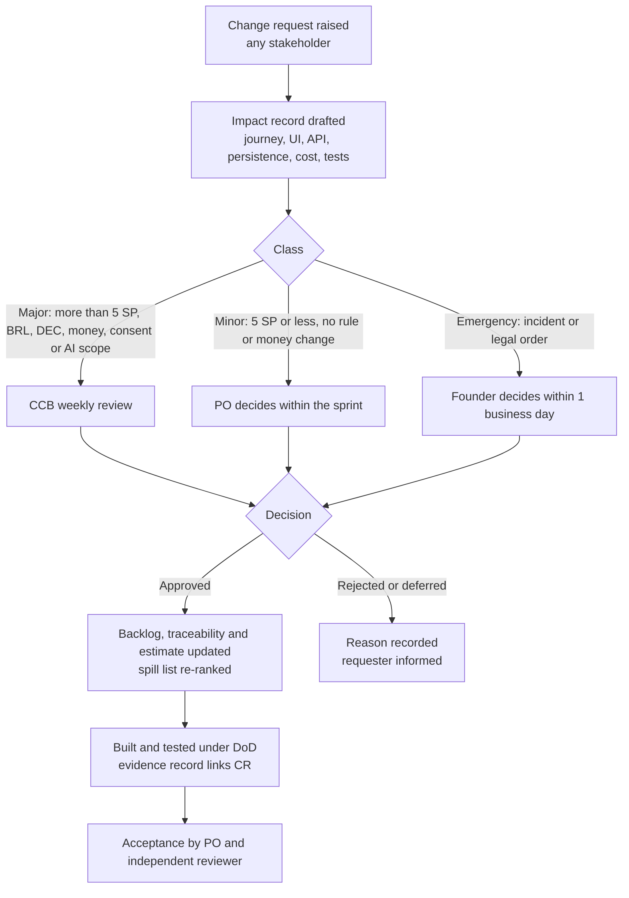

# AI Growth Engine: Employee Sales & Marketing Automation
## Application Blueprint: PART 8 (Batch 8.2), Delivery Plan: Risk Register, Change Management and Training, Operational Readiness, Go-Live Checklist, Hypercare, KPI Tracking and Budget

| Field | Value |
|---|---|
| Document | Application Blueprint, Part 8, Batch 8.2 (client Section 6.11, second half) |
| Version | 1.0 · 27 Nov 2026 |
| Baseline | Part 0A (DEC-001…DEC-065), Part 1 (KPI-01…31, personas, DP-01…DP-15), Part 2.4 (RP-01…RP-30), Part 3.1–3.3 (RSK-301…RSK-329, hosting cost), Part 4.1–4.3 (RSK-330…RSK-351, support, DR, FinOps, readiness), Part 5 (stories), Part 6.1 (gates, UAT, evidence record), Part 7.3 (RSK-360…RSK-379, AI TCO), Part 8.1 (calendar, sprints, team, estimates), `.brief/ERRATA_LOG.md` items 1–48 |
| Roles applied | Product Owner, Business Systems Analyst, Solutions Architect, Principal Engineer, Lead UX/UI Designer, Data Architect, QA Lead, Security/Compliance/AI Governance Lead, DevOps/SRE Lead, FinOps Lead |
| Companion file | Part 8.1 (`Part-08-1_Roadmap_Releases_Sprints.md`) |

**Acronyms used in this batch.** BAU business as usual · CCB change control board · CR change request · DPIA data protection impact assessment · EVR evidence record · GL go-live checklist item · I impact · KPI key performance indicator · L1/L2 support tiers · P probability · PoC point of contact · RPO/RTO recovery point/time objective · SLO service level objective · UAT user acceptance testing · WAF web application firewall. Other acronyms as in Part 8.1.

---

## 8.2.1 Risk register

### 8.2.1.1 Method

| Element | Rule |
|---|---|
| Scope | **RSK-001…RSK-024**: delivery risks raised in this Part. **RSK-025…RSK-092**: every risk raised in Parts 3, 4 and 7 (RSK-301…RSK-379), consolidated and renumbered; the source ID is kept in the *Source* column. Duplicates are merged: RSK-331 + RSK-362 (indirect prompt injection), RSK-332 + RSK-363 (unsupported claims), RSK-304 + RSK-342 (regional outage) |
| Probability (P) | 1 rare · 2 low · 3 medium · 4 high · 5 almost certain. Source words map L = 2, M = 3, H = 4 |
| Impact (I) | 1 negligible · 2 low · 3 medium · 4 high · 5 critical (confidentiality, unlawful contact or financial integrity). Source words map L = 2, M = 3, H = 4, Critical = 5 |
| Score | P × I. **≥ 15 red** (Founder reviews weekly), **9–14 amber** (reviewed at each sprint review), **≤ 8 green** (monthly) |
| Owner | A role from the Part 8.1 §8.1.5.5 RACI |
| Trigger | An observable condition that moves the risk to "Occurring" and starts the contingency |
| Status | Open · Open (carried) from an earlier Part · Mitigating · Occurring · Closed · Open – accepted with re-baseline |
| Review | Risk review in the sprint review (15 min); full register monthly with FinOps review; register stored in the repository (`docs/risk-register.md`) and mirrored on A090 release records |

### 8.2.1.2 Register (RSK-001…RSK-092)

> **Erratum v1.2 (E-V-01, E-V-10):** superseded by consequential actions above L1 only under an Active two-person bounded mandate (DEC-779); two residency stacks, India and EU (DEC-772/776). See Part 11.23c.


| ID | Risk | Source | P | I | Score | Mitigation | Contingency | Owner | Trigger | Status |
|---|---|---|---|---|---|---|---|---|---|---|
| RSK-001 | Wave content is front-loaded: Release 1 holds ≈ 446 SP (≈ 312 pd) against ≈ 200 pd capacity by Day 90, so BRD §8 day-phase gates slip (CONFLICT-142) | Part 8 §8.1.2; DEC-005, DEC-034 | 5 | 4 | **20** | Re-baselined gate calendar (§8.1.2); W0-A/W0-B split (errata 34); QA uplift and DevOps front-load (RECOMMENDATION-082/083); MoSCoW spill list approved in advance (RECOMMENDATION-085) | Option B acceleration: 2 contract engineers S2–S6 (RECOMMENDATION-086); or descope the W3 Should set to W6 | Founder/PO | Sprint 3 rolling velocity < 40 SP, or W1 signal gate not passed by Day 54 | Open – accepted with re-baseline |
| RSK-002 | Measured velocity stays below the 43 SP planning value after ramp-up | Part 5.1a §5.5.2; ASSUMPTION-199 | 3 | 4 | **12** | Re-baseline after Sprint 2 on the 3-sprint rolling average; protect focus factor (no unplanned work without PO); thin stories ≤ 5 SP | Pull the spill list forward one tier (§8.1.4.7); invoke Option B | Founder/PO | 3-sprint rolling average < 38 SP at S3 review | Open |
| RSK-003 | QA capacity (0.5 FTE) cannot carry 43–97 pd of QA-owned work; SYS/E2E automation thin, UAT rushed (GAP-165) | Part 6.1 GAP-165; errata 33 | 4 | 4 | **16** | QA to 1.0 FTE from Sprint 3 (RECOMMENDATION-082); developers own SYS tests for their modules; P0/P1 automated first | Contract QA surge for S10–S12; defer P2/P3 automation to W6 | Founder/PO | QA backlog of un-automated P0/P1 cases > 20 at any sprint review | Open |
| RSK-004 | Business UAT participants (startup heads, finance maker and checker, DPO) unavailable for 60–120 participant-days | Part 6.1 §6.1.15.2; GAP-173 | 4 | 4 | **16** | Named participants and calendar blocks per wave (§8.1.5.4) agreed by Sprint 1; 60-minute pack walkthroughs; UAT scripts prepared by QA | Proxy users with synthetic identities for non-vertical packs; independent reviewer contract | Founder/PO | < 75% of booked UAT participant-days delivered in a wave | Open |
| RSK-005 | Amazon SES production access delayed or denied; email stays in sandbox (DP-06) | Part 1 §1.11 DP-06 | 3 | 4 | **12** | Request production access in Sprint 0 with use-case description, DMARC, bounce/complaint handling evidence (procurement track, RECOMMENDATION-087) | Internal-recipient pilot inside sandbox limits; resubmit with AWS support; Resend adapter stays installed-off (DEC-025) | DevOps | No production access by Day 56 | Open |
| RSK-006 | Meta WhatsApp Business verification, display-name or template approval delayed (DP-08) | Part 1 §1.11 DP-08 | 3 | 3 | **9** | Start business verification in Sprint 1; templates drafted with compliance in S6 | Email and web channels only for the W3 gate; WhatsApp exit test on the Meta test number | Growth/Compliance lead | Verification not complete by Day 98 | Open |
| RSK-007 | Google OAuth app verification for Calendar scopes delayed (DP-07) | Part 1 §1.11 DP-07 | 3 | 3 | **9** | Use an internal Workspace app for owned startups where users share one Workspace organisation (no external verification needed; verify); submit verification in S2 | Manual booking link fallback (DP-07); slot picker shows offline state | FS engineer | Verification not granted by Day 84 | Open |
| RSK-008 | Payment gateway merchant onboarding (KYC) not complete for W4 (DP-10) | Part 1 §1.11 DP-10; DEC-022 | 3 | 3 | **9** | Start onboarding by Day 70; manual bank/UPI evidence path is the W4 default (DEC-022) | Keep gateway flag OFF; manual evidence path only in Release 2 | Finance + DevOps | Merchant account not live by Day 140 | Open |
| RSK-009 | E-sign provider contract and Aadhaar eSign availability delayed (DP-11) | Part 1 §1.11 DP-11; DEC-023 | 2 | 2 | **4** | Signed-PDF + hash path in W4 (DEC-023); provider selection in S9 | Stay on signed-PDF path through W6 | Legal/DPO | No signed provider contract by Day 155 | Open |
| RSK-010 | Legal confirmations (retention, jurisdictions, children's consent, e-sign validity, GST, DPDP deadlines) arrive late, so activation gates fail (DP-12) | Part 1 §1.11 DP-12; GAP-151; RSK-334 | 4 | 5 | **20** | Legal backlog opened in Sprint 0 with dated questions per activation; counsel review per jurisdiction pack before its flag; DPIA for EduVerse before W3 | Fail closed: unknown jurisdiction = deny (DEC-029); keep the affected flag OFF; ship with India-only rule pack | Legal/DPO | Any legal item open 10 business days before its activation gate | Open |
| RSK-011 | Owner and claims sign-off per seed startup (DP-04) late, so nothing can be promoted or used in drafts | Part 1 §1.11 DP-04; BRD §8 | 3 | 4 | **12** | Claims workshop per startup in Sprints 1–2; claims approval story US-0202 in S2 | Discovery runs on capabilities only; outreach waits; publish only approved subsets | Startup Heads | < 2 startups with approved claims by Day 56 | Open |
| RSK-012 | Founder/CTO is Product Owner, architect, accountable security officer and highest approver: a decision bottleneck and key-person risk | DEC-005; Part 4.1 §4.1.6 | 4 | 4 | **16** | Delegations: startup heads accept vertical stories; full-stack engineer holds the AI lead and Principal Engineer role; decision log with 48 h SLA; weekly CCB | Interim PO delegate (a startup head) named for absences > 3 days | Founder/PO | More than 5 stories waiting > 2 business days for PO acceptance | Open |
| RSK-013 | Scope creep and unmanaged change requests during build | BRD §11; BR-S134 | 3 | 4 | **12** | Change control process §8.2.2.4 with impact record and CCB; spill list re-ranked on every approved CR | Freeze Release 1 scope at S7; CRs go to W6 unless Must and compliance-driven | Founder/PO | Approved CR volume > 10% of a sprint's SP in two consecutive sprints | Open |
| RSK-014 | Holiday-season capacity loss in Sprint 1 (25 Dec, New Year leave) larger than planned | ASSUMPTION-198 | 4 | 2 | **8** | Sprint 1 planned at 8 working days and 70% ramp; leave calendar collected in Sprint 0 | Move US-1701 to S2 and shift W0-B gate by ≤ 2 days | Founder/PO | Booked leave > 20% of Sprint 1 person-days | Open |
| RSK-015 | Part-time DevOps/SRE contractor (0.5 FTE) unavailable when needed (environments, incidents, DR drills) | DEC-005; Part 4.3 §4.43.2 | 3 | 4 | **12** | Front-load to 1.0 FTE in S0–S1 (RECOMMENDATION-083); IaC and runbooks so others can operate; on-call shared | Backend engineer as DevOps backup; managed-service defaults | Founder/PO | Contractor misses 2 committed on-call shifts or a drill | Open |
| RSK-016 | No dedicated UX designer for 147 screens and WCAG 2.2 AA | DEC-005; Part 2.5 | 4 | 3 | **12** | Fractional UX contractor 1 day/week S2–S9 (RECOMMENDATION-084); shared component library; axe in CI | Use design-system patterns only; defer non-critical UI polish to W6 | FE engineer | SUS < 68 or task success < 80% in a W2/W3 usability session | Open |
| RSK-017 | Loss of a single-threaded engineer (only one BE, one FE): bus factor 1 | DEC-005 | 2 | 5 | **10** | Pairing on critical modules (PDP, RLS, finance); CODEOWNERS with two reviewers; documented ADRs | Contract replacement within 2 weeks; re-plan with fallback 3-FTE schedule (DEC-005) | Founder/PO | Resignation notice or absence > 10 working days | Open |
| RSK-018 | Defect backlog from UAT and integration grows and consumes feature capacity | Part 6.1 §6.1.8 | 3 | 3 | **9** | Defect SLAs (RECOMMENDATION-074); 10% UAT-defect reserve in S7, S11, S12; zero S1 policy | Move spill-list tier 2 stories to W6 | QA | Open S2 defects > 8 or S1 > 0 at sprint end | Open |
| RSK-019 | External penetration test finds Critical/High issues close to a release gate | Part 4.1 §4.16; RECOMMENDATION-073 | 3 | 4 | **12** | Pen test 1 at S9 (before portal exposure); pen test 2 at S12; DAST in CI from W0 | Release only unaffected scope; fix and retest within 10 business days | Founder/PO (security accountable) | Any Critical/High open at go/no-go | Open |
| RSK-020 | Engineering cost exceeds BRD §6 ₹32.93 L at the high band (518 pd × ₹6,818) | §8.1.6 | 3 | 3 | **9** | Central plan 416 pd; spill by MoSCoW; monthly burn review vs C03 | Fallback 3-FTE plan (DEC-005) for W6; reduce contractor surges | Finance | Cumulative actual pd > plan + 10% at any month end | Open |
| RSK-021 | The 30-day monitored pilot (W5 exit) cannot complete by Day 180 because closure scope goes live at Day ≈ 168 | §8.1.2; BRD §8 | 5 | 3 | **15** | Start the monitored pilot on Release 1 scope at Day ≈ 153; closure scope joins at Day ≈ 168; accept W5 exit at Day ≈ 200 | Option B acceleration | Founder/PO | Release 1 go/no-go later than Day 155 | Open – accepted with re-baseline |
| RSK-022 | No friendly customer or institution available for the W4 real controlled pilot | BRD §8; Part 6.1 §6.1.5.5 | 3 | 3 | **9** | Startup heads nominate 2 candidates per vertical by Day 112 | Run the controlled pilot on an internal counterparty (OrganicSpec supplier) with real money ≤ ₹10,000 | Startup Heads | No signed pilot participant by Day 140 | Open |
| RSK-023 | Imported seed data (catalogues, organizations, contacts) is poor quality and delays W1/W2 | DEC-039; GAP-150 | 3 | 3 | **9** | Import templates with dry-run reports (US-0208, US-0708); data owner per startup | Manual entry of top-20 accounts per startup | Startup Heads | Dry-run rejection rate > 20% | Open |
| RSK-024 | Low adoption: staff keep working in spreadsheets and personal email, so KPIs and compliance controls are bypassed | §8.2.2.3 | 3 | 4 | **12** | Training gate before send rights; adoption metrics weekly; off-platform outreach prohibited by policy | Founder mandate; targeted coaching; simplify top-3 friction screens | Startup Heads | Weekly active users < 60% of named users 4 weeks after a wave activation | Open |
| RSK-025 | Pilot hosting exceeds B01; revised to ₹5,000–7,000 (errata 44) | Part 3/4/7: RSK-301 | 3 | 2 | **6** | Savings Plan + RDS reservation after W0; scheduled staging; B20 for regional backups | Draw B11 contingency for Q1; scale staging to zero outside hours | FinOps (Finance + DevOps) | B01 actual > ₹7,000 in any month | Open (carried) |
| RSK-026 | Run-cost step change at the scale gate (≈ ₹21,000/month Year 1; ≈ ₹66,600 Year 2) | Part 3/4/7: RSK-302 | 3 | 3 | **9** | Gate tied to measured revenue (DEC-008); SaaS plans carry attributable cost | Intermediate vertical scaling first | Founder/PO | Scale-gate request raised | Open (carried) |
| RSK-027 | AGPL-3.0 obligations for self-hosted Firecrawl if modified or exposed | Part 3/4/7: RSK-303 | 2 | 3 | **6** | Run unmodified as a private service; legal review before change | trafilatura fallback | Legal/DPO | Any PR touching the Firecrawl image | Open (carried) |
| RSK-028 | Single-instance, single-region pilot: extended outage on regional loss; regional RTO ≤ 24 h (errata 16, 43) | Part 3/4/7: RSK-304 + RSK-342 | 2 | 4 | **8** | Cross-region backups (B20); rehearsed IaC rebuild; semi-annual cross-region restore | Pilot-light at scale gate | DevOps | Region health event or failed cross-region drill | Open (carried) |
| RSK-029 | Public intake and chat abuse before WAF is live | Part 3/4/7: RSK-305 | 3 | 3 | **9** | ADR-043 controls; WAF from public intake go-live (errata 18, CONFLICT-144) | WAF challenge mode; tighten rate limits | DevOps | Intake rate > 3× baseline or junk leads > 10% | Open (carried) |
| RSK-030 | Reused IdP lacks a required capability (PKCE, rotation, revocation, audience) | Part 3/4/7: RSK-306 | 3 | 4 | **12** | Sprint 0 spike US-0101 (DEC-019) | Django-native auth behind a flag as a change request (ASSUMPTION-154) | FS engineer (Principal Engineer) | Spike checks 1–3, 7 or 12 fail | Open (carried) |
| RSK-031 | RLS context leakage through pooling or a missing SET LOCAL in a worker path | Part 3/4/7: RSK-307 | 2 | 5 | **10** | Transaction-scoped settings; checkout hook; two-tenant fixture in CI | Emergency stop; RB-008 | BE engineer | Any cross-scope alert (KPI-30 > 0) | Open (carried) |
| RSK-032 | CloudFront quotas block onboarding many startup domains (GAP-107) | Part 3/4/7: RSK-308 | 3 | 3 | **9** | Verify quotas in Sprint 0; request increases; platform subdomains default | Multi-tenant distribution feature if available (verify) | DevOps | > 20 custom domains requested | Open (carried) |
| RSK-033 | db.t4g.micro under-sized for pgvector and CPU credits | Part 3/4/7: RSK-309 | 3 | 3 | **9** | Alarms; resize to db.t4g.small | Move vector index to partial indexes | DevOps | CPU credit balance < 20% for 3 days | Open (carried) |
| RSK-034 | Single active outbox relay stalls all side effects | Part 3/4/7: RSK-310 | 2 | 4 | **8** | Leader lock with standby; lag alarm; DLQ; runbook | RB-002 | BE engineer | Outbox lag p95 > 60 s for 10 min | Open (carried) |
| RSK-035 | Provider sandboxes missing or limited (e-sign, ads, WhatsApp) | Part 3/4/7: RSK-311 | 3 | 3 | **9** | Recorded fixtures, provider simulator, contract tests | Internal-recipient live canaries | QA | Sandbox unavailable > 24 h | Open (carried) |
| RSK-036 | Prerendered snapshot HTML diverges from the hydrated SPA | Part 3/4/7: RSK-312 | 3 | 2 | **6** | Pinned component package per snapshot; visual regression on publish | Roll back publication pointer | FE engineer | Visual diff > threshold on publish | Open (carried) |
| RSK-037 | Catalogue of 555 operations drifts from implementation or stays untested | Part 3/4/7: RSK-313 | 3 | 3 | **9** | OpenAPI single source; generated contract tests; unused-endpoint report | Freeze unused DERIVED operations | FS engineer (Principal Engineer) | Unused or untested operations > 5% at a release | Open (carried) |
| RSK-038 | SES/WhatsApp lack client idempotency; rare duplicate on reconciliation | Part 3/4/7: RSK-314 | 2 | 3 | **6** | Correlation windows; human task for WhatsApp | Apology template; KPI-18 context | BE engineer | Duplicate rate > 0.1% | Open (carried) |
| RSK-039 | Provider webhook signature schemes or API versions change | Part 3/4/7: RSK-315 | 3 | 3 | **9** | Pinned versions; monthly fixture refresh; deprecation calendar | Hotfix verifier with contract tests | BE engineer | Signature failure alert (RB-009) | Open (carried) |
| RSK-040 | Provider terms or prices change (WhatsApp, LinkedIn/X, search credits) | Part 3/4/7: RSK-316 | 4 | 3 | **12** | Budget reservation; verify flags; adapter alternatives | Channel priority decision by PO | Finance | Provider notice of change | Open (carried) |
| RSK-041 | Shared institutional IPs trip public rate limits | Part 3/4/7: RSK-317 | 3 | 2 | **6** | Form-session limits; per-event raise | Manual allow-list per event | FE engineer | Legitimate-user 429 complaints | Open (carried) |
| RSK-042 | Event schema evolution breaks projections or triggers | Part 3/4/7: RSK-318 | 2 | 3 | **6** | ADR-020 policy; compatibility gate; upcasters | Replay projection from events | FS engineer (Principal Engineer) | Projection error rate > 0 | Open (carried) |
| RSK-043 | Legacy paths in two ingress groups share one serializer | Part 3/4/7: RSK-319 | 2 | 4 | **8** | Separate view classes per ingress; CI rule; field-mask snapshots | Disable legacy path | BE engineer | Field-mask snapshot diff | Open (carried) |
| RSK-044 | GuardDuty malware scanning unavailable or costlier than estimated | Part 3/4/7: RSK-320 | 2 | 3 | **6** | Quarantine until verdict; ClamAV fallback design | Switch to ClamAV container | DevOps | Scan latency > 10 min or cost > ₹500/month | Open (carried) |
| RSK-045 | A new table ships without RLS enabled or without a policy | Part 3/4/7: RSK-321 | 3 | 5 | **15** | CI guard; two-tenant fixture tests on every API; no BYPASSRLS roles | RB-008; hotfix policy | BE engineer | CI RLS guard bypassed or failing | Open (carried) |
| RSK-046 | Filtered vector search under RLS loses recall or latency at Year 2 volumes | Part 3/4/7: RSK-322 | 3 | 3 | **9** | halfvec, HNSW iterative scans, retrieval eval | Hybrid lexical fallback | FS engineer (AI lead) | Recall@k below eval threshold | Open (carried) |
| RSK-047 | Partition maintenance fails at month boundary | Part 3/4/7: RSK-323 | 2 | 4 | **8** | 3 future partitions; alarm when < 2 | Default partition with alert | DevOps | Partition alarm | Open (carried) |
| RSK-048 | Retention purge deletes data under legal hold or wrong class | Part 3/4/7: RSK-324 | 2 | 4 | **8** | Dry-run + R10 approval; hold check per batch | Restore from backup per RB-007 | Legal/DPO | Purge audit mismatch | Open (carried) |
| RSK-049 | KMS key loss makes field-encrypted data unrecoverable | Part 3/4/7: RSK-325 | 2 | 5 | **10** | Deletion waiting period; key policy separation; restore drills decrypt samples | Multi-region key for DR | DevOps | Key scheduled for deletion | Open (carried) |
| RSK-050 | Imported contacts are contacted before lawful basis is verified | Part 3/4/7: RSK-326 | 3 | 4 | **12** | import_unverified basis = PDP Ineligible; R10 approval | Emergency stop; suppression | Growth/Compliance lead | Any send to import_unverified contact | Open (carried) |
| RSK-051 | A restore re-introduces personal data erased after the restore point | Part 3/4/7: RSK-327 | 3 | 4 | **12** | Erasure replay log in every restore | Re-run erasure replay; notify DPO | DevOps | Restore checklist step 6 not evidenced | Open (carried) |
| RSK-052 | Database growth outpaces the pilot instance and B01 | Part 3/4/7: RSK-328 | 3 | 3 | **9** | Partition archive at 13 months; payloads in S3 | Instance resize | DevOps | Storage > 70% of allocation | Open (carried) |
| RSK-053 | Reused AppNAI identity schema conflicts with the product-local user mirror | Part 3/4/7: RSK-329 | 3 | 3 | **9** | Spike includes schema-mapping check | Mirror keyed by IdP subject only | FS engineer (Principal Engineer) | Spike mapping check fails | Open (carried) |
| RSK-054 | Security knowledge concentrated in Founder/CTO and a part-time DevOps contractor | Part 3/4/7: RSK-330 | 4 | 4 | **16** | Runbooks, pairing, quarterly drills, external pen tests | Retained security consultant (on call, verify cost) | Founder/PO | Sev1 handled by a single person twice in a quarter | Open (carried) |
| RSK-055 | Indirect prompt injection alters research or drafts used for outreach | Part 3/4/7: RSK-331 + RSK-362 | 3 | 4 | **12** | AIR-02 / Part 7 §7.6.3 layers; no tools on untrusted content; human review before outreach; eval gates | Kill switch (ADR-085); disable affected agent | FS engineer (AI lead) | Injection detection alert or red-team pass < threshold | Open (carried) |
| RSK-056 | Hallucinated or unsupported claims reach customers | Part 3/4/7: RSK-332 + RSK-363 | 3 | 4 | **12** | Grounding, AG-012 claims guard, approval bound to hash, citations | Correction notice; claim withdrawal | Legal/DPO | Any customer-facing claim without approved source | Open (carried) |
| RSK-057 | Shared IdP compromise or change outside our control | Part 3/4/7: RSK-333 | 2 | 4 | **8** | Boundary ADR; joint incident process | Fallback auth (change request) | Founder/PO | IdP incident notice | Open (carried) |
| RSK-058 | Regulatory interpretation errors lead to unlawful outreach | Part 3/4/7: RSK-334 | 3 | 4 | **12** | Counsel review per pack; unknown jurisdiction = deny | Emergency stop; suppression; notify | Legal/DPO | Complaint or regulator query | Open (carried) |
| RSK-059 | Anthropic data-handling terms change or do not meet tenant expectations | Part 3/4/7: RSK-335 | 2 | 3 | **6** | Contract review (GAP-141); disclosure; Tier 3 | Restrict affected data classes | Founder/PO | Terms change notice | Open (carried) |
| RSK-060 | WhatsApp account restricted due to quality rating | Part 3/4/7: RSK-336 | 3 | 3 | **9** | Opt-in discipline; quality monitoring | Email fallback | Growth/Compliance lead | Quality rating drops to Medium | Open (carried) |
| RSK-061 | Supply-chain compromise via a dependency | Part 3/4/7: RSK-337 | 3 | 4 | **12** | SCA, lockfiles, cool-off, signed images | Rollback; RB-013 | DevOps | Critical SCA finding in a deployed image | Open (carried) |
| RSK-062 | No pen-test budget delays release gates (GAP-120) | Part 3/4/7: RSK-338 | 3 | 3 | **9** | Approve ₹1.5–4 L per engagement before S7 (§8.2.7) | Use B11 contingency or delay external activation | Founder/PO | No signed pen-test order by Day 98 | Open (carried) |
| RSK-063 | External tenants demand SOC 2/ISO 27001 reports | Part 3/4/7: RSK-339 | 3 | 3 | **9** | SOC 2-aligned controls and evidence from W0 | Readiness assessment in W6 | Founder/PO (Service Owner) | Prospect requires report | Open (carried) |
| RSK-064 | Retention conflict for logs unresolved (resolved by errata 15) | Part 3/4/7: RSK-340 | 2 | 3 | **6** | Errata 15 adopted: 1 year logs; AI payloads 90 days | Counsel confirmation | Legal/DPO | Counsel disagrees | Open (carried) |
| RSK-065 | Traffic or AI usage assumptions wrong by > 3× | Part 3/4/7: RSK-341 | 3 | 3 | **9** | Telemetry review at each wave gate; hard caps | Re-baseline budgets (GAP-140) | Finance | Month-1 AI spend > 2× base estimate | Open (carried) |
| RSK-066 | Staging too small for representative load tests | Part 3/4/7: RSK-343 | 3 | 3 | **9** | Scheduled scale-up during load windows | Production-like temporary stack | DevOps | Load test variance > 30% | Open (carried) |
| RSK-067 | Public Core Web Vitals degrade as startups add heavy media | Part 3/4/7: RSK-344 | 3 | 2 | **6** | Lighthouse CI; image pipeline | Block publish over budget | FE engineer | LCP p75 > 2.5 s | Open (carried) |
| RSK-068 | Out-of-hours incidents unhandled for hours (errata 17) | Part 3/4/7: RSK-345 | 3 | 4 | **12** | Automated mitigation; Sev1-only paging; comms templates | Founder as secondary | Founder/PO | Sev1 ack > 30 min out of hours | Open (carried) |
| RSK-069 | Pipeline duration exceeds 15-minute PR feedback | Part 3/4/7: RSK-346 | 3 | 3 | **9** | Caching; affected-module tests | Split nightly suites | DevOps | PR pipeline p50 > 15 min | Open (carried) |
| RSK-070 | Expand/contract discipline slips; release cannot be rolled back | Part 3/4/7: RSK-347 | 2 | 4 | **8** | Migration linter; monthly rollback rehearsal | Forward-fix runbook | BE engineer | Linter waiver requested | Open (carried) |
| RSK-071 | Observability cost exceeds B07/B01 | Part 3/4/7: RSK-348 | 3 | 3 | **9** | Log levels, sampling, retention tiers | Reduce retention to minimum legal | DevOps | CloudWatch > ₹600/month | Open (carried) |
| RSK-072 | Alert fatigue causes a missed Sev1 | Part 3/4/7: RSK-349 | 3 | 4 | **12** | SLO-based alerting; monthly tuning | Alert review after any miss | DevOps | > 2 out-of-hours pages/week | Open (carried) |
| RSK-073 | Restore drills skipped under delivery pressure | Part 3/4/7: RSK-350 | 3 | 4 | **12** | Release gate blocks when drill overdue | Founder exception only | DevOps | Drill older than 31 days | Open (carried) |
| RSK-074 | Cost allocation disputes with SaaS tenants | Part 3/4/7: RSK-351 | 2 | 3 | **6** | Published allocation method; KPI-24 | Credit note per BR-S139 | Founder/PO (Service Owner) | Tenant dispute raised | Open (carried) |
| RSK-075 | Anthropic price or model-lineup change | Part 3/4/7: RSK-360 | 3 | 3 | **9** | Formula budgets; version pinning; eval-gated migration | Degradation ladder (Part 7 §7.5.7) | Finance | Price notice | Open (carried) |
| RSK-076 | Free-tier providers withdraw or change terms | Part 3/4/7: RSK-361 | 4 | 2 | **8** | Tier 2 optional, default OFF | Re-order chain by config | FS engineer (AI lead) | Provider notice | Open (carried) |
| RSK-077 | AI budget exceeded at high usage | Part 3/4/7: RSK-364 | 3 | 3 | **9** | Hard caps; ladder; weekly review | Founder top-up (audited) | Finance | B02 > 80% before day 20 of month | Open (carried) |
| RSK-078 | Quality drift after a silent provider update | Part 3/4/7: RSK-365 | 3 | 3 | **9** | Pinned model IDs; monthly regression | Roll back model config | FS engineer (AI lead) | Eval regression > 2 pp | Open (carried) |
| RSK-079 | Anthropic outage stops Restricted-data agents | Part 3/4/7: RSK-366 | 3 | 3 | **9** | Tier 3 queue and templates; circuit breaker | Manual drafting | DevOps | Provider error rate > 20% for 15 min | Open (carried) |
| RSK-080 | Model deprecation with short notice | Part 3/4/7: RSK-367 | 2 | 3 | **6** | Change log; eval suite ready for successors | Emergency migration sprint slot | FS engineer (AI lead) | Deprecation notice < 90 days | Open (carried) |
| RSK-081 | Labelled eval datasets too small for DEC-001 gates on time (GAP-154) | Part 3/4/7: RSK-368 | 4 | 3 | **12** | Labelling plan S2–S6 (§8.1.5.4); reviewed synthetic augmentation | Qualification stays at L1 (DEC-001) | QA | < 100 reviewed signals by Day 50 or < 200 items/vertical by Day 150 | Open (carried) |
| RSK-082 | Children's or health-adjacent data enters a prompt | Part 3/4/7: RSK-369 | 2 | 4 | **8** | Redaction, age-band routing, clinical handover, tests | Kill switch; DPO incident | Legal/DPO | Redaction detector hit in prod | Open (carried) |
| RSK-083 | Bias against small or non-English organisations in discovery | Part 3/4/7: RSK-370 | 3 | 3 | **9** | Slice metrics; targeted data | Manual research queue for affected slices | Startup Heads (research lead) | Slice precision gap > 10 pp | Open (carried) |
| RSK-084 | Over-automation: staff rubber-stamp AI drafts | Part 3/4/7: RSK-371 | 3 | 3 | **9** | Edit-rate monitoring; sampled audits; citations in approval UX | Retraining; tighten approval sampling | Founder/PO | Median edit rate < 5% with complaints > 0 | Open (carried) |
| RSK-085 | Copilot cross-scope disclosure | Part 3/4/7: RSK-372 | 2 | 4 | **8** | User-scoped tools; RLS; tests | Disable Copilot flag | FS engineer (AI lead) | Any cross-scope citation | Open (carried) |
| RSK-086 | Tokenizer inflation or thinking tokens raise costs | Part 3/4/7: RSK-373 | 3 | 2 | **6** | Measure in W1; overhead allowance | Shift to Tier 0/1a | Finance | Cost per task > 1.5× estimate | Open (carried) |
| RSK-087 | FX movement above ₹90/USD | Part 3/4/7: RSK-374 | 3 | 2 | **6** | INR ceilings with caps; quarterly review | Reduce Sonnet share | Finance | FX > ₹95/USD | Open (carried) |
| RSK-088 | EduVerse features drift into EU AI Act Annex III | Part 3/4/7: RSK-375 | 2 | 4 | **8** | Scope review gate for learner evaluation | Feature withdrawn | Legal/DPO | Any learner-assessment request | Open (carried) |
| RSK-089 | Model processing outside India conflicts with expectations or future DPDP rules | Part 3/4/7: RSK-376 | 3 | 3 | **9** | Notices, DPAs, minimisation; monitor transfer rules | Restrict data classes to Tier 0/3 | Legal/DPO | Rule notification | Open (carried) |
| RSK-090 | CI review bot exposes source code to a provider | Part 3/4/7: RSK-377 | 2 | 3 | **6** | Separate workspace; no secrets in diffs | Disable bot | DevOps | Secret scan hit in a PR sent to the bot | Open (carried) |
| RSK-091 | Semantic cache serves stale or wrong answers | Part 3/4/7: RSK-378 | 3 | 3 | **9** | Version-keyed invalidation; threshold via eval | Disable semantic cache | FS engineer (AI lead) | Cache-served answer flagged wrong | Open (carried) |
| RSK-092 | Delivery AI reserve B23 (₹1,000) insufficient in heavy months | Part 3/4/7: RSK-379 | 3 | 2 | **6** | Halve review runs on large PRs | Founder approval for temporary increase | Founder/PO | B23 > 80% by day 15 | Open (carried) |

### 8.2.1.3 Heat summary and top 10

| Score band | Count | IDs |
|---|---|---|
| 20 | 2 | RSK-001, RSK-010 |
| 15–16 | 6 | RSK-003, RSK-004, RSK-012, RSK-054, RSK-045, RSK-021 |
| 9–12 | 55 | Amber; reviewed each sprint |
| ≤ 8 | 29 | Green; monthly |
| **Total** | **92** | 24 delivery + 68 consolidated (71 source risks, 3 merges) |

| Rank | ID | Risk (short) | Score | First action |
|---|---|---|---|---|
| 1 | RSK-010 | Legal confirmations late → activation gates fail | 20 | Legal backlog with dated questions opened on Day 5 |
| 2 | RSK-001 | Release 1 content front-loaded vs capacity (CONFLICT-142) | 20 | Approve the re-baselined calendar at Sprint 0 planning |
| 3 | RSK-003 | QA capacity gap (GAP-165) | 16 | Approve QA 1.0 FTE from Sprint 3 by Day 30 |
| 4 | RSK-004 | Business UAT participants unavailable | 16 | Book participant-days by Sprint 1 |
| 5 | RSK-012 | Founder/CTO as PO, architect and approver: bottleneck | 16 | Delegations and 48 h decision SLA |
| 6 | RSK-054 | Security knowledge concentrated (source RSK-330) | 16 | Runbooks, pairing, drills, pen tests |
| 7 | RSK-045 | New table without RLS (source RSK-321) | 15 | CI RLS guard live in Sprint 0 |
| 8 | RSK-021 | 30-day monitored pilot ends after Day 180 | 15 | Start the pilot on Release 1 scope at Day ≈ 153 |
| 9 | RSK-002 | Velocity below 43 SP | 12 | Re-baseline at the Sprint 2 review |
| 10 | RSK-005 | SES production access delayed (DP-06) | 12 | Request on Day 5 |

---

## 8.2.2 Change management and training

### 8.2.2.1 What changes for each persona

| Persona | Today (assumed) | With the product | Change size | First affected (Part 8.1 calendar) |
|---|---|---|---|---|
| P01 Founder / Portfolio Owner | Spreadsheets and chat updates per startup | Portfolio view, approval queue, emergency stop, release go/no-go | Medium | Day 30 (shell), Day 96 (approvals) |
| P02 Startup Head | Ad-hoc approvals by message | Claims, price, bid and discount approvals bound to a version hash (DEC-038) | High | Day 40 (claims), Day 169 (commercial) |
| P03 Growth Manager | Manual research, personal mailbox | Qualified queue, Customer 360, AI drafts that must be reviewed, eligibility explanations, unified inbox | High | Day 54 (queue), Day 96 (outreach) |
| P04 Research Analyst | Manual web search | Source register, research plans, evidence panel, labelling and precision tracking | High | Day 38 |
| P05 Marketing Specialist | Unreviewed posts and pages | Claims-checked content, approval by a different person, publication by hash | Medium | Day 110 (sites), Day 124 (content) |
| P06 Bid Manager | Email and folders | Bid desk, eligibility checklist, human submission with evidence (DEC-053) | Medium | Day 169 |
| P07 Order Coordinator | Spreadsheets | Order desk, units and quantities validated, separate receivable and payable ledgers | Medium | Day 169 |
| P08 Finance (maker, checker) | Manual reconciliation | Maker-checker evidence verification, closure policy, reconciliation queue | High | Day 169 |
| P09 Legal/Compliance/DPO | Reactive review | Source and claims approvals, privacy queue, compliance incidents, DPIA records, jurisdiction packs | High | Day 30 |
| P10 Automation Lead | None | Workflow builder, simulation, autonomy caps, live monitor, conflict resolution | High (new role) | Day 82 |
| P11 Tenant Administrator | None | Users, roles, grants, templates, configuration change centre | Medium | Day 68 |
| P12 Platform Support & Billing | None | Scoped support grants, runbooks, billing operations | Medium | Day 96 (support), Day 180 (billing) |
| P13 SaaS Client Administrator | — | Self-service application, wizard (drafts only), own Admin | New | Day 180 |
| P14 External customer / supplier / institution / guardian | Email | Portal (quotes, agreements, orders, invoices, onboarding, preferences), guardian verification | New | Day 68 (preferences), Day 124 (portal) |
| P15 Anonymous visitor | Static or no site | Approved sites, enquiry forms, chat assistant | New | Day 68 (forms), Day 110 (sites) |
| P16 Service identities | — | Not trained; governed by runbooks, configuration docs and the tool registry | n/a | Day 1 |

### 8.2.2.2 Training plan per persona [ASSUMPTION-208]

Formats: **W** = live workshop (remote, recorded), **H** = hands-on lab in `staging` with GSE-SYN data, **1:1** = individual walkthrough, **SP** = self-paced help article or short video, **D** = drill. Every internal user completes the **common core** before receiving any send, approve or publish permission (training completion is a go-live check, GL-B03).

| Training module | Content | Format | Hours | Audience |
|---|---|---|---|---|
| Common core 1: security and privacy | MFA and passkeys, phishing, data classes (Part 4.1 §4.1.2), DPDP basics, no patient data, no minors outreach (DEC-030), how to report an incident | W + quiz (pass ≥ 80%) | 1.0 | All internal users |
| Common core 2: AI use policy | What AI drafts and never does (no signing, paying, submitting, pricing), citations, abstention, how to edit and reject drafts (RSK-084 rubber-stamping), Copilot limits (DEC-035) | W | 0.5 | All internal users |
| Common core 3: product navigation | Seven views, scope selector, notifications, global search, help | SP | 0.5 | All internal users |

| Persona | Role-specific modules | Format | Hours (role-specific) | Total with core | When |
|---|---|---|---|---|---|
| P01 Founder | Portfolio view, approvals > 20% and ≥ ₹10 L (DEC-038), autonomy plan approval, emergency stop drill, release go/no-go in A090 | 1:1 + D | 3.0 | 5.0 | Day 26; Day 96; Day 145 |
| P02 Startup Head | Catalogue and claims, readiness gate, approval queue, bid/no-bid, discount bands, dashboards, vertical UAT pack | W + H | 5.0 | 7.0 | Day 33; Day 155 |
| P03 Growth Manager | Qualified queue, Customer 360, AI drafting and preflight, eligibility "explain", inbox and STOP handling, sequences, meeting booking, objections | W + H (2 × 3 h) | 6.0 | 8.0 | Day 85–96 |
| P04 Research Analyst | Source register, research plans, evidence panel, signal and need review, labelling protocol and calibration, contact verification | W + H + labelling calibration | 5.0 | 7.0 | Day 33–38 |
| P05 Marketing Specialist | Content studio, claims check, approval by another person, landing pages, campaigns with simulation, accessibility checklist for content | W + H | 5.0 | 7.0 | Day 105–120 |
| P06 Bid Manager | Bid desk, eligibility checklist, deadline guard, submission evidence, award recording | H | 3.0 | 5.0 | Day 160 |
| P07 Order Coordinator | RFQ to order, units and quantities, reservations, fulfilment events, separate ledgers | H | 3.0 | 5.0 | Day 160 |
| P08 Finance (maker, checker) | Invoice drafts, payment evidence, maker-checker, allocation and ClosurePolicy, reconciliation; W5: SaaS billing cycle | W + H | 4.0 (+ 2.0 in W5) | 8.0 | Day 158; Day 178 |
| P09 Legal/Compliance/DPO | Consent and suppression, privacy queue and legal hold, compliance incidents and containment, DPIA records, jurisdiction packs, claims and contract approvals | 1:1 + H + D (breach tabletop) | 5.0 | 7.0 | Day 26; Day 120 |
| P10 Automation Lead | Node library, workflow builder, simulation report, autonomy caps (DEC-064), live monitor, uncertain-outcome reconciliation, conflicts, emergency stop and runbooks RB-002/003/004 | W + H + D | 8.0 | 10.0 | Day 82–96 |
| P11 Tenant Administrator | Users, roles and grants, MFA enforcement, templates, configuration change centre, support-access approvals | H | 3.0 | 5.0 | Day 64 |
| P12 Platform Support & Billing | Support model (DEC-044), ticket triage, support grants (DEC-056), runbooks, incident severity and comms, billing operations | W + H + D (incident drill) | 6.0 | 8.0 | Day 92; Day 178 |
| P13 SaaS Client Administrator | Plans, application, verification, wizard (drafts only), service portal, exports | SP guide + 1:1 onboarding call | 1.0 | 1.0 | At onboarding (Day 180+) |
| P14 External users | Portal tasks, preferences and opt-out, guardian verification | SP (help articles, 2-minute videos, in-product microcopy, Part 2.5 §2.49) | 0.1 | 0.1 | At first invitation |
| P15 Anonymous visitor | None; accessible pages and accessibility statement (US-1911) | — | 0 | 0 | — |
| P16 Service identities | Not applicable; engineering onboarding pack (architecture, ADRs, DoD, runbooks) for new engineers instead | SP + pairing (2 days) | 16.0 | 16.0 | On joining |

**Training effort (estimate).** Internal users in Year 1 = 15–60 (DEC-031). For a pilot cohort of ≈ 20 named users the delivery effort is ≈ 6–8 trainer-days (QA and growth/compliance lead) plus ≈ 2 days to write help articles per wave; trainee time ≈ 140 person-hours. A help-centre owner is not named in the baseline [GAP-178].

### 8.2.2.3 Adoption metrics

| Metric | Formula | Target | Measured from | Review | Owner |
|---|---|---|---|---|---|
| Active use | Weekly active named users ÷ named users with access | ≥ 80% four weeks after each activation | Each activation | Weekly | Startup heads |
| On-platform outreach | Outbound messages sent through the platform ÷ all business outreach reported by startup heads | 100% (off-platform outreach is prohibited for in-scope startups) | Day 96 | Weekly | Growth/compliance lead |
| Training completion | Users who passed the common core ÷ users with send/approve/publish rights | 100% (hard gate) | Day 26 | At each grant | Tenant administrator |
| Approval cycle time | Median time from approval request to decision, per approval type | ≤ 1 business day (≤ 2 h for discount ≤ 10%) | Day 40 | Weekly | Founder/PO |
| AI draft edit rate | Share of AI drafts edited before approval | 10–60% band; < 5% with any complaint triggers a quality audit (RSK-084) | Day 96 | Weekly | AI lead |
| Customer 360 completeness | Accounts with owner, verified need, eligible contact ÷ qualified accounts | ≥ 95% | Day 68 | Monthly | Startup heads |
| Usability | SUS score; task success on P0 journeys (Part 6.1 ASSUMPTION-181) | SUS ≥ 68; task success ≥ 80% | W2 usability session (Day 99–110) | Per wave | UX contractor |
| Support load | Tickets per active user per month; top categories | Falling month on month after each activation | Day 96 | Monthly | Platform support |
| Copilot usefulness | Copilot answers rated useful ÷ rated answers | ≥ 70% (instrumented in US-1707) | Day 138 | Monthly | AI lead |

### 8.2.2.4 Change control for requirements (BRD §11; BR-S134) [RECOMMENDATION-088]

BRD §11 requires that the Product Owner approves objectives, route eligibility, outcomes and exclusions before engineering, and that every requirement change identifies the affected business journey, UI, API, persistence, cost and tests. The process below implements that rule with the smallest overhead that keeps the evidence chain intact.



| Element | Rule |
|---|---|
| Intake | CR template in the tracker; any stakeholder may raise; the PO triages within 2 business days |
| **Impact record (mandatory fields, BR-S134)** | Affected business journey (J-##, WF-##); UI (screen IDs W##/A###); API (operation IDs, Part 3.2); persistence (entities, migrations, retention class); cost (SP range, pd, run-cost line B##, AI budget effect); tests (TS/TC IDs to add or change, AP affected); BRL/DEC affected; risk and compliance effect (DPIA, jurisdiction); wave and release effect; what spills if approved |
| Classes | **Minor**: ≤ 5 SP, no change to a BRL, DEC, money path, consent or AI scope → PO decides. **Major**: anything else → CCB (PO chairs; FS engineer, QA, growth/compliance lead; Finance for cost; Legal/DPO for compliance). **Emergency**: incident containment or legal order → Founder decides within 1 business day; CCB ratifies within 5 business days |
| Changes to DEC decisions | Only the PO, through a CR that cites the DEC and records the override (Part 0A "Effect" row) |
| Capacity rule | An approved Major CR names what leaves the release (spill list re-ranked, Part 8.1 §8.1.4.7) unless the PO funds extra capacity |
| Freeze | Release 1 scope frozen at the start of S8 (Day 113); Release 2 at the start of S11 (Day 155); after a freeze only Must, compliance or defect CRs enter |
| Traceability | Every CR ID appears in the story, the Part 9 traceability matrix and the EVR of the affected tests (BRD §12.2) |
| Metrics | CR count and SP per sprint; approval lead time; share of CRs that are compliance-driven (RSK-013 trigger: approved CR volume > 10% of sprint SP twice in a row) |

### 8.2.2.5 Communication plan

| Audience | Message | Channel | Frequency / moment | Owner |
|---|---|---|---|---|
| Founder and startup heads | Progress vs plan, gate status, top risks, decisions needed | Written status note (one page) + sprint review | Fortnightly; gate days | Founder/PO with QA |
| All internal users | What is coming, when, training dates, what changes in their work | Email + A106 announcement | 2 weeks before each activation | Growth/compliance lead |
| Users of an activated capability | Release notes: new screens, rules (e.g. "AI drafts must be reviewed"), known limitations, how to get help | A106 + help centre | At each activation | PO |
| Engineering team | Plan changes, CR decisions, incidents, postmortems | Stand-up, CCB minutes, repository | Daily / weekly | FS engineer |
| Legal/DPO and counsel | Open legal questions with due dates, DPIA status | Legal backlog review | Weekly until Release 1, then fortnightly | Growth/compliance lead |
| Finance | Run-cost vs budget, C03 burn, contingency draws | FinOps review (Part 4.3 §4.46.6) | Monthly | DevOps + Finance |
| External customers and recipients | Privacy notice, preference centre, portal invitations; incident notices only when affected (Part 4.3 §4.43.4) | Website, email, portal | At go-live; on change | Legal/DPO |
| SaaS tenant administrators | Onboarding guide, support hours (DEC-044), incident banner and status communication [GAP-179] | Email, tenant Admin banner | At onboarding; during incidents | Service Owner (Founder) |
| Providers (AWS, Anthropic, Meta, SES, gateway, e-sign) | Verification submissions, escalations | Provider consoles and support | Procurement track | DevOps / growth/compliance lead |

---

## 8.2.3 Operational readiness: DR and support model for go-live (errata 16, 17, 43)

### 8.2.3.1 Recovery objectives by failure scope

| Failure scope | RTO | RPO | Mechanism | First proven | Evidence |
|---|---|---|---|---|---|
| Instance or task failure | ≤ 4 h (target minutes via ECS replacement) | ≤ 15 min | ECS health replacement; circuit-breaker rollback (Part 4.3) | S3 (US-2105) | Chaos test log |
| Availability Zone or database failure | ≤ 4 h | ≤ 15 min | RDS PITR restore (RB-007); IaC rebuild | S3 (US-2108 restore drill) | Drill report in A090 |
| Data corruption | ≤ 4 h | ≤ 15 min | Side restore + repair; erasure replay (RSK-051) | Quarterly game day | Timed report |
| **Regional outage (pilot)** | **≤ 24 h** | **≤ 15 min** | Cross-region backup copies (B20); rebuild in the backup region (verify ap-south-2 services) | Semi-annual drill, first before Release 2 (Day ≈ 175) | Drill report (errata 16, 43; DEC-018 amended) |
| Regional outage (scale gate option) | Lower, by design | ≤ 15 min | Multi-region active-passive (L-07) | Scale gate | ADR at the time |

### 8.2.3.2 Support model at go-live (DEC-044, errata 17)

| Element | Arrangement |
|---|---|
| Automated monitoring | 24×7 (alarms, SLO burn rates, budget hard stops, campaign pause on complaint thresholds) |
| Human support hours | 10:00–18:00 IST, Monday–Saturday; channels: portal tickets (W28 for customers, W34 for SaaS clients), email, A106 for internal users |
| Out-of-hours paging | **Only S1 platform incidents and these Critical business categories: cross-tenant exposure, emergency stop, suppression breach, payment discrepancy > ₹1 lakh** (errata 17); best-effort acknowledgement target 30 min; secondary = Founder |
| Internal response targets | S1 2 h, S2 8 business hours, S3 3 business days (not contractual; no public SLA until measured, OPT-20-03) |
| Tiers | L0 help centre; L1 platform support (growth/compliance lead + rotating engineer); L2 on-call engineer; L3 providers (verify support plan levels) |
| Tenant data access | SupportAccessGrant only (DEC-056) |
| Hypercare overlay | §8.2.5 adds a dedicated hypercare engineer and a daily review during each hypercare window |

---

## 8.2.4 Go-live checklist

### 8.2.4.1 BRD §11 and §10 activation blockers (hard stops)

A capability is **not activated** while any row below is open. These rows cannot be waived by the Founder alone; the named veto holder must record "clear" with evidence (BRD §10, §11, §16; BR-S132, BR-S135, BR-S140).

| ID | Blocker (source text) | Check | Evidence | Veto holder |
|---|---|---|---|---|
| BLK-1 | Open **critical confidentiality** defect (BRD §11) | 0 open S1/S2 defects in confidentiality areas (RLS, BFF, portal grants, exports, logs) | Defect report filtered by area; RLS two-tenant suite 100% | Independent reviewer |
| BLK-2 | Open **financial integrity** defect (BRD §11) | 0 open S1/S2 in quotes, tax, invoices, payments, ledgers, closure | Defect report; AP-04 EVR; mutation score ≥ 85% for money modules (RECOMMENDATION-070) | Finance |
| BLK-3 | Open **unauthorized-action** defect (BRD §11) | 0 open S1/S2 where an external action could occur without eligibility, approval hash or budget recheck | CA-DISPATCH battery; PDP decision-table suite | Legal/DPO |
| BLK-4 | Failed **confidentiality** checks (BRD §10) | DAST full scan 0 High/Critical; pen test 0 Critical/High open; authorization matrix 0 failures | Scan and pen-test reports | Independent reviewer |
| BLK-5 | **Unauthorized external action** check failed (BRD §10) | Emergency stop ≤ 60 s; replay produces one effect; uncertain outcomes block retry (DEC-050) | Test EVRs; RB-004 drill | Legal/DPO |
| BLK-6 | **Payment accuracy** check failed (BRD §10) | FRD §12.1 worked example (2 × 150.00 with 10% discount = 270.00 INR) and GST cases pass; maker ≠ checker enforced | Pricing library EVRs; AP-04 | Finance |
| BLK-7 | **Regulatory eligibility** check failed (BRD §10) | Opt-out across channels; jurisdiction denials; under-18 guardian path; KPI-17 = 0 in all suites; counsel sign-off on the active jurisdiction packs | UAT-PK-GOV EVRs; counsel memo | Legal/DPO |
| BLK-8 | **Critical rollback** check failed (BRD §10) | Rollback rehearsal ≤ 15 min; restore drill ≤ 31 days old and passed | PL-20 log; drill report | DevOps |
| BLK-9 | **Auth reuse compatibility** not tested (BRD §10) | US-0101 12-check report all Pass or CR closed | Spike EVR | Independent reviewer |
| BLK-10 | A required FR **without a tested result** (BRD §12.1; BR-S043) | Every in-scope FR has ≥ 1 passing test, or a waiver with owner and independent reviewer | Part 9 traceability extract | Independent reviewer |
| BLK-11 | Activation based on **specification or synthetic evidence alone** (BRD §13.2, §16) | Ladder level L-T for the release; L-C plan with caps for each external activation | A090 ladder field | Independent reviewer |

### 8.2.4.2 Evidence record for every checklist item (BRD §12.2)

Each GL item and each BLK row is closed by an EVR (Part 6.1 §6.1.5.4) with the five BRD §12.2 fields:

| BRD §12.2 field | What the go-live item must record |
|---|---|
| Responsible / reviewer | The owner named in the checklist and an independent reviewer who did not produce the evidence |
| Artifact / test evidence | Release commit and container digest; environment; scenario or check ID; actual result; secure evidence reference (S3 key with hash) |
| Decision | Pending / Pass / Fail / approved N/A with reason (missing evidence = Pending) |
| Remediation | Defect or action, owner, corrective action and retest EVR |
| Business acceptance | Authorised sign-off after the required gates pass (Founder/PO; vertical owner; DPO for compliance items; Finance for money items) |

### 8.2.4.3 Checklist by category

R1 = Release 1 go/no-go (Day 152); R2 = Release 2 build go/no-go (Day 180); both = each release and each later activation of the same kind.

| ID | Category | Item | Release | Owner | Evidence |
|---|---|---|---|---|---|
| GL-T01 | Technical | Release candidate built once and promoted unchanged; digest recorded in A090 | Both | DevOps | Pipeline log, digest |
| GL-T02 | Technical | P0 suites 100% pass in staging; P1 per Part 6.1 §6.1.8.5 | Both | QA | Test report EVRs |
| GL-T03 | Technical | NFR gates for the waves in scope verified (Part 4.2 §4.28) | Both | FS | NFR evidence pack |
| GL-T04 | Technical | Load and soak tests (24 h R1; 72 h R2) within thresholds | Both | DevOps | LT reports (Part 6.1 LT-01…12) |
| GL-T05 | Technical | Migrations expand/contract; rollback rehearsal ≤ 15 min | Both | BE | PL-20 log |
| GL-T06 | Technical | SLO dashboards DB-01…DB-10 live; alert rules tested with synthetic metrics | Both | DevOps | Alert test log |
| GL-T07 | Technical | Runbooks for new failure modes linked from alerts | Both | DevOps | Runbook diff |
| GL-T08 | Technical | Feature flags for new channels and adapters OFF in production; enablement approvals listed | Both | FS | Flag registry export |
| GL-T09 | Technical | DNS, TLS, CloudFront and ACM for published hosts; purge p95 ≤ 5 min (RECOMMENDATION-058) | R1 | DevOps | Synthetic fetch report |
| GL-T10 | Technical | Provider adapters: contract tests green; sandbox drift reviewed | Both | BE | CT report |
| GL-S01 | Security | SAST 0 High/Critical; SCA 0 Critical; container scan 0 Critical | Both | DevOps | CI reports |
| GL-S02 | Security | DAST full scan 0 High/Critical | Both | QA | ZAP report |
| GL-S03 | Security | External pen test: 0 Critical/High open (pen test 1 before R1, pen test 2 before R2) [CONFLICT-143] | Both | Founder | Pen-test report, retest |
| GL-S04 | Security | RLS two-tenant suite and authorization matrix 100% (AP-10) | Both | BE | EVR |
| GL-S05 | Security | MFA for privileged roles; WebAuthn for R01, R08–R12 and approvers where the IdP supports it, TOTP otherwise (errata 14) | Both | FS | Config + test EVR |
| GL-S06 | Security | Secrets inventory current; rotation dates set (Part 4.1 §4.6.2) | Both | DevOps | Secret inventory |
| GL-S07 | Security | AWS WAF managed rules and rate rules on CloudFront live before public intake (errata 18) [CONFLICT-144] | R1 (Day 68) | DevOps | WAF config in IaC; LT-07 report |
| GL-S08 | Security | Threat model updated for new boundaries and adapters | Both | FS | Part 4.1 artefact diff |
| GL-S09 | Security | CERT-In point of contact and incident reporting route designated (6-hour clock; verify) | R1 | Founder | Designation record [GAP-121] |
| GL-C01 | Compliance | DPIAs approved where triggered (EduVerse minors, AI drafting, discovery) | Both | Legal/DPO | DPIA records |
| GL-C02 | Compliance | Active jurisdiction packs approved by counsel (India first; EU/UK/US only with memo; others denied) | Both | Legal/DPO | Counsel memo per pack |
| GL-C03 | Compliance | Consent, suppression and opt-out tests across email, WhatsApp and web; KPI-17 = 0 | Both | QA | UAT-PK-GOV EVRs |
| GL-C04 | Compliance | Privacy notice, terms, cookie/analytics statement, grievance officer and DPDP contact published | R1 | Legal/DPO | Published page snapshot [GAP-121] |
| GL-C05 | Compliance | Retention schedule configured (DEC-028 as amended by errata 15); purge dry-run approved by R10 | R1 | Legal/DPO | Dry-run report |
| GL-C06 | Compliance | Claims approved per active startup; no Planned offering promotable (DEC-060) | Both | Startup heads | Approval records |
| GL-C07 | Compliance | Record of processing activities updated (Part 4.1 §4.11.4) | Both | Legal/DPO | ROPA |
| GL-C08 | Compliance | EU/UK representative decision before the EU/UK pack (GAP-125) | Before EU/UK flag | Legal/DPO | Memo |
| GL-D01 | Data | Seed and import dry-run reports accepted; rejection rate < 20% | R1 | Startup heads | Import reports |
| GL-D02 | Data | Imported contacts marked `import_unverified` and ineligible until lawful basis is verified (RSK-050) | R1 | Growth/compliance lead | PDP test EVR |
| GL-D03 | Data | Every new personal-data field has a classification and retention class | Both | BE | Data dictionary diff |
| GL-D04 | Data | Backups healthy; cross-region copies running (B20); restore drill current | Both | DevOps | Backup report |
| GL-D05 | Data | Erasure replay log tested in the restore drill (RSK-051) | Both | DevOps | Drill checklist |
| GL-D06 | Data | TaxProfile, HSN/SAC and price versions loaded and approved per active startup (DEC-027) | R2 | Finance | Reference data report |
| GL-P01 | Support | Support hours, channels and response targets published (DEC-044) | R1 | Platform support | Help-centre page |
| GL-P02 | Support | On-call rotation published; out-of-hours paging for S1 categories tested (errata 17) | Both | DevOps | Test page log |
| GL-P03 | Support | Help articles for the activated screens; ticket categories configured | Both | Growth/compliance lead | Help-centre diff [GAP-178] |
| GL-P04 | Support | Tenant incident communication route (banner and email; status page decision) | R2 | Service Owner | Template + banner test [GAP-179] |
| GL-P05 | Support | Support-access grant flow tested (≤ 72 h, visible to tenant) | Both | Platform support | EVR |
| GL-B01 | Business | UAT sign-off for the packs in scope (PO + vertical owner + independent reviewer) | Both | Founder/PO | UAT EVRs |
| GL-B02 | Business | Acceptance procedures in scope have Pass EVRs (R1: AP-02, AP-03, AP-05, AP-10; R2: AP-01…AP-10) | Both | QA | AP EVRs |
| GL-B03 | Business | Training completed by every user who gets send, approve or publish rights | Both | Tenant administrator | Training records |
| GL-B04 | Business | Activation scope agreed per startup: channels, recipient caps, budget caps, monitoring window | Both | Startup heads | Activation charter |
| GL-B05 | Business | KPI instrumentation live for the activated scope; baselines scheduled (§8.2.6) | Both | PO | RP dashboards |
| GL-B06 | Business | Controlled pilot participants agreed for closure routes (RSK-022) | R2 | Startup heads | Signed participation |
| GL-B07 | Business | Finance maker and checker assigned as different people; approval thresholds configured (DEC-038) | R2 | Finance | Role report |
| GL-A01 | AI | Eval suites pass thresholds for every active agent; no regression vs baseline (DEC-061) | Both | AI lead | Eval report |
| GL-A02 | AI | Tier 2 flags OFF; Restricted data refused by routing (DEC-007) | Both | AI lead | Routing test EVR |
| GL-A03 | AI | B02 caps per agent/startup/tenant configured; 80%/100% alerts and the degradation ladder tested (Part 7 §7.5.7) | Both | AI lead + Finance | Budget simulation EVR |
| GL-A04 | AI | Kill switch per agent tested (ADR-085) | Both | AI lead | Drill log |
| GL-A05 | AI | Red-team injection set and claims-guard tests pass (RSK-055, RSK-056) | Both | AI lead | Red-team report |
| GL-A06 | AI | Anthropic commercial terms reviewed (retention, training exclusion, DPA, cross-border) (GAP-141) | R1 | Founder + Legal/DPO | Contract file |
| GL-A07 | AI | AI-content labelling configured where a jurisdiction requires it (RECOMMENDATION-069) | Before EU flag | Legal/DPO | Config record |
| GL-L01 | Legal | Website and portal terms; customer-facing privacy notice per legal entity | R1 | Legal/DPO | Published pages |
| GL-L02 | Legal | Provider agreements and DPAs on file (AWS, Anthropic, Meta, Tavily; gateway and e-sign for R2) | Both | Legal/DPO | Contract register |
| GL-L03 | Legal | Signed-PDF hash path approved for contract evidence (DEC-023) | R2 | Legal/DPO | Counsel memo |
| GL-L04 | Legal | Commercial invoice and GST format approved by the finance advisor (DEC-027) | R2 | Finance | Approved sample |
| GL-L05 | Legal | SaaS terms, plan entitlements and "Price on request" wording approved (DEC-047, GAP-162) | R2 | Service Owner | Approved terms |
| GL-L06 | Legal | Open-source licence review, including the unmodified Firecrawl AGPL service (RSK-027) | R1 | Legal/DPO | Licence report |

---

## 8.2.5 Hypercare plan [ASSUMPTION-206] [RECOMMENDATION-089]

### 8.2.5.1 Duration and windows

| Window | Starts | Length | Scope |
|---|---|---|---|
| Wave activation hypercare | Each external activation: discovery (≈ Day 38–43), intake (Day 68), outreach (Day 96), public sites (Day 110), WhatsApp/assistant/campaigns (Day 124–138) | **2 weeks** each (Part 4.3 §4.48 item 12) | The activated capability only |
| **Release 1 hypercare** | Day 153 (Mon 10 May 2027) | **4 weeks**, to Day 180 | All Release 1 scope; overlaps the start of the 30-day monitored pilot |
| **Release 2 hypercare** | Day 181 (Mon 7 Jun 2027) | **4 weeks**, to Day 208 | Closure routes and the first SaaS tenants; overlaps the end of the monitored pilot |
| Extension | If exit criteria are not met | +1 week at a time, max +2 weeks | Founder decides |

### 8.2.5.2 Staffing

| Role | Hypercare duty | Time |
|---|---|---|
| Hypercare engineer (rotating weekly among BE, FS, FE) | First responder for defects and user issues on the activated scope; owns the daily metrics sheet | 50% of the week |
| On-call primary (Part 4.3 rotation) | Incidents; out-of-hours S1 categories (errata 17) | As rota |
| QA | Triage, reproduction, regression of fixes, evidence of each hotfix (Part 6.1 hotfix path) | 30% |
| DevOps/SRE | SLO, cost and capacity watch; rollback readiness | 20% |
| AI lead (FS) | Agent quality, cost per task, abstentions, injection detections | 20% |
| Growth/compliance lead | L1 support, compliance signals (complaints, opt-outs, suppression), user questions | 50% |
| Startup heads | Daily 10-minute check with their users; escalate business issues | 10 min/day |
| Founder/PO | Daily review; go/stop decisions; CR triage | 15 min/day |

Hypercare effort is inside the sprint capacity of S8–S12 (it is part of the reserve noted in Part 8.1 §8.1.4.6); Release 2 hypercare (Day 181–208) is funded from the W6 budget.

### 8.2.5.3 Daily metrics (reviewed at 10:30 IST)

| Metric | Source | Green | Action if not green |
|---|---|---|---|
| Sev1 / Sev2 incidents open | A014 (RP-25) | 0 / ≤ 1 | IC named; consider flag OFF |
| SLO burn rate (availability, latency) | DB-01 | < 1× budget | Freeze non-fix releases (RECOMMENDATION-059) |
| Error rate 5xx | DB-02 | < 0.5% | Rollback candidate |
| Outbox lag p95 / DLQ depth | DB-03 | ≤ 60 s / 0 new | RB-002 / RB-011 |
| Uncertain outcomes awaiting reconciliation | DB-03 | 0 older than 24 h | RB-003 |
| Suppression breaches (KPI-17) | RP-23 | 0 | Emergency stop; RB-006 |
| Complaint and bounce rate | RP-06 | < 0.1% / < 2% | Pause campaign; review list source |
| Cross-scope alerts (KPI-30) | DB-06 | 0 | RB-008; Sev1 |
| AI spend vs daily budget; cost per task (KPI-21) | RP-21, DB-05 | ≤ 1/30 of monthly cap per day; within agent budget | Degradation ladder |
| AI schema failures, abstentions, injection detections | RP-20 | Within Part 7 thresholds | Kill switch for the agent |
| Workflow timeliness (KPI-20) | RP-22 | ≥ 99% | Capacity or scheduler fix |
| New defects by severity; open S1/S2 | Tracker | S1 = 0; S2 ≤ 2 | Hotfix path |
| Support tickets opened / closed; oldest open | Help desk | Backlog ≤ 1 day of intake | Add L2 time |
| Active users today; approvals pending > 1 business day | RP-03, A089 | ≥ 70% of named users; 0 | Coaching; delegate approvals |
| Closure integrity (KPI-31) — R2 | RP-15 | 0 | Finance review; RECOMMENDATION-057 job |

### 8.2.5.4 Exit criteria (all true)

1. 10 consecutive business days with 0 Sev1 and ≤ 1 open Sev2.
2. Monthly SLO error budgets not exhausted (Part 4.3 §4.40).
3. KPI-17, KPI-30 and KPI-31 = 0 throughout the window.
4. 0 open S1 defects; ≤ 2 open S2 with dated plans; no BLK row reopened.
5. AI spend on track for ≤ 100% of the monthly cap without manual top-ups; no agent below its quality threshold.
6. Adoption ≥ 80% weekly active named users for the activated scope (§8.2.2.3).
7. Every runbook used during the window updated; postmortems for Sev1/Sev2 published.
8. Handover to BAU support signed by the Founder/PO, the growth/compliance lead (L1) and the on-call lead (L2).

---

## 8.2.6 Post-launch KPI tracking (KPI-01…KPI-31)

Baseline rule: a baseline needs ≥ 4 weeks of data in the activated scope, with numerator, denominator, as-of time and currency (Part 1 §1.4.2); **Unknown ≠ 0**; forecasts are labelled estimates. Dates follow the Part 8.1 calendar; targets that the BRD tied to Day 30/60 move with CONFLICT-142 and are marked "re-based". Where the baseline has no target value, the baseline is captured on the date shown [GAP-175].

| KPI | Name | Baseline capture date | Target (source) | Target date | Review cadence | Owner | Dashboard |
|---|---|---|---|---|---|---|---|
| KPI-01 | Qualification precision | Day 54 (first labelled set) | ≥ 90% on ≥ 200 labelled items per vertical before any L2/L3 (DEC-001) | Day 180 (benchmark); L2 only after | Weekly | AI lead | RP-20 |
| KPI-02 | Signal precision | Day 45–54 at ≥ 100 reviewed | ≥ 80% (DEC-001) | ≈ Day 45 (errata 34); decision ≤ Day 54 | Weekly in W1, then monthly | Research lead | RP-04 |
| KPI-03 | Verified contact rate | Day 54–68 | +10 pp vs baseline (RECOMMENDATION-019) | W5 exit (Day 201) | Monthly | Research lead | RP-05 |
| KPI-04 | Eligible delivery rate | Day 110 (2 weeks after outreach activation) | ≥ 97% | Day 124 | Weekly | Growth lead | RP-06 |
| KPI-05 | Eligible reply rate | Day 124 | Improve vs baseline (OPT-12-04) | Quarterly | Weekly | Growth lead | RP-06 |
| KPI-06 | Meetings held | Count from Day 96 | 5 demo requests (BRD §8, re-based from Day 60) | Day 124 | Weekly | Growth manager | RP-10, RP-02 |
| KPI-07 | Qualified accounts | Count from Day 54 | 20 qualified accounts (BRD §8, re-based from Day 60) | Day 96 | Weekly | Product owner | RP-02 |
| KPI-08 | Reviewed signals | Count from Day 38 | 100 (BRD §8; errata 34) | ≈ Day 45 | Weekly | Research lead | RP-04 |
| KPI-09 | Win rate | Day 201 (W5 exit) per route | Baseline, then track | W6 | Monthly | Startup head | RP-02, RP-13 |
| KPI-10 | Acquisition spend per new customer | First quarter with verified closures (≈ Day 270) | Falling quarter on quarter | W6 | Monthly | FinOps | RP-16, DB-09 |
| KPI-11 | Bid award rate (AppNAI) | From first submissions (Day 169+) | Baseline, then track | W6 | Monthly | Bid manager | RP-13 |
| KPI-12 | Fulfilment accuracy | Day 169 | ≥ 98% (RECOMMENDATION-019) | Day 201 | Monthly | Order coordinator | RP-14 |
| KPI-13 | Actual receipts reconciled | Day 169 | 100% reconciled (M52) | Continuous from Day 169 | Monthly | Finance | RP-15 |
| KPI-14 | Payables matched | Day 169 | 100% matched to fulfilment | Continuous from Day 169 | Monthly | Finance | RP-14, RP-15 |
| KPI-15 | Renewal rate | First renewal cohort (W6) | Baseline, then track | W6 | Quarterly | Startup head | RP-18 |
| KPI-16 | Gross margin | First month of recognised revenue (≈ Day 200) | ≥ startup floor (default 25%, DEC-038) | W6 | Monthly | Finance | RP-16 |
| KPI-17 | Suppression breaches | Continuous from Day 38 (sends from Day 96) | **0** | Always | Continuous; weekly report | Compliance | RP-23, RP-07, DB-06 |
| KPI-18 | Complaint rate | Day 96 | < 0.1% email (verify provider thresholds) | Always | Weekly | Compliance | RP-06, RP-23 |
| KPI-19 | Automation rate | Day 124 (W2 exit) | ≥ 90% (OPT-04-08) | W5 exit | Monthly | Automation lead | RP-22 |
| KPI-20 | Workflow timeliness | Day 82 (engine live) | ≥ 99% within window (DEC-032) | Day 124 | Daily | SRE | RP-22, DB-03 |
| KPI-21 | AI cost per task | Day 30 (gateway live) | Within agent budget (Part 7); pilot base ≈ ₹0.30–0.60 per task (verify after W1) | Continuous | Daily | FinOps | RP-20, RP-21, DB-05 |
| KPI-22 | Cost per qualified opportunity | Day 84 (first full month of qualified flow) | Falling vs baseline (BRD §8 scale gate) | Scale-gate review | Monthly | FinOps | RP-04, DB-09 |
| KPI-23 | SaaS contribution margin per tenant | First tenant billing cycle (≈ Day 210) | Positive by W6 (OPT-20-01) | W6 | Monthly | Service Owner | RP-27, DB-09 |
| KPI-24 | Usage reconciliation | First billing cycle (≈ Day 210) | 100% (OPT-20-02) | Every cycle | Per billing cycle | Service Owner | RP-27 |
| KPI-25 | Standard onboarding time | Per onboarding from Day 180 | ≤ 1 business day | Day 201 | Per onboarding | Service Owner | RP-27 |
| KPI-26 | Public qualified enquiries / portal completion | Day 68 (intake) / Day 124 (portal) | Measured independently of Admin pipeline (BRD §9.1) | Baseline + 1 quarter | Weekly | Product owner | RP-08, RP-09 |
| KPI-27 | Source coverage | Day 40 | 100% visible, restricted and not-covered shown | Day 54 | Monthly | Research lead | RP-04 |
| KPI-28 | Objection resolution | Day 155–180 | Better than baseline (OPT-12-02) | W6 | Monthly | Growth lead | RP-11 |
| KPI-29 | Forecast error (estimate) | Not before W6: forecast story US-1706 is spilled (Part 8.1 §8.1.4.7); Command Centre shows "Forecast not enabled" (errata 10) | Reported, labelled estimate | W6 | Monthly | Startup head | RP-17 |
| KPI-30 | Cross-scope disclosure incidents | Continuous from Day 1 (tests) and Day 38 (production) | **0** | Always | Continuous | Security (Founder) | RP-24, DB-06 |
| KPI-31 | Closure integrity | Continuous from Day 169 | **0** | Always | Continuous | Finance | RP-15 |

**Review cadence.** Weekly KPI review (Monday, 30 min: PO, startup heads, growth/compliance lead) on RP-01/RP-02; monthly business review (Founder, Finance) with DB-09 unit economics; quarterly OKR review against Part 1 §1.4.3 (O1–O4, with the re-based dates).

---

## 8.2.7 Budget summary (estimates)

All prices and rates: **estimates; verify at time of implementation (as of 27 Nov 2026)**. FX ₹90/USD (BRD §6). GST and other taxes excluded unless stated (BRD §6).

### 8.2.7.1 Engineering budget (C03)

> **Erratum v1.2 (E-V-39):** superseded by budget DEC-230 plus the funded V12 change requests (DEC-770/790). See Part 11.23c.


| Item | Formula | Low | Central | High | Source |
|---|---|---|---|---|---|
| Effort value (pd basis) | pd × ₹4,545–6,818 | ₹14.26 L (314 pd × ₹4,545) | ₹18.90–28.36 L (416 pd) | ₹35.32 L (518 pd × ₹6,818) | Part 8.1 §8.1.6.4 |
| BRD §6 envelope | 287–483 pd | ₹13.05 L | — | ₹32.93 L | BRD §6; DEC-012 |
| Team cost Day 1–180 (what is paid) | 4.0 FTE × 6 months × ₹1.0–1.5 L | ₹24.00 L | — | ₹36.00 L | DEC-005 |
| Recommended uplifts | QA (₹2.75–4.13 L) + DevOps front-load (₹0.6–0.9 L) + UX contractor (₹0.87–1.31 L) + independent reviewer (₹0.55–0.82 L) | ₹4.77 L | — | ₹7.16 L | Part 8.1 §8.1.6.5 |
| **C03 delivery subtotal** | | **₹28.77 L** | | **₹43.16 L** | [GAP-174] |
| Management reserve | 10% of central pd value | ₹1.89 L | | ₹2.84 L | Part 8.1 §8.1.6.6 |

### 8.2.7.2 Monthly run cost B01–B23 (pilot)

| Line | Item (DEC-020) | Baseline ₹/month (BRD §6 / DEC-020) | Revised estimate ₹/month | Active from (Part 8.1 calendar) | Formula / basis | Change source |
|---|---|---|---|---|---|---|
| B01 | AWS hosting (prod + staging) | 5,000 | **5,000–7,000** | Day 1 | Part 3.1 §3.1.6.2 production + scheduled staging; low end needs 1-year commitments and staging scaled to zero out of hours | Errata 44 (CONFLICT-102) |
| B02 | Production AI inference | 3,000 (cap) | **3,000 cap**; expected 512 / **1,150** / 2,992 | Day 15 (gateway) | Part 7 §7.5.6: Σ agent costs × 1.25 overhead | DEC-008; Part 7.3 |
| B03 | Public search API | 1,500 | 1,500 | Day 36 | 500 fetches/month; Tavily free 1,000 credits then PAYG (verify) | BRD §6 |
| B04 | Extraction compute / overage | 1,000 | 1,000 (incl. embedding CPU ₹0–500) | Day 36 | Self-hosted extraction first | BRD §6; Part 7 §7.5.1 |
| B05 | Email delivery (SES) | 500 | 500 | Day 56 | 2,000 eligible sends/month (verify SES rates) | BRD §6 |
| B06 | WhatsApp Business | 2,000 | 2,000 | Day 113 | 1,000 chargeable templates/month illustrative (verify category pricing) | BRD §6 |
| B07 | Monitoring / security / CI | 500 | 500 (WAF **not** charged here) | Day 1 | Sentry developer tier, CI minutes, paging tool (verify) | Errata 18 [CONFLICT-144] |
| B08 | Apollo enrichment reserve | 9,000 (OFF) | 0 until scale gate | — | Optional, flag OFF | DEC-020 |
| B09 | Claude Code developer seats | 3,600 | 3,600 (2 seats; up to 4 seats at the growth gate, verify plan) | Day 1 | 2 × $20 × ₹90 | BRD §6 |
| B10 | Optional integration reserve | 1,000 | 1,000 | Day 82 (calendar) | Approval per use | BRD §6 |
| B11 | Contingency | 15% | 15% of selected lines | — | Applied as in BRD §6 | DEC-004 |
| B12 | Paid ads media | 0 | 0 (ads stories spilled) | W6 | Per-startup approval | DEC-020 |
| B13 | E-signature | 0 | 0 in pilot (signed-PDF path); per-envelope when a provider is contracted (verify) | W5/W6 | Envelopes × rate | DEC-023 |
| B14 | Payment gateway fees | 0 | Pass-through % of collected amount when the gateway is live (verify; typically a low single-digit %) | Day 140+ | Collected × fee % | DEC-022 |
| B15 | Calendar / meeting | 0 | 0 (free APIs) | Day 82 | — | DEC-024 |
| B16 | Social platform APIs | 0 | 0 (social stories spilled) | W6 | — | DEC-020 |
| B17 | SEO data | 0 | 0 (SEO stories spilled; GAP-155) | W6 | — | DEC-020 |
| B18 | Contact verification API | 0 | 0 | — | — | DEC-020 |
| B19 | Embeddings / vector overage | 0 | 0 (pgvector in the database; < 1 GB index) | — | Index > 10 GB triggers review (verify) | Part 7 §7.5.1 |
| B20 | Backup / DR storage | 0 | **300–600** | Day 1 | Cross-region backup copies for the ≤ 24 h regional RTO | Errata 16, 44 (GAP-101) |
| B21 | CDN / WAF | 0 | **≈ 1,300–1,800** (WAF; CloudFront within free tier, verify) | Day 68 (public intake) | ≈ $14–20 = $5 per web ACL + $1 per rule × rules + ≈ $0.60 per million requests (verify) × ₹90 | Errata 18; Part 3.1 §3.1.6.3 |
| B22 | LLM observability / eval tooling | 0 | 0 (OSS on existing stack); ₹2,250–2,700 if self-hosted Langfuse at the growth gate | — | Part 7 §7.5.1 | GAP-127 |
| B23 | Delivery AI reserve (CI review, eval judge, fixtures) | — | **≈ 1,000** (Part 7 estimate 303 / 627 / 1,449, capped) | Day 15 | Separate key and spend limit | Errata 27 (RECOMMENDATION-061) |

**Totals (formulas).**

```text
Core lines  = B01 + B02 + B03 + B04 + B05 + B06 + B07 + B10
            = (5,000–7,000) + 3,000 + 1,500 + 1,000 + 500 + 2,000 + 500 + 1,000 = 14,500 – 16,500
Added lines = B20 + B21 + B23 = (300–600) + (1,300–1,800) + 1,000             = 2,600 – 3,400
Base        = Core + Added                                                    = 17,100 – 19,900
With B11    = Base × 1.15                                                      = 19,665 – 22,885   (BRD: 16,675)
Optional    = (B08 9,000 + B09 3,600) × 1.15                                   = 14,490
With optional = 34,155 – 37,375                                                (BRD: 31,165)
Expected spend at Part 7 base AI cost (B02 = 1,150 instead of the 3,000 cap):
            = (Base − 1,850) × 1.15                                            = 17,538 – 20,758
```

| View | Monthly ₹ | vs BRD §6 | Main drivers of the difference |
|---|---|---|---|
| Base ceiling with contingency | **19,665–22,885** | +2,990 to +6,210 (+18% to +37%) | B01 revision (errata 44), WAF B21 (errata 18), B20 (errata 16), B23 (errata 27) |
| With optional Apollo and seats | **34,155–37,375** | +2,990 to +6,210 | Same |
| Expected (AI at Part 7 base) | **17,538–20,758** | +863 to +4,083 | AI expected well below its cap |

**Run-cost profile by month (ceilings, ₹, before contingency, excluding B08/B09).**

| Month (sprints) | Lines active | Ceiling low–high |
|---|---|---|
| Dec 2026 (S0–S1) | B01, B02 cap, B07, B20, B23 | 9,800–12,100 |
| Jan 2027 (S2–S3) | + B03, B04 | 12,300–14,600 |
| Feb 2027 (S4–S5) | + B05, B21 (WAF from public intake) | 14,100–16,900 |
| Mar 2027 (S6–S7) | + B10 | 15,100–17,900 |
| Apr 2027 (S8–S9) | + B06 (WhatsApp) | 17,100–19,900 |
| May 2027 (S10–S11) | All lines | 17,100–19,900 |
| **Six months Dec–May** | Σ months | **85,500–101,300**; × 1.15 = **98,325–116,495**; + seats 6 × 3,600 × 1.15 = 24,840 |

### 8.2.7.3 AI ceilings (DEC-008) and the Part 7 estimate

| Ceiling | ₹/month cap | Part 7 estimate (low / base / high or base / stress) | Used at base | Condition |
|---|---|---|---|---|
| Pilot | 3,000 | 512 / 1,150 / 2,992 | 38% | Owned portfolio at BR-S089 volumes; hard cap by M53 |
| Growth gate | 12,000 | 4,602 (base, 4×) / 5,984 (stress) | 38% | Only after the BRD §8 scale gate (BR-S090); applies to the Year-1 design point (errata 47) |
| Scale | 40,000 | 13,805 (base, 12×) / 17,951 (stress) | 35% | Owned startups; Year-2 design point |
| SaaS tenants | Own metered budget | ≈ ₹0.30–0.60 per AI task (Starter 1,000 tasks ≈ ₹300–600) | n/a | Charged through plans (DEC-008, DEC-047); never from B02 |
| Delivery (B23) | ≈ 1,000 | 303 / 627 / 1,449 → capped | 63% | Separate from B02 (errata 27) |
| AI-layer TCO, owned portfolio | — | 1,031 / 6,094 / 8,808 (incl. B09 seats and tooling) | — | Part 7 §7.5.6 |

### 8.2.7.4 One-off and conditional costs

| Item | Estimate | When | Basis |
|---|---|---|---|
| External penetration tests | 2 × ₹1.5–4.0 L = **₹3–8 L** | Day 141–150 and Day 169–178 | GAP-120 (verify quotes) [CONFLICT-143] |
| External counsel (DP-12 opinions) | Not estimated in the baseline | Day 5–169 | [GAP-174] |
| Domain names for startup websites | Per domain per year (verify registrar prices) | Day 29–99 | DP-14 |
| Option E acceleration (if chosen) | ₹5.52–8.28 L | S2–S6 | Part 8.1 §8.1.5.2 |
| Release 2 hypercare team time (Day 181–208) | ≈ 1 month × 4.5 FTE × ₹1.0–1.5 L = ₹4.5–6.75 L | W6 budget | Part 8.1 §8.1.5 |

### 8.2.7.5 Scale-gate hosting

| Design point | Hosting estimate (B01 equivalent) | Gate | Source |
|---|---|---|---|
| Pilot | ₹5,000–7,000/month | Now | Errata 44 |
| Year 1 design point (DEC-031) | **≈ ₹21,000/month** | BRD §8 scale gate passed (measured cost per qualified opportunity, consent compliance, conversion) | Part 3.1 §3.1.6.3; RSK-026 |
| Year 2 design point | **≈ ₹66,600/month** | Revenue and tenant plans carry attributable cost (NFR-035) | Part 3.1 §3.1.6.3 |

### 8.2.7.6 Programme budget summary (Day 1–180)

| Block | Low | High | Notes |
|---|---|---|---|
| Engineering delivery (C03 incl. recommended uplifts) | ₹28.77 L | ₹43.16 L | §8.2.7.1 |
| Growth/compliance lead (0.5 FTE, outside velocity) | ₹3.00 L | ₹4.50 L | DEC-005 |
| Penetration tests | ₹3.00 L | ₹8.00 L | GAP-120 |
| Run cost, 6 months, with contingency and seats | ₹1.23 L | ₹1.41 L | §8.2.7.2 (98,325 + 24,840 to 116,495 + 24,840) |
| **Total (estimate)** | **₹36.0 L** | **₹57.1 L** | Excludes counsel, Founder time, taxes, ad media, W6 |

---

## 8.2.8 Registers for this batch

### 8.2.8.1 Tags issued in Batch 8.2

| Tag | Statement | Basis | Validate by / owner |
|---|---|---|---|
| [RECOMMENDATION-088] | Change control with an impact record (journey, UI, API, persistence, cost, tests), Minor/Major/Emergency classes, a weekly CCB and release scope freezes (S8, S11) | BRD §11; BR-S134 | Founder/PO at Sprint 0 |
| [RECOMMENDATION-089] | Hypercare windows (2 weeks per activation, 4 weeks per release), daily metrics and exit criteria; adoption metrics with a training gate before send/approve/publish rights | Part 4.3 §4.48 item 12; RSK-024 | Founder/PO |
| [ASSUMPTION-206] | Hypercare is staffed by the existing team inside sprint capacity (S8–S12) and the W6 budget for Release 2 | DEC-005 team; no separate support budget | Founder/PO |
| [ASSUMPTION-208] | Training is delivered in-house (QA, growth/compliance lead, PO) with help articles and recorded sessions; no learning-management system is bought | BRD §10 (open-source first) | Growth/compliance lead |
| [GAP-175] | KPI-03, 05, 09, 10, 11, 15, 22, 26, 28 have "baseline" targets without values; baseline capture dates are set in §8.2.6 | Part 1 §1.4.2 | PO at each baseline date |
| [GAP-178] | No owner for help-centre content and training materials | — | Founder/PO (proposed: growth/compliance lead) |
| [GAP-179] | No tenant-facing status page or incident channel (Part 4.3 GAP-126) is decided before the first external tenant | Part 4.3 §4.43.4 | Service Owner before Day 180 |
| [CONFLICT-143] | Pen-test timing: Part 4.1 §4.16 "before Release 1 production exposure of the portal (end W3)" vs Part 6.1 RECOMMENDATION-073 "before the first real controlled pilot (W4)". **Resolution:** pen test 1 at Day 141–150 covers both (portal live in staging since S8; real pilot from Day 169); pen test 2 before external tenants and payments (Day 169–178) | Part 4.1 vs Part 6.1 | Founder |
| [CONFLICT-144] | Part 3.1 ADR-043 plans "no paid WAF at pilot", while errata 18 requires AWS WAF from W2; errata 18 also says "B07 is revised" without a figure. **Resolution:** errata 18 governs; WAF is charged to B21 (≈ ₹1,300–1,800/month) from public intake (Day 68); B07 stays ₹500 and excludes WAF | Part 3.1 ADR-043 vs errata 18 | Founder/PO, FinOps |

The register of tags issued in Batch 8.1 is in Part 8.1 §8.1.8.1. Across Part 8: RECOMMENDATION-081…089 (9), ASSUMPTION-197…209 (13), GAP-173…179 (7), CONFLICT-140…144 (5), RSK-001…092 (92).

### 8.2.8.2 Inconsistencies found in earlier parts (reported, not changed)

| # | Location | Finding | Handling here |
|---|---|---|---|
| 1 | Part 3.1 ADR-043 / RSK-305 vs errata 18 | WAF not at pilot vs WAF from W2 | CONFLICT-144 |
| 2 | Part 4.1 §4.16 vs Part 6.1 §6.1.14.2 | Pen-test timing | CONFLICT-143 |
| 3 | Part 0A DEC-020 | B23 (delivery AI) and revised B01/B20/B21 are not in DEC-020's list | Applied per errata 18, 27, 44; DEC-020 should be amended in Part 9 |
| 4 | Part 1 §1.4.2 | KPI-06/07/08 targets are tied to Day 30/60 dates that CONFLICT-142 moves | Re-based dates in §8.2.6 |
| 5 | Part 4.2 RSK-342 duplicates Part 3.1 RSK-304; Part 7.3 RSK-362/363 duplicate Part 4.1 RSK-331/332 | Duplicate risks | Merged into RSK-028, RSK-055, RSK-056 |
| 6 | Part 4.1 RSK-340 | Retention conflict now resolved by errata 15 | Kept as RSK-064, low score, for counsel confirmation |
| 7 | Part 6.1 §6.1.13.2 | Lists the growth/compliance lead as DPO delegate and as L1 support; with labelling and UAT the 0.5 FTE is over-allocated in W4–W5 | Flagged in RSK-004; Founder to confirm external counsel support |

### 8.2.8.3 Quality gate: Batch 8.2

| # | Check | Result | Notes and fixes applied |
|---|---|---|---|
| 1 | Every requirement traced to a source | **Pass** | Risks cite their source RSK or section; checklist rows cite BRD §10/§11/§12.2, DEC, errata and Part 4/6 controls; budget lines cite DEC-020 and errata 16/18/27/44 |
| 2 | Assumptions, gaps and conflicts tagged and logged | **Pass** | §8.2.8.1: RECOMMENDATION-088, -089; ASSUMPTION-206, -208; GAP-175, -178, -179; CONFLICT-143, -144 |
| 3 | IDs unique and consistent with earlier parts | **Pass** | RSK-001…092 new and unique (script-generated); all 71 source risks RSK-301…379 mapped (3 merges); KPI-01…31 and RP-01…30 from Parts 1 and 2.4 |
| 4 | No story lacks AC; no requirement lacks a test | **N/A** | BLK-10 enforces "no FR without a tested result" at go-live |
| 5 | Negative, edge, security and accessibility cases covered | **Pass** | Blockers BLK-1…11; security, compliance and AI checklist rows; hypercare stop actions |
| 6 | No agent lacks guardrail, fallback, KPI and cost estimate | **Pass (by reference)** | GL-A01…A07 and the AI ceiling table apply Part 7 per agent |
| 7 | Time-sensitive facts flagged "verify" with as-of date | **Pass** | All prices, provider terms, holiday dates and regulatory clocks marked verify (27 Nov 2026) |
| 8 | No restricted data routed to free-tier models | **Pass** | GL-A02; `ai.tier2.*` OFF; DEC-007 |
| 9 | Consistent with earlier parts | **Pass with findings** | Seven inconsistencies reported in §8.2.8.2 |

**Self-review corrections.** (1) Three duplicate source risks were merged instead of listed twice. (2) The WAF cost was moved from B07 to B21 after reading errata 18 against Part 3.1. (3) KPI targets tied to Day 30/60 were re-based to the Part 8.1 calendar and marked. (4) The run-cost total was recomputed with B01 at ₹5,000–7,000 (errata 44) instead of ₹5,000.

**Status: Part 8 Batch 8.2 complete. Part 8 (Delivery Plan, client Section 6.11) complete across Batches 8.1 and 8.2. Continue with Part 9.**
