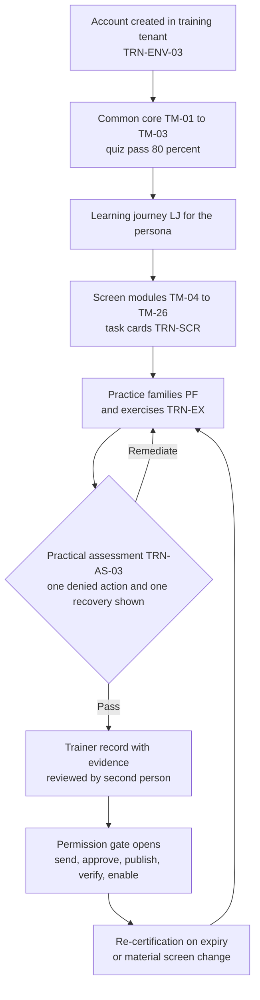
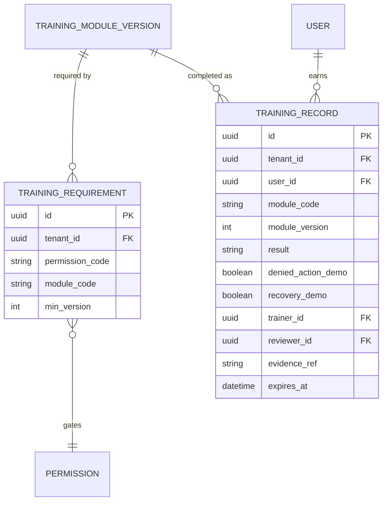

# AI Growth Engine: Employee Sales & Marketing Automation
## Application Blueprint: PART 8 (Batch 8.3b), Source Pack Enhancements I: Operational Training Manual by Persona and Screen

| Field | Value |
|---|---|
| Document | Application Blueprint, Part 8, Batch 8.3 (file b of 3), source-pack group J |
| Version | 1.0 · 27 Nov 2026 |
| Baseline | Part 8.2 §8.2.2 (personas, training plan, adoption metrics, communication), Part 2.3 (R01–R20, RBAC matrix §2.26.3), Part 2.5 (147 screens, §2.47 UI states, §2.49 microcopy), Part 4.3 (RB-001…015, support model §4.45), Part 6.1 (EVR, staging, GSE-SYN data), Part 6.6 (RTM, SM-UAT aliases), Part 8.3a (coverage register) |
| Source | Document 33 (all sections), document 35 ("operational knowledge and handover"), document 36 (UX-QC-10, OPT-15-01…04) |
| Roles applied | Training and Change Lead (lead), Lead UX/UI Designer, QA Lead, Product Owner, Security/Compliance Lead, DevOps/SRE Lead |

**Acronyms used in this file.** As in Part 8.3a, plus: GSE-SYN synthetic golden-set environment data (Part 6.1) · H hands-on lab · SP self-paced · W workshop · D drill · 1:1 individual walkthrough.

---

## 8.3.5 Enhancements (organized by blueprint part)

| Enhancement | Blueprint part it extends | Where |
|---|---|---|
| Operational training manual: journeys, modules, screen task cards, practice families, exercises, troubleshooting, assessment and permission gating, training evidence, delivery plan | Part 8.2 §8.2.2 (training), Part 2.5 (help and microcopy), Part 2.4 (configuration and notifications), Part 6 (UAT reuse) | This file, §8.3.5.1–8.3.5.12 |
| SaaS onboarding, service delivery, SLA and commercial operations | Part 1 (BR-SVC), Part 2.2 (WF-14), Part 4.3 §4.45, Part 5.3 (EP-20) | Part 8.3c §8.3.5.13 |
| Maintenance and continuous-improvement lifecycle | Part 4.3 §4.43–4.47, Part 8.2 §8.2.2.4 | Part 8.3c §8.3.5.14 |
| Optimization model: 20 dimensions + G0, 104 controls, 35 OKPIs, 24 scenarios, panel, evidence gate | Part 4.2 (NFR), Part 8.2 §8.2.6 (KPI tracking), Part 6 (tests), Part 9.3 (inventory) | Part 8.3c §8.3.5.15 |

---

### 8.3.5.1 Training architecture, environment rules and learning journeys (extends Part 8.2 §8.2.2.2)

**Principles (document 33 "Before using the application"; Part 8.2 §8.2.2.2).**

1. Training uses the **authorized training environment** and the trainee's **own assigned identity**; shared logins are never used.
2. The trainee **selects the correct tenant and startup before changing data**; every exercise begins with a scope check.
3. Only **synthetic fixtures** are used. In training nobody sends messages, publishes content, submits bids or offers, or processes funds. All provider adapters run against the provider simulator.
4. Training content describes **proposed screens** until the build exists; conceptual pictures are replaced by real screenshots before each wave's training (§8.3.5.9).
5. Each learning journey ends with the trainee **demonstrating one denied action and one error recovery**; the trainer records completion and any remediation (document 33, all six journeys).
6. Training never teaches a workaround to a permission, eligibility, budget or approval control. "If denied, do not change scope to bypass permissions; contact the assigned administrator. For an uncertain provider outcome, escalate before retry" (document 33, every screen).

**Training environment rules [ASSUMPTION-489].**

| Rule | Specification | Enforced by | Test |
|---|---|---|---|
| TRN-ENV-01 Training tenant | A dedicated tenant `trn-gse` in `staging` with four synthetic startups (AppNAI-SYN, MedMaarg-SYN, EduVerse-SYN, OrganicSpec-SYN) plus one external client tenant `trn-client` with two startups, so that the two-tenant rule (NFR-032) can be shown in class | FR-ENH-J-003 | TC-ENH-J-058 |
| TRN-ENV-02 Simulated adapters only | Every adapter (email, WhatsApp, calendar, e-sign, payment, search, ads, social, AI Tier 1/2) points to the provider simulator; live credentials are absent from the training tenant's secret scope | CFG-24 per tenant; CFG-31 flags | TC-ENH-J-058 (0 live calls) |
| TRN-ENV-03 Trainee accounts | One account per trainee per role, created by the tenant administrator with expiry ≤ 30 days; MFA enforced as in production | A002; BRL-TEN-07/08 | — |
| TRN-ENV-04 Reset | Each trainee sandbox (startup copy) is reset from a versioned fixture snapshot on demand and nightly | FR-ENH-J-003 | TC-ENH-J-058 |
| TRN-ENV-05 Clocks | Exercises that depend on deadlines (bid expiry, quotation validity, quiet hours, renewal) use the staging clock-control facility (Part 6.1) | Part 6.1 clock control | TRN-EX-02 |
| TRN-ENV-06 Visual marker | A persistent "TRAINING — synthetic data, no live effects" banner on both frontends in the training tenant | FR-ENH-J-002 | TC-ENH-J-060 |
| TRN-ENV-07 No personal data | Fixtures contain no real names, emails, phone numbers, payment data, patient data or minors' data; generated names use the `example` domain | Part 6.1 data rules; BRL-ELG-13/14 | Fixture linter |
| TRN-ENV-08 Evidence | Screenshots and outcomes are stored as training records, not as product test evidence; they never carry a production certification level (Part 6.1 §6.1.5.5) | FR-ENH-J-004 | TC-ENH-J-059 |

**Curriculum flow.**



**Learning journeys (source journeys LJ-01…LJ-06 extended to every blueprint persona).**

| LJ | Source journey (doc 33) | Persona / roles | Journey steps (source text kept; blueprint screens added) | Modules | Denied action to demonstrate | Error recovery to demonstrate | Exercises | Permissions gated on pass |
|---|---|---|---|---|---|---|---|---|
| LJ-01 | Marketing employee | P05 / R05, R05L | Select assigned startup → prepare approved content (A050, A051) → configure campaign, audience and budget (A058, A059) → publish only an approved snapshot (A056, A057, A107, A108) → measure enquiry attribution (A082, RP-08) | TM-01…03, TM-13, TM-14, TM-15, TM-16 | Approve own content version → denied (BRL-APR-01) | Campaign launch blocked because the reserved budget is exhausted → request a budget revision in A059, relaunch after approval (BRL-MKT-04/05) | TRN-EX-08, TRN-EX-09 | Publish content and pages; launch campaign (R05L approves) |
| LJ-02 | Sales employee | P03 / R03, R03L | Discover account and need (A018, A020) → verify contact (A025) → qualify lead (A027) → send eligible outreach (A034, A037) → follow up (A038) → handle objections (A069) → prepare proposal and handoff (A065, A067, A075) | TM-01…03, TM-10 (view), TM-11, TM-12, TM-13, TM-17, TM-21 | Send to a suppressed contact → blocked with eligibility "explain" (BRL-ELG-02/18) | Provider timeout after send → status UNKNOWN; do not resend; open reconciliation item (BRL-AUT-07, RB-003) | TRN-EX-01, TRN-EX-10 | Send approved messages; enrol sequences; discount ≤ 10% (R03L only) |
| LJ-03 | Bid/procurement specialist | P06 / R06; P07 / R07 | Use bid desk (A104) or buy/sell order desk (A105) → validate eligibility, deadline, price and approvals → record award or order and fulfilment | TM-01…03, TM-17, TM-18, TM-19 | Record a submission after the portal deadline → blocked (BRL-BID-01) | Duplicate fulfilment event → no effect; over-delivery rejected → correct quantity and re-record (BRL-ORD-02/03) | TRN-EX-02, TRN-EX-03, TRN-EX-04 | Record human bid submission; issue and complete orders |
| LJ-04 | External customer/supplier | P14 / R16 | Browse approved offerings (W04, W05) → submit enquiry or RFQ (W12–W16) → redeem invitation (W21) → review own quote, agreement, order and payment status (W22–W26) → preferences (W29) | TM-31 (self-paced, 6 minutes) | Open another customer's quote link → not found (BRL-TEN-04) | Expired invitation → request a new invitation from the account owner (W28) | TRN-EX-06 | None (portal grants are object-specific) |
| LJ-05 | Administrator | P11 / R12 | Configure startup template, domain, roles, source permissions, workflow, quotas and alerts (A099, A100, A002, A010, A033, A012) → preview → simulate → obtain approval → activate | TM-01…03, TM-04, TM-07, TM-08, TM-25 | Tenant administrator tries to approve a quote → denied (R12 is not a business approver, Part 2.3) | Domain verification fails (missing DNS record) → follow RB-010 guidance; status stays "Unverified"; no publication | TRN-EX-05, TRN-EX-11 | Manage users and grants; apply templates; approve support grants |
| LJ-06 | Support operator | P12 / R13 | Use only a client-approved temporary support grant (DEC-056) → inspect safe, redacted evidence (A009, A014) → escalate incident (Part 4.43) → revoke the grant after resolution | TM-01…03, TM-08, TM-27 | Open tenant content without an active grant → denied and audited (BRL-TEN-09) | Grant expires mid-investigation → request extension via the tenant admin; no alternative access path | TRN-EX-13 | Request support grants; resolve incidents (metadata) |
| LJ-07 | (added) | P01 / R01 Founder | Portfolio view (A089) → approvals above thresholds (DEC-038) → autonomy plan approval (A102) → emergency stop drill (A033) → release go/no-go (A090) → optimization scorecard review (Part 8.3c) | TM-01…03, TM-22, TM-28, TM-29 | Self-approve a loosening of an autonomy cap → denied (BRL-APR-11) | Emergency stop raised and resumed following RB-004 (resume needs second approver) | TRN-EX-14 | High-value approvals; release approval |
| LJ-08 | (added) | P02 / R02 Startup Head | Catalogue and claims (A004–A006) → readiness gate (A098) → approval queue (A066, A068, A072) → bid/no-bid (A104) → dashboards (A042) | TM-01…03, TM-05, TM-17, TM-18, TM-22 | Approve a quote whose hash changed after review → rejected (BRL-APR-02) | Re-review and approve the current revision | TRN-EX-01 | Price, discount, bid and proposal approvals |
| LJ-09 | (added) | P04 / R04 Research Analyst | Source register (A010) → research plan (A015) → results and evidence (A016, A017) → signals and needs (A019, A020) → labelling and precision (A084) → contact verification (A025) | TM-01…03, TM-09, TM-10, TM-26 | Run a plan against an unapproved source → blocked (BRL-SRC-01) | Stale evidence flagged → re-fetch within freshness rule or mark Unknown (BRL-SRC-06) | TRN-EX-16 | Approve research findings; verify contacts |
| LJ-10 | (added) | P08 / R08, R09 Finance | Invoices and payment evidence (A073) → maker-checker verification (A074) → closure policy → revenue settings (A083) | TM-01…03, TM-20 | Checker on an item they made → blocked (BRL-APR-07) | Wrong-currency payment → discrepancy queue, no allocation (BRL-FIN-03) | TRN-EX-15 | Maker and checker verification |
| LJ-11 | (added) | P09 / R10 Legal/Compliance/DPO | Consent and suppression (A007) → privacy queue and legal hold (A013) → compliance incidents (A047) → claims and contract approvals (A051, A072) | TM-01…03, TM-05, TM-06, TM-17 | Erase a principal under legal hold → restricted, not deleted (BRL-PRV-04) | Suppression breach alert → contain per RB-006 | TRN-EX-16 | Privacy decisions; legal approvals; e-sign requests |
| LJ-12 | (added) | P10 / R11 Automation Lead | Node library (A113) → workflow design and simulation (A033, A102) → triggers (A109) → live monitor (A110) → conflicts (A111) → configuration changes (A112) → emergency stop | TM-01…03, TM-07, TM-08, TM-24, TM-28 | Raise an autonomy cap above DEC-064 → denied (R11 cannot loosen caps) | UNKNOWN step in A110 → reconcile before retry (BRL-AUT-07) | TRN-EX-11, TRN-EX-14 | Enable workflows (with approver); stop |
| LJ-13 | (added) | P13 / R17 → R12 SaaS client administrator | Plans (W31) → application (W32) → wizard draft (W33) → after provisioning: own Admin (A099 own tenant, A100, A002) → service portal (W34) | TM-32, then TM-04 (own tenant) | Wizard attempts a live send → not available in draft (BRL-SVC-02) | Application returned for unverifiable authority → upload new evidence and resubmit | TRN-EX-11 | Own-tenant administration |
| LJ-14 | (added) | P12 / R14 Platform Billing | Plans and rate revisions (A101) → subscriptions → usage reconciliation → service invoices and credits | TM-01…03, TM-25 | Open business content of a tenant → denied (R14 has billing metadata only) | Duplicate usage event → not billed twice; adjustment needs reason (BRL-SVC-04/07) | TRN-EX-15 | Issue service invoices and credits |
| LJ-15 | (added) | R15 Auditor | Read-only tour of audit (A009), approvals, ledgers and release records | TM-01, TM-03, TM-08 (view) | Any mutation → denied | Export of Restricted data needs approval (BRL-PRV-07) | — | None |
| LJ-16 | (added) | P15 / R18 Anonymous visitor | No training; accessible pages, help centre (W30) and accessibility statement | — | — | — | — | — |

**Operator and viewer screens per internal role (computed from the Part 2.3 RBAC matrix; "operator" = any C, E, A, X or S permission).**

| Role | Name | Operator screens | Operator screen IDs | View-only screens | Modules required | Screen-lab time (12 min operate + 4 min view) |
|---|---|---|---|---|---|---|
| R01 | Founder | 64 | A004, A005, A006, A007, A008, A010, A011, A012, A014, A033, A036, A041, A042, A043, A044, A049, A050, A051, A052, A053, A056, A057, A058, A059, A060, A061, A065, A066, A067, A068, A069, A070, A071, A072, A082, A083, A084, A086, A087, A088, A089, A090, A091, A092, A093, A094, A095, A096, A097, A098, A099, A100, A101, A102, A103, A104, A105, A107, A108, A109, A110, A111, A112, A113 | 49 | TM-04, TM-05, TM-06, TM-07, TM-08, TM-14, TM-15, TM-16, TM-17, TM-18, TM-19, TM-20, TM-22, TM-23, TM-24, TM-25, TM-26 | 16.1 h |
| R02 | Startup Head | 77 | A004, A005, A006, A015, A016, A017, A018, A019, A020, A021, A022, A023, A024, A025, A026, A027, A028, A029, A030, A031, A032, A033, A034, A035, A037, A038, A039, A045, A046, A048, A050, A051, A052, A053, A056, A057, A058, A059, A060, A061, A062, A063, A064, A065, A066, A067, A068, A069, A070, A071, A072, A075, A076, A077, A078, A079, A080, A081, A085, A091, A092, A093, A094, A095, A096, A097, A098, A102, A103, A104, A105, A107, A108, A109, A110, A111, A113 | 34 | TM-05, TM-07, TM-09, TM-10, TM-11, TM-12, TM-13, TM-14, TM-15, TM-16, TM-17, TM-18, TM-19, TM-21, TM-23, TM-24, TM-25 | 17.7 h |
| R03 | Growth Manager | 30 | A029, A030, A031, A032, A034, A035, A037, A038, A039, A040, A045, A062, A063, A064, A065, A066, A067, A068, A069, A070, A071, A072, A075, A076, A077, A078, A079, A080, A081, A103 | 62 | TM-11, TM-12, TM-13, TM-16, TM-17, TM-21, TM-25 | 10.1 h |
| R04 | Research Analyst | 21 | A006, A010, A015, A016, A017, A018, A019, A020, A021, A022, A023, A024, A025, A026, A027, A028, A048, A049, A085, A086, A103 | 25 | TM-05, TM-07, TM-09, TM-10, TM-25 | 5.9 h |
| R05 | Marketing Specialist | 21 | A006, A038, A039, A050, A051, A052, A053, A054, A055, A056, A057, A058, A059, A060, A061, A062, A063, A064, A080, A107, A108 | 39 | TM-05, TM-07, TM-12, TM-13, TM-14, TM-15, TM-16, TM-21 | 6.8 h |
| R06 | Bid Manager | 29 | A006, A029, A030, A031, A032, A034, A035, A037, A038, A039, A040, A045, A063, A065, A066, A067, A068, A069, A070, A071, A072, A075, A076, A077, A078, A079, A080, A081, A104 | 39 | TM-05, TM-11, TM-12, TM-13, TM-17, TM-18, TM-21 | 8.4 h |
| R07 | Order Coordinator | 29 | A006, A029, A030, A031, A032, A034, A035, A037, A038, A039, A040, A045, A063, A065, A066, A067, A068, A069, A070, A071, A072, A075, A076, A077, A078, A079, A080, A081, A105 | 39 | TM-05, TM-11, TM-12, TM-13, TM-17, TM-19, TM-21 | 8.4 h |
| R08 | Finance Maker | 9 | A065, A066, A067, A068, A073, A074, A083, A088, A103 | 43 | TM-17, TM-20, TM-22, TM-25 | 4.7 h |
| R09 | Finance Checker | 4 | A073, A074, A083, A088 | 21 | TM-20, TM-22 | 2.2 h |
| R10 | Legal/DPO | 42 | A004, A005, A006, A007, A010, A013, A033, A038, A039, A046, A047, A049, A050, A051, A052, A053, A056, A057, A063, A069, A070, A071, A072, A080, A086, A091, A092, A093, A094, A095, A096, A097, A098, A102, A103, A104, A107, A108, A109, A110, A111, A113 | 55 | TM-05, TM-06, TM-07, TM-12, TM-13, TM-14, TM-15, TM-17, TM-18, TM-21, TM-23, TM-24, TM-25 | 12.1 h |
| R11 | Automation Lead | 22 | A008, A009, A011, A012, A014, A033, A036, A038, A039, A041, A044, A046, A053, A063, A080, A084, A090, A102, A109, A110, A111, A113 | 30 | TM-07, TM-08, TM-12, TM-13, TM-21, TM-24, TM-26 | 6.4 h |
| R12 | Tenant Admin | 16 | A001, A002, A003, A008, A036, A041, A044, A053, A056, A057, A099, A100, A103, A107, A108, A112 | 15 | TM-04, TM-07, TM-15, TM-24, TM-25 | 4.2 h |
| R13 | Platform Support | 2 | A014, A090 | 21 | TM-08 | 1.8 h |
| R14 | Platform Billing | 1 | A101 | 8 | TM-25 | 0.7 h |
| R15 | Auditor | 0 | — | 113 | — | 7.5 h |

---

### 8.3.5.2 Training module catalogue TM-01…TM-33 (extends Part 8.2 §8.2.2.2)

Cross-functional and core modules:

| Module | Title | Content | Format | Hours | Audience | Source |
|---|---|---|---|---|---|---|
| TM-01 | Common core 1: security and privacy | As Part 8.2 common core 1 | W + quiz | 1.0 | All internal | Part 8.2 |
| TM-02 | Common core 2: AI use policy | As Part 8.2 common core 2 | W | 0.5 | All internal | Part 8.2 |
| TM-03 | Common core 3: navigation, scope and safe recovery | Seven views, scope selector, saved views, notifications, global search, help; **UI states** (loading, empty, denied, stale, error, Unknown/Estimate/Uncertain, success) per Part 2.5 §2.47; standard operating procedure SOP-STD (§8.3.5.3); troubleshooting cards TS-01…TS-20 (§8.3.5.7) | SP + H (30 min lab) | 1.0 | All internal | Part 8.2 core 3 extended with doc 33 |
| TM-27 | Support operations with grants | DEC-056 grant lifecycle, redacted diagnostics, ticket hygiene, incident severity and comms (Part 4.43, 4.45), revoke on resolution | W + H + D | 3.0 | R13 | doc 33 LJ-06 |
| TM-28 | Emergency stop and incident drills | STOP scopes, propagation ≤ 60 s (NFR-049), resumption with second approver (RB-004), uncertain-outcome surge (RB-003) | D | 1.0 | R01, R02, R10, R11, R13 | Part 4.3 |
| TM-29 | Interpreting optimization and KPI figures | Measured vs proposed values; numerator/denominator; zero denominator = unassessed; how to simulate a workflow, pause optional jobs and escalate legal/financial exceptions (document 33 optimization section); reading the optimization scorecard (Part 8.3c) | W | 1.0 | R01, R02, R11, FinOps, Service Owner | doc 33, doc 36 |
| TM-30 | Train-the-trainer and evidence recording | Delivering labs, observing denied/recovery demonstrations, recording TrainingRecord evidence, second-person review, screenshot replacement | W + H | 2.0 | Trainers (QA lead, growth/compliance lead, power users) | doc 33 operating training |

Screen modules (generated from the screen inventory; 12 minutes of guided lab per screen is the planning basis [ASSUMPTION-481]):

| Module | Title | Screens | Primary operator roles | Epics | Screen-lab time (12 min/screen) | Linked stories |
|---|---|---|---|---|---|---|
| TM-04 | Workspace, identity and tenant administration | 6: A001, A002, A003, A099, A100, A106 | R12, R01 | EP-01, EP-17, EP-20 | 1 h 12 min | 14 stories (US-0101…US-2004) |
| TM-05 | Product truth, knowledge and launch readiness | 5: A004, A005, A006, A097, A098 | R01, R02, R10, R04, R05, R06 | EP-02 | 1 h 00 min | 7 stories (US-0201…US-0207) |
| TM-06 | Consent, privacy and compliance operations | 3: A007, A013, A047 | R10, R01 | EP-03 | 0 h 36 min | 6 stories (US-0301…US-0311) |
| TM-07 | Integrations, sources and AI configuration | 9: A008, A010, A011, A036, A041, A044, A049, A053, A086 | R01, R11, R12, R10, R04, R02 | EP-01, EP-05, EP-04, EP-08, EP-09, EP-10, EP-11 | 1 h 48 min | 16 stories (US-0112…US-1105) |
| TM-08 | Audit, cost, budget and platform health | 4: A009, A012, A014, A090 | R11, R01, R13 | EP-01, EP-04, EP-21 | 0 h 48 min | 6 stories (US-0111…US-2106) |
| TM-09 | Market discovery and research | 10: A015, A016, A017, A018, A019, A020, A021, A023, A048, A085 | R02, R04 | EP-05, EP-06 | 2 h 00 min | 14 stories (US-0406…US-0608) |
| TM-10 | Qualification and contact verification | 6: A022, A024, A025, A026, A027, A028 | R02, R04 | EP-06 | 1 h 12 min | 7 stories (US-0601…US-0608) |
| TM-11 | CRM pipeline and Customer 360 | 4: A029, A030, A031, A032 | R02, R03, R06, R07 | EP-07 | 0 h 48 min | 7 stories (US-0304…US-0709) |
| TM-12 | Outreach, inbox, sequences and omnichannel | 7: A034, A035, A037, A038, A039, A045, A046 | R02, R03, R06, R07, R10, R11 | EP-08, EP-10 | 1 h 24 min | 18 stories (US-0304…US-1006) |
| TM-13 | Meetings, webinars and events | 3: A040, A062, A063 | R03, R06, R07, R02, R05, R10 | EP-09 | 0 h 36 min | 4 stories (US-0902…US-0906) |
| TM-14 | Content, claims, SEO and social | 5: A050, A051, A052, A054, A055 | R05, R01, R02, R10 | EP-11 | 1 h 00 min | 8 stories (US-1101…US-1110) |
| TM-15 | Website, landing pages and publication | 4: A056, A057, A107, A108 | R01, R02, R05, R10, R12 | EP-12, EP-19 | 0 h 48 min | 9 stories (US-1201…US-1913) |
| TM-16 | Campaigns, advertising and referrals | 5: A058, A059, A060, A061, A064 | R02, R05, R01, R03 | EP-12 | 1 h 00 min | 6 stories (US-1204…US-1210) |
| TM-17 | Proposals, quotes, negotiation and contracts | 8: A065, A066, A067, A068, A069, A070, A071, A072 | R01, R02, R03, R06, R07, R08 | EP-13 | 1 h 36 min | 11 stories (US-1301…US-1313) |
| TM-18 | Bid and tender desk (AppNAI route) | 1: A104 | R01, R02, R06, R10 | EP-14 | 0 h 12 min | 5 stories (US-1401…US-1412) |
| TM-19 | Purchase, sales order and fulfilment desk (OrganicSpec route) | 1: A105 | R01, R02, R07 | EP-14 | 0 h 12 min | 5 stories (US-1303…US-1412) |
| TM-20 | Payments, closure, revenue and attribution | 4: A073, A074, A082, A083 | R08, R09, R01 | EP-15 | 0 h 48 min | 11 stories (US-1501…US-1710) |
| TM-21 | Onboarding, partners, renewal and lost deals | 7: A075, A076, A077, A078, A079, A080, A081 | R02, R03, R06, R07, R05, R10 | EP-16 | 1 h 24 min | 7 stories (US-1601…US-1612) |
| TM-22 | Dashboards, forecast and command centre | 5: A042, A043, A087, A088, A089 | R01, R08, R09 | EP-17 | 1 h 00 min | 6 stories (US-1702…US-1710) |
| TM-23 | Expansion pilots and licensing | 6: A091, A092, A093, A094, A095, A096 | R01, R02, R10 | EP-16 | 1 h 12 min | 4 stories (US-1608…US-1611) |
| TM-24 | Automation engineering and live operations | 7: A033, A102, A109, A110, A111, A112, A113 | R01, R02, R10, R11, R12 | EP-18, EP-20 | 1 h 24 min | 17 stories (US-0805…US-2010) |
| TM-25 | SaaS billing, import/export and portability | 2: A101, A103 | R01, R14, R02, R03, R04, R08 | EP-20 | 0 h 24 min | 7 stories (US-0208…US-2011) |
| TM-26 | AI quality and feedback review | 1: A084 | R01, R11 | EP-04 | 0 h 12 min | 2 stories (US-0402…US-0407) |
| TM-31 | Customer and supplier portal self-service | 15: W06, W14, W15, W16, W17, W18, W21, W22, W23, W24, W25, W26, W27, W28, W29 | R16, R17, R18 | EP-19, EP-14, EP-07, EP-09, EP-13, EP-15, EP-16, EP-03 | 3 h 00 min | 25 stories (US-0101…US-1912) |
| TM-32 | SaaS client onboarding and service portal | 4: W31, W32, W33, W34 | R17, R18, R16 | EP-20 | 0 h 48 min | 7 stories (US-1807…US-2011) |
| TM-33 | Public website and assistant (help content, verified by marketing) | 15: W01, W02, W03, W04, W05, W07, W08, W09, W10, W11, W12, W13, W19, W20, W30 | R18, R16, R17 | EP-19, EP-11, EP-12, EP-10, EP-07, EP-09, EP-03 | 3 h 00 min | 20 stories (US-0306…US-1912) |

---

### 8.3.5.3 Standard screen operating procedure (SOP-STD)

Document 33 gives the same operating pattern for every screen. It is formalized here so that every task card can refer to it and so that help articles stay consistent.

| Step | Procedure | Screen element (Part 2.5) | Rule |
|---|---|---|---|
| SOP-STD-01 Select permitted context | Confirm product, tenant, startup and (if shown) business line in the scope selector before reading or changing anything | Global shell scope selector §2.41 | NFR-027: switching scope cancels in-flight requests and clears selections |
| SOP-STD-02 Inspect record and validation | Read the record, its revision, status chip, provenance/evidence panel and any validation messages | Detail panel; status chips; evidence drawer | Unknown values stay "Unknown"; estimates are labelled (Part 2.5 §2.47) |
| SOP-STD-03 Check eligibility | Use the "Explain" or eligibility panel before acting (send, publish, approve, submit-record, verify) | Action bar; eligibility explain | The server rechecks at execution (BRL-ELG-18) |
| SOP-STD-04 Act only when eligible | Use only the enabled action; preview or simulate first when offered | Primary action; Preview / Simulate | Simulation has zero live effects (NFR-038) |
| SOP-STD-05 If denied | Do **not** change scope to bypass the denial; read the reason; contact the assigned administrator (A106 request) | Denied state with reason code | BRL-TEN-01/04; audit records the attempt |
| SOP-STD-06 If the provider outcome is uncertain | Do **not** retry; open the item in the reconciliation queue or escalate to support with the correlation ID | UNKNOWN status; correlation ID | BRL-AUT-07; RB-003 |
| SOP-STD-07 Review confirmation and resulting status | Confirm that the status changed as expected and that the action appears in the timeline/audit | Toast + timeline entry | No false success (doc 33 practice rows) |
| SOP-STD-08 Leave the screen safely | Save drafts; release holds (e.g. meeting slot holds, BRL-MTG-02); do not leave bulk selections active | Draft autosave; hold timers | — |

---

### 8.3.5.4 Screen task cards TRN-SCR-W01…TRN-SCR-A113 (147 cards) [GAP-482]

One card per screen. Columns: **Operators** are the roles holding C (create), E (edit), A (approve), X (execute) or S (settings) on that screen in Part 2.3 §2.26.3 (Website rows use the external-surface table); **Purpose** is the document 33 access/purpose line (or the FR text for the nine new screens); **Key actions** are the Part 2.5 actions the trainee must perform; **Practice families** point to the scripts in §8.3.5.5; **Denied / edge drill** is the negative case the trainee must show; **UAT aliases** are the SM-UAT-S and SM-UX-UAT IDs; **Blueprint TCs** are the first test-case ranges from the Part 6.6 RTM (count of further ranges in brackets). Every card is executed with SOP-STD-01…08.

#### Website: public (W01–W11, W30, W31)

| Card | Screen | Module | Operators (C/E/A/X/S) | Purpose (doc 33 / FR) | Key actions (Part 2.5) | Practice families | Denied / edge drill | UAT aliases | Blueprint TCs |
|---|---|---|---|---|---|---|---|---|---|
| TRN-SCR-W01 | W01 Business growth platform homepage | TM-33 | R18 visitor (R16/R17 view) | Approved business introductions, contact and enquiry paths. | Search businesses, Explore startup, Start as a client | PF-PUB Publication and public projection | Wrong tenant/domain → 404; unapproved version rejected | SM-UAT-S001; SM-UX-UAT-W01 | TC-19-039…045, TC-19-078…095, TC-NFR-041…043 (+4) |
| TRN-SCR-W02 | W02 Company and startup directory | TM-33 | R18 visitor (R16/R17 view) | Published businesses filtered by sector and geography. | Open startup site | PF-PUB Publication and public projection | Wrong tenant/domain → 404; unapproved version rejected | SM-UAT-S002; SM-UX-UAT-W02 | TC-19-039…045, TC-19-078…095 |
| TRN-SCR-W03 | W03 Individual startup website | TM-33 | R18 visitor (R16/R17 view) | Approved brand, capabilities, locations and contact. | Explore offerings, Contact, Book a meeting | PF-PUB Publication and public projection | Wrong tenant/domain → 404; unapproved version rejected | SM-UAT-S003; SM-UX-UAT-W03 | TC-19-001…008, TC-19-046…052, TC-19-078…095 (+1) |
| TRN-SCR-W04 | W04 Offering catalogue | TM-33 | R18 visitor (R16/R17 view) | Published offerings and facets by startup and business line. | View details, Request quote/demo | PF-PUB Publication and public projection | Wrong tenant/domain → 404; unapproved version rejected | SM-UAT-S004; SM-UX-UAT-W04 | TC-19-046…052, TC-19-078…095 |
| TRN-SCR-W05 | W05 Offering details | TM-33 | R18 visitor (R16/R17 view) | Approved specifications, delivery model and availability claims. | Enquire, Request quote, Book demo | PF-PUB Publication and public projection | Wrong tenant/domain → 404; unapproved version rejected | SM-UAT-S005; SM-UX-UAT-W05 | TC-19-046…052, TC-19-078…095, TC-NFR-042 |
| TRN-SCR-W06 | W06 Approved pricing and packages | TM-31 | R18 visitor (R16/R17 view) | Publish approved price only; private negotiated pricing requires identity. | Request quote, Log in | PF-ORD Buy/sell orders and fulfilment | Unapproved discount → rejected | SM-UAT-S006; SM-UX-UAT-W06 | TC-19-053…058, TC-19-078…095 |
| TRN-SCR-W07 | W07 Industry and solution pages | TM-33 | R18 visitor (R16/R17 view) | Approved need-to-solution explanations and enquiry calls to action. | Enquire | PF-PUB Publication and public projection | Wrong tenant/domain → 404; unapproved version rejected | SM-UAT-S007; SM-UX-UAT-W07 | TC-19-059…062, TC-19-078…095 |
| TRN-SCR-W08 | W08 Blog and knowledge centre | TM-33 | R18 visitor (R16/R17 view) | Published content and search; no internal research evidence. | Read, Share, Enquire | PF-PUB Publication and public projection | Wrong tenant/domain → 404; unapproved version rejected | SM-UAT-S008; SM-UX-UAT-W08 | TC-11-019…028, TC-11-066…075 |
| TRN-SCR-W09 | W09 Case studies and testimonials | TM-33 | R18 visitor (R16/R17 view) | Only approved and consented claims/media. | Enquire | PF-PUB Publication and public projection | Wrong tenant/domain → 404; unapproved version rejected | SM-UAT-S009; SM-UX-UAT-W09 | TC-11-019…028, TC-11-066…075 |
| TRN-SCR-W10 | W10 Campaign landing pages | TM-33 | R18 visitor (R16/R17 view) | Published content, approved forms and attribution. | Submit enquiry | PF-CMP Campaign audience, budget and attribution | Exhausted spend → pause; unapproved publish denied | SM-UAT-S010; SM-UX-UAT-W10 | TC-12-015…022, TC-12-082, TC-NFR-043 |
| TRN-SCR-W11 | W11 AI website chat assistant | TM-33 | R18 visitor (R16/R17 view) | Public approved FAQ retrieval, rate limits, lead capture with permission. | Ask, Request human, Share details | PF-CNS Consent revocation while queued | Revoked purpose → no send | SM-UAT-S011; SM-UX-UAT-W11 | TC-10-029…044, TC-10-052…059, TC-AI-AG017-001 (+7) |
| TRN-SCR-W30 | W30 Contact, privacy, terms, help centre | TM-33 | R18 visitor (R16/R17 view) | Published contact/legal pages and scoped privacy/support intake. | Submit privacy/support request | PF-REN Renewal and retention eligibility | Cancelled contract → no reminder | SM-UAT-S030; SM-UX-UAT-W30 | TC-01-129, TC-03-059…063, TC-03-088…094 (+1) |
| TRN-SCR-W31 | W31 SaaS introduction, plans and demo | TM-32 | R18, R16, R17 view | SaaS service entry separate from the customer journey; approved service terms only; no fundraising offers or implied outcomes (FR-W31) | Book demo, Start application | Read approved plans and terms; open demo request; confirm no private offers or implied outcomes | Unapproved plan price never shown ('Price on request') | SM-UX-UAT-W31 | TC-20-001…006 |

#### Website: intake forms (W12–W20, W32)

| Card | Screen | Module | Operators (C/E/A/X/S) | Purpose (doc 33 / FR) | Key actions (Part 2.5) | Practice families | Denied / edge drill | UAT aliases | Blueprint TCs |
|---|---|---|---|---|---|---|---|---|---|
| TRN-SCR-W12 | W12 General business enquiry | TM-33 | R18 / R16 / R17 submit | Validate contact and requirement; enqueue scoped lead. | Submit | PF-PUB Publication and public projection | Wrong tenant/domain → 404; unapproved version rejected | SM-UAT-S012; SM-UX-UAT-W12 | TC-01-133, TC-07-023…031, TC-07-065…075 (+2) |
| TRN-SCR-W13 | W13 Demo and partnership enquiry | TM-33 | R18 / R16 / R17 submit | Capture demo and partnership interest with consent. | Submit, Choose a slot | PF-PUB Publication and public projection | Wrong tenant/domain → 404; unapproved version rejected | SM-UAT-S013; SM-UX-UAT-W13 | TC-01-133, TC-07-032…037, TC-07-070…075 (+1) |
| TRN-SCR-W14 | W14 Request for quotation | TM-31 | R18 / R16 / R17 submit | Submit line items, quantity, unit, delivery region and requirements; no automatic quote approval. | Add line, Submit | PF-ORD Buy/sell orders and fulfilment | Unapproved discount → rejected | SM-UAT-S014; SM-UX-UAT-W14 | TC-14-047…052, TC-14-100 |
| TRN-SCR-W15 | W15 Project requirement submission | TM-31 | R18 / R16 / R17 submit | AppNAI project intake; file uploads only after scoped authentication and scan. | Next, Sign in to upload, Submit | PF-BID Bid deadline and submission evidence | Unauthorized submission → denied | SM-UAT-S015; SM-UX-UAT-W15 | TC-14-040…046, TC-NFR-021 |
| TRN-SCR-W16 | W16 Supplier registration | TM-31 | R18 / R16 / R17 submit | OrganicSpec supplier requirements, categories, units and verification initiation. | Submit | PF-ORD Buy/sell orders and fulfilment | Unapproved discount → rejected | SM-UAT-S016; SM-UX-UAT-W16 | TC-14-053…057 |
| TRN-SCR-W17 | W17 Student training and institutional enquiry | TM-31 | R18 / R16 / R17 submit | EduVerse programme, age/grade, institution and cohort; guardian/authorized contact where required. | Submit | PF-EDU EduVerse safeguarding and routing | Child data in discovery → blocked | SM-UAT-S017; SM-UX-UAT-W17 | TC-01-133, TC-07-026, TC-07-038…045 (+2) |
| TRN-SCR-W18 | W18 Meeting and appointment booking | TM-31 | R18 / R16 / R17 submit | Public request or token-bound booking; no private calendar exposure. | Select slot, Confirm | PF-CNS Consent revocation while queued | Revoked purpose → no send | SM-UAT-S018; SM-UX-UAT-W18 | TC-09-017…023, TC-09-045, TC-20-004 |
| TRN-SCR-W19 | W19 Webinar and event registration | TM-33 | R18 visitor (R16/R17 view) | Approved event information and eligible registration. | Register | PF-CMP Campaign audience, budget and attribution | Exhausted spend → pause; unapproved publish denied | SM-UAT-S019; SM-UX-UAT-W19 | TC-09-036…044, TC-09-046 |
| TRN-SCR-W20 | W20 Partner referral form | TM-33 | R18 visitor (R16/R17 view) | Authorized referral submission with source and consent. | Submit | PF-CMP Campaign audience, budget and attribution | Exhausted spend → pause; unapproved publish denied | SM-UAT-S020; SM-UX-UAT-W20 | TC-12-062…067 |
| TRN-SCR-W32 | W32 Startup and third-party client registration | TM-32 | R17 (own draft) | Independent client application; prove administrator authority; no provisioning before verified identity and approval; isolated expiring draft (FRD §16.3) (FR-W32) | Next, Verify email, Submit application | Register synthetic client 'Alpha Retail' with administrator proof; observe 'pending verification' | Provisioning attempt before verification → blocked (BRL-SVC-01) | SM-UX-UAT-W32 | TC-20-007…016 |

#### Portal (W21–W29, W33, W34)

| Card | Screen | Module | Operators (C/E/A/X/S) | Purpose (doc 33 / FR) | Key actions (Part 2.5) | Practice families | Denied / edge drill | UAT aliases | Blueprint TCs |
|---|---|---|---|---|---|---|---|---|---|
| TRN-SCR-W21 | W21 Registration, login, recovery | TM-31 | R16, R17 (self) | Reuse existing identity; separate external audience and recovery. | Sign in, Register, Recover | PF-CMP Campaign audience, budget and attribution; PF-AUTH External authentication | Exhausted spend → pause; unapproved publish denied; Staff route → 403 | SM-UAT-S021; SM-UX-UAT-W21 | TC-01-001…013, TC-19-063…071, TC-19-078…095 (+2) |
| TRN-SCR-W22 | W22 Customer dashboard | TM-31 | R16 (own records via grants) | Own commercial requests, orders and permitted documents only. | Open item | PF-ORD Buy/sell orders and fulfilment | Unapproved discount → rejected | SM-UAT-S022; SM-UX-UAT-W22 | TC-19-072…095, TC-BRS-003, TC-NFR-053 |
| TRN-SCR-W23 | W23 Proposal and quotation review | TM-31 | R16 (own records via grants) | Read approved recipient-specific proposal or quotation; accept or request changes without modifying terms. | Accept, Request changes (comment), Download PDF | PF-ORD Buy/sell orders and fulfilment | Unapproved discount → rejected | SM-UAT-S023; SM-UX-UAT-W23 | TC-13-056…063, TC-13-111…112, TC-13-127 (+1) |
| TRN-SCR-W24 | W24 Agreement review and e-signature | TM-31 | R16 (own records via grants) | Identity-bound signing; token is not authorization by itself. | Sign (via provider or signed upload), Decline | PF-APR Hash-bound approval | Rejected action does not bind company | SM-UAT-S024; SM-UX-UAT-W24 | TC-13-086…101, TC-13-128 |
| TRN-SCR-W25 | W25 Order, project and service status | TM-31 | R16 (own records via grants) | Own orders, milestones, delivery and status. | Accept delivery, Raise discrepancy | PF-ORD Buy/sell orders and fulfilment | Unapproved discount → rejected | SM-UAT-S025; SM-UX-UAT-W25 | TC-14-080…085, TC-14-100, TC-FLT-024 |
| TRN-SCR-W26 | W26 Payment and invoice status | TM-31 | R16 (own records via grants) | Own invoices, verified payment instructions and payment status. | Download invoice, View instructions, Upload payment proof | PF-FIN Payment evidence and reconciliation | Wrong issuer/account → discrepancy, not allocation | SM-UAT-S026; SM-UX-UAT-W26 | TC-15-027…028, TC-15-030…031, TC-15-034 (+4) |
| TRN-SCR-W27 | W27 Onboarding and document exchange | TM-31 | R16 (own records via grants) | Own onboarding tasks, requested files, scan and status. | Upload, Mark task done | PF-DOC Document grants and quarantine | Quarantined file never served | SM-UAT-S027; SM-UX-UAT-W27 | TC-16-016…022, TC-16-064…070, TC-16-077 (+1) |
| TRN-SCR-W28 | W28 Support, feedback and renewal requests | TM-31 | R16 (own records via grants) | Own support request, feedback and renewal interest; no automatic contract alteration. | Create case, Reply | PF-REN Renewal and retention eligibility | Cancelled contract → no reminder | SM-UAT-S028; SM-UX-UAT-W28 | TC-16-023…028, TC-16-064…070, TC-16-077 (+1) |
| TRN-SCR-W29 | W29 Communication preferences and opt-out | TM-31 | R16/R17 own; R18 signed token | Signed opt-out token or own authenticated preferences; no contact lookup. | Save, Unsubscribe from all | PF-EDU EduVerse safeguarding and routing | Child data in discovery → blocked | SM-UAT-S029; SM-UX-UAT-W29 | TC-01-129, TC-03-051…058, TC-03-088…094 (+1) |
| TRN-SCR-W33 | W33 AI business onboarding wizard | TM-32 | R17 (own draft) | Configure business without core code; AI proposals unverified; no dispatch or spend during onboarding; activation only when authorized (FR-W33) | Generate proposal, Accept/edit item, Simulate, Submit | Complete wizard draft; review AI proposals marked Unverified; run dry-run cost report (0 live calls) | Applicant tries to mutate active startup → denied (BRL-SVC-02) | SM-UX-UAT-W33 | TC-18-051…058, TC-20-017…024, TC-20-099…105 (+1) |
| TRN-SCR-W34 | W34 SaaS client service portal | TM-32 | R17 (own tenant) | Subscription and service lifecycle; client-only scoped billing; no cross-tenant records (FR-W34) | Request plan change, Request export, Open Admin | Open own service overview; request support, plan change and export; view invoices | Other tenant invoice ID → 404 | SM-UX-UAT-W34 | TC-20-040, TC-20-051…057, TC-20-068…075 (+1) |

#### Admin: global and identity (A001–A003, A106)

| Card | Screen | Module | Operators (C/E/A/X/S) | Purpose (doc 33 / FR) | Key actions (Part 2.5) | Practice families | Denied / edge drill | UAT aliases | Blueprint TCs |
|---|---|---|---|---|---|---|---|---|---|
| TRN-SCR-A001 | A001 Login, MFA, recovery | TM-04 | R12 | Reuse authentication; current user and permitted navigation; session revocation (FR-A001; doc 33 line generic) | Sign in, Verify | PF-TEN Tenant and membership isolation; PF-REV Mid-session revocation and revisions | Wrong product/tenant/startup → 403; Stale revision → 409 | SM-UAT-S031; SM-UX-UAT-A001 | TC-01-001…013, TC-01-025…038, TC-01-098…103 (+6) |
| TRN-SCR-A003 | A003 Workspace navigation shell | TM-04 | R12 | Scope selector (tenant → startup → business line → offering/objective), seven views, saved views (FR-A003; doc 33 line generic) | Change scope, STOP (role-gated) | PF-FLT Typed filters, cursor and export | Scope change clears cache | SM-UAT-S033; SM-UX-UAT-A003 | TC-17-001…018, TC-17-067…073, TC-18-041…050 (+8) |
| TRN-SCR-A106 | A106 Action and notification centre | TM-04 | — | List own notifications; mark read/archive (FR-A106; doc 33 line generic) | Open, Acknowledge, Snooze (not Critical), Archive | PF-DSP Automation dispatch and exactly-once | Stop after planning, before dispatch → no external call | SM-UAT-S136; SM-UX-UAT-A106 | TC-15-092…097, TC-17-019…028, TC-17-067…073 |

#### Admin: Automation (workflow, governance, administration, operations)

| Card | Screen | Module | Operators (C/E/A/X/S) | Purpose (doc 33 / FR) | Key actions (Part 2.5) | Practice families | Denied / edge drill | UAT aliases | Blueprint TCs |
|---|---|---|---|---|---|---|---|---|---|
| TRN-SCR-A002 | A002 User and role administration | TM-04 | R12 | Invite, assign role/team/startup grants, revoke, MFA requirement, membership expiry (FR-A002; doc 33 line generic) | Invite, Change grants, Revoke | PF-TEN Tenant and membership isolation; PF-REV Mid-session revocation and revisions | Wrong product/tenant/startup → 403; Stale revision → 409 | SM-UAT-S032; SM-UX-UAT-A002 | TC-01-033…045, TC-01-098…103, TC-01-123 (+2) |
| TRN-SCR-A004 | A004 Product and capability editor | TM-05 | R01, R02, R10 | List catalogue and readiness; product detail; create product, draft capabilities; version changes; approval (FR-A004; doc 33 line generic) | Save, Submit | PF-VAL Input validation and unauthorized object | No false success message | SM-UAT-S034; SM-UX-UAT-A004 | TC-01-128, TC-02-001…018, TC-02-035…040 |
| TRN-SCR-A005 | A005 Product knowledge catalogue | TM-05 | R01, R02, R10 | List approved catalogue and readiness; search approved knowledge only (FR-A005; doc 33 line generic) | Search approved knowledge | PF-RAG Grounded AI and untrusted content | Injected instruction ignored; 0 tool misuse | SM-UAT-S035; SM-UX-UAT-A005 | TC-01-114, TC-01-128, TC-02-004 (+1) |
| TRN-SCR-A006 | A006 Knowledge documents and approval | TM-05 | R01, R02, R04, R05, R06, R07, R10 | Validate upload and enqueue indexing; list documents and ingestion state; approve/reject version; search approved knowledge (FR-A006; doc 33 line generic) | Upload, Approve, Reject | PF-DOC Document grants and quarantine | Quarantined file never served | SM-UAT-S036; SM-UX-UAT-A006 | TC-01-114, TC-01-128, TC-02-019…034 (+2) |
| TRN-SCR-A007 | A007 Consent and communication policies | TM-06 | R01, R10 | Record consent evidence; list policy versions and suppression; publish approved policy version; read scoped suppression (FR-A007; doc 33 line generic) | Submit, Search suppression | PF-PUB Publication and public projection | Wrong tenant/domain → 404; unapproved version rejected | SM-UAT-S037; SM-UX-UAT-A007 | TC-01-129, TC-03-001…014, TC-03-018 (+2) |
| TRN-SCR-A008 | A008 Integration connections | TM-07 | R01, R11, R12 | List safe connector metadata; configure via secret reference; test; disable (FR-A008; doc 33 line generic) | Connect, Test, Disable | PF-BUD Entitlement and budget reservation | Over quota → block (BRL-SVC-03) | SM-UAT-S038; SM-UX-UAT-A008 | TC-01-081…087, TC-01-127, TC-NFR-004 |
| TRN-SCR-A009 | A009 Audit and job activity | TM-08 | R11 | Read redacted audit/event state; list job status; idempotent retry (FR-A009; doc 33 line generic) | Filter, Export, Retry job | PF-DSP Automation dispatch and exactly-once | Stop after planning, before dispatch → no external call | SM-UAT-S039; SM-UX-UAT-A009 | TC-01-012, TC-01-073…080, TC-01-127 (+5) |
| TRN-SCR-A010 | A010 Source permissions and registry | TM-07 | R01, R04, R10 | List eligible sources; register and approve scope; revise/expire approval (FR-A010; doc 33 line generic) | Register, Approve, Expire | PF-EVD Research evidence and provenance | Restricted source fetch → blocked and logged | SM-UAT-S040; SM-UX-UAT-A010 | TC-01-131, TC-05-001…013, TC-NFR-028 |
| TRN-SCR-A011 | A011 AI configuration and evaluation | TM-07 | R01, R11 | Inspect redacted runs; version prompts and fixtures; model adapter with structured output and bounded token budget (FR-A011; doc 33 line generic) | Edit, Run eval, Submit | PF-FIN Payment evidence and reconciliation | Wrong issuer/account → discrepancy, not allocation | SM-UAT-S041; SM-UX-UAT-A011 | TC-01-130, TC-04-009…022, TC-04-032…037 (+3) |
| TRN-SCR-A012 | A012 API cost and budget dashboard | TM-08 | R01, R11 | Read actual and reserved cost; set daily/monthly caps; emergency pause of controlled spend (FR-A012; doc 33 line generic) | Set caps, Emergency pause | PF-FLT Typed filters, cursor and export | Scope change clears cache | SM-UAT-S042; SM-UX-UAT-A012 | TC-01-121, TC-01-130, TC-04-023…031 (+5) |
| TRN-SCR-A013 | A013 Privacy request queue | TM-06 | R10 | Submit scoped request; list verified requests and deadlines; resolve after identity verification; versioned retention (FR-A013; doc 33 line generic) | Verify, Fulfil, Restrict | PF-REN Renewal and retention eligibility | Cancelled contract → no reminder | SM-UAT-S043; SM-UX-UAT-A013 | TC-01-129, TC-03-064…077, TC-NFR-036 (+2) |
| TRN-SCR-A014 | A014 System health and incidents | TM-08 | R01, R11, R13 | Job status; operational health and failures; acknowledge/resolve incident (FR-A014; doc 33 line generic) | Acknowledge, Resolve | PF-DSP Automation dispatch and exactly-once | Stop after planning, before dispatch → no external call | SM-UAT-S044; SM-UX-UAT-A014 | TC-21-027…034, TC-21-103, TC-NFR-056…057 (+2) |
| TRN-SCR-A033 | A033 Workflow control centre | TM-24 | R01, R02, R10, R11 | Emergency pause; list workflows and executions; version definitions; pause executions and pending actions (FR-A033; doc 33 line generic) | Create, Simulate, Submit, Enable, Pause, STOP | PF-DSP Automation dispatch and exactly-once | Stop after planning, before dispatch → no external call | SM-UAT-S063; SM-UX-UAT-A033 | TC-18-001…016, TC-18-024…058, TC-18-085 (+10) |
| TRN-SCR-A047 | A047 Compliance incident dashboard | TM-06 | R10 | Read incidents; resolve after review (FR-A047; doc 33 line generic) | Contain, Resolve | PF-FLT Typed filters, cursor and export | Scope change clears cache | SM-UAT-S077; SM-UX-UAT-A047 | TC-01-129, TC-03-078…087, TC-03-095…099 (+1) |
| TRN-SCR-A084 | A084 AI quality and feedback review | TM-26 | R01, R11 | Capture correction; feedback history; queue evaluation; results (FR-A084; doc 33 line generic) | Queue eval, Accept feedback | PF-FIN Payment evidence and reconciliation | Wrong issuer/account → discrepancy, not allocation | SM-UAT-S114; SM-UX-UAT-A084 | TC-01-130, TC-04-009…014, TC-04-045…051 (+1) |
| TRN-SCR-A090 | A090 Production release readiness | TM-08 | R01, R11, R13 | Release readiness; approve only after gates (FR-A090; doc 33 line generic) | Approve release | PF-FLT Typed filters, cursor and export | Scope change clears cache | SM-UAT-S120; SM-UX-UAT-A090 | TC-21-044…053, TC-21-100…101, TC-21-103 (+4) |
| TRN-SCR-A099 | A099 Tenant, startup and membership admin | TM-04 | R01, R12 | List authorized tenants; provision tenant; activate/suspend/offboard; list and provision startups (FR-A099; doc 33 line generic) | Provision, Suspend, Offboard | PF-TEN Tenant and membership isolation; PF-REV Mid-session revocation and revisions | Wrong product/tenant/startup → 403; Stale revision → 409 | SM-UAT-S129; SM-UX-UAT-A099 | TC-01-054…066, TC-01-127, TC-BRS-008 (+1) |
| TRN-SCR-A100 | A100 Business profile templates and branding | TM-04 | R01, R12 | List templates; create draft; validate, approve, apply, retire; domain status; request verified brand domain (FR-A100; doc 33 line generic) | Create, Validate, Submit, Apply | PF-PUB Publication and public projection | Wrong tenant/domain → 404; unapproved version rejected | SM-UAT-S130; SM-UX-UAT-A100 | TC-20-025…031 |
| TRN-SCR-A101 | A101 Service subscriptions, usage and billing | TM-25 | R01, R14 | List plans; approve rate revision; list subscriptions; start/change/suspend/cancel; list service invoices (FR-A101; doc 33 line generic) | Change plan, Suspend, Approve rate revision | PF-FIN Payment evidence and reconciliation | Wrong issuer/account → discrepancy, not allocation | SM-UAT-S131; SM-UX-UAT-A101 | TC-20-032…050, TC-20-084…088, TC-BRS-008 (+2) |
| TRN-SCR-A102 | A102 Autonomous commercial planner | TM-24 | R01, R02, R10, R11 | List plans; generate or dry-run; approve/start/pause/stop (FR-A102; doc 33 line generic) | Generate, Simulate, Submit, Start, Pause, Stop | PF-DSP Automation dispatch and exactly-once | Stop after planning, before dispatch → no external call | SM-UAT-S132; SM-UX-UAT-A102 | TC-18-031…040, TC-18-051…058, TC-18-093…125 (+3) |
| TRN-SCR-A103 | A103 Import, export and client portability | TM-25 | R01, R02, R03, R04, R08, R10, R12 | List jobs; create intent; validate artefact; approve/cancel/expire; export link (FR-A103; doc 33 line generic) | Validate, Submit, Download | PF-DSP Automation dispatch and exactly-once | Stop after planning, before dispatch → no external call | SM-UAT-S133; SM-UX-UAT-A103 | TC-01-115, TC-02-051…057, TC-07-056…064 (+6) |
| TRN-SCR-A109 | A109 Event & Trigger Management Centre | TM-24 | R01, R02, R10, R11 | Define events, timers, webhooks independently of workflow design; test synthetic event; sandbox replay; enable/pause (FR-A109) | Create, Test, Sandbox replay, Enable, Pause | Create trigger revision; verify webhook signature test; approve and enable; disable | Invalid signature → rejected; replay → single event | SM-UX-UAT-A109 | TC-08-045…055, TC-08-189, TC-10-003 (+3) |
| TRN-SCR-A110 | A110 Live Automation Execution Monitor | TM-24 | R01, R02, R10, R11 | Inspect concurrent runs and step history; pause/resume (revalidate policy); request retry only after reconciliation; cancel; export evidence (FR-A110) | Pause, Resume, Request retry, Cancel, Export evidence | Inspect 20 concurrent simulated runs; pause one; resume (policy revalidated); open UNKNOWN step | Retry of UNKNOWN before reconciliation → blocked (BRL-AUT-07) | SM-UX-UAT-A110 | TC-18-001…006, TC-18-040…050, TC-18-069…085 (+5) |
| TRN-SCR-A111 | A111 Automation Coordination & Conflict Resolution | TM-24 | R01, R02, R10, R11 | Resolve conflicting actions across workflows on the same relationship; hold, merge, choose, escalate (FR-A111) | Hold, Merge, Choose, Escalate | Two workflows target one relationship; hold competing action; resolve with reason | Unrelated tenant conflict never visible | SM-UX-UAT-A111 | TC-18-085…092, TC-18-126…131 |
| TRN-SCR-A112 | A112 Business Configuration Change Centre | TM-24 | R01, R12 | Govern post-onboarding changes: compare, simulate, approve, publish, revert future config (FR-A112) | Validate, Simulate, Submit, Schedule, Roll back | Propose configuration revision 2; simulate; approve; activate; roll back | Running runs keep pinned revision (BRL-AUT-03); authorization expansion needs review | SM-UX-UAT-A112 | TC-18-051…058, TC-20-076…083 |
| TRN-SCR-A113 | A113 Automation Template & Node Library | TM-24 | R01, R02, R10, R11 | Govern reusable templates and node schemas: search, clone, configure, test, approve, publish, deprecate (FR-A113) | Clone, Configure, Test, Submit, Deprecate | Clone template; edit node parameters; test with fixtures; submit for approval; publish; deprecate | Code node or secret value in parameters → rejected (BRL-AUT-02) | SM-UX-UAT-A113 | TC-18-007…023, TC-AI-AG016-001 |

#### Admin: Discovery (A015–A028, A048, A049, A085, A086)

| Card | Screen | Module | Operators (C/E/A/X/S) | Purpose (doc 33 / FR) | Key actions (Part 2.5) | Practice families | Denied / edge drill | UAT aliases | Blueprint TCs |
|---|---|---|---|---|---|---|---|---|---|
| TRN-SCR-A015 | A015 Research planner | TM-09 | R02, R04 | List sources and plans; create scoped plan; enqueue run; update schedule and approved query scope; no personal-health targeting (FR-A015; doc 33 line generic) | New plan, Run now, Pause | PF-EVD Research evidence and provenance | Restricted source fetch → blocked and logged | SM-UAT-S045; SM-UX-UAT-A015 | TC-01-131, TC-05-014…020, TC-05-081…086 (+3) |
| TRN-SCR-A016 | A016 Market discovery results | TM-09 | R02, R04 | List permitted discovered records; research progress; single authorized search API; cache and source checks (FR-A016; doc 33 line generic) | Open evidence, Send to review, Dismiss | PF-EVD Research evidence and provenance | Restricted source fetch → blocked and logged | SM-UAT-S046; SM-UX-UAT-A016 | TC-01-131, TC-05-004, TC-05-006…007 (+3) |
| TRN-SCR-A017 | A017 Evidence detail panel | TM-09 | R02, R04 | Inspect provenance and excerpt; filter evidence; redacted run records (FR-A017; doc 33 line generic) | Mark irrelevant, Refresh | PF-EVD Research evidence and provenance | Restricted source fetch → blocked and logged | SM-UAT-S047; SM-UX-UAT-A017 | TC-01-131, TC-04-038…044, TC-05-006…007 (+3) |
| TRN-SCR-A019 | A019 Buying signals board | TM-09 | R02, R04 | Read signals; review observed signal (FR-A019; doc 33 line generic) | Confirm, Reject (reason), Override priority (reason) | PF-EVD Research evidence and provenance | Restricted source fetch → blocked and logged | SM-UAT-S049; SM-UX-UAT-A019 | TC-01-131, TC-05-044…052, TC-06-051…056 (+2) |
| TRN-SCR-A020 | A020 Business need review | TM-09 | R02, R04 | List needs and verification state; confirm/reject need with evidence (FR-A020; doc 33 line generic) | Confirm, Reject | PF-EVD Research evidence and provenance | Restricted source fetch → blocked and logged | SM-UAT-S050; SM-UX-UAT-A020 | TC-01-131, TC-05-053…057, TC-AI-AG006-002 |
| TRN-SCR-A021 | A021 Product solution matching | TM-09 | R02, R04 | Read matches with limitations; recompute readiness-gated matching (FR-A021; doc 33 line generic) | Recompute | PF-EVD Research evidence and provenance | Restricted source fetch → blocked and logged | SM-UAT-S051; SM-UX-UAT-A021 | TC-01-131, TC-05-058…062, TC-AI-AG007-004 |
| TRN-SCR-A022 | A022 Opportunity shortlist and scoring | TM-10 | R02, R04 | Read prioritized opportunities; recalculate score (FR-A022; doc 33 line generic) | Recalculate, Open | PF-EVD Research evidence and provenance | Restricted source fetch → blocked and logged | SM-UAT-S052; SM-UX-UAT-A022 | TC-01-132, TC-06-001…012, TC-06-051…056 (+3) |
| TRN-SCR-A023 | A023 Research rules and scoring settings | TM-09 | R02, R04 | Plans, schedule, scope, progress, evidence filters, scoring versions, simulation before activation (FR-A023; doc 33 line generic) | Simulate, Submit | PF-EVD Research evidence and provenance | Restricted source fetch → blocked and logged | SM-UAT-S053; SM-UX-UAT-A023 | TC-01-132, TC-06-013…017 |
| TRN-SCR-A024 | A024 Decision-maker and contact discovery | TM-10 | R02, R04 | List professional contacts and sources; queue permitted discovery; optional licensed API pilot (off by default) (FR-A024; doc 33 line generic) | Queue discovery, Open | PF-MED MedMaarg non-clinical boundary | Unapproved healthcare outcome claim → cannot approve | SM-UAT-S054; SM-UX-UAT-A024 | TC-01-132, TC-06-018…024, TC-AI-AG008-002 |
| TRN-SCR-A025 | A025 Contact verification queue | TM-10 | R02, R04 | List verification work; verify provenance and channel; correct contact record (FR-A025; doc 33 line generic) | Verify, Correct, Mark failed | PF-MED MedMaarg non-clinical boundary | Unapproved healthcare outcome claim → cannot approve | SM-UAT-S055; SM-UX-UAT-A025 | TC-01-132, TC-06-025…030, TC-06-051…056 |
| TRN-SCR-A026 | A026 Contact quality and role mapping | TM-10 | R02, R04 | Controlled merge; update role hypotheses and mappings (FR-A026; doc 33 line generic) | Merge, Remap role | PF-MED MedMaarg non-clinical boundary | Unapproved healthcare outcome claim → cannot approve | SM-UAT-S056; SM-UX-UAT-A026 | TC-01-132, TC-06-031…035 |
| TRN-SCR-A027 | A027 Qualified opportunity review | TM-10 | R02, R04 | Read prioritized opportunities; accept/reject with evidence; alerts (FR-A027; doc 33 line generic) | Accept (assign owner), Reject (reason) | PF-EVD Research evidence and provenance | Restricted source fetch → blocked and logged | SM-UAT-S057; SM-UX-UAT-A027 | TC-01-132, TC-06-036…045, TC-06-051…056 (+1) |
| TRN-SCR-A028 | A028 Research approval and alert rules | TM-10 | R02, R04 | Read alerts; set approval thresholds (FR-A028; doc 33 line generic) | Submit | PF-EVD Research evidence and provenance | Restricted source fetch → blocked and logged | SM-UAT-S058; SM-UX-UAT-A028 | TC-01-132, TC-06-046…050 |
| TRN-SCR-A048 | A048 Social listening feed | TM-09 | R02, R04 | Permitted organizational social signals; licensed public data only (FR-A048; doc 33 line generic) | Promote to evidence, Dismiss | PF-CMP Campaign audience, budget and attribution | Exhausted spend → pause; unapproved publish denied | SM-UAT-S078; SM-UX-UAT-A048 | TC-01-131, TC-05-008, TC-05-063…067 |
| TRN-SCR-A049 | A049 Social source permissions | TM-07 | R01, R04, R10 | Configure permitted social sources (FR-A049; doc 33 line generic) | Submit | PF-CMP Campaign audience, budget and attribution | Exhausted spend → pause; unapproved publish denied | SM-UAT-S079; SM-UX-UAT-A049 | TC-01-131, TC-05-008, TC-05-063…067 |
| TRN-SCR-A085 | A085 Competitor and market watch | TM-09 | R02, R04 | Read competitor events (FR-A085; doc 33 line generic) | Review, Alert | PF-EVD Research evidence and provenance | Restricted source fetch → blocked and logged | SM-UAT-S115; SM-UX-UAT-A085 | TC-01-131, TC-05-003, TC-05-068…072 (+1) |
| TRN-SCR-A086 | A086 Competitor source review | TM-07 | R01, R04, R10 | Register approved monitor (FR-A086; doc 33 line generic) | Approve, Reject | PF-EVD Research evidence and provenance | Restricted source fetch → blocked and logged | SM-UAT-S116; SM-UX-UAT-A086 | TC-01-131, TC-05-003, TC-05-068…072 |

#### Admin: Overview (A089, A042, A043, A029–A032, A018, A082, A083, A087, A088, A097, A098)

| Card | Screen | Module | Operators (C/E/A/X/S) | Purpose (doc 33 / FR) | Key actions (Part 2.5) | Practice families | Denied / edge drill | UAT aliases | Blueprint TCs |
|---|---|---|---|---|---|---|---|---|---|
| TRN-SCR-A018 | A018 Organization directory | TM-09 | R02, R04 | List/filter; create or upsert canonical account; profile; controlled merge with referential checks (FR-A018; doc 33 line generic) | Create, Merge (review), Open 360 | PF-FLT Typed filters, cursor and export | Scope change clears cache | SM-UAT-S048; SM-UX-UAT-A018 | TC-01-131, TC-05-036…043, TC-FLT-041…042 |
| TRN-SCR-A029 | A029 CRM sales pipeline | TM-11 | R02, R03, R06, R07 | List pipeline; create qualified deal; deal timeline; controlled stage transitions; verified closure; assign owner (FR-A029; doc 33 line generic) | New deal (from qualified), Transition, Assign | PF-FIN Payment evidence and reconciliation | Wrong issuer/account → discrepancy, not allocation | SM-UAT-S059; SM-UX-UAT-A029 | TC-01-133, TC-07-001…011, TC-07-056…064 (+2) |
| TRN-SCR-A030 | A030 Pipeline and assignment rules | TM-11 | R02, R03, R06, R07 | Stage configuration; versioned stage/assignment policies; audited assignment (FR-A030; doc 33 line generic) | Save, Validate, Simulate, Submit | PF-TEN Tenant and membership isolation; PF-REV Mid-session revocation and revisions | Wrong product/tenant/startup → 403; Stale revision → 409 | SM-UAT-S060; SM-UX-UAT-A030 | TC-01-133, TC-07-012…017 |
| TRN-SCR-A031 | A031 Lead form and routing configuration | TM-11 | R02, R03, R06, R07 | List form versions; publish forms and routing rules (FR-A031; doc 33 line generic) | Save, Preview, Submit | PF-PUB Publication and public projection | Wrong tenant/domain → 404; unapproved version rejected | SM-UAT-S061; SM-UX-UAT-A031 | TC-01-133, TC-07-018…022 |
| TRN-SCR-A032 | A032 Customer 360 | TM-11 | R02, R03, R06, R07 | Deal and account timeline; eligibility check (no send); scoped external invitation for verified contacts (FR-A032; doc 33 line generic) | Invite to portal, Start outreach (opens A034), Stop conflicting run | PF-TEN Tenant and membership isolation; PF-REV Mid-session revocation and revisions | Wrong product/tenant/startup → 403; Stale revision → 409 | SM-UAT-S062; SM-UX-UAT-A032 | TC-01-133, TC-03-015, TC-03-019…020 (+6) |
| TRN-SCR-A042 | A042 Growth dashboard | TM-22 | R01 | Funnel KPIs; outstanding tasks; update task outcome (FR-A042; doc 33 line generic) | Change period, Drill down, Update task | PF-DSP Automation dispatch and exactly-once | Stop after planning, before dispatch → no external call | SM-UAT-S072; SM-UX-UAT-A042 | TC-17-029…036, TC-17-067…079, TC-FLT-029 (+1) |
| TRN-SCR-A043 | A043 Management dashboard | TM-22 | R01 | Funnel KPIs and tasks for teams (FR-A043; doc 33 line generic) | Drill to owner | PF-DSP Automation dispatch and exactly-once | Stop after planning, before dispatch → no external call | SM-UAT-S073; SM-UX-UAT-A043 | TC-17-029…036, TC-17-067…079, TC-NFR-047 |
| TRN-SCR-A082 | A082 Revenue and attribution | TM-20 | R01 | Realized revenue and attribution (FR-A082; doc 33 line generic) | Change model, Export | PF-CMP Campaign audience, budget and attribution | Exhausted spend → pause; unapproved publish denied | SM-UAT-S112; SM-UX-UAT-A082 | TC-15-071…078, TC-17-074…079 |
| TRN-SCR-A083 | A083 Revenue reconciliation and KPI settings | TM-20 | R01, R08, R09 | Versioned KPI definitions (FR-A083; doc 33 line generic) | Edit draft, Submit | PF-CMP Campaign audience, budget and attribution | Exhausted spend → pause; unapproved publish denied | SM-UAT-S113; SM-UX-UAT-A083 | TC-15-079…084 |
| TRN-SCR-A087 | A087 Sales forecasting | TM-22 | R01 | Forecast and assumptions (labelled estimate) (FR-A087; doc 33 line generic) | Change scenario | PF-EVD Research evidence and provenance | Restricted source fetch → blocked and logged | SM-UAT-S117; SM-UX-UAT-A087 | TC-17-044…050 |
| TRN-SCR-A088 | A088 Forecast model settings | TM-22 | R01, R08, R09 | Versioned assumptions (FR-A088; doc 33 line generic) | Run backtest, Submit | PF-EVD Research evidence and provenance | Restricted source fetch → blocked and logged | SM-UAT-S118; SM-UX-UAT-A088 | TC-17-044…050 |
| TRN-SCR-A089 | A089 Unified Admin command centre | TM-22 | R01 | Scoped approval queue; aggregate administration view; record scoped approval decisions (FR-A089; doc 33 line generic) | Open view, Decide approval (single startup only) | PF-DSP Automation dispatch and exactly-once | Stop after planning, before dispatch → no external call | SM-UAT-S119; SM-UX-UAT-A089 | TC-17-012…018, TC-17-037…043, TC-17-067…079 (+4) |
| TRN-SCR-A097 | A097 Future product catalogue | TM-05 | R01, R02, R10 | Read planned offerings internally (FR-A097; doc 33 line generic) | Open, Request launch | PF-VAL Input validation and unauthorized object | No false success message | SM-UAT-S127; SM-UX-UAT-A097 | TC-01-128, TC-02-041…044 |
| TRN-SCR-A098 | A098 Future product launch approval | TM-05 | R01, R02, R10 | Approve launch after readiness validation (FR-A098; doc 33 line generic) | Approve, Reject | PF-PUB Publication and public projection | Wrong tenant/domain → 404; unapproved version rejected | SM-UAT-S128; SM-UX-UAT-A098 | TC-01-128, TC-02-045…050 |

#### Admin: Outreach & Marketing

| Card | Screen | Module | Operators (C/E/A/X/S) | Purpose (doc 33 / FR) | Key actions (Part 2.5) | Practice families | Denied / edge drill | UAT aliases | Blueprint TCs |
|---|---|---|---|---|---|---|---|---|---|
| TRN-SCR-A034 | A034 Personalized outreach editor | TM-12 | R02, R03, R06, R07 | Eligibility check; evidence-based draft; approve/reject; queue approved message with recheck at execution (FR-A034; doc 33 line generic) | Generate draft, Edit, Submit for approval / Queue (if pre-approved) | PF-OUT Eligible outreach and receipts | Opt-out → suppressed at dispatch | SM-UAT-S064; SM-UX-UAT-A034 | TC-03-015, TC-03-019…020, TC-03-025…027 (+14) |
| TRN-SCR-A035 | A035 Message templates and approval queue | TM-12 | R02, R03, R06, R07 | Approved template inventory; versioned templates; approval queue (FR-A035; doc 33 line generic) | New template, Approve, Reject | PF-OUT Eligible outreach and receipts | Opt-out → suppressed at dispatch | SM-UAT-S065; SM-UX-UAT-A035 | TC-08-026…035, TC-10-010…018 |
| TRN-SCR-A036 | A036 Email channel configuration | TM-07 | R01, R11, R12 | Configure via secret reference; test; SES or approved equivalent (FR-A036; doc 33 line generic) | Add sender, Test, Disable | PF-FIN Payment evidence and reconciliation | Wrong issuer/account → discrepancy, not allocation | SM-UAT-S066; SM-UX-UAT-A036 | TC-08-036…044, TC-08-056…065, TC-08-162…168 (+2) |
| TRN-SCR-A037 | A037 Unified inbox and outbox | TM-12 | R02, R03, R06, R07 | Queue approved message (recheck at execution); verify and dedupe provider receipts; unified threads (email, later WhatsApp, chat) (FR-A037; doc 33 line generic) | Reply, Assign, Human takeover, Stop sequence | PF-CMP Campaign audience, budget and attribution | Exhausted spend → pause; unapproved publish denied | SM-UAT-S067; SM-UX-UAT-A037 | TC-03-015, TC-03-019…020, TC-03-025…027 (+12) |
| TRN-SCR-A044 | A044 WhatsApp channel and templates | TM-07 | R01, R11, R12 | List WABA/template metadata; connect WABA; sync approved templates; opt-in and template rules (FR-A044; doc 33 line generic) | Connect, Sync templates | PF-OUT Eligible outreach and receipts | Opt-out → suppressed at dispatch | SM-UAT-S074; SM-UX-UAT-A044 | TC-10-001…018, TC-NFR-051, TC-NFR-055 |
| TRN-SCR-A045 | A045 WhatsApp conversations | TM-12 | R02, R03, R06, R07 | Queue approved message on the same route as A037; provider verification challenge; dedupe receipts (FR-A045; doc 33 line generic) | Reply within window; template outside window | PF-CMP Campaign audience, budget and attribution | Exhausted spend → pause; unapproved publish denied | SM-UAT-S075; SM-UX-UAT-A045 | TC-08-148…154, TC-10-019…028, TC-10-060 |
| TRN-SCR-A050 | A050 Content studio | TM-14 | R01, R02, R05, R10 | List content and versions; approved-knowledge draft; revised version (FR-A050; doc 33 line generic) | Generate, Revise, Submit | PF-RAG Grounded AI and untrusted content | Injected instruction ignored; 0 tool misuse | SM-UAT-S080; SM-UX-UAT-A050 | TC-11-001…009, TC-11-066…071, TC-11-074 (+1) |
| TRN-SCR-A051 | A051 Content and claims approval | TM-14 | R01, R02, R05, R10 | Approval queue; approve a specific content version (FR-A051; doc 33 line generic) | Approve hash, Reject | PF-PUB Publication and public projection | Wrong tenant/domain → 404; unapproved version rejected | SM-UAT-S081; SM-UX-UAT-A051 | TC-11-010…018, TC-11-072, TC-11-074 |
| TRN-SCR-A052 | A052 Social publishing calendar | TM-14 | R01, R02, R05, R10 | Scheduled publications; schedule approved; provider status; cancel pending (FR-A052; doc 33 line generic) | Schedule, Cancel, Reconcile | PF-CMP Campaign audience, budget and attribution | Exhausted spend → pause; unapproved publish denied | SM-UAT-S082; SM-UX-UAT-A052 | TC-11-029…032, TC-11-040…054 |
| TRN-SCR-A053 | A053 Social account and publishing controls | TM-07 | R01, R02, R05, R10, R11, R12 | Configure social account; cancel pending; publish status (FR-A053; doc 33 line generic) | Connect, Revoke | PF-CMP Campaign audience, budget and attribution | Exhausted spend → pause; unapproved publish denied | SM-UAT-S083; SM-UX-UAT-A053 | TC-11-029…039 |
| TRN-SCR-A054 | A054 SEO and visibility dashboard | TM-14 | R05 | SEO issues and metrics; queue permitted audit; authorized metrics only (FR-A054; doc 33 line generic) | Queue audit | PF-CMP Campaign audience, budget and attribution | Exhausted spend → pause; unapproved publish denied | SM-UAT-S084; SM-UX-UAT-A054 | TC-11-055…060 |
| TRN-SCR-A055 | A055 SEO review backlog | TM-14 | R05 | Assign approved SEO action (FR-A055; doc 33 line generic) | Assign, Verify fix | PF-CMP Campaign audience, budget and attribution | Exhausted spend → pause; unapproved publish denied | SM-UAT-S085; SM-UX-UAT-A055 | TC-11-061…065 |
| TRN-SCR-A056 | A056 Landing page builder | TM-15 | R01, R02, R05, R10, R12 | Read pages; create draft page (FR-A056; doc 33 line generic) | Save, Preview link, Submit | PF-PUB Publication and public projection | Wrong tenant/domain → 404; unapproved version rejected | SM-UAT-S086; SM-UX-UAT-A056 | TC-12-001…007 |
| TRN-SCR-A057 | A057 Landing page approvals | TM-15 | R01, R02, R05, R10, R12 | Publish approved page (FR-A057; doc 33 line generic) | Approve, Reject | PF-PUB Publication and public projection | Wrong tenant/domain → 404; unapproved version rejected | SM-UAT-S087; SM-UX-UAT-A057 | TC-12-008…014, TC-NFR-023, TC-NFR-088 |
| TRN-SCR-A058 | A058 Campaign builder and audience | TM-16 | R01, R02, R05 | List campaigns; create draft (FR-A058; doc 33 line generic) | Simulate, Submit | PF-CMP Campaign audience, budget and attribution | Exhausted spend → pause; unapproved publish denied | SM-UAT-S088; SM-UX-UAT-A058 | TC-12-023…031, TC-12-074, TC-12-077…078 (+4) |
| TRN-SCR-A059 | A059 Campaign approval and budgets | TM-16 | R01, R02, R05 | Approval queue; approve campaign version and spending; suspend (FR-A059; doc 33 line generic) | Approve, Reject, Suspend | PF-CMP Campaign audience, budget and attribution | Exhausted spend → pause; unapproved publish denied | SM-UAT-S089; SM-UX-UAT-A059 | TC-12-032…041, TC-12-074…076, TC-12-079…080 (+2) |
| TRN-SCR-A060 | A060 Paid advertising dashboard | TM-16 | R01, R02, R05 | Ad drafts; spend and performance; explicit launch/pause (FR-A060; doc 33 line generic) | Create draft, Pause | PF-CMP Campaign audience, budget and attribution | Exhausted spend → pause; unapproved publish denied | SM-UAT-S090; SM-UX-UAT-A060 | TC-12-042…054, TC-FLT-038 |
| TRN-SCR-A061 | A061 Advertising spend controls | TM-16 | R01, R02, R05 | Launch within cap; pause via authorized provider (FR-A061; doc 33 line generic) | Launch within cap, Pause | PF-CMP Campaign audience, budget and attribution | Exhausted spend → pause; unapproved publish denied | SM-UAT-S091; SM-UX-UAT-A061 | TC-12-042…049, TC-12-055…061 |
| TRN-SCR-A062 | A062 Webinar and demo event manager | TM-13 | R02, R03, R05 | List events; create; verify attendance (FR-A062; doc 33 line generic) | Create, Verify attendance | PF-CMP Campaign audience, budget and attribution | Exhausted spend → pause; unapproved publish denied | SM-UAT-S092; SM-UX-UAT-A062 | TC-09-031…035 |
| TRN-SCR-A063 | A063 Event and reminder settings | TM-13 | R02, R03, R05, R06, R07, R10, R11 | Reminder policy (FR-A063; doc 33 line generic) | Submit | PF-MTG Booking and attendance | Expired invitation → denied | SM-UAT-S093; SM-UX-UAT-A063 | TC-09-036…044, TC-09-046 |
| TRN-SCR-A064 | A064 Referral and partner approvals | TM-16 | R02, R03, R05 | Review; approve or reject referral (FR-A064; doc 33 line generic) | Approve, Reject | PF-CMP Campaign audience, budget and attribution | Exhausted spend → pause; unapproved publish denied | SM-UAT-S094; SM-UX-UAT-A064 | TC-12-068…073 |
| TRN-SCR-A107 | A107 Website configuration and content management | TM-15 | R01, R02, R05, R10, R12 | Configure tenant/startup website template, verified domain, locales, page blocks, claims, forms and draft revisions. | Save draft, Request domain verification, Submit | PF-PUB Publication and public projection; PF-PRV Private preview and staged publication | Wrong tenant/domain → 404; unapproved version rejected; Author approves own page → denied (BRL-APR-01) | SM-UAT-S137; SM-UX-UAT-A107 | TC-19-001…008, TC-19-018…024, TC-19-037 (+2) |
| TRN-SCR-A108 | A108 Website preview, approval, publishing, analytics | TM-15 | R01, R02, R05, R10, R12 | Private preview, separation of duties, approve immutable hash, atomic publication pointer, rollback and scoped aggregate analytics; existing campaign/event dashboards supply analytics. | Approve, Publish, Schedule, Roll back | PF-PRV Private preview and staged publication; PF-CMP Campaign audience, budget and attribution | Author approves own page → denied (BRL-APR-01); Exhausted spend → pause; unapproved publish denied | SM-UAT-S138; SM-UX-UAT-A108 | TC-19-009…017, TC-19-025…038, TC-19-078…102 (+2) |

#### Admin: Follow-ups

| Card | Screen | Module | Operators (C/E/A/X/S) | Purpose (doc 33 / FR) | Key actions (Part 2.5) | Practice families | Denied / edge drill | UAT aliases | Blueprint TCs |
|---|---|---|---|---|---|---|---|---|---|
| TRN-SCR-A038 | A038 Follow-up sequences and tasks | TM-12 | R02, R03, R05, R06, R07, R10, R11 | List sequences/enrolments; enrol eligible contact; stop; pending actions; outstanding tasks (FR-A038; doc 33 line generic) | Enrol (eligible only), Stop, Complete task | PF-EDU EduVerse safeguarding and routing | Child data in discovery → blocked | SM-UAT-S068; SM-UX-UAT-A038 | TC-03-015, TC-03-019…020, TC-03-025…027 (+10) |
| TRN-SCR-A039 | A039 Follow-up policies | TM-12 | R02, R03, R05, R06, R07, R10, R11 | Versioned allowed sequences; stop (FR-A039; doc 33 line generic) | Submit | PF-EDU EduVerse safeguarding and routing | Child data in discovery → blocked | SM-UAT-S069; SM-UX-UAT-A039 | TC-03-015, TC-03-019…020, TC-03-025…027 (+4) |
| TRN-SCR-A040 | A040 Meeting calendar and agenda | TM-13 | R03, R06, R07 | List appointments; book approved slot with conflict prevention; verify calendar updates (FR-A040; doc 33 line generic) | Book slot, Reschedule, Record outcome | PF-MTG Booking and attendance | Expired invitation → denied | SM-UAT-S070; SM-UX-UAT-A040 | TC-09-008…016, TC-09-024…030, TC-09-045 (+2) |
| TRN-SCR-A041 | A041 Calendar configuration | TM-07 | R01, R11, R12 | Configure authorized calendar; free/busy and conflicts (FR-A041; doc 33 line generic) | Connect, Test sync | PF-TEN Tenant and membership isolation; PF-REV Mid-session revocation and revisions | Wrong product/tenant/startup → 403; Stale revision → 409 | SM-UAT-S071; SM-UX-UAT-A041 | TC-09-001…007 |
| TRN-SCR-A075 | A075 Customer onboarding checklist | TM-21 | R02, R03, R06, R07 | List onboarding; complete authorized step (FR-A075; doc 33 line generic) | Complete step, Request document | PF-VAL Input validation and unauthorized object | No false success message | SM-UAT-S105; SM-UX-UAT-A075 | TC-16-001…009, TC-16-064…079, TC-16-083 (+1) |
| TRN-SCR-A076 | A076 Onboarding assignment | TM-21 | R02, R03, R06, R07 | Assign handoff owner and SLA (FR-A076; doc 33 line generic) | Assign, Escalate | PF-VAL Input validation and unauthorized object | No false success message | SM-UAT-S106; SM-UX-UAT-A076 | TC-16-010…015 |
| TRN-SCR-A077 | A077 Partner deployment pipeline | TM-21 | R02, R03, R06, R07 | Partner pipeline; create partner; pilot record; approved stage transitions (FR-A077; doc 33 line generic) | Create partner/pilot, Transition | PF-MED MedMaarg non-clinical boundary | Unapproved healthcare outcome claim → cannot approve | SM-UAT-S107; SM-UX-UAT-A077 | TC-16-046…051, TC-16-071…075 |
| TRN-SCR-A078 | A078 Deployment readiness approval | TM-21 | R02, R03, R06, R07 | Approved pilot stage transition (FR-A078; doc 33 line generic) | Approve, Reject | PF-MED MedMaarg non-clinical boundary | Unapproved healthcare outcome claim → cannot approve | SM-UAT-S108; SM-UX-UAT-A078 | TC-16-046…051 |
| TRN-SCR-A079 | A079 Renewal and retention calendar | TM-21 | R02, R03, R06, R07 | Renewal calendar; review renewal opportunity (FR-A079; doc 33 line generic) | Review, Start renewal | PF-REN Renewal and retention eligibility | Cancelled contract → no reminder | SM-UAT-S109; SM-UX-UAT-A079 | TC-16-024, TC-16-029…038, TC-16-064…075 (+3) |
| TRN-SCR-A080 | A080 Renewal policies | TM-21 | R02, R03, R05, R06, R07, R10, R11 | Approved renewal reminder policy (FR-A080; doc 33 line generic) | Submit | PF-REN Renewal and retention eligibility | Cancelled contract → no reminder | SM-UAT-S110; SM-UX-UAT-A080 | TC-16-029…038 |
| TRN-SCR-A081 | A081 Lost deal and feedback | TM-21 | R02, R03, R06, R07 | Record loss and stop follow-ups; authorized correction; feedback history (FR-A081; doc 33 line generic) | Record loss, Recommend action | PF-REN Renewal and retention eligibility | Cancelled contract → no reminder | SM-UAT-S111; SM-UX-UAT-A081 | TC-16-039…045, TC-16-064…075, TC-16-077 (+2) |
| TRN-SCR-A091 | A091 Insurance institutional pilot | TM-23 | R01, R02, R10 | Organization-level insurance pilots; create (FR-A091; doc 33 line generic) | Create, Update | PF-MED MedMaarg non-clinical boundary | Unapproved healthcare outcome claim → cannot approve | SM-UAT-S121; SM-UX-UAT-A091 | TC-16-052…056, TC-16-064…070, TC-16-077 (+1) |
| TRN-SCR-A092 | A092 Insurance pilot approval | TM-23 | R01, R02, R10 | Approve lawful institutional pilot (FR-A092; doc 33 line generic) | Approve, Reject | PF-MED MedMaarg non-clinical boundary | Unapproved healthcare outcome claim → cannot approve | SM-UAT-S122; SM-UX-UAT-A092 | TC-16-052…056 |
| TRN-SCR-A093 | A093 Technology licensing enquiries | TM-23 | R01, R02, R10 | Read opportunities; record request (FR-A093; doc 33 line generic) | Record, Route to legal | PF-VAL Input validation and unauthorized object | No false success message | SM-UAT-S123; SM-UX-UAT-A093 | TC-16-060…063 |
| TRN-SCR-A094 | A094 Licensing and API scope approval | TM-23 | R01, R02, R10 | Approve integration scope (FR-A094; doc 33 line generic) | Approve, Reject | PF-BUD Entitlement and budget reservation | Over quota → block (BRL-SVC-03) | SM-UAT-S124; SM-UX-UAT-A094 | TC-16-060…063 |
| TRN-SCR-A095 | A095 Phygital expansion tracker | TM-23 | R01, R02, R10 | Read rollout; update deployment progress (FR-A095; doc 33 line generic) | Update progress | PF-MED MedMaarg non-clinical boundary | Unapproved healthcare outcome claim → cannot approve | SM-UAT-S125; SM-UX-UAT-A095 | TC-16-057…059 |
| TRN-SCR-A096 | A096 Phygital readiness approval | TM-23 | R01, R02, R10 | Approve readiness for expansion (FR-A096; doc 33 line generic) | Approve, Reject | PF-MED MedMaarg non-clinical boundary | Unapproved healthcare outcome claim → cannot approve | SM-UAT-S126; SM-UX-UAT-A096 | TC-16-057…059 |

#### Admin: Objections

| Card | Screen | Module | Operators (C/E/A/X/S) | Purpose (doc 33 / FR) | Key actions (Part 2.5) | Practice families | Denied / edge drill | UAT aliases | Blueprint TCs |
|---|---|---|---|---|---|---|---|---|---|
| TRN-SCR-A046 | A046 Chat FAQ and omnichannel routing | TM-12 | R02, R10, R11 | Approved FAQ and retention; unified inbox; assign thread; versioned routing rules (FR-A046; doc 33 line generic) | Add FAQ, Submit | PF-REN Renewal and retention eligibility | Cancelled contract → no reminder | SM-UAT-S076; SM-UX-UAT-A046 | TC-08-148…154, TC-10-045…051, TC-10-059 (+1) |
| TRN-SCR-A069 | A069 Negotiation and objections | TM-17 | R01, R02, R03, R06, R07, R10 | Negotiation state; record objection or proposed terms (FR-A069; doc 33 line generic) | Record, Use approved answer, Escalate | PF-RAG Grounded AI and untrusted content | Injected instruction ignored; 0 tool misuse | SM-UAT-S099; SM-UX-UAT-A069 | TC-13-064…068, TC-AI-AG021-001 |
| TRN-SCR-A070 | A070 Negotiation exception queue | TM-17 | R01, R02, R03, R06, R07, R10 | Review non-standard terms (FR-A070; doc 33 line generic) | Approve, Reject, Counter-propose | PF-DSP Automation dispatch and exactly-once | Stop after planning, before dispatch → no external call | SM-UAT-S100; SM-UX-UAT-A070 | TC-13-069…072, TC-13-102…110, TC-AI-AG021-002 |

#### Admin: Closure

| Card | Screen | Module | Operators (C/E/A/X/S) | Purpose (doc 33 / FR) | Key actions (Part 2.5) | Practice families | Denied / edge drill | UAT aliases | Blueprint TCs |
|---|---|---|---|---|---|---|---|---|---|
| TRN-SCR-A065 | A065 Proposal builder and preview | TM-17 | R01, R02, R03, R06, R07, R08 | Read versions; generate draft (FR-A065; doc 33 line generic) | Generate draft, Submit | PF-VAL Input validation and unauthorized object | No false success message | SM-UAT-S095; SM-UX-UAT-A065 | TC-13-001…008 |
| TRN-SCR-A066 | A066 Proposal approval queue | TM-17 | R01, R02, R03, R06, R07, R08 | Approve exact version (FR-A066; doc 33 line generic) | Approve, Reject | PF-DSP Automation dispatch and exactly-once | Stop after planning, before dispatch → no external call | SM-UAT-S096; SM-UX-UAT-A066 | TC-13-009…015, TC-13-102…111, TC-BRS-004 |
| TRN-SCR-A067 | A067 Quotation builder | TM-17 | R01, R02, R03, R06, R07, R08 | Read quotes; create price snapshot (FR-A067; doc 33 line generic) | Add line, Submit | PF-ORD Buy/sell orders and fulfilment | Unapproved discount → rejected | SM-UAT-S097; SM-UX-UAT-A067 | TC-13-016…035, TC-13-115…117, TC-13-119…125 (+1) |
| TRN-SCR-A068 | A068 Price and discount approval | TM-17 | R01, R02, R03, R06, R07, R08 | Approve quote and discount (FR-A068; doc 33 line generic) | Approve, Reject | PF-ORD Buy/sell orders and fulfilment | Unapproved discount → rejected | SM-UAT-S098; SM-UX-UAT-A068 | TC-13-036…055, TC-13-102…110, TC-13-112 (+4) |
| TRN-SCR-A071 | A071 Contracts and MoUs | TM-17 | R01, R02, R03, R06, R07, R10 | List contracts/signatures; generate draft; verify signature receipt (FR-A071; doc 33 line generic) | Generate draft, Send for signature (after legal approval), Record signed upload | PF-FIN Payment evidence and reconciliation | Wrong issuer/account → discrepancy, not allocation | SM-UAT-S101; SM-UX-UAT-A071 | TC-13-073…079, TC-13-086…094, TC-13-113…114 (+1) |
| TRN-SCR-A072 | A072 Contract and legal approvals | TM-17 | R01, R02, R03, R06, R07, R10 | Approve legal version (FR-A072; doc 33 line generic) | Approve, Reject | PF-APR Hash-bound approval | Rejected action does not bind company | SM-UAT-S102; SM-UX-UAT-A072 | TC-13-080…085, TC-13-102…110, TC-13-128 |
| TRN-SCR-A073 | A073 Payment and deal closure | TM-20 | R08, R09 | Payment reconciliation; create approved invoice; verify receipt and amount; close only on verified evidence (FR-A073; doc 33 line generic) | Create invoice draft, Verify (maker), Close (if gate passes) | PF-FIN Payment evidence and reconciliation | Wrong issuer/account → discrepancy, not allocation | SM-UAT-S103; SM-UX-UAT-A073 | TC-15-001…026, TC-15-028, TC-15-030…031 (+3) |
| TRN-SCR-A074 | A074 Payment reconciliation | TM-20 | R08, R09 | Verify receipt; reconcile events; prevent double allocation (FR-A074; doc 33 line generic) | Match, Verify (checker), Raise discrepancy | PF-FIN Payment evidence and reconciliation | Wrong issuer/account → discrepancy, not allocation | SM-UAT-S104; SM-UX-UAT-A074 | TC-15-001…013, TC-15-028, TC-15-030…031 (+6) |
| TRN-SCR-A104 | A104 Global project bid and tender desk | TM-18 | R01, R02, R06, R10 | List bids; create bid; update checklist; approve, record human submission, withdraw, record award (FR-A104; doc 33 line generic) | Create, Decide bid/no-bid, Record submission, Record award | PF-BID Bid deadline and submission evidence | Unauthorized submission → denied | SM-UAT-S134; SM-UX-UAT-A104 | TC-14-001…039, TC-14-086…096, TC-14-099 (+4) |
| TRN-SCR-A105 | A105 Purchase, sales order and fulfilment desk | TM-19 | R01, R02, R07 | List orders; create; edit draft; approve/issue/cancel/complete; record actual fulfilment (FR-A105; doc 33 line generic) | Create, Approve, Issue, Record fulfilment, Cancel | PF-ORD Buy/sell orders and fulfilment | Unapproved discount → rejected | SM-UAT-S135; SM-UX-UAT-A105 | TC-13-016…028, TC-13-115, TC-13-117 (+10) |

---

### 8.3.5.5 Practice family library (PF-*)

Document 33's 138 practice rows use 23 recurring success/troubleshooting families. Each family is one reusable practice script with fixed synthetic inputs and measurable expected results; the screen cards above reference them. Unclassified rows: none.

| Family | Name | Screens (count) | Synthetic input | Expected result | Negative drill | Rules / NFR |
|---|---|---|---|---|---|---|
| PF-PUB | Publication and public projection | W01, W02, W03, W04, W05, W07, W08, W09, W12, W13, A007, A031, A051, A056, A057, A098, A100, A107 (18) | Verified host; approved revision R2; draft R3; stale CDN entry | Only R2 served; R3 404 on public host; publish/rollback swaps pointer and purges tenant cache ≤ 60 s | Wrong tenant/domain → 404; unapproved version rejected | BRL-PUB-01/02/05; NFR-020 |
| PF-PRV | Private preview and staged publication | A107, A108 (2) | Preview link (24 h grant); approval by a second person | Preview `noindex`; only approved hash becomes public; audit retained | Author approves own page → denied (BRL-APR-01) | BRL-PUB-03; BRL-APR-01/02 |
| PF-CMP | Campaign audience, budget and attribution | W10, W19, W20, W21, A037, A045, A048, A049, A052, A053, A054, A055, A058, A059, A060, A061, A062, A064, A082, A083, A108 (21) | Audience of 50 eligible + 2 suppressed; budget INR 5,000.00; duplicate attribution event | Suppressed excluded; spend stops at cap; attribution counted once | Exhausted spend → pause; unapproved publish denied | BRL-MKT-04/05; BRL-ELG-02 |
| PF-EVD | Research evidence and provenance | A010, A015, A016, A017, A019, A020, A021, A022, A023, A027, A028, A085, A086, A087, A088 (15) | Duplicate page, stale source (> freshness SLA), restricted source, missing licence | Provenance kept; unknown stays Unknown; blocked sources never fetched; score never overrides eligibility | Restricted source fetch → blocked and logged | BRL-SRC-01…09; BRL-SCR-02/04 |
| PF-DSP | Automation dispatch and exactly-once | A009, A014, A033, A042, A043, A066, A070, A089, A102, A103, A106 (11) | Workflow run in simulation; identical event replayed; transient then permanent provider failure | Simulation: 0 provider calls; one logical outcome; durable exception record | Stop after planning, before dispatch → no external call | BRL-AUT-04/07/08; NFR-038 |
| PF-ORD | Buy/sell orders and fulfilment | W06, W14, W16, W22, W23, W25, A067, A068, A105 (9) | Sell order 2 × SKU-A @ INR 150.00; delivery 1 + 1 with same key; extra 2 | Decimal totals recomputed; duplicate no effect; over-delivery rejected; partial delivery retained; separate payable/receivable | Unapproved discount → rejected | BRL-ORD-01…06; BRL-QTE-01/02 |
| PF-FIN | Payment evidence and reconciliation | W26, A011, A029, A036, A071, A073, A074, A084, A101 (9) | Payment INR 27,000.00 against invoice; duplicate provider ID; wrong currency USD; out-of-order callback | Duplicate no ledger movement; mismatch held in reconciliation with evidence | Wrong issuer/account → discrepancy, not allocation | BRL-FIN-02…05; DEC-027 |
| PF-MED | MedMaarg non-clinical boundary | A024, A025, A026, A077, A078, A091, A092, A095, A096 (9) | Hospital enquiry with diagnosis text; claim not in approved list | Clinical text quarantined; only approved non-clinical claims usable | Unapproved healthcare outcome claim → cannot approve | BRL-ELG-14; BRL-LCY-02; BRL-MKT-01 |
| PF-EDU | EduVerse safeguarding and routing | W17, W29, A038, A039 (4) | Student enquiry (age 16); institution enquiry; external AI-development request | No direct outreach to minor; guardian/institution path; development → AppNAI | Child data in discovery → blocked | BRL-ELG-13; BRL-BID-06; DEC-030 |
| PF-REN | Renewal and retention eligibility | W28, W30, A013, A046, A079, A080, A081 (7) | Contract end 2027-12-31; customer suppressed on 2027-10-01 | No renewal message after suppression or cancellation; renewal date from contract | Cancelled contract → no reminder | BRL-CTR-05; BRL-ELG-02 |
| PF-TEN | Tenant and membership isolation | A001, A002, A030, A032, A041, A099 (6) | Tenants T-A, T-B with identical external identifiers | Only own-scope rows; cross-scope access denied and audited | Wrong product/tenant/startup → 403 | BRL-TEN-01…04; NFR-032 |
| PF-REV | Mid-session revocation and revisions | A001, A002, A030, A032, A041, A099 (6) | Permission revoked while form open; template revision changed | Server scope and pinned revision authoritative; next action denied ≤ 60 s | Stale revision → 409 | NFR-050; NFR-025; BRL-AUT-03 |
| PF-VAL | Input validation and unauthorized object | A004, A065, A075, A076, A093, A097 (6) | Valid record; missing mandatory field; other tenant object ID | Field-level error; no mutation; 404 for foreign object | No false success message | NFR-015; BRL-TEN-04 |
| PF-FLT | Typed filters, cursor and export | A003, A012, A018, A047, A090 (5) | Compound filter + sort; startup switch mid-request; export request | Stale request aborted; totals equal source; unauthorized export denied | Scope change clears cache | NFR-027; NFR-046; BRL-PRV-07 |
| PF-RAG | Grounded AI and untrusted content | A005, A050, A069 (3) | Approved evidence; then expired; page with injected instruction | Schema-valid output; unsupported assertion refused; unresolved → reviewer task | Injected instruction ignored; 0 tool misuse | BRL-AI-02…05; BRL-SRC-07 |
| PF-OUT | Eligible outreach and receipts | A034, A035, A044 (3) | Permitted contact; opt-out; recent reply; quiet hours; duplicate key; uncertain receipt | No duplicate or ineligible delivery; uncertain reconciled before retry | Opt-out → suppressed at dispatch | BRL-ELG-02/08/10/18; BRL-AUT-07 |
| PF-CNS | Consent revocation while queued | W11, W18 (2) | Queued sends; opt-out arrives; legal hold on record | Pending actions suppressed at dispatch; held data restricted not leaked | Revoked purpose → no send | BRL-ELG-18; BRL-PRV-04 |
| PF-BID | Bid deadline and submission evidence | W15, A104 (2) | Deadline 2030-06-01 09:00 UTC; missing mandatory document | Submission blocked; exception task; human submission recorded only with evidence | Unauthorized submission → denied | BRL-BID-01…05 |
| PF-APR | Hash-bound approval | W24, A072 (2) | Approved revision R1; edit to R2; approver without authority | Changed hash voids approval; issue/sign blocked until current approval | Rejected action does not bind company | BRL-APR-01/02; BRL-QTE-06 |
| PF-DOC | Document grants and quarantine | W27, A006 (2) | Valid grant; revoked grant; other tenant object; quarantined file | Clean document downloadable once per grant; denied paths issue no signed URL | Quarantined file never served | NFR-021; BRL-TEN-04 |
| PF-BUD | Entitlement and budget reservation | A008, A094 (2) | Remaining budget; exhausted quota; paid fallback disabled | Atomic reservation; unapproved provider call rejected | Over quota → block (BRL-SVC-03) | NFR-014; BRL-AI-08; BRL-SVC-03 |
| PF-MTG | Booking and attendance | A040, A063 (2) | Free slot; conflicting booking; expired invitation | No double booking; provider confirmation stored; attendance ≠ consent | Expired invitation → denied | BRL-MTG-01/02/05 |
| PF-AUTH | External authentication | W21 (1) | Customer login; revoked session | External audience only; revoked session denied | Staff route → 403 | BRL-TEN-02; NFR-003 |

---

### 8.3.5.6 Practical exercises TRN-EX-01…TRN-EX-16

TRN-EX-01…04 are the document 33 exercises; TRN-EX-05…07 are its operating-training rows; TRN-EX-08…16 are added so that every learning journey has at least one exercise.

| Exercise | Source | Journeys | Screens | Synthetic input | Expected result | Test |
|---|---|---|---|---|---|---|
| TRN-EX-01 Quotation calculation | doc 33 | LJ-02, LJ-08 | A067, A068, W23 | 2 units × INR 150.00, 10% discount, before tax | Line total = ROUND_HALF_UP(2 × 150.00 × 0.90, 2) = **INR 270.00**; server recomputes from the approved price version; a 12% discount by R03 (not R03L, limit 10%) is rejected; a manual unit price is treated as a discount needing approval (BRL-QTE-01/02, BRL-APR-04) | TC-ENH-J-052 |
| TRN-EX-02 Bid expiry | doc 33 | LJ-03 | A104 | Deadline 2030-06-01 09:00 UTC; clock set to 08:59:30 then 09:00:00 | At 08:59:30 recording is allowed; at 09:00:00 the submission record is rejected, an exception task is created, no award can be recorded and no external call is made (BRL-BID-01/04) | TC-ENH-J-021 |
| TRN-EX-03 Order fulfilment | doc 33 | LJ-03 | A105, W25 | Order 2 kg; deliver 1 kg twice with the same event key; then attempt 2 kg more | First 1 kg accepted; duplicate key no effect; second distinct 1 kg accepted; extra 2 kg rejected (cumulative 4 > 2) (BRL-ORD-02/03) | TC-ENH-J-053 |
| TRN-EX-04 EduVerse routing | doc 33 | LJ-03, LJ-09 | A029, A031, W15, W17 | External AI-development request; school AI-education request | Owned portfolio routes development to AppNAI and education to EduVerse; a client tenant's templates are configured independently (BRL-BID-06) | TC-ENH-J-023 |
| TRN-EX-05 Admin scope | doc 33 operating training | LJ-05, LJ-12 | A003, A033, A110 | Training tenant, two startups | Select tenant/startup, apply filters, simulate a workflow, inspect blocked actions, pause; no live effect | TC-ENH-J-058 |
| TRN-EX-06 External portal | doc 33 operating training | LJ-04 | W21, W23 | Valid invitation; revoked invitation; expired invitation | Own invited object visible; revoked and expired → safe denial without data | TC-ENH-J-001 (part) |
| TRN-EX-07 Evidence recording | doc 33 operating training | Trainers | A002 training tab | Completed exercise | Trainer records screenshot reference, role, outcome and corrective action; a second person reviews | TC-ENH-J-059 |
| TRN-EX-08 Publication and rollback | added (PF-PUB, PF-PRV) | LJ-01 | A056, A057, A107, A108, W03 | Page revision R2 approved, R3 draft | Preview of R3 is `noindex`; publish R2; roll back to R1; public host serves only approved hash; cache purged ≤ 60 s | TC-NFR-020 |
| TRN-EX-09 Campaign with suppression and cap | added (PF-CMP) | LJ-01 | A058, A059, A060, A061 | 52 recipients, 2 suppressed; budget INR 5,000.00 | 50 eligible; at 100% of cap the campaign pauses; duplicate attribution counted once | TC-12-* (RTM) |
| TRN-EX-10 Outreach with opt-out mid-sequence | added (PF-OUT, PF-CNS) | LJ-02 | A034, A037, A038 | Contact enrolled in 3-step sequence; opt-out after step 1 | Steps 2–3 suppressed at dispatch; reply halts generic sequence (BRL-ELG-10) | TC-08-* (RTM) |
| TRN-EX-11 Nine new interfaces end to end | added (doc 33 expansion training) | LJ-05, LJ-12, LJ-13 | W31, W32, W33, A099, A112, A113, A109, A110, A111, W34 | Synthetic client "Alpha Retail Pvt Ltd" (example data from US-2002) | Register → verify → wizard draft (0 live calls) → provision → configuration revision 2 → template publish → trigger → 20 simulated runs → conflict held → service portal shows plan and usage | TC-ENH-J-025…034 |
| TRN-EX-12 Operational knowledge handover | doc 35, doc 36 | LJ-06, LJ-12 | A009, A014, A110 | Synthetic failure: outbox backlog of 1,500 events (RB-002) | Operator diagnoses from runbook without developer help, applies documented mitigation, escalates S2 correctly, records outcome | TC-ENH-J-051 |
| TRN-EX-13 Support grant lifecycle | added (doc 33 LJ-06) | LJ-06, LJ-05 | A099 (grants), A009, A014 | Ticket from client tenant | Grant requested → approved by client admin → read-only access ≤ 72 h → revoked at resolution → access attempt after revoke denied | TC-ENH-J-065 |
| TRN-EX-14 Emergency stop drill | added (TM-28) | LJ-07, LJ-12 | A033, A110 | 1,000 simulated queued messages | STOP blocks new external calls ≤ 60 s; queued items held; resume requires second approver | TC-ENH-J-066 |
| TRN-EX-15 Payment reconciliation | added (PF-FIN) | LJ-10, LJ-14 | A073, A074, A101 | Payment INR 27,000.00; duplicate provider ID; USD payment against INR invoice | Duplicate no movement; currency mismatch to discrepancy queue; maker ≠ checker | TC-15-* (RTM) |
| TRN-EX-16 Sensitive-domain boundaries | added (PF-MED, PF-EDU, PF-EVD) | LJ-09, LJ-11 | A010, A016, A020, W13, W17 | Hospital enquiry with diagnosis text; student (age 16) enquiry; restricted source | Clinical text quarantined; no direct outreach to the minor; restricted source never fetched | TC-ENH-J-022 |

```gherkin
Feature: Training exercises from document 33

  Scenario: TRN-EX-01 quotation total is recomputed by the server
    Given the training startup "OrganicSpec-SYN" has approved price version "PV-3" with SKU "SKU-A" at INR 150.00
    And trainee "growth.lead.trn" holds role R03L with a discount limit of 10%
    When the trainee creates a quote with 2 units of "SKU-A" and a 10% discount
    Then the line total shows INR 270.00 before tax
    And the stored total equals the server recomputation from "PV-3"
    When the trainee changes the discount to 12%
    Then the quote cannot be issued and an approval request for the Startup Head is created

  Scenario: TRN-EX-02 bid submission is blocked at the deadline
    Given bid "AppNAI-SYN-B-17" has a portal deadline of 2030-06-01 09:00 UTC
    And the staging clock is set to 2030-06-01 09:00:00 UTC
    When the bid manager records the human submission with portal reference "P-881"
    Then the record is rejected with reason "DEADLINE_PASSED"
    And an exception task is assigned to the Startup Head
    And no award can be recorded for the bid
    And the provider simulator shows 0 calls

  Scenario: TRN-EX-03 duplicate and excess fulfilment events
    Given sell order "OS-SYN-0042" has one line of 2 kg
    When fulfilment event "FE-1" records 1 kg
    And fulfilment event "FE-1" is received again with the same key
    Then the delivered quantity is 1 kg
    When fulfilment event "FE-2" records 1 kg
    And fulfilment event "FE-3" records 2 kg
    Then "FE-3" is rejected with reason "OVER_DELIVERY"
    And the delivered quantity is 2 kg

  Scenario: TRN-EX-13 support grant is revoked at resolution
    Given ticket "T-310" from tenant "trn-client" is assigned to support operator "support.trn"
    And the tenant administrator approved a read-only grant for module "Automation" for 24 hours
    When the operator resolves ticket "T-310" and confirms "Revoke grant"
    Then the grant status becomes "Revoked"
    And a later request by "support.trn" to tenant "trn-client" workflow data returns 403
    And the tenant administrator sees both the grant and the revoke in the audit view
```

---

### 8.3.5.7 Troubleshooting and safe recovery cards TS-01…TS-20

TS-01…TS-04 are the document 33 "safe recovery" items; the rest cover every non-success UI state in Part 2.5 §2.47 and every user-visible runbook trigger in Part 4.3 §4.44.

| Card | Symptom | Likely cause | What the user does | Never do | Escalation / runbook | Evidence of success |
|---|---|---|---|---|---|---|
| TS-01 No records | Empty list | Wrong startup, role or filter | Check scope selector, role and filters; clear saved view | Request another tenant's records | Tenant admin (A106) | Authorized list or a clear empty state (doc 33) |
| TS-02 Pending approval | Action disabled with "Awaiting approval" | Approval not yet decided | Open the approval to see approver and approved scope; wait or ask the approver | Re-create the item to avoid approval | BRL-APR-10 escalation | No unauthorized execution (doc 33) |
| TS-03 Failed action | Error toast with correlation ID | Validation, provider or server error | Read the safe error; copy correlation ID; report to support | Repeat the submission | L1 support; RB per alert | Support resolves or reconciles (doc 33) |
| TS-04 Wrong public content | Incorrect content on a public page | Wrong revision approved/published | Report; request authorized unpublish or rollback (A108) | Edit published data directly | Marketing lead; BRL-PUB-02 | Approved replacement and audit (doc 33) |
| TS-05 Denied (403) | "You do not have access" | Role, grant or membership expired | Read reason; request access via tenant admin | Switch to a colleague's account | A002 | Access granted or reason confirmed |
| TS-06 Changed by someone else (409) | "This record changed" | Stale revision | Reload, review diff, re-apply | Force overwrite | — | Saved on current revision (NFR-025) |
| TS-07 Outcome UNKNOWN | Step shows UNKNOWN | Provider timeout after submission | Open reconciliation item; wait for provider evidence | Retry the send/payment | RB-003 | Reconciled to Sent/Failed |
| TS-08 Budget or quota exhausted | "Budget reached" banner | Cap hit (M53) or plan quota (BRL-SVC-03) | Request budget revision or approved overage | Use a personal account or paid tool | RB-005; FinOps | Cap raised by approver or work deferred |
| TS-09 Emergency stop active | Red STOP banner | STOP raised for scope | Do nothing external; wait for the all-clear | Ask for a "quick exception" | RB-004 | Resume notice in A106 |
| TS-10 Not eligible | Send/publish disabled; "Explain" shows reason | Suppression, quiet hours, jurisdiction, frequency cap | Read explanation; schedule after quiet hours if allowed | Copy the text to a personal mailbox | Compliance (R10) | Eligible or recorded as ineligible |
| TS-11 AI abstained | Draft shows "Insufficient evidence" | No approved evidence | Add approved knowledge or write manually | Invent claims | AI lead | Human draft or approved evidence |
| TS-12 Upload quarantined | File shows "Quarantined" | Malware/type/size check | Upload a clean file | Rename and re-upload the same file | Security | Clean file accepted (NFR-021) |
| TS-13 Signed out / MFA prompt | Session ended | Revocation or expiry (NFR-050) | Sign in with MFA | Share an OTP | RB-014 if IdP down | Signed in |
| TS-14 Webhook rejected | A109 shows signature failures | Secret rotation mismatch or attack | Notify Automation Lead | Disable signature check | RB-009 | Valid events accepted |
| TS-15 Stale figures | "As of" time older than expected | Projection lag | Note the as-of time; refresh later | Use the figure for approval decisions | SLO-09; FR-ENH-J-017 | Fresh as-of time |
| TS-16 Export link expired | Link returns "expired" | 72-hour expiry (BRL-PRV-07) | Request a new export | Ask for an email attachment | A103 | New link |
| TS-17 Domain not verified | Site shows "Unverified" | DNS record missing | Add the DNS record shown; re-check | Publish to an unverified host | RB-010 | Verified status |
| TS-18 Support grant expired | Support cannot see data | Grant expired | Tenant admin approves a new grant if needed | Share credentials | DEC-056 | New grant or closed ticket |
| TS-19 Simulation cannot be promoted | Simulated run has no "Execute" | By design | Create a real run after approval | Edit the simulated record | BRL-AUT-04 | Approved live run |
| TS-20 Payment discrepancy | Payment "On hold" | Amount, currency, payer or invoice mismatch | Finance maker reviews evidence | Allocate manually | RB per finance; BRL-FIN-03 | Resolved or refunded per policy |

---

### 8.3.5.8 Assessment, certification and permission gating

**Assessment rules.**

| Rule | Specification | Source |
|---|---|---|
| TRN-AS-01 Practice rule | Each learning journey is completed in the training tenant with **at least one denied action and one error recovery** demonstrated; trainer records completion and any remediation | doc 33 (all journeys) |
| TRN-AS-02 Common-core quiz | Pass mark ≥ 80%; two attempts, then 1:1 | Part 8.2 [ASSUMPTION-208] |
| TRN-AS-03 Role practical | All task cards (TRN-SCR) for screens on which the trainee will hold C/E/A/X are executed under observation; pass = every critical step correct and **0 safety violations** (no attempted bypass, no live-effect attempt, no shared credentials) | doc 33; [ASSUMPTION-480] |
| TRN-AS-04 Independent review | The trainer record is reviewed by a second person (trainer ≠ trainee ≠ reviewer); QA samples ≥ 10% of records per wave | doc 33 evidence rule; Part 6.1 EVR principle |
| TRN-AS-05 Re-certification | Annually; and within 30 days after a release whose notes flag "training impact" for a module the person uses | [ASSUMPTION-480] |
| TRN-AS-06 Permission gating | Gated permissions (table below) are granted only when the required modules are passed; on expiry the permission is suspended (role retained) after a 14-day notice in A106 | GL-B03 (Part 8.2 §8.2.4); FR-ENH-J-001 |

**Gated permissions → required modules.**

| Gated permission (Part 2.3) | Roles | Required modules |
|---|---|---|
| Send / enrol / book (X on A034, A037, A038, A040, A045) | R03, R06, R07 | TM-01…03, TM-12 (+ TM-13 for bookings) |
| Approve content, campaign, page (A on A051, A057, A059, A108) | R05L, R02, R01, R10 | TM-01…03, TM-14 or TM-15 or TM-16 |
| Approve quote, discount, proposal, contract (A on A066, A068, A072) | R03L (≤ 10%), R02, R01, R10 | TM-01…03, TM-17 |
| Record bid submission / award (X on A104) | R06 | TM-01…03, TM-18 |
| Issue / complete orders (X on A105) | R07 | TM-01…03, TM-19 |
| Finance verification (A on A073, A074) | R08, R09 | TM-01…03, TM-20 |
| Enable workflow / stop (S/X on A033, A109–A113) | R11, R01, R02, R10 | TM-01…03, TM-24, TM-28 |
| Privacy decisions (X on A013) | R10 | TM-01…03, TM-06 |
| Support grant use | R13 | TM-01…03, TM-27, TM-28 |
| Service invoices and credits (A101) | R14 | TM-01…03, TM-25 |

**Data model additions (candidate; DBA approval required) [GAP-483] [RECOMMENDATION-484].**

| ID | Entity | Table | Key columns | Retention | Notes |
|---|---|---|---|---|---|
| ENT-ENH-J-01 | TrainingModuleVersion | `trn_module_version` | `module_code` (TM-##), `version`, `screens` jsonb, `content_hash`, `effective_from`, `training_impact_release` | CFG | Platform-level (not tenant-scoped); tenants may add their own modules |
| ENT-ENH-J-02 | TrainingRequirement | `trn_requirement` | `tenant_id`, `permission_code`, `module_code`, `min_version` | CFG | Seeded from the table above |
| ENT-ENH-J-03 | TrainingRecord | `trn_record` | `tenant_id`, `user_id`, `module_code`, `module_version`, `journey_code`, `result` (Pass/Fail/Remediate), `denied_action_demo` bool, `recovery_demo` bool, `score`, `trainer_id`, `reviewer_id`, `evidence_ref`, `expires_at`, `revision` | AUD (7 years, DEC-028) | Append-only; `trainer_id` ≠ `user_id` ≠ `reviewer_id` (check constraint) |



**Enhanced functional requirements.**

| FR | Requirement | Screens | Rules | Wave · Epic | Tests |
|---|---|---|---|---|---|
| FR-ENH-J-001 | Gated permissions (table above) can be assigned only when the user holds a valid Pass TrainingRecord for every required module at or above `min_version`; expiry suspends the permission after a 14-day notice; the PDP denies the action with reason `TRAINING_REQUIRED` | A002, A106 | BRL-TEN-01; GL-B03 | W1 · EP-01 | TC-ENH-J-035, 036 |
| FR-ENH-J-002 | Every Admin and portal screen shows a contextual help link to its task card article; in the training tenant a persistent training banner is shown on both frontends | All 147 | Part 2.5 §2.49 | W2 · EP-17 | TC-ENH-J-060 |
| FR-ENH-J-003 | A training tenant can be provisioned from a versioned fixture snapshot with all adapters bound to the provider simulator; per-trainee sandbox reset on demand and nightly; any attempt to bind a live credential in this tenant is rejected | A099, A008 | NFR-038; BRL-AUT-04 | W1 · EP-21 | TC-ENH-J-058 |
| FR-ENH-J-004 | Trainers record outcome, denied/recovery demonstrations, score, evidence reference and remediation; a different reviewer approves; records are append-only | A002 (Training tab) | Part 6.1 EVR rules | W1 · EP-01 | TC-ENH-J-059 |

**User stories with acceptance criteria.**

| Story | Title | FR | SP (range) | Wave |
|---|---|---|---|---|
| US-01-EJ01 | Gate privileged permissions on training completion | FR-ENH-J-001 | 3–5 | W1 |
| US-01-EJ02 | Record training outcomes with independent review | FR-ENH-J-004 | 3–5 | W1 |
| US-21-EJ01 | Training tenant with simulated adapters and reset | FR-ENH-J-003 | 3–5 | W1 |
| US-17-EJ01 | Contextual help and training banner | FR-ENH-J-002 | 2–3 | W2 |

```gherkin
Feature: US-01-EJ01 training-gated permissions

  Scenario: Send permission cannot be granted without training
    Given user "ravi.trn" has role R03 in startup "AppNAI-SYN"
    And "ravi.trn" has passed TM-01, TM-02 and TM-03 but not TM-12
    When the tenant administrator grants permission "outreach.send" to "ravi.trn"
    Then the grant is rejected with reason "TRAINING_REQUIRED: TM-12"

  Scenario: Expired training suspends the permission after notice
    Given "meera.trn" holds "content.approve" based on TM-14 version 2 expiring on 2027-06-30
    When the date is 2027-06-16
    Then "meera.trn" receives an A106 notice "Training TM-14 expires in 14 days"
    When the date is 2027-07-01 and no new Pass record exists
    Then an approval attempt by "meera.trn" is denied with reason "TRAINING_EXPIRED"
    And the role R05L remains assigned

  Scenario: Training records cannot be self-reviewed
    Given trainer "qa.lead" recorded a Pass for "ravi.trn" on TM-12
    When "qa.lead" tries to approve the same record as reviewer
    Then the approval is rejected with reason "REVIEWER_MUST_DIFFER"

Feature: US-21-EJ01 training tenant

  Scenario: Live credentials are refused in the training tenant
    Given tenant "trn-gse" is flagged as a training tenant
    When the automation lead binds a production SES credential reference to "trn-gse"
    Then the binding is rejected with reason "TRAINING_TENANT_SIMULATOR_ONLY"
    And the provider simulator remains the only adapter target
```

---

### 8.3.5.9 Training evidence, screenshots, productivity baseline and handover

| Item | Procedure | Owner | Evidence |
|---|---|---|---|
| Screenshot replacement | Before each wave's training, replace every conceptual figure in the affected task cards with a screenshot of the staging build at the release-candidate digest; record the digest on the help article | Training lead (growth/compliance lead) with UX contractor | Help-article revision with build digest (doc 33 "replace conceptual screens with actual screenshots after development") |
| Trainer evidence | Screenshot reference, role, exercise outcome and corrective action per trainee (TRN-EX-07) | Trainer | TrainingRecord |
| Productivity baseline | During the first lab for each P0 journey, time the representative task (e.g. approve a quote, review a signal, reply to an inbound message, publish a page) and count errors and handoffs; repeat at the hypercare exit and one wave later; compare with NFR-090 targets; **no approval safeguard may be removed to improve time** | UX contractor + QA | Usability record per wave (doc 33 "User productivity"; OPT-15-01) |
| Accessibility in training | Run TM-03 lab with keyboard only and with a screen reader for one P0 journey; defects go to the accessibility backlog | UX contractor | NFR-089 evidence |
| Operational knowledge handover | TRN-EX-12: an authorized operator follows a synthetic troubleshooting exercise without developer intervention and escalates safely | DevOps/SRE lead | TC-ENH-J-051; doc 35/36 procedure |

---

### 8.3.5.10 Training for the nine new interfaces (document 33 expansion training)

Document 33 requires practice of "registration, configuration, new startup selector, workflow template, trigger, execution, conflict and service portal", demonstrating roles, denied state, simulation and recovery without real credentials.

| Screen | Module | Who practises | Practice (TRN-SCR card) | Denied state shown | Recovery shown |
|---|---|---|---|---|---|
| W31 SaaS plans and demo | TM-32 | R17, marketing | Read approved plans and terms; request demo | Unapproved price never shown | — |
| W32 Client registration | TM-32 | R17 | Apply with administrator proof | Provisioning before verification blocked (BRL-SVC-01) | Resubmit evidence |
| W33 Onboarding wizard | TM-32 | R17 | Complete draft; dry-run cost report | Live dispatch unavailable in draft (BRL-SVC-02) | Draft restored from revision |
| W34 Service portal | TM-32 | R17 | View plan, usage, invoices; request support/plan change/export | Other tenant invoice ID → 404 | Expired export link → new request |
| A109 Event and trigger centre | TM-24 | R11 | Create, test, approve, enable, disable trigger | Invalid signature rejected | Replay produces one event |
| A110 Live execution monitor | TM-24 | R11, R13 (meta) | Inspect 20 runs, pause, resume | Retry of UNKNOWN blocked | Reconcile UNKNOWN |
| A111 Conflict resolution | TM-24 | R11, R02 | Hold competing action; resolve with reason | Unrelated tenant conflicts invisible | Resolution re-checked by PDP |
| A112 Configuration change centre | TM-24, TM-04 | R11, R12 | Propose, simulate, approve, activate, roll back revision 2 | Authorization expansion needs review | Rollback audited; running runs keep their snapshot |
| A113 Template and node library | TM-24 | R11 | Clone, configure, test, approve, publish, deprecate | Code node or secret value rejected | Deprecated template still serves pinned runs |

---

### 8.3.5.11 Delivery plan and effort (estimates)

**Calendar (aligned with Part 8.1 / Part 8.2 dates).**

| Window | Training delivered | Cohort |
|---|---|---|
| Day 20–26 | TM-01…03 (common core) for all early users; TM-30 train-the-trainer; TM-04 for tenant administrators | Founder, startup heads, tenant admin, compliance, trainers |
| Day 33–38 | TM-05, TM-09, TM-10, TM-26 labs (LJ-08, LJ-09) | Research analysts, startup heads |
| Day 64–68 | TM-04, TM-06, TM-07, TM-11 labs; TM-31 help articles published | Tenant admin, compliance, growth managers |
| Day 82–96 | TM-12, TM-13, TM-24, TM-27, TM-28 labs; emergency stop drill | Growth managers, automation lead, support |
| Day 105–124 | TM-14, TM-15, TM-16, TM-22 labs; TM-31 portal articles refreshed | Marketing, startup heads |
| Day 155–178 | TM-17, TM-18, TM-19, TM-20, TM-21, TM-23, TM-25 labs | Bid, order, finance, billing, growth |
| Day 178–190 | TM-32 and the nine-interface exercise TRN-EX-11 | SaaS client admins (at onboarding), automation lead |
| Every release | Re-certification for modules flagged "training impact" | Affected users |

**Effort estimate [ASSUMPTION-481].**

| Work item | Formula | Low | High | Basis |
|---|---|---|---|---|
| Task-card help articles (147 cards in 26 screen modules) | 147 × (0.25–0.5 h) + 26 × (1.5–3 h) | 76 h | 152 h | Templated cards generated from this part; writer edits and adds screenshots |
| Screenshot replacement per wave | 147 × (0.1–0.2 h) | 15 h | 29 h | One capture per card per wave |
| Labs for a 20-person pilot cohort | Σ role screen-lab hours (role matrix above) × people per role + core 2.5 h × 20 | ≈ 90 h | ≈ 140 h | Role matrix: 12 min per operator screen, 4 min per view-only screen |
| Trainer time | Labs × 1 trainer per 6 trainees | ≈ 15 h | ≈ 25 h | — |
| Re-certification per year | 20 users × 25% affected × 2 h | 10 h | 20 h | — |
| **Total Year 1 (trainer + writer)** | | **≈ 116 h (≈ 14.5 pd)** | **≈ 226 h (≈ 28 pd)** | Fits the Part 8.2 envelope (6–8 trainer-days + 2 days per wave for articles) when spread across waves; the difference is the screen-card authoring, which replaces ad-hoc articles |

---

### 8.3.5.12 External and SaaS client self-service help

| Item | Specification |
|---|---|
| Help-centre owner | Growth/compliance lead (0.5 FTE, DEC-005) owns help content; the UX contractor owns microcopy (Part 2.5 §2.49). This closes the planning half of GAP-178 [RECOMMENDATION-485] |
| External articles | One article per external screen (W01–W34) generated from the task cards, written at a reading level suitable for non-specialists, with 2-minute videos for W21–W29 and W31–W34 |
| Accessibility | Articles meet WCAG 2.2 AA; videos have captions and transcripts (NFR-088/089) |
| Localization | English first; hi-IN for portal articles when the portal locale is enabled (NFR-096) |
| Feedback | "Was this helpful?" on each article; monthly review in MNT-M (Part 8.3c) |
| SaaS client onboarding call | 1:1, 60 minutes, at activation (Part 8.2 P13), using LJ-13 and TRN-EX-11 in the client's own training startup |

---

### 8.3.5.12a Quality gate: Batch 8.3b

| # | Check | Result | Notes and fixes applied |
|---|---|---|---|
| 1 | Every requirement traced to a source | Pass | Journeys, exercises, recovery cards and rules cite document 33/35/36 or the blueprint part they extend |
| 2 | Assumptions, gaps, conflicts tagged | Pass | ASSUMPTION-480, 481, 489; RECOMMENDATION-484, 485 |
| 3 | IDs unique and consistent | Pass | TM-, LJ-, TRN-, TS-, SOP-STD-, PF-, ENT-ENH-J- families are new; screen and role IDs from Parts 2.3/2.5 |
| 4 | No story lacks AC; no requirement lacks a test | Pass | 4 stories with Gherkin; FR-ENH-J-001…004 → TC-ENH-J-035, 036, 058, 059, 060 (Part 8.3c §8.3.5.16) |
| 5 | Negative, edge, security, accessibility cases | Pass | Every journey and card has a denied/edge drill; keyboard and screen-reader lab included |
| 6 | Agents | N/A | No new agent |
| 7 | Time-sensitive facts flagged | Pass | No prices or provider terms |
| 8 | No restricted data to free-tier models | Pass | Training tenant uses simulator only (TRN-ENV-02) |
| 9 | Consistent with earlier parts | Pass | Hours and dates align with Part 8.2; GL-B03 gate made mechanical |

**Status: Part 8 Batch 8.3b complete. Operational training manual with 16 learning journeys, 33 modules, 147 screen task cards, 23 practice families, 16 exercises, 20 troubleshooting cards and training-gated permissions.**
