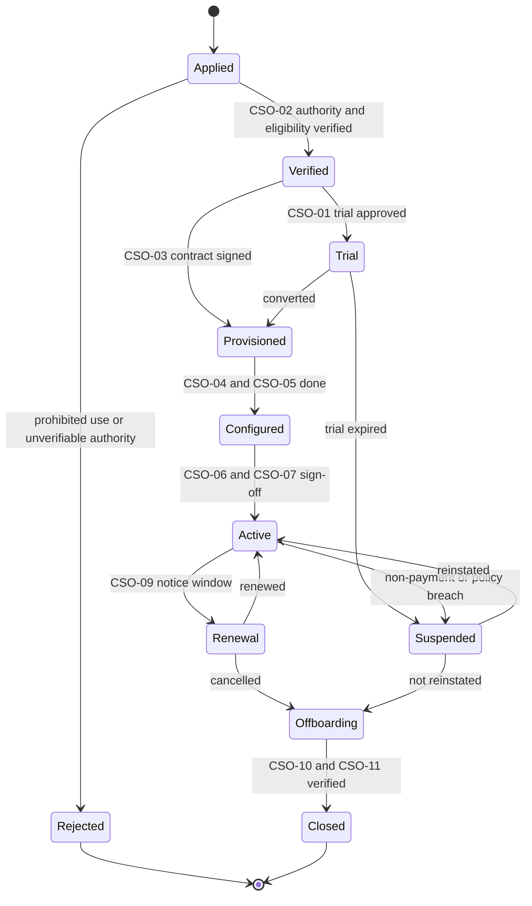
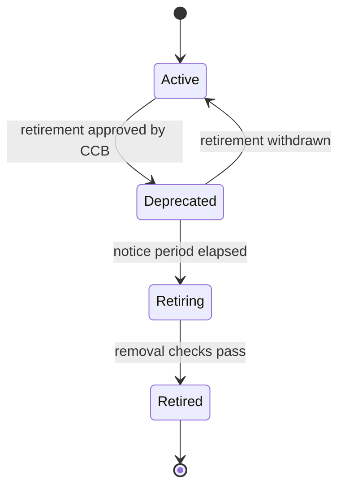
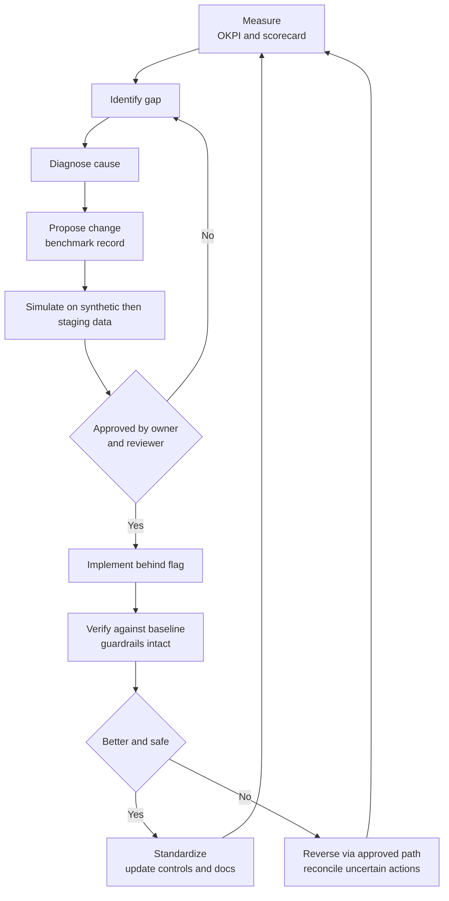

# AI Growth Engine: Employee Sales & Marketing Automation
## Application Blueprint: PART 8 (Batch 8.3c), Source Pack Enhancements II: SaaS Service Operations and SLA, Maintenance Lifecycle, Optimization Model; Conflicts, Persona Review, Tags and Quality Gate

| Field | Value |
|---|---|
| Document | Application Blueprint, Part 8, Batch 8.3 (file c of 3), source-pack group J |
| Version | 1.0 · 27 Nov 2026 |
| Baseline | Part 0A (DEC-008, 018, 028, 031, 038, 044, 047, 056, 064), Part 1 (BR-SVC, BR-S060, KPI-01…31), Part 2.3 (BRL-SVC-01…07 and all BRL families), Part 2.4 (RP-27/28, CFG-21/23), Part 3.3 (ENT-173 JobRun, ENT-176 Incident, ENT-177 Release, ENT-191/192 MetricDefinition/Snapshot, SaaS domain §3.3.4.16), Part 4.2 (NFR-001…099), Part 4.3 (SLO-01…12, §4.43–4.47, RB-001…015), Part 5.3 (EP-20 US-2001…2012), Part 6.1 (EVR, certification ladder), Part 6.7 (TC-NFR-001…099), Part 7.3, Part 8.1 (estimates), Part 8.2 (go-live, hypercare, KPI tracking), Part 9.1 (DEC-087, DEC-104), Part 8.3a (coverage), Part 8.3b (training) |
| Source | Documents 34, 35, 36 (all sections) and 38 (§04–§08) |
| Roles applied | SaaS Service Owner, Product Operations Lead, Optimization Engineer, FinOps Lead (leads); Product Owner, Solutions Architect, Data Architect, QA Lead, DevOps/SRE Lead, Security/Compliance Lead (reviewers) |

**Acronyms used in this file.** As in Part 8.3a, plus: ARR annual recurring revenue · DORA DevOps Research and Assessment metrics · GRR gross revenue retention · GST goods and services tax · MTTR mean time to restore · NRR net revenue retention · RCA root-cause analysis.

---

### 8.3.5.13 SaaS client onboarding, service delivery, SLA and commercial operations (extends Part 1 BR-SVC, Part 4.3 §4.45–4.46, Part 5.3 EP-20)

The blueprint already specifies the SaaS lifecycle mechanics (plans and entitlements, metering, invoicing, trial, suspension, credits, application draft, wizard, import/export, configuration change centre: US-2001…US-2012, BRL-SVC-01…07). Document 34 adds the **service-management layer**: what is sold and on which service model, how a client is onboarded through gated stages, what the SLA schedule contains and how it becomes contractual, how the service is reported, and how each tenant's economics are measured. Nothing here authorizes a price or an SLA promise: both stay "Price on request" / "no public SLA" until the Service Owner approves a measured figure (DEC-044, DEC-047, OPT-20-03).

#### 8.3.5.13.1 Service catalogue: plan archetype × service model [CONFLICT-485] [RECOMMENDATION-486]

Document 34 names plans by **service model** (self-service, managed, enterprise); DEC-047 names them by **size** (Starter, Growth, Scale). They are two independent axes. Proposed resolution: keep DEC-047 archetypes as the entitlement axis and add the service model as a second attribute of the subscription; "Enterprise" = Scale archetype with a negotiated contract schedule.

| | **Self-service** (client operates; platform supports) | **Managed** (platform staff operate defined tasks under client approval) |
|---|---|---|
| **Starter** (1 workspace, 3 users, email, 1,000 AI tasks/month; DEC-047) | Default. Onboarding by wizard (W33) and help articles; support per DEC-044 | Not offered (managed effort exceeds plan value) [ASSUMPTION-482] |
| **Growth** (3 workspaces, 10 users, email + WhatsApp + website, 5,000 AI tasks/month) | Default. 1:1 onboarding call (LJ-13) | Optional add-on with a signed managed-service scope (§8.3.5.13.5) |
| **Scale / Enterprise** (custom) | Possible | Typical. Negotiated SLA schedule (§8.3.5.13.6), named contacts, client-specific capacity or region as a change request with estimate |

Rules: (1) the service model is stored on the subscription (`service_model` ∈ {self_service, managed}) and versioned with the plan version; (2) managed tasks are executed only by platform staff holding an active scoped grant (DEC-056) and only inside the signed scope; (3) every managed action is attributed to the staff user **and** the approving client role in the audit trail; (4) regulated actions (signing, paying, submitting bids, setting prices, legal approval) are **never** in a managed scope (DEC-064 autonomy caps apply to staff exactly as to the client).

#### 8.3.5.13.2 Commercial terms structure (document 34 "Commercial terms")

| Fee type | Basis | Billing | Rule |
|---|---|---|---|
| Subscription | Plan version rate revision per period | In advance, monthly or annual | Rate revision approved in A101 before display (US-2001) |
| Onboarding / professional services | Fixed fee per onboarding scope or estimate for custom work | On activation | Custom needs estimated separately (OPT-20-04) |
| Usage / overage | Σ eligible metered units above inclusion × approved unit rate | In arrears, per billing period | Only with approved overage; otherwise block at quota (BRL-SVC-03) |
| Managed service | Fixed monthly fee per managed scope, or hours × approved rate | In arrears | Scope document signed; out-of-scope requests become change requests |
| Pass-through costs | Provider charges incurred with **platform-managed** credentials (e.g. WhatsApp conversation charges, ad spend if managed) | At cost or cost-plus as contracted, itemized | Disclosed as separate lines; never mixed with subscription; client-owned credentials are billed by the provider directly |
| Credits and adjustments | Reason-coded, append-only | Next invoice | BRL-SVC-07 |
| Taxes | GST on taxable service value (rate and place-of-supply rules: verify at time of implementation, as of 27 Nov 2026) | Separate tax lines | Tax engine per BRL-QTE-03 profile for SaaS services |
| Investment-related or success fees | — | — | **Not applicable**: the product has no fundraising capability (BRL-TEN-12) [CONFLICT-489] |

#### 8.3.5.13.3 Billing formula and illustrative calculation (document 34)

`invoice_total = subscription_fee + Σ (eligible_metered_units − included_units)⁺ × approved_unit_rate + authorized_adjustments + Σ tax_lines`

Stored with: rate-card revision, original currency, invoice period, idempotent usage key per meter reading (duplicate key → no second charge), and provider evidence for pass-through lines. Service revenue is never counted in commercial receipts (BRL-FIN-08) and never as investor capital.

**Illustrative calculation (synthetic figures, not prices).** Subscription INR 10,000.00; AI tasks used 1,200 with 1,000 included → 200 × INR 2.00 = INR 400.00; approved credit −INR 500.00 (reason SLA-goodwill); taxable value = 10,000.00 + 400.00 − 500.00 = INR 9,900.00; GST at an assumed 18% (verify) = INR 1,782.00; invoice total = **INR 11,682.00**. A replay of the 1,200-task meter reading with the same usage key leaves the total unchanged (TC-ENH-J-038).

#### 8.3.5.13.4 Client service stages and gates (CSO-01…CSO-12)



| Stage | Entry | Actions (document 34) | Exit evidence | Owner | Screens | Blueprint basis |
|---|---|---|---|---|---|---|
| CSO-01 Contract / trial | Verified application | Confirm tenant, legal entity, plan version, service model, products, users, data classes, support coverage, regulatory boundaries; trial ≤ 14 days (BRL-SVC-05) | Approved service agreement or trial record; entitlements and price card revision | Service Owner | A101, W34 | US-2005, US-2006 |
| CSO-02 Eligibility and due diligence | Application submitted (W32) | Verify legal identity (registration/GSTIN), administrator authority, **intended purpose**, **permitted jurisdictions**, prohibited-use screen (no health-data marketing, no minors targeting, no fundraising, no unsolicited bulk messaging) | Due-diligence checklist signed by Service Owner; rejection reason if refused | Service Owner + Legal/DPO | A099 | BRL-SVC-01; US-2002 (extended) |
| CSO-03 Provision | Contract/trial approved | Create independent tenant, startups (legal entities), client admin, roles, data region, budgets (zero paid spend by default), credential scopes | Isolation and access tests (US-2012); no owner-portfolio access | Tenant admin (platform) | A099 | BRL-TEN-11; US-2012 |
| CSO-04 Configure / import | Provisioned | Template, offerings, approved knowledge, filters, workflows, language, time zone, budget; dry-run import; ownership and duplicate resolution | Approved profile hash; import reconciliation report | Client admin | W33, A100, A103, A112 | US-2003, US-2004, US-2008 |
| CSO-05 Website and integrations | Configured | Domain ownership and TLS; brand approval; **credential model decision per integration: client-owned (client contracts provider; vault reference) or platform-managed (pass-through billing)**; sender identity; quotas; sandbox tests | Verified domain; integration test log; consent policy approved | Client admin + Automation Lead | A008, A107, A108 | BRL-TEN-10; CFG-24 |
| CSO-06 Train and activate | Integrations tested | LJ-13 onboarding call; client UAT on the client's training startup; simulation of each enabled workflow; source/channel permission review; paid services disabled by default | Client sign-off record; supervised mode on (L1/L2) | Service Owner + client admin | W34, A033, A102 | Part 8.3b; BRL-AUT-04 |
| CSO-07 Go-live and hypercare | Sign-off | Enable entitled actions only; 14-day hypercare with daily check of failures, budget and support tickets | Hypercare exit note | Platform support | A110, A014 | Part 8.2 §8.2.5 |
| CSO-08 Steady-state service | Active | Support per §8.3.5.13.6; monthly service report (§8.3.5.13.7); quarterly service review for Scale | Monthly report delivered; ticket metrics | Service Owner | W34, A101 | Part 4.45 |
| CSO-09 Renewal | 60 / 30 / 7 days before term end [ASSUMPTION-490] | Notify client admin with usage, charges and options; **no automatic upgrade**; downgrades take effect at term end | Renewal approval or documented cancellation | Service Owner | A106, W34 | FR-ENH-J-009 |
| CSO-10 Export | Client request or offboarding | Verify requester and scope; encrypted export, expiring link (72 h, BRL-PRV-07); manifest with record counts and hashes | Client acknowledgement of receipt | Platform support | A103, W34 | US-2009 |
| CSO-11 Offboard | Cancellation effective | Stop scheduler jobs and queued work; revoke tokens, grants, API keys, senders; remove custom domain and public snapshots; apply retention and legal hold; deletion decision; final billing reconciliation | Offboarding verification checklist: 0 active sessions, 0 scheduled jobs, 0 sender identities, 0 public routes, final invoice issued | Service Owner + DevOps | A099, A101 | FR-ENH-J-009; US-2009 |
| CSO-12 Suspension | Expiry, non-payment or breach | Pause new paid actions and live workflows; keep read/export access per contract | No charge except approved obligations | Service Owner | A099 | BRL-SVC-05/06 |

#### 8.3.5.13.5 Managed-service scope and responsibility matrix [GAP-489]

| Activity | Client admin | Client business approver | Platform staff (managed) | Service Owner | Legal/DPO |
|---|---|---|---|---|---|
| Configure templates, forms, sequences inside approved policies | A | C | R | I | — |
| Draft content and campaigns from approved claims | I | A (approves each version) | R | — | C |
| Run research plans and review findings | I | A | R | — | — |
| Send outreach or publish content | — | A (hash-bound approval) | R (executes only after approval) | — | — |
| Set prices, discounts, contract terms, sign, pay, submit bids | R/A (client only) | A | **Never** | — | C |
| Budget and cap changes | A | C | R (request only) | I | — |
| Data exports and deletions | A | — | R (executes) | I | C |
| Incident handling affecting the tenant | I | I | R | A | C (if personal data) |

R = responsible, A = accountable, C = consulted, I = informed. The signed scope lists the managed task types, the approving client roles, monthly hour or task allowance, data classes staff may see, and excluded regulated actions. Platform staff act through DEC-056 grants whose scope equals the managed scope (FR-ENH-J-007).

#### 8.3.5.13.6 SLA framework (SLA-01…SLA-12) [GAP-484] [ASSUMPTION-482] [CONFLICT-482] [CONFLICT-484]

**No SLA figure is offered to any client until it has been measured for at least three consecutive months in production and approved by the Service Owner** (DEC-044; OPT-20-03; document 34 "no guarantee until measured and contracted"). The schedule below is the template that becomes contractual per client.

| Item | Content | Pilot internal target (binding today) | Contract option (offer only after validation) | Measurement |
|---|---|---|---|---|
| SLA-01 Service scope | Core services covered: Admin, portal, public sites, API, workflow engine | Same | Same | — |
| SLA-02 Availability | Monthly availability of the core service | 99.5% (DEC-018, SLO-01/02) | 99.5% for Starter/Growth; 99.9% only for Scale after the scale gate (OKPI-06) | Request-based SLI: successful eligible requests ÷ eligible requests, with synthetic probes as cross-check (Part 4.2 §4.21) |
| SLA-03 Exclusions | Scheduled maintenance (announced ≥ 72 h, ≤ 4 h/month, 22:00–06:00 IST), client-caused incidents, provider outages outside platform control with documented fallback, force majeure, beta features | — | Same | Excluded minutes listed in the monthly report |
| SLA-04 Support hours | 10:00–18:00 IST Mon–Sat excluding listed holidays (DEC-044) | Same | Extended hours only for Scale with staffed rotation | — |
| SLA-05 Response targets | Time to first human response by priority | S1 2 h, S2 8 business hours, S3 3 business days (DEC-044, internal) | P1 15 min, P2 1 h during coverage, P3 next business day (document 34) **only** when on-call staffing ≥ 2 trained people per window and three months of measured attainment ≥ 95% | Ticket timestamps (Part 4.45 metrics) |
| SLA-06 Restoration targets | Time to restore or provide workaround | No contractual figure | S1 workaround ≤ 4 h (aligned with RTO ≤ 4 h, NFR-057) | Incident record |
| SLA-07 Data protection | RPO ≤ 15 min, RTO ≤ 4 h for critical data (NFR-056/057); regional RTO ≤ 24 h | Same | Same | Drill reports (Part 4.47) |
| SLA-08 Capacity and region | Client-specific capacity, data residency or region | Not offered | Change request with estimate and ADR | — |
| SLA-09 Incident communication | Status notice for S1 within 1 h of declaration; update every 2 h; post-incident summary ≤ 5 business days | Same (Part 4.43.4) | Same | Incident timeline |
| SLA-10 Service credits | Credit percentage of monthly subscription when SLA-02 is missed | None | Proposed ladder: < 99.5% → 5%; < 99.0% → 10%; < 98.0% → 20%; cap 20% of the month's subscription (placeholder; requires legal and finance approval) | Monthly report |
| SLA-11 Reporting | Monthly service report (§8.3.5.13.7) | Same | Same | — |
| SLA-12 Review | Annual SLA review; change only by contract amendment | — | Same | — |

**SLA validation procedure (document 34 "SLA and support commitments").** (1) Compute three months of SLA-02 and SLA-05 attainment from production data; (2) run an incident-support simulation with client notification (TC-ENH-J-040); (3) confirm on-call staffing; (4) Service Owner and Legal approve the schedule revision in A101; (5) only then can the schedule be attached to a subscription (FR-ENH-J-005). Tenant-facing status page: publish incident notices on a public status page per tenant group to close the planning half of GAP-179 [RECOMMENDATION-489].

#### 8.3.5.13.7 Monthly service report and unit economics

**Monthly service report (per tenant; extends RP-28).**

| Section | Content | Source |
|---|---|---|
| Usage | Meters vs entitlements, overage, credits | UsageMeterReading, Entitlement |
| Workflow outcomes | Runs started, completed, failed, uncertain reconciled; automation rate (KPI-19) for the tenant | WorkflowRun |
| Business outcomes | Qualified opportunities, meetings, verified closures **for the client's startups**, labelled as client outcomes and kept separate from service revenue | Projections |
| Incidents | S1/S2 incidents, duration, RCA links | Incident |
| Service health | SLA-02 attainment with excluded minutes; SLA-05 response attainment | SLO data, tickets |
| Cost and charges | Invoice lines, pass-through costs, credits | ServiceInvoice |
| Reconciliation | Usage reconciliation status (KPI-24 = 100%) | Billing job |

**Contribution margin (OPT-20-01; KPI-23; Part 4.46.3).**

`contribution_margin(tenant, month) = service_revenue − direct_usage_cost − allocated_shared_infra − support_and_managed_labour − platform_pool_share`

`contribution_margin_% = contribution_margin ÷ service_revenue` (unassessed when service_revenue = 0).

| Term | Definition | Data |
|---|---|---|
| service_revenue | Invoiced subscription + usage + managed fees, net of credits, excluding tax and pass-through costs billed at cost | ServiceInvoice |
| direct_usage_cost | AI, research, messaging and other metered costs attributed to the tenant (M53 ledger) | CostLedger |
| allocated_shared_infra | Shared AWS cost × tenant share of API requests + worker task-seconds + storage (Part 4.46.3) | Allocation job |
| support_and_managed_labour | Support hours and managed-service hours × loaded hourly rate (rate set by Finance; estimate) | Ticket and timesheet records |
| platform_pool_share | Declared percentage of revenue for platform overhead (CI, security tooling, seats); 10–15% placeholder [ASSUMPTION-483] | Finance |

Worked check (document 36 OPT-TEST-20): service invoice INR 1,000.00, attributable cost INR 600.00 → contribution **INR 400.00 (40.0%)**, not counted in commercial receipts (KPI-13).

**Cohort metrics added (OPT-20-03, document 35 "service economics") [RECOMMENDATION-490].** Logo churn = tenants cancelled in period ÷ tenants active at period start; GRR = (start ARR − churned ARR − contraction) ÷ start ARR; NRR = (start ARR − churn − contraction + expansion) ÷ start ARR; onboarding effort = staff hours from CSO-02 to CSO-07; support burden = tickets and staff hours per tenant per month. All by plan archetype, service model and signup cohort (month); zero denominators shown as "unassessed".

#### 8.3.5.13.8 Enhanced functional requirements (SaaS)

| FR | Requirement | Screens | Rules / source | Wave · Epic | Tests |
|---|---|---|---|---|---|
| FR-ENH-J-005 | SLA schedule per subscription with SLA-01…12 fields; a schedule revision can be attached only after Service Owner and Legal approval and only if `measured_months ≥ 3` for SLA-02/05 values; unapproved values are never shown to the client | A101, W34 | DEC-044; OPT-20-03; doc 34 | W5 · EP-20 | TC-ENH-J-039, 040 |
| FR-ENH-J-006 | Monthly service report per tenant generated on day 3 of each month with the sections above; totals reconcile to invoices and usage; client sees only own tenant | W34, A101 | RP-28; KPI-24 | W5 · EP-20 | TC-ENH-J-041 |
| FR-ENH-J-007 | Subscription carries `service_model`; managed scope document (task types, approving roles, allowance, data classes, exclusions) is versioned; platform staff actions outside the active scope are denied by the PDP | A101, A099 | DEC-056, DEC-064 | W5 · EP-20 | TC-ENH-J-044 |
| FR-ENH-J-008 | Onboarding checklist CSO-01…CSO-07 per tenant with evidence fields and timestamps; KPI-25 timer from approved application to active workspace; due-diligence fields (purpose, jurisdictions, prohibited-use screen) mandatory before provisioning | A099 | BRL-SVC-01; KPI-25 | W5 · EP-20 | TC-ENH-J-061 |
| FR-ENH-J-009 | Renewal notices at 60/30/7 days; plan changes require client-admin confirmation (no automatic upgrade); offboarding verification job asserts 0 sessions, jobs, senders, public routes and issues the final invoice before status Closed | A099, A101, A106, W34 | doc 34; US-2009 | W5 · EP-20 | TC-ENH-J-042, 043 |
| FR-ENH-J-010 | Tenant economics report (extends RP-27): contribution margin with the five terms, cohort churn, GRR/NRR, onboarding effort and support burden; estimates labelled | A101 | KPI-23; Part 4.46.3 | W6 · EP-20 | TC-ENH-J-062 |

```gherkin
Feature: US-20-EJ01 SLA schedule cannot promise unmeasured figures

  Scenario: Contract option is blocked before three measured months
    Given subscription "SUB-ALPHA-1" is on plan "Growth" with service model "self_service"
    And the platform has 2 measured months of SLA-05 attainment
    When the Service Owner attaches an SLA schedule with P1 response 15 minutes
    Then the attachment is rejected with reason "SLA_NOT_MEASURED: SLA-05 requires 3 months"
    And the client portal W34 still shows "Support targets: business hours, no contractual SLA"

  Scenario: Approved schedule appears in the client portal
    Given 3 measured months show SLA-02 attainment 99.71% and SLA-05 attainment 97%
    And Legal and the Service Owner approved schedule revision "SLA-REV-2"
    When "SLA-REV-2" is attached to "SUB-ALPHA-1"
    Then W34 shows availability 99.5% monthly and the exclusions list
    And the monthly report for the next month includes SLA-02 attainment and excluded minutes

Feature: US-20-EJ05 offboarding leaves no live access

  Scenario: Tenant cannot close while a sender identity remains
    Given tenant "Client Alpha" is in status "Offboarding"
    And sender identity "alerts@alpharetail.example" is still verified
    When the offboarding verification job runs
    Then the tenant stays in "Offboarding" with failed check "SENDER_IDENTITIES_REMAIN"
    When the sender identity is revoked and the job runs again
    Then all checks pass, the final invoice is issued and the status becomes "Closed"

  Scenario: No automatic upgrade at renewal
    Given "Client Alpha" used 1,180 of 1,000 AI tasks in each of the last 3 months with approved overage
    When the renewal notice is generated 30 days before term end
    Then it shows usage, charges and the options "Stay on Starter with overage" and "Move to Growth"
    And the plan is unchanged until the client administrator confirms an option

Feature: US-20-EJ03 managed scope enforcement

  Scenario: Platform staff cannot act outside the managed scope
    Given "Client Beta" has managed scope "MS-2" covering "content.draft" and "research.run"
    And support user "ops.anu" holds an active grant equal to "MS-2"
    When "ops.anu" attempts "quote.discount.apply" in "Client Beta"
    Then the PDP denies with reason "OUTSIDE_MANAGED_SCOPE"
    And the attempt is visible to the client administrator in the audit view
```

---

### 8.3.5.14 Product maintenance and continuous-improvement lifecycle (extends Part 4.3 §4.43–4.47 and Part 8.2 §8.2.2.4) [GAP-485]

#### 8.3.5.14.1 Maintenance operating model

**BAU roster (MNT-R01).** Each area has a primary and a backup; the roster is published in A106 and reviewed quarterly.

| Area | Primary (DEC-005 team) | Backup | Escalation |
|---|---|---|---|
| Product decisions, backlog, change board | Product Owner (Founder) | Startup head delegate | — |
| Application code (backend, frontend) | FS engineer (engineering lead) | Backend / frontend engineer | CTO |
| Data, migrations, query health | Backend engineer (DBA duties) | FS engineer | CTO |
| QA, regression, evidence gate | QA lead | FS engineer | Product Owner |
| Security and vulnerabilities | FS engineer (security champion) | DevOps | Founder; external tester |
| DevOps, releases, backups, DR | DevOps/SRE | Backend engineer | CTO |
| AI models, prompts, evaluations | AI lead | Backend engineer | Product Owner |
| Support, help centre, training | Growth/compliance lead | Rotating engineer | Service Owner |
| FinOps and tenant economics | DevOps + Finance | Service Owner | Founder |

**Intake classes (document 35 "Intake").** Every item enters the tracker with impact, scope (product, tenant, startup), evidence and proposed priority: (I-1) defect, (I-2) user feedback or enhancement, (I-3) security finding, (I-4) provider change notice (API version, pricing, deprecation), (I-5) compliance or legal change, (I-6) operational alert follow-up, (I-7) technical debt. "No uncontrolled production fix": nothing reaches production except through the pipeline (Part 4.3 §4.33).

**Priority matrix (document 35 "Prioritize"; Part 4.43.1 severities).**

| Priority | Criteria | Response | Examples |
|---|---|---|---|
| P0 Immediate | Confidentiality, cross-scope exposure, financial integrity, suppression breach, active exploit | Contain now (STOP or flag off), hotfix path | KPI-30 > 0; duplicate payment allocation |
| P1 High | Business blocker for a startup or tenant, SLO burn > 2× | Next release train or hotfix | Outbox backlog not draining |
| P2 Normal | Degraded function with workaround; enhancement with high impact/effort ratio | Ranked in backlog by impact ÷ effort × risk factor | Slow report |
| P3 Low | Cosmetic, minor enhancement | Backlog | Label wording |

Fixes are ranked by business impact, security and financial integrity, **not by feature count** (document 35).

**Emergency fix procedure (document 35 "Emergency fix").** (1) Contain first: scoped STOP (RB-004) or feature flag off; (2) branch from the deployed tag; (3) minimal change with a regression test reproducing the fault; (4) independent review (no self-merge); (5) pipeline with the **critical smoke subset** and security scans (no stage skipped except long-running load tests, recorded as a deviation); (6) deploy by the normal promotion with rollback ready; (7) record the deviation in the release record; (8) follow-up review within 5 business days with full regression and postmortem (Part 4.43.5). No bypass of tenant or financial controls is permitted at any step.

#### 8.3.5.14.2 Recurring maintenance calendar (MNT-*; consolidates document 35's two cadence tables with Part 4.46.6 and 4.47)

| ID | Cadence | Task | Evidence | Owner | Screen | Existing basis |
|---|---|---|---|---|---|---|
| MNT-D01 | Daily | Review critical alerts, failed workflows, uncertain outcomes; reconcile before retry | Operations review log | Platform support | A014, A110 | RB-003 |
| MNT-D02 | Daily | Budget limits, cost caps, provider availability, sender health | Log entry | DevOps / FinOps | A012 | AL-14/15/16 |
| MNT-D03 | Daily | Approval queues ageing; financial exceptions and discrepancies | Log entry | Startup heads; Finance | A089, A074 | BRL-APR-10 |
| MNT-D04 | Daily | Public content incidents and unauthorized-access signals | Log entry | Marketing lead; security champion | A108, A047 | RB-008 |
| MNT-D05 | Daily (automated) | Backup health, audit-chain verification | Job report | DevOps | A090 | Part 4.47 |
| MNT-D06 | Daily | Queue backlog and DLQ | Log entry | DevOps | A009 | RB-002, RB-011 |
| MNT-W01 | Weekly | Defect backlog and support backlog review | Action owners and due dates | PO + support | Tracker | Part 4.45 |
| MNT-W02 | Weekly | Queue latency and SLO burn | SLO report | DevOps | A014 | §4.40 |
| MNT-W03 | Weekly | AI quality samples (judge + human), source failures, stale contacts/claims | AI quality note | AI lead; research lead | A084, A010 | Part 7.3 |
| MNT-W04 | Weekly | Security alerts triage | Triage log | Security champion | — | NFR-067 |
| MNT-W05 | Weekly | Opt-outs, complaints, cost per qualified outcome, failed conversions | Growth note | Growth lead | A047, A012 | KPI-17/18/22 |
| MNT-W06 | Weekly | Source coverage, data quality, workflow effectiveness | DQ report | Research lead | A010 | KPI-27 |
| MNT-W07 | Weekly | Client support tickets by tenant | Ticket metrics | Platform support | — | Part 4.45 |
| MNT-M01 | Monthly | Provider entitlements, quotas, pricing changes (verify) | Approved changes | FinOps | A012, A008 | Part 4.46.6 |
| MNT-M02 | Monthly | Dependency updates and CVEs; secret rotation status | Patch log | Security champion | — | NFR-067, NFR-084 |
| MNT-M03 | Monthly | Capacity and worker right-sizing: **cost per 1,000 tasks**, queue age, idle capacity (OPT-03-04) | Right-sizing note | DevOps | A014 | Part 4.46.6 |
| MNT-M04 | Monthly | Unused seats and API entitlements (OPT-03-06) | Seat review | FinOps | — | B09 |
| MNT-M05 | Monthly | Storage GB-month by class; lifecycle rules vs legal hold (OPT-03-05) | Storage report | DevOps | — | DEC-028 |
| MNT-M06 | Monthly | Query plans (EXPLAIN ANALYZE, BUFFERS) for top 10 slow queries; index and vacuum health (OPT-08-02) | DB health note | Backend (DBA) | — | Part 3.3 §3.3.8 |
| MNT-M07 | Monthly | Technical-debt register review (OPT-13-02) | Updated register | Engineering lead | Tracker | FR-ENH-J-011 |
| MNT-M08 | Monthly | Estimate vs actual and rework (OPT-16-02) | Delivery note | PO + FS engineer | — | Part 8.1 |
| MNT-M09 | Monthly | Access grants, support grants, dormant accounts | Access review | Tenant admin | A002, A099 | BRL-TEN-07/09 |
| MNT-M10 | Monthly | Tenant profitability, usage ledger, approved business claims expiry; optimization scorecard refresh (monthly; full review quarterly) [ASSUMPTION-488] | Monthly reports | Service Owner; marketing lead | A101, A051, A090 | KPI-23/24; §8.3.5.15 |
| MNT-Q01 | Quarterly | Restore and rollback rehearsal; full RTO drill | Drill report | DevOps | A090 | Part 4.47 |
| MNT-Q02 | Quarterly | Security scenario review and threat-model delta | Review note | Security champion | — | Part 4.1 |
| MNT-Q03 | Quarterly | AI regression benchmark on frozen datasets | Eval report | AI lead | A084 | NFR-033 |
| MNT-Q04 | Quarterly | Access recertification (all privileged roles); secret rotation demonstration (OPT-01-06) | Signed recertification | Tenant admin; DevOps | A002 | Part 4.1 |
| MNT-Q05 | Quarterly | Business template review; client feedback analysis; help-article feedback | Review note | PO; growth/compliance lead | A100 | doc 35 |
| MNT-Q06 | Quarterly | Capacity review against DEC-031 design points and scale triggers | Capacity note | CTO | — | Part 4.2 §4.27 |
| MNT-Q07 | Quarterly | Client contracts, SLA attainment and retention review | Service review | Service Owner | A101 | §8.3.5.13 |
| MNT-A01 | Annual / material change | Threat model refresh; external penetration test as required | Report | Security champion | — | NFR-072 |
| MNT-A02 | Annual | Retention schedule and legal review | Approved schedule | Legal/DPO | A013 | DEC-028 |
| MNT-A03 | Annual | Service terms and SLA schedule review | Amendments | Service Owner + Legal | A101 | SLA-12 |
| MNT-A04 | Annual | DR tabletop and regional restore | Report | Founder | A090 | Part 4.47 |
| MNT-A05 | Annual | Architecture review against actual demand; ADRs for changes | ADRs | CTO | — | NFR-029 |
| MNT-B01 | Before any update | Impact review, compatibility, provider entitlement, prompt regression, scope isolation, feature flags, migration and rollback; mapped tests and QC | Change impact record | Change author | Tracker | FR-ENH-J-022 |
| MNT-B02 | Before any update (CI) | N+1 query-count regression on representative list endpoints (OPT-08-03) | CI report | Backend | — | Part 4.3 §4.33 |
| MNT-I01 | After incident | RCA, fix, regression test, control-gap review, stakeholder notice | Postmortem | Incident commander | A014 | Part 4.43.5 |

Capacity rule: 15–20% of each sprint's capacity is reserved for MNT items and technical debt after Release 1 [ASSUMPTION-486] [RECOMMENDATION-487].

#### 8.3.5.14.3 Lifecycle change procedures (LC-01…LC-07)

| ID | Change type | Procedure | Acceptance evidence | Source |
|---|---|---|---|---|
| LC-01 | AI model or prompt | Freeze prompt, model, dataset and policy revision; run the prior benchmark and the new candidate on the same frozen set; compare quality, cost and latency; approve revision; canary 10% for 7 days; automatic rollback if any gate metric falls below the approved floor | No mandatory regression; traceable rollback; no automatic self-modification of approved policy | doc 35; NFR-033; Part 7.3 |
| LC-02 | Knowledge | Review evidence freshness and claim approvals; revoke outdated claims; rebuild the scoped index; invalidate cached answers keyed to the old knowledge revision | Revoked content cannot be retrieved or published (test query returns no hit) | doc 35; BRL-MKT-01; FR-ENH-J-016 |
| LC-03 | Provider (API version, pricing, deprecation) | Monitor notices (MNT-M01); record official access rights, schema version, quota, timeout; build or update adapter behind a flag; contract tests against sandbox; licence and entitlement check; migrate with fallback and reconciliation of in-flight items | No provider activated without verified entitlement, approved cost and regression pass | doc 35; Part 7.4 PG-01…10 |
| LC-04 | Database | Query-plan review, vacuum and index health; migrations via expand → backfill → validate → switch → contract | No destructive unreviewed migration; row counts reconciled | doc 35; Part 4.3 §4.37.2 |
| LC-05 | Frontend | Browser and accessibility review, mobile performance, stale-cache checks; public templates and private Admin UI updated and released independently | Regression suite and axe-core pass | doc 35; NFR-088, NFR-098 |
| LC-06 | Retire a feature | See §8.3.5.14.4 | No orphan jobs, endpoints or credentials | doc 35 |
| LC-07 | Templates and configuration | Version templates and configuration; deprecate without changing active executions (pinned revisions); update catalogues, route mappings, test fixtures and release inventory together on every accepted change | Inventory diff in the release record | doc 35 expansion; BRL-AUT-03 |

#### 8.3.5.14.4 Feature lifecycle and retirement (FR-ENH-J-012) [ASSUMPTION-487] [RECOMMENDATION-488]



| State | Rules |
|---|---|
| Active | Normal |
| Deprecated | Retirement decision recorded with usage data, dependencies (UI, API, entities, workflows, tests), contracts and retention obligations; notices to affected internal users (A106) and SaaS clients (email + W34); notice period 90 days for SaaS clients, 30 days for internal-only features; new use can be blocked but existing pinned runs continue |
| Retiring | Data export offered (CSO-10); feature flag off for new runs; scheduled jobs drained; endpoints return 410 with a pointer; credentials scheduled for revocation |
| Retired | Removal checks pass: 0 scheduled jobs, 0 calls to the endpoints in 14 days, 0 credentials referencing the feature, audit and legal-hold data retained per DEC-028; catalogues, RTM and help articles updated |

#### 8.3.5.14.5 Technical-debt and dependency register (FR-ENH-J-011)

| Field | Content |
|---|---|
| `debt_id`, `title`, `area` | e.g. TD-014, "Customer 360 projection rebuild is O(n²)", backend |
| `origin` | Shortcut, outdated dependency, missing test, design drift, provider change |
| `owner`, `severity` (Critical/High/Medium/Low) | Severity uses the P0–P3 matrix |
| `business_impact` | Which journeys, KPIs or SLOs are affected |
| `refactor_benefit`, `estimate_pd` (range) | Expected benefit and effort |
| `linked_items` | CVE IDs, ADRs, incidents, stories |
| `remediation_date`, `status` | Planned date; Open / Planned / In progress / Done / Accepted (with reason and review date) |
| `regression_evidence`, `rollback` | EVR link required before Done (OPT-13-02) |

Dependencies: pinned versions with lockfiles, SBOM per build, end-of-life dates (NFR-084), upgrade in an isolated branch with full regression (OPT-13-04); critical vulnerabilities ≤ 7 days (NFR-067).

#### 8.3.5.14.6 Improvement measurement and learning loop

| Dimension | Metrics | Rule |
|---|---|---|
| Business outcomes | KPI-01…31 (Part 1); cost per outcome (KPI-22) | AI scores are never treated as conversion; compare with baseline using the same denominator and window (document 35) |
| Engineering outcomes | DORA (NFR-083): deployment frequency, lead time, change-failure rate, time to restore; critical defects escaped; coverage (NFR-082) | Trends reviewed monthly; **not used for individual performance appraisal** (document 35 "trends not punitive metrics") |
| Service economics | KPI-23/24/25 and cohort metrics (§8.3.5.13.7) | Finance approves pricing or capacity changes |
| Learning loop | Improvement record: hypothesis → metric and guardrails → safe cohort (holdout where feasible) → simulate → approve → run → compare → retain or roll back → document | Uses the benchmark record (FR-ENH-J-020); experiments follow BRL-MKT-10 |

#### 8.3.5.14.7 Change impact assessment record (FR-ENH-J-022; extends Part 8.2 §8.2.2.4)

Before merge, every change that alters a contract (API schema, entity, workflow node, screen field, rule, prompt) carries a machine-readable impact record listing affected FR, screen, API operation, entity, workflow, test (TC), runbook, help article and OKPI IDs. The CI job resolves each ID against the RTM and fails the merge when an affected test or help article is not updated in the same change or explicitly waived by the PO (document 35 "change impact assessment"; "no stale dependent contract").

#### 8.3.5.14.8 Resource and approval rules (documents 34–36)

1. The Part 8.1 estimate (central 416 pd) is the baseline; every proposed change estimates incremental frontend, backend, data, AI, QA and operations effort as a low/base/high range.
2. Effort already covered by an existing story is subtracted before approval (document 36 "optimization estimate reconciliation"); the 104 optimization controls are delivered inside existing stories unless the mapping in §8.3.5.15.3 says "Enhancement".
3. The pack's approval review effort (32.55 / 62.85 / 123.70 PD) is **not** added automatically: the blueprint's DoD and evidence records already include review; only review activities without a story (e.g. SLA validation, managed-scope legal review) are estimated, here 3–6 pd.
4. No delivery cost, SLA or managed-service commitment is promised before approval and before staging load, security, migration, rollback and recovery tests have passed.

**Effort for all Part 8.3 enhancements (estimate).** 22 FR-ENH stories at 2–8 SP each = 70–120 SP → 49–84 pd at 0.7 pd/SP (Part 8.1 method), of which ≈ 60% falls in W5–W6 (SaaS, optimization panel) and ≈ 40% in W1–W2 (training gate, training tenant, help links). This draws on the tier-1/tier-2 spill list and W6 capacity (Part 8.1 §8.1.4.7); the PO decides in the CCB.

#### 8.3.5.14.9 Stories (maintenance)

| Story | Title | FR | SP | Wave |
|---|---|---|---|---|
| US-21-EJ02 | Technical-debt register and monthly maintenance log | FR-ENH-J-011 | 2–3 | W2 |
| US-21-EJ03 | Feature lifecycle and retirement checks | FR-ENH-J-012 | 3–5 | W6 |
| US-21-EJ09 | Change impact record checked in CI | FR-ENH-J-022 | 3–5 | W1 |

```gherkin
Feature: US-21-EJ03 feature retirement

  Scenario: A feature cannot be marked Retired while a job still runs
    Given feature "legacy-social-digest" is in state "Retiring"
    And scheduled job "social_digest_weekly" is still enabled for tenant "Client Beta"
    When the removal checks run
    Then the transition to "Retired" is refused with failed check "SCHEDULED_JOBS_REMAIN"

Feature: US-21-EJ09 change impact record

  Scenario: Merge fails when an affected test is not updated
    Given a pull request changes the request schema of operation "API-477"
    And its impact record lists FR-A113 and TC-18-120
    And TC-18-120 is not modified and no waiver is recorded
    When CI runs the impact check
    Then the check fails with "AFFECTED_TEST_NOT_UPDATED: TC-18-120"
```

---

### 8.3.5.15 Optimization engineering model (new; extends Part 4.2, Part 8.2 §8.2.6, Part 6, Part 9.3) [GAP-486]

#### 8.3.5.15.1 Dimensions, weights and the blocking gate (20 weighted + G0) [CONFLICT-486]

| Dim | Dimension | Weight | Source accountable role | Blueprint owner | Controls | OKPIs | Scenario |
|---|---|---|---|---|---|---|---|
| OPT-01 | Security | 14% | Security lead | Security/Compliance lead (FS engineer as security champion; DEC-005) | 8 | OKPI-01, OKPI-02, OKPI-03, OKPI-04 | OPT-TEST-01 |
| OPT-02 | Performance | 8% | Frontend and backend leads | Frontend engineer + Backend engineer | 7 | OKPI-05, OKPI-26, OKPI-27, OKPI-28, OKPI-29, OKPI-30, OKPI-31 | OPT-TEST-02 |
| OPT-03 | Cost | 12% | FinOps lead | FinOps lead (DevOps engineer + Finance, Part 4.46) | 8 | OKPI-11, OKPI-12, OKPI-21 | OPT-TEST-03 |
| OPT-04 | Automation | 12% | Automation lead | Automation Lead (R11 / P10) | 8 | OKPI-09, OKPI-10, OKPI-35 | OPT-TEST-04 |
| OPT-05 | Stability | 10% | Reliability lead | DevOps/SRE lead | 7 | OKPI-06, OKPI-07, OKPI-08 | OPT-TEST-05 |
| OPT-06 | Scalability | 5% | Architect | Solutions architect (CTO) | 5 | — | OPT-TEST-06 |
| OPT-07 | Architecture | 4% | Solution architect | Solutions architect (CTO) | 5 | — | OPT-TEST-07 |
| OPT-08 | Database | 3% | Database lead | Data architect / DBA (backend engineer) | 6 | OKPI-22 | OPT-TEST-08 |
| OPT-09 | API & Integration | 3% | Integration lead | Backend engineer (integrations) | 5 | OKPI-27 | OPT-TEST-09 |
| OPT-10 | AI Intelligence | 5% | AI lead | AI lead | 6 | OKPI-13, OKPI-14 | OPT-TEST-10 |
| OPT-11 | Data Quality | 3% | Data steward | Research lead (data steward) | 5 | OKPI-15 | OPT-TEST-11 |
| OPT-12 | Business Conversion | 5% | Product owner | Product Owner (Founder) | 4 | OKPI-24, OKPI-25 | OPT-TEST-12 |
| OPT-13 | Maintainability | 2% | Engineering lead | FS engineer (engineering lead) | 4 | — | OPT-TEST-13 |
| OPT-14 | Reusability | 2% | Architect | Solutions architect (CTO) | 3 | — | OPT-TEST-14 |
| OPT-15 | UI/UX | 2% | Design lead | UX lead (contractor) | 4 | OKPI-23 | OPT-TEST-15 |
| OPT-16 | Development Productivity | 2% | CTO | CTO | 3 | — | OPT-TEST-16 |
| OPT-17 | Testing & QC | 3% | QA lead | QA lead | 4 | OKPI-16, OKPI-17, OKPI-20 | OPT-TEST-17 |
| OPT-18 | Deployment & Recovery | 2% | DevOps lead | DevOps/SRE lead | 4 | OKPI-18, OKPI-19, OKPI-32, OKPI-33, OKPI-34 | OPT-TEST-18 |
| OPT-19 | Privacy & Compliance | 2% | Privacy and legal lead | Legal/Compliance/DPO (R10) | 4 | OKPI-35 | OPT-TEST-19 |
| OPT-20 | SaaS Profitability | 1% | Service owner | Service Owner (Founder; DEC-047) | 4 | OKPI-21 | OPT-TEST-20 |
| G0 | Blocking gate (non-weighted) [CONFLICT-486] | 0% (blocking) | Security, privacy, financial and mandatory delivery leads | Veto holders of Part 8.2 §8.2.4.1 | 21 mandatory OKPIs |  | OPT-TEST-17 |

Weights sum to 100% across OPT-01…OPT-20. **G0** carries no weight: any failed mandatory OKPI, any open P0 item (§8.3.5.14.1), or any open hard-stop row of Part 8.2 §8.2.4.1 blocks acceptance irrespective of the weighted score (document 36 §2).

#### 8.3.5.15.2 Scoring rubric, formula and numeric rules [ASSUMPTION-484]

| Score | Evidence level required |
|---|---|
| 0 | Control absent or failed |
| 2 | Designed only (specification exists) |
| 4 | Implemented; verified only by synthetic or offline tests (certification L-S/L-T, Part 6.1 §6.1.5.5) |
| 6 | Verified in staging with representative workload and independent review (L-C) |
| 8 | Verified in production for ≥ 1 full measurement window, target met (L-P) |
| 10 | As 8, sustained for 3 windows with improvement against baseline and no guardrail regression |

`dimension_score(d) = mean(score(c) for assessed controls c in d)`; `weighted_score = Σ_d (weight_d × dimension_score_d ÷ 10) ÷ Σ_d assessed_weight_d × 100`; `assessment_coverage = Σ assessed_weight ÷ 100`.

Numeric rules (document 36 "numeric guardrail validation", "authorization-safe cache and numeric validation"): weights must be finite, ≥ 0 and sum to 100; scores ∈ {0, 2, 4, 6, 8, 10}; counts are integers ≥ 0; bounded ratios ∈ [0, 1]; NaN or infinity rejects the whole assessment; a control without an EVR link is **unassessed**, never scored; a ratio with a zero denominator is **unassessed**, never 100%; signed improvement metrics (OKPI-24, OKPI-25) are stored separately from bounded ratios. Evidence for invalid inputs: TC-ENH-J-055.

**Worked example (illustrative).** Assessed: Security (14%) mean 6, Cost (12%) mean 4, Stability (10%) mean 8; others unassessed. Weighted score = (14 × 0.6 + 12 × 0.4 + 10 × 0.8) ÷ 36 × 100 = (8.4 + 4.8 + 8.0) ÷ 36 × 100 = **58.9**; assessment coverage = 36%. The scorecard shows "58.9 at 36% coverage" and G0 status separately; a score is never shown without its coverage.

#### 8.3.5.15.3 Optimization controls OPT-01-01…OPT-20-04 mapped to the blueprint

Status counts: Covered 78, Partially covered 20, Conflict 5, Not covered 1. "Cited before" = the control ID already appeared in Parts 0–9.

| Control | Name | Control (source) | Acceptance / evidence (source) | Blueprint owner | Blueprint mapping | Cited before | Status | Enhancement |
|---|---|---|---|---|---|---|---|---|
| OPT-01-01 | Authentication and privileged sessions | Reuse verified identity; separate product/audience; MFA for privileged roles; expire and revoke sessions | Zero successful revoked, wrong-audience or unauthorized privileged requests; test revoked sessions and MFA bypass | Security/Compliance lead (FS engineer as security champion; DEC-005) | NFR-003, NFR-050, NFR-074; BRL-TEN-08; DEC-019; TC-NFR-003/050/074 | yes | Covered | — |
| OPT-01-02 | Authorization and product isolation | Deny by default in DRF permissions and scoped service queries; no owner investment data in employee application | Zero cross-product and role escalation in negative tests; record actor, object and policy decision | Security/Compliance lead (FS engineer as security champion; DEC-005) | NFR-002, NFR-031; BRL-TEN-04, BRL-TEN-12; ABAC-01…12 (Part 2.3) | no | Covered | Investor/owner-data clause is out of product scope (CONFLICT-489) |
| OPT-01-03 | Tenant and startup isolation | Require tenant and startup on queries, composite ownership references, cache keys, queues, exports and vector retrieval | Zero cross-scope results from REST, workers, storage, search and cache with two tenants and two startups each | Security/Compliance lead (FS engineer as security champion; DEC-005) | NFR-017, NFR-032; BRL-TEN-03; two-tenant matrix (Part 6.5) | no | Partially covered | Cache-key composition not specified → FR-ENH-J-016 |
| OPT-01-04 | Public/portal/Admin boundary | Separate React origins, token audiences and serializers; public reads approved snapshots only; portal grants object-specific | Zero public-to-Admin and wrong-object reads; inspect routes and response fields | Security/Compliance lead (FS engineer as security champion; DEC-005) | NFR-001, NFR-020; BRL-PUB-05; DEC-009 | no | Covered | — |
| OPT-01-05 | API and network security | Bound input sizes/rates, use HTTPS and private DB/worker network; allowlist egress, deny arbitrary URLs and unsafe redirects | All protected endpoints deny invalid scope/input; no exposed private services in authorized scan | Security/Compliance lead (FS engineer as security champion; DEC-005) | NFR-015, NFR-022, NFR-069, NFR-071; egress allowlist (Part 4.1) | no | Covered | — |
| OPT-01-06 | Secrets and supply chain | Vault/secret references; per-product keys, least privilege, rotation, secret scanning, lockfiles and SBOM | Zero exposed live secrets and unresolved critical exploitable vulnerabilities at go-live; demonstrate rotation | Security/Compliance lead (FS engineer as security champion; DEC-005) | NFR-004, NFR-067, NFR-068; SBOM and lockfiles (Part 4.3 §4.33) | no | Covered | Rotation demonstration added to MNT-Q04 |
| OPT-01-07 | AI and uploaded files | Treat retrieved text as data; allowlisted tools; scan/quarantine uploads, signed short-lived grants and size/type limits | Zero unauthorized tool calls, private retrieval or unscanned file publication in adversarial tests | Security/Compliance lead (FS engineer as security champion; DEC-005) | NFR-021; BRL-SRC-07, BRL-AI-01; tool registry (Part 7.2) | no | Covered | — |
| OPT-01-08 | Financial and audit security | Independent approval, immutable audit evidence, verified bank/account context, idempotent receipt processing | Zero duplicate or wrong-issuer financial effects; reconcile test ledger; confirm audit cannot be edited by normal operator | Security/Compliance lead (FS engineer as security champion; DEC-005) | NFR-018; BRL-APR-07, BRL-FIN-02, BRL-FIN-05 | no | Covered | — |
| OPT-02-01 | Public website assets | Compress images, CDN for approved snapshots, defer nonessential JS, split bundles; measure real-user cohorts | LCP p75 <=2.5s; INP p75 <=200ms; CLS p75 <=0.1 on approved representative devices | Frontend engineer + Backend engineer | NFR-042, NFR-043; TC-NFR-042/043 | no | Covered | — |
| OPT-02-02 | React rendering and filters | Profile components; debounce search; cancel stale requests; virtualize measured large lists; scope query cache | Latest filter wins; no scope flash on startup switch; compare profiler commits and render time | Frontend engineer + Backend engineer | NFR-027, NFR-044; TC-NFR-027 | no | Covered | — |
| OPT-02-03 | API payload and pagination | Use field allowlists, bounded page size, stable cursor and compression where appropriate | No unrestricted list; p95 dashboard <=2s initial / <=2.5s growth; compare bytes and query counts | Frontend engineer + Backend engineer | NFR-015, NFR-039, NFR-044 | no | Partially covered | Dashboard workload targets (OKPI-05/26) added → TC-ENH-J-002 |
| OPT-02-04 | Read projections | Aggregate scoped metrics asynchronously; cache by product, tenant, startup, permission revision and filters | Refresh <=60s; no stale permission after revoke; reconcile projection with source records | Frontend engineer + Backend engineer | NFR-008 (60 s Customer 360); NFR-047 (dashboards ≤ 15 min) | no | Conflict | CONFLICT-480 → FR-ENH-J-017 |
| OPT-02-05 | Async processing | Durable acknowledge then enqueue AI/research; progress status, cancel and timeout | p95 acknowledgement <=2s excluding external processing; no lost accepted task | Frontend engineer + Backend engineer | NFR-040, NFR-051 (stricter than ≤ 2 s) | no | Covered | — |
| OPT-02-06 | Database and network | Profile query plans, N+1, pooling, file streaming and connection reuse | No unbounded result or pool starvation; prove p95 workload target using realistic data | Frontend engineer + Backend engineer | NFR-039; Part 3.3 §3.3.8 index policy | no | Covered | — |
| OPT-02-07 | Parallel and batch operations | Batch compatible reads and use bounded concurrent work by tenant/provider; no unsafe writes combined | Throughput improves versus baseline at equal accuracy and cost ceiling; record workload and p95 | Frontend engineer + Backend engineer | NFR-062; BRL-AUT-06 | no | Partially covered | Throughput-vs-baseline benchmark → FR-ENH-J-020 |
| OPT-03-01 | Native versus paid plugins | Reuse Django/Celery/Valkey and official APIs; benchmark paid alternatives before enabling | Zero unapproved paid calls; compare full TCO including maintenance and data rights | FinOps lead (DevOps engineer + Finance, Part 4.46) | NFR-037; BRD §10; Part 7.4 procurement gates | yes | Covered | — |
| OPT-03-02 | Model and token costs | Rules first; smaller models for extraction; retrieve minimal approved context; bound output and retry tokens | Track INR/task and token totals; candidate meets approved quality floor before activation | FinOps lead (DevOps engineer + Finance, Part 4.46) | NFR-030, NFR-092; DEC-007; Part 7.3 | no | Covered | — |
| OPT-03-03 | Research and contact costs | Deduplicate permitted evidence by source and freshness; prioritize official sources and verification | Cost per qualified verified opportunity improves vs approved baseline without precision or coverage regression | FinOps lead (DevOps engineer + Finance, Part 4.46) | KPI-22; BRL-SRC-06, BRL-SRC-09 | no | Covered | — |
| OPT-03-04 | Cloud and worker sizing | Right-size with measurements; scale queues from age/depth; use budgets not CPU alone; review idle capacity | Track cost/1000 tasks and queue age; no SLO violation during right-sizing | FinOps lead (DevOps engineer + Finance, Part 4.46) | Part 4.46.6; NFR-061 | no | Partially covered | Cost per 1,000 tasks + queue-age metric added (OKPI support metric, MNT-M03) |
| OPT-03-05 | Storage and retention costs | Archive allowed aged evidence; lifecycle rules respect legal hold; compress permitted artifacts | Measure GB-month and restore test; no deletion of held or authoritative financial records | FinOps lead (DevOps engineer + Finance, Part 4.46) | DEC-028; NFR-076; Part 4.47 | no | Partially covered | GB-month storage metric and legal-hold check added (MNT-M05) |
| OPT-03-06 | Communication and subscription costs | Suppress duplicate/ineligible outreach; stop on reply; review unused seats and API entitlements | Zero disallowed dispatches; compare cost per meaningful response and verified conversion | FinOps lead (DevOps engineer + Finance, Part 4.46) | KPI-17; BRL-ELG-10; Part 4.46.6 | no | Partially covered | Unused seats / entitlement review added (MNT-M04) |
| OPT-03-07 | Budget reservation | Atomic reservation for maximum external cost across tenant/startup/action; reconcile billed actual, release unused | Zero unauthorized overspend under parallel reservation test; reconcile all metered costs | FinOps lead (DevOps engineer + Finance, Part 4.46) | NFR-014; BRL-AI-08; M53 reservation | no | Covered | — |
| OPT-03-08 | Usage anomaly control | Alert 70/90% of configured cap (proposed); pause optional jobs at cap; route unexpected bills to owner | No live paid fallback on exhaustion; alerts and pause observed in simulated spend spike | FinOps lead (DevOps engineer + Finance, Part 4.46) | Part 4.46.4 alerts 80%/100% (AI), 50/80/100% (AWS) | no | Conflict | CONFLICT-481 → FR-ENH-J-018 |
| OPT-04-01 | Daily planning and discovery | Scheduled objectives, source permissions, freshness, target segments and bounded search budget | Eligible plan produced per schedule; missed runs recover once; prohibited source never fetched | Automation Lead (R11 / P10) | BRL-AUT-10, BRL-SRC-01/09; CFG-09 | yes | Covered | — |
| OPT-04-02 | Qualification and verification | Classify with rules and AI; evidence required; deduplicate and verify professional contacts | Precision >=90% on approved benchmark; uncertain items routed to review | Automation Lead (R11 / P10) | NFR-011; KPI-01; BRL-SCR-06 | yes | Covered | — |
| OPT-04-03 | Outreach and response | Approved audience and channel eligibility; recheck at dispatch; classify replies and stop irrelevant sequences | Zero sends to ineligible/suppressed recipient; substantive reply cancels pending generic follow-up | Automation Lead (R11 / P10) | KPI-17; BRL-ELG-10, BRL-ELG-18 | yes | Covered | — |
| OPT-04-04 | Objection and meetings | Retrieve approved evidence, abstain/escalate unresolved claims; verify availability and timezone | No unsupported promises or double-booking; all unresolved cases get assigned task | Automation Lead (R11 / P10) | BRL-AI-03/04; BRL-MTG-01/02 | yes | Covered | — |
| OPT-04-05 | Documents and approvals | Draft from approved templates; snapshot hashes; verify required human approval before formal action | Zero execution with stale or missing mandatory approval; simulation sends nothing | Automation Lead (R11 / P10) | BRL-APR-02; BRL-AUT-04; NFR-038 | yes | Covered | — |
| OPT-04-06 | Financial and business closure | Process verified callbacks; reconcile correct legal entity and currency; require route-specific conditions | Zero duplicate side effects; 100% verified transactions reconciled before closure | Automation Lead (R11 / P10) | KPI-13, KPI-31; BRL-FIN-01…04 | yes | Covered | — |
| OPT-04-07 | Exception and learning | Retry only known-safe transient failures; unknown outcome reconcile; feedback suggests changes rather than self-publishing | Workflow completion >=99% of eligible due runs within agreed window; no blind repeat | Automation Lead (R11 / P10) | NFR-009, NFR-058; KPI-20; BRL-AUT-07 | yes | Covered | — |
| OPT-04-08 | Autonomy and stop controls | Manual, assisted, supervised and controlled autonomous; per-workflow policy; emergency stop, simulation and dry run | Target >=90% eligible steps automated; stop prevents future external calls, no bypass of mandatory approval | Automation Lead (R11 / P10) | NFR-010; KPI-19; BRL-AUT-01/05; DEC-064 | yes | Covered | — |
| OPT-05-01 | Transactional outbox | Write business state and event atomically; lease delivery; idempotent consumer | Crash between commit and publish recovers; no lost committed event | DevOps/SRE lead | NFR-006, NFR-063 | no | Covered | — |
| OPT-05-02 | Idempotency and concurrency | Unique scoped action key plus payload fingerprint; lock state and budget; reject mismatched key reuse | Replay same event returns same result; concurrent test yields one side effect | DevOps/SRE lead | NFR-025, NFR-066; BRL-ORD-03, BRL-FIN-02 | no | Covered | — |
| OPT-05-03 | Timeout and retry | Bound provider timeout; jittered exponential backoff; circuit breaker; dead-letter with redacted evidence | Permanent errors not retried; unknown outcome moves to reconciliation; no retry storm | DevOps/SRE lead | NFR-016, NFR-026, NFR-064 | no | Covered | — |
| OPT-05-04 | Durable workflow state | Persist step and attempt; resume after worker restart; cancel and lease fencing | Killed worker resumes safely or reconciles; no unauthorized or duplicate dispatch | DevOps/SRE lead | BRL-AUT-03; StepRun persistence (Part 3.1 ADR, Part 3.3 §3.3.4.14) | no | Covered | — |
| OPT-05-05 | Backpressure and fair scheduling | Cap in-flight jobs by tenant and class; reserve urgent queue capacity; reject overload explicitly | No tenant starvation under load; queue age and rate-limit metrics collected | DevOps/SRE lead | NFR-062; BRL-AUT-06 | no | Covered | — |
| OPT-05-06 | Config and AI failures | Fail startup on missing mandatory config; validate structured AI; fallback only approved and within budget | No silent unsafe defaults or invalid persisted AI decisions | DevOps/SRE lead | BRL-AI-02; AU-003 schema validator | no | Partially covered | Fail-fast on missing mandatory configuration → FR-ENH-J-021 |
| OPT-05-07 | Availability and reconciliation | Health/readiness checks, independent financial verification, alert and restore drills | Proposed 99.9% critical availability over rolling 30 days; no unresolved critical financial mismatch | DevOps/SRE lead | NFR-053/054 (99.5% pilot → 99.9% scale gate); SLO-01/02 | no | Conflict | CONFLICT-482 |
| OPT-06-01 | Startup templates and tenants | Configurable onboarding with schema validation and independent ownership; no per-startup hardcoding | 25 owned +10 external initial; 50+ owned +100 external growth validation | Solutions architect (CTO) | DEC-031 (Y1 25–40 workspaces / 2–10 tenants; Y2 100 / 30) | no | Conflict | CONFLICT-483 → TC-ENH-J-006 |
| OPT-06-02 | Concurrent users and jobs | Stateless API, independent worker scaling and resource caps | 50/250 staff sessions; 50/250 concurrent jobs initial/growth | Solutions architect (CTO) | DEC-031 (60 / 200 internal users); Part 4.25 | no | Partially covered | Concurrent sessions/jobs profile added → TC-ENH-J-006 |
| OPT-06-03 | Data and scheduling volume | Seed scoped 100k/1m opportunities and 10k/100k actions per day; burst/soak profiles | Meet workload-specific p95, queue age and durability targets; document actual capacity | Solutions architect (CTO) | Part 4.25.5 data volumes; LT catalogue §4.26 | no | Partially covered | 100 k / 1 m opportunity and 10 k / 100 k action-per-day profiles added → TC-ENH-J-002/006 |
| OPT-06-04 | Regional expansion | Explicit locale, time zone, currency and residence rules; keep region selection policy-based | Verify local display and same-currency accounting; no unauthorized cross-region transfer | Solutions architect (CTO) | NFR-096, NFR-097; DEC-026; BRL-MTG-03 | no | Covered | — |
| OPT-06-05 | Noisy neighbor and capacity | Per-tenant concurrency, quota and fair queue; test one overloaded tenant vs others | No cross-tenant disclosure or starvation; demonstrate isolation and measure saturation | Solutions architect (CTO) | NFR-062; LT noisy-neighbour test | no | Covered | — |
| OPT-07-01 | Modular monolith | Separate investment/commercial Django domains; split services only with measured need | ADR justifies each runtime dependency; no duplicated core workflow framework per startup | Solutions architect (CTO) | NFR-029, NFR-085; ADR register | yes | Covered | — |
| OPT-07-02 | Four frontends and two backends | Keep independent deployables and data planes; reuse code not secrets/operational records | Build matrix and access tests demonstrate independent deployment and rollback | Solutions architect (CTO) | NFR-001, NFR-031 (this product = 2 frontends + 1 backend; the investor product is separate) | no | Covered | Scope note in CONFLICT-489 |
| OPT-07-03 | Domain and adapter boundaries | Typed service, event, AI gateway and provider interfaces; external calls outside DB transaction | Unit and contract tests cover adapter failures; no circular dependencies | Solutions architect (CTO) | NFR-085; Part 3.2 adapters; outbox outside transaction | no | Covered | — |
| OPT-07-04 | Configuration-driven design | Validate business templates, filter schemas, policy versions and activation readiness | New standard startup profile configured without core code changes; invalid config rejected | Solutions architect (CTO) | BRL-TEN-11; CFG-03, CFG-04; US-2004 | no | Covered | — |
| OPT-07-05 | Complexity and reuse review | Remove measured duplicates; retain financial separation and meaningful contracts | No arbitrary reductions in UI/API/table counts; document before/after dependency and test impact | Solutions architect (CTO) | DEC-087, DEC-104 (supersets accepted) | no | Partially covered | Before/after dependency and test-impact record → FR-ENH-J-022 |
| OPT-08-01 | Normalization and ownership | Normalize transaction records; validated JSONB for flexible attributes; tenant/startup scoped FKs | No orphan or cross-scope reference in migration and negative tests | Data architect / DBA (backend engineer) | NFR-017; Part 3.3 §3.3.5.3 | no | Covered | — |
| OPT-08-02 | Query plans and indexes | Use staging EXPLAIN (ANALYZE, BUFFERS) on authorized representative reads; index actual predicates | Measure plan time, reads and write overhead; avoid speculative indexing | Data architect / DBA (backend engineer) | Part 3.3 §3.3.8.1 index policy | no | Covered | Plan-evidence capture added to MNT-M06 |
| OPT-08-03 | ORM and connections | select_related/prefetch when needed, projected fields, bounded transaction and pool sizing | No N+1 regression in representative list; monitor connection saturation | Data architect / DBA (backend engineer) | Part 3.1 (ORM guidance); Part 6.3b query-count case | no | Partially covered | N+1 regression check in CI → MNT-B02 |
| OPT-08-04 | Financial storage | Decimal, currency, receipts, allocations, reversals and reconciliation independently tracked | Exact synthetic amounts; no float rounding or duplicate allocation | Data architect / DBA (backend engineer) | Part 3.3 §3.3.5.6; DEC-027 | no | Covered | — |
| OPT-08-05 | Vector and cache lifecycle | Scope before retrieval, version embeddings, invalidate on permission or knowledge change | No cross-scope vector match; compare recall/latency and storage before tuning | Data architect / DBA (backend engineer) | Part 3.3 vector store; Part 7.3 caching | no | Partially covered | Invalidation on permission/knowledge change → FR-ENH-J-016 |
| OPT-08-06 | Migration and archive | Expand/backfill/validate/contract; legal hold; test backward compatibility and restore | Zero unapproved data loss; approved rollback or forward repair; record reconciled row counts | Data architect / DBA (backend engineer) | Part 4.3 §4.37.2 expand/contract; DEC-028 legal hold | no | Covered | — |
| OPT-09-01 | Typed contracts | Review all methods, request/response types, errors, authorization and idempotency; resolve draft gaps | 100% applicable approved contracts before activation; run schema and contract tests | Backend engineer (integrations) | NFR-015; Part 3.2 OpenAPI contracts | no | Covered | — |
| OPT-09-02 | Consolidation and batching | Reuse endpoints only for same scope and semantics; stable pagination and minimal serializers | Compare API calls and bytes; no unauthorized field or generic bypass | Backend engineer (integrations) | DEC-104; Part 3.2 | no | Covered | — |
| OPT-09-03 | Adapter reliability | Standard timeouts, rate limits, circuit breakers and explicit entitlement fallback | Contract tests for timeout, rate-limit, malformed and unknown outcomes | Backend engineer (integrations) | Part 3.2 adapter standard; NFR-016 | no | Covered | — |
| OPT-09-04 | Webhook processing | Verify signature and replay window; durable deduplication before acknowledgement | Invalid signatures rejected; repeat verified event no second effect; p95 ACK <=2s | Backend engineer (integrations) | NFR-051, NFR-066; BRL-AUT-08 | no | Covered | — |
| OPT-09-05 | API costs and monitoring | Meter by provider, operation, tenant/startup; limit optional calls and use permitted caching | All attributable consumption metered; no unapproved paid provider calls | Backend engineer (integrations) | NFR-093; M53 cost ledger | no | Covered | — |
| OPT-10-01 | Rules-first model routing | Deterministic calculations/permissions/state; retrieval/rules then small model; advanced reasoning only when required | Compare quality, latency and INR per task on same approved dataset | AI lead | NFR-030; DEC-007 | yes | Covered | — |
| OPT-10-02 | Prompt and context efficiency | Structured task prompts, scoped RAG, token caps, document chunk/version and embedding reuse | >=99.5% schema-valid outputs on agreed evaluation; report token p50/p95 | AI lead | Part 7.3 §7.6.9 schema ≥ 99% first pass, 100% after repair | no | Conflict | CONFLICT-490 |
| OPT-10-03 | Evidence and uncertainty | Citations to current approved knowledge, evidence verification, confidence/abstention and human escalation | >=95% evidence-grounded accuracy on approved labeled dataset; no unsupported high-risk claim | AI lead | Part 7.3 groundedness ≥ 95%; BRL-AI-03/04 | no | Covered | — |
| OPT-10-04 | Caching and parallelism | Cache only eligible outputs by full scope/model/prompt/knowledge version and expiry; bounded concurrency | No cross-scope/stale cache hit; same-quality latency and cost improvement measured | AI lead | Part 7.3 caching | no | Partially covered | Cache key must include model/prompt/knowledge revision → FR-ENH-J-016 |
| OPT-10-05 | Model fallback and local inference | Benchmark open-source licence, compute, accuracy and recall before adoption; no silent paid fallback | Quality floor and TCO acceptance documented; repeat failure uses approved safe fallback | AI lead | DEC-007; Part 7.3 Tier 2/3 | no | Covered | — |
| OPT-10-06 | AI attack resistance and regression | Test malicious retrieved instructions and forbidden tool calls; version datasets and prompt changes | Zero forbidden actions on adversarial benchmark; mandatory regression passes | AI lead | Part 6.4 adversarial sets; Part 7.3 injection ≥ 98%, 0 tool misuse | no | Covered | — |
| OPT-11-01 | Provenance and source rights | Record approved URL/source, fetch date, licence/permission and confidence; do not scrape private data | 100% actionable records have permitted provenance; missing rights quarantined | Research lead (data steward) | NFR-028; BRL-SRC-03 | yes | Covered | — |
| OPT-11-02 | Freshness and completeness | Per-source freshness SLA; validate mandatory fields; reverify before external action | Stale actionable records blocked; measure complete/eligible and freshness distribution | Research lead (data steward) | BRL-SRC-06 | no | Covered | — |
| OPT-11-03 | Identity and dedupe | Canonical organization/contact keys with reviewed aliases; never merge by name alone | No wrong merge in labeled fixture; track duplicates and false merges | Research lead (data steward) | BRL-SRC-08 | no | Covered | — |
| OPT-11-04 | Relevance and accuracy | Stratified ground truth by sector, region and opportunity type; measure precision and recall | Initial classification precision >=90%; disclose recall and sample size | Research lead (data steward) | NFR-011; KPI-01 | no | Covered | — |
| OPT-11-05 | Retention and corrections | Correct or delete eligible records; respect legal hold; invalidate derived cache/embeddings | Test correction/deletion propagation and authorized audit exceptions | Research lead (data steward) | NFR-036, NFR-076; BRL-PRV-03/04 | no | Covered | — |
| OPT-12-01 | Qualified funnel | Track eligible outreach, positive responses, meetings, qualification and conversion by startup/channel/geography | Measure numerator and denominator for each stage; no mixing products or raw contacts with qualified | Product Owner (Founder) | KPI-04…09; RP-02 | yes | Covered | — |
| OPT-12-02 | Objections and next action | Record reason, evidence, resolution, escalation and follow-up timing | Compare resolution rate and elapsed time vs baseline without unsupported claims | Product Owner (Founder) | KPI-28; A069/A070 | yes | Covered | — |
| OPT-12-03 | Verified closure | Keep commitment/proposal separate from actual verified funding or commercial receipt and legal/contract status | No forecast counted as actual; reconcile all verified outcomes | Product Owner (Founder) | BRL-FIN-06; KPI-13, KPI-31 | yes | Covered | — |
| OPT-12-04 | Acquisition experiments | Use approved audience/time cohorts and holdouts where feasible; monitor quality, opt-outs and cost | Improvement vs comparable baseline, no guardrail degradation; no guarantee of investment or sales | Product Owner (Founder) | BRL-MKT-10; KPI-05, KPI-10 | yes | Covered | — |
| OPT-13-01 | Code health | Typed contracts, small modules, lint, tests, review AI code, isolate provider specifics | No unresolved blocking lint/test or known exploitable critical dependency at merge | FS engineer (engineering lead) | NFR-082; Part 4.3 §4.33.4 gates | no | Covered | — |
| OPT-13-02 | Technical debt | Track issue, owner, severity, business impact and refactor benefit | Review monthly; each accepted change has regression evidence and rollback | FS engineer (engineering lead) | — | no | Not covered | Technical-debt register → FR-ENH-J-011; MNT-M07 |
| OPT-13-03 | Documentation and debugging | Keep contract docs and runbooks synchronized with actual code; structured redacted errors | New maintainer can reproduce test and diagnose synthetic failure using runbook | FS engineer (engineering lead) | Runbooks RB-001…015 (Part 4.3 §4.44) | no | Partially covered | Handover exercise → TRN-EX-12; TC-ENH-J-051 |
| OPT-13-04 | Dependencies and compatibility | Pin audited dependencies; upgrade in isolated branch; monitor deprecations | All mandatory compatibility and regression tests pass before activation | FS engineer (engineering lead) | NFR-084; Dependabot/Renovate (Part 4.3) | no | Covered | — |
| OPT-14-01 | Shared code libraries | Reusable React, scoped Python, AI gateway, workflow, adapter and test packages; independent runtime configs | New standard profile uses shared code; no common secrets, queues or confidential databases | Solutions architect (CTO) | Monorepo shared packages (Part 4.3 §4.32.1); NFR-031 | no | Covered | — |
| OPT-14-02 | Template reuse | Version and approve templates, rules, filters, workflows and role presets | Configure new startup and external tenant; no inherited private records | Solutions architect (CTO) | CFG-04, CFG-26; BRL-TEN-11 | no | Covered | — |
| OPT-14-03 | Component contracts | Typed inputs and stable interfaces with extension points; avoid fork per tenant | Consumer contract tests pass for both products independently | Solutions architect (CTO) | NFR-085; contract tests (Part 6.1) | no | Covered | — |
| OPT-15-01 | Adaptive navigation | Keep seven Admin views; use scope-first filters and context panels; safe aggregate read-only where required | User can locate approved operation and complete core scenario; count clicks/time vs baseline | UX lead (contractor) | NFR-034, NFR-090; seven views (Part 2.5 §2.40) | yes | Covered | Task-time baseline in training → §8.3.5.9 |
| OPT-15-02 | Accessibility and response states | Keyboard, focus, labels, contrast, errors, empty/loading/denied/retry states; screen reader checks | Applicable WCAG 2.2 AA checks pass; no stale scope flash or inaccessible critical action | UX lead (contractor) | NFR-088, NFR-089; Part 2.5 §2.46/2.47 | no | Covered | — |
| OPT-15-03 | External portal usability | Reusable responsive website templates, clear consent and object-specific portal views | Authorized investor/customer completes synthetic enquiry and status view; no private data exposed | UX lead (contractor) | Part 2.5 §2.43.3 portal; BRL-TEN-04 | no | Covered | — |
| OPT-15-04 | Saved views and bulk actions | Persist scoped filter definitions; revalidate permissions and preview batch size/cost | No stale saved-view authority; simulation never executes external actions | UX lead (contractor) | Saved views (Part 2.5 §2.41); BRL-AUT-04 | no | Covered | — |
| OPT-16-01 | Standard setup | Reproducible local environments and typed scaffolding; existing identity reuse verified | Fresh authorized developer runs offline checks using documented steps | CTO | NFR-087; Part 4.3 §4.35 | no | Covered | — |
| OPT-16-02 | Vertical slices and estimates | Implement UI/API/DB/worker together, use predecessor graph and role capacity; avoid duplicated work | Track PD actual vs estimate and rework; no unchecked dependency or double counting | CTO | Part 8.1 estimation; DoD | no | Partially covered | Estimate-vs-actual tracking → MNT-M08 |
| OPT-16-03 | AI-assisted development | Review generated code, secrets, licences, dependency and test impact; no blind merge | Independent review and mandatory CI evidence for every change | CTO | Part 4.3 §4.32.2 review rules; DEC-140 | no | Covered | — |
| OPT-17-01 | Risk-based tests | Cover positive, invalid, boundary, concurrency and recovery cases by operation; synthetic scoped fixtures | 100% mandatory product regression passed at gate; no product tests marked pass without execution | QA lead | Part 6.1 risk-based strategy; NFR-013 | no | Covered | — |
| OPT-17-02 | Automated evidence | Collect commit, command, fixture, expected/actual, scope, digest and reviewer; validate evidence integrity | 100% mandatory QC complete with independent review; missing evidence blocks | QA lead | EVR (Part 6.1 §6.1.5.4); A090 | no | Partially covered | Manifest fail-closed validator → FR-ENH-J-015 |
| OPT-17-03 | Traceability and orphan review | Map each approved requirement to UI/API/data/workflow/test and optimization control | 100% applicable mappings approved; exceptions documented, not fabricated | QA lead | Part 6.6 RTM (generated); RECOMMENDATION-080 | no | Covered | Optimization-control column added via §8.3.5.15 |
| OPT-17-04 | Test efficiency | Parallel independent tests, isolate data and clocks, avoid live messaging/payments; measure flaky tests | Repeat critical suite without unexpected flake; fail test if external side effect | QA lead | Part 6.1 flaky-test policy; provider simulator | no | Covered | — |
| OPT-18-01 | Independent CI/CD | Separate pipelines, environments, identities and artifacts; build once, promote immutable digest | Authorized staging rehearsal and rollback for each frontend/backend/worker independently | DevOps/SRE lead | Part 4.3 §4.33, §4.37 | no | Covered | — |
| OPT-18-02 | Migration and rollback | Backward compatible expand/backfill/contract; pause risky workflows; reconcile external effects before resume | No unauthorized data loss; restore and forward repair/revert practiced | DevOps/SRE lead | Part 4.3 §4.37.2, §4.38 | no | Covered | — |
| OPT-18-03 | Backup and DR | Encrypted backups, PITR, restore in isolated environment; verify critical ledger and audit | Critical RPO <=15m; RTO <=4h initial / <=2h growth; regenerable RPO <=24h/RTO <=8h | DevOps/SRE lead | NFR-056, NFR-057; Part 4.47 | no | Partially covered | Growth RTO 2 h and regenerable tier → FR-ENH-J-019 (GAP-480, GAP-481) |
| OPT-18-04 | Observability and incident drills | Alert on errors, queue age, cost anomalies, scope denials and stale projections; assign runbook | Test alert delivery, escalation, mitigation, verified recovery; record actual times | DevOps/SRE lead | Part 4.3 §4.41, §4.43, §4.47 | no | Covered | — |
| OPT-19-01 | Minimize data and source eligibility | Use permitted professional/business information; no private group scraping, patient data or unnecessary student details | All collected data purpose and retention scoped; disallowed source blocked | Legal/Compliance/DPO (R10) | BRL-PRV-06; BRL-SRC-04; BRL-ELG-13/14 | no | Covered | — |
| OPT-19-02 | Communications and jurisdiction | Check channel permission, suppression, locale and applicable legal rules; restrict formal securities offers to eligible route | Zero disallowed sends or offers in scenarios; document jurisdiction approval before activation | Legal/Compliance/DPO (R10) | BRL-ELG-05; NFR-095; KPI-17 | no | Covered | Securities-offer clause N/A (BRL-TEN-12) |
| OPT-19-03 | Rights and exports | Scoped export, correction, deletion, legal hold and audited support grants; revoke expired access | No cross-client export; rights request and offboarding test completed | Legal/Compliance/DPO (R10) | BRL-PRV-07; DEC-056; US-2009 | no | Covered | — |
| OPT-19-04 | Clinical and education boundaries | MedMaarg business information only; EduVerse guardian/institution safeguards for minors; no sensitive targeting | No clinical record or unapproved child data in acquisition, AI context or export | Legal/Compliance/DPO (R10) | BRL-ELG-13/14; BRL-LCY-02; DEC-030 | no | Covered | — |
| OPT-20-01 | Unit economics | Separate SaaS billing from issuer funds or customer receipts; allocate AI, provider, infra and support costs | Contribution margin per tenant = service revenue minus attributable/allocated delivery costs; report basis | Service Owner (Founder; DEC-047) | KPI-23; Part 4.46.3/4.46.5 | yes | Partially covered | Worked margin example and allocation basis → §8.3.5.13.7 |
| OPT-20-02 | Entitlements and usage | Version plans, quotas and pricing; reconcile metered usage and credits; use client-approved credentials | 100% attributable usage reconciled; no charge or service outside entitlement | Service Owner (Founder; DEC-047) | NFR-035; KPI-24; BRL-SVC-03/04 | yes | Covered | — |
| OPT-20-03 | Support and renewal | Track onboarding effort, support tickets, renewal/churn and service commitments | Measure contribution margin and churn by cohort; no unverified SLA promise | Service Owner (Founder; DEC-047) | DEC-044 (no public SLA until measured) | yes | Partially covered | Churn/renewal cohort metrics and SLA schedule → FR-ENH-J-005/010 |
| OPT-20-04 | Client scalability and portability | Self-service standard onboarding; custom needs separately estimated; export and revoke on offboard | Onboarding time and support cost improve vs baseline with isolation and retention intact | Service Owner (Founder; DEC-047) | KPI-25; US-2009; BR-S060 | yes | Partially covered | Onboarding-time and support-cost baseline → FR-ENH-J-008 |

#### 8.3.5.15.4 OKPI-01…OKPI-35 registry (renamed from the source's KPI-01…35)

21 mandatory OKPIs block acceptance (G0): OKPI-01, OKPI-02, OKPI-03, OKPI-04, OKPI-05, OKPI-07, OKPI-08, OKPI-11, OKPI-12, OKPI-16, OKPI-17, OKPI-18, OKPI-19, OKPI-20, OKPI-22, OKPI-23, OKPI-26, OKPI-27, OKPI-28, OKPI-32, OKPI-35. Status counts: Covered 24, Partially covered 5, Conflict 3, Not covered 3.

| OKPI | Metric | Target | Mandatory (blocking) | Measurement context (source) | Blueprint NFR | Blueprint KPI / SLO | Tests | Screen | Owner | Status | Note |
|---|---|---|---|---|---|---|---|---|---|---|---|
| OKPI-01 | Successful unauthorized cross-tenant access | <= 0 count | Yes | Authorized negative suite; at least two tenants/startups; blocking | NFR-032 | KPI-30 | TC-NFR-032; Part 6.5 two-tenant matrix | A014/A047 | Security | Covered | Same zero target |
| OKPI-02 | Successful Website-to-Admin access | <= 0 count | Yes | Anonymous/portal tokens against Admin routes; blocking | NFR-001, NFR-020 | — | TC-NFR-001, TC-NFR-020 | A014 | Security | Covered | Website/portal tokens rejected by Admin BFF |
| OKPI-03 | Unresolved critical security findings | <= 0 count | Yes | Approved security scan and triage; blocking | NFR-067, NFR-072 | — | TC-NFR-067, TC-NFR-072 | A090 | Security | Covered | Critical ≤ 7 days remediation; 0 open critical at go-live |
| OKPI-04 | Exposed live secrets | <= 0 count | Yes | Secret scan and confirmed credential audit; blocking | NFR-004, NFR-068 | — | TC-NFR-004, TC-NFR-068 | A090 | Security | Covered | Zero exposed secrets |
| OKPI-05 | Initial dashboard p95 | <= 2000 ms | Yes | 50 staff; 100k scoped opportunities; blocking | NFR-044 (route transition ≤ 1.0 s p95 with data) | — | TC-NFR-044; TC-ENH-J-002 | A042/A089 | Frontend + Backend | Partially covered | Blueprint target is stricter; workload context (50 staff, 100 k scoped opportunities) added |
| OKPI-06 | Critical service availability | >= 0.999 ratio | No | Rolling 30 days, defined service window; approved exclusions only; review target | NFR-053, NFR-054 | SLO-01, SLO-02 | TC-NFR-053/054 | A014 | DevOps/SRE | Conflict | CONFLICT-482: 99.9% applies at scale gate; pilot 99.5% (DEC-018) |
| OKPI-07 | Duplicate financial side effects | <= 0 count | Yes | Concurrent and replay receipt/closure fixtures; blocking | NFR-005 | KPI-31 | TC-NFR-005 | A074 | Finance + Backend | Covered | Zero duplicate financial effects |
| OKPI-08 | Duplicate external message execution | <= 0 count | Yes | Repeated identical action keys and callback fixtures; blocking | NFR-005, NFR-066 | KPI-17 | TC-NFR-005/066 | A037/A110 | Backend | Covered | Zero duplicate sends |
| OKPI-09 | Eligible workflow completion | >= 0.99 ratio | No | Per approved completion window; include failed/timed-out runs; review target | NFR-009, NFR-058, NFR-059 | KPI-20; SLO-06/07 | TC-NFR-009/058/059 | A110 | DevOps/SRE | Covered | Same ≥ 99% |
| OKPI-10 | Eligible steps automated | >= 0.9 ratio | No | Approved eligible steps only; mandatory human actions excluded; review target | NFR-010 | KPI-19 | TC-NFR-010 | A110 | Automation lead | Covered | Same ≥ 90% |
| OKPI-11 | Unapproved paid provider calls | <= 0 count | Yes | Denied paid fallback and budget simulation; blocking | NFR-037 | — | TC-NFR-037 | A012 | FinOps | Covered | Zero unapproved paid calls |
| OKPI-12 | Unauthorized budget overspend | <= 0 count | Yes | Concurrent reservation and reconciliation; blocking | NFR-014 | — | TC-NFR-014 | A012 | FinOps | Covered | Zero overspend under concurrent reservation |
| OKPI-13 | Schema-valid AI outputs | >= 0.995 ratio | No | Approved evaluation set; invalid/timeout counted; review target | — (Part 7.3 §7.6.9 schema compliance) | — | Part 6.4 schema cases; TC-ENH-J-010 | A084 | AI lead | Conflict | CONFLICT-490: first-pass ≥ 99% and final ≥ 99.5% including timeouts |
| OKPI-14 | Evidence-grounded accuracy | >= 0.95 ratio | No | Approved representative labeled set, review abstentions; review target | — (Part 7.3 groundedness ≥ 95%) | — | Part 6.4 groundedness cases | A084 | AI lead | Covered | Same ≥ 95% |
| OKPI-15 | Opportunity classification precision | >= 0.9 ratio | No | Stratified labeled sample; also report recall; review target | NFR-011 | KPI-01 | TC-NFR-011 | A027/A084 | AI lead | Covered | Same ≥ 90% with recall disclosed |
| OKPI-16 | Mandatory regression pass rate | >= 1 ratio | Yes | Skipped required tests do not pass; blocking | NFR-013 | — | TC-NFR-013 | A090 | QA lead | Covered | Skipped mandatory = not passed (Part 6.1) |
| OKPI-17 | Mandatory QC completion | >= 1 ratio | Yes | Independent reviewer, approved evidence; blocking | NFR-013 (partial) | — | TC-ENH-J-017 | A090 | QA lead | Partially covered | 245-item QC register is reconciled by the QC group (GAP-488); gate rule added here |
| OKPI-18 | Critical RPO | <= 15 minutes | Yes | Isolated restore plus ledger reconciliation; blocking | NFR-056 | — | TC-NFR-056 | A090 | DevOps/SRE | Covered | RPO ≤ 15 min |
| OKPI-19 | Initial critical RTO | <= 240 minutes | Yes | Timed restore and verified service readiness; blocking | NFR-057 | — | TC-NFR-057 | A090 | DevOps/SRE | Covered | RTO ≤ 4 h (240 min) |
| OKPI-20 | Approved traceability mappings | >= 1 ratio | Yes | Owner and engineering review; blocking | — (Part 6.6 RTM generated) | — | build_rtm.py --check | A090 | QA lead | Covered | 100% coverage at all levels (Part 9.3 §9.3.3) |
| OKPI-21 | Attributable consumption assigned | >= 1 ratio | No | Usage ledger and provider invoice reconciliation; review target | NFR-093 (≥ 95% allocation) | KPI-24 | TC-NFR-093 | A012/A101 | FinOps | Partially covered | Attributable (directly metered) = 100%; total spend allocation ≥ 95% (shared pool); definitions separated in §8.3.5.15.4 |
| OKPI-22 | Verified transaction reconciliation | >= 1 ratio | Yes | Financial ledger, scope and currency; blocking | — | KPI-13, KPI-14 | TC-15-* reconciliation cases | A074 | Finance | Covered | 100% verified reconciliation |
| OKPI-23 | Applicable accessibility criteria passed | >= 1 ratio | Yes | WCAG 2.2 AA checklist and manual keyboard/screen reader; blocking | NFR-088, NFR-089 | — | TC-NFR-088/089 | A090 | UX lead | Covered | WCAG 2.2 AA automated + manual |
| OKPI-24 | Acquisition cost improvement | >= 0 ratio | No | Comparable cohorts and quality guardrails; require positive savings for adoption; review target | — | KPI-10, KPI-22 | TC-ENH-J-012 | A082/A012 | FinOps | Covered | Improvement vs comparable baseline |
| OKPI-25 | Conversion improvement | >= 0 fraction | No | Matched cohort, stage and attribution window; no guarantee; review target | — | KPI-05, KPI-09 | TC-ENH-J-012 | A042/A082 | Product Owner | Partially covered | Matched-cohort method added (§8.3.5.15.6) |
| OKPI-26 | Growth dashboard p95 | <= 2500 ms | Yes | 250 staff; 1m scoped opportunities; blocking | NFR-044, NFR-061 | — | TC-ENH-J-002 | A042/A089 | Frontend + Backend | Partially covered | Growth workload (250 staff sessions, 1 m opportunities) added as LT-ENH profile |
| OKPI-27 | Async acknowledgement p95 | <= 2000 ms | Yes | Durable accept, verified webhooks, not external completion; blocking | NFR-040, NFR-051 | SLO-04, SLO-08 | TC-NFR-040/051 | A014 | Backend | Covered | Blueprint stricter (≤ 800 ms / ≤ 500 ms) |
| OKPI-28 | Projection refresh | <= 60 seconds | Yes | Committed event to scoped projection; blocking | NFR-008, NFR-047 | SLO-09 | TC-NFR-008/047; TC-ENH-J-037 | A089/A110 | Backend | Conflict | CONFLICT-480: ≤ 60 s for operational projections; 15 min for analytical dashboards |
| OKPI-29 | LCP p75 | <= 2500 ms | No | Representative website visits; review target | NFR-042 | — | TC-NFR-042 | A108 | Frontend | Covered | LCP ≤ 2.5 s p75 |
| OKPI-30 | INP p75 | <= 200 ms | No | Representative website visits; review target | NFR-042 | — | TC-NFR-042 | A108 | Frontend | Covered | INP ≤ 200 ms p75 |
| OKPI-31 | CLS p75 | <= 0.1 score | No | Representative website visits; review target | NFR-042 | — | TC-NFR-042 | A108 | Frontend | Covered | CLS ≤ 0.1 p75 |
| OKPI-32 | Growth critical RTO | <= 120 minutes | Yes | Growth workload recovery drill; blocking | — | — | TC-ENH-J-045 | A090 | DevOps/SRE | Not covered | GAP-480: growth critical RTO ≤ 2 h at scale gate → FR-ENH-J-019 |
| OKPI-33 | Regenerable data RPO | <= 1440 minutes | No | Research-only data restore; review target | — | — | TC-ENH-J-046 | A090 | DevOps/SRE | Not covered | GAP-481: regenerable data RPO ≤ 24 h → FR-ENH-J-019 |
| OKPI-34 | Regenerable data RTO | <= 480 minutes | No | Research-only data restore; review target | — | — | TC-ENH-J-046 | A090 | DevOps/SRE | Not covered | GAP-481: regenerable data RTO ≤ 8 h → FR-ENH-J-019 |
| OKPI-35 | Disallowed dispatch or formal offer | <= 0 count | Yes | Consent, jurisdiction, legal approval and suppression suite; blocking | NFR-095, NFR-038 | KPI-17 | TC-NFR-095; Part 6.2a eligibility suite | A047 | Legal/Compliance | Covered | Zero disallowed dispatch; formal securities offers N/A (BRL-TEN-12) |

**Measurement rules (document 36 §4).**

1. Count-based negative OKPIs (OKPI-01…04, 07, 08, 11, 12, 35) record the **attempted test population** (e.g. "0 of 1,240 cross-tenant attempts succeeded"); a zero count without a population is unassessed.
2. Ratios store numerator, denominator, window and dataset version; no rounding that turns a failure into a pass (e.g. 0.9949 is not ≥ 0.995).
3. Percentile OKPIs (05, 26, 27, 29–31) need a documented workload, sample size and window; p95 and p99, error rate, throughput and resource cost are reported together.
4. Improvement OKPIs (24, 25) need a measured, comparable baseline (same startup, channel, window, attribution model); "≥ 0%" means no regression and adoption requires positive savings (document 36).
5. **OKPI-21 vs NFR-093.** OKPI-21 "attributable consumption assigned = 100%" applies to **directly metered** consumption (every AI call, fetch, message and provider charge carries tenant/startup/agent). NFR-093 "≥ 95% of monthly spend allocated" applies to **total** spend including shared infrastructure allocated by drivers. Both hold; they measure different populations.
6. Each OKPI is a MetricDefinition row (ENT-191, CFG-21) with `okpi_code`, `mandatory`, `numeric_domain` (count, bounded ratio, duration, signed ratio), `target_operator`, `target_value`, `unit`, `population_rule`; measured values are MetricSnapshot rows (ENT-192) linked to EVRs (FR-ENH-J-014) [RECOMMENDATION-480].

#### 8.3.5.15.5 Optimization scenarios OPT-TEST-01…24 and UX-QC-01…10 as test cases

All are **Not run** (source status) and are specified for staging execution with synthetic data; production evidence is collected later for OKPIs that require it.

| Test case | Source scenario | Dimension / route | Source test | Source expected | Synthetic data and steps (blueprint) | Expected result (measurable) | OKPIs | Rules / NFR |
|---|---|---|---|---|---|---|---|---|
| TC-ENH-J-001 | OPT-TEST-01 | Security | Use external portal token for other tenant Admin; revoked session; expired document grant. | All denied; zero protected fields; audit evidence. | Portal token of tenant B calls Admin API of tenant A; revoked session; expired document grant (W27) | 3 × 401/403; 0 protected fields in body; 3 audit rows with actor, object, decision | OKPI-01, OKPI-02 | NFR-001, NFR-032; BRL-TEN-02/04 |
| TC-ENH-J-002 | OPT-TEST-02 | Performance | Run initial/growth approved scoped dashboard load and website RUM cohorts. | p95 <=2s/2.5s; LCP p75 <=2.5s; error/throughput measured. | [GAP-487] LT-ENH-A: 50 concurrent staff sessions, 100 k scoped opportunities; LT-ENH-B: 250 sessions, 1 m opportunities; RUM cohort ≥ 1,000 public visits | Dashboard p95 ≤ 2.0 s (A) / ≤ 2.5 s (B) and route transition ≤ 1.0 s p95 (NFR-044); LCP/INP/CLS p75 met; error rate and throughput recorded | OKPI-05, OKPI-26, OKPI-29…31 | NFR-042, NFR-044, NFR-061 |
| TC-ENH-J-003 | OPT-TEST-03 | Cost | 100 INR budget, two concurrent 60 INR reservations; unapproved paid fallback. | One reservation accepted; other denied; no live call. | Budget INR 100.00; two concurrent reservations of INR 60.00; paid fallback flag OFF | Exactly one reservation accepted; second denied BUDGET_EXCEEDED; 0 provider calls on denied path; ledger balance INR 40.00 reserved | OKPI-11, OKPI-12 | NFR-014, NFR-037; BRL-AI-08 |
| TC-ENH-J-004 | OPT-TEST-04 | Automation | Eligible scheduled task then revoke consent before dispatch; unknown prior outcome. | No send; uncertain execution reconciled. | Scheduled eligible send; consent revoked after planning; prior provider outcome UNKNOWN | No send; step SUPPRESSED with reason; UNKNOWN item routed to reconciliation queue (A110) before any retry | OKPI-08, OKPI-35 | BRL-ELG-18, BRL-AUT-07; NFR-026 |
| TC-ENH-J-005 | OPT-TEST-05 | Stability | Interrupt worker after outbox commit; replay same action key twice. | Recover committed event; one effect or reconcile. | Kill worker after outbox commit; replay same action key twice | Committed event delivered once after restart; replay returns original result; 1 provider effect | OKPI-07, OKPI-08 | NFR-005, NFR-006, NFR-063 |
| TC-ENH-J-006 | OPT-TEST-06 | Scalability | 25/50+ owned startups and 10/100 clients; burst one tenant queue. | Other tenants retain fair progress; scope enforced. | 26 owned startups + 10 external tenants (initial); 50 owned + 100 synthetic tenants (count validation); burst tenant A queue to its cap | Tenants B…n queue age within SLO-06; no cross-scope rows; tenant A throttled with explicit 429/queued status | — | NFR-060, NFR-062; DEC-031 |
| TC-ENH-J-007 | OPT-TEST-07 | Architecture | Deploy independent frontend and backend in staging; roll back one product. | Other product unaffected; separate secrets and data. | Deploy new Admin BFF image to staging; roll back only Admin | Website/portal unaffected (synthetic probes green); separate secrets and data verified | — | NFR-001, NFR-031; Part 4.3 §4.38 |
| TC-ENH-J-008 | OPT-TEST-08 | Database | Attempt cross-tenant FK; profile bounded indexed list; restore ledger. | Invalid scope rejected; query plan and row counts captured. | Insert row with startup of tenant B under tenant A FK; profile bounded list with EXPLAIN (ANALYZE, BUFFERS); restore ledger to side instance | FK/RLS violation raised; plan and buffer counts captured in EVR; restored ledger row counts reconcile | OKPI-18, OKPI-22 | NFR-017, NFR-056; BRL-FIN-05 |
| TC-ENH-J-009 | OPT-TEST-09 | API & Integration | Replay verified webhook; invalid signature; timeouts and 429. | Deduped valid event; invalid denied; bounded safe retry. | Replay verified webhook; invalid signature; provider timeout; HTTP 429 | Single effect; invalid rejected 401 and logged; bounded retry with jitter; 429 honours Retry-After | OKPI-27 | NFR-051, NFR-066; BRL-AUT-08 |
| TC-ENH-J-010 | OPT-TEST-10 | AI Intelligence | Fixed labeled set; malicious source; stale prompt/knowledge cache. | No forbidden tool/claim; report accuracy/tokens/cost/latency. | Fixed labelled set (≥ 200 items); page with injected instruction; stale prompt/knowledge cache entry | 0 forbidden tool calls/claims; cache miss on revision change; report accuracy, tokens p50/p95, INR/task, latency | OKPI-13, OKPI-14 | BRL-AI-02/03/07; Part 6.4 |
| TC-ENH-J-011 | OPT-TEST-11 | Data Quality | Duplicate organization and stale source; missing licence. | Review merge; stale or unpermitted actionable data blocked. | Two organizations with same name, different registration IDs; stale source (> freshness SLA); source with expired licence | Merge proposed for review only; stale and unlicensed records blocked from action and quarantined | OKPI-15 | BRL-SRC-03/06/08; NFR-028 |
| TC-ENH-J-012 | OPT-TEST-12 | Business Conversion | Compare equal cohorts and verified outcome windows. | No forecast counted as cash; no quality/opt-out regression. | Two matched cohorts (same startup, channel, 30-day window); one forecast-only deal | Forecast excluded from actuals; improvement computed with numerator/denominator; opt-out and complaint guardrails not degraded | OKPI-24, OKPI-25 | BRL-FIN-06, BRL-MKT-10; KPI-10/22 |
| TC-ENH-J-013 | OPT-TEST-13 | Maintainability | Upgrade pinned dependency in staging; run regressions. | No blocking regression; rollback recorded. | Upgrade a pinned dependency in staging branch; run mandatory regression | 0 blocking regressions or rollback recorded with EVR | OKPI-16 | NFR-084; Part 4.3 §4.38 |
| TC-ENH-J-014 | OPT-TEST-14 | Reusability | Configure additional startup from valid template; invalid template. | No new code for standard profile; invalid config rejected. | Create 27th startup from a valid template; attempt template with missing mandatory field | No code change; invalid template rejected with field-level errors | — | BRL-TEN-11; CFG-03/04 |
| TC-ENH-J-015 | OPT-TEST-15 | UI/UX | Keyboard-only core journey; switch startup while request pending. | Focus and accessible status; no prior-scope response flash. | Keyboard-only core journey; switch startup while request pending (slow network) | Focus order and accessible status announced; 0 records from prior scope rendered | OKPI-23 | NFR-027, NFR-089 |
| TC-ENH-J-016 | OPT-TEST-16 | Development Productivity | Clean local environment and representative vertical slice. | Repeatable setup; estimate vs actual; independent review. | Clean laptop setup from README; implement representative vertical slice | Setup ≤ 1 working day; estimate vs actual recorded; independent review recorded | — | NFR-087; Part 8.1 estimation |
| TC-ENH-J-017 | OPT-TEST-17 | Testing & QC | Missing digest or same executor/reviewer; skipped mandatory case. | Evidence gate blocks; no fabricated pass. | Evidence manifest with one missing ID, one duplicate, a mandatory item marked N/A, executor = reviewer after trim/casefold | Gate result BLOCKED listing each defect; no pass inferred | OKPI-16, OKPI-17, OKPI-20 | FR-ENH-J-015; Part 6.1 §6.1.5.4 |
| TC-ENH-J-018 | OPT-TEST-18 | Deployment & Recovery | Restore critical data and perform staged rollback. | RPO <=15m; RTO <=4h initial/2h growth; reconcile before resume. | Restore critical data and staged rollback in staging | RPO ≤ 15 min; RTO ≤ 4 h (pilot) / ≤ 2 h (scale gate); external effects reconciled before resume | OKPI-18, OKPI-19, OKPI-32 | NFR-056, NFR-057; RB-007 |
| TC-ENH-J-019 | OPT-TEST-19 | Privacy & Compliance | Opt-out, expired support grant and export of other client. | No disallowed send/export; retention and audit preserved. | Opt-out then queued send; expired support grant; export request for another client | No send; grant access denied; export denied; retention and audit preserved | OKPI-35 | BRL-ELG-02, BRL-PRV-07; DEC-056 |
| TC-ENH-J-020 | OPT-TEST-20 | SaaS Profitability | Synthetic service invoice INR 1000, attributable cost INR 600. | Contribution INR 400; independent from business financial receipts. | Synthetic service invoice INR 1,000.00; attributable cost INR 600.00 | Contribution INR 400.00 (40.0%); not counted in commercial receipts (KPI-13) | — | KPI-23; BRL-FIN-08 |
| TC-ENH-J-021 | OPT-TEST-21 | AppNAI bidding | Bid deadline expired during prepared submission; repeated submission key. | No expired or duplicate external submission. | Bid deadline 2030-06-01 09:00 UTC passes during preparation; repeated submission key | Submission blocked at deadline; duplicate key returns original record; no external submission | OKPI-08, OKPI-35 | BRL-BID-01/04 |
| TC-ENH-J-022 | OPT-TEST-22 | MedMaarg partnership | Hospital enquiry contains clinical details. | Restrict marketing processing to permitted business fields; quarantine clinical content. | Hospital enquiry (W13) containing diagnosis text | Clinical text quarantined/redacted; only permitted business fields stored and processed | OKPI-35 | BRL-ELG-14, BRL-LCY-02 |
| TC-ENH-J-023 | OPT-TEST-23 | EduVerse training | External software-development lead and school enrolment enquiry. | Route external project to AppNAI only in owned portfolio; education safeguarding controls. | External software-development lead and a school enrolment enquiry | Development lead routed to AppNAI; school enquiry to EduVerse with guardian/institution safeguards | — | BRL-BID-06, BRL-ELG-13 |
| TC-ENH-J-024 | OPT-TEST-24 | OrganicSpec trade | 10 kg purchase order, 6 kg received, repeated 6 kg receipt. | No duplicate or over-receipt; reconcile payable to verified quantity. | Purchase order 10 kg; receipt 6 kg; repeated 6 kg receipt (same event key); further 6 kg | Duplicate no effect; over-receipt rejected; payable reconciled to 6 kg verified quantity | OKPI-07, OKPI-22 | BRL-ORD-02/03/06 |

| Test case | Source control | Verification (source) | Acceptance (source) | Blueprint basis |
|---|---|---|---|---|
| TC-ENH-J-025 | UX-QC-01 | Create 26 owned startups and ten client tenants with two startups each; switch to a client role; reload. | Only authorized startup options; no cross-client data; 26+ owned profiles without code changes. | US-2012, US-0105; TC-ENH-J-014 |
| TC-ENH-J-026 | UX-QC-02 | Enable external AI projects for an entitled independent software client; test owned EduVerse and AppNAI. | Owned EduVerse blocked from external commercial AI project acquisition; AppNAI permitted; independent clients follow entitlement. Investment excludes commercial activities. | BRL-BID-06; US-2004 |
| TC-ENH-J-027 | UX-QC-03 | Create 20 runs; change published config and workflow; tick one run and pause another. | Independent run state, immutable revision references and no unauthorized actions. | BRL-AUT-03; LT-06 |
| TC-ENH-J-028 | UX-QC-04 | Replay event E1 twice; enqueue two identical actions for the same relationship. | Single logical event and one eligible action; competing action held or suppressed. | BRL-AUT-08/09 |
| TC-ENH-J-029 | UX-QC-05 | Receive permitted email and WhatsApp sample replies, then opt out. | Shared scoped timeline; ineligible pending follow-ups stopped; no new dispatch after suppression. | BRL-ELG-02/10; RP-07 |
| TC-ENH-J-030 | UX-QC-06 | Set remaining budget below estimated charge; mark a provider outcome unknown. | No overspend; reconcile uncertain outcome before retry; bounded retries. | NFR-014, NFR-026 |
| TC-ENH-J-031 | UX-QC-07 | Create an approved synthetic commercial quotation; inspect CRM pipeline and authorized customer portal projection. | Consistent opportunity, quotation and order IDs; calculated prices and verified payment status only from committed evidence. | BRL-QTE-01; BRL-FIN-06 |
| TC-ENH-J-032 | UX-QC-08 | Register SaaS client and export sample application; import into authorized Admin; publish approved snapshot. | Distinct identities; explicit synthetic handoff; no private Admin export to public website. | US-2002, US-2008; BRL-PUB-05 |
| TC-ENH-J-033 | UX-QC-09 | Approve configuration revision 2; suspend startup; rollback configuration. | New runs use approved revision; existing runs retain snapshot; suspended work blocked; rollback audited. | BRL-AUT-03; BRL-SVC-06; US-2010 |
| TC-ENH-J-034 | UX-QC-10 | Visit every catalog route; keyboard navigate forms, errors, filters and detail links at desktop/mobile widths. | No broken route or JS error; correct focus and accessible labels; scoped fields and readable layout. | NFR-088; NFR-098 |

```gherkin
Feature: Optimization acceptance scenarios (selected)

  Scenario: TC-ENH-J-003 concurrent reservations cannot overspend
    Given startup "AppNAI-SYN" has a remaining AI and provider budget of INR 100.00
    And paid fallback is disabled
    When two workflow steps reserve INR 60.00 each at the same time
    Then exactly one reservation succeeds
    And the other is denied with reason "BUDGET_EXCEEDED"
    And the provider simulator records 0 calls for the denied step

  Scenario: TC-ENH-J-020 service contribution is separate from commercial receipts
    Given tenant "Client Alpha" has a service invoice of INR 1,000.00 for 2027-03
    And attributable delivery cost for 2027-03 is INR 600.00
    When the tenant economics report runs for 2027-03
    Then contribution margin is INR 400.00 and 40.0%
    And KPI-13 actual receipts for the owned startups is unchanged

  Scenario: TC-ENH-J-024 over-receipt on a purchase order is rejected
    Given purchase order "OS-SYN-PO-7" for 10 kg is approved
    When receipt event "RC-1" records 6 kg
    And receipt event "RC-1" is received again
    And receipt event "RC-2" records 6 kg
    Then the received quantity is 6 kg
    And "RC-2" is rejected with reason "OVER_RECEIPT"
    And the payable equals 6 kg at the approved price
```

#### 8.3.5.15.6 Matched-cohort method for OKPI-24 and OKPI-25

| Step | Rule |
|---|---|
| Cohort definition | Same startup, offering, channel, geography and calendar window (≥ 30 days); approved audiences only (BRL-MKT-10) |
| Holdout | 10–20% holdout where volume allows (≥ 200 eligible recipients per arm); otherwise sequential comparison with a pre-registered window, labelled "non-randomized" |
| Attribution window | As configured in CFG-21 (default 90 days from first touch for conversion) |
| Metrics | OKPI-24 = (baseline cost per verified acquisition − candidate) ÷ baseline; OKPI-25 = (candidate conversion − baseline conversion) ÷ baseline conversion; verified outcomes only (no forecasts, BRL-FIN-06) |
| Guardrails | Opt-out rate, complaint rate (KPI-18), suppression breaches (KPI-17 = 0), qualification precision (KPI-01) must not degrade beyond the approved margin |
| Decision | Adopt only if improvement > 0 with guardrails intact; otherwise roll back; record in the improvement record |

#### 8.3.5.15.7 Admin optimization panel (no new screen) [RECOMMENDATION-481]

Document 36 §5: use existing Admin interfaces, not new routes. Placement in the blueprint:

| Card | Placed in | Measures | Drill-down screen |
|---|---|---|---|
| Security | A089 card; A090 Optimization tab | OKPI-01…04 with populations | A047, A014 |
| Latency | A089; A090 | OKPI-05, 26, 27, 29–31 | A014 |
| Queue | A089; A090 | Queue age, OKPI-09, 10, 28 | A110, A009 |
| Cost | A089; A090 | OKPI-11, 12, 21; cost per 1,000 tasks; INR per AI task | A012 |
| AI quality | A089; A090 | OKPI-13, 14, 15 | A084 |
| Freshness | A089; A090 | Projection lag; source freshness distribution | A010, A014 |
| Conversion | A089; A090 | OKPI-24, 25; KPI-05, 09 | A042, A082 |
| Service margin | A090 (Service Owner and Founder only) | KPI-23 by tenant; cohort churn | A101 |

Filters: tenant, startup, time window, workflow, provider; every card shows scope, as-of time, numerator/denominator and assessment coverage. Recommendations are read-only until approved in the change process; the panel never deploys, changes caps or moves money (document 36 §7).

Source panel endpoints and data sources (document 36 §5) and their blueprint equivalents:

- `Unified admin command centre | GET /api/v1/admin/approvals; GET /api/v1/admin/dashboard; POST /api/v1/admin/approvals/{id}/decide | Sources: growth_audit_event; growth_message_draft; growth_metric_snapshot; growth_approval; growth_admin_projection`
- `Audit and job activity | GET /api/v1/events; GET /api/v1/admin/jobs; POST /api/v1/admin/jobs/{id}/retry | Sources: growth_outbox; growth_audit_event; growth_job_run`
- `API cost and budget dashboard | GET /api/v1/admin/costs; POST /api/v1/admin/budgets; POST /api/v1/admin/budgets/{id}/pause | Sources: growth_audit_event; growth_api_usage; growth_budget; growth_cost_ledger`
- `System health and incidents | GET /api/v1/admin/jobs; GET /api/v1/admin/health; POST /api/v1/admin/incidents/{id}/resolve | Sources: growth_audit_event; growth_job_run; growth_release; growth_incident`
- `AI quality and feedback review | POST /api/v1/feedback; GET /api/v1/feedback; POST /api/v1/admin/evals/run; GET /api/v1/admin/evals/results | Sources: growth_prompt_version; growth_model_run; growth_eval_case; growth_deal_outcome; growth_feedback; growth_eval_run`
- `Growth dashboard | GET /api/v1/metrics/funnel; GET /api/v1/tasks; PATCH /api/v1/tasks/{id} | Sources: growth_audit_event; growth_deal; growth_lead; growth_meeting; growth_metric_snapshot; growth_task`
- `Revenue and attribution dashboard | GET /api/v1/metrics/revenue | Sources: growth_metric_snapshot; growth_attribution_event; growth_invoice; growth_payment`

| Source table (pack name) | Blueprint entity (Part 3.3) |
|---|---|
| growth_audit_event | AuditEvent |
| growth_outbox | Outbox (OUTBOX) |
| growth_job_run | JobRun (ENT-173) |
| growth_api_usage, growth_cost_ledger | CostLedger (M53) |
| growth_budget | Budget / cap (CFG-23) |
| growth_release | Release (ENT-177) |
| growth_incident | Incident (ENT-176) |
| growth_prompt_version, growth_model_run, growth_eval_case, growth_eval_run, growth_feedback | PromptVersion, ModelRun, EvalCase, EvalRun (ENT-048), Feedback |
| growth_metric_snapshot | MetricSnapshot (ENT-192) |
| growth_admin_projection | AdminProjection (ENT-194) |
| growth_approval, growth_message_draft | Approval, MessageDraft |
| growth_deal, growth_lead, growth_meeting, growth_task | Deal, Lead, Meeting, Task |
| growth_attribution_event, growth_invoice, growth_payment | AttributionEvent, Invoice, Payment |
| growth_deal_outcome | Outcome (Part 3.3 §3.3.4.13) |

#### 8.3.5.15.8 Benchmarking and the continuous-optimization cycle

| Candidate | Compare | Guardrail / decision |
|---|---|---|
| Smaller model / rules-first | Same labeled dataset, tokens, INR, latency, precision/recall | No quality or security regression; keep prior model until approved |
| Native vs paid research | Same permitted sources, coverage, accuracy, cost including labor | No illegal scraping, no loss of required coverage |
| Caching and database indexing | Same scoped workload, p95, reads, write overhead, hit rate | Invalidate on scope/revision change; correct freshness |
| Worker scaling / batch size | Queue age, throughput, cost, p95, fairness | No duplicates, starvation or unsafe retry |
| Reduced infrastructure | Availability, recovery, cost per action | RPO/RTO and reliability gates must still pass |

**Benchmark protocol (document 36 §6; FR-ENH-J-020).** Synthetic data first, then authorized staging workloads; baseline and candidate on the **same dataset version, scope and workload**; warm-up period, sample size, duration and environment recorded; p95, p99, error rate, throughput, cost and quality metrics captured; the prior configuration stays active until the candidate is approved. A passing synthetic test validates reference behaviour only; provider entitlement, licensing, real cost and real-world accuracy require authorized provider benchmarks.



Any step with an external side effect requires current authorization, policy and budget; emergency stop prevents new actions; unknown outcomes enter reconciliation; the optimizer never deploys to production or performs a financial action (document 36 §7).

#### 8.3.5.15.9 Engineering requirements added by the optimization review

| FR | Requirement | Rules / source | Wave · Epic | Tests |
|---|---|---|---|---|
| FR-ENH-J-013 | Optimization register and scorecard: 20 dimensions with weights, 104 controls with status, owner, EVR links and scores; weighted score and coverage computed per §8.3.5.15.2; G0 status; A090 Optimization tab and A089 summary card; read-only recommendations | doc 36 §2, §5 | W5 · EP-21 | TC-ENH-J-054, 055 |
| FR-ENH-J-014 | OKPI registry as MetricDefinition rows with mandatory flag, numeric domain, population rule; measurements as MetricSnapshot linked to EVR; zero denominator → unassessed; mandatory OKPIs feed the A090 gate | doc 36 §4; CFG-21 | W5 · EP-17 | TC-ENH-J-056 |
| FR-ENH-J-015 | Evidence manifest validator: loads the authoritative required-ID list from the reviewed, immutable build baseline; rejects missing, extra and duplicate IDs, mandatory N/A, blank or whitespace evidence, executor = reviewer after trim and case-folding, missing approval identity and digest mismatch; an edited register cannot define its own required scope; output = BLOCKED with every defect listed; runs in the pre-release pipeline stage [RECOMMENDATION-483] | doc 36 "fail-closed evidence inventory", "evidence integrity"; Part 6.1 EVR | W3 · EP-21 | TC-ENH-J-017 |
| FR-ENH-J-016 | Authorization-safe private cache key = hash(product, tenant, startup, principal or effective-grant fingerprint, permission revision, policy revision, model revision, prompt revision, knowledge revision, normalized query); public caches only from the approved public projection; permission or knowledge revision change invalidates dependent entries; identical revision numbers across users never share an entry [RECOMMENDATION-482] | doc 36; OPT-01-03, 08-05, 10-04 | W1 · EP-01 | TC-ENH-J-057 |
| FR-ENH-J-017 | Operational projections (Customer 360, approval queue, A110 run monitor, A089 action counts) refresh ≤ 60 s p95 from commit; analytical dashboards RP-01…RP-21 keep ≤ 15 min (NFR-047); revocation removes access to projected rows ≤ 60 s | CONFLICT-480 | W2 · EP-17 | TC-ENH-J-037 |
| FR-ENH-J-018 | Spend alerts per cap (M53): 70% notify owner, 90% warn owner and FinOps, 100% hard stop of optional/paid jobs; AWS Budgets keep 50/80/100% (Part 4.46.4); unexpected provider bills are routed to the budget owner | CONFLICT-481; OPT-03-08 | W1 · EP-04 | TC-ENH-J-038 |
| FR-ENH-J-019 | Recovery tiers: critical data RPO ≤ 15 min / RTO ≤ 4 h (pilot) and ≤ 2 h after the scale gate (OKPI-32); regenerable data (research page content, embeddings, search indexes, projections, caches, analytics snapshots rebuildable from ledgers) RPO ≤ 24 h / RTO ≤ 8 h (OKPI-33/34) with documented rebuild jobs [ASSUMPTION-485] | GAP-480, GAP-481 | W3 (tiers) / scale gate (2 h) · EP-21 | TC-ENH-J-045, 046 |
| FR-ENH-J-020 | Benchmark record: candidate, baseline, dataset version, scope, workload, warm-up, sample size, duration, environment, metrics, guardrails, decision, reviewer; required before any optimization change is approved | doc 36 §6 | W3 · EP-21 | TC-ENH-J-063 |
| FR-ENH-J-021 | Services refuse to start (readiness fails) when mandatory configuration is missing or invalid (e.g. no budget for an enabled agent, no jurisdiction pack for an enabled country, no suppression source); error names the setting, never the secret value | OPT-05-06 | W0 · EP-21 | TC-ENH-J-064 |

#### 8.3.5.15.10 Evidence gate and combined preflight [CONFLICT-491]

| Gate group | Source group (document 38 §04) | Required records (source) | Blueprint evidence | Blocking rule |
|---|---|---|---|---|
| G1 | Decision approvals | 180 | Approved contract/screen/entity decisions referenced by stories; DEC register | Missing approval for an in-scope contract blocks |
| G2 | Product test execution | 624 | EVRs for all P0/P1 TCs in scope (Part 6.1) | Any skipped mandatory test = not passed (OKPI-16) |
| G3 | Quality controls | 235 | QC register (reconciled by the QC group, GAP-488) | OKPI-17 = 100% with independent reviewer |
| G4 | Optimization controls | 104 | Register FR-ENH-J-013 | Mandatory-linked controls must be scored ≥ 6 |
| G5 | Optimization scenarios | 24 | TC-ENH-J-001…024 EVRs | All executed with result |
| G6 | Mandatory KPI verification | 21 | OKPI registry with populations | All 21 meet target (G0) |
| G7 | Expansion decisions | 172 | Decisions for W31–W34, A109–A113 contracts | As G1 |
| G8 | Expansion product tests | 175 | EVRs for the 175 SM-UX test aliases | As G2 |
| G9 | Expansion QC | 10 | UX-QC-01…10 → TC-ENH-J-025…034 | As G3 |
| **Total** | | **1,545** (1,188 for G1–G6) | | Completion is necessary, not sufficient: the CTO and Product Owner sign in the controlled release system (A090) |

#### 8.3.5.15.11 Stories (optimization)

| Story | Title | FR | SP | Wave |
|---|---|---|---|---|
| US-21-EJ04 | Optimization register and scorecard | FR-ENH-J-013 | 5–8 | W5 |
| US-17-EJ02 | OKPI registry and measurements | FR-ENH-J-014 | 3–5 | W5 |
| US-21-EJ05 | Evidence manifest validator | FR-ENH-J-015 | 3–5 | W3 |
| US-01-EJ03 | Authorization-safe cache keys | FR-ENH-J-016 | 3–5 | W1 |
| US-17-EJ03 | Operational projection freshness | FR-ENH-J-017 | 3–5 | W2 |
| US-04-EJ01 | Spend early-warning thresholds | FR-ENH-J-018 | 2–3 | W1 |
| US-21-EJ06 | Recovery tiers and growth RTO | FR-ENH-J-019 | 3–5 | W3 |
| US-21-EJ07 | Benchmark record | FR-ENH-J-020 | 2–3 | W3 |
| US-21-EJ08 | Fail-fast mandatory configuration | FR-ENH-J-021 | 2–3 | W0 |
| US-20-EJ01 | SLA schedule | FR-ENH-J-005 | 3–5 | W5 |
| US-20-EJ02 | Monthly service report | FR-ENH-J-006 | 3–5 | W5 |
| US-20-EJ03 | Managed-service scope | FR-ENH-J-007 | 3–5 | W5 |
| US-20-EJ04 | Onboarding checklist and timer | FR-ENH-J-008 | 3–5 | W5 |
| US-20-EJ05 | Renewal and offboarding verification | FR-ENH-J-009 | 3–5 | W5 |
| US-20-EJ06 | Tenant economics and cohorts | FR-ENH-J-010 | 3–5 | W6 |

```gherkin
Feature: US-21-EJ04 optimization scorecard

  Scenario: Score is shown with coverage and never without evidence
    Given controls OPT-01-01 scored 6 with EVR "EVR-881" and OPT-01-02 has no EVR
    When the scorecard is computed
    Then OPT-01-02 is shown as "Unassessed"
    And the Security dimension score uses OPT-01-01 only
    And the scorecard header shows the weighted score with its assessment coverage

  Scenario: A failed mandatory OKPI blocks irrespective of score
    Given the weighted score is 91.0 at 100% coverage
    And OKPI-12 "Unauthorized budget overspend" measured 1 of 500 attempts
    When the release gate in A090 is evaluated
    Then the gate is "Blocked" with reason "G0: OKPI-12 failed"

Feature: US-21-EJ05 evidence manifest validator

  Scenario: Manifest defects are all reported
    Given the reviewed baseline requires 24 scenario IDs TC-ENH-J-001 to TC-ENH-J-024
    And the submitted manifest omits TC-ENH-J-007, lists TC-ENH-J-009 twice and marks mandatory TC-ENH-J-017 as "N/A"
    And EVR "EVR-990" has executor "Asha " and reviewer "asha"
    When the validator runs
    Then the result is "BLOCKED"
    And the defects listed are "MISSING TC-ENH-J-007", "DUPLICATE TC-ENH-J-009", "MANDATORY_NA TC-ENH-J-017" and "EXECUTOR_EQUALS_REVIEWER EVR-990"

Feature: US-01-EJ03 authorization-safe cache

  Scenario: Same revisions do not share a private cache entry across users
    Given users "ravi" and "meera" have permission revision 12 and policy revision 4 in startup "AppNAI-SYN"
    And "ravi" has a grant to account "ACC-9" that "meera" lacks
    When "ravi" loads the Customer 360 for "ACC-9" and "meera" requests the same URL
    Then "meera" receives 404 and no cached body from "ravi"

Feature: US-04-EJ01 spend early warning

  Scenario: Alerts at 70 and 90 percent then hard stop
    Given startup "MedMaarg-SYN" has a monthly AI cap of INR 3,000.00
    When reserved plus actual spend reaches INR 2,100.00
    Then the budget owner receives a 70% notice
    When it reaches INR 2,700.00
    Then the budget owner and FinOps receive a 90% warning
    When a reservation would exceed INR 3,000.00
    Then the reservation is denied and optional jobs for the startup are paused
```

---

### 8.3.5.16 Test cases TC-ENH-J-035…066 (FR and exercise tests; TC-ENH-J-001…034 are in §8.3.5.15.5)

| TC | Title | Covers | Level | Data and steps | Expected |
|---|---|---|---|---|---|
| TC-ENH-J-035 | Gated permission refused without training | FR-ENH-J-001; US-01-EJ01 | IT | Grant `outreach.send` to user missing TM-12 | 422 `TRAINING_REQUIRED: TM-12`; no grant row |
| TC-ENH-J-036 | Training expiry suspends permission after notice | FR-ENH-J-001 | IT (clock) | Record expiring D; advance clock D−14, D+1 | Notice at D−14; denial `TRAINING_EXPIRED` at D+1; role kept |
| TC-ENH-J-037 | Operational projection freshness | FR-ENH-J-017; OKPI-28 | LT | 1,000 commits/min for 30 min; measure lag for Customer 360, A110, approvals | p95 ≤ 60 s; RP-01…21 ≤ 15 min; revoked user loses rows ≤ 60 s |
| TC-ENH-J-038 | Spend alerts and metering anomalies | FR-ENH-J-018; doc 34 cost metering | IT | Synthetic usage to 70/90/100%; duplicate usage events; event without attribution; exhausted quota | Alerts fire once per threshold; duplicate not billed; unattributed event quarantined; paid action halted at hard limit |
| TC-ENH-J-039 | SLA attach blocked before measurement | FR-ENH-J-005 | IT | Attach schedule with 2 measured months | Rejected `SLA_NOT_MEASURED` |
| TC-ENH-J-040 | SLA validation drill with client notification | FR-ENH-J-005; doc 34 | SYS | Simulated S1 in tenant `trn-client`; status notice; updates; summary | Notice ≤ 1 h; updates every 2 h; summary ≤ 5 business days; timings recorded |
| TC-ENH-J-041 | Monthly service report reconciles | FR-ENH-J-006 | IT | Month with 3 invoices, 2 credits, 1 incident | Totals equal invoices and meters; other tenants absent |
| TC-ENH-J-042 | Offboarding verification | FR-ENH-J-009; doc 34 offboarding | SYS | Offboard tenant with sender, job, domain, session; then access attempts | Closed only after all checks; post-close login and API key fail; other tenant unaffected |
| TC-ENH-J-043 | No automatic upgrade at renewal | FR-ENH-J-009 | IT | Over-quota tenant reaches renewal | Notice with options; plan unchanged without confirmation |
| TC-ENH-J-044 | Managed scope enforcement | FR-ENH-J-007 | IT | Staff action inside and outside scope | Inside allowed and dual-attributed; outside denied `OUTSIDE_MANAGED_SCOPE` |
| TC-ENH-J-045 | Growth RTO drill | FR-ENH-J-019; OKPI-32 | DRILL | Full restore of critical data at scale-gate topology | RTO ≤ 120 min; RPO ≤ 15 min; ledger reconciled |
| TC-ENH-J-046 | Regenerable data recovery | FR-ENH-J-019; OKPI-33/34 | DRILL | Drop embeddings, search index and projections; rebuild | Data age ≤ 24 h after rebuild; rebuild ≤ 8 h; no critical data affected |
| TC-ENH-J-047 | Provider schema change | LC-03 | CT | Sandbox returns new schema version | Adapter behind flag; contract tests pass; entitlement and cost recorded before enable |
| TC-ENH-J-048 | Technical-debt register review | FR-ENH-J-011 | UAT | Monthly review with 3 items | Owners, dates and EVR links present; Done without EVR rejected |
| TC-ENH-J-049 | Change impact record in CI | FR-ENH-J-022 | CI | PR changes schema; affected TC not updated | Merge blocked `AFFECTED_TEST_NOT_UPDATED` |
| TC-ENH-J-050 | Feature retirement checks | FR-ENH-J-012 | SYS | Retiring feature with active job and credential | Retired refused until job and credential removed |
| TC-ENH-J-051 | Operational handover exercise | TRN-EX-12; doc 35/36 | UAT | Operator diagnoses synthetic outbox backlog using RB-002 | Mitigation applied and escalated without developer; time recorded |
| TC-ENH-J-052 | Quotation calculation exercise | TRN-EX-01 | UAT | 2 × INR 150.00, 10% | INR 270.00; 12% by R03L refused |
| TC-ENH-J-053 | Fulfilment exercise | TRN-EX-03 | UAT | 2 kg order; 1 kg twice same key; +2 kg | 1 kg then 2 kg; excess rejected |
| TC-ENH-J-054 | Scorecard computation | FR-ENH-J-013 | UT | Worked example of §8.3.5.15.2 | 58.9 at 36% coverage |
| TC-ENH-J-055 | Numeric guardrails | FR-ENH-J-013/014; doc 36 | UT | NaN score, infinite weight, negative count, weight sum 101, ratio 1.2, invalid retry count | Each input rejected; no gate evaluated |
| TC-ENH-J-056 | Zero denominator is unassessed | FR-ENH-J-014 | UT | OKPI-09 with 0 due runs | Status "Unassessed", not 100%; G0 not satisfied for mandatory OKPIs |
| TC-ENH-J-057 | Cache key isolation | FR-ENH-J-016 | IT | Two users, same revisions, different grants | No shared entry; revocation invalidates |
| TC-ENH-J-058 | Training tenant has no live effects | FR-ENH-J-003; TRN-ENV-02 | IT | Run all training exercises with live credentials present in other tenants | 0 live provider calls from `trn-gse`; binding a live credential rejected |
| TC-ENH-J-059 | Trainer record review | FR-ENH-J-004; TRN-EX-07 | IT | Trainer approves own record; second person approves | First rejected `REVIEWER_MUST_DIFFER`; second accepted |
| TC-ENH-J-060 | Contextual help and training banner | FR-ENH-J-002 | E2E | Visit all 147 routes in training tenant | Help link resolves on every route; banner on every page; axe-core clean |
| TC-ENH-J-061 | Onboarding checklist and KPI-25 timer | FR-ENH-J-008 | IT | Provision attempt without purpose/jurisdiction | Blocked; timer starts at approval, stops at Active |
| TC-ENH-J-062 | Tenant economics and cohorts | FR-ENH-J-010 | IT | Three tenants over 4 months with churn and expansion | Margin, churn, GRR and NRR equal hand calculation; zero revenue → unassessed |
| TC-ENH-J-063 | Benchmark record required | FR-ENH-J-020 | IT | Approve optimization change without benchmark | Rejected `BENCHMARK_REQUIRED` |
| TC-ENH-J-064 | Fail-fast configuration | FR-ENH-J-021 | IT | Start worker with enabled agent lacking a budget | Readiness fails naming the setting; no secret in message |
| TC-ENH-J-065 | Support grant lifecycle | TRN-EX-13; DEC-056 | E2E | Request, approve, use, revoke, re-access | Access only during grant; denial after revoke; both visible to client |
| TC-ENH-J-066 | Emergency stop drill | TRN-EX-14; NFR-049 | DRILL | STOP during 1,000 simulated sends | No new external call after ≤ 60 s; resume needs second approver |

### 8.3.5.17 Traceability summary (FR-ENH → story → test)

| FR | Story | Tests | Source |
|---|---|---|---|
| FR-ENH-J-001 | US-01-EJ01 | TC-ENH-J-035, 036 | doc 33; GL-B03 |
| FR-ENH-J-002 | US-17-EJ01 | TC-ENH-J-060 | doc 33 |
| FR-ENH-J-003 | US-21-EJ01 | TC-ENH-J-058 | doc 33 |
| FR-ENH-J-004 | US-01-EJ02 | TC-ENH-J-059 | doc 33 |
| FR-ENH-J-005 | US-20-EJ01 | TC-ENH-J-039, 040 | doc 34 |
| FR-ENH-J-006 | US-20-EJ02 | TC-ENH-J-041 | doc 34 |
| FR-ENH-J-007 | US-20-EJ03 | TC-ENH-J-044 | doc 34 |
| FR-ENH-J-008 | US-20-EJ04 | TC-ENH-J-061 | doc 34 |
| FR-ENH-J-009 | US-20-EJ05 | TC-ENH-J-042, 043 | doc 34 |
| FR-ENH-J-010 | US-20-EJ06 | TC-ENH-J-062, 020 | doc 34, 35, 36 |
| FR-ENH-J-011 | US-21-EJ02 | TC-ENH-J-048 | doc 35, 36 |
| FR-ENH-J-012 | US-21-EJ03 | TC-ENH-J-050 | doc 35 |
| FR-ENH-J-013 | US-21-EJ04 | TC-ENH-J-054, 055 | doc 36 |
| FR-ENH-J-014 | US-17-EJ02 | TC-ENH-J-056 | doc 36, 38 |
| FR-ENH-J-015 | US-21-EJ05 | TC-ENH-J-017 | doc 36 |
| FR-ENH-J-016 | US-01-EJ03 | TC-ENH-J-057 | doc 36 |
| FR-ENH-J-017 | US-17-EJ03 | TC-ENH-J-037 | doc 36 |
| FR-ENH-J-018 | US-04-EJ01 | TC-ENH-J-038 | doc 34, 36 |
| FR-ENH-J-019 | US-21-EJ06 | TC-ENH-J-045, 046 | doc 36, 38 |
| FR-ENH-J-020 | US-21-EJ07 | TC-ENH-J-063 | doc 35, 36 |
| FR-ENH-J-021 | US-21-EJ08 | TC-ENH-J-064 | doc 36 |
| FR-ENH-J-022 | US-21-EJ09 | TC-ENH-J-049 | doc 35 |

---

## 8.3.6 Conflicts and proposed resolutions

| Conflict | Source says | Blueprint says | Proposed resolution | Decision owner |
|---|---|---|---|---|
| CONFLICT-480 | Projection refresh ≤ 60 s for all scoped projections (OKPI-28, OPT-02-04) | Customer 360 ≤ 60 s (NFR-008); dashboards ≤ 15 min (NFR-047) | ≤ 60 s p95 for **operational** projections (Customer 360, approval queue, run monitor, action counts); keep 15 min for analytical dashboards; OKPI-28 measured on operational projections only (FR-ENH-J-017) | PO + Architect |
| CONFLICT-481 | Usage anomaly alerts at 70% and 90% of cap; pause optional jobs at cap (OPT-03-08) | M53 caps alert at 80% and stop at 100%; AWS 50/80/100% | 70% notify, 90% warn, 100% hard stop for M53 caps; AWS Budgets unchanged (FR-ENH-J-018) | FinOps |
| CONFLICT-482 | Critical availability ≥ 99.9% rolling 30 days (OKPI-06, OPT-05-07) | 99.5% monthly at pilot → 99.9% after scale gate (DEC-018, NFR-053/054) | OKPI-06 target applies **from the scale gate**; pilot target 99.5%; OKPI-06 stays non-mandatory (source flag "No"); contract SLA-02 follows the same rule | PO |
| CONFLICT-483 | Growth validation 50+ owned startups and 100 external tenants (OPT-06-01); 250 staff sessions, 1 m opportunities, 100 k actions/day (OPT-06-02/03) | Year 2 design point 100 workspaces, 30 tenants, 200 users (DEC-031) | Keep DEC-031 as the design point. Use the pack's figures as a **count-and-isolation validation** at low volume per tenant (TC-ENH-J-006) and as the LT-ENH-B load profile (TC-ENH-J-002) before the scale gate; no infrastructure sizing change | CTO |
| CONFLICT-484 | Response P1 15 min, P2 1 h, P3 next business day (document 34) | S1 2 h, S2 8 business hours, S3 3 business days, internal only (DEC-044) | DEC-044 stays binding. Document 34 values become a **contract option** only after 3 months of measured attainment and on-call staffing of ≥ 2 trained people per window (SLA-05) | Service Owner |
| CONFLICT-485 | Plans: self-service, managed, enterprise | Archetypes Starter, Growth, Scale (DEC-047) | Two axes: archetype (entitlements) × service model (self-service / managed); Enterprise = Scale with negotiated schedule (§8.3.5.13.1) | Service Owner |
| CONFLICT-486 | 20 weighted dimensions (documents 36 and 38); assignment brief says 21 | No optimization model | Adopt the 20 source dimensions; add non-weighted blocking gate **G0** as the 21st row; no weight is invented | Coordinator / PO |
| CONFLICT-487 | 76 business requirements (71 retained + 5 added) | 71 primary BRs = 66 BR-M + 5 cross-cutting B-* | The 5 "added" requirements are the five cross-cutting B-* requirements that the blueprint already counts; keep 71 primary + 140 BR-S; note that the pack's "retained 71" cannot be decomposed and is treated as a counting artefact | Coordinator |
| CONFLICT-488 | Gross effort 349 / 499 / 679 PD (baseline + expansion before overlap) | Planning 314 / 416 / 518 pd with the nine screens already planned (Part 8.1) | Blueprint plan binding (DEC-124); pack figures are a pre-reuse ceiling; implied overlap fractions 0.565 / 0.728 / 0.821 recorded in Part 8.3a §8.3.4.1 | PO + Finance |
| CONFLICT-489 | Pack text carries investor-product language: "owner investment data", "investment thesis", "funding goals", "formal securities offers", "four frontends and two backends", "investment-related compensation" | No fundraising capability (BRL-TEN-12); this product has 2 frontends + 1 backend (NFR-001, NFR-031) | Treat all investor/fundraising clauses as **not applicable** to this product; remove "funding goals" from the configurable-startup test; OPT-07-02 is satisfied by the product-separation NFRs | PO + Legal |
| CONFLICT-490 | Schema-valid AI outputs ≥ 99.5% with invalid/timeout counted (OKPI-13) | ≥ 99% first-pass valid, 100% after repairs (Part 7.3 §7.6.9) | Keep both: first-pass ≥ 99%; **final** valid ≥ 99.5% where timeouts and abandoned repairs count as invalid | AI lead |
| CONFLICT-491 | Combined preflight 1,188 records in 6 groups (document 36) vs 1,545 in 9 groups (document 38) | A090 fail-closed gate without group counts | Use the 9-group, 1,545-record definition; G1–G6 equal the 1,188 subset (§8.3.5.15.10) | QA lead |

---

## 8.3.7 Expert persona review

| Persona | How the perspective was applied | What they would still flag |
|---|---|---|
| Training and Change Lead | Every screen has a task card, every persona a journey with a denied action and a recovery; permissions are gated on training; screenshot replacement is scheduled | Help-article writing competes with the 0.5 FTE growth/compliance role; a contracted technical writer for W2–W5 would reduce risk |
| SaaS Service Owner | Plans × service model, stage gates, SLA only after measurement, managed scope with RACI, monthly report, contribution margin and cohorts | Credit ladder and tax treatment need legal and finance sign-off before the first paid client (verify GST rules, as of 27 Nov 2026) |
| Product Operations Lead | One consolidated maintenance calendar, priority matrix, emergency-fix path, feature retirement, technical-debt register, capacity reservation | A 4.5-FTE team cannot run every weekly item manually; automate MNT-D/W checks into A090 digests early |
| Optimization Engineer | 20 dimensions + G0, scoring rubric tied to the certification ladder, all 104 controls mapped, OKPI registry, scenarios as tests, benchmark protocol | Scores will be mostly "unassessed" until Release 2; leadership must read coverage, not the score alone |
| FinOps Lead | Alerts 70/90/100, attributable vs allocated cost defined, cost per 1,000 tasks, storage GB-month, seat review, tenant margin | Allocation drivers (request share, task-seconds) need 3 months of data before margins are trusted |
| QA Lead | 66 new test cases with measurable expected results; evidence manifest validator; UX-QC wrappers | QC register (235 + 10) is owned by another group; OKPI-17 cannot be evaluated until it is merged |
| Security/Compliance Lead | Cache-key standard, training tenant without live credentials, managed scope never includes regulated actions, investor clauses excluded | Support grants for managed service need periodic client re-approval (quarterly) |
| DevOps/SRE Lead | Recovery tiers (critical vs regenerable), growth RTO, fail-fast configuration, drills in the calendar | Growth RTO ≤ 2 h likely needs warm standby (cost at scale gate) |
| Product Owner | Conflicts resolved without loosening any DEC; effort for enhancements estimated and routed through the CCB | 49–84 pd of enhancements must be prioritized against the W6 spill list |
| UX Lead | Contextual help on every route; productivity baseline; accessibility in training | Training banner must not reduce usable space on mobile (W-portal) |

---

## 8.3.8 Tags register

| Tag | Section | Statement |
|---|---|---|
| ASSUMPTION-480 | 8.3b §8.3.5.8 | Practical pass = all critical steps correct and 0 safety violations; re-certification annually and within 30 days of a "training impact" release |
| ASSUMPTION-481 | 8.3b §8.3.5.2, §8.3.5.11 | Planning basis of 12 min guided lab per operator screen and 4 min per view-only screen; article authoring 0.25–0.5 h per card and 1.5–3 h per module |
| ASSUMPTION-482 | 8.3c §8.3.5.13.1, §8.3.5.13.6 | Managed service not offered on Starter; SLA uses a request-based SLI; credit ladder is a placeholder pending legal/finance approval |
| ASSUMPTION-483 | 8.3c §8.3.5.13.7 | Platform pool share 10–15% of service revenue for contribution margin until Finance sets it |
| ASSUMPTION-484 | 8.3c §8.3.5.15.2 | Optimization score rubric 0–10 tied to certification levels L-S/L-T/L-C/L-P |
| ASSUMPTION-485 | 8.3c FR-ENH-J-019 | Regenerable data classes: research page content, embeddings, search indexes, projections, caches and analytics snapshots rebuildable from ledgers |
| ASSUMPTION-486 | 8.3c §8.3.5.14.2 | 15–20% of sprint capacity reserved for maintenance and technical debt after Release 1 |
| ASSUMPTION-487 | 8.3c §8.3.5.14.4 | Feature retirement notice 90 days for SaaS clients, 30 days for internal-only features |
| ASSUMPTION-488 | 8.3c §8.3.5.14.2 | Optimization scorecard refreshed monthly (MNT-M10) and reviewed in full quarterly |
| ASSUMPTION-489 | 8.3b §8.3.5.1 | Training tenant `trn-gse` with four synthetic startups plus `trn-client` with two startups in staging |
| ASSUMPTION-490 | 8.3c CSO-09 | Renewal notices at 60, 30 and 7 days before term end |
| GAP-480 | 8.3c OKPI-32 | No growth critical RTO (≤ 120 min) in the blueprint → FR-ENH-J-019 |
| GAP-481 | 8.3c OKPI-33/34 | No recovery tier for regenerable data (RPO 24 h / RTO 8 h) → FR-ENH-J-019 |
| GAP-482 | 8.3a/8.3b | No per-screen operating procedures or training task cards → TRN-SCR-* (closed by this part) |
| GAP-483 | 8.3b §8.3.5.8 | No training record entity or competency data for GL-B03 → ENT-ENH-J-01…03, FR-ENH-J-001/004 (closed) |
| GAP-484 | 8.3c §8.3.5.13.6 | No SLA schedule template, measurement rule or credit policy → SLA-01…12, FR-ENH-J-005 (closed pending approvals) |
| GAP-485 | 8.3c §8.3.5.14 | No consolidated maintenance lifecycle, feature retirement or technical-debt register → MNT-*, LC-*, FR-ENH-J-011/012 (closed) |
| GAP-486 | 8.3c §8.3.5.15 | No optimization dimensions, controls register (82 of 104 uncited), OKPI registry or scenarios → §8.3.5.15 (closed) |
| GAP-487 | 8.3c TC-ENH-J-002 | No dashboard load profile at 100 k / 1 m scoped opportunities and 50 / 250 sessions → LT-ENH-A/B (closed) |
| GAP-488 | 8.3a §8.3.4.1 | The 245-item QC register is not in the blueprint; OKPI-17 depends on it (owned by the QC/RTM group) |
| GAP-489 | 8.3c §8.3.5.13.5 | No managed-service scope or responsibility matrix → FR-ENH-J-007 (closed) |
| GAP-490 | 8.3a §8.3.4.1 | Automation library counts (20 templates, 20 × 5 use cases, 13 node types) are not enumerated in the blueprint (owned by the automation-library group) |
| CONFLICT-480…491 | 8.3c §8.3.6 | See conflict table |
| RECOMMENDATION-480 | 8.3c §8.3.5.15.4 | OKPIs stored as MetricDefinition rows with mandatory flag and numeric domain |
| RECOMMENDATION-481 | 8.3c §8.3.5.15.7 | Optimization tab in A090 and summary card in A089 instead of a new screen |
| RECOMMENDATION-482 | 8.3c FR-ENH-J-016 | Authorization-safe cache-key standard for all private caches |
| RECOMMENDATION-483 | 8.3c FR-ENH-J-015 | Evidence manifest validator in the pre-release pipeline |
| RECOMMENDATION-484 | 8.3b §8.3.5.8 | TrainingRecord entities and automatic permission gating |
| RECOMMENDATION-485 | 8.3b §8.3.5.12 | Growth/compliance lead owns help content generated from task cards (closes planning half of GAP-178) |
| RECOMMENDATION-486 | 8.3c §8.3.5.13.1 | Service model as a second axis to plan archetypes |
| RECOMMENDATION-487 | 8.3c §8.3.5.14.2 | Reserve maintenance capacity and run a technical-debt register |
| RECOMMENDATION-488 | 8.3c §8.3.5.14.4 | Four-state feature lifecycle with removal checks |
| RECOMMENDATION-489 | 8.3c §8.3.5.13.6 | Tenant-facing status page for incident notices (closes planning half of GAP-179) |
| RECOMMENDATION-490 | 8.3c §8.3.5.13.7 | Tenant economics with cohort churn, GRR and NRR |

**Inconsistencies found in earlier parts (reported, not changed).**

| # | Part | Finding | Suggested fix |
|---|---|---|---|
| 1 | Part 0 §0.3.1 | "FRD optimization items (OPT): 13" lists only FRD IDs; the BRD cites 10 more (OPT-03-01, 12-01…04, 20-01…04 and 04-01), so the blueprint cites 22 distinct OPT IDs | Restate as "22 OPT IDs cited in BRD/FRD (13 FRD + 9 BRD-only)" |
| 2 | Part 8.2 §8.2.2.2 / GL-B03 | Training completion is a go-live check but no entity or mechanism records it | Adopt FR-ENH-J-001/004 |
| 3 | Part 4.2 NFR-047 vs NFR-008 | Freshness targets differ without stating which projections are "operational" | Adopt CONFLICT-480 resolution |
| 4 | Part 1 KPI-23 "positive by W6" | No allocation basis for labour and platform pool | Adopt §8.3.5.13.7 definitions |
| 5 | Part 9.3 §9.3.4 inventory | No row for optimization controls, OKPIs or training artefacts | Add rows: 20 + G0 dimensions, 104 controls, 35 OKPIs, 24 scenarios, 147 task cards, 33 modules |

---

## 8.3.9 Quality gate: Batch 8.3 (whole part, files a–c)

| # | Check | Result | Notes and fixes applied |
|---|---|---|---|
| 1 | Every requirement traced to a source section | Pass | Every FR-ENH, CSO, SLA, MNT, LC, TRN and OKPI row cites document 33/34/35/36/38 and the blueprint item it extends |
| 2 | Assumptions, gaps, conflicts tagged and logged | Pass | ASSUMPTION-480…490, GAP-480…490, CONFLICT-480…491, RECOMMENDATION-480…490; register §8.3.8 |
| 3 | IDs unique and consistent with earlier parts | Pass | Source KPI-01…35 renamed OKPI-01…35 everywhere; new families checked against all parts; story IDs follow `US-<EP>-EJ<nn>`; tests `TC-ENH-J-###`; FRs `FR-ENH-J-###` |
| 4 | No story lacks AC; no requirement lacks a test | Pass | 22 FR-ENH ↔ 22 stories ↔ TC-ENH-J tests (§8.3.5.17); Gherkin for every story group; 24 scenarios and 10 UX-QC as tests |
| 5 | Negative, edge, security, accessibility cases | Pass | Denied drills on all 147 cards; numeric guardrails; cache isolation; managed-scope denial; offboarding residual-access checks; keyboard/screen-reader labs |
| 6 | No agent lacks guardrail, fallback, KPI, cost | N/A | No new AI agent; OKPI-13/14/15 extend AI KPIs |
| 7 | Time-sensitive facts flagged "verify" | Pass | GST rate and provider pricing marked "verify at time of implementation (as of 27 Nov 2026)"; all money figures are illustrative or estimates with formulas |
| 8 | No restricted data routed to free-tier models | Pass | Training tenant uses the simulator only; no change to Tier 2 rules |
| 9 | Consistent with earlier parts | Pass with conflicts recorded | 12 conflicts with proposed resolutions; 5 earlier-part inconsistencies reported, none changed |

**Status: Part 8 Batch 8.3 complete. Documents 33–36 and 38 reviewed line by line; 786 aspects registered in `final/coverage/J_coverage.csv`; added an operational training manual (147 task cards), SaaS service operations and SLA framework, a maintenance lifecycle, and the optimization model (20 dimensions + G0, 104 controls, 35 OKPIs, 24 scenarios) with 22 FR-ENH, 22 stories and 66 test cases.**
