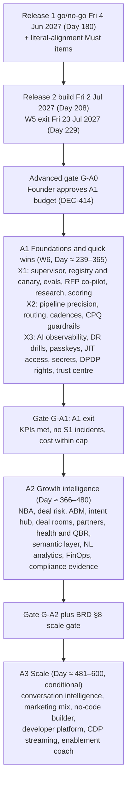

# AI Growth Engine: Employee Sales & Marketing Automation
## Application Blueprint: PART 9 (Batch 9.10), Revision v1.1 Consolidation: 100% Literal Match, Expert Panels and Advanced Capabilities Plan

| Field | Value |
|---|---|
| Document | Part 9, Batch 10: consolidation of revision v1.1 (Parts 9.6a/b, 9.7a/b, 9.8a/b, 9.9a/b) |
| Version | 1.1 · 28 Nov 2026 |
| Trigger | Founder instruction, 28 Nov 2026: "make it 100% match and also take the best personas who have strong expertise in this area and provide advanced features and functionalities and AI Agents. First identify, list them, come up with the improvisation plan and then incorporate it in the above document" |
| Baseline | Parts 0–9.5 (v1.0), DEC-001…233; approved budgets DEC-230 (Ledger A) and DEC-231 (Ledger B) |
| Roles applied | Product Owner, Business Systems Analyst, Solutions Architect, AI Governance Lead, QA Lead, FinOps Lead (coordination); the expert panels are listed in §9.10.2 |
| Tag ranges used | ASSUMPTION-750…752 · RECOMMENDATION-750…753 · DEC-410…422 · TC-REV-001…003 |

**Acronyms used in this part.** CDP customer data platform · CPQ configure, price, quote · DPDP Digital Personal Data Protection Act (India) · DR disaster recovery · FTE full-time equivalent · NBA next-best action · pd person-day · RAG retrieval-augmented generation · SLO service level objective.

## 9.10.1 What revision v1.1 does

| # | Instruction | What was done | Where |
|---|---|---|---|
| 1 | Make the blueprint a 100% match to the 38-document source pack | Every one of the 141 aspects that differed from the literal source text was aligned by a binding amendment decision (DEC-234…270, DEC-300…332). All 202 "not applicable" aspects were re-checked. 64 of them were real requirements and are now aligned; 138 remain not applicable with a confirmed reason. **Literal match: 11,131 / 11,131 = 100%** at alignment. After the Founder kept Claude Sonnet as primary (DEC-418): **11,129 / 11,131 = 99.98% literal**, with two Founder-approved deviations | Parts 9.6a, 9.6b; Part 0B §0B.7; §9.10.10 |
| 2 | Bring in the best expert personas | Three expert panels with 17 senior personas, plus two alignment teams (§9.10.2) | §9.10.2 |
| 3 | Identify and list the advanced features, functionalities and AI agents | 94 capabilities; 42 new AI agents (AG-039…080), 67 automations (AU-053…119), 24 workflows (WF-15…39) | Parts 9.7, 9.8, 9.9; §9.10.3; Part 9.4 |
| 4 | Produce an improvement plan | Three advanced releases (A1, A2, A3) after Release 2, with gates, dependencies, effort and cost | §9.10.5–§9.10.7 |
| 5 | Incorporate it into the document | Specified at full blueprint depth: 240 functional requirements (FR-ADV-X1/X2/X3), 96 user stories with Gherkin acceptance criteria, 258 test and evaluation cases (TC-ADV) plus 91 alignment tests (TC-ALN), 71 new screens, 26 ADRs and 100 decisions. Traceability is 100% (§9.10.8) | Parts 9.6–9.9; this part |

## 9.10.2 Expert panels (who was used, and for what)

| Panel | Persona | Expertise applied | Part |
|---|---|---|---|
| Literal alignment L1 (groups A–E) | Business Systems Analyst | Requirement-by-requirement comparison with the source text | 9.6a |
| | Solutions Architect | Architecture, workflow and API contract alignment | 9.6a |
| | Data Architect / DBA | Tables, columns, states, constraints and indexes | 9.6a |
| | Product Owner | Business-domain and UI alignment, scope effects | 9.6a |
| Literal alignment L2 (groups F–J) | QA Lead | Test IDs, quality controls, RTM and backlog alignment | 9.6b |
| | Security, Compliance and AI Governance Lead | Security, plugin and AI-routing alignment | 9.6b |
| | DevOps/SRE Lead | Environments, observability, DR, performance and release alignment | 9.6b |
| | FinOps Lead | Cost lines, budgets and alerts | 9.6b |
| X1 Advanced AI | Chief AI Officer | AI strategy, portfolio of agents, build-vs-buy | 9.7a/b |
| | Principal ML/LLM Engineer | Agent orchestration, tool use, memory, predictive models | 9.7a/b |
| | RAG and Prompt Engineering Lead | Retrieval, grounding, prompt contracts, localization | 9.7a/b |
| | AI Governance and Responsible AI Lead | Risk classification, oversight, fairness, red-teaming (EU AI Act, India DPDP, NIST AI RMF awareness) | 9.7a/b |
| | LLMOps/FinOps Engineer | Canary releases, drift, evaluation harness, token cost | 9.7a/b |
| X2 Advanced revenue growth | Chief Revenue Officer | Pipeline, forecasting, revenue model | 9.8a/b |
| | Revenue Operations Leader | Routing, territories, SLAs, attribution, data hygiene | 9.8a/b |
| | Growth and Demand-Generation Marketer | ABM, intent, cadences, experiments, content | 9.8a/b |
| | Sales Engineering and Proposal Lead | Deal rooms, mutual action plans, CPQ guardrails, RFP bids | 9.8a/b |
| | Customer Success and Expansion Leader | Health, QBR, renewal, expansion, voice of customer | 9.8a/b |
| | Partnerships and Channel Lead | Partner portal, deal registration, co-sell | 9.8a/b |
| X3 Advanced platform | CTO / Principal Solutions Architect | Multi-tenant platform, developer platform, workflow builder | 9.9a/b |
| | Chief Data Officer with senior data engineer and scientist | Unified profile, semantic metrics layer, natural-language analytics, data export | 9.9a/b |
| | CISO / SecOps Lead | Zero trust, passkeys, just-in-time access, secrets, supply chain, DPDP rights, compliance evidence | 9.9a/b |
| | SRE / Platform Lead | Multi-AZ, DR drills, chaos, SLO-driven remediation | 9.9a/b |
| | FinOps Lead | Unit economics per tenant, showback, rightsizing | 9.9a/b |
| | Lead UX, Design Systems and Accessibility Expert | PWA/offline, Indic UI, accessibility co-pilot, guidance | 9.9a/b |

## 9.10.3 Identified advanced capabilities and AI agents (the list)

### 9.10.3.1 New AI agents (42)

| ID | Agent | Panel | Release |
|---|---|---|---|
| AG-039 | Agent Supervisor and Planner (plans only; the execution engine executes under the PDP) | X1 | A1 |
| AG-040 | Account Research Agent (public and owned sources, cited) | X1 | A1 |
| AG-041 | Signal and Intent Fusion Analyst | X1 | A2 |
| AG-042 | Predictive Score Explainer (advisory propensity; DEC-011 unchanged) | X1 | A1 (shadow) / A2 (visible) |
| AG-043 | Next-Best-Action and Offer Advisor | X1 | A2 |
| AG-044 | Deal-Risk Early-Warning Analyst | X1 | A2 |
| AG-045 | Conversation Intelligence Analyst (consented notes) | X1 | A3 (conditional on legal review) |
| AG-046 | Objection-Handling Coach | X1 | A2 |
| AG-047 | RFP Response Co-pilot (AppNAI) | X1 | A1 |
| AG-048 | Price-Book Guidance Assistant (merged into AG-066 by DEC-410) | X1 | A2 |
| AG-049 | Personalization-at-Scale Variant Generator | X1 | A2 |
| AG-050 | Indic Localization Agent | X1 | A2 |
| AG-051 | Campaign Planner and Pacing Advisor | X1 | A2 |
| AG-052 | Experiment Designer and Analyst | X1 | A2 |
| AG-053 | Attribution and Marketing-Mix Analyst | X1 | A3 |
| AG-054 | Forecast Variance and Pipeline Hygiene Analyst (hygiene only; forecasting owned by AG-064, DEC-410) | X1 | A2 |
| AG-055 | Knowledge Curator and RAG Freshness Agent | X1 | A1 |
| AG-056 | Agent Red-Team and Drift Analyst (red-team owner; drift signals from AG-074, DEC-410) | X1 | A1 |
| AG-057 | Admin Command Bar Interpreter (RBAC-scoped) | X1 | A2 |
| AG-058 | WhatsApp Concierge with Human Handoff | X1 | A2 |
| AG-059 | Meeting-Prep Brief Agent | X1 | A2 |
| AG-060 | Data-Quality and Dedupe Steward | X1 | A1 |
| AG-061 | Account Plan and Buying-Committee Mapper | X2 | A1 for committee suggestions; plan drafting A2 |
| AG-062 | Signal Fusion "Why-Now" Brief Writer (consumes AG-041 output, DEC-410) | X2 | A1 |
| AG-063 | Multichannel Cadence Composer | X2 | A1; post-event drafts A3 |
| AG-064 | Pipeline Inspection and Forecast Risk Analyst | X2 | A1 |
| AG-065 | Deal Room and Mutual Action Plan Assistant | X2 | A2; AppNAI bid MAP A1 |
| AG-066 | CPQ Bundle Advisor and Guardrail Explainer (receives no prices) | X2 | A1 |
| AG-067 | Customer Health and QBR Narrative Analyst | X2 | A1 (explanations) · A2 (QBR, expansion) |
| AG-068 | Win/Loss and Voice-of-Customer Insight Synthesizer | X2 | A2 |
| AG-069 | Partner Match and Co-sell Brief Assistant | X2 | A2 |
| AG-070 | Enablement and Playbook Coach | X2 | A2 |
| AG-071 | Analytics Natural-Language Query Agent (returns a validated query plan; never sees rows) | X3 | A2 |
| AG-072 | Workflow Draft Composer (no-code builder) | X3 | A3 |
| AG-073 | SRE Remediation Advisor (human-approved runbooks) | X3 | A2 (drill debrief part in A1) |
| AG-074 | AI Observability Drift Analyst | X3 | A1 |
| AG-075 | Compliance Evidence Assessor | X3 | A2 |
| AG-076 | Accessibility Co-pilot | X3 | A2 |
| AG-077 | Supply-Chain Risk Analyst | X3 | A1 |
| AG-078 | Secrets Rotation Coordinator | X3 | A1 |
| AG-079 | Anomaly and Fraud Triage Agent | X3 | A2 |
| AG-080 | FinOps Optimization Agent | X3 | A1 |

Release placement is taken from each agent's specification card. Each panel sets its own windows within A1–A3: X1 uses A1 Day 239–365, A2 Day 366–480 and A3 Day 481–600; X3 uses A1 Day 239–299, A2 Day 302–362 and A3 Day 393–481. The consolidated gates in §9.10.5 apply to all three.

### 9.10.3.2 New business workflows (24)

| ID | Workflow | Panel |
|---|---|---|
| WF-15 | Supervised multi-agent account pursuit | X1 |
| WF-16 | Predictive model lifecycle | X1 |
| WF-17 | Deal-risk and churn early warning | X1 |
| WF-18 | RFP response co-pilot (AppNAI) | X1 |
| WF-19 | Localized personalization at scale | X1 |
| WF-20 | Experiment lifecycle (the single experimentation service, DEC-410) | X1 |
| WF-21 | Agent release, canary and red-team | X1 |
| WF-22 | Knowledge freshness and memory governance | X1 |
| WF-23 | WhatsApp concierge with human handoff | X1 |
| WF-25 | Account-based engagement | X2 |
| WF-26 | Lead-to-account match, route and speed-to-lead SLA | X2 |
| WF-27 | Multichannel cadence under consent | X2 |
| WF-28 | Deal room, mutual action plan and guarded quote | X2 |
| WF-29 | Pipeline inspection and forecast call | X2 |
| WF-30 | Partner referral, deal registration and co-sell | X2 |
| WF-31 | Customer health, QBR, renewal and expansion | X2 |
| WF-32 | Voice of customer and win/loss learning loop | X2 |
| WF-33 | DPDP data-principal-rights request | X3 |
| WF-34 | SLO breach auto-remediation with human approval | X3 |
| WF-35 | Automated DR drill and game day | X3 |
| WF-36 | Just-in-time privileged access elevation | X3 |
| WF-37 | Tenant bring-your-own-warehouse export | X3 |
| WF-38 | Tenant no-code workflow authoring to activation | X3 |
| WF-39 | Secrets rotation with overlap | X3 |

WF-24 and WF-40 are unused reserved numbers. The 67 automations (AU-053…079, AU-080…099, AU-100…119) are listed with their functionality in the regenerated catalogue (Part 9.4 §9.4.4).

### 9.10.3.3 Advanced features by panel (summary)

| Panel | Count | Headline features |
|---|---|---|
| X1 AI | 22 agents, 27 automations, 9 workflows; 16 screens A114–A129 | Supervisor/planner over existing agents; agent and prompt registry with canary rollout; evaluation harness; red-team and drift monitoring; long-term memory with consent and retention; RFP co-pilot; predictive scoring with explanations; NBA; deal-risk warning; Indic localization; experimentation; attribution and marketing mix; command bar; WhatsApp concierge. Ten candidates were rejected or deferred for safety or value (voice outreach, price recommendation, autonomous budget moves, LLM audience selection, call recording, fine-tuning and others); the compliance pre-check and gateway cost optimizer became deterministic automations (AU-067, AU-068) |
| X2 Revenue | 32 features, 10 agents, 20 automations, 8 workflows; 30 screens A130–A149, W35–W44; 44 business rules; KPI-ADV-X2-01…20 | ABM with target account lists and buying committees; consent-gated intent hub; lead-to-account matching and routing with speed-to-lead SLAs; territory and capacity planning; multichannel cadences (LinkedIn and calls as human tasks); deal rooms and mutual action plans; CPQ guardrails inside approved price books; partner portal and deal registration; customer health v2, QBR packs, renewal and expansion; NPS/CSAT; win/loss; pipeline inspection and forecasting with commit categories; multi-touch attribution and campaign ROI; landing pages and forms with experiments; events and webinars; healthy, non-coercive leaderboards; enablement hub; vertical playbooks for AppNAI, MedMaarg, EduVerse and OrganicSpec |
| X3 Platform | 30 capabilities, 10 agents, 20 automations, 7 workflows; 25 screens A150–A169, W45–W49; 10 ADRs; 22 NFR-ADV; 20 STRIDE threats | Unified profile and identity resolution with consent; event streaming and reverse ETL; semantic metrics layer; natural-language analytics; feature store; bring-your-own-warehouse export; AI observability; SLO-driven remediation; chaos and game days; multi-AZ hardening and automated DR drills; just-in-time admin with device posture; passkeys; BYOK (Enterprise); automated DPDP rights; continuous compliance evidence; secrets rotation; supply-chain security; anomaly and fraud triage; FinOps and showback; developer platform; no-code workflow builder; PWA with offline field mode; Indic UI (Website; Admin stays English per DEC-026); accessibility co-pilot; personalized dashboards; in-app guidance; status page and trust centre |

## 9.10.4 Overlaps between panels and how they were resolved

The panels worked in parallel, so some capabilities overlap. DEC-410 assigns one owner to each.

| Overlap | Items | Resolution (DEC-410) |
|---|---|---|
| Signal and intent | AG-041 (X1) and AG-062 plus the intent hub (X2) | One signal hub (X2 data model). AG-041 fuses and scores; AG-062 writes the "why-now" brief from AG-041's output. One score, one store |
| Forecasting | AG-054 (X1) and AG-064 (X2) | AG-064 owns pipeline inspection and the forecast call (WF-29). AG-054 is limited to pipeline hygiene findings feeding AG-064 |
| Price guidance | AG-048 (X1) and AG-066 (X2) | Merged into AG-066. AG-048's price-book explanation becomes an AG-066 capability; AG-048 is retired before build. Neither receives or proposes prices |
| Drift and red-team | AG-056 (X1) and AG-074 (X3) | AG-074 owns production drift and observability signals. AG-056 owns red-team and pre-release evaluation and consumes AG-074's drift alerts |
| Experimentation | AG-052 and WF-20 (X1); landing-page and form experiments (X2) | One experimentation service (WF-20) used by X2's pages and forms |
| Localization | AG-050 (X1); Indic UI (X3) | One translation memory and glossary. AG-050 localizes content; X3 owns UI string localization (Website only) |
| Data quality and identity | AG-060 (X1); identity resolution and unified profile (X3) | X3 owns the identity graph. AG-060 is the steward that proposes merges for human approval |
| Cost optimization | AU-068 (X1 gateway routing); AG-080 (X3 cloud FinOps) | AU-068 for model gateway routing only; AG-080 for cloud and tenant unit economics |

The overlaps reduce combined effort by an estimated 30 / 45 / 65 pd. **[ASSUMPTION-750]** Basis: one retired agent card (AG-048), one narrowed agent (AG-054), and three shared services each built once (signal store, experimentation, translation memory). Each is ≈ 8–16 pd of duplicated build and test effort.

## 9.10.5 Improvement plan (roadmap)

> **Erratum v1.2 (E-V-25):** superseded by release dates are indicative; dates follow the work (DEC-770). See Part 11.23c.




| Release | Window | Entry gate | Exit gate | Notes |
|---|---|---|---|---|
| Literal alignment (Must items) | Within Releases 1 and 2 | DEC-412 | Release 1 and 2 gates as defined | Funded by a change request or absorbed with a short slip (§9.10.6.2) |
| A1 | W6, Day ≈ 237–365 | G-A0: W5 exit passed; A1 budget approved (DEC-414); contract team onboarded | G-A1: A1 KPIs met for 30 days; no unresolved S1; AI cost within line B24; evaluation and red-team gates green for each new agent | Each panel's part lists its A1 items |
| A2 | Day ≈ 366–480 | G-A1 passed; A2 budget approved | G-A2: A2 KPIs; isolation and consent audits clean | |
| A3 | Day ≈ 481–600 | G-A2 plus the BRD §8 scale gate | Programme close and benefits review | Conditional on scale |

Dates are indicative day numbers from programme start. They will be fixed to calendar dates when A1 is approved.

## 9.10.6 Effort

### 9.10.6.1 Advanced capabilities (person-days)

| Panel | Low | Central | High | Of which A1 (low / central / high) |
|---|---|---|---|---|
| X1 AI agents and intelligence (Part 9.7b) | 292 | 435 | 627 | 156 / 232 / 332 |
| X2 Revenue growth (Part 9.8b) | 268 | 376 | 508 | 98 / 138 / 185 |
| X3 Platform, data, security, experience (Part 9.9b) | 396 | 588 | 855 | 137 / 205 / 305 |
| Overlap deduction (§9.10.4) | −30 | −45 | −65 | −15 / −22 / −32 |
| **Total advanced** | **926** | **1,354** | **1,925** | **376 / 553 / 790** |

**Staffing implication.** A1 at 553 pd central over about 90 working days needs about 6 FTE beyond the core team. The panels proposed extending the two contract engineers past Day 208 and adding contract AI/LLM, data and SRE/security engineers (Part 9.7b §9.7.13, Part 9.8b §9.8.12, Part 9.9b §9.9.12; ASSUMPTION-700). **[RECOMMENDATION-750]** Approve A1 only now. Decide A2 and A3 at gates G-A1 and G-A2, with the A1 actuals as the basis.

### 9.10.6.2 Literal alignment (person-days)

| Part | Low | Central | High | Release 1 Must (central) |
|---|---|---|---|---|
| 9.6a (groups A–E) | 32.75 | 59.5 | 97.5 | 43.5 |
| 9.6b (groups F–J) | 32.5 | 53.7 | 81.3 | 37.0 |
| **Total** | **65.25** | **113.2** | **178.8** | **80.5** |

Release 1 Must alignment work (≈ 80.5 pd central) exceeds the ≈ 31 pd management reserve by about 50 pd. **DEC-412** sets the default and offers an alternative:

- **Default:** fund the work as change request CR-ALN-01, using the contract engineers already approved under Option 2b for extra days.
- **Alternative:** accept a Release 1 go/no-go about 1.5–2 weeks later, decided at the Sprint 3 review.

## 9.10.7 Cost: separately approvable proposals (approved budgets DEC-230/231 unchanged)

All figures are **estimates**. Rates come from Part 8.4: ₹4,545–6,818 per person-day. Provider and tool prices: verify at time of implementation (as of 27 Nov 2026).

### 9.10.7.1 Development cost (one-time)

| Item | Low | Central | High | Basis |
|---|---|---|---|---|
| Literal alignment (CR-ALN-01) | ₹2.97 L | ₹6.43 L | ₹12.19 L | 65.25 / 113.2 / 178.8 pd × ₹4,545 / ₹5,682 / ₹6,818. This supersedes the partial figure CR-ALN-B-01 in Part 9.6b, which priced only the new Release 1 Musts of groups F–J |
| X1 AI agents and intelligence | ₹14.8 L | ₹27.3 L | ₹46.5 L | Part 9.7b §9.7.14 |
| X2 Revenue growth | ₹27.27 L | — | ₹42.08 L | Part 9.8b §9.8.13 |
| X3 Platform, data, security, experience | ₹37.5 L | — | ₹58.9 L | Part 9.9b §9.9.13 (cash basis) |
| Overlap deduction | −₹1.36 L | — | −₹4.43 L | 30 pd × ₹4,545; 65 pd × ₹6,818 |
| **Total advanced (X1–X3)** | **₹78.2 L** | — | **₹143.0 L** | All releases A1–A3 |
| **A1 only (recommended start)** | **≈ ₹28.0 L** | — | **≈ ₹55.4 L** | X1 A1 ₹7.10–22.62 L (Part 9.7b); X2 A1 ≈ ₹10.0–15.3 L (pro rata to A1 effort 98/268 and 185/508 **[ASSUMPTION-751]**); X3 A1 ₹10.9–17.5 L (Part 9.9b) |

### 9.10.7.2 Subscription and running cost (recurring, per month)

> **Erratum v1.2 (E-V-05):** superseded by hosting is Vercel + Supabase + AWS in Mumbai with an EU stack (DEC-421/772/786). See Part 11.23c.


| Item | Low | High | Basis |
|---|---|---|---|
| Literal alignment (CR-ALN-02) | ₹1,495 | ₹10,120 | Part 9.6b §9.6b.7, including contingency (self-hosted observability, local inference baseline) |
| X1 running (tools, hosting, AI line B24 capped at ₹2,000 for the pilot) | ₹4,544 | ₹10,532 | Part 9.7b §9.7.14 |
| X2 running (open-source first; paid tools off until benchmarked and approved) | ₹2,148 | ₹6,867 | Part 9.8b §9.8.13 |
| X3 running (cloud, tools) | ₹4,359 | ₹18,699 | Part 9.9b §9.9.13 |
| **Total recurring, all advanced releases at steady state** | **₹12,546** | **₹46,218** | Sum. Added to the approved Ledger B only once each release is approved |
| *Conditional:* pilot topology on ALB, Fargate and ElastiCache (DEC-243) | ₹4,500 | ₹8,000 | Only if approved; otherwise the source contract is met at the scale gate |
| *Conditional:* dedicated local-inference instance (DEC-301) | ₹4,600 | ₹13,800 | Only if the CPU baseline fails the latency benchmark |
| *Conditional:* RDS Multi-AZ | ₹2,875 | ₹6,900 | Only if availability falls below 99.9% in two consecutive months |

The AI usage of the X2 agents (≈ ₹390/month) and X3 agents (≈ ₹289–865/month) fits inside the existing DEC-008 ceilings. The X1 agents use the new capped line B24, because line B02's high scenario is already at ≈ 101% of ₹3,000 (Part 9.7b).

## 9.10.8 Traceability of the v1.1 additions

Generated by `assembly/build_rtm_adv.py` into `final/RTM_advanced.csv`. Original and enhancement traceability (Part 6.6) is unchanged at 100%.

| Item | Traced | Rule |
|---|---|---|
| FR-ADV-X1/X2/X3 functional requirements | 240 / 240 (100%) | Each has at least one TC-ADV test, directly or through its story |
| User stories US-<EP>-V1/V2/V3 | 96 / 96 (100%) | Each links to an FR-ADV and has Gherkin acceptance criteria and tests |
| New agents AG-039…080 | 42 / 42 (100%) | Each has a full specification card and evaluation tests |
| New automations AU-053…119 | 67 / 67 (100%) | Each links to an FR-ADV or a test |
| New workflows WF-15…39 | 24 / 24 (100%) | Each links to its FRs, agents or automations |
| Decisions DEC-234…270, 300…332, 380…409 | 100 / 100 | Recorded in their decision tables. Every alignment decision has a TC-ALN test |
| Source-pack aspects | 11,131 / 11,131 with an approved disposition: 11,129 literal matches (99.98%) and 2 Founder-approved deviations (DEC-418) | Part 0B §0B.7 |

## 9.10.9 Decisions

| DEC | Decision | Authority | Effect |
|---|---|---|---|
| DEC-410 | **Single owner for each overlapping capability**, as listed in §9.10.4. AG-048 is merged into AG-066 and retired before build; AG-054 is narrowed to hygiene | Expert-panel consolidation; Founder instruction 28 Nov 2026 | Removes duplicated build (≈ 30–65 pd). The catalogue keeps AG-048 for traceability, marked "merged into AG-066" |
| DEC-411 | **Advanced roadmap A1, A2, A3** with gates G-A0, G-A1 and G-A2 (§9.10.5). Releases 1 and 2 keep their approved scope and dates, apart from the literal-alignment Must items | Expert-panel recommendation; Founder instruction 28 Nov 2026 | Advanced work starts only after W5 exit and only with an approved budget |
| DEC-412 | **Release 1 literal-alignment work:** fund as change request CR-ALN-01 (default), or accept a Release 1 go/no-go about 1.5–2 weeks later | Proposed; **approved by DEC-416 (fund)** | Protects the 4 Jun 2027 date if funded |
| DEC-413 | **Model routing after literal alignment (DEC-301):** the source pack requires open-source/self-hosted inference first, with paid models as an allowance-gated fallback. This changes the original instruction that Claude Sonnet is the primary model. To keep the 100% literal match, DEC-301 governs. **The Founder may override** and restore Claude Sonnet as primary. The match would then fall by the aspects DEC-301 aligned, and the blueprint records that deviation | Literal alignment; **overridden by DEC-418 (Claude Sonnet primary)** | Routing order: Tier 0 rules and cache → local open model → Claude (Haiku-class, then Sonnet-class) within the per-tenant allowance, with redaction → free fallbacks (non-personal data only, off by default) → degrade. Safety invariants unchanged |
| DEC-414 | **Advanced budget proposal:** development ₹78.2–143.0 L for A1–A3 (A1 only ≈ ₹28.0–55.4 L); recurring ₹12,546–46,218/month at steady state. Kept separate from the approved Ledgers A and B (DEC-230/231) | Proposed; **A1 approved by DEC-417**; A2 and A3 at their gates | Nothing is spent on advanced work until approved |
| DEC-415 | **Precedence after v1.1:** Part 9.10 > Parts 9.6–9.9 > Part 9.5 §9.5.2.9 > Part 8.4 > Part 9.5 > Part 9.1 > Part 0A > earlier part text > source documents. Literal-alignment decisions (DEC-234…332) override any earlier decision that conflicted with the source pack | Blueprint governance | Removes ambiguity between the v1.0 and v1.1 decisions |

## 9.10.10 Founder decisions recorded (28 Nov 2026)

The Founder decided the three open items on 28 Nov 2026 ("approve DEC-412 and DEC-414, keep Claude Sonnet as primary").

| DEC | Decision | Authority | Effect |
|---|---|---|---|
| DEC-416 | **DEC-412 approved: the Release 1 literal-alignment work is funded** as change request CR-ALN-01, using additional days of the contract engineers approved under Option 2b (DEC-228). The release dates of record are unchanged | **Founder / Product Owner instruction in this engagement, 28 Nov 2026** | CR-ALN-01 one-time development **₹2.79–11.64 L** (central ₹6.09 L; 61.25 / 107.2 / 170.8 pd after the DEC-418 reduction). Recurring CR-ALN-02 **up to ₹1,495–10,120/month**, an upper bound now that DEC-418 removes the local-inference baseline. Release 1 go/no-go stays **Fri 4 Jun 2027 (Day 180)**; Release 2 build stays **Fri 2 Jul 2027 (Day 208)** |
| DEC-417 | **DEC-414 approved for release A1.** The one-time development budget for advanced release A1 is **≈ ₹28.0–55.4 L**. Recurring costs of A1 items are added to Ledger B as each item goes live, within the per-release running figures in Parts 9.7b, 9.8b and 9.9b. **A2 and A3 are not yet approved**; they are decided at gates G-A1 and G-A2 under DEC-411, using the A1 actuals | **Founder / Product Owner instruction in this engagement, 28 Nov 2026** | Procurement of the A1 contract team (AI/LLM, data, SRE/security engineers; ASSUMPTION-700, ASSUMPTION-752) starts at the Release 2 build gate (Day 208). Gate G-A0 is satisfied for budget; the W5-exit condition still applies. A1 runs W6, Day ≈ 239–365 |
| DEC-418 | **DEC-413 resolved: Claude Sonnet stays the primary model.** DEC-301 is superseded. The routing order of record returns to the original design: **Tier 0 rules and cache → Tier 1a lighter Claude (Haiku-class) → Tier 1b Claude Sonnet, the primary model for quality-critical generation → Tier 2 free fallbacks (Public/Internal non-personal data only, opt-in, default off) → Tier 3 graceful degradation.** Two elements of DEC-301 are kept because they do not compete with Claude as primary. First, a **zero-allowance degraded mode**: the platform keeps working on Tier 0 and Tier 3 if no paid AI allowance exists. Second, an **optional self-hosted open model** as a resilience fallback during a Claude outage, for non-restricted data only, enabled per tenant after the W1 benchmark | **Founder / Product Owner instruction in this engagement, 28 Nov 2026** (overrides the literal source-pack reading) | **Literal match:** two aspects become Founder-approved deviations. **F15-052** (doc 15: paid AI only as a conditional fallback) and **F21-015** (doc 21: local model gateway in front of the paid tier). The result is **11,129 / 11,131 = 99.98% literal**, and 100% of applicable aspects have an approved disposition (Part 0B §0B.7). **Effort:** DEC-301's 6 / 9 / 13 pd falls to 2 / 3 / 5 pd (zero-allowance mode and optional fallback adapter). **Cost:** the conditional dedicated local-inference instance (₹4,600–13,800/month) is removed. AI usage returns to the approved DEC-008 ceilings and Ledger B line B02 (DEC-231). **Tests:** TC-ALN-B-002 and TC-ALN-B-003 (local-first routing) are superseded by TC-REV-001…003 below. **Safety invariants unchanged** |
| DEC-419 | **Build-time tooling approved** as recommended in the Cost Estimate v1.0 (§7). Claude Max 5x for the 6 engineers, plus Claude Pro for QA, the growth/compliance lead and the PO, alongside the 2 baseline seats. Also GitHub Team, Figma Professional (2), Google Workspace (skip if already owned), Bitwarden Teams, BrowserStack Live and domain names | **Founder / Product Owner instruction in this engagement, 28 Nov 2026** ("approve the recommended build-time tooling") | **≈ $821–857 per month (₹73,890–77,094)** during the build, in addition to Ledger B (DEC-231); about $6.6–6.9k (₹5.9–6.2 L) over the 8 core build months. After the build, seats fall to the maintenance team. Prices are list prices; verify at purchase |
| DEC-420 | **AI-built delivery approach adopted, with a Sprint 2 calibration gate** (Cost Estimate v1.1). From Sprint 0 the approved team builds with AI models and AI agents under the v1.1 §2 operating model and guardrails. Every change goes through a human-reviewed pull request, agents cannot merge or deploy, agent sandboxes hold synthetic data only, and SAST, licence and secret scans plus a provenance log gate every merge. Architecture, security, PDP, money handling and AI guardrails stay human-owned. **Team, dates and Ledger A stay as approved until the gate.** **Calibration gate at the end of Sprint 2 (≈ Day 45):** measure net saving = 1 − (actual engineer-days ÷ planned engineer-days for accepted Sprint 1–2 scope). Quality guards: defects escaping to SIT no more than 20% above plan; no unresolved critical or high security findings; review backlog under 2 days. **If net saving ≥ 20% and the guards hold:** option A (keep the dates; release the second contract engineer from Sprint 3, which updates Ledger A by change control) is the default. The Founder may choose option B (keep the team; bring Release 1 forward) at the gate. **If 10–20%:** keep the approved team and dates and keep the AI tooling. **If < 10%:** keep the approved plan and revert to the DEC-419 tooling | **Founder / Product Owner instruction in this engagement, 28 Nov 2026** ("approve the AI-built approach with the Sprint 2 calibration gate") | **Tooling:** AI-built tooling replaces the Claude part of DEC-419 (Claude Max 20x for 5 engineers, Pro × 3, CI sandboxes, self-hosted agent observability). Total ≈ **$1,336–1,527 per month (₹1.20–1.37 L)**, about $475–630 more than DEC-419. **Build-agent Claude API:** hard cap **$1,500 per month (₹1.35 L)** with alerts at 70/90/100%; expected ≈ $4.5k over the approved scope (central). **Expected effect if the gate passes (central):** approved-scope development ≈ ₹85.1 L instead of ₹1.16 Cr (option A), or Release 1 go/no-go ≈ Wed 21 Apr 2027 (option B). These are build-time costs, separate from Ledger B; the application and its running costs are unchanged. **The gate result and the option chosen are recorded as a new decision** |
| DEC-421 | **Hosting stack: Vercel + Supabase + AWS ap-south-1 (Mumbai)**, replacing the AWS-only hosting design (Part 3.1; ADR-013, ADR-100; DEC-243 superseded). **Vercel Pro** hosts the two React frontends as separate projects on separate origins. They are static builds served from Vercel's CDN with its firewall; any Vercel functions are pinned to the Mumbai region and process no personal data. **Supabase Pro (Mumbai region)** is the managed PostgreSQL, with row-level security, pgvector and storage; daily backups are included and point-in-time recovery is added at the growth gate. **AWS ap-south-1** keeps the Django REST API, Celery and Celery Beat workers, Valkey, Amazon SES, S3 for files and the cross-region DR copies. **Controls unchanged:** browsers never talk to Supabase directly (only the Django API does, with the service key held server-side), Supabase Auth is not used (Django identity, MFA and passkeys remain), tenant isolation stays enforced by RLS, and the PDP, outbox, audit and data residency in India are unchanged. Vercel and Supabase pass the procurement gate (vendor record, DPA, data-residency review) before production use. A nightly logical backup to S3 keeps the blueprint RPO independent of the provider | **Founder / Product Owner instruction in this engagement, 28 Nov 2026** ("approve the Vercel and Supabase stack decision") | **Running cost (pilot hosting):** Vercel ₹1,800–3,600 + Supabase ₹3,600–5,400 + AWS ₹2,700–4,050 + DR storage ₹300–600 = **₹8,400–13,650 per month**, against ₹6,600–9,400 for the AWS-only lines B01/B20/B21. That is **≈ ₹1,800–4,250 more per month**, absorbed first by the 15% contingency (B11), with any remainder through change control on Ledger B (DEC-231). **Operations:** less infrastructure for one person to run (managed database, backups, CDN, previews). **Literal match:** source-pack aspect **B-TC-08** (doc 04/09 deployment contract: ALB/ECS Fargate, RDS, ElastiCache, S3/CloudFront, Secrets Manager, CloudWatch/WAF) becomes a Founder-approved deviation. Literal match is now **11,128 / 11,131 = 99.97%**, and every applicable aspect still has an approved disposition. **Quotation:** the solo-builder quotation v2.0 is built on this stack |
| DEC-422 | **Revised running budget approved (Ledger B re-based for DEC-421).** Pilot running is now **₹26,105–35,362 per month**, including the 15% contingency and the 2 Claude seats (B09). This replaces ₹19,895–26,335 base / ₹24,035–30,475 with seats (DEC-231). Hosting lines B01a Vercel Pro ₹1,800–3,600, B01b Supabase Pro + compute ₹3,600–5,400, B01c AWS ap-south-1 ₹2,700–4,050, plus B20 DR storage ₹300–600; all other lines are unchanged. Running cost during the build (Day 1–208): **₹1.65–2.14 L** (was ₹1.47–1.75 L). Scale design points: growth **₹59,000–79,000**, including Supabase point-in-time recovery; scale **₹1.39–1.79 L** per month | **Founder / Product Owner instruction in this engagement, 28 Nov 2026** ("approve the revised running budget increase") | **+₹2,070–4,888 per month** against the previously approved budget with seats. Alerts at 70/90/100% per line continue (DEC-162). The AI hard caps are unchanged (B02 ₹3,000, B23 ₹1,000, B24 ₹2,000). The approved one-time budgets are unchanged (Ledger A DEC-230, CR-ALN-01 DEC-416, A1 DEC-417) |

**Verification tests for DEC-418.**

```gherkin
Feature: Model routing of record after DEC-418 (TC-REV-001…003)

  Scenario: TC-REV-001 Claude Sonnet is primary for quality-critical generation
    Given a tenant with a paid AI allowance and the default routing policy
    And a proposal-drafting request that Tier 0 cannot answer from rules or cache
    When the model gateway routes the request
    Then it is served by Tier 1b Claude Sonnet, or by Tier 1a first where the task class allows and escalates on low confidence
    And no local or free model is called before the Claude tiers
    And the routing decision, tier and cost are written to the AI cost ledger

  Scenario: TC-REV-002 Zero-allowance degraded mode keeps the platform usable
    Given a tenant whose paid AI allowance is zero or exhausted
    When a user requests an AI draft
    Then the gateway answers from Tier 0 templates or returns a Tier 3 degraded response with a manual task
    And no paid model call is made
    And no restricted or personal data is sent to any free-tier model

  Scenario: TC-REV-003 Optional local fallback only during a Claude outage
    Given the optional self-hosted model is enabled for the tenant after the W1 benchmark
    And the Claude tiers are unavailable (circuit breaker open)
    When a request classed Public or Internal non-personal arrives
    Then the local model may serve it, labelled as fallback output for human review
    And a request containing Confidential, Restricted or personal data is not sent to it and degrades to Tier 3
```

**Open items after these decisions.** Legal confirmations (Part 8), the identity spike, provider onboarding from Sprint 0, and price verification at implementation (as of 27 Nov 2026).

## 9.10.11 Tags register

| Tag | Statement | Status |
|---|---|---|
| ASSUMPTION-750 | Overlap deduction of 30 / 45 / 65 pd (§9.10.4) | Open; validate at A1 planning |
| ASSUMPTION-751 | X2 A1 development cost taken pro rata to A1 effort | Open; validate at A1 planning |
| ASSUMPTION-752 | A1 runs at about 6 FTE beyond the core team over ≈ 90 working days | Open; validate at gate G-A0 |
| RECOMMENDATION-750 | Approve A1 only; decide A2 and A3 at their gates | Accepted (DEC-417) |
| RECOMMENDATION-751 | Fund the Release 1 alignment work to protect the date | Accepted (DEC-416) |
| RECOMMENDATION-752 | Benchmark the local model against Claude at W1 before fixing the routing order for each task class | Superseded by DEC-418 (Claude Sonnet primary); the W1 benchmark now only qualifies the optional outage fallback |
| RECOMMENDATION-753 | Regenerate the AI catalogue, registers and RTM after every change to Parts 9.6–9.9 | Accepted (assembly scripts) |

## 9.10.12 Quality gate: Batch 9.10

| # | Check | Result | Notes |
|---|---|---|---|
| 1 | Every requirement traced to a source | Pass | Alignment decisions quote the source text; advanced FRs link to BRs, FRs and source documents in Parts 9.7–9.9 |
| 2 | Assumptions, gaps and conflicts tagged and logged | Pass | §9.10.11; panel registers in each part |
| 3 | IDs unique and consistent | Pass | Allocated ranges used. AG-048 retained as "merged" for traceability |
| 4 | No story without AC; no requirement without a test | Pass | §9.10.8: 100% |
| 5 | Negative, edge, security and accessibility cases | Pass | Panels' test sections, including red-team, isolation, consent and accessibility |
| 6 | Every agent has a guardrail, fallback, KPI and cost | Pass | Full cards in Parts 9.7b, 9.8b and 9.9b |
| 7 | Time-sensitive facts flagged "verify" | Pass | All prices and model names as of 27 Nov 2026 |
| 8 | No restricted data to free-tier models | Pass | Tier 2 remains non-personal only, off by default. NL analytics never sends rows to a model |
| 9 | Consistent with earlier parts | Pass with notes | Inconsistencies reported by the panels are listed in each part's register. DEC-413 records the routing change for the Founder |

**Status: Part 9 Batch 9.10 complete. Revision v1.1: literal match 99.98% (11,129 / 11,131; two Founder-approved deviations under DEC-418, Claude Sonnet primary), 17 expert personas in three panels plus two alignment teams, 42 new AI agents, 67 automations and 24 workflows specified and traced; DEC-412 funded (DEC-416), advanced A1 approved (DEC-417).**
