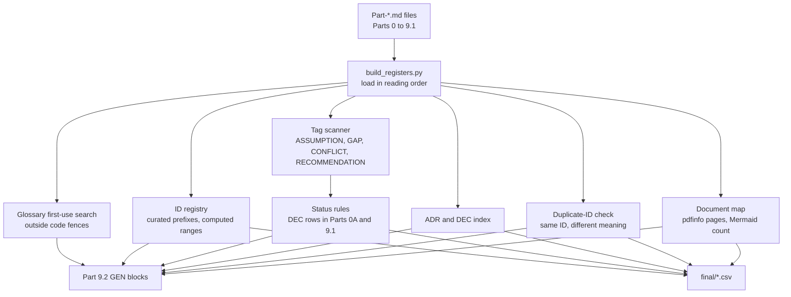

# AI Growth Engine: Employee Sales & Marketing Automation
## Application Blueprint: PART 9 (Batch 9.2), Appendices: Glossary, ID Registry and Consolidated Registers

| Field | Value |
|---|---|
| Document | Part 9, Batch 2 (appendices) |
| Version | 1.0 · 27 Nov 2026 |
| Purpose | One place to look up every term, every ID family and every tag issued across the blueprint, with the resolution status of each conflict and recommendation, and a map of all part files |
| Baseline | Parts 0, 0A, 1, 2.1–2.5, 3.1–3.3, 4.1–4.3, 5.1a–5.3, 6.1 and the Part 6 test-case batches present at build time, 7.1–7.3, 9.1 (DEC-066…108) |
| Generator | `blueprint/assembly/build_registers.py` (standard-library Python + `pdfinfo`). It scans every `Part-*.md` except this file, fills the generated blocks below and writes CSVs to `blueprint/final/` |
| Roles applied | Business Systems Analyst (lead: glossary, registers), Product Owner (resolution status), Solutions Architect (ADR index), QA Lead (ID integrity and duplicate check), Technical Writer (document map) |

**How to read this batch.** Sections 9.2.1 (glossary terms and definitions), 9.2.6 (duplicate-ID analysis) and 9.2.8 (quality gate) are written by hand. Everything between `GEN` markers is produced by the script and must not be edited by hand: re-run the script instead. The script is deterministic, so two runs on the same parts give the same output. Statements in the consolidated registers are **copied from the issuing part** [ASSUMPTION-210]. The issuing part stays authoritative, and Part 9.1 overrides both where it decides.

**Acronyms defined in this part:** BSA (Business Systems Analyst), CSV (comma-separated values), ID (identifier), DEC (decision record). All other acronyms are defined in the glossary.

---

## 9.2.0 Generation method and controls

| Control | Rule applied by the script | Why |
|---|---|---|
| Reading order | Part 0 → 0A → 1 → 2.1 … 9.1, with sub-batches (5.1a, 5.1b, …) in order | "First seen" and "first use" must follow the order a reader meets them |
| Code fences | Mermaid, Gherkin and code blocks are skipped for glossary first use | A term inside a diagram label is not a definition point |
| Tag statement | Taken from the issuing part's register row (first cell = tag). When no register row exists, the text of the line of first use is taken | The register row is the issuer's own wording [ASSUMPTION-210] |
| Mentions of unused numbers | Lines that say "not used", "unused" or "not issued" do not count as an occurrence | Batch registers list allocated-but-unused numbers; these are not tags |
| CONFLICT status | "Resolved — Part 0A / 9.1 (DEC-…)" when a DEC row in Part 0A or 9.1 cites the conflict, including ranges such as `CONFLICT-001…014` and short lists such as `CONFLICT-112/101`. Otherwise "Resolved locally" when the issuing register row states a resolution, else "Open" | [ASSUMPTION-211] |
| RECOMMENDATION status | "Accepted" when a DEC row or the Part 0A §G summary accepts it, or its own register row says accepted/adopted. Otherwise "Proposed" (awaiting the named owner) | [ASSUMPTION-211] |
| ID ranges | Computed from every mention, including citations. Fixture identifiers used inside Gherkin and test data (for example `OPP-7001`, `CMP-9`, `INV-OS-2027-0042`) are not ID families and are excluded | ASSUMPTION-153 makes all AC data synthetic [ASSUMPTION-214] |
| Page counts | `pdfinfo` on each part's PDF at build time | [ASSUMPTION-212] |

---

## 9.2.1 Glossary

Columns: **Term** (bold = the searchable key), **Definition** (with the governing source), **First use** (part and section where the key first appears in reading order, computed by the script [ASSUMPTION-213]). Where a term first appears in a front-matter table, "front matter" is shown.

### 9.2.1.1 Acronyms and abbreviations

<!-- GLOSSARY:BEGIN -->

| Term | Definition | First use |
|---|---|---|
| **AA** (WCAG conformance level AA) | The middle WCAG conformance level. The blueprint targets WCAG 2.2 AA for Website, Portal and Admin (RECOMMENDATION-001, accepted; DEC-098) | Part 0 §0.3.3 |
| **ABAC** (Attribute-Based Access Control) | Access decisions from attributes of user, resource and context (scope, ownership, MFA age, data class) in addition to role. Rules ABAC-01…12 (Part 2.3) | Part 0 §0.11 |
| **ACM** (AWS Certificate Manager) | AWS service that issues and renews TLS certificates for CloudFront and the load balancer, including verified tenant custom domains | Part 3.1 §3.1.13.3 |
| **ADOT** (AWS Distro for OpenTelemetry) | AWS-supported OpenTelemetry collector that ships traces and metrics to X-Ray and CloudWatch (ADR-058) | Part 3.1 ADR-025 Observability: OpenTelemetry, Se |
| **ADR** (Architecture Decision Record) | A recorded architecture decision with context, alternatives, consequences and review trigger. Index in §9.2.5(e) | Part 0 §0.3.3 |
| **AES** (Advanced Encryption Standard) | Symmetric cipher. AES-256-GCM is used for field-level envelope encryption of Restricted fields (ADR-056) | Part 3.3 §3.3.16.4 |
| **AI** (Artificial Intelligence) | In this product: model-assisted drafting, classification, extraction, matching and summarising. AI never signs, pays, submits bids or sets prices (DEC-064, ADR-082) | Part 0 |
| **AIE** (AI evaluation test) | Test type for AI behaviour: grounding, abstention, injection resistance, output schema, cost (Part 4.1 abbreviation, used in Part 6) | Part 4.1 §4.2.1 |
| **ALB** (Application Load Balancer) | AWS layer-7 load balancer in front of the API process groups | Part 3.1 front matter |
| **API** (Application Programming Interface) | Here, the REST/JSON interface of the backend. The derived catalogue holds 555 operations API-001… (DEC-015, DEC-104) | Part 0 §0.1.2 |
| **ASGI** (Asynchronous Server Gateway Interface) | Python interface for asynchronous web servers; relevant if Server-Sent Events are added later (ADR-034) | Part 3.1 §3.1.8 |
| **ASVS** (Application Security Verification Standard) | OWASP checklist of security requirements; Level 2 is the verification target (RECOMMENDATION-073) | Part 6.1 front matter |
| **AWS** (Amazon Web Services) | The cloud provider; primary region ap-south-1 Mumbai (ASSUMPTION-004, DEC-040) | Part 0 §0.3.2 |
| **AZ** (Availability Zone) | An isolated data-centre group inside an AWS region. Pilot runs single-AZ app + PITR database; Multi-AZ at the scale gate (DEC-040, DEC-079) | Part 0 §0.4 |
| **B2B** (Business-to-Business) | Sales to organisations (institutions, enterprises, buyers), the main motion for AppNAI, MedMaarg and OrganicSpec | Part 0 §0.7 |
| **BFF** (Backend for Frontend) | A server-side layer per frontend that holds the OIDC session, exchanges tokens and exposes only that surface's routes (ADR-005) | Part 0A §E |
| **BFLA** (Broken Function-Level Authorization) | OWASP API risk: calling an operation the role must not call. Covered by RBAC tests and AZ- layers (Part 4.1) | Part 4.1 TB-04 BFF/API and domain services |
| **BOLA** (Broken Object-Level Authorization) | OWASP API risk: reading or changing another tenant's or user's object by ID. Covered by RLS + object grants (Part 4.1) | Part 4.1 TB-02 External portal |
| **BR** (Business Requirement) | Requirement at business level: BR-M01…M66, BR-S001…S140, group BRs BR-TENANT/WEB/AUTO/SVC/QA (Part 1 §1.12; DEC-059) | Part 0 §0.3.1 |
| **BRD** (Business Requirements Document) | One of the two source documents. Cited as BRD §n per the Part 0 §0.1.2 convention | Part 0 front matter |
| **BRIN** (Block Range Index) | PostgreSQL index type for very large, time-ordered tables (audit, events) (Part 3.3) | Part 3.3 §3.3.1.3 |
| **BRL** (Business Rule) | Deterministic business rule BRL-<domain>-## (162 in Part 2.3), e.g. BRL-ELG eligibility, BRL-AI AI guardrails | Part 0 §0.11 |
| **BVA** (Boundary Value Analysis) | Test technique on thresholds and limits; data rows BVA-D01… (Part 6.1) | Part 0 §0.11 |
| **CAN-SPAM** (Controlling the Assault of Non-Solicited Pornography And Marketing Act) | US law on commercial e-mail: identification, opt-out, physical address (ASSUMPTION-003; Part 4.1) | Part 0 §0.4 |
| **CASL** (Canada's Anti-Spam Legislation) | Canadian law requiring express or implied consent for commercial electronic messages (CA-R rules, Part 4.1) | Part 0 §0.4 |
| **CDN** (Content Delivery Network) | CloudFront, serving publication snapshots and static assets (ADR-010) | Part 0 §0.3.3 |
| **CERT-In** (Indian Computer Emergency Response Team) | Indian national CERT; its directions require incident reporting within 6 hours and log retention of 180 days (verify, as of 27 Nov 2026) (DEC-078) | Part 4.1 §4.10.2 |
| **CGST** (Central Goods and Services Tax) | Central half of intra-state GST, charged with SGST (DEC-027) | Part 0A §C |
| **CI** (Continuous Integration) | Automated build, test and scan on every change (GitHub Actions, ADR-026). Not to be confused with **CI-###** candidate AI ideas (Part 7.1) | Part 0 §0.8 |
| **CI/CD** (Continuous Integration / Continuous Delivery) | The pipeline from commit to production with gates PL-01… (Part 4.3) | Part 0 §0.11 |
| **CLS** (Cumulative Layout Shift) | Core Web Vital for visual stability of public pages (Part 4.2) | Part 2.5 §2.48 |
| **CMK** (Customer-Managed Key) | KMS key controlled by the operator, per data domain (ADR-055) | Part 4.1 front matter |
| **CORS** (Cross-Origin Resource Sharing) | Browser rule set controlling which origins may call the API; locked to the product's own origins (Part 4.1) | Part 1 §1.12.2 |
| **CRM** (Customer Relationship Management) | Organisations, contacts, deals, stages and activities (module group around A018, A029, A032) | Part 0 §0.4 |
| **CSP** (Content Security Policy) | HTTP header restricting script and resource origins on Website, Portal and Admin (Part 4.1) | Part 4.1 front matter |
| **CSRF** (Cross-Site Request Forgery) | Attack that makes a signed-in browser send an unwanted request; mitigated by SameSite cookies and tokens in the BFF (Part 4.1) | Part 3.1 §3.1.4.1 |
| **CTA** (Call to Action) | Button or link that asks the visitor to act (enquire, book, download) on public pages | Part 2.1 §2.4.1 |
| **CVSS** (Common Vulnerability Scoring System) | Severity score used to set vulnerability fix deadlines (Part 4.1) | Part 4.1 §4.16.3 |
| **DAG** (Directed Acyclic Graph) | Shape of a declarative workflow: approved node types, no cycles (DEC-051, ADR-027) | Part 0A §D |
| **DAST** (Dynamic Application Security Testing) | Security testing against a running build (OWASP ZAP, ADR-057) | Part 4.1 front matter |
| **DB** (Database) | PostgreSQL in this product. Also the prefix of operational dashboards DB-01… (Part 4.3) | Part 0 §0.1.2 |
| **DBA** (Database Administrator) | Role responsible for schema, indexes, backups and restore drills (Part 3.3) | Part 3.1 front matter |
| **DEK** (Data Encryption Key) | Per-tenant key that encrypts field data; itself wrapped by a KMS key (ADR-055/056) | Part 3.3 §3.3.1.3 |
| **DKIM** (DomainKeys Identified Mail) | E-mail signature standard; enforced per startup sender domain on SES (DEC-025) | Part 0A §C |
| **DLP** (Data Loss Prevention) | Controls that detect and block personal or restricted data in prompts, logs and exports (Presidio, ADR-080) | Part 4.1 front matter |
| **DLQ** (Dead-Letter Queue) | Queue holding messages that failed all retries, for human review and replay (Part 3.1, US-2105) | Part 2.1 §2.2 |
| **DMARC** (Domain-based Message Authentication, Reporting and Conformance) | E-mail policy that tells receivers how to treat mail failing SPF/DKIM (DEC-025) | Part 0A §C |
| **DNS** (Domain Name System) | Used for tenant custom-domain verification (TXT records) and e-mail authentication | Part 1 §1.11 |
| **DoR/DoD** (Definition of Ready / Definition of Done) | Entry and exit checklists for a story: ready = INVEST, AC, data, design; done = tests, scans, accessibility, docs, evidence (Part 5.1a) | Part 0 §0.11 |
| **DPA** (Data Processing Agreement) | Contract with a processor (Anthropic, AWS, providers) on data use, retention and sub-processing (GAP-141) | Part 4.1 front matter |
| **DPDP** (Digital Personal Data Protection Act 2023, India) | India's personal-data law with the DPDP Rules; consent, notice, children's data, rights and breach duties. Verify commencement dates (as of 27 Nov 2026) (ASSUMPTION-003, ASSUMPTION-128) | Part 0 §0.4 |
| **DPIA** (Data Protection Impact Assessment) | Assessment before high-risk processing (children, health-adjacent); triggers DPIA-T1… (RECOMMENDATION-007; Part 4.1) | Part 0A §C |
| **DPO** (Data Protection Officer) | Person accountable for privacy compliance and rights requests | Part 0 §0.9 |
| **DR** (Disaster Recovery) | Restoring service after a major failure; drills DR-1…DR-8 (Part 6.1), RTO/RPO per DEC-079 | Part 0 §0.4 |
| **DRF** (Django REST Framework) | The Python REST toolkit on which the backend API is built (CN-01) | Part 0 §0.7 |
| **DSC** (Digital Signature Certificate) | Indian certificate-based e-signature, one of the legal e-sign routes (DEC-023) | Part 0 §0.9 |
| **DTO** (Data Transfer Object) | Typed request/response shape at the API boundary (Part 3.2) | Part 2.1 §2.3 |
| **E2E** (End-to-End test) | Browser-level test of a complete journey across frontend, API and workers (Playwright; Part 6.1) | Part 0A §F |
| **ECR** (Elastic Container Registry) | AWS registry for the backend container images (ADR-036) | Part 3.1 front matter |
| **ECS** (Elastic Container Service) | AWS container orchestrator; pilot runs ECS on one EC2 instance (ADR-013) | Part 3.1 front matter |
| **EU AI Act** (European Union Artificial Intelligence Act) | EU regulation classifying AI systems by risk; Part 7.3 classifies this product's AI uses (verify obligations, as of 27 Nov 2026) | Part 0 §0.11 |
| **EVR** (Evidence Record) | Structured test-evidence record implementing BRD §12.2 fields (RECOMMENDATION-072) | Part 6.1 front matter |
| **FAQ** (Frequently Asked Questions) | Approved question-and-answer content used by the website assistant and pages | Part 0A §F |
| **FinOps** (Financial Operations) | Practice of tracking and controlling cloud and AI spend against budget lines B01… (Part 8) | Part 0 front matter |
| **FK** (Foreign Key) | Database reference to another table; composite with tenant/startup keys in this product (ADR-002) | Part 0 §0.3.3 |
| **FPO** (Farmer Producer Organisation) | Collective of farmers; a typical OrganicSpec supplier | Part 1 P14 External Customer / Prospect (portal |
| **FR** (Functional Requirement) | FR-W01…W34, FR-A001…A113, FR-OP001…003 and cross-cutting FR-<area>-## (Part 2.1 §2.4) | Part 0 §0.1.2 |
| **FRD** (Functional Requirements Document) | The second source document. Cited as FRD §n | Part 0 front matter |
| **FTE** (Full-Time Equivalent) | Staffing unit. Team = 4.0 engineering FTE + 0.5 growth/compliance (DEC-005) | Part 0 §0.2 |
| **FX** (Foreign Exchange) | Currency conversion. Planning rate ₹90/USD (ASSUMPTION-101, ASSUMPTION-144); FX snapshot recorded per document, no automatic conversion of actuals (DEC-027) | Part 0 §0.4 |
| **GA** (General Availability) | A provider release state; only GA model versions are used in production (DEC-007) | Part 0A §B |
| **GDPR** (General Data Protection Regulation) | EU (and UK GDPR) data-protection law for EU/UK recipients; rules EU-R1… (Part 4.1; DEC-029) | Part 0 §0.4 |
| **GIN** (Generalized Inverted Index) | PostgreSQL index used for full-text and trigram search (ADR-029) | Part 3.1 ADR-029 PostgreSQL full-text and trigram |
| **GST** (Goods and Services Tax) | Indian indirect tax: CGST+SGST intra-state, IGST inter-state, exports zero-rated under LUT (DEC-027) | Part 0 §0.4 |
| **GSTIN** (GST Identification Number) | 15-character GST registration of a startup or buyer, held on the TaxProfile (DEC-027) | Part 0A §C |
| **GTM** (Go-To-Market) | Plan for reaching customers per startup and for the SaaS offer (BRD §8) | Part 0 §0.1.2 |
| **HA** (High Availability) | Redundancy that keeps service up through component failure; deferred to the scale gate (DEC-040) | Part 0 §0.4 |
| **HITL** (Human-in-the-Loop) | A human approves or edits before an AI output has any effect (autonomy L0/L1) | Part 0 §0.11 |
| **HMAC** (Hash-based Message Authentication Code) | Keyed hash. Used for webhook signatures and blind indexes over encrypted fields (ADR-056) | Part 3.2 front matter |
| **HNSW** (Hierarchical Navigable Small World) | Approximate nearest-neighbour index type in pgvector (Part 3.3) | Part 3.1 ADR-007 pgvector instead of an external |
| **HSN/SAC** (Harmonized System of Nomenclature / Services Accounting Code) | GST classification codes for goods (HSN) and services (SAC); held per offering (DEC-027) | Part 0A §C |
| **HSTS** (HTTP Strict Transport Security) | Header forcing browsers to use HTTPS only (Part 4.1) | Part 4.1 §4.5.1 |
| **IaC** (Infrastructure as Code) | Infrastructure defined in versioned code (OpenTofu, ADR-012; DEC-083) | Part 0 §0.11 |
| **IAM** (Identity and Access Management) | AWS service for roles and policies; CI deploys through OIDC-federated roles (ADR-026) | Part 2.4 §2.35.2 |
| **ICU** (International Components for Unicode) | Library family; ICU MessageFormat is the string format for plurals and variables (DEC-026) | Part 0A §C |
| **IdP** (Identity Provider) | The reused AppNAI identity service issuing tokens for audience `growth-engine` (DEC-003, DEC-019) | Part 0 §0.6 |
| **IDOR** (Insecure Direct Object Reference) | Accessing an object by guessing its ID; same family as BOLA (Part 4.1) | Part 4.1 §4.8.1 |
| **IGST** (Integrated Goods and Services Tax) | GST on inter-state supply (DEC-027) | Part 0A §C |
| **INP** (Interaction to Next Paint) | Core Web Vital for responsiveness (Part 4.2) | Part 2.5 §2.48 |
| **INR** (Indian Rupee) | Base currency; amounts stored as Decimal with ISO 4217 code (ASSUMPTION-012, DEC-027) | Part 0 §0.3.1 |
| **INVEST** (Independent, Negotiable, Valuable, Estimable, Small, Testable) | Quality criteria every user story must meet before it is Ready (Part 5.1a) | Part 0 §0.11 |
| **IRN** (Invoice Reference Number) | Number issued by the GST e-invoice portal; statutory e-invoicing is later scope L-01 | Part 0A §C |
| **ISO 4217** (currency code standard) | Three-letter currency codes stored with every money amount (ASSUMPTION-012) | Part 0 §0.3.3 |
| **IST** (Indian Standard Time) | UTC+05:30; business-hour, quiet-hour and support windows are stated in IST (DEC-044) | Part 0A §C |
| **IT Act** (Information Technology Act 2000, India) | Indian law on electronic records, e-signatures and intermediaries; rules IT-R1… (Part 4.1) | Part 0 §0.4 |
| **JSON** (JavaScript Object Notation) | Data format of the API and of structured AI outputs (ADR-072) | Part 0 §0.3.3 |
| **JWKS** (JSON Web Key Set) | Published public keys used to verify IdP tokens (ASSUMPTION-104) | Part 3.1 §3.1.16 |
| **KEK** (Key Encryption Key) | KMS key that wraps data encryption keys (ADR-055) | Part 3.3 §3.3.1.3 |
| **KMS** (Key Management Service) | AWS service holding encryption keys (ADR-014, ADR-055) | Part 3.1 front matter |
| **KPI** (Key Performance Indicator) | Measured outcome KPI-01…31 with formula, target and owner (Part 1 §1.4) | Part 0 §0.3.2 |
| **LCP** (Largest Contentful Paint) | Core Web Vital for load speed of public pages (Part 4.2) | Part 2.5 §2.48 |
| **LLM** (Large Language Model) | Model such as Claude Haiku or Sonnet used through the model gateway (Part 7) | Part 0A §B |
| **LUT** (Letter of Undertaking) | GST filing that lets an exporter supply without paying IGST; held on the TaxProfile (DEC-027) | Part 0A §C |
| **MAPE** (Mean Absolute Percentage Error) | Forecast-accuracy metric (BR-M60 forecasting; Part 7) | Part 1 §1.4.2 |
| **MFA** (Multi-Factor Authentication) | Second factor at sign-in: TOTP minimum, passkeys/WebAuthn required for privileged and approver roles (DEC-019, DEC-077) | Part 0 §0.3.3 |
| **MoSCoW** (Must, Should, Could, Won't) | Prioritisation scheme for BRs and stories (Part 1) | Part 0 §0.5 |
| **MoU** (Memorandum of Understanding) | Agreement with an institution (e.g. a school) that allows EduVerse outreach through it (DEC-030) | Part 0A §C |
| **MTTR** (Mean Time To Restore) | Average time from incident start to service restoration (Part 4.3) | Part 4.2 front matter |
| **NAT** (Network Address Translation) | Gateway that gives private subnets outbound internet; cost line in Part 3.1 | Part 3.1 §3.1.6.2 |
| **NFR** (Non-Functional Requirement) | Quality requirement NFR-001… (performance, security, availability, accessibility) (Part 0 §0.6; Part 4.2) | Part 0 §0.3.1 |
| **NSE** (No Side Effect) | Test shorthand: no state change, no outbox row, no provider call, and a denial audit event (Part 6 test cases) | Part 6.2a front matter |
| **OIDC** (OpenID Connect) | Authentication protocol on top of OAuth 2.0 used between the BFFs and the IdP (ADR-005) | Part 0 §0.4 |
| **OKR** (Objectives and Key Results) | Goal framework linking G-## goals to KPIs (Part 1) | Part 0 §0.11 |
| **OSS** (Open-Source Software) | Preferred for tooling where it fits the budget (ADR-057, ADR-079, ADR-080) | Part 0 §0.8 |
| **OTP** (One-Time Password) | Single-use code; used to verify guardians and portal users (DEC-030) | Part 0A §C |
| **OWASP** (Open Worldwide Application Security Project) | Community that publishes the Top 10, API Security Top 10, ASVS and ZAP; used as checklists (Part 4.1, Part 6.1) | Part 0 §0.11 |
| **p95** (95th percentile) | Latency below which 95% of requests complete; SLO unit (DEC-018) | Part 0 §0.3.3 |
| **PAN** (Permanent Account Number) | Indian tax identifier; treated as Restricted data | Part 4.1 §4.5.3 |
| **PCI DSS** (Payment Card Industry Data Security Standard) | Card-data security standard; scope is minimised by hosted checkout, so the platform never stores card data (ASSUMPTION-015; PCI-R rules) | Part 0 §0.7 |
| **pd** (person-day) | Effort unit. Programme 287–483 pd; central ≈ 416 pd after DEC-103 | Part 0 §0.3.1 |
| **PDF** (Portable Document Format) | Format of generated quotes, invoices and contracts (WeasyPrint, ADR-032) | Part 0 §0.9 |
| **PDP** (Policy Decision Point) | Deterministic in-process library that rechecks scope, consent, suppression, jurisdiction, quiet hours, caps, entitlement, budget and approval hash at dispatch; first deny wins (ADR-004; BRL-ELG) | Part 2.1 §2.2 |
| **PECR** (Privacy and Electronic Communications Regulations, UK) | UK rules on electronic marketing alongside UK GDPR (ASSUMPTION-003) | Part 0 §0.4 |
| **PII** (Personally Identifiable Information) | Data that identifies a person; classified Restricted (RECOMMENDATION-004) | Part 0 §0.11 |
| **PITR** (Point-In-Time Recovery) | Database restore to any second within the retention window; basis of RPO ≤ 15 min (DEC-018) | Part 0 §0.8 |
| **PK** (Primary Key) | Unique row identifier; UUIDv7 generated in the application (RECOMMENDATION-036) | Part 3.3 §3.3.1.2 |
| **PKCE** (Proof Key for Code Exchange) | OAuth extension that protects the authorization-code flow (ASSUMPTION-104) | Part 0A §C |
| **PO** (Product Owner) | Accountable for backlog and acceptance; the founder/CTO (DEC-005). In OrganicSpec context also *purchase order* | Part 0 §0.5 |
| **QA** (Quality Assurance) | Testing discipline; 0.5 FTE automation QA (DEC-005); BR-QA group | Part 0 front matter |
| **RACI** (Responsible, Accountable, Consulted, Informed) | Responsibility matrix for roles and processes (Part 8) | Part 0 §0.11 |
| **RAG** (Retrieval-Augmented Generation) | AI answers grounded on retrieved approved records with citations; pgvector retrieval scoped by RLS (ADR-041, ADR-077) | Part 2.1 §2.2 |
| **RBAC** (Role-Based Access Control) | Permissions by role R01–R20 (Part 2.3 §2.26) | Part 0 §0.11 |
| **REST** (Representational State Transfer) | API style used with OpenAPI 3.1 and problem+json errors (ADR-022) | Part 0 §0.2 |
| **RFP** (Request for Proposal) | Buyer document inviting proposals; AppNAI bid desk input (AG-019) | Part 0 §0.2 |
| **RFQ** (Request for Quotation) | Buyer request for prices; drives quotes (WF-01) | Part 0 §0.2 |
| **RLS** (Row-Level Security) | PostgreSQL feature that filters every row by tenant and startup session variables; the primary isolation control (ADR-002, RECOMMENDATION-037) | Part 0 §0.1.2 |
| **RPO/RTO** (Recovery Point Objective / Recovery Time Objective) | Maximum data loss and maximum downtime. RPO ≤ 15 min; RTO ≤ 4 h for instance/AZ/database failure, ≤ 24 h for regional outage in the pilot (DEC-018, DEC-079) | Part 0 §0.3.3 |
| **RPS** (Requests Per Second) | Load-model throughput unit (Part 4.2) | Part 4.2 front matter |
| **RUM** (Real User Monitoring) | Field measurement of page performance from real browsers (first-party web-vitals beacon, ADR-058) | Part 4.2 front matter |
| **S3** (Amazon Simple Storage Service) | Object storage for documents, uploads and publication snapshots; Object Lock compliance mode for audit anchors (DEC-082) | Part 0 §0.7 |
| **SaaS** (Software as a Service) | The product sold to external tenants on metered plans (BR-SVC; DEC-047) | Part 0 §0.1.2 |
| **SAST** (Static Application Security Testing) | Source-code security scanning (Semgrep, Bandit; ADR-057) | Part 4.1 front matter |
| **SBOM** (Software Bill of Materials) | Inventory of components in a build for vulnerability tracking (Part 4.3) | Part 3.1 ADR-026 CI/CD with GitHub Actions and OI |
| **SCA** (Software Composition Analysis) | Dependency vulnerability scanning (OSV-Scanner, pip-audit; ADR-057) | Part 4.1 front matter |
| **SES** (Amazon Simple Email Service) | E-mail provider; per-startup configuration sets (DEC-025, ADR-016) | Part 0 §0.4 |
| **SEO** (Search Engine Optimisation) | Public-page structure and metadata for search visibility (EP-11) | Part 0 §0.10.2 |
| **SGST** (State Goods and Services Tax) | State half of intra-state GST (DEC-027) | Part 0A §C |
| **SKU** (Stock Keeping Unit) | Sellable item variant with availability and reservation (OrganicSpec; DEC-045) | Part 0 §0.4 |
| **SLA** (Service Level Agreement) | Contractual service promise; pilot support targets are internal, not contractual (DEC-044) | Part 0 §0.4 |
| **SLI** (Service Level Indicator) | The measured quantity behind an SLO (Part 4.3) | Part 4.2 front matter |
| **SLO** (Service Level Objective) | Internal reliability target SLO-01… (DEC-018; Part 4.3) | Part 0 §0.3.3 |
| **SNS** (Amazon Simple Notification Service) | Delivers SES bounce and complaint events to webhooks (DEC-025) | Part 0A §C |
| **SoD** (Segregation of Duties) | Author cannot approve own item; maker cannot be checker (BRL-APR; `SOD_AUTHOR_CANNOT_APPROVE`) | Part 2.3 §2.29 |
| **SP** (Story Points) | Relative effort unit; 1 SP ≈ 0.5–1.0 pd, central 0.7 (ASSUMPTION-150) | Part 5.1a front matter |
| **SPA** (Single-Page Application) | Browser application model of both React frontends | Part 3.1 §3.1.3.2 |
| **SPF** (Sender Policy Framework) | DNS record listing servers allowed to send mail for a domain (DEC-025) | Part 0A §C |
| **SQL** (Structured Query Language) | PostgreSQL query language | Part 3.3 §3.3.1.1 |
| **SRE** (Site Reliability Engineering) | Operations discipline owning SLOs, alerts and runbooks; 0.5 DevOps/SRE FTE (DEC-005) | Part 0 front matter |
| **SSE** (Server-Sent Events) | One-way push from server to browser; later option after polling (ADR-034) | Part 3.1 §3.1.3.2 |
| **SSO** (Single Sign-On) | One sign-in across applications through the shared IdP (DEC-003) | Part 0 §0.2 |
| **SSRF** (Server-Side Request Forgery) | Attack that makes the server fetch internal URLs; mitigated by egress allowlists for crawling and webhooks (Part 4.1) | Part 3.2 front matter |
| **STRIDE** (Spoofing, Tampering, Repudiation, Information disclosure, Denial of service, Elevation of privilege) | Threat-modelling categories used for THR-001… (RECOMMENDATION-007; Part 4.1) | Part 0 §0.8 |
| **SUS** (System Usability Scale) | Ten-item usability questionnaire used in usability testing (Part 2.5, Part 6) | Part 4.2 front matter |
| **TCCCPR** (Telecom Commercial Communications Customer Preference Regulations 2018) | TRAI regulations on commercial SMS/voice, headers, templates and preferences (DLT). Applicability to WhatsApp/e-mail to verify (ASSUMPTION-003; TR-R rules) | Part 0 §0.7 |
| **TCO** (Total Cost of Ownership) | Full cost of a component over time (AI TCO in Part 7.3) | Part 0 §0.11 |
| **TLS** (Transport Layer Security) | Encryption in transit; TLS 1.2+ everywhere (Part 4.1) | Part 3.1 §3.1.3.2 |
| **TOTP** (Time-based One-Time Password) | Authenticator-app second factor; interim minimum until passkeys (DEC-077) | Part 0A §C |
| **TRAI** (Telecom Regulatory Authority of India) | Indian telecom regulator issuing TCCCPR (ASSUMPTION-003) | Part 0 §0.7 |
| **TTFB** (Time To First Byte) | Server responsiveness metric for public pages (DEC-018) | Part 0A §C |
| **TTL** (Time To Live) | Expiry of a cache entry, token or lock (e.g. prompt cache 5 min / 1 h, ADR-075) | Part 3.1 §3.1.3.2 |
| **UAT** (User Acceptance Testing) | Business acceptance by real users before release (DEC-095, Part 8) | Part 0 §0.1.2 |
| **UI** (User Interface) | Screens of the Website/Portal and Admin Command Centre (Part 2.5) | Part 0 §0.1.2 |
| **UPI** (Unified Payments Interface) | Indian instant bank payment rail; pilot payment evidence path with UTR (DEC-022) | Part 0A §C |
| **URL** (Uniform Resource Locator) | Web address; slugs are part of publication snapshots | Part 1 §1.12.1 |
| **USD** (United States Dollar) | Currency of most provider prices; converted at the planning rate (ASSUMPTION-144) | Part 0 §0.7 |
| **UTC** (Coordinated Universal Time) | Storage time standard; displayed in the user's time zone (ADR-030) | Part 0 §0.3.3 |
| **UTR** (Unique Transaction Reference) | Bank/UPI transfer reference recorded as payment evidence; duplicates are blocked (DEC-022) | Part 3.3 §3.3.6.9 |
| **UUID** (Universally Unique Identifier) | Identifier format; UUIDv7 used for primary keys (RECOMMENDATION-036) | Part 0 §0.3.3 |
| **UX** (User Experience) | Design discipline; principles UX-01… (Part 2.5) | Part 0 front matter |
| **VPC** (Virtual Private Cloud) | Isolated AWS network for the application, database and caches | Part 3.1 front matter |
| **WABA** (WhatsApp Business Account) | Meta account through which approved WhatsApp templates and replies are sent via the Cloud API (ADR-039; WA-R rules) | Part 2.1 §2.2 |
| **WAF** (Web Application Firewall) | Filter for malicious HTTP traffic; AWS WAF on CloudFront from W2 (DEC-081) | Part 0A §C |
| **WCAG** (Web Content Accessibility Guidelines) | W3C accessibility standard; version 2.2 level AA is the target (RECOMMENDATION-001) | Part 0 §0.3.3 |
| **WORM** (Write Once, Read Many) | Immutable storage; S3 Object Lock compliance mode for audit anchors (DEC-082) | Part 2.4 §2.34.3 |
| **XSS** (Cross-Site Scripting) | Injection of script into pages; mitigated by output encoding, CSP and sanitised rich text (Part 4.1) | Part 3.1 ADR-005 Backend-for-Frontend authenticat |
| **ZAP** (Zed Attack Proxy) | OWASP open-source DAST scanner (ADR-057) | Part 4.1 §4.2.1 |
| **ZDR** (Zero Data Retention) | Provider option under which prompts and outputs are not stored; eligibility to verify (GAP-141) | Part 7.3 §7.8.2 |

### 9.2.1.2 Product and domain terms

| Term | Definition | First use |
|---|---|---|
| **Owner Portfolio Tenant** | The single tenant that holds all 25+ owned startups as startup workspaces (DEC-065) | Part 0A §F |
| **tenant** | The top isolation boundary: the Owner Portfolio Tenant or one external SaaS client. Cross-tenant aggregation is never permitted (DEC-065; ADR-002) | Part 0 §0.1.2 |
| **startup workspace** | A startup inside a tenant (e.g. AppNAI, MedMaarg) with its own catalogue, senders, budgets and data; RLS key below tenant (DEC-065) | Part 0A §B |
| **portfolio scope** | Multi-startup view inside one tenant: aggregates and drill-down only, every mutating control hidden and denied (DEC-055) | Part 2.1 §2.3 |
| **business line** | A commercial line inside a startup workspace (entity BusinessLine) used for scope and reporting (DEC-016, DEC-084) | Part 2.1 §2.4.1 |
| **offering** | A product or service a startup sells, with versions, claims, prices and status planned/approved/available (DEC-016; Part 3.3 name per DEC-107) | Part 0 §0.4 |
| **capability profile** | Per startup/tenant switchboard that enables desks and features (bid desk, order desk, pilots, guardian intake) instead of hard-coding them to a startup (DEC-052, DEC-084) | Part 0 §0.6 |
| **AppNAI** | Owned startup for global AI project bids; default route for external AI projects (DEC-052) | Part 0 §0.2 |
| **MedMaarg** | Owned startup for institutional wellness partnerships; no patient data (BRD §5; DEC-021) | Part 0 §0.1.2 |
| **EduVerse** | Owned startup in education; no direct outreach, profiling or targeted ads to anyone under 18 (DEC-030) | Part 0 §0.2 |
| **OrganicSpec** | Owned agri buy/sell startup with separate receivable and payable ledgers and SKU reservation (DEC-045) | Part 0 §0.2 |
| **Website/Portal** | Public frontend `commercial-website-react`: 34 screens W01–W34 (public pages, intake, chat, booking and signed-in external portal) (DEC-009) | Part 0 §0.7 |
| **Admin Command Centre** | Confidential frontend `commercial-admin-react`: 113 screens A001–A113 in seven views (DEC-009, DEC-062) | Part 1 §1.1 |
| **seven views** | Command Centre navigation: Overview, Discovery, Outreach & Marketing, Follow-ups, Objections, Closure, Automation (BRD §3; UX-02) | Part 1 §1.1 |
| **Action Centre** | In-app notification and task centre (A106) with e-mail digest (DEC-036) | Part 1 §1.12.2 |
| **Admin Copilot** | Read-only, grounded assistant in the Admin side panel; answers from authorised records with citations; drafts but never executes (DEC-035, ADR-041) | Part 0 §0.4 |
| **signal** | A piece of public evidence suggesting a need or opportunity, reviewed by a human; ≥ 80% precision gate on ≥ 100 reviewed signals (DEC-001, DEC-096) | Part 0 §0.3.2 |
| **evidence** | Source record with URL, date, licence/permission and confidence that grounds signals, opportunities and drafts (PP-05; BRL-SRC) | Part 0 §0.1.2 |
| **claim** | An approved, dated statement about an offering that external content may use; unapproved claims are blocked (BRL-AI-05; M02) | Part 0 §0.2 |
| **opportunity score** | round(100 × Σ wᵢcᵢ / Σ w over known components); "Unknown – review required" when known weight < 0.60; bands ≥ 75 / 50–74 / < 50 (DEC-011) | Part 0 §0.7 |
| **qualified opportunity** | Counted only with evidence, fit and an accountable owner, de-duplicated; unknown remains unqualified (BR-S039; KPI-07) | Part 0 §0.3.2 |
| **cost per qualified opportunity** | (AI + data + channel + allocated infrastructure) ÷ qualified opportunities; scale-gate metric (KPI-22; BR-S090) | Part 0A §B |
| **eligibility** | Whether a contact may be messaged on a channel now: consent or lawful basis, suppression, jurisdiction, quiet hours, caps, entitlement. Unknown fails closed (BRL-ELG-01) | Part 0 §0.2 |
| **suppression list** | Hashed identifiers that must never be contacted again; kept indefinitely (DEC-028) | Part 0 §0.7 |
| **quiet hours** | Local-time window in which outbound messages are deferred; deferrals are not counted late (DEC-032) | Part 0 §0.8 |
| **jurisdiction rule pack** | PDP rule set per recipient country (India, EU/UK, US, Canada …) with an outbound allowlist (DEC-029) | Part 0 §0.8 |
| **first-touch template** | Approved template for first outreach; until approved, first touch is L1, then L2 dispatch with variables only (DEC-071) | Part 1 §1.4.2 |
| **sequence** | Scheduled multi-step outreach with stop rules; contacts are enrolled (enrolment) and leave on reply, opt-out or stop (BRL-SEQ) | Part 0 §0.1.2 |
| **approval hash** | Hash of the exact approved content, recipients, parameters and policy version. Dispatch proceeds only if the hash still matches (PDP recheck; BRL-APR) | Part 1 §1.1 |
| **approval policy** | Versioned per-startup thresholds that decide who must approve (discounts, contracts, cross-border); tightening free, loosening needs founder approval (DEC-038) | Part 0A §C |
| **autonomy L0–L3** | Autonomy levels: L0 suggest only, L1 draft for human approval, L2 act with post-review for routine eligible actions, L3 act within guardrails. Consequential actions capped at L1 (ASSUMPTION-010, DEC-064) | Part 0 §0.4 |
| **Manual / Assisted / Supervised / Controlled Autonomous** | The four autonomy modes of the source, mapped to L0–L3 (ASSUMPTION-010) | Part 0 §0.2 |
| **autonomy cap matrix** | Maximum autonomy per action class: money movement not supported; contracts, quotes, discounts, bid submission, legal terms L1 max (DEC-064, DEC-071) | Part 0A §F |
| **simulation** | Dry-run of a workflow or configuration with zero live effects, required before activation (BRD §1.2; ConfigRevision state "simulated") | Part 0 §0.2 |
| **emergency stop** | Control that halts sends and runs at tenant, startup, workflow or channel scope; effective ≤ 60 s and blocks queued sends (BRL-AUT-05; BR-M55; ADR-085) | Part 0 §0.2 |
| **kill switch** | Multi-scope stop flag in Valkey checked by the gateway and the engine; implements the emergency stop for AI (ADR-085) | Part 0 §0.11 |
| **Tier 0–3** | Model routing tiers: Tier 0 rules/templates/cache; Tier 1a lighter Claude (Haiku-class); Tier 1b Claude Sonnet; Tier 2 free/open-weight fallbacks (Public or Internal-non-personal only, opt-in, default off); Tier 3 degrade to queue/human (DEC-007) | Part 0 §0.5 |
| **model gateway** | The single module through which every model call passes: redaction, routing, budget reservation, caching, audit (ADR-008, ADR-070) | Part 1 §1.1 |
| **abstention** | An AI output that declines to assert a fact because current evidence is missing (e.g. `NO_CURRENT_EVIDENCE`) (BRL-AI-04) | Part 0A §B |
| **AI budget ceilings** | Hard monthly caps on owned-portfolio AI spend: pilot ₹3,000, growth ₹12,000, scale ₹40,000; 80% alert, 100% stop (DEC-008, ADR-083) | Part 1 §1.15 |
| **growth gate** | Unlock of the ₹12,000 AI ceiling when the BRD §8 scale gate metrics are met (DEC-008) | Part 0A §B |
| **scale gate** | BRD §8 condition to increase vendor spend: verified cost per qualified opportunity, consent compliance and conversion (BR-S090) | Part 0 §0.5 |
| **pilot** | First controlled real use with owned startups at BRD §8 volumes (500 fetches, 100 reviewed signals, 2,000 e-mails, 1,000 WhatsApp templates/month) (ASSUMPTION-002) | Part 0 §0.2 |
| **W0–W6** | Delivery waves keyed to source day-phases: W0 Day 1–15 (split W0-A/W0-B, DEC-096) … W5 Day 121–180, W6 Day 181–365 (DEC-006, DEC-034) | Part 0 §0.5 |
| **Release 1 / 2 / Future** | Planning groupings: Release 1 = W0–W3, Release 2 = W4–W5, Future = W6+; not product versions (DEC-006) | Part 0 §0.5 |
| **outcome certainty** | Result state of an external action: confirmed, uncertain, failed, reconciled_confirmed, reconciled_failed. Uncertain blocks retry until reconciled (DEC-050) | Part 0 §0.6 |
| **uncertain outcome** | Provider call whose effect is unknown (timeout after submit); reconciled on a schedule before any retry (ASSUMPTION-162) | Part 2.4 §2.30.2 |
| **closure policy** | Per opportunity type: project/contract types close on executed contract (Won-Contracted) and are marked Paid separately; order types close on verified payment (DEC-054) | Part 0 §0.6 |
| **receipt** | Verified money received, distinct from closure; recorded with maker-checker verification (DEC-022, DEC-054) | Part 0 §0.2 |
| **maker-checker** | Two-person verification: one Finance user records (MakerVerified), a second verifies (CheckerVerified) (DEC-022) | Part 0 §0.3.2 |
| **receivable / payable ledger** | Separate ledgers for money owed to and by OrganicSpec (buy and sell orders) | Part 0 §0.2 |
| **reservation** | Stock held for an approved order; released on cancellation or expiry (DEC-045, DEC-070) | Part 0 §0.2 |
| **bid desk** | Workspace that prepares bid packages and checklists; a human always submits (DEC-053) | Part 0 §0.5 |
| **order desk** | Workspace for buy/sell orders, fulfilment and ledgers, enabled by capability profile (DEC-052) | Part 2.3 §2.26.1 |
| **tender** | Formal public procurement; submission is never automated (DEC-053) | Part 0 §0.4 |
| **publication snapshot** | Immutable, versioned build of public pages per tenant/startup/locale, switched live by an atomic pointer (ADR-010; DEC-084) | Part 2.1 §2.3 |
| **preview grant** | Expiring, non-indexed link to unpublished content (DEC-084) | Part 3.2 Website publishing (B-WEB; A107, A108) |
| **custom domain** | Verified tenant/startup domain mapped to a publication; unknown host returns 404 (BRL-TEN-10; NT-046) | Part 2.3 §2.25.1 |
| **guardian** | Adult verified by OTP who acts for a learner under 18 in EduVerse (DEC-030) | Part 0 §0.4 |
| **support access grant** | Time-boxed (≤ 72 h), scoped, tenant-approved access by platform support (DEC-056) | Part 2.3 §2.27.18 |
| **plan archetype** | Starter, Growth and Scale SaaS plans with configurable entitlements; no published price until approved (DEC-047) | Part 2.5 §2.43.1 |
| **entitlement** | Plan-granted right or quota (users, workspaces, channels, AI tasks) checked by the PDP (DEC-047) | Part 0 §0.4 |
| **AI task** | One completed agent invocation returning a validated output; the SaaS metering unit (RECOMMENDATION-064; DEC-086) | Part 3.1 §3.1.4.7 |
| **CostLedger** | Record of AI cost per run, agent, startup and tenant (M53; DEC-086) | Part 2.1 §2.2 |
| **UsageMeterReading** | Billable SaaS meter values, including the nightly "AI tasks" aggregate (DEC-086) | Part 0A §C |
| **CustomerSubscription / ServiceSubscription** | Customer renewals (M50) versus the tenant's SaaS billing subscription (B-SVC) (DEC-085) | Part 3.1 front matter |
| **ConfigRevision** | Typed, versioned configuration with states draft → validated → simulated → approved → scheduled → active → superseded (Part 3.3 ENT-168) | Part 0 §0.4 |
| **ConflictCase** | Record raised when two automations or people contend for the same contact or object (conflict coordinator, A111) | Part 0 §0.4 |
| **DiscrepancyCase** | Reconciliation exception (e.g. settlement vs payment allocation) for human review (REC-01; A074) | Part 3.2 §3.2.6.4 |
| **Customer 360** | Single view of an organisation: owner, stage, eligibility per channel, activity, documents (A032) | Part 0 §0.3.3 |
| **acceptance procedure** | Business acceptance check AP-01…AP-10 (DEC-014) | Part 0A §B |
| **acceptance profile** | Reusable set of FR acceptance conditions CA-<code> (Part 2.1) | Part 2.1 §2.4.12 |
| **two-tenant fixture** | Test data with two tenants (T1, T2) to prove isolation (AP-10; TP-07) | Part 0 §0.3.3 |
| **DERIVED** | Label for catalogue items created by the blueprint because the source catalogue was not supplied (DEC-015, DEC-016, DEC-087) | Part 0 §0.4 |
| **Unknown – review required** | Display value whenever a score or fact cannot be computed safely; never shown as a number (DEC-011) | Part 0A §B |
| **B-SVC** | The service (SaaS) business line: plans, billing and support for external tenants (DEC-008, DEC-047) | Part 0 §0.1.2 |

### 9.2.1.3 Technical and engineering terms

| Term | Definition | First use |
|---|---|---|
| **modular monolith** | One Django codebase and image, split into bounded apps with import-linter rules, run as separate process groups (ADR-001) | Part 0 §0.2 |
| **process group** | A runtime role of the same image: api-web, api-admin, api-hooks, relay, workers, beat (ADR-001) | Part 3.1 §3.1.3.2 |
| **transactional outbox** | Events written in the same database transaction as the state change, then relayed to Celery; guarantees no lost or phantom sends (ADR-003) | Part 0 §0.3.3 |
| **idempotency key** | Client- or provider-supplied key that makes a repeated request or webhook have one effect (ADR-023; UQ-IDEM) | Part 0 §0.3.3 |
| **Celery** | Python task queue used for workers and scheduled jobs (ADR-003, ADR-028) | Part 0 §0.2 |
| **Celery Beat** | Celery scheduler with a database-backed schedule (ADR-028) | Part 0 §0.7 |
| **Valkey** | Open-source Redis-compatible in-memory store: broker, cache, rate limits, kill-switch flags (ADR-003, ADR-085) | Part 0 §0.2 |
| **pgvector** | PostgreSQL extension for vector similarity; used for RAG, matching and the semantic cache (ADR-007, ADR-077) | Part 0 §0.2 |
| **embedding** | Vector representation of text; multilingual E5-large class, 1,024 dimensions, self-hosted (DEC-088) | Part 2.1 §2.2 |
| **semantic cache** | Cache of model answers keyed by meaning (cosine ≥ 0.92), Public/Internal data only (ADR-076) | Part 0A §B |
| **prompt caching** | Provider-side reuse of a stable prompt prefix to cut input cost (ADR-075) | Part 7.3 §7.4.1 |
| **Batch API** | Provider asynchronous API at a discount for non-interactive work (ADR-074) | Part 6.4 AG-001 Knowledge & Claim Ingestion Assis |
| **structured output** | Model output constrained to a JSON Schema and validated before use (ADR-072) | Part 2.1 §2.3 |
| **prompt injection** | Untrusted text that tries to change model instructions; defended by isolation, tool limits and checks (AIR-01; Part 4.1) | Part 3.2 §3.2.1.12 |
| **ports and adapters** | Business code calls typed ports; adapters implement providers and return normalised results (ADR-009; IP-01) | Part 3.1 ADR-009 Provider adapter pattern (ports |
| **circuit breaker** | Stops calling a failing provider for a cool-down period (RECOMMENDATION-031) | Part 3.1 §3.1.13.3 |
| **feature flag** | Switch that enables a capability per scope, default OFF for channels and paid adapters (RECOMMENDATION-005, ADR-015) | Part 1 §1.11 |
| **expand/contract migration** | Schema change in backward-compatible steps; no production down-migrations (ADR-053) | Part 5.3 US-2109 Rollback rehearsal |
| **OpenAPI** | Machine-readable API contract (version 3.1) with breaking-change gate CT-01 (ADR-022) | Part 3.1 §3.1.8 |
| **problem+json** | RFC 9457 error format used by every API error (ADR-022) | Part 3.1 §3.1.4 |
| **OpenTelemetry** | Vendor-neutral tracing and metrics standard; correlation ID from HTTP through outbox to adapter (RECOMMENDATION-006, ADR-025) | Part 0 §0.8 |
| **Sentry** | Error-tracking service (DEC-041) | Part 0 §0.4 |
| **CloudFront** | AWS CDN in front of public snapshots and APIs (ADR-010) | Part 0A §C |
| **OpenTofu** | Open-source Terraform-compatible IaC tool (ADR-012) | Part 0 §0.8 |
| **WeasyPrint** | Server-side HTML-to-PDF renderer for documents (ADR-032) | Part 3.1 §3.1.8 |
| **Presidio** | Open-source PII detection and masking with Indian recognisers (ADR-080) | Part 6.4 front matter |
| **Langfuse** | Open-source LLM observability, self-hosted from the growth gate (ADR-078) | Part 7.2 §7.2.1 |
| **promptfoo** | Open-source prompt evaluation tool used in CI (ADR-079) | Part 6.1 §6.1.3.1 |
| **Playwright** | Browser automation framework for E2E tests and PDF rendering | Part 2.1 §2.2 |
| **provider simulator** | Test-only provider fake with scriptable faults: timeouts after submit, duplicate and out-of-order webhooks (RECOMMENDATION-071) | Part 6.1 §6.1.2.1 |
| **certification ladder** | Evidence levels L-S synthetic → L-T test → L-C controlled → L-P production; synthetic results are never shown as production certification (RECOMMENDATION-072) | Part 6.1 §6.1.1.1 |
| **mutation score** | Share of injected code mutations caught by tests; ≥ 85% for money, tax, ledger and PDP (RECOMMENDATION-070) | Part 4.2 §4.23.8 |
| **error budget** | Allowed unreliability under an SLO; burn rates drive alerts (Part 4.3) | Part 2.4 §2.31.3 |
| **runbook** | Step-by-step operational procedure RB-001… (Part 4.3) | Part 3.1 §3.1.13.3 |
| **blind index** | HMAC of a normalised value that allows equality search over encrypted fields (ADR-056) | Part 3.3 §3.3.6.5 |
| **envelope encryption** | Data encrypted with a data key, which is encrypted with a KMS key (ADR-056) | Part 3.1 §3.1.6.1 |
| **Object Lock** | S3 feature preventing deletion or change; compliance mode for audit anchors (DEC-082) | Part 2.4 §2.34.3 |
| **monorepo** | One repository for both frontends, shared UI, backend, AI assets, IaC and ops (ADR-060) | Part 3.1 §3.1.8 |
| **story point** | See SP | Part 5.1a front matter |
| **Gherkin** | Given/When/Then syntax for acceptance criteria (Part 5) | Part 0 §0.11 |
| **dimension matrix** | Story test-design dimensions D1–D8 (actor, permission, state, data, channel, tenant, integration, locale) with rows DM-### (Part 5.1a) | Part 0 §0.11 |

### 9.2.1.4 Regulatory and compliance terms

| Term | Definition | First use |
|---|---|---|
| **data principal** | DPDP term for the person the data is about | Part 4.1 §4.11.1 |
| **data fiduciary** | DPDP term for the entity that decides the purpose and means of processing; each tenant for its own contacts | Part 4.1 §4.12.1 |
| **consent** | Free, specific, informed, unambiguous agreement, with evidence stored; one of the lawful bases recorded per contact (BRL-ELG-03; DEC-029) | Part 0 §0.2 |
| **legitimate interest** | GDPR lawful basis recorded where it applies to B2B contacts in the EU/UK (DEC-029) | Part 4.1 §4.11.4 |
| **Data classification** (Public / Internal / Confidential / Restricted) | Four classes; Restricted (personal, children's, health-adjacent, financial, credentials) never goes to free-tier models (RECOMMENDATION-004; BRL-AI-06) | Part 0 §0.8 |
| **Public / Internal / Confidential / Restricted** | See Data classification | Part 0 §0.8 |
| **retention** | Keep periods: invoices 8 years, contracts term + 8, audit 7 years, security/application logs 1 year, AI payloads 90 days, marketing contacts 24 months after last eligible interaction (DEC-028, DEC-078) | Part 0 §0.3.3 |
| **rights request** | Data-principal request (access, correction, erasure, grievance); default deadline 30 days with escalation at 70% (DEC-100) | Part 0 §0.11 |
| **breach notification** | Notice of a personal-data breach to the Data Protection Board and to CERT-In within required times (verify, as of 27 Nov 2026) (Part 4.1) | Part 4.1 §4.11.5 |
| **opt-out** | Recipient withdrawal of consent (e.g. STOP keyword); takes effect before the next dispatch (BRL-ELG) | Part 0 §0.10.3 |
| **DLT** (Distributed Ledger Technology registration under TCCCPR) | Indian SMS sender/template registration platform; relevant only if SMS is enabled (verify) | Part 4.1 §4.12.3 |
| **e-sign** | Legally recognised electronic signature (Aadhaar eSign or DSC under the IT Act); pilot uses signed-PDF upload with hash (DEC-023) | Part 0 §0.4 |
| **e-invoice** | GST invoice registered on the government portal with an IRN; later scope (L-01) | Part 0A §C |
| **SOC 2** (System and Organization Controls 2) | US assurance framework; controls are aligned, no certification sought (ASSUMPTION-003) | Part 0 §0.7 |
| **HIPAA** (Health Insurance Portability and Accountability Act, US) | Not applicable: no protected health information by design (ASSUMPTION-003) | Part 0 §0.7 |
| **EU AI Act risk class** | Classification of each AI use under the EU AI Act; none of this product's uses is intended as high-risk (Part 7.3; verify) | Part 0 §0.11 |
| **Meta WhatsApp Business policy** | Platform rules: opt-in before business-initiated messages, approved templates, 24-hour service window (WA-R1…; ADR-039) | Part 0 §0.7 |
| **children's data** | Data of anyone under 18 (ASSUMPTION-016); no tracking, profiling or targeted ads (DEC-030; DPDP) | Part 0 §0.8 |

<!-- GLOSSARY:END -->

---

## 9.2.2 ID registry

Every ID family used across the parts. **Actual range found** and **Distinct IDs** are computed by the script from all mentions, so a range can include an ID that is only cited [ASSUMPTION-214]. "Unused" counts numbers inside the range that never appear (for example, reserved numbers). **Defined in** lists the parts where table rows or headings start with the ID (the definition points); **Owning part** is the governing part per the baseline and Part 9.1.

<!-- GEN:IDREG:BEGIN -->

| Prefix | Meaning | Actual range found | Distinct IDs | Owning part | Defined in (most rows) | Parts citing |
|---|---|---|---|---|---|---|
| BR-M## | Business requirement derived from a BRD module line (M01–M66) | 01–66 | 66 | 1 (§1.12) | 1, 6.6, 5.2 | 21 |
| BR-S### | Business requirement derived from a source statement | 001–140 | 140 | 1 (§1.12) | 1 | 23 |
| BR-{group} | Group-level business requirement (tenant, website, automation, service, QA) | AUTO; QA; SVC; TENANT; WEB | 5 | 1 (§1.12) | 1, 6.6 | 18 |
| FR-W## | Functional requirement for Website/Portal screen W01–W34 | 01–34 | 34 | 2.1 (§2.4) | 2.1, 6.6, 5.3, 6.3b | 21 |
| FR-A### | Functional requirement for Admin Command Centre screen A001–A113 | 001–113 | 113 | 2.1 (§2.4) | 2.1, 6.6, 5.1c, 6.5 | 23 |
| FR-OP### | Operational/platform functional requirement (health, readiness, config) | 001–003 | 3 | 2.1 (§2.4) | 2.1, 6.6, 5.3, 6.3b | 21 |
| FR-{area}-## | Cross-cutting functional requirement by area (standards, data mgmt, UI states, filters, publication, adapters, …) | ADP 01; COP 01; CSM 01; DM 01–04; ENG 01; FLT 01–11; NEG 01; PUB 01; SRCH 01; STD 01–04; UIS 01–04 | 30 | 2.1 (§2.4) | 2.1, 6.6, 6.3a, 6.2b | 27 |
| NFR-### | Non-functional requirement | 001–099 | 99 | 0 (§0.6); detailed in 4.2 | 4.2, 6.6, 0, 6.4 | 31 |
| DEC-### | Binding decision (DEC-001…065 Part 0A; DEC-066… Part 9.1) | 001–140 (1 unused) | 139 | 0A, 9.1 | 9.1, 0A, 5.2, 6.4 | 32 |
| BRL-{domain}-## | Business rule, by rule domain | AI 01–12; APR 01–11; AUT 01–10; BID 01–06; CTR 01–05; ELG 01–18; FIN 01–08; LCY 01–06; MKT 01–10; MTG 01–06; ORD 01–06; PRV 01–07; PUB 01–06; QTE 01–07; SCR 01–09; SEQ 01–05; SRC 01–10; SVC 01–07; TEN 01–12 | 161 | 2.3 | 2.3, 6.5, 6.3a, 6.3b | 27 |
| R## | RBAC role (R01–R20; L suffix = startup-scoped lead variant) | 01–20; L 03–05 (1 unused) | 22 | 2.3 (§2.21) | 2.3, 7.3 | 26 |
| P## | Persona | 01–90 (72 unused) | 18 | 1 (§1.6) | 1, 7.1, 8.1 | 16 |
| KPI-## | Key performance indicator | 01–31 | 31 | 1 (§1.4) | 1, 8.2 | 27 |
| EP-## | Epic | 01–21 | 21 | 0 (§0.10.2); stories in 5 | 0, 6.6, 8.1, 5.2 | 23 |
| US-#### | User story (first two digits = epic) | 01 0001–0017; 02 0001–0008; 03 0001–0011; 04 0001–0008; 05 0001–0012; 06 0001–0008; 07 0001–0010; 08 0001–0015; 09 0001–0006; 10 0001–0007; 11 0001–0010; 12 0001–0010; 13 0001–0013; 14 0001–0012; 15 0001–0011; 16 0001–0012; 17 0001–0010; 18 0001–0015; … (21 families) | 230 | 5 | 5.3, 6.5, 5.2, 5.1b | 18 |
| AC-####-## | Acceptance criterion of a user story | AC-0101-01 … AC-2110-05 (story-scoped; numbering restarts per story) | 1356 | 5 | 6.4 | 15 |
| TS-##-## | Test scenario (epic-based, DEC-093) | 01 01–20; 02 01–08; 03 01–11; 04 01–08; 05 01–12; 06 01–08; 07 01–10; 08 01–18; 09 01–07; 10 01–08; 11 01–11; 12 01–11; 13 01–14; 14 01–13; 15 01–14; 16 01–11; 17 01–11; 18 01–17; 19 01–13; 20 01–13; 21 01–12 | 250 | 6 | 6.5, 6.3a, 6.2a, 6.2b | 6 |
| TC-##-### | Test case (epic-based, DEC-093) | 01 001–133; 02 001–057; 03 001–099; 04 001–056; 05 001–086; 06 001–056; 07 001–075; 08 001–191; 09 001–047; 10 001–060; 11 001–075; 12 001–083 (1 unused); 13 001–128; 14 001–101; 15 001–109; 16 001–084; 17 001–091; 18 001–138; 19 001–102; 20 001–105; … (21 families) | 1980 | 6 | 6.5, 6.3a, 6.2a, 6.3b | 8 |
| TC-AI-AG###-## | AI agent test case (per agent) | 001 001–017; 002 001–024; 003 001–015; 004 001–021; 005 001–019; 006 001–018; 007 001–014; 008 001–016; 009 001–017; 010 001–014; 011 001–021; 012 001–018; 013 001–021; 014 001–019; 015 001–030; 016 001–016; 017 001–031; 018 001–019; 019 001–018; … (36 families) | 586 | 6 | 6.4 | 2 |
| TC-AU-AU###-## | Automation test case (per automation) | 001 001–005; 002 001–015 (1 unused); 003 001–004; 004 001–005; 005 001–005; 006 001–015; 007 001–004; 008 001–004; 009 001–003; 010 001–009; 011 001–004; 012 001–008; 013 001–003; 014 001–004; 015 001–004; 016 001–004; 017 001–004; 018 001–003; … (43 families) | 187 | 6 | 6.4 | 2 |
| AG-### | AI agent | 001–036 | 36 | 7.1/7.2 | 7.2, 6.4, 7.1, 6.6 | 12 |
| AU-### | Deterministic or AI-assisted automation | 001–043 | 43 | 7.1/7.2 | 7.1, 6.4, 6.6, 7.2 | 6 |
| ADR-### | Architecture decision record | 001–085 (15 unused) | 70 | 3.1 (001–043), 4.1/4.3 (050–069), 7.3 (070–085) | 3.1, 7.3, 4.3, 4.1 | 13 |
| RSK-### | Risk (feeds the Part 8 risk register) | 001–379 (217 unused) | 162 | 8 (raised in 3–7) | 8.2, 7.3, 3.1, 4.1 | 12 |
| THR-### | STRIDE threat | 001–082 | 82 | 4.1 (§4.2.2) | 4.1, 6.4 | 9 |
| SC-## | Security control | 01–50 | 50 | 4.1 | 4.1, 6.4 | 8 |
| RB-### | Operational runbook | 001–015 | 15 | 4.3 | 4.3 | 5 |
| SLO-## | Service level objective | 01–12 | 12 | 4.2/4.3 | 4.3 | 1 |
| AL-## | Alert rule | 01–49 | 49 | 4.1/4.3 | 4.3 | 2 |
| LT-## | Load/performance test (DEC-092: owned by 6.1) | 01–12 | 12 | 6.1 | 6.1, 4.2 | 11 |
| DQ-### | Data quality check | 001–032 | 32 | 3.3 | 3.3 | 2 |
| API-### | API operation in the derived catalogue (555 ops, DEC-104) | 001–555 | 555 | 3.2 | 3.2 | 1 |
| NT-### | Internal notification type | 001–046 | 46 | 2.4 | 2.4 | 16 |
| NX-## | External (customer-facing) notification type | 01–15 | 15 | 2.4 | 2.4 | 10 |
| RP-## | Report/analytics view | 01–30 | 30 | 2.4 | 2.4 | 14 |
| SR-## | Search capability | 01–08 | 8 | 2.4 | 2.4 | 11 |
| CFG-## | Configuration domain | 01–32 | 32 | 2.4 | 2.4 | 20 |
| WF-## | End-to-end workflow / process flow | 01–14 | 14 | 2.2 | 2.2 | 23 |
| AP-## | Acceptance procedure (DEC-014) | 01–10 | 10 | 0A; tests in 6 | 6.1 | 27 |
| CAP-## | Business capability (capability map) | 01–20 | 20 | 2.1 | 2.1 | 1 |
| CA-{code} | Acceptance profile applied to FRs (e.g. CA-PUB, CA-FIN) | ADMIN; AI; ALL; APPROVE; CONFIG; DISPATCH; FIN; INTAKE; PORTAL; PUB | 10 | 2.1 | 2.1 | 26 |
| J-## | User journey | 01–77 (30 unused) | 47 | 1 (§1.11) | 1 | 4 |
| SH-## | Stakeholder | 01–14 | 14 | 1 | 1 | 3 |
| CN-## | Constraint | 01–15 | 15 | 1 | 1 | 8 |
| DP-## | External dependency | 01–15 | 15 | 1 | 1, 8.1 | 12 |
| X-## | Explicit exclusion (out of scope) | 01–12 | 12 | 1 | 1 | 5 |
| L-## | Later / future scope item (W6+) | 01–09 | 9 | 1 | 1 | 6 |
| VH-## | Value hypothesis | 01–06 | 6 | 1 | 1 | 4 |
| PP-## | Product principle | 01–12 | 12 | 1 | 1 | 8 |
| PR-## | Problem statement | 01–10 | 10 | 1 | 1 | 1 |
| G-## | Business goal | 01–10 | 10 | 1 | 1 | 4 |
| OQ-### | Open question (all answered in 0A) | 001–030 | 30 | 0, 0A | 0, 0A | 3 |
| AMB-# | Ambiguity in the source (resolved DEC-049…058) | 1–10 | 10 | 0, 0A | 0 | 3 |
| E-## | Errata item (Part 9.1); note E-# (one digit) = engine invariant in 2.2 | 01–80 (2 unused) | 78 | 9.1 | referenced only | 1 |
| ABAC-## | Attribute-based access control rule | 01–12 | 12 | 2.3 | 2.3 | 20 |
| ENT-### | Logical data entity | 001–199 | 199 | 3.3 | 3.3 | 3 |
| CK-## | Database check constraint pattern | 01–24 | 24 | 3.3 | 3.3 | 2 |
| UQ-{kind}-## | Uniqueness/idempotency key or duplicate rule | DUP 01–05; IDEM 01–19 | 24 | 3.3 | 3.3 | 2 |
| AD-## | Architecture driver | 01–20 | 20 | 3.1 | 3.2, 3.1 | 2 |
| ARP-## | Architecture principle | 01–15 | 15 | 3.1 | 3.1 | 2 |
| FM-## | Failure mode (resilience analysis) | 01–17 | 17 | 3.1 | 3.1 | 2 |
| IP-## | Integration pattern | 01–10 | 10 | 3.2 | 3.2 | 1 |
| CT-## | Contract-test gate | 01–15 (2 unused) | 13 | 3.2 | referenced only | 2 |
| REC-## | Reconciliation job | 01–09 | 9 | 3.2 | referenced only | 2 |
| XR-{role}-## | Cross-role review finding | DBA 01–07; FIN 01–06; PO 01–05; QA 01–06; SEC 01–10; UX 01–06 | 40 | 3.2 | 3.2 | 1 |
| TB-## | Trust boundary | 01–12 | 12 | 4.1 | 4.1 | 1 |
| AZ-## | Authorization enforcement layer | 01–15 | 15 | 4.1 | 4.1 | 1 |
| SE-## | Security event (logged/alerted) | 01–18 | 18 | 4.1 | 4.1 | 3 |
| SO-# | Security objective | 1–8 | 8 | 4.1 | 4.1 | 1 |
| SI-# | Security incident class | 1–8 | 8 | 4.1 | referenced only | 2 |
| AIR-## | AI-specific risk (injection, leakage, …) | 01–12 | 12 | 4.1 | 4.1, 6.4 | 3 |
| DPIA-T# | DPIA trigger | 1–10 | 10 | 4.1 | 4.1 | 1 |
| {rule set}-R# | Regulatory or design rule set (EU/UK GDPR, IT Act, WhatsApp, PCI, TRAI, GST, Canada, index, reporting) | CA 1; EU 1–11; GST 1–5; IT 1–5; IX 1–7 (1 unused); PCI 1–4; RPT 1–10; TR 1–3; WA 1–7 | 52 | 4.1, 3.3, 2.4 | 4.1, 2.4, 3.3 | 10 |
| CH-## | Chaos/resilience experiment | 01–04 | 4 | 4.2 | 4.2 | 2 |
| PL-## | CI/CD pipeline stage | 01–44 (23 unused) | 21 | 4.3 | 4.3 | 3 |
| DB-## | Operational dashboard | 01–10 | 10 | 4.3 | 4.3 | 2 |
| DM-### | Story-dimension matrix row (Part 5.1a) | 001–057 | 57 | 5.1a | 5.1a | 2 |
| MAS-# / RR-# | Mandatory AC scenario / required-risk scenario (story template) | MAS 1–9; RR 1–8 | 17 | 5.1a | referenced only | 4 |
| TP-## | Test principle | 01–12 | 12 | 6.1 | 6.1 | 7 |
| QO-# | Quality objective | 1–10 | 10 | 6.1 | 6.1 | 4 |
| RA-## | Risk area (risk-based testing) | 01–30 | 30 | 6.1 | 6.1 | 7 |
| RBR-# | Release-blocking rule | 1–8 | 8 | 6.1 | 6.1 | 5 |
| PW-## | Pairwise test combination | 01–26 | 26 | 6.1 | 6.1 | 2 |
| EG-## | Error-guessing test idea | 01–20 | 20 | 6.1 | 6.1 | 7 |
| BVA-D## | Boundary-value analysis datum | 01–14 | 14 | 6.1 | 6.1 | 3 |
| DR-# | Disaster-recovery drill | 1–9 | 9 | 6.1 | 6.1 | 5 |
| CI-### | Candidate AI idea (discovery register) | 001–135 | 135 | 7.1 | 7.1 | 4 |
| TL-## | Agent tool in the tool registry | 01–20 | 20 | 7.2 | 7.2 | 3 |
| D0# | Delivery persona (delivery-lifecycle AI) | 01–06 | 6 | 7.1 | 7.1 | 3 |
| B## | Budget line (cost table; GAP-006, DEC-020) | 01–23 | 23 | 0, 0A, 8 | 8.2 | 24 |
| UX-## | UX principle | 01–09 | 9 | 2.5 | 2.5 | 4 |
| I18N-## | Internationalization rule | 01–11 | 11 | 2.4 | 2.4 | 9 |
| OPT-##-## | FRD optimisation item (source ID, cited) | 01 01; 03 01; 04 01–08; 07 01; 10 01; 11 01; 12 01–04; 15 01; 20 01–04 | 22 | Source (FRD) | 2.1 | 20 |
| SM-UT-### | Source test alias (FRD; aliases only, DEC-094) | 001–057 (51 unused) | 6 | Source (FRD); 6 | referenced only | 4 |
| M## | Source module M01–M66 (BRD §7) | 01–66 | 66 | Source (BRD) | referenced only | 28 |
| W## / A### | Screen ID: Website/Portal W01–W34, Admin A001–A113 | A 01–113; W 01–34 | 147 | Source (FRD §16.2); 2.5 | 2.5, 6.4 | 33 |

<!-- GEN:IDREG:END -->

**Reading notes.**
1. `R##` includes the startup-scoped lead variants R03L and R05L (family "L"). `P##` also matches priority labels such as P0/P1 only when two digits are used. Treat its range as personas P01–P16 (Part 1 §1.6).
2. `B##` budget lines and `B-##` cost rows in Part 3.1 §3.1.6 are different families (see §9.2.6).
3. `M##`, `W##`, `A###` and `OPT-##-##` are **source IDs** from the BRD/FRD, listed so the registry is complete. They are cited, not issued.
4. `E-##` errata IDs (Part 9.1) and `E-#` one-digit engine invariants (Part 2.2 §2.2) share a prefix but not a format.

---

## 9.2.3 Tag numbers issued, by issuing part

The programme allocates a tag number range to each batch. The table below is **generated** from the tags actually issued (a tag's issuing part is the part whose register row defines it; else the part of first use). It replaces a hand-kept allocation log, which the baseline does not contain [GAP-180]. This batch's own allocation is ASSUMPTION-210…214 and GAP-180…182.

<!-- GEN:ALLOC:BEGIN -->

| Issuing part | ASSUMPTION | GAP | CONFLICT | RECOMMENDATION | Tags |
|---|---|---|---|---|---|
| Part 0 | 000–020 | 001–034 | 001–014 | 001–018 | 87 |
| Part 1 | — | — | — | 019 | 1 |
| Part 2.3 | — | — | — | 020–021 | 2 |
| Part 2.4 | — | — | — | 022–026 | 5 |
| Part 2.5 | — | — | — | 027–028 | 2 |
| Part 3.1 | 101–106, 109–110 | 101–102, 104, 107 | 101–102 | 029–030, 035 | 17 |
| Part 3.2 | 107–108 | 103, 105 | 103 | 031–034 | 9 |
| Part 3.3 | 111–119 | 111–116 | 106–109 | 036–039 | 23 |
| Part 4.1 | 120, 128 | 120–121, 124–125 | 111, 114 | 041–044, 048–049 | 14 |
| Part 4.2 | 124–125 | — | 112–113 | 040, 046 | 6 |
| Part 4.3 | 121–123, 126 | 122–123, 126–127 | 110 | 045, 047 | 11 |
| Part 5.1c | 150–159 | 150–154 | 130–132 | 050–053 | 22 |
| Part 5.2 | 160–169 | 155–159 | 133–135 | 054–056 | 21 |
| Part 5.3 | 170–179 | 160–164 | 136–138 | 057–059 | 21 |
| Part 6.1 | 180–184 | 165–167 | — | 070–074 | 13 |
| Part 6.2a | 185–187 | — | — | 075–076 | 5 |
| Part 6.3a | 188–190 | — | — | 077–078 | 5 |
| Part 6.4 | 191–193 | 168–169 | — | 079 | 6 |
| Part 6.5 | 194–196 | 170–171 | — | — | 5 |
| Part 6.6 | — | 172 | — | 080 | 2 |
| Part 7.1 | 146 | 143 | — | 061 | 3 |
| Part 7.3 | 140–145, 147 | 140–142, 144–145 | 120–122 | 060, 062–069 | 24 |
| Part 8.1 | 197–205, 207, 209 | 173–174, 176–177 | 140–142 | 081–087 | 25 |
| Part 8.2 | 206, 208 | 175, 178–179 | 143–144 | 088–089 | 9 |

<!-- GEN:ALLOC:END -->

---

## 9.2.4 Consolidated registers

### 9.2.4.0 Summary

<!-- GEN:TAGSUMMARY:BEGIN -->

| Register | Tags found | Resolved / accepted / closed / cited by DEC | Other status |
|---|---|---|---|
| Assumption | 116 | 4 | 112 |
| Gap | 90 | 42 | 48 |
| Conflict | 43 | 43 | 0 |
| Recommendation | 89 | 21 | 68 |

ADR index: **70** ADRs. DEC index: **140** decisions. Parts scanned: **33** (0–9.1).

<!-- GEN:TAGSUMMARY:END -->

### 9.2.4(a) ASSUMPTION register

Status "Cited by DEC-…" means a DEC row in Part 0A or 9.1 cites the assumption (for example ASSUMPTION-002 adopted by DEC-031, ASSUMPTION-166 resolved by DEC-070). "Retained (Part 0A §G)" covers ASSUMPTION-000…020. Otherwise the validation owner and status in the issuing part apply.

<!-- GEN:ASSUMPTION:BEGIN -->

| ID | First seen | Statement (from the issuing register, else text near the tag) | Status |
|---|---|---|---|
| ASSUMPTION-000 | 0 §0.1.2 | Section numbering convention per 0.1.2 | Retained (Part 0A §G) |
| ASSUMPTION-001 | 0 §0.7 | Industry/domain: multi-vertical B2B/B2C commercial growth SaaS covering AI services, wellness-tech partnerships, ed-tech and agri-commerce; the product itself is vertical-agnostic via templates | Retained (Part 0A §G) |
| ASSUMPTION-002 | 0 §0.4 | Scale (planning): Year 1 has 25–40 startup workspaces, 2–10 external tenants, 15–60 internal users, ≤ 500 portal users/month, ≤ 5,000 public sessions/month. Pilot volumes from BRD §8 (500 fetches, 100 reviewed signals, 2,000 emails, 1,000 WhatsApp … | Cited by DEC-031 |
| ASSUMPTION-003 | 0 §0.7 | Geography and regulation: India primary (Odisha, Tamil Nadu), with worldwide outreach for AppNAI. Applicable: India DPDP Act 2023 + DPDP Rules (verify notified commencement dates as of implementation); IT Act 2000; TRAI TCCCPR 2018 for commercial SMS/voice … | Retained (Part 0A §G) |
| ASSUMPTION-004 | 0 §0.7 | Cloud: AWS, region ap-south-1 (Mumbai) primary; backups copied to a second Indian region (ap-south-2 Hyderabad, verify service availability) | Retained (Part 0A §G) |
| ASSUMPTION-005 | 0 §0.7 | Stack: React + TypeScript, Django + DRF, PostgreSQL with RLS and pgvector, Celery + Celery Beat, Valkey, S3-compatible object storage, AWS Secrets Manager. Exact versions are "verify at implementation" | Retained (Part 0A §G) |
| ASSUMPTION-006 | 0 §0.7 | Team: 1 backend, 1 frontend, 0.5 QA, 0.5 growth/compliance lead, plus founder/CTO as Product Owner and architect. Scrum, 2-week sprints | Retained (Part 0A §G) |
| ASSUMPTION-007 | 0 §0.7 | Budget: engineering ₹13.05–32.93 L; monthly run ₹16,675 (base) to ₹31,165 (with Apollo + dev seats); ads, staff and taxes excluded | Retained (Part 0A §G) |
| ASSUMPTION-008 | 0 §0.7 | Monthly AI budget ceiling: ₹3,000 production inference at pilot base (≈ USD 33 at ₹90/USD; FX to verify). Part 7 also shows the ceiling needed at growth volume | Retained (Part 0A §G) |
| ASSUMPTION-009 | 0 §0.5 | Opportunity score = 100 × Σ(weight × normalized component); unknown ≠ 0 | Retained (Part 0A §G) |
| ASSUMPTION-010 | 0 §0.7 | Autonomy mapping: Manual = L0 (suggest only), Assisted = L1 (draft for approval), Supervised = L2 (act with post-review, limited to routine eligible actions), Controlled Autonomous = L3 (act within guardrails). Consequential actions (formal offers, … | Retained (Part 0A §G) |
| ASSUMPTION-011 | 0 §0.7 | English (en-IN) at launch; UI strings externalized; content locale per publication; Hindi, Tamil and Odia candidates for Wave 5+ | Retained (Part 0A §G) |
| ASSUMPTION-012 | 0 §0.7 | Base currency INR; multi-currency amounts stored as Decimal + ISO 4217; FX snapshot recorded per document; no automatic FX conversion of actuals | Retained (Part 0A §G) |
| ASSUMPTION-013 | 0 §0.4 | Existing auth is Django-based and can issue product-audience tokens/sessions (OIDC-compatible) with MFA | Retained (Part 0A §G) |
| ASSUMPTION-014 | 0 §0.4 | Channels: responsive web (desktop-first Admin, mobile-first Website/Portal) plus REST API for integrations; no native mobile apps | Retained (Part 0A §G) |
| ASSUMPTION-015 | 0 §0.4 | Payments via a hosted-checkout Indian gateway behind a provider-agnostic adapter; the platform never stores card or bank secrets | Retained (Part 0A §G) |
| ASSUMPTION-016 | 0 §0.7 | Anyone under 18 is a child for DPDP purposes. EduVerse acquisition targets guardians, institutions and adult learners; no profiling or targeted advertising to children | Retained (Part 0A §G) |
| ASSUMPTION-017 | 0 §0.7 | Data hosted in India by default (not asserted as a legal mandate; verify) | Retained (Part 0A §G) |
| ASSUMPTION-018 | 0 §0.4 | Provisional retention defaults (legal to confirm): financial/invoice records 8 years (verify Companies Act/GST requirements); contracts life + 8 years; audit log 7 years; marketing contact data 24 months after last eligible interaction; suppression list … | Cited by DEC-028 |
| ASSUMPTION-019 | 0 §0.7 | "Existing login/security reuse" excludes the cost of new MFA/IdP features; any new auth work is a change request | Cited by DEC-019 |
| ASSUMPTION-020 | 0 §0.7 | Delivery-lifecycle AI tooling (Claude Code seats) is a developer tool, not a runtime entitlement, and is budgeted separately (₹3,600) | Retained (Part 0A §G) |
| ASSUMPTION-101 | 3.1 front matter | Currency conversion at ₹90 per USD for all cost estimates (as BRD §6 does for seats) | Open; FinOps updates monthly |
| ASSUMPTION-102 | 3.1 §3.1.12.1 | Workload profile for the capacity model (peak active share 0.5, 20 Admin requests/min, portal 4 sessions × 10 min, 3 origin calls per public session, peak factor 5) | Replace with W2 measurements |
| ASSUMPTION-103 | 3.1 ADR-007 pgvector instead of an external | The capacity model adopts the Part 3.3 §3.3.10 volume drivers (messages, domain events, model runs, fetches, vector chunks) without independent re-derivation | Re-check when Part 3.3 estimates change |
| ASSUMPTION-104 | 3.1 §3.1.7.5 | The reused IdP supports OIDC authorization code + PKCE, JWKS, refresh-token rotation, revocation and max_age/acr_values step-up | Verified by Sprint 0 spike (DEC-019) |
| ASSUMPTION-105 | 3.1 §3.1.6.2 | Pilot processes fit a 4 GiB t4g.medium (≈ 3.0 GiB peak) | Validate by load test in W0 |
| ASSUMPTION-106 | 3.1 §3.1.6.2 | Staging runs ≤ 60 h/week | PO/QA to confirm UAT hours |
| ASSUMPTION-107 | 3.1 §3.1.16 | FRD-named legacy paths are mounted under /api/v1/ exactly as named (FR-OP001–003 show the prefix); /health and /ready also served unprefixed | Validate against any existing integration consumers |
| ASSUMPTION-108 | 3.2 front matter | Provider quotas, prices, API versions, sandbox availability and signature schemes quoted are unverified planning values | Verify at procurement/implementation |
| ASSUMPTION-109 | 3.1 ADR-010 Publication snapshots on S3 + Cl | Publication latency ≤ 5 minutes from approval to live (≤ 50 pages) is acceptable to marketing | Marketing lead to confirm |
| ASSUMPTION-110 | 3.1 §3.1.6.2 | AWS figures exclude GST, consistent with BRD §6 "taxes excluded" | Finance to confirm treatment |
| ASSUMPTION-111 | 3.3 §3.3.3.4 | The "6 candidate entities" are Trigger, ConflictCase, ConfigRevision, NodeTemplate, WorkflowTemplate and ApplicationDraft | Open — validate per source part |
| ASSUMPTION-112 | 3.3 §3.3.10.1 | Volume drivers: active outbound share 25% (Y1) / 40% (Y2), 4 delivery events per message, 120 audited actions per user-day, 150/300 gateway calls per active startup-day, document, organization and job counts as tabulated | Open — validate per source part |
| ASSUMPTION-113 | 3.3 §3.3.5.1 | PostgreSQL 17 on Amazon RDS with pgvector ≥ 0.8, pg_trgm, pg_partman, pgcrypto available (verify) | Open — validate per source part |
| ASSUMPTION-114 | 3.3 §3.3.10.3 | Average row sizes and the 1.6 overhead factor used for storage estimates | Open — validate per source part |
| ASSUMPTION-115 | 3.3 §3.3.11.1 | Financial retention clock starts at the end of the financial year; 35-day backups are not used to meet long retention or legal hold | Open — validate per source part |
| ASSUMPTION-116 | 3.3 §3.3.12.1 | Seed data for the four startups exists as spreadsheets/founder snapshots (no legacy database) | Open — validate per source part |
| ASSUMPTION-117 | 3.3 §3.3.8.3 | Full-text uses english for English and simple for Hindi, Tamil and Odia, supplemented by trigram search | Open — validate per source part |
| ASSUMPTION-118 | 3.3 §3.3.16.7 | Learners and guardians are Contact rows (person_type), not a separate entity | Open — validate per source part |
| ASSUMPTION-119 | 3.3 §3.3.6.12 | SaaS usage is metered in hourly aggregate buckets per meter and workspace | Open — validate per source part |
| ASSUMPTION-120 | 4.1 front matter | Application containers run on Amazon ECS (EC2 or Fargate launch type) behind an Application Load Balancer, with TLS inside the VPC. Part 3 may choose otherwise; controls here are platform-neutral except where marked | Reconcile with Part 3 ADRs (DevOps) |
| ASSUMPTION-121 | 4.3 §4.33.1 | GitHub (named in FRD §6 M09) is the SCM and CI platform; free-plan Actions minutes suffice with caching (verify) | Sprint 0 |
| ASSUMPTION-122 | 4.3 §4.34 | OpenTofu is acceptable as the IaC tool (RECOMMENDATION-010 names Terraform/OpenTofu) pending the Part 3 ADR | Reconcile with Part 3 |
| ASSUMPTION-123 | 4.3 §4.43.2 | On-call is staffed by three engineers in weekly rotation with the Founder as secondary; outside support hours only Sev1 pages, best effort | PO confirmation |
| ASSUMPTION-124 | 4.2 §4.25.1 | Traffic model parameters (§4.25.2) and Year 2 per-workspace scaling of message and research volumes | Validate with W2–W5 production telemetry; revise at W5 |
| ASSUMPTION-125 | 4.2 §4.25.4 | AI calls per unit of work (§4.25.4): 2 per fetch, 30% personalized drafts, 10% inbound ratio, 5% chat use, 40% Copilot adoption, 20% Tier 0 | Validate in W1–W3; Part 7 refines per agent |
| ASSUMPTION-126 | 4.3 §4.46.3 | Shared infrastructure costs are allocated by usage drivers (requests, task-seconds, storage) rather than per-tenant resources | FinOps review at W5 |
| ASSUMPTION-128 | 4.1 §4.10.2 | Regulatory timing and content as understood on 27 Nov 2026: DPDP Rules notified Nov 2025 with most obligations from about May 2027; CERT-In 6-hour reporting and 180-day log retention; Amazon Time Sync acceptable as a traceable time source; internal … | Counsel confirmation before W2 (DP-12) |
| ASSUMPTION-140 | 7.1 front matter | Per-call token sizes in §7.2 and a 25% overhead allowance are estimates until measured; replace with usage data after 30 days in W1 | Open — validate per source part |
| ASSUMPTION-141 | 7.2 AG-015 Admin Copilot | Pilot Copilot usage: 8 active internal users × 3 turns × 22 working days; 20-turn daily cap | Open — validate per source part |
| ASSUMPTION-142 | 7.3 §7.5.5 | Call volumes derived from BR-S089 (15% duplicate pages; ≈ 600 inbound/month; 30% rule-resolved; 150 personalised drafts; ≈ 100 public chats) | Open — validate per source part |
| ASSUMPTION-143 | 7.3 §7.5.5 | Growth gate ≈ 4× and scale ≈ 12× pilot volume for owned-portfolio AI | Open — validate per source part |
| ASSUMPTION-144 | 7.3 §7.5.5 | FX ₹90/USD (BRD §6) and Anthropic prices from the reference cached 3 Nov 2026 | Open — validate per source part |
| ASSUMPTION-145 | 7.3 §7.5.5 | Cache-hit rates: interactive 60–70%, batch 30–40% | Open — validate per source part |
| ASSUMPTION-146 | 7.1 §7.1.2 | Delivery personas D01–D06 are derived from the DEC-005 team (PO/architect, backend, frontend, QA 0.5, DevOps 0.5, growth/compliance 0.5) | Open — validate per source part |
| ASSUMPTION-147 | 7.3 §7.5.5 | Token estimates are in target-model tokens (Haiku 5.5 tokenizer ≈ 30% more tokens than older tokenizers) | Open — validate per source part |
| ASSUMPTION-150 | 5.1a front matter | 1 SP ≈ 0.5–1.0 pd, central 0.7; velocity = 4.0 FTE × 10 days × 0.8 ÷ pd-per-SP = 32–64 SP/sprint, planning value 40–46 SP | Open — validate per source part |
| ASSUMPTION-151 | 5.1a §5.7.4 | IaC baseline, CI skeleton and flag framework (Sprint 0) are booked to EP-01; EP-21 should reduce its indicative 25 pd by ≈ 5–6 pd | Open — validate per source part |
| ASSUMPTION-152 | 5.1a §5.5.1 | A point covers design, build, all DoD testing, scans, accessibility, docs and evidence; excludes business UAT and the 0.5 growth/compliance lead | Open — validate per source part |
| ASSUMPTION-153 | 5.1a §5.7.2 | All concrete AC data are synthetic seed fixtures (example.com, .test, reserved phone ranges) | Open — validate per source part |
| ASSUMPTION-154 | 5.1b US-0101 Identity compatibility spike (12 | Django-native auth fallback, if needed after the spike, is a change request outside EP-01 | Open — validate per source part |
| ASSUMPTION-155 | 5.1a §5.7.2 | Default parameter values in AC (quiet hours, caps, upload size 25 MB, eval tolerance 2 pp, contact verification 180 days, OTP 10 min) are configurable policy values | Open — validate per source part |
| ASSUMPTION-156 | 5.1b US-0303 Policy Decision Point skeleton | PDP latency budget p95 ≤ 100 ms | Open — validate per source part |
| ASSUMPTION-157 | 5.1a §5.5.2 | Sprint 0 and Sprint 1 at ≈ 70% of planning velocity | Open — validate per source part |
| ASSUMPTION-158 | 5.1a §5.3.1 | Coverage thresholds 80/70 (general), 90/85 (PDP, RLS, finance, AI guards), 70 (frontend) | Open — validate per source part |
| ASSUMPTION-159 | 5.1a §5.5.1 | Estimates exclude provider procurement/verification lead times | Open — validate per source part |
| ASSUMPTION-160 | 5.2 §5.2.1 | Epic central person-days = Σ mid story points × 0.7; range = Σ low × 0.5 to Σ high × 1.0, consistent with the Part 5.1 estimation basis | Align with Part 5.1 at assembly |
| ASSUMPTION-161 | 5.2 US-0805 Webhook ingestion framework (sha | Webhook dedup window = 30 days per (provider, provider account, event ID) | Confirm with provider retry windows (verify) |
| ASSUMPTION-162 | 5.2 US-0812 Uncertain-outcome reconciliation | Uncertain-outcome reconciliation schedule: +5 min, +30 min, +2 h, +12 h, human task at 24 h | Part 4 SRE runbook |
| ASSUMPTION-163 | 5.2 US-0807 Unified inbound processing: norm | Inbound intent taxonomy (10 intents), STOP keyword list as Tier 0 rules, confidence threshold 0.70 for auto-routing | Legal (keywords) and AI lead (threshold) |
| ASSUMPTION-164 | 5.2 US-0903 Public and portal meeting bookin | Public abuse thresholds: chat 20 msgs/session/10 min, 60/IP/hour, 1,000 chars; booking 30 holds/IP/10 min | Part 4 NFR-022 thresholds |
| ASSUMPTION-165 | 5.2 US-0902 Slot offer and booking with hold | Offered meeting slots expire after 72 h without selection | Product Owner |
| ASSUMPTION-166 | 5.2 US-1408 Purchase and sales order desk wi | Sell-order reservation released if the order is not acknowledged within 14 days of approval/issue (DEC-045 "expiry" undefined) | Cited by DEC-070 |
| ASSUMPTION-167 | 5.2 US-1104 Spike: social platform API acces | Social publishing candidates: official organisation-page APIs (LinkedIn, Meta, X) and self-hosted Postiz; decision via spike | Spike output ADR |
| ASSUMPTION-168 | 5.2 US-1206 Ads provider adapter (sandbox an | Meta and Google Ads provide sandbox/test accounts usable for contract tests | Verify at implementation (as of 27 Nov 2026) |
| ASSUMPTION-169 | 5.2 US-1303 Decimal pricing library with exh | GST test fixtures use an illustrative 18% (9% + 9%) rate for SAC 998314 | Finance advisor to verify rates |
| ASSUMPTION-170 | 5.3 front matter | The Admin Copilot (DEC-035) is delivered in W3, because it needs approved knowledge (W0), the gateway (W0) and CRM projections (W2); DEC-035 names no wave | Product Owner confirms at W2 planning |
| ASSUMPTION-171 | 5.3 US-1501 Payment adapter interface, signe | Until the payment gateway is selected, the adapter's generic webhook check is HMAC-SHA256 over the raw body with a per-account secret reference; replaced by the provider's documented scheme (verify at procurement, as of 27 Nov 2026) | Principal Engineer; procurement (DEC-022) |
| ASSUMPTION-172 | 5.3 US-1506 Customer portal invoice and paym | Verified payment instructions shown in the portal expire after 7 days by default, configurable by Finance | Finance (P08) |
| ASSUMPTION-173 | 5.3 US-1602 Onboarding assignment, SLA remin | Default onboarding task SLA is 3 business days in the owner's timezone where the template sets none | Startup Heads via CFG-19 |
| ASSUMPTION-174 | 5.3 US-2104 System health, SLO dashboards an | SLO alerting uses multi-window burn rates (2% of the monthly error budget in 1 h; 5% in 6 h) until Part 4 sets final thresholds | SRE Lead (Part 4) |
| ASSUMPTION-175 | 5.3 US-2107 Synthetic end-to-end journey sui | The synthetic E2E suite comprises 12 journeys (J1–J12) covering the four vertical routes, outreach opt-out, WhatsApp, payments (AP-04), automation (AP-06), SaaS lifecycle, portal and the two-tenant boundary (AP-10) | QA Lead (Part 6) |
| ASSUMPTION-176 | 5.3 US-2108 Backup restore drill | Restore drills run before every wave exit and at least monthly during the pilot | SRE Lead |
| ASSUMPTION-177 | 5.3 US-2002 Client registration with adminis | SaaS administrator verification = business-email domain match + email OTP + one authority document reviewed by the platform; GSTIN/CIN format checks (verify formats at implementation) | Service Owner; Legal |
| ASSUMPTION-178 | 5.3 US-2005 Plans, entitlements, metering an | Usage reconciliation runs at billing-cycle close with a T+1 day window for late provider events; invoices are drafted only after reconciliation | Service Owner (P12) |
| ASSUMPTION-179 | 5.3 US-1708 Scoped global search (Ctrl/Cmd+K | Global search needs ≥ 2 characters and shows ≤ 10 results per group in the palette, with "see all" to the list screen | UX Lead |
| ASSUMPTION-180 | 6.1 front matter | The FRD's SM-UT-001…066 IDs (63 used) represent control families whose meaning can be inferred from which SM-FR rows cite them; the inferred labels in §6.1.12.5 are informative only, while alias coverage is computed mechanically from each alias's FR set | Open — validate per source part |
| ASSUMPTION-181 | 6.1 §6.1.3.1 | Performance workload derivation factors (peak-day factor 2, peak-hour share 15–20%, 6 page views per session, 3 origin requests per uncached view, Admin concurrency 40% at one request per 10 s, safety factors 5–10×, 2 webhook events per message) and … | Open — validate per source part |
| ASSUMPTION-182 | 6.1 §6.1.7.1 | RECOMMENDATION-017's "two tenants, 26 startups" is realized as T1 with 25 owned workspaces (4 seed + 21 synthetic) + T2 with 1 workspace; a third tenant T3 is an extension pack for BR-TENANT's "2 independent external tenants"; the 26th owned startup is … | Open — validate per source part |
| ASSUMPTION-183 | 6.1 §6.1.5.2 | Provider sandboxes and test facilities exist with the capabilities listed in §6.1.6.3 (SES sandbox and mailbox simulator, WhatsApp test number, payment gateway test modes with signed webhooks, e-sign sandbox, calendar test accounts) | Open — validate per source part |
| ASSUMPTION-184 | 6.1 §6.1.11 | Test-oracle interpretations where the baseline is silent: quiet-hours window is half-open [09:00, 19:00); discount stored to 2 decimal places of a percent and "margin below floor" means strictly less than the floor; opportunity score rounding is half-up (not … | Open — validate per source part |
| ASSUMPTION-185 | 6.2a front matter | Test-oracle interpretations O-1…O-11 for EP-08…EP-11 where the baseline leaves a boundary, window, precedence or approver open (rolling windows half-open, SES daily reset, STOP matching, confidence inclusivity, stricter loosening approver, DST Sunday case, … | Product Owner and Compliance Lead confirm in Sprint 0; a different … |
| ASSUMPTION-186 | 6.2a §6.2.7.1 | Test-oracle interpretations O-12…O-21 for EP-12…EP-14 (MFA freshness boundary, business-day definition, validity end of day, inclusive commission and concession limits, anomaly strictly above 150%, duplicate-referral window, renewal notice date, reservation … | Product Owner, Finance lead, Legal |
| ASSUMPTION-187 | 6.2a §6.2.1.4 | Part 5.2 Gherkin object keys (users, opportunities, messages, threads, campaigns, quotes, contracts, bids, orders) are added to GSE-SYN as the versioned edge pack EDGE-P52 with stable keys; values not stated in Part 5.2 are fixture choices | QA automation; GSE-SYN v1.4.0 manifest review (§6.1.7.3 rule 5) |
| ASSUMPTION-188 | 6.3a front matter | Test-oracle interpretations where Part 5.3 is silent: (a) internal task/approval SLAs use Monday–Friday business days minus configured India public holidays, and "1 business day" elapses at the same clock time on the next business day (from AC-1602-01); … | Open — validate per source part |
| ASSUMPTION-189 | 6.3a §6.3.1.1 | Fixture mapping and additions: Part 5.3 fixtures FX-TEN-2, FX-USR, FX-FIN, FX-ORD, FX-BID and FX-ROUTE are realized as stable GSE-SYN keys (§6.3.1.3), including users U-AN-GM, U-EV-ONLY, U-OC1, U-RA1, U-MS1, second-buyer invoice INV-OS-2027-0051, gateway … | Open — validate per source part |
| ASSUMPTION-190 | 6.3a §6.3.2.16 | Thresholds not set by Part 7 or the baseline: AG-015 citation precision ≥ 95% and rubric accuracy ≥ 85% with human–judge agreement ≥ 0.8; per-stratum (vertical or language) accuracy gap ≤ 10 percentage points for AG-015 and AG-026; AG-024 amount exact-match … | Open — validate per source part |
| ASSUMPTION-191 | 6.4 front matter | Regression comparison method. Non-inferiority margins (2 pp for precision, recall, accuracy and groundedness; 0.02 macro-F1; +10% cost per task; +20% p95 latency), a noise band from 3 baseline runs for generative agents, paired comparison on the same frozen … | Open — validate per source part |
| ASSUMPTION-192 | 6.4 §6.4.2.1 | Dataset sizes and derived targets where Part 7 is silent: v1 sizes in §6.4.2; latency p95 ≤ 30 s (AG-004 synchronous), ≤ 10 s (AG-014), ≤ 90 s (AG-019); cost ≤ ₹0.03 per page (AG-008); secondary metrics (duplicate-claim recall ≥ 90%, judge order-flip ≤ 10% … | Open — validate per source part |
| ASSUMPTION-193 | 6.4 §6.4.1.5 | Monitoring and control interpretations. PSI > 0.2 drift, refusal-rate 2× / 0.5×, injection 3× baseline, latency breach sustained 15 minutes, rubber-stamping > 20%; DEC-001 gates apply continuously (rolling reviewer precision below gate blocks L2 until a … | Open — validate per source part |
| ASSUMPTION-194 | 6.5 front matter | Part 5.1 fixture names map to GSE-SYN stable keys as in §6.5.1.4; in particular Part 5.1's "External-A / Acme Foods" is the GSE-SYN two-tenant fixture T2, the same fixture that Part 6.1 calls "Client B" and Batch 6.3 calls "Client Alpha" | Open — validate per source part |
| ASSUMPTION-195 | 6.5 §6.5.1.5 | The 40 risk-based dimension rows of Part 5.1a §5.6.5 are numbered DM-R01…DM-R40 in table order as in §6.5.1.5 | Open — validate per source part |
| ASSUMPTION-196 | 6.5 §6.5.1.1 | Test-oracle interpretations for thresholds Part 5.1 leaves open (MFA 12 h, grant expiry instant, flag precedence, retention purge date, freshness and verification expiry, eval tolerance equality, OTP 10 min, age at IST midnight), listed in §6.5.1.6 | Open — validate per source part |
| ASSUMPTION-197 | 8.1 front matter | Project start Monday 7 Dec 2026 = Day 1; Day 180 = Fri 4 Jun 2027; two-week sprints | Open — validate per source part |
| ASSUMPTION-198 | 8.1 §8.1.1.3 | Holiday and leave allowance per §8.1.1.3 (124 working days in Day 1–180); 2027 dates of Holi, Good Friday and Ambedkar Jayanti to verify | Open — validate per source part |
| ASSUMPTION-199 | 8.1 §8.1.4.2 | Planning velocity 43 SP per 10-day sprint at 4.0 FTE, scaled linearly by FTE and working days; ramp 0.7 in S0–S1 | Open — validate per source part |
| ASSUMPTION-200 | 8.1 §8.1.4.2 | QA uplift adds delivery capacity proportional to FTE (≈ 5.4 SP per full sprint) | Open — validate per source part |
| ASSUMPTION-201 | 8.1 §8.1.6.1 | Rate per pd = ₹1.0–1.5 L ÷ 22 working days = ₹4,545–6,818 | Open — validate per source part |
| ASSUMPTION-202 | 8.1 §8.1.5.2 | Contract roles cost 20% more per FTE-month (₹1.2–1.8 L) | Open — validate per source part |
| ASSUMPTION-203 | 8.1 §8.1.5.1 | The FS engineer holds the Principal Engineer and AI lead roles; the Founder/CTO stays accountable | Open — validate per source part |
| ASSUMPTION-204 | 8.1 §8.1.5.1 | An independent reviewer is available per gate (≈ 10 days in total): a startup head not involved in the scope or an external QA reviewer | Open — validate per source part |
| ASSUMPTION-205 | 8.1 §8.1.5.1 | Founder/CTO spends ≈ 0.6 of their time as PO and architect; this time is not charged to C03 | Open — validate per source part |
| ASSUMPTION-206 | 8.2 §8.2.5 | Hypercare is staffed by the existing team inside sprint capacity (S8–S12) and the W6 budget for Release 2 | Open — validate per source part |
| ASSUMPTION-207 | 8.1 §8.1.7.3 | External dependency lead times are typical ranges; each is verified when the request is made | Open — validate per source part |
| ASSUMPTION-208 | 8.2 §8.2.2.2 | Training is delivered in-house (QA, growth/compliance lead, PO) with help articles and recorded sessions; no learning-management system is bought | Open — validate per source part |
| ASSUMPTION-209 | 8.1 §8.1.2.2 | The 30-day monitored pilot (BRD §8 W5 exit) may start on Release 1 scope after its go/no-go and extend to the closure scope when that is activated; the W5 exit needs 30 days on each scope | Open — validate per source part |

<!-- GEN:ASSUMPTION:END -->

### 9.2.4(b) GAP register

<!-- GEN:GAP:BEGIN -->

| ID | First seen | Gap (statement) | Status / handling |
|---|---|---|---|
| GAP-001 | 0 §0.3.1 | API catalogue of 302 retained + 19 candidate operations is not attached; only 105 operations are named | Closed by DEC-015 |
| GAP-002 | 0 §0.3.1 | Entity catalogue of 149 + 6 is not attached; 132 named. Core entities are unnamed: Tenant, Startup, BusinessLine, Offering/SKU, PublicationSnapshot, Domain, Bid/Tender, Order, OrderLine, FulfillmentEvent, Plan, Entitlement, ServiceInvoice, UsageMeter, … | Closed by DEC-016 |
| GAP-003 | 0 §0.3.1 | Test catalogue (624 + 175) is not attached. SM-UT-001…066, SM-UAT-S001…, SM-UX-UAT-* are referenced but not defined | Closed by DEC-017 |
| GAP-004 | 0 §0.3.3 | No explicit NFR targets: availability, latency, throughput, concurrency, RTO/RPO, volume growth, browser support | Closed by DEC-018 |
| GAP-005 | 0 §0.4 | Identity dependencies "H02, H03" undefined; the existing auth technology (session vs OIDC provider, MFA method) is unknown | Closed by DEC-019 |
| GAP-006 | 0 §0.4 | Budget IDs B01–B22 and engineering ID C03 are referenced, but the cost table rows carry no IDs; "11 Budget" section is not present | Closed by DEC-020 |
| GAP-007 | 0 §0.1.1 | Referenced artefacts not attached: MedMaarg investor/business deck (slides 2–17), integration workbook (rows 4–541, 538 candidates), HTML prototypes, "20 role perspectives" checklist, sibling investor-application spec | Closed by DEC-021 |
| GAP-008 | 0 §0.4 | Payment provider unnamed ("existing payment provider subject to API") | Closed by DEC-022 |
| GAP-009 | 0 §0.4 | E-signature provider unnamed | Closed by DEC-023 |
| GAP-010 | 0 §0.4 | Calendar provider unnamed | Closed by DEC-024 |
| GAP-011 | 0 §0.4 | Email provider undecided (Resend vs Amazon SES); budget assumes SES | Closed by DEC-025 |
| GAP-012 | 0 §0.3.3 | Supported languages and locales not listed | Closed by DEC-026 |
| GAP-013 | 0 §0.4 | Tax rules (GST, cross-border), rounding rule, FX rate source not specified | Closed by DEC-027 |
| GAP-014 | 0 §0.3.3 | Retention periods per data class not specified | Closed by DEC-028 |
| GAP-015 | 0 §0.4 | Regulations outside India not addressed although AppNAI is worldwide (GDPR/UK GDPR/PECR, CAN-SPAM, CASL, etc.) | Closed by DEC-029 |
| GAP-016 | 0 §0.4 | Mechanism for verifiable guardian consent (children) not specified | Closed by DEC-030 |
| GAP-017 | 0 §0.4 | Number of internal users, portal users and growth trajectory unknown | Closed by DEC-031 |
| GAP-018 | 0 §0.3.3 | "Agreed window" for the 99% workflow-completion target undefined | Closed by DEC-032 |
| GAP-019 | 0 §0.4 | The 9 new interfaces have SM-UX-FR rows but no SM-FR rows | Closed by DEC-033 |
| GAP-020 | 0 §0.4 | Phase gates cite M-ranges ("M01–M09", "M10–M20" …), but IDs are not sequential in the register (M53, M56, M58 sit in the foundation block; M55 in the CRM block; M41 in omnichannel) | Closed by DEC-034 |
| GAP-021 | 0 §0.4 | "Approved Copilot" is mentioned with no functional spec, screen or limits | Closed by DEC-035 |
| GAP-022 | 0 §0.4 | Internal notification channels (in-app, email, push, chat) and digest rules unspecified | Closed by DEC-036 |
| GAP-023 | 0 §0.4 | Global search across records is not specified beyond filters and knowledge search | Closed by DEC-037 |
| GAP-024 | 0 §0.4 | Approval thresholds not quantified (discount %, margin floor, amount bands needing finance/legal, autonomy limits) | Closed by DEC-038 |
| GAP-025 | 0 §0.4 | No data migration source described (existing CRM, spreadsheets, contact lists) | Closed by DEC-039 |
| GAP-026 | 0 §0.4 | Hosting region, HA tier and DR design unspecified ("validate region/HA needs") | Closed by DEC-040 |
| GAP-027 | 0 §0.4 | Monitoring stack only "CloudWatch/Sentry candidates"; no SLOs or alert thresholds | Closed by DEC-041 |
| GAP-028 | 0 §0.4 | Model names and prices quoted in the FRD (Claude Haiku 5.5 $0.10/$0.50, Sonnet 5.5 $2/$10 per MTok) are time-sensitive and unverified | Closed by DEC-042 |
| GAP-029 | 0 §0.4 | Device/channel support not stated (mobile web? native apps?) | Closed by DEC-043 |
| GAP-030 | 0 §0.4 | Support model and SLAs for SaaS clients undefined ("no unverified SLA promise") | Closed by DEC-044 |
| GAP-031 | 0 §0.4 | OrganicSpec inventory/stock reservation is referenced, but no inventory model or rules exist | Closed by DEC-045 |
| GAP-032 | 0 §0.4 | Referral commission referenced ("Commission approval") without commission rules | Closed by DEC-046 |
| GAP-033 | 0 §0.4 | SaaS plan catalogue (plans, quotas, prices for W31/A101) not provided | Closed by DEC-047 |
| GAP-034 | 0 §0.4 | Admin "Copilot" and agent permissions to call internal tools are not enumerated (tool registry) | Closed by DEC-048 |
| GAP-101 | 3.1 front matter | DEC-040 requires cross-region backup copies, but B20 (backup/DR storage) is ₹0 until approved | Request ≈ ₹200/month approval |
| GAP-102 | 3.1 §3.1.6.2 | DEC-020 does not say whether B01 covers non-production environments (staging) | FinOps/PO decision |
| GAP-103 | 3.1 §3.1.16 | The original 302-operation catalogue (BRD §9) is not available; one-to-one reconciliation impossible | Mapping table when supplied (DEC-015) |
| GAP-104 | 3.1 §3.1.6.2 | No WAF budget at pilot (B21 ₹0) while NFR-022 requires abuse controls on public intake | Compensating controls; revisit at W3 |
| GAP-105 | 3.2 §3.2.4.3 | Several providers lack full sandboxes (social posting, some e-sign and ads features, WhatsApp production templates) | Recorded fixtures + internal-recipient canaries |
| GAP-107 | 3.1 §3.1.6.1 | Approach and limits for 25+ startup custom domains on CloudFront (certificates, alternate names, KVS) not specified | Verify quotas in Sprint 0 |
| GAP-111 | 3.2 §3.2.4.2 | Embedding model/provider not decided in the baseline (the Claude API is not assumed to provide embeddings; verify). Interim: dimension 1024 fixed per model; provider chosen in Part 7 | Open — handling per source part |
| GAP-112 | 3.2 §3.2.8.7 | The original 149-entity catalogue was not supplied; 17 retained entities cannot be identified, so a one-to-one reconciliation is impossible | Closed by DEC-087 |
| GAP-113 | 3.3 §3.3.3.1 | DEC-028 does not cover delivery events, eligibility/policy decisions, meetings, business records and configuration; interim periods given; Legal to confirm | Open — handling per source part |
| GAP-114 | 3.3 §3.3.11.3 | Archive retrieval SLA not defined; interim 5 business days | Open — handling per source part |
| GAP-115 | 3.3 §3.3.16.7 | DPDP verifiable parental consent mechanism to be confirmed; the consent model keeps capture_method and evidence extensible | Open — handling per source part |
| GAP-116 | 3.3 §3.3.6.4 | "Global" suppression scope in BRL-ELG-02 is undefined; interpreted as tenant-wide (cross-tenant suppression is prohibited by DEC-065) | Open — handling per source part |
| GAP-120 | 4.1 front matter | No budget line for external penetration tests (B07 is ₹500/month; B11 contingency is shared). Estimated ₹1.5–4 lakh per engagement for this scope (estimate; verify quotes) | Founder to approve a security testing line before end W3 |
| GAP-121 | 4.1 §4.12.1 | No named Grievance Officer / DPDP contact person or CERT-In point of contact | Founder to designate before W2 public launch |
| GAP-122 | 4.3 §4.43.2 | No on-call compensation or out-of-hours coverage commitment in the baseline | Founder decision before W3 |
| GAP-123 | 4.3 §4.49.2 | Part 3 ADRs (compute platform, IaC, CI) not available while this batch was written; ADR-050…053, 058…060 may duplicate or conflict | Closed by DEC-083 |
| GAP-124 | 4.1 §4.12.10 | Cyber insurance not considered | Evaluate at W4 when payments go live |
| GAP-125 | 4.1 §4.12.5 | GDPR Art. 27 EU representative and UK representative not addressed for EU/UK outbound under DEC-029 | Counsel decision before enabling the EU/UK pack |
| GAP-126 | 4.3 §4.43.4 | No customer-facing status page or incident communication channel for SaaS tenants | Decide before onboarding external tenants (W5) |
| GAP-127 | 4.3 §4.49.2 | B22 (LLM observability/eval tooling) is ₹0; the eval harness must run on OSS (DeepEval candidate, M54) and CI minutes | Accept OSS-only at pilot; revisit at the growth gate |
| GAP-140 | 7.1 front matter | No measured AI usage baseline exists | Open — handling per source part |
| GAP-141 | 7.3 §7.3.1 | Anthropic commercial terms for this deployment (data retention, training exclusion, DPA, cross-border processing, ZDR eligibility) not yet confirmed | Open — handling per source part |
| GAP-142 | 6.4 §6.4.2.1 | Golden eval datasets do not exist (≥ 200 labelled per vertical for qualification, DEC-001) | Open — handling per source part |
| GAP-143 | 7.1 §7.1.7 | No lawful meeting-recording or transcript source exists; meeting summarization is excluded until one is approved with consent | Open — handling per source part |
| GAP-144 | 6.4 §6.4.6 | Tier 2 provider terms (Groq DPA, Gemini/OpenRouter/Mistral free terms) not legally reviewed | Open — handling per source part |
| GAP-145 | 7.3 §7.5.4 | DEC-047 "AI tasks" quotas have no defined unit or cost basis | Open — handling per source part |
| GAP-150 | 5.1a front matter | Import template columns for catalogues, organizations, contacts and deals are not specified | Open — handling per source part |
| GAP-151 | 5.1b US-0306 Contact, privacy, terms and help | DPDP response deadline for privacy requests not given in the baseline (BRL-PRV-02 says verify) | Closed by DEC-100 |
| GAP-152 | 5.1c US-0506 Buying signal classification and | Signal-type and need-category taxonomies are not enumerated; AC values are illustrative | Open — handling per source part |
| GAP-153 | 5.1c US-0710 Public intake abuse controls | The bot-check mechanism for public intake is not specified; it must not be a cognitive test (WCAG 3.3.8) | Open — handling per source part |
| GAP-154 | 5.1b §5.8.4.1 | Labelled benchmark datasets (≥ 100 reviewed signals; ≥ 200 labelled items per vertical for qualification, DEC-001) have no owner or effort in the baseline | Open — handling per source part |
| GAP-155 | 5.2 US-1108 SEO and visibility dashboard fro | No authorised rank-tracking data source; B17 SEO data is ₹0 until approved. Dashboard shows Search Console average position only | Product Owner decision on B17 |
| GAP-156 | 5.2 US-0802 Channel preflight and approved-m | DEC-064 does not set an autonomy cap for first-touch outbound outreach; stories default to L1 (each first touch approved) | Closed by DEC-071 |
| GAP-157 | 5.2 §5.2.3.1 | Webinar platform and attendance-evidence source not decided (Zoom is only a candidate) | Product Owner; adapter story later if approved |
| GAP-158 | 5.2 US-1410 Acceptance and separate receivab | Amount rule for partial acceptance postings not specified; interim rule = accepted quantity × net unit price per line | Finance lead |
| GAP-159 | 5.2 US-1309 Contracts and MoUs from approved | Format of signer-authority evidence (board resolution, authorisation letter, designation) not specified | Legal |
| GAP-160 | 5.3 front matter | Treatment of tax withheld at source (TDS) on B2B receipts is not specified. Interim rule: a "tax withheld" allocation type with certificate evidence, approved by the Finance Checker | Finance advisor; Part 3 data model |
| GAP-161 | 5.3 US-1902 Immutable publication snapshots, | No target exists for CDN purge latency after publish or rollback (see RECOMMENDATION-058) | SRE Lead (Part 4) |
| GAP-162 | 5.3 US-2001 SaaS introduction, plans and dem | SaaS plan prices and overage rates are not approved (DEC-047). Pages show "Price on request" until the Service Owner approves a rate revision; billing tests use test rates | Service Owner before W5 exit |
| GAP-163 | 5.3 US-1706 Sales forecast (estimate) and fo | No default forecast stage weights exist for a startup with < 30 closed deals and no configured weights. Interim rule: show "Unknown – configure stage weights" | Startup Heads via A088 |
| GAP-164 | 5.3 US-1911 Public site accessibility, acces | The owner and legal wording of the per-startup accessibility statement are not defined. Interim: a platform template approved by R10 per startup | Legal/DPO (P09) |
| GAP-165 | 6.1 front matter | Test capacity. QA-owned test effort is estimated at 43–97 pd against ≈ 50 pd of QA capacity (0.5 FTE, DEC-005), a shortfall of up to ≈ 47 pd at the high end; business UAT participation (60–120 participant-days over W0–W5) is not in any budget or plan | Closed by DEC-095, DEC-133 |
| GAP-166 | 6.1 §6.1.3.1 | Dependent catalogues not yet available: Part 7 agent catalogue (AG IDs, per-agent thresholds, eval harness choice) and the Part 5.1 dimension matrix were not published when this batch was written | Batch 6.3 takes AG IDs and thresholds from Part 7; harness choice defaults to the … |
| GAP-167 | 6.1 §6.1.16.5 | Retained test catalogue and missing alias IDs. The BRD's "624 retained product tests + 175 candidate tests" (BRD §9, §17) were not supplied; SM-UT-037, SM-UT-049 and SM-UT-050 are absent from the FRD although the range runs to 066 | Closed by DEC-094 |
| GAP-168 | 6.4 front matter | Multilingual evaluation resources. No plan or budget for bilingual labellers (Hindi, Tamil, Odia, code-mixed Hinglish) or for curating ML-01…ML-05 and the multilingual red-team set RT-11; Part 7 GAP-142 sizes labelling at 6–10 person-days for golden sets only | Closed by DEC-116 |
| GAP-169 | 6.4 §6.4.11.1 | No approved crisis/self-harm response. The baseline requires handover for clinical topics but defines no approved message, helpline reference or escalation for a visitor or sender in crisis (AG-017, AG-013) | Closed by DEC-115 |
| GAP-170 | 6.5 front matter | Part 2.3 §2.25 states "162 business rules", but its family counts (TEN 12, ELG 18, SRC 10, SCR 9, AI 12, APR 11, SEQ 5, MTG 6, MKT 10, BID 6, QTE 7, CTR 5, ORD 6, FIN 8, LCY 6, PUB 6, AUT 10, PRV 7, SVC 7) sum to 161, and 161 distinct BRL IDs are defined. … | Batch 6.6 uses the 161 defined IDs as the denominator; Part 2.3 owner to correct the … |
| GAP-171 | 6.5 §6.5.10.2 | Load-test IDs collide: Part 4.2 §4.26 defines LT-01…LT-12 differently from Part 6.1 §6.1.14.1 (for example LT-02 is "Soak at design load" in 4.2 but "Public website and portal" in 6.1; LT-05 is 50 webhooks/s for 10 min vs 2 min). ERRATA-30 says Part 6.1 owns … | Batch 6.6 traces NFRs to the Part 6.1 LT catalogue and reports the Part 4.2 cited LT … |
| GAP-172 | 6.5 front matter | NFR-039…NFR-099 (Part 4.2 part B) have measurable targets and test methods but no test case cites them; Batches 6.2–6.5 trace to NFR-001…038 only, and Part 6.1's non-functional plans pre-date Part 4.2. NFR coverage by TC is therefore low although many of … | Open — handling per source part |
| GAP-173 | 8.1 front matter | No named business UAT participants or approved time exist (second half of GAP-165) | Open — handling per source part |
| GAP-174 | 8.1 §8.1.6.5 | C03 has no line for the QA uplift, DevOps front-load, UX contractor, independent reviewer, pen tests or external counsel | Open — handling per source part |
| GAP-175 | 8.2 §8.2.6 | KPI-03, 05, 09, 10, 11, 15, 22, 26, 28 have "baseline" targets without values; baseline capture dates are set in §8.2.6 | Open — handling per source part |
| GAP-176 | 8.1 §8.1.3.4 | No Service Owner is named for SaaS activation and DEC-047 plan approval | Open — handling per source part |
| GAP-177 | 8.1 §8.1.1.3 | The organisation's holiday calendar and leave policy are not in the baseline | Open — handling per source part |
| GAP-178 | 8.2 §8.2.2.2 | No owner for help-centre content and training materials | Open — handling per source part |
| GAP-179 | 8.1 §8.1.3.3 | No tenant-facing status page or incident channel (Part 4.3 GAP-126) is decided before the first external tenant | Open — handling per source part |

<!-- GEN:GAP:END -->

### 9.2.4(c) CONFLICT register (with resolution status)

Resolution sources: **Part 0A** (DEC-001…065), **Part 9.1** (DEC-066…108) or **locally** in the issuing part (the register row states the rule applied).

<!-- GEN:CONFLICT:BEGIN -->

| ID | First seen | Conflict (statement) | Resolution status |
|---|---|---|---|
| CONFLICT-001 | 0 §0.3.3 | Precision target: "≥80% precision on reviewed pilot sample" vs "Precision ≥90% on approved benchmark" | Resolved — Part 0A (DEC-001) |
| CONFLICT-002 | 0 §0.5 | Fundraising is excluded, yet fundraising/investor wording remains: "customize offerings or funding goals", "Offerings or fundraising thesis" (W33), "offering/issuer thesis", "investment/delivery geography" (filters), "verified funding" … | Resolved — Part 0A (DEC-002) |
| CONFLICT-003 | 0 §0.5 | "M01 Identity: already developed in AppNAI" and "M02 Approved AppNAI product truth" vs an independent, multi-startup product | Resolved — Part 0A (DEC-003) |
| CONFLICT-004 | 0 §0.5 | Pilot base run cost ₹14,500 (table) vs "base runtime ₹15,000 before contingency" vs illustrative ₹15–60k | Resolved — Part 0A (DEC-004) |
| CONFLICT-005 | 0 §0.5 | Effort 287–483 person-days with ~3 FTE (≈ 66 pd/month) gives ≈ 4.3–7.3 months, vs a 90-day foundation and 180-day rollout. Also "₹9–13.5L / 3 months" covers only ≈ 198 pd | Resolved — Part 0A (DEC-005) |
| CONFLICT-006 | 0 §0.5 | "One consolidated dependency-ordered plan; no separate product release labels" vs this blueprint's required Release 1 / 2 / Future and MoSCoW | Resolved — Part 0A (DEC-006) |
| CONFLICT-007 | 0 §0.5 | AI provider: "Claude/OpenAI API", "low-cost model routing", "rules → small model → advanced only when required" vs this prompt's "Claude Sonnet primary + free-tier fallback chain" | Resolved — Part 0A (DEC-007) |
| CONFLICT-008 | 0 §0.5 | AI budget: ₹3,000/month production inference reserve vs Sonnet-primary across many agents and discovery volumes | Resolved — Part 0A (DEC-008) |
| CONFLICT-009 | 0 §0.5 | "React operator workspace and separate React admin workspace … shared PostgreSQL" vs "two frontends: commercial-website-react and commercial-admin-react" and "independent PostgreSQL per product"; also "Automation: connected separate admin … | Resolved — Part 0A (DEC-009) |
| CONFLICT-010 | 0 §0.5 | A104 (bid desk) and A105 (order/fulfilment desk) map only to B-TENANT, but they implement the Project-bid and Order/fulfilment workflows and depend on M43/M44/M46/M47 | Resolved — Part 0A (DEC-010) |
| CONFLICT-011 | 0 §0.5 | Scoring components are "normalized 0–1", but thresholds are "≥75 / 50–74 / <50" | Resolved — Part 0A (DEC-011) |
| CONFLICT-012 | 0 §0.5 | The engineering estimate is said to be "superseded", yet the "original estimate retained: ₹9–13.5L/3 months; ₹18–27L/6 months" | Resolved — Part 0A (DEC-012) |
| CONFLICT-013 | 0 §0.5 | "MVP growth dashboard" (M30 label in BRD §12) vs "no separate product release labels" | Resolved — Part 0A (DEC-013) |
| CONFLICT-014 | 0 §0.5 | BRD §15 and §16 (and FRD §14/§15) repeat the same acceptance procedures with slightly different wording | Resolved — Part 0A (DEC-014) |
| CONFLICT-101 | 3.1 front matter | DEC-018 RTO ≤ 4 h (all failures) vs DEC-040 single-region pilot | Resolved — Part 9.1 (DEC-079) |
| CONFLICT-102 | 3.1 §3.1.6.2 | B01 ₹5,000 vs DEC-040 pilot topology plus staging | Resolved — Part 9.1 (DEC-105) |
| CONFLICT-103 | 3.1 §3.1.16 | DEC-015 "105 named operations" vs 102 distinct FRD-named entries (104 HTTP operations) | Resolved — Part 9.1 (DEC-104) |
| CONFLICT-106 | 3.3 §3.3.3.2 | Homonyms in the sources: Plan, Subscription, Feedback, Event (two meanings each); Execution = Run. Resolved by distinct physical names | Resolved locally in Part 3.3 |
| CONFLICT-107 | 3.3 §3.3.11.1 | Rejected leads purged at 6 months (DEC-028) vs rejected opportunities never contacted (BRL-ELG-15). Resolved: keep an exclusion hash in suppression | Resolved locally in Part 3.3 |
| CONFLICT-108 | 3.3 §3.3.3.2 | Audit log 7 years vs financial 8 years / contracts term + 8 years: approvals and audit events about financial/contract objects follow the governed object's retention | Resolved locally in Part 3.3 |
| CONFLICT-109 | 3.3 §3.3.6.9 | Marketing contact 24 months vs contract signer evidence term + 8 years. Resolved: marketing profile erased, contractual signer record retained under CTR | Resolved locally in Part 3.3 |
| CONFLICT-110 | 4.1 front matter | B07 (₹500/month monitoring/security/CI) and B21 (CDN/WAF, ₹0 until approved) vs the need for AWS WAF on public intake (NFR-022, THR-003) and possible CI minute overage | Resolved — Part 9.1 (DEC-081) |
| CONFLICT-111 | 4.1 §4.10.2 | DEC-028 sets AI run logs and chat transcripts at 90 days, and no retention for security/application logs. CERT-In requires ICT logs for 180 days in India, and the DPDP Rules are understood to require processing logs for one year (verify) | Resolved — Part 9.1 (DEC-078) |
| CONFLICT-112 | 4.2 §4.23.2 | DEC-018 RTO ≤ 4 h vs DEC-040 pilot topology (single-region, single-AZ application, backups copied cross-region): a full regional outage cannot be recovered in 4 h without pre-provisioned DR infrastructure, which B01 (₹5,000) does not fund | Resolved — Part 9.1 (DEC-079) |
| CONFLICT-113 | 4.2 §4.23.7 | DEC-044 support hours (10:00–18:00 IST, Mon–Sat) vs 24×7 availability SLOs (DEC-018) and Critical escalation in 30 min (Part 2.4 §2.30.2) | Resolved — Part 9.1 (DEC-080) |
| CONFLICT-114 | 4.1 TB-03 Admin Command Centre | DEC-019 spike check 5 expects WebAuthn for privileged roles, while BRL-TEN-08 says "TOTP minimum, WebAuthn recommended" | Resolved — Part 9.1 (DEC-077) |
| CONFLICT-120 | 7.1 front matter | DEC-007 groups self-hosted open models with free-tier fallbacks (Tier 2), while BRL-AI-06 restricts Tier 2 to Public/Internal-non-personal; a self-hosted model in our VPC has none of the third-party data risk | Resolved locally in Part 7.3 |
| CONFLICT-121 | 6.4 §6.4.10.1 | The Copilot panel is part of the W0–W2 shell (DEC-062, Part 2.5) but DEC-035 sets no wave for Copilot capability | Resolved locally in Part 7.3 |
| CONFLICT-122 | 6.4 §6.4.9.2 | B02 is "production inference", but eval runs (M54) and CI review consume API tokens | Resolved — Part 9.1 (DEC-090) |
| CONFLICT-130 | 5.1a front matter | DEC-034 W0 scope (≈ 113.5 SP mid in this batch alone) and W0 + W1 content (≈ 167.5 SP) exceed the Day 1–15 and Day 1–30 capacity at DEC-005 velocity (≈ 48 pd and ≈ 96 pd) | Resolved — Part 9.1 (DEC-096) |
| CONFLICT-131 | 5.1c §5.9.3 | Part 0 §0.10.2 lists A003 under EP-01 and W12–W17 under EP-07, while Part 2.1 maps FR-A003 to EP-17 and FR-W14–W16 to EP-14 | Resolved — Part 9.1 (DEC-097) |
| CONFLICT-132 | 5.1b §5.8.2.1 | FR-A103 belongs to EP-20 (W5) in Part 2.1, but DEC-039 imports are needed in W1 (Part 2.1 itself notes "W1 import") | Resolved — Part 9.1 (DEC-073) |
| CONFLICT-133 | 5.2 US-1403 Tender deadline guard | BRL-BID-01 blocks submission at deadline − buffer, but DEC-053 makes submission a human act outside the system; blocking evidence recording inside the buffer would make records diverge from reality. Resolution: the buffer locks internal … | Resolved — Part 9.1 (DEC-068) |
| CONFLICT-134 | 5.2 US-0903 Public and portal meeting bookin | BRL-MTG-02 fixes a 15-minute slot hold, while Part 2.5 §2.46 (WCAG 2.2.1) requires a warning and an option to extend. Resolution: one 15-minute extension after a fresh free/busy check, warned ≥ 60 s before expiry | Resolved — Part 9.1 (DEC-069) |
| CONFLICT-135 | 5.2 US-0813 Omnichannel identity links and n | Part 0 §0.10.2 lists A046 under EP-08, but Part 2.1 maps FR-A046 to EP-10. Resolution: follow Part 2.1 (later, more specific); A046 is in EP-10 (US-1006); the M41 routing engine stays in EP-08 (US-0813) | Resolved locally in Part 5.2 |
| CONFLICT-136 | 5.3 front matter | Part 0 §0.10.2 lists BR-M09 under EP-01, while Part 1 §1.12.1 maps BR-M09 to EP-21. Resolution in this batch: follow Part 1 (later and more specific); BR-M09 stories are US-2101, US-2102, US-2103, US-2108 | Resolved — Part 9.1 (DEC-072) |
| CONFLICT-137 | 5.3 §5.30.1 | Part 0 §0.10.2 lists EP-19 screens W01–W10, while Part 2.1 assigns W08, W09 to EP-11 and W10 to EP-12. Resolution: follow Part 2.1; EP-19 provides shared enablers only | Resolved locally in Part 5.3 |
| CONFLICT-138 | 5.3 US-2008 Import with dry-run validation a | FR-A103 import is W1 (DEC-039) but sits in EP-20 (a W5 epic) under BR-SVC (Should), although owned startups (BR-TENANT, Must) need import in W1. Resolution: US-2008 is scheduled in W1 at Should (cannot exceed its BR); the Product Owner … | Resolved — Part 9.1 (DEC-073) |
| CONFLICT-140 | 8.1 front matter | Errata 34 defines W0-A as environments, identity spike, CI, RLS/outbox/PDP skeletons and catalogue core, while Part 5.1a §5.5.3 lists US-0104, US-0301, US-0401, US-0402 and US-0404 in W0-A. Resolution: errata 34 is binding; those five … | Resolved — Part 9.1 (DEC-125) |
| CONFLICT-141 | 8.1 §8.1.2.2 | The full DEC-034 W0 scope (139 SP mid including EP-17 and EP-21 W0 stories) cannot complete by Day 30 even with the split. Resolution: Gate W0-B (Day 30) checks the control set built in Sprint 1; a W0-B completion checkpoint on Day 40 … | Resolved — Part 9.1 (DEC-125) |
| CONFLICT-142 | 8.1 §8.1.2.1 | BRD §8 day-phase gates vs DEC-005 capacity distribution: Release 1 content ≈ 307 pd vs ≈ 169 pd capacity by Day 90. Resolution: RECOMMENDATION-081 (re-baselined calendar) with Option E available | Resolved — Part 9.1 (DEC-124) |
| CONFLICT-143 | 8.1 §8.1.8.2 | Pen-test timing: Part 4.1 §4.16 "before Release 1 production exposure of the portal (end W3)" vs Part 6.1 RECOMMENDATION-073 "before the first real controlled pilot (W4)". Resolution: pen test 1 at Day 141–150 covers both (portal live in … | Resolved — Part 9.1 (DEC-126) |
| CONFLICT-144 | 8.2 §8.2.1.2 | Part 3.1 ADR-043 plans "no paid WAF at pilot", while errata 18 requires AWS WAF from W2; errata 18 also says "B07 is revised" without a figure. Resolution: errata 18 governs; WAF is charged to B21 (≈ ₹1,300–1,800/month) from public intake … | Resolved — Part 9.1 (DEC-127) |

<!-- GEN:CONFLICT:END -->

### 9.2.4(d) RECOMMENDATION register (with status)

"Accepted" = accepted by a DEC row, by the Part 0A §G summary ("RECOMMENDATION-001…018 all accepted"), or by its own register row. "Proposed" = awaiting the owner named in the issuing part; the Part 10 assembly asks the Product Owner to accept or reject each one.

<!-- GEN:RECOMMENDATION:BEGIN -->

| ID | First seen | Recommendation (statement) | Status |
|---|---|---|---|
| RECOMMENDATION-001 | 0 §0.3.3 | Adopt WCAG 2.2 AA as the accessibility standard for Website, Portal and Admin; automated axe checks in CI plus manual screen-reader passes | Accepted (DEC-098) |
| RECOMMENDATION-002 | 0 §0.4 | Initial SLOs: Website/Portal availability 99.5% (pilot) → 99.9% (scale gate); Admin 99.5%; p95 API read ≤ 500 ms, write ≤ 800 ms (excluding provider calls); RPO ≤ 15 min (PITR), RTO ≤ 4 h; outbox dispatch lag p95 ≤ 60 s (consistent with … | Accepted (DEC-018) |
| RECOMMENDATION-003 | 0 §0.5 | Allow a lighter Claude tier (e.g. Haiku-class) for high-volume classification/extraction where evals show parity. Deviates from "Sonnet only", consistent with FRD OPT-10-01 | Accepted (DEC-007) |
| RECOMMENDATION-004 | 0 §0.8 | Data classification scheme (Public, Internal, Confidential, Restricted). Restricted = personal data, children's data, health-adjacent, financial, credentials. Restricted data never goes to free-tier models; redact or block | Accepted |
| RECOMMENDATION-005 | 0 §0.8 | Feature flags (open-source, e.g. django-waffle or Unleash OSS) for every external channel, autonomy mode and paid adapter; flags default OFF | Accepted |
| RECOMMENDATION-006 | 0 §0.8 | OpenTelemetry traces/metrics with a correlation ID propagated from HTTP → outbox → Celery → adapter → webhook | Accepted |
| RECOMMENDATION-007 | 0 §0.8 | STRIDE threat model plus DPIAs (Data Protection Impact Assessments) for EduVerse (children) and MedMaarg (health-adjacent) flows before activation | Accepted |
| RECOMMENDATION-008 | 0 §0.8 | Define the Admin Copilot as a read-only, grounded assistant (L0/L1) that answers from scoped records and approved knowledge with citations and can draft but never execute | Accepted (DEC-035) |
| RECOMMENDATION-009 | 0 §0.4 | Scoped global search (PostgreSQL full-text + trigram) across organizations, contacts, deals, documents, with RLS enforced | Accepted |
| RECOMMENDATION-010 | 0 §0.8 | Infrastructure as Code (Terraform/OpenTofu) and immutable container images; environments dev → test → staging → prod | Accepted |
| RECOMMENDATION-011 | 0 §0.8 | Consumer-driven / schema contract tests for every provider adapter and webhook, with sandbox fixtures | Accepted |
| RECOMMENDATION-012 | 0 §0.8 | A single Policy Decision Point service (deterministic) for eligibility, consent, jurisdiction, quiet hours, frequency caps, budget and approval-hash checks, called at plan time *and* at dispatch | Accepted |
| RECOMMENDATION-013 | 0 §0.5 | Merge duplicated acceptance procedures (BRD §15/§16, FRD §14/§15) into one acceptance register | Accepted |
| RECOMMENDATION-014 | 0 §0.3.1 | Create FR-W31…FR-W34 and FR-A109…FR-A113 with full acceptance, matching the SM-FR pattern | Accepted |
| RECOMMENDATION-015 | 0 §0.8 | A Reconciliation console pattern (uncertain outcomes queue) shared by email, WhatsApp, social, ads, e-sign, payments | Accepted |
| RECOMMENDATION-016 | 0 §0.8 | A Jurisdiction rule pack in the eligibility engine (India DPDP/TRAI, EU GDPR/PECR, US CAN-SPAM, Canada CASL); unknown jurisdiction = deny | Accepted (DEC-029) |
| RECOMMENDATION-017 | 0 §0.8 | Seed synthetic data sets (two tenants, 26 startups, all four verticals, minors and health fixtures) as a versioned test asset | Accepted |
| RECOMMENDATION-018 | 0 §0.8 | Use the dual-ledger pattern: receivables and payables as separate append-only ledgers; deal/closure states derived, never manually set | Accepted |
| RECOMMENDATION-019 | 1 §1.4.2 | KPI-03 · Verified contact rate · contacts with verified professional channel ÷ contacts discovered · Baseline in W1; +10 pp by W5 RECOMMENDATION-019 · Monthly · Research lead · A025 | Proposed |
| RECOMMENDATION-020 | 2.3 §2.25.6 | BRL-APR-09 · Delegation · Approvers may delegate for ≤ 14 days to a user with an equal or higher role in the same scope; audited · None · SVC · Policy | Proposed |
| RECOMMENDATION-021 | 2.3 §2.26.1 | R15 · Auditor (read-only) · n/a · Admin · Tenant read-only, incl. audit · RECOMMENDATION-021 For internal audit and legal review | Proposed |
| RECOMMENDATION-022 | 2.4 §2.31.4 | Attribution models offered · First-touch, last non-direct touch (default), linear, position-based (40/20/40) · M52 "attribution caveat"; default chosen for simplicity and explainability RECOMMENDATION-022 | Proposed |
| RECOMMENDATION-023 | 2.4 §2.33.5 | User lifecycle: invite, activate, change role, expire, revoke, access review (quarterly attestation) RECOMMENDATION-023 · A002 | Proposed |
| RECOMMENDATION-024 | 2.4 §2.34.2 | prev_hash, hash · Hash chain per tenant for tamper evidence RECOMMENDATION-024 | Proposed |
| RECOMMENDATION-025 | 2.4 §2.35.2 | Application · DRF permission classes + object-level checks; scoped querysets by default (no unscoped manager in business code) · Static check: unscoped query usage fails CI RECOMMENDATION-025 | Proposed |
| RECOMMENDATION-026 | 2.4 §2.36.2 | I18N-04 · Numbers formatted per locale; en-IN uses Indian digit grouping (1,00,000) with an option for international grouping in Admin; lakh/crore labels in INR summaries RECOMMENDATION-026 | Proposed |
| RECOMMENDATION-027 | 2.5 §2.45.1 | Dark mode · Admin: supported via tokens; Website: per startup theme option RECOMMENDATION-027 | Proposed |
| RECOMMENDATION-028 | 2.5 §2.48 | Performance budgets (public): LCP ≤ 2.5 s (p75, mid-range mobile on 4G), INP ≤ 200 ms, CLS ≤ 0.1; JS ≤ 150 KB gzip per public route RECOMMENDATION-028. | Proposed |
| RECOMMENDATION-029 | 3.1 front matter | Atomic publication pointer via PostgreSQL (authoritative) mirrored to CloudFront KeyValueStore with immutable revision prefixes and prerendered pages | Proposed |
| RECOMMENDATION-030 | 3.1 §3.1.1.1 | Single-instance ECS-on-EC2 pilot behind CloudFront without ALB or NAT gateway | Proposed |
| RECOMMENDATION-031 | 3.1 §3.1.16 | Timeouts, retry policy by failure class, circuit breaker and bulkhead parameters | Proposed |
| RECOMMENDATION-032 | 3.2 §3.2.1.7 | Extended rate-limit classes (auth, chat, portal, heavy Admin, webhooks, internal) keeping Part 2.4 defaults | Proposed |
| RECOMMENDATION-033 | 3.1 ADR-020 Event schema versioning | CloudEvents-aligned event envelope with schema registry, major/minor versioning and dual publishing | Proposed |
| RECOMMENDATION-034 | 3.2 §3.2.5 | Fourteen-layer contract testing approach (CT-01…CT-14) | Proposed |
| RECOMMENDATION-035 | 3.1 §3.1.6.2 | Managed malware scanning of uploads (GuardDuty Malware Protection for S3) at pilot (defined in Part 3.2) | Proposed |
| RECOMMENDATION-036 | 3.2 §3.2.1.2 | UUIDv7 primary keys generated in the application; never expose raw IDs as capabilities; 256-bit random tokens stored as hashes for every shared link | Proposed |
| RECOMMENDATION-037 | 3.2 §3.2.8.1 | RLS with transaction-local session variables, FORCE ROW LEVEL SECURITY, a separate write-scope variable that enforces portfolio read-only in the database, no BYPASSRLS roles, and a CI guard | Proposed |
| RECOMMENDATION-038 | 3.1 §3.1.6.1 | Field-level envelope encryption with per-tenant KMS keys, HMAC blind indexes for lookup/suppression, crypto-shredding at offboarding | Proposed |
| RECOMMENDATION-039 | 3.3 §3.3.6.3 | halfvec(1024) embeddings with HNSW (m 16, ef_construction 64), iterative filtered scans, hybrid retrieval; IVFFlat rejected | Proposed |
| RECOMMENDATION-040 | 4.1 front matter | Admin SPA budgets (NFR-044), search p95 ≤ 1 s (NFR-046), chat session caps (NFR-022), AI gateway overhead and first-token targets (NFR-052) where the baseline had none | Proposed |
| RECOMMENDATION-041 | 4.1 §4.16.3 | Vulnerability remediation SLAs (Critical 7 d, High 30 d, Medium 90 d) | Proposed |
| RECOMMENDATION-042 | 4.1 §4.5.3 | Field-level envelope encryption with blind indexes for Restricted fields | Proposed |
| RECOMMENDATION-043 | 4.1 §4.3.3 | MFA required for every user holding Restricted-data clearance (ABAC-05) from W2, not only privileged roles | Proposed |
| RECOMMENDATION-044 | 4.1 §4.1.5 | Allowlisting egress proxy for workers and an SSRF-hardened fetcher pool | Proposed |
| RECOMMENDATION-045 | 4.2 §4.21 | Release strategy: weekly trains, deploy windows inside support hours, rolling → blue/green, expand/contract migrations, monthly rollback rehearsal | Proposed |
| RECOMMENDATION-046 | 4.2 §4.23.8 | Track DORA metrics with targets (NFR-083) | Proposed |
| RECOMMENDATION-047 | 4.3 §4.36.1 | Feature-flag tooling and lifecycle (classes, defaults OFF, ≤ 90-day release flags, audited changes) | Proposed |
| RECOMMENDATION-048 | 4.1 §4.5.1 | External security hygiene: MTA-STS and TLS-RPT for sending domains, security.txt, vulnerability disclosure policy; bug bounty considered at W6 | Proposed |
| RECOMMENDATION-049 | 4.1 TB-08 Model gateway | AI red-team cadence per wave gate and canary strings to detect system-prompt and cross-tenant leakage | Proposed |
| RECOMMENDATION-050 | 5.1a front matter | Split the W0 gate into W0-A (Day 15: identity, RLS, outbox, consent, PDP, gateway, cost cap, seed data, CI/IaC, flags) and W0-B (Day 30: remaining W0 stories, owner and claims sign-off) | Proposed |
| RECOMMENDATION-051 | 5.1a §5.7.3 | Scenario tag convention (@happy/@alt/@neg/@val/@perm/@edge, @sec/@a11y/@obs, rule and DM tags) | Proposed |
| RECOMMENDATION-052 | 5.1b US-0208 Import of seed catalogues and pr | One shared import engine (versioned templates, dry run, consent gating, async jobs) built in W1 and reused by EP-20 | Proposed |
| RECOMMENDATION-053 | 5.1a §5.6.2 | Table-driven RBAC test generated from Part 2.3 §2.26.3 (42 × 15 + 10 × 4 = 670 cells) | Proposed |
| RECOMMENDATION-054 | 5.2 US-0804 Amazon SES email adapter and ema | Shared provider-adapter contract-test kit: consumer-driven contract tests with recorded sandbox fixtures, normalised outcome classes and a nightly sandbox smoke run, used by SES, WhatsApp, Google Calendar, social, ads and e-sign adapters | Proposed |
| RECOMMENDATION-055 | 5.2 US-1303 Decimal pricing library with exh | Property-based tests (e.g. Hypothesis) over the Decimal pricing library asserting invariants (no float, total = Σ rounded lines + tax, deterministic recompute) plus a lint rule forbidding float in money paths | Proposed |
| RECOMMENDATION-056 | 5.2 US-0811 Quiet-hours and frequency-cap en | Eligibility "explain" API returning rule IDs and next eligible time, reused by A034 BlockedReason, A039 simulation and A058 exclusion counts | Proposed |
| RECOMMENDATION-057 | 5.3 front matter | Closure-integrity invariant job (nightly plus event-driven): any WonContracted/Paid deal without policy evidence raises a Critical alert and enters the A089 exception queue, keeping KPI-31 at 0 | Accepted (Part 5.3) |
| RECOMMENDATION-058 | 5.3 US-1902 Immutable publication snapshots, | Publication purge target: p95 ≤ 5 minutes from publish or rollback to all CDN edges, verified by a post-publish synthetic fetch | Proposed |
| RECOMMENDATION-059 | 5.3 US-2106 Production release readiness and | Error-budget release policy: when a production SLO's monthly error budget is exhausted, A090 blocks non-fix releases unless the Founder records an exception | Proposed |
| RECOMMENDATION-060 | 7.1 front matter | Haiku-first routing with per-agent eval parity and measured escalation shares | Proposed |
| RECOMMENDATION-061 | 6.4 §6.4.1.1 | Delivery-lifecycle API usage (CI review, eval judge, fixture generation) gets its own delivery AI reserve under C03 rather than consuming B02 | Proposed |
| RECOMMENDATION-062 | 7.2 §7.2.6 | Keep LLM traces in gateway tables + OpenTelemetry in pilot; adopt Langfuse self-hosted at growth gate; B22 stays ₹0 in pilot | Proposed |
| RECOMMENDATION-063 | 6.4 AU-004 Data classification & PII redacti | Presidio with Indian recognizers (PAN, Aadhaar patterns, Indian phone formats, Indic names) for AU-004 | Proposed |
| RECOMMENDATION-064 | 6.4 AU-042 Usage metering & entitlement enfo | Define "AI task" as one completed agent invocation returning a validated output (§7.5.4) | Proposed |
| RECOMMENDATION-065 | 7.3 §7.3.3 | First Tier 2 opt-in limited to Owner Portfolio, agents AG-003/004/005/017, after legal review | Proposed |
| RECOMMENDATION-066 | 7.3 §7.4.2 | Weekly 30-minute AI cost and quality review (RP-20, RP-21) owned by the FinOps lead | Proposed |
| RECOMMENDATION-067 | 7.3 §7.3.3 | W6 spike: self-hosted small open model (vLLM in ap-south-1) as Tier 2e for classifiers; evaluate cost vs Haiku | Proposed |
| RECOMMENDATION-068 | 6.4 §6.4.9.2 | AI incident severity scheme AI-S1…S3 (§7.6.10) | Proposed |
| RECOMMENDATION-069 | 6.4 AG-018 Content & Campaign Studio Drafter | Configurable AI-content labelling per jurisdiction (EU AI Act Art. 50; India IT Rules amendments if adopted) | Accepted (Part 7.3) |
| RECOMMENDATION-070 | 6.1 front matter | Test pyramid target proportions (unit 60–70%, integration 15–25%, contract 4–6%, system 5–8%, E2E 2–4%) and coverage targets per layer, including mutation score ≥ 85% for money, tax, ledger and PDP modules, ≥ 80% for scoring and ≥ 75% for … | Proposed |
| RECOMMENDATION-071 | 6.1 §6.1.6.3 | A test-only provider simulator with scriptable fault modes (timeout-after-submit, duplicate and out-of-order webhooks, signature failures, throttling) contract-tested against recorded sandbox fixtures, plus a clock control facility … | Proposed |
| RECOMMENDATION-072 | 6.1 §6.1.5.4 | Evidence record (EVR) schema implementing the BRD §12.2 fields, and the certification ladder L-S → L-T → L-C → L-P so that A090 can fail closed and no synthetic result is shown as production certification | Proposed |
| RECOMMENDATION-073 | 6.1 §6.1.3.1 | Independent external penetration test before the first real controlled pilot (W4) and before the first external tenant (W5), then annually; OWASP ASVS Level 2 and WSTG as checklists (verify current versions and cost) | Proposed |
| RECOMMENDATION-074 | 6.1 §6.1.5.3 | Defect fix SLAs by severity aligned with DEC-044 support hours, the hotfix evidence path, and the flaky-test policy (no auto-retry in gating jobs, 2% quarantine cap, P0 tests never quarantined, 10-day fix limit) | Proposed |
| RECOMMENDATION-075 | 6.2a front matter | One adapter conformance battery (checks B1–B7: outcome normalisation, idempotent submit, uncertain path, signed webhook, secret hygiene, environment guard, disabled-by-default) run as a single parameterized suite for SES, WhatsApp, Google … | Proposed |
| RECOMMENDATION-076 | 6.2a §6.2.1.7 | E2E journey register for EP-08…EP-14 (J-08-01…J-14-02), each journey one Playwright TC with axe scans; ★ journeys proposed for the wave's manual top-20 accessibility audit (Part 2.5 §2.46) | Proposed |
| RECOMMENDATION-077 | 6.3a front matter | Run a closure-integrity oracle as an after-each hook in every EP-15 integration and system test and in the AP-04 run: KPI-31 = 0, Σ receivable ledger entries = Σ allocations per invoice, Σ allocations ≤ invoice total, no deal in … | Proposed |
| RECOMMENDATION-078 | 6.3a §6.3.7.1 | Every drill (restore DR-1…DR-9, rollback rehearsal, emergency-stop latency, provider outage) emits a machine-readable drill report (JSON: drill ID, release, digest, injected-failure time, last surviving heartbeat, declared and recovered … | Proposed |
| RECOMMENDATION-079 | 6.4 front matter | Two-tier safety gate with violation classes. Classify every red-team and adversarial result as V1–V7; V1–V6 (external effect, cross-scope disclosure, Restricted to Tier 2, prohibited content to a person, prompt/canary leak, injected state … | Accepted (DEC-109) |
| RECOMMENDATION-080 | 6.5 front matter | Run build_rtm.py (extended to read the pytest/Playwright tc/req markers and EVR results) as a CI artefact on G3 and G4; fail G4 when any in-scope FR, AC or P0 BRL is *Not covered* or has no passing TC, and publish the CSV to the A090 test … | Proposed |
| RECOMMENDATION-081 | 8.1 front matter | Adopt the re-baselined wave calendar (§8.1.2.2): keep errata 34 gates; Release 1 go/no-go Day 152, Release 2 build go/no-go Day 180, W5 exit ≈ Day 201; activate each capability as soon as it passes (continuous delivery, DEC-006); flag … | Proposed |
| RECOMMENDATION-082 | 8.1 §8.1.4.2 | Raise QA to 1.0 FTE from Sprint 3 to the end of Release 2 hypercare (+₹2.75–4.13 L) | Proposed |
| RECOMMENDATION-083 | 8.1 §8.1.4.2 | Front-load DevOps/SRE to 1.0 FTE in Sprints 0–1 (+₹0.6–0.9 L) | Proposed |
| RECOMMENDATION-084 | 8.1 §8.1.5.1 | Fractional UX contractor, 1 day/week in S2–S9 (≈ 16 days, ₹0.87–1.31 L) | Proposed |
| RECOMMENDATION-085 | 8.1 §8.1.4.7 | Pre-approve the tier 1 spill list (41.0 SP) as W6 backlog and the tier 2 list as the next contingency, in the order shown | Proposed |
| RECOMMENDATION-086 | 8.1 §8.1.2.1 | Option E acceleration (two contract engineers S2–S6, ₹5.5–8.3 L) only if Release 1 is needed near Day 124 | Proposed |
| RECOMMENDATION-087 | 8.1 §8.1.4.3 | Run a procurement track from Sprint 0 (SES, Anthropic terms, WABA, OAuth, merchant, e-sign, pen-test vendor, CloudFront quotas) with owners and dates (§8.1.7.3) | Proposed |
| RECOMMENDATION-088 | 8.2 §8.2.2.4 | Change control with an impact record (journey, UI, API, persistence, cost, tests), Minor/Major/Emergency classes, a weekly CCB and release scope freezes (S8, S11) | Proposed |
| RECOMMENDATION-089 | 8.2 §8.2.5 | Hypercare windows (2 weeks per activation, 4 weeks per release), daily metrics and exit criteria; adoption metrics with a training gate before send/approve/publish rights | Proposed |

<!-- GEN:RECOMMENDATION:END -->

### 9.2.4(e) ADR index

Status is taken from the ADR's own "Status" row (Part 3.1) or the status column of the batch register (Parts 4.1, 4.3). Part 7.3 ADRs have no status column and are shown as accepted in that part. Overlaps between Part 3.1 and Part 4.3 ADRs (ADR-012 vs ADR-051, ADR-026 vs ADR-050, ADR-015 vs ADR-052) are settled by **DEC-083: Part 3.1 governs** compute, IaC and CI.

<!-- GEN:ADR:BEGIN -->

| ADR | Title / decision | Status | Part |
|---|---|---|---|
| ADR-001 | Modular monolith on Django | Accepted (baseline): FRD OPT-07-01, NFR-029, CN-01 | 3.1 |
| ADR-002 | Shared-schema multi-tenancy with composite keys and PostgreSQL RLS | Accepted (baseline): FRD §5, DEC-009, DEC-065, §2.35.2 | 3.1 |
| ADR-003 | Transactional outbox with Celery and Valkey | Accepted (baseline): FRD §5, M06, NFR-005/006/007 | 3.1 |
| ADR-004 | Deterministic Policy Decision Point as an in-process library | Accepted (baseline concept): RECOMMENDATION-012, DEC-029, DEC-038, DEC-064. … | 3.1 |
| ADR-005 | Backend-for-Frontend authentication with the reused IdP | Accepted (baseline): DEC-003, DEC-019, DEC-058, NFR-001, NFR-003 | 3.1 |
| ADR-006 | Two frontends with a shared component package in a monorepo | Accepted (baseline): DEC-009, CN-03; package structure Proposed | 3.1 |
| ADR-007 | pgvector instead of an external vector database | Accepted (baseline "pgvector where justified", BRD §1.2); index choice Proposed | 3.1 |
| ADR-008 | Single model gateway with tiered routing | Accepted (baseline): DEC-007, DEC-008, DEC-042, FR-OP001 | 3.1 |
| ADR-009 | Provider adapter pattern (ports and adapters) with a registry | Accepted (baseline): FRD §9, FR-ADP-01, RECOMMENDATION-011 | 3.1 |
| ADR-010 | Publication snapshots on S3 + CloudFront with an atomic pointer | Accepted (baseline intent): BRD §9, FRD §8.1, NFR-020; mechanism Proposed … | 3.1 |
| ADR-011 | First-party analytics only | Accepted (baseline): FR-W10 "first-party attribution", M37 "no health events … | 3.1 |
| ADR-012 | Infrastructure as code with OpenTofu | Proposed (refines RECOMMENDATION-010 "Terraform/OpenTofu") | 3.1 |
| ADR-013 | Hosting on Amazon ECS on EC2 (single instance at pilot) | Proposed RECOMMENDATION-030; scale gate per DEC-040 | 3.1 |
| ADR-014 | Secrets and keys | Accepted (baseline): FRD §6 M05 "AWS Secrets Manager", NFR-004 | 3.1 |
| ADR-015 | Feature flags in-house, OpenFeature-compatible | Proposed (CFG-31, RECOMMENDATION-005) | 3.1 |
| ADR-016 | Email through Amazon SES | Accepted (baseline): DEC-025 | 3.1 |
| ADR-017 | Public search API: Tavily primary, Exa alternative | Accepted (baseline): BRD §6 (B03), FRD §6 M10/M11 | 3.1 |
| ADR-018 | Self-hosted extraction (Firecrawl) with in-process fallback | Accepted (baseline "self-host first", BRD §6 B04); licence handling Proposed | 3.1 |
| ADR-019 | Single region now, multi-region later | Deferred (DEC-040) | 3.1 |
| ADR-020 | Event schema versioning | Proposed [RECOMMENDATION-033 in Part 3.2] | 3.1 |
| ADR-021 | Queue topology and priorities | Proposed (§2.35.3 "transactional > interactive > batch") | 3.1 |
| ADR-022 | REST + OpenAPI 3.1, problem+json errors, no GraphQL | Accepted (baseline): FRD §5, NFR-015 | 3.1 |
| ADR-023 | Idempotency store in PostgreSQL with Valkey fast path | Proposed (FRD §5 "idempotency key/body hash") | 3.1 |
| ADR-024 | Object storage layout and malware scanning | Proposed [RECOMMENDATION-035 in Part 3.2] (NFR-021, BRL-PUB-04) | 3.1 |
| ADR-025 | Observability: OpenTelemetry, Sentry, CloudWatch | Accepted (baseline): DEC-041 | 3.1 |
| ADR-026 | CI/CD with GitHub Actions and OIDC | Proposed (M09, M62, DEC-061, DEC-063) | 3.1 |
| ADR-027 | In-house declarative workflow interpreter on Celery | Proposed (DEC-051, B-AUTO, CN-05) | 3.1 |
| ADR-028 | Scheduling with Celery Beat database scheduler | Proposed | 3.1 |
| ADR-029 | PostgreSQL full-text and trigram search | Accepted (baseline): DEC-037, SR-01 | 3.1 |
| ADR-030 | Money, quantity and time representation at the API boundary | Accepted (baseline): FRD §5, NFR-017, DEC-027 | 3.1 |
| ADR-031 | Caching strategy | Proposed (§3.1.11) | 3.1 |
| ADR-032 | Server-side document rendering with WeasyPrint | Proposed | 3.1 |
| ADR-033 | Identity boundary with the investor product | Accepted (baseline): DEC-003, DEC-058, DP-15 | 3.1 |
| ADR-034 | Near-real-time UI updates by polling, SSE later | Proposed | 3.1 |
| ADR-035 | Rate limiting in two layers | Proposed (§2.35.3 defaults; extended classes in Part 3.2 §3.2.1.7) | 3.1 |
| ADR-036 | Container image and runtime hardening | Proposed | 3.1 |
| ADR-037 | Calendar adapter: Google first, Microsoft Graph in W5 | Accepted (baseline): DEC-024 | 3.1 |
| ADR-038 | Regulated-action adapters with a manual evidence path first (payments, e-sign) | Accepted (baseline): DEC-022, DEC-023 | 3.1 |
| ADR-039 | WhatsApp through the Meta Cloud API directly | Proposed (FRD §6 M31 "Meta Cloud API"; BSP choice open) | 3.1 |
| ADR-040 | Social publishing and listening through platform APIs behind ports | Proposed (FRD §6 M33, M35 "Postiz candidate / platform APIs") | 3.1 |
| ADR-041 | Admin Copilot on the model gateway with RLS-scoped retrieval | Accepted (baseline): DEC-035, BRL-AI-12 | 3.1 |
| ADR-042 | Environment strategy and sandbox adapters | Proposed (§3.1.14, ABAC-12, RECOMMENDATION-017) | 3.1 |
| ADR-043 | Public intake abuse protection without paid WAF at pilot | Proposed (NFR-022; B21 ₹0, GAP-104) | 3.1 |
| ADR-050 | GitHub Actions CI/CD with OIDC federation to environment-scoped AWS roles; no static cloud keys | Proposed; reconcile with Part 3 | 4.3 |
| ADR-051 | OpenTofu for IaC with S3 state, module/live layout, policy-as-code checks; Terraform-compatible subset | Proposed; reconcile with Part 3 | 4.3 |
| ADR-052 | Feature flags via django-waffle behind an internal flags service at pilot; Unleash OSS as a scale-gate option | Proposed | 4.3 |
| ADR-053 | Rolling deploys with ECS circuit breaker at pilot; blue/green at the scale gate; expand/contract migrations mandatory; no production down-migrations | Proposed | 4.3 |
| ADR-054 | BFF confidential clients authenticate to the IdP with private_key_jwt where the IdP supports it; client secret otherwise | Proposed (confirm in Sprint 0 spike) | 4.1 |
| ADR-055 | Customer-managed KMS keys per data domain (§4.5.2), per-tenant DEKs; per-tenant CMK only as a Scale-plan option | Proposed | 4.1 |
| ADR-056 | Field-level envelope encryption (AES-256-GCM) with HMAC blind indexes for Restricted fields | Proposed | 4.1 |
| ADR-057 | OSS-first security tooling: Semgrep, Bandit, OSV-Scanner, pip-audit, gitleaks, Trivy, Checkov, OWASP ZAP | Proposed | 4.1 |
| ADR-058 | Observability: OTel SDKs + ADOT collector → X-Ray, CloudWatch metrics/logs; Sentry for errors; RUM via first-party web-vitals beacon; Grafana OSS … | Proposed | 4.3 |
| ADR-059 | AWS multi-account layout: management, log-archive, nonprod, prod, backup | Proposed | 4.3 |
| ADR-060 | Monorepo (pnpm/Turborepo + uv) for both frontends, shared UI, backend, AI assets, IaC and ops | Proposed | 4.3 |
| ADR-070 | In-house model gateway module in Django (ai.gateway) with provider adapters | Accepted in part (no status column) | 7.3 |
| ADR-071 | Orchestration in-house on Celery + PostgreSQL (agents as DAG steps) | Accepted in part (no status column) | 7.3 |
| ADR-072 | Structured outputs (output_config.format) + JSON Schema validation for every agent | Accepted in part (no status column) | 7.3 |
| ADR-073 | Haiku 5.5 as Tier 1a where per-agent eval parity holds; measured escalation to Sonnet 5.5 | Accepted in part (no status column) | 7.3 |
| ADR-074 | Batch API for all non-interactive agents | Accepted in part (no status column) | 7.3 |
| ADR-075 | Prompt layout: stable prefix first; 5-min TTL default; 1-h TTL only for RFP documents | Accepted in part (no status column) | 7.3 |
| ADR-076 | Semantic cache in pgvector (cosine ≥ 0.92), Public/Internal only, version-keyed | Accepted in part (no status column) | 7.3 |
| ADR-077 | pgvector for RAG and match ranking; no separate vector database | Accepted in part (no status column) | 7.3 |
| ADR-078 | LLM observability: gateway tables + OpenTelemetry in pilot; Langfuse self-hosted from growth gate | Accepted in part (no status column) | 7.3 |
| ADR-079 | promptfoo + DeepEval for evals in CI | Accepted in part (no status column) | 7.3 |
| ADR-080 | Presidio with Indian recognizers for PII detection and masking | Accepted in part (no status column) | 7.3 |
| ADR-081 | Tier 2 chain order Groq → Gemini free → OpenRouter free → Mistral free; default OFF; Public-only except Groq Internal-non-personal after DPA review | Accepted in part (no status column) | 7.3 |
| ADR-082 | No agent holds an external-side-effect tool; dispatch only by the engine through the PDP | Accepted in part (no status column) | 7.3 |
| ADR-083 | Per-agent, startup, tenant and global AI budgets with 80% alert and 100% hard stop; reserved 10% safety slice | Accepted in part (no status column) | 7.3 |
| ADR-084 | Prompt registry in git + immutable DB versions with eval run links | Accepted in part (no status column) | 7.3 |
| ADR-085 | Multi-scope kill switch via Valkey flags checked by gateway and engine | Accepted in part (no status column) | 7.3 |

<!-- GEN:ADR:END -->

### 9.2.4(f) DEC index (DEC-001…108)

One line per decision. The full text in Part 0A and Part 9.1 is binding. Part 9.1 decisions override Part 0A where they amend it (Part 9.1 §9.1.2).

<!-- GEN:DEC:BEGIN -->

| DEC | Log | Subject | Decision (one line) |
|---|---|---|---|
| DEC-001 | 0A | CONFLICT-001: 80% vs 90% precision | Two gates. (a) *Signal classification* (M14) must reach ≥ 80% precision on ≥ 100 human-reviewed pilot signals to exit Wave 1. (b) *Qualification* (OPT-04-02) must reach ≥ 90% precision on the approved benchmark set (≥ 200 … |
| DEC-002 | 0A | CONFLICT-002: fundraising wording left over | Replacements: "offerings or fundraising thesis" → "offerings and commercial objectives" (W33); "customize offerings or funding goals" → "customize offerings and commercial objectives"; "offering/issuer thesis" → "offering / … |
| DEC-003 | 0A | CONFLICT-003: "M01 already developed in AppNAI", "Approved AppNAI product truth" | M01 = reuse the AppNAI identity/security codebase as a shared library and IdP with a new, separate OAuth audience growth-engine and two clients (growth-website, growth-admin). Identity is shared; product access is not. M02 = … |
| DEC-004 | 0A | CONFLICT-004: ₹14,500 vs ₹15,000 base | ₹14,500 base, ₹16,675 with 15% contingency, ₹31,165 with Apollo reserve and developer seats. These are the authoritative figures |
| DEC-005 | 0A | CONFLICT-005: effort vs timeline vs team | Core delivery team of 4.0 engineering FTE + 0.5 growth/compliance lead: 1 backend (Django), 1 full-stack, 1 frontend (React), 0.5 QA automation, 0.5 DevOps/SRE (part-time contractor), plus founder/CTO as Product Owner and … |
| DEC-006 | 0A | CONFLICT-006: "no release labels" vs Release 1/2/Future | Use delivery waves W0–W6 mapped to the source day-phases. "Release 1" = W0–W3 (Day 1–90), "Release 2" = W4–W5 (Day 91–180), "Future" = W6+ (Day 181–365+). These are *planning groupings*, not product versions; production is one … |
| DEC-007 | 0A | CONFLICT-007: model provider and routing | Tier 0: deterministic rules, templates, exact/semantic cache (no LLM). Tier 1a: lighter Claude tier (Haiku-class) for high-volume classification and extraction, only where evals show parity (RECOMMENDATION-003 accepted). Tier … |
| DEC-008 | 0A | CONFLICT-008: ₹3,000/month AI reserve | Three budget ceilings, each a hard cap enforced by M53: Pilot ₹3,000/month (owned portfolio, BRD §8 pilot volumes); Growth gate ₹12,000/month (unlocked only when the BRD §8 scale gate passes: measured cost per qualified … |
| DEC-009 | 0A | CONFLICT-009: operator/admin workspace and "shared PostgreSQL" | Two frontends only: commercial-website-react (public site + external portal) and commercial-admin-react (Command Centre, where "Automation" is a separately permissioned route group). One PostgreSQL cluster for this product, … |
| DEC-010 | 0A | CONFLICT-010: A104/A105 under-mapped | A104 → BR-TENANT, WF-08, BR-M43, BR-M44, BR-M46. A105 → BR-TENANT, WF-10, BR-M44, BR-M47, BR-M48 |
| DEC-011 | 0A | CONFLICT-011: 0–1 components vs 0–100 thresholds | Opportunity score = round(100 × Σ wᵢ·cᵢ / Σ wⱼ over known components) with w = fit 0.25, evidence 0.25, intent 0.20, readiness 0.15, timing 0.15. If the known components carry less than 0.60 total weight, the score is "Unknown – … |
| DEC-012 | 0A | CONFLICT-012: superseded estimate retained | Planning basis = 287–483 person-days (₹13.05–32.93 L). The ₹9–13.5 L and ₹18–27 L figures are historical references only |
| DEC-013 | 0A | CONFLICT-013: "MVP growth dashboard" | Drop "MVP". M30 "Growth dashboard" is delivered in W2 |
| DEC-014 | 0A | CONFLICT-014: duplicated acceptance procedures | One Acceptance Procedure Register (AP-01…AP-09): AP-01 Configurable owned startups (26th synthetic startup); AP-02 Scope separation of business capabilities; AP-03 Opportunity qualification; AP-04 Closure and receipt … |
| DEC-015 | 0A | GAP-001 API catalogue missing | internal}/…. If the original 302-operation catalogue surfaces later, it is reconciled by a mapping table |
| DEC-016 | 0A | GAP-002 entity catalogue missing | Part 3 adds the unnamed core entities as *DERIVED*: Tenant, Startup, BusinessLine, Offering, OfferingVersion, CapabilityProfile, Domain, Publication, PublicationSnapshot, PreviewGrant, Bid, BidChecklistItem, Order, OrderLine, … |
| DEC-017 | 0A | GAP-003 test catalogue missing | Part 6 defines test cases (TC-###). The referenced SM-UT-001…066, SM-UAT-S###, SM-UX-UAT-### IDs are kept as aliases inside the traceability matrix so source references still resolve |
| DEC-018 | 0A | GAP-004 NFR targets missing | RECOMMENDATION-002 accepted: Website/Portal availability 99.5% monthly (pilot) → 99.9% at scale gate; Admin 99.5%; API p95 ≤ 500 ms reads / ≤ 800 ms writes (excluding provider latency); public page TTFB p95 ≤ 800 ms (CDN-cached … |
| DEC-019 | 0A | GAP-005 H02/H03 undefined | Interpreted as H02 = existing identity service (login, sessions, recovery) and H03 = existing security controls (MFA, session revocation, audit of auth events). A Sprint 0 compatibility spike (2–3 days) produces a pass/fail … |
| DEC-020 | 0A | GAP-006 budget IDs undefined | B01 AWS hosting ₹5,000 · B02 production AI inference ₹3,000 · B03 public search API ₹1,500 · B04 extraction compute/overage ₹1,000 · B05 email delivery ₹500 · B06 WhatsApp Business ₹2,000 · B07 monitoring/security/CI ₹500 · B08 … |
| DEC-021 | 0A | GAP-007 artefacts not attached | Proceed without them. MedMaarg claims (750+ users, ~150 monthly users, one Odisha location) are management claims, not independently audited (BRD §8). They may be published only after claim approval in M02/A051 with evidence. … |
| DEC-022 | 0A | GAP-008 payment provider | Payment adapter interface. Pilot path (W4): (1) bank transfer / UPI with evidence upload + finance maker-checker verification, which suits B2B, tenders and institutions; (2) an Indian payment gateway with payment links and … |
| DEC-023 | 0A | GAP-009 e-signature provider | E-sign adapter interface. Pilot (W4): signed-PDF upload + SHA-256 hash + counter-party confirmation through the portal (W24), with legal approval of the exact hash. W5: integrate one provider supporting Aadhaar eSign and DSC for … |
| DEC-024 | 0A | GAP-010 calendar | Google Workspace Calendar first (W2); Microsoft 365/Graph in W5. Free/busy only; no event-content reading beyond the booking's own events |
| DEC-025 | 0A | GAP-011 email | Amazon SES (matches budget B05); dedicated configuration set per startup sender; SPF/DKIM/DMARC enforced; bounce/complaint SNS webhooks → suppression. Resend stays an alternative adapter, not installed |
| DEC-026 | 0A | GAP-012 locales | Admin UI: English (en-IN) only. Website/portal UI chrome: en-IN at launch, i18n-ready (ICU message format). Content locales (pages, templates, WhatsApp templates): en-IN at launch; hi-IN, ta-IN, or-IN enabled in W5 for … |
| DEC-027 | 0A | GAP-013 tax, rounding, FX | TaxProfile per startup (GSTIN, state, LUT for exports); HSN/SAC per offering; intra-state CGST+SGST, inter-state IGST, exports zero-rated under LUT. Rounding: ROUND_HALF_UP to 2 decimals per line, document total = sum of rounded … |
| DEC-028 | 0A | GAP-014 retention | ASSUMPTION-018 adopted as baseline (subject to legal confirmation): invoices/financial records 8 years · contracts term + 8 years · audit log 7 years · marketing contact data 24 months after last eligible interaction · … |
| DEC-029 | 0A | GAP-015 non-Indian jurisdictions | Jurisdiction Rule Pack in the Policy Decision Point (RECOMMENDATION-016 accepted). Year 1 outbound allowlist: India (DPDP + TRAI rules), EU/EEA/UK (B2B email only to role-based or professionally published addresses, … |
| DEC-030 | 0A | GAP-016 children / guardian consent | No direct outreach, profiling or targeted advertising to anyone under 18. EduVerse acquisition goes through institutions (schools/colleges under MoU) and verified guardians. Intake (W17) asks age band first. Under 18 → guardian … |
| DEC-031 | 0A | GAP-017 scale | ASSUMPTION-002 adopted: Year 1 = 25–40 startup workspaces, 2–10 external tenants, 15–60 internal users, ≤ 500 portal users/month, ≤ 5,000 public sessions/month. Year 2 design point: 100 workspaces, 30 tenants, 200 internal … |
| DEC-032 | 0A | GAP-018 "agreed window" | Transactional automation (replies, follow-ups, notifications): ≥ 99% of eligible due runs started within 15 minutes of the due time. Scheduled batch (discovery, enrichment, reports): ≥ 99% within 24 hours. Quiet hours and time … |
| DEC-033 | 0A | GAP-019 missing FR rows | Created as FR-W31, FR-W32, FR-W33, FR-W34, FR-A109, FR-A110, FR-A111, FR-A112, FR-A113 in Part 2, using the BRD §17 purpose/acceptance text and the FRD §16.2 field specs |
| DEC-034 | 0A | GAP-020 phase gates vs M-ranges | Phase gates follow register (dependency) order, not numeric order. W0 = M01–M09 + M53 + M56 + M58; W1 = M10–M20; W2 = M21–M30 + M55; W3 = M31–M42 + M57; W4 = M43–M51; W5 = M52, M54, M59–M62; W6 = M63–M66. M54 (AI quality) is … |
| DEC-035 | 0A | GAP-021 Copilot | Admin Copilot (RECOMMENDATION-008 accepted): Admin-only side panel; answers questions over records the user is already authorized to see and over approved knowledge, with citations; can create *drafts* (message, task, note, … |
| DEC-036 | 0A | GAP-022 internal notifications | In-app notification centre (A106) + email digest (immediate for severity High/Critical, hourly or daily digest otherwise, per user preference). No WhatsApp/SMS to internal staff in W0–W5 |
| DEC-037 | 0A | GAP-023 global search | Scoped global search (Admin) over organizations, contacts, deals, bids, orders, documents and content using PostgreSQL full-text + trigram; RLS enforced; results show only permitted fields |
| DEC-038 | 0A | GAP-024 approval thresholds | Default approval policy (configurable per startup, versioned, tightening needs no approval, loosening needs founder approval): any discount > 0% → Sales Manager; > 10% → Startup Head; > 20%, or margin below the startup's floor … |
| DEC-039 | 0A | GAP-025 migration | No legacy system migration assumed. Import via A103 using versioned CSV/JSON templates for organizations, contacts (with consent evidence and source), offerings, price lists and open deals; dry-run validation report; imported … |
| DEC-040 | 0A | GAP-026 hosting/HA | AWS ap-south-1. Pilot: cost-minimal topology within B01 (managed PostgreSQL with PITR, containerized Django/Celery on small instances, S3, CloudFront). Scale gate: Multi-AZ database and two app instances behind a load balancer. … |
| DEC-041 | 0A | GAP-027 monitoring | OpenTelemetry instrumentation; Sentry (errors, free/developer tier first, verify limits) + CloudWatch (infra metrics/logs/alarms) + Prometheus/Grafana OSS optional at scale; SLO dashboards and alert routing defined in Part 4 |
| DEC-042 | 0A | GAP-028 model names and prices | Treated as unverified, time-sensitive. Part 7 shows pricing as formula inputs with "verify at implementation (as of 27 Nov 2026)" |
| DEC-043 | 0A | GAP-029 devices | Responsive web: Website/Portal mobile-first (360 px+), Admin desktop-first (1280 px+, usable down to 768 px for review/approval screens). Supported browsers: last 2 versions of Chrome, Edge, Firefox, Safari (iOS/macOS) |
| DEC-044 | 0A | GAP-030 SaaS support | Pilot support: 10:00–18:00 IST, Monday–Saturday, via portal tickets (W28/W34) and email. Internal response targets (not contractual): S1 2 h, S2 8 business hours, S3 3 business days. No public SLA until measured (OPT-20-03) |
| DEC-045 | 0A | GAP-031 inventory | OrganicSpec: per-SKU availability status + available quantity + reservation on order approval (released on cancellation or expiry). No warehouse, lot or batch management (Later) |
| DEC-046 | 0A | GAP-032 referral commission | Record only: partner, referral, attribution, proposed commission %, approval. Payouts happen outside the platform (finance system) |
| DEC-047 | 0A | GAP-033 SaaS plans | Three plan archetypes with configurable entitlements and no published price until the Service Owner approves: *Starter* (1 startup workspace, 3 users, email channel, 1,000 AI tasks/month), *Growth* (3 workspaces, 10 users, email … |
| DEC-048 | 0A | GAP-034 tool registry | Part 7 defines the agent tool registry (allowlisted internal tools, scopes, rate limits, side-effect class). No agent gets a tool with an external side effect without the dispatch guard |
| DEC-049 | 0A | AMB-1 Copilot | See DEC-035 |
| DEC-050 | 0A | AMB-2 Outcome certainty | Enum confirmed, uncertain, failed, reconciled_confirmed, reconciled_failed. Uncertain blocks retry until reconciled |
| DEC-051 | 0A | AMB-3 Workflow builder | Declarative DAG from approved node types (A113); conditions use a sandboxed expression language over typed fields; no code nodes, no secrets in configuration |
| DEC-052 | 0A | AMB-4 Capability-based bid/order | Bid and order desks are enabled by capability profile per startup/tenant. Owned-portfolio routing default: external AI project → AppNAI; education → EduVerse; healthcare partnership → MedMaarg; organic trade → OrganicSpec (FRD … |
| DEC-053 | 0A | AMB-5 Tender submission | Never automated. The system prepares the bid package and checklist; a human submits on the portal and records evidence (submission ID, timestamp, screenshot/receipt hash). Maximum autonomy L1 |
| DEC-054 | 0A | AMB-6 Closure criteria | ClosurePolicy per opportunity type: project/contract types close on *executed contract* (Won-Contracted) and are separately marked *Paid* on verified receipt; product/order types close on *verified payment or accepted delivery … |
| DEC-055 | 0A | AMB-7 Portfolio read-only | The portfolio (multi-startup) scope renders aggregates and drill-down only. Every mutating control is hidden and also denied server-side until exactly one startup is selected |
| DEC-056 | 0A | AMB-8 Support access | SupportAccessGrant: requested by platform support, approved by the tenant admin, scoped (modules, read-only by default), time-boxed (max 72 h), every access audited and visible to the tenant |
| DEC-057 | 0A | AMB-9 Founder snapshot import | One-way file import (A103) of non-confidential business facts into M02 drafts. Still subject to claim approval. No live link to the investor product |
| DEC-058 | 0A | AMB-10 Investor app | Separate product with a shared IdP and a distinct audience. Tokens for the investor audience are rejected here (NFR-001/OPT-01-01) |
| DEC-059 | 0A | Part 0 counted 118 supplementary business statements. A second pass found 22 more … | Supplementary BR count corrected to 140 (BR-S001…BR-S140), registered in Part 1 §1.12. Total business requirements = 71 primary + 140 supplementary = 211 |
| DEC-060 | 0A | M66 "Future product commercialization" is placed in the last phase, but its control … | The readiness gate (planned/approved/available status blocks promotion) is built in W0 within M02. The launch-approval workflow (A097/A098) is delivered in W6 |
| DEC-061 | 0A | M54 "AI quality and feedback" is placed in Day 121–180, yet "Regression fails block … | Eval harness and CI regression gate in W0 (with M08); human-feedback loop UI (A084) in W5 |
| DEC-062 | 0A | M61 "Admin command center" is in the last build phase, but the seven-view navigation … | Command Centre shell and navigation (A003, A089 frame) in W0–W2; cross-startup aggregate projections and exception queue completed in W5 |
| DEC-063 | 0A | M62 "End-to-end production release" is listed as a module, but release gating applies to … | Release pipeline and gates in W0 (with M09); the full synthetic E2E journey suite is completed in W5 |
| DEC-064 | 0A | Workflow register text "No AI direct finance or binding terms" and actor rule "no … | Autonomy cap matrix: money movement = not supported (record/verify only); contracts, quotes, discounts, bid submission, legal terms = L1 maximum; publishing and campaigns = L1 (approved hash) then L2 dispatch of the approved … |
| DEC-065 | 0A | "Startup" vs "tenant" for owned portfolio is not stated | Owned portfolio = one tenant ("Owner Portfolio Tenant") containing 25+ startup workspaces. Each external SaaS client = its own tenant with one or more startup workspaces. Cross-tenant aggregation is never permitted; … |
| DEC-066 | 9.1 | Part 0 §0.10.2 maps A046 to EP-08; Part 2.1 maps it to EP-10 | Part 2.1 governs for all screen-to-epic mappings. Part 0 §0.10.2 was preliminary |
| DEC-067 | 9.1 | Part 0 places W08–W10 in EP-19 | W08/W09 → EP-11; W10 → EP-12 (Part 2.1) |
| DEC-068 | 9.1 | The bid buffer (BRL-BID-01) blocks recording a human submission made before the real … | BRL-BID-01 amended: the buffer is a warning and an internal readiness gate (status turns red; Startup Head override with reason). The hard block is the true deadline (FR-DM-02). Recording evidence of a submission made before the … |
| DEC-069 | 9.1 | A fixed 15-minute slot hold (BRL-MTG-02) conflicts with WCAG 2.2.1 Timing Adjustable | BRL-MTG-02 amended: 15-minute default hold, a warning 60 s before expiry, extendable once by 15 minutes on request |
| DEC-070 | 9.1 | The order state machine lacks reservation expiry (DEC-045) | Add transition Approved → ReservationExpired → Draft (stock released; owner notified) |
| DEC-071 | 9.1 | DEC-064 sets no cap for first-touch outreach | First-touch outreach = L1 (human approves the message) until a first-touch *template* is approved. Then L2 dispatch of that template with variables only. Never L3 |
| DEC-072 | 9.1 | BR-M09 epic placement differs between Part 0 and Part 1 | BR-M09 → EP-21 (Part 1 governs); Sprint 0 pipeline enablers sit in EP-01 stories that trace to BR-M09 |
| DEC-073 | 9.1 | Import (FR-A103) is needed in W1 but traced only to BR-SVC (Should) | FR-A103 traces to BR-TENANT (Must, W1) for import and BR-SVC (Should, W5) for portability export |
| DEC-074 | 9.1 | BR-M61 (Must) depends on BR-M60 (Could) | The dependency is soft: without M60 the Command Centre shows "Forecast not enabled" |
| DEC-075 | 9.1 | FR-W22 ships in W2 but its order and invoice data arrives in W4 | W22 cards are progressively enabled by capability flag: W2 enquiries, meetings, documents; W4 orders, invoices, onboarding |
| DEC-076 | 9.1 | No notification exists for loss of domain verification | Add NT-046 Domain verification lost / certificate expiring in 14 days: severity High; recipients R12, R05L; escalation to R02 after 1 business day |
| DEC-077 | 9.1 | BRL-TEN-08 says WebAuthn is "recommended"; DEC-019 checks it | Passkeys/WebAuthn required for R01, R02, R08–R12 and all approver roles once the IdP supports them (Sprint 0 check). TOTP is the interim minimum, with a migration deadline at the end of W2 |
| DEC-078 | 9.1 | DEC-028 has no retention for security/application logs; 90-day AI logs may be too short | Amend DEC-028: security and application logs 1 year (meets the CERT-In 180-day minimum and DPDP log expectations; verify). AI run metadata 1 year, AI payload bodies 90 days (redacted) |
| DEC-079 | 9.1 | A 4-hour RTO cannot cover a regional outage in the pilot | Amend DEC-018: RTO ≤ 4 h and RPO ≤ 15 min for instance, AZ and database failures. Regional outage: RTO ≤ 24 h, RPO ≤ 15 min (cross-region backups) in the pilot. Multi-region warm standby is a scale-gate option |
| DEC-080 | 9.1 | Business-hours support (DEC-044) vs 24×7 SLOs and 30-minute Critical escalation | Monitoring and alerting are 24×7 automated. Human out-of-hours response is limited to S1 categories: cross-tenant exposure, emergency stop, suppression breach, payment discrepancy > ₹1 lakh, production outage. Other Critical … |
| DEC-081 | 9.1 | No budget for a WAF although public intake needs one | AWS WAF on CloudFront from W2. Budget line B21 CDN/WAF ≈ ₹800–1,500/month (estimate; verify) |
| DEC-082 | 9.1 | Object Lock mode unspecified | S3 Object Lock in compliance mode for audit anchors (§2.34.3) |
| DEC-083 | 9.1 | Part 4 assumed compute/IaC/CI before Part 3 existed | Part 3.1 ADRs govern compute, IaC and CI. Part 4 pipeline stages apply unchanged |
| DEC-084 | 9.1 | Six DEC-016 entities are not mentioned in Part 2 | Part 3.3 governs the data model: BusinessLine, CapabilityProfile, PublicationSnapshot, PreviewGrant, BidChecklistItem and PlanVersion back FR-A003, A099/A100, A107/A108, A104 and A101 |
| DEC-085 | 9.1 | "Subscription" has two meanings | CustomerSubscription (M50 renewals) and ServiceSubscription (B-SVC billing). The Part 2.3 §2.27.18 Subscription states apply to ServiceSubscription |
| DEC-086 | 9.1 | AI Usage vs SaaS UsageMeterReading | AI usage is recorded in CostLedger (M53). UsageMeterReading holds billable SaaS meters. A nightly job aggregates tenant AI cost into the "AI tasks" meter |
| DEC-087 | 9.1 | Entity count of 199 vs the source's 155 | Accepted as a DERIVED superset. 17 FRD-retained entities cannot be identified (GAP-112); reconcile if the source catalogue is supplied |
| DEC-088 | 9.1 | Embedding dimension provisional | Embedding model = open-source multilingual E5-large class (1024 dimensions), self-hosted on CPU workers (Part 7.3; licence verify). The vector column stays at 1024 |
| DEC-089 | 9.1 | Part 0 §0.2 says "about 3 FTE" and "pgvector optionally" | Superseded by DEC-005 (4.0 + 0.5 FTE) and the ADR adopting pgvector |
| DEC-090 | 9.1 | No budget for delivery-lifecycle AI | New budget line B23 Delivery AI reserve ≈ ₹1,000/month (estimate), separate from runtime B02 |
| DEC-091 | 9.1 | BRL-AUT-06 cites Part 7 | Agent-level caps in Part 7.2 §7.2.9 complement the workflow-level caps in BRL-AUT-06; the stricter applies |
| DEC-092 | 9.1 | Part 4 cites LT-03/05/07 as "Batch 4.2" | Part 6.1 owns LT-01…LT-12; Part 4 references resolve to Part 6.1 |
| DEC-093 | 9.1 | Test ID formats differ (Part 1 §1.14 vs DEC-017) | Epic-based IDs govern: TS- -##, TC- -###, TC-AI-AG###-##, TC-AU-AU###-## |
| DEC-094 | 9.1 | SM-UT-037/049/050 unused in the FRD | Retained as unassigned aliases; no test obligation |
| DEC-095 | 9.1 | QA capacity (0.5 FTE) vs 43–97 pd QA effort; business UAT unplanned | Resolved in Part 8 (staffing uplift and UAT plan); see Part 8 §8.x |
| DEC-096 | 9.1 | W0 does not fit Day 1–15 | W0 split: W0-A Day 1–15 (environments, identity spike, CI, RLS/outbox/PDP skeletons, catalogue core); W0-B Day 16–30 (remaining governance, AI gateway and eval harness, cost control, privacy, observability). W1 runs Day 24–45 … |
| DEC-097 | 9.1 | A003 and W14–W16 epic placement | A003 → EP-17; W14–W16 → EP-14 (Part 2.1) |
| DEC-098 | 9.1 | CA-PUB cites DEC-001 for WCAG | Correct citation is RECOMMENDATION-001 (accepted) |
| DEC-099 | 9.1 | The RBAC row for A004 lacks a Finance price approval | R08 gets A(price) on A004/A068 price versions (WF-01) |
| DEC-100 | 9.1 | Missing defaults | Contact verification expiry 180 days. Privacy response deadline per DPDP Rules (verify); system default 30 days, escalation at 70% |
| DEC-101 | 9.1 | FR-COP-01 and FR-SRCH-01 lack an epic | Both → EP-17 |
| DEC-102 | 9.1 | Dimension code notation differs between batches | Mapping in Part 5.1a §5.6.6 is authoritative; both notations are valid |
| DEC-103 | 9.1 | EP-21 overlaps EP-01 Sprint 0 enablers | EP-21 reduced by ≈ 5.5 pd in planning. Programme central ≈ 416 pd (inside 287–483) |
| DEC-104 | 9.1 | Named operation count | 102 unique FRD-named operations + 3 OP. API catalogue total 555 (DERIVED; approval actions merged into one Approval resource) |
| DEC-105 | 9.1 | Hosting budget scope | B01 = ₹5,000–7,000/month estimate (prod + staging; staging scaled down out of hours). B20 = ₹300–600/month for cross-region backups (verify) |
| DEC-106 | 9.1 | Rate limits incomplete in Part 2.4 | Part 3.2 rate-limit classes govern (login, chat, portal, webhooks, heavy operations added) |
| DEC-107 | 9.1 | Entity names differ between Parts 2.1 and 3.3 | Part 3.3 names govern (e.g. Product → Offering) |
| DEC-108 | 9.1 | AI run volume vs the pilot cap | Gateway runs include Tier 0 cache/rules hits. The ₹3,000 cap applies to pilot volume only. Year 1 volume falls under the ₹12,000 growth ceiling (Part 7.3 estimate ≈ ₹4,600 at 4× pilot) |
| DEC-109 | 9.1 | Prompt-injection pass rule: Part 7 "≥98% clean" vs Part 4.1 "0 violations" | Two-tier safety gate (RECOMMENDATION-079): violation classes V1–V6 (data leak, unauthorized action, restricted data to Tier 2, cross-scope access, prohibited content, binding commitment) are zero tolerance; V7 (minor quality) … |
| DEC-110 | 9.1 | AG-026/AG-032 marked Tier 2 eligible with no Tier 2 provider listed | Tier 2 not enabled for these agents until a provider is listed and evaluated; fallback goes to Tier 3 |
| DEC-111 | 9.1 | Copilot model tier (US-1707 vs Part 7) | Part 7 routing governs: Tier 1a for cited retrieval answers, Tier 1b for synthesis/drafting |
| DEC-112 | 9.1 | Chat FAQ confidence gate 0.75 vs default 0.7 | Per-agent threshold table governs; the customer-facing chat gate is 0.75 |
| DEC-113 | 9.1 | TC-AI ID format | TC-AI-AG###-### and TC-AU-AU###-### govern |
| DEC-114 | 9.1 | AU-006 gate tooling | The pytest harness is the CI gate; promptfoo/DeepEval are optional dataset runners invoked by it |
| DEC-115 | 9.1 | No approved crisis/self-harm response in the public assistant | Fixed, Legal-approved safe-response template with helpline references (verify India helplines) plus immediate human handover; never AI-generated |
| DEC-116 | 9.1 | No bilingual labelling resource | Budget part-time bilingual reviewers per locale (hi/ta/or) from W5 |
| DEC-117 | 9.1 | NT-034 severity mismatch | Part 2.4 governs: Critical |
| DEC-118 | 9.1 | Unachievable 89.9% on 240 items | Gate evaluated as ≥ 90% (≥ 216/240) |
| DEC-119 | 9.1 | Business-day definition | Mon–Sat excluding configured public holidays (DEC-044) unless a contract states otherwise |
| DEC-120 | 9.1 | Bid submission recording at the deadline (AC-2107-02) | Per DEC-068: evidence of a submission made before the deadline can be recorded at any time; a claimed submission time at/after the deadline is rejected |
| DEC-121 | 9.1 | Restore-drill canary interval | 10 s (Part 6.1) |
| DEC-122 | 9.1 | "Subscription" in Part 5.3 | Means ServiceSubscription (DEC-085) |
| DEC-123 | 9.1 | W22 card label | Renamed "Outstanding balance (verified invoices)" |
| DEC-124 | 9.1 | Release 1 scope (~307 pd) vs Day-90 capacity (~169 pd) | Plan of record = re-baselined schedule (Part 8): Release 1 go/no-go about Day 152, Release 2 built by Day 180, W5 exit after the 30-day monitored pilot at about Day 201. Optional acceleration lever (two contract engineers, … |
| DEC-125 | 9.1 | W0 scope vs W0-A/W0-B dates | Part 8 sprint allocation and minimum gate scope govern |
| DEC-126 | 9.1 | Pen-test timing | External pen test before Release 1 go-live, retest before Release 2, then annually and after major changes |
| DEC-127 | 9.1 | ADR-043 "no paid WAF at pilot" | Superseded by DEC-081. B07 stays ₹500; the WAF cost is in B21 |
| DEC-128 | 9.1 | Budget lines | B01 ₹5,000–7,000; B20 ₹300–600; B21 ₹1,300–1,800; B23 ₹1,000 (estimates). Monthly base with 15% contingency ₹19,665–22,885; with optional Apollo and seats ₹34,155–37,375 |
| DEC-129 | 9.1 | Duplicate risks across parts | The Part 8 consolidated register governs; duplicates are merged there |
| DEC-130 | 9.1 | FR-OP001–003 lack an epic | FR-OP001 → EP-04; FR-OP002/003 → EP-21 |
| DEC-131 | 9.1 | Story dependencies split by the W0 cut | Part 8 sprint sequencing orders dependencies first (US-0108 before US-0113; US-0301 before US-0303) |
| DEC-132 | 9.1 | Growth/compliance lead over-allocated in W4–W5 | Raise to 0.75 FTE in W4–W5, or contract legal/compliance support (cost per Part 8) |
| DEC-133 | 9.1 | QA capacity | QA 1.0 FTE from Sprint 3 (+₹2.75–4.13 L); resolves GAP-165 and DEC-095 |
| DEC-134 | 9.1 | Policy loosening approver in AC-0810-03 | R01 Founder (BRL-APR-11) |
| DEC-135 | 9.1 | AC-0811-05 falls on a Sunday | Defer to Monday 09:00 recipient local time (BRL-ELG-08) |
| DEC-136 | 9.1 | Expected status for an unassigned user | 403 for role-denied actions on visible objects; uniform 404 for out-of-scope objects (BRL-TEN-04) |
| DEC-137 | 9.1 | Worked-example IDs in Part 6.1 | Superseded by Part 6.2 IDs (TC-13-036…049) |
| DEC-138 | 9.1 | AC-1206-05 title | R11 requests; R01 approves |
| DEC-139 | 9.1 | GST rates in examples | Illustrative only; finance advisor confirms (DEC-027 verify) |
| DEC-140 | 9.1 | Test automation effort (~100–240 pd) | Mostly inside story estimates (DoD: developers write unit/integration/contract tests; QA writes E2E and evals). Residual risk tracked as RSK-003 |

<!-- GEN:DEC:END -->

---

## 9.2.5 Duplicate-ID check

### 9.2.5.1 Script findings (same ID, different meaning in different parts)

The script compares every ID defined (first cell of a table row) in more than one part. It flags pairs whose meanings share almost no vocabulary, aggregated per ID family. Two families it flags are excluded after reading because the meaning is the same: OQ-### (Part 0A answers the Part 0 questions under short labels) and EP-## (Part 6 test-case batches list risk areas per epic in their coverage tables). Tags issued in two batches with the same meaning (ASSUMPTION-146, GAP-143, RECOMMENDATION-004, -035, -061) are restatements, not duplicates.

<!-- GEN:DUPS:BEGIN -->

| Kind | ID | Part A | Meaning in A | Part B | Meaning in B |
|---|---|---|---|---|---|
| Registry | AD-01…AD-12 (12 IDs) | Part 3.1 | e.g. AD-01 = Tenant and startup isolation | Part 3.2 | e.g. AD-01 = Amazon SES (EmailPort) |
| Registry | D-1…D-4 (4 IDs) | Part 3.3 | e.g. D-1 = Automated snapshot restore Weekly + every release (NFR-012) | Part 5.1a | e.g. D-1 = Code |
| Registry | LT-01…LT-11 (9 IDs) | Part 4.2 | e.g. LT-01 = Baseline API mix | Part 6.1 | e.g. LT-01 = Admin mixed API load |
| Registry | PP-01…PP-07 (7 IDs) | Part 1 | e.g. PP-01 = Outcomes over activity. Measure qualified opportunities, meetings, awards, fulfilment, … | Part 6.2a | e.g. PP-01 = Admin API (SYS) Deployed build in test; BFF session (audience growth-engine, client … |

<!-- GEN:DUPS:END -->

### 9.2.5.2 Analysis and proposed handling

| # | Collision | Evidence | Risk | Proposed handling (for a Part 9.1 errata decision) |
|---|---|---|---|---|
| 1 | **AD-01…12**: architecture drivers (Part 3.1 §3.1.1) vs adapter directory rows (Part 3.2 §3.2.4) | Script finding above | A trace "AD-05" is ambiguous (low run cost vs Tavily adapter) | Rename the Part 3.2 rows to **ADP-01…12** (adapter); keep AD- for drivers |
| 2 | **LT-01…12**: load tests in Part 4.2 vs Part 6.1 with different scenarios | Script finding; DEC-092 already gives Part 6.1 ownership | Part 4.2 LT- references point to the wrong test | Already decided by **DEC-092**; Part 4.2 LT rows are superseded. No new action beyond the Part 10 cross-reference note |
| 3 | **PP-01…07**: product principles (Part 1 §1.3) vs test pre-condition profiles (Part 6.2a §6.2.1) | Script finding | A test row "Pre: PP-01" reads as "Outcomes over activity" | Rename the Part 6 profiles to **PCP-01…07** (pre-condition profile) in Parts 6.2–6.6 |
| 4 | **D-1…D-4**: DR drills (Part 3.3 §3.3.19) vs Definition-of-Done items (Part 5.1a) | Script finding | Low (different contexts), but D- also clashes with dimension codes D1–D8 | Rename Part 3.3 drills to **DRL-1…4** or map them onto Part 6.1 **DR-1…8** |
| 5 | **B##** budget lines (B01–B23, DEC-020) vs **B-##** scale-cost rows (Part 3.1 §3.1.6) | Manual review | Reader may sum B-01 into budget line B01 | Rename the Part 3.1 rows to **SCL-01…** |
| 6 | **P##** personas vs **P-##** pilot cost rows (Part 3.1 §3.1.6.2) and priority labels P0–P2 (Part 6) | Manual review | Low | Keep; formats differ (two digits vs hyphen vs one digit) |
| 7 | **CA-<code>** acceptance profiles (Part 2.1) vs **CA-R#** Canada rules (Part 4.1) | Manual review | Low | Keep; letter code vs R-number; cite "CASL CA-R#" in prose |
| 8 | **E-##** errata (Part 9.1) vs **E-#** engine invariants (Part 2.2) | Manual review | Low | Keep; formats differ |
| 9 | **TC-AI-AG###-##** (DEC-093) vs **TC-AI-AG###-###** (three-digit suffix, Parts 6.1 and 6.3a) | Registry scan | Test IDs not matching the DEC-093 pattern fail ID validation in the RTM | Amend DEC-093 to allow a **two- or three-digit** suffix, or renumber; decide before the RTM build |
| 10 | **CI-###** candidate AI ideas (Part 7.1) vs **CI** (continuous integration) and incident examples such as CI-0007 | Manual review | Low | Keep; four-digit incident IDs are fixture data |

None of the tag IDs (ASSUMPTION/GAP/CONFLICT/RECOMMENDATION) is used with two different meanings. These collisions need errata decisions; they are logged as [GAP-181] for the Part 9.1 owner.

---

## 9.2.6 Document map

Every part file, its contents (top-level sections, excluding tag registers and quality gates), the rendered page count (`pdfinfo`), the number of Mermaid diagrams and the word count. "In progress" means the file had no closing Status line when the script ran.

<!-- GEN:DOCMAP:BEGIN -->

| Part | File | Title | Contents (top-level sections) | Pages | Diagrams | Words | State |
|---|---|---|---|---|---|---|---|
| 0 | Part-00_Document_Ingestion_and_Validation.md | PART 0, Document Ingestion and Validation | Ingestion record; Summary of understanding (under 400 words); Requirements inventory; Gaps register (GAP-###): missing information; Conflicts register (CONFLICT-###): where documents or sections contradict; Ambiguities (to resolve via assumptions or questions); Assumptions register (ASSUMPTION-###); … (+4) | 33 | 0 | 9,962 | Complete |
| 0A | Part-00A_Issue_Resolution_Decisions.md | PART 0A, Issue Resolution and Decision Log | A. Decision principles applied; B. Corrections of probable human errors in the source documents; C. Resolution of gaps; D. Resolution of ambiguities; E. Answers to the open questions (delegated); F. Additional corrections found on a second reading; G. Updated registers (summary) | 16 | 0 | 4,741 | Complete |
| 1 | Part-01_Product_and_Business_Foundation.md | PART 1, Product and Business Foundation | Executive summary (draft for the final document); Vision, mission and product principles; Problem statement; Goals, KPIs and OKRs; Scope; Release structure: delivery waves and MoSCoW; Stakeholders; … (+7) | 49 | 0 | 15,168 | Complete |
| 2.1 | Part-02-1_Functional_Design_Modules_and_FR_Register.md | PART 2 (Batch 2.1), Functional Design: Capability Map, Module Catalogue and Functional Requirement Register | Capability map; Module catalogue (66 source modules); Common acceptance profiles (applied to every FR); Functional requirement register | 49 | 1 | 13,140 | Complete |
| 2.2 | Part-02-2_Functional_Design_Process_Flows.md | PART 2 (Batch 2.2), End-to-End Process Flows | Universal execution engine (applies to every flow below); WF-01 Startup catalogue (product truth); WF-02 Market discovery; WF-03 Professional contacts; WF-04 Inbound acquisition; WF-05 Content and campaign; WF-06 Outreach and replies; … (+11) | 44 | 22 | 4,901 | Complete |
| 2.3 | Part-02-3_Business_Rules_RBAC_State_Machines.md | PART 2 (Batch 2.3), Business Rules Catalogue, Roles and Permissions (RBAC/ABAC), State Machines | Business rules catalogue (BRL); Roles and permissions; State machines; Coverage and consistency checks | 47 | 17 | 10,783 | Complete |
| 2.4 | Part-02-4_Cross_Cutting_Functions.md | PART 2 (Batch 2.4), Cross-Cutting Functions: Notifications, Reporting & Analytics, Search, Configuration & Administration, Audit Trail, Multi-Tenancy, Localization | Notifications; Reporting and analytics; Search; Configuration and administration; Audit trail; Multi-tenancy; Localization and internationalization; … (+1) | 26 | 2 | 7,149 | Complete |
| 2.5 | Part-02-5_UX_UI_Design.md | PART 2 (Batch 2.5), UX/UI Design | UX principles; Information architecture; Global shell and navigation (Admin); Layout patterns; Screen inventory (147) with wireframe-level descriptions; Key wireframes; Design system; … (+5) | 31 | 1 | 9,373 | Complete |
| 3.1 | Part-03-1_Architecture.md | PART 3 (Batch 3.1), Architecture: Principles, C4 Views, Deployment, Runtime Views, Technology Stack, ADRs, Capacity, HA/DR and Environments | Architecture principles and drivers; System context (C4 level 1); Container view (C4 level 2); Component views (C4 level 3) of the Django modular monolith; Logical view; Deployment view (AWS ap-south-1); Runtime views; … (+8) | 82 | 19 | 22,066 | Complete |
| 3.2 | Part-03-2_API_and_Integration.md | PART 3 (Batch 3.2), API and Integration Design: Standards, Derived API Catalogue, Event Catalogue, Adapter Catalogue, Contract Testing and Cross-Role Review | API design standards; Derived API catalogue (DERIVED, DEC-015); Event catalogue; Integration patterns and adapter catalogue; Contract testing approach RECOMMENDATION-034; Webhook ingestion and reconciliation patterns; Outbound retry, back-off and circuit-breaker parameters RECOMMENDATION-031; … (+1) | 88 | 2 | 33,683 | Complete |
| 3.3 | Part-03-3_Data_Architecture.md | PART 3 (Batch 3.3), Data Architecture | Scope, sources and conventions of this batch; Conceptual data model; Entity catalogue and reconciliation; Logical data model (per domain); Physical model conventions (FRD §5); Data dictionary: core entities (column level); Compact dictionary: remaining 131 entities; … (+13) | 146 | 20 | 46,656 | Complete |
| 4.1 | Part-04-1_Security_and_Compliance.md | PART 4 (Batch 4.1), Security, Privacy and Regulatory Compliance | Security architecture overview; Threat model (STRIDE); Authentication; Authorization; Cryptography and encryption; Secrets management and key rotation; Security control catalogue (SC-##); … (+12) | 76 | 3 | 22,072 | Complete |
| 4.2 | Part-04-2_Non_Functional_Requirements.md | PART 4 (Batch 4.2), Non-Functional Requirements, Capacity and Load Profiles | Measurement conventions; NFR catalogue, part A: refined NFR-001…NFR-038 (from Part 0 §0.3.3); NFR catalogue, part B: new NFR-039…NFR-099; Latency budgets by endpoint class; Capacity and load profiles; Load and resilience test catalogue; Scalability triggers (when to scale or re-architect); … (+3) | 34 | 1 | 9,605 | Complete |
| 4.3 | Part-04-3_DevOps_and_Operations.md | PART 4 (Batch 4.3), DevOps, Release Engineering, Observability and Operations | Repository strategy; Infrastructure as code; Environments and data seeding; Feature flags (RECOMMENDATION-005); Release strategy and database migrations; Rollback strategy; Observability architecture (DEC-041, RECOMMENDATION-006); … (+10) | 50 | 5 | 13,412 | Complete |
| 5.1a | Part-05-1a_Epics_Stories_Foundation.md | PART 5 (Batch 5.1a), Epics and User Stories: Front Matter (Purpose, DoR, DoD, INVEST, Estimation, Dimension Matrix, Conventions) | Purpose and structure of Part 5; Definition of Ready (DoR); Definition of Done (DoD); INVEST guidance with examples; Estimation basis; Dimension matrix and coverage rationale; Story-writing conventions (recap, binding on batches 5.1–5.3) | 21 | 0 | 7,948 | Complete |
| 5.1b | Part-05-1b_Epics_Stories_Foundation.md | PART 5 (Batch 5.1b), Epics and User Stories: EP-01 to EP-04 (Foundation, Product Truth, Governance, AI Gateway) | Epics and stories: EP-01 to EP-07 | 70 | 0 | 24,793 | Complete |
| 5.1c | Part-05-1c_Epics_Stories_Foundation.md | PART 5 (Batch 5.1c), Epics and User Stories: EP-05 to EP-07 (Discovery, Qualification, CRM) and Batch 5.1 Coverage | Epics and stories (continued): EP-05 to EP-07 | 61 | 0 | 21,068 | Complete |
| 5.2 | Part-05-2_Epics_Stories_Engagement_and_Commerce.md | PART 5 (Batch 5.2), Epics and User Stories: Engagement and Commerce (EP-08 to EP-14) | Introduction and scope of this batch; EP-08 Messaging: drafting, email, inbound, sequences, omnichannel; EP-09 Meetings, webinars and demos; EP-10 WhatsApp and website assistant; EP-11 Content, SEO and social publishing; EP-12 Campaigns, landing pages, ads and referrals; EP-13 Proposal, quote, negotiation and contract; … (+4) | 84 | 0 | 31,217 | Complete |
| 5.3 | Part-05-3_Epics_Stories_Closure_Automation_Web_SaaS.md | PART 5 (Batch 5.3), Epics and User Stories: Closure, Lifecycle, Command Centre, Automation, Website, SaaS and Release Readiness | Introduction to Batch 5.3; EP-15 Payment, closure, revenue and attribution; EP-16 Onboarding, retention, partners and expansion pilots; EP-17 Dashboards, forecast and Command Centre; EP-18 Workflow, autonomy and automation engine; EP-19 Public website and external portal; EP-20 SaaS client lifecycle and portability; … (+3) | 111 | 0 | 40,008 | Complete |
| 6.1 | Part-06-1_Test_Strategy.md | PART 6 (Batch 6.1), Test Strategy | Purpose, scope and principles; Test levels; Test types; Risk-based prioritization; Entry and exit criteria; Test environments; Test data strategy; … (+8) | 88 | 6 | 32,945 | Complete |
| 6.2a | Part-06-2a_Test_Cases_EP08-EP11.md | PART 6 (Batch 6.2, file a), Test Scenarios and Test Cases: EP-08 to EP-11 | Purpose, inputs and how to read the test cases; EP-08 Messaging: drafting, email, inbound, sequences, omnichannel; EP-09 Meetings, webinars and demos; EP-10 WhatsApp and website assistant; EP-11 Content, SEO and social publishing; Coverage and totals for file a (EP-08 to EP-11) | 102 | 1 | 33,209 | Complete |
| 6.2b | Part-06-2b_Test_Cases_EP12-EP14.md | PART 6 (Batch 6.2, file b), Test Scenarios and Test Cases: EP-12 to EP-14 | Inputs for file b; EP-12 Campaigns, landing pages, ads and referrals; EP-13 Proposal, quote, negotiation and contract; EP-14 Bids, orders and fulfilment (vertical routes); Coverage and totals for file b (EP-12 to EP-14); Batch 6.2 totals, register and inconsistencies (files a and b) | 75 | 0 | 24,216 | Complete |
| 6.3a | Part-06-3a_Test_Cases_EP15-EP18.md | PART 6 (Batch 6.3a), Test Scenarios and Test Cases: EP-15 to EP-18 | How to read this batch; EP-15 Payment, closure, revenue and attribution; EP-16 Onboarding, retention, partners and expansion pilots; EP-17 Dashboards, forecast and Command Centre; EP-18 Workflow, autonomy and automation engine; Coverage and totals for EP-15 to EP-18 | 62 | 0 | 36,659 | Complete |
| 6.3b | Part-06-3b_Test_Cases_EP19-EP21.md | PART 6 (Batch 6.3b), Test Scenarios and Test Cases: EP-19 to EP-21, Acceptance Procedures and Release Drills | EP-19 Public website and external portal; EP-20 SaaS client lifecycle and portability; EP-21 Release readiness, QA and observability; Acceptance procedure scripts AP-01, AP-04, AP-06, AP-09 and AP-10; Coverage and totals for EP-19 to EP-21; Batch roll-up: EP-15 to EP-21 (files a and b); Tags register (Batch 6.3, files a and b); … (+1) | 65 | 0 | 27,356 | Complete |
| 6.4 | Part-06-4_AI_Evaluation_Test_Cases.md | PART 6 (Batch 6.4), AI Evaluation Test Cases | Purpose, scope and conventions; Evaluation datasets; Acceptance thresholds per agent; Shared oracles, harness and fault model; Agent evaluation cases; Cross-model regression across the fallback chain; Regression-gate rules (BRL-AI-09, NFR-033, DEC-061); … (+8) | 169 | 5 | 72,424 | Complete |
| 6.5 | Part-06-5_Test_Cases_EP01-EP07.md | PART 6 (Batch 6.5), Test Scenarios and Test Cases: EP-01 to EP-07 | How to read this batch; EP-01 Platform foundation, identity reuse and tenancy; EP-02 Product truth and knowledge; EP-03 Consent, privacy, eligibility and compliance; EP-04 AI gateway, cost control and AI quality; EP-05 Market intelligence and discovery; EP-06 Opportunity scoring, contacts and research review; … (+2) | 160 | 2 | 60,859 | Complete |
| 6.6 | Part-06-6_Requirements_Traceability_Matrix.md | PART 6 (Batch 6.6), Requirements Traceability Matrix | Method; Coverage summary (generated); (a) BR → FR → US → TC (generated); (b) FR → US → TC for all 150 interface and operation FRs (generated); (d) NFR → test (generated); (e) BRL rule → TC coverage summary (generated); (f) AG/AU → TC-AI/TC-AU (generated); … (+1) | 52 | 0 | 18,188 | Complete |
| 7.1 | Part-07-1_AI_Discovery_and_Catalogue.md | PART 7 (Batch 7.1), AI Agents and Automations: Discovery Method and Catalogue | Discovery method (client spec 7.1, with the work shown) | 33 | 1 | 11,152 | Complete |
| 7.2 | Part-07-2_AI_Agent_Specifications.md | PART 7 (Batch 7.2), AI Agent and Automation Specifications and Multi-Agent Orchestration | Specification table; Agent detail cards; Automation specifications (AU, deterministic, Tier 0); Tool registry (DEC-048); Multi-agent orchestration design: overview; Shared memory and state; Inter-agent protocol; … (+5) | 49 | 4 | 25,335 | Complete |
| 7.3 | Part-07-3_AI_Model_Strategy_Cost_Governance.md | PART 7 (Batch 7.3), AI Model Strategy, Routing and Fallback, Cost Optimization, Subscriptions and TCO, AI Governance, Cross-Role Review | Model strategy, routing and fallback; Cost optimization for the paid model (quantified); Subscriptions, tooling and total cost of ownership; AI governance and safeguards; Cross-role review (client spec Section 9) and red-team of the catalogue; Registers for Part 7 | 34 | 2 | 12,612 | Complete |
| 8.1 | Part-08-1_Roadmap_Releases_Sprints.md | PART 8 (Batch 8.1), Delivery Plan: Roadmap, Releases, Sprint Plans, Team and RACI, Estimation, Critical Path | Purpose, inputs and planning baseline; Phased roadmap; Release plan; Sprint plans; Team composition, QA gap, UAT and RACI; Estimation method and effort ranges; Critical path and external dependencies; … (+1) | 54 | 3 | 17,878 | Complete |
| 8.2 | Part-08-2_Risks_Change_GoLive_Hypercare.md | PART 8 (Batch 8.2), Delivery Plan: Risk Register, Change Management and Training, Operational Readiness, Go-Live Checklist, Hypercare, KPI Tracking and Budget | Risk register; Change management and training; Operational readiness: DR and support model for go-live (errata 16, 17, 43); Go-live checklist; Hypercare plan ASSUMPTION-206 RECOMMENDATION-089; Post-launch KPI tracking (KPI-01…KPI-31); Budget summary (estimates); … (+1) | 44 | 1 | 14,988 | Complete |
| 9.1 | Part-09-1_Errata_and_Consolidated_Decisions.md | PART 9 (Batch 9.1), Errata Register and Consolidated Decisions | Errata decisions; Effect on earlier decisions; Additional errata decisions (second review cycle) | 11 | 0 | 3,092 | Complete |
| 9.2 | Part-09-2_Glossary_and_Registers.md | PART 9 (Batch 9.2), Appendices: Glossary, ID Registry and Consolidated Registers | Generation method and controls; Glossary; ID registry; Tag numbers issued, by issuing part; Consolidated registers; Duplicate-ID check; Document map | 100 | 1 | 31,777 | Complete |

**Totals:** 2,216 pages across 34 rendered PDFs; 119 Mermaid diagrams; 770,435 words.

<!-- GEN:DOCMAP:END -->

---

## 9.2.7 Tags issued in this batch

| Tag | Statement | Where used | Owner / closure |
|---|---|---|---|
| [ASSUMPTION-210] | Register statements are copied from the issuing part's own register row; when a tag has no register row, the text of its first-use line is used. The issuing part stays authoritative | §9.2.0, §9.2.4 | BSA; re-run the script after any part changes |
| [ASSUMPTION-211] | Resolution and acceptance status is derived by rule: DEC citation in Part 0A/9.1, the Part 0A §G summary, or the issuing register row's own wording. A tag not covered by these is "Open" or "Proposed" | §9.2.0, §9.2.4(c), (d) | Product Owner confirms at Part 10 assembly |
| [ASSUMPTION-212] | Page counts are those of the PDFs present at build time, rendered with `make_pdf.sh` (A4 landscape); re-rendering changes them | §9.2.6 | Part 10 assembly recomputes |
| [ASSUMPTION-213] | Glossary "first use" is the first textual occurrence of the key in reading order, outside code fences; acronyms are matched case-sensitively, phrases case-insensitively | §9.2.1 | BSA |
| [ASSUMPTION-214] | ID ranges count every mention, including citations; synthetic fixture identifiers inside Gherkin and test data are not ID families | §9.2.0, §9.2.2 | QA Lead |
| [GAP-180] | No central tag-allocation log exists; the per-part allocation in §9.2.3 is reconstructed from issued numbers, so unused allocated numbers cannot be told apart from lost ones | §9.2.3 | Programme owner: keep an allocation table in the Part 10 front matter |
| [GAP-181] | ID-family collisions (AD-, PP-, D-, B-/B##, TC-AI suffix width) have no errata decision yet | §9.2.5.2 | Part 9.1 owner: issue DEC-109 onwards |
| [GAP-182] | Most RECOMMENDATION tags issued after Part 0 have no recorded accept/reject decision (shown as "Proposed" in §9.2.4(d)); the baseline has no mechanism to record owner acceptance outside a DEC row | §9.2.4(d) | Product Owner: record accept/reject per tag at Part 10 assembly (a DEC row or an acceptance column in the workbook) |

---

## 9.2.8 Quality gate: Batch 9.2

| # | Check | Result | Notes and fixes applied |
|---|---|---|---|
| 1 | Every requirement traced to a source | Pass | Glossary definitions cite DEC/ADR/BRL/NFR/BR/tag IDs; registers carry the issuing part and first-seen section |
| 2 | Assumptions, gaps and conflicts tagged and logged | Pass | ASSUMPTION-210…214 and GAP-180…182 issued and registered in §9.2.7; no CONFLICT or RECOMMENDATION issued (none allocated) |
| 3 | IDs unique and consistent with earlier parts | Pass with findings | Duplicate-ID check run (§9.2.5). No tag duplicates. Family collisions found and logged as GAP-181 with proposed renames; earlier parts not edited (brief boundary) |
| 4 | No story lacks AC and no requirement lacks a test | N/A | Appendix batch; no stories or requirements issued |
| 5 | Negative, edge, security and accessibility cases covered | N/A | No test design in this batch. Tables use text only; colour is not used to carry meaning (WCAG 1.4.1) |
| 6 | No agent lacks guardrail, fallback, KPI and cost estimate | N/A | No agents defined |
| 7 | Time-sensitive facts flagged "verify" with an as-of date | Pass | Regulatory entries (DPDP, CERT-In, TCCCPR, EU AI Act, ZDR) carry "verify, as of 27 Nov 2026"; no prices stated |
| 8 | No restricted data routed to free-tier models | Pass | Glossary restates DEC-007 and BRL-AI-06; no routing defined here |
| 9 | Consistent with earlier parts | Pass | Statements copied from the issuing parts; Part 9.1 overrides recorded in the DEC index and ADR note. Mermaid diagram renders; `pdftotext … \| grep -ci "diagram error"` = 0 |

**Status: Part 9 Batch 9.2 complete. Glossary (322 terms), ID registry (104 families), tag-allocation table, consolidated ASSUMPTION/GAP/CONFLICT/RECOMMENDATION registers, ADR and DEC indexes, duplicate-ID check and document map generated from all 33 part files (Parts 0–9.1, including 6.2–6.6 and 8.1–8.2). Next: Part 10 assembly.**
