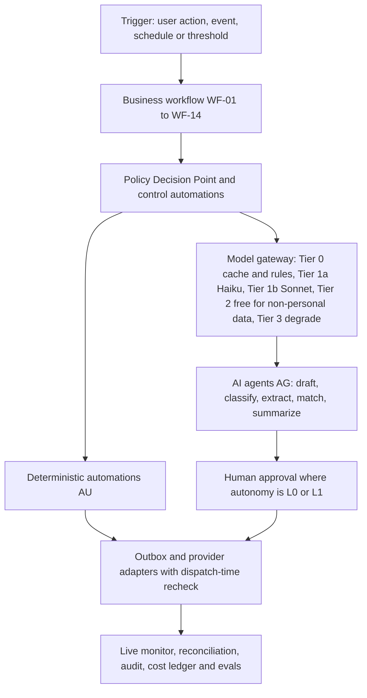

# AI Growth Engine: Employee Sales & Marketing Automation
## Application Blueprint: PART 9 (Batch 9.4), Catalogue of Workflows, AI Agents and Automations

| Field | Value |
|---|---|
| Document | Part 9, Batch 4 (generated by `assembly/build_ai_catalogue.py` from Parts 2.2, 7.1 and 7.2; regenerate after any change) |
| Version | 1.0 · 27 Nov 2026 |
| Purpose | One place listing every business workflow, AI agent and automation in the blueprint with its functionality |
| Authoritative detail | Part 2.2 (workflow flows), Part 7.2 (full agent/automation spec cards), Part 7.3 (model routing, cost, governance), Part 6.4 (evaluation cases) |

**Legend.** *Agent (AG)* = uses an AI model through the gateway. *Automation (AU)* = deterministic, rule-based, no AI model. *Autonomy*: L0 suggest only · L1 draft for human approval · L2 act with post-review · L3 act autonomously within guardrails. Consequential actions (quotes, discounts, contracts, legal terms, bid submissions, payments) are capped at L1 or are not automated at all (DEC-064). *Model tier*: Tier 0 rules/cache/template; 1a Claude Haiku-class; 1b Claude Sonnet-class; Tier 2 free fallbacks only for non-personal data and off by default; Tier 3 graceful degradation (DEC-007). Costs are pilot-base estimates per month before overhead; verify prices at implementation (as of 27 Nov 2026).

## 9.4.1 Summary

| Category | Count | Release 1 | Release 2 | Future |
|---|---|---|---|---|
| AI agents (AG) | 36 | 22 | 13 | 1 |
| Automations (AU) | 43 | 33 | 9 | 1 |
| Business workflows (WF) | 14 | — | — | — |
| Supporting flows (vertical routes and cross-cutting) | 7 | — | — | — |

## 9.4.2 Business workflows (WF-01…WF-14)

Each workflow runs on the universal execution engine (Part 2.2 §2.6): plan-time check, transactional outbox, dispatch-time recheck of scope, consent, jurisdiction, budget and approval hash, simulation mode, emergency stop, and reconciliation of uncertain provider outcomes.

| ID | Workflow | Functionality (purpose) | Main screens |
|---|---|---|---|
| WF-01 | Startup catalogue (product truth) | approve offering, price, claims, segment, customer roles, pipeline and workflow; no unapproved offerings or unscoped access (BRD §5). | A004, A005, A006, A051, A098, A100 |
| WF-02 | Market discovery | plan source query → evidence → signals/need → solution match → qualify, with allowed sources, review, freshness and confidence (BRD §5). | A015–A023 |
| WF-03 | Professional contacts | find organization decision-makers, verify channel/source, deduplicate, eligibility; no private scraping; contact score ≠ permission (BRD §5). | A024–A026, A032 |
| WF-04 | Inbound acquisition | landing page, chat, email, WhatsApp, social, event or referral → lead and attribution, with scope, consent and dedupe; no medical records or minor targeting (BRD §5). | W10–W20, W11, A031, A037, A046 |
| WF-05 | Content and campaign | generate approved content, SEO, social, ad/landing plan, audience and budget, with claim and channel approval, cost caps and actual publication (BRD §5). | A050–A061, A107, A108 |
| WF-06 | Outreach and replies | preview eligible contacts → approved messages → callback → classify intent; opt-out/complaint stop; a response halts the generic sequence (BRD §5). | A034, A035, A037, A045 |
| WF-07 | Follow-up and meetings | schedule tasks by intent, preference and local time; verify calendar; caps, rejection and suppression stop (BRD §5). | A038–A041, W18 |
| WF-08 | Project bid (AppNAI route, BRD §4 and BR-S001) |  | A104, A016, A017, A065–A068, A071, A072 |
| WF-09 | Proposal, quote and negotiation |  | A065–A070, W23 |
| WF-10 | Order and fulfilment (OrganicSpec route, BR-S004) |  | A105, A067, A073, A074, W14, W16, W25 |
| WF-11 | Commercial closure (all routes) |  | A073, A074, W26 |
| WF-12 | Retention and renewal |  | A075–A081, W27, W28 |
| WF-13 | Autonomous plan |  | A102, A033, A109–A111, A012 |
| WF-14 | Suspend and offboard (tenant or startup) |  | A099, A101, A103, W34 |

**Supporting flows (Part 2.2 §2.21–2.22):** 2.21.1 MedMaarg institutional partnership (BR-S002, BR-S035); 2.21.2 EduVerse education (BR-S003, BR-S036; DEC-030); 2.22.1 Opt-out and preference change (M04, W29); 2.22.2 Privacy request (M56); 2.22.3 Website publication (FR-PUB-01; A107, A108); 2.22.4 SaaS client onboarding (W31–W34; FRD §16.3); 2.22.5 Uncertain-outcome reconciliation (FR-STD-02; RECOMMENDATION-015).

## 9.4.3 AI agents (AG) and their functionality

| ID | Agent | Functionality and business outcome | Pattern | Persona | Trigger | Autonomy | Model tier | Wave · Release | Pilot cost/month | Linked BR / FR |
|---|---|---|---|---|---|---|---|---|---|---|
| AG-001 | Knowledge & Claim Ingestion Assistant | Turns approved uploaded decks, brochures and FAQs into chunk summaries and *claim candidates* with page citations, so R10/R05 approve claims in minutes instead of reading whole documents. | Extractor | P05, P09 (reviewers); P16 executes | Event: `document.scanned_clean` after upload (M03 pipeline) | L1 | 1a Haiku 5.5 | W0 · Release 1 | ₹5 | BR-M02, BR-M03; FR-A005, FR-A006; EP-02 (US: see EP-02) |
| AG-002 | AI Quality Judge & Eval Runner | Scores generative outputs against rubrics (groundedness, claim compliance, tone, refusal correctness) for the CI regression gate and for a 5% sample of production outputs. | Validator / QA | P10 Automation Lead; AI lead; D04 QA | CI: prompt/model/config change (AU-006); Schedule: nightly production sample batch | L2 (scores recorded automatically; a human reviews failures and every threshold change) | 1b Sonnet 5.5 via Batch API | W0 · Release 1 | ₹139 | BR-M08, BR-M54; FR-A011, FR-A084; NFR-033; EP-04 (US: see EP-04) |
| AG-003 | Research Query Planner | Expands approved capability codes, geography and organization types into scoped search queries within the plan's source and cost bounds. | Generator | P04 Research Analyst | Schedule (research plan, Celery Beat) or user action (Run now in A015) | L3 within guardrails (queries only reach permitted search adapters; no side effect beyond a budgeted search) | Tier 0 templates first | W1 · Release 1 | ₹1 | BR-M10; FR-A015; WF-02 step 3; EP-05 (US: see EP-05) |
| AG-004 | Evidence Extractor | Extracts organization-level business facts (projects, tenders, expansions, hiring for relevant functions, budgets, dates) with quotes and provenance from permitted pages and permitted social posts. | Extractor | P04; P16 executes | Event: `source_record.fetched` (permitted page fetched, content hash new) | L3 within guardrails (writes evidence records only; no external effect) | 1a Haiku 5.5 via Batch API | W1 · Release 1 | ₹19 | BR-M12, BR-M33; FR-A016, FR-A017, FR-A048; NFR-028; EP-05 (US: see EP-05) |
| AG-005 | Buying Signal Classifier | Classifies each evidence item into the approved signal taxonomy with confidence; below-threshold items go to review. | Classifier / router | P04 | Event: `evidence.created` | L2 (classification stored; items below threshold or in the weekly sample reviewed in A019) | 1a Haiku 5.5 via Batch API | W1 · Release 1 | ₹6 | BR-M14, BR-M33; FR-A019, FR-A048; KPI-02, KPI-08; EP-05 (US: see EP-05) |
| AG-006 | Need Discovery Agent | Derives business needs from signals and evidence and labels each as *explicit* (stated in a source) or *inferred*. | Extractor | P04 | Event: `signal.classified` with confidence ≥ threshold | L1 for inferred needs (reviewer verifies in A020); L2 for explicit needs with quote | 1a Haiku 5.5 via Batch | W1 · Release 1 | ₹6 | BR-M15; FR-A020; BRL-SCR-05; EP-05 (US: see EP-05) |
| AG-007 | Solution Match Explainer | Explains why each deterministically ranked offering (AU-016) fits a need and why others were excluded (readiness, geography, capability). | Generator | P04, P03 | Event: `match.recomputed` | L0 (suggestion only; ranking is deterministic) | 1a Haiku 5.5 via Batch | W1 · Release 1 | ₹2 | BR-M16; FR-A021; BRL-SCR-04; EP-05 (US: see EP-05) |
| AG-008 | Decision-Maker Role Extractor | Extracts role hypotheses (function, seniority) and *published* professional channels from official organization pages for qualified accounts. | Extractor | P04 | Event: opportunity band ≥ 75 or reviewer request | L1 (contact records created as *unverified*; AU-018 verifies; consent stays separate) | 1a Haiku 5.5 via Batch | W1 · Release 1 | ₹1 | BR-M18; FR-A024, FR-A026; EP-06 (US: see EP-06) |
| AG-009 | Qualification Brief Assistant | Prepares a one-screen cited brief per opportunity (need, fit, evidence freshness, score components, open questions) for the reviewer; at L2 (after the 90% gate) proposes accept/reject. | Extractor + Assistant | P04, P03 | Event: `opportunity.scored` (band ≥ 50 or Unknown) | L1 until benchmark precision ≥ 90% on ≥ 200 labelled items per vertical; then L2 for the recommendation (BRL-SCR-07) | 1a Haiku 5.5 pre-generated in Batch | W1 · Release 1 | ₹11 | BR-M20, BR-M17; FR-A027; DEC-001; BRL-SCR-06/07; EP-06 (US: see EP-06) |
| AG-010 | Import Mapping Assistant | Maps unmatched CSV/JSON column headers and value formats to versioned import templates after deterministic header matching. | Classifier / router | P11, P13 | User action: upload in A103 (dry run) | L1 (user confirms mapping before import) | Tier 0 header dictionary first | W1 · Release 1 | ₹0 | FR-A103; DEC-039; EP-20 (US: see EP-20) |
| AG-011 | Outreach & Follow-up Message Drafter | Drafts evidence-cited first-touch emails, WhatsApp template variants, follow-up steps, event invitations and renewal reminders using approved claims only. | Generator | P03, P05 | User action (Draft in A034) or event (`opportunity.qualified`, sequence step due needing a personalised variant) | L1 for personalised drafts (human approves exact hash); L2/L3 only via pre-approved templates with variables (DEC-064, BRL-AUT-01) | 1b Sonnet 5.5 | W2 · Release 1 | ₹165 | BR-M25, BR-M28, BR-M31, BR-M40, BR-M50; FR-A034, FR-A035, FR-A038, FR-A044; EP-08 (US-0801, US-0803) |
| AG-012 | Claims & Policy Guard | Second-line check of every customer-facing draft (messages, content, proposals, chat answers sampled) for unsupported claims, prohibited content, tone and brand. | Validator / QA | P09, P05 (indirect); P16 executes | Event: `draft.created` for any customer-facing artefact | L3 within guardrails for *block/fix* decisions (it can only make things stricter); never approves | Tier 0 deterministic rules first | W2 · Release 1 | ₹20 | BR-M08, BR-M25, BR-M34, BR-M43; BRL-AI-03, BRL-AI-05; SC-33; EP-04, EP-08, EP-11 (US: see EP-04) |
| AG-013 | Inbound Intent Classifier & Router | Classifies every inbound email, WhatsApp and web reply (positive, question, objection, out-of-office, complaint, urgent/clinical, wrong person, other), extracts proposed times and a one-line summary, and routes it. | Classifier / router | P03; P16 executes | Event: `inbound.received` (after AU-008 STOP handling) | L3 for routing and sequence stop (classification only; any reply still follows AG-014 rules) | Tier 0: STOP keywords, auto-responder headers, bounce formats | W2 · Release 1 | ₹9 | BR-M27, BR-M41, BR-M31, BR-M57; FR-A037, FR-A045, FR-A046; EP-08 (US-0807), EP-10 |
| AG-014 | Reply Assistant | Drafts answers to inbound questions from approved FAQ and knowledge with citations; at L3, sends only *approved FAQ answers* verbatim with variables. | Generator | P03 | Event: intent = question (AG-013) | L1 by default; L3 only when the answer is an exact approved FAQ (faq_id) and policy allows (DEC-064) | Tier 0 semantic cache of approved FAQ answers | W2 · Release 1 | ₹27 | BR-M27, BR-M41, BR-M45 (routine); FR-A037, FR-A046; DEC-064; EP-08, EP-10 (US: see EP-08) |
| AG-015 | Admin Copilot | Side-panel assistant that answers staff questions over records the user can already see and approved knowledge, with citations; briefs on accounts and meetings; proposes saved-view filters and drafts (message, task, note). | Assistant / copilot | P01, P02, P03, P04, P05, P06, P07 | User action (Copilot panel) | L0 answers; L1 drafts (DEC-035) | 1a Haiku 5.5 for lookups | W3 (Q&A) / W5 (drafts) · Release 1 | ₹222 | DEC-035; FR-COP-01; BRL-AI-12; BR-S124; FR-A003, FR-A032; EP-17 (US: see EP-17) |
| AG-016 | Autonomous Commercial Planner | Proposes commercial plans (objective, eligible segment, channel mix, sequence, budget, schedule) and workflow drafts from approved node types; narrates simulation results. | Orchestrator | P10, P01, P02 | User action (Propose plan / Draft workflow) | L1 for the plan (approval of the exact plan hash by R01 for L3, R02 for L2 — CFG-27) | 1b Sonnet 5.5 | W2 (simulation) / W5 (L3 execution of approved plans) · Release 1 | ₹26 | FR-A102, FR-A113; BR-AUTO; WF-13; BR-S018; DEC-051, DEC-064; EP-18 (US: see EP-18) |
| AG-017 | Website Assistant | Public chat on each verified startup site that answers from approved public knowledge with citations, captures a consented lead and hands over clinical, legal, pricing-negotiation and complaint topics. | Assistant / copilot | P15 (and P14 when signed in) | User action (chat widget) | L3 for answers grounded in approved public knowledge; lead capture via deterministic form (M22) | Tier 0 FAQ cache | W3 · Release 1 | ₹13 | BR-M32; FR-W11, FR-A046; BRL-AI-11; DEC-030; EP-10 (US: see EP-10) |
| AG-018 | Content & Campaign Studio Drafter | Drafts articles, social variants, landing-page copy, ad copy, SEO titles/meta and translation drafts (hi-IN, ta-IN, or-IN) from a brief using approved claims. | Generator | P05 | User action (brief submitted in A050/A056/A058) | L1 (content approver ≠ author; claims approval; DEC-038) | 1b Sonnet 5.5 | W3 · Release 1 | ₹98 | BR-M34, BR-M35, BR-M36, BR-M37, BR-M38, BR-M39; FR-A050, FR-A052, FR-A055, FR-A056, FR-A058, FR-A060; DEC-026; EP-11, EP-12 (US: see EP-11) |
| AG-019 | Bid / RFP Analyzer | Parses RFPs, tenders and submitted project requirements into eligibility criteria, deadlines, mandatory documents, evaluation criteria and a compliance matrix, plus an L0 bid/no-bid brief. | Extractor | P06, P02 | Event: tender document uploaded / RFP attached to a bid | L1 for checklist items; L0 for bid/no-bid | 1b Sonnet 5.5 | W4 · Release 2 | ₹141 | WF-08; FR-A104, FR-W15; BR-S001, BR-S013, BR-S034; DEC-053; EP-14 (US: see EP-14) |
| AG-020 | Proposal & Bid Response Drafter | Drafts proposals and bid response sections from approved templates, meeting notes entered by staff, approved claims and the deterministic price snapshot (prices inserted by AU-035, never by the model). | Generator | P03, P06, P02 | User action (Draft proposal) or event `meeting.completed` (draft offered, not auto-created) | L1 (DEC-064: proposals/quotes ≤ L1) | 1b Sonnet 5.5 | W4 · Release 2 | ₹63 | BR-M43; FR-A065, FR-A066, FR-W23; DEC-038; EP-13 (US: see EP-13) |
| AG-021 | Objection & Negotiation Assistant | Classifies objections into the approved taxonomy, drafts approved responses, and prepares exception summaries for A070 when a request exceeds concession limits. | Classifier + Generator | P03, P02 | Event: intent = objection (AG-013) or user action | L1 (price/terms ≤ L1, DEC-064) | 1b Sonnet 5.5 | W4 · Release 2 | ₹22 | BR-M45; FR-A069, FR-A070; DEC-038, DEC-064; EP-13 (US: see EP-13) |
| AG-022 | Contract Clause Reviewer | Compares counterparty redlines or third-party paper against the approved template and clause library; flags non-standard, missing or risky clauses for Legal with references. | Validator / QA | P09 | Event: counterparty document uploaded to a contract | L0 (suggest only) | 1b Sonnet 5.5 | W4 · Release 2 | ₹18 | BR-M46; FR-A071, FR-A072; DEC-023, DEC-038; EP-13 (US: see EP-13) |
| AG-023 | Order Document Extractor | Extracts RFQ/PO lines (SKU, description, unit, quantity, requested price, delivery date/region) from uploaded documents and emails into a draft order or RFQ for OrganicSpec and other order-desk startups. | Extractor | P07 | Event: RFQ/PO document received (W14/W16 upload or inbound attachment) | L1 (draft order; coordinator confirms) | 1a Haiku 5.5 | W4 · Release 2 | ₹5 | FR-A105, FR-W14, FR-W16; WF-10; DEC-045; EP-14 (US: see EP-14) |
| AG-024 | Payment Evidence Extractor | Pre-fills payment verification fields (UTR/reference, amount, currency, date, payer name, bank) from uploaded bank/UPI evidence for the Finance Maker. | Extractor | P08 | Event: payment evidence uploaded | L0 (pre-fill; maker confirms every field) | 1a Haiku 5.5 | W4 · Release 2 | ₹1 | BR-M47; FR-A073, FR-A074, FR-W26; DEC-022, DEC-038; EP-15 (US: see EP-15) |
| AG-025 | Onboarding Handoff Summarizer | Produces the commercial-to-delivery handoff summary (scope, commitments, contacts' roles, open risks, approved terms references) when a deal closes. | Generator | P03, P02 (delivery team receives) | Event: `deal.won` (closure policy satisfied, DEC-054) | L1 | 1a Haiku 5.5 via Batch | W4 · Release 2 | ₹0 | BR-M48; FR-A075, FR-A076; EP-16 (US: see EP-16) |
| AG-026 | Loss & Feedback Analyzer | Classifies free-text loss reasons and customer feedback into the loss taxonomy and produces a monthly theme report. | Classifier / router | P02, P03 | Event: `deal.lost` / feedback submitted; Schedule: monthly theme batch | L2 (labels stored; owner can correct) | 1a Haiku 5.5 via Batch | W4 · Release 2 | ₹0 | BR-M51, BR-M54; FR-A081, FR-A084; EP-16 (US: see EP-16) |
| AG-027 | Market & Competitor Watch Summarizer | Summarizes permitted public competitor and market events into internal alerts with sources. | Generator | P04, P02 | Schedule: weekly per startup; Event: high-relevance market event | L3 for internal alerts only (no external use) | 1a Haiku 5.5 via Batch | W5 · Release 2 | ₹1 | BR-M59; FR-A085, FR-A086; EP-05 (US: see EP-05) |
| AG-028 | Ops & Incident Triage Agent | Clusters failed runs, DLQ items, provider errors and alerts; summarizes probable cause and links the runbook (RB-) for on-call staff. | Extractor + Monitor | P12, P10; D05 | Event: incident opened / DLQ growth alarm; Schedule: daily failure digest | L0 (suggestions only); remediation by humans (CI-128 excluded) | 1a Haiku 5.5 | W5 · Release 2 | ₹7 | BR-M58; FR-A014, FR-A110; NT-030, NT-034; EP-21 (US: see EP-21) |
| AG-029 | Insight Narrative Agent | Writes weekly 'what changed and why' narratives on deterministic KPI snapshots for startup heads and a portfolio digest for the founder. | Generator | P01, P02 | Schedule: weekly (Monday 07:00 IST) | L3 for internal digest delivery | 1a Haiku 5.5 via Batch | W5 · Release 2 | ₹1 | BR-M30, BR-M60, BR-M61; FR-A042, FR-A043, FR-A089; RP-01; EP-17 (US: see EP-17) |
| AG-030 | SaaS Onboarding Configuration Assistant | During W33, proposes business profile, industry taxonomy, offering structure, objective templates and workflow bindings from the applicant's description. | Generator | P13 | User action in the W33 wizard | L1 (applicant edits; platform approval before provisioning) | 1b Sonnet 5.5 | W5 · Release 2 | ₹35 | FR-W33, FR-A100; BR-S112; AP-01; EP-20 (US: see EP-20) |
| AG-031 | Support Desk Assistant | Triages portal support tickets (W28, W34) by category and severity, drafts replies from the help centre, answers authenticated customers' questions about their own records, and drafts KB articles from resolved tickets. | Classifier + Generator | P12, P13, P14 | Event: ticket created; user action in portal help | L1 for replies; L2 for category/severity | 1a Haiku 5.5 | W5 · Release 2 | ₹14 | FR-W28, FR-W34, FR-W30; DEC-044; EP-16, EP-20 (US: see EP-20) |
| AG-032 | Partner Due-Diligence Brief | Compiles public evidence on prospective partners, insurers and licensees into a due-diligence checklist with sources. | Extractor | P02, P09 | User action (Prepare diligence brief) | L0 | 1b Sonnet 5.5 via Batch | W6 · Future | ₹10 | BR-M49, BR-M63, BR-M64, BR-M65; FR-A077, FR-A091, FR-A093; EP-16 (US: see EP-16) |
| AG-033 | Requirements & Story Assistant | Drafts user stories, Gherkin AC, ADR and DPIA skeletons from FR/BRL/DEC text, and runs change-impact analysis over the traceability matrix. | Generator | D01, D04, D06 | User action (developer/PO in Claude Code or the repository) | L1 (PR review by PO) | Claude Code developer seats | W0 · Release 1 | within B09 seats | BR-QA, BR-S134; EP-21; Part 5/6 process |
| AG-034 | Coding Assistant | Claude Code for implementation, refactoring, IaC, UI microcopy and accessibility fixes, with repository rules (RLS scoping, outbox, no secrets). | Assistant / copilot | D02, D03, D05 | User action (developer) | L1 (all changes through PR review + CI gates) | Claude Code developer seats | W0 · Release 1 | within B09 seats | BR-QA; DEC-005; BRD §6 B09; ASSUMPTION-020 |
| AG-035 | PR, Security & Release Review Agent | Reviews each pull request for tenancy/RLS scoping, outbox use, secret exposure, OWASP issues, missing tests; triages CI failures and SAST/dependency findings; drafts release notes and go/no-go summaries; drafts threat-model updates. | Validator / QA | D02, D04, D05, D01 | Event: PR opened/updated; CI failure; release candidate tagged | L0 (comments only; cannot approve or merge) | 1b Sonnet 5.5 via CI API key | W0 · Release 1 | ₹505 | BR-M09, BR-M62, BR-QA; NFR-012, NFR-013; EP-21 (US: see EP-21) |
| AG-036 | Test & Synthetic Data Generator | Generates test cases from Gherkin AC (EP/BVA/decision-table techniques), synthetic two-tenant fixtures (RECOMMENDATION-017), injection corpora and eval cases from reviewed feedback. | Generator | D04 | User action; CI batch job for fixture regeneration | L1 (QA review) | Claude Code seats + 1a Haiku 5.5 via Batch for bulk fixtures | W0 · Release 1 | ₹6 | BR-QA; DEC-017; RECOMMENDATION-017; EP-21 (US: see EP-21) |

## 9.4.4 Automations (AU) and their functionality

Automations use no AI model; they are deterministic rules running on the platform's own workers. AU items marked as control automations in Part 7.2 must be running before any agent may run.

| ID | Automation | Functionality (deterministic logic) | Trigger | Outputs | Guardrail | Failure / fallback | KPI | Autonomy | Wave · Release |
|---|---|---|---|---|---|---|---|---|---|
| AU-001 | Model gateway router, Tier 0 cache & template responder | Routing decision table (§7.3.4); exact-match cache key = hash(agent, prompt version, model, normalized input, scope); semantic cache (pgvector cosine ≥ 0.92, same tenant/startup namespace, Public/Internal only); approved template responses | Every AI request | Model call or cached/template result with route record | No direct provider calls outside the gateway (BRL-AI-01); cache entries scoped and invalidated on knowledge/prompt version change | Gateway down → callers receive Tier 3 status; queued work retained | Cache hit rate ≥ 30% (target by agent); p95 gateway overhead ≤ 50 ms | L3 (deterministic, within policy) | W0 · Release 1 |
| AU-002 | Budget reservation, alerts & hard stop | Reserve estimated ₹ (max_tokens × output price + input estimate) against agent, startup, tenant and global budgets; reconcile actual usage; 80% alert, 100% hard stop; founder top-up audited | Before every paid call; on reconciliation | Reservation ID or denial with reason | Fail closed: ledger unavailable → deny paid calls | Paid calls queue (Tier 3) until budget resets | 0 overspend beyond cap; simulated cap stops requests (NFR-014) | L3 (deterministic, within policy) | W0 · Release 1 |
| AU-003 | Output schema validation & repair controller | Validate JSON against versioned schema; up to 2 repair retries with the validation error; then route per §7.3.4 (Tier 2 only if data class allows) else Tier 3 | Every model response | Valid object or failure record | Invalid output never reaches business state | Tier 3 human task | Schema failure rate ≤ 1% per agent | L3 (deterministic, within policy) | W0 · Release 1 |
| AU-004 | Data classification & PII redaction | Field-level classification from the data dictionary + Presidio analyzers (email, phone, Aadhaar/PAN patterns, names, health terms) with Indian recognizers; mask/pseudonymize; block Tier 2 if Restricted/Confidential remains | Before prompt assembly and before any Tier 2 call | Redacted prompt + classification label | Highest class governs (fail closed) | Redactor error → block Tier 2 and log; Tier 1 continues with minimized fields | 0 Restricted items reach Tier 2 (NFR-077 test); redaction recall ≥ 98% on fixture set | L3 (deterministic, within policy) | W0 · Release 1 |
| AU-005 | Untrusted-content sanitizer & injection pre-filter | HTML-to-text cleaning, hidden-text removal, length caps, delimiter wrapping with provenance, injection heuristics (instruction verbs aimed at the model, tool-call syntax, canary probes) flagging `injection_suspected` | Before any untrusted text (web page, inbound, upload) enters a prompt | Sanitized wrapped content + flags | Flags never grant tools; suspected items forced to L1 | On error, content is excluded (fail closed) | Injection corpus (≥ 200 cases) pass ≥ 98% | L3 (deterministic, within policy) | W0 · Release 1 |
| AU-006 | Eval regression CI gate | Run promptfoo/DeepEval suites per agent (deterministic graders + AG-002 judge); compare to thresholds in §7.6.9; block merge on failure | Prompt, model, schema or routing change (PR) | Gate pass/fail with report | Thresholds changed only via reviewed PR (R11 + AI lead) | Judge unavailable → generative changes blocked | 100% of AI changes gated | L3 (deterministic, within policy) | W0 · Release 1 |
| AU-007 | Source permission & expiry enforcer | Check purpose, licence, robots/terms flag, quotas and expiry per source; stop collection on expiry (M07 trigger) | Before every search/fetch; daily expiry scan | Allow/deny with rule ID | Unknown source = deny | Deny and alert R04/R10 | 0 fetches from unapproved sources | L3 (deterministic, within policy) | W0 · Release 1 |
| AU-008 | STOP / opt-out handler & queued-send cancellation | Multilingual STOP lexicon, List-Unsubscribe, WhatsApp opt-out; suppression write; cancel queued sends in scope atomically | Inbound message, unsubscribe link, preference change | Suppression record; cancelled outbox items | Ambiguous opt-out treated as opt-out | Retry; if cancellation uncertain, pause scope | STOP recall 100%; cancellation ≤ 60 s | L3 (deterministic, within policy) | W0 · Release 1 |
| AU-009 | Policy Decision Point dispatch guard | Recheck scope, role, consent, jurisdiction, quiet hours, caps, entitlement, budget reservation and approved hash at dispatch | Every external side effect, including any agent-originated item | Allow/deny with rule IDs (audited) | Agents never hold dispatch tools; only the engine calls the PDP | Deny (fail closed) | 0 dispatches without PDP allow | L3 (deterministic, within policy) | W0 · Release 1 |
| AU-010 | Provider health checks & circuit breakers | Synthetic health probe; error-rate/latency windows; open circuit after 5 consecutive failures or 50% errors in 60 s; half-open probe after 30 s | Every 60 s per provider; on errors | Provider state open/half-open/closed | Open circuit triggers routing to next tier | Alert R11 | Fallback switch ≤ 60 s after outage onset | L3 (deterministic, within policy) | W0 · Release 1 |
| AU-011 | Privacy request locator & retention purge | Identifier search across tables incl. AI run logs and caches; purge AI payloads after 90 days; keep digests; legal hold respected | Privacy request; nightly retention job | Fulfilment report | Suppression record never deleted | Retry; escalate to R10 at 70% of deadline | 100% requests within legal deadline | L3 (deterministic, within policy) | W0 · Release 1 |
| AU-012 | FinOps cost attribution & anomaly alerts | Cost per task/agent/startup/tenant/provider; z-score and >150% of 7-day baseline alerts; KPI anomaly thresholds | Every reconciled call; hourly roll-up | Dashboards A012/RP-21; alerts | Read-only | Alert on missing data | Cost visibility ≤ 1 h lag | L3 (deterministic, within policy) | W0 · Release 1 |
| AU-013 | Release pipeline gates | Secret scan, SAST, dependency update bot (Renovate-style), licence check, ID/trace lint, restore drill schedule, smoke test | Every PR/release | Gate results | Protected branches | Block release | 100% releases with complete evidence | L3 (deterministic, within policy) | W0 · Release 1 |
| AU-014 | URL normalization, blocked-host & duplicate-content filter | Canonicalize URLs, strip tracking, reject blocked hosts, content-hash dedupe (saves AG-004 calls) | Search results | Fetch queue | Blocked hosts never fetched | Skip and log | Duplicate fetch rate ≤ 5% | L3 (deterministic, within policy) | W1 · Release 1 |
| AU-015 | Organization canonical upsert & safe merge | Match by domain + location + alias; conflicting attributes → merge task | Evidence created | Organization record / merge task | No automatic merge across startups or tenants | Merge task to R04 | Duplicate organizations ≤ 2% | L3 (deterministic, within policy) | W1 · Release 1 |
| AU-016 | Readiness-gated solution match ranking | pgvector similarity between need and approved capability chunks + rule filters (readiness Approved and Available, geography, capability profile) | Need created/changed; offering version change | Ranked matches with exclusion reasons | Unavailable offerings excluded | Ranking unavailable → match pending | Top-3 contains reviewer-chosen offering ≥ 85% | L3 (deterministic, within policy) | W1 · Release 1 |
| AU-017 | Opportunity scoring | score = round(100 × Σ wᵢcᵢ / Σ w_known); Unknown if known weight < 0.60; bands | Match/evidence change | Score version | Score never grants contact permission | Recalculate on retry | 100% recalculation on trigger events | L3 (deterministic, within policy) | W1 · Release 1 |
| AU-018 | Contact verification & freshness expiry | Provenance check (published on official page), channel syntax/MX check, freshness expiry and recheck | Contact created; expiry date | Verification status | Verified ≠ consent | Mark unverified | Verified contact rate tracked (KPI-03) | L3 (deterministic, within policy) | W1 · Release 1 |
| AU-019 | Research review assignment & alerts | Round-robin/owner rules; SLA timers | Opportunity ready for review | Assignment, notifications | Rejected leads never sent to channel | Escalate per SLA | Owner action ≤ 2 business days | L3 (deterministic, within policy) | W1 · Release 1 |
| AU-020 | Lead dedupe, consent capture & form routing | Idempotency key; dedupe; consent with policy revision; route by typed fields; age band < 18 → guardian/institution path with no minor data beyond grade band | Form submission | Lead + routing | No direct approval from public intake | Queue on failure | One lead per duplicate submission | L3 (deterministic, within policy) | W2 · Release 1 |
| AU-021 | Customer 360 projection | Event-sourced projection | Domain events | Account view | RLS | Rebuild from events | Visible ≤ 60 s | L3 (deterministic, within policy) | W2 · Release 1 |
| AU-022 | Sequence scheduler with stop-on-reply | Eligibility recheck, quiet hours, caps; stop on any substantive reply (AG-013) or STOP (AU-008) | Schedule tick; reply/opt-out events | Due steps to outbox | No follow-up after reply/stop | Pause enrolment | 0 follow-ups after reply | L3 (deterministic, within policy) | W2 · Release 1 |
| AU-023 | Meeting slot offer & booking conflict check | Free/busy query, buffers, time-zone conversion, hold-and-confirm | Positive intent with proposed times (AG-013) | Slot offer / booking | No invented availability | Manual scheduling task | 0 double bookings | L3 (deterministic, within policy) | W2 · Release 1 |
| AU-024 | Bounce/complaint suppression | Hard bounce/complaint → suppression; soft bounce counters | SES SNS webhooks | Suppression | Signature verified | Retry webhook processing | Complaint rate < 0.1% (KPI-18) | L3 (deterministic, within policy) | W2 · Release 1 |
| AU-025 | Emergency stop & runaway guard | Kill switch at platform/tenant/startup/workflow/agent/tier/channel scope; caps on steps, retries, concurrency, actions per relationship, LLM calls and tokens per run | Operator stop; cap breach | Blocked calls/runs with reason | Effective ≤ 60 s | Fail closed | Stop effective ≤ 60 s in drills | L3 (deterministic, within policy) | W2 · Release 1 |
| AU-026 | Uncertain-outcome reconciliation | Query provider by reference; mark reconciled_confirmed/failed; block retry until reconciled | Provider timeout after submission | Reconciled outcome | No blind retries | Human task after 3 attempts | Uncertain items reconciled ≤ 1 business day | L3 (deterministic, within policy) | W2 · Release 1 |
| AU-027 | Notification digest & approval SLA escalation | Severity routing, digests, escalation ladders | Notification events; SLA timers | In-app/email notifications | Dedup keys | Retry delivery | Approval SLA breach alerts 100% | L3 (deterministic, within policy) | W2 · Release 1 |
| AU-028 | Missed-schedule recovery | Recover once; further misses alert | Scheduler start / missed run detection | Recovered run | No duplicate side effects (idempotency) | Alert R11 | ≥ 99% scheduled runs within window (DEC-032) | L3 (deterministic, within policy) | W2 · Release 1 |
| AU-029 | Publication pipeline & expiry monitor | Approved-hash check, atomic pointer swap, tenant-keyed cache invalidation; claim/knowledge expiry notifications | Approve/publish/rollback; daily expiry scan | Published snapshot; alerts | Only approved hash publishes | Rollback | 0 unapproved publications | L3 (deterministic, within policy) | W2 · Release 1 |
| AU-030 | Automation conflict resolution by priority rules | Hold both; priority compliance > transactional > sales > marketing; merge or escalate | Two runs target the same relationship | ConflictCase decision | No cross-tenant context | Escalate to owner | 0 duplicate contacts from conflicting runs | L3 (deterministic, within policy) | W3 · Release 1 |
| AU-031 | Compliance auto-pause on complaint threshold | Threshold per channel/campaign → pause + incident | Complaint events | Paused campaign, incident | Resume needs R10 | Pause anyway on error | Pause ≤ 5 min after threshold | L3 (deterministic, within policy) | W3 · Release 1 |
| AU-032 | Ad spend cap & anomaly pause | Cap check and >150% anomaly → pause via provider API | Spend events | Paused ad set | Spend within approved cap only | Pause on uncertainty | 0 spend beyond cap | L3 (deterministic, within policy) | W3 · Release 1 |
| AU-033 | SEO technical audit | Crawl checks (status, canonical, sitemap, metadata length), Search Console metrics from authorized source | Weekly | Prioritized fix list (A055) | No fabricated ranking data | Skip run | Audit weekly 100% | L3 (deterministic, within policy) | W3 · Release 1 |
| AU-034 | Bid deadline & mandatory-checklist tracker | Deadline countdown (UTC, FR-DM-02), checklist completeness gate before human submission | Bid created; timers | Alerts, gate | Submission at/after deadline rejected | Escalate | 100% on-time submissions for approved bids | L3 (deterministic, within policy) | W4 · Release 2 |
| AU-035 | Quote calculator, invoice generation & approval routing | Decimal lines, ROUND_HALF_UP, tax profile; threshold routing to approvers | Quote/invoice change | Quote/invoice totals; approval tasks | Server recompute; no client totals | Reject invalid | 0 total mismatches | L3 (deterministic, within policy) | W4 · Release 2 |
| AU-036 | Document assembly, hashing & diff | Assemble from approved templates and onboarding checklists; SHA-256 hash; deterministic diff between revisions for approvers | Template merge; new revision | Document revision + hash + diff | Changed revision voids approval | Block share | 0 shares of unapproved hash | L3 (deterministic, within policy) | W4 · Release 2 |
| AU-037 | Payment matching proposal & maker-checker routing | Match on amount, reference, date window, payer; propose to maker; checker ≠ maker | Payment evidence/bank entry | Match proposal, tasks | AI/automation never verifies | Manual matching | Reconciliation 100% (KPI-13) | L3 (deterministic, within policy) | W4 · Release 2 |
| AU-038 | Fulfilment ledger & over-delivery guard | Idempotent event keys; over-delivery rejection; reservation/release | Fulfilment events | Ledger entries | Duplicate event no effect | Dispute task | Fulfilment accuracy ≥ 98% (KPI-12) | L3 (deterministic, within policy) | W4 · Release 2 |
| AU-039 | Renewal calendar & rule-based account health score | Rules on usage, tickets, payments, engagement (no medical data) | Daily | Renewal tasks; health band | No medical data in scoring | Skip and alert | Renewal reminders 90/60/30 days 100% | L3 (deterministic, within policy) | W4 · Release 2 |
| AU-040 | Revenue attribution & reconciliation | Last non-direct touch default + alternative models with caveat | Payment verified | Attribution records | Revenue only from verified ledgers | Recompute | Revenue reconciles with finance 100% | L3 (deterministic, within policy) | W5 · Release 2 |
| AU-041 | Stage-weighted forecast & backtest | Stage probabilities from history; MAPE backtest (KPI-29); labelled estimate | Weekly | Forecast snapshot | Never mixed with actuals | Show last forecast | Forecast labelled 100% | L3 (deterministic, within policy) | W5 · Release 2 |
| AU-042 | Usage metering & entitlement enforcement | Meter AI tasks per tenant (definition §7.5.4), messages, fetches, storage; 80/100% alerts; deny beyond entitlement | Each metered action incl. AI tasks | Usage readings; statements | Tenant budgets separate (DEC-008) | Deny metered action | Usage reconciliation 100% (KPI-24) | L3 (deterministic, within policy) | W5 · Release 2 |
| AU-043 | Expansion readiness gates | Checklist completion and approvals before promotion or rollout | Pilot/launch status change | Gate status | Planned offerings never promoted | Block | 0 promotions without approval | L3 (deterministic, within policy) | W6 · Future |

## 9.4.5 How they fit together

## 9.4.6 Quality gate: Batch 9.4

| Check | Result | Notes |
|---|---|---|
| Completeness | Pass | 36 agents and 43 automations parsed from Part 7.2; 14 workflows from Part 2.2 |
| Consistency | Pass | Generated from source tables; no retyping |
| Time-sensitive facts | Pass | Model tiers and costs marked as estimates to verify (as of 27 Nov 2026) |
| Restricted data | Pass | Tier 2 limited to non-personal data, default off (DEC-007) |

**Status: Part 9 Batch 9.4 complete (36 AI agents, 43 automations, 14 workflows).**
