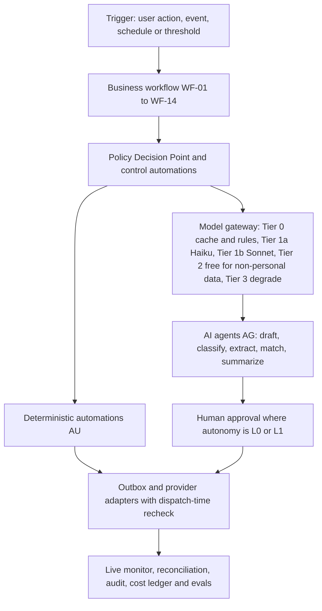

# AI Growth Engine: Employee Sales & Marketing Automation
## Application Blueprint: PART 9 (Batch 9.4), Catalogue of Workflows, AI Agents and Automations

> **Erratum v1.2 (E-V-01):** superseded by consequential actions above L1 only under an Active two-person bounded mandate (DEC-779). See Part 11.23c.

| Field | Value |
|---|---|
| Document | Part 9, Batch 4 (generated by `assembly/build_ai_catalogue.py` from Parts 2.2, 7.1, 7.2, 7.4 and 9.7–9.9; regenerate after any change) |
| Version | 1.0 · 27 Nov 2026 |
| Purpose | One place listing every business workflow, AI agent and automation in the blueprint with its functionality |
| Authoritative detail | Part 2.2 (workflow flows), Part 7.2 and Part 7.4 (source-pack additions AG-037/038, AU-044…052) and Parts 9.7–9.9 (advanced capabilities: AG-039…080, AU-053…119, WF-15…40), Part 7.3 (model routing, cost, governance), Part 6.4 (evaluation cases) |

**Legend.** *Agent (AG)* = uses an AI model through the gateway. *Automation (AU)* = deterministic, rule-based, no AI model. *Autonomy*: L0 suggest only · L1 draft for human approval · L2 act with post-review · L3 act autonomously within guardrails. Consequential actions (quotes, discounts, contracts, legal terms, bid submissions, payments) are capped at L1 or are not automated at all (DEC-064). *Model tier*: Tier 0 rules/cache/template; 1a Claude Haiku-class; 1b Claude Sonnet-class; Tier 2 free fallbacks only for non-personal data and off by default; Tier 3 graceful degradation (DEC-007). Costs are pilot-base estimates per month before overhead; verify prices at implementation (as of 27 Nov 2026).

## 9.4.1 Summary

> **Erratum v1.2 (E-V-35):** superseded by blueprint workflows WF-01…WF-60 plus V12 SM-SVC and INV workflows (Part 9.10, Part 11.4d). See Part 11.23c.

| Category | Count | Release 1 | Release 2 | Future |
|---|---|---|---|---|
| AI agents (AG) | 80 | 35 | 15 | 1 |
| Automations (AU) | 119 | 73 | 13 | 1 |
| Business workflows (WF) | 38 | — | — | — |
| Supporting flows (vertical routes and cross-cutting) | 7 | — | — | — |

## 9.4.2 Business workflows (WF-01…WF-39)

Each workflow runs on the universal execution engine (Part 2.2 §2.6): plan-time check, transactional outbox, dispatch-time recheck of scope, consent, jurisdiction, budget and approval hash, simulation mode, emergency stop, and reconciliation of uncertain provider outcomes.

| ID | Workflow | Functionality (purpose) | Main screens |
|---|---|---|---|
| WF-01 | Startup catalogue (product truth) | approve offering, price, claims, segment, customer roles, pipeline and workflow; no unapproved offerings or unscoped access (BRD §5). | A004, A005, A006, A051, A098, A100 |
| WF-02 | Market discovery | plan source query → evidence → signals/need → solution match → qualify, with allowed sources, review, freshness and confidence (BRD §5). | A015–A023 |
| WF-03 | Professional contacts | find organization decision-makers, verify channel/source, deduplicate, eligibility; no private scraping; contact score ≠ permission (BRD §5). | A024–A026, A032 |
| WF-04 | Inbound acquisition | landing page, chat, email, WhatsApp, social, event or referral → lead and attribution, with scope, consent and dedupe; no medical records or minor targeting (BRD §5). | W10–W20, W11, A031, A037, A046 |
| WF-05 | Content and campaign | generate approved content, SEO, social, ad/landing plan, audience and budget, with claim and channel approval, cost caps and actual publication (BRD §5). | A050–A061, A107, A108 |
| WF-06 | Outreach and replies | preview eligible contacts → approved messages → callback → classify intent; opt-out/complaint stop; a response halts the generic sequence (BRD §5). | A034, A035, A037, A045 |
| WF-07 | Follow-up and meetings | schedule tasks by intent, preference and local time; verify calendar; caps, rejection and suppression stop (BRD §5). | A038–A041, W18 |
| WF-08 | Project bid (AppNAI route, BRD §4 and BR-S001) | AppNAI qualify RFP/requirements, eligibility checklist, deadline guard, bid/no-bid, proposal and quote, human submission with recorded evidence, award proof, contract, delivery, verified payment (BRD §4–§5; DEC-053) | A104, A016, A017, A065–A068, A071, A072 |
| WF-09 | Proposal, quote and negotiation | Proposal and quote from approved templates and price versions; Decimal totals and tax; discount and legal approval thresholds; recipient review in portal; objections answered from approved facts or escalated (BRD §5; DEC-038) | A065–A070, W23 |
| WF-10 | Order and fulfilment (OrganicSpec route, BR-S004) | Buy/sell/service/training orders with SKU, unit and quantity lines; stock reservation; idempotent fulfilment events; over-delivery rejection; acceptance; separate receivable and payable ledgers (BRD §5; FR-DM-03) | A105, A067, A073, A074, W14, W16, W25 |
| WF-11 | Commercial closure (all routes) | Close only on route-specific verified evidence (signed contract or verified payment); finance maker-checker; partial payments; no duplicate revenue or false Won state (BRD §5; DEC-054) | A073, A074, W26 |
| WF-12 | Retention and renewal | Offering-specific onboarding and handoff (no patient data), milestones, feedback, renewal calendar and eligible reminders, lost-deal learning (BRD §5) | A075–A081, W27, W28 |
| WF-13 | Autonomous plan | Objective-driven plan from approved templates; simulation of recipients, cost, deadlines and conflicts; approval of the exact plan hash; execution with dispatch-time recheck; live monitoring, budget hard stops and emergency stop (BRD §5) | A102, A033, A109–A111, A012 |
| WF-14 | Suspend and offboard (tenant or startup) | Suspend or offboard a tenant/startup: stop schedules and queued actions, revoke senders and access, reconcile uncertain outcomes, export allowed records, apply retention (BRD §5) | A099, A101, A103, W34 |
| WF-15 | Supervised multi-agent account pursuit | Pursue a qualified account through research, brief, next action and first-touch draft as one supervised plan, with every approval of the baseline preserved (ADR-110; BR-AUTO; DEC-064). | A114, A116, A119, A034, A035, A110. |
| WF-16 | Predictive model lifecycle | Train, validate, shadow, approve, serve, monitor and retire advisory ML models (AU-056, AU-059, AU-066) without ever changing DEC-011 scoring or any eligibility decision (ADR-113; DEC-383). | A118, A128, A129, A022. |
| WF-17 | Deal-risk and churn early warning | Nightly detect at-risk open deals (AU-058, AG-044) and, from A3, at-risk customers (AU-059 feeding AG-038), and turn each into an owner task with reasons, so intervention happens before the forecast or renewal date (BR-M21, BR-M50, BR-M60). | A120, A119, A087, A079. |
| WF-18 | RFP response co-pilot (AppNAI) | Answer RFP requirements from the approved answer library with citations and gaps, inside WF-08, keeping bid/no-bid, pricing and submission human (BR-S001, DEC-053, DEC-064). | A104, A123, A065, A066. |
| WF-19 | Localized personalization at scale | From a campaign brief and deterministic segments, generate guarded variants, localize them with TM and glossary, approve them as templates and test them, so personalized multilingual outreach scales under DEC-064 (BR-M25, BR-M34, BR-M38; DEC-026). | A056, A124, A035, A125. |
| WF-20 | Experiment lifecycle | Pre-register, approve, run, monitor and read out experiments on messages, sequences, content, agent versions and NBA policies, so lift claims rest on valid statistics (ADR-118; BR-S090). | A125, A110, A084. |
| WF-21 | Agent release, canary and red-team | Release any new agent, prompt, model or ML version through offline evals, red-team, shadow and staged canary with automatic rollback, and keep it under continuous adversarial and drift monitoring (ADR-111, ADR-117; BR-M54; OKPI-16). | A115, A128, A129, A011, A084. |
| WF-22 | Knowledge freshness and memory governance | Keep RAG knowledge current, consistent and complete (AU-069, AG-055) and keep long-term memory lawful (AU-061, AU-062), with all edits through the M03 approval pipeline and all memory under purpose, TTL and erasure (BR-M03, BR-M56; DEC-385). | A127, A006, A013. |
| WF-23 | WhatsApp concierge with human handoff | Answer customer-initiated WhatsApp conversations within the service window from approved knowledge, offer meeting slots, and hand off to a human for sensitive topics or on request (BR-M31, BR-M41; DEC-030, DEC-064). | A045, A044, A046, A037. |
| WF-25 | Account-based engagement | Select and tier target accounts, map the buying committee, approve an account plan and run coordinated plays across sales, marketing, success and partners, without any automatic outreach beyond approved, eligible steps (F01–F04). | A130, A131, A132, A136, A137, A022, A032. |
| WF-26 | Lead-to-account match, route and speed-to-lead SLA | Attach every inbound lead to the right account, assign the right owner deterministically and measure response against the SLA, with escalation (F05, F06, F07). | W12–W20, W38, A133, A134, A031, A106, A037. |
| WF-27 | Multichannel cadence under consent | Run approved cadences across email, WhatsApp, human LinkedIn tasks, human call tasks and meetings with one consent check, one frequency budget and global stop rules (F09, F26). | A136, A137, A034, A035, A037, A038, A039, A110. |
| WF-28 | Deal room, mutual action plan and guarded quote | Give the buyer committee one portal space with approved materials and a confirmed mutual action plan, and build quotes inside approved price books with live guardrails (F10, F11, F12, F29). | A138, A139, A067, A068, W35, W36, W23, W24. |
| WF-29 | Pipeline inspection and forecast call | Inspect open deals every week with deterministic flags and advisory risk notes, set commit categories with evidence and lock an immutable forecast snapshot labelled as estimate (F20, F21, F08). | A140, A087, A029, A135. |
| WF-30 | Partner referral, deal registration and co-sell | Onboard partners under approved terms, accept registrations and referrals with conflict checks, co-sell with data minimization and record commission only (F13, F14). | W37, W38, W39, A141, A138, A064. |
| WF-31 | Customer health, QBR, renewal and expansion | Score customer health daily, explain drivers, prepare approved QBR packs and run renewal and expansion cases priced only through CPQ (F15, F16, F17, F30–F32). | A142, A143, A144, A079, A067, W41, W44, W23. |
| WF-32 | Voice of customer and win/loss learning loop | Collect NPS/CSAT from eligible adult business contacts, run win/loss reviews with consent, synthesize themes and close the loop with owned actions (F18, F19). | W40, A145, A081, A106. |
| WF-33 | DPDP data-principal-rights request | Handle access, correction, erasure, objection, grievance and nomination requests end to end within statutory and internal deadlines, with evidence (CAP-X3-16; DP-R9; BRL-PRV-01…05). | W29, W49, A163 (extends A013). |
| WF-34 | SLO breach auto-remediation with human approval | Move from a burn-rate page to a verified, approved fix with consistent steps and a postmortem draft (CAP-X3-09, CAP-X3-12; DEC-407). | A014, A156, A159, W45. |
| WF-35 | Automated DR drill and game day | Prove RPO/RTO targets (OKPI-18, 19, 32, 33, 34) and runbook readiness on a schedule without touching production dispatch (CAP-X3-10, CAP-X3-11). | A157, A158, A090. |
| WF-36 | Just-in-time privileged access elevation | Replace standing privileged permissions with time-boxed, approved elevation on a healthy device (CAP-X3-13, CAP-X3-14). | A160, A099. |
| WF-37 | Tenant bring-your-own-warehouse export | Deliver scheduled, verified exports of a tenant's own data to a destination it controls (CAP-X3-07; OPT-20-04; doc 28 §Import and export). | A154, A103, W34. |
| WF-38 | Tenant no-code workflow authoring to activation | Let tenant administrators author safe automations from templates or a described goal, prove them in simulation and activate them through existing approvals (CAP-X3-25; DEC-051; DEC-064). | A169, A033, A113, A110. |
| WF-39 | Secrets rotation with overlap | Rotate every secret on time without downtime, including providers without a rotation API (CAP-X3-18; §4.6.2; doc 27 §Secret lifecycle). | A165, A008. |

**Supporting flows (Part 2.2 §2.21–2.22):** 2.21.1 MedMaarg institutional partnership (BR-S002, BR-S035); 2.21.2 EduVerse education (BR-S003, BR-S036; DEC-030); 2.22.1 Opt-out and preference change (M04, W29); 2.22.2 Privacy request (M56); 2.22.3 Website publication (FR-PUB-01; A107, A108); 2.22.4 SaaS client onboarding (W31–W34; FRD §16.3); 2.22.5 Uncertain-outcome reconciliation (FR-STD-02; RECOMMENDATION-015).

## 9.4.3 AI agents (AG) and their functionality

| ID | Agent | Functionality and business outcome | Pattern | Persona | Trigger | Autonomy | Model tier | Wave · Release | Pilot cost/month | Linked BR / FR |
|---|---|---|---|---|---|---|---|---|---|---|
| AG-001 | Knowledge & Claim Ingestion Assistant | Turns approved uploaded decks, brochures and FAQs into chunk summaries and *claim candidates* with page citations, so R10/R05 approve claims in minutes instead of reading whole documents. | Extractor | P05, P09 (reviewers); P16 executes | Event: `document.scanned_clean` after upload (M03 pipeline) | L1 | 1a Haiku 5.5 | W0 · Release 1 | ₹5 | BR-M02, BR-M03; FR-A005, FR-A006; EP-02 (US: see EP-02) |
| AG-002 | AI Quality Judge & Eval Runner | Scores generative outputs against rubrics (groundedness, claim compliance, tone, refusal correctness) for the CI regression gate and for a 5% sample of production outputs. | Validator / QA | P10 Automation Lead; AI lead; D04 QA | CI: prompt/model/config change (AU-006); Schedule: nightly production sample batch | L2 (scores recorded automatically; a human reviews failures and every threshold change) | 1b Sonnet 5.5 via Batch API | W0 · Release 1 | ₹139 | BR-M08, BR-M54; FR-A011, FR-A084; NFR-033; EP-04 (US: see EP-04) |
| AG-003 | Research Query Planner | Expands approved capability codes, geography and organization types into scoped search queries within the plan's source and cost bounds. | Generator | P04 Research Analyst | Schedule (research plan, Celery Beat) or user action (Run now in A015) | L3 within guardrails (queries only reach permitted search adapters; no side effect beyond a budgeted search) | Tier 0 templates first | W1 · Release 1 | ₹1 | BR-M10; FR-A015; WF-02 step 3; EP-05 (US: see EP-05) |
| AG-004 | Evidence Extractor | Extracts organization-level business facts (projects, tenders, expansions, hiring for relevant functions, budgets, dates) with quotes and provenance from permitted pages and permitted social posts. | Extractor | P04; P16 executes | Event: `source_record.fetched` (permitted page fetched, content hash new) | L3 within guardrails (writes evidence records only; no external effect) | 1a Haiku 5.5 via Batch API | W1 · Release 1 | ₹19 | BR-M12, BR-M33; FR-A016, FR-A017, FR-A048; NFR-028; EP-05 (US: see EP-05) |
| AG-005 | Buying Signal Classifier | Classifies each evidence item into the approved signal taxonomy with confidence; below-threshold items go to review. | Classifier / router | P04 | Event: `evidence.created` | L2 (classification stored; items below threshold or in the weekly sample reviewed in A019) | 1a Haiku 5.5 via Batch API | W1 · Release 1 | ₹6 | BR-M14, BR-M33; FR-A019, FR-A048; KPI-02, KPI-08; EP-05 (US: see EP-05) |
| AG-006 | Need Discovery Agent | Derives business needs from signals and evidence and labels each as *explicit* (stated in a source) or *inferred*. | Extractor | P04 | Event: `signal.classified` with confidence ≥ threshold | L1 for inferred needs (reviewer verifies in A020); L2 for explicit needs with quote | 1a Haiku 5.5 via Batch | W1 · Release 1 | ₹6 | BR-M15; FR-A020; BRL-SCR-05; EP-05 (US: see EP-05) |
| AG-007 | Solution Match Explainer | Explains why each deterministically ranked offering (AU-016) fits a need and why others were excluded (readiness, geography, capability). | Generator | P04, P03 | Event: `match.recomputed` | L0 (suggestion only; ranking is deterministic) | 1a Haiku 5.5 via Batch | W1 · Release 1 | ₹2 | BR-M16; FR-A021; BRL-SCR-04; EP-05 (US: see EP-05) |
| AG-008 | Decision-Maker Role Extractor | Extracts role hypotheses (function, seniority) and *published* professional channels from official organization pages for qualified accounts. | Extractor | P04 | Event: opportunity band ≥ 75 or reviewer request | L1 (contact records created as *unverified*; AU-018 verifies; consent stays separate) | 1a Haiku 5.5 via Batch | W1 · Release 1 | ₹1 | BR-M18; FR-A024, FR-A026; EP-06 (US: see EP-06) |
| AG-009 | Qualification Brief Assistant | Prepares a one-screen cited brief per opportunity (need, fit, evidence freshness, score components, open questions) for the reviewer; at L2 (after the 90% gate) proposes accept/reject. | Extractor + Assistant | P04, P03 | Event: `opportunity.scored` (band ≥ 50 or Unknown) | L1 until benchmark precision ≥ 90% on ≥ 200 labelled items per vertical; then L2 for the recommendation (BRL-SCR-07) | 1a Haiku 5.5 pre-generated in Batch | W1 · Release 1 | ₹11 | BR-M20, BR-M17; FR-A027; DEC-001; BRL-SCR-06/07; EP-06 (US: see EP-06) |
| AG-010 | Import Mapping Assistant | Maps unmatched CSV/JSON column headers and value formats to versioned import templates after deterministic header matching. | Classifier / router | P11, P13 | User action: upload in A103 (dry run) | L1 (user confirms mapping before import) | Tier 0 header dictionary first | W1 · Release 1 | ₹0 | FR-A103; DEC-039; EP-20 (US: see EP-20) |
| AG-011 | Outreach & Follow-up Message Drafter | Drafts evidence-cited first-touch emails, WhatsApp template variants, follow-up steps, event invitations and renewal reminders using approved claims only. | Generator | P03, P05 | User action (Draft in A034) or event (`opportunity.qualified`, sequence step due needing a personalised variant) | L1 for personalised drafts (human approves exact hash); L2/L3 only via pre-approved templates with variables (DEC-064, BRL-AUT-01) | 1b Sonnet 5.5 | W2 · Release 1 | ₹165 | BR-M25, BR-M28, BR-M31, BR-M40, BR-M50; FR-A034, FR-A035, FR-A038, FR-A044; EP-08 (US-0801, US-0803) |
| AG-012 | Claims & Policy Guard | Second-line check of every customer-facing draft (messages, content, proposals, chat answers sampled) for unsupported claims, prohibited content, tone and brand. | Validator / QA | P09, P05 (indirect); P16 executes | Event: `draft.created` for any customer-facing artefact | L3 within guardrails for *block/fix* decisions (it can only make things stricter); never approves | Tier 0 deterministic rules first | W2 · Release 1 | ₹20 | BR-M08, BR-M25, BR-M34, BR-M43; BRL-AI-03, BRL-AI-05; SC-33; EP-04, EP-08, EP-11 (US: see EP-04) |
| AG-013 | Inbound Intent Classifier & Router | Classifies every inbound email, WhatsApp and web reply (positive, question, objection, out-of-office, complaint, urgent/clinical, wrong person, other), extracts proposed times and a one-line summary, and routes it. | Classifier / router | P03; P16 executes | Event: `inbound.received` (after AU-008 STOP handling) | L3 for routing and sequence stop (classification only; any reply still follows AG-014 rules) | Tier 0: STOP keywords, auto-responder headers, bounce formats | W2 · Release 1 | ₹9 | BR-M27, BR-M41, BR-M31, BR-M57; FR-A037, FR-A045, FR-A046; EP-08 (US-0807), EP-10 |
| AG-014 | Reply Assistant | Drafts answers to inbound questions from approved FAQ and knowledge with citations; at L3, sends only *approved FAQ answers* verbatim with variables. | Generator | P03 | Event: intent = question (AG-013) | L1 by default; L3 only when the answer is an exact approved FAQ (faq_id) and policy allows (DEC-064) | Tier 0 semantic cache of approved FAQ answers | W2 · Release 1 | ₹27 | BR-M27, BR-M41, BR-M45 (routine); FR-A037, FR-A046; DEC-064; EP-08, EP-10 (US: see EP-08) |
| AG-015 | Admin Copilot | Side-panel assistant that answers staff questions over records the user can already see and approved knowledge, with citations; briefs on accounts and meetings; proposes saved-view filters and drafts (message, task, note). | Assistant / copilot | P01, P02, P03, P04, P05, P06, P07 | User action (Copilot panel) | L0 answers; L1 drafts (DEC-035) | 1a Haiku 5.5 for lookups | W3 (Q&A) / W5 (drafts) · Release 1 | ₹222 | DEC-035; FR-COP-01; BRL-AI-12; BR-S124; FR-A003, FR-A032; EP-17 (US: see EP-17) |
| AG-016 | Autonomous Commercial Planner | Proposes commercial plans (objective, eligible segment, channel mix, sequence, budget, schedule) and workflow drafts from approved node types; narrates simulation results. | Orchestrator | P10, P01, P02 | User action (Propose plan / Draft workflow) | L1 for the plan (approval of the exact plan hash by R01 for L3, R02 for L2 — CFG-27) | 1b Sonnet 5.5 | W2 (simulation) / W5 (L3 execution of approved plans) · Release 1 | ₹26 | FR-A102, FR-A113; BR-AUTO; WF-13; BR-S018; DEC-051, DEC-064; EP-18 (US: see EP-18) |
| AG-017 | Website Assistant | Public chat on each verified startup site that answers from approved public knowledge with citations, captures a consented lead and hands over clinical, legal, pricing-negotiation and complaint topics. | Assistant / copilot | P15 (and P14 when signed in) | User action (chat widget) | L3 for answers grounded in approved public knowledge; lead capture via deterministic form (M22) | Tier 0 FAQ cache | W3 · Release 1 | ₹13 | BR-M32; FR-W11, FR-A046; BRL-AI-11; DEC-030; EP-10 (US: see EP-10) |
| AG-018 | Content & Campaign Studio Drafter | Drafts articles, social variants, landing-page copy, ad copy, SEO titles/meta and translation drafts (hi-IN, ta-IN, or-IN) from a brief using approved claims. | Generator | P05 | User action (brief submitted in A050/A056/A058) | L1 (content approver ≠ author; claims approval; DEC-038) | 1b Sonnet 5.5 | W3 · Release 1 | ₹98 | BR-M34, BR-M35, BR-M36, BR-M37, BR-M38, BR-M39; FR-A050, FR-A052, FR-A055, FR-A056, FR-A058, FR-A060; DEC-026; EP-11, EP-12 (US: see EP-11) |
| AG-019 | Bid / RFP Analyzer | Parses RFPs, tenders and submitted project requirements into eligibility criteria, deadlines, mandatory documents, evaluation criteria and a compliance matrix, plus an L0 bid/no-bid brief. | Extractor | P06, P02 | Event: tender document uploaded / RFP attached to a bid | L1 for checklist items; L0 for bid/no-bid | 1b Sonnet 5.5 | W4 · Release 2 | ₹141 | WF-08; FR-A104, FR-W15; BR-S001, BR-S013, BR-S034; DEC-053; EP-14 (US: see EP-14) |
| AG-020 | Proposal & Bid Response Drafter | Drafts proposals and bid response sections from approved templates, meeting notes entered by staff, approved claims and the deterministic price snapshot (prices inserted by AU-035, never by the model). | Generator | P03, P06, P02 | User action (Draft proposal) or event `meeting.completed` (draft offered, not auto-created) | L1 (DEC-064: proposals/quotes ≤ L1) | 1b Sonnet 5.5 | W4 · Release 2 | ₹63 | BR-M43; FR-A065, FR-A066, FR-W23; DEC-038; EP-13 (US: see EP-13) |
| AG-021 | Objection & Negotiation Assistant | Classifies objections into the approved taxonomy, drafts approved responses, and prepares exception summaries for A070 when a request exceeds concession limits. | Classifier + Generator | P03, P02 | Event: intent = objection (AG-013) or user action | L1 (price/terms ≤ L1, DEC-064) | 1b Sonnet 5.5 | W4 · Release 2 | ₹22 | BR-M45; FR-A069, FR-A070; DEC-038, DEC-064; EP-13 (US: see EP-13) |
| AG-022 | Contract Clause Reviewer | Compares counterparty redlines or third-party paper against the approved template and clause library; flags non-standard, missing or risky clauses for Legal with references. | Validator / QA | P09 | Event: counterparty document uploaded to a contract | L0 (suggest only) | 1b Sonnet 5.5 | W4 · Release 2 | ₹18 | BR-M46; FR-A071, FR-A072; DEC-023, DEC-038; EP-13 (US: see EP-13) |
| AG-023 | Order Document Extractor | Extracts RFQ/PO lines (SKU, description, unit, quantity, requested price, delivery date/region) from uploaded documents and emails into a draft order or RFQ for OrganicSpec and other order-desk startups. | Extractor | P07 | Event: RFQ/PO document received (W14/W16 upload or inbound attachment) | L1 (draft order; coordinator confirms) | 1a Haiku 5.5 | W4 · Release 2 | ₹5 | FR-A105, FR-W14, FR-W16; WF-10; DEC-045; EP-14 (US: see EP-14) |
| AG-024 | Payment Evidence Extractor | Pre-fills payment verification fields (UTR/reference, amount, currency, date, payer name, bank) from uploaded bank/UPI evidence for the Finance Maker. | Extractor | P08 | Event: payment evidence uploaded | L0 (pre-fill; maker confirms every field) | 1a Haiku 5.5 | W4 · Release 2 | ₹1 | BR-M47; FR-A073, FR-A074, FR-W26; DEC-022, DEC-038; EP-15 (US: see EP-15) |
| AG-025 | Onboarding Handoff Summarizer | Produces the commercial-to-delivery handoff summary (scope, commitments, contacts' roles, open risks, approved terms references) when a deal closes. | Generator | P03, P02 (delivery team receives) | Event: `deal.won` (closure policy satisfied, DEC-054) | L1 | 1a Haiku 5.5 via Batch | W4 · Release 2 | ₹0 | BR-M48; FR-A075, FR-A076; EP-16 (US: see EP-16) |
| AG-026 | Loss & Feedback Analyzer | Classifies free-text loss reasons and customer feedback into the loss taxonomy and produces a monthly theme report. | Classifier / router | P02, P03 | Event: `deal.lost` / feedback submitted; Schedule: monthly theme batch | L2 (labels stored; owner can correct) | 1a Haiku 5.5 via Batch | W4 · Release 2 | ₹0 | BR-M51, BR-M54; FR-A081, FR-A084; EP-16 (US: see EP-16) |
| AG-027 | Market & Competitor Watch Summarizer | Summarizes permitted public competitor and market events into internal alerts with sources. | Generator | P04, P02 | Schedule: weekly per startup; Event: high-relevance market event | L3 for internal alerts only (no external use) | 1a Haiku 5.5 via Batch | W5 · Release 2 | ₹1 | BR-M59; FR-A085, FR-A086; EP-05 (US: see EP-05) |
| AG-028 | Ops & Incident Triage Agent | Clusters failed runs, DLQ items, provider errors and alerts; summarizes probable cause and links the runbook (RB-) for on-call staff. | Extractor + Monitor | P12, P10; D05 | Event: incident opened / DLQ growth alarm; Schedule: daily failure digest | L0 (suggestions only); remediation by humans (CI-128 excluded) | 1a Haiku 5.5 | W5 · Release 2 | ₹7 | BR-M58; FR-A014, FR-A110; NT-030, NT-034; EP-21 (US: see EP-21) |
| AG-029 | Insight Narrative Agent | Writes weekly 'what changed and why' narratives on deterministic KPI snapshots for startup heads and a portfolio digest for the founder. | Generator | P01, P02 | Schedule: weekly (Monday 07:00 IST) | L3 for internal digest delivery | 1a Haiku 5.5 via Batch | W5 · Release 2 | ₹1 | BR-M30, BR-M60, BR-M61; FR-A042, FR-A043, FR-A089; RP-01; EP-17 (US: see EP-17) |
| AG-030 | SaaS Onboarding Configuration Assistant | During W33, proposes business profile, industry taxonomy, offering structure, objective templates and workflow bindings from the applicant's description. | Generator | P13 | User action in the W33 wizard | L1 (applicant edits; platform approval before provisioning) | 1b Sonnet 5.5 | W5 · Release 2 | ₹35 | FR-W33, FR-A100; BR-S112; AP-01; EP-20 (US: see EP-20) |
| AG-031 | Support Desk Assistant | Triages portal support tickets (W28, W34) by category and severity, drafts replies from the help centre, answers authenticated customers' questions about their own records, and drafts KB articles from resolved tickets. | Classifier + Generator | P12, P13, P14 | Event: ticket created; user action in portal help | L1 for replies; L2 for category/severity | 1a Haiku 5.5 | W5 · Release 2 | ₹14 | FR-W28, FR-W34, FR-W30; DEC-044; EP-16, EP-20 (US: see EP-20) |
| AG-032 | Partner Due-Diligence Brief | Compiles public evidence on prospective partners, insurers and licensees into a due-diligence checklist with sources. | Extractor | P02, P09 | User action (Prepare diligence brief) | L0 | 1b Sonnet 5.5 via Batch | W6 · Future | ₹10 | BR-M49, BR-M63, BR-M64, BR-M65; FR-A077, FR-A091, FR-A093; EP-16 (US: see EP-16) |
| AG-033 | Requirements & Story Assistant | Drafts user stories, Gherkin AC, ADR and DPIA skeletons from FR/BRL/DEC text, and runs change-impact analysis over the traceability matrix. | Generator | D01, D04, D06 | User action (developer/PO in Claude Code or the repository) | L1 (PR review by PO) | Claude Code developer seats | W0 · Release 1 | within B09 seats | BR-QA, BR-S134; EP-21; Part 5/6 process |
| AG-034 | Coding Assistant | Claude Code for implementation, refactoring, IaC, UI microcopy and accessibility fixes, with repository rules (RLS scoping, outbox, no secrets). | Assistant / copilot | D02, D03, D05 | User action (developer) | L1 (all changes through PR review + CI gates) | Claude Code developer seats | W0 · Release 1 | within B09 seats | BR-QA; DEC-005; BRD §6 B09; ASSUMPTION-020 |
| AG-035 | PR, Security & Release Review Agent | Reviews each pull request for tenancy/RLS scoping, outbox use, secret exposure, OWASP issues, missing tests; triages CI failures and SAST/dependency findings; drafts release notes and go/no-go summaries; drafts threat-model updates. | Validator / QA | D02, D04, D05, D01 | Event: PR opened/updated; CI failure; release candidate tagged | L0 (comments only; cannot approve or merge) | 1b Sonnet 5.5 via CI API key | W0 · Release 1 | ₹505 | BR-M09, BR-M62, BR-QA; NFR-012, NFR-013; EP-21 (US: see EP-21) |
| AG-036 | Test & Synthetic Data Generator | Generates test cases from Gherkin AC (EP/BVA/decision-table techniques), synthetic two-tenant fixtures (RECOMMENDATION-017), injection corpora and eval cases from reviewed feedback. | Generator | D04 | User action; CI batch job for fixture regeneration | L1 (QA review) | Claude Code seats + 1a Haiku 5.5 via Batch for bulk fixtures | W0 · Release 1 | ₹6 | BR-QA; DEC-017; RECOMMENDATION-017; EP-21 (US: see EP-21) |
| AG-037 | Meeting Notes & Action Summarizer | Turns **staff-written meeting notes** (and, only after GAP-143 is resolved with consent, authorized transcripts) into a structured summary, decisions and action items that distinguish *confirmed* from *unconfirmed* commitments, so follow-ups start the same day and nothing the customer did not agree to is presented as agreed (doc 15 PC-10). | Agent · Generator (summarizer) · scope: Product | P03 Sales executive, P04 Startup head (reviewers) | User action: "Summarize notes" on a meeting record (A040/A041) after the meeting end time | **L1.** Organizer approves the summary; action items become tasks only after approval; nothing is sent to the customer by this agent; any follow-up message goes through AG-011 and approval | 1a Haiku 5.5; 15% escalation to 1b for long or multi-party notes |  · Release 2 · W4 (DEC-006) | see Part 7.4b | BR-M29 (meetings), BR-M40; FR-A040, FR-A041; WF-07; EP-09; US-09-EF01 |
| AG-038 | Retention Next-Best-Action Advisor | For accounts entering the renewal window (AU-039), reads delivery milestones, feedback, support history and contract dates and proposes **one** next best action (check-in, success review, upsell discussion within approved offerings, risk escalation) with evidence, so account owners act before renewal dates instead of after churn (doc 15 PC-18) | Agent · Generator (advisor) · scope: Product | P03 account owner, P04 Startup head | Schedule: nightly Batch for accounts where AU-039 marks renewal ≤ 90 days or health score drop ≥ 15 points | **L0** (suggest only). Owner accepts, edits or dismisses; accepted actions become tasks; any message goes via AG-011 + approval | 1a Haiku 5.5 via Batch; 10% escalation to 1b |  · Release 2 · W5 | see Part 7.4b | BR-M50 (renewals), BR-M48; FR-A079, FR-A080; WF-12; EP-16; US-16-EF01 |
| AG-039 | Agent Supervisor and Planner | Turns a staff objective ("pursue account X for offering Y", "prepare RFP response", "prepare launch brief") into a **typed, budgeted, approvable plan** over registered agents and automations, so multi-step work starts in minutes with every baseline control intact; it never executes, calls agents or dispatches (ADR-110) | Agent · Orchestrator (planner only) · scope: Product | P03 Growth manager, P04 Research analyst, P06 Bid manager (requesters); P10 Automation lead (template owner) | User action: "Plan this objective" in A114 or from an account (A030) / bid (A104); engine re-plan request at a checkpoint (≤ 2 per run) | **L1.** A plan containing any W1 step (draft, task, finding) needs approval of the exact plan hash by the requester's approver per CFG-27; R0-only research plans may run at L2 if R02 has approved the **plan template**. Every customer-facing draft in a plan still has its own L1 approval (PV-05). No X2 step is representable | 1b Sonnet 5.5 (effort `medium`; verify, as of 27 Nov 2026); no Tier 1a because planning errors are costly |  · A1 (W6, Day 239–365) | see Part 7.4b | BR-AUTO, BR-M55, BR-S018; FR-A102, FR-A113; FR-ADV-X1-001, 002, 003; WF-15; EP-18; US-18-V101, US-18-V102 |
| AG-040 | Account Research Agent | Builds one **cited, versioned account brief** per organization from owned records (CRM, evidence, interactions) and **permitted public sources only** (AU-007), so every account-centric agent and person works from the same facts; no personal profiling, no private scraping (BR-M18, OPT-11-01) | Agent · Extractor + Generator (brief) · scope: Product | P03, P04 (readers); P16 executes | Event: opportunity band ≥ 50 (AU-017) or `meeting.booked`; user action "Refresh brief" in A116; supervisor plan step; schedule: monthly refresh for active accounts | **L0.** Brief is informational; memory proposals go through AU-062; nothing external | 1a Haiku 5.5 via Batch; 15% escalation to 1b for large accounts (> 40 evidence items) |  · A1 | see Part 7.4b | BR-M12, BR-M13, BR-M23, BR-M59; FR-A016, FR-A030; FR-ADV-X1-004, 005; WF-15; EP-05; US-05-V101 |
| AG-041 | Signal and Intent Fusion Analyst | Explains the **account-level intent band** computed by AU-055 from classified signals (AG-005), first-party consented web engagement, inbound intents (AG-013) and event attendance (AU-051) as a dated timeline with reasons, so owners engage when intent rises | Agent · Generator (explainer) over a deterministic score · scope: Product | P04, P03 | Event: `intent_band.changed` from AU-055 (band up or down by ≥ 1) | **L0** | 1a Haiku 5.5 via Batch; 5% escalation |  · A2 | see Part 7.4b | BR-M14, BR-M27, BR-M40; FR-A019, FR-A037; FR-ADV-X1-006, 007; EP-05; US-05-V102 |
| AG-042 | Predictive Score Explainer | Turns stored SHAP contributions from the advisory propensity model (AU-056) into a short plain-language "why" with caveats, so owners trust and correctly use the estimate alongside, not instead of, the DEC-011 score | Agent · Generator (explainer) over classical ML · scope: Product | P03, P02 | Event: `prediction.created` for an opportunity in `visible` mode (A2); shadow mode in A1 generates explanations for evaluation only | **L0** (display only; never changes stage, score, band or eligibility) | 1a Haiku 5.5 via Batch; 5% escalation |  · A1 (shadow) / A2 (visible) | see Part 7.4b | BR-M17, BR-M60; FR-A022; FR-ADV-X1-008, 009, 010; DEC-011, DEC-211, DEC-383; WF-16; EP-06; US-06-V101 |
| AG-043 | Next-Best-Action and Offer Advisor | For each open opportunity, proposes **one next best action** from the registered action catalogue (call, send approved asset, book meeting, multi-thread to another role, involve specialist, pause, close-lost review) and, where eligible, **one next best offer** among approved, available offerings, with evidence, so P03 time goes to the highest-value step | Agent · Generator (advisor) · scope: Product | P03, P02 | Schedule: nightly Batch for opportunities with activity change or idle ≥ 5 days; event: `deal_risk.raised` (AG-044); supervisor plan step | **L0.** Owner accepts, edits or dismisses; accepted action becomes a task; any message goes via AG-011 + approval | 1a Haiku 5.5 via Batch; 15% escalation |  · A2 | see Part 7.4b | BR-M16, BR-M21, BR-M25, BR-M29; FR-A029; FR-ADV-X1-011, 012; EP-17; US-17-V101 |
| AG-044 | Deal-Risk Early-Warning Analyst | Explains deal-risk flags raised by AU-058 (stalled beyond stage p75 duration, close date slipped twice, single-threaded, negative intent, competitor mention in notes, unanswered proposal) and drafts one suggested task, so managers intervene weeks before the forecast meeting | Agent · Generator (explainer) over deterministic rules · scope: Product | P02, P03 | Event: `deal_risk.raised` from AU-058 nightly | **L0.** Owner task; manager digest | 1a Haiku 5.5 via Batch; 10% escalation |  · A2 | see Part 7.4b | BR-M21, BR-M60; FR-A087; FR-ADV-X1-013, 014; WF-17; EP-17; US-17-V102 |
| AG-045 | Conversation Intelligence Analyst | Aggregates **themes, objections, competitor mentions and commitment patterns** across *staff-written meeting notes* and *in-product written threads* (email, WhatsApp, portal messages already processed lawfully under BR-M27), producing team-level insights that improve the objection library (KPI-28), coaching and loss learning. **Audio recordings and call transcripts are out of scope** (DEC-218, DEC-386) | Agent · Extractor + Classifier (aggregate insights) · scope: Product | P02 (reader), P03, P05 | Schedule: weekly Batch per startup over threads closed or updated in the week; only if the startup's notice covers "service improvement analytics" (DEC-386 legal review) | **L0.** R02 reviews insights; any library change goes through AG-055/R10 | 1a Haiku 5.5 via Batch; 10% escalation |  · A3 (conditional on legal review) | see Part 7.4b | BR-M27, BR-M45, BR-M51, BR-M54; FR-A069, FR-A081; FR-ADV-X1-016, 017; EP-08; US-08-V101 |
| AG-046 | Objection-Handling Coach | Lets staff **practise** objection handling against synthetic buyer personas built from the approved objection taxonomy (AG-021) and approved responses, and gives private feedback on coverage of approved facts, so new staff ramp faster and live replies stay within approved claims | Agent · Assistant (role-play and feedback) · scope: Product (internal) | P03, P06 (learners) | User action: "Practise" in A122 | **L0.** Practice only; never used on live threads; scores visible only to the learner (and aggregated anonymously, k ≥ 5) | 1b Sonnet 5.5 (role-play quality) |  · A2 | see Part 7.4b | BR-M45, BR-S124 (training); FR-A069; FR-ADV-X1-018, 019; EP-13; US-13-V101 |
| AG-047 | RFP Response Co-pilot | For each requirement extracted by AG-019, retrieves matching **approved, unexpired answers** from the answer library (AU-063), drafts the response with per-answer citations and confidence, lists gaps with owners, and fills the compliance-matrix draft, so the bid team answers faster and only with approved content; **submission stays human (DEC-053)** | Agent · Retriever + Generator · scope: Product (AppNAI and capability-granted startups) | P06 Bid manager, P02 Startup head | Event: AG-019 checklist approved for a bid; user action "Draft responses" in A123 | **L1.** Bid owner approves each answer (author ≠ approver for final package); legal and commercial terms routed to R10 / DEC-038 approvers; prices inserted by AU-035 only | 1b Sonnet 5.5; RFP prefix cached with 1-hour TTL |  · A1 | see Part 7.4b | BR-S001, BR-S013, BR-S034, BR-M43; FR-A104, FR-A065; FR-ADV-X1-020, 021, 022; WF-08, WF-18; EP-14; US-14-V101 |
| AG-048 | Price-Book Guidance Assistant | Answers staff questions such as "which approved price version, bundle or tier applies to this order, and who must approve a 12% discount request?" by citing **approved price-book entries** and the **DEC-038 approval route**, so quotes are built right first time; it **never proposes, computes or changes a price or discount** (CI-071, DEC-064, DEC-388) | Agent · Assistant (explainer, read-only) · scope: Product | P03, P07 | User action: question in the quote editor (A067) side panel | **L0** | 1a Haiku 5.5; 5% escalation |  · A2 | see Part 7.4b | BR-M44, BR-M43; FR-A066, FR-A067; DEC-027, DEC-038; FR-ADV-X1-023, 024; EP-13; US-13-V102 |
| AG-049 | Personalization-at-Scale Variant Generator | For a campaign brief and a set of **deterministic segments** (M38: sector, organization type, region, role, offering), generates 2–4 message or asset variants per segment from approved claims, so personalization scales without one-off drafts; variants become **templates** that need approval before any use (DEC-064) and can be tested by AU-065 | Agent · Generator (batch variants) · scope: Product | P05, P03 | User action: "Generate variants" in campaign editor (A056) | **L1** for each template (author ≠ approver; claims approval R10 where new claims are cited); **L2 dispatch** of an approved template only through the existing sequence/campaign engine and PDP (DEC-064) | 1b Sonnet 5.5 via Batch |  · A2 | see Part 7.4b | BR-M25, BR-M34, BR-M38; FR-A034, FR-A056; FR-ADV-X1-025, 026; WF-19; EP-12; US-12-V101 |
| AG-050 | Indic Localization Agent | Localizes **approved** content and templates into hi-IN, ta-IN, or-IN (DEC-026) and, when enabled per startup, bn-IN, te-IN, mr-IN, kn-IN, ml-IN, gu-IN [ASSUMPTION-603], using translation memory and a glossary, with back-translation and placeholder checks, so regional reach grows without changing approved meaning | Agent · Generator (translation and adaptation) · scope: Product | P05 (requester), linguist reviewer (staff or contracted, approver) | Event: content or template approved in source language with "localize" flag; user action in A124 | **L1.** Linguist or content approver approves each locale version; approved versions enter TM | 1b Sonnet 5.5 via Batch (verify Indic quality per locale in eval; Tier 2 multilingual candidates evaluated for Public content) |  · A2 | see Part 7.4b | BR-M34, BR-M31, BR-M37; FR-A058, FR-A060; DEC-026; FR-ADV-X1-027, 028; WF-19; EP-11; US-11-V101 |
| AG-051 | Campaign Planner and Pacing Advisor | Drafts a campaign plan (channel mix, schedule, budget split **within the approved total cap**) and weekly **pacing proposals** from AU-064 pacing indices, so spend tracks plan; it never moves budget (CI-062), never selects audiences (CI-063) | Agent · Generator (planner and advisor) · scope: Product | P05, R05L Marketing lead, P02 | User action "Draft plan" in A056; schedule: weekly pacing review per active campaign | **L1.** R05L / R02 approve; ad spend within approved cap only; AU-032 anomaly pause unchanged | 1b Sonnet 5.5 |  · A2 | see Part 7.4b | BR-M38, BR-M39; FR-A056, FR-A057; FR-ADV-X1-029, 030; EP-12; US-12-V102 |
| AG-052 | Experiment Designer and Analyst | Writes pre-registered experiment designs (hypothesis, primary and guardrail metrics, unit, duration) using sample sizes and MDE computed by AU-065, and writes plain-language readouts from AU-065 results, so every AI or marketing change is judged by measured lift | Agent · Generator (design and readout) · scope: Product | P05, P10, AI lead | User action "Design experiment" in A125; event `experiment.completed` | **L1** for design (R11 + R05L approve; AU-067 pre-check); **L0** for readouts; winner adoption is a human decision | 1a Haiku 5.5; 20% escalation |  · A2 | see Part 7.4b | BR-M54, BR-S090; KPI-05; FR-ADV-X1-031, 032, 033; WF-20; EP-12; US-12-V103 |
| AG-053 | Attribution and Marketing-Mix Analyst | Explains AU-040 multi-model attribution and AU-066 marketing-mix results **with uncertainty**, so the founder and marketing lead make channel-budget decisions on evidence, with the BR-M52 caveat that attribution is an estimate | Agent · Generator (analyst narrative) · scope: Product | P01, P05, P08 | Schedule: monthly (attribution) and quarterly (MMM) | **L0** | 1a Haiku 5.5 via Batch; 20% escalation |  · A3 | see Part 7.4b | BR-M52, BR-M60; FR-A082; FR-ADV-X1-034, 035; EP-12; US-12-V104 |
| AG-054 | Forecast Variance and Pipeline Hygiene Analyst | Decomposes week-over-week changes in the AU-041 forecast into drivers (new, slipped, won, lost, stage moves, probability changes) and lists hygiene findings (close date in the past, no next step, stage age outliers), so forecast reviews take minutes and KPI-29 error falls | Agent · Generator (variance explainer) · scope: Product | P02, P01 | Schedule: weekly after AU-041 snapshot | **L0** | 1a Haiku 5.5 via Batch; 10% escalation |  · A2 | see Part 7.4b | BR-M60; FR-A087, FR-A088; PC-11; FR-ADV-X1-036, 037; EP-17; US-17-V103 |
| AG-055 | Knowledge Curator and RAG Freshness Agent | Reviews AU-069 findings (stale chunks, conflicting facts across documents, near-duplicates, coverage gaps from clustered abstentions and retrieval misses) and drafts concrete edits or new FAQ entries for knowledge owners, so groundedness and answer coverage improve continuously (OKPI-14) | Agent · Validator + Generator (curation drafts) · scope: Product | P09, P05 (knowledge owners) | Schedule: weekly Batch after AU-069; event: abstention cluster above threshold | **L1.** Owner approves; approved edits re-enter the M03 ingestion and approval pipeline | 1a Haiku 5.5 via Batch; 10% escalation |  · A1 | see Part 7.4b | BR-M02, BR-M03, BR-M54; FR-A005, FR-A006, FR-A046; FR-ADV-X1-038, 039; WF-22; EP-02; US-02-V101 |
| AG-056 | Agent Red-Team and Drift Analyst | Generates **mutations** of the seed injection, jailbreak, cross-audience and data-exfiltration corpora (paraphrase, language switch to hi/ta/or, encoding, indirect via document/email/WhatsApp formats) for scheduled runs (AU-070), and clusters failing cases and drift signals (AU-057) into readable findings, so red-teaming is continuous rather than quarterly (§7.6.3) | Agent · Generator (adversarial) + Analyst · scope: Delivery | AI lead, R10, D04 QA | Schedule: nightly for changed agents, weekly for all; event: new AI incident (seed added) | **L0** for findings; **L2** for writing candidates to the review queue (never to an active eval set without R10 + AI lead approval) | 1b Sonnet 5.5 via Batch (line B23, delivery) |  · A1 | see Part 7.4b | BR-M08, BR-M54, BR-QA; NFR-033; FR-ADV-X1-040, 041; WF-21; EP-04; US-04-V102 |
| AG-057 | Admin Command Bar Interpreter | Lets staff type "show my overdue approvals for MedMaarg", "open the AppNAI tender due Friday", "draft a follow-up task for Acme" in the Admin shell (A003); maps the request to a **registered command** with parameters, resolved through AU-072 against the user's RBAC/ABAC, so navigation and routine drafts take seconds | Agent · Classifier / router (natural language to registered command) · scope: Product | P01–P10 (Admin users only; never Website/Portal) | User action: command bar (Ctrl/Cmd + K) | **L0** for navigation and filters; **L1** for drafts (user submits the form); approvals, sends, configuration changes, role changes are **not commands** (CI-103, CI-104) | Tier 0 grammar and fuzzy match first (≈ 50% resolved); then 1a Haiku 5.5; 5% escalation |  · A2 | see Part 7.4b | BR-M61, BR-S124; FR-COP-01; DEC-035; FR-ADV-X1-045, 046; EP-17; US-17-V104 |
| AG-058 | WhatsApp Concierge with Human Handoff | Handles **customer-initiated** WhatsApp conversations (opted-in, BR-M31) within the service window: answers from approved public or granted portal knowledge with citations, offers meeting slots through AU-023, collects bounded enquiry fields, and hands off to a human on request or on any sensitive topic, so customers get answers in seconds without unsafe automation | Agent · Assistant (multi-turn, customer-facing) · scope: Product | P14 External customer, P15 prospect (customers); P03 (handoff owner) | Event: inbound WhatsApp message on a concierge-enabled number after AU-008 STOP handling and AG-013 classification | **L3 only for exact approved FAQ answers** (faq_id, DEC-064, as AG-014); **L1** for any other generated reply (human approves in A045 within SLA); handoff immediate for clinical, legal, pricing negotiation, complaint, minor signals, or user request | Tier 0 FAQ cache first; then 1a Haiku 5.5; 15% escalation |  · A2 | see Part 7.4b | BR-M31, BR-M32, BR-M41, BR-M27; FR-A044, FR-A045, FR-A046; DEC-030, DEC-064; FR-ADV-X1-047, 048; WF-23; EP-10; US-10-V101 |
| AG-059 | Meeting-Prep Brief Agent | Generates a one-page brief T−24 h before a meeting with a qualified account: purpose, attendee **roles**, AG-040 summary, open opportunities and objections, last commitments (confirmed vs unconfirmed from AG-037), approved assets to share, suggested agenda | Agent · Generator (brief) · scope: Product | P03, P06 | Schedule: AU-075 selects meetings in the next 24–36 h with an in-scope account | **L0** | 1a Haiku 5.5 via Batch; 10% escalation |  · A2 | see Part 7.4b | BR-M29, BR-M40; FR-A040; FR-ADV-X1-049, 050; EP-09; US-09-V101 |
| AG-060 | Data-Quality and Dedupe Steward | Reviews candidate duplicate pairs from AU-074 blocking (similar names, domains, addresses, aliases) and inconsistent fields, and proposes merge / keep-separate with field-level resolutions and evidence, so duplicates fall and propensity features are clean; **never merges by name alone** (OPT-11-03) and never merges across startups or tenants | Agent · Classifier + Extractor (merge proposals) · scope: Product | P04, P11 | Schedule: nightly Batch over new AU-074 candidate pairs above similarity threshold | **L1.** R04 approves each merge in A018 merge preview (referential impact shown); unmerge path retained | 1a Haiku 5.5 via Batch; 10% escalation |  · A1 | see Part 7.4b | BR-M13; FR-A018; OPT-11-03; FR-ADV-X1-051, 052; EP-06; US-06-V102 |
| AG-061 | Account Plan and Buying-Committee Mapper | For a target account, drafts the account plan (objectives, whitespace among approved offerings, plays, risks) and proposes buying-committee slots and role hypotheses from permitted evidence, so tier-1 accounts get a reviewed plan within one day instead of a week, and deals become multi-threaded (KPI-ADV-X2-02) | Agent · Generator (planner/drafter) · scope: Startup | P03 Growth Manager, P03a, P03b (authors); P02 Startup Head (approver of tier-1 plans) | User action "Draft plan" or "Suggest committee" on A131; event `target_account.tier_set(1)` creates a queued draft request (no auto-run for tiers 2–3) | **L1.** Owner edits and saves; tier-1 plans need R02 approval of the exact hash; committee suggestions become members only when the owner accepts each one | 1a with 30% escalation to 1b for tier-1 accounts with > 20 evidence items |  · Release A1 (W6) for committee suggestions; plan drafting Release A2 | see Part 7.4b | BR-M13, BR-M18, BR-M21, BR-M23; FR-ADV-X2-001…009; FR-A018, FR-A032; WF-25; US-06-V201, US-06-V202, US-07-V203 |
| AG-062 | Signal Fusion "Why-Now" Brief Writer | Writes a three-sentence "why now" brief for each surging account and for each newly routed hot lead, citing the deterministic intent components (AU-084) and evidence, so sellers act on timing within the SLA (KPI-ADV-X2-03) | Agent · Generator (summarizer) · scope: Startup | P03 Growth Manager, P05 Marketing Specialist (readers) | Schedule: nightly batch for accounts whose intent score rose ≥ 15 points in 7 days; event `lead.routed(class=hot)` (synchronous, Haiku only) | **L0.** Advisory text shown on A132 and on the routed lead; no task, enrolment or message is created by the agent | 1a; 10% escalation to 1b when components conflict |  · Release A1 (W6) | see Part 7.4b | BR-M14, BR-M22; FR-ADV-X2-010…018; WF-25, WF-26; US-05-V204, US-07-V206 |
| AG-063 | Multichannel Cadence Composer | Proposes cadence structures from approved step templates for an objective and segment, and drafts per-recipient variants of approved templates (email, WhatsApp template variables) plus human-task briefs (LinkedIn research note, call opener from approved talk tracks), so sellers run coordinated, compliant, personalized cadences without writing each step (KPI-ADV-X2-06) | Agent · Generator (drafter) · scope: Startup | P03, P05 (authors); P03L/P05L (approvers of cadence revisions) | User action on A136 ("Suggest cadence", "Personalize step"); event `event.attendance_imported` creates post-event drafts for approval | **L1.** Cadence structures need R03L or R05L approval of the revision hash; step drafts are queued for owner approval unless the template is pre-approved and only variables change, in which case the dispatch is the baseline L2 path for approved items (DEC-064) | 1a; 15% escalation to 1b for multi-language or committee-wide drafts |  · Release A1 (W6); post-event drafts Release A3 | see Part 7.4b | BR-M25, BR-M28, BR-M31; FR-ADV-X2-025…027, FR-ADV-X2-049…051, FR-ADV-X2-076…078; WF-27, WF-31; US-08-V209, US-16-V217, US-09-V226 |
| AG-064 | Pipeline Inspection and Forecast Risk Analyst | For each open deal, turns deterministic facts and AU-088 flags into a short risk note with cited facts and three inspection questions; for the forecast roll-up, explains week-over-week changes. Managers inspect more deals in less time and commit categories carry evidence (KPI-ADV-X2-07, KPI-ADV-X2-08) | Agent · Classifier and explainer · scope: Startup | P03L Sales Lead, P02 Startup Head (readers); P03 owner (responds) | Schedule: Thursday 18:00 local (before the Friday forecast call), batch; user action "Explain change" on A140 | **L0.** Advisory only; cannot change category, stage, amount or date (BRL-ADV-X2-34) | 1a; 20% escalation to 1b for deals with > 30 history events |  · Release A1 (W6) | see Part 7.4b | BR-M21, BR-M60; FR-ADV-X2-058…063; WF-29; US-17-V220, US-17-V221 |
| AG-065 | Deal Room and Mutual Action Plan Assistant | Drafts MAP milestones from the proposal scope, RFP checklist (AG-019 output), approved meeting summaries (AG-037) and the vertical MAP template; drafts deal-room welcome text and weekly room updates from approved items, so buyers see one clear path to a decision (KPI-ADV-X2-09) | Agent · Generator (drafter) · scope: Startup | P03, P06 (authors); P14 buyer stakeholders (see only approved output) | User action on A138 ("Draft MAP", "Draft update") | **L1.** Owner approves each milestone and each update; nothing is visible to guests until approved; buyer confirmation is a separate human step (BRL-ADV-X2-19) | 1a; 30% escalation to 1b for multi-workstream bids |  · Release A2 (W6); AppNAI bid MAP Release A1 | see Part 7.4b | BR-M43, BR-M46, BR-WEB; FR-ADV-X2-028…033, FR-ADV-X2-085…087; WF-28; US-19-V210, US-13-V211, US-14-V229 |
| AG-066 | CPQ Bundle Advisor and Guardrail Explainer | Given the stated need and the active price book, suggests up to three approved bundles or line sets with reasons, and explains guardrail results (AU-089) in plain language with the next allowed action, so time-to-quote falls and fewer quotes hit red (KPI-ADV-X2-10). **It never sets, changes or negotiates a price** | Agent · Matcher and explainer · scope: Startup | P03, P06, P07 (sellers) | User action "Suggest bundle" or "Why blocked?" on A067 | **L0.** Seller chooses; AU-089 and AU-035 compute prices and totals; approvals per DEC-038 | 1a; 10% escalation to 1b |  · Release A1 (W6) | see Part 7.4b | BR-M44; FR-ADV-X2-034…036, FR-ADV-X2-094…096; WF-28; US-13-V212, US-14-V232 |
| AG-067 | Customer Health and QBR Narrative Analyst | Explains deterministic health-score drivers (AU-093) in plain words, drafts the QBR narrative over the AU-094 metric snapshot, and proposes expansion hypotheses limited to approved offerings, so CSMs prepare reviews in an hour instead of a day and catch churn risk early (KPI-ADV-X2-12, KPI-ADV-X2-13) | Agent · Generator (explainer/drafter) · scope: Startup | P03c Customer Success Manager (author); P02 (approver); P14 customer (sees approved pack only) | Event `health.band_changed` (explanation only); user action "Draft QBR" on A143; schedule: 14 days before QBR due | **L1.** CSM edits; R02 approves the exact pack hash before sharing (BRL-ADV-X2-28); hypotheses become growth cases only by CSM action | 1a; 30% escalation to 1b for QBR narratives |  · Release A1 (explanations) · Release A2 (QBR, expansion) | see Part 7.4b | BR-M48, BR-M50, BR-M52; FR-ADV-X2-043…051; WF-31; US-16-V215, US-16-V216, US-16-V217 |
| AG-068 | Win/Loss and Voice-of-Customer Insight Synthesizer | Classifies redacted survey verbatims and win/loss review notes into the theme taxonomy, extracts competitor mentions present in the text, and produces a monthly theme synthesis with counts and example quotes, so product, marketing and sales act on evidence (KPI-ADV-X2-15). Builds on AG-026 loss-reason classification rather than replacing it | Agent · Classifier and summarizer · scope: Startup | P03c, P03L, P05L, P02 (readers) | Event `survey.response_received` and `winloss.review_completed` (batched hourly); schedule: monthly synthesis on the 2nd business day | **L0** for labels (reviewable, previous label kept); synthesis is a draft for R02/R05L; actions become insights only by a human | 1a; 10% escalation to 1b for the monthly synthesis |  · Release A2 (W6) | see Part 7.4b | BR-M51, BR-M59; FR-ADV-X2-052…057; WF-32; US-16-V218, US-16-V219 |
| AG-069 | Partner Match and Co-sell Brief Assistant | Explains the deterministic partner-to-opportunity ranking (capability tags, region, tier, past verified outcomes), and drafts the co-sell brief that an owner may share with an approved partner, containing only fields allowed by BRL-ADV-X2-25. Grows partner-sourced revenue without data leakage (KPI-ADV-X2-11) | Agent · Matcher and generator · scope: Startup | P03d Partner Manager (R03P), P03 owner | User action on A141 or A138 ("Find partner", "Draft co-sell brief") | **L1.** Owner and R03P approve the brief hash before a co-sell grant; the agent never contacts partners | 1a; 20% escalation to 1b |  · Release A2 (W6) | see Part 7.4b | BR-M42, BR-M49; FR-ADV-X2-037…042; WF-30; US-12-V213, US-19-V214 |
| AG-070 | Enablement and Playbook Coach | In context (account plan, deal room, task workbench, editorial calendar), recommends approved enablement assets, the next play step from the vertical playbook, and short coaching tips derived from approved talk tracks and won-deal patterns, so sellers use approved material consistently (KPI-ADV-X2-18) | Agent · Retriever and generator · scope: Startup | P03, P06, P07, P03c (readers); P05 (editorial briefs) | Side-panel open on A131, A137, A138, A148; user question in the panel (≤ 20 turns/user/day shared with the Copilot quota) | **L0.** Recommendations only; sharing an asset is a user action subject to BRL-ADV-X2-41 | 1a; 10% escalation to 1b |  · Release A2 (W6) | see Part 7.4b | BR-M34; FR-ADV-X2-073…075, FR-ADV-X2-082…084; WF-25, WF-27; US-11-V225, US-11-V228, US-17-V227 |
| AG-071 | Analytics NL Query Agent | Lets startup heads, growth managers and analysts ask questions in English and get governed numbers from the semantic layer without engineering tickets, so ≥ 70% of ad-hoc questions are self-served and no number is invented (every metric comes from CAP-X3-04) | Agent · Planner (natural language → semantic query plan) · scope: Startup or Portfolio (aggregates only) | P01 Owner, P02 Management, P03 Growth manager, P04 Research analyst | User submits a question in A152 | **L1-read.** The user sees the plan in plain words and runs it; no write; saving a view or tile is a user action | 1a Haiku 5.5; 25% escalation to 1b for multi-metric or ambiguous questions (verify model availability, 27 Nov 2026) |  · A2 (W6, Day 302–362) | see Part 7.4b | BR-M30, BR-M60, BR-M61; FR-ADV-X3-008…011; US-17-V305 |
| AG-072 | Workflow Draft Composer | Helps tenant administrators turn a described goal ("when a website form arrives for OrganicSpec, check eligibility, draft a reply and ask the order coordinator to approve") into a **draft** workflow that passes validation and simulation, so ≥ 50% of tenant automations are authored by tenant admins (CAP-X3-25) | Agent · Generator (goal → draft DAG on 13 node types) · scope: Tenant / Startup | P11 Tenant administrator, P10 Automation lead | User clicks "Propose from goal" in A169 | **L1.** Draft only; human edits, simulates and submits; activation follows A033 approval (approver ≠ author) | 1b Sonnet 5.5 (graph reasoning); no Tier 1a |  · A3 (Year 2, Day 393–481) | see Part 7.4b | BR-M55, BR-AUTO; FR-ADV-X3-058…061; US-18-V325 |
| AG-073 | SRE Remediation Advisor | Cuts time from page to a safe, approved action by explaining the likely cause and ranking catalogued runbooks with evidence, and drafts postmortem timelines; target Sev2 MTTR ↓ ≥ 30% (NFR-ADV-X3-07) | Agent · Analyst and planner (alert → ranked runbook plans; drill and incident debrief drafts) · scope: Platform | On-call engineer (P10/DevOps), SRE lead | AU-106 opens a remediation context on a burn-rate page; or a drill ends (AU-108) | **L1** for execution (on-call approves plan hash). The agent never executes; protective L2 steps are executed only by AU-106 rules, not by the agent (DEC-407) | 1a Haiku 5.5; 20% escalation to 1b for multi-signal incidents |  · A2 (drill debrief part in A1) | see Part 7.4b | BR-M58, BR-QA; FR-ADV-X3-026…029; US-21-V309, US-21-V311 |
| AG-074 | AI Observability Drift Analyst | Turns trace aggregates, eval scores and feedback into a weekly per-agent health note with regressions linked to prompt or model revisions, so AI quality regressions are found ≤ 24 h after the alert and fixed before users notice (doc 31 "Quality regressions alert owner") | Agent · Summarizer (weekly AI health and drift report) · scope: Platform | AI lead, P10 Automation lead | Weekly schedule; or an `ai_drift_alert` | **L1.** Report reviewed by AI lead; actions become tickets after acceptance | 1a Haiku 5.5; 10% escalation |  · A1 | see Part 7.4b | BR-M08, BR-M54; FR-ADV-X3-022…025; US-04-V308 |
| AG-075 | Compliance Evidence Assessor | Keeps SOC 2-aligned and ISO 27001-mapped control narratives current and lists missing or stale evidence, so an audit-ready pack exists on demand and preparation effort falls by ≥ 50% | Agent · Classifier and drafter (evidence → control mapping, narrative drafts, gap list) · scope: Platform | P09 Legal/compliance (R10), Security lead | Monthly per control; or a control test failure | **L1.** R10 approves narratives and status; the agent never marks a control "effective" | 1a Haiku 5.5; 20% escalation to 1b for narrative drafting |  · A2 | see Part 7.4b | BR-M57, BR-QA; FR-ADV-X3-042…045; US-03-V317 |
| AG-076 | Accessibility Co-pilot | Helps authors fix accessibility issues before publication and drafts alt text, so pre-publication violations fall ≥ 70% and alt-text coverage reaches 100% on public pages (NFR-088, BRL-PUB-06 unchanged) | Agent · Generator and explainer (alt-text drafts, fix suggestions for axe violations, Indic string length hints) · scope: Startup | P05 Marketing specialist, P03 Growth manager | Author opens the accessibility panel or uploads an image in the content/landing editor; translation review in A161 | **L1.** Author accepts or edits; publication gate remains deterministic | 1a Haiku 5.5 (vision input, verify support and pricing); 10% escalation |  · A2 | see Part 7.4b | BR-WEB, BR-M34, BR-M37; FR-ADV-X3-070…072; US-11-V328, US-19-V327 |
| AG-077 | Supply-Chain Risk Analyst | Shortens triage of new CVEs in deployed components by drafting exploitability notes and VEX candidates with evidence, so Critical findings are triaged ≤ 24 h and remediated within §4.16.3 SLAs | Agent · Analyst (CVE/SBOM triage notes, VEX drafts, upgrade plans) · scope: Platform | DevOps, Security lead | AU-115 / Dependency-Track raises a new finding on a deployed SBOM | **L1.** A reviewer ≠ author accepts VEX (BRL-X3-19-3); upgrades go through normal PRs and AG-035 review | 1a Haiku 5.5; 15% escalation |  · A1 | see Part 7.4b | BR-M09, BR-M62; FR-ADV-X3-049…051; US-21-V319 |
| AG-078 | Secrets Rotation Coordinator | For providers without a rotation API, drafts the exact console steps, overlap window and verification call, so guided rotations finish on time with no downtime (NFR-ADV-X3-14) | Agent · Planner (provider-specific guided rotation steps from metadata) · scope: Platform | DevOps engineer | AU-114 marks a guided rotation due (T-14 days) or emergency rotation (RB-013) | **L1.** Human performs provider console steps and enters the new value in a one-time form that writes to Secrets Manager directly; the agent never receives values | 1a Haiku 5.5; no escalation |  · A1 | see Part 7.4b | BR-M05, BR-M09; FR-ADV-X3-046…048; US-21-V318 |
| AG-079 | Anomaly & Fraud Triage Agent | Gives reviewers a concise, evidence-linked brief of why a case was raised and what to check, so precision at review reaches ≥ 0.9 and review time per case falls ≥ 40% | Agent · Summarizer (signal bundle → case brief for a reviewer) · scope: Tenant / Startup | Security lead, P08 Finance (payment evidence cases), P11 Tenant admin | AU-116 opens a `gov_fraud_case` | **L1.** Reviewer decides. No automatic payment, refund, account closure or customer contact. Protective L2 responses are AU-116 rules only | 1a Haiku 5.5; 15% escalation |  · A2 | see Part 7.4b | BR-M47, BR-M57, BR-WEB; FR-ADV-X3-052…054; US-19-V320 |
| AG-080 | FinOps Optimization Agent | Turns measured utilization and cost ledgers into a ranked list of savings with formulas and SLO risk, so ≥ 10% of infrastructure spend is identified as addressable per quarter without SLO violation (doc 36 OPT-03-04) and KPI-21/22/23 trends are explained | Agent · Analyst (monthly unit-economics brief and ranked savings recommendations) · scope: Platform and Tenant aggregates | FinOps lead (R08 delegate), P01 Owner | Monthly FinOps review (§4.46.6) or AU-012 anomaly | **L1.** Recommendations read-only until approved (doc 36 §5); no infrastructure change by the agent | 1a Haiku 5.5; 20% escalation |  · A1 | see Part 7.4b | BR-M53; FR-ADV-X3-055…057; US-04-V321 |

## 9.4.4 Automations (AU) and their functionality

Automations use no AI model; they are deterministic rules running on the platform's own workers. AU items marked as control automations in Part 7.2 must be running before any agent may run.

| ID | Automation | Functionality (deterministic logic) | Trigger | Outputs | Guardrail | Failure / fallback | KPI | Autonomy | Wave · Release |
|---|---|---|---|---|---|---|---|---|---|
| AU-001 | Model gateway router, Tier 0 cache & template responder | Routing decision table (§7.3.4); exact-match cache key = hash(agent, prompt version, model, normalized input, scope); semantic cache (pgvector cosine ≥ 0.92, same tenant/startup namespace, Public/Internal only); approved template responses | Every AI request | Model call or cached/template result with route record | No direct provider calls outside the gateway (BRL-AI-01); cache entries scoped and invalidated on knowledge/prompt version change | Gateway down → callers receive Tier 3 status; queued work retained | Cache hit rate ≥ 30% (target by agent); p95 gateway overhead ≤ 50 ms | L3 (deterministic, within policy) | W0 · Release 1 |
| AU-002 | Budget reservation, alerts & hard stop | Reserve estimated ₹ (max_tokens × output price + input estimate) against agent, startup, tenant and global budgets; reconcile actual usage; 80% alert, 100% hard stop; founder top-up audited | Before every paid call; on reconciliation | Reservation ID or denial with reason | Fail closed: ledger unavailable → deny paid calls | Paid calls queue (Tier 3) until budget resets | 0 overspend beyond cap; simulated cap stops requests (NFR-014) | L3 (deterministic, within policy) | W0 · Release 1 |
| AU-003 | Output schema validation & repair controller | Validate JSON against versioned schema; up to 2 repair retries with the validation error; then route per §7.3.4 (Tier 2 only if data class allows) else Tier 3 | Every model response | Valid object or failure record | Invalid output never reaches business state | Tier 3 human task | Schema failure rate ≤ 1% per agent | L3 (deterministic, within policy) | W0 · Release 1 |
| AU-004 | Data classification & PII redaction | Field-level classification from the data dictionary + Presidio analyzers (email, phone, Aadhaar/PAN patterns, names, health terms) with Indian recognizers; mask/pseudonymize; block Tier 2 if Restricted/Confidential remains | Before prompt assembly and before any Tier 2 call | Redacted prompt + classification label | Highest class governs (fail closed) | Redactor error → block Tier 2 and log; Tier 1 continues with minimized fields | 0 Restricted items reach Tier 2 (NFR-077 test); redaction recall ≥ 98% on fixture set | L3 (deterministic, within policy) | W0 · Release 1 |
| AU-005 | Untrusted-content sanitizer & injection pre-filter | HTML-to-text cleaning, hidden-text removal, length caps, delimiter wrapping with provenance, injection heuristics (instruction verbs aimed at the model, tool-call syntax, canary probes) flagging `injection_suspected` | Before any untrusted text (web page, inbound, upload) enters a prompt | Sanitized wrapped content + flags | Flags never grant tools; suspected items forced to L1 | On error, content is excluded (fail closed) | Injection corpus (≥ 200 cases) pass ≥ 98% | L3 (deterministic, within policy) | W0 · Release 1 |
| AU-006 | Eval regression CI gate | Run promptfoo/DeepEval suites per agent (deterministic graders + AG-002 judge); compare to thresholds in §7.6.9; block merge on failure | Prompt, model, schema or routing change (PR) | Gate pass/fail with report | Thresholds changed only via reviewed PR (R11 + AI lead) | Judge unavailable → generative changes blocked | 100% of AI changes gated | L3 (deterministic, within policy) | W0 · Release 1 |
| AU-007 | Source permission & expiry enforcer | Check purpose, licence, robots/terms flag, quotas and expiry per source; stop collection on expiry (M07 trigger) | Before every search/fetch; daily expiry scan | Allow/deny with rule ID | Unknown source = deny | Deny and alert R04/R10 | 0 fetches from unapproved sources | L3 (deterministic, within policy) | W0 · Release 1 |
| AU-008 | STOP / opt-out handler & queued-send cancellation | Multilingual STOP lexicon, List-Unsubscribe, WhatsApp opt-out; suppression write; cancel queued sends in scope atomically | Inbound message, unsubscribe link, preference change | Suppression record; cancelled outbox items | Ambiguous opt-out treated as opt-out | Retry; if cancellation uncertain, pause scope | STOP recall 100%; cancellation ≤ 60 s | L3 (deterministic, within policy) | W0 · Release 1 |
| AU-009 | Policy Decision Point dispatch guard | Recheck scope, role, consent, jurisdiction, quiet hours, caps, entitlement, budget reservation and approved hash at dispatch | Every external side effect, including any agent-originated item | Allow/deny with rule IDs (audited) | Agents never hold dispatch tools; only the engine calls the PDP | Deny (fail closed) | 0 dispatches without PDP allow | L3 (deterministic, within policy) | W0 · Release 1 |
| AU-010 | Provider health checks & circuit breakers | Synthetic health probe; error-rate/latency windows; open circuit after 5 consecutive failures or 50% errors in 60 s; half-open probe after 30 s | Every 60 s per provider; on errors | Provider state open/half-open/closed | Open circuit triggers routing to next tier | Alert R11 | Fallback switch ≤ 60 s after outage onset | L3 (deterministic, within policy) | W0 · Release 1 |
| AU-011 | Privacy request locator & retention purge | Identifier search across tables incl. AI run logs and caches; purge AI payloads after 90 days; keep digests; legal hold respected | Privacy request; nightly retention job | Fulfilment report | Suppression record never deleted | Retry; escalate to R10 at 70% of deadline | 100% requests within legal deadline | L3 (deterministic, within policy) | W0 · Release 1 |
| AU-012 | FinOps cost attribution & anomaly alerts | Cost per task/agent/startup/tenant/provider; z-score and >150% of 7-day baseline alerts; KPI anomaly thresholds | Every reconciled call; hourly roll-up | Dashboards A012/RP-21; alerts | Read-only | Alert on missing data | Cost visibility ≤ 1 h lag | L3 (deterministic, within policy) | W0 · Release 1 |
| AU-013 | Release pipeline gates | Secret scan, SAST, dependency update bot (Renovate-style), licence check, ID/trace lint, restore drill schedule, smoke test | Every PR/release | Gate results | Protected branches | Block release | 100% releases with complete evidence | L3 (deterministic, within policy) | W0 · Release 1 |
| AU-014 | URL normalization, blocked-host & duplicate-content filter | Canonicalize URLs, strip tracking, reject blocked hosts, content-hash dedupe (saves AG-004 calls) | Search results | Fetch queue | Blocked hosts never fetched | Skip and log | Duplicate fetch rate ≤ 5% | L3 (deterministic, within policy) | W1 · Release 1 |
| AU-015 | Organization canonical upsert & safe merge | Match by domain + location + alias; conflicting attributes → merge task | Evidence created | Organization record / merge task | No automatic merge across startups or tenants | Merge task to R04 | Duplicate organizations ≤ 2% | L3 (deterministic, within policy) | W1 · Release 1 |
| AU-016 | Readiness-gated solution match ranking | pgvector similarity between need and approved capability chunks + rule filters (readiness Approved and Available, geography, capability profile) | Need created/changed; offering version change | Ranked matches with exclusion reasons | Unavailable offerings excluded | Ranking unavailable → match pending | Top-3 contains reviewer-chosen offering ≥ 85% | L3 (deterministic, within policy) | W1 · Release 1 |
| AU-017 | Opportunity scoring | score = round(100 × Σ wᵢcᵢ / Σ w_known); Unknown if known weight < 0.60; bands | Match/evidence change | Score version | Score never grants contact permission | Recalculate on retry | 100% recalculation on trigger events | L3 (deterministic, within policy) | W1 · Release 1 |
| AU-018 | Contact verification & freshness expiry | Provenance check (published on official page), channel syntax/MX check, freshness expiry and recheck | Contact created; expiry date | Verification status | Verified ≠ consent | Mark unverified | Verified contact rate tracked (KPI-03) | L3 (deterministic, within policy) | W1 · Release 1 |
| AU-019 | Research review assignment & alerts | Round-robin/owner rules; SLA timers | Opportunity ready for review | Assignment, notifications | Rejected leads never sent to channel | Escalate per SLA | Owner action ≤ 2 business days | L3 (deterministic, within policy) | W1 · Release 1 |
| AU-020 | Lead dedupe, consent capture & form routing | Idempotency key; dedupe; consent with policy revision; route by typed fields; age band < 18 → guardian/institution path with no minor data beyond grade band | Form submission | Lead + routing | No direct approval from public intake | Queue on failure | One lead per duplicate submission | L3 (deterministic, within policy) | W2 · Release 1 |
| AU-021 | Customer 360 projection | Event-sourced projection | Domain events | Account view | RLS | Rebuild from events | Visible ≤ 60 s | L3 (deterministic, within policy) | W2 · Release 1 |
| AU-022 | Sequence scheduler with stop-on-reply | Eligibility recheck, quiet hours, caps; stop on any substantive reply (AG-013) or STOP (AU-008) | Schedule tick; reply/opt-out events | Due steps to outbox | No follow-up after reply/stop | Pause enrolment | 0 follow-ups after reply | L3 (deterministic, within policy) | W2 · Release 1 |
| AU-023 | Meeting slot offer & booking conflict check | Free/busy query, buffers, time-zone conversion, hold-and-confirm | Positive intent with proposed times (AG-013) | Slot offer / booking | No invented availability | Manual scheduling task | 0 double bookings | L3 (deterministic, within policy) | W2 · Release 1 |
| AU-024 | Bounce/complaint suppression | Hard bounce/complaint → suppression; soft bounce counters | SES SNS webhooks | Suppression | Signature verified | Retry webhook processing | Complaint rate < 0.1% (KPI-18) | L3 (deterministic, within policy) | W2 · Release 1 |
| AU-025 | Emergency stop & runaway guard | Kill switch at platform/tenant/startup/workflow/agent/tier/channel scope; caps on steps, retries, concurrency, actions per relationship, LLM calls and tokens per run | Operator stop; cap breach | Blocked calls/runs with reason | Effective ≤ 60 s | Fail closed | Stop effective ≤ 60 s in drills | L3 (deterministic, within policy) | W2 · Release 1 |
| AU-026 | Uncertain-outcome reconciliation | Query provider by reference; mark reconciled_confirmed/failed; block retry until reconciled | Provider timeout after submission | Reconciled outcome | No blind retries | Human task after 3 attempts | Uncertain items reconciled ≤ 1 business day | L3 (deterministic, within policy) | W2 · Release 1 |
| AU-027 | Notification digest & approval SLA escalation | Severity routing, digests, escalation ladders | Notification events; SLA timers | In-app/email notifications | Dedup keys | Retry delivery | Approval SLA breach alerts 100% | L3 (deterministic, within policy) | W2 · Release 1 |
| AU-028 | Missed-schedule recovery | Recover once; further misses alert | Scheduler start / missed run detection | Recovered run | No duplicate side effects (idempotency) | Alert R11 | ≥ 99% scheduled runs within window (DEC-032) | L3 (deterministic, within policy) | W2 · Release 1 |
| AU-029 | Publication pipeline & expiry monitor | Approved-hash check, atomic pointer swap, tenant-keyed cache invalidation; claim/knowledge expiry notifications | Approve/publish/rollback; daily expiry scan | Published snapshot; alerts | Only approved hash publishes | Rollback | 0 unapproved publications | L3 (deterministic, within policy) | W2 · Release 1 |
| AU-030 | Automation conflict resolution by priority rules | Hold both; priority compliance > transactional > sales > marketing; merge or escalate | Two runs target the same relationship | ConflictCase decision | No cross-tenant context | Escalate to owner | 0 duplicate contacts from conflicting runs | L3 (deterministic, within policy) | W3 · Release 1 |
| AU-031 | Compliance auto-pause on complaint threshold | Threshold per channel/campaign → pause + incident | Complaint events | Paused campaign, incident | Resume needs R10 | Pause anyway on error | Pause ≤ 5 min after threshold | L3 (deterministic, within policy) | W3 · Release 1 |
| AU-032 | Ad spend cap & anomaly pause | Cap check and >150% anomaly → pause via provider API | Spend events | Paused ad set | Spend within approved cap only | Pause on uncertainty | 0 spend beyond cap | L3 (deterministic, within policy) | W3 · Release 1 |
| AU-033 | SEO technical audit | Crawl checks (status, canonical, sitemap, metadata length), Search Console metrics from authorized source | Weekly | Prioritized fix list (A055) | No fabricated ranking data | Skip run | Audit weekly 100% | L3 (deterministic, within policy) | W3 · Release 1 |
| AU-034 | Bid deadline & mandatory-checklist tracker | Deadline countdown (UTC, FR-DM-02), checklist completeness gate before human submission | Bid created; timers | Alerts, gate | Submission at/after deadline rejected | Escalate | 100% on-time submissions for approved bids | L3 (deterministic, within policy) | W4 · Release 2 |
| AU-035 | Quote calculator, invoice generation & approval routing | Decimal lines, ROUND_HALF_UP, tax profile; threshold routing to approvers | Quote/invoice change | Quote/invoice totals; approval tasks | Server recompute; no client totals | Reject invalid | 0 total mismatches | L3 (deterministic, within policy) | W4 · Release 2 |
| AU-036 | Document assembly, hashing & diff | Assemble from approved templates and onboarding checklists; SHA-256 hash; deterministic diff between revisions for approvers | Template merge; new revision | Document revision + hash + diff | Changed revision voids approval | Block share | 0 shares of unapproved hash | L3 (deterministic, within policy) | W4 · Release 2 |
| AU-037 | Payment matching proposal & maker-checker routing | Match on amount, reference, date window, payer; propose to maker; checker ≠ maker | Payment evidence/bank entry | Match proposal, tasks | AI/automation never verifies | Manual matching | Reconciliation 100% (KPI-13) | L3 (deterministic, within policy) | W4 · Release 2 |
| AU-038 | Fulfilment ledger & over-delivery guard | Idempotent event keys; over-delivery rejection; reservation/release | Fulfilment events | Ledger entries | Duplicate event no effect | Dispute task | Fulfilment accuracy ≥ 98% (KPI-12) | L3 (deterministic, within policy) | W4 · Release 2 |
| AU-039 | Renewal calendar & rule-based account health score | Rules on usage, tickets, payments, engagement (no medical data) | Daily | Renewal tasks; health band | No medical data in scoring | Skip and alert | Renewal reminders 90/60/30 days 100% | L3 (deterministic, within policy) | W4 · Release 2 |
| AU-040 | Revenue attribution & reconciliation | Last non-direct touch default + alternative models with caveat | Payment verified | Attribution records | Revenue only from verified ledgers | Recompute | Revenue reconciles with finance 100% | L3 (deterministic, within policy) | W5 · Release 2 |
| AU-041 | Stage-weighted forecast & backtest | Stage probabilities from history; MAPE backtest (KPI-29); labelled estimate | Weekly | Forecast snapshot | Never mixed with actuals | Show last forecast | Forecast labelled 100% | L3 (deterministic, within policy) | W5 · Release 2 |
| AU-042 | Usage metering & entitlement enforcement | Meter AI tasks per tenant (definition §7.5.4), messages, fetches, storage; 80/100% alerts; deny beyond entitlement | Each metered action incl. AI tasks | Usage readings; statements | Tenant budgets separate (DEC-008) | Deny metered action | Usage reconciliation 100% (KPI-24) | L3 (deterministic, within policy) | W5 · Release 2 |
| AU-043 | Expansion readiness gates | Checklist completion and approvals before promotion or rollout | Pilot/launch status change | Gate status | Planned offerings never promoted | Block | 0 promotions without approval | L3 (deterministic, within policy) | W6 · Future |
| AU-044 | Integration procurement gate & entitlement expiry monitor | Evaluates PG-01…PG-10 evidence; blocks `Active` without all; daily expiry scan (30/7/1-day notices); 60-day unused detection; monthly re-evaluation task | Activation request; daily 02:00 IST; entitlement change | Decision state, notices (NT), suspend request | Paid fallback flag OFF unless a separate approval exists; scope-excluded candidates cannot pass PG-02 | Evidence missing → stays `requested` with checklist; scan failure → alert R11 | OKPI-11 = 0 unapproved paid calls; 100% active entitlements with expiry | L3 rules | W0 · Release 1 |
| AU-045 | Matched-sample provider benchmark harness | Validates dataset (non-empty, unique opaque sample and expected-result IDs, no negative/nonfinite costs or latencies, same currency); runs baseline and candidate on identical sources; computes micro P/R, nearest-rank p95, failure rate, total and per-verified-outcome cost | Benchmark request (PG-05) | Benchmark run + results, verdict vs approved thresholds | Candidate calls only via sandbox or capped trial (B10 cap); no production credentials; synthetic-only runs labelled "evaluator test, not parity" | Invalid input → reject with reason; candidate outage → incomplete, not fail | 100% PG-05 decisions backed by a run | L3 rules (verdict reviewed by QA) | W1 · Release 1 |
| AU-046 | Knowledge revocation & derivative purge | Sets `revoked_at`; deletes embeddings; purges exact/semantic caches by knowledge revision; invalidates Copilot summaries; legal hold respected | Document/claim/grant revoked or expired; privacy deletion; correction | Purge certificate (counts per store) | Never deletes legal-hold or financial records; idempotent | Partial failure → retry; after 3 failures alert R10; chunks stay non-retrievable meanwhile | 100% revocations purged ≤ 15 min | L3 rules | W1 · Release 1 |
| AU-047 | Dependency & model-weight licence gate | SBOM → licence register match; fail on unknown, AGPL-linked, weights without commercial use, stale review | Every CI build; monthly re-scan | CI status, register diff | Blocks merge to main (AU-013) | Register unavailable → fail closed | 0 unreviewed components in release | L3 rules | W0 · Release 1 |
| AU-048 | Provider invoice ↔ usage reconciliation | Matches invoice lines to metered usage by provider, account, period, unit; tolerance 2% or ₹100; dedupes usage events by provider event ID | Provider invoice import (monthly); usage ledger close | Reconciliation report; variances to exception queue | Duplicate usage never billed twice; no automatic payment | Unmatched lines → finance task | 100% attributable usage reconciled (OKPI-21) | L3 rules | W5 · Release 2 |
| AU-049 | Tenant contribution-margin calculator | Margin = recognized service revenue − (direct provider cost + AI cost + allocated infra + allocated support), per tenant and cohort; allocation basis versioned | Monthly close | Margin report (RP), cohort view | Zero revenue → margin `undefined`; SaaS billing separate from issuer funds and customer receipts | Missing allocation basis → report withheld | Margin reported for 100% of paying tenants | L3 rules | W5 · Release 2 |
| AU-050 | Adapter retirement & credential revocation | Disable new calls; drain and reconcile pending events and invoices; export/delete provider-held data per policy; revoke credentials and webhooks; test replacement; mark `Retired` | Lifecycle → `Retiring` | Retirement checklist evidence | Cannot retire while uncertain outcomes exist | Step failure → stays `Retiring`; alert | 0 orphan credentials after retirement | L3 rules (owner signs off) | W4 · Release 2 |
| AU-051 | Event registration capacity, dedupe & reminders | Capacity check with row lock; dedupe by normalized email + event; waitlist; consented reminders through outbox; attendance import | Registration submitted; schedule before event | Registration status, reminder actions | Consent required for reminders; opt-out honoured; only registered attendees receive materials | Capacity race → waitlist; reminder failure → email fallback if consented | 0 over-capacity confirmations; 0 duplicate registrations | L3 rules | W3 · Release 1 |
| AU-052 | Tender amendment detector & evidence refresh | Compares portal document hashes and deadline fields; on change creates amendment record, re-runs AG-019 checklist diff, updates AU-034 deadlines, notifies bid owner | Daily scan of tracked tenders | Amendment record, task | No automated filing; no scraping behind login; portal terms respected | Portal unreachable → "unknown" status (never "no change") | 100% amendments detected within 24 h on monitored tenders | L3 rules | W4 · Release 2 |
| AU-053 | Supervisor plan validator and step guard | Rules PV-01…PV-10 (§9.7.4.2): registry enabled and pinned, DAG acyclic, ≤ 12 agent steps, Σ step cost ≤ reservation and ≤ ₹25 default, monotonic data class, guard + checkpoint after customer-facing drafts, minors/clinical exclusion, no W1 tool for untrusted readers, autonomy ≤ approved mode, re-plan ≤ 2; issues per-step capability tokens (ADR-114) | Plan revision proposed by AG-039 or AG-051; before each step of a supervised run | Validation report with rule IDs; capability tokens; plan status `valid`/`rejected` | Any rule failure rejects the whole plan; tokens cannot be widened by a step | Validator unavailable → no supervised runs (fail closed); manual templates remain | 0 plans executed without a `valid` report; ≥ 80% first-pass validity | L3 (deterministic, within policy) | W6 · A1 |
| AU-054 | Agent version canary controller and auto-rollback | Hash `(tenant_id, object_id)` into buckets; route 5% → 25% → 100% with minimum dwell 48 h / 72 h; compare SLOs (AU-071) of canary vs control; rollback if any SLO burn rate > 2× over 1 h, any mandatory check fails once, or cost per task > 1.5× control | New agent or prompt version approved for rollout; hourly SLO evaluation | Routing table per agent version; rollout events; rollback record | Never canaries a version without a passing AU-006 run; canary share never exceeds the approved stage | Controller failure → freeze at current pin (no promotion) | Regressions contained ≤ 5% traffic; rollback ≤ 5 min | L3 (deterministic, within policy) | W6 · A1 |
| AU-055 | Intent fusion score | intent = Σ wₖ × sₖ × e^(−Δt/τₖ) over component types k (signal, inbound, web, event) with versioned weights and half-lives (default τ: signal 30 d, inbound 14 d, web 7 d, event 21 d); band High/Medium/Low/Unknown; Unknown if < 2 component types present; consented web aggregates only | Signal, inbound intent, engagement or attendance event for an account | Intent snapshot with components; `intent_band.changed` event | Never grants contact permission (as DEC-011); numeric validation FR-ENH-F-008 | Missing component → recompute without it and mark partial | 100% recompute on trigger; band precision tracked vs owner labels | L3 (deterministic, within policy) | W6 · A2 |
| AU-056 | Propensity model training, scoring and calibration (advisory) | Point-in-time features from `ml_feature_snapshot` (stage age, activity counts, AU-017 components, intent band, offering, sector, region, source type); LightGBM or regularized logistic regression; isotonic calibration; SHAP contributions stored; gates: AUC-PR > base rate × 1.5, ECE ≤ 0.08, lift@top-decile ≥ 2×, no fairness slice > 10 pp below overall; modes candidate → shadow → visible (R01 + AI lead approval) | Monthly retrain (Batch window); nightly scoring of open opportunities | Prediction (probability band, interval, contributions, model version) | Never modifies DEC-011 score, band, eligibility or PDP input; Admin-only display; no natural-person features | Gate fails → stays shadow; training failure → previous version continues | ECE ≤ 0.08; lift@decile ≥ 2×; monthly model review 100% | L2 (scores stored; humans decide) | W6 · A1 shadow / A2 visible |
| AU-057 | Model and agent drift monitor | PSI per ML feature and score distribution (alert > 0.2); KS test on agent confidence distributions; 7-day trends in abstention, schema-repair, escalation share, accept/edit/reject; fairness slices per §7.6.6 | Daily | Drift report; alerts NT-030; A128 tiles | Read-only; alerts never auto-disable except via AU-054 rules | Missing data → "insufficient data", not "no drift" | Drift detected ≤ 7 days after onset in replay tests | L3 (deterministic, within policy) | W6 · A1 |
| AU-058 | Deal-risk rule pack | Rules DR-01 stage age > p75 of won deals for that stage and startup; DR-02 close date moved ≥ 2 times; DR-03 single contact role engaged for > 30 days in proposal stage; DR-04 negative or objection intent unanswered > 5 days; DR-05 proposal sent, no reply 10 days; DR-06 propensity drop ≥ 20 pp (if visible); band = count-weighted | Nightly | Risk flags with rule IDs; `deal_risk.raised` | Flags never change stage or forecast; no individual blame fields | Recompute next night | ≥ 60% flagged deals actioned in 3 days | L3 (deterministic, within policy) | W6 · A2 |
| AU-059 | Churn-risk model | Survival or logistic model on usage, ticket categories and severity, payment timeliness, engagement, milestone delays — **no medical data** (BR-M50), institution-level for EduVerse; calibrated; SHAP stored; feeds AG-038 and AU-039 health band as an extra advisory field | Monthly retrain; nightly scoring of active customers | Churn probability band with contributions | Gate G-A3 data condition (≥ 12 months, ≥ 100 renewal events); fairness slices | Gate fails → AU-039 rules only | Renewal rate of flagged vs unflagged (KPI-15) | L2 (scores stored; humans decide) | Year 2 · A3 |
| AU-060 | Action catalogue eligibility filter | Candidate actions from the registered catalogue filtered by stage, open tasks, caps, quiet hours, PDP dry-run eligibility (TL-10), relationship state, loss policy (no auto-recontact, CI-086), offering readiness Approved and Available, startup scope | Before every AG-043 call | Candidate set (≤ 8 actions, ≤ 3 offerings) with reasons | Planned offerings excluded (DEC-060); EduVerse institutions only; MedMaarg no clinical actions | Empty set → AG-043 not called; "no eligible action" | 0 ineligible suggestions | L3 (deterministic, within policy) | W6 · A2 |
| AU-061 | Memory consent, retention and purge controller | Enforce `ai_memory_policy` (enabled, fact types, TTL); expire items past `expires_at`; purge on privacy request via AU-011 locator incl. `memory_refs[]` in envelopes; purge on tenant offboarding (WF-14); write purge certificate | Daily; privacy request; account deletion; policy change | Purge certificates; expiry events | Policy disabled → reads return empty; legal hold respected | Partial purge → items non-retrievable immediately, retry, alert R10 after 3 failures | 100% items with purpose and TTL; purge ≤ 15 min | L3 (deterministic, within policy) | W6 · A1 |
| AU-062 | Memory write gate | Rules §9.7.4.4: allowlisted fact types, evidence required, special-category lexicon + Presidio + regex block, ≤ 280 chars, natural persons as `contact_id` + role only, minors/clinical block, dedupe by value hash, contradiction → review finding | Memory proposal from TL-24 | Accepted item or rejection reason | Fails closed; never accepts free-text personal profiles | Gate error → reject | 0 special-category items stored (sampled audit) | L3 (deterministic, within policy) | W6 · A1 |
| AU-063 | RFP answer library freshness and expiry | Each answer has owner, evidence, claim IDs, `review_by` (default 180 days); expire on claim expiry or `review_by`; notify owner at 30/7/1 days; block retrieval of expired answers; usage counter per bid | Daily; answer approved or edited; claim expiry (AU-029) | Answer status; NT notifications | Expired answers never retrieved (TL-26 filter) | Scan failure → all answers past `review_by` treated as expired | 0 expired answers used | L3 (deterministic, within policy) | W6 · A1 |
| AU-064 | Budget pacing calculator | pacing index = actual spend ÷ planned spend to date; projected end-of-flight spend = actual + daily run-rate × days left; alert at index < 0.8 or > 1.2; never changes bids or budgets | Hourly from spend events | Pacing snapshot; alert | Read-only; AU-032 cap and anomaly pause unchanged | Missing spend data → "unknown" | Pacing visible ≤ 1 h lag | L3 (deterministic, within policy) | W6 · A2 |
| AU-065 | Experiment allocator and statistics engine | Deterministic assignment hash(experiment_id, unit_id); sample size for two-proportion test (α 0.05, power 0.8, MDE set by owner); SRM χ² check (p < 0.001 → invalid); fixed-horizon analysis with 95% CI; optional Thompson sampling over **pre-approved** variants with 10% floor per arm; guardrail metrics (complaint rate, unsubscribe rate, KPI-18) stop the arm at threshold | Experiment start; each eligible exposure; daily analysis | Assignments; results; stop events | Arms never change eligibility, consent or caps; holdouts respected; only approved variants | SRM or data gap → experiment paused, readout blocked | 100% readouts SRM-checked; 0 guardrail breaches beyond threshold | L3 (deterministic, within policy) | W6 · A2 |
| AU-066 | Marketing-mix model run | Bayesian regression of weekly outcomes on channel spend with adstock and saturation, seasonality and controls; priors versioned; posterior predictive checks; results as credible intervals | Quarterly | MMM run record with intervals | Estimates labelled and never mixed with verified revenue (BR-M52) | Diagnostics fail → result withheld | Runs quarterly with diagnostics pass | L3 (deterministic, within policy) | Year 2 · A3 |
| AU-067 | Compliance pre-check for plans and campaigns | Checks: purpose and privacy-notice revision cover the processing; consent basis per recipient class and channel; jurisdiction rule pack (DEC-029) for target countries; minors and clinical exclusions; claims cited are approved and unexpired; quiet hours and caps feasible; sender identity verified | Before simulation of any plan, campaign, experiment or supervised run with outreach | Pre-check report (pass, warn, block) with rule IDs | Block stops simulation; PDP still rechecks at dispatch (defence in depth) | Rule pack missing for a jurisdiction → block (fail closed) | PDP denials at dispatch −50% vs baseline (fewer late surprises) | L3 (deterministic, within policy) | W6 · A1 |
| AU-068 | Gateway cost optimizer | From the cost ledger and eval results: cache-miss hot spots (same prefix, low hit rate), prompts > p95 size for their agent, sync calls eligible for Batch, Sonnet-routed tasks where the Haiku eval meets thresholds, Tier 0 candidates (repeated identical answers); estimate ₹ saving with formula | Weekly | Change proposals (never applied) to A112 / prompt registry | Proposals require AU-006 eval and R11 approval; never lowers a guardrail | Missing data → no proposal | ≥ 10% saving identified per quarter at equal quality [ASSUMPTION-604] | L3 (deterministic, within policy) | W6 · A1 |
| AU-069 | RAG freshness and coverage monitor | Stale: chunk age > source freshness SLA or referencing superseded price/offering versions; conflict: same entity attribute with different values across approved chunks; duplicate: cosine ≥ 0.97 within namespace; gap: abstention/retrieval-miss clusters (HDBSCAN on redacted query embeddings) with ≥ 5 members; embedding-version skew | Weekly; on document version change | Findings for AG-055; KB health score per startup | Read-only; queries redacted (AU-004) before clustering | Job failure → previous report with age badge | Weekly report 100%; findings resolved trend | L3 (deterministic, within policy) | W6 · A1 |
| AU-070 | Golden-set and red-team scheduler | Schedules AU-006 suites, AG-056 mutation runs and Tier 2 model resistance runs in the eval sandbox; compares with baseline (dataset hash pinned) | Nightly (changed agents), weekly (all), on incident | Eval runs; regression alerts | Sandbox credentials only; no production side effects | Scheduler failure → alert; next run catches up once (AU-028 pattern) | Weekly coverage 100% of enabled agents | L3 (deterministic, within policy) | W6 · A1 |
| AU-071 | Agent observability and AI SLO tracker | Per agent version SLOs (schema-valid ≥ 99.5%, groundedness ≥ 95% on sample, p95 latency, cost per task); 28-day error budget; multi-window burn-rate alerts (1 h and 6 h) | Continuous from spans and metrics | SLO status; burn alerts; inputs to AU-054 | Read-only | Telemetry gap → "unknown" status and alert | 100% enabled agents with SLOs | L3 (deterministic, within policy) | W6 · A1 |
| AU-072 | Command registry and RBAC resolver | Command ID → required permission set, scope rule (single startup for mutations), object-level check via existing permission classes; deny returns reason | Each AG-057 output | Allow/deny; prefilled form or navigation target | Approvals, sends, configuration and role changes are not registered commands | Resolver error → deny | 0 unauthorized commands (penetration test) | L3 (deterministic, within policy) | W6 · A2 |
| AU-073 | WhatsApp service-window and handoff router | Service-window timer from last customer message (24 h, verify Meta policy); outside window only approved templates; handoff triggers (keywords, AG-013 labels urgent/clinical/complaint/legal/minor, user request, 2 consecutive low-confidence turns) → human queue with SLA; holding message template | Each concierge inbound and outbound | Routing decision; handoff task; SLA timer | STOP (AU-008) always first; no free-form outside window | Router error → human queue | Handoff SLA ≥ 95%; 0 out-of-window free-form sends | L3 (deterministic, within policy) | W6 · A2 |
| AU-074 | Data-quality rules and dedupe blocking | Normalize names (legal suffixes, case, punctuation), domains, phone/address formats; blocking keys (domain root, normalized name trigram, city); Jaro-Winkler and token-set similarity; candidate pair if score ≥ 0.85 and same tenant and startup; mandatory-field completeness score | Nightly; on organization create/update | Candidate pairs; completeness report | Never merges; cross-startup pairs never created | Job failure → retry next night | Duplicate rate ≤ 2%; completeness trend | L3 (deterministic, within policy) | W6 · A1 |
| AU-075 | Meeting-prep scheduler | Select meetings 24–36 h ahead linked to an in-scope account with opportunity band ≥ 50 or an open bid; skip if brief exists and evidence unchanged; respect B24 ladder | Hourly | AG-059 jobs | EduVerse institution meetings only; no minors | Skip and log | 100% eligible meetings briefed on time | L3 (deterministic, within policy) | W6 · A2 |
| AU-076 | Translation memory and glossary enforcer | Exact TM match → Tier 0 reuse; glossary term enforcement (source term → required target term); placeholder count and order equality; length limits per channel; script check (Devanagari, Tamil, Odia, etc.); back-translation similarity threshold | Each AG-050 output; TM update on approval | Pass/fail with reasons; TM units on approval | Failed checks block approval | Enforcer error → block | Glossary adherence ≥ 98%; 0 broken placeholders | L3 (deterministic, within policy) | W6 · A2 |
| AU-077 | Send-time window optimizer (statistical) | Per segment and channel, empirical reply-time histogram with Bayesian smoothing toward the startup mean; choose the best 2-hour window **inside** quiet-hour policy; validated by AU-065 holdout | Weekly recompute | Recommended send windows per segment | Never outside quiet hours or caps; segment-level only, no individual profiling | Data condition not met (≥ 6 months, ≥ 2,000 replies) → default windows | Reply-rate lift vs holdout (measured) | L3 (deterministic, within policy) | Year 2 · A3 |
| AU-078 | Human feedback capture and label queue | Store diff and reason; sample stratified items into a labelling queue (A128) with redaction; reviewer labels → candidate eval items; promotion to an eval set only with R10 + AI lead approval and new dataset hash | Each accept/edit/reject on an AI output | Label candidates; dataset change records | No cross-tenant use (FR-ENH-F-006); redacted only | Queue overflow → sampling rate reduced | Eval sets grow ≥ 50 reviewed items per agent per quarter | L3 (deterministic, within policy) | W6 · A1 |
| AU-079 | AI system inventory and model-card sync | Maintain one inventory row per agent/automation-with-model and version: intended purpose, risk class (§9.7.12.1), data classes, autonomy cap, model tier, eval run IDs, fairness results, known limitations, oversight design, owner, kill-switch scope; block enablement if the model card is incomplete | On any agent, prompt, model or ML version change; monthly review reminder | Inventory rows; model cards (A129); export for auditors (R15) | Enablement blocked without a complete card | Sync failure → enablement blocked | 100% enabled items with current card | L3 (deterministic, within policy) | W6 · A1 |
| AU-080 | Lead-to-account matcher | Normalize email domain (public-suffix list), strip free-mail; organization name similarity (token-set ratio, RapidFuzz-class library), registered ID exact match, address match (libpostal-class normalizer), existing contact link; weighted confidence = Σ wᵢ·mᵢ; thresholds 0.95 / 0.75 (CFG-ADV-X2-04) | Lead created (any intake channel, partner registration) | Auto-link, review item (A133) or new-account candidate | Same tenant and startup only (RLS); free-mail never domain-matched | Matcher error → review queue item; never auto-create a duplicate | KPI-ADV-X2-05 | L3 (deterministic, within policy) | W6 · Release A1 |
| AU-081 | Owner routing and speed-to-lead SLA clock | Routing order existing owner → account owner → territory → capacity-weighted round robin; skip ineligible; SLA due = start + class SLA on owner's business calendar; 75/100/200% escalation ladder | Lead matched; owner availability change; SLA tick (1 min) | Owner assignment, SLA record, NT-ADV-X2-07/-08 | Owner must hold startup grant; no assignment to external or AI identities | No eligible owner → R03L queue; clock never paused silently | KPI-ADV-X2-03, KPI-ADV-X2-04 | L3 (deterministic, within policy) | W6 · Release A1 |
| AU-082 | Territory and capacity simulator | Apply rules to all accounts; compute moved accounts and deals, capacity load per owner, balance index (1 − Gini of potential); compare before/after | Candidate territory or capacity revision saved | Simulation report for approval | Simulation has zero live effects (BRL-AUT-04 pattern) | Timeout → partial report flagged incomplete; approval blocked | KPI-ADV-X2-20 | L0 (simulation only) | W6 · Release A2 |
| AU-083 | Enablement usage and freshness tracker | Count usage per asset × stage × outcome (won/lost via relationship ID); flag assets whose claims expire in ≤ 14 days; unlist expired | Asset opened, shared or attached; daily expiry scan | Usage aggregates; expiry notices; unlisting | Aggregates only; no per-person ranking | Missed scan → next run catches up; expired assets never shown | KPI-ADV-X2-18 | L3 (deterministic, within policy) | W6 · Release A2 |
| AU-084 | Signal fusion and intent decay scorer | Intent = min(100, Σ type_weight × topic_fit × 0.5^(age/half-life)); components stored; expired evidence removed; surge = +15 points in 7 days | Engagement event, signal reviewed, nightly recompute | Intent score and components; surge events | Only consented events; health pages excluded at capture | Bad event → quarantined, not scored | KPI-ADV-X2-01 | L3 (deterministic, within policy) | W6 · Release A1 |
| AU-085 | Buying-committee coverage calculator | Coverage = filled and engaged required slots ÷ required slots; single-threaded = 1 engaged member on a deal above threshold | Member added/changed; engagement event | Coverage %, single-threaded flag, NT-ADV-X2-03 | No member without verified or hypothesis source | Missing template → coverage "Unknown" | KPI-ADV-X2-02 | L3 (deterministic, within policy) | W6 · Release A1 |
| AU-086 | Multichannel cadence orchestrator | For each due step: PDP dry-run; automated channels → outbox with dispatch recheck (AU-009); human steps → task (A137); global stop on any stop event for the person across all cadences; committee pause; cumulative cap across channels | Schedule tick; reply, opt-out, meeting, stage and complaint events | Outbox items, human tasks, stop records | Never sends LinkedIn messages or places calls; WhatsApp only with opt-in and approved template; jurisdiction allowlist | Ineligible → step skipped with rule ID; uncertain provider outcome → AU-026 | KPI-ADV-X2-06; KPI-17 = 0 | L3 for scheduling (deterministic); dispatch of approved items L2 (DEC-064) | W6 · Release A1 |
| AU-087 | Forecast roll-up and weekly snapshot | Sum by category and owner chain; manager adjustments with reason; immutable snapshot (payload hash); attainment = Closed-Verified ÷ prior Commit; slippage = deals leaving Commit | Friday 17:00 local lock; on-demand roll-up | Roll-up, snapshot, accuracy metrics | Closed-Verified only from DEC-054 evidence; estimate label enforced in API | Lock failure → retry once, alert R11; snapshot never overwritten | KPI-ADV-X2-07 | L3 (deterministic, within policy) | W6 · Release A1 |
| AU-088 | Pipeline hygiene and inspection flags | Rules: no next step; close date past; stage age > p75 of won deals; single-threaded; no MAP above threshold; amount change > 20% in a week; owner lacks grant | Nightly; deal change | Flags with severity, NT-ADV-X2-26 | Flags never change deal data | Rule error → flag "check failed" visible | KPI-ADV-X2-08 | L3 (deterministic, within policy) | W6 · Release A1 |
| AU-089 | CPQ guardrail evaluator | Validate lines against active price-book revision; required/excluded options; quantity bounds and breaks; validity ≤ max; margin ≥ floor (Decimal); discount band → approver per DEC-038 | Quote line change; submit for approval | Guardrail results pass/amber/red with rule IDs; approval tasks | Red cannot be issued; server recompute only | Stale price book → recompute required; evaluator error → red | KPI-ADV-X2-10 | L3 (deterministic, within policy) | W6 · Release A1 |
| AU-090 | Deal-room access and MAP tracker | Grant scoped object access to verified contact; expiry and revocation; milestone due/overdue states; slipped flag to AU-088 | Guest invited; daily expiry scan; deal closed; opt-out; milestone due | Grants, revocations, NX-ADV-X2-01/-02, NT-ADV-X2-14/-15 | Only approved hashes visible; revocation within 5 min of trigger | Revocation failure → deny-by-default at read (grant check every request) | KPI-ADV-X2-09 | L3 (deterministic, within policy) | W6 · Release A2 |
| AU-091 | Partner registration and channel-conflict checker | Duplicate check (AU-080 matcher), internal open opportunity check, existing registration check; first-valid-wins window; conflict case to R02 | Registration or referral submitted | Decision proposal, conflict case, exclusivity window | Partner sees only own records; no auto-approval | Matcher error → manual review | KPI-ADV-X2-11 | L3 for checks; decision L1 (human R03P/R02) | W6 · Release A2 |
| AU-092 | Partner tier and commission record calculator | Commission record = verified revenue × approved rate (Decimal, ROUND_HALF_UP); tier = thresholds on trailing 12-month verified partner-sourced revenue and certifications | Verified revenue event with partner attribution; quarterly tier review | Commission records (proposed), tier review tasks | Record only, no payout, no money movement (DEC-046, X-06) | Missing rate → record "needs terms" | KPI-ADV-X2-11 | L3 (deterministic, within policy) | W6 · Release A2 |
| AU-093 | Customer health score v2 | Score = round(100 × Σ wᵢcᵢ ÷ Σ w_known); Unknown if known weight < 0.60; bands by template; trend over 30/90 days; quarterly back-test vs renewal outcome | Daily; component source change | Health score, band change events | Prohibited fields rejected by schema; no outreach triggered | Component missing → Unknown, not 0 | KPI-ADV-X2-12, KPI-ADV-X2-13 | L3 (deterministic, within policy) | W6 · Release A1 |
| AU-094 | QBR pack assembler | Snapshot verified metrics for the period (milestones, deliveries, usage, support, invoices and payment status, NPS); freeze snapshot hash | QBR due −14 days; user "Assemble" | Pack draft with metric snapshot | Verified ledgers only; no forecast in actuals section | Missing data → section marked "not available" | KPI-ADV-X2-12 | L3 (deterministic, within policy) | W6 · Release A2 |
| AU-095 | Survey scheduler with fatigue and eligibility rules | Eligibility via PDP (adult business contact, consent basis, jurisdiction); frequency caps 90/30 days; signed single-use token (expiry 14 days); detractor → task | Trigger events (onboarding done, delivery accepted, case closed); quarterly relationship schedule | Invitations, tasks | Never to under-18 or patients; health questions absent from templates (template lint) | Ineligible → skipped with reason; token reuse → rejected | KPI-ADV-X2-14 | L3 for scheduling; invitation dispatch L2 of approved template (DEC-064) | W6 · Release A2 |
| AU-096 | Multi-model attribution calculator | For touches in window: first, last, last non-direct, linear, position-based 40/20/40, time-decay (half-life 30 days); credits sum to verified amount (Decimal ROUND_HALF_UP to 2 places; rounding residual assigned to the latest touch); Unknown bucket when no consented touch | Verified revenue event; nightly recompute | Attribution credits per model | Verified revenue only; excluded unconsented touches | Recompute idempotent by version | KPI-ADV-X2-16 | L3 (deterministic, within policy) | W6 · Release A2 |
| AU-097 | Campaign ROI and cost allocation calculator | Join campaign costs (ads actuals, provider, AI from AU-012, manual lines with evidence) to attributed verified gross margin; ROI or "not assessed" | Monthly close; cost line added | ROI snapshots | Matching windows and currency (BRL-ENH-A-14) | Missing cost → "not assessed" | KPI-ADV-X2-16 | L3 (deterministic, within policy) | W6 · Release A2 |
| AU-098 | Experiment assignment and stop monitor | Arm = hash(visitor_key, experiment_id) mod 100 vs allocation; holdout respected; stop triggers (complaint/opt-out, bounce, claims, cap) pause arm | Page request with experiment; hourly monitor | Assignments; pause events | No personal data in visitor key (random first-party ID with consent); one variable per experiment | Monitor failure → pause all arms (fail closed) | KPI-ADV-X2-17 | L3 (deterministic, within policy) | W6 · Release A3 |
| AU-099 | Recognition points ledger and team board | Evaluate approved rules on verified outcome snapshots; append award; team aggregates; individual names only if opted in | KPI snapshot published; award rule change | Awards, boards | No volume-based rules accepted (rule validator rejects message/call counts); no negative points | Snapshot missing → no award, no penalty | KPI-ADV-X2-19 | L3 (deterministic, within policy) | W6 · Release A3 |
| AU-100 | Identity resolution matcher & merge proposal | Exact blind-index match → link; similarity score (Jaro-Winkler name + org + domain) ≥ 0.8 → proposal; recompute consent/suppression, most restrictive wins | New or changed lead/contact/portal user/registrant | `crm_identity_link`, `crm_merge_proposal` | Same startup only; learner records excluded; no AI | Recompute failure → profile marked "consent unknown" → PDP denies | Duplicate rate ↓ 50%; suppression misses 0 | L2 for exact links (internal, reversible); L1 for merges | W6 · A3 |
| AU-101 | Event log exporter | Read committed events since watermark; project allowlisted fields; drop/tokenize Restricted; write Parquet + manifest; advance watermark atomically | Hourly; manual re-export | `ana_export_batch`, Parquet files | Prefix per tenant/startup; KMS context; immutable files | Failure → retry ×3 → alert; watermark unchanged (no gaps) | Freshness ≤ 60 min 99% | L2 (internal) | W6 · A2 |
| AU-102 | Semantic metric compiler & parity check | Compile YAML → SQL templates; run parity fixture vs legacy RP outputs; mark parity status | On metric PR; nightly | Compiled plans; parity report | Blocking-gate metrics cannot change without parity pass (BRL-X3-04-5) | Parity fail → metric flagged "under review", previous version stays | Parity 100% | L2 (internal) | W6 · A1 |
| AU-103 | Feature materialization | Compute registered functions; write offline (lake) and online values with as-of | Schedule per feature freshness | `ana_feature_value` | Restricted categories rejected at registration | Stale feature → consumers use last good value with stale flag | Freshness met 99% | L2 (internal) | W6 · A3 |
| AU-104 | Tenant export & webhook delivery engine | Permission recheck; dataset build; encrypt; manifest SHA-256; deliver; for webhooks sign HMAC with timestamp, exponential backoff 24 h | Export schedule; committed catalogued event with subscription | Export files and manifests; deliveries | Destination verified; minimal payloads; SSRF-safe egress | Destination failure ×2 → pause + notify; webhook DLQ after 24 h with replay | Export ≤ 4 h; webhook first attempt ≤ 60 s | L1 to enable (approved hash); L2 per run of an approved schedule/subscription | W6 · A2 (exports), A3 (webhooks) |
| AU-105 | AI trace redaction & telemetry shipper | Apply AU-004 DLP; replace Restricted by type tokens; hash Confidential bodies unless sampling allowed; emit OTel GenAI spans; aggregate daily | Every gateway call | Langfuse traces; `ai_trace_summary` | No raw private prompts (doc 31); 30-day trace TTL | Collector down → spans buffered ≤ 1 h then dropped with counter (never stored unredacted) | Coverage 100%; DLP hits 0 | L2 (internal) | W6 · A1 |
| AU-106 | SLO burn → runbook router | Map alert signature → candidate runbooks; execute protective steps of approved runbook classes at L2; open plan for L1 approval otherwise | Burn-rate alert (§4.40.3) | `ops_remediation_plan`; step results | Never resumes dispatch; budget lines respected | Mapping miss → page with RB list | Time-to-plan ≤ 5 min | L2 protective only; L1 others | W6 · A2 |
| AU-107 | Chaos scheduler & abort guard | Check environment = staging; start FIS template; watch stop conditions; abort ≤ 60 s; record result | Monthly schedule; manual run (staging) | `ops_chaos_experiment` results | SCP denies FIS in production; provider simulator only | Abort failure → page SRE | Monthly cadence 100% | L2 (staging only) | W6 · A1 |
| AU-108 | DR drill orchestrator | Restore snapshot/PITR in backup sandbox with dispatch off; run integrity suite; time RPO/RTO; file evidence; destroy | §4.47 schedule | `ops_dr_drill_run`; A090 evidence | No provider credentials in sandbox; destroy verified | Integrity fail → drill failed, Sev3 ticket | Drill on time 100%; targets met | L2 (isolated account) | W6 · A1 |
| AU-109 | Status page publisher | Compute component state from external probes; publish approved notices; email subscribers | Probe state change; approved notice | Static status JSON/HTML | No tenant names; two-person approval for Sev1 text | Publish failure → retry; manual fallback runbook | Notice ≤ 15 min | L2 for component state; **L1** for incident text | W6 · A1 |
| AU-110 | JIT privileged access broker | Grant bundle permissions with TTL; revoke on expiry/withdrawal; propagate session revocation ≤ 60 s | Elevation approved; expiry; revoke | `ten_access_elevation` state; audit | Approver ≠ requester; step-up ≤ 5 min; R13 needs tenant grant | Revocation failure → force session kill + Sev2 | Standing grants 0 | L1 (approval by another person) | W6 · A1 |
| AU-111 | Device posture & session risk evaluator | Check device cert validity and binding, browser in matrix, passkey `amr`; compute posture level | Admin request (cached 15 min) | Posture claim on session | Fail closed for approvals/exports | Evaluator error → read-only | Posture coverage 100% staff | L2 (protective: read-only downgrade) | W6 · A1 |
| AU-112 | Rights request orchestrator | Start clocks; call AU-011 locators per store; build step proposals; apply approved steps; tombstones to lake; generate evidence pack | New request; clock ticks; approvals | `gov_rights_case_step`, evidence pack | Legal hold; suppression hash kept; verified channel only | Locator error → manual step task; escalate at 70% | Deadline misses 0 | L1 per execution step | W6 · A1 |
| AU-113 | Continuous control test runner | Run Config/Security Hub/Prowler/CI queries; record result; hash and store evidence; open finding on fail | Per-control frequency | `gov_control_test_run`, `gov_evidence_item` | Read-only roles; evidence immutable | Check error → "error" result, not "pass" | ≥ 80% controls automated | L2 (read-only checks) | W6 · A2 |
| AU-114 | Secrets rotation executor | Managed: create new version, test, promote, revoke old after overlap. Guided: open task with AG-078 steps, one-time value form, verify, revoke | Due date; emergency | `ops_secret_rotation` evidence | Values never logged or shown; staging and prod separate | Verification fail → roll back to previous version | Overdue 0 | L1 for guided and emergency; L2 for managed rotations of approved classes | W6 · A1 |
| AU-115 | Supply-chain verification gate | Generate SBOM + provenance; verify cosign signature and builder identity at deploy; upload SBOM; nightly CVE match on deployed set; scan marketplace partner artefacts | Build; deploy; nightly | Attestations; findings | Fail closed; break-glass by R01 only | Verifier outage → deploys blocked (never bypassed) | Verified deploys 100% | L2 (block-only, protective) | W6 · A1 |
| AU-116 | Anomaly & fraud rule engine | Velocity, novelty, duplicate-hash and mismatch rules with scores; thresholds per tenant; protective responses | Intake, auth, portal, payment-evidence and usage events | `gov_risk_signal`, `gov_fraud_case` | No financial decision; no Restricted-category features; DPIA | Engine error → signals not raised, never blocks traffic by error | Precision ≥ 0.9 | L2 protective (challenge, step-up, temporary limit, session revoke with notice); L1 everything else | W6 · A2 |
| AU-117 | Cost showback calculator | Direct costs from ledger; allocate shared by drivers; reconcile; publish | Daily (MTD), monthly close | `ana_cost_showback` | Tenant sees own data only; allocated lines labelled estimate | Reconciliation fail → hold publication | Reconciled 100% | L2 (internal); publication to W48 after reconciliation pass | W6 · A2 |
| AU-118 | Rightsizing & idle-resource detector | p95 utilization vs allocation; idle EIPs/volumes; S3 lifecycle gaps; log outliers; AI cache misses | Weekly | `ana_rightsizing_finding` | No auto-change | Missing metrics → finding "insufficient data" | ≥ 10% addressable found per quarter | L1 (read-only recommendations) | W6 · A1 |
| AU-119 | PWA offline sync & conflict check | Submit drafts in order with idempotency keys; revision check; conflicts to review list; wipe synced items | Device back online | `ops_offline_sync` | Never dispatch on sync; no Restricted caching | Server reject → draft kept with reason | Lost drafts 0 | L2 (drafts only) | W6 · A3 |

## 9.4.5 How they fit together

> **Erratum v1.2 (E-V-35):** superseded by blueprint workflows WF-01…WF-60 plus V12 SM-SVC and INV workflows (Part 9.10, Part 11.4d). See Part 11.23c.

## 9.4.6 Quality gate: Batch 9.4

| Check | Result | Notes |
|---|---|---|
| Completeness | Pass | 80 agents and 119 automations parsed from Parts 7.2, 7.4 and 9.7–9.9; 38 workflows from Parts 2.2 and 9.7–9.9 |
| Consistency | Pass | Generated from source tables; no retyping |
| Time-sensitive facts | Pass | Model tiers and costs marked as estimates to verify (as of 27 Nov 2026) |
| Restricted data | Pass | Tier 2 limited to non-personal data, default off (DEC-007) |

**Status: Part 9 Batch 9.4 complete (80 AI agents, 119 automations, 38 workflows).**
