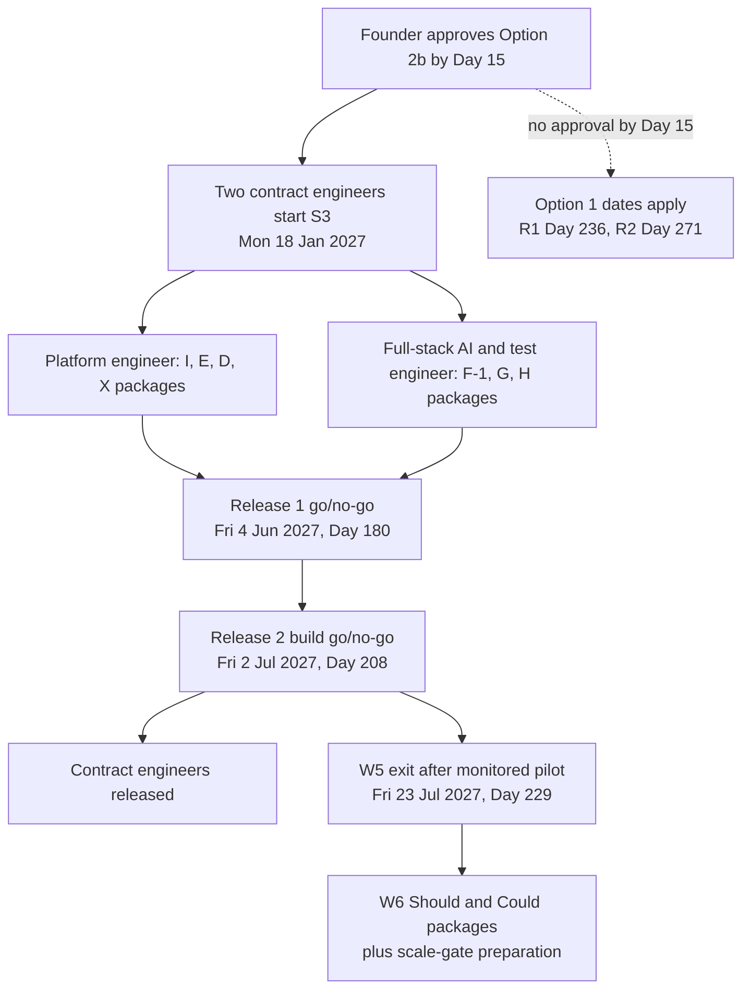

# AI Growth Engine: Employee Sales & Marketing Automation
## Application Blueprint: PART 9 (Batch 9.5), Source Pack Decisions and Re-plan after Enhancements

| Field | Value |
|---|---|
| Document | Part 9, Batch 5 (Part 9.5) |
| Version | 1.0 · 27 Nov 2026 |
| Purpose | (1) Turn every conflict raised by the ten source-pack reviewer groups (CONFLICT-300…491, 101 conflicts) and every earlier-part inconsistency they reported into **binding decisions DEC-157…DEC-227**. (2) Re-plan delivery so that the enhancement parts (Parts 2.6, 2.7, 3.4, 3.5, 3.6, 4.4, 6.8, 6.9, 7.4, 8.3) fit into Release 1, Release 2 and W6 with a stated team, calendar and budget |
| Authority | The same delegated authority as Part 0A (DEC-001…065) and Part 9.1 (DEC-066…156). The client asked that issues be resolved with best expert judgement. Where a decision below conflicts with text in any earlier part, **the decision governs** |
| Baseline | Parts 0–9.4; Part 9.1 (DEC-066…156); Part 8.1/8.2 plan of record (314 / 416 / 518 pd; Release 1 go/no-go ≈ Day 152; Release 2 build ≈ Day 180; DEC-124); source-pack log `.brief/SOURCE_PACK_LOG.md`; the 38-document source pack (document 38 "All Numbers" is the inventory authority) |
| Inputs reviewed | Conflict sections: Part 2.6 §2.6.6 (A), Part 2.7a §2.7.6 (C), Part 3.4 §3.4.6 (B), Part 3.5b §3.5.6 (D), Part 3.6b §3.6.6 (E), Part 4.4b §4.4.6 (I), Part 6.8c §6.8.6 (G), Part 6.9b §6.9.6 (H), Part 7.4b §7.4.6 (F), Part 8.3c §8.3.6 (J); every "inconsistencies found in earlier parts" list; every effort statement and story table |
| Roles applied | Product Owner (lead), Delivery Lead, Solutions Architect, Principal Engineer, QA Lead, Security/Compliance/AI Governance Lead, DevOps/SRE Lead, FinOps Lead |

**Acronyms used in this part.** ALB Application Load Balancer · AZ Availability Zone · BR business requirement · CCB change control board · DPDP Digital Personal Data Protection (India) · DoD definition of done · ECS Elastic Container Service · EVR evidence record · FTE full-time equivalent · MoSCoW Must/Should/Could/Won't · OKPI optimization KPI of the source pack (OKPI-01…35; the pack's own "KPI-01…35", renamed to avoid clashing with the business KPI-01…31 of Part 1) · PD/pd person-day · PDP Policy Decision Point · PERT programme evaluation and review technique · RC recovery class · RPO recovery point objective · RTO recovery time objective · SLA service-level agreement · SLO service-level objective · SP story point · SPDEC / SRC07-DEC / SDEC-08 source-pack decision ID families (DEC-178) · WP workload profile.

**Precedence rule.** Decisions continue the binding DEC series (DEC-157 onwards). Source-pack decision numbers are never cited as DEC-### (DEC-178). The Part 10 assembly carries this register next to Parts 0A and 9.1.

---

## 9.5.0 Decision summary for the Founder

> **Erratum v1.2 (E-V-39):** superseded by budget DEC-230 plus the funded V12 change requests (DEC-770/790). See Part 11.23c.


| # | What you need to know | Where |
|---|---|---|
| 1 | **101 conflicts resolved** by **59 conflict decisions** (DEC-157…DEC-215); **12 further decisions** close the earlier-part inconsistencies the reviewers reported and fix the re-plan (DEC-216…DEC-227). **72 decisions in total, including the Founder's approval of Option 2b as DEC-228**; the Founder's later approvals of the budgets, the team uplift and the XBR reading are recorded as DEC-230…233 (§9.5.2.9) | §9.5.1 |
| 2 | Recurring themes are settled once: availability (99.5% pilot, 99.9% for critical services from the scale gate), recovery (4 h pilot, 2 h at the scale gate, regenerable data 24 h / 8 h, regional 24 h), projection freshness (≤ 60 s operational, ≤ 15 min analytical), capacity (pack figures are load-test targets, DEC-031 stays the business baseline), budget alerts (70 / 90 / 100%), infrastructure (ECS on EC2 and Valkey for the pilot), API paths (**the source's legacy method/path contracts are canonical**), quality thresholds (the pack's stricter figures) | DEC-157…DEC-177 |
| 3 | The ten enhancement parts add **330–567 pd gross** (central 449 pd, after normalising one group's conversion rate). After removing **62–128 pd** (46–76 pd of cross-group duplicates, the 14.5–49.4 pd field-standardization residual moved to the management reserve, and alias work moved into a new path-canon package), adding 4.5–9 pd for this part's own decisions, and allowing **10–20% of work that merges into existing stories**, the **net addition is 218 / 306 / 403 pd** (low / central / high) | §9.5.2.1–9.5.2.4 |
| 4 | **Must** items (safety, compliance, financial integrity, isolation, the 21 mandatory OKPIs) are **190 pd central in Release 1** and **14 pd in Release 2**. **Should/Could** items (100 pd central) move to **W6** | §9.5.2.3 |
| 5 | New programme total: **532 / 722 / 921 pd** (was 314 / 416 / 518). BRD §6 envelope 287–483 pd is exceeded at the central estimate by ≈ 239 pd; the pack's own gross figure (499 PD) excludes the cross-cutting engineering controls that its documents 18–36 require | §9.5.2.4 |
| 6 | **Option 1 (same team):** Release 1 go/no-go **Fri 30 Jul 2027 (Day 236)**, Release 2 build **Fri 3 Sep 2027 (Day 271)**, W6 shrinks to ≈ 4.7 sprints | §9.5.2.5 |
| 7 | **Option 2b (recommended): two contract engineers from Sprint 3 to the Release 2 build gate.** Release 1 go/no-go **Fri 4 Jun 2027 (Day 180)**, Release 2 build **Fri 2 Jul 2027 (Day 208)**, W5 exit **Fri 23 Jul 2027 (Day 229)**. Added engineers **₹10.9–16.4 lakh**; all incremental one-time cash **₹13.3–21.5 lakh**. Cash needed to reach the Release 2 gate is about the **same as Option 1** (₹53–85 lakh), because Option 1 pays the core team for 9 more weeks of build | §9.5.2.5–9.5.2.6 |
| 8 | New monthly run cost: **+₹230–3,450** with contingency (probes, restore drills, reserved worker, training tenant). No new budget line. The 99.9% and 2 h targets fit inside the existing scale-gate Topology B estimate (≈ ₹21,000/month) | §9.5.2.6 |
| 9 | **Your decision needed by Mon 7 Dec 2026 (Day 1):** approve Option 2b (or 2a / 1). If no approval by the W0-A gate (Day 15), the plan of record falls back to Option 1 dates automatically (DEC-227) | §9.5.2.8 |

---

## 9.5.1 Binding decisions DEC-157 onwards

### 9.5.1.1 Method

1. **Collection.** Every row of the ten conflict sections was read, plus every conflict and earlier-part issue listed in `SOURCE_PACK_LOG.md`. The 101 conflict IDs are: A 300–304 (5), B 320–330 (11), C 340–351 (12), D 360–372 (13), E 380–387 (8), F 400–412 (13), G 420–424 (5), H 440–447 (8), I 460–473 (14), J 480–491 (12). CONFLICT-373…379 were allocated to Group D but never used (Part 3.5b §3.5.8).
2. **Merging.** Conflicts that state the same disagreement are resolved by one decision (for example, projection freshness appears as CONFLICT-348, 443, 463 and 480). Each decision lists every conflict it closes; §9.5.1.11 indexes every conflict ID to exactly one decision.
3. **Coordinator guidance.** The coordinator's guidance for the recurring themes was followed unless strong evidence pointed elsewhere. Two places use the guidance with a recorded refinement: the **BR count** (DEC-180: the source pack's "71 retained" already contains the five cross-cutting B-* requirements, so the "+5 added" are the expansion scope statements XBR-01…05; the total of 76 and the "no new BR" outcome are unchanged) and the **API path canon** (DEC-170: Group D argued for Part 3.2 paths; BRD §9 / FRD "Routing decision" text explicitly says "retain the canonical legacy method/path contracts", so the guidance holds and Group D's security concern is met by renaming rather than double-mounting).
4. **Rules applied when choosing.** (a) Never loosen a safety, consent, isolation, approval or financial-integrity control; (b) where the pack is stricter and affordable, adopt it; (c) where the pack is stricter but needs scale-gate infrastructure, adopt it **from the scale gate**; (d) cost and team limits of DEC-004/005/008/020 stay binding unless this part changes them explicitly; (e) one name and one number per concept.

### 9.5.1.2 Non-functional targets, recovery, capacity and operations

| DEC | Conflicts resolved | Issue | Decision (binding) | Rationale | Affected parts / IDs |
|---|---|---|---|---|---|
| **DEC-157** | CONFLICT-323, 460, 482 | Critical-service availability: pack ≥ 99.9% over a rolling 30 days (OPT-05-07, OKPI-06, non-mandatory) vs DEC-018 99.5% pilot | (1) **Pilot: 99.5%** monthly for Website/Portal and Admin (DEC-018 unchanged). (2) **From the scale gate (Topology B): 99.9%** for the **critical services**: Website/Portal intake (public forms, portal sign-in and submissions), the dispatch path (PDP + outbox + channel adapters), and **Admin core** (sign-in, approvals, emergency stop, inbox, run monitor A110, budget controls). Admin analytics stay at 99.5%. (3) This target **is OKPI-06**, **non-mandatory**, reported against a rolling 30-day window; SLO error budgets keep the 28-day rolling window and monthly reporting (DEC-018). (4) OKPI-06 shows **Unassessed** until 30 days of synthetic-probe data exist (FR-ENH-I-050). (5) Contract schedule SLA-02 (Part 8.3c) follows the same rule and is offered only under DEC-209 | The pack itself marks OKPI-06 non-mandatory; 99.9% needs two instances behind a load balancer and Multi-AZ, which arrive only with Topology B (Part 3.1 §3.1.6.3). Group B proposed excluding Admin; the coordinator's scope (Admin core) is adopted because emergency stop and approvals are safety paths | DEC-018; NFR-053, NFR-054; SLO-01; OKPI-06; Part 4.2 §4.30; Part 8.3c SLA-02; FR-ENH-I-050 |
| **DEC-158** | CONFLICT-322, 385, 424, 444, 462 | Recovery objectives: pack growth RTO ≤ 2 h (OKPI-32, mandatory), regenerable data 24 h / 8 h (OKPI-33/34); blueprint RTO ≤ 4 h (DEC-018/079); three naming schemes (RC-1…3 in Part 3.4, DR-T1…T3 in Part 3.6b, F-tiers in Part 4.4b) | **Recovery classes RC-1…RC-3 (Part 3.4 §3.4.5, ADR-102) are the single scheme.** <br/>• **RC-1 Critical** (system of record: tenancy, consent/suppression, approvals, prices, contracts, orders, invoices, payments, ledgers, outbox, idempotency keys, audit chain, runs, configuration; = DR-T1 + DR-T2): **RPO ≤ 15 min (OKPI-18); RTO ≤ 4 h in the pilot (OKPI-19 ≤ 240 min)**; **RTO ≤ 2 h from the scale gate (OKPI-32)** for instance, AZ, bad-deployment and data-corruption failures, binding after Topology B is live **and** two consecutive timed drills pass. <br/>• **RC-2 Regenerable** (fetched pages, extracted text, unreviewed evidence snippets, embeddings and chunks, research and enrichment caches): **RPO ≤ 24 h, RTO ≤ 8 h** (OKPI-33/34). <br/>• **RC-3 Derived** (projections, search indexes, Valkey caches): rebuilt by replay; operational projections back **≤ 2 h after RC-1**. <br/>• **Regional outage: RTO ≤ 24 h, RPO ≤ 15 min in the pilot** (DEC-079 unchanged); a lower regional RTO is a scale-gate option (warm standby, priced then). Part 3.1's "best effort ≤ 8 h" regional figure (CONFLICT-101) is superseded | One scheme removes three overlapping vocabularies. Multi-AZ RDS and two instances (Topology B) make a 2 h non-regional RTO feasible at no extra cost beyond the scale-gate estimate; at pilot a single-AZ restore realistically needs the 4 h budget. Regional values follow DEC-079 | DEC-018, DEC-079; NFR-056, NFR-057; ADR-102; Part 3.1 §3.1.13; Part 3.3 §3.3.15.1; Part 3.6b DR-T1…T3 (aliases); Part 4.4b FR-ENH-I-020; Part 8.2 §8.2.3.1; FR-ENH-J-019; OKPI-18, -19, -32, -33, -34 |
| **DEC-159** | — (earlier-part inconsistencies: Part 3.6b items 5–7; Part 4.4b item 5) | Backup retention (Part 3.1: cross-region copy 7 days; Part 3.3: copies "expire in step" with 35 days) and three different restore-drill locations and cadences (Part 3.1 every release in the prod account; Part 4.3 monthly in the backup account; Part 3.3 weekly in an isolated VPC) | **Retention:** RDS automated backups and PITR **35 days** in ap-south-1; **cross-region automated backup copies 7 days** in ap-south-2 (sufficient for the 15-minute regional RPO; keeps B20 at ₹300–600); weekly encrypted logical dump to the shared account **35 days**; S3 noncurrent versions 35 days; legal hold never relies on backups (ASSUMPTION-115). **Restore drills, one location:** every drill on production data runs in the **backup account's isolated restore sandbox with dispatch forced off** (RD-01, RD-02). **Cadence:** (D-1) automated snapshot restore + `restore_checks.sql` **weekly and before every production release that contains a migration**; (D-2) timed RC-1 recovery drill with RTO/RPO measured **monthly in the pilot**; (D-3) data-corruption game day **quarterly**; (D-4) regional restore rehearsal **semi-annually** (first before Release 2), **quarterly from the scale gate**; (D-5) RC-2 rebuild drill **quarterly**. Every drill writes an EVR and a DCE | Seven-day regional copies meet the regional RPO; longer history is held by in-region PITR and cross-account logical dumps. One sandbox in a separate account gives blast-radius separation and cannot send messages | Part 3.1 §3.1.13.2; Part 3.3 §3.3.11.1, §3.3.15.2; Part 4.3 §4.47; Part 3.6b RD-01…14; NFR-012; DEC-121 (10 s canary interval kept) |
| **DEC-160** | CONFLICT-348, 443, 463, 480 | Projection freshness: OKPI-28 (mandatory) ≤ 60 s from committed event to scoped projection vs NFR-047 dashboards ≤ 15 min and NFR-008 Customer 360 ≤ 60 s | **Freshness classes (Part 4.4b §4.4.5.4.6) are adopted.** **F-1 Operational, p95 ≤ 60 s (OKPI-28, mandatory):** Customer 360 (A032), pipeline/Kanban (A029), approval and exception queues, inbox, action centre (A106), run monitor (A110), job and run status, budget utilisation, and the count tiles of the growth/Command Centre dashboards (A089). **F-2 Analytical, ≤ 15 min, labelled "as of hh:mm":** dashboards RP-01…RP-21, attribution, forecast, SEO, cost forecasts and unit-cost rollups. **F-3 Scheduled:** monthly economics and exports, labelled with the period. **NFR-047 is amended** to state F-2 only; NFR-008 stays and is read as part of F-1. OKPI-28 is measured on the F-1 set; AL-52 alerts on F-1 lag | Operational screens drive actions and must reflect new commitments within a minute; heavy rollups at 60 s would need streaming infrastructure that the pilot budget does not carry | NFR-008, NFR-047; OKPI-28; AL-52; FR-ENH-J-017; Part 2.7a tier O/A; Part 4.4b F-1…F-3 |
| **DEC-161** | CONFLICT-321, 349, 441, 461, 465, 466, 467, 483 | Capacity design points: pack initial 25 owned + 10 external, 50 staff sessions, 100k opportunities, 10k actions/day; growth 50+ owned + 100 external, **250 sessions**, 1M opportunities, 100k actions/day vs DEC-031 (Y1 25–40 workspaces / 2–10 tenants / ≤ 60 users; Y2 100 / 30 / 200). Also spike multiplier, traffic mix and soak length differ | (1) **DEC-031 remains the business-planning and cost baseline**; infrastructure is not sized up. (2) **Load-test design targets take the higher of each figure.** **WP-01 (Release 1 and 2 gates):** 40 owned workspaces, 10 external tenants, **50 concurrent staff sessions**, 100k opportunities, 50 concurrent jobs, 10k scheduled actions/day; pass = OKPI-05 (dashboard p95 ≤ 2.0 s), OKPI-27, zero isolation failures. **WP-02 (scale gate, before the 31st external tenant):** 100 owned workspaces, 100 external tenants, **250 concurrent sessions**, 1M opportunities, 250 jobs, 100k actions/day; pass = OKPI-26 (p95 ≤ 2.5 s), OKPI-32 drill. (3) **Spike:** 2× = acceptance inside SLO; 3× = stress with graceful degradation. (4) **Traffic mix:** 60/20/10/10 (WP-03) for dashboard gates; Part 6.1 LT-01 mix for release trains (DEC-143/154). (5) **Soak:** 8 h at wave gates (LT-ENH-I-05 replaces Part 4.2's 4 h profile); GL-T04 24 h (R1) / 72 h (R2) governs releases | A test target above the expected load gives evidence of headroom without paying for it in production; DEC-154 already chose the higher figures for load runs | DEC-031, DEC-143, DEC-154; NFR-044, NFR-061; LT-01…12; LT-ENH-B-01…04; LT-ENH-C-01; LT-ENH-I-01…06; WP-01…03; OKPI-05, -26, -27 |
| **DEC-162** | CONFLICT-324, 403, 481 | Budget alert thresholds: pack 70% / 90% vs BRL-AI-08 / NT-025 80% alert, 100% stop | **For every M53 cap (AI, provider, channel, per surface): 70% = warning** to the budget owner; **90% = critical** to owner and FinOps, optional and paid jobs paused (degradation-ladder step 3); **100% = hard stop** of all spend on that cap except the emergency-stop and compliance paths. BRL-AI-08 and NT-025 are amended accordingly (the 80% step is withdrawn). AWS Budgets keeps its account-level 50/80/100% alarms as an infrastructure backstop (they do not act on M53 caps) | Adopts the pack's figures (earlier warning, earlier pause); one ladder avoids four-step confusion | BRL-AI-08; NT-025; ADR-083; FR-ENH-B-022, FR-ENH-F-022, FR-ENH-J-018; OKPI-12 |
| **DEC-163** | CONFLICT-320 (and Part 4.4b inconsistency 6) | Pack: ECS Fargate + ALB + ElastiCache Redis | **Pilot: ECS on EC2 (ADR-013) and Valkey (ADR-003)**, single host, no ALB (Topology A). **Scale gate (Topology B):** ALB, two instances, Multi-AZ RDS, ElastiCache **for Valkey**; **Fargate is an allowed option** for on-demand or bursty tasks, chosen by a cost comparison at that time (ADR-100). "Redis" in pack text means the Redis protocol; **Redis itself is not used** (licence; ADR-101). A load balancer is used exactly where Part 3.1 requires one; Part 4.3 §4.37.1 pilot rollout wording that assumes ALB health checks is read as "ECS service health checks on the single host" | Cost (B01 ₹5,000–7,000) and the licence decision stand; nothing in the pack requires Fargate before the scale gate | ADR-003, ADR-013, ADR-100, ADR-101; Part 3.1 §3.1.6; Part 4.3 §4.37.1; B01 |
| **DEC-164** | CONFLICT-325 | "No cross-region replication before approval" vs ADR-019 cross-region backup copies from day one | **DEC-040 is the recorded approval for encrypted backup copies to ap-south-2** (inside India). **No live replication** of application data outside ap-south-1 without a new decision. The IaC change record cites DEC-040 and this decision as approval evidence | Backup copies satisfy the regional RPO; data stays in India | DEC-040; ADR-019; Part 3.1 §3.1.13 |
| **DEC-165** | CONFLICT-464 | 5xx alert thresholds inside document 31 | **AL-06 pages at > 2% 5xx over 5 min; AL-50 opens a ticket at > 1% over 10 min**, both with a minimum-volume rule (≥ 200 requests in the window) | Two-level alerting catches slow degradation without paging noise | AL-06, AL-50; Part 4.3 §4.40 |
| **DEC-166** | CONFLICT-471 (and Part 4.4b inconsistency 4) | Environment sets differ (pack: local, shared dev, SIT, UAT, staging, prod, recovery; Part 3.1 vs Part 4.3 use `test` differently) | **Canonical set:** `local`, `ci` (ephemeral, per pull request), `test` (persistent non-production integration environment, nightly; = pack "SIT"), `staging` (= pack "UAT" window and pre-production), `prod`, `recovery` (backup-account restore sandbox, dispatch forced off). No shared-dev environment. Part 3.1's "test (CI)" is renamed `ci`; Part 4.3's `test` keeps its meaning | One vocabulary for runbooks and evidence | Part 3.1 §3.1.14; Part 4.3 §4.35; Part 4.4b §4.4.5.3.1 |
| **DEC-167** | CONFLICT-473 | Queue topology: pack separates priority-control and financial queues; ADR-021 has neither | **ADR-021 amended:** add a `control` queue (emergency stop, revocation, kill switches; one reserved worker slot, prefetch 1) and a `finance` queue (posting, reconciliation, allocation; prefetch 1, no autoscale-down below one slot). FR-ENH-I-030 is Must | Emergency stop must meet ≤ 60 s even during a backlog; finance jobs must not be starved by bulk work | ADR-021; FR-ENH-I-030; US-18-EI01 |
| **DEC-168** | CONFLICT-472 | Vulnerability severity: pack by business impact vs Part 4.1 CVSS adjusted for exposure | **Dual classification; the higher wins.** Business-impact Critical (confidential disclosure, financial-integrity loss, credential exposure, uncontrolled dispatch) is **never waivable** | Prevents a low CVSS score from hiding a business-critical flaw | Part 4.1 §4.16.3; Part 4.4b §4.4.5.5.2; OKPI-03 |
| **DEC-169** | CONFLICT-330, 341, 470 | Product separation: "two products, four frontends, two backends"; startups' own product webhooks vs "no automatic handoff" | (1) **This product = two frontends + one backend** (DEC-009, NFR-001, NFR-031). The pack's "four frontends and two backends" counts the separate investor application (DEC-058), which is **out of scope**; its only effect here is the isolation test "no shared runtime, credentials, data or dependency with the investor product". (2) **Product-event webhooks** from the startups' **own delivered products** are external systems behind an allowlisted adapter (ADR-105), **off by default**, with a closed event allowlist and no personal or clinical data; the "no automatic handoff" rule concerns the investor product only | Keeps DEC-009 intact while allowing a lawful, opt-in data feed later | DEC-009, DEC-058; NFR-001, NFR-031; ADR-105; FR-ENH-B-010; OKPI-02 |

### 9.5.1.3 API contracts

> **Erratum v1.2 (E-V-21):** superseded by automatic bid submission allowed under a per-tender bounded mandate (DEC-781). See Part 11.23c.


| DEC | Conflicts resolved | Issue | Decision (binding) | Rationale | Affected parts / IDs |
|---|---|---|---|---|---|
| **DEC-170** | CONFLICT-343, 360, 469 | Path canon: source (document 07) retains legacy method/path contracts for 302 operations (e.g. `/api/v1/sales/tenants`); Part 3.2 gives every non-FRD-named operation a derived `~/` path; Group D proposed Part 3.2 paths as canonical | (1) **The source's legacy method and path are canonical** for every operation in the document 07 register (302 retained + 19 candidate). (2) Where a Part 3.2 derived path differs, the Part 3.2 path is **renamed** to the source path in the OpenAPI document and route maps; it is **not** mounted twice. The stable identifier stays the Part 3.2 operation ID (API-###); OpenAPI carries `x-source-op` (SM-OP-###) and `x-legacy-path`. (3) **Aliases are allowed only where two paths must coexist**: the 104 FRD-named ★ paths (already legacy) and the website page read, mounted at both `/api/v1/commercial/public/site/pages/{slug}` and the legacy `/api/v1/public/pages/{slug}` (same view and serializer). (4) **Operations with no source path** (Part 3.2-only operations and API-ENH-D-001…024, API-ENH-I-01/02) use the BRD §9 namespaces `/api/v1/commercial/{public,portal,admin,internal}/`. (5) Document 07 is the only path authority: paths that appear only in other pack documents (e.g. the five document 31 paths) are illustrative, not contracts. (6) **Ingress unchanged:** each path is mounted in exactly one process group by its access class; Admin legacy paths (`/api/v1/sales/*`, `/api/v1/admin/*`) are never on the website ingress; the website allowlist (84 routes, Part 3.5b) is regenerated from the catalogue in the same pull request. GAP-103 is closed by the Part 3.5b mapping | BRD §9 and the FRD "Routing decision" say "retain the canonical legacy method/path contracts to avoid breaking integrations". Group D's concern (double attack surface) is met by renaming rather than aliasing: one route per operation, one permission class, one rate class | BRD §9; FRD §8; DEC-015, DEC-104; Part 3.2 §3.2.1.1, §3.2.2; Part 3.5a/b mapping; FR-ENH-C-003 (re-scoped to path canon); Part 4.4b §4.4.6 |
| **DEC-171** | CONFLICT-344 | Generic `POST …/{id}/control` with an `action` enum (12 resources) vs Part 3.2 per-action sub-resources | **The source `/control` route is the canonical contract** (DEC-170). It is implemented as a thin dispatcher: the `action` value is validated against the resource's state machine and **each action keeps its own Part 3.2 operation ID, permission class, side-effect class and rate-limit class** (ADR-022). Unknown or not-allowed actions → 409 `INVALID_TRANSITION`. Part 3.2 per-action sub-resources that are not FRD-named are not mounted separately. Frontends call typed client methods per action, never a generic "control" helper | Satisfies the legacy contract without losing per-action authorization | ADR-022; Part 3.2 §3.2.1.10; Part 3.5b §3.5.5.1; TC-ENH-C-004 |
| **DEC-172** | CONFLICT-345 | Legacy per-object approve/review routes (`/contracts/{id}/approve`, `/proposals/{id}/review`, `/messages/drafts/{id}/review`, …) vs Part 3.2's single Approval resource | **Legacy approve/review routes are canonical paths** (DEC-170) that **create or decide the Approval for the object's current revision and content hash** (CA-APPROVE). The single Approval resource remains the system of record and its own routes stay. No approval is ever recorded outside the Approval entity | Keeps one approval model while honouring legacy contracts | Part 3.2 §3.2.2.3; CA-APPROVE; DEC-038 |
| **DEC-173** | CONFLICT-361 | Idempotency key and expected revision as body fields (source) vs headers (Part 3.2) | **`Idempotency-Key` and `If-Match` headers are normative** and mandatory on every state-changing POST/PATCH (stricter than the source). **Body fields `idempotency_key` and `expected_revision` are accepted for legacy compatibility on legacy paths**: if both header and body are present they must be equal (else 400 `HEADER_BODY_MISMATCH`); if only the body field is present it is promoted to the header value before the idempotency middleware runs. New `/api/v1/commercial/` operations reject the body fields | Legacy clients keep working; one enforcement point | Part 3.2 §3.2.1.5, §3.2.1.8; Part 3.5b §3.5.5.1 |
| **DEC-174** | CONFLICT-362, 363 | Two list envelopes and two async vocabularies | **One list envelope** everywhere: `{ "data": [...], "page": { "next_cursor", "prev_cursor", "limit" }, "meta": { "as_of", "total_estimate", "total_exact" } }`; query `limit` (1–100, default 25) and `cursor`; on legacy paths `page_size` is accepted as a synonym of `limit`. **One async vocabulary:** `202` + `Location` + `{ "run_id", "status_url", "state", "simulated" }` with states `queued`, `running`, `waiting` (+ `wait_reason`), `succeeded`, `failed`, `cancelled`; source `held` → `waiting`, `pending` → `queued`, `simulated` → the boolean flag; `job_id` is not used | The method/path is the BRD-retained contract; representation conventions were never fixed by the BRD and the source DTOs are marked "proposed"; Part 3.2's conventions are already used by all 555 operations and Part 6 tests | Part 3.2 §3.2.1.2, §3.2.1.10; Part 3.5b run-state mapping |
| **DEC-175** | CONFLICT-350, 366, 367 | Website/portal boundary: token routes under `/public/`, five "Portal + Admin" operations, payment-link creation listed under website operations | (1) **Signed-token reads** (preferences, slots, API-083) are **portal-class** on the website ingress with RL-PUB-W; token ≥ 128 bits entropy, single purpose, expiry ≤ 30 days. (2) Agreements, payment status and onboarding use a **portal session**; a token link only starts sign-in and deep-links after authentication ("URL token alone is insufficient"). (3) Operations serving both audiences are **split per audience** with separate serializers (Part 3.2 rule 2). (4) **Payment-link creation is Admin-only** (A073; CA-FIN; DEC-022); the website calls only the payment-status read | The source's own boundary text requires these splits; every external effect starts from Admin | Part 3.2 §3.2.1.1, §3.2.2.4; API-083; API-ENH-D-016, -024; FR-ENH-C-013; OKPI-02 |
| **DEC-176** | CONFLICT-370 | 24 status-code proposals differ from Part 3.2's side-effect rule; bid control lists `submit` | **Part 3.2 §3.2.1.10 status rule is normative** (the 24 rows are corrected as in Part 3.5a §3.5.4.7). On bids, `submit` means **record a human portal submission with evidence** (API-367); the product never submits a bid (DEC-053) | Consistent status semantics; DEC-053 is a hard boundary | DEC-053; API-367; Part 3.2 §3.2.1.10 |
| **DEC-177** | CONFLICT-369 | Retention-policy operation: source "create retention versions freely" vs API-091 "tighten only" | **DEC-028 governs:** tenants may only tighten retention; loosening is a platform change through release governance | Retention is a legal control | DEC-028, DEC-078; API-091 |

### 9.5.1.4 Identifiers, wording, counts and effort

| DEC | Conflicts resolved | Issue | Decision (binding) | Rationale | Affected parts / IDs |
|---|---|---|---|---|---|
| **DEC-178** | CONFLICT-364, 380, 445 | Source-pack decision IDs collide with DEC-001…156 | **Renamed families, never part of the DEC series:** document 24 decisions (180 retained + 172 expansion) → **SPDEC-001…180 and SPDEC-X-…**; document 07 decisions → **SRC07-DEC-001…038**; document 08 schema decisions → **SDEC-08-039…042**. Blueprint DECs take precedence over all of them. The pack's optimization KPIs are always **OKPI-01…35** | Prevents a source decision being mistaken for a binding one | Part 3.5b; Part 3.6b; Part 6.9b §6.9.5.2; Part 8.3c |
| **DEC-179** | CONFLICT-301, 326, 340, 406, 489 | Residual investor and fundraising wording in pack documents 03, 05, 06, 09, 10, 12–14, 17, 21, 36–38 | **DEC-002 is extended to every new instance.** Replacements: "investor/customer" → "customer"; "lead/investor record" → "lead record"; "investor/customer journey/portal/records" → "customer journey/portal/records"; "marketplace investor or customer" → "marketplace customer"; "verified funding" → "verified commercial receipt"; "issuer" / "issuer/company" → "business line" / "company"; "investment/commercial" product or Django domain → "commercial"; envelope `product` is the constant `commercial`. Clauses about the investor product ("investor app only fundraising", "investment thesis", "funding goals", "formal securities offers", "investment-related compensation", "public market/investor search", "investor/fund application pages") are **not applicable**; no fundraising, investor-discovery or securities feature is built; "funding goals" is removed from the configurable-startup test. Investor tokens appear only as negative test inputs. All strings join the DEC-002 negative regression scan (TC-ENH-C-020) | The product has no fundraising capability (BRL-TEN-12; DEC-009/058) | DEC-002, DEC-058; BRL-TEN-12; FR-NEG-01; TC-ENH-B-020, TC-ENH-C-020 |
| **DEC-180** | CONFLICT-365, 447, 487 (and GAP-440, Part 6.9b inconsistency 7) | Inventory counts differ between the pack and the blueprint | **Reconciled counts (authoritative for Part 10):** see §9.5.1.10. In short: **BR 76** = pack "71 retained" (= blueprint's 71 primary BRs: BR-M01…M66 + BR-TENANT/WEB/AUTO/SVC/QA) **+ 5 "added"** expansion scope statements **XBR-01…05**, which map to BR-S138 and add **no new BR**. **FR 288** = 141 SM-FR (→ FR-W/A/OP) + 147 SM-UX-FR (→ **FR-UX-<screen>** field-specification aliases, one per screen, not separate functional requirements); the blueprint's 150 interface/operation FRs = 141 + the 9 expansion screens (W31–W34, A109–A113); 181 FRs in total with 31 cross-cutting (DEC-142). Other counts as in §9.5.1.10 | Document 24 enumerates exactly 71 BRs including the five B-* cross-cutting requirements, so the five "added" cannot be the B-*; the coordinator's outcome (76, no new BR) is kept, with the corrected composition | DEC-087, DEC-104, DEC-142; Part 1 §1.4; Part 2.1 §2.4; Part 6.9a §6.9.4.2; XBR-01…05 |
| **DEC-181** | CONFLICT-328, 446, 488 | Effort double counting: pack 385 PD base + 62/114/196 PD expansion = 349/499/679 PD gross vs blueprint 314/416/518 pd with the nine screens already inside | (1) **The Part 8.1 story plan is binding** for the baseline (DEC-124); the pack's 385 PD is a top-down cross-check (difference 31 pd, ≈ 8%, inside the P80 spread). (2) **Overlap stated:** the nine expansion screens have stories (US-1808…1810, US-2001…2010); using the pack's own formula, adjusted = 385 + Δ × (1 − f), the blueprint implies overlap fractions **f = 0.565 / 0.728 / 0.821** (low/central/high). (3) Only **UX-TASK-FIELDS (18/32/55 PD)** was potentially additional; it is resolved by US-17-EH01 (shared field components, 5–8 SP, Must) plus a **14.5–49.4 pd residual held in the management reserve** and sized at the Sprint 3 review (DEC-226). (4) The pack's approval review effort (32.55/62.85/123.70 PD) is replaced by the estimated decision and trace-approval effort (package H-5, 10–20 pd engineering share + 5–10 days Founder/PO). (5) The **enhancement effort of the ten parts is new scope** and is re-planned in §9.5.2 | One baseline, one overlap statement, one place where new effort is counted | DEC-012, DEC-124; Part 3.4 §3.4.5.7; Part 6.9b §6.9.5.4.2; Part 8.3a §8.3.4.1 |
| **DEC-182** | CONFLICT-410 (and Part 2.6 inconsistency 1, Part 4.4b inconsistency 7) | Section-number clashes: Part 2.6 local §2.6.x vs Part 2.2 §2.6; Part 4.4 vs Part 4.1 §4.4; Part 7.3 file contains §7.4–§7.9 | **Cross-references always carry the part prefix** ("Part 2.2 §2.6.1", "Part 2.6 §2.6.5", "Part 4.1 §4.4", "Part 7.3 §7.5"). Unprefixed references mean the section in the same file. At assembly, Part 7.3's internal §7.4–§7.9 are renumbered §7.3.8–§7.3.13; enhancement parts keep their numbers (extends DEC-148) | Avoids ambiguous citations without rewriting thousands of references | DEC-148; Parts 2.2, 2.6, 4.1, 4.4, 7.3, 7.4 |
| **DEC-183** | CONFLICT-327, 329 | "Six runtime AI responsibilities" vs the Part 7.1 catalogue; pack Django app and monorepo names | **Part 7.1 governs** the agent catalogue (36 agents, 43 automations); the pack's six responsibilities are **families** (mapping in Part 3.4 §3.4.5.5 B). **Part 3.1 module names and ADR-006/ADR-060 repository layout govern**; pack names are mapped in Part 3.4 §3.4.5.1 C | One catalogue and one code layout | Part 7.1; Part 3.1 §3.1.4; ADR-006, ADR-060 |

### 9.5.1.5 Data model

| DEC | Conflicts resolved | Issue | Decision (binding) | Rationale | Affected parts / IDs |
|---|---|---|---|---|---|
| **DEC-184** | CONFLICT-381 | Embedding dimension left open in document 08 | **Closed by DEC-088**: 1024 dimensions (E5-large class); each migration asserts the dimension per `model_id` (TC-ENH-E-035); SDEC-08-042 is answered | Already decided | DEC-088; Part 3.3 |
| **DEC-185** | CONFLICT-382 | Reuse existing identity tables vs product-local `ten_user` | **`ten_user` is a profile extension** of the reused identity: primary key equals (or is 1:1 with) the identity subject; **no credentials, passwords or MFA data**; the W0-A identity spike (DEC-019) confirms the key type before the first migration | Honours "no duplicate identity tables" while keeping tenancy data local | DEC-019, DEC-077; Part 3.3 `ten_user` |
| **DEC-186** | CONFLICT-383 | Mutable fulfilment milestone (source) vs append-only fulfilment events (Part 3.3) | **Both:** new `com_fulfillment_milestone` (plan; mutable until accepted) + unchanged append-only `com_fulfillment_event` (evidence). Delivered quantities are derived from events only. Milestones are **Should (W6)**; acceptance-with-evidence already exists via events | Plan and evidence are different concepts | Part 3.3; ENT-ENH-E-03; FR-ENH-E-003 |
| **DEC-187** | CONFLICT-384 | Global business keys (`unique(code)`, `unique(invoice_no)`) vs tenant/startup scope | **Scoped keys govern** (tenant, startup). Listed exceptions stay global: verified hostname, platform service-invoice number, release tag | FRD §5 and DEC-009 isolation | Part 3.6b IX-ENH-E-01…54 |
| **DEC-188** | CONFLICT-386 | `sales_order.direction` includes service/training/project vs blueprint sell/buy | `direction` = **ledger side** (sell/buy) only; new column **`order_kind`** ∈ {goods, service, training, project}; receivable/payable separation (BRL-ORD-06) unchanged | Keeps the two ledgers clean | BRL-ORD-06; FR-ENH-E-008 |
| **DEC-189** | CONFLICT-387 | `delay_seconds` vs `wait_business_days` for sequence steps | **Business-day cadence governs** outreach (DEC-119); no seconds-based outreach delays; system-internal waits use workflow timers | Consent and quiet-hour rules are day-based | DEC-119; Part 3.3 |
| **DEC-190** | CONFLICT-351 | Source single `sales_data_transfer` and `*_revision` tables vs blueprint entities | **Blueprint entities govern** (DEC-107): `saas_import_job` + `saas_export_job`; versioned `aut_trigger` and `aut_workflow_template`. Read-only view `v_data_transfer` serves the legacy list path (DEC-170) | One physical model; legacy read served by a view | DEC-107; Part 2.7a §2.7.5.4 |
| **DEC-191** | — (Part 2.7a inconsistency 2; Part 3.6b inconsistencies 1–4; Part 6.9b inconsistencies 2 and 6) | New entities proposed by several groups overlap (service request in C, E and H; evidence record in H and E), plus a dangling reference and a misclassified table | (1) **ServiceRequest = `saas_service_request` (ENT-ENH-E-02)**; H's `svc_service_request` (ENT-ENH-H-07) and C's `sales_ui_service_request` are aliases; it backs FR-W34, W28 support cases and API-440/442. (2) **EvidenceRecord = `ops_evidence_record` (ENT-ENH-H-03)** is the EVR of Part 6.1 §6.1.5.4; Group E's DCE is a record type inside it. (3) **BusinessTemplate (ENT-ENH-E-01)** resolves the dangling `ten_startup.template_ref`. (4) `int_credential_ref` is reclassified **Restricted** (RECOMMENDATION-399). (5) GAP-112 is **closed**: the 17 retained entities are identified in Part 3.6a. (6) The Part 3.3 owner assigns permanent ENT numbers (from ENT-200) to all accepted ENT-ENH-* entities at W0-A; Parts 3.1/3.2/9.2 references follow | One entity per concept, permanent IDs before the first migration | DEC-087; GAP-112; Part 3.3; ENT-ENH-E-01…04; ENT-ENH-H-01…07 |

### 9.5.1.6 AI, providers and cost

| DEC | Conflicts resolved | Issue | Decision (binding) | Rationale | Affected parts / IDs |
|---|---|---|---|---|---|
| **DEC-192** | CONFLICT-372, 400 | Pack: local model gateway first, no paid AI as a prerequisite; operations list "claude/openai api" | **DEC-007 stays:** Tier 1 = Anthropic Claude (paid, capped by DEC-008); Tier 2 free models opt-in, default off, Public/Internal-non-personal data only; local inference is evaluated in a W6 spike with AU-045 (benchmark) and AU-047 (licence). **OpenAI is not an approved runtime provider.** The pack's "local first" is read as "rules and cache first" (Tier 0) per FR-ENH-F-030 | Quality and cost controls are already proven in Part 7; free/local models must pass the same eval gates | DEC-007, DEC-008; Part 7.3; FR-ENH-F-030 |
| **DEC-193** | CONFLICT-401 | Search primary: native source registry/feeds first (pack) vs Tavily primary (AD-05) | **Native source adapters (registries, feeds, official APIs) are primary**; Tavily free credits are secondary; pay-as-you-go within B03 only after the W1 benchmark shows a coverage gap. SearXNG is not deployed until an AGPL and upstream-terms review passes | Native sources are cheaper and carry clearer licences | AD-05; B03; Part 7.4b §7.4.5.8.6 |
| **DEC-194** | CONFLICT-402 | Extraction: Scrapy + Trafilatura, Playwright for JS (pack) vs Firecrawl self-hosted + trafilatura (ADR-018) | **Trafilatura for static pages; Firecrawl (self-hosted, unmodified) vs a Playwright renderer for JS pages is decided by the W1 benchmark**; both licence-registered (AU-047) | Evidence-based choice; both are free | ADR-018; AU-045, AU-047 |
| **DEC-195** | CONFLICT-404, 490 | Schema-valid AI outputs: OKPI-13 ≥ 99.5% (timeouts count invalid) vs ≥ 99% first pass; evidence-grounded accuracy OKPI-14 ≥ 95% | **Adopt the pack's stricter thresholds.** Release gate from W1 and steady state: **final schema-valid ≥ 99.5%** (after bounded repair; timeouts and abandoned repairs count as invalid) measured on ≥ 1,000 calls (eval set plus shadow traffic); **first-pass valid ≥ 99%** kept as a diagnostic gate. **Evidence-grounded accuracy ≥ 95%** on the approved labelled set for every retrieval-citing agent, from its first activation | Schema failures become human work; a 0.5-point gain is cheap with constrained decoding and repair | Part 7.3 §7.6.9; OKPI-13, OKPI-14; AU-006 |
| **DEC-196** | CONFLICT-405 | Classification precision: OKPI-15 ≥ 90% vs DEC-001 80% at W1 exit | **DEC-001 governs W1 (≥ 80% on ≥ 100 reviewed signals)**; **≥ 90% is required before any L2/L3 autonomy and is the W4 target**; sample ≥ 200 per vertical; recall also reported | OKPI-15 is non-mandatory; the 90% gate already protects autonomy | DEC-001, DEC-118; OKPI-15 |
| **DEC-197** | CONFLICT-371 | Provider shortlists: PandaDoc e-sign; Postiz social publishing (AGPL) | **DEC-023 governs e-sign** (Aadhaar eSign/DSC providers, DocuSign; PandaDoc may enter the AD-10 evaluation only if it gives legally valid signatures for Indian counterparties — verify). **Postiz is not adopted** for W3 (AGPL network-use obligations; a second scheduler duplicates the outbox); it may be evaluated later behind `SocialPort` | Legal validity and architecture integrity | DEC-023; AD-08, AD-10 |
| **DEC-198** | CONFLICT-368, 408, 412 (and Part 7.4b inconsistencies 1–2) | Budget allocation per provider; Hunter line; pilot run-cost figure; B23 missing from DEC-020 text | (1) **DEC-020 governs allocation** (dedicated lines B13, B15, B16, B18, B22). (2) **Hunter = free-quota validation fallback under B10 only**, never additive to B08; B18 stays ₹0 reserved; Part 3.2 AD-19 is corrected. (3) **Part 8.2 run cost governs** (₹19,665–22,885 base with contingency; ₹34,155–37,375 with options); the pack's ₹16,675 / ₹31,165 is the historical BRD baseline. (4) **DEC-020 text now includes B21 (DEC-081) and B23 (DEC-090)**; B01–B23 is the complete line set | One budget register | DEC-004, DEC-020, DEC-081, DEC-090, DEC-128; AD-19 |
| **DEC-199** | CONFLICT-407 | IC-270 "Apollo GraphQL" mapped to contact discovery | Reclassified **developer tools, decision Defer**; never a data source | It is a GraphQL toolkit, not a data vendor | Part 7.4a register |
| **DEC-200** | CONFLICT-409 (and Part 7.4b inconsistency 4) | Error tracking: pack avoids hosted Sentry/Datadog | **Sentry free/developer tier stays** (DEC-041; scrubbed payloads, ₹0); **never buy a paid tier**; if free limits bind, move to a self-hosted open-source tracker after licence review | Zero cost now; no lock-in | DEC-041; B07 |
| **DEC-201** | CONFLICT-411 | "Cost routing" listed as an AI prompt contract | **Deterministic** (AU-001/AU-002; OPT-10-01 rules first); PC-13 is registered with "no model" | Routing must be explainable and free | AU-001, AU-002; PC-13 |
| **DEC-202** | CONFLICT-346, 347 | Development-time Claude plugins listed against runtime screens; provider prices stated as facts | (1) Developer plugins (CLAUDE.md management, plugin toolkit, Figma, Postman, document skills…) are **build aids only**: no runtime adapter, entitlement, budget line or UI control; cost only under B09 seats. (2) **DEC-042 applies to every price in the pack**: unverified; the UI shows "estimate (rate card revision N)"; verify at time of implementation (as of 27 Nov 2026) | Separates build tooling from product; avoids presenting guesses as prices | DEC-042; B09; FR-ENH-C-009 |

### 9.5.1.7 Quality, testing and optimization model

| DEC | Conflicts resolved | Issue | Decision (binding) | Rationale | Affected parts / IDs |
|---|---|---|---|---|---|
| **DEC-203** | CONFLICT-421, 440, 442, 468 (and Part 3.4 inconsistency 1, Part 6.8c inconsistency 4) | Coverage and traceability thresholds differ across docs 19/22/23/24, NFR-082, DoD D-8 and Part 6.1 | **Adopt the stricter pack thresholds.** (1) **Critical-rule branch coverage ≥ 90%** for PDP, approvals, consent/suppression, finance/ledger and tenancy rule modules, **from their first commit** (greenfield, cheapest when strict from the start). (2) Domain core ≥ 90% branch plus mutation score (Part 6.1 §6.1.9.6). (3) **Other domain services ≥ 80% branch** (document 22 floor). (4) NFR-082 restated: **overall line ≥ 80% and overall branch ≥ 70%**, tolerance −0.5 pp. (5) **Diff coverage ≥ 80%** on eligible changed lines (CS-TEST-03). (6) **100% of requirement-to-test links individually approved** (OKPI-20), tiers T-A/T-B/T-C (Part 6.9b §6.9.5.3.5); **AP-08's 10% spot check is replaced** and kept only as a QA sampling audit | Pack values are stricter and testable; setting them before code exists avoids retrofit | NFR-082; DoD D-8; Part 4.3 §4.33.4; Part 6.1 §6.1.9.6; AP-08; OKPI-20; FR-ENH-H-006 |
| **DEC-204** | CONFLICT-420 (and Part 6.8c inconsistencies 1–2) | DEC-094 kept SM-UT-037/049/050 as unassigned aliases; document 22 defines them | **DEC-094 is superseded.** SM-UT-037 (webhook signature/replay), SM-UT-049 (planned offering cannot be published) and SM-UT-050 (wellness need matching) carry test obligations mapped to TC-15-005/TC-08-048, TC-11-008/TC-13-003 and TC-05-058 + TC-ENH-G-041; ASSUMPTION-180 family labels are replaced by the source titles. The alias → FR → TC table lives in Part 6.8b (not Batch 6.3) | The catalogue is now supplied | DEC-094; GAP-167; Part 6.1 §6.1.12.5; Part 6.8b |
| **DEC-205** | CONFLICT-423 | Severity and priority scales | **Defects: S1–S4** (with fix priority FP1–FP4, Part 6.1 §6.1.8). **Tests: P0–P3** (execution priority). "P0" is never used for defect severity. Mapping table §9.5.1.10.2 | Two different questions (impact vs test order) need two scales | Part 6.1 §6.1.8; Part 6.8c §6.8.5.1.3 |
| **DEC-206** | CONFLICT-491 | Combined preflight: 1,188 records in 6 groups (doc 36) vs 1,545 in 9 groups (doc 38) | **9-group, 1,545-record definition** governs; groups G1–G6 equal the 1,188 subset. The preflight is fail-closed in A090 (RGV, FR-ENH-I-060) | Document 38 is the inventory authority | Part 8.3c §8.3.5.15.10; Part 6.9b |
| **DEC-207** | CONFLICT-486 | 20 vs 21 optimization dimensions | **20 weighted source dimensions + non-weighted blocking gate G0** (21 rows). No weight is invented | Keeps the pack's weights exact | Part 8.3c §8.3.5.15.1 |
| **DEC-208** | CONFLICT-422 | Absolute INR discount (SM-UT-057) vs percentage thresholds (DEC-038, BRL-APR-04) | **Both discount types are supported** per line and per quote. Store the amount **and** the effective percentage = discount ÷ pre-discount subtotal, ROUND_HALF_UP to 2 dp. **Approval thresholds are evaluated on the effective percentage**; combined line + quote discounts are summed before evaluation | Finance users quote in rupees; approval policy stays percentage-based | DEC-038; BRL-APR-04; TC-ENH-G-026; package X-1 |

### 9.5.1.8 Commercial, service and product rules

| DEC | Conflicts resolved | Issue | Decision (binding) | Rationale | Affected parts / IDs |
|---|---|---|---|---|---|
| **DEC-209** | CONFLICT-484 | Support response: doc 34 P1 15 min / P2 1 h / P3 next business day vs DEC-044 (S1 2 h, S2 8 business hours, S3 3 business days, internal) | **Pilot and owned portfolio: DEC-044 and DEC-080 stay.** For **contracted SaaS clients**, the document 34 targets become a **contract option only when** (a) a paid support plan with on-call exists, staffed by ≥ 2 trained people per covered window, and (b) ≥ 3 months of measured attainment at those targets are on record (SLA-05). Until then, response targets are published as "targets, not contractual" | A small team cannot promise 15-minute response without on-call; promising it would be a misrepresentation | DEC-044, DEC-080; Part 8.2 §8.2.3.2; Part 8.3c SLA-01…12 |
| **DEC-210** | CONFLICT-485 | Plan names: self-service / managed / enterprise vs Starter / Growth / Scale | **Two orthogonal axes.** **Plan tier** (entitlements and price) = **Starter / Growth / Scale** (DEC-047). **Service arrangement** = **self_service / managed / hybrid** (FR-ENH-A-015; Group J's `service_model` is renamed `service_arrangement`). "Enterprise" = Scale tier with a negotiated schedule. Managed and hybrid require a DelegationGrant (R21) | Prevents a pricing tier being confused with a service model | DEC-047; FR-ENH-A-015; FR-ENH-J-007 |
| **DEC-211** | CONFLICT-300 | Two opportunity-scoring models in document 11 | **DEC-011 stays the default and only active model at launch.** The six-factor model is an optional scoring-version template "partnership-fit" (FR-ENH-A-007, **Could, W6**); activation requires a benchmark on the same labelled set with precision ≥ the default | No change to W1; an alternative is available later | DEC-011; BRL-SCR-01…03 |
| **DEC-212** | CONFLICT-302 | Source coverage definition | **KPI-27 stays** (inventory coverage); **KPI-ENH-A-01 "Fresh source coverage"** (successful fresh eligible checks ÷ eligible due sources) is added and shown beside it | Two different questions | KPI-27; FR-ENH-A-001 |
| **DEC-213** | CONFLICT-303 (and Part 2.6 inconsistency 5, Part 3.4 inconsistency 2) | Reply taxonomy differs; BRL-SEQ-02 lacks "decline" and does not say whether out-of-office stops or pauses | **11-class union** (Part 2.6 §2.6.5.2.6): interest/positive, question, objection, decline, unsubscribe/STOP, out-of-office, meeting request, escalation/urgent, clinical, bounce (provider event, not a reply class), unknown. **BRL-SEQ-02 amended:** STOP, decline, clinical and escalation **stop** the sequence; **out-of-office pauses and reschedules** to the stated return date + 1 business day (max 15 business days); unknown → human review; raw reply text is not stored in the event log (FR-ENH-B-007) | Declines must stop outreach; an auto-reply is not a decision | BRL-SEQ-02; AG-013; WF-06; OKPI-35 |
| **DEC-214** | CONFLICT-304 | One relationship stage (doc 37) vs separate state machines | Separate state machines remain the **only writable states**; a stable `relationship_id` and a **read-only derived relationship stage** are added (FR-ENH-A-016, Should, W6). The stage is never set by hand or by AI | Single source of truth per object | Part 2.3 state machines; FR-ENH-A-016 |
| **DEC-215** | CONFLICT-342 | Breakpoints: doc 17 three tiers vs Part 2.5 five tiers vs DEC-043 | **Part 2.5 §2.48 tiers stay.** Doc 17 terms map: mobile = XS + SM (< 768 effective for Admin), tablet = 768–1279, desktop ≥ 1280. Test matrix **360 / 768 / 1280 / 1440 + 320 px reflow** for public and portal. Admin below 768 px is not targeted except DEC-043's approval, notification, inbox-reply and meeting-outcome screens | Finer control already designed; one test matrix | DEC-043; Part 2.5 §2.48; FR-ENH-C-005; OKPI-23 |

### 9.5.1.9 Earlier-part inconsistencies, enhancement acceptance and the re-plan

> **Erratum v1.2 (E-V-25, E-V-39):** superseded by release dates are indicative; dates follow the work (DEC-770); budget DEC-230 plus the funded V12 change requests (DEC-770/790). See Part 11.23c.


| DEC | Source of the issue | Issue | Decision (binding) | Rationale | Affected parts / IDs |
|---|---|---|---|---|---|
| **DEC-216** | Part 4.4b inconsistency 1; Part 3.4 inconsistency 3 | LT IDs used for different scenarios in Parts 4.2 and 6.1; no 250-session profile | DEC-143 confirmed: **Part 6.1 owns LT-01…12**; enhancement load tests keep their group IDs (LT-ENH-B-01…04, LT-ENH-C-01, LT-ENH-I-01…06) and are indexed in the Part 6.6 RTM under WP-01/02/03 (DEC-161), which now include the 250-session profile | No renumbering churn | DEC-143; Part 6.6 |
| **DEC-217** | Part 3.5b findings 1, 2, 5; Part 6.8c inconsistency 3; Part 6.9b inconsistency 3 | Part 6 tests reference no API IDs; ports list incomplete; webhook and upload-integrity error codes missing; RTM lacks SIT aliases | (1) RTM (`final/RTM.csv`) gains columns **`api_ids`** and **`sit_aliases`**; TC-ENH-D rows supply operation-level links; all TC-ENH-A…J IDs are merged into the RTM by the Part 6 owner. (2) The Part 3.1 port list is extended with `EventsPort`, `ErrorReportingPort`, `MalwareScanPort` and AD-D01…D03. (3) Error catalogue adds webhook replay/signature and upload checksum codes (RECOMMENDATION-370) | Traceability from operation to test | Part 3.1 ADR ports; Part 3.2 §3.2.1.9; Part 6.6 |
| **DEC-218** | Part 7.4b inconsistency 3 | GAP-143 excludes all meeting summarisation | **GAP-143 narrowed:** staff-authored notes may be summarised (AG-037, Should, W6); **recordings and transcripts stay excluded** | Lawful and useful | GAP-143; AG-037 |
| **DEC-219** | Part 2.6 inconsistencies 2–4 | Missing personas, undefined C03, missing seed offerings | (1) Persona variants and **P17–P20**, sub-roles **R11T/R12I** adopted; role **R21** (managed-service delegate) adopted with A-6 (W6). (2) **C03 = the engineering-effort budget line of Part 8.1/8.2** (DEC-020 text amended). (3) **RamVan and Smart Biochar** seeded as **Planned** offerings (not publishable, BRL-CAT) | Closes reported gaps without new scope | Part 1 §1.8; Part 2.3 roles; DEC-020 |
| **DEC-220** | Part 8.3c inconsistencies 1–5; Part 2.7a inconsistency 1 | OPT count; no training-completion mechanism; KPI-23 allocation basis; Part 9.3 inventory; field-list cross-reference | (1) Part 0 §0.3.1 reads "22 OPT IDs cited (13 FRD + 9 BRD-only)". (2) Training completion is recorded by FR-ENH-J-001/004 (Must, J-1). (3) KPI-23 uses the Part 8.3c §8.3.5.13.7 allocation definitions. (4) Part 9.3 inventory gains rows: 20 + G0 dimensions, 104 controls, 35 OKPIs, 24 scenarios, 147 task cards, 33 modules. (5) **Part 2.7b screen contract cards are the authoritative field lists** for all 147 screens | Single sources | Parts 0, 1, 2.1, 2.5, 2.7b, 8.2, 9.3 |
| **DEC-221** | Group reports (all parts) | Status of enhancement artefacts | **All RECOMMENDATION-300…491 issued by the ten enhancement parts are accepted** into the baseline **except where DEC-157…227 vary them** (extends DEC-149). Enhanced FRs (FR-ENH-A…J), stories (US-xx-E<G>nn) and tests (TC-ENH-A…J) are **binding backlog items with the MoSCoW and release of §9.5.2.3**. ASSUMPTIONs and GAPs of those parts remain open until their owner confirms them | Makes the enhancement parts actionable without silent scope creep | All enhancement parts; DEC-149 |
| **DEC-222** | Part 3.4 §3.4.5.7; Part 6.9b §6.9.5.4 | Estimate-versus-actual tracking | From Sprint 0, every story records base estimate, actual pd and rework pd (in a sheet until B-15 is built); the sprint review reports the ratio per discipline; **ratio > 1.25 for two sprints in one discipline triggers re-estimation** at the S3/S7 reviews | Early warning that the re-plan is drifting | FR-ENH-B-025; OPT-16-02 |
| **DEC-223** | §9.5.2.2 | Cross-group duplicates in the enhancement parts | **The owner package in §9.5.2.2 is the only implementation** of each duplicated capability (e.g. fail-fast configuration = I-2; authorization-safe cache key = F-1; benchmark record = F-1 AU-045; release-gate/evidence validator = I-5; recovery classes = B-1 + E-4). Duplicate stories are closed as "merged into" | Prevents building the same control twice | §9.5.2.2 |
| **DEC-224** | §9.5.2.3 | MoSCoW of the enhancements | **Triage in §9.5.2.3 is binding.** Must = safety, compliance, financial integrity, isolation, the 21 mandatory OKPIs, or a defect fix in already-planned scope. **Musts land in Release 1 or Release 2** before the activation that needs them; scale-gate Musts land before the scale gate; **all Should and Could packages go to W6** and are pulled forward only under DEC-226 | Protects the release dates and the fail-closed core | DEC-005, DEC-006; Part 8.1 §8.1.4.7 |
| **DEC-225** | §9.5.2.4 | Effort envelope | The **programme estimate becomes 532 / 722 / 921 pd** (low / central / high; PERT P80 ≈ 778 pd). This **supersedes the 287–483 pd envelope of DEC-012 for planning purposes**; the BRD §6 figure remains the client's original reference. **Management reserve = 10% of the central enhancement value (≈ 31 pd) + the UX-TASK-FIELDS residual (14.5–49.4 pd)**, drawn only through the CCB | Honest total; reserve sized to the known residual risk | DEC-012, DEC-124; Part 8.1 §8.1.6.6 |
| **DEC-226** | §9.5.2.5 | Pull-forward and spill rules after the re-plan | (1) A Should package may be pulled into Release 2 only if the 3-sprint average velocity after S7 is ≥ 48 SP **and** the Release 2 Must set is on plan. (2) If velocity after S4 is < 40 SP, the Part 8.1 tier 2 spill list applies **before** any enhancement Must is dropped. (3) Enhancement Musts are never spilled; if they do not fit, the release date moves. (4) The UX-TASK-FIELDS residual is sized at the S3 review | Keeps the fail-closed core intact | Part 8.1 §8.1.4.7, §8.1.6.6 |
| **DEC-227** | §9.5.2.5–9.5.2.8 | Plan of record after the enhancements | **Plan of record = Option 2b** (two contract engineers from Sprint 3, Mon 18 Jan 2027, to the Release 2 build gate): **Release 1 go/no-go Fri 4 Jun 2027 (Day 180); Release 2 build go/no-go Fri 2 Jul 2027 (Day 208); W5 exit Fri 23 Jul 2027 (Day 229)**, **subject to the Founder approving the spend (₹10.9–16.4 L) by the W0-A gate (Mon 21 Dec 2026, Day 15)**. If only one engineer is contracted by Day 57, Option 2a dates apply (R1 Day 201, R2 Day 236). If none, **Option 1 dates apply automatically** (R1 Day 236, R2 Day 271). DEC-124 dates are superseded in every case | A date and a fallback rule are needed before Sprint 0 starts | DEC-005, DEC-124, DEC-133; Part 8.1 §8.1.2.2 |

### 9.5.1.10 Reference tables used by the decisions

#### 9.5.1.10.1 Count reconciliation (DEC-180)

| Inventory | Source pack (doc 38: retained + added = current) | Blueprint | Reconciliation |
|---|---|---|---|
| Business requirements | 71 + 5 = **76** | 71 primary (BR-M01…M66 + BR-TENANT, BR-WEB, BR-AUTO, BR-SVC, BR-QA) + 140 BR-S supporting | 71 retained = blueprint's 71 primary (66 + 5 cross-cutting, enumerated in doc 24). 5 added = XBR-01…05 expansion statements → BR-S138 (ASSUMPTION-506). No new BR |
| Functional requirements | 141 + 147 = **288** | 181 FRs: 150 interface/operation + 31 cross-cutting (DEC-142) | 141 SM-FR → FR-W/A/OP (138 retained screens + 3 OP). 147 SM-UX-FR → FR-UX-<screen> field-specification aliases (Part 2.7b cards). 150 = 141 + 9 expansion screens. Cross-cutting FRs have no SM equivalent |
| API and adapter operations | 302 + 19 = **321** (304 HTTP + 17 adapter) | 555 (DEC-104) + 24 API-ENH-D + 2 API-ENH-I = **581** | 297 of 321 covered (106 exact, 139 alias, 44 split, 8 folded into Approval), 18 partial, 6 new (Part 3.5a). Paths per DEC-170 |
| Logical entities | 149 + 6 = **155** | 199 (DEC-087, derived superset) + accepted ENT-ENH-* (DEC-191) | GAP-112 closed; ServiceRequest, BusinessTemplate, FulfilmentMilestone, EvalCaseResult, EvidenceRecord and the H ops entities get permanent numbers from ENT-200 |
| Work items | 149 + 13 = **162** | 230 stories (Part 5) + enhancement stories (DEC-221) | 162/162 mapped to ≥ 1 story (Part 6.9a) |
| Tests | 624 + 175 = **799** (Unit 75, SIT 422, UAT 302) | Part 6 TCs + TC-ENH-A…J | 799/799 mapped (Part 6.8): 187 equivalent, 285 alias, 302 operation-class, 24 partial + new, 1 none |
| Quality controls | 235 + 10 = **245** | QC register QCL-01…31 (Part 6.9b) | 245/245 mapped; 18 partial, 2 conflict (resolved by DEC-203, DEC-161), 1 not covered (added) |
| Engineering decisions | 180 + 172 = **352** | SPDEC-001…180, SPDEC-X-… (DEC-178) | Never DEC-### |
| Optimization model | 20 weighted dimensions; 104 controls; 24 scenarios; 35 OKPIs (21 mandatory) | 20 + G0 (DEC-207); 104 controls mapped 78/20/5/1; OKPI-01…35 registry (J-7) | Mandatory OKPIs: 01, 02, 03, 04, 05, 07, 08, 11, 12, 16, 17, 18, 19, 20, 22, 23, 26, 27, 28, 32, 35 |
| Acceptance preflight | 1,188 (doc 36) / 1,545 (doc 38) | 1,545 in 9 groups (DEC-206) | G1–G6 = 1,188 |
| Effort | 287 / 385 / 483 PD + expansion 62 / 114 / 196 = 349 / 499 / 679 PD | 314 / 416 / 518 pd baseline; 532 / 722 / 921 pd after enhancements | DEC-181, DEC-225 |

#### 9.5.1.10.2 Severity and priority mapping (DEC-205)

| Document 22 label | Defect severity (blueprint) | Default fix priority | Meaning | Test priority (TC) — separate scale |
|---|---|---|---|---|
| Critical / "P0" | **S1** | FP1 (fix before release; hotfix in production) | Data exposure, unlawful external action, financial-integrity loss, total outage of a customer-facing surface | **P0** = must run on every build/release (safety, isolation, money) |
| High / "P1" | **S2** | FP2 (fix in current sprint) | Major function broken without workaround | **P1** = every release candidate |
| Medium / "P2" | **S3** | FP3 (planned within two sprints) | Function impaired, workaround exists | **P2** = nightly / wave gate |
| Low / "P3" | **S4** | FP4 (backlog) | Cosmetic or minor | **P3** = periodic / exploratory |

### 9.5.1.11 Conflict-to-decision index (all 101 conflicts)

| Conflict | DEC | Conflict | DEC | Conflict | DEC | Conflict | DEC |
|---|---|---|---|---|---|---|---|
| CONFLICT-300 | DEC-211 | CONFLICT-350 | DEC-175 | CONFLICT-403 | DEC-162 | CONFLICT-463 | DEC-160 |
| CONFLICT-301 | DEC-179 | CONFLICT-351 | DEC-190 | CONFLICT-404 | DEC-195 | CONFLICT-464 | DEC-165 |
| CONFLICT-302 | DEC-212 | CONFLICT-360 | DEC-170 | CONFLICT-405 | DEC-196 | CONFLICT-465 | DEC-161 |
| CONFLICT-303 | DEC-213 | CONFLICT-361 | DEC-173 | CONFLICT-406 | DEC-179 | CONFLICT-466 | DEC-161 |
| CONFLICT-304 | DEC-214 | CONFLICT-362 | DEC-174 | CONFLICT-407 | DEC-199 | CONFLICT-467 | DEC-161 |
| CONFLICT-320 | DEC-163 | CONFLICT-363 | DEC-174 | CONFLICT-408 | DEC-198 | CONFLICT-468 | DEC-203 |
| CONFLICT-321 | DEC-161 | CONFLICT-364 | DEC-178 | CONFLICT-409 | DEC-200 | CONFLICT-469 | DEC-170 |
| CONFLICT-322 | DEC-158 | CONFLICT-365 | DEC-180 | CONFLICT-410 | DEC-182 | CONFLICT-470 | DEC-169 |
| CONFLICT-323 | DEC-157 | CONFLICT-366 | DEC-175 | CONFLICT-411 | DEC-201 | CONFLICT-471 | DEC-166 |
| CONFLICT-324 | DEC-162 | CONFLICT-367 | DEC-175 | CONFLICT-412 | DEC-198 | CONFLICT-472 | DEC-168 |
| CONFLICT-325 | DEC-164 | CONFLICT-368 | DEC-198 | CONFLICT-420 | DEC-204 | CONFLICT-473 | DEC-167 |
| CONFLICT-326 | DEC-179 | CONFLICT-369 | DEC-177 | CONFLICT-421 | DEC-203 | CONFLICT-480 | DEC-160 |
| CONFLICT-327 | DEC-183 | CONFLICT-370 | DEC-176 | CONFLICT-422 | DEC-208 | CONFLICT-481 | DEC-162 |
| CONFLICT-328 | DEC-181 | CONFLICT-371 | DEC-197 | CONFLICT-423 | DEC-205 | CONFLICT-482 | DEC-157 |
| CONFLICT-329 | DEC-183 | CONFLICT-372 | DEC-192 | CONFLICT-424 | DEC-158 | CONFLICT-483 | DEC-161 |
| CONFLICT-330 | DEC-169 | CONFLICT-380 | DEC-178 | CONFLICT-440 | DEC-203 | CONFLICT-484 | DEC-209 |
| CONFLICT-340 | DEC-179 | CONFLICT-381 | DEC-184 | CONFLICT-441 | DEC-161 | CONFLICT-485 | DEC-210 |
| CONFLICT-341 | DEC-169 | CONFLICT-382 | DEC-185 | CONFLICT-442 | DEC-203 | CONFLICT-486 | DEC-207 |
| CONFLICT-342 | DEC-215 | CONFLICT-383 | DEC-186 | CONFLICT-443 | DEC-160 | CONFLICT-487 | DEC-180 |
| CONFLICT-343 | DEC-170 | CONFLICT-384 | DEC-187 | CONFLICT-444 | DEC-158 | CONFLICT-488 | DEC-181 |
| CONFLICT-344 | DEC-171 | CONFLICT-385 | DEC-158 | CONFLICT-445 | DEC-178 | CONFLICT-489 | DEC-179 |
| CONFLICT-345 | DEC-172 | CONFLICT-386 | DEC-188 | CONFLICT-446 | DEC-181 | CONFLICT-490 | DEC-195 |
| CONFLICT-346 | DEC-202 | CONFLICT-387 | DEC-189 | CONFLICT-447 | DEC-180 | CONFLICT-491 | DEC-206 |
| CONFLICT-347 | DEC-202 | CONFLICT-400 | DEC-192 | CONFLICT-460 | DEC-157 |  |  |
| CONFLICT-348 | DEC-160 | CONFLICT-401 | DEC-193 | CONFLICT-461 | DEC-161 |  |  |
| CONFLICT-349 | DEC-161 | CONFLICT-402 | DEC-194 | CONFLICT-462 | DEC-158 |  |  |

CONFLICT-447 (11 FRs missing BR traces in Part 2.1) is closed by DEC-180 together with the count reconciliation: the **18 secondary BR traces of Part 6.9b §6.9.5.3.3 are added to Part 2.1**; no scope change.

### 9.5.1.12 Effect on earlier decisions

| Earlier decision | Status after Part 9.5 |
|---|---|
| DEC-002 (wording) | Extended by DEC-179 |
| DEC-012 (287–483 pd envelope) | Planning figure superseded by DEC-225 (532 / 722 / 921 pd); the BRD figure remains the client's reference |
| DEC-018 / DEC-079 (SLOs, RTO/RPO) | Extended by DEC-157 (99.9% critical services from the scale gate) and DEC-158 (RC-1…3, 2 h from the scale gate); regional 24 h unchanged |
| DEC-020 (budget lines) | Text completed by DEC-198 (B21, B23) and DEC-219 (C03) |
| DEC-031 (capacity) | Confirmed as business baseline; load-test targets by DEC-161 |
| DEC-044 / DEC-080 (support) | Confirmed for the pilot; SaaS contract option rule by DEC-209 |
| DEC-047 (plans) | Clarified by DEC-210 (tier × service arrangement) |
| DEC-094 (SM-UT aliases) | **Superseded** by DEC-204 |
| DEC-124 (calendar) | **Superseded** by DEC-227 |
| DEC-143 (LT ownership) | Confirmed by DEC-216 |
| DEC-149 (recommendations accepted) | Extended to RECOMMENDATION-300…491 by DEC-221 |
| BRL-AI-08, NT-025 | Amended by DEC-162 (70 / 90 / 100%) |
| BRL-SEQ-02 | Amended by DEC-213 (decline stops; out-of-office pauses) |
| NFR-047 | Amended by DEC-160 (F-2 analytical only) |
| NFR-082, AP-08, DoD D-8 | Amended by DEC-203 |
| ADR-021 | Amended by DEC-167 (control and finance queues) |
| GAP-103, GAP-112, GAP-167 | Closed by DEC-170, DEC-191, DEC-204 |
| GAP-143 | Narrowed by DEC-218 |

---

## 9.5.2 Re-plan after enhancements

### 9.5.2.1 Step 1: enhancement effort as stated by the ten groups (gross)

Three groups stated a person-day total (A, F, I); four gave story points or a summary figure (B, D, H, J); three gave no estimate (C, E, G), so this part sized them by analogy to Part 5 stories [ASSUMPTION-500]. All figures are converted with the Part 8.1 rule **1 SP ≈ 0.7 pd** (Part 8.1 §8.1.6.1). Group F estimated at 1 pd per SP; its figures are normalised to 0.7 [ASSUMPTION-501].

| Group | Part | What the group stated | Basis used here | Gross low | Gross central | Gross high |
|---|---|---|---|---|---|---|
| A | 2.6 | 43–72 pd engineering + 3–5 pd labelling (Part 2.6 §2.6.5.9.2; log) | As stated | 43.0 | 57.5 | 72.0 |
| B | 3.4 | 23 stories, 88 SP ≈ 62 pd (Part 3.4 §3.4.5.8) | 61.6 pd central; ±25% band (same width as Part 8.1's 314–518 around 416) | 46.2 | 61.6 | 77.0 |
| C | 2.7a/b | 17 FRs, 8 stories, no estimate | 8 stories × 2–8 SP = 23–37 SP | 16.1 | 21.0 | 25.9 |
| D | 3.5a/b | 16 stories, 49–60 SP (Part 3.5b §3.5.5.11.2) | SP × 0.7 | 34.3 | 38.1 | 42.0 |
| E | 3.6a/b | 8 FRs, 6 stories, 113 column changes, 54 keys, 12 checks, no estimate | 6 stories 16–26 SP + schema delta 6–10 pd | 17.2 | 22.7 | 28.2 |
| F | 7.4a/b | 68–110 pd (Must 30–48; Should/Could 38–62) at 1 pd = 1 SP (Part 7.4b §7.4.5.11) | × 0.7 normalisation | 47.6 | 62.3 | 77.0 |
| G | 6.8a/b/c | 45 TCs, 17 operation-contract classes, 2 UAT packs, no estimate | Harness 6–10 + screen template 4–8 + UAT packs 2–4 + automation 4–8 | 16.0 | 23.0 | 30.0 |
| H | 6.9a/b | 6 stories (17–27 SP); UX-TASK-FIELDS 18/32/55 PD "potentially additional"; review reserve ≈ 35 PD | Stories × 0.7 + UX-TASK-FIELDS residual 14.5–49.4 + decision/trace approval (engineering share) 10–20 | 36.4 | 62.3 | 88.3 |
| I | 4.4a/b | 29.5–54 pd (Part 4.4b §4.4.5.10; log) | As stated | 29.5 | 41.8 | 54.0 |
| J | 8.3a/b/c | "70–120 SP → 49–84 pd" (Part 8.3c §8.3.5.14.8) + training 14.5–28 pd | Sum of J's own story tables: 22 stories, 63–103 SP | 44.1 | 58.1 | 72.1 |
| **Total (engineering)** | | Unnormalised sum of the same rows: 350.8 / 475.2 / 599.5 | | **330.4** | **448.5** | **566.5** |
| Non-engineering | | Labelling (A) 3–5; training content and delivery (J) 14.5–28; Founder/PO decision and trace approvals (H) 5–10 | Growth/compliance lead, a contracted writer, Founder | 22.5 | 32.8 | 43.0 |

### 9.5.2.2 Step 2: duplicates across groups and overlap with the baseline

Many groups specified the same control from different source documents. **Each duplicated capability is built once, by the owner package below** (DEC-223). Removed amounts are the duplicate stories' estimates (low–high, pd).

| # | Capability | Specified by | Owner package (kept) | Removed (pd) |
|---|---|---|---|---|
| 1 | Fail-fast mandatory configuration | B US-01-EB03; I FR-ENH-I-041; J US-21-EJ08 | I-2 | B 1.05–1.75; J 1.4–2.1 |
| 2 | Authorization-safe private cache key | F FR-ENH-F-009; I helper; J US-01-EJ03 | F-1 | J 2.1–3.5; I 0.5–1.0 |
| 3 | Budget alert ladder 70/90/100 | B US-04-EB02; F FR-ENH-F-022; J US-04-EJ01 | J-9 | B 1.05–1.75; F 0.7–1.05 |
| 4 | Provider benchmark record and paid-provider gate | A FR-ENH-A-006; B US-01-EB05; F AU-045; H US-21-EH01; J US-21-EJ07 | F-1 (AU-045) | A 2.0–3.5; B 1.05–1.75; H 1.4–2.1; J 1.4–2.1 |
| 5 | Release-gate and evidence-manifest validator | H US-21-EH04 (validator); I RGV; J US-21-EJ05 | I-5 | H 1.05–1.75; J 2.1–3.5 |
| 6 | Recovery classes and restore drill | B US-21-EB02; E US-21-EE01; I FR-ENH-I-020; J US-21-EJ06 | B-1 + E-4 | J 2.1–3.5 |
| 7 | Workload profiles and growth load tests | B US-21-EB01; C LT-ENH-C-01; I WP/LT-ENH-I | I-7, I-8 | B 2.63–4.38 |
| 8 | Technical-debt register | B US-21-EB05; I FR-ENH-I-005; J US-21-EJ02 | J-3 | B 1.05–1.75 |
| 9 | Reply taxonomy | A FR-ENH-A-008; B US-08-EB01 | A-4 (+ B-6 for the no-raw-text rule) | B 1.58–2.63 |
| 10 | AI result envelope | B US-04-EB01; F FR-ENH-F-001 | F-1 | B 2.63–4.38 |
| 11 | Service request | C (entity); E US-20-EE01; H US-20-EH01 | E-2 | H 1.4–2.1 |
| 12 | Training record | A FR-ENH-A-018; J US-01-EJ02 | J-1 | A 1.5–2.5 |
| 13 | Contract/decision approval gate | B US-21-EB06 (gate register); D US-21-ED01; H US-21-EH03 | H-2 + D-1 (merged) | B 1.05–1.75; D 0.7–1.4 |
| 14 | Four-method adapter port | B US-01-EB01; F FR-ENH-F-014 | B-3 | F 1.4–2.1 |
| 15 | Optimization and OKPI panel | C US-17-EC01; F FR-ENH-F-031; J US-21-EJ04, US-17-EJ02 | J-6, J-7 (C-1 is its UI) | C 1.75–2.8; F 1.4–2.45 |
| 16 | Website ingress allowlist | C US-19-EC01; D US-19-ED03 | D-8 | C 1.4–2.1 |
| 17 | Operational runbooks | B US-21-EB03; E OFB; H RB-ENH-H-01…03; I RB-016…018 | B-12, E-6, I-6 | B 0.53–0.88 |
| 18 | Tenant offboarding verification | E US-20-EE02; J US-20-EJ05 | E-6 + J-14 (half) | J 1.05–1.75 |
| 19 | Managed-service scope and delegation | A FR-ENH-A-015; J US-20-EJ03 | A-6 + J-12 (half) | J 1.05–1.75 |
| 20 | Tenant contribution margin | F FR-ENH-F-020; J US-20-EJ06 | J-15 | F 1.4–2.1 |
| 21 | Delivery package and access handover | H US-21-EH02; I FR-ENH-I-061 | H-3 | I 1.0–2.0 |
| 22 | Meeting-notes summariser | B US-09-EB01; F AG-037 | F-7 | B 1.58–2.63 |
| 23 | Account journey stage | A FR-ENH-A-016; B US-17-EB02 | A-10 | B 2.63–4.38 |
| 24 | Numeric guardrails | F FR-ENH-F-008; I | F-1 | I 0.5–1.0 |
| 25 | Screen field standardization | C FR-ENH-C-002; H US-17-EH01; pack UX-TASK-FIELDS 18/32/55 | H-4 (shared components and read-only enforcement) | H 14.5–49.4 **moved to the management reserve** (DEC-181, DEC-225): FRD §16.2 field decisions were already inputs to the baseline screen stories |
| 26 | Legacy alias layer | C US-01-EC01 | X-3 (path canon, DEC-170) | C 1.4–2.1 moved to X-3 |
| | **Total removed** | | | **61.9–127.6** (duplicates 46.0–76.1; fields residual 14.5–49.4; alias work 1.4–2.1) |
| | **Added by this part's decisions** | X-1 discounts (DEC-208), X-2 wording scan (DEC-179), X-3 path canon (DEC-170…173) | | **+4.5–9.0** |

**Net after de-duplication: 273.0 / 360.4 / 447.9 pd.**

**Overlap with baseline stories.** Groups B and F state that most of their items extend existing stories (B: "will partly merge into them during refinement"; F: Must items "harden existing W0 gateway stories"), and a Part 5 story point already includes design, tests, documentation and evidence (ASSUMPTION-152; DEC-140). This part assumes **20% / 15% / 10%** (low / central / high estimate) of the net is absorbed into baseline stories at refinement [ASSUMPTION-502].

**Net enhancement effort to plan: 218.4 / 306.3 / 403.1 pd** (low / central / high).

### 9.5.2.3 Step 3: MoSCoW triage and release placement (binding, DEC-224)

**Rule.** Must = safety, compliance, financial integrity, isolation, one of the **21 mandatory OKPIs** (01, 02, 03, 04, 05, 07, 08, 11, 12, 16, 17, 18, 19, 20, 22, 23, 26, 27, 28, 32, 35), or a defect fix in scope that is already planned. The MoSCoW is aligned with the BR the package supports (Part 1 §1.6.2): a package **never ranks above its BR** (a package that only serves a Should or Could BR, for example BR-M33, BR-M40, BR-M59, BR-M60 or BR-SVC, cannot be a Must; F-6 serves the Could BR-M40 and is therefore Could), and inside a Must BR only items that meet the Must rule above are Must; the rest of a Must BR's enhancements are Should. Musts go to the release whose activation needs them; Should and Could go to W6 (pull-forward rule DEC-226).

**Summary (pd; net before the absorption factor → after).**

| Class | Placement | Packages | Net low / central / high | After absorption low / central / high |
|---|---|---|---|---|
| Must | Release 1 (W0–W3) | 57 | 167.4 / 223.0 / 278.7 | **133.9 / 189.5 / 250.8** |
| Must | Release 2 (W4–W5) | 7 | 14.0 / 16.9 / 19.9 | **11.2 / 14.4 / 17.9** |
| Must | W6, before the scale gate | 1 | 2.0 / 3.0 / 4.0 | 1.6 / 2.5 / 3.6 |
| Should | W6 | 33 | 77.5 / 101.6 / 125.7 | 62.0 / 86.4 / 113.1 |
| Could | W6 | 6 | 12.0 / 15.8 / 19.7 | 9.6 / 13.4 / 17.7 |
| **Total** | | **104** | **273.0 / 360.4 / 447.9** | **218.4 / 306.3 / 403.1** |

**Release 1 Musts by group (net, pd).** A 15.0–25.0 · B 22.5–37.6 · C 3.5–5.6 · D 18.9–23.1 · E 10.9–17.7 · F 21.0–33.6 · G 16.0–30.0 · H 18.1–33.0 · I 24.0–43.0 · J 14.0–23.1 · X 3.5–7.0.

**Downgrades made in triage (proposed as Must by a group, Should here).** A-1 coverage ledger and A-3 discovery benchmark (measurement, not a safety gate; DEC-001's 100-signal benchmark already gates W1), C-2 legacy screen labels, C-3 related-screen navigation (every target already re-authorizes), C-6 design evidence pack (process; release evidence is enforced by I-5 and H-1).

**Package register.** Columns: package, scope (source IDs), MoSCoW, placement, net effort range and central (pd, before absorption), what it supports.

| Package | Scope | MoSCoW | Placement | Net pd (low–high) | Central | Supports |
|---|---|---|---|---|---|---|
| A-1 | Coverage ledger and geography triple (FR-ENH-A-001, -002) | Should | W6 | 4.0–6.5 | 5.2 | BR-M07; DEC-001 provenance |
| A-2 | Coverage planner and playbook registry SPB (FR-ENH-A-003, -004) | Should | W6 | 4.0–6.5 | 5.2 | BR-M07, BR-M08 |
| A-3 | Discovery benchmark (FR-ENH-A-005) | Should | W6 | 2.0–3.5 | 2.8 | DEC-001; OKPI-15 |
| A-4 | Reply taxonomy union and publication proof (FR-ENH-A-008, -009) | Must | Release 1 | 4.0–7.0 | 5.5 | BRL-SEQ-02 stop; OKPI-35 |
| A-5 | Governance rules: sub-roles, bulk preview, hold record (BRL-ENH-A-07…12, FR-ENH-A-019, -020) | Must | Release 1 | 4.5–7.5 | 6.0 | isolation; OKPI-08, OKPI-35 |
| A-6 | Managed-service delegation R21 (FR-ENH-A-015) | Should | W6 | 3.0–5.0 | 4.0 | BR-SVC (Should) |
| A-7 | Jurisdiction activation record (FR-ENH-A-014) | Must | Release 1 | 1.5–2.5 | 2.0 | compliance; OKPI-35 |
| A-8 | AOP, experiments, weekly review, outcome economics (FR-ENH-A-010…013) | Should | W6 | 7.5–12.5 | 10.0 | BR-M30, BR-M61 |
| A-9 | Website legal disclosure block (FR-ENH-A-017) | Must | Release 1 | 1.0–2.0 | 1.5 | compliance; BR-WEB |
| A-10 | Relationship timeline projection (FR-ENH-A-016) | Should | W6 | 3.0–5.0 | 4.0 | BR-M23 |
| A-11 | Partnership-fit scoring version (FR-ENH-A-007) | Could | W6 | 1.0–2.0 | 1.5 | DEC-011 |
| A-12 | UAT packs and fixtures FX-A-01…06 | Must | Release 1 | 4.0–6.0 | 5.0 | BR-QA; OKPI-17 |
| B-1 | Recovery classes RC-1…3, class-ordered restore (US-21-EB02) | Must | Release 1 | 2.6–4.4 | 3.5 | OKPI-18, -19, -32 |
| B-2 | Dashboard first render ≤ 2 s (US-17-EB01) | Must | Release 1 | 1.6–2.6 | 2.1 | OKPI-05 |
| B-3 | Adapter port v2: estimate/execute/reconcile/health (US-01-EB01) | Must | Release 1 | 2.6–4.4 | 3.5 | OKPI-11, -12 |
| B-4 | Four DRF permission base classes (US-01-EB02) | Must | Release 1 | 1.6–2.6 | 2.1 | OKPI-01, -02 |
| B-5 | Stable public route map (US-19-EB01) | Should | W6 | 1.6–2.6 | 2.1 | BR-WEB |
| B-6 | Reply event without raw text (US-08-EB01 remainder) | Must | Release 1 | 1.1–1.8 | 1.4 | privacy; NFR-078 |
| B-7 | Outbound intent expiry (US-08-EB02) | Must | Release 1 | 1.6–2.6 | 2.1 | OKPI-35 |
| B-8 | Product-event allowlist (US-03-EB01) | Could | W6 | 2.6–4.4 | 3.5 | ADR-105 (off by default) |
| B-9 | Workflow execution policy and 12 activation gates (US-18-EB01, -EB02) | Must | Release 1 | 5.2–8.8 | 7.0 | OKPI-08, -35 |
| B-10 | Regression matrix: zero-tolerance scenarios S2/S3/S5/S7 (US-18-EB03 part) | Must | Release 1 | 2.1–3.5 | 2.8 | OKPI-16 |
| B-11 | Regression matrix: remaining scenarios (US-18-EB03 part) | Should | W6 | 2.1–3.5 | 2.8 | BR-QA |
| B-12 | Daily and data-incident runbooks (US-21-EB03 remainder) | Must | Release 1 | 1.1–1.8 | 1.4 | operations |
| B-13 | Critical-branch coverage gate (US-21-EB04) | Must | Release 1 | 1.6–2.6 | 2.1 | DEC-203 |
| B-14 | Product-isolation tests with investor tokens (US-01-EB04) | Must | Release 1 | 1.6–2.6 | 2.1 | OKPI-01, NFR-031 |
| B-15 | PD actual-vs-estimate tracking in tool (US-21-EB06 part) | Should | W6 | 0.5–0.9 | 0.7 | delivery control |
| C-1 | Optimization Intelligence panel as the UI of the J scorecard (US-17-EC01, half) | Should | W6 | 1.8–2.8 | 2.3 | OKPI reporting |
| C-2 | Legacy screen identity labels (US-01-EC01 part; alias work moved to X-3) | Should | W6 | 0.7–1.4 | 1.0 | traceability |
| C-3 | Related-screen navigation with scope carry and re-authorization (US-17-EC02) | Should | W6 | 2.1–3.5 | 2.8 | OKPI-01 |
| C-4 | Status footer and focus restoration (US-17-EC03) | Must | Release 1 | 1.4–2.1 | 1.8 | OKPI-23 |
| C-5 | Honest adapter and cost display (US-04-EC01) | Should | W6 | 2.1–3.5 | 2.8 | BR-M53 |
| C-6 | Design and delivery evidence pack per wave (US-21-EC01) | Should | W6 | 1.4–2.1 | 1.8 | OKPI-17 |
| C-7 | Responsive and viewport matrix (US-17-EC04) | Must | Release 1 | 2.1–3.5 | 2.8 | OKPI-23 |
| D-1 | Contract approval gate and evidence (US-21-ED01, merged with H-2) | Must | Release 1 | 2.8–4.2 | 3.5 | no unapproved contract; OKPI-17 |
| D-2 | Catalogue integrity and source traceability (US-21-ED02) | Must | Release 1 | 2.1–3.5 | 2.8 | OKPI-20 |
| D-3 | Idempotent replay audit and error codes (US-01-ED01) | Must | Release 1 | 1.4–2.1 | 1.8 | OKPI-07, -08 |
| D-4 | Per-operation performance budgets (US-21-ED03) | Should | W6 | 2.1–3.5 | 2.8 | NFR-039 |
| D-5 | Adapter command/result envelope with budget reservation (US-01-ED02) | Must | Release 1 | 3.5–3.5 | 3.5 | OKPI-11, -12 |
| D-6 | External portal grants (US-19-ED01) | Must | Release 1 | 2.1–2.1 | 2.1 | OKPI-01, ABAC-09 |
| D-7 | Portal upload with checksum (US-19-ED02) | Must | Release 1 | 1.4–1.4 | 1.4 | integrity; NFR-021 |
| D-8 | Website ingress allowlist and domain disable (US-19-ED03) | Must | Release 1 | 2.1–2.1 | 2.1 | OKPI-02 |
| D-9 | Service finance completeness (US-20-ED01) | Must | Release 2 | 3.5–3.5 | 3.5 | OKPI-22 |
| D-10 | Applicant draft read and offboarding request (US-20-ED02) | Should | W6 | 1.4–1.4 | 1.4 | BR-SVC |
| D-11 | Intelligence configuration revisions (US-05-ED01) | Should | W6 | 2.1–3.5 | 2.8 | BR-M07 |
| D-12 | Message status, WABA list, assistant settings (US-08-ED01) | Should | W6 | 2.1–2.1 | 2.1 | BR-M28 |
| D-13 | Resume workflow with PDP recheck; create template (US-18-ED01) | Must | Release 1 | 2.1–2.1 | 2.1 | OKPI-35; BRL-AUT-05 |
| D-14 | Pilot list and buy-order acceptance (US-16-ED01) | Must | Release 2 | 2.1–2.1 | 2.1 | OKPI-22; BRL-ORD |
| D-15 | Offline privacy request intake; eval cases (US-03-ED01) | Must | Release 1 | 1.4–2.1 | 1.8 | DPDP; NFR-075 |
| D-16 | Forecast assumption revision (US-17-ED01) | Could | W6 | 1.4–1.4 | 1.4 | BR-M60 (Could) |
| E-1 | Startup provisioning from approved business template (US-01-EE01) | Must | Release 1 | 2.1–3.5 | 2.8 | BR-TENANT; fixes dangling template_ref |
| E-2 | Service request entity and flow (US-20-EE01; replaces H story) | Must | Release 2 | 2.1–3.5 | 2.8 | fixes FR-W34/API-440 defect |
| E-3 | Fulfilment milestones (US-14-EE01) | Should | W6 | 2.1–3.5 | 2.8 | BR-M46 |
| E-4 | No-dispatch restore drill and RD checklist (US-21-EE01) | Must | Release 1 | 1.4–2.1 | 1.8 | OKPI-18, -19 |
| E-5 | Migration gate on open schema decisions (US-21-EE02) | Must | Release 1 | 1.4–2.1 | 1.8 | data integrity |
| E-6 | Tenant offboarding runbook OFB-1…10 (US-20-EE02) | Must | Release 2 | 2.1–3.5 | 2.8 | OKPI-01; DPDP erasure |
| E-7 | Schema delta: 113 columns, 54 keys, 12 checks, exposure class CI, order_kind | Must | Release 1 | 6.0–10.0 | 8.0 | OKPI-02; integrity |
| F-1 | AI Must bundle: envelope v2, contracts, ACL pre/post retrieval, revocation, cache key, procurement and licence gates, budget per surface, paid fallback off (19 FRs) | Must | Release 1 | 21.0–33.6 | 27.3 | OKPI-01, -11, -12, -13, -14; DEC-007 |
| F-2 | Adapter lifecycle incl. Retire (FR-ENH-F-015) | Should | W6 | 2.1–3.5 | 2.8 | BR-M54 |
| F-3 | Replacement economics on A012 (FR-ENH-F-018) | Should | W6 | 1.4–2.8 | 2.1 | BR-M53 |
| F-4 | Provider invoice reconciliation AU-048 (FR-ENH-F-019) | Should | W6 | 2.8–4.2 | 3.5 | OKPI-21 (not mandatory) |
| F-5 | Tender amendment detection AU-052 (FR-ENH-F-024) | Should | W6 | 2.1–3.5 | 2.8 | BR-M44 |
| F-6 | Event registration AU-051 (FR-ENH-F-025) | Could | W6 | 2.1–3.5 | 2.8 | BR-M40 (Could; spilled) |
| F-7 | Meeting-notes summarizer AG-037 (FR-ENH-F-026) | Should | W6 | 3.5–5.6 | 4.5 | BR-M37 |
| F-8 | Retention next-best-action AG-038 (FR-ENH-F-027) | Could | W6 | 2.8–4.9 | 3.9 | BR-M50 |
| F-9 | A113 seed library: 100 use cases, 20 templates, 13 node types (FR-ENH-F-028) | Should | W6 | 4.9–7.7 | 6.3 | FR-A113 |
| G-1 | Operation-contract class harness (17 classes), execution-status field, SM-UT-037/049/050 | Must | Release 1 | 6.0–10.0 | 8.0 | OKPI-16 |
| G-2 | Screen contract test template and 3-viewport route crawl | Must | Release 1 | 4.0–8.0 | 6.0 | OKPI-23 |
| G-3 | UAT packs UAT-PK-MKT (R1) and UAT-PK-CS (R2) | Must | Release 1 | 2.0–4.0 | 3.0 | BR-QA |
| G-4 | Automation of TC-ENH-G-001…045 | Must | Release 1 | 4.0–8.0 | 6.0 | OKPI-16 |
| H-1 | QC register and layer sign-off (US-21-EH04, register part) | Must | Release 1 | 1.1–1.8 | 1.4 | OKPI-17 |
| H-2 | SPDEC decision queue (US-21-EH03) | Must | Release 1 | 2.1–3.5 | 2.8 | no unapproved contract |
| H-3 | Go-live handover and access inventory (US-21-EH02) | Must | Release 1 | 1.4–2.1 | 1.8 | security; GL checklist |
| H-4 | Shared field components and read-only enforcement (US-17-EH01) | Must | Release 1 | 3.5–5.6 | 4.5 | integrity of computed fields |
| H-5 | Decision and trace approval effort, engineering and QA share (100% trace approval) | Must | Release 1 | 10.0–20.0 | 15.0 | OKPI-20 |
| I-1 | Coding-standard tooling: Semgrep SG-01…12, ESLint scope rule, diff coverage, PR template | Must | Release 1 | 4.0–7.0 | 5.5 | OKPI-01, -03 |
| I-2 | Typed configuration, fail-closed start, manifest drift (AL-55) | Must | Release 1 | 3.0–5.0 | 4.0 | safety |
| I-3 | Reserved control and finance queues | Must | Release 1 | 2.0–4.0 | 3.0 | emergency stop ≤ 60 s; OKPI-07 |
| I-4 | Ordered deploy, smoke SMK-01…14, activation canary | Must | Release 1 | 3.0–5.0 | 4.0 | OKPI-16 |
| I-5 | Release-gate validator RGV (also replaces J manifest validator) | Must | Release 1 | 4.0–7.0 | 5.5 | OKPI-16, -17 |
| I-6 | Alerts AL-50…58, metrics, runbooks RB-016…018 | Must | Release 1 | 3.0–6.0 | 4.5 | OKPI-22 |
| I-7 | Workload profiles WP-01/03 and LT-ENH-I runs for R1/R2 | Must | Release 1 | 3.0–5.0 | 4.0 | OKPI-05, -27 |
| I-8 | Growth profile WP-02 (250 sessions, 1 M opportunities) and growth drill | Must | W6 (before scale gate) | 2.0–4.0 | 3.0 | OKPI-26, -32 (scale gate) |
| I-9 | Budget pause/resume API-ENH-I-01/02 | Should | W6 | 1.5–3.0 | 2.2 | BR-M53 |
| I-10 | Export manifest hash | Must | Release 1 | 1.0–2.0 | 1.5 | DPDP; OKPI-04 |
| I-11 | Pen-test rules of engagement and severity overlay | Must | Release 1 | 1.0–2.0 | 1.5 | OKPI-03 |
| J-1 | Training-gated permissions, training record, training tenant (US-01-EJ01, -EJ02, US-21-EJ01) | Must | Release 1 | 6.3–10.5 | 8.4 | safety; GL-B03 |
| J-2 | Contextual help links and training banner (US-17-EJ01) | Should | W6 | 1.4–2.1 | 1.8 | adoption |
| J-3 | Technical-debt register (US-21-EJ02) | Should | W6 | 1.4–2.1 | 1.8 | maintainability |
| J-4 | Feature retirement checks (US-21-EJ03) | Could | W6 | 2.1–3.5 | 2.8 | lifecycle |
| J-5 | Change-impact record in CI (US-21-EJ09) | Must | Release 1 | 2.1–3.5 | 2.8 | OKPI-20 |
| J-6 | Optimization register and scorecard (US-21-EJ04) | Should | W6 | 3.5–5.6 | 4.5 | optimization model |
| J-7 | OKPI registry and measurements (US-17-EJ02) | Must | Release 1 | 2.1–3.5 | 2.8 | 21 mandatory OKPIs |
| J-8 | Operational projection freshness ≤ 60 s (US-17-EJ03) | Must | Release 1 | 2.1–3.5 | 2.8 | OKPI-28 |
| J-9 | Spend alerts 70/90/100 (US-04-EJ01) | Must | Release 1 | 1.4–2.1 | 1.8 | OKPI-12 |
| J-10 | SLA schedule (US-20-EJ01) | Should | W6 | 2.1–3.5 | 2.8 | DEC-044 / paid support |
| J-11 | Monthly service report (US-20-EJ02) | Should | W6 | 2.1–3.5 | 2.8 | BR-SVC |
| J-12 | Managed-service scope, merged with A-6 (US-20-EJ03, half) | Should | W6 | 1.1–1.8 | 1.4 | BR-SVC |
| J-13 | Onboarding checklist, due diligence and timer (US-20-EJ04) | Must | Release 2 | 2.1–3.5 | 2.8 | KPI-25; compliance |
| J-14 | Offboarding verification job (US-20-EJ05, half; merged with E-6) | Must | Release 2 | 1.1–1.8 | 1.4 | OKPI-01 |
| J-15 | Tenant economics and cohorts (US-20-EJ06) | Should | W6 | 2.1–3.5 | 2.8 | KPI-23 |
| X-1 | Absolute discounts with effective-% approval routing (DEC-208) | Must | Release 2 | 1.0–2.0 | 1.5 | financial integrity; DEC-038 |
| X-2 | Investor/fundraising wording scrub and negative regression strings (DEC-179) | Must | Release 1 | 0.5–1.0 | 0.8 | DEC-002 |
| X-3 | API path canon: mount source paths, rename derived paths, /control dispatcher, header/body compatibility (DEC-170…173) | Must | Release 1 | 3.0–6.0 | 4.5 | BRD §9 |

### 9.5.2.4 Step 4: new total effort and comparison

> **Erratum v1.2 (E-V-39):** superseded by budget DEC-230 plus the funded V12 change requests (DEC-770/790). See Part 11.23c.


```text
Baseline (Part 8.1 §8.1.6.4)          low 313.7   central 415.9   high 518.1  pd
Enhancements, net to plan (§9.5.2.2)   low 218.4   central 306.3   high 403.1  pd
New programme total                   low 532.1   central 722.2   high 921.2  pd   (rounded 532 / 722 / 921)
PERT expected  E = (532.1 + 4 × 722.2 + 921.2) ÷ 6 = 723.7 pd ;  σ = (921.2 − 532.1) ÷ 6 = 64.9 pd
Confidence     P80 = E + 0.84σ ≈ 778 pd ;  P90 = E + 1.28σ ≈ 807 pd
Value (₹)      pd × ₹4,545 … ₹6,818 per pd (₹1.0–1.5 L per FTE-month ÷ 22 days; BRD §6)
```

| Measure | pd | Value at ₹4,545/pd | Value at ₹6,818/pd | Against BRD §6 (287–483 pd; ₹13.05–32.93 L) | Against the pack (499 PD gross; 562 PD with base review effort) |
|---|---|---|---|---|---|
| Enhancements only (low / central / high) | 218 / 306 / 403 | ₹9.93 L / ₹13.92 L / ₹18.32 L | ₹14.89 L / ₹20.88 L / ₹27.48 L | — | — |
| New programme low | **532** | ₹24.18 L | ₹36.28 L | Above 483 by 49 | Above 499 by 33 |
| **New programme central** | **722** | **₹32.82 L** | **₹49.24 L** | **Above 483 by 239 (+49%)** | Above 499 by 223; above 562 by 160 |
| New programme high | **921** | ₹41.87 L | ₹62.81 L | Above by 438 | Above 679 (pack high) by 242 |
| P80 | 778 | ₹35.36 L | ₹53.04 L | Above | Above |
| Committed scope to the Release 2 gate (central): in-plan baseline 382.2 + Release 1 Musts 189.5 + Release 2 Musts 14.4 | **586** | ₹26.64 L | ₹39.95 L | Above by 103 | — |
| W6 scope (central): baseline W6 stories 5.3 + tier 1 spill 28.7 + scale-gate Must 2.5 + Should 86.4 + Could 13.4 | **136** | ₹6.18 L | ₹9.27 L | — | — |

**Why the pack's own 499 PD is lower.** The pack's 385 PD base covers its 149 screen and foundation work items, with first-owned shared work counted once; its +114 PD covers only the nine expansion screens (document 4 UX-TASK DAG). The cross-cutting engineering controls of documents 18–36 (quality-control register, coding-standard tooling, recovery classes, training-gated permissions, release-gate validation, SLA operations, the optimization model) are written as acceptance conditions **without their own work items**, and the pack's approval review effort (32.55 / 62.85 / 123.70 PD) is outside the 499. The blueprint's enhancement parts turned those conditions into stories, so the higher total is the cost of actually building what the pack requires, not double counting (DEC-181).

### 9.5.2.5 Step 5: calendar and staffing options

**Capacity model (from Part 8.1).** Core team velocity 48.4 SP per sprint at 4.5 engineering FTE = **33.9 pd per sprint** (Part 8.1 §8.1.4.6), i.e. **7.53 pd per FTE per sprint**. An added engineer delivers 7.53 × 0.85 = **6.4 pd per sprint** after a 15% onboarding and coordination loss, starting **Sprint 3 (Mon 18 Jan 2027, Day 43)**, which needs a contract signed by about Day 15 [ASSUMPTION-503]. Added engineers cost **₹1.0–1.5 L per month each** [ASSUMPTION-504].

**Slip formula.** Release 1 Musts (Δ₁ = 189.5 pd central) must be built before the Release 1 go/no-go. Added engineers work 8 sprints (S3–S10) before Day 152.

```text
slip_sprints(R1) = max(0, Δ₁ − 8 × E) ÷ (33.9 + E)          E = added FTE × 6.4 pd/sprint
slip_sprints(R2) = max(0, Δ₂ − 2 × E) ÷ (33.9 + E)          Δ₂ = 14.4 pd; 2 sprints (S11–S12) between the gates
gate day = plan day + slip rounded up to whole weeks (Friday gates) [ASSUMPTION-508]
W5 exit = Release 2 build gate + 21 days (30-day monitored pilot overlap as in Part 8.1)
```

| Option | Team change | R1 slip (central) | **Release 1 go/no-go** | **Release 2 build go/no-go** | **W5 exit** | High-estimate R1 / R2 | W6 build capacity left in Year 1 (after 4-week hypercare; 20% kept for maintenance) vs W6 need 136 pd |
|---|---|---|---|---|---|---|---|
| Plan of record before this part (DEC-124) | 4.0 + uplifts (Part 8.1) | — | Fri 7 May 2027 (Day 152) | Fri 4 Jun 2027 (Day 180) | Fri 25 Jun 2027 (Day 201) | — | — |
| **Option 1** | Same team; Musts in R1/R2; Should/Could in W6 | 5.6 sprints → **12 weeks** | **Fri 30 Jul 2027 (Day 236)** | **Fri 3 Sep 2027 (Day 271)** | Fri 24 Sep 2027 (Day 292) | Day 257 / Day 299 | 4.7 sprints ≈ 127 pd → **≈ 9 pd short**; Could packages and part of the Should set move to Year 2 |
| **Option 2a** | +1 contract engineer, S3 → Release 2 gate | 3.4 sprints → **7 weeks** | **Fri 25 Jun 2027 (Day 201)** | **Fri 30 Jul 2027 (Day 236)** | Fri 20 Aug 2027 (Day 257) | Day 222 / Day 257 | 7.2 sprints ≈ 195 pd → 59 pd headroom |
| **Option 2b (recommended)** | +2 contract engineers, S3 → Release 2 gate | 1.9 sprints → **4 weeks** | **Fri 4 Jun 2027 (Day 180)** | **Fri 2 Jul 2027 (Day 208)** | **Fri 23 Jul 2027 (Day 229)** | Day 201 / Day 229 | 9.2 sprints ≈ 250 pd → 113 pd headroom for scale-gate preparation |

**Sensitivity.** If the Option 2b engineers start one sprint late (S4, Day 57), Release 1 moves to about Fri 11 Jun 2027 (Day 187). At the low enhancement estimate Option 2b keeps Release 1 at Fri 21 May 2027 (Day 166).

**Activation sequence after the re-plan** (Part 8.1 §8.1.2.2 dates shifted; early activations move less because most W0/W1 Musts are small hardening items) [ASSUMPTION-508].

| Capability activation (Part 8.1) | Plan of record | Option 2b | Option 2a | Option 1 |
|---|---|---|---|---|
| Discovery and research review (internal) | Day 38–43 | Day 45–50 (+1 wk) | Day 52–57 (+2 wk) | Day 66–71 (+4 wk) |
| Qualified-opportunity queue | Day 54 | Day 61 | Day 68 | Day 82 |
| Inbound web enquiries and opt-out pages | Day 68 | Day 89 (+3 wk) | Day 103 (+5 wk) | Day 124 (+8 wk) |
| Approved email outreach and meetings | Day 96 | Day 117 | Day 131 | Day 152 |
| Public websites | Day 110 | Day 131 | Day 145 | Day 166 |
| WhatsApp, website assistant, campaigns, landing pages | Day 124–138 | Day 152–166 (+4 wk) | Day 173–187 (+7 wk) | Day 208–222 (+12 wk) |
| Closure on manual payment and signed-PDF evidence | Day 169 | Day 197 | Day 225 | Day 260 |
| SaaS tenant onboarding | Day 180 | Day 208 | Day 236 | Day 271 |



**Recommendation [RECOMMENDATION-500].** **Choose Option 2b.** Reasons: (1) it keeps Release 1 within four weeks of the plan of record and within seven weeks even at the high estimate; (2) the cash needed to reach the Release 2 gate is the same as Option 1 (§9.5.2.6), because Option 1 pays the core team for nine extra weeks of build; (3) Part 3.4 §3.4.5.7 found the baseline already backend-constrained by ≈ 38 pd, and the Release 1 Musts are heavy in platform, AI-gateway and test-automation work, which two separable roles can take without crowding the core team [RECOMMENDATION-503]; (4) it leaves ≈ 113 pd of W6 headroom, so no Should package is pushed into Year 2. **Hiring profile:** one backend/platform engineer (packages I, E, D, X; Django, PostgreSQL, CI) and one full-stack engineer with AI-evaluation and test-automation experience (F-1, G, H). **Coordination guard:** both work on packages with their own stories and reviewers; the Principal Engineer remains second reviewer for security-sensitive code. Choose Option 2a if only one engineer can be contracted; choose Option 1 only if cash, not time, is the binding constraint.

### 9.5.2.6 Step 6: budget impact (estimates; verify at time of implementation, as of 27 Nov 2026)

**(a) One-time and staffing cash compared with the Part 8.2 plan (Day 1–365 view).** The core team is employed through Day 365 under every option (DEC-005), so a slip uses W6 capacity rather than adding salary in this view [ASSUMPTION-507].

| Item | Formula | Option 1 | Option 2a | Option 2b |
|---|---|---|---|---|
| Added engineers | n × months × ₹1.0–1.5 L; Day 43 → Release 2 gate (2a: 194 days = 6.38 months; 2b: 166 days = 5.46 months) | ₹0 | ₹6.38–9.57 L | **₹10.92–16.38 L** |
| QA 1.0 FTE extended to the new hypercare end (Part 8.1 Option A ran to Day 208) | 0.5 FTE × extra months × ₹1.0–1.5 L | +91 days: ₹1.50–2.25 L | +56 days: ₹0.92–1.38 L | +28 days: ₹0.46–0.69 L |
| UX fractional contractor extended by the Release 1 slip | 1 day/week × slip weeks × ₹5,455–8,182 | 12 days: ₹0.65–0.98 L | 7 days: ₹0.38–0.57 L | 4 days: ₹0.22–0.33 L |
| Penetration-test scope uplift (portal grants, callbacks, token enumeration, business-impact overlay) | 2 engagements × ₹0.5–1.0 L [ASSUMPTION-509] | ₹1.00–2.00 L | ₹1.00–2.00 L | ₹1.00–2.00 L |
| Training content and delivery (147 task cards, labs) | 14.5–28 pd × ₹4,545–6,818 (contract writer, RECOMMENDATION-505) | ₹0.66–1.91 L | ₹0.66–1.91 L | ₹0.66–1.91 L |
| Load-test staging scale-up windows | WP-01/03: 4–6 runs × ₹500–1,500; WP-02: 2–3 runs × ₹1,500–4,000 (verify AWS prices) | ₹0.05–0.21 L | ₹0.05–0.21 L | ₹0.05–0.21 L |
| **Incremental one-time cash** | | **₹3.86–7.35 L** | **₹9.39–15.64 L** | **₹13.31–21.52 L** |
| Management reserve (DEC-225) | 10% of central enhancement value (≈ 31 pd) + UX-TASK-FIELDS residual 14.5–49.4 pd | ₹2.05–5.45 L (all options; drawn only through the CCB) | | |

**(b) Cash needed to reach the Release 2 build gate (runway view).** Starts from Part 8.2 §8.2.7.6 (Day 1–180: ₹36.0–57.1 L) and adds the core burn for the extra build days (5.0 FTE incl. QA uplift and growth/compliance × ₹1.0–1.5 L + run cost ≈ ₹5.20–7.76 L per month).

| | Option 1 | Option 2a | Option 2b |
|---|---|---|---|
| Release 2 gate | Day 271 (+91 days) | Day 236 (+56 days) | Day 208 (+28 days) |
| Part 8.2 Day 1–180 budget | ₹36.0–57.1 L | ₹36.0–57.1 L | ₹36.0–57.1 L |
| Core burn for the extra days | ₹15.6–23.2 L | ₹9.6–14.3 L | ₹4.8–7.1 L |
| Added engineers | — | ₹6.4–9.6 L | ₹10.9–16.4 L |
| UX extension and common one-offs | ₹2.4–5.1 L | ₹2.1–4.7 L | ₹1.9–4.5 L |
| **Total to the Release 2 gate** | **₹54.0–85.4 L** | **₹54.1–85.7 L** | **₹53.6–85.1 L** |

**(c) Monthly run cost added by the enhancements (pilot).** No new budget line; each item is charged to an existing DEC-020 line.

| Item | Package / decision | Line | ₹/month (estimate; verify) | Basis |
|---|---|---|---|---|
| Synthetic availability probes for OKPI-06 and SLO evidence | I-6, DEC-157 | B07 | 0–1,000 | Free uptime checks first; CloudWatch Synthetics only if needed (≈ 8,640 runs per canary per month at 5-minute interval) [RECOMMENDATION-506] |
| Weekly restore checks in the backup-account sandbox | E-4, DEC-159 | B20 | 200–600 | Temporary small RDS instance ≈ 2 h × 4–5 runs + cross-account snapshot storage |
| Reserved control/finance worker slot | I-3, DEC-167 | B01 | 0–700 | Fits on the pilot host; a separate small task only if CPU contention is measured |
| Configuration drift job (every 15 min) | I-2 | B01 | 0–200 | Parameter Store / Secrets Manager API calls |
| Training tenant with simulated adapters | J-1 | B01 | 0–200 | Same stack; storage only; no live provider credentials |
| CI additions (Semgrep rules, licence/SBOM gate, RGV, diff coverage) | I-1, I-5, F-1 | B07 | 0–300 | CI minutes |
| **Subtotal** | | | **200–3,000** | |
| **With B11 contingency (× 1.15)** | | | **230–3,450** | |

| Run-cost view (₹/month) | Part 8.2 (before) | After Part 9.5 |
|---|---|---|
| Base with contingency | 19,665–22,885 | **19,895–26,335** |
| With optional Apollo and seats | 34,155–37,375 | **34,385–40,825** |
| AI inference (B02) | cap ₹3,000; expected ₹1,150 | Unchanged: Must AI items add only small envelope fields; AG-037/038 are W6 (Part 7.4b showed the pilot high case at 101% of the cap before the ladder, held by the hard cap) |
| Scale gate (Topology B) | ≈ ₹21,000 (Y1) / ≈ ₹66,600 (Y2) | Unchanged: Multi-AZ and two instances behind an ALB already deliver the 99.9% (DEC-157) and 2 h RTO (DEC-158); ElastiCache for Valkey as already priced; Fargate only if cheaper at that time (DEC-163) |

### 9.5.2.7 Step 7: updated release scope (Option 2b dates; Option 1 dates in brackets)

> **Erratum v1.2 (E-V-25):** superseded by release dates are indicative; dates follow the work (DEC-770). See Part 11.23c.


#### Release 1 (W0–W3): go/no-go Fri 4 Jun 2027, Day 180 (Option 1: Fri 30 Jul 2027, Day 236)

| Item | Baseline (Part 8.1 §8.1.3.1) | Added by Part 9.5 | New |
|---|---|---|---|
| Epics | EP-01…EP-12, EP-17, EP-18, EP-19, EP-20 (import), EP-21 | — | Same |
| Interface/operation FRs | 100 of 150 | Enhanced FRs inside the 57 Must packages | 100 + Must FR-ENH items |
| Stories / effort | 148 scheduled; 291.2 pd central scheduled net | 57 Must packages: 223.0 pd net → **189.5 pd** after absorption | ≈ 481 pd central |
| Main additions | — | AI hardening bundle F-1 (envelope v2, prompt contracts, ACL before and after retrieval, revocation ≤ 15 min, authorization-safe cache key, procurement and licence gates, paid fallback off); platform controls I-1…I-7, I-10, I-11 (coding-standard CI, fail-closed configuration, control/finance queues, ordered deploy and smoke, release-gate validator, alerts, WP-01 load runs, export manifest, pen-test RoE); data E-1, E-4, E-5, E-7 (template provisioning, no-dispatch restore drill, migration gate, 113-column schema delta); API D-1…D-8, D-13, D-15, X-3 (contract gate, idempotent replay audit, adapter envelope, portal grants, website allowlist, path canon); workflow and channel safety B-6, B-7, B-9, B-10, A-4, A-5, A-7 (reply taxonomy, intent expiry, execution policy and 12 gates, jurisdiction record); training-gated permissions J-1; OKPI registry J-7; projection freshness J-8; 70/90/100 alerts J-9; traceability H-1…H-5, J-5 (QC register, SPDEC queue, handover, field components, 100% trace approval); tests G-1…G-4 | |
| New gates in the Release 1 checklist | Part 6.1 §6.1.5.3 criteria (1)–(9); Part 8.2 §8.2.4 | Mandatory OKPIs measured and passing: 01, 02, 03, 04, 05, 07, 08, 11, 12, 16, 17, 18, 19, 20, 22, 23, 27, 28, 35; critical-rule branch coverage ≥ 90%; schema-valid ≥ 99.5% and grounded accuracy ≥ 95% for active agents; 1,545-record preflight (G1–G6 at least) passes in A090; training records for every user holding send or approve permissions | Fail-closed |

#### Release 2 (W4–W5): build go/no-go Fri 2 Jul 2027, Day 208; W5 exit Fri 23 Jul 2027, Day 229 (Option 1: Day 271 / Day 292)

| Item | Baseline | Added by Part 9.5 | New |
|---|---|---|---|
| Epics | EP-04, EP-05, EP-13…EP-18, EP-20, EP-21 | — | Same |
| Interface/operation FRs | 42 | Enhanced FRs inside 7 Must packages | 42 + Must FR-ENH items |
| Stories / effort | 57 scheduled; 96.3 pd central scheduled | 7 Must packages: 16.9 pd net → **14.4 pd** | ≈ 111 pd central |
| Main additions | — | D-9 service finance completeness; D-14 buy-order acceptance; E-2 ServiceRequest (fixes FR-W34/API-440); E-6 + J-14 tenant offboarding with verification; J-13 onboarding checklist, due diligence and timer; X-1 absolute discounts with effective-% approval | |
| New gates | Part 6.1 Release 2 criteria; AP-04, AP-06, AP-09, AP-10 | OKPI-22 (verified transaction reconciliation); offboarding leaves 0 sessions, jobs, senders and public routes; full 1,545-record preflight (G1–G9); pen-test retest with the uplifted scope (DEC-126); first semi-annual regional restore rehearsal (DEC-159) | Fail-closed |

#### W6 (selective expansion): Day ≈ 237–365 under Option 2b (Option 1: Day ≈ 300–365)

| Item | Baseline | Added by Part 9.5 | New |
|---|---|---|---|
| Stories and spill | 5 W6 stories (5.3 pd) + tier 1 spill of 20 stories (28.7 pd) | — | 34 pd |
| Must before the scale gate | — | I-8 WP-02 growth profile (250 sessions, 1M opportunities, 100 tenants) and the timed 2 h RTO drill (OKPI-26, OKPI-32) | 2.5 pd |
| Should (33 packages) | — | A-1, A-2, A-3, A-6, A-8, A-10 (research coverage, playbooks, managed-service delegation, acquisition planning and experiments, relationship timeline); B-5, B-11, B-15; C-1, C-2, C-3, C-5, C-6; D-4, D-10, D-11, D-12; E-3 (fulfilment milestones); F-2, F-3, F-4, F-5, F-7, F-9 (adapter lifecycle, replacement economics, invoice reconciliation, tender amendments, AG-037 meeting notes, A113 seed library); I-9 (budget pause); J-2, J-3, J-6, J-10, J-11, J-12, J-15 (help links, technical-debt register, optimization scorecard, SLA schedule, monthly service report, managed scope, tenant economics) | 86.4 pd |
| Could (6 packages) | — | A-11 partnership-fit scoring; B-8 product-event allowlist; D-16 forecast assumptions; F-6 event registration; F-8 AG-038 retention next-best-action; J-4 feature retirement | 13.4 pd |
| **W6 total** | 34 pd | 102.3 pd | **≈ 136 pd** central; Option 2b leaves ≈ 113 pd headroom; Option 1 is ≈ 9 pd short |

### 9.5.2.8 What the Founder must do, and the risks of this re-plan

| # | Action | By | Owner |
|---|---|---|---|
| 1 | Approve Option 2b and its spend (₹10.92–16.38 L engineers; ₹13.31–21.52 L incremental one-time in total) [RECOMMENDATION-500, RECOMMENDATION-501] | Mon 7 Dec 2026 (Day 1); latest W0-A gate Mon 21 Dec 2026 (Day 15) | Founder |
| 2 | Start contracting one backend/platform and one full-stack AI/test engineer to start Mon 18 Jan 2027 (S3) [RECOMMENDATION-503] | Day 1–15 | Founder, Delivery Lead |
| 3 | Approve a contract technical writer for the 147 task cards and labs (W1–W5) [RECOMMENDATION-505] | Day 15 | Founder |
| 4 | Confirm the management reserve (≈ ₹2.05–5.45 L) and that enhancement Musts are never spilled (DEC-226) | Day 15 | Founder, Finance |
| 5 | Start estimate-versus-actual tracking from Sprint 0 (DEC-222) [RECOMMENDATION-502] | Day 1 | Delivery Lead |
| 6 | Size the UX-TASK-FIELDS residual at the S3 review (US-17-EH01) [RECOMMENDATION-504] | Day 54 | PO, UX Lead |
| 7 | Keep activating each capability as soon as its stories and their Must packages pass, so value arrives before the Release 1 gate [RECOMMENDATION-509] | Continuous | PO |

| Risk (extends the Part 8.2 register) | Likelihood × impact | Trigger | Mitigation |
|---|---|---|---|
| RSK-ENH-95-01 Contract engineers not found by Day 43 | 3 × 4 | No signed contract by Day 30 | Option 2a/1 fallback (DEC-227); start with the platform engineer first (largest Must share) |
| RSK-ENH-95-02 Enhancement estimates low (groups C, E, G sized here by analogy) | 3 × 3 | Actual/estimate ratio > 1.25 for two sprints (DEC-222) | Re-estimate at S3/S7; management reserve; Should items stay in W6 |
| RSK-ENH-95-03 Onboarding drag on a 4.5-FTE team | 2 × 3 | Core velocity falls below 43 SP in S3–S4 | Separate packages and reviewers; 15% loss already in the model |
| RSK-ENH-95-04 Field standardization larger than shared components | 3 × 3 | US-17-EH01 sized > 8 SP at S3 | Reserve 14.5–49.4 pd; standardize per screen inside its story |
| RSK-ENH-95-05 Business UAT capacity moves with the gates | 3 × 3 | < 75% of booked participant-days delivered (RSK-004) | Re-book Part 8.1 §8.1.5.4 blocks against the new dates in Sprint 1 |
| RSK-ENH-95-06 Stricter quality thresholds slow early sprints | 2 × 3 | Critical-rule branch coverage < 90% blocks merges in S1–S3 | Tests written with the rule code (DoD); coverage gate on critical modules only |

---

### 9.5.2.9 Founder decisions recorded (27 Nov 2026)

| DEC | Decision | Authority | Effect |
|---|---|---|---|
| DEC-228 | **Option 2b approved:** two contract engineers from Sprint 3 to the Release 2 build gate | **Founder / Product Owner instruction in this engagement, 27 Nov 2026** ("go with option 2b") | **Plan of record:** Release 1 go/no-go **Fri 4 Jun 2027 (Day 180)**; Release 2 build **Fri 2 Jul 2027 (Day 208)**; W5 exit after the 30-day monitored pilot **Fri 23 Jul 2027 (Day 229)**. Contract engineer cost **₹10.9–16.4 L** (estimate); total incremental one-time cash **₹13.3–21.5 L**; cash to reach the Release 2 gate **₹53.6–85.1 L**. The Option 1 fallback dates in §9.5.2.5 no longer apply. Procurement of the two contract engineers starts in Sprint 0 so they can join at Sprint 3. Effort baseline **532 / 722 / 921 pd** (low / central / high) |
| DEC-230 | **Ledger A (development, one-time) budget approved:** ₹52.7–84.1 lakh to the Release 2 build gate (Day 208), itemized A1–A7 in Part 8.4; contingency reserve ₹3.9–8.3 lakh held outside the total and released only through change control. Phase-2 (W6) development (₹25.8–38.7 lakh) is **not** included and needs a separate approval at the Release 2 gate | **Founder / Product Owner instruction in this engagement, 27 Nov 2026 ("approve both budgets and confirm the QA and XBR items")** | Development spend may be committed against Ledger A lines. Monthly burn is reported against the line items; a forecast above the high estimate for any line triggers change control (BRD §11). Provider prices remain "verify at time of implementation (as of 27 Nov 2026)" |
| DEC-231 | **Ledger B (subscription and running cost, recurring) budget approved:** ₹19,895–26,335 per month base (≈ ₹2.4–3.2 lakh per year), ₹24,035–30,475 per month with developer seats; lines B01–B23 with 15% contingency. The optional Apollo line (to ₹34,385–40,825 per month) stays subject to its benchmark gate | **Founder / Product Owner instruction in this engagement, 27 Nov 2026 ("approve both budgets and confirm the QA and XBR items")** | Subscriptions may be opened per line as the plan reaches them; tenant and platform budget caps in the model gateway and FinOps alerts (Part 7.3, Part 8.3) are set to these figures. Any new paid plugin or provider still requires benchmark, budget and approval (open-source first) |
| DEC-232 | **QA uplift and growth/compliance allocation confirmed:** QA 1.0 FTE from Sprint 3 (DEC-133) and growth/compliance lead 0.75 FTE in W4–W5 (DEC-132) are confirmed as part of the approved team | **Founder / Product Owner instruction in this engagement, 27 Nov 2026 ("approve both budgets and confirm the QA and XBR items")** | Team of record: 4 engineers + 2 contract engineers (Sprint 3 → Release 2 gate, DEC-228) + QA 1.0 FTE from Sprint 3 + growth/compliance 0.5 FTE, rising to 0.75 FTE in W4–W5; founder as Product Owner. Costs already within Ledger A lines A3/A4 |
| DEC-233 | **"+5 business requirements" confirmed as expansion statements XBR-01…05:** the five BRs that document 38 adds are the expansion scope statements XBR-01…05 (traced through BR-S138), not new primary BRs. ASSUMPTION-506 is closed as confirmed | **Founder / Product Owner instruction in this engagement, 27 Nov 2026 ("approve both budgets and confirm the QA and XBR items")** | BR baseline of record: 71 primary BRs + 5 XBR expansion statements = the source pack's 76; no new primary BR; DEC-180 confirmed. RTM unchanged (100%) |

## 9.5.3 Tags register (allocated ranges ASSUMPTION-500…509, RECOMMENDATION-500…509)

| Tag | Statement | Where | Owner |
|---|---|---|---|
| ASSUMPTION-500 | Groups C, E and G gave no estimate and Group H gave story points only for its stories; their packages are sized here by analogy to Part 5 stories (2–8 SP each, 0.7 pd per SP) | §9.5.2.1 | Delivery Lead |
| ASSUMPTION-501 | Group F's 68–110 pd used 1 pd per SP; normalised to Part 8.1's 0.7 pd per SP (47.6–77.0 pd) | §9.5.2.1 | Delivery Lead |
| ASSUMPTION-502 | 20% / 15% / 10% (low / central / high) of net enhancement effort is absorbed into existing baseline stories at refinement | §9.5.2.2 | Delivery Lead |
| ASSUMPTION-503 | An added engineer delivers 7.53 pd per sprint less 15% onboarding/coordination (6.4 pd) and can start Sprint 3 (Day 43) if contracted by about Day 15 | §9.5.2.5 | Founder |
| ASSUMPTION-504 | Added engineers cost ₹1.0–1.5 L per month each (as instructed; no contract premium); months = days ÷ 30.4 | §9.5.2.5–9.5.2.6 | Finance |
| ASSUMPTION-505 | New run-cost items (probes, restore-instance hours, reserved worker, drift job, training tenant, CI minutes) are estimates; verify AWS and tool prices at time of implementation (as of 27 Nov 2026) | §9.5.2.6 | FinOps |
| ASSUMPTION-506 | The five "added" BRs of document 38 are the expansion scope statements XBR-01…05 (BR-S138), because document 24 enumerates 71 BRs that already include the five B-* cross-cutting requirements | DEC-180 | Closed by DEC-233 (confirmed by the Founder, 27 Nov 2026) |
| ASSUMPTION-507 | The core team is employed through Day 365 under every option (DEC-005), so a schedule slip consumes W6 capacity rather than adding salary in the Day 1–365 view | §9.5.2.6 | Finance |
| ASSUMPTION-508 | Gates are set at weekly granularity on Fridays; activation dates shift by about one third (early), two thirds (middle) and all (late Release 1) of the Release 1 slip; sprint boundaries are realigned at the S3 review | §9.5.2.5 | Delivery Lead |
| ASSUMPTION-509 | Penetration-test scope uplift costs ₹0.5–1.0 L per engagement (verify quotes, as of 27 Nov 2026) | §9.5.2.6 | Security Lead |
| RECOMMENDATION-500 | Adopt Option 2b: two contract engineers from Sprint 3 to the Release 2 build gate | §9.5.2.5; DEC-227 | Founder |
| RECOMMENDATION-501 | Approve the Option 2b spend by Day 1, at the latest by the W0-A gate (Day 15) | §9.5.2.8 | Founder |
| RECOMMENDATION-502 | Track estimate versus actual per discipline from Sprint 0 in a sheet until B-15 is built | DEC-222 | Delivery Lead |
| RECOMMENDATION-503 | Hire one backend/platform engineer (I, E, D, X) and one full-stack AI/test-automation engineer (F-1, G, H) | §9.5.2.5 | Founder, Principal Engineer |
| RECOMMENDATION-504 | Hold the UX-TASK-FIELDS residual (14.5–49.4 pd) in the management reserve and size it at the S3 review | DEC-181, DEC-225 | PO, UX Lead |
| RECOMMENDATION-505 | Contract a technical writer for the training content (14.5–28 pd) instead of loading the 0.5 FTE growth/compliance lead | §9.5.2.6 | Founder |
| RECOMMENDATION-506 | Use free uptime checks for availability probes; add CloudWatch Synthetics only if OKPI-06 evidence requires it | §9.5.2.6 | DevOps/SRE |
| RECOMMENDATION-507 | Generate one consolidated enhancement backlog (package ID, story IDs, MoSCoW, release) from §9.5.2.3 into the backlog tool in Sprint 0, and merge all TC-ENH IDs into the RTM (DEC-217) | §9.5.2.3 | Delivery Lead, QA Lead |
| RECOMMENDATION-508 | At assembly, add a one-line pointer in each enhancement part's conflicts section to the DEC that resolved each conflict (§9.5.1.11) | §9.5.1.11 | Coordinator |
| RECOMMENDATION-509 | Keep activating capabilities as soon as their stories and Must packages pass, so the business sees value before the Release 1 gate | §9.5.2.8 | PO |

---

## 9.5.4 Inconsistencies found while writing this part (reported, not changed)

| # | Location | Inconsistency | Handling |
|---|---|---|---|
| 1 | Part 8.3c §8.3.5.14.8 vs Part 8.3b/8.3c story tables | Group J states "70–120 SP → 49–84 pd"; its own 22 story rows sum to 63–103 SP (44.1–72.1 pd) | The story-table sum is used (§9.5.2.1) |
| 2 | Part 7.4b §7.4.5.11 | Effort basis 1 pd per SP differs from Part 8.1's 0.7 | Normalised (ASSUMPTION-501) |
| 3 | Part 6.9b §6.9.5.4.2 vs Part 8.3c §8.3.5.14.8 | Approval review effort: H reserves ≈ 35 PD; J says only 3–6 pd beyond DoD | Replaced by package H-5 (10–20 pd engineering + 5–10 days Founder/PO) (DEC-181) |
| 4 | Parts 3.6a, 6.9b, 2.7a | Three table names for one service-request entity | DEC-191 |
| 5 | `SOURCE_PACK_LOG.md` (Group D) vs Part 3.5b | The log says 367 TC-ENH-D; the part's tables carry IDs TC-ENH-D-001…302 (345 table rows including sub-rows) | Count to be confirmed when the RTM is merged (DEC-217) |
| 6 | Part 8.1 §8.1.2.1 vs §8.1.5.2 | The same acceleration lever is called "Option B" in one section and "Option E" in another | Superseded by the options of §9.5.2.5 |
| 7 | Part 2.6 FR-ENH-A-015 vs Part 8.3c FR-ENH-J-007 | `service_arrangement` vs `service_model` for the same attribute | DEC-210 (`service_arrangement`) |
| 8 | Part 3.4 NFR-ENH-B-06 vs Part 3.6b DR-T1…T3 | RC-2/RC-3 split differs from DR-T2/T3 | DEC-158 (RC scheme governs; DR-T are aliases) |

---

## 9.5.5 Quality gate: Batch 9.5

> **Erratum v1.2 (E-V-25):** superseded by release dates are indicative; dates follow the work (DEC-770). See Part 11.23c.


| # | Check | Result | Notes and fixes applied |
|---|---|---|---|
| 1 | Every requirement traced to a source | **Pass** | Every decision cites its CONFLICT IDs or the reporting part and the affected DEC/BR/NFR/OKPI/ADR IDs; every effort figure cites its part and basis |
| 2 | Assumptions, gaps, conflicts tagged and logged | **Pass** | ASSUMPTION-500…509 and RECOMMENDATION-500…509 issued and registered (§9.5.3); no GAP or CONFLICT tags issued (none allocated); all 101 conflicts closed (§9.5.1.11) |
| 3 | IDs unique and consistent with earlier parts | **Pass** | DEC-157…DEC-227 continue Part 9.1 without gaps; source decision families renamed (DEC-178); package IDs A-1…X-3 are local to this part; risk IDs RSK-ENH-95-01…06 extend the Part 8.2 register |
| 4 | No story lacks AC and no requirement lacks a test | **N/A** | No new stories or requirements; packages group existing FR-ENH/US/TC items that carry their own AC and tests |
| 5 | Negative, edge, security and accessibility cases covered | **Pass** | Decisions keep or tighten every fail-closed control (isolation, consent, approvals, emergency stop, accessibility OKPI-23); Musts include the security and accessibility packages |
| 6 | No agent lacks guardrail, fallback, KPI and cost estimate | **N/A** | No new agents; AG-037/038 placement only (W6) |
| 7 | Time-sensitive facts flagged "verify" with an as-of date | **Pass** | All prices, run costs, pen-test quotes and holiday-dependent dates marked estimate / verify (as of 27 Nov 2026) |
| 8 | No restricted data routed to free-tier models | **Pass** | DEC-192 restates DEC-007; OpenAI excluded; Tier 2 opt-in, Public/Internal-non-personal only |
| 9 | Consistent with earlier parts | **Pass with findings** | Effects on earlier decisions listed (§9.5.1.12); eight new inconsistencies reported (§9.5.4); arithmetic reproduced by `assembly/source_pack/P95_effort_model.py` |

**Status: Part 9 Batch 9.5 complete. 101 conflicts (CONFLICT-300…491) resolved by DEC-157…DEC-215; 12 further decisions DEC-216…DEC-227 (71 decisions in total). Enhancement effort 330–567 pd gross → 218 / 306 / 403 pd net; new programme total 532 / 722 / 921 pd. Recommended plan of record: Option 2b, Release 1 go/no-go Fri 4 Jun 2027 (Day 180), Release 2 build Fri 2 Jul 2027 (Day 208), incremental one-time cash ₹13.3–21.5 L, monthly run cost +₹230–3,450.**
