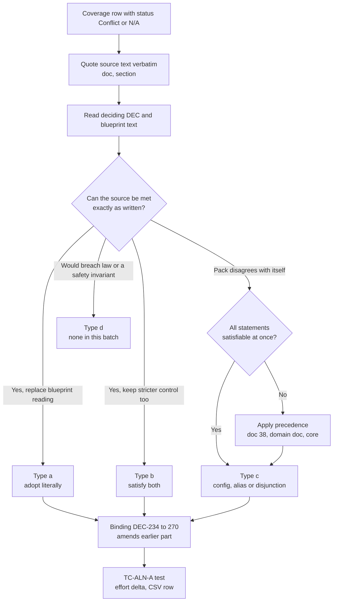

# AI Growth Engine: Employee Sales & Marketing Automation
## Application Blueprint: PART 9 (Batch 9.6a), Source Pack Literal Alignment (groups A–E)

| Field | Value |
|---|---|
| Document | Part 9, Batch 6a (Part 9.6a) |
| Version | 1.0 · 28 Nov 2026 |
| Purpose | Make the blueprint satisfy the 38-document source pack **literally** for every coverage row of groups A–E (business domains, architecture/workflow, UI, API, data) that was still marked **Conflict** (55 rows), and re-check every **Not applicable** row of the same groups (81 rows). Each row is closed by a binding amendment decision (DEC-234…DEC-270), at least one verification test (TC-ALN-A-001…054) and an effort delta |
| Authority | Literal alignment to the source pack (Founder instruction, 28 Nov 2026: make it 100% match). Same amendment mechanism as Part 9.1 errata: earlier parts are not edited; the decisions here amend them and govern where they differ |
| Baseline | Parts 0–9.5; Part 9.5 DEC-157…233 and its MoSCoW triage (§9.5.2.3); approved budgets DEC-230 (Ledger A ₹52.7–84.1 L to Day 208) and DEC-231 (Ledger B ₹19,895–26,335/month), unchanged; coverage registers `final/coverage/A…E_coverage.csv`; source pack text extracts `docs38/NN_*.txt` (document 38 = number authority) |
| Roles applied | Business Systems Analyst (lead), Solutions Architect, Data Architect, Product Owner; consulted: Security/Compliance Lead (DEC-246, 262, 263, 270), FinOps Lead (DEC-243, 248, 257), QA Lead (all tests) |

**Acronyms used in this part.** ALB Application Load Balancer · AZ Availability Zone · BFF backend for frontend · DPA data processing agreement · DPDP Digital Personal Data Protection Act (India) · DPIA data protection impact assessment · DSC digital signature certificate · ECS Elastic Container Service · HNSW hierarchical navigable small world (vector index) · IaC infrastructure as code · N/A not applicable · OKPI optimization KPI of the source pack (pack IDs KPI-01…35) · PD / pd person-days · PDP Policy Decision Point · RLS row-level security · RPO / RTO recovery point / time objective · SDR schema decision register · UAT user acceptance test · WCAG Web Content Accessibility Guidelines.

---

## 9.6a.1 Scope and method

**Scope.** All coverage rows of groups A–E with status **Conflict** (A 4, B 15, C 9, D 11, E 16 = **55 rows**) and all rows with status **Not applicable** (A 4, B 0, C 35, D 38, E 4 = **81 rows**). Rows already Covered, Partially covered or Not covered were closed by the enhancement parts (2.6, 2.7, 3.4, 3.5, 3.6) and are out of scope here. Groups F–J are handled in Part 9.6b.

**Method per row.**

| Step | What was done | Evidence |
|---|---|---|
| 1 Source quote | The requirement was re-read in the docs38 text extract and quoted **verbatim** with document number and section. Where several documents state it, all are quoted; where they disagree, the disagreement is shown | §9.6a.3 “Source requirement” blocks |
| 2 Current position | The deciding DEC (mostly DEC-157…215) and the blueprint text it points to (part, section, IDs) were read, not only the CSV summary | §9.6a.3 “Current blueprint position” |
| 3 Classify | (a) adopt source literally; (b) satisfy both (stricter blueprint control kept **and** the literal source met); (c) source internally inconsistent: satisfy every statement at once where possible (configuration, disjunction reading, alias), else apply pack precedence; (d) cannot match | §9.6a.2 counts |
| 4 Amend | One binding decision per row or tight cluster, naming the exact FR, BRL, entity, column, queue, path, screen, test or plan item that changes | §9.6a.3 amendment tables; §9.6a.5 |
| 5 Verify | At least one TC-ALN-A test that proves the literal source behaviour | §9.6a.6 |
| 6 Cost | Effort delta low / central / high (pd) with MoSCoW and placement under the DEC-224 rule; approved budgets untouched | §9.6a.7 |

**Precedence rule (DEC-234).** Used only after showing that two pack statements cannot both be satisfied:

1. **Document 38** (“All Numbers”) for numbers and inventory counts;
2. the **more specific domain document** (for example doc 08 for a column, doc 17 for a breakpoint);
3. the **common core** repeated in every document.

In this batch **no row needed precedence to override a source statement**: every case of internal inconsistency (type c) was satisfiable at once (two scores on two stages, a disjunction such as “lead/investor”, Redis protocol on a Valkey engine, qualified source decision IDs). Document 38 was used to **confirm** numbers (OKPI-06, -18, -19, -28, -32…34; 321 operations; 155 entities; 799 tests; “candidate provider records are not approved integrations”).

**Naming rule (DEC-234).** A name the pack gives is canonical; the blueprint name becomes a registered alias (`final/id_registry.csv`, column `alias_of`). Code, OpenAPI and DDL use the canonical name; aliases are never a second implementation.



**Safety invariants checked for every amendment** (V11 brief): AI never signs, pays, submits bids, sets prices or sends consequential external actions without a human; consequential actions capped at autonomy L1; PDP recheck at dispatch; Tier 2 free models only for Public/Internal-non-personal data, opt-in, default off; RLS tenant/startup isolation; Website/Admin separation; open-source first, paid by exception; fail-closed; no outreach to minors; no patient data. None is weakened by any decision in this part; DEC-237, 248, 262 and 270 tighten them.

---

## 9.6a.2 Summary

### 9.6a.2.1 Conflict rows by alignment type and group

| Group | Rows in register | Conflict before | (a) adopt | (b) satisfy both | (c) internally inconsistent | (d) cannot match | Conflict after | Covered (aligned) after |
|---|---|---|---|---|---|---|---|---|
| A | 283 | 4 | 1 | 1 | 2 | 0 | 0 | 4 |
| B | 394 | 15 | 4 | 8 | 3 | 0 | 0 | 15 |
| C | 3,280 | 9 | 4 | 2 | 3 | 0 | 0 | 9 |
| D | 1,143 | 11 | 4 | 6 | 1 | 0 | 0 | 11 |
| E | 1,641 | 16 | 4 | 11 | 1 | 0 | 0 | 16 |
| **Total** | **6,741** | **55** | **17** | **28** | **10** | **0** | **0** | **55** |

Decisions that close conflict rows: 29 (a 10, b 13, c 6, d 0). **No (d) item.**

### 9.6a.2.2 Not-applicable rows by group

| Group | N/A before | Re-classified as requirement → Covered (aligned) | Confirmed N/A | N/A after |
|---|---|---|---|---|
| A | 4 | 1 | 3 | 3 |
| B | 0 | 0 | 0 | 0 |
| C | 35 | 23 | 12 | 12 |
| D | 38 | 32 | 6 | 6 |
| E | 4 | 4 | 0 | 0 |
| **Total** | **81** | **60** | **21** | **21** |

### 9.6a.2.3 Status of groups A–E after this part

| Group | Matching before (Covered, incl. partial/not covered closed by Parts 2.6–3.6) | Conflict before | N/A before | Matching after (Covered + aligned) | N/A (confirmed) after | Cannot match |
|---|---|---|---|---|---|---|
| A | 275 | 4 | 4 | 280 | 3 | 0 |
| B | 379 | 15 | 0 | 394 | 0 | 0 |
| C | 3,236 | 9 | 35 | 3,268 | 12 | 0 |
| D | 1,094 | 11 | 38 | 1,137 | 6 | 0 |
| E | 1,621 | 16 | 4 | 1,641 | 0 | 0 |
| **Total** | **6,605** | **55** | **81** | **6,720** | **21** | **0** |

Applicable aspects in groups A–E after this part = all rows except the confirmed N/A rows; every one of them now matches the source (100%).

---

## 9.6a.3 Alignment register (conflict rows)

Entries are grouped by the group of their first row. DEC-234 is the governance rule used by all entries.

### 9.6a.3.1 Governance

#### 9.6a.3.1.1 DEC-234: Literal-alignment rule: source names canonical, blueprint names as aliases; pack precedence

**Source requirement (verbatim).**

- Doc 07 §Commercial REST and external adapter register: “Preserve source identities for engineering tracking; descriptive names and paths below are sufficient to understand each item.”
- Doc 38 §How to read the figures: “Inventory = counted specification records. Candidate = pending reuse/approval. Target = proposed acceptance threshold.”

**Current blueprint position.** DEC-170, DEC-178, DEC-183 and DEC-211…215 chose a blueprint reading where pack and blueprint differed; Part 3.4 §3.4.5.1 C and Part 3.6 keep the pack names only in mapping tables.

**Alignment type: (a) Adopt source literally.** Governance decision that the other decisions in this part apply. It does not resolve a coverage row itself.

**Binding amendment.**

| Amended item (earlier part, ID) | Change |
|---|---|
| Part 9.5 §9.5.1 (DEC-157…215) | Where DEC-234…269 amend a DEC-157…215 outcome, **this part governs**. The earlier decision stays in force for everything it says that this part does not change |
| Naming (all parts) | A name that the source pack gives a field, state, queue, app, path, screen term, metric or ID is **canonical**. A different blueprint name for the same thing becomes a registered **alias** in `final/id_registry.csv` (column `alias_of`). Code, OpenAPI and DDL use the canonical name; an alias is never a second implementation |
| Precedence when pack statements disagree | (1) Document 38 for numbers and inventory counts; (2) the more specific domain document; (3) the common core repeated in every document. Before precedence is used, the reviewer must show that both statements cannot be satisfied at once, through configuration, a disjunction reading or a stricter-plus-literal control |
| Safety invariants (V11 brief) | Not changed by any alignment: AI never signs, pays, submits bids, sets prices or sends consequential external actions without a human; consequential actions are capped at autonomy L1; PDP recheck at dispatch; Tier 2 only Public/Internal-non-personal, opt-in, default off; RLS isolation; no minors outreach; no patient data |
| Coverage registers | `final/coverage/alignment_a.csv` records the new status of every Conflict row and every re-classified N/A row in groups A–E. Part 10 assembly reads it in place of the old status |

**Verification.** TC-ALN-A-001 (Alias registry check) — §9.6a.6.

**Effort delta.** 1 / 1.5 / 2.5 pd (low / central / high). MoSCoW: Must (traceability, OKPI-20). Placement: Release 1, Sprint 1.

### 9.6a.3.2 Group A: business domains (docs 11, 12, 37)

#### 9.6a.3.2.1 DEC-235: Doc 11 “Coverage” metric adopted literally beside the inventory coverage metric

| Group | Doc | Aspect ID | Old status | New status |
|---|---|---|---|---|
| A | 11 | A11-48 | Conflict | Covered (aligned) |

**Source requirement (verbatim).**

- Doc 11 §Worldwide evidence coverage and qualification validation › Coverage and examples, row “Coverage”: “Per country and source category: successful fresh eligible source checks / eligible due sources; show denominator and uncovered regions.”
- Doc 11 §Implementation, verification and delivery controls, row “Region and market”: “Coverage % by approved known sources, not all web.”
- Doc 11 row “Coverage gaps”: “No claim of complete world coverage.”

**Current blueprint position.** DEC-212: KPI-27 (approved sources monitored ÷ registry) stays; KPI-ENH-A-01 “Fresh source coverage” is added beside it (Part 2.6 §2.6.5, FR-ENH-A-001). A-1 package is Should, W6 (Part 9.5 §9.5.2.3).

**Alignment type: (c) Source internally inconsistent.** Document 11 itself defines coverage twice: an inventory measure (“% by approved known sources”) and a validation measure (fresh eligible checks ÷ eligible due sources). Both can be shown at once, so both are satisfied; no precedence is needed. The residual deviation was only the **name** (the blueprint called the doc 11 metric “Fresh source coverage”) and the **dimension** (“source family” instead of “source category”).

**Binding amendment.**

| Amended item (earlier part, ID) | Change |
|---|---|
| KPI-ENH-A-01 (Part 2.6) | Renamed to the source term **“Coverage”** (canonical), alias “Fresh source coverage”. Formula unchanged in substance and stated literally: `successful fresh eligible source checks ÷ eligible due sources`, grouped **per country × source category**. `source_category` is the canonical dimension name; `source_family` becomes its alias |
| KPI-27 (Part 1) | Renamed “Coverage % by approved known sources” (canonical doc 11 wording), alias KPI-27 “source coverage”. Label on screen: “Coverage % by approved known sources, not all web” |
| FR-ENH-A-001 / RP-ENH-A-01 (Part 2.6) | The coverage view on A015 Research planner and A023 Research rules must show (a) the numerator, (b) the **denominator** and (c) the list of **uncovered regions** (countries or states with eligible due sources and zero successful fresh checks in the period). Zero denominator shows “Unassessed”, never 100% (doc 38 §07 note) |
| Placement | The metric definition, the denominator and the uncovered-region list move from A-1 (Should, W6) into Release 1 W1 with A015/A023; the rest of the coverage ledger (A-1) stays W6 |

**Verification.** TC-ALN-A-002 (Coverage per country and source category), TC-ALN-A-003 (Zero denominator) — §9.6a.6.

**Effort delta.** 0.5 / 1 / 1.5 pd (low / central / high). MoSCoW: Should (BR-M07). Placement: Release 1, W1 (definition and view only).

#### 9.6a.3.2.2 DEC-236: Both doc 11 scores active at launch: five-factor priority score and six-factor qualification fit with review defaults fit ≥ 70 and coverage ≥ 70

| Group | Doc | Aspect ID | Old status | New status |
|---|---|---|---|---|
| A | 11 | A11-50 | Conflict | Covered (aligned) |

**Source requirement (verbatim).**

- Doc 11 §Coverage and examples, row “Score”: “Capability 30 / explicit need 25 / qualification 15 / geography 10 / budget 10 / timing 10; review defaults fit ≥70, coverage ≥70.”
- Doc 11 §Business-specific acquisition: “Source scoring: fit/evidence/intent/readiness/timing normalized 0–1, weighted 25/25/20/15/15. Provisional thresholds ≥75 priority review, 50–74 research/nurture, below 50 archive/review. Configure only through approved policy and test. Unknown separate; score not authority to send.”

**Current blueprint position.** DEC-211: DEC-011 / BRL-SCR-01…03 (25/25/20/15/15, bands ≥ 75 / 50–74 / < 50) is the default and only active model at launch; the six-factor model is an optional “partnership-fit” template (FR-ENH-A-007, Could, W6) needing a benchmark before activation.

**Alignment type: (c) Source internally inconsistent.** The two statements are in the same document and are **not** contradictory once read precisely: the five-factor “source scoring” sets the **priority band** of an opportunity (queue routing), and the six-factor “Score” with “review defaults” sets the **default filter of the qualification review**. A record can carry both values. DEC-211 satisfied only the first at launch; the second was deferred to W6 and made optional, so the source was not met literally.

**Binding amendment.**

| Amended item (earlier part, ID) | Change |
|---|---|
| BRL-SCR-01…03 (Part 2.3) | Unchanged. They compute the **priority score** and band. Renamed in the UI “Source score (priority)” |
| New rule text in BRL-SCR-04 (Part 2.3, added by this decision) | **Qualification fit** = round(100 × Σ wᵢcᵢ ÷ Σ w_known) with weights capability 0.30, explicit need 0.25, qualification 0.15, geography 0.10, budget 0.10, timing 0.10. **Coverage (of the fit)** = 100 × Σ w_known ÷ Σ w (share of fit weight backed by evidence). Unknown components stay unknown (BRL-SCR-02 rule applies to the fit too) |
| FR-A027 Qualified opportunity review and FR-A022 shortlist (Part 2.1) | Default filter on open: **fit ≥ 70 AND coverage ≥ 70**; sort by priority score. Reviewer may widen the filter; the active filter is shown as a chip; reset returns to the default. The A023 settings screen holds both scoring versions as approved, versioned policy (approval + test, as doc 11 requires) |
| FR-ENH-A-007 (Part 2.6) | Re-classified from “optional template, Could, W6” to **active at launch (W1)**; the benchmark of DEC-211 becomes an evidence item recorded at the W1 gate (precision on the labelled set) and **does not gate activation**, because the score is a deterministic weighted sum of evidence-backed components and grants no authority (“score not authority to send”) |
| Data (Part 3.3 `int_opportunity_score`) | Add columns `fit_score smallint`, `fit_coverage smallint`, `fit_version_id uuid` beside the existing priority score and version |

**Verification.** TC-ALN-A-004 (Six-factor fit and coverage), TC-ALN-A-005 (Review default filter), TC-ALN-A-006 (Score grants no authority) — §9.6a.6.

**Effort delta.** 2 / 3 / 5 pd (low / central / high). MoSCoW: Should (BR-M07 qualification); Release 1 because A027 ships in W1. Placement: Release 1, W1.

#### 9.6a.3.2.3 DEC-237: Reply handling: any verified reply stops the generic sequence; the eight source classes are canonical labels

| Group | Doc | Aspect ID | Old status | New status |
|---|---|---|---|---|
| A | 12 | A12-08 | Conflict | Covered (aligned) |

**Source requirement (verbatim).**

- Doc 12 §Channel and communication policies (repeated verbatim in doc 05 §Channel and communication policies): “Incoming verified callbacks stop generic sequence on reply; classify interest, decline, objection, unsubscribe, bounce, out-of-office, meeting or escalation. Never infer delivery from enqueue or provider acceptance. … Rejection/opt-out terminates promotional sequence.”

**Current blueprint position.** DEC-213: 11-class union (Part 2.6 §2.6.5.2.6); bounce treated as a provider event, not a reply class; BRL-SEQ-02 amended so that **out-of-office pauses and reschedules** (return date + 1 business day, max 15 business days).

**Alignment type: (a) Adopt source literally.** The source stops the generic sequence on **every** verified reply. DEC-213's out-of-office pause keeps the sequence alive, which contradicts “stop generic sequence on reply”. The original BRL-SEQ-02 (“Stop on: reply…”) already matched the source; the pause was a later blueprint choice. Bounce must also exist as a classification label because the source lists it.

**Binding amendment.**

| Amended item (earlier part, ID) | Change |
|---|---|
| BRL-SEQ-02 (Part 2.3, as amended by DEC-213) | **Out-of-office now stops** the generic sequence like every other verified reply. The return-date logic of DEC-213 is kept only as a **suggested follow-up task** for the owner (due = stated return date + 1 business day), which a human must approve as a new step; nothing is sent automatically |
| Reply classification taxonomy (Part 2.6 §2.6.5.2.6, AG-013) | The **canonical label set** is the source's eight classes in this order: `interest`, `decline`, `objection`, `unsubscribe`, `bounce`, `out_of_office`, `meeting`, `escalation`. The blueprint's further labels become **sub-labels** (aliases): positive → interest; question → interest/question; STOP → unsubscribe; urgent → escalation; clinical → escalation/clinical (MedMaarg routing kept); meeting request → meeting; unknown → human review (no class assigned until a human chooses one of the eight) |
| Bounce | `bounce` is a classification label applied to (a) inbound non-delivery notifications that arrive as replies and (b) provider bounce events, which are mapped to the same label. A bounce **terminates** the sequence for that address and never counts as delivery |
| Rejection/opt-out | `decline` and `unsubscribe` terminate the promotional sequence (doc 12) and write suppression for unsubscribe (unchanged) |

**Verification.** TC-ALN-A-007 (Out-of-office stops the sequence), TC-ALN-A-008 (Eight canonical labels), TC-ALN-A-009 (Bounce label) — §9.6a.6.

**Effort delta.** 0.5 / 1 / 1.5 pd (low / central / high). MoSCoW: Must (OKPI-35; already package A-4). Placement: Release 1 (inside A-4).

#### 9.6a.3.2.4 DEC-238: Relationship business state with the seven literal doc 37 states and expected outputs per event

| Group | Doc | Aspect ID | Old status | New status |
|---|---|---|---|---|
| A | 37 | A37-19 | Conflict | Covered (aligned) |

**Source requirement (verbatim).**

- Doc 37 §07 Worked event and relationship ledger: “The following sample record keys and state transitions are illustrative. They show how separate screens should represent the same business object …” Table rows: “E-001 Website enquiry REL-COM-001 New — Evidence and attribution captured; qualification queued · E-002 Offering matched Qualified — Assign eligible owner; prepare response · E-003 Approved reply Engaged — Dispatch only if consent, policy and budget pass · E-004 Inbound quote request Quote requested — Cancel conflicting follow-up; calculate approved quote · E-005 Quote approval Negotiation — Freeze approved quote revision; negotiate terms · E-006 Agreement and order Contracted — Await invoice and verified receipt · E-007 Verified receipt Paid / fulfillment — Reconcile; update order and onboarding”
- Doc 37 §Replay and intervention: “Replay E-004 with the identical source event ID. Expected: no second event side effect, no new duplicate task and no duplicate outbound message.”

**Current blueprint position.** DEC-214: separate Lead/Opportunity/Deal/Quote/Order state machines stay the only writable states; a stable `relationship_id` and a read-only derived relationship stage are added (FR-ENH-A-016, Should, W6).

**Alignment type: (b) Satisfy both.** The source asks that separate screens represent **one** business object with one business state. DEC-214 satisfies the structure but left the stage vocabulary and expected outputs open, and placed it in W6. Keeping the writable state machines (stricter: single source of truth) and **also** deriving the source's literal seven states satisfies both.

**Binding amendment.**

| Amended item (earlier part, ID) | Change |
|---|---|
| FR-ENH-A-016 (Part 2.6) | The derived `relationship_state` takes exactly these canonical values: `New`, `Qualified`, `Engaged`, `Quote requested`, `Negotiation`, `Contracted`, `Paid / fulfillment`. Derivation table: lead created from website enquiry → New; offering matched and qualified → Qualified; first approved reply dispatched → Engaged; inbound quote request recorded → Quote requested; quote revision approved → Negotiation; agreement signed and order created → Contracted; verified receipt posted → Paid / fulfillment |
| Expected outputs (WF-04, WF-06, WF-08 to WF-10 in Part 2.2) | Each transition asserts the doc 37 expected output: E-004 cancels conflicting follow-up tasks; E-005 freezes the approved quote revision; E-006 waits for invoice and verified receipt; E-007 reconciles and updates order and onboarding |
| Screens | A032 Customer 360, A029 pipeline, A105 order desk, A110 run monitor and the portal status screen show the same `relationship_id` and `relationship_state` badge |
| Placement | Unchanged: Should, W6 (FR-ENH-A-016). The vocabulary and derivation are fixed now so that Release 1 objects carry `relationship_id` from day one (already in DEC-214) |

**Verification.** TC-ALN-A-010 (Seven-state derivation), TC-ALN-A-011 (Replay E-004) — §9.6a.6.

**Effort delta.** 0.5 / 1 / 2 pd (low / central / high). MoSCoW: Should (W6, unchanged). Placement: W6.

### 9.6a.3.3 Group B: architecture and workflow (docs 04, 05, 09, 10)

#### 9.6a.3.3.1 DEC-239: Capacity: the pack's initial and growth columns are the binding design-capacity and validation targets

| Group | Doc | Aspect ID | Old status | New status |
|---|---|---|---|---|
| B | 04/09/10 | B-CAP-01 | Conflict | Covered (aligned) |
| B | 04/05/09 | OPT-06-01 | Conflict | Covered (aligned) |
| C | 17 | C17-G37 | Conflict | Covered (aligned) |

**Source requirement (verbatim).**

- Docs 04/09/10 §Capacity, reliability and recovery acceptance: “Owned startups / external tenants — Initial target 25 / 10 — Growth target 50+ / 100 … Concurrent staff sessions 50 / 250; Scoped opportunities 100,000 / 1,000,000; Concurrent jobs / scheduled actions/day 50 / 10,000 — 250 / 100,000 … Proposed independent test targets, not demonstrated capacity or client SLA.”
- Doc 09 §Production boundary, row “Scaling”: “Initial 25 owned +10 clients; growth 50+ owned +100 clients. 50/250 concurrent staff; 100k/1m scoped opportunities; 50/250 concurrent jobs. Use queue partitioning and per-tenant quotas.”
- Docs 04/05/17 OPT-06-01: “Acceptance / evidence: 25 owned +10 external initial; 50+ owned +100 external growth validation.”
- Doc 38 §06: “Owned startup design capacity 25+ … External tenants in recorded test 10.”

**Current blueprint position.** DEC-161: DEC-031 (Y1 25–40 workspaces / 2–10 tenants; Y2 100 / 30) stays the business-planning and cost baseline; load tests take the higher figure (WP-01 40 / 10 / 50 sessions; WP-02 100 / 100 / 250 sessions).

**Alignment type: (b) Satisfy both.** The pack calls the figures **test targets**, not SLAs. DEC-161's WP-01 and WP-02 already meet or exceed every initial and growth figure, so the test side is literally met. The residual deviation was wording: DEC-031 reads like a capacity ceiling (30 tenants in Y2). It is a forecast, not a limit.

**Binding amendment.**

| Amended item (earlier part, ID) | Change |
|---|---|
| DEC-031 (Part 0A) reading | DEC-031 is a **demand forecast for costing only**. It is never a product limit. The product's **design capacity** is the pack's figures: initial 25 owned + 10 external; growth 50+ owned + 100 external; 50 / 250 concurrent staff sessions; 100k / 1M scoped opportunities; 50 / 250 concurrent jobs; 10k / 100k scheduled actions per day |
| NFR-ENH-B-01…04 (Part 3.4) | Column headings renamed to the source's “Initial target” and “Growth target”; WP-01 is the initial-target test, WP-02 the growth-target test (DEC-161 figures kept; they are ≥ the source) |
| Configuration (CFG, Part 2.4) | No hard-coded tenant or startup count anywhere; per-tenant quotas and queue partitioning (doc 09) are configuration. A static check forbids numeric tenant caps in code |

**Verification.** TC-ALN-A-012 (Growth tenancy validation (WP-02)), TC-ALN-A-013 (No numeric tenant cap) — §9.6a.6.

**Effort delta.** 0 / 0.5 / 1 pd (low / central / high). MoSCoW: Must (OKPI-26, -27). Placement: Release 1 gate (WP-01); scale gate (WP-02).

#### 9.6a.3.3.2 DEC-240: Recovery objectives: initial ≤ 15 min / ≤ 4 h and growth ≤ 15 min / ≤ 2 h adopted as stated; regenerable ≤ 24 h / ≤ 8 h

| Group | Doc | Aspect ID | Old status | New status |
|---|---|---|---|---|
| B | 04/09/10 | B-CAP-08 | Conflict | Covered (aligned) |
| B | 09 | B-09-PB3 | Conflict | Covered (aligned) |

**Source requirement (verbatim).**

- Docs 04/09/10 capacity table: “Critical data RPO / RTO — Initial ≤15 min / ≤4 h — Growth ≤15 min / ≤2 h · Regenerable research RPO/RTO ≤24 h / ≤8 h — ≤24 h / ≤8 h.”
- Doc 09 §Production boundary, row “Data durability”: “Critical financial and authorization data RPO <=15 minutes, initial RTO <=4 hours, growth RTO <=2 hours. Regenerable research RPO <=24h/RTO <=8h. Validate restore before SLA.”
- Doc 38 §07–08: “KPI-18 Critical RPO <= 15 minutes (Yes) · KPI-19 Initial critical RTO <= 240 minutes (Yes) · KPI-32 Growth critical RTO <= 120 minutes (Yes) · KPI-33 Regenerable data RPO <= 1440 minutes · KPI-34 Regenerable data RTO <= 480 minutes.”

**Current blueprint position.** DEC-158: RC-1 RPO ≤ 15 min, RTO ≤ 4 h pilot, ≤ 2 h from the scale gate for instance/AZ/deployment/corruption failures, binding after Topology B and two passing drills; RC-2 24 h / 8 h; regional RTO 24 h (DEC-079).

**Alignment type: (b) Satisfy both.** The numbers already match. Two residual differences: (1) the trigger for the growth target was a blueprint event (scale gate) rather than the source's “growth” phase; (2) the 2 h figure excluded regional outages, while the source does not exclude them. The source's own “Validate restore before SLA” supports the drill condition.

**Binding amendment.**

| Amended item (earlier part, ID) | Change |
|---|---|
| DEC-158 (Part 9.5) | “Initial” = the pilot (Topology A); “Growth” = from the first of: the scale gate, or the 11th external tenant, or 26th owned startup (the pack's growth column starts above 25 + 10). From that point **OKPI-32 ≤ 120 min applies to all critical-data failures**. Two passing drills remain the evidence needed **before the target is offered as an SLA** (doc 09), not a condition for the target to apply |
| Regional outage | The regional runbook FM-04 must meet RTO ≤ 2 h for **RC-1 critical data** in the growth phase. Basis: encrypted cross-Region backup copies already exist (ADR-019, DEC-040); restoring RC-1 only (small, class-ordered, Part 3.4 §3.4.5.1 B) into ap-south-2 within 2 h is the designed path. RC-2 regenerable data keeps 8 h. DEC-079's 24 h stays as the **pilot** regional figure only. Warm-standby cost is priced at the growth trigger [ASSUMPTION-520] |
| Naming | “Critical data” (source) is canonical; RC-1 is its alias. “Regenerable research” is canonical; RC-2 is its alias |

**Verification.** TC-ALN-A-014 (Growth critical RTO drill), TC-ALN-A-015 (Regional RC-1 restore (growth)) — §9.6a.6.

**Effort delta.** 0.5 / 1 / 2 pd (low / central / high). MoSCoW: Must (OKPI-18, -19, -32). Placement: Release 1 (initial); growth trigger (growth).

#### 9.6a.3.3.3 DEC-241: Source Django app names and monorepo paths become canonical

| Group | Doc | Aspect ID | Old status | New status |
|---|---|---|---|---|
| B | 04/09 | B-TC-03 | Conflict | Covered (aligned) |
| B | 04/09 | B-TC-11 | Conflict | Covered (aligned) |

**Source requirement (verbatim).**

- Docs 04/09 §Django modular monolith: “Design contract: Django apps accounts, catalog, intelligence, crm, engagement, campaigns, deals, governance, reporting; DRF serializers/viewsets; split only if measured. | REUSE: Reuse existing account/auth security service; build new growth apps only.”
- Docs 04/09 §Delivery engineering: “Design contract: Monorepo apps/growth-ui, apps/admin-ui, server/config, server/apps, infra, tests; OpenAPI generated with drf-spectacular; pytest, Playwright.”

**Current blueprint position.** DEC-183: Part 3.1 §3.1.4 module names and ADR-006/ADR-060 repository layout (apps/website, apps/admin, packages/*) govern; pack names mapped in Part 3.4 §3.4.5.1 C.

**Alignment type: (a) Adopt source literally.** No code exists yet, so adopting the source names costs only scaffolding and documentation changes. The source list does not say it is exhaustive, so the blueprint's extra apps (automation, ai, saas, integrations, core.events, core.audit) can remain as additional apps.

**Binding amendment.**

| Amended item (earlier part, ID) | Change |
|---|---|
| Part 3.1 §3.1.4 (module map) and ADR-006 | Canonical Django app labels: `accounts` (the **reused** existing account/auth service; product-local profile data per DEC-265), `catalog`, `intelligence`, `crm`, `engagement`, `campaigns`, `deals`, `governance`, `reporting`. Blueprint names become sub-packages or aliases: core.tenancy → `accounts.tenancy`; core.identity → `accounts` (reuse); knowledge → `catalog.knowledge`; marketing.* and web landing pages → `campaigns.*`; commerce.* → `deals.*` (finance as `deals.finance`); analytics.* and ops reports/projections → `reporting.*`. Additional apps outside the source list: `automation`, `ai`, `saas`, `integrations`, `web` (public site rendering), `core` (events, audit) |
| ADR-060 (repository layout) | Canonical paths: `apps/growth-ui` (Website/Portal React app; alias apps/website), `apps/admin-ui` (Admin React app; alias apps/admin), `server/config` (Django settings, URLs, Celery app), `server/apps` (the Django apps above), `infra` (IaC), `tests` (cross-cutting E2E, contract and load suites). `packages/*` (shared TS libraries) stays as an additional path |
| Toolchain | OpenAPI generated with **drf-spectacular** (already ADR-009 basis), **pytest**, **Playwright** — confirmed as canonical; CI job names use them |
| Part 3.4 §3.4.5.1 C mapping table | Direction reversed: pack name = canonical, blueprint name = alias |

**Verification.** TC-ALN-A-016 (Repository and app layout check) — §9.6a.6.

**Effort delta.** 1 / 1.5 / 2.5 pd (low / central / high). MoSCoW: Must (Sprint 0 scaffold; cheapest before code exists). Placement: Sprint 0.

#### 9.6a.3.3.4 DEC-242: Worker contract: Celery with a Redis-protocol broker (Valkey engine) and the four source queues research, AI, messaging, billing

| Group | Doc | Aspect ID | Old status | New status |
|---|---|---|---|---|
| B | 04/09 | B-TC-04 | Conflict | Covered (aligned) |

**Source requirement (verbatim).**

- Docs 04/09 §Worker & scheduler: “Design contract: Celery workers + Redis broker; Celery Beat schedule; separate queues research, AI, messaging, billing; transactional outbox in PostgreSQL.”
- Common core of every document (e.g. doc 01 line 36): “… Celery/Celery Beat and Valkey …”; doc 02/06/07 integration rows: “redis: Edition/version dependent; prefer Valkey”; doc 09 suggested AWS design: “… Valkey …”.

**Current blueprint position.** DEC-163/ADR-101: Valkey is the broker and cache; “Redis” read as the protocol. ADR-021 (+ DEC-167) has queues dispatch, transactional, notify, webhook_process, reconcile, ai, research, projections, reports, imports_exports, render, maintenance, control, finance; Part 3.4 maps messaging → dispatch + transactional + notify and billing → reconcile + reports.

**Alignment type: (c) Source internally inconsistent.** The pack contradicts itself on the engine (“Redis broker” in docs 04/09 vs “Valkey” in the common core, “prefer Valkey” in docs 02/06/07 and doc 09's own AWS design). Valkey speaks the Redis protocol, so Celery's Redis transport (`redis://` broker URL) against a Valkey server satisfies “Redis broker” and “Valkey” at once. Queue names: the source names four queues that must exist by those names; ADR-021 lacks `messaging` and `billing` as named queues.

**Binding amendment.**

| Amended item (earlier part, ID) | Change |
|---|---|
| ADR-101 | Broker = Celery **Redis transport** (`broker_url = redis://…`, kombu Redis transport) against a **Valkey** server; both source statements are met. No Redis-licensed server is deployed |
| ADR-021 (as amended by DEC-167) | Canonical queues include the four source queues by exact name: `research`, `ai`, `messaging`, `billing`. `messaging` = outbound message dispatch and inbound reply processing for email, WhatsApp and social (the message part of the former `dispatch`, `transactional`, `notify` queues, which become **aliases routed to `messaging`**); `billing` = invoices, payment links, subscription metering, posting, reconciliation and allocation (the DEC-167 `finance` queue is **renamed `billing`**, alias `finance`; prefetch 1 and no scale-to-zero kept). Other ADR-021 queues (`control`, `webhook_process`, `projections`, `reports`, `imports_exports`, `render`, `maintenance`, and `dispatch` for non-message external actions such as ad changes) remain |
| Transactional outbox | Unchanged: PostgreSQL outbox → worker → PDP recheck → adapter → event (source automation line) |

**Verification.** TC-ALN-A-017 (Queue names and broker) — §9.6a.6.

**Effort delta.** 0.5 / 1 / 2 pd (low / central / high). MoSCoW: Must (OKPI-07, -08 depend on queue isolation). Placement: Release 1, Sprint 1.

#### 9.6a.3.3.5 DEC-243: Deployment contract: ALB, ECS Fargate, ElastiCache, S3/CloudFront, Secrets Manager, CloudWatch/WAF satisfied at each topology

| Group | Doc | Aspect ID | Old status | New status |
|---|---|---|---|---|
| B | 04/09 | B-TC-08 | Conflict | Covered (aligned) |

**Source requirement (verbatim).**

- Docs 04/09 §Deployment: “Design contract: AWS ALB/ECS Fargate Django + workers; RDS PostgreSQL; ElastiCache Redis; S3/CloudFront React; Secrets Manager; CloudWatch/WAF. | REUSE: Reuse existing security infrastructure; deploy growth workers and new resources only.”
- Doc 09 §Production boundary: “Suggested AWS design to validate: … HTTPS load balancer/API gateway, containerized Django and Celery workers, private PostgreSQL with point-in-time recovery, Valkey … Exact sizing and deployment mode require repository and workload validation.”

**Current blueprint position.** DEC-163: pilot = ECS on EC2 (ADR-013), Valkey container, single host, no ALB (Topology A); scale gate = ALB, two instances, Multi-AZ RDS, ElastiCache for Valkey; Fargate optional by cost comparison (ADR-100).

**Alignment type: (c) Source internally inconsistent.** Doc 04/09's contract names ALB and Fargate; doc 09's own suggested design says the deployment mode needs validation and names an “HTTPS load balancer/API gateway” and Valkey. Literal satisfaction of every named element at the pilot without changing the approved budget: an **ALB is a load balancer** and is required by the contract; Fargate is a capacity provider that ECS can use for the workers. Running the ECS services on Fargate behind an ALB at the pilot meets docs 04/09 literally, and doc 09's “validate the mode” is met by the cost comparison.

**Binding amendment.**

| Amended item (earlier part, ID) | Change |
|---|---|
| ADR-013 / ADR-100 (Topology A) | Pilot ingress = CloudFront → **ALB** (HTTPS) → ECS services. **All ECS services (Django API processes, Celery workers, Beat, one-off migration and renderer tasks) run on the ECS Fargate launch type**, which is exactly “ALB/ECS Fargate Django + workers”. ECS on EC2 (ADR-013) stays as the documented fallback only if the running-cost proposal below is not approved |
| Cache/broker | **ElastiCache (Valkey engine)** — the ElastiCache service named by the source — replaces the self-run Valkey container at the pilot (smallest node, verify price) [ASSUMPTION-521] |
| Unchanged | RDS PostgreSQL; S3 + CloudFront for both React builds; Secrets Manager; CloudWatch; WAF (DEC-081) |
| Cost handling | The ALB (≈ ₹1,500–2,000/month), the Fargate premium over EC2 for the same vCPU/GB (≈ ₹2,000–4,500/month) and the ElastiCache node (≈ ₹1,000–1,500/month) — together ≈ ₹4,500–8,000/month, estimates, verify at time of implementation (as of 27 Nov 2026) — are **not** inside Ledger B (DEC-231). They are listed in §9.6a.7 as a separately approvable running-cost proposal. Until it is approved the pilot runs DEC-163 Topology A and this decision applies from approval; the contract is then met at the latest at the scale gate, where DEC-163 already provides ALB and ElastiCache |

**Verification.** TC-ALN-A-018 (Deployment inventory matches the source contract) — §9.6a.6.

**Effort delta.** 1 / 2 / 3 pd (low / central / high). MoSCoW: Should (running-cost proposal needs approval). Placement: Release 1 if approved; otherwise scale gate.

#### 9.6a.3.3.6 DEC-244: Pack planning figures recorded literally: 385 PD base allocation over 149 work items and 113.5-day dependency-only longest path

| Group | Doc | Aspect ID | Old status | New status |
|---|---|---|---|---|
| B | 04 | B-04-019 | Conflict | Covered (aligned) |
| B | 04 | B-04-021 | Conflict | Covered (aligned) |

**Source requirement (verbatim).**

- Doc 04 §Task-level estimates and executable predecessor plan: “Planning envelope inherited from the previous platform estimate: 287–483 person-days; proposed base allocation 385 person-days for 149 work items. Weighted allocation counts first-owned shared API/entity work once … The figures are editable planning estimates, not team commitments … The dependency-only longest path is 113.5 days assuming one sequential task duration per dependency and unlimited resources; not a promised schedule.”
- Doc 38 §05: “Baseline dependency-only longest path: 113.5 PD; not an expanded critical path or calendar duration.”

**Current blueprint position.** DEC-181: Part 8.1 story plan binding (314 / 416 / 518 pd); the pack's 385 PD is a top-down cross-check; DEC-225 programme total 532 / 722 / 921 pd.

**Alignment type: (b) Satisfy both.** The source states its figures are **planning estimates, not commitments**, and the longest path is “not a promised schedule”. The literal requirement is therefore that the plan carries these figures with that meaning and that the 149 work items and their predecessors are tracked. The blueprint can keep its bottom-up plan (stricter) and also carry the pack's figures and predecessor graph.

**Binding amendment.**

| Amended item (earlier part, ID) | Change |
|---|---|
| Part 8.1 §8.1.6.4 | Adds a “Pack planning envelope” line: 287–483 PD envelope; **385 PD base allocation for 149 work items**, shared first-owned work counted once; labelled “editable planning estimate, not a team commitment” |
| Part 8.1 §8.1.7.1 | Adds the pack's **dependency-only longest path = 113.5 days** (unlimited resources), recomputed in CI from the doc 04 predecessor table, beside the blueprint's resourced critical path; labelled “not a promised schedule” |
| Work-item tracking | Every story carries `source_work_item` (149 + 13 = 162 IDs, H_workitem_story_map.csv); the backlog tool reports PD per source work item so the 385 PD allocation can be compared to actuals |
| Approved budgets | Unchanged (DEC-230, DEC-231) |

**Verification.** TC-ALN-A-019 (Longest path recomputation), TC-ALN-A-020 (Allocation report) — §9.6a.6.

**Effort delta.** 1 / 1.5 / 2 pd (low / central / high). MoSCoW: Must (OKPI-20 traceability). Placement: Sprint 0–1.

#### 9.6a.3.3.7 DEC-245: “lead/investor”, “investor/customer” and “issuer/company” read as disjunctions satisfied by the commercial alternative

| Group | Doc | Aspect ID | Old status | New status |
|---|---|---|---|---|
| B | 05 | B-05-AP7 | Conflict | Covered (aligned) |
| C | 17 | C17-G42 | Conflict | Covered (aligned) |
| C | 06 | C06-G64 | Conflict | Covered (aligned) |
| C | 17 | C17-G31 | Conflict | Covered (aligned) |

**Source requirement (verbatim).**

- Doc 05 §Implementation acceptance and verification (and doc 17 §Acceptance procedures): “Submit website enquiry, create scoped lead/investor record, classify and schedule eligible next action.”
- Docs 06/17 OPT-15-03: “Acceptance / evidence: Authorized investor/customer completes synthetic enquiry and status view; no private data exposed.”
- Doc 17 §UI interaction rules, “Startup switch”: “Reset in-flight queries and any invalid filters; rerender permitted business-specific filters, no stale previous issuer/company data.”
- Doc 05 §Product purpose (common core): “No investor discovery, fundraising rounds, securities offers, cap table, investor data room or capital receipt processing.” Doc 05 line 577: “no investor directory, private fundraising terms, capital commitments or owner investment records.”

**Current blueprint position.** DEC-179 (extending DEC-002): the wording is replaced (“lead record”, “customer”, “company”); investor clauses are not applicable.

**Alignment type: (c) Source internally inconsistent.** Doc 05 contradicts itself if “lead/investor” is read as “both”: its own scope forbids investor records. Read as written — a slash between alternatives — each statement is **satisfied literally by the commercial alternative**: creating a scoped lead record *is* creating a “lead/investor record”; an authorized customer completing the enquiry *is* an “authorized investor/customer”; no stale company data *is* no stale “issuer/company” data. The product-boundary statements are also satisfied. No (d) is needed.

**Binding amendment.**

| Amended item (earlier part, ID) | Change |
|---|---|
| DEC-179 (Part 9.5) | Re-based: the source text is kept **verbatim** in acceptance procedures and the UAT scripts, with a note “the investor alternative belongs to the separate investor product (DEC-058); this product satisfies the clause through the lead/customer/company alternative”. The negative regression scan (TC-ENH-C-020) still forbids investor features |
| WF-04 acceptance (Part 2.2) and UAT for W13/W14 | Step text: “Submit website enquiry, create scoped lead/investor record (lead), classify and schedule eligible next action” |
| FR-UIS-01 startup switch (Part 2.5) | Acceptance text quotes the source and adds the assertion that every business-line (issuer) and company field is cleared on switch |

**Verification.** TC-ALN-A-021 (Website enquiry creates the scoped lead/investor record), TC-ALN-A-022 (Authorized customer portal journey), TC-ALN-A-023 (Startup switch clears issuer/company data) — §9.6a.6.

**Effort delta.** 0 / 0.25 / 0.5 pd (low / central / high). MoSCoW: Must (OKPI-02 boundary). Placement: Release 1.

#### 9.6a.3.3.8 DEC-246: No cross-region replication before approval: the approval is a signed Legal/Security record, checked by IaC

| Group | Doc | Aspect ID | Old status | New status |
|---|---|---|---|---|
| B | 09 | B-09-PB6 | Conflict | Covered (aligned) |

**Source requirement (verbatim).**

- Doc 09 §Production boundary, row “Regional strategy”: “Choose data residency and provider routing from approved contractual/regulatory requirements; no cross-region replication before approval.” Accountable role: “Legal / security”.

**Current blueprint position.** DEC-164: DEC-040 is the recorded approval for encrypted backup copies to ap-south-2; no live replication without a new decision.

**Alignment type: (b) Satisfy both.** The source allows replication after approval and names the accountable role. DEC-164 treats a Founder decision as the approval; the literal requirement is an approval by the Legal/Security role before any cross-region copy starts. Adding that sign-off keeps the backup copies and meets the source.

**Binding amendment.**

| Amended item (earlier part, ID) | Change |
|---|---|
| DEC-164 / ADR-019 | Cross-Region backup copy (and any later replication) is **disabled in IaC by default**. It is enabled only when an approval record exists with: approver role R10 (DPO / Legal) **and** R09 (Security lead), scope (data classes, target region), legal basis (DPDP, contracts), date. The IaC pipeline reads the record ID and refuses to apply without it |
| Data residency | Target region must be inside India unless a contract requires otherwise and the same approval covers it |

**Verification.** TC-ALN-A-024 (Replication gated by approval) — §9.6a.6.

**Effort delta.** 0.25 / 0.5 / 1 pd (low / central / high). MoSCoW: Must (compliance). Placement: Release 1.

#### 9.6a.3.3.9 DEC-247: Six runtime AI responsibilities are the complete runtime taxonomy; every runtime agent belongs to one of them

| Group | Doc | Aspect ID | Old status | New status |
|---|---|---|---|---|
| B | 10 | B-10-DC17 | Conflict | Covered (aligned) |

**Source requirement (verbatim).**

- Doc 10 §Detailed design contracts, “Agent decomposition”: “Design contract: Six runtime responsibilities: research, evidence/need, matching, content/draft, inbound intent, QA; deterministic scoring, consent, sending and closure outside AI.”

**Current blueprint position.** DEC-183: Part 7.1 governs (36 agents); the six are families; Part 3.4 §3.4.5.5 maps 27 product agents to families but leaves AG-010, AG-015, AG-016, AG-028, AG-029 “outside the six families”.

**Alignment type: (a) Adopt source literally.** Five runtime agents sat outside the six responsibilities, so the source's statement that runtime AI has six responsibilities was not met. Each of the five fits one family by what it outputs. Delivery-only agents (AG-033…036) are development aids, not runtime, so they are outside the scope of the statement.

**Binding amendment.**

| Amended item (earlier part, ID) | Change |
|---|---|
| Part 7.1 catalogue and Part 9.4 card field | New mandatory field `runtime_responsibility` ∈ {research, evidence/need, matching, content/draft, inbound intent, QA}. Assignments for the five: AG-010 Import Mapping → **matching**; AG-015 Admin Copilot → **research** (retrieval with citations over permitted records); AG-016 Commercial Planner → **content/draft** (draft plans only); AG-028 Ops & Incident Triage → **QA**; AG-029 Insight Narrative → **content/draft**. AG-037 Meeting Notes → content/draft; AG-038 Retention NBA → evidence/need. Every new runtime agent (AG-039 onwards, Parts 9.7–9.9) must declare one |
| Deterministic boundary | Scoring, consent, sending and closure stay outside AI (unchanged, BRL-AI-*); the catalogue generator rejects an agent card whose outputs include any of them |

**Verification.** TC-ALN-A-025 (Responsibility field complete) — §9.6a.6.

**Effort delta.** 0.5 / 1 / 1.5 pd (low / central / high). MoSCoW: Must (AI governance). Placement: Sprint 1.

#### 9.6a.3.3.10 DEC-248: Usage anomaly control: alerts at 70 % and 90 %, optional jobs paused at the cap, unexpected bills routed to the owner

| Group | Doc | Aspect ID | Old status | New status |
|---|---|---|---|---|
| B | 04 | OPT-03-08 | Conflict | Covered (aligned) |

**Source requirement (verbatim).**

- Doc 04 OPT-03-08: “Usage anomaly control — Alert 70/90% of configured cap (proposed); pause optional jobs at cap; route unexpected bills to owner. Acceptance / evidence: No live paid fallback on exhaustion; alerts and pause observed in simulated spend spike | Accountable: FinOps lead.”
- Doc 38 §07: “KPI-11 Unapproved paid provider calls <= 0 (Yes) · KPI-12 Unauthorized budget overspend <= 0 (Yes).”

**Current blueprint position.** DEC-162: 70 % warning; 90 % critical with optional and paid jobs paused; 100 % hard stop except emergency-stop and compliance paths; AWS Budgets 50/80/100 % as backstop.

**Alignment type: (b) Satisfy both.** The alert thresholds match. Pausing optional jobs at 90 % is stricter but still leaves them paused at the cap, so “pause optional jobs at cap” is met. The residual gap was the third clause, “route unexpected bills to owner”, and the acceptance “no live paid fallback on exhaustion”, which were implicit only.

**Binding amendment.**

| Amended item (earlier part, ID) | Change |
|---|---|
| BRL-AI-08 / NT-025 (as amended by DEC-162) | Text states the source rule literally first — “alert at 70 % and 90 % of the configured cap; pause optional jobs at the cap” — then the stricter blueprint steps (optional jobs already paused from 90 %; hard stop at 100 %) |
| Unexpected bills (new clause in FR-ENH-B-022) | Any provider invoice or metered charge that has no matching reservation, or exceeds its reservation by > 10 %, creates an `unexpected_bill` exception routed to the **budget owner** of that cap (and FinOps in copy) on A0xx budget controls, within 1 business day of import |
| Exhaustion | On cap exhaustion no paid fallback provider is called (Tier 2 free models only if already opted in for that data class); degrade to Tier 3 |

**Verification.** TC-ALN-A-026 (Simulated spend spike), TC-ALN-A-027 (Unexpected bill routing) — §9.6a.6.

**Effort delta.** 0.5 / 1 / 1.5 pd (low / central / high). MoSCoW: Must (OKPI-11, -12). Placement: Release 1.

#### 9.6a.3.3.11 DEC-249: Critical availability target 99.9 % over a rolling 30 days applies from the pilot as the OKPI-06 target

| Group | Doc | Aspect ID | Old status | New status |
|---|---|---|---|---|
| B | 05/10 | OPT-05-07 | Conflict | Covered (aligned) |

**Source requirement (verbatim).**

- Docs 05/10/36 OPT-05-07: “Availability and reconciliation — Health/readiness checks, independent financial verification, alert and restore drills. Acceptance / evidence: Proposed 99.9% critical availability over rolling 30 days; no unresolved critical financial mismatch | Accountable: Reliability lead.”
- Doc 36 KPI procedure: “Acceptance: Target >=99.9% subject to actual evidence; zero denominator unassessed.”
- Doc 38 §07: “KPI-06 Critical service availability >= 99.9% — Mandatory No.”

**Current blueprint position.** DEC-157: pilot 99.5 % (DEC-018); 99.9 % for critical services from the scale gate (Topology B); OKPI-06 non-mandatory, rolling 30 days.

**Alignment type: (a) Adopt source literally.** The source sets one target, 99.9 %, without a phase. DEC-157 delayed it to the scale gate. Because doc 38 marks the KPI non-mandatory and doc 36 makes it “subject to actual evidence”, the target can apply from day one without buying Topology B: missing it is reported, not hidden, and does not block release. DEC-018's 99.5 % stays as the paging and error-budget floor.

**Binding amendment.**

| Amended item (earlier part, ID) | Change |
|---|---|
| DEC-157 (Part 9.5) | **OKPI-06 target = 99.9 % over a rolling 30 days from the pilot** for the critical services listed in DEC-157 (2). Reported monthly with attainment; “Unassessed” until 30 days of probe data. DEC-018 99.5 % remains the SLO floor for the error budget and alerts. No customer SLA of 99.9 % is offered before Topology B (DEC-209 unchanged) |
| Pilot reliability measures (no new infrastructure) | Zero-downtime deploys on the single host (rolling container replace behind the proxy, health and readiness checks), maintenance windows excluded only if announced 72 h ahead and outside business hours — reported separately |
| Financial mismatch | “No unresolved critical financial mismatch” added to the OKPI-06 report as a paired check (reconciliation exceptions of severity S1 open > 24 h = fail) |

**Verification.** TC-ALN-A-028 (Rolling 30-day availability report) — §9.6a.6.

**Effort delta.** 0.5 / 1 / 2 pd (low / central / high). MoSCoW: Should (OKPI-06 non-mandatory). Placement: Release 1.

### 9.6a.3.4 Group C: UI (docs 06, 17)

#### 9.6a.3.4.1 DEC-250: Routing decision adopted verbatim: legacy method/path canonical, new website endpoints under /api/v1/commercial/{public,portal,admin}, legacy /public/ token routes are portal-class

| Group | Doc | Aspect ID | Old status | New status |
|---|---|---|---|---|
| C | 06 | C06-G29 | Conflict | Covered (aligned) |
| D | 07 | 07-WA-03 | Conflict | Covered (aligned) |
| D | 07 | 07-WA-06 | Conflict | Covered (aligned) |

**Source requirement (verbatim).**

- Docs 01/02/06/07 §Website and confidential Admin operating contract: “Routing decision: retain the canonical legacy method/path contracts to avoid breaking integrations; separate website and Admin API ingress allowlists and explicit serializer/permission classes. … New website-specific endpoints use /api/v1/commercial/public/, /portal/ and /admin/ namespaces. Legacy token routes under /public/ are restricted portal endpoints. Any route not explicitly admitted to the website is denied by default. Public origin CORS is not an authorization mechanism.”

**Current blueprint position.** DEC-170 (legacy paths canonical; Part 3.2 derived paths renamed; aliases only for FRD ★ paths and the page read; operations without a source path use commercial/{public,portal,admin,internal}); DEC-175 (signed-token reads are portal-class).

**Alignment type: (a) Adopt source literally.** DEC-170 and DEC-175 already adopt the source. Two residual wording gaps: the `internal` namespace is not in the source list, and API-083 was still labelled “public” in Part 3.2.

**Binding amendment.**

| Amended item (earlier part, ID) | Change |
|---|---|
| Part 3.2 §3.2.2 path table | Every operation in the doc 07 register uses its legacy method and path verbatim (DEC-170). New **website-specific** endpoints use only `/api/v1/commercial/public/`, `/portal/` and `/admin/` as the source states. The `/api/v1/commercial/internal/` namespace is restricted to **non-website** machine endpoints (product-event ingress, internal callbacks) and is never on the website ingress; it is therefore outside the source rule, not a fourth website namespace |
| API-083 and every legacy `/api/v1/public/…/{token}` route | Access class changed from public to **portal** (restricted portal endpoint) in the catalogue, the route map and the website allowlist (DEC-175 rule (1)) |
| Website ingress | Deny-by-default allowlist regenerated from the catalogue; CORS never used for authorization (unchanged) |

**Verification.** TC-ALN-A-029 (Legacy paths and namespaces), TC-ALN-A-030 (Legacy token route is portal-class) — §9.6a.6.

**Effort delta.** 0 / 0.5 / 1 pd (low / central / high). MoSCoW: Must (OKPI-02). Placement: Release 1.

#### 9.6a.3.4.2 DEC-251: Every read projection refreshes in ≤ 60 s (OKPI-28 applies to all projections); scheduled analytical computations are reports, not projections

| Group | Doc | Aspect ID | Old status | New status |
|---|---|---|---|---|
| C | 06 | C06-G53 | Conflict | Covered (aligned) |

**Source requirement (verbatim).**

- Docs 06/17 OPT-02-04: “Read projections — Aggregate scoped metrics asynchronously; cache by product, tenant, startup, permission revision and filters. Acceptance / evidence: Refresh <=60s; no stale permission after revoke; reconcile projection with source records.”
- Docs 04/09/10 capacity table: “Projection refresh ≤60 s — ≤60 s.” Doc 38 §08: “KPI-28 Projection refresh <= 60 seconds — Mandatory Yes.”
- Docs 04/09 §Admin auto-driven: “Every mutation emits domain event; projections update queues, SLA, KPI and billing … Domain event → projector → read model → admin polling/SSE.”

**Current blueprint position.** DEC-160: freshness classes F-1 operational ≤ 60 s (OKPI-28 measured on F-1 only), F-2 analytical dashboards RP-01…RP-21 ≤ 15 min labelled “as of”, F-3 scheduled. NFR-047 amended to F-2.

**Alignment type: (a) Adopt source literally.** The source applies ≤ 60 s to read projections without exception, and doc 38 makes it mandatory. DEC-160's F-2 class allowed 15 minutes for aggregated dashboard projections, which contradicts the source. The source design (event → projector → read model) is incremental, so aggregated metrics can be maintained within 60 s without streaming infrastructure: each event updates counters and sums in the projection tables. Model-based analytics (forecast fits, attribution model runs) are computations, not projections; their **outputs** are published to projections within 60 s of the run.

**Binding amendment.**

| Amended item (earlier part, ID) | Change |
|---|---|
| DEC-160 / NFR-047 (Part 4.2) | F-2 is withdrawn **for projections**: every read projection, including RP-01…RP-21 dashboard aggregates, KPI tiles, attribution counts, SEO counts and cost roll-ups, has **p95 ≤ 60 s from committed event to scoped projection**. OKPI-28 and AL-52 are measured on **all** projections |
| Projection design (Part 3.1 §3.1.x projections, Part 3.3) | Projectors maintain incremental aggregates (count, sum, min/max, histogram buckets) keyed by product, tenant, startup, permission revision and filter dimension, as OPT-02-04 lists. Distinct counts use HyperLogLog sketches stored in the projection (extension availability on the RDS engine version to be verified; fallback is an exact distinct-key side table) [ASSUMPTION-522]. Nightly reconciliation compares each projection with source records (OPT-02-04 acceptance) |
| Computations | Forecast model fits, attribution model re-fits and monthly economics are **scheduled reports (F-3)**, labelled with run time; the numbers they read are ≤ 60 s projections |
| Permission revocation | Cache keys include permission revision; a revoke invalidates the key so no stale permission is served |

**Verification.** TC-ALN-A-031 (Dashboard aggregate freshness), TC-ALN-A-032 (No stale permission after revoke) — §9.6a.6.

**Effort delta.** 5 / 8 / 13 pd (low / central / high). MoSCoW: Must (OKPI-28 mandatory). Placement: Release 1 for R1 dashboards; Release 2 for R2 dashboards.

#### 9.6a.3.4.3 DEC-252: “Two products, four frontends” inspection performed literally over this product and the separate investor product

| Group | Doc | Aspect ID | Old status | New status |
|---|---|---|---|---|
| C | 06 | C06-G70 | Conflict | Covered (aligned) |

**Source requirement (verbatim).**

- Doc 06 §Acceptance procedures, “Independent products and frontends”: “Inspect architecture and deployment inventory for two products, four frontends, separate runtime credentials and data. Acceptance: No shared confidential runtime dependency; common libraries only.”
- Doc 01 §Optimization acceptance: “Acceptance: Investor app only fundraising; commercial app only authorized business acquisition.”

**Current blueprint position.** DEC-169: this product = two frontends + one backend; the investor application is out of scope; its only effect is an isolation test.

**Alignment type: (b) Satisfy both.** The procedure inspects an inventory that covers **both** products (2 + 2 frontends). Building the investor product is not required; inspecting its inventory is. DEC-169 keeps this product's scope and the procedure is executed as written.

**Binding amendment.**

| Amended item (earlier part, ID) | Change |
|---|---|
| Part 6 E2E/acceptance pack (procedure “Independent products and frontends”) | The deployment inventory lists two products and four frontends: this product's Website/Portal and Admin, and the investor product's two frontends as **external inventory entries** supplied by that product's owner (or marked “not deployed” if it does not exist yet). The check proves no shared confidential runtime dependency (credentials, databases, buckets, queues, secrets, IdP clients); shared code only as versioned libraries |
| Input | Investor-product inventory is an input owned outside this programme [GAP-520]; without it the procedure records “investor product: not deployed / inventory not supplied” and still passes only if this product has no dependency on any investor-product resource |

**Verification.** TC-ALN-A-033 (Two products, four frontends) — §9.6a.6.

**Effort delta.** 0.5 / 1 / 1.5 pd (low / central / high). MoSCoW: Must (OKPI-01/02 isolation). Placement: Release 1 gate.

#### 9.6a.3.4.4 DEC-253: Breakpoints adopted literally: desktop ≥ 1200, tablet 768–1199, mobile < 768; test widths 360 / 768 / 1440 for both frontends

| Group | Doc | Aspect ID | Old status | New status |
|---|---|---|---|---|
| C | 17 | C17-G14 | Conflict | Covered (aligned) |
| C | 17 | C17-G23 | Conflict | Covered (aligned) |

**Source requirement (verbatim).**

- Doc 17 §Layout wireframe: “Design responsive breakpoints: desktop >=1200 px; tablet 768–1199 px; mobile <768 px. Website public cards reflow, portal forms use accessible labels and progress; Admin table scroll and drawer preserve filters.”
- Doc 17 §Interaction state and accessibility spec: “Use a persistent seven-view Admin Command Centre; Website/portal layout separate. Test 360/768/1440 widths and keyboard flow.” and “responsive 360/768/1440 widths; verify automated and manual tests.”
- Doc 17 §UI states: “responsive table-to-card view …”

**Current blueprint position.** DEC-215: Part 2.5 §2.48 five tiers stay (XS 360–599, SM 600–899, MD 900–1279, LG 1280–1679, XL ≥ 1680); doc 17 mapped as tablet 768–1279, desktop ≥ 1280; test matrix 360/768/1280/1440 + 320 reflow; Admin below 768 px not targeted except DEC-043 screens.

**Alignment type: (a) Adopt source literally.** The source boundaries are 768 and 1200; the blueprint used 900 and 1280, and excluded most Admin screens below 768 px even though doc 17 tests the Admin Command Centre at 360 px. WCAG 2.2 AA 1.4.10 Reflow (OKPI-23, mandatory) also requires content to reflow at 320 CSS px, so the Admin must be responsive anyway.

**Binding amendment.**

| Amended item (earlier part, ID) | Change |
|---|---|
| Part 2.5 §2.48 | Three canonical tiers: **mobile < 768**, **tablet 768–1199**, **desktop ≥ 1200**. The five blueprint tiers become sub-tiers: XS 360–599 and SM 600–767 (mobile); MD 768–1199 (tablet); LG 1200–1679 and XL ≥ 1680 (desktop). CSS breakpoints at 600, 768, 1200, 1680 |
| DEC-043 (Part 0A) | Admin is **desktop-first from 1200 px** (was 1280) and **responsive at every tier**: below 1200 the left nav collapses and the context panel becomes a drawer; below 768 tables become stacked cards, filters move into a sheet and **filters are preserved** across scroll, drawer and card views (doc 17). Graph canvases (A033 workflow designer, A113 template library) switch to a list-and-form editor below 768 px with the same operations |
| Test matrix (Part 6.1, FR-ENH-C-005) | Mandatory widths **360, 768, 1440** with keyboard flow for Website, Portal and Admin; boundary widths 767/1199/1200 and 320 reflow added. Automated (Playwright + axe) and manual |

**Verification.** TC-ALN-A-034 (Boundary layouts), TC-ALN-A-035 (360/768/1440 with keyboard) — §9.6a.6.

**Effort delta.** 6 / 10 / 16 pd (low / central / high). MoSCoW: Must (OKPI-23 mandatory). Placement: Release 1 for R1 screens; Release 2 for R2 screens.

### 9.6a.3.5 Group D: API and integrations (doc 07)

#### 9.6a.3.5.1 DEC-254: Source inventory counts reproduced literally from the catalogue; blueprint extras reported as a separate superset

| Group | Doc | Aspect ID | Old status | New status |
|---|---|---|---|---|
| D | 07 | 07-RG-01 | Conflict | Covered (aligned) |
| D | 07 | 07-LC-03 | Conflict | Covered (aligned) |

**Source requirement (verbatim).**

- Doc 07 line 41: “288 proposed items including original commercial baseline and independent platform extensions. Preserve source identities …” and §Final catalog: “302 proposed operations including retained adapters/reuse/callbacks; 14 additional website-specific operations.” and “The catalog contains 302 operations: 285 HTTP and 17 non-HTTP adapter entries. Do not expose adapters as browser APIs.”
- Doc 07 §Contract verification and API lifecycle: “Current UI scope: 147 interfaces (34 Website, 113 Admin). Retained baseline: 302 API/adapter operations, 149 logical entities and 624 product tests. Expansion proposals: 19 candidate HTTP operations, 6 candidate entities and 175 additional product tests.”
- Doc 38 §02: “HTTP operations including candidates 304 · Non-HTTP adapter operations 17 · Total API and adapter operations 321 · Logical entities including candidates 155.”

**Current blueprint position.** DEC-180 count reconciliation (§9.5.1.10.1): blueprint 581 operations, 199 + entities; 297 of 321 source operations covered, 18 partial, 6 new.

**Alignment type: (b) Satisfy both.** The blueprint is a superset. The source counts are literal requirements on the inventory: each source item must exist exactly once and be countable. The remaining 18 partial and 6 new source operations must be closed so that 321 of 321 are present.

**Binding amendment.**

| Amended item (earlier part, ID) | Change |
|---|---|
| Part 3.2 / 3.5 catalogue | Every source operation carries `x-source-op` (SM-OP-###) and `x-source-class` (retained-HTTP, retained-adapter, candidate). A generated count view must show exactly **288 + 14 = 302 retained (285 HTTP + 17 adapters) and 19 candidates = 321 (304 HTTP + 17 adapter)**; the 18 partial operations are completed to the source contract and the 6 new ones are added (Part 3.5a list) so that **321 / 321** map exactly once. Blueprint-only operations are counted separately as “blueprint additions” |
| Part 3.3 / 3.6 entities | Same rule: 149 retained + 6 candidate = 155 source entities each mapped exactly once (`source_entity`); blueprint extras separate |
| Part 6 tests | 624 retained + 175 = 799 source tests (Unit 75, SIT 422, UAT 302) each mapped exactly once (G_test_mapping.csv); 147 UI IDs exactly once |
| Adapters | The 17 non-HTTP adapters are never exposed as browser APIs (contract test) |

**Verification.** TC-ALN-A-036 (Inventory counts), TC-ALN-A-037 (Adapters not browser APIs) — §9.6a.6.

**Effort delta.** 2 / 3 / 5 pd (low / central / high). MoSCoW: Must (OKPI-20). Placement: Release 1 (catalogue freeze).

#### 9.6a.3.5.2 DEC-255: Source contract decisions keep their literal IDs (document-qualified) and their proposed resolutions are adopted

| Group | Doc | Aspect ID | Old status | New status |
|---|---|---|---|---|
| D | 07 | 07-AP-11 | Conflict | Covered (aligned) |
| E | 08 | 08-A063 | Conflict | Covered (aligned) |

**Source requirement (verbatim).**

- Doc 07 §Final decision controls, e.g. “DEC-001 — POST /auth/login. Source requirement: Existing authentication contract (do not replace) … Proposed resolution: Reuse existing identity serializer, token audience, membership and session revocation; do not define replacement password/token protocol. … Owner: Backend lead + product owner. Status: pending authorized approval.” (DEC-001…DEC-038).
- Doc 08 §Final decision controls: “DEC-039 — existing user table / all … DEC-042 — growth_embedding / vector:vector(d) … Proposed resolution: Select an approved embedding model and assert vector dimensions before creating the index … Owner: Database lead + identity/AI owner. Status: pending authorized approval.”
- Doc 07 §Unresolved contract decision management: “Every blocker has explicit decision queue; no unapproved contract used for production.”

**Current blueprint position.** DEC-178: renamed SRC07-DEC-001…038 and SDEC-08-039…042, “never part of the DEC series”.

**Alignment type: (c) Source internally inconsistent.** The literal IDs DEC-001…042 collide with the blueprint's binding DEC-001…042. Both can be kept by **qualifying** the source ID with its document (the source itself scopes them to doc 07 and doc 08). The literal ID is then shown verbatim, and the renamed form is an alias for search and cross-reference.

**Binding amendment.**

| Amended item (earlier part, ID) | Change |
|---|---|
| Decision queue (A-screen for contract decisions, Part 2.7) and RTM | Each source decision record stores `source_doc` (07 or 08) and `source_decision_id` exactly as printed (“DEC-001” … “DEC-042”). Display form “07·DEC-001”; aliases SRC07-DEC-001 / SDEC-08-039 (DEC-178) kept for search. Blueprint DEC-### is always shown without a document prefix, so the two never collide |
| Content | Each of the 42 proposed resolutions is adopted as the contract rule for its operation or table, with its listed review evidence as the gate evidence and its listed owner as approver. Status stays “pending authorized approval” until that evidence is attached (the source rule); no unapproved contract reaches production |
| Resolutions already decided | 08·DEC-039…041 → DEC-265 (identity mapping); 08·DEC-042 → DEC-266 (embedding model and dimension) |

**Verification.** TC-ALN-A-038 (Qualified source decision IDs) — §9.6a.6.

**Effort delta.** 0.5 / 1 / 1.5 pd (low / central / high). MoSCoW: Must (OKPI-20). Placement: Release 1.

#### 9.6a.3.5.3 DEC-256: “claude/openai api” satisfied by the Claude API under B02; OpenAI kept as a disabled LLMPort alternative

| Group | Doc | Aspect ID | Old status | New status |
|---|---|---|---|---|
| D | 07 | 07-SE-06 | Conflict | Covered (aligned) |
| D | 07 | PROV-claude-openai-api | Conflict | Covered (aligned) |

**Source requirement (verbatim).**

- Doc 07 per-operation integration rows (5 AI operations) and doc 08 entity rows: “Integration: claude/openai api, deepeval, Agent SDK Dev, Pydantic AI · Licence: claude/openai api: Proprietary model API (RAG architecture may use OSS) · Free quota: No guaranteed ongoing free production inference quota · Paid rate: Claude Haiku … Sonnet … per million; model/region limits apply · Allocation: B02 ₹3,000/month shared reserve · Source: platform.claude.com pricing … · Verification: Published model rates checked 2026-11-24; other models separate.”

**Current blueprint position.** DEC-192: DEC-007 stays; Tier 1 = Anthropic Claude; OpenAI is not an approved runtime provider.

**Alignment type: (b) Satisfy both.** “claude/openai api” names alternatives; the record's rate, allocation and source are all Claude's. Using the Claude API under B02 satisfies the record literally; “other models separate” allows OpenAI to stay unused. Keeping an OpenAI adapter slot disabled behind LLMPort makes the alternative available without weakening DEC-007/008.

**Binding amendment.**

| Amended item (earlier part, ID) | Change |
|---|---|
| Part 7.3 provider table and Part 3.5 §3.5.5.6.4 | Record “claude/openai api” carried verbatim. Disposition: **Claude API = approved runtime provider (Tier 1a/1b), allocation B02 ₹3,000/month shared reserve** (DEC-008 ceilings apply). OpenAI API = **alternative LLMPort provider, disabled**; enabling needs procurement, DPA, data-residency review, the Part 6.4 eval gate and a new decision |
| Prices | All model rates in the record are unverified for implementation: verify at time of implementation (as of 27 Nov 2026) (DEC-042/DEC-202) |

**Verification.** TC-ALN-A-039 (AI provider routing) — §9.6a.6.

**Effort delta.** 0 / 0.25 / 0.5 pd (low / central / high). MoSCoW: Must (OKPI-11). Placement: Release 1.

#### 9.6a.3.5.4 DEC-257: Calendar API and Zoom charged to B07/B10 shared optional with no new commitment

| Group | Doc | Aspect ID | Old status | New status |
|---|---|---|---|---|
| D | 07 | PROV-calendar-api | Conflict | Covered (aligned) |
| D | 07 | PROV-zoom | Conflict | Covered (aligned) |

**Source requirement (verbatim).**

- Doc 07 Meeting and calendar operations 121–126: “Integration: calendar api … Licence: Hybrid / commercial service; exact edition licence verify … Allocation: calendar api: B07/B10 shared optional; no new commitment … Verification: Pricing/entitlement not individually verified.”
- Doc 07 Webinars and demonstrations operations 175–181: “Allocation: zoom: B07/B10 shared optional; no new commitment.”

**Current blueprint position.** Part 3.2 AD-03/AD-04 calendar charged to **B15** (reserved, ₹0 until approved); AD-18 Zoom under B10; DEC-198: DEC-020 governs allocation (dedicated lines).

**Alignment type: (a) Adopt source literally.** The source allocates both to B07/B10 shared optional. B15 is a reserved ₹0 line, so moving calendar to B07/B10 changes no approved figure. Zoom already sits in B10; adding B07 matches the record.

**Binding amendment.**

| Amended item (earlier part, ID) | Change |
|---|---|
| Part 3.2 AD-03, AD-04, AD-18; DEC-020 text | Allocation = **B07/B10 shared optional; no new commitment**. B15 is retired as a charge line and kept as a cost-tag alias “calendar/meeting” inside B10 for reporting. Any spend above B10's ₹1,000 needs a new approval |
| Verification | Pricing/entitlement not individually verified; verify at time of implementation (as of 27 Nov 2026) |

**Verification.** TC-ALN-A-040 (Calendar and Zoom allocation) — §9.6a.6.

**Effort delta.** 0 / 0.25 / 0.5 pd (low / central / high). MoSCoW: Must (OKPI-12). Placement: Release 1.

#### 9.6a.3.5.5 DEC-258: Postiz kept as a self-hosted SocialPort candidate (B01/B10, no hosted subscription) with an evaluation in W3

| Group | Doc | Aspect ID | Old status | New status |
|---|---|---|---|---|
| D | 07 | PROV-postiz | Conflict | Covered (aligned) |

**Source requirement (verbatim).**

- Doc 07 Social publishing operations (6): “Integration: postiz, Postiz, social-publishing, Socialinsider · Licence: postiz: Hybrid — AGPL-3.0 self-host / paid hosted · Free quota: Self-host: no provider execution quota; social APIs separate · Paid rate: ₹0 self-host licence; hosted pricing not verified · Allocation: postiz: B01/B10 shared; no hosted subscription approved · Verification: Upstream licence checked; hosted rates pending.”
- Doc 38 §02: “Candidate provider records are not licensed, connected or approved integrations.”

**Current blueprint position.** DEC-197: Postiz not adopted for W3 (AGPL obligations; second scheduler duplicates the outbox); may be evaluated later behind SocialPort.

**Alignment type: (b) Satisfy both.** Doc 38 makes Postiz a **candidate**, and its record itself says “no hosted subscription approved”. Literal satisfaction = the candidate record carried with its allocation and an evaluation; it does not require production use. The outbox-as-only-scheduler rule is kept by using Postiz, if selected, only as a “publish now” executor.

**Binding amendment.**

| Amended item (earlier part, ID) | Change |
|---|---|
| Part 3.2 AD-08 (SocialPort) | Postiz listed as **self-hosted candidate adapter**, allocation **B01/B10 shared; no hosted subscription**. Constraints if selected: unmodified upstream container in its own service; called through its API only at dispatch time by the outbox (Postiz scheduling disabled); AGPL-3.0 obligations reviewed by R10 (no linking of our code) |
| Plan | Evaluation spike in W3 (licence review, API fit, cost on B01); build of the adapter only if selected (Could, W6) |

**Verification.** TC-ALN-A-041 (Postiz candidate controls) — §9.6a.6.

**Effort delta.** 1 / 2 / 3 pd (low / central / high). MoSCoW: Could (BR-M33 social). Placement: W3 spike; W6 build if selected.

#### 9.6a.3.5.6 DEC-259: PandaDoc included as an e-sign/proposal candidate (B07/B10 shared optional) where legally valid

| Group | Doc | Aspect ID | Old status | New status |
|---|---|---|---|---|
| D | 07 | PROV-pandadoc | Conflict | Covered (aligned) |

**Source requirement (verbatim).**

- Doc 07 Proposal builder (185–187) and Contract and MoU workflow (194–200) operations: “Integration: pandadoc … Allocation: pandadoc: B07/B10 shared optional; no new commitment.” Doc 08 growth_signature_event: “Integration: PandaDoc · Free quota: Trial/free features; production API entitlement verify · Paid rate: Paid plan/API entitlement or provider quota; current rate not verified.”

**Current blueprint position.** DEC-197 / DEC-023: e-sign shortlist is Aadhaar eSign/DSC providers and DocuSign; PandaDoc may enter the AD-10 evaluation only if legally valid for Indian counterparties.

**Alignment type: (b) Satisfy both.** The source lists PandaDoc as an optional integration, not a mandate. Including it in the ESignPort and proposal-document shortlist with its source allocation meets the record; the legal-validity condition (Information Technology Act, 2000 rules on electronic signatures — verify) keeps DEC-023 intact.

**Binding amendment.**

| Amended item (earlier part, ID) | Change |
|---|---|
| Part 3.2 AD-10 (ESignPort) and proposal builder | PandaDoc added to the evaluation shortlist with allocation **B07/B10 shared optional; no new commitment**. Usable for (a) proposal documents and (b) signatures with international counterparties, and with Indian counterparties only for agreement types that R10 confirms may use that signature method (verify at time of implementation, as of 27 Nov 2026) |

**Verification.** TC-ALN-A-042 (PandaDoc gating) — §9.6a.6.

**Effort delta.** 0.5 / 1 / 2 pd (low / central / high). MoSCoW: Could. Placement: W4 evaluation (with AD-10).

### 9.6a.3.6 Group E: data (doc 08)

#### 9.6a.3.6.1 DEC-265: Existing identity reused: AUTH_USER_MODEL and membership keys confirmed and mapped; no duplicate identity table

| Group | Doc | Aspect ID | Old status | New status |
|---|---|---|---|---|
| E | 08 | 08-A027 | Conflict | Covered (aligned) |

**Source requirement (verbatim).**

- Doc 08 §Physical schema acceptance: “Confirm actual AUTH_USER_MODEL and membership table keys; map legacy references rather than recreate user/security.”
- Doc 08 DEC-039…041: “Resolve existing identity table and primary-key type from Django model metadata; map membership/actor FK to verified identity; preserve required versus nullable semantics; no duplicate identity tables.”

**Current blueprint position.** DEC-185: `ten_user` is a profile extension of the reused identity (1:1 key, no credentials); W0-A identity spike confirms the key type. Part 3.3 still names ENT-006 “User (product-local identity mirror)”.

**Alignment type: (a) Adopt source literally.** The rule is already chosen; the remaining deviation is that the entity is still called an identity **mirror** and its columns are not restricted, which reads as a duplicate identity table.

**Binding amendment.**

| Amended item (earlier part, ID) | Change |
|---|---|
| Part 3.3 ENT-006 | Renamed **“UserProfile (extension of AUTH_USER_MODEL)”**, table `accounts_user_profile` (canonical, inside the reused `accounts` app, DEC-241), alias `ten_user`. Primary key = OneToOne FK to `settings.AUTH_USER_MODEL` with the **same key type** found by introspection. Forbidden columns: username, email, password, MFA, names (read from the identity). All FKs that pointed to `ten_user` point to the identity key |
| Membership | Product membership rows FK to the existing membership/role keys where they exist (08·DEC-040/041); the product adds only scope columns (tenant, startup, role revision) |
| Evidence (08·DEC-039…041) | Django model metadata / PostgreSQL introspection export, migration plan and the two-tenant negative test attached before the first migration |

**Verification.** TC-ALN-A-048 (No duplicate identity) — §9.6a.6.

**Effort delta.** 0 / 0.5 / 1 pd (low / central / high). MoSCoW: Must (isolation, OKPI-01). Placement: W0-A.

#### 9.6a.3.6.2 DEC-266: Embedding entity uses the source column names and type: `model text`, `vector vector(1024)`; dimension pinned per approved model

| Group | Doc | Aspect ID | Old status | New status |
|---|---|---|---|---|
| E | 08 | 08-ENT-010 | Conflict | Covered (aligned) |
| E | 08 | 08-COL-growth_embedding.vector | Conflict | Covered (aligned) |
| E | 08 | 08-SDR-004 | Conflict | Covered (aligned) |

**Source requirement (verbatim).**

- Doc 08 entity 010 growth_embedding: “Business fields: chunk_id:uuid; model:text; vector:vector(d) · Constraints and indexes: unique(chunk_id,model); vector dimension pinned … Optional pgvector extension; verify dimension and model.” and “Physical design proposal (not migration): vector:vector(d) (Blocked — embedding model dimensions).”
- Doc 08 DEC-042: “Select an approved embedding model and assert vector dimensions before creating the index; use a nullable vector only if source allows; retain model identity; isolate by tenant/startup.”

**Current blueprint position.** DEC-184 / DEC-088: 1024 dimensions; Part 3.3 ENT-026 `cat_embedding` columns `model_id text`, `embedding halfvec(1024)`.

**Alignment type: (a) Adopt source literally.** The dimension decision answers the source's open item. The residual deviations were the column names (`model_id`, `embedding`) and the type (`halfvec` instead of `vector`).

**Binding amendment.**

| Amended item (earlier part, ID) | Change |
|---|---|
| Part 3.3 ENT-026 | Columns renamed to the source names: `model text NOT NULL` (alias model_id) and `vector vector(1024) NOT NULL` (alias embedding). Unique (tenant_id, startup_id, chunk_id, model) — tenant/startup isolation added per 08·DEC-042. The HNSW index is built on the expression `(vector::halfvec(1024))` so the halfvec memory saving is kept. Migration asserts `vector_dims(vector) = 1024` for every row of the approved model (TC-ENH-E-035 reads column `model`) |
| Storage | Full-precision storage ≈ 4 KB per row (was ≈ 2 KB); at 1.6 M stock rows ≈ +3.3 GB, ≈ ₹30–60/month on RDS storage (estimate; verify at time of implementation, as of 27 Nov 2026) — inside B01 headroom |

**Verification.** TC-ALN-A-049 (Embedding columns and dimension) — §9.6a.6.

**Effort delta.** 0.5 / 1 / 1.5 pd (low / central / high). MoSCoW: Must (data contract). Placement: Release 1 (W1).

#### 9.6a.3.6.3 DEC-267: Sequence step carries `delay_seconds int ≥ 0` as the minimum delay; business-day cadence applies on top

| Group | Doc | Aspect ID | Old status | New status |
|---|---|---|---|---|
| E | 08 | 08-ENT-072 | Conflict | Covered (aligned) |
| E | 08 | 08-COL-growth_sequence_step.delay_seconds | Conflict | Covered (aligned) |

**Source requirement (verbatim).**

- Doc 08 entity 072 growth_sequence_step: “Business fields: sequence_id:uuid; template_id:uuid; ordinal:int; delay_seconds:int · Constraints and indexes: unique(sequence_id,ordinal); nonnegative delay.”

**Current blueprint position.** DEC-189: business-day cadence governs outreach (DEC-119); no seconds-based outreach delays; `eng_sequence_step.wait_business_days`.

**Alignment type: (b) Satisfy both.** A seconds delay and a business-day rule can both hold: the step is due at the **later** of (previous step + `delay_seconds`) and the business-day/quiet-hour computation. The stricter business-day rule stays and the source field exists with its constraint.

**Binding amendment.**

| Amended item (earlier part, ID) | Change |
|---|---|
| Part 3.3 ENT-101 `eng_sequence_step` | Add `delay_seconds integer NOT NULL DEFAULT 0 CHECK (delay_seconds >= 0)`. Keep `wait_business_days`. Due time = max(previous_sent_at + delay_seconds, business-day due date at the contact's local window). The step editor shows both; a step defined only in seconds still respects business days and quiet hours (DEC-032, DEC-119) |

**Verification.** TC-ALN-A-050 (Delay combination) — §9.6a.6.

**Effort delta.** 0.5 / 1 / 1.5 pd (low / central / high). MoSCoW: Must (consent and quiet hours). Placement: Release 1 (W2).

#### 9.6a.3.6.4 DEC-268: `sales_fulfillment` implemented with all ten source columns as the fulfilment milestone entity; append-only events remain the evidence

| Group | Doc | Aspect ID | Old status | New status |
|---|---|---|---|---|
| E | 08 | 08-ENT-147 | Conflict | Covered (aligned) |
| E | 08 | 08-COL-sales_fulfillment.order_id | Conflict | Covered (aligned) |
| E | 08 | 08-COL-sales_fulfillment.due_at | Conflict | Covered (aligned) |
| E | 08 | 08-COL-sales_fulfillment.accepted_at | Conflict | Covered (aligned) |
| E | 08 | 08-COL-sales_fulfillment.state | Conflict | Covered (aligned) |
| E | 08 | 08-SDR-104 | Conflict | Covered (aligned) |
| E | 08 | 08-SDR-107 | Conflict | Covered (aligned) |
| E | 08 | 08-SDR-109 | Conflict | Covered (aligned) |
| E | 08 | 08-SDR-110 | Conflict | Covered (aligned) |

**Source requirement (verbatim).**

- Doc 08 entity 147 sales_fulfillment: “Physical design proposal (not migration): tenant_id:uuid; startup_id:uuid; order_id:uuid; line_id:uuid; milestone_key:text; due_at:timestamptz; evidence_ref:text; accepted_at:timestamptz; state:text … Primary and common fields: UUID PK; UTC timestamps; mutable revision · Business fields: … quantity decimal … · Constraints and indexes: Evidence for acceptance; no excess quantity; returns audited · Operations: … POST /api/v1/sales/orders/{id}/milestones; POST /api/v1/sales/milestones/{id}/accept.”

**Current blueprint position.** DEC-186: new `com_fulfillment_milestone` (mutable until accepted, Should, W6) + unchanged append-only `com_fulfillment_event`; delivered quantities derived from events only.

**Alignment type: (b) Satisfy both.** DEC-186 has the right shape but only partly fills the source entity and defers it to W6, although the source's fulfilment-desk operations (milestones, accept) belong to the order desk A105 and portal FR-W25, which are W4. Implementing the milestone entity with all ten columns in W4 meets the source; keeping events as append-only evidence is the stricter control.

**Binding amendment.**

| Amended item (earlier part, ID) | Change |
|---|---|
| Part 3.3 / 3.6 (ENT-ENH-E-03, canonical name `sales_fulfillment`, alias com_fulfillment_milestone) | Columns: id uuid PK; tenant_id; startup_id; **order_id** uuid → order; line_id uuid → order line; milestone_key text; quantity numeric(18,3); **due_at** timestamptz; evidence_ref text; **accepted_at** timestamptz; **state** text CHECK IN (planned, in_progress, delivered, accepted, rejected, returned); revision int; created_at/updated_at. Constraints: accepted requires evidence_ref and an accepting `com_fulfillment_event`; Σ accepted quantity per line ≤ ordered quantity; returns write an audited event. Composite (tenant_id, startup_id) FKs; RLS |
| APIs | `POST /api/v1/sales/orders/{id}/milestones` and `POST /api/v1/sales/milestones/{id}/accept` implemented on the legacy paths (DEC-170) |
| SDR-104, -107, -109, -110 (Part 3.6 §3.6.4.8) | Approved with the types above |
| Placement | Moved from Should W6 to **Must, Release 2 (W4)** with A105 and FR-W25 (financial integrity: “no excess quantity”) |

**Verification.** TC-ALN-A-051 (Milestone acceptance with evidence), TC-ALN-A-052 (Portal shows own milestones) — §9.6a.6.

**Effort delta.** 2 / 3 / 5 pd (low / central / high). MoSCoW: Must (financial integrity). Placement: Release 2 (W4).

---

## 9.6a.4 Not-applicable re-check

Every N/A row of groups A–E was re-read against its source text. Test used: an N/A reason is valid only if the row is (i) a pure duplicate of text counted elsewhere (verbatim copy or common core covered under docs 01/02), or (ii) informational with no behaviour, field, number or condition. A row that states a field, an allocation, a condition of use, a count or a production rule is a requirement, even if the requirement is “do not use in production” — those rows are re-classified and aligned.

### 9.6a.4.1 Outcome per row

| Group | Doc | Aspect ID | Old reason (summary) | Verdict | New status | DEC |
|---|---|---|---|---|---|---|
| A | 14 | A14-01 | Verified identical by diff (script); Counted once under document 11 | Valid N/A: Verbatim copy of doc 11 sections (verified by diff); counted once under doc 11 | Not applicable (confirmed) | — |
| A | 14 | A14-02 | Verified identical by diff (script); Counted once under document 12 | Valid N/A: Verbatim copy of doc 12 sections (verified by diff); counted once under doc 12 | Not applicable (confirmed) | — |
| A | 37 | A37-14 | Prototype guidance; production rule already in DEC-009 / Part 4.1; None | Requirement (source states a field, allocation, condition, count or production rule) | Covered (aligned) | DEC-270 |
| A | 37 | A37-23 | Informational; no requirement; None | Valid N/A: Related-documents list and a statement about earlier prototype test runs; informational, no requirement | Not applicable (confirmed) | — |
| C | 06 | C06-FLD-W01-01 | Part 2.7b card W01; None | Valid N/A: “Current declared fields: Contextual / display layout” describes the baseline state; the requirements are the sibling “add or standardize” rows (C06-FLD-W01-02…), all Covered | Not applicable (confirmed) | — |
| C | 06 | C06-FLD-W03-01 | Part 2.7b card W03; None | Valid N/A: “Current declared fields: Contextual / display layout” describes the baseline state; the requirements are the sibling “add or standardize” rows (C06-FLD-W03-02…), all Covered | Not applicable (confirmed) | — |
| C | 06 | C06-FLD-W05-01 | Part 2.7b card W05; None | Valid N/A: “Current declared fields: Contextual / display layout” describes the baseline state; the requirements are the sibling “add or standardize” rows (C06-FLD-W05-02…), all Covered | Not applicable (confirmed) | — |
| C | 06 | C06-FLD-W10-01 | Part 2.7b card W10; None | Valid N/A: “Current declared fields: Contextual / display layout” describes the baseline state; the requirements are the sibling “add or standardize” rows (C06-FLD-W10-02…), all Covered | Not applicable (confirmed) | — |
| C | 06 | C06-FLD-W11-01 | Part 2.7b card W11; None | Valid N/A: “Current declared fields: Contextual / display layout” describes the baseline state; the requirements are the sibling “add or standardize” rows (C06-FLD-W11-02…), all Covered | Not applicable (confirmed) | — |
| C | 06 | C06-FLD-W22-01 | Part 2.7b card W22; None | Valid N/A: “Current declared fields: Contextual / display layout” describes the baseline state; the requirements are the sibling “add or standardize” rows (C06-FLD-W22-02…), all Covered | Not applicable (confirmed) | — |
| C | 06 | C06-FLD-W26-01 | Part 2.7b card W26; None | Valid N/A: “Current declared fields: Contextual / display layout” describes the baseline state; the requirements are the sibling “add or standardize” rows (C06-FLD-W26-02…), all Covered | Not applicable (confirmed) | — |
| C | 06 | C06-G01 | Common core: see document 01/02 coverage (Part 1; DEC-002; FR-NEG-01); None | Valid N/A: Common core, pure duplicate: covered under docs 01/02 (Part 1; DEC-002; FR-NEG-01) | Not applicable (confirmed) | — |
| C | 06 | C06-G02 | Common core: see document 01/02 coverage (Part 1; DEC-052); None | Valid N/A: Common core, pure duplicate: covered under docs 01/02 (Part 1; DEC-052) | Not applicable (confirmed) | — |
| C | 06 | C06-G03 | Common core: see document 01/02 coverage (Part 3.1; DEC-064); None | Valid N/A: Common core, pure duplicate: covered under docs 01/02 (Part 3.1; DEC-064) | Not applicable (confirmed) | — |
| C | 06 | C06-G38 | Common core: see document 01/02 coverage; None | Valid N/A: Common core, pure duplicate: implementation-controls preamble covered under docs 01/02 | Not applicable (confirmed) | — |
| C | 06 | C06-PLG-020 | Part 3.2 §3.2.4 adapters; Part 7.3; DEC-020 budgets; Development-time aid only; no runtime entitlement, no scr | Requirement (source states a field, allocation, condition, count or production rule) | Covered (aligned) | DEC-261 |
| C | 06 | C06-PLG-021 | Part 3.2 §3.2.4 adapters; Part 7.3; DEC-020 budgets; Development-time aid only; no runtime entitlement, no scr | Requirement (source states a field, allocation, condition, count or production rule) | Covered (aligned) | DEC-261 |
| C | 06 | C06-PLG-025 | Part 3.2 §3.2.4 adapters; Part 7.3; DEC-020 budgets; Development-time aid only; no runtime entitlement, no scr | Requirement (source states a field, allocation, condition, count or production rule) | Covered (aligned) | DEC-261 |
| C | 06 | C06-PLG-030 | Part 3.2 §3.2.4 adapters; Part 7.3; DEC-020 budgets; Development-time aid only; no runtime entitlement, no scr | Requirement (source states a field, allocation, condition, count or production rule) | Covered (aligned) | DEC-261 |
| C | 06 | C06-PLG-033 | Part 3.2 §3.2.4 adapters; Part 7.3; DEC-020 budgets; Development-time aid only; no runtime entitlement, no scr | Requirement (source states a field, allocation, condition, count or production rule) | Covered (aligned) | DEC-261 |
| C | 06 | C06-PLG-037 | Part 3.2 §3.2.4 adapters; Part 7.3; DEC-020 budgets; Development-time aid only; no runtime entitlement, no scr | Requirement (source states a field, allocation, condition, count or production rule) | Covered (aligned) | DEC-261 |
| C | 06 | C06-PLG-038 | Part 3.2 §3.2.4 adapters; Part 7.3; DEC-020 budgets; Development-time aid only; no runtime entitlement, no scr | Requirement (source states a field, allocation, condition, count or production rule) | Covered (aligned) | DEC-261 |
| C | 06 | C06-PLG-039 | Part 3.2 §3.2.4 adapters; Part 7.3; DEC-020 budgets; Development-time aid only; no runtime entitlement, no scr | Requirement (source states a field, allocation, condition, count or production rule) | Covered (aligned) | DEC-261 |
| C | 06 | C06-PLG-040 | Part 3.2 §3.2.4 adapters; Part 7.3; DEC-020 budgets; Development-time aid only; no runtime entitlement, no scr | Requirement (source states a field, allocation, condition, count or production rule) | Covered (aligned) | DEC-261 |
| C | 06 | C06-PLG-041 | Part 3.2 §3.2.4 adapters; Part 7.3; DEC-020 budgets; Development-time aid only; no runtime entitlement, no scr | Requirement (source states a field, allocation, condition, count or production rule) | Covered (aligned) | DEC-261 |
| C | 06 | C06-PLG-042 | Part 3.2 §3.2.4 adapters; Part 7.3; DEC-020 budgets; Development-time aid only; no runtime entitlement, no scr | Requirement (source states a field, allocation, condition, count or production rule) | Covered (aligned) | DEC-261 |
| C | 06 | C06-PLG-043 | Part 3.2 §3.2.4 adapters; Part 7.3; DEC-020 budgets; Development-time aid only; no runtime entitlement, no scr | Requirement (source states a field, allocation, condition, count or production rule) | Covered (aligned) | DEC-261 |
| C | 06 | C06-PLG-058 | Part 3.2 §3.2.4 adapters; Part 7.3; DEC-020 budgets; Development-time aid only; no runtime entitlement, no scr | Requirement (source states a field, allocation, condition, count or production rule) | Covered (aligned) | DEC-261 |
| C | 06 | C06-PLG-059 | Part 3.2 §3.2.4 adapters; Part 7.3; DEC-020 budgets; Development-time aid only; no runtime entitlement, no scr | Requirement (source states a field, allocation, condition, count or production rule) | Covered (aligned) | DEC-261 |
| C | 06 | C06-PLG-065 | Part 3.2 §3.2.4 adapters; Part 7.3; DEC-020 budgets; Development-time aid only; no runtime entitlement, no scr | Requirement (source states a field, allocation, condition, count or production rule) | Covered (aligned) | DEC-261 |
| C | 06 | C06-PLG-066 | Part 3.2 §3.2.4 adapters; Part 7.3; DEC-020 budgets; Development-time aid only; no runtime entitlement, no scr | Requirement (source states a field, allocation, condition, count or production rule) | Covered (aligned) | DEC-261 |
| C | 06 | C06-PLG-067 | Part 3.2 §3.2.4 adapters; Part 7.3; DEC-020 budgets; Development-time aid only; no runtime entitlement, no scr | Requirement (source states a field, allocation, condition, count or production rule) | Covered (aligned) | DEC-261 |
| C | 06 | C06-PLG-068 | Part 3.2 §3.2.4 adapters; Part 7.3; DEC-020 budgets; Development-time aid only; no runtime entitlement, no scr | Requirement (source states a field, allocation, condition, count or production rule) | Covered (aligned) | DEC-261 |
| C | 06 | C06-PLG-069 | Part 3.2 §3.2.4 adapters; Part 7.3; DEC-020 budgets; Development-time aid only; no runtime entitlement, no scr | Requirement (source states a field, allocation, condition, count or production rule) | Covered (aligned) | DEC-261 |
| C | 06 | C06-PLG-070 | Part 3.2 §3.2.4 adapters; Part 7.3; DEC-020 budgets; Development-time aid only; no runtime entitlement, no scr | Requirement (source states a field, allocation, condition, count or production rule) | Covered (aligned) | DEC-261 |
| C | 06 | C06-PLG-074 | Part 3.2 §3.2.4 adapters; Part 7.3; DEC-020 budgets; Development-time aid only; no runtime entitlement, no scr | Requirement (source states a field, allocation, condition, count or production rule) | Covered (aligned) | DEC-261 |
| C | 06 | C06-PLG-077 | Part 3.2 §3.2.4 adapters; Part 7.3; DEC-020 budgets; Development-time aid only; no runtime entitlement, no scr | Requirement (source states a field, allocation, condition, count or production rule) | Covered (aligned) | DEC-261 |
| C | 06 | C06-PLG-078 | Part 3.2 §3.2.4 adapters; Part 7.3; DEC-020 budgets; Development-time aid only; no runtime entitlement, no scr | Requirement (source states a field, allocation, condition, count or production rule) | Covered (aligned) | DEC-261 |
| C | 17 | C17-G01 | Common core: see document 01/02 coverage and doc 06 rows; None | Valid N/A: Common core, pure duplicate: covered under docs 01/02 and doc 06 rows | Not applicable (confirmed) | — |
| D | 07 | 07-CC-01 | Part 0/1 (BRD §1, DEC-002); Common core: see document 01/02 coverage | Valid N/A: Common core, pure duplicate: covered under docs 01/02 (Part 0/1/3.1) | Not applicable (confirmed) | — |
| D | 07 | 07-CC-02 | NFR-031; Part 3.1; Common core: see document 01/02 coverage | Valid N/A: Common core, pure duplicate: covered under docs 01/02 (Part 0/1/3.1) | Not applicable (confirmed) | — |
| D | 07 | 07-CC-03 | NFR-001; DEC-019; Common core: see document 01/02 coverage | Valid N/A: Common core, pure duplicate: covered under docs 01/02 (Part 0/1/3.1) | Not applicable (confirmed) | — |
| D | 07 | 07-CC-04 | DEC-055, DEC-065; Common core: see document 01/02 coverage | Valid N/A: Common core, pure duplicate: covered under docs 01/02 (Part 0/1/3.1) | Not applicable (confirmed) | — |
| D | 07 | 07-CC-05 | Part 1; CFG-03/04; Common core: see document 01/02 coverage | Valid N/A: Common core, pure duplicate: covered under docs 01/02 (Part 0/1/3.1) | Not applicable (confirmed) | — |
| D | 07 | 07-CC-06 | Part 3.1; DEC-064; NFR-038; Common core: see document 01/02 coverage | Valid N/A: Common core, pure duplicate: covered under docs 01/02 (Part 0/1/3.1) | Not applicable (confirmed) | — |
| D | 07 | 07-FL-04 | Informational; examples not supplied; Examples regenerated from §3.5.5.3 as CT-04 fixtures | Requirement (source states a field, allocation, condition, count or production rule) | Covered (aligned) | DEC-264 |
| D | 07 | 07-SE-05 | First-party beacon API-291; DPDP lawful basis; Excluded with reason | Requirement (source states a field, allocation, condition, count or production rule) | Covered (aligned) | DEC-262 |
| D | 07 | PROV-adspirer | Excluded: procurement not approved; Classified in provider register | Requirement (source states a field, allocation, condition, count or production rule) | Covered (aligned) | DEC-262 |
| D | 07 | PROV-agent-sdk-dev | Not a runtime entitlement; Classified in provider register | Requirement (source states a field, allocation, condition, count or production rule) | Covered (aligned) | DEC-261 |
| D | 07 | PROV-canva | Design tool; not runtime; Classified in provider register | Requirement (source states a field, allocation, condition, count or production rule) | Covered (aligned) | DEC-263 |
| D | 07 | PROV-claude-code-setup | Not a runtime entitlement; Classified in provider register | Requirement (source states a field, allocation, condition, count or production rule) | Covered (aligned) | DEC-261 |
| D | 07 | PROV-claude-md-management | Not a runtime entitlement; Classified in provider register | Requirement (source states a field, allocation, condition, count or production rule) | Covered (aligned) | DEC-261 |
| D | 07 | PROV-clay | Excluded: procurement not approved; Classified in provider register | Requirement (source states a field, allocation, condition, count or production rule) | Covered (aligned) | DEC-262 |
| D | 07 | PROV-common-room | Excluded: procurement not approved; Classified in provider register | Requirement (source states a field, allocation, condition, count or production rule) | Covered (aligned) | DEC-262 |
| D | 07 | PROV-content-marketing | Not a runtime entitlement; Classified in provider register | Requirement (source states a field, allocation, condition, count or production rule) | Covered (aligned) | DEC-261 |
| D | 07 | PROV-content-studio | Not a runtime entitlement; Classified in provider register | Requirement (source states a field, allocation, condition, count or production rule) | Covered (aligned) | DEC-261 |
| D | 07 | PROV-crossbeam-skills | Excluded: procurement not approved; Classified in provider register | Requirement (source states a field, allocation, condition, count or production rule) | Covered (aligned) | DEC-262 |
| D | 07 | PROV-customer-sales-automation | Not a runtime entitlement; Classified in provider register | Requirement (source states a field, allocation, condition, count or production rule) | Covered (aligned) | DEC-261 |
| D | 07 | PROV-document-skills | Not a runtime entitlement; Classified in provider register | Requirement (source states a field, allocation, condition, count or production rule) | Covered (aligned) | DEC-261 |
| D | 07 | PROV-document-skills-dev | Not a runtime entitlement; Classified in provider register | Requirement (source states a field, allocation, condition, count or production rule) | Covered (aligned) | DEC-261 |
| D | 07 | PROV-endgame | Excluded: procurement not approved; Classified in provider register | Requirement (source states a field, allocation, condition, count or production rule) | Covered (aligned) | DEC-262 |
| D | 07 | PROV-figma | Design tool (Part 2.5); Classified in provider register | Requirement (source states a field, allocation, condition, count or production rule) | Covered (aligned) | DEC-263 |
| D | 07 | PROV-leadfeeder | Excluded: procurement not approved; Classified in provider register | Requirement (source states a field, allocation, condition, count or production rule) | Covered (aligned) | DEC-262 |
| D | 07 | PROV-marketing | Not a runtime entitlement; Classified in provider register | Requirement (source states a field, allocation, condition, count or production rule) | Covered (aligned) | DEC-261 |
| D | 07 | PROV-mcp-server-dev | Not a runtime entitlement; Classified in provider register | Requirement (source states a field, allocation, condition, count or production rule) | Covered (aligned) | DEC-261 |
| D | 07 | PROV-plugin-developer-toolkit | Not a runtime entitlement; Classified in provider register | Requirement (source states a field, allocation, condition, count or production rule) | Covered (aligned) | DEC-261 |
| D | 07 | PROV-posthog | First-party analytics API-291; Classified in provider register | Requirement (source states a field, allocation, condition, count or production rule) | Covered (aligned) | DEC-263 |
| D | 07 | PROV-postman | Dev tool; CT suites replace; Classified in provider register | Requirement (source states a field, allocation, condition, count or production rule) | Covered (aligned) | DEC-263 |
| D | 07 | PROV-sales | Not a runtime entitlement; Classified in provider register | Requirement (source states a field, allocation, condition, count or production rule) | Covered (aligned) | DEC-261 |
| D | 07 | PROV-security-guidance | Not a runtime entitlement; Classified in provider register | Requirement (source states a field, allocation, condition, count or production rule) | Covered (aligned) | DEC-261 |
| D | 07 | PROV-seo-analysis-monitoring | Not a runtime entitlement; Classified in provider register | Requirement (source states a field, allocation, condition, count or production rule) | Covered (aligned) | DEC-261 |
| D | 07 | PROV-seo-content-creation | Not a runtime entitlement; Classified in provider register | Requirement (source states a field, allocation, condition, count or production rule) | Covered (aligned) | DEC-261 |
| D | 07 | PROV-seo-technical-optimization | Not a runtime entitlement; Classified in provider register | Requirement (source states a field, allocation, condition, count or production rule) | Covered (aligned) | DEC-261 |
| D | 07 | PROV-skill-creator | Not a runtime entitlement; Classified in provider register | Requirement (source states a field, allocation, condition, count or production rule) | Covered (aligned) | DEC-261 |
| D | 07 | PROV-social-publishing | Not a runtime entitlement; Classified in provider register | Requirement (source states a field, allocation, condition, count or production rule) | Covered (aligned) | DEC-261 |
| D | 07 | PROV-socialinsider | Excluded: procurement not approved; Classified in provider register | Requirement (source states a field, allocation, condition, count or production rule) | Covered (aligned) | DEC-262 |
| D | 07 | PROV-writesonic | Excluded: procurement not approved; Classified in provider register | Requirement (source states a field, allocation, condition, count or production rule) | Covered (aligned) | DEC-262 |
| E | 08 | 08-A015 | Part 7.3; DEC-020; document 16 coverage; Provider economics are reconciled by the document 16 group; prices qu | Requirement (source states a field, allocation, condition, count or production rule) | Covered (aligned) | DEC-260 |
| E | 08 | 08-COL-growth_handoff.state | ENT-149 lcy_handoff.; handoff is append-only; acceptance recorded as new task/handoff row | Requirement (source states a field, allocation, condition, count or production rule) | Covered (aligned) | DEC-269 |
| E | 08 | 08-COL-growth_launch_approval.state | ENT-023 cat_launch_approval.; append-only launch approval; from_readiness/to_readiness carry the transition | Requirement (source states a field, allocation, condition, count or production rule) | Covered (aligned) | DEC-269 |
| E | 08 | 08-COL-growth_signature_event.state | ENT-132 com_signature_event.; append-only signature event; state derived from event type (method) | Requirement (source states a field, allocation, condition, count or production rule) | Covered (aligned) | DEC-269 |

### 9.6a.4.2 Alignment decisions for re-classified rows

#### 9.6a.4.2.1 DEC-260: Provider candidate register carries the seven source fields verbatim for every operation and entity

| Group | Doc | Aspect ID | Old status | New status |
|---|---|---|---|---|
| E | 08 | 08-A015 | Not applicable | Covered (aligned) |

**Source requirement (verbatim).**

- Doc 08 §Entity register attribute (and every doc 07 operation): “Integration … Licence … Free quota … Paid rate … Allocation … Source … Verification …” per entity, with budget IDs B01–B10, source URL and verification date (“checked 2026-11-24”).
- Doc 38 §02: “Integration/plugin candidate review rows 538.”

**Current blueprint position.** Part 3.5 §3.5.5.6.4 lists 74 provider names with a classification; the per-entity fields were marked N/A in group E (ASSUMPTION-397) and left to the document 16 group.

**Alignment type: (a) Adopt source literally.** The per-operation and per-entity integration fields are requirements on the register, not only provider economics. The register must hold them verbatim, with the source's own allocation and verification status.

**Binding amendment.**

| Amended item (earlier part, ID) | Change |
|---|---|
| Part 3.5 §3.5.5.6.4 (register) | Generated from docs 07/08/16 by script: one row per (operation or entity, provider) with the seven source fields **verbatim** plus `disposition` (approved runtime, optional shared B07/B10, developer aid B09, procurement-gated, internal) and `verify_at_implementation = true`. Target count = 538 candidate review rows (doc 38) plus the per-entity rows |
| Prices | Displayed as “source rate (checked 24 Nov 2026), unverified — verify at time of implementation (as of 27 Nov 2026)” (DEC-202) |

**Verification.** TC-ALN-A-043 (Register completeness) — §9.6a.6.

**Effort delta.** 1 / 2 / 3 pd (low / central / high). MoSCoW: Must (OKPI-11). Placement: Release 1.

#### 9.6a.4.2.2 DEC-261: Developer plugins associated with screens and operations are recorded as build aids under B09 (not production APIs)

| Group | Doc | Aspect ID | Old status | New status |
|---|---|---|---|---|
| C | 06 | C06-PLG-020 | Not applicable | Covered (aligned) |
| C | 06 | C06-PLG-021 | Not applicable | Covered (aligned) |
| C | 06 | C06-PLG-025 | Not applicable | Covered (aligned) |
| C | 06 | C06-PLG-030 | Not applicable | Covered (aligned) |
| C | 06 | C06-PLG-033 | Not applicable | Covered (aligned) |
| C | 06 | C06-PLG-037 | Not applicable | Covered (aligned) |
| C | 06 | C06-PLG-038 | Not applicable | Covered (aligned) |
| C | 06 | C06-PLG-039 | Not applicable | Covered (aligned) |
| C | 06 | C06-PLG-040 | Not applicable | Covered (aligned) |
| C | 06 | C06-PLG-041 | Not applicable | Covered (aligned) |
| C | 06 | C06-PLG-042 | Not applicable | Covered (aligned) |
| C | 06 | C06-PLG-043 | Not applicable | Covered (aligned) |
| C | 06 | C06-PLG-058 | Not applicable | Covered (aligned) |
| C | 06 | C06-PLG-059 | Not applicable | Covered (aligned) |
| C | 06 | C06-PLG-065 | Not applicable | Covered (aligned) |
| C | 06 | C06-PLG-066 | Not applicable | Covered (aligned) |
| C | 06 | C06-PLG-067 | Not applicable | Covered (aligned) |
| C | 06 | C06-PLG-068 | Not applicable | Covered (aligned) |
| C | 06 | C06-PLG-069 | Not applicable | Covered (aligned) |
| C | 06 | C06-PLG-070 | Not applicable | Covered (aligned) |
| C | 06 | C06-PLG-074 | Not applicable | Covered (aligned) |
| C | 06 | C06-PLG-077 | Not applicable | Covered (aligned) |
| C | 06 | C06-PLG-078 | Not applicable | Covered (aligned) |
| D | 07 | PROV-document-skills-dev | Not applicable | Covered (aligned) |
| D | 07 | PROV-document-skills | Not applicable | Covered (aligned) |
| D | 07 | PROV-mcp-server-dev | Not applicable | Covered (aligned) |
| D | 07 | PROV-agent-sdk-dev | Not applicable | Covered (aligned) |
| D | 07 | PROV-claude-code-setup | Not applicable | Covered (aligned) |
| D | 07 | PROV-claude-md-management | Not applicable | Covered (aligned) |
| D | 07 | PROV-security-guidance | Not applicable | Covered (aligned) |
| D | 07 | PROV-plugin-developer-toolkit | Not applicable | Covered (aligned) |
| D | 07 | PROV-customer-sales-automation | Not applicable | Covered (aligned) |
| D | 07 | PROV-sales | Not applicable | Covered (aligned) |
| D | 07 | PROV-content-studio | Not applicable | Covered (aligned) |
| D | 07 | PROV-content-marketing | Not applicable | Covered (aligned) |
| D | 07 | PROV-marketing | Not applicable | Covered (aligned) |
| D | 07 | PROV-seo-content-creation | Not applicable | Covered (aligned) |
| D | 07 | PROV-skill-creator | Not applicable | Covered (aligned) |
| D | 07 | PROV-social-publishing | Not applicable | Covered (aligned) |
| D | 07 | PROV-seo-analysis-monitoring | Not applicable | Covered (aligned) |
| D | 07 | PROV-seo-technical-optimization | Not applicable | Covered (aligned) |

**Source requirement (verbatim).**

- Docs 06/07/08 integration rows, e.g. “document skills dev: Claude skill/plugin; licence unverified; development-first … Free quota: Claude plan limits; no independent runtime quota assumed … Allocation: B09 developer seats; B02 runtime if applicable … Verification: Plugin licence/entitlement not individually verified; do not treat as production API.”
- Common core: “Open-source-first; developer plugins are not runtime …”

**Current blueprint position.** Rows marked Not applicable (“development-time aid only; no runtime entitlement, no screen control”, DEC-202).

**Alignment type: (a) Adopt source literally.** These rows state requirements: record the plugin against the screen or operation, use it as a development-first aid under B09, and never treat it as a production API. DEC-202 already enforces the last two; the screen/operation association itself was not recorded. They are therefore requirements and are now covered.

**Binding amendment.**

| Amended item (earlier part, ID) | Change |
|---|---|
| Part 2.7 screen cards and Part 3.5 register | Each listed screen card (A006, A008, A011, A014, A017, A029–A039, A047, A050–A059, A065, A066, A084, A090) and operation carries a “Build aids (development-time, B09)” line naming the plugins verbatim. Runtime use, if any, goes only through the model gateway and is booked to B02 (“B02 runtime if applicable”) |
| Controls | No runtime adapter, entitlement or UI control for a developer plugin (DEC-202 unchanged); production code may not import plugin SDKs (static check) |

**Verification.** TC-ALN-A-044 (Developer plugin associations) — §9.6a.6.

**Effort delta.** 0.5 / 1 / 1.5 pd (low / central / high). MoSCoW: Should. Placement: Release 1 (documentation and lint).

#### 9.6a.4.2.3 DEC-262: Unapproved commercial SaaS candidates kept as procurement-gated adapters: ₹0 committed, used only after approved procurement

| Group | Doc | Aspect ID | Old status | New status |
|---|---|---|---|---|
| D | 07 | PROV-clay | Not applicable | Covered (aligned) |
| D | 07 | PROV-leadfeeder | Not applicable | Covered (aligned) |
| D | 07 | PROV-common-room | Not applicable | Covered (aligned) |
| D | 07 | PROV-endgame | Not applicable | Covered (aligned) |
| D | 07 | PROV-socialinsider | Not applicable | Covered (aligned) |
| D | 07 | PROV-writesonic | Not applicable | Covered (aligned) |
| D | 07 | PROV-adspirer | Not applicable | Covered (aligned) |
| D | 07 | PROV-crossbeam-skills | Not applicable | Covered (aligned) |
| D | 07 | 07-SE-05 | Not applicable | Covered (aligned) |

**Source requirement (verbatim).**

- Doc 07 integration rows, e.g. Account discovery operations: “Integration: Clay, Leadfeeder · Licence: Commercial service / hybrid; exact wrapper and upstream licence unverified · Free quota: Not verified — check account API quota, not UI free plan · Paid rate: Not verified — obtain current API-specific pricing/quote; no assumed free runtime · Allocation: ₹0 committed; use only after approved procurement · Verification: Unverified; no procurement approval.”

**Current blueprint position.** Rows marked Not applicable (“Excluded: procurement not approved”); 07-SE-05 summarised as “reverse-IP visitor identification on public pages … excluded” (RECOMMENDATION-369).

**Alignment type: (a) Adopt source literally.** The source does not exclude these providers; it makes them conditional on approved procurement. “Excluded” is stricter than the source and therefore not literal. The literal reading is a procurement gate. For Leadfeeder the source places it on account-discovery operations (organization directory), not on public pages; any website-visitor identification mode would need consent and is therefore off by default.

**Binding amendment.**

| Amended item (earlier part, ID) | Change |
|---|---|
| Part 3.2 ports (EnrichmentPort, SearchPort, SocialPort, AdsPort, ContentPort) | Each provider is a **procurement-gated candidate**: allocation ₹0 committed; adapter not built until a procurement record exists (vendor, DPA, data-residency review, current price verified, budget line approved); feature flag off; PDP blocks any call without that record (OKPI-11) |
| Leadfeeder (07-SE-05) | Scope as in the source: organization-level account discovery. A website-visitor identification script, if ever proposed, needs a DPIA, a consent banner choice and is off by default |

**Verification.** TC-ALN-A-045 (Procurement gate) — §9.6a.6.

**Effort delta.** 0.5 / 1 / 1.5 pd (low / central / high). MoSCoW: Must (OKPI-11 guard; adapters themselves not built). Placement: Release 1 (gate only).

#### 9.6a.4.2.4 DEC-263: Optional shared tools (PostHog, Canva, Figma, Postman) recorded with their source allocation B07/B10, no new commitment

| Group | Doc | Aspect ID | Old status | New status |
|---|---|---|---|---|
| D | 07 | PROV-posthog | Not applicable | Covered (aligned) |
| D | 07 | PROV-canva | Not applicable | Covered (aligned) |
| D | 07 | PROV-figma | Not applicable | Covered (aligned) |
| D | 07 | PROV-postman | Not applicable | Covered (aligned) |

**Source requirement (verbatim).**

- Doc 07 Landing pages and attribution, Revenue and attribution operations (7): “Integration: PostHog … Licence: Hybrid / commercial service; exact edition licence verify … Allocation: B07/B10 shared optional; no new commitment.”
- Doc 07 Content studio (4): Canva “B07/B10 shared optional”; DevSecOps health/ready and release operations: Figma, Postman “B07/B10 shared optional”.

**Current blueprint position.** Rows marked Not applicable (design or dev tools; first-party analytics API-291 instead of PostHog).

**Alignment type: (a) Adopt source literally.** The records allow these tools as optional, shared and uncommitted. Marking them N/A dropped a stated allocation. Recording them with that allocation, and gating PostHog behind consent and self-hosting, satisfies the source without new spend.

**Binding amendment.**

| Amended item (earlier part, ID) | Change |
|---|---|
| Part 3.5 register and Part 7.3 | PostHog: optional analytics sink fed **from** the first-party beacon (API-291 stays the system of record); self-hosted in ap-south-1 or EU/US cloud only after DPDP cross-border review; consent-gated; off by default. Canva: optional design-asset import into the content studio (manual upload or Canva Connect, verify). Figma and Postman: design and API-testing tools for the team. All four: **B07/B10 shared optional; no new commitment** |

**Verification.** TC-ALN-A-046 (PostHog consent gate) — §9.6a.6.

**Effort delta.** 0.5 / 1 / 2 pd (low / central / high). MoSCoW: Could. Placement: W6 (PostHog sink); tools any time.

#### 9.6a.4.2.5 DEC-264: Offline example set (164 request, 164 invalid, 165 response) regenerated as contract fixtures with the same counts

| Group | Doc | Aspect ID | Old status | New status |
|---|---|---|---|---|
| D | 07 | 07-FL-04 | Not applicable | Covered (aligned) |

**Source requirement (verbatim).**

- Doc 07 §Field-level contract approval and negative testing: “Offline verification exercised 164 candidate request examples, 164 invalid-request examples and 165 candidate response examples. These are schema validation results, not product endpoint tests. Final field limits and response projection must be accepted by backend, security and QA leads.”

**Current blueprint position.** N/A (informational; examples not supplied); GAP-366: examples regenerated from §3.5.5.3 as CT-04 fixtures.

**Alignment type: (a) Adopt source literally.** The statement fixes a verifiable inventory (164 / 164 / 165 examples for the 165 explicit contracts) and an approval rule (backend, security and QA leads accept field limits). Both are requirements.

**Binding amendment.**

| Amended item (earlier part, ID) | Change |
|---|---|
| Part 6 CT-04 fixtures | The fixture set contains, per explicit proposed contract, at least one valid request (164), one invalid request (164) and one response example (165), keyed to the same SM-OP IDs [ASSUMPTION-523]; labelled “schema validation, not endpoint test”. Field limits and response projections need sign-off by the backend, security and QA leads before CT-04 runs on a release candidate |

**Verification.** TC-ALN-A-047 (Example counts and sign-off) — §9.6a.6.

**Effort delta.** 1 / 2 / 3 pd (low / central / high). MoSCoW: Must (contract tests). Placement: Release 1.

#### 9.6a.4.2.6 DEC-269: `state` column added to signature event, handoff and launch approval as the source requires

| Group | Doc | Aspect ID | Old status | New status |
|---|---|---|---|---|
| E | 08 | 08-COL-growth_signature_event.state | Not applicable | Covered (aligned) |
| E | 08 | 08-COL-growth_handoff.state | Not applicable | Covered (aligned) |
| E | 08 | 08-COL-growth_launch_approval.state | Not applicable | Covered (aligned) |

**Source requirement (verbatim).**

- Doc 08 entity 111 growth_signature_event: “Business fields: contract_id:uuid; provider_event_key:text; state:text; signed_at:timestamptz.”
- Doc 08 entity 115 growth_handoff: “Business fields: onboarding_id:uuid; task_id:uuid; target_team:text; state:text.”
- Doc 08 entity 131 growth_launch_approval: “Business fields: product_id:uuid; approval_id:uuid; readiness_snapshot:jsonb; state:text … approved before public promotion.”

**Current blueprint position.** Marked N/A: the blueprint rows are append-only and state is derived (event method, new row, from/to readiness).

**Alignment type: (b) Satisfy both.** A `state` column is a source field, so N/A was not valid. Append-only rows can carry a state that is fixed at insert; the stricter immutability is kept.

**Binding amendment.**

| Amended item (earlier part, ID) | Change |
|---|---|
| ENT-132 `com_signature_event` | Add `state text NOT NULL CHECK IN (requested, viewed, signed, declined, expired, voided)` set at insert; `signed_at` becomes nullable with CHECK ((state = 'signed') = (signed_at IS NOT NULL)) |
| ENT-149 `lcy_handoff` | Add `state text NOT NULL CHECK IN (proposed, accepted, rejected, completed)`; each change is a new row (append-only kept); current state = latest row per (onboarding_id, task_id) |
| ENT-023 `cat_launch_approval` | Add `state text NOT NULL CHECK IN (requested, approved, rejected, withdrawn)`; public promotion requires a row with state approved (source constraint) |

**Verification.** TC-ALN-A-053 (State columns) — §9.6a.6.

**Effort delta.** 0.5 / 1 / 1.5 pd (low / central / high). MoSCoW: Must (data contract). Placement: Release 1 / 2 with each entity.

#### 9.6a.4.2.7 DEC-270: Prototype handoff rule: production uses authenticated services; browser storage is never a security mechanism

| Group | Doc | Aspect ID | Old status | New status |
|---|---|---|---|---|
| A | 37 | A37-14 | Not applicable | Covered (aligned) |

**Source requirement (verbatim).**

- Doc 37 §Prototype handoff: “Website and Admin prototypes keep separate synthetic state; explicit JSON export/import; production uses authenticated services; browser storage is not a security mechanism.”

**Current blueprint position.** Marked N/A (prototype guidance; production rule in DEC-009 / Part 4.1).

**Alignment type: (a) Adopt source literally.** The second half is a production requirement. It is covered by DEC-009 and Part 4.1, so the row is a requirement that is met, not N/A.

**Binding amendment.**

| Amended item (earlier part, ID) | Change |
|---|---|
| Part 4.1 (session and storage rules) | States the source sentence verbatim: no token, role, scope or approval state is trusted from localStorage/sessionStorage/IndexedDB; sessions are HttpOnly cookies via the BFF; any client-side cache is non-authoritative and cleared on sign-out and scope switch |

**Verification.** TC-ALN-A-054 (Browser storage not trusted) — §9.6a.6.

**Effort delta.** 0 / 0.25 / 0.5 pd (low / central / high). MoSCoW: Must (security). Placement: Release 1.

---

## 9.6a.5 Decisions DEC-234…DEC-270

Authority for every row: **Literal alignment to the source pack (Founder instruction, 28 Nov 2026: make it 100% match)**. DEC-271…299 are reserved for this workstream and unused.

| DEC | Decision | Authority | Effect |
|---|---|---|---|
| **DEC-234** | Literal-alignment rule: source names canonical, blueprint names as aliases; pack precedence ((a) Adopt source literally) | Literal alignment to the source pack (Founder instruction, 28 Nov 2026: make it 100% match) | Part 9.5 §9.5.1 (DEC-157…215): Where DEC-234…269 amend a DEC-157…215 outcome, **this part governs**; Naming (all parts): A name that the source pack gives a field, state, queue, app, path, screen term, metric or ID is **canonical**; Precedence when pack statements disagree: (1) Document 38 for numbers and inventory counts; (2) the more specific domain document; (3) the common core repeated in every document |
| **DEC-235** | Doc 11 “Coverage” metric adopted literally beside the inventory coverage metric ((c) Source internally inconsistent; rows A11-48) | Literal alignment to the source pack (Founder instruction, 28 Nov 2026: make it 100% match) | KPI-ENH-A-01 (Part 2.6): Renamed to the source term **“Coverage”** (canonical), alias “Fresh source coverage”; KPI-27 (Part 1): Renamed “Coverage % by approved known sources” (canonical doc 11 wording), alias KPI-27 “source coverage”; FR-ENH-A-001 / RP-ENH-A-01 (Part 2.6): The coverage view on A015 Research planner and A023 Research rules must show (a) the numerator, (b) the **denominator** and (c) the list of **uncovered regions** (countries or states with eligible due sources and zero successful fresh checks in the period) |
| **DEC-236** | Both doc 11 scores active at launch: five-factor priority score and six-factor qualification fit with review defaults fit ≥ 70 and coverage ≥ 70 ((c) Source internally inconsistent; rows A11-50) | Literal alignment to the source pack (Founder instruction, 28 Nov 2026: make it 100% match) | BRL-SCR-01…03 (Part 2.3): Unchanged; New rule text in BRL-SCR-04 (Part 2.3, added by this decision): **Qualification fit** = round(100 × Σ wᵢcᵢ ÷ Σ w_known) with weights capability 0.30, explicit need 0.25, qualification 0.15, geography 0.10, budget 0.10, timing 0.10; FR-A027 Qualified opportunity review and FR-A022 shortlist (Part 2.1): Default filter on open: **fit ≥ 70 AND coverage ≥ 70**; sort by priority score |
| **DEC-237** | Reply handling: any verified reply stops the generic sequence; the eight source classes are canonical labels ((a) Adopt source literally; rows A12-08) | Literal alignment to the source pack (Founder instruction, 28 Nov 2026: make it 100% match) | BRL-SEQ-02 (Part 2.3, as amended by DEC-213): **Out-of-office now stops** the generic sequence like every other verified reply; Reply classification taxonomy (Part 2.6 §2.6.5.2.6, AG-013): The **canonical label set** is the source's eight classes in this order: `interest`, `decline`, `objection`, `unsubscribe`, `bounce`, `out_of_office`, `meeting`, `escalation`; Bounce: `bounce` is a classification label applied to (a) inbound non-delivery notifications that arrive as replies and (b) provider bounce events, which are mapped to the same label |
| **DEC-238** | Relationship business state with the seven literal doc 37 states and expected outputs per event ((b) Satisfy both; rows A37-19) | Literal alignment to the source pack (Founder instruction, 28 Nov 2026: make it 100% match) | FR-ENH-A-016 (Part 2.6): The derived `relationship_state` takes exactly these canonical values: `New`, `Qualified`, `Engaged`, `Quote requested`, `Negotiation`, `Contracted`, `Paid / fulfillment`; Expected outputs (WF-04, WF-06, WF-08 to WF-10 in Part 2.2): Each transition asserts the doc 37 expected output: E-004 cancels conflicting follow-up tasks; E-005 freezes the approved quote revision; E-006 waits for invoice and verified receipt; E-007 reconciles and updates order and onboarding; Screens: A032 Customer 360, A029 pipeline, A105 order desk, A110 run monitor and the portal status screen show the same `relationship_id` and `relationship_state` badge |
| **DEC-239** | Capacity: the pack's initial and growth columns are the binding design-capacity and validation targets ((b) Satisfy both; rows B-CAP-01, OPT-06-01, C17-G37) | Literal alignment to the source pack (Founder instruction, 28 Nov 2026: make it 100% match) | DEC-031 (Part 0A) reading: DEC-031 is a **demand forecast for costing only**; NFR-ENH-B-01…04 (Part 3.4): Column headings renamed to the source's “Initial target” and “Growth target”; WP-01 is the initial-target test, WP-02 the growth-target test (DEC-161 figures kept; they are ≥ the source); Configuration (CFG, Part 2.4): No hard-coded tenant or startup count anywhere; per-tenant quotas and queue partitioning (doc 09) are configuration |
| **DEC-240** | Recovery objectives: initial ≤ 15 min / ≤ 4 h and growth ≤ 15 min / ≤ 2 h adopted as stated; regenerable ≤ 24 h / ≤ 8 h ((b) Satisfy both; rows B-CAP-08, B-09-PB3) | Literal alignment to the source pack (Founder instruction, 28 Nov 2026: make it 100% match) | DEC-158 (Part 9.5): “Initial” = the pilot (Topology A); “Growth” = from the first of: the scale gate, or the 11th external tenant, or 26th owned startup (the pack's growth column starts above 25 + 10); Regional outage: The regional runbook FM-04 must meet RTO ≤ 2 h for **RC-1 critical data** in the growth phase; Naming: “Critical data” (source) is canonical; RC-1 is its alias |
| **DEC-241** | Source Django app names and monorepo paths become canonical ((a) Adopt source literally; rows B-TC-03, B-TC-11) | Literal alignment to the source pack (Founder instruction, 28 Nov 2026: make it 100% match) | Part 3.1 §3.1.4 (module map) and ADR-006: Canonical Django app labels: `accounts` (the **reused** existing account/auth service; product-local profile data per DEC-265), `catalog`, `intelligence`, `crm`, `engagement`, `campaigns`, `deals`, `governance`, `reporting`; ADR-060 (repository layout): Canonical paths: `apps/growth-ui` (Website/Portal React app; alias apps/website), `apps/admin-ui` (Admin React app; alias apps/admin), `server/config` (Django settings, URLs, Celery app), `server/apps` (the Django apps above), `infra` (IaC), `tests` (cross-cutting E2E, contract and load suites); Toolchain: OpenAPI generated with **drf-spectacular** (already ADR-009 basis), **pytest**, **Playwright** — confirmed as canonical; CI job names use them |
| **DEC-242** | Worker contract: Celery with a Redis-protocol broker (Valkey engine) and the four source queues research, AI, messaging, billing ((c) Source internally inconsistent; rows B-TC-04) | Literal alignment to the source pack (Founder instruction, 28 Nov 2026: make it 100% match) | ADR-101: Broker = Celery **Redis transport** (`broker_url = redis://…`, kombu Redis transport) against a **Valkey** server; both source statements are met; ADR-021 (as amended by DEC-167): Canonical queues include the four source queues by exact name: `research`, `ai`, `messaging`, `billing`; Transactional outbox: Unchanged: PostgreSQL outbox → worker → PDP recheck → adapter → event (source automation line) |
| **DEC-243** | Deployment contract: ALB, ECS Fargate, ElastiCache, S3/CloudFront, Secrets Manager, CloudWatch/WAF satisfied at each topology ((c) Source internally inconsistent; rows B-TC-08) | Literal alignment to the source pack (Founder instruction, 28 Nov 2026: make it 100% match) | ADR-013 / ADR-100 (Topology A): Pilot ingress = CloudFront → **ALB** (HTTPS) → ECS services; Cache/broker: **ElastiCache (Valkey engine)** — the ElastiCache service named by the source — replaces the self-run Valkey container at the pilot (smallest node, verify price) [ASSUMPTION-521]; Unchanged: RDS PostgreSQL; S3 + CloudFront for both React builds; Secrets Manager; CloudWatch; WAF (DEC-081) |
| **DEC-244** | Pack planning figures recorded literally: 385 PD base allocation over 149 work items and 113.5-day dependency-only longest path ((b) Satisfy both; rows B-04-019, B-04-021) | Literal alignment to the source pack (Founder instruction, 28 Nov 2026: make it 100% match) | Part 8.1 §8.1.6.4: Adds a “Pack planning envelope” line: 287–483 PD envelope; **385 PD base allocation for 149 work items**, shared first-owned work counted once; labelled “editable planning estimate, not a team commitment”; Part 8.1 §8.1.7.1: Adds the pack's **dependency-only longest path = 113.5 days** (unlimited resources), recomputed in CI from the doc 04 predecessor table, beside the blueprint's resourced critical path; labelled “not a promised schedule”; Work-item tracking: Every story carries `source_work_item` (149 + 13 = 162 IDs, H_workitem_story_map.csv); the backlog tool reports PD per source work item so the 385 PD allocation can be compared to actuals |
| **DEC-245** | “lead/investor”, “investor/customer” and “issuer/company” read as disjunctions satisfied by the commercial alternative ((c) Source internally inconsistent; rows B-05-AP7, C17-G42, C06-G64, C17-G31) | Literal alignment to the source pack (Founder instruction, 28 Nov 2026: make it 100% match) | DEC-179 (Part 9.5): Re-based: the source text is kept **verbatim** in acceptance procedures and the UAT scripts, with a note “the investor alternative belongs to the separate investor product (DEC-058); this product satisfies the clause through the lead/customer/company alternative”; WF-04 acceptance (Part 2.2) and UAT for W13/W14: Step text: “Submit website enquiry, create scoped lead/investor record (lead), classify and schedule eligible next action”; FR-UIS-01 startup switch (Part 2.5): Acceptance text quotes the source and adds the assertion that every business-line (issuer) and company field is cleared on switch |
| **DEC-246** | No cross-region replication before approval: the approval is a signed Legal/Security record, checked by IaC ((b) Satisfy both; rows B-09-PB6) | Literal alignment to the source pack (Founder instruction, 28 Nov 2026: make it 100% match) | DEC-164 / ADR-019: Cross-Region backup copy (and any later replication) is **disabled in IaC by default**; Data residency: Target region must be inside India unless a contract requires otherwise and the same approval covers it |
| **DEC-247** | Six runtime AI responsibilities are the complete runtime taxonomy; every runtime agent belongs to one of them ((a) Adopt source literally; rows B-10-DC17) | Literal alignment to the source pack (Founder instruction, 28 Nov 2026: make it 100% match) | Part 7.1 catalogue and Part 9.4 card field: New mandatory field `runtime_responsibility` ∈ {research, evidence/need, matching, content/draft, inbound intent, QA}; Deterministic boundary: Scoring, consent, sending and closure stay outside AI (unchanged, BRL-AI-*); the catalogue generator rejects an agent card whose outputs include any of them |
| **DEC-248** | Usage anomaly control: alerts at 70 % and 90 %, optional jobs paused at the cap, unexpected bills routed to the owner ((b) Satisfy both; rows OPT-03-08) | Literal alignment to the source pack (Founder instruction, 28 Nov 2026: make it 100% match) | BRL-AI-08 / NT-025 (as amended by DEC-162): Text states the source rule literally first — “alert at 70 % and 90 % of the configured cap; pause optional jobs at the cap” — then the stricter blueprint steps (optional jobs already paused from 90 %; hard stop at 100 %); Unexpected bills (new clause in FR-ENH-B-022): Any provider invoice or metered charge that has no matching reservation, or exceeds its reservation by > 10 %, creates an `unexpected_bill` exception routed to the **budget owner** of that cap (and FinOps in copy) on A0xx budget controls, within 1 business day of import; Exhaustion: On cap exhaustion no paid fallback provider is called (Tier 2 free models only if already opted in for that data class); degrade to Tier 3 |
| **DEC-249** | Critical availability target 99.9 % over a rolling 30 days applies from the pilot as the OKPI-06 target ((a) Adopt source literally; rows OPT-05-07) | Literal alignment to the source pack (Founder instruction, 28 Nov 2026: make it 100% match) | DEC-157 (Part 9.5): **OKPI-06 target = 99.9 % over a rolling 30 days from the pilot** for the critical services listed in DEC-157 (2); Pilot reliability measures (no new infrastructure): Zero-downtime deploys on the single host (rolling container replace behind the proxy, health and readiness checks), maintenance windows excluded only if announced 72 h ahead and outside business hours — reported separately; Financial mismatch: “No unresolved critical financial mismatch” added to the OKPI-06 report as a paired check (reconciliation exceptions of severity S1 open > 24 h = fail) |
| **DEC-250** | Routing decision adopted verbatim: legacy method/path canonical, new website endpoints under /api/v1/commercial/{public,portal,admin}, legacy /public/ token routes are portal-class ((a) Adopt source literally; rows C06-G29, 07-WA-03, 07-WA-06) | Literal alignment to the source pack (Founder instruction, 28 Nov 2026: make it 100% match) | Part 3.2 §3.2.2 path table: Every operation in the doc 07 register uses its legacy method and path verbatim (DEC-170); API-083 and every legacy `/api/v1/public/…/{token}` route: Access class changed from public to **portal** (restricted portal endpoint) in the catalogue, the route map and the website allowlist (DEC-175 rule (1)); Website ingress: Deny-by-default allowlist regenerated from the catalogue; CORS never used for authorization (unchanged) |
| **DEC-251** | Every read projection refreshes in ≤ 60 s (OKPI-28 applies to all projections); scheduled analytical computations are reports, not projections ((a) Adopt source literally; rows C06-G53) | Literal alignment to the source pack (Founder instruction, 28 Nov 2026: make it 100% match) | DEC-160 / NFR-047 (Part 4.2): F-2 is withdrawn **for projections**: every read projection, including RP-01…RP-21 dashboard aggregates, KPI tiles, attribution counts, SEO counts and cost roll-ups, has **p95 ≤ 60 s from committed event to scoped projection**; Projection design (Part 3.1 §3.1.x projections, Part 3.3): Projectors maintain incremental aggregates (count, sum, min/max, histogram buckets) keyed by product, tenant, startup, permission revision and filter dimension, as OPT-02-04 lists; Computations: Forecast model fits, attribution model re-fits and monthly economics are **scheduled reports (F-3)**, labelled with run time; the numbers they read are ≤ 60 s projections |
| **DEC-252** | “Two products, four frontends” inspection performed literally over this product and the separate investor product ((b) Satisfy both; rows C06-G70) | Literal alignment to the source pack (Founder instruction, 28 Nov 2026: make it 100% match) | Part 6 E2E/acceptance pack (procedure “Independent products and frontends”): The deployment inventory lists two products and four frontends: this product's Website/Portal and Admin, and the investor product's two frontends as **external inventory entries** supplied by that product's owner (or marked “not deployed” if it does not exist yet); Input: Investor-product inventory is an input owned outside this programme [GAP-520]; without it the procedure records “investor product: not deployed / inventory not supplied” and still passes only if this product has no dependency on any investor-product resource |
| **DEC-253** | Breakpoints adopted literally: desktop ≥ 1200, tablet 768–1199, mobile < 768; test widths 360 / 768 / 1440 for both frontends ((a) Adopt source literally; rows C17-G14, C17-G23) | Literal alignment to the source pack (Founder instruction, 28 Nov 2026: make it 100% match) | Part 2.5 §2.48: Three canonical tiers: **mobile < 768**, **tablet 768–1199**, **desktop ≥ 1200**; DEC-043 (Part 0A): Admin is **desktop-first from 1200 px** (was 1280) and **responsive at every tier**: below 1200 the left nav collapses and the context panel becomes a drawer; below 768 tables become stacked cards, filters move into a sheet and **filters are preserved** across scroll, drawer and card views (doc 17); Test matrix (Part 6.1, FR-ENH-C-005): Mandatory widths **360, 768, 1440** with keyboard flow for Website, Portal and Admin; boundary widths 767/1199/1200 and 320 reflow added |
| **DEC-254** | Source inventory counts reproduced literally from the catalogue; blueprint extras reported as a separate superset ((b) Satisfy both; rows 07-RG-01, 07-LC-03) | Literal alignment to the source pack (Founder instruction, 28 Nov 2026: make it 100% match) | Part 3.2 / 3.5 catalogue: Every source operation carries `x-source-op` (SM-OP-###) and `x-source-class` (retained-HTTP, retained-adapter, candidate); Part 3.3 / 3.6 entities: Same rule: 149 retained + 6 candidate = 155 source entities each mapped exactly once (`source_entity`); blueprint extras separate; Part 6 tests: 624 retained + 175 = 799 source tests (Unit 75, SIT 422, UAT 302) each mapped exactly once (G_test_mapping.csv); 147 UI IDs exactly once |
| **DEC-255** | Source contract decisions keep their literal IDs (document-qualified) and their proposed resolutions are adopted ((c) Source internally inconsistent; rows 07-AP-11, 08-A063) | Literal alignment to the source pack (Founder instruction, 28 Nov 2026: make it 100% match) | Decision queue (A-screen for contract decisions, Part 2.7) and RTM: Each source decision record stores `source_doc` (07 or 08) and `source_decision_id` exactly as printed (“DEC-001” … “DEC-042”); Content: Each of the 42 proposed resolutions is adopted as the contract rule for its operation or table, with its listed review evidence as the gate evidence and its listed owner as approver; Resolutions already decided: 08·DEC-039…041 → DEC-265 (identity mapping); 08·DEC-042 → DEC-266 (embedding model and dimension) |
| **DEC-256** | “claude/openai api” satisfied by the Claude API under B02; OpenAI kept as a disabled LLMPort alternative ((b) Satisfy both; rows 07-SE-06, PROV-claude-openai-api) | Literal alignment to the source pack (Founder instruction, 28 Nov 2026: make it 100% match) | Part 7.3 provider table and Part 3.5 §3.5.5.6.4: Record “claude/openai api” carried verbatim; Prices: All model rates in the record are unverified for implementation: verify at time of implementation (as of 27 Nov 2026) (DEC-042/DEC-202) |
| **DEC-257** | Calendar API and Zoom charged to B07/B10 shared optional with no new commitment ((a) Adopt source literally; rows PROV-calendar-api, PROV-zoom) | Literal alignment to the source pack (Founder instruction, 28 Nov 2026: make it 100% match) | Part 3.2 AD-03, AD-04, AD-18; DEC-020 text: Allocation = **B07/B10 shared optional; no new commitment**; Verification: Pricing/entitlement not individually verified; verify at time of implementation (as of 27 Nov 2026) |
| **DEC-258** | Postiz kept as a self-hosted SocialPort candidate (B01/B10, no hosted subscription) with an evaluation in W3 ((b) Satisfy both; rows PROV-postiz) | Literal alignment to the source pack (Founder instruction, 28 Nov 2026: make it 100% match) | Part 3.2 AD-08 (SocialPort): Postiz listed as **self-hosted candidate adapter**, allocation **B01/B10 shared; no hosted subscription**; Plan: Evaluation spike in W3 (licence review, API fit, cost on B01); build of the adapter only if selected (Could, W6) |
| **DEC-259** | PandaDoc included as an e-sign/proposal candidate (B07/B10 shared optional) where legally valid ((b) Satisfy both; rows PROV-pandadoc) | Literal alignment to the source pack (Founder instruction, 28 Nov 2026: make it 100% match) | Part 3.2 AD-10 (ESignPort) and proposal builder: PandaDoc added to the evaluation shortlist with allocation **B07/B10 shared optional; no new commitment** |
| **DEC-260** | Provider candidate register carries the seven source fields verbatim for every operation and entity ((a) Adopt source literally; rows 08-A015) | Literal alignment to the source pack (Founder instruction, 28 Nov 2026: make it 100% match) | Part 3.5 §3.5.5.6.4 (register): Generated from docs 07/08/16 by script: one row per (operation or entity, provider) with the seven source fields **verbatim** plus `disposition` (approved runtime, optional shared B07/B10, developer aid B09, procurement-gated, internal) and `verify_at_implementation = true`; Prices: Displayed as “source rate (checked 24 Nov 2026), unverified — verify at time of implementation (as of 27 Nov 2026)” (DEC-202) |
| **DEC-261** | Developer plugins associated with screens and operations are recorded as build aids under B09 (not production APIs) ((a) Adopt source literally; rows C06-PLG-020, C06-PLG-021, C06-PLG-025, C06-PLG-030, C06-PLG-033, C06-PLG-037 (+35 more)) | Literal alignment to the source pack (Founder instruction, 28 Nov 2026: make it 100% match) | Part 2.7 screen cards and Part 3.5 register: Each listed screen card (A006, A008, A011, A014, A017, A029–A039, A047, A050–A059, A065, A066, A084, A090) and operation carries a “Build aids (development-time, B09)” line naming the plugins verbatim; Controls: No runtime adapter, entitlement or UI control for a developer plugin (DEC-202 unchanged); production code may not import plugin SDKs (static check) |
| **DEC-262** | Unapproved commercial SaaS candidates kept as procurement-gated adapters: ₹0 committed, used only after approved procurement ((a) Adopt source literally; rows PROV-clay, PROV-leadfeeder, PROV-common-room, PROV-endgame, PROV-socialinsider, PROV-writesonic (+3 more)) | Literal alignment to the source pack (Founder instruction, 28 Nov 2026: make it 100% match) | Part 3.2 ports (EnrichmentPort, SearchPort, SocialPort, AdsPort, ContentPort): Each provider is a **procurement-gated candidate**: allocation ₹0 committed; adapter not built until a procurement record exists (vendor, DPA, data-residency review, current price verified, budget line approved); feature flag off; PDP blocks any call without that record (OKPI-11); Leadfeeder (07-SE-05): Scope as in the source: organization-level account discovery |
| **DEC-263** | Optional shared tools (PostHog, Canva, Figma, Postman) recorded with their source allocation B07/B10, no new commitment ((a) Adopt source literally; rows PROV-posthog, PROV-canva, PROV-figma, PROV-postman) | Literal alignment to the source pack (Founder instruction, 28 Nov 2026: make it 100% match) | Part 3.5 register and Part 7.3: PostHog: optional analytics sink fed **from** the first-party beacon (API-291 stays the system of record); self-hosted in ap-south-1 or EU/US cloud only after DPDP cross-border review; consent-gated; off by default |
| **DEC-264** | Offline example set (164 request, 164 invalid, 165 response) regenerated as contract fixtures with the same counts ((a) Adopt source literally; rows 07-FL-04) | Literal alignment to the source pack (Founder instruction, 28 Nov 2026: make it 100% match) | Part 6 CT-04 fixtures: The fixture set contains, per explicit proposed contract, at least one valid request (164), one invalid request (164) and one response example (165), keyed to the same SM-OP IDs [ASSUMPTION-523]; labelled “schema validation, not endpoint test” |
| **DEC-265** | Existing identity reused: AUTH_USER_MODEL and membership keys confirmed and mapped; no duplicate identity table ((a) Adopt source literally; rows 08-A027) | Literal alignment to the source pack (Founder instruction, 28 Nov 2026: make it 100% match) | Part 3.3 ENT-006: Renamed **“UserProfile (extension of AUTH_USER_MODEL)”**, table `accounts_user_profile` (canonical, inside the reused `accounts` app, DEC-241), alias `ten_user`; Membership: Product membership rows FK to the existing membership/role keys where they exist (08·DEC-040/041); the product adds only scope columns (tenant, startup, role revision); Evidence (08·DEC-039…041): Django model metadata / PostgreSQL introspection export, migration plan and the two-tenant negative test attached before the first migration |
| **DEC-266** | Embedding entity uses the source column names and type: `model text`, `vector vector(1024)`; dimension pinned per approved model ((a) Adopt source literally; rows 08-ENT-010, 08-COL-growth_embedding.vector, 08-SDR-004) | Literal alignment to the source pack (Founder instruction, 28 Nov 2026: make it 100% match) | Part 3.3 ENT-026: Columns renamed to the source names: `model text NOT NULL` (alias model_id) and `vector vector(1024) NOT NULL` (alias embedding); Storage: Full-precision storage ≈ 4 KB per row (was ≈ 2 KB); at 1.6 M stock rows ≈ +3.3 GB, ≈ ₹30–60/month on RDS storage (estimate; verify at time of implementation, as of 27 Nov 2026) — inside B01 headroom |
| **DEC-267** | Sequence step carries `delay_seconds int ≥ 0` as the minimum delay; business-day cadence applies on top ((b) Satisfy both; rows 08-ENT-072, 08-COL-growth_sequence_step.delay_seconds) | Literal alignment to the source pack (Founder instruction, 28 Nov 2026: make it 100% match) | Part 3.3 ENT-101 `eng_sequence_step`: Add `delay_seconds integer NOT NULL DEFAULT 0 CHECK (delay_seconds >= 0)` |
| **DEC-268** | `sales_fulfillment` implemented with all ten source columns as the fulfilment milestone entity; append-only events remain the evidence ((b) Satisfy both; rows 08-ENT-147, 08-COL-sales_fulfillment.order_id, 08-COL-sales_fulfillment.due_at, 08-COL-sales_fulfillment.accepted_at, 08-COL-sales_fulfillment.state, 08-SDR-104 (+3 more)) | Literal alignment to the source pack (Founder instruction, 28 Nov 2026: make it 100% match) | Part 3.3 / 3.6 (ENT-ENH-E-03, canonical name `sales_fulfillment`, alias com_fulfillment_milestone): Columns: id uuid PK; tenant_id; startup_id; **order_id** uuid → order; line_id uuid → order line; milestone_key text; quantity numeric(18,3); **due_at** timestamptz; evidence_ref text; **accepted_at** timestamptz; **state** text CHECK IN (planned, in_progress, delivered, accepted, rejected, returned); revision int; created_at/updated_at; APIs: `POST /api/v1/sales/orders/{id}/milestones` and `POST /api/v1/sales/milestones/{id}/accept` implemented on the legacy paths (DEC-170); SDR-104, -107, -109, -110 (Part 3.6 §3.6.4.8): Approved with the types above |
| **DEC-269** | `state` column added to signature event, handoff and launch approval as the source requires ((b) Satisfy both; rows 08-COL-growth_signature_event.state, 08-COL-growth_handoff.state, 08-COL-growth_launch_approval.state) | Literal alignment to the source pack (Founder instruction, 28 Nov 2026: make it 100% match) | ENT-132 `com_signature_event`: Add `state text NOT NULL CHECK IN (requested, viewed, signed, declined, expired, voided)` set at insert; `signed_at` becomes nullable with CHECK ((state = 'signed') = (signed_at IS NOT NULL)); ENT-149 `lcy_handoff`: Add `state text NOT NULL CHECK IN (proposed, accepted, rejected, completed)`; each change is a new row (append-only kept); current state = latest row per (onboarding_id, task_id); ENT-023 `cat_launch_approval`: Add `state text NOT NULL CHECK IN (requested, approved, rejected, withdrawn)`; public promotion requires a row with state approved (source constraint) |
| **DEC-270** | Prototype handoff rule: production uses authenticated services; browser storage is never a security mechanism ((a) Adopt source literally; rows A37-14) | Literal alignment to the source pack (Founder instruction, 28 Nov 2026: make it 100% match) | Part 4.1 (session and storage rules): States the source sentence verbatim: no token, role, scope or approval state is trusted from localStorage/sessionStorage/IndexedDB; sessions are HttpOnly cookies via the BFF; any client-side cache is non-authoritative and cleared on sign-out and scope switch |

**Effect on earlier decisions.**

| Earlier decision or item | Status after Part 9.6a |
|---|---|
| DEC-031 capacity | Read as a costing forecast only; design capacity = pack figures (DEC-239) |
| DEC-043 devices | Amended: Admin desktop-first from 1200 px and responsive at every tier (DEC-253) |
| DEC-157 availability | Amended: OKPI-06 99.9 % target from the pilot; 99.5 % stays the SLO floor (DEC-249) |
| DEC-158 recovery | Amended: growth trigger and regional RC-1 RTO ≤ 2 h in the growth phase (DEC-240) |
| DEC-160 freshness | Amended: F-2 withdrawn for projections; OKPI-28 on all projections (DEC-251) |
| DEC-162 budget ladder | Confirmed and extended with unexpected-bill routing (DEC-248) |
| DEC-163 deployment | Amended: ALB + ECS Fargate + ElastiCache (Valkey) at the pilot if the running-cost proposal is approved; else at the scale gate (DEC-243) |
| DEC-164 regional copies | Extended: R10 + R09 approval record checked by IaC (DEC-246) |
| DEC-167 / ADR-021 queues | Amended: queues research, ai, messaging, billing by name; finance renamed billing (DEC-242) |
| DEC-170 / DEC-175 paths | Confirmed; internal namespace limited to non-website endpoints; legacy token routes portal-class (DEC-250) |
| DEC-178 source decision IDs | Amended: literal IDs kept, document-qualified; renamed forms become aliases (DEC-255) |
| DEC-179 investor wording | Re-based on the disjunction reading; source text kept verbatim (DEC-245) |
| DEC-180 counts | Extended: 321/321 operations, 155 entities, 799 tests mapped exactly once (DEC-254) |
| DEC-183 names and agents | Amended: pack app and repository names canonical (DEC-241); six responsibilities complete (DEC-247) |
| DEC-185 identity | Extended: ENT-006 renamed profile extension, no identity columns (DEC-265) |
| DEC-186 fulfilment | Amended: all ten source columns; Must, Release 2 (DEC-268) |
| DEC-189 sequence delay | Amended: delay_seconds added as minimum delay (DEC-267) |
| DEC-192 / DEC-197 / DEC-198 / DEC-202 providers | Extended by DEC-256…263 (Claude under B02; B07/B10 allocation; Postiz and PandaDoc candidates; developer aids; procurement gate) |
| DEC-211 scoring | Amended: both scores active at launch (DEC-236) |
| DEC-212 coverage | Amended: source name “Coverage” canonical; per country × source category (DEC-235) |
| DEC-213 reply taxonomy | Amended: out-of-office stops the sequence; eight canonical labels (DEC-237) |
| DEC-214 relationship stage | Extended: seven literal states and expected outputs (DEC-238) |
| DEC-215 breakpoints | Superseded by DEC-253 |
| RECOMMENDATION-369 | Superseded by DEC-262 (procurement gate instead of exclusion) |
| GAP-366 | Closed by DEC-264 |

---

## 9.6a.6 Test cases

All tests are P1 (every release candidate) unless marked; tests on isolation, money, consent and dispatch (TC-ALN-A-006, -007, -026, -030, -045, -048, -051, -054) are **P0**. Each test records actual result, immutable evidence and an independent reviewer (pack acceptance rule: “do not infer a pass”).

| TC | DEC | Title | Preconditions | Steps | Expected result |
|---|---|---|---|---|---|
| TC-ALN-A-001 | DEC-234 | Alias registry check | Registry and OpenAPI/DDL generated | Run `scripts/check_aliases.py` over `id_registry.csv`, OpenAPI, Django models | Every alias points to exactly one canonical name; no alias is used as an implemented route, table, column or queue name; CI fails otherwise |
| TC-ALN-A-002 | DEC-235 | Coverage per country and source category | Two countries; IN has 4 eligible due sources (3 succeeded fresh, 1 stale); KE has 2 eligible due, 0 succeeded | Open A015 coverage view for the period | IN = 3/4 = 75% with denominator 4 shown; KE = 0/2 = 0%; KE listed under “Uncovered regions”; KPI-27 shown separately as “Coverage % by approved known sources” |
| TC-ALN-A-003 | DEC-235 | Zero denominator | Country with no eligible due sources | Open coverage view | Shows “Unassessed (0 eligible due sources)”; no percentage; no claim of complete coverage |
| TC-ALN-A-004 | DEC-236 | Six-factor fit and coverage | Opportunity with capability 0.9, need 0.8, qualification 0.7, geography 1.0, budget unknown, timing 0.5 | Recalculate score | fit = round(100×(0.27+0.20+0.105+0.10+0.05)/0.90) = 81; coverage = 90; priority score computed separately by BRL-SCR-01; both stored with version IDs |
| TC-ALN-A-005 | DEC-236 | Review default filter | Records: A fit 81/cov 90; B fit 65/cov 95; C fit 85/cov 60 | Open A027 | Only A is listed by default; chip “fit ≥ 70, coverage ≥ 70” shown; widening the filter shows B and C; priority bands unchanged |
| TC-ALN-A-006 | DEC-236 | Score grants no authority | Fit 95, coverage 100, no consent | Attempt outreach from A027 | PDP blocks dispatch (consent missing); score is not a send authority |
| TC-ALN-A-007 | DEC-237 | Out-of-office stops the sequence | Enrollment at step 2 of 4; verified inbound auto-reply “back on 10 Dec” | Process the inbound webhook | Class `out_of_office`; enrollment state = stopped (reason reply); steps 3–4 cancelled; owner gets a suggested task due 11 Dec (business day) that sends nothing until approved |
| TC-ALN-A-008 | DEC-237 | Eight canonical labels | Fixture of 16 replies, two per class | Run AG-013 classification | Every reply is labelled with one of the eight canonical classes; sub-labels recorded separately; unknown goes to human review |
| TC-ALN-A-009 | DEC-237 | Bounce label | Inbound DSN message and provider bounce event for one address | Process both | Both labelled `bounce`; sequence stopped for the address; delivery KPI not incremented |
| TC-ALN-A-010 | DEC-238 | Seven-state derivation | Synthetic REL-COM-001 with events E-001…E-007 | Replay the doc 37 sequence | relationship_state goes New → Qualified → Engaged → Quote requested → Negotiation → Contracted → Paid / fulfillment; all screens show the same value; no screen can set it |
| TC-ALN-A-011 | DEC-238 | Replay E-004 | After E-004 processed | Replay E-004 with the same source event ID | No second side effect, no duplicate task, no duplicate message; A110 shows the duplicate hold record |
| TC-ALN-A-012 | DEC-239 | Growth tenancy validation (WP-02) | `perf` sized as Topology B; templates for 50 owned startups and 100 external tenants | Provision from templates and run LT-ENH-B-01 at 250 sessions | All 150 scopes provisioned without code change; SLO-03/04 met; zero cross-scope rows; report labelled “growth target validation” |
| TC-ALN-A-013 | DEC-239 | No numeric tenant cap | Codebase | Run static rule `no-tenant-cap` | No constant limits tenant or startup counts below the growth target |
| TC-ALN-A-014 | DEC-240 | Growth critical RTO drill | Growth phase; RC-1 corruption injected | Run RB-007 class-ordered restore | RC-1 restored and validated in ≤ 120 min; RPO ≤ 15 min; result recorded as OKPI-32 evidence |
| TC-ALN-A-015 | DEC-240 | Regional RC-1 restore (growth) | Growth phase; simulated loss of ap-south-1 | Run FM-04 restore of RC-1 into ap-south-2 | RC-1 available in ≤ 120 min; RC-2 within 8 h; data remains in India; SLA not offered until two drills pass |
| TC-ALN-A-016 | DEC-241 | Repository and app layout check | Sprint 0 scaffold | Run `scripts/check_layout.py` | Directories apps/growth-ui, apps/admin-ui, server/config, server/apps, infra, tests exist; INSTALLED_APPS contains the nine canonical labels; `accounts` is the reused auth app, no second user model |
| TC-ALN-A-017 | DEC-242 | Queue names and broker | Staging stack | Inspect Celery config and `celery inspect active_queues` | Queues `research`, `ai`, `messaging`, `billing` exist by name; broker URL scheme `redis://` resolves to a Valkey server; an email send runs on `messaging`; an invoice posting runs on `billing` |
| TC-ALN-A-018 | DEC-243 | Deployment inventory matches the source contract | Approved Topology A per DEC-243 | Run IaC plan and `aws ecs describe-services` | Resources: ALB with HTTPS listener; ECS services for API, workers and Beat on the Fargate launch type; RDS PostgreSQL; ElastiCache Valkey; S3 + CloudFront; Secrets Manager; CloudWatch alarms; WAF web ACL attached |
| TC-ALN-A-019 | DEC-244 | Longest path recomputation | Doc 04 predecessor table loaded | Run `plan/longest_path.py` | Result = 113.5 days; any change in the table produces a diff report; figure shown in Part 8.1 view with its label |
| TC-ALN-A-020 | DEC-244 | Allocation report | Backlog with source_work_item on every story | Run the PD-by-work-item report | 149 baseline work items listed with allocated PD summing to 385.0; 13 expansion items listed separately |
| TC-ALN-A-021 | DEC-245 | Website enquiry creates the scoped lead/investor record | W13 form for AppNAI | Submit a synthetic enquiry | One scoped lead record (tenant, startup, provenance, purpose, retention) is created; classification runs; next action scheduled only if eligible; no investor record type exists in the schema |
| TC-ALN-A-022 | DEC-245 | Authorized customer portal journey | Portal user for a synthetic customer | Complete enquiry and open status view | Own status shown; no private data of others; page text contains no fundraising feature |
| TC-ALN-A-023 | DEC-245 | Startup switch clears issuer/company data | Admin viewing AppNAI company list with filters | Switch to OrganicSpec | In-flight requests aborted; no AppNAI company or business-line value rendered at any frame (profiler trace); permitted filters re-rendered |
| TC-ALN-A-024 | DEC-246 | Replication gated by approval | No approval record | Apply IaC with cross-Region copy enabled | Plan fails with “regional replication approval missing”; with a valid R10 + R09 record the copy job is created and the record ID is tagged on the resource |
| TC-ALN-A-025 | DEC-247 | Responsibility field complete | Agent catalogue build | Run catalogue generator | Every runtime agent has exactly one of the six values; none performs scoring, consent, sending or closure; delivery-only agents flagged `runtime=false` |
| TC-ALN-A-026 | DEC-248 | Simulated spend spike | Cap ₹1,000 on B03; simulator spend | Drive spend to 70 %, 90 %, 100 % | Warning at 70 %; critical at 90 % with optional jobs paused; at 100 % optional jobs still paused and spend stopped; no paid fallback call (OKPI-11 = 0) |
| TC-ALN-A-027 | DEC-248 | Unexpected bill routing | Imported invoice line without reservation | Run cost import | `unexpected_bill` exception assigned to the cap owner, FinOps copied, within 1 business day |
| TC-ALN-A-028 | DEC-249 | Rolling 30-day availability report | 30 days of synthetic probe data, 50 min downtime on Admin core | Generate OKPI-06 report | Attainment 99.88 % shown against target 99.9 % as “missed”; SLO floor 99.5 % met; release not blocked (non-mandatory); paired financial-mismatch check shown |
| TC-ALN-A-029 | DEC-250 | Legacy paths and namespaces | Generated OpenAPI and website allowlist | Run contract check CT-01 | All 302 + 19 source operations present with their legacy method/path; every non-legacy website-specific path starts with /api/v1/commercial/public, /portal or /admin; no /commercial/internal path on the website ingress |
| TC-ALN-A-030 | DEC-250 | Legacy token route is portal-class | GET /api/v1/public/payment-status/{token} with expired token; with valid token | Call from website origin | Expired → 401 safe error; valid → bounded portal serializer; rate class RL-PUB-W; route listed as portal in the allowlist |
| TC-ALN-A-031 | DEC-251 | Dashboard aggregate freshness | LT-10 profile; RP-05 funnel dashboard | Commit 1,000 stage changes over 10 min | p95 event-to-projection lag ≤ 60 s for RP-05 tiles; AL-52 silent; nightly reconciliation diff = 0 |
| TC-ALN-A-032 | DEC-251 | No stale permission after revoke | User loses access to a startup | Reload dashboard within 5 s | No data of the revoked startup is served from cache |
| TC-ALN-A-033 | DEC-252 | Two products, four frontends | Inventory of this product + investor-product entries | Run isolation inventory diff | Four frontends listed; zero shared credentials, DB, storage, queue, secret or IdP client; only library packages shared |
| TC-ALN-A-034 | DEC-253 | Boundary layouts | Any Admin list screen (A029) | Render at 767, 768, 1199, 1200 px | 767 = mobile cards; 768 and 1199 = tablet with drawer; 1200 = desktop three-region layout; filters identical in all four |
| TC-ALN-A-035 | DEC-253 | 360/768/1440 with keyboard | A072 approvals and W13 enquiry | Run Playwright at 360, 768, 1440; tab through every control | No horizontal page scroll; visible focus order complete; all actions reachable; axe 0 serious violations |
| TC-ALN-A-036 | DEC-254 | Inventory counts | Generated catalogue | Run `catalog_counts.py` | Prints UI 147 (34 + 113); operations 302 retained (285 HTTP + 17 adapter) + 19 candidate = 321; entities 149 + 6 = 155; tests 624 + 175 = 799; every source ID mapped once; blueprint additions listed separately |
| TC-ALN-A-037 | DEC-254 | Adapters not browser APIs | Website and Admin ingress allowlists | Search allowlists for the 17 adapter IDs | None present |
| TC-ALN-A-038 | DEC-255 | Qualified source decision IDs | Decision queue loaded from docs 07/08 | Search “DEC-001” | Two results clearly labelled: blueprint DEC-001 and 07·DEC-001 (POST /auth/login) with its proposed resolution, owner and status; production deploy blocked while any linked 07·DEC is pending |
| TC-ALN-A-039 | DEC-256 | AI provider routing | AI operation on knowledge search | Inspect gateway call log | Provider = Claude API, cost booked to B02; OpenAI adapter present but disabled; enabling attempt without approval rejected |
| TC-ALN-A-040 | DEC-257 | Calendar and Zoom allocation | Budget register | Run cost-line check | Calendar and Zoom adapters mapped to B07/B10; no B15 reservation; B10 cap enforced at 70/90/100 % |
| TC-ALN-A-041 | DEC-258 | Postiz candidate controls | Postiz adapter enabled in staging after evaluation | Publish an approved post | Outbox triggers a single “publish now” call; no Postiz-side schedule exists; spend tagged B01/B10 |
| TC-ALN-A-042 | DEC-259 | PandaDoc gating | PandaDoc adapter enabled for international counterparties only | Request signature for an Indian counterparty agreement type not cleared by R10 | Request blocked with policy reason; Aadhaar eSign/DSC path offered; spend tagged B07/B10 |
| TC-ALN-A-043 | DEC-260 | Register completeness | Register generated | Compare with docs 07/08 parse | Every operation and entity integration record present with seven fields identical to the source text; 538 candidate review rows counted |
| TC-ALN-A-044 | DEC-261 | Developer plugin associations | Screen cards and register | Run association report | All 23 screen associations and 18 operation provider records listed as build aids under B09; zero production imports of plugin packages |
| TC-ALN-A-045 | DEC-262 | Procurement gate | Clay adapter flag switched on without a procurement record | Trigger an enrichment call | PDP denies with reason “procurement not approved”; OKPI-11 stays 0; audit event written |
| TC-ALN-A-046 | DEC-263 | PostHog consent gate | PostHog sink enabled in staging | Visit W10 without analytics consent, then with consent | No event forwarded without consent; with consent events forwarded from API-291; cost tagged B07/B10 |
| TC-ALN-A-047 | DEC-264 | Example counts and sign-off | CT-04 fixture set | Run fixture inventory | 164 valid request, 164 invalid request, 165 response examples present; three sign-offs recorded; CT-04 refuses to run without them |
| TC-ALN-A-048 | DEC-265 | No duplicate identity | First migration plan | Introspect schema and models | Exactly one user table (the reused AUTH_USER_MODEL); profile PK = FK to it with identical type; no credential or e-mail columns in product tables; two-tenant negative test passes |
| TC-ALN-A-049 | DEC-266 | Embedding columns and dimension | Migration applied | Insert vectors of 1024 and 768 dims for model E5-large | 1024 accepted; 768 rejected; columns named chunk_id, model, vector; unique (chunk_id, model) enforced inside a startup; ANN query uses the halfvec expression index |
| TC-ALN-A-050 | DEC-267 | Delay combination | Step with delay_seconds 3,600 and wait_business_days 2; previous send Friday 16:00 IST | Compute due time | Due Tuesday at the first allowed window, not Friday 17:00; delay_seconds = −1 rejected by CHECK |
| TC-ALN-A-051 | DEC-268 | Milestone acceptance with evidence | Order line qty 100; milestone M1 qty 60 delivered | Accept M1 without evidence; then with evidence; then create M2 qty 50 and accept | No-evidence accept rejected; with evidence state accepted, accepted_at set; M2 accept rejected (60 + 50 > 100); events appended for each step |
| TC-ALN-A-052 | DEC-268 | Portal shows own milestones | Portal user of the buyer | Open FR-W25 status | Own order milestones with due_at and state shown; no other tenant's data |
| TC-ALN-A-053 | DEC-269 | State columns | Migrations applied | Insert rows violating each CHECK; insert a signed row without signed_at | All violations rejected; valid rows accepted; UPDATE still forbidden on the append-only tables |
| TC-ALN-A-054 | DEC-270 | Browser storage not trusted | Admin session | Tamper localStorage role and scope values; call an approval API | Server ignores client storage; 403 for missing permission; no token present in web storage |

**Gherkin for the three behaviour changes with the largest user impact.**

```gherkin
Feature: Verified replies stop the generic sequence (DEC-237, doc 12)
  Scenario: Out-of-office reply stops the sequence and only suggests a follow-up
    Given an active enrollment for contact C at step 2 of 4 in sequence S
    And a verified inbound reply from C that the classifier labels "out_of_office" with return date 10 Dec 2026
    When the inbound webhook is processed
    Then the enrollment state is "stopped" with reason "reply"
    And steps 3 and 4 are cancelled and no message is queued
    And the owner receives a suggested task due 11 Dec 2026 that sends nothing until a human approves a new step

Feature: Projection freshness (DEC-251, OKPI-28)
  Scenario: Dashboard aggregate refreshes within 60 seconds
    Given the RP-05 funnel dashboard for startup AppNAI
    When a deal moves from "proposal" to "negotiation" and the transaction commits at time T
    Then the RP-05 stage counts reflect the move by T plus 60 seconds at p95
    And the projection reconciliation run that night reports zero difference from source records

Feature: Breakpoints (DEC-253, doc 17)
  Scenario Outline: Admin list screen layout at the source breakpoints
    Given the A029 pipeline list with an active stage filter
    When the viewport width is <width> px
    Then the layout tier is "<tier>"
    And the active stage filter is still applied
    Examples:
      | width | tier    |
      | 360   | mobile  |
      | 767   | mobile  |
      | 768   | tablet  |
      | 1199  | tablet  |
      | 1200  | desktop |
      | 1440  | desktop |
```

---

## 9.6a.7 Effort and impact

Effort is in person-days (pd), estimated per decision from the amended items (schema change ≈ 0.5–1.5 pd each incl. migration and test; UI rule across a screen family ≈ 2–4 pd per family; documentation-only amendments 0–0.5 pd). Value uses the Part 9.5 rate band ₹4,545–6,818 per pd (BRD §6). **Approved budgets DEC-230 and DEC-231 are not changed**; the net new figures below are for the totals table and need separate approval or absorption.

### 9.6a.7.1 Effort per decision

| DEC | MoSCoW (DEC-224 rule) | Placement | Low | Central | High | Fits existing triage? |
|---|---|---|---|---|---|---|
| DEC-234 | Must (traceability, OKPI-20) | Release 1, Sprint 1 | 1 | 1.5 | 2.5 | Net new item |
| DEC-235 | Should (BR-M07) | Release 1, W1 (definition and view only) | 0.5 | 1 | 1.5 | Yes: amends an existing package; delta is net new on top |
| DEC-236 | Should (BR-M07 qualification); Release 1 because A027 ships in W1 | Release 1, W1 | 2 | 3 | 5 | Net new item |
| DEC-237 | Must (OKPI-35; already package A-4) | Release 1 (inside A-4) | 0.5 | 1 | 1.5 | Yes: amends an existing package; delta is net new on top |
| DEC-238 | Should (W6, unchanged) | W6 | 0.5 | 1 | 2 | Yes: amends an existing package; delta is net new on top |
| DEC-239 | Must (OKPI-26, -27) | Release 1 gate (WP-01); scale gate (WP-02) | 0 | 0.5 | 1 | Yes: documentation/configuration only |
| DEC-240 | Must (OKPI-18, -19, -32) | Release 1 (initial); growth trigger (growth) | 0.5 | 1 | 2 | Net new item |
| DEC-241 | Must (Sprint 0 scaffold; cheapest before code exists) | Sprint 0 | 1 | 1.5 | 2.5 | Net new item |
| DEC-242 | Must (OKPI-07, -08 depend on queue isolation) | Release 1, Sprint 1 | 0.5 | 1 | 2 | Net new item |
| DEC-243 | Should (running-cost proposal needs approval) | Release 1 if approved; otherwise scale gate | 1 | 2 | 3 | Net new item |
| DEC-244 | Must (OKPI-20 traceability) | Sprint 0–1 | 1 | 1.5 | 2 | Net new item |
| DEC-245 | Must (OKPI-02 boundary) | Release 1 | 0 | 0.25 | 0.5 | Yes: documentation/configuration only |
| DEC-246 | Must (compliance) | Release 1 | 0.25 | 0.5 | 1 | Yes: documentation/configuration only |
| DEC-247 | Must (AI governance) | Sprint 1 | 0.5 | 1 | 1.5 | Net new item |
| DEC-248 | Must (OKPI-11, -12) | Release 1 | 0.5 | 1 | 1.5 | Net new item |
| DEC-249 | Should (OKPI-06 non-mandatory) | Release 1 | 0.5 | 1 | 2 | Net new item |
| DEC-250 | Must (OKPI-02) | Release 1 | 0 | 0.5 | 1 | Yes: documentation/configuration only |
| DEC-251 | Must (OKPI-28 mandatory) | Release 1 for R1 dashboards; Release 2 for R2 dashboards | 5 | 8 | 13 | Net new item |
| DEC-252 | Must (OKPI-01/02 isolation) | Release 1 gate | 0.5 | 1 | 1.5 | Net new item |
| DEC-253 | Must (OKPI-23 mandatory) | Release 1 for R1 screens; Release 2 for R2 screens | 6 | 10 | 16 | Net new item |
| DEC-254 | Must (OKPI-20) | Release 1 (catalogue freeze) | 2 | 3 | 5 | Yes: amends an existing package; delta is net new on top |
| DEC-255 | Must (OKPI-20) | Release 1 | 0.5 | 1 | 1.5 | Net new item |
| DEC-256 | Must (OKPI-11) | Release 1 | 0 | 0.25 | 0.5 | Yes: documentation/configuration only |
| DEC-257 | Must (OKPI-12) | Release 1 | 0 | 0.25 | 0.5 | Yes: documentation/configuration only |
| DEC-258 | Could (BR-M33 social) | W3 spike; W6 build if selected | 1 | 2 | 3 | Net new item |
| DEC-259 | Could | W4 evaluation (with AD-10) | 0.5 | 1 | 2 | Net new item |
| DEC-260 | Must (OKPI-11) | Release 1 | 1 | 2 | 3 | Net new item |
| DEC-261 | Should | Release 1 (documentation and lint) | 0.5 | 1 | 1.5 | Net new item |
| DEC-262 | Must (OKPI-11 guard; adapters themselves not built) | Release 1 (gate only) | 0.5 | 1 | 1.5 | Net new item |
| DEC-263 | Could | W6 (PostHog sink); tools any time | 0.5 | 1 | 2 | Net new item |
| DEC-264 | Must (contract tests) | Release 1 | 1 | 2 | 3 | Net new item |
| DEC-265 | Must (isolation, OKPI-01) | W0-A | 0 | 0.5 | 1 | Yes: documentation/configuration only |
| DEC-266 | Must (data contract) | Release 1 (W1) | 0.5 | 1 | 1.5 | Net new item |
| DEC-267 | Must (consent and quiet hours) | Release 1 (W2) | 0.5 | 1 | 1.5 | Net new item |
| DEC-268 | Must (financial integrity) | Release 2 (W4) | 2 | 3 | 5 | Yes: amends an existing package; delta is net new on top |
| DEC-269 | Must (data contract) | Release 1 / 2 with each entity | 0.5 | 1 | 1.5 | Net new item |
| DEC-270 | Must (security) | Release 1 | 0 | 0.25 | 0.5 | Yes: documentation/configuration only |
| **Total** | | | **32.75** | **59.5** | **97.5** | |

### 9.6a.7.2 Totals for the programme table

| Class and placement | Low pd | Central pd | High pd | Value at ₹4,545/pd (central) | Value at ₹6,818/pd (central) |
|---|---|---|---|---|---|
| Must, Release 1 | 23.75 | 43.5 | 70.5 | ₹1.98 L | ₹2.97 L |
| Must, Release 2 | 2 | 3 | 5 | ₹0.14 L | ₹0.20 L |
| Should, Release 1 | 4.5 | 8 | 13 | ₹0.36 L | ₹0.55 L |
| Should/Could, W6 or later | 2.5 | 5 | 9 | ₹0.23 L | ₹0.34 L |
| **Total net new (before absorption)** | **32.75** | **59.5** | **97.5** | **₹2.70 L** | **₹4.06 L** |
| After the Part 9.5 absorption factor 0.8 (shared work, same sprint) | 26.2 | 47.6 | 78.0 | ₹2.16 L | ₹3.25 L |

**Reading.** Release 1 Musts grow by 23.75–70.5 pd (central 43.5); the two largest items are DEC-253 (responsive Admin, driven by mandatory OKPI-23 and WCAG 1.4.10 reflow) and DEC-251 (60-second projections, mandatory OKPI-28). Release 2 Musts grow by 3 pd central (DEC-268, pulled forward from W6, where DEC-186 effort of the same size is released, so the programme total moves by less than the release total). Programme total after this part (central): 722 + 59.5 − 3 (DEC-186 W6 effort released by DEC-268) ≈ 778 pd before absorption, ≈ 767 pd after. Under DEC-226 (3) enhancement Musts are never spilled; if they do not fit the Option 2b capacity the Release 1 date moves, so the Founder should either approve the delta as a separately approvable development proposal or accept a date effect at the Sprint 3 review [RECOMMENDATION-521].

### 9.6a.7.3 Running-cost (subscription) proposal — separate from development

| Item | Decision | Monthly estimate (verify at time of implementation, as of 27 Nov 2026) | Basis | Inside Ledger B? |
|---|---|---|---|---|
| ALB at the pilot | DEC-243 | ₹1,500–2,000 | One ALB, low LCU usage | No — new proposal |
| Fargate premium over EC2 for the same vCPU/GB | DEC-243 | ₹2,000–4,500 | API, workers, Beat ≈ 2–3 vCPU, 4–6 GB average | No — new proposal |
| ElastiCache (Valkey) smallest node | DEC-243 | ₹1,000–1,500 | Replaces the self-run container | No — new proposal |
| Full-precision vector storage | DEC-266 | ₹30–60 | ≈ +3.3 GB at 1.6 M rows | Yes — inside B01 headroom |
| Calendar, Zoom, PandaDoc, PostHog, Canva, Figma, Postman | DEC-257, 259, 263 | ₹0 new | B07/B10 shared optional; no new commitment | Yes |
| Procurement-gated SaaS | DEC-262 | ₹0 committed | Only after approved procurement | Yes (₹0) |
| **Total new running-cost proposal** | | **₹4,500–8,000 / month** | | **Separate approval** |

If the DEC-243 running-cost proposal is not approved, Topology A of DEC-163 runs and the deployment contract is met at the scale gate; nothing else in this part depends on it.

### 9.6a.7.4 Impact on plan, risks and other workstreams

| Area | Impact |
|---|---|
| Sprint 0 | DEC-241 (app and repository names) and DEC-234 alias check must land before the first commit; cheapest now |
| Release 1 | DEC-251, DEC-253 enlarge two Must packages; DEC-236 adds the six-factor fit to A027 in W1 |
| Release 2 | DEC-268 fulfilment milestones join A105 / FR-W25 in W4 |
| Parts 9.6b, 9.7–9.9 | New agents must declare `runtime_responsibility` (DEC-247); new queues must use ADR-021 canonical names (DEC-242); provider additions go through the DEC-260 register |
| Risk RSK-ALN-A-01 | Release 1 capacity: +43.5 pd central. Mitigation: shared responsive components first (US-17-EH01), projection framework once for all dashboards |
| Risk RSK-ALN-A-02 | 60-second aggregates under the growth load. Mitigation: LT-10 and LT-ENH-B-02 include RP dashboards; fallback exact side tables [ASSUMPTION-522] |

---

## 9.6a.8 Tags register (allocated range 520–549)

| Tag | Statement | Where | Owner | Closure |
|---|---|---|---|---|
| ASSUMPTION-520 | A warm-standby or restore-to-ap-south-2 path can meet RC-1 RTO ≤ 2 h for a regional outage in the growth phase; its cost is priced at the growth trigger | DEC-240 | DevOps/SRE Lead | First regional drill |
| ASSUMPTION-521 | The smallest ElastiCache (Valkey) node is sufficient for pilot broker and cache load | DEC-243 | Solutions Architect | WP-01 load test |
| ASSUMPTION-522 | HyperLogLog distinct counting is available on the chosen RDS PostgreSQL version; otherwise exact distinct-key side tables are used | DEC-251 | Data Architect | Sprint 1 spike |
| ASSUMPTION-523 | The 164 / 164 / 165 offline examples correspond to the 165 explicit proposed contracts of doc 07 §8015 | DEC-264 | QA Lead | CT-04 fixture build |
| GAP-520 | The investor product’s deployment inventory is owned outside this programme and must be supplied for the “two products, four frontends” inspection | DEC-252 | Product Owner | Release 1 gate |
| RECOMMENDATION-520 | Run the alias-registry check (TC-ALN-A-001) in CI from Sprint 0 so that aliases never become second implementations | DEC-234 | Principal Engineer | Sprint 0 |
| RECOMMENDATION-521 | Approve the net new Release 1 effort of this part as a separately approvable development proposal, or accept a date effect at the Sprint 3 review (DEC-226 (3)) | §9.6a.7 | Founder | Sprint 3 review |

**Inconsistencies found in earlier parts (reported, not changed).**

| # | Where | Finding | Handling |
|---|---|---|---|
| 1 | `D_coverage.csv` 07-SE-05 / Part 3.5a | Summarised as “reverse-IP visitor identification on public pages”; the doc 07 rows place Leadfeeder on organization-directory (account discovery) operations | DEC-262 uses the source placement |
| 2 | Part 2.3 BRL-SEQ-02 vs DEC-213 | Original BRL-SEQ-02 (“stop on reply”) matched the source; DEC-213 introduced the out-of-office pause | Reverted by DEC-237 |
| 3 | Part 3.3 ENT-006 | Still titled “product-local identity mirror” after DEC-185 made it a profile extension | Renamed by DEC-265 |
| 4 | `E_coverage.csv` 08-SDR-004 | Note cites DEC-003/DEC-019 (identity) for an embedding-dimension item | DEC-266 closes it with DEC-088/184 |
| 5 | Part 3.4 §3.4.5.5 | Five runtime agents listed “outside the six families” although doc 10 defines six runtime responsibilities | DEC-247 assigns them |
| 6 | `E_table_mapping.csv` 010 | Note says “Vector dimension decision DEC-042 (source) pending” although DEC-184 closed it | DEC-255/266 |

---

## 9.6a.9 Quality gate: Batch 9.6a

| # | Check | Result | Notes and fixes applied |
|---|---|---|---|
| 1 | Every requirement traced to a source | **Pass** | Each of the 55 conflict rows and 60 re-classified N/A rows quotes the source verbatim (doc and section) and cites the deciding DEC and blueprint IDs; the generator asserts that every Conflict and N/A row of A–E appears exactly once |
| 2 | Assumptions, gaps, conflicts tagged and logged | **Pass** | ASSUMPTION-520…523, GAP-520, RECOMMENDATION-520…521 issued and registered (§9.6a.8); no CONFLICT tag needed (all conflicts closed) |
| 3 | IDs unique and consistent with earlier parts | **Pass** | DEC-234…270 (37 decisions) inside the allocated DEC-234…299; TC-ALN-A-001…054; risk IDs RSK-ALN-A-01/02 local; no new FR/US IDs (existing FR-ENH, BRL and ENT IDs amended); BRL-SCR-04 is the next free number in the BRL-SCR family |
| 4 | No story lacks AC and no requirement lacks a test | **Pass** | Every decision has ≥ 1 TC-ALN-A test with preconditions, steps and expected result; no new stories |
| 5 | Negative, edge, security and accessibility cases covered | **Pass** | Boundary widths 767/768/1199/1200 and keyboard flow (DEC-253); negative tests for procurement gate, browser storage, PandaDoc legal gate, CHECK constraints, excess quantity, revoked permission |
| 6 | No agent lacks guardrail, fallback, KPI and cost estimate | **N/A** | No new agents; DEC-247 adds a classification field to existing agents |
| 7 | Time-sensitive facts flagged “verify” with an as-of date | **Pass** | AWS prices (ALB, Fargate, ElastiCache, storage), model rates, e-signature legal validity and provider pricing marked “verify at time of implementation (as of 27 Nov 2026)” |
| 8 | No restricted data routed to free-tier models | **Pass** | DEC-256 keeps Claude under B02 and OpenAI disabled; DEC-248 forbids paid fallback on exhaustion; Tier 2 rules unchanged |
| 9 | Consistent with earlier parts | **Pass with findings** | Effects on earlier decisions listed (§9.6a.5); six inconsistencies reported (§9.6a.8); approved budgets unchanged; net new effort 32.75–97.5 pd and ₹4,500–8,000/month running-cost proposal listed separately |

**Status: Part 9 Batch 9.6a complete. 55 conflict rows of groups A–E aligned (a 17, b 28, c 10, d 0) and 60 of 81 N/A rows re-classified as requirements and aligned (21 N/A confirmed) by DEC-234…DEC-270; 54 verification tests TC-ALN-A-001…054; net new effort 32.75 / 59.5 / 97.5 pd outside the approved budgets; groups A–E now match the source pack literally for every applicable aspect.**
