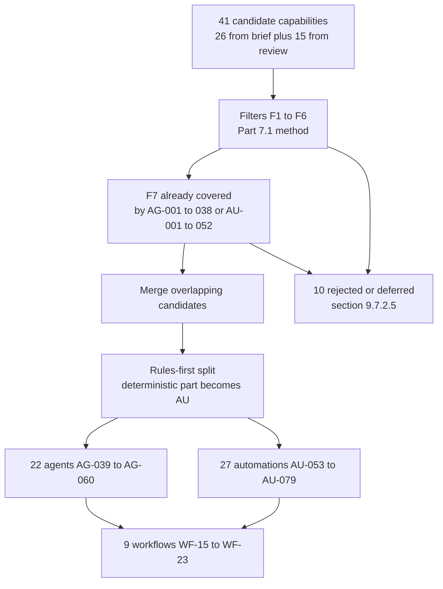
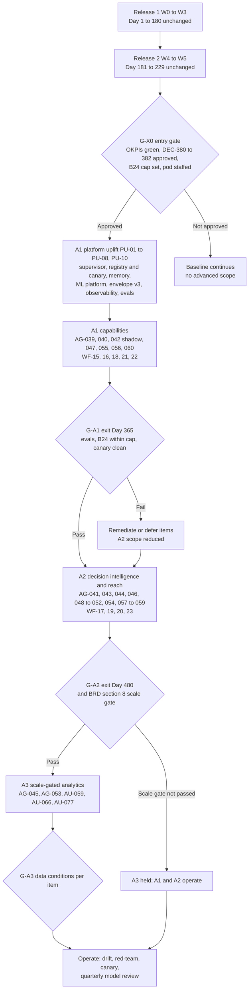
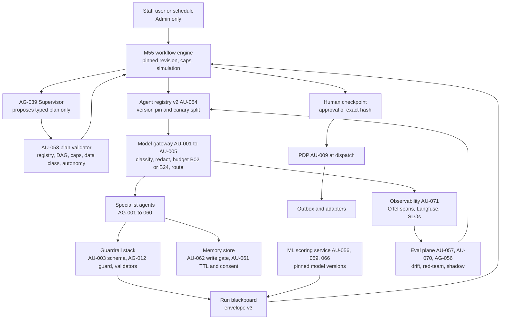
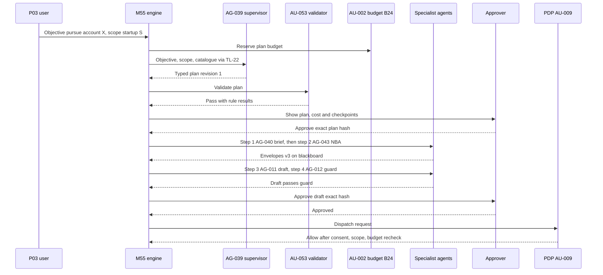
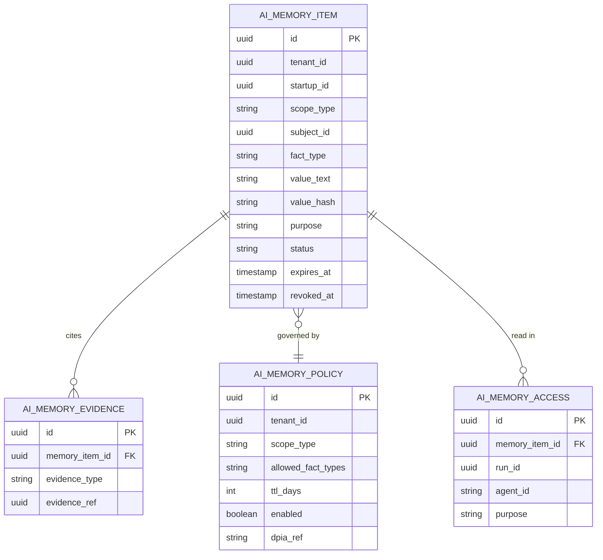
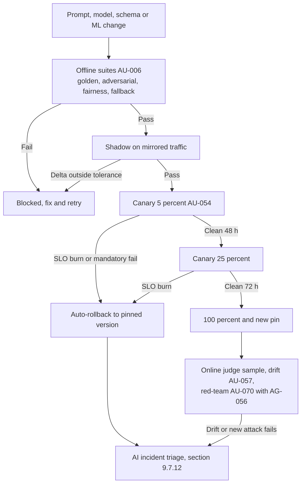
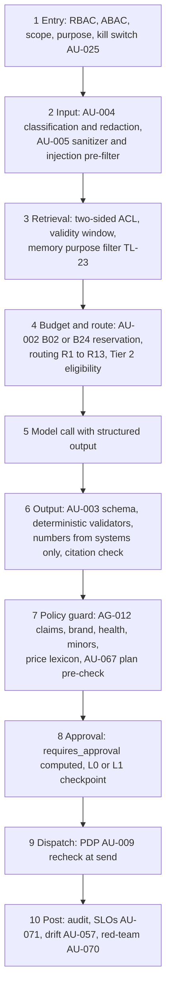

# AI Growth Engine: Employee Sales & Marketing Automation
## Application Blueprint: PART 9 (Batch 9.7a), Advanced AI Agents and Intelligence

| Field | Value |
|---|---|
| Document | Part 9, Batch 9.7a of 9.7a–9.7b (workstream X1, advanced AI agents and intelligence). Batch 9.7a holds §9.7.1–§9.7.5 (expert panel, opportunity inventory, improvement plan, architecture uplift, agent cards). Batch 9.7b holds §9.7.6–§9.7.18 (automations, workflows, FRs, stories, data/API/screens, tests, governance, effort, cost, decisions, risks, tags, quality gate) |
| Version | 1.0 · 28 Nov 2026 |
| Baseline | Parts 0–9.5 and 8.4; Part 7.1 (discovery funnel, CI-001…135), Part 7.2 (AG-001…036 cards, tool registry TL-01…20, orchestration §7.2.5–§7.2.11), Part 7.3 (tiers, routing R1–R13, cost formula §7.5.5, ladder §7.5.7, governance §7.6), Part 7.4a/7.4b (AG-037/038, AU-044…052, envelope v2, PC-01…18, RAG ACL), Part 9.4 (catalogue), Part 1 (P01–P16, BR-M01…M66, KPI-01…31), Part 2.1 (FR register), Part 2.6 (P17–P20), Part 8.3c (OKPI-01…35), Part 8.4 (Ledgers A and B), Part 9.5 (DEC-157…233); source documents 15, 16, 21 (docs38) |
| Roles applied | Expert panel (§9.7.1): Chief AI Officer (lead), Principal ML/LLM Engineer, RAG and Prompt Engineering Lead, AI Governance and Responsible AI Lead, LLMOps/FinOps Engineer; supported by Product Owner, QA Lead and Security Lead |
| Authority | Founder instruction 28 Nov 2026 ("take the best personas … identify, list, plan, incorporate"). Everything in this part is an **expert-panel recommendation and a separately approvable proposal**. It does **not** change Release 1, Release 2, DEC-230 (Ledger A) or DEC-231 (Ledger B) |
| New IDs (both batches) | AG-039…AG-060 (22 agents) · AU-053…AU-079 (27 automations) · WF-15…WF-23 (9 workflows) · FR-ADV-X1-001…064 · US-<EP>-V1nn (32 stories) · TC-ADV-X1-001…090 · screens A114–A129 · ADR-110…119 · DEC-380…389 · RSK-ADV-X1-01…14 · PU-01…10, OT-01…04 (effort items) · API-ADV-X1-01…40 · PC-19…PC-40 (prompt contracts) · TL-21…TL-32 (tools) |
| Tags | ASSUMPTION-600…609 · GAP-610…617 · CONFLICT-620…623 · RECOMMENDATION-625…641 (register §9.7.17, Batch 9.7b) |

**Verification convention.** Every model name, price, free-tier limit, provider term, open-source licence and regulatory date in this part is marked **"verify at time of implementation (as of 27 Nov 2026)"**. Model prices reuse Part 7.3 §7.3.2 and Part 7.4b (Claude Sonnet 5.5 `claude-sonnet-5-5` $2.00/$10.00 per MTok, cache read $0.10, 5-minute cache write $2.50; Claude Haiku 5.5 `claude-haiku-5-5` $0.10/$0.50, cache read $0.01, cache write $0.125; Batch 50% off; FX ₹90/USD) [ASSUMPTION-144]. All costs are estimates with formulas shown (Part 7.3 §7.5.5). Agents are referred to by gateway tier (Tier 0 / 1a / 1b / 2 / 3), not by vendor, except where a current model is named with the verify flag.

**Acronyms used in this part.** A2A = agent-to-agent; ABAC = attribute-based access control; ECE = expected calibration error; HITL = human in the loop; MDE = minimum detectable effect; MMM = marketing-mix model; NBA / NBO = next-best action / offer; OTel = OpenTelemetry; PDP = Policy Decision Point; PSI = population stability index; RAG = retrieval-augmented generation; RFP = request for proposal; SHAP = Shapley additive explanations; SLO = service-level objective; SRM = sample-ratio mismatch; TM = translation memory.

**Safety invariants carried unchanged into every item below (V11 brief; DEC-007, DEC-030, DEC-038, DEC-048, DEC-053, DEC-064, ADR-082).** (1) AI drafts, classifies, extracts, matches, summarizes, explains and *proposes*. It never signs, pays, submits bids, sets prices or discounts, moves budgets, changes permissions or configuration, or sends a consequential external action without a human. (2) Consequential actions stay capped at **L1**. (3) The deterministic PDP (AU-009) rechecks scope, consent, jurisdiction, budget and approval hash at dispatch; **no new agent receives TL-13 `dispatch.request`**. (4) Gateway tiers 0 / 1a / 1b / 2 / 3; Tier 2 stays opt-in, default OFF, and only for Public or Internal-non-personal data; **no personal, confidential or restricted data reaches Tier 2**. (5) RLS tenant/startup isolation, Website/Admin separation, no cross-tenant learning (FR-ENH-F-006). (6) Open-source first, paid by exception through PG-01…PG-10 with a benchmark (AU-044, AU-045), fail-closed. (7) No outreach, profiling or targeting of anyone under 18 (EduVerse, DEC-030); no patient or clinical data (MedMaarg). (8) No investor discovery or fundraising use (document 15 operating boundary).

---

## 9.7.1 Expert panel

The Founder asked for "the best personas who have strong expertise in this area". The panel below reviewed the whole AI design (Parts 7.1–7.4, 9.4) against the source pack (documents 15, 16, 21) and the business foundation (Part 1). Each member applied one lens and recorded concrete findings with the IDs affected. Findings are the input to the opportunity inventory (§9.7.2); nothing in this section changes an approved decision.

### 9.7.1.1 Panel composition

| # | Persona | Expertise (what this persona is accountable for in industry practice) | Lens applied to this blueprint | Primary deliverables in this part |
|---|---|---|---|---|
| X1-P1 | **Chief AI Officer (CAIO)** | AI strategy, portfolio value, build-vs-buy, AI operating model, board-level risk appetite, value realization | "Which AI capabilities move KPI-01…31 and OKPI-01…35 enough to justify their cost, and what is missing between *drafting* and *decision intelligence*?" | Opportunity inventory and MoSCoW (§9.7.2), phasing (§9.7.3), decisions (§9.7.15) |
| X1-P2 | **Principal ML/LLM Engineer** | Agent orchestration, tool use, memory, structured outputs, evaluation, classical ML (scoring, uplift, forecasting) | "Can the agents work together on multi-step objectives without losing determinism, idempotency, caps and auditability (ADR-071)?" | Architecture uplift (§9.7.4), ADR-110…114, AU-053/054/056/065 |
| X1-P3 | **RAG and Prompt Engineering Lead** | Retrieval design, chunking, freshness, grounding, prompt contracts, multilingual prompting | "Is every answer grounded in *current*, *approved*, *in-scope* knowledge, and does knowledge improve from use?" | PC-19…PC-40, AG-047/050/055, AU-063/069/076 |
| X1-P4 | **AI Governance and Responsible AI Lead** | EU AI Act (Reg. 2024/1689), India DPDP Act 2023 and DPDP Rules 2025, NIST AI RMF 1.0 (Govern, Map, Measure, Manage), model cards, human-oversight design | "Is every agent classified, documented, overseen, monitored after release, and lawful for its purpose and data?" | Governance (§9.7.12), AU-061/062/067/079, DEC-383/385/386/388 |
| X1-P5 | **LLMOps / FinOps Engineer** | Model gateway economics, caching, batching, routing, observability, SLOs, cost attribution, release engineering for prompts | "Do the new agents fit a hard budget, degrade gracefully, and can we see and cut their cost per verified outcome?" | Cost (§9.7.14), AU-068/071, ADR-115/119, DEC-382/389 |

### 9.7.1.2 Findings by persona

**X1-P1 Chief AI Officer: findings**

| # | Finding (missing or weak) | Evidence in the current design | Consequence | Response (this part) |
|---|---|---|---|---|
| F1.1 | The catalogue is strong at **drafting and safety** but has **no predictive layer**. Opportunity score is a fixed weighted formula (AU-017, DEC-011); forecast is stage-weighted (AU-041); health is rule-based (AU-039) | Part 7.2 §7.2.3; DEC-011; DEC-211 keeps DEC-011 as the only active model at launch | Owners cannot tell which of 20+ qualified accounts is most likely to convert, or which deals are slipping, until it is too late | Advisory propensity (AU-056 + AG-042), deal risk (AU-058 + AG-044), churn risk (AU-059 feeding AG-038); DEC-011 unchanged (DEC-383) |
| F1.2 | **Next-best action exists only for renewals** (AG-038). Open pipeline has no NBA or NBO | AG-038 scope = AU-039 renewal window | P03 decides the next step manually for every open opportunity; KPI-05, KPI-06 and KPI-09 depend on it | AG-043 + AU-060 action catalogue |
| F1.3 | **No method to prove AI lift.** KPI-05 says "improve vs baseline"; no experiment design or readout exists; CI-035 deferred send-time optimization "until 6 months of data" | Part 1 KPI-05; Part 7.1 CI-035 | Value claims for AI stay anecdotal; the BRD §8 scale gate (BR-S090) asks for measured cost per qualified opportunity | AG-052 + AU-065 experimentation, AU-077 statistical send-time after 6 months, AG-053 + AU-066 attribution/MMM |
| F1.4 | **AppNAI bid productivity**: AG-019 analyses an RFP and AG-020 drafts sections, but no approved **answer library** is reused across bids | Part 7.2 AG-019/020; WF-08 | Every RFP is answered from scratch; KPI-11 (bid award rate) and bid-desk effort suffer | AG-047 + AU-063, WF-18, A123 |
| F1.5 | **Multi-step pursuit is manual**: a P03 must trigger discovery, brief, contact, draft and meeting steps one by one | ADR-071: only AG-016 plans and "never drives other agents at run time" | Time-to-first-touch is long; automation rate KPI-19 / OKPI-10 under-delivers for research-heavy flows | AG-039 supervisor under ADR-110 (plans, never executes) |
| F1.6 | Employees navigate 113 Admin screens; Copilot (AG-015) answers questions but there is **no command surface** | Part 2.5 shell A003; AG-015 | Training load (Part 8.3 task cards) and time-to-task stay high | AG-057 + AU-072 command bar (RBAC-scoped) |

**X1-P2 Principal ML/LLM Engineer: findings**

| # | Finding | Evidence | Consequence | Response |
|---|---|---|---|---|
| F2.1 | Orchestration is deliberately linear (ADR-071) and correct for fixed pipelines, but has **no typed plan object** for objectives that need a variable set of agents | §7.2.5 "Why not a free-running loop"; AG-016 plans only commercial plans | Either humans orchestrate, or someone later bolts on a free-running loop that breaks BRL-AUT-06 caps | Supervisor-as-planner (ADR-110): AG-039 emits a plan; AU-053 validates; the M55 engine executes; no agent calls another |
| F2.2 | **Release of prompts is all-or-nothing**: ADR-084 rollback = re-pin; there is no canary or traffic split | Part 7.3 §7.6.9 | A prompt that passes offline evals but fails on live distribution reaches 100% of traffic | AU-054 canary controller (ADR-111) |
| F2.3 | **Memory is run-scoped** (blackboard) plus 6 Copilot turns; there is no governed long-term memory | Part 7.2 §7.2.6 | Agents re-read and re-summarize the same account history (AG-009, AG-015, AG-020, AG-038 each assemble context), costing tokens and giving inconsistent briefs | Structured long-term memory with consent and TTL (ADR-112, AU-061, AU-062); AG-040 account brief as a cached, versioned artefact |
| F2.4 | **No classical ML** anywhere; every "intelligence" item is either a rule or an LLM | Part 7.1 funnel; ADR-070…085 | LLMs get used for numeric prediction (wrong tool, costly) or prediction is not done at all | In-house scikit-learn/LightGBM with MLflow registry (ADR-113), advisory only |
| F2.5 | Envelope v2 (FR-ENH-F-001) has no `plan_id`, step contract or capability token | Part 7.4b §7.4.5.1 | A step cannot prove which plan authorized it; data class can silently rise across hops | Envelope v3 (ADR-114): plan_id, step_contract_id, capability token, monotonic data class |
| F2.6 | Evaluation is offline (AU-006) plus a 5% judge sample; **drift** and **shadow** evaluation are not specified | Part 7.3 §7.6.5, §7.6.9 | Silent degradation between releases | AU-057 drift monitor, AU-070 scheduler, shadow mode in ADR-117 |

**X1-P3 RAG and Prompt Engineering Lead: findings**

| # | Finding | Evidence | Consequence | Response |
|---|---|---|---|---|
| F3.1 | Revocation is handled (AU-046), but **freshness is reactive**: a chunk that is still valid but stale (old price version mentioned, superseded deck) is not detected | Part 7.4b FR-ENH-F-004/005 | Grounded-but-outdated answers; groundedness metrics stay high while accuracy falls | AU-069 freshness monitor + AG-055 curator (drafts updates for owners) |
| F3.2 | **Abstentions and retrieval misses are not mined** (AG-014, AG-015, AG-017 abstain correctly but nobody learns which knowledge is missing) | Part 7.3 §7.6.5 | Coverage gaps persist; abstention rate stays high | AU-069 gap clustering → AG-055 coverage-gap drafts |
| F3.3 | **No translation memory or glossary**; AG-018 translates drafts into hi-IN, ta-IN, or-IN per request | AG-018 card; DEC-026 | Inconsistent terminology across languages, repeated token spend, WhatsApp template variables broken by translation | AG-050 + AU-076 (TM, glossary, placeholder integrity, back-translation check) |
| F3.4 | Prompt contracts PC-01…18 do not cover planning across agents, account briefs, coaching, localization, experiment readouts or command parsing | Part 7.4b §7.4.5.1 | New agents would be built without the common minimum output `{answer, evidence_ids[], escalate, missing_fields[]}` | PC-19…PC-40 (one per new agent), same common minimum output |
| F3.5 | Context for account-centric agents is assembled ad hoc from TL-02 reads; no **shared, cited account brief** | AG-009, AG-015, AG-020, AG-038 cards | Token duplication; inconsistent facts across agents | AG-040 brief stored as a versioned artefact (cache key per FR-ENH-F-009) and reused by AG-043, AG-044, AG-059 |
| F3.6 | Personalization is per-message (AG-011) or per-asset (AG-018); no **segment-level variant generation** with claims guardrails at scale | AG-011, AG-018 cards; CI-063 excludes LLM audience selection | Either generic messages or expensive one-off drafts | AG-049 generates variants per *deterministic* segment (organization-level fields only); variants become templates under DEC-064 |

**X1-P4 AI Governance and Responsible AI Lead: findings**

| # | Finding | Evidence | Consequence | Response |
|---|---|---|---|---|
| F4.1 | The "register of AI systems" is the catalogue (Part 7.3 §7.6.12), but **risk class, intended purpose, model card, last eval and oversight design are not stored as data** per agent version | §7.6.12 EU AI Act row | Cannot evidence NIST AI RMF *Govern* and *Map* functions or answer a regulator / enterprise-client questionnaire quickly | AU-079 AI system inventory and model-card sync; A129 governance register |
| F4.2 | **Post-release monitoring** is quality-focused (judge sample) but not organized as post-market monitoring with incident linkage and fairness slices | §7.6.6, §7.6.10 | Drift in bias slices (language, region, institution type) may go unseen | AU-057 drift + fairness slices; AG-056 red-team; incident linkage in §9.7.12 |
| F4.3 | Long-term memory and conversation analytics raise **DPDP purpose-limitation, notice and retention** questions; GAP-143 / DEC-218 keep recordings and transcripts excluded | DEC-218; DEC-028 | Building these without a consent/purpose design would breach DPDP and DEC-218 | Memory OFF by default, structured facts only, purpose and TTL (DEC-385); conversation intelligence limited to staff notes and in-product written threads; recordings stay excluded (DEC-386) |
| F4.4 | Public conversational surfaces (AG-017) carry EU AI Act Art. 50 transparency; any **new WhatsApp concierge** inherits it plus Meta WhatsApp Business policy | §7.6.12 | Missing disclosure would be a transparency breach | AG-058 discloses AI at session start, hands off on request, L3 only for approved FAQ (DEC-064) |
| F4.5 | Predictive scoring of organizations is low-risk under EU AI Act (no natural-person decisions), but **staff-facing coaching (AG-046)** must not become employee performance evaluation (Annex III employment use) | EU AI Act Annex III point 4 (verify) | Using coaching scores for HR decisions would move the system into high-risk | AG-046 scores are private to the learner, not exported to management, not used for HR (DEC-386, CONFLICT-622 resolution) |
| F4.6 | Price guidance is a common "advanced" feature, but **CI-071 excluded recommending prices or discounts** and DEC-064 caps quotes at L1 | Part 7.1 CI-071 | A naive pricing agent would contradict the baseline | AG-048 explains *approved* price-book entries and the DEC-038 approval route only; it never proposes a number (DEC-388) |

**X1-P5 LLMOps / FinOps Engineer: findings**

| # | Finding | Evidence | Consequence | Response |
|---|---|---|---|---|
| F5.1 | At the high scenario the existing catalogue already uses **101% of the ₹3,000 pilot ceiling** | Part 7.4b B02 impact table (₹3,037 high) | Any new agent on B02 would trigger the ladder and starve existing agents | Separate hard-capped line **B24 Advanced AI** (ADR-119, DEC-382); advanced agents shed first |
| F5.2 | Cost control is **alert-based** (AU-012) without an optimization loop | Part 7.2 AU-012; Part 7.3 §7.4 | Savings opportunities (cache misses, oversized prompts, batch-eligible sync calls, Sonnet where Haiku passes eval) stay manual | AU-068 cost optimizer produces change proposals that go through AU-006 and A112 |
| F5.3 | LLM tracing is gateway tables + OTel in pilot; Langfuse only from the growth gate (ADR-078, B22) | Part 7.3 ADR-078 | Multi-step plans (AG-039) are hard to debug without span-level traces | Pull Langfuse self-hosted forward to A1 (DEC-389, ADR-115); OTel GenAI semantic conventions (verify) |
| F5.4 | No per-agent **AI SLOs** (groundedness, schema validity, latency p95, cost per task) with error-budget burn alerts | KPI-21 is a daily ratio; OKPI-13/14 are release gates | Regressions found late | AU-071 SLO tracker; SLOs in each card |
| F5.5 | Delivery AI (B23) has no budget for continuous red-teaming | Part 8.4 B23 ≈ ₹1,000 | Red-team stays quarterly and manual (§7.6.3) | AG-056 on B23 at ≈ ₹105/month base |

### 9.7.1.3 Panel consensus principles

1. **Deterministic first, then small model, then large model** (document 15 OPT-10-01; DEC-007). Where a capability can be a rule or a statistical model, it is an automation (AU), not an agent. This is why the compliance pre-check (AU-067) and the gateway cost optimizer (AU-068) are automations, not agents.
2. **Advisory intelligence, human decisions.** Every predictive or prescriptive output (propensity, risk, NBA, pacing, experiment readout, attribution) is L0 or L1. Nothing here raises any autonomy cap of DEC-064.
3. **Plan, validate, execute are separate actors.** Supervisor plans (AG-039); a deterministic validator checks (AU-053); the existing engine executes with the PDP (AU-009). Agents never call agents.
4. **Every new agent has a prompt contract, an eval set, a model card, an SLO, a budget, a Tier 3 path and a kill-switch scope before it is enabled.**
5. **Separate approval, separate ledger.** Development and running costs are outside DEC-230/231 and are shown in separate tables (§9.7.14).

---

## 9.7.2 Opportunity inventory

### 9.7.2.1 Method

The panel generated 41 candidate capabilities (the 26 named in the Founder's brief plus 15 found in the review), then applied the Part 7.1 §7.1.5 filters **F1 business value, F2 data feasibility, F3 risk, F4 regulatory/binding policy, F5 technical fit, F6 cost**, and the extra filter **F7 "already covered"** (an existing AG/AU already delivers ≥ 80% of the value). Survivors were merged where two candidates shared inputs and outputs. Result: **22 agents, 27 automations and 9 workflows** adopted; **10 candidates rejected or deferred** with reasons (§9.7.2.5).

**MoSCoW in this part is relative to the advanced programme** (DEC-224 MoSCoW for the baseline is unchanged): *Must* = enabler or safety control without which the approved advanced items cannot be enabled safely; *Should* = high value, adopt in A1/A2; *Could* = adopt when data or volume allows (A2/A3); *Won't (this horizon)* = rejected or deferred.

### 9.7.2.2 New agents (AG-039…AG-060)

| ID | Capability | Problem solved | Value (KPI / OKPI moved) | Persona served · panel owner | MoSCoW | Release | Why not already covered |
|---|---|---|---|---|---|---|---|
| AG-039 | Agent Supervisor and Planner | Multi-step objectives (account pursuit, RFP response, launch prep) need a variable sequence of agents; today humans chain them | Time-to-first-touch −30–50% for research-heavy pursuits (target, measured by AU-065); KPI-19 / OKPI-10 automation rate | P03, P04, P10 · X1-P2 | Should | A1 | AG-016 plans *commercial* plans from node templates and never drives agents (ADR-071); no typed multi-agent plan exists |
| AG-040 | Account Research Agent (owned and permitted public sources only) | Account context is re-assembled by several agents; no single cited brief | One brief reused by AG-043/044/059 and Copilot; −20% tokens on account-centric agents [ASSUMPTION-601]; KPI-07 | P03, P04 · X1-P3 | Should | A1 | AG-009 briefs one *opportunity* for qualification; AG-032 is partner diligence (W6, L0); neither builds a reusable account brief |
| AG-041 | Signal and Intent Fusion Analyst | Signals (AG-005), first-party web engagement, inbound intents (AG-013), event attendance (AU-051) live in different places | One account-level intent timeline; earlier engagement; KPI-05, KPI-07 | P03, P04 · X1-P1 | Should | A2 | AG-005 classifies one evidence item; no cross-source, time-decayed account view exists |
| AG-042 | Predictive Score Explainer | A propensity number without reasons is not trusted or auditable | Adoption of advisory propensity; explanation completeness 100% | P03, P02 · X1-P2 | Should | A1 (shadow) | AG-007 explains *solution match*; AU-017 is a deterministic score (DEC-011) with visible components; there is no ML score to explain |
| AG-043 | Next-Best-Action and Offer Advisor (pipeline) | P03 chooses the next step manually for each open opportunity | KPI-05, KPI-06, KPI-09; ≥ 50% NBA acceptance target | P03, P02 · X1-P1 | Should | A2 | AG-038 covers *renewals only*; no pipeline NBA; NBO limited to approved offerings by AU-060 |
| AG-044 | Deal-Risk Early-Warning Analyst | Stalled or slipping deals are noticed at forecast time | Earlier intervention; KPI-09, KPI-29 | P02, P03 · X1-P1 | Should | A2 | AU-041 forecasts; AU-039 scores health after closure; no in-pipeline risk signal |
| AG-045 | Conversation Intelligence Analyst (consented notes and in-product written threads) | Objection, competitor and commitment patterns are buried in notes and threads | Better objection library (KPI-28), coaching inputs, loss insights | P02, P03, P05 · X1-P4 | Could | A3 | AG-037 summarizes *one* meeting's notes; AG-026 classifies loss reasons; nobody aggregates patterns across threads. **Recordings and call transcripts stay excluded** (DEC-218, DEC-386) |
| AG-046 | Objection-Handling Coach | New staff learn objection handling slowly; approved responses exist (AG-021 taxonomy) but are not practised | Ramp time; KPI-28 objection resolution | P03, P06 · X1-P1 | Could | A2 | AG-021 drafts live responses; no practice or feedback loop; scores private to the learner (F4.5) |
| AG-047 | RFP Response Co-pilot (AppNAI) | Each RFP answered from scratch | −40% drafting time per bid [ASSUMPTION-602]; KPI-11; reuse of approved answers | P06, P02 · X1-P3 | Should | A1 | AG-019 extracts requirements; AG-020 drafts sections; neither matches requirements to an approved, expiring answer library with per-answer citations and owners |
| AG-048 | Price-Book Guidance Assistant (approved price books only) | Staff ask "which approved price version or bundle applies and who must approve this discount request" | Fewer wrong quotes and rework; AU-035 approval routing used correctly | P03, P07 · X1-P4 | Could | A2 | AU-035 calculates; no assistant explains approved price versions and DEC-038 routes. **Never proposes a price or discount** (CI-071, DEC-388) |
| AG-049 | Personalization-at-Scale Variant Generator | Generic templates under-perform; one-off drafts (AG-011) are costly | Reply rate KPI-05 via tested variants; cost per qualified opportunity KPI-22 | P05, P03 · X1-P3 | Should | A2 | AG-011 drafts one message; AG-018 one asset; no governed variant set per deterministic segment with claims guard and experiment hook |
| AG-050 | Indic Localization Agent | Translations inconsistent; WhatsApp template variables break; only 3 locales | Consistent hi/ta/or plus bn, te, mr, kn, ml, gu (configurable) [ASSUMPTION-603]; KPI-26 | P05, P15 (indirect) · X1-P3 | Should | A2 | AG-018 produces translation *drafts* without TM, glossary, placeholder integrity or back-translation QA |
| AG-051 | Campaign Planner and Pacing Advisor | Budget pacing and channel mix are reviewed ad hoc | Spend efficiency (KPI-10), on-plan delivery | P05, P02 · X1-P1 | Could | A2 | AG-016 plans outreach plans; AU-032 pauses on anomaly; nothing *proposes* pacing changes. Budget moves stay human (CI-062) |
| AG-052 | Experiment Designer and Analyst | No disciplined A/B or bandit practice | Measured lift for every AI feature; BR-S090 scale-gate evidence | P05, P10 · X1-P1 | Should | A2 | No experiment capability in the baseline; statistics are deterministic in AU-065; the agent writes designs and readouts only |
| AG-053 | Attribution and Marketing-Mix Analyst | Attribution caveats (AU-040) are not explained; no channel-mix view | Better budget allocation decisions; KPI-10, KPI-22 | P01, P05, P08 · X1-P1 | Could | A3 | AU-040 computes rule-based attribution; no MMM and no narrative with uncertainty |
| AG-054 | Forecast Variance and Pipeline Hygiene Analyst | Forecast changes week to week are unexplained; hygiene issues (past close dates) inflate forecasts | KPI-29 forecast error; data hygiene | P02, P01 · X1-P1 | Should | A2 | AU-041 produces numbers; AG-029 writes weekly KPI narratives, not variance decomposition or hygiene lists |
| AG-055 | Knowledge Curator and RAG Freshness Agent | Stale, conflicting or missing knowledge | Abstention rate ↓, groundedness ↑ (OKPI-14) | P09, P05 · X1-P3 | Must | A1 | AU-046 purges revoked items; nothing detects stale-but-valid or missing knowledge |
| AG-056 | Agent Red-Team and Drift Analyst | Red-team is quarterly and manual (§7.6.3) | Continuous adversarial coverage; OKPI-16 | AI lead, R10 · X1-P4 | Must | A1 | AG-002 judges outputs; AG-036 generates test fixtures; neither mutates attacks continuously or clusters drift |
| AG-057 | Admin Command Bar Interpreter | Navigation and routine actions across 113 screens are slow | Time-to-task; training load | P01–P10 · X1-P1 | Could | A2 | AG-015 answers questions and proposes filters; no registered-command interpreter bound to RBAC |
| AG-058 | WhatsApp Concierge with Human Handoff | Customer-initiated WhatsApp questions wait for staff | Response time; KPI-26; BR-M31 | P14, P15 · X1-P4 | Should | A2 | AG-013/014 classify and draft single replies; AG-017 is web chat; no multi-turn WhatsApp session with booking and handoff. Voice deferred (§9.7.2.5) |
| AG-059 | Meeting-Prep Brief Agent | Staff prepare meetings manually from several screens | Meeting quality; KPI-06 held-meeting conversion | P03, P06 · X1-P3 | Could | A2 | AG-015 can brief on demand; nothing pre-generates a standard brief T−24 h in Batch at low cost |
| AG-060 | Data-Quality and Dedupe Steward | Fuzzy duplicates and inconsistent fields survive AU-015 exact matching | Duplicate organizations ≤ 2% (AU-015 KPI); propensity feature quality | P04, P11 · X1-P2 | Should | A1 | AU-015 merges on exact domain + location; fuzzy cases become manual merge tasks with no proposal |

### 9.7.2.3 New automations (AU-053…AU-079)

| ID | Capability | Problem solved | Value | Persona · owner | MoSCoW | Release | Why not already covered |
|---|---|---|---|---|---|---|---|
| AU-053 | Supervisor plan validator and step guard | Plans from AG-039 must be safe before execution | 0 invalid plans executed | P10, P16 · X1-P2 | Must | A1 | No plan object existed (F2.1) |
| AU-054 | Agent version canary controller and auto-rollback | All-or-nothing prompt releases | Regressions contained to ≤ 5% traffic | AI lead · X1-P5 | Must | A1 | ADR-084 re-pin only |
| AU-055 | Intent fusion score | Account intent is not quantified | Deterministic, explainable intent band | P04 · X1-P2 | Should | A2 | AG-005 per item only |
| AU-056 | Propensity model training, scoring and calibration (classical ML, advisory) | No predictive layer (F1.1) | Ranked advisory propensity with ECE ≤ 0.08 | P03 · X1-P2 | Should | A1 shadow / A2 visible | DEC-011 formula is not predictive; DEC-211 permits optional scoring versions only after benchmark |
| AU-057 | Model and agent drift monitor | Silent degradation (F2.6) | Drift detected ≤ 7 days | AI lead · X1-P5 | Must | A1 | Judge sample only |
| AU-058 | Deal-risk rule pack | Slipping deals unnoticed | Risk flags with rule IDs | P02 · X1-P1 | Should | A2 | None |
| AU-059 | Churn-risk model | AU-039 rules are coarse | Earlier renewal intervention (KPI-15) | P03 · X1-P2 | Could | A3 (needs ≥ 12 months of renewals) | AU-039 is rule-based |
| AU-060 | Action catalogue eligibility filter | NBA must only propose allowed actions and offerings | 0 ineligible suggestions | P03 · X1-P4 | Must (for AG-043) | A2 | None |
| AU-061 | Memory consent, retention and purge controller | Long-term memory needs DPDP controls | 100% memory items with purpose and TTL | R10 · X1-P4 | Must | A1 | No long-term memory existed |
| AU-062 | Memory write gate | Memory must hold only validated, allowlisted facts | 0 special-category or free-text personal items | R10 · X1-P4 | Must | A1 | Same |
| AU-063 | RFP answer library freshness and expiry | Answers go stale | 0 expired answers reused | P06 · X1-P3 | Must (for AG-047) | A1 | None |
| AU-064 | Budget pacing calculator | Pacing is manual | Daily pacing index per campaign | P05 · X1-P5 | Should | A2 | AU-032 caps and anomaly pause only |
| AU-065 | Experiment allocator and statistics engine | No A/B or bandit machinery | Valid readouts (SRM-checked) | P05, P10 · X1-P1 | Should | A2 | None |
| AU-066 | Marketing-mix model run | No channel-mix view | Quarterly MMM with credible intervals | P01 · X1-P1 | Could | A3 (needs ≥ 2 years weekly data or priors) | AU-040 rule-based attribution only |
| AU-067 | Compliance pre-check for plans and campaigns | Compliance issues found at dispatch (late) | Blocks before simulation; fewer PDP denials | R10 · X1-P4 | Should | A1 | PDP (AU-009) checks per action at dispatch; AG-012 checks text; no plan-level DPDP purpose/notice/consent-basis pre-check |
| AU-068 | Gateway cost optimizer | Savings found manually (F5.2) | −10–20% B02/B24 cost at equal quality [ASSUMPTION-604] | FinOps · X1-P5 | Should | A1 | AU-012 alerts only |
| AU-069 | RAG freshness and coverage monitor | F3.1, F3.2 | Stale-chunk and gap lists weekly | R10, P05 · X1-P3 | Must (for AG-055) | A1 | AU-046 revocation only |
| AU-070 | Golden-set and red-team scheduler | Evals run only on change (AU-006) | Nightly/weekly coverage incl. Tier 2 models | AI lead · X1-P5 | Must | A1 | AU-006 is CI-triggered |
| AU-071 | Agent observability and AI SLO tracker | No per-agent SLOs (F5.4) | Error-budget burn alerts | SRE, AI lead · X1-P5 | Must | A1 | AU-012 cost only |
| AU-072 | Command registry and RBAC resolver | Command bar must never exceed the user's rights | 0 unauthorized commands | P01–P10 · X1-P4 | Must (for AG-057) | A2 | None |
| AU-073 | WhatsApp service-window and handoff router | Concierge must respect the 24-hour window and handoff SLAs | 0 out-of-window free-form messages | P03 · X1-P4 | Must (for AG-058) | A2 | AU-022/AU-008 handle sequences and STOP, not concierge sessions |
| AU-074 | Data-quality rules and dedupe blocking | Fuzzy duplicates | Candidate pairs for AG-060; 0 merges by name alone (OPT-11-03) | P04 · X1-P2 | Should | A1 | AU-015 exact match only |
| AU-075 | Meeting-prep scheduler | Briefs must be generated only for qualified meetings, in Batch | Brief ready T−24 h for 100% eligible meetings | P03 · X1-P5 | Could | A2 | None |
| AU-076 | Translation memory and glossary enforcer | F3.3 | 0 broken placeholders; glossary adherence ≥ 98% | P05 · X1-P3 | Must (for AG-050) | A2 | None |
| AU-077 | Send-time window optimizer (statistical) | CI-035 deferred to "classical statistics after 6 months" | Reply-rate lift within quiet hours | P03 · X1-P1 | Could | A3 | Explicitly deferred by Part 7.1 CI-035; implemented as statistics, **not** an LLM |
| AU-078 | Human feedback capture and label queue | Accept/edit/reject signals are stored (API-149) but not turned into labelled data | Eval sets grow from reviewed feedback | AI lead · X1-P2 | Must | A1 | API-149 stores feedback; no labelling pipeline |
| AU-079 | AI system inventory and model-card sync | F4.1 | 100% enabled agents with current model card | R10 · X1-P4 | Must | A1 | Catalogue is a document, not data |

### 9.7.2.4 New workflows (WF-15…WF-23)

| ID | Workflow | Problem | Value | MoSCoW | Release | Why not already covered |
|---|---|---|---|---|---|---|
| WF-15 | Supervised multi-agent account pursuit | Manual chaining of research → brief → contact → draft | Faster pursuit with the same approvals | Should | A1 | WF-02/03/06 are separate; WF-13 is commercial-plan execution |
| WF-16 | Predictive model lifecycle | No ML lifecycle | Governed train → shadow → approve → serve → retire | Should | A1 | None |
| WF-17 | Deal-risk and churn early warning | Late intervention | Nightly risk radar with owners' tasks | Should | A2 | WF-12 handles renewal reminders only |
| WF-18 | RFP response co-pilot (AppNAI) | Answers from scratch | Library-based response under WF-08 | Should | A1 | WF-08 covers bid decision and submission, not answer reuse |
| WF-19 | Localized personalization at scale | Variants and locales handled separately | One governed path from brief to approved localized templates | Should | A2 | WF-05 content/campaign handles single assets |
| WF-20 | Experiment lifecycle | No experiment governance | Pre-registered tests with guardrail stops | Should | A2 | None |
| WF-21 | Agent release, canary and red-team | All-or-nothing release | Safe rollout and rollback | Must | A1 | AU-006 gate only |
| WF-22 | Knowledge freshness and memory governance | Stale knowledge; memory consent | Curated knowledge; lawful memory | Must | A1 | AU-046 revocation only |
| WF-23 | WhatsApp concierge with human handoff | Waiting customers | Answers in seconds, human when needed | Should | A2 | WF-04/WF-06 handle inbound and outreach, not concierge sessions |

### 9.7.2.5 Candidates rejected or deferred

| Candidate | Decision | Reason (baseline reference) |
|---|---|---|
| Voice assistant (inbound/outbound calls, IVR) | **Won't (this horizon)**; re-evaluate in A3 only through PG-01…PG-10 | Needs telephony and speech services (paid by default; self-hosted speech is a GPU cost); call recording would conflict with DEC-218; outbound voice raises TRAI/DND and consent issues (verify). WhatsApp concierge (AG-058) covers the conversational need first (DEC-387) |
| Price or discount recommendation | **Won't** | CI-071 excluded; DEC-064 L1 cap; AG-048 explains approved price books only (DEC-388) |
| Autonomous budget reallocation | **Won't** | CI-062; AG-051 proposes, R05L/R02 approve; AU-032 caps unchanged |
| LLM-selected audiences | **Won't** | CI-063; segments are deterministic (M38); AG-049 only writes variants for given segments |
| Summaries of call recordings / transcripts | **Deferred** (A3 at earliest, needs a new Founder DEC after legal review) | DEC-218 keeps recordings and transcripts excluded; GAP-143 |
| Compliance pre-check *agent* | **Re-classified** as AU-067 | Rules decide DPDP purpose, consent basis, jurisdiction and minors; an LLM adds risk, not accuracy (principle 1) |
| Cost-optimization *agent* | **Re-classified** as AU-068 | Recommendations are arithmetic over the cost ledger and eval results |
| Fine-tuning on tenant data | **Won't** | FR-ENH-F-006 no cross-tenant learning; prompt + RAG + classical ML suffice at Year-1 volume (DEC-031) |
| Self-healing LLM retries | **Won't** | CI-094; retries are deterministic (BRL-AUT-07) |
| Investor or fundraising intelligence | **Won't** | Document 15 operating boundary: no investor discovery, fundraising or capital records |

### 9.7.2.6 Top 10 capabilities by value-to-risk (panel ranking)

| Rank | Item | Why it ranks high |
|---|---|---|
| 1 | AG-047 RFP Response Co-pilot + AU-063 + WF-18 | Directly lifts AppNAI bid throughput (BR-S001, KPI-11); reuses approved content; L1 |
| 2 | AG-039 Supervisor + AU-053 + WF-15 | Multiplies the value of existing agents without new autonomy |
| 3 | AU-056 + AG-042 advisory propensity | First predictive layer; prioritizes scarce P03 time; DEC-011 untouched |
| 4 | AG-043 NBA/NBO + AU-060 | Converts insight into the next step on every open deal |
| 5 | AG-044 + AU-058 deal-risk early warning (+ AU-059 churn in A3) | Protects pipeline and renewals; cheap (Batch, Haiku) |
| 6 | AG-055 + AU-069 knowledge freshness | Raises groundedness for every RAG agent (OKPI-14) |
| 7 | AU-054 canary + AU-057 drift + AG-056 red-team + WF-21 | Makes every future AI change safer (OKPI-16) |
| 8 | AG-052 + AU-065 experimentation | Turns "AI helps" into measured lift (BR-S090 scale gate) |
| 9 | AG-049 + AG-050 + AU-076 personalization and Indic localization | Reach and relevance in Indian languages with claims safety |
| 10 | AG-058 + AU-073 WhatsApp concierge | Fast customer-initiated answers with human handoff (BR-M31) |

---

## 9.7.3 Improvement plan

### 9.7.3.1 Placement against the approved plan

**Nothing in this part enters Release 1 or Release 2.** The panel looked for any item that *must* be in Release 1/2 and found none: every advanced capability depends on production data that only exists after go-live (outcomes for ML, abstentions for curation, live traffic for canaries), and every safety control it needs already exists in the baseline (AU-001…AU-012, AU-025, AU-046, envelope v2, PC-01…18). Placing them earlier would disturb the DEC-228 plan and the Ledger A budget (DEC-230) for no safety gain. The only zero-cost preparation is a **data-retention check** in Release 2 hypercare: confirm that the outcome fields the ML features need (stage history, intent labels, reply timestamps, renewal outcomes) are already being kept under DEC-028 (they are, per Part 3.3; no change requested) [ASSUMPTION-600].

| Release | Calendar (Day 1 = Mon 7 Dec 2026) | Relation to baseline | Delivery vehicle | Central effort |
|---|---|---|---|---|
| Release 1 (W0–W3) and Release 2 (W4–W5) | Day 1–229 | **Unchanged** (DEC-228, DEC-230) | Core team | 0 pd from this part |
| **A1 "Foundations and first wins"** | Day 239 (Mon 2 Aug 2027) – Day 365 (Mon 6 Dec 2027), inside W6 | Runs **alongside** the Phase-2 (W6) scope of Part 9.5 §9.5.2.3; does not consume its 100 pd | Advanced AI pod (§9.7.13.3) | 232 pd |
| **A2 "Decision intelligence and reach"** | Day 366 (Tue 7 Dec 2027) – Day 480 (Thu 30 Mar 2028) | After W6; Year 2 H1 [ASSUMPTION-605] | AI pod, reduced | 158 pd |
| **A3 "Scale-gated analytics"** | Day 481 (Fri 31 Mar 2028) – Day 600 (Fri 28 Jul 2028) | Only after the BRD §8 scale gate (BR-S090) unlocks the ₹12,000 ceiling (DEC-008) and the data-volume conditions below hold | AI pod, 0.7 FTE | 45 pd |

### 9.7.3.2 Scope by release

| Release | Platform uplift | Agents | Automations | Workflows | Screens |
|---|---|---|---|---|---|
| A1 | PU-01 supervisor runtime, PU-02 registry and canary, PU-03 memory, PU-04 ML platform, PU-05 envelope v3, PU-06 observability, PU-07 guardrail stack, PU-08 eval harness v2, PU-10 B24 budget line | AG-039, AG-040, AG-042 (shadow), AG-047, AG-055, AG-056, AG-060 | AU-053, AU-054, AU-056 (shadow), AU-057, AU-061, AU-062, AU-063, AU-067, AU-068, AU-069, AU-070, AU-071, AU-074, AU-078, AU-079 | WF-15, WF-16, WF-18, WF-21, WF-22 | A114, A115, A116, A118, A123, A127, A128, A129 |
| A2 | PU-09 experimentation core | AG-041, AG-042 (visible), AG-043, AG-044, AG-046, AG-048, AG-049, AG-050, AG-051, AG-052, AG-054, AG-057, AG-058, AG-059 | AU-055, AU-056 (visible), AU-058, AU-060, AU-064, AU-065, AU-072, AU-073, AU-075, AU-076 | WF-17, WF-19, WF-20, WF-23 | A117, A119, A120, A122, A124, A125 |
| A3 | — | AG-045, AG-053 | AU-059, AU-066, AU-077 | (WF-17 churn branch enabled) | A121, A126 |

### 9.7.3.3 Entry and exit gates

| Gate | When | Entry / exit criteria (all must hold; evidence recorded per document 15 "acceptance and evidence record") | Approver |
|---|---|---|---|
| **G-X0 Entry to A1** | Day ≈ 237 | (1) W5 exit passed (Day 229) with all mandatory OKPIs green (01, 02, 03, 04, 05, 07, 08, 11, 12, 16, 17, 18, 19, 20, 22, 23, 26, 27, 28, 32, 35); (2) DEC-380, DEC-381 and DEC-382 approved by the Founder; (3) B24 budget line configured in AU-002 with hard cap; (4) AI pod staffed; (5) ≥ 8 weeks of production data in Release 1 scope; (6) no open AI-S1/AI-S2 incident | Founder (R01) + AI lead |
| **G-A1-n Per-capability enablement** (each agent/automation) | Within A1/A2/A3 | Prompt contract registered (PC-19…40); golden, adversarial, fairness and fallback sets meet §9.7.11 thresholds; model card in AU-079; DPIA delta signed by R10 where personal data is processed; canary 5% → 25% → 100% without SLO burn > 2× (AU-054); kill-switch scope tested ≤ 60 s; B24 per-agent cap configured | AI lead + R10 (+ R11 for workflow bindings) |
| **G-A1 Exit A1 / entry A2** | Day 365 | All A1 items enabled or explicitly deferred with reason; B24 spend ≤ cap for 4 consecutive weeks; AG-047 drafting-time reduction measured on ≥ 5 bids (target ≥ 25%, ASSUMPTION-602); propensity shadow ECE ≤ 0.08 on ≥ 300 closed opportunities or kept in shadow; 0 memory items without purpose/TTL | Founder + AI lead |
| **G-A2 Exit A2 / entry A3** | Day 480 | NBA acceptance ≥ 40% (target 50%); ≥ 3 experiments read out with SRM pass; localization glossary adherence ≥ 98%; WhatsApp concierge handoff SLA met ≥ 95%; BRD §8 scale gate passed for the ₹12,000 ceiling, **or** A3 stays closed | Founder + AI lead + R10 |
| **G-A3 data conditions** | Before each A3 item | AU-059: ≥ 12 months of renewal outcomes and ≥ 100 renewal events; AU-066: ≥ 104 weeks of channel spend and outcome data, or approved priors with sensitivity analysis; AU-077: ≥ 6 months of reply timestamps and ≥ 2,000 replies (CI-035); AG-045: legal review of purpose and notice for thread analytics (DEC-386) | AI lead + R10 |

### 9.7.3.4 Dependencies

| Item | Depends on (baseline) | Depends on (this part) | Blocking risk |
|---|---|---|---|
| AG-039 / WF-15 | M55 engine, AU-009 PDP, AU-025 kill switch, envelope v2, AG-003…009, AG-011 | PU-01, PU-05, AU-053, TL-21/22 | Engine changes ripple into A033/A110 → contain to new node type `agent_step_plan` |
| AG-040 | TL-02, TL-03, AU-007 source permissions, AU-046 | PU-03 memory (optional), TL-23/24 | Source permissions incomplete → brief shows "not covered" (KPI-27) |
| AU-056 / AG-042 | Stage history (M21), AU-017 components, AU-040 outcomes | PU-04, AU-057, AU-078 | Too few closed outcomes → stay in shadow (RSK-ADV-X1-03) |
| AG-043 | AU-060, offering readiness (M02), PDP eligibility (TL-10) | AG-040, AU-056 (optional) | — |
| AG-047 / WF-18 | AG-019, AG-020, AU-034, AU-052, WF-08 | AU-063, TL-26, A123 | Empty library at start → seed from 10 past bids [ASSUMPTION-606] |
| AG-049 / AG-050 / WF-19 | AG-011, AG-012, AG-018, M35/M38 templates, DEC-026 locales | AU-076, TL-28, AU-065 | Linguist review capacity (RSK-ADV-X1-08) |
| AG-052 / AU-065 | M38 campaigns, AU-022 sequences, consent (M04) | PU-09, AU-067 | Low volume → long tests; bandits only above minimum traffic |
| AG-058 / WF-23 | M31 WhatsApp (BR-M31), AU-008, AU-013, AG-013/014, AU-023 | AU-073 | Meta policy changes (verify) |
| AU-054 / WF-21 | ADR-084 registry, AU-006 | PU-02, AU-070, AU-071 | — |
| AU-061 / AU-062 | AU-011 privacy locator, DEC-028 | PU-03 | DPIA not approved → memory stays OFF |
| AG-045 | DEC-218, AG-037 | DEC-386 legal review | Legal review not obtained → item withdrawn |

### 9.7.3.5 Roadmap

---

## 9.7.4 Agent architecture uplift

### 9.7.4.1 Target architecture

The uplift keeps the baseline shape (ADR-070 gateway, ADR-071 engine-as-orchestrator, ADR-082 no agent dispatch) and adds six components: a **planner lane** (AG-039 + AU-053), an **agent registry with canary** (AU-054), a **governed memory store** (AU-061/062), an **ML scoring service** (AU-056/059/066), an **evaluation and red-team plane** (AU-057/070, AG-056) and **span-level observability** (AU-071).

### 9.7.4.2 Orchestrator and supervisor pattern (ADR-110)

**Pattern: "supervisor-as-planner, engine-as-executor".** AG-039 receives an objective, the caller's scope and the agent catalogue (TL-22), and returns a **typed plan**: an ordered DAG of steps, each naming a *registered* agent or automation, its prompt contract, inputs by reference, the expected output schema, a per-step token and cost budget, and the human checkpoints. AG-039 never calls any agent. AU-053 validates the plan deterministically; the engine then runs it as an ordinary workflow run with all baseline caps (BRL-AUT-06, §7.2.9), the kill switch (AU-025) and the PDP (AU-009). If a step's output changes what should happen next (for example the account turns out to be out of scope), the engine stops at the next checkpoint and may ask AG-039 for a **re-plan**, at most **2 re-plans per run**; a re-plan is a new plan revision that AU-053 validates again.

**Plan schema (PC-19, summary).** `{plan_id, objective_ref, scope{tenant_id, startup_id}, steps[{step_id, node_type ∈ {agent, automation, human_checkpoint}, ref_id, contract_id, input_refs[], output_schema, max_tokens, max_cost_inr, side_effect_class ∈ {R0, W1}, depends_on[]}], est_cost_inr, est_duration_s, autonomy_required ∈ {L0, L1, L2}, assumptions[], missing_fields[], escalate}`. `side_effect_class = X2` is **not representable**; dispatch is always a separate engine step after human approval.

**AU-053 validation rules (all deterministic; any failure → plan rejected with rule ID).**

| Rule | Check |
|---|---|
| PV-01 | Every `ref_id` is an **enabled** registry entry for this tenant/startup and has a pinned version |
| PV-02 | DAG acyclic; ≤ 12 agent steps (hop cap §7.2.9); ≤ 50 total steps |
| PV-03 | Σ `max_cost_inr` ≤ remaining run budget reserved by AU-002 and ≤ per-plan cap (default ₹25) |
| PV-04 | Data class is monotonic along edges: a step may not send a higher-class output to a step whose card allows a lower class (BRL-AI-06); any Tier 2-eligible step receiving Confidential input is re-routed to Tier 1 |
| PV-05 | Any step producing a customer-facing draft is followed by AG-012 and a `human_checkpoint` (DEC-064 L1) |
| PV-06 | No step targets a minor-related or clinical object (DEC-030; MedMaarg no patient data) |
| PV-07 | Agents that read untrusted content have no W1 tool in the same step (registry rule 1) |
| PV-08 | `autonomy_required` ≤ the workflow's approved mode (CFG-27) and ≤ L1 for any W1 step |
| PV-09 | Inputs referenced only by ID; no free-text instructions copied from untrusted content into later prompts |
| PV-10 | Re-plan count ≤ 2; plan revision hash recorded; approval (if required) is of the exact plan hash |

### 9.7.4.3 Tool registry extensions (extends Part 7.2 §7.2.4)

| Tool ID | Name | Side-effect class | Scope enforcement | Rate limit per run | Allowed agents | Audit |
|---|---|---|---|---|---|---|
| TL-21 | `plan.propose` | W1 (plan draft only) | Writes a plan revision in Draft; cannot start a run | 3 revisions | AG-039, AG-051 (campaign plan drafts) | Plan ID, revision hash |
| TL-22 | `agent.catalog.read` | R0 | Enabled agents/automations for caller scope, with contracts, costs, data-class limits | 2 calls | AG-039 | Catalogue revision |
| TL-23 | `memory.read` | R0 | Memory items whose purpose matches the run `purpose` and whose subject is in caller scope; expired or revoked excluded | 5 calls, ≤ 30 items | AG-039, AG-040, AG-043, AG-044, AG-058, AG-059, AG-015 (extension) | Item IDs |
| TL-24 | `memory.propose` | W1 (proposal to AU-062 only) | Allowlisted fact types; requires `evidence_id`; never writes directly | 5 proposals | AG-040, AG-059, AG-037 (extension) | Proposal IDs |
| TL-25 | `ml.predict.read` | R0 | Pinned model version outputs with contributions for in-scope objects | 5 calls | AG-042, AG-043, AG-044, AG-038 (extension) | Model version, object IDs |
| TL-26 | `answer_library.search` | R0 | Approved, unexpired answers for the startup; owner and expiry returned | 10 calls, top-k ≤ 5 | AG-047 | Answer IDs |
| TL-27 | `pricebook.lookup` | R0 | Approved price versions, bundles and DEC-038 thresholds for the startup; **read-only; returns references, the model never writes numbers** | 3 calls | AG-048 | Price version IDs |
| TL-28 | `tm.lookup` | R0 | Translation memory units and glossary for startup and locale | 10 calls | AG-050 | TM unit IDs |
| TL-29 | `experiment.stats.read` | R0 | Deterministic results from AU-065/AU-066 (aggregates only) | 5 calls | AG-052, AG-053 | Experiment IDs |
| TL-30 | `command.resolve` | R0 | Command registry filtered by AU-072 RBAC result | 2 calls | AG-057 | Command IDs |
| TL-31 | `eval.write_candidate` | W1 (eval candidate queue) | Synthetic or redacted items only; enters A128 review queue, never an active eval set | 50 items | AG-056 | Candidate IDs |
| TL-32 | `finding.create` | W1 (finding/draft) | Creates a curation, data-quality or risk finding for an owner; no state change to the target object | 20 findings | AG-044, AG-054, AG-055, AG-060 | Finding IDs |

TL-13 `dispatch.request` remains granted to **no agent** (ADR-082). Adding any tool above to an agent is a CA-CONFIG change in A112 with R11 + R10 approval and an AU-006 eval run (registry rule 2, unchanged).

### 9.7.4.4 Memory design (ADR-112)

| Memory layer | Store | Content | Scope | Write path | Retention | Default |
|---|---|---|---|---|---|---|
| Working (unchanged) | `ai_agent_step.output` | Step outputs of one run | Run | Engine | As run state (DEC-028) | ON |
| Conversation (unchanged) | `copilot_turn`, `chat_session`, new `concierge_session` | Last 6 turns + summary | User / visitor / WhatsApp thread | Gateway | 90 days | ON |
| **Account memory** (new) | `ai_memory_item` (scope = account) | Typed business facts about an *organization*: stated priorities, buying committee *roles*, objections raised, preferred channel (organization-level), commitments recorded as confirmed | Tenant + startup + account; never across startups | AU-062 from validated outputs (AG-037, AG-040, AG-059) with `evidence_id` | Default 180 days rolling, renewed on re-confirmation; purged on account deletion or privacy request (AU-011, AU-061) | **OFF per tenant until DPIA delta signed (DEC-385)** |
| **User preference memory** (new) | `ai_memory_item` (scope = staff user) | Staff UI and drafting preferences (tone, length, language) | User | User action or accepted suggestion | Until user deletes; 365 days inactivity purge | OFF; user opt-in |
| **Procedural memory** (new) | Prompt registry + answer library + TM | Approved answers, translations, playbooks | Startup | Human approval only | Per document lifecycle | ON |
| Semantic cache (unchanged) | `ai_semantic_cache` | Public/Internal answers | Namespaced | AU-001 | 30 days | ON |

**Write-gate rules (AU-062).** (1) Only fact types in the allowlist `{priority, role_in_committee, objection_code, channel_preference_org, confirmed_commitment, product_interest_offering_id, risk_note}`; (2) each item cites an `evidence_id` (note span, message ID, record field); (3) no special-category or sensitive data (health, religion, caste, political opinion, financial account numbers, minors) — deterministic lexicon + Presidio (AU-004) + model-free regex; (4) no free text longer than 280 characters; (5) natural persons appear only as `contact_id` with role, never as profiles; (6) EduVerse: institution-level only; MedMaarg: organization-level only, no clinical content; (7) duplicates merge by `(subject, fact_type, value_hash)`; contradictions create a review finding instead of overwriting. Agents read memory only through TL-23 filtered by **purpose** (envelope `purpose`, FR-ENH-F-001).

### 9.7.4.5 Evaluation harness v2 (ADR-117)

| Stage | What runs | Gate / signal | Owner |
|---|---|---|---|
| Offline (unchanged, extended) | AU-006 promptfoo/DeepEval suites per contract (PC-19…40), deterministic graders first, AG-002 judge for generative | Thresholds §9.7.11.1; dataset hash pinned (FR-ENH-F-007) | AI lead |
| Adversarial | AU-070 schedules AG-056 mutations of the injection corpus (direct, indirect via web/PDF/email/WhatsApp, multilingual, encoded, cross-audience) nightly for changed agents and weekly for all | 0 tool misuse; ≥ 98% pass; new failures → candidate items (TL-31) | R10 + AI lead |
| Shadow | New version runs on mirrored traffic with outputs discarded; compares with current version | Disagreement rate, groundedness delta, cost delta | AI lead |
| Canary | AU-054 routes 5% → 25% → 100% of eligible traffic by hash of `(tenant, object_id)` | Auto-rollback if any SLO burns > 2× budget over 1 h or a mandatory check fails once | AU-054 |
| Online | 5% judge sample (unchanged) + human accept/edit/reject (AU-078) | Groundedness drift ≥ 3 points over 7 days → AI-S3 | AI lead |
| Drift | AU-057: PSI on ML features and score distributions; KS on confidence distributions; abstention, schema-repair and escalation-share trends; fairness slices (§7.6.6) | PSI > 0.2 or slice gap > 10 pp → alert and review | Data steward + AI lead |
| ML-specific | AU-056: AUC-PR, ECE (10 bins), Brier, lift@top-decile, slice parity; backtest by quarter | ECE ≤ 0.08; lift@decile ≥ 2× base rate before visible mode | AI lead |

### 9.7.4.6 Observability (ADR-115)

| Signal | Implementation | Retention | Used by |
|---|---|---|---|
| Traces | OpenTelemetry spans per run → plan → step → model call → tool call, using the OTel GenAI semantic conventions (verify maturity at implementation, as of 27 Nov 2026); exported to self-hosted Langfuse in ap-south-1 (pulled forward from the growth gate, DEC-389) | Bodies redacted, 90 days (DEC-028); span metadata 13 months | A114, A128, AU-071 |
| Metrics | Per agent version: calls, tokens, cost, cache-hit, escalation share, schema-repair rate, abstention rate, latency p50/p95, accept/edit/reject rates | 13 months | A128, A012, RP-20 |
| AI SLOs (AU-071) | Default per agent: schema-valid first pass ≥ 99.5% (OKPI-13); groundedness ≥ 95% (OKPI-14) on judge sample; p95 latency per card; cost per task ≤ card ceiling; error budget = 28-day window | 13 months | AU-054 rollback, NT-030 |
| Logs | Structured logs with correlation IDs; no prompt bodies | Per Part 4.3 | SRE |
| Audit | AI decision audit (Part 7.3 §7.6.7) extended with `plan_id`, `memory_item_ids[]`, `ml_model_version` | 7 years digests (DEC-028) | R15 |

### 9.7.4.7 Guardrail stack (ADR-116)

Guardrails apply in a fixed order; each layer can only make the outcome **stricter** (fail closed, PP-03).

**Policy packs added (deterministic validators).** VP-01 *no-price* (digits, currency symbols and discount words outside placeholders → block; AG-043, 044, 046, 047, 048, 049, 051, 058); VP-02 *no-person-profile* (no inferred personal attributes about natural persons; AG-040, 041, 045, 059); VP-03 *minors* (age, grade, school-child terms with personal identifiers → block; all EduVerse scopes); VP-04 *clinical* (diagnosis, treatment, patient terms → block or handover; MedMaarg); VP-05 *comparative claims* (competitor named with a superlative or comparison → block unless approved claim ID, BR-M59); VP-06 *placeholder integrity* (template variables unchanged in count and order; AG-049, AG-050); VP-07 *command safety* (only registry command IDs; AG-057); VP-08 *plan safety* (PV-01…PV-10; AG-039).

Open-source guard frameworks (for example NeMo Guardrails, LLM Guard, Guardrails AI) were considered; the baseline's in-house validators plus Presidio already cover the needed checks, so frameworks are **not adopted by default**; any adoption passes AU-047 licence gate and an AU-045 benchmark (verify licences at implementation, as of 27 Nov 2026) [RECOMMENDATION-630].

### 9.7.4.8 Agent-to-agent protocol: envelope v3 (ADR-114)

Envelope v3 = envelope v2 (Part 7.2 §7.2.7 + FR-ENH-F-001) **plus**:

| Field | Type | Rule |
|---|---|---|
| `plan_id`, `plan_revision_hash` | uuid, string | Present for every step of a supervised run; must match the approved plan hash |
| `step_contract_id` | string (`PC-nn@semver`) | Contract the producing step was validated against; consumer rejects unknown major |
| `capability_token` | signed string (HMAC, per step, 15-min TTL) | Lists the tools and data class the step may use; the tool executor verifies it; a step cannot widen its own token |
| `data_class_max` | enum | Monotonic: equal to or higher than every input's class; a consumer with a lower `data_class_max` rejects the envelope |
| `memory_refs[]` | uuid[] | Memory items read (for audit and for AU-011 purge) |
| `ml_refs[]` | object[] `{model_id, version, prediction_id}` | Predictions used |
| `handoff` | object `{to_ref, reason_code, required_checkpoint}` or null | Proposal to the engine only; never a direct call |
| `cost_rollup_inr` | decimal | Cumulative plan cost; engine stops when it exceeds the plan reservation |

Agents still **never call each other**; they write envelopes to the blackboard and the engine decides the next node (blackboard pattern, §7.2.7). A2A protocols that let agents invoke remote agents directly (for example emerging open agent-to-agent standards) are **not adopted** because they would bypass AU-053 and ADR-082; the gateway may later expose registered internal tools through a standard tool protocol for developer tooling only, behind the same registry (verify, as of 27 Nov 2026) [RECOMMENDATION-631].

### 9.7.4.9 ML platform (ADR-113)

| Component | Choice (open source first; verify licences and versions, as of 27 Nov 2026) | Notes |
|---|---|---|
| Feature snapshots | PostgreSQL tables `ml_feature_snapshot` (point-in-time, per object, per as-of date) built by Celery jobs from existing tables | No separate feature store service; RLS applies |
| Training | scikit-learn (logistic regression with monotonic constraints where needed), LightGBM (gradient boosting), lifelines or scikit-survival for churn (A3) | CPU only; monthly retrain; Batch window |
| Registry | MLflow self-hosted (tracking + model registry) with S3 artefact store | Stage tags: `candidate`, `shadow`, `visible`, `retired` |
| Explanations | SHAP values (TreeExplainer) computed at scoring time and stored with the prediction | AG-042 narrates stored contributions; it never computes them |
| Calibration | Isotonic or Platt calibration per startup segment with ≥ 300 outcomes; otherwise global model with segment indicator | ECE ≤ 0.08 gate |
| MMM (A3) | Bayesian regression with adstock and saturation (PyMC-based open-source MMM libraries) | Quarterly; credible intervals shown |
| Bandits / tests | Fixed-horizon tests with sample-size calculation; Thompson sampling across pre-approved variants (AU-065) | Floor 10% per arm; guardrail metrics stop |
| Fairness | Slice metrics by country, state, sector, organization type, institution type, source language | §7.6.6 thresholds |

**Separation from DEC-011.** The propensity model never changes the DEC-011 opportunity score, its bands or the "Unknown" rule. It is shown as a separate advisory field "Propensity (estimate)" with an uncertainty band and a model version, only in Admin screens, never in the Website or Portal, and never used by the PDP (DEC-383).

### 9.7.4.10 Autonomy, tier and data-class matrix for new agents

| Agent | Autonomy cap | HITL checkpoint | Model tier | Tier 2 eligible | Data class max | Budget line |
|---|---|---|---|---|---|---|
| AG-039 | L1 (plan approval) | Plan hash approval when any W1 step; R0-only research plans may run at L2 after R02 approves the plan template | 1b | No | Confidential | B24 |
| AG-040 | L0 | Brief shown; memory proposals via AU-062 | 1a (15% → 1b), Batch | Public-evidence sub-step only | Confidential | B24 |
| AG-041 | L0 | Owner reviews timeline | 1a, Batch | No | Confidential | B24 |
| AG-042 | L0 | Display only | 1a, Batch | No | Confidential | B24 |
| AG-043 | L0 | Accept / edit / dismiss | 1a (15%), Batch | No | Confidential | B24 |
| AG-044 | L0 | Owner task | 1a (10%), Batch | No | Confidential | B24 |
| AG-045 | L0 | Insights reviewed by R02 | 1a (10%), Batch | No | Confidential | B24 |
| AG-046 | L0 | Learner only | 1b | Yes (synthetic practice, Internal-non-personal) | Internal | B24 |
| AG-047 | L1 | Bid owner approves each answer; submission human-only (DEC-053) | 1b | No | Confidential | B24 |
| AG-048 | L0 | Display only | 1a (5%) | No | Internal | B24 |
| AG-049 | L1 | Template approval (author ≠ approver, claims) then L2 dispatch of approved template (DEC-064) | 1b, Batch | Public briefs only | Internal | B24 |
| AG-050 | L1 | Linguist / content approver | 1b, Batch | Yes for approved Public content | Public / Internal | B24 |
| AG-051 | L1 | R05L / R02 approve plan; budget moves human (CI-062) | 1b | No | Internal | B24 |
| AG-052 | L1 design / L0 readout | R11 + R05L approve design | 1a (20%) | Yes (aggregates only) | Internal-non-personal | B24 |
| AG-053 | L0 | R01/R08 review | 1a (20%), Batch | Yes (aggregates only) | Internal-non-personal | B24 |
| AG-054 | L0 | Owner tasks | 1a (10%), Batch | No | Confidential | B24 |
| AG-055 | L1 | Knowledge owner approves draft | 1a (10%), Batch | No | Internal / Confidential | B24 |
| AG-056 | L0 (L2 for writing candidates to the review queue) | R10 + AI lead review | 1b, Batch | Yes (synthetic corpora only) | Internal-non-personal | B23 |
| AG-057 | L0 navigation; L1 for any draft | User confirms prefilled form | Tier 0 grammar, then 1a | No | Confidential (user scope) | B24 |
| AG-058 | L3 only for approved FAQ (DEC-064); L1 otherwise | Human handoff queue | 1a (15%) | No | Confidential | B24 |
| AG-059 | L0 | Brief shown | 1a (10%), Batch | No | Confidential | B24 |
| AG-060 | L1 | Merge task approved by R04 | 1a (10%), Batch | No | Confidential | B24 |

### 9.7.4.11 Prompt contracts PC-19…PC-40 (extends Part 7.4b §7.4.5.1)

All contracts carry the common minimum output `{answer, evidence_ids[], escalate, missing_fields[]}` and envelope v3.

| PC | Agent | Allowed purposes | Output schema (summary) | Escalate when |
|---|---|---|---|---|
| PC-19 Plan | AG-039 | plan | plan schema §9.7.4.2 | Objective out of scope; budget insufficient; any X2 need |
| PC-20 Account brief | AG-040 | research, summarize | `{sections[{title, bullets[{text, evidence_ids[]}]}], coverage{sources_used, not_covered[]}, memory_proposals[]}` | < 3 evidence items; source not permitted |
| PC-21 Intent | AG-041 | qualify | `{timeline[{date, signal_type, source_ref}], intent_band_ref, explanation}` | Conflicting signals |
| PC-22 Score explanation | AG-042 | qualify | `{top_drivers[{feature, direction, contribution_ref}], caveats[]}` | Model version not visible |
| PC-23 NBA | AG-043 | engage | `{action_id, offering_id or null, rationale, evidence_ids[], alternatives[2]}` | No eligible action |
| PC-24 Deal risk | AG-044 | forecast | `{risk_band_ref, reasons[{rule_id, text}], suggested_task}` | Rule and model disagree |
| PC-25 Conversation insight | AG-045 | summarize | `{themes[{code, count, example_refs[]}], objections[], competitors_mentioned[]}` | Personal attribute detected |
| PC-26 Coaching | AG-046 | support | `{buyer_turn or feedback{score_band, matched_response_id, gaps[]}}` | Learner asks for a live customer answer |
| PC-27 RFP answer | AG-047 | propose | `{requirement_id, answer_draft, answer_ids[], confidence, gaps[], owner_role}` | No approved answer; legal or price term |
| PC-28 Price-book | AG-048 | support | `{price_version_refs[], approval_route_ref, explanation}` (no numbers in text) | Request implies a discount or non-standard term |
| PC-29 Variant | AG-049 | engage | `{variants[{segment_id, text, claim_ids[], placeholders[]}]}` | Claim not approved |
| PC-30 Localization | AG-050 | engage | `{locale, text, tm_unit_ids[], glossary_hits[], back_translation, placeholders[]}` | Glossary conflict; placeholder mismatch |
| PC-31 Campaign plan | AG-051 | plan | `{channels[], schedule[], budget_split_refs[], pacing_proposals[]}` | Exceeds approved cap |
| PC-32 Experiment | AG-052 | evaluate | `{hypothesis, primary_metric, guardrail_metrics[], mde_ref, sample_size_ref, readout_text}` | Underpowered; SRM fail |
| PC-33 Attribution | AG-053 | forecast | `{narrative, uncertainty_refs[], caveats[]}` | Interval too wide for decision |
| PC-34 Forecast variance | AG-054 | forecast | `{deltas[{driver, amount_ref}], hygiene_findings[]}` | Backtest error above threshold |
| PC-35 Knowledge finding | AG-055 | evaluate | `{finding_type ∈ {stale, conflict, duplicate, gap}, chunk_ids[], proposed_edit, owner_role}` | Conflict involves a claim |
| PC-36 Red-team | AG-056 | evaluate | `{attack_family, variant_text, target_agent, expected_defence}` | Variant contains real personal data |
| PC-37 Command | AG-057 | support | `{command_id, params, requires_confirmation}` | Unregistered command |
| PC-38 Concierge | AG-058 | respond | `{reply_text, faq_id or null, citations[], handoff ∈ {none, requested, required}, booking_intent}` | Clinical, legal, price negotiation, complaint, minor |
| PC-39 Meeting prep | AG-059 | summarize | `{agenda[], account_summary_ref, open_items[], assets[]}` | Meeting not linked to an in-scope account |
| PC-40 Data quality | AG-060 | evaluate | `{pair_id, merge_recommendation ∈ {merge, keep_separate, review}, field_resolutions[], evidence[]}` | Name-only match |

### 9.7.4.12 Architecture decision records (ADR-110…ADR-119)

| ADR | Decision | Alternatives considered | Rationale |
|---|---|---|---|
| ADR-110 | **Supervisor-as-planner**: AG-039 emits a typed plan; AU-053 validates; the M55 engine executes; ≤ 2 re-plans; agents never call agents | Free-running ReAct supervisor; graph frameworks with agent-to-agent calls (LangGraph-style); hosted agent runtimes | Keeps ADR-071 determinism, BRL-AUT-06 caps, outbox, audit and simulation; plan hash is approvable (DEC-064) |
| ADR-111 | **Agent registry v2 with canary rollout** (5% → 25% → 100%) and SLO-based auto-rollback | Manual re-pin only (ADR-084); feature flags without SLOs | Limits blast radius of prompt/model regressions |
| ADR-112 | **Structured long-term memory** in PostgreSQL with allowlisted fact types, evidence, purpose, TTL and consent; OFF by default | Vector "memory" of free text; vendor memory features | DPDP purpose limitation and erasure; RLS; auditability |
| ADR-113 | **Classical ML in-house** (scikit-learn, LightGBM, MLflow self-hosted); advisory only; DEC-011 untouched | LLM-based scoring; paid predictive SaaS | Right tool for numeric prediction; open source; cheap; explainable via SHAP |
| ADR-114 | **Envelope v3** with plan binding, capability tokens and monotonic data class | Keep v2; open A2A protocols | Proves authorization per step; blocks data-class escalation |
| ADR-115 | **OTel GenAI spans + Langfuse self-hosted from A1** | Langfuse Cloud; commercial APM | Data stays in ap-south-1; open source; needed for multi-step debugging |
| ADR-116 | **Ordered, fail-closed guardrail stack** with deterministic policy packs VP-01…08; guard frameworks only after benchmark | Adopt a guard framework wholesale | Fewer runtime dependencies (NFR-029); deterministic checks are testable |
| ADR-117 | **Eval harness v2**: offline + adversarial + shadow + canary + online + drift + ML metrics | Offline only | Catches distribution shift and live regressions |
| ADR-118 | **Experimentation**: pre-registered fixed-horizon A/B with SRM check; Thompson sampling only across pre-approved variants with 10% floor and guardrail stops; no LLM picks winners | Ad-hoc comparisons; LLM-chosen variants | Statistical validity; claims and consent safety |
| ADR-119 | **Separate hard-capped budget line B24 "Advanced AI"** with its own ladder; advanced agents shed before any baseline agent | Share B02 | B02 high scenario is already ≈ 101% of ₹3,000 (Part 7.4b); protects baseline and DEC-008 |

---

## 9.7.5 Agent specification cards (AG-039…AG-060)

All cards use the 20-field format of Part 7.4b (AG-037). Costs follow Part 7.3 §7.5.5: per-call ₹ = FX × [(I − S) × p_in + S × (h × p_read + (1 − h) × p_write) + O × p_out] ÷ 10⁶ × b; escalated Haiku agents blend (1 − e) × Haiku + e × Sonnet; scenarios Low = 0.5 × calls, h + 10 pp, e × 0.5; High = 2 × calls, h − 20 pp, e × 1.5, O × 1.25. Prices: verify at time of implementation (as of 27 Nov 2026) [ASSUMPTION-144]. Pilot call volumes derive from BR-S089 and DEC-031 [ASSUMPTION-607]. Every agent is billed to the new **B24 Advanced AI** line (ADR-119), except AG-056 (delivery line B23). "Tier 2 eligibility" is **No** whenever the agent can see personal, confidential or restricted data; where it says Yes, only the named Public or Internal-non-personal sub-task is eligible, the tenant must have opted in (CFG-25, default OFF), and AU-004 re-scans before the call.

#### AG-039 Agent Supervisor and Planner

| Field | Specification |
|---|---|
| Type | Agent · Orchestrator (planner only) · scope: Product |
| Purpose and business outcome | Turns a staff objective ("pursue account X for offering Y", "prepare RFP response", "prepare launch brief") into a **typed, budgeted, approvable plan** over registered agents and automations, so multi-step work starts in minutes with every baseline control intact; it never executes, calls agents or dispatches (ADR-110) |
| Linked BR / FR / US | BR-AUTO, BR-M55, BR-S018; FR-A102, FR-A113; FR-ADV-X1-001, 002, 003; WF-15; EP-18; US-18-V101, US-18-V102 |
| Persona | P03 Growth manager, P04 Research analyst, P06 Bid manager (requesters); P10 Automation lead (template owner) |
| Trigger | User action: "Plan this objective" in A114 or from an account (A030) / bid (A104); engine re-plan request at a checkpoint (≤ 2 per run) |
| Inputs and data sources | Objective form (typed: objective type, target object ID, offering ID, deadline); caller scope and grants; agent catalogue with contracts, costs and data-class limits (TL-22); plan templates approved in A113; budget remaining from AU-002 |
| Tools / APIs (registry §7.2.4) | TL-22 `agent.catalog.read`; TL-21 `plan.propose`; TL-12 `metrics.query` (cost history per agent only); TL-23 `memory.read` (objective-relevant account memory, purpose = plan) |
| Outputs | PC-19 plan revision (§9.7.4.2) with `est_cost_inr`, checkpoints and assumptions; validation result from AU-053 attached |
| Autonomy and HITL | **L1.** A plan containing any W1 step (draft, task, finding) needs approval of the exact plan hash by the requester's approver per CFG-27; R0-only research plans may run at L2 if R02 has approved the **plan template**. Every customer-facing draft in a plan still has its own L1 approval (PV-05). No X2 step is representable |
| Model tier | 1b Sonnet 5.5 (effort `medium`; verify, as of 27 Nov 2026); no Tier 1a because planning errors are costly |
| Tier 2 eligibility · data class | No · Confidential (objective may reference accounts and contacts by ID) |
| Prompt / context strategy | Cached system prefix ≈ 2,500 tokens (contract, plan schema, catalogue summary, 3 example plans); objective and scope ≈ 3,500 tokens; structured output; synchronous with 60 s deadline |
| Guardrails | AU-053 PV-01…PV-10; VP-08; only enabled registry entries; plan cost ≤ ₹25 default cap; data class monotonic; minors/clinical exclusion; untrusted content never copied into later step prompts (PV-09); re-plan ≤ 2 |
| Failure modes and fallback | Schema invalid → 2 repairs → Tier 3: offer the matching approved plan template (A113) for manual parameter entry. Validator rejects → show rule IDs; user edits objective. Budget denied → queue. Kill switch → no planning |
| Success KPIs | ≥ 80% of plans pass AU-053 first time; ≥ 70% approved without structural edits; median objective-to-first-draft time −30% vs manual baseline (measured by AU-065, ASSUMPTION-601); 0 plans executed without validation |
| Eval dimensions | Plan validity rate, step correctness vs expert plan (golden set ≥ 50 objectives), cost estimate error (MAPE ≤ 30%), injection resistance (objective text with embedded instructions), refusal on out-of-scope objectives, schema, cost, fallback |
| Tokens, calls, cost | 6,000 in (2,500 cacheable, hit 50%), 1,200 out; 60 calls/month at pilot volume. Sonnet per call = 90 × [3,500×2 + 2,500×(0.5×0.1 + 0.50×2.5) + 1,200×10] ÷ 10⁶ = **₹2.002**; line B24. **Monthly (pilot): low ₹58 · base ₹120 · high ₹286** (before the 25% overhead allowance) |
| Dependencies | PU-01, PU-05, AU-053, AU-002 (B24), AU-025, AU-009, M55 engine, A113 templates |
| Release | A1 (W6, Day 239–365) |

#### AG-040 Account Research Agent

| Field | Specification |
|---|---|
| Type | Agent · Extractor + Generator (brief) · scope: Product |
| Purpose and business outcome | Builds one **cited, versioned account brief** per organization from owned records (CRM, evidence, interactions) and **permitted public sources only** (AU-007), so every account-centric agent and person works from the same facts; no personal profiling, no private scraping (BR-M18, OPT-11-01) |
| Linked BR / FR / US | BR-M12, BR-M13, BR-M23, BR-M59; FR-A016, FR-A030; FR-ADV-X1-004, 005; WF-15; EP-05; US-05-V101 |
| Persona | P03, P04 (readers); P16 executes |
| Trigger | Event: opportunity band ≥ 50 (AU-017) or `meeting.booked`; user action "Refresh brief" in A116; supervisor plan step; schedule: monthly refresh for active accounts |
| Inputs and data sources | Organization record and aliases; evidence items with provenance (permitted sources only); interaction history digests; open opportunities (stage, no amounts); approved offering list; account memory (TL-23, if enabled) |
| Tools / APIs (registry §7.2.4) | TL-02 `records.read` (account scope); TL-03 `evidence.read`; TL-23 `memory.read`; TL-24 `memory.propose`; TL-01 `knowledge.search` (offering names) |
| Outputs | PC-20 brief: sections (company overview, recent business events, needs and fit, buying-committee **roles**, interaction summary, open questions, coverage and not-covered sources), each bullet with evidence IDs; memory proposals |
| Autonomy and HITL | **L0.** Brief is informational; memory proposals go through AU-062; nothing external |
| Model tier | 1a Haiku 5.5 via Batch; 15% escalation to 1b for large accounts (> 40 evidence items) |
| Tier 2 eligibility · data class | Partial: the *public-evidence summarization sub-step* is Public and eligible if opted in; the brief assembly is No · Confidential |
| Prompt / context strategy | Cached prefix ≈ 1,500 tokens; evidence pre-ranked by recency and relevance and capped at 7,500 tokens; brief stored as artefact keyed by FR-ENH-F-009 private cache key + `evidence_revision`; reused until evidence changes |
| Guardrails | VP-02 no person profile; every bullet cites evidence; unpermitted source → excluded and listed under "not covered" (KPI-27); MedMaarg organization-level only; EduVerse institution-level only; injection in evidence treated as data (AU-005); no comparative claims (VP-05) |
| Failure modes and fallback | Too little evidence (< 3 items) → brief marked "insufficient evidence", escalate; schema failure → repair → Tier 3: rule-based fact sheet from structured fields; budget stop → last brief shown with age badge |
| Success KPIs | ≥ 90% of bullets judged supported (OKPI-14 family); brief reuse ≥ 3 consumers per account per month; −20% tokens on AG-043/044/059 vs no-brief baseline (ASSUMPTION-601) |
| Eval dimensions | Groundedness, coverage completeness, profiling leakage (0 tolerance), injection resistance, schema, cost, fallback |
| Tokens, calls, cost | 9,000 in (1,500 cacheable, hit 35%), 1,200 out; 80 calls/month at pilot volume; Batch ×0.5. Haiku per call = 90 × 0.5 × [7,500×0.1 + 1,500×(0.35×0.01 + 0.65×0.125) + 1,200×0.5] ÷ 10⁶ = **₹0.0665**; Sonnet per call = 90 × 0.5 × [7,500×2 + 1,500×(0.35×0.1 + 0.65×2.5) + 1,200×10] ÷ 10⁶ = **₹1.327**; blended at e = 15% = **₹0.2556**; line B24. **Monthly (pilot): low ₹6 · base ₹20 · high ₹63** (before the 25% overhead allowance) |
| Dependencies | AU-007, AU-046, AU-004, AU-005, PU-03 (optional), A116 |
| Release | A1 |

#### AG-041 Signal and Intent Fusion Analyst

| Field | Specification |
|---|---|
| Type | Agent · Generator (explainer) over a deterministic score · scope: Product |
| Purpose and business outcome | Explains the **account-level intent band** computed by AU-055 from classified signals (AG-005), first-party consented web engagement, inbound intents (AG-013) and event attendance (AU-051) as a dated timeline with reasons, so owners engage when intent rises |
| Linked BR / FR / US | BR-M14, BR-M27, BR-M40; FR-A019, FR-A037; FR-ADV-X1-006, 007; EP-05; US-05-V102 |
| Persona | P04, P03 |
| Trigger | Event: `intent_band.changed` from AU-055 (band up or down by ≥ 1) |
| Inputs and data sources | AU-055 snapshot (band, components, decay weights); signal list with evidence IDs; inbound intent labels (no message bodies); event attendance counts; web engagement aggregates from consented analytics only (no ad pixels for health events, BR-M37) |
| Tools / APIs (registry §7.2.4) | TL-03 `evidence.read`; TL-02 `records.read` (intent snapshot, interactions metadata) |
| Outputs | PC-21 `{timeline[], intent_band_ref, explanation, escalate}`; the band value is inserted from AU-055, never generated |
| Autonomy and HITL | **L0** |
| Model tier | 1a Haiku 5.5 via Batch; 5% escalation |
| Tier 2 eligibility · data class | No · Confidential |
| Prompt / context strategy | Cached prefix ≈ 1,000 tokens; timeline pre-built by AU-055 (≤ 2,000 tokens); Batch nightly |
| Guardrails | No numbers except via placeholders (band, dates from data); explanation must reference component IDs; consent-less engagement never used; individuals never scored |
| Failure modes and fallback | Tier 3: show AU-055 components table without narrative |
| Success KPIs | Owner action within 2 business days on ≥ 60% of "rising" alerts; reply rate on rising-intent accounts vs baseline (AU-065) |
| Eval dimensions | Faithfulness to components, readability, no-number leakage, schema, cost |
| Tokens, calls, cost | 3,000 in (1,000 cacheable, hit 35%), 300 out; 200 calls/month at pilot volume; Batch ×0.5. Haiku per call = 90 × 0.5 × [2,000×0.1 + 1,000×(0.35×0.01 + 0.65×0.125) + 300×0.5] ÷ 10⁶ = **₹0.0196**; Sonnet per call = 90 × 0.5 × [2,000×2 + 1,000×(0.35×0.1 + 0.65×2.5) + 300×10] ÷ 10⁶ = **₹0.390**; blended at e = 5% = **₹0.0381**; line B24. **Monthly (pilot): low ₹3 · base ₹8 · high ₹22** (before the 25% overhead allowance) |
| Dependencies | AU-055, AG-005, AG-013, AU-051 |
| Release | A2 |

#### AG-042 Predictive Score Explainer

| Field | Specification |
|---|---|
| Type | Agent · Generator (explainer) over classical ML · scope: Product |
| Purpose and business outcome | Turns stored SHAP contributions from the advisory propensity model (AU-056) into a short plain-language "why" with caveats, so owners trust and correctly use the estimate alongside, not instead of, the DEC-011 score |
| Linked BR / FR / US | BR-M17, BR-M60; FR-A022; FR-ADV-X1-008, 009, 010; DEC-011, DEC-211, DEC-383; WF-16; EP-06; US-06-V101 |
| Persona | P03, P02 |
| Trigger | Event: `prediction.created` for an opportunity in `visible` mode (A2); shadow mode in A1 generates explanations for evaluation only |
| Inputs and data sources | Prediction (probability band, interval), top-k signed contributions with feature names, model version and model-card caveats |
| Tools / APIs (registry §7.2.4) | TL-25 `ml.predict.read` |
| Outputs | PC-22 `{top_drivers[], caveats[], answer}` |
| Autonomy and HITL | **L0** (display only; never changes stage, score, band or eligibility) |
| Model tier | 1a Haiku 5.5 via Batch; 5% escalation |
| Tier 2 eligibility · data class | No · Confidential |
| Prompt / context strategy | Cached prefix ≈ 800 tokens (feature dictionary, tone); ≤ 700 tokens of contributions |
| Guardrails | Contribution signs and ranks must match stored values (deterministic check); no causal language ("because" replaced by "associated with"); caveat mandatory when interval width > 0.3; propensity never shown on Website/Portal |
| Failure modes and fallback | Tier 3: show contribution table only |
| Success KPIs | Explanation faithfulness 100% on sign/rank check; ≥ 70% of surveyed P03 rate explanations useful (A2 UAT) |
| Eval dimensions | Faithfulness, causal-language check, readability, schema, cost |
| Tokens, calls, cost | 1,500 in (800 cacheable, hit 40%), 250 out; 300 calls/month at pilot volume; Batch ×0.5. Haiku per call = 90 × 0.5 × [700×0.1 + 800×(0.4×0.01 + 0.60×0.125) + 250×0.5] ÷ 10⁶ = **₹0.0116**; Sonnet per call = 90 × 0.5 × [700×2 + 800×(0.4×0.1 + 0.60×2.5) + 250×10] ÷ 10⁶ = **₹0.231**; blended at e = 5% = **₹0.0226**; line B24. **Monthly (pilot): low ₹2 · base ₹7 · high ₹20** (before the 25% overhead allowance) |
| Dependencies | AU-056, PU-04, A118 |
| Release | A1 (shadow) / A2 (visible) |

#### AG-043 Next-Best-Action and Offer Advisor

| Field | Specification |
|---|---|
| Type | Agent · Generator (advisor) · scope: Product |
| Purpose and business outcome | For each open opportunity, proposes **one next best action** from the registered action catalogue (call, send approved asset, book meeting, multi-thread to another role, involve specialist, pause, close-lost review) and, where eligible, **one next best offer** among approved, available offerings, with evidence, so P03 time goes to the highest-value step |
| Linked BR / FR / US | BR-M16, BR-M21, BR-M25, BR-M29; FR-A029; FR-ADV-X1-011, 012; EP-17; US-17-V101 |
| Persona | P03, P02 |
| Trigger | Schedule: nightly Batch for opportunities with activity change or idle ≥ 5 days; event: `deal_risk.raised` (AG-044); supervisor plan step |
| Inputs and data sources | AU-060 eligible candidate actions and offerings (deterministic filter: stage, consent/eligibility via TL-10, readiness, caps, startup scope); AG-040 brief; AU-056 propensity (if visible); last 5 interaction digests |
| Tools / APIs (registry §7.2.4) | TL-02, TL-25, TL-23, TL-10 `pdp.check_eligibility` (dry run), TL-06 `draft.create` (task draft only) |
| Outputs | PC-23 `{action_id, offering_id or null, rationale, evidence_ids[], alternatives[2], escalate}` |
| Autonomy and HITL | **L0.** Owner accepts, edits or dismisses; accepted action becomes a task; any message goes via AG-011 + approval |
| Model tier | 1a Haiku 5.5 via Batch; 15% escalation |
| Tier 2 eligibility · data class | No · Confidential |
| Prompt / context strategy | Cached prefix ≈ 1,200 tokens; candidates from AU-060 only (model chooses among them, cannot invent); brief reference instead of raw history |
| Guardrails | Output action and offering must be in AU-060 candidate set (deterministic check); VP-01 no price; no re-contact after loss without policy (BR-M51, CI-086); EduVerse institutions only; MedMaarg no clinical; eligibility dry-run must be `allow` for any contact action |
| Failure modes and fallback | Tier 3: top rule-ranked candidate from AU-060 with rule reason |
| Success KPIs | ≥ 50% accepted or edited (A2 target; G-A2 floor 40%); accepted-NBA opportunities show higher stage progression vs control (AU-065 holdout 10%) |
| Eval dimensions | Candidate-set adherence (100%), expert agreement on golden set (≥ 70% top-1, ≥ 90% top-3), groundedness, no-price, schema, cost, fallback |
| Tokens, calls, cost | 4,000 in (1,200 cacheable, hit 35%), 400 out; 300 calls/month at pilot volume; Batch ×0.5. Haiku per call = 90 × 0.5 × [2,800×0.1 + 1,200×(0.35×0.01 + 0.65×0.125) + 400×0.5] ÷ 10⁶ = **₹0.0262**; Sonnet per call = 90 × 0.5 × [2,800×2 + 1,200×(0.35×0.1 + 0.65×2.5) + 400×10] ÷ 10⁶ = **₹0.522**; blended at e = 15% = **₹0.1005**; line B24. **Monthly (pilot): low ₹9 · base ₹30 · high ₹94** (before the 25% overhead allowance) |
| Dependencies | AU-060, AG-040, AU-056 (optional), AU-065 holdout |
| Release | A2 |

#### AG-044 Deal-Risk Early-Warning Analyst

| Field | Specification |
|---|---|
| Type | Agent · Generator (explainer) over deterministic rules · scope: Product |
| Purpose and business outcome | Explains deal-risk flags raised by AU-058 (stalled beyond stage p75 duration, close date slipped twice, single-threaded, negative intent, competitor mention in notes, unanswered proposal) and drafts one suggested task, so managers intervene weeks before the forecast meeting |
| Linked BR / FR / US | BR-M21, BR-M60; FR-A087; FR-ADV-X1-013, 014; WF-17; EP-17; US-17-V102 |
| Persona | P02, P03 |
| Trigger | Event: `deal_risk.raised` from AU-058 nightly |
| Inputs and data sources | AU-058 rule hits with IDs; stage history; AG-040 brief; AU-056 propensity drop (if visible) |
| Tools / APIs (registry §7.2.4) | TL-02, TL-25, TL-32 `finding.create` (risk finding), TL-06 (task draft) |
| Outputs | PC-24 `{risk_band_ref, reasons[{rule_id, text}], suggested_task, escalate}` |
| Autonomy and HITL | **L0.** Owner task; manager digest |
| Model tier | 1a Haiku 5.5 via Batch; 10% escalation |
| Tier 2 eligibility · data class | No · Confidential |
| Prompt / context strategy | Cached prefix ≈ 1,200 tokens; rule hits and brief reference ≤ 2,300 tokens |
| Guardrails | Each reason cites a rule ID; VP-01; no blame of named individuals; risk band inserted from AU-058 |
| Failure modes and fallback | Tier 3: rule hits listed without narrative |
| Success KPIs | ≥ 60% of flagged deals get an owner action within 3 business days; precision of "high" risk vs eventual loss/slip ≥ 50% after 2 quarters (measured, not assumed) |
| Eval dimensions | Faithfulness to rules, actionability (rubric), schema, cost |
| Tokens, calls, cost | 3,500 in (1,200 cacheable, hit 35%), 350 out; 150 calls/month at pilot volume; Batch ×0.5. Haiku per call = 90 × 0.5 × [2,300×0.1 + 1,200×(0.35×0.01 + 0.65×0.125) + 350×0.5] ÷ 10⁶ = **₹0.0228**; Sonnet per call = 90 × 0.5 × [2,300×2 + 1,200×(0.35×0.1 + 0.65×2.5) + 350×10] ÷ 10⁶ = **₹0.454**; blended at e = 10% = **₹0.0659**; line B24. **Monthly (pilot): low ₹3 · base ₹10 · high ₹30** (before the 25% overhead allowance) |
| Dependencies | AU-058, AG-040, A120 |
| Release | A2 |

#### AG-045 Conversation Intelligence Analyst

| Field | Specification |
|---|---|
| Type | Agent · Extractor + Classifier (aggregate insights) · scope: Product |
| Purpose and business outcome | Aggregates **themes, objections, competitor mentions and commitment patterns** across *staff-written meeting notes* and *in-product written threads* (email, WhatsApp, portal messages already processed lawfully under BR-M27), producing team-level insights that improve the objection library (KPI-28), coaching and loss learning. **Audio recordings and call transcripts are out of scope** (DEC-218, DEC-386) |
| Linked BR / FR / US | BR-M27, BR-M45, BR-M51, BR-M54; FR-A069, FR-A081; FR-ADV-X1-016, 017; EP-08; US-08-V101 |
| Persona | P02 (reader), P03, P05 |
| Trigger | Schedule: weekly Batch per startup over threads closed or updated in the week; only if the startup's notice covers "service improvement analytics" (DEC-386 legal review) |
| Inputs and data sources | Thread and note texts after AU-004 redaction (names → roles); AG-013 intent labels; AG-021 objection codes; AG-026 loss labels |
| Tools / APIs (registry §7.2.4) | TL-02 (thread digests in scope); TL-08 `classification.write` (theme labels) |
| Outputs | PC-25 `{themes[{code, count, example_refs[]}], objections[], competitors_mentioned[], escalate}` aggregated to team level; examples are references, not quotes, outside the owning team |
| Autonomy and HITL | **L0.** R02 reviews insights; any library change goes through AG-055/R10 |
| Model tier | 1a Haiku 5.5 via Batch; 10% escalation |
| Tier 2 eligibility · data class | No · Confidential (may contain personal data before redaction) |
| Prompt / context strategy | Cached taxonomy prefix ≈ 1,000 tokens; one thread per call ≤ 4,000 tokens; aggregation done by SQL, not the model |
| Guardrails | VP-02 no person profiling; no per-employee performance scoring (EU AI Act Annex III employment risk, verify); minors and clinical threads excluded upstream; insights below 5 occurrences suppressed (k-anonymity style) |
| Failure modes and fallback | Tier 3: counts from existing labels (AG-013, AG-021, AG-026) only |
| Success KPIs | ≥ 3 new or revised approved objection responses per quarter originating from insights; theme-label precision ≥ 85% |
| Eval dimensions | Label precision/recall, profiling leakage (0), suppression rule, schema, cost |
| Tokens, calls, cost | 5,000 in (1,000 cacheable, hit 35%), 500 out; 400 calls/month at pilot volume; Batch ×0.5. Haiku per call = 90 × 0.5 × [4,000×0.1 + 1,000×(0.35×0.01 + 0.65×0.125) + 500×0.5] ÷ 10⁶ = **₹0.0331**; Sonnet per call = 90 × 0.5 × [4,000×2 + 1,000×(0.35×0.1 + 0.65×2.5) + 500×10] ÷ 10⁶ = **₹0.660**; blended at e = 10% = **₹0.0957**; line B24. **Monthly (pilot): low ₹13 · base ₹38 · high ₹114** (before the 25% overhead allowance) |
| Dependencies | DEC-386 legal review, AU-004, AG-013, AG-021, AG-026, A121 |
| Release | A3 (conditional on legal review) |

#### AG-046 Objection-Handling Coach

| Field | Specification |
|---|---|
| Type | Agent · Assistant (role-play and feedback) · scope: Product (internal) |
| Purpose and business outcome | Lets staff **practise** objection handling against synthetic buyer personas built from the approved objection taxonomy (AG-021) and approved responses, and gives private feedback on coverage of approved facts, so new staff ramp faster and live replies stay within approved claims |
| Linked BR / FR / US | BR-M45, BR-S124 (training); FR-A069; FR-ADV-X1-018, 019; EP-13; US-13-V101 |
| Persona | P03, P06 (learners) |
| Trigger | User action: "Practise" in A122 |
| Inputs and data sources | Approved objection taxonomy and responses; offering facts (approved claims); synthetic persona cards (role, sector, concern) — **no real customer data** |
| Tools / APIs (registry §7.2.4) | TL-01 `knowledge.search` (approved responses), TL-09 `claims.lookup` |
| Outputs | PC-26 buyer turn, or feedback `{score_band, matched_response_id, gaps[]}` |
| Autonomy and HITL | **L0.** Practice only; never used on live threads; scores visible only to the learner (and aggregated anonymously, k ≥ 5) |
| Model tier | 1b Sonnet 5.5 (role-play quality) |
| Tier 2 eligibility · data class | Yes (synthetic practice is Internal-non-personal) if opted in · Internal |
| Prompt / context strategy | Cached prefix ≈ 1,500 tokens (persona, taxonomy, rules); conversation ≤ 1,500 tokens; 6-turn sessions |
| Guardrails | Feedback references approved response IDs only; coach never invents claims or prices (VP-01); scores not exported to HR or management views (DEC-386); no real customer names in personas |
| Failure modes and fallback | Tier 3: static flash-card mode from the approved response library |
| Success KPIs | ≥ 70% of new P03 complete 10 sessions in first month; KPI-28 objection resolution vs pre-launch baseline |
| Eval dimensions | Persona realism (rubric), feedback correctness vs approved responses, claim leakage, schema, cost |
| Tokens, calls, cost | 3,000 in (1,500 cacheable, hit 65%), 400 out; 200 calls/month at pilot volume. Sonnet per call = 90 × [1,500×2 + 1,500×(0.65×0.1 + 0.35×2.5) + 400×10] ÷ 10⁶ = **₹0.757**; line B24. **Monthly (pilot): low ₹72 · base ₹151 · high ₹365** (before the 25% overhead allowance) |
| Dependencies | AG-021 taxonomy, A122 |
| Release | A2 |

#### AG-047 RFP Response Co-pilot

| Field | Specification |
|---|---|
| Type | Agent · Retriever + Generator · scope: Product (AppNAI and capability-granted startups) |
| Purpose and business outcome | For each requirement extracted by AG-019, retrieves matching **approved, unexpired answers** from the answer library (AU-063), drafts the response with per-answer citations and confidence, lists gaps with owners, and fills the compliance-matrix draft, so the bid team answers faster and only with approved content; **submission stays human (DEC-053)** |
| Linked BR / FR / US | BR-S001, BR-S013, BR-S034, BR-M43; FR-A104, FR-A065; FR-ADV-X1-020, 021, 022; WF-08, WF-18; EP-14; US-14-V101 |
| Persona | P06 Bid manager, P02 Startup head |
| Trigger | Event: AG-019 checklist approved for a bid; user action "Draft responses" in A123 |
| Inputs and data sources | Requirement list (AG-019 output), answer library (approved answers with owner, expiry, evidence), capability profile, approved claims; RFP document chunks (1-hour cache, ADR-075) |
| Tools / APIs (registry §7.2.4) | TL-26 `answer_library.search`, TL-01 `knowledge.search`, TL-09 `claims.lookup`, TL-14 `document.parse`, TL-06 `draft.create` (response sections) |
| Outputs | PC-27 per requirement `{answer_draft, answer_ids[], confidence, gaps[], owner_role, escalate}`; compliance-matrix draft |
| Autonomy and HITL | **L1.** Bid owner approves each answer (author ≠ approver for final package); legal and commercial terms routed to R10 / DEC-038 approvers; prices inserted by AU-035 only |
| Model tier | 1b Sonnet 5.5; RFP prefix cached with 1-hour TTL |
| Tier 2 eligibility · data class | No · Confidential (client RFP under NDA) |
| Prompt / context strategy | Cached prefix ≈ 2,000 tokens; requirement + top-5 answers + relevant RFP chunk ≤ 10,000 tokens; one call per requirement group |
| Guardrails | Every sentence maps to an answer ID or claim ID or is marked `gap`; VP-01 no prices; deadline guard AU-034 visible; expired answers never retrieved (AU-063); client confidential content never added to the library without approval and redaction; injection in RFP treated as data |
| Failure modes and fallback | No matching answer → `gap` with owner; schema failure → Tier 3: library search results listed for manual drafting; budget stop → queue with deadline-aware priority |
| Success KPIs | ≥ 25% drafting-time reduction on ≥ 5 bids at G-A1, target 40% (ASSUMPTION-602); answer-reuse rate ≥ 50%; 0 expired answers used; KPI-11 tracked |
| Eval dimensions | Answer relevance (expert-labelled ≥ 50 requirement pairs), citation coverage 100%, groundedness ≥ 95%, gap recall, no-price, schema, cost, fallback |
| Tokens, calls, cost | 12,000 in (2,000 cacheable, hit 60%), 1,500 out; 120 calls/month at pilot volume. Sonnet per call = 90 × [10,000×2 + 2,000×(0.6×0.1 + 0.40×2.5) + 1,500×10] ÷ 10⁶ = **₹3.341**; line B24. **Monthly (pilot): low ₹198 · base ₹401 · high ₹904** (before the 25% overhead allowance) |
| Dependencies | AG-019, AU-034, AU-035, AU-063, A123, WF-08 |
| Release | A1 |

#### AG-048 Price-Book Guidance Assistant

| Field | Specification |
|---|---|
| Type | Agent · Assistant (explainer, read-only) · scope: Product |
| Purpose and business outcome | Answers staff questions such as "which approved price version, bundle or tier applies to this order, and who must approve a 12% discount request?" by citing **approved price-book entries** and the **DEC-038 approval route**, so quotes are built right first time; it **never proposes, computes or changes a price or discount** (CI-071, DEC-064, DEC-388) |
| Linked BR / FR / US | BR-M44, BR-M43; FR-A066, FR-A067; DEC-027, DEC-038; FR-ADV-X1-023, 024; EP-13; US-13-V102 |
| Persona | P03, P07 |
| Trigger | User action: question in the quote editor (A067) side panel |
| Inputs and data sources | Approved price versions, bundles, tax profiles (references), DEC-038 thresholds for the startup, quote draft metadata (no customer personal data) |
| Tools / APIs (registry §7.2.4) | TL-27 `pricebook.lookup` |
| Outputs | PC-28 `{price_version_refs[], approval_route_ref, explanation}`; UI renders amounts from the referenced records, not from model text |
| Autonomy and HITL | **L0** |
| Model tier | 1a Haiku 5.5; 5% escalation |
| Tier 2 eligibility · data class | No · Internal (commercially sensitive) |
| Prompt / context strategy | Cached prefix ≈ 1,200 tokens; question + references ≤ 1,300 tokens |
| Guardrails | VP-01 (no digits, currency or discount words in text outside placeholders); request implying a new discount → explanation of route only + escalate; planned offerings never shown (BR-M66) |
| Failure modes and fallback | Tier 3: price-book search view |
| Success KPIs | Quote rework (returned by approver for wrong price version) −50% vs baseline; 0 numeric leaks |
| Eval dimensions | Reference correctness, no-number leakage (100%), route correctness, schema, cost |
| Tokens, calls, cost | 2,500 in (1,200 cacheable, hit 65%), 250 out; 100 calls/month at pilot volume. Haiku per call = 90 × [1,300×0.1 + 1,200×(0.65×0.01 + 0.35×0.125) + 250×0.5] ÷ 10⁶ = **₹0.0284**; Sonnet per call = 90 × [1,300×2 + 1,200×(0.65×0.1 + 0.35×2.5) + 250×10] ÷ 10⁶ = **₹0.561**; blended at e = 5% = **₹0.0550**; line B24. **Monthly (pilot): low ₹2 · base ₹5 · high ₹16** (before the 25% overhead allowance) |
| Dependencies | AU-035, price versions (M44), A067 |
| Release | A2 |

#### AG-049 Personalization-at-Scale Variant Generator

| Field | Specification |
|---|---|
| Type | Agent · Generator (batch variants) · scope: Product |
| Purpose and business outcome | For a campaign brief and a set of **deterministic segments** (M38: sector, organization type, region, role, offering), generates 2–4 message or asset variants per segment from approved claims, so personalization scales without one-off drafts; variants become **templates** that need approval before any use (DEC-064) and can be tested by AU-065 |
| Linked BR / FR / US | BR-M25, BR-M34, BR-M38; FR-A034, FR-A056; FR-ADV-X1-025, 026; WF-19; EP-12; US-12-V101 |
| Persona | P05, P03 |
| Trigger | User action: "Generate variants" in campaign editor (A056) |
| Inputs and data sources | Brief; segment definitions (organization-level fields only); approved claims; brand voice; channel constraints (WhatsApp template rules, email length) |
| Tools / APIs (registry §7.2.4) | TL-09 `claims.lookup`, TL-01 `knowledge.search`, TL-06 `draft.create` (template drafts) |
| Outputs | PC-29 `{variants[{segment_id, text, claim_ids[], placeholders[]}]}` |
| Autonomy and HITL | **L1** for each template (author ≠ approver; claims approval R10 where new claims are cited); **L2 dispatch** of an approved template only through the existing sequence/campaign engine and PDP (DEC-064) |
| Model tier | 1b Sonnet 5.5 via Batch |
| Tier 2 eligibility · data class | Partial: briefs with Public content only are eligible if opted in · otherwise Internal |
| Prompt / context strategy | Cached prefix ≈ 1,500 tokens (brand, rules, examples); brief + segment ≤ 2,000 tokens; Batch |
| Guardrails | AG-012 on every variant; VP-05 comparative claims; VP-06 placeholder integrity; no individual-level attributes; no sensitive inference; EduVerse variants addressed to institutions/guardians only (DEC-030); MedMaarg no health claims beyond approved |
| Failure modes and fallback | Guard block → variant returned with issues; Tier 3: the approved base template |
| Success KPIs | ≥ 80% of variants approved with ≤ 2 edits; reply-rate lift of winning variant vs base measured by AU-065 |
| Eval dimensions | Claim compliance, brand tone (rubric), segment relevance, placeholder integrity, schema, cost |
| Tokens, calls, cost | 3,500 in (1,500 cacheable, hit 35%), 800 out; 100 calls/month at pilot volume; Batch ×0.5. Sonnet per call = 90 × 0.5 × [2,000×2 + 1,500×(0.35×0.1 + 0.65×2.5) + 800×10] ÷ 10⁶ = **₹0.652**; line B24. **Monthly (pilot): low ₹32 · base ₹65 · high ₹155** (before the 25% overhead allowance) |
| Dependencies | AG-012, AU-065, AU-076, M38 segments |
| Release | A2 |

#### AG-050 Indic Localization Agent

| Field | Specification |
|---|---|
| Type | Agent · Generator (translation and adaptation) · scope: Product |
| Purpose and business outcome | Localizes **approved** content and templates into hi-IN, ta-IN, or-IN (DEC-026) and, when enabled per startup, bn-IN, te-IN, mr-IN, kn-IN, ml-IN, gu-IN [ASSUMPTION-603], using translation memory and a glossary, with back-translation and placeholder checks, so regional reach grows without changing approved meaning |
| Linked BR / FR / US | BR-M34, BR-M31, BR-M37; FR-A058, FR-A060; DEC-026; FR-ADV-X1-027, 028; WF-19; EP-11; US-11-V101 |
| Persona | P05 (requester), linguist reviewer (staff or contracted, approver) |
| Trigger | Event: content or template approved in source language with "localize" flag; user action in A124 |
| Inputs and data sources | Approved source text with claim IDs; TM units and glossary (TL-28); locale style guide; channel constraints |
| Tools / APIs (registry §7.2.4) | TL-28 `tm.lookup`, TL-09 `claims.lookup`, TL-06 `draft.create` |
| Outputs | PC-30 `{locale, text, tm_unit_ids[], glossary_hits[], back_translation, placeholders[]}` |
| Autonomy and HITL | **L1.** Linguist or content approver approves each locale version; approved versions enter TM |
| Model tier | 1b Sonnet 5.5 via Batch (verify Indic quality per locale in eval; Tier 2 multilingual candidates evaluated for Public content) |
| Tier 2 eligibility · data class | Yes for approved **Public** content (website pages, public posts) if opted in · No for Internal templates with variables |
| Prompt / context strategy | Cached prefix ≈ 1,500 tokens (style, glossary subset); source + TM matches ≤ 1,500 tokens; exact TM matches (100%) served by Tier 0 without a model call |
| Guardrails | AU-076: glossary adherence, placeholder count/order, length limits (WhatsApp template), script check; back-translation semantic similarity ≥ threshold else review; claims must map 1:1 to source claim IDs; no new claims |
| Failure modes and fallback | Glossary conflict → escalate to linguist; Tier 3: source language with "translation pending" |
| Success KPIs | Glossary adherence ≥ 98%; 0 broken placeholders; linguist edit distance median ≤ 15%; TM leverage ≥ 30% after 3 months |
| Eval dimensions | Adequacy and fluency (human rubric per locale, ≥ 30 items), glossary, placeholder integrity, claim parity, schema, cost |
| Tokens, calls, cost | 3,000 in (1,500 cacheable, hit 35%), 1,500 out; 120 calls/month at pilot volume; Batch ×0.5. Sonnet per call = 90 × 0.5 × [1,500×2 + 1,500×(0.35×0.1 + 0.65×2.5) + 1,500×10] ÷ 10⁶ = **₹0.922**; line B24. **Monthly (pilot): low ₹54 · base ₹111 · high ₹270** (before the 25% overhead allowance) |
| Dependencies | AU-076, AG-018, AG-012, A124 |
| Release | A2 |

#### AG-051 Campaign Planner and Pacing Advisor

| Field | Specification |
|---|---|
| Type | Agent · Generator (planner and advisor) · scope: Product |
| Purpose and business outcome | Drafts a campaign plan (channel mix, schedule, budget split **within the approved total cap**) and weekly **pacing proposals** from AU-064 pacing indices, so spend tracks plan; it never moves budget (CI-062), never selects audiences (CI-063) |
| Linked BR / FR / US | BR-M38, BR-M39; FR-A056, FR-A057; FR-ADV-X1-029, 030; EP-12; US-12-V102 |
| Persona | P05, R05L Marketing lead, P02 |
| Trigger | User action "Draft plan" in A056; schedule: weekly pacing review per active campaign |
| Inputs and data sources | Campaign brief, approved cap (DEC-038), historical channel aggregates, AU-064 pacing indices, AU-040 attribution aggregates |
| Tools / APIs (registry §7.2.4) | TL-12 `metrics.query`, TL-29 `experiment.stats.read`, TL-21 `plan.propose` (campaign plan draft) |
| Outputs | PC-31 `{channels[], schedule[], budget_split_refs[], pacing_proposals[]}`; amounts are computed by AU-064 from percentages the approver sets |
| Autonomy and HITL | **L1.** R05L / R02 approve; ad spend within approved cap only; AU-032 anomaly pause unchanged |
| Model tier | 1b Sonnet 5.5 |
| Tier 2 eligibility · data class | No · Internal |
| Prompt / context strategy | Cached prefix ≈ 2,000 tokens; aggregates ≤ 4,000 tokens |
| Guardrails | Sum of split = 100% (numeric validation FR-ENH-F-008); total ≤ cap; no health events to ad pixels (BR-M37); EduVerse no targeting of under-18s (DEC-030) |
| Failure modes and fallback | Tier 3: last approved plan copied as draft |
| Success KPIs | Campaign spend within ±10% of plan at flight end for ≥ 80% of campaigns; KPI-10 trend |
| Eval dimensions | Constraint satisfaction (100%), expert plan rating, schema, cost |
| Tokens, calls, cost | 6,000 in (2,000 cacheable, hit 60%), 1,200 out; 30 calls/month at pilot volume. Sonnet per call = 90 × [4,000×2 + 2,000×(0.6×0.1 + 0.40×2.5) + 1,200×10] ÷ 10⁶ = **₹1.991**; line B24. **Monthly (pilot): low ₹29 · base ₹60 · high ₹141** (before the 25% overhead allowance) |
| Dependencies | AU-064, AU-040, AU-032, AU-067 |
| Release | A2 |

#### AG-052 Experiment Designer and Analyst

| Field | Specification |
|---|---|
| Type | Agent · Generator (design and readout) · scope: Product |
| Purpose and business outcome | Writes pre-registered experiment designs (hypothesis, primary and guardrail metrics, unit, duration) using sample sizes and MDE computed by AU-065, and writes plain-language readouts from AU-065 results, so every AI or marketing change is judged by measured lift |
| Linked BR / FR / US | BR-M54, BR-S090; KPI-05; FR-ADV-X1-031, 032, 033; WF-20; EP-12; US-12-V103 |
| Persona | P05, P10, AI lead |
| Trigger | User action "Design experiment" in A125; event `experiment.completed` |
| Inputs and data sources | Change description, eligible population size (aggregate), baseline rates, AU-065 power calculation, results tables |
| Tools / APIs (registry §7.2.4) | TL-29 `experiment.stats.read`, TL-12 `metrics.query` |
| Outputs | PC-32 `{hypothesis, primary_metric, guardrail_metrics[], mde_ref, sample_size_ref, readout_text}` |
| Autonomy and HITL | **L1** for design (R11 + R05L approve; AU-067 pre-check); **L0** for readouts; winner adoption is a human decision |
| Model tier | 1a Haiku 5.5; 20% escalation |
| Tier 2 eligibility · data class | Yes (aggregates only, Internal-non-personal) if opted in · Internal-non-personal |
| Prompt / context strategy | Cached prefix ≈ 1,000 tokens; inputs ≤ 2,000 tokens |
| Guardrails | Numbers only from AU-065 placeholders; readout refuses "significant" language if SRM fails or power < 80%; no peeking claims for fixed-horizon tests; consent and eligibility unchanged by any arm |
| Failure modes and fallback | Tier 3: AU-065 results table with standard caveat text |
| Success KPIs | ≥ 90% of designs pass AU-065 power check first time; 100% readouts consistent with statistics (deterministic check) |
| Eval dimensions | Statistical correctness of language, consistency with numbers, schema, cost |
| Tokens, calls, cost | 3,000 in (1,000 cacheable, hit 60%), 600 out; 30 calls/month at pilot volume. Haiku per call = 90 × [2,000×0.1 + 1,000×(0.6×0.01 + 0.40×0.125) + 600×0.5] ÷ 10⁶ = **₹0.0500**; Sonnet per call = 90 × [2,000×2 + 1,000×(0.6×0.1 + 0.40×2.5) + 600×10] ÷ 10⁶ = **₹0.995**; blended at e = 20% = **₹0.2391**; line B24. **Monthly (pilot): low ₹2 · base ₹7 · high ₹24** (before the 25% overhead allowance) |
| Dependencies | AU-065, PU-09, AU-067 |
| Release | A2 |

#### AG-053 Attribution and Marketing-Mix Analyst

| Field | Specification |
|---|---|
| Type | Agent · Generator (analyst narrative) · scope: Product |
| Purpose and business outcome | Explains AU-040 multi-model attribution and AU-066 marketing-mix results **with uncertainty**, so the founder and marketing lead make channel-budget decisions on evidence, with the BR-M52 caveat that attribution is an estimate |
| Linked BR / FR / US | BR-M52, BR-M60; FR-A082; FR-ADV-X1-034, 035; EP-12; US-12-V104 |
| Persona | P01, P05, P08 |
| Trigger | Schedule: monthly (attribution) and quarterly (MMM) |
| Inputs and data sources | AU-040 attribution tables; AU-066 posterior summaries (channel contribution intervals, saturation, adstock); spend aggregates |
| Tools / APIs (registry §7.2.4) | TL-29, TL-12 |
| Outputs | PC-33 `{narrative, uncertainty_refs[], caveats[]}` |
| Autonomy and HITL | **L0** |
| Model tier | 1a Haiku 5.5 via Batch; 20% escalation |
| Tier 2 eligibility · data class | Yes (aggregates only) if opted in · Internal-non-personal |
| Prompt / context strategy | Cached prefix ≈ 1,000 tokens; summaries ≤ 3,000 tokens |
| Guardrails | Never mixes estimates with verified revenue (BR-M52); intervals mandatory; "insufficient data" when interval spans zero for all channels |
| Failure modes and fallback | Tier 3: tables with standard caveat |
| Success KPIs | Decision log shows ≥ 1 budget decision per quarter citing the analysis; narrative-number consistency 100% |
| Eval dimensions | Consistency, uncertainty language, schema, cost |
| Tokens, calls, cost | 4,000 in (1,000 cacheable, hit 35%), 800 out; 10 calls/month at pilot volume; Batch ×0.5. Haiku per call = 90 × 0.5 × [3,000×0.1 + 1,000×(0.35×0.01 + 0.65×0.125) + 800×0.5] ÷ 10⁶ = **₹0.0353**; Sonnet per call = 90 × 0.5 × [3,000×2 + 1,000×(0.35×0.1 + 0.65×2.5) + 800×10] ÷ 10⁶ = **₹0.705**; blended at e = 20% = **₹0.1692**; line B24. **Monthly (pilot): low ₹1 · base ₹2 · high ₹5** (before the 25% overhead allowance) |
| Dependencies | AU-040, AU-066, A126 |
| Release | A3 |

#### AG-054 Forecast Variance and Pipeline Hygiene Analyst

| Field | Specification |
|---|---|
| Type | Agent · Generator (variance explainer) · scope: Product |
| Purpose and business outcome | Decomposes week-over-week changes in the AU-041 forecast into drivers (new, slipped, won, lost, stage moves, probability changes) and lists hygiene findings (close date in the past, no next step, stage age outliers), so forecast reviews take minutes and KPI-29 error falls |
| Linked BR / FR / US | BR-M60; FR-A087, FR-A088; PC-11; FR-ADV-X1-036, 037; EP-17; US-17-V103 |
| Persona | P02, P01 |
| Trigger | Schedule: weekly after AU-041 snapshot |
| Inputs and data sources | Two consecutive AU-041 snapshots; deterministic delta table; hygiene rule results |
| Tools / APIs (registry §7.2.4) | TL-12, TL-32 `finding.create` (hygiene findings to owners) |
| Outputs | PC-34 `{deltas[{driver, amount_ref}], hygiene_findings[]}` |
| Autonomy and HITL | **L0** |
| Model tier | 1a Haiku 5.5 via Batch; 10% escalation |
| Tier 2 eligibility · data class | No · Confidential |
| Prompt / context strategy | Cached prefix ≈ 1,000 tokens; delta table ≤ 3,000 tokens |
| Guardrails | Amounts only by reference; forecast labelled estimate (M60); never combined with actuals |
| Failure modes and fallback | Tier 3: delta table only |
| Success KPIs | Hygiene findings resolved ≥ 70% within a week; KPI-29 MAPE vs pre-launch baseline |
| Eval dimensions | Decomposition faithfulness (100% sums), schema, cost |
| Tokens, calls, cost | 4,000 in (1,000 cacheable, hit 35%), 500 out; 40 calls/month at pilot volume; Batch ×0.5. Haiku per call = 90 × 0.5 × [3,000×0.1 + 1,000×(0.35×0.01 + 0.65×0.125) + 500×0.5] ÷ 10⁶ = **₹0.0286**; Sonnet per call = 90 × 0.5 × [3,000×2 + 1,000×(0.35×0.1 + 0.65×2.5) + 500×10] ÷ 10⁶ = **₹0.570**; blended at e = 10% = **₹0.0827**; line B24. **Monthly (pilot): low ₹1 · base ₹3 · high ₹10** (before the 25% overhead allowance) |
| Dependencies | AU-041, A087 |
| Release | A2 |

#### AG-055 Knowledge Curator and RAG Freshness Agent

| Field | Specification |
|---|---|
| Type | Agent · Validator + Generator (curation drafts) · scope: Product |
| Purpose and business outcome | Reviews AU-069 findings (stale chunks, conflicting facts across documents, near-duplicates, coverage gaps from clustered abstentions and retrieval misses) and drafts concrete edits or new FAQ entries for knowledge owners, so groundedness and answer coverage improve continuously (OKPI-14) |
| Linked BR / FR / US | BR-M02, BR-M03, BR-M54; FR-A005, FR-A006, FR-A046; FR-ADV-X1-038, 039; WF-22; EP-02; US-02-V101 |
| Persona | P09, P05 (knowledge owners) |
| Trigger | Schedule: weekly Batch after AU-069; event: abstention cluster above threshold |
| Inputs and data sources | AU-069 finding lists; chunks with document versions; abstention clusters (questions redacted by AU-004); approved claims |
| Tools / APIs (registry §7.2.4) | TL-01, TL-09, TL-32 `finding.create`, TL-06 `draft.create` (knowledge or FAQ draft) |
| Outputs | PC-35 `{finding_type, chunk_ids[], proposed_edit, owner_role, escalate}` |
| Autonomy and HITL | **L1.** Owner approves; approved edits re-enter the M03 ingestion and approval pipeline |
| Model tier | 1a Haiku 5.5 via Batch; 10% escalation |
| Tier 2 eligibility · data class | No · Internal / Confidential (abstention questions may come from customers) |
| Prompt / context strategy | Cached prefix ≈ 1,000 tokens; finding + chunks ≤ 4,000 tokens |
| Guardrails | Never edits approved knowledge directly; claim conflicts escalate to R10; proposed FAQ answers cite approved sources or are marked "needs source" |
| Failure modes and fallback | Tier 3: finding list without drafts |
| Success KPIs | Abstention rate on recurring questions −30% within 3 months; ≥ 60% of drafts accepted |
| Eval dimensions | Finding precision, draft groundedness, schema, cost |
| Tokens, calls, cost | 5,000 in (1,000 cacheable, hit 35%), 500 out; 150 calls/month at pilot volume; Batch ×0.5. Haiku per call = 90 × 0.5 × [4,000×0.1 + 1,000×(0.35×0.01 + 0.65×0.125) + 500×0.5] ÷ 10⁶ = **₹0.0331**; Sonnet per call = 90 × 0.5 × [4,000×2 + 1,000×(0.35×0.1 + 0.65×2.5) + 500×10] ÷ 10⁶ = **₹0.660**; blended at e = 10% = **₹0.0957**; line B24. **Monthly (pilot): low ₹5 · base ₹14 · high ₹43** (before the 25% overhead allowance) |
| Dependencies | AU-069, AU-046, M03, A127 |
| Release | A1 |

#### AG-056 Agent Red-Team and Drift Analyst

| Field | Specification |
|---|---|
| Type | Agent · Generator (adversarial) + Analyst · scope: Delivery |
| Purpose and business outcome | Generates **mutations** of the seed injection, jailbreak, cross-audience and data-exfiltration corpora (paraphrase, language switch to hi/ta/or, encoding, indirect via document/email/WhatsApp formats) for scheduled runs (AU-070), and clusters failing cases and drift signals (AU-057) into readable findings, so red-teaming is continuous rather than quarterly (§7.6.3) |
| Linked BR / FR / US | BR-M08, BR-M54, BR-QA; NFR-033; FR-ADV-X1-040, 041; WF-21; EP-04; US-04-V102 |
| Persona | AI lead, R10, D04 QA |
| Trigger | Schedule: nightly for changed agents, weekly for all; event: new AI incident (seed added) |
| Inputs and data sources | Seed corpora (synthetic, versioned); agent contracts; failure records (redacted) |
| Tools / APIs (registry §7.2.4) | TL-16 `eval.read_cases`, TL-31 `eval.write_candidate` |
| Outputs | PC-36 attack variants; failure clusters with suspected cause |
| Autonomy and HITL | **L0** for findings; **L2** for writing candidates to the review queue (never to an active eval set without R10 + AI lead approval) |
| Model tier | 1b Sonnet 5.5 via Batch (line B23, delivery) |
| Tier 2 eligibility · data class | Yes (synthetic corpora only; also used to test Tier 2 models' own resistance) · Internal-non-personal |
| Prompt / context strategy | Cached prefix ≈ 1,000 tokens; seed + mutation instructions ≤ 1,000 tokens |
| Guardrails | No real personal data in any variant (AU-004 scan); generated attacks run only in the eval sandbox against non-production credentials; variants never sent to customers |
| Failure modes and fallback | Tier 3: seed corpus only |
| Success KPIs | ≥ 98% pass on mutated corpus (§7.6.9); new attack families added ≥ 2 per quarter; mean time from incident to regression case ≤ 2 business days |
| Eval dimensions | Mutation diversity, validity (attack still meaningful), no-PII, cost |
| Tokens, calls, cost | 2,000 in (1,000 cacheable, hit 35%), 1,500 out; 100 calls/month at pilot volume; Batch ×0.5. Sonnet per call = 90 × 0.5 × [1,000×2 + 1,000×(0.35×0.1 + 0.65×2.5) + 1,500×10] ÷ 10⁶ = **₹0.840**; line B23. **Monthly (pilot): low ₹41 · base ₹84 · high ₹206** (before the 25% overhead allowance) |
| Dependencies | AU-070, AU-057, AU-006, A128 |
| Release | A1 |

#### AG-057 Admin Command Bar Interpreter

| Field | Specification |
|---|---|
| Type | Agent · Classifier / router (natural language to registered command) · scope: Product |
| Purpose and business outcome | Lets staff type "show my overdue approvals for MedMaarg", "open the AppNAI tender due Friday", "draft a follow-up task for Acme" in the Admin shell (A003); maps the request to a **registered command** with parameters, resolved through AU-072 against the user's RBAC/ABAC, so navigation and routine drafts take seconds |
| Linked BR / FR / US | BR-M61, BR-S124; FR-COP-01; DEC-035; FR-ADV-X1-045, 046; EP-17; US-17-V104 |
| Persona | P01–P10 (Admin users only; never Website/Portal) |
| Trigger | User action: command bar (Ctrl/Cmd + K) |
| Inputs and data sources | Command text; command registry (IDs, parameter schemas, required permissions); user's current scope |
| Tools / APIs (registry §7.2.4) | TL-30 `command.resolve` |
| Outputs | PC-37 `{command_id, params, requires_confirmation}`; UI executes navigation/filter commands (R0) directly; any W1 command opens the **prefilled form** for user confirmation |
| Autonomy and HITL | **L0** for navigation and filters; **L1** for drafts (user submits the form); approvals, sends, configuration changes, role changes are **not commands** (CI-103, CI-104) |
| Model tier | Tier 0 grammar and fuzzy match first (≈ 50% resolved); then 1a Haiku 5.5; 5% escalation |
| Tier 2 eligibility · data class | No · Confidential (user scope) |
| Prompt / context strategy | Cached prefix ≈ 1,200 tokens (registry summary); command text ≤ 200 tokens; synchronous p95 ≤ 1.5 s |
| Guardrails | VP-07 only registry IDs; AU-072 RBAC check after model output; startup scope must be single for any mutation (portfolio view read-only, DEC-055); no free-text SQL or search outside SR- indices |
| Failure modes and fallback | Unresolved → show search results (SR-); Tier 3: plain search |
| Success KPIs | ≥ 85% top-1 command accuracy on golden set; median time-to-screen −40% for top 20 tasks (usability test) |
| Eval dimensions | Command accuracy, parameter extraction, RBAC refusal correctness (100%), latency, schema, cost |
| Tokens, calls, cost | 2,000 in (1,200 cacheable, hit 70%), 150 out; 528 calls/month at pilot volume. Haiku per call = 90 × [800×0.1 + 1,200×(0.7×0.01 + 0.30×0.125) + 150×0.5] ÷ 10⁶ = **₹0.0188**; Sonnet per call = 90 × [800×2 + 1,200×(0.7×0.1 + 0.30×2.5) + 150×10] ÷ 10⁶ = **₹0.368**; blended at e = 5% = **₹0.0362**; line B24. **Monthly (pilot): low ₹7 · base ₹19 · high ₹58** (before the 25% overhead allowance) |
| Dependencies | AU-072, A003 shell, SR- search |
| Release | A2 |

#### AG-058 WhatsApp Concierge with Human Handoff

| Field | Specification |
|---|---|
| Type | Agent · Assistant (multi-turn, customer-facing) · scope: Product |
| Purpose and business outcome | Handles **customer-initiated** WhatsApp conversations (opted-in, BR-M31) within the service window: answers from approved public or granted portal knowledge with citations, offers meeting slots through AU-023, collects bounded enquiry fields, and hands off to a human on request or on any sensitive topic, so customers get answers in seconds without unsafe automation |
| Linked BR / FR / US | BR-M31, BR-M32, BR-M41, BR-M27; FR-A044, FR-A045, FR-A046; DEC-030, DEC-064; FR-ADV-X1-047, 048; WF-23; EP-10; US-10-V101 |
| Persona | P14 External customer, P15 prospect (customers); P03 (handoff owner) |
| Trigger | Event: inbound WhatsApp message on a concierge-enabled number after AU-008 STOP handling and AG-013 classification |
| Inputs and data sources | Message text (untrusted), thread state (`concierge_session`), approved FAQ and public knowledge for the verified startup, portal grants if the number is linked to a portal identity, AU-023 slots |
| Tools / APIs (registry §7.2.4) | TL-01 `knowledge.search` (public or granted namespace only), TL-23 `memory.read` (thread-level session only), TL-06 `draft.create` (reply draft) |
| Outputs | PC-38 `{reply_text, faq_id or null, citations[], handoff, booking_intent}`; replies are sent by the engine through the PDP |
| Autonomy and HITL | **L3 only for exact approved FAQ answers** (faq_id, DEC-064, as AG-014); **L1** for any other generated reply (human approves in A045 within SLA); handoff immediate for clinical, legal, pricing negotiation, complaint, minor signals, or user request |
| Model tier | Tier 0 FAQ cache first; then 1a Haiku 5.5; 15% escalation |
| Tier 2 eligibility · data class | No · Confidential (personal data in chat) |
| Prompt / context strategy | Cached prefix ≈ 1,500 tokens; last 6 turns + retrieved chunks ≤ 2,000 tokens; AI disclosure at session start (EU AI Act Art. 50 where applicable, verify) |
| Guardrails | AU-073 service window (free-form only inside 24 h; approved templates outside, verify Meta policy); VP-01, VP-03, VP-04; no data collection from minors (age-band rule AU-020); no portal data unless identity-bound grant; injection treated as data |
| Failure modes and fallback | Low confidence or Tier 3 → human queue with holding message from approved template |
| Success KPIs | Median first response ≤ 30 s for FAQ; handoff SLA met ≥ 95%; CSAT ≥ baseline; 0 unsafe answers in weekly sample |
| Eval dimensions | Groundedness, handoff recall on sensitive topics (≥ 98%), refusal correctness, multilingual intent accuracy, injection resistance, schema, cost, fallback |
| Tokens, calls, cost | 3,500 in (1,500 cacheable, hit 65%), 300 out; 400 calls/month at pilot volume. Haiku per call = 90 × [2,000×0.1 + 1,500×(0.65×0.01 + 0.35×0.125) + 300×0.5] ÷ 10⁶ = **₹0.0383**; Sonnet per call = 90 × [2,000×2 + 1,500×(0.65×0.1 + 0.35×2.5) + 300×10] ÷ 10⁶ = **₹0.757**; blended at e = 15% = **₹0.1461**; line B24. **Monthly (pilot): low ₹18 · base ₹58 · high ₹188** (before the 25% overhead allowance) |
| Dependencies | AU-073, AU-008, AG-013, AU-023, M31 adapter, A045 |
| Release | A2 |

#### AG-059 Meeting-Prep Brief Agent

| Field | Specification |
|---|---|
| Type | Agent · Generator (brief) · scope: Product |
| Purpose and business outcome | Generates a one-page brief T−24 h before a meeting with a qualified account: purpose, attendee **roles**, AG-040 summary, open opportunities and objections, last commitments (confirmed vs unconfirmed from AG-037), approved assets to share, suggested agenda |
| Linked BR / FR / US | BR-M29, BR-M40; FR-A040; FR-ADV-X1-049, 050; EP-09; US-09-V101 |
| Persona | P03, P06 |
| Trigger | Schedule: AU-075 selects meetings in the next 24–36 h with an in-scope account |
| Inputs and data sources | Meeting record, AG-040 brief, AG-037 approved summaries, open tasks, approved asset list, account memory |
| Tools / APIs (registry §7.2.4) | TL-02, TL-23, TL-24 (memory proposal), TL-01 |
| Outputs | PC-39 `{agenda[], account_summary_ref, open_items[], assets[]}` |
| Autonomy and HITL | **L0** |
| Model tier | 1a Haiku 5.5 via Batch; 10% escalation |
| Tier 2 eligibility · data class | No · Confidential |
| Prompt / context strategy | Cached prefix ≈ 1,200 tokens; references ≤ 4,800 tokens |
| Guardrails | Unconfirmed commitments labelled as such; VP-01; VP-02; EduVerse institution meetings only |
| Failure modes and fallback | Tier 3: link list to AG-040 brief and records |
| Success KPIs | Brief opened before ≥ 70% of meetings; KPI-06 held-meeting → next-stage rate vs baseline |
| Eval dimensions | Groundedness, completeness, schema, cost |
| Tokens, calls, cost | 6,000 in (1,200 cacheable, hit 35%), 700 out; 25 calls/month at pilot volume; Batch ×0.5. Haiku per call = 90 × 0.5 × [4,800×0.1 + 1,200×(0.35×0.01 + 0.65×0.125) + 700×0.5] ÷ 10⁶ = **₹0.0419**; Sonnet per call = 90 × 0.5 × [4,800×2 + 1,200×(0.35×0.1 + 0.65×2.5) + 700×10] ÷ 10⁶ = **₹0.837**; blended at e = 10% = **₹0.1214**; line B24. **Monthly (pilot): low ₹1 · base ₹3 · high ₹9** (before the 25% overhead allowance) |
| Dependencies | AU-075, AG-040, AG-037 |
| Release | A2 |

#### AG-060 Data-Quality and Dedupe Steward

| Field | Specification |
|---|---|
| Type | Agent · Classifier + Extractor (merge proposals) · scope: Product |
| Purpose and business outcome | Reviews candidate duplicate pairs from AU-074 blocking (similar names, domains, addresses, aliases) and inconsistent fields, and proposes merge / keep-separate with field-level resolutions and evidence, so duplicates fall and propensity features are clean; **never merges by name alone** (OPT-11-03) and never merges across startups or tenants |
| Linked BR / FR / US | BR-M13; FR-A018; OPT-11-03; FR-ADV-X1-051, 052; EP-06; US-06-V102 |
| Persona | P04, P11 |
| Trigger | Schedule: nightly Batch over new AU-074 candidate pairs above similarity threshold |
| Inputs and data sources | Pair records (organization fields, domains, locations, aliases, source provenance) |
| Tools / APIs (registry §7.2.4) | TL-15 `org.match_candidates`, TL-32 `finding.create` (merge proposal) |
| Outputs | PC-40 `{pair_id, merge_recommendation, field_resolutions[], evidence[]}` |
| Autonomy and HITL | **L1.** R04 approves each merge in A018 merge preview (referential impact shown); unmerge path retained |
| Model tier | 1a Haiku 5.5 via Batch; 10% escalation |
| Tier 2 eligibility · data class | No · Confidential |
| Prompt / context strategy | Cached prefix ≈ 800 tokens; pair ≤ 700 tokens |
| Guardrails | Recommendation `merge` requires ≥ 2 independent matching identifiers (domain, registration ID, address); name-only → `review`; cross-startup pairs never generated |
| Failure modes and fallback | Tier 3: pair shown for manual review |
| Success KPIs | Duplicate organizations ≤ 2% (AU-015 KPI); 0 wrong merges on labelled fixture; reviewer agreement ≥ 90% |
| Eval dimensions | Precision of `merge` (≥ 98%), recall, name-only rule, schema, cost |
| Tokens, calls, cost | 1,500 in (800 cacheable, hit 35%), 200 out; 300 calls/month at pilot volume; Batch ×0.5. Haiku per call = 90 × 0.5 × [700×0.1 + 800×(0.35×0.01 + 0.65×0.125) + 200×0.5] ÷ 10⁶ = **₹0.0107**; Sonnet per call = 90 × 0.5 × [700×2 + 800×(0.35×0.1 + 0.65×2.5) + 200×10] ÷ 10⁶ = **₹0.213**; blended at e = 10% = **₹0.0309**; line B24. **Monthly (pilot): low ₹3 · base ₹9 · high ₹29** (before the 25% overhead allowance) |
| Dependencies | AU-074, AU-015, A018 |
| Release | A1 |

**B24 impact (pilot, separate from B02).** Sum of the 21 B24 agents above (AG-056 is on B23):

| Scenario | Subtotal model tokens | × 1.25 overhead | Proposed B24 cap (DEC-382) | Share of cap |
|---|---|---|---|---|
| Low | ₹520 | **₹650** | ₹2,000 | 33% |
| Base | ₹1,143 | **₹1,429** | ₹2,000 | **71%** |
| High | ₹2,844 | **₹3,554** | ₹2,000 | 178% → held at the cap by AU-002 and the B24 ladder (§9.7.14.4) |

The largest contributors at base are AG-047 (₹401, 35%), AG-046 (₹151), AG-039 (₹120) and AG-050 (₹111). B02 (₹3,000, DEC-008) is **unchanged** and does not carry any of these costs.

**Continuation.** Automations (§9.7.6), workflows (§9.7.7), functional requirements (§9.7.8), user stories (§9.7.9), data/API/screen additions (§9.7.10), tests (§9.7.11), governance (§9.7.12), effort (§9.7.13), cost (§9.7.14), decisions (§9.7.15), risks (§9.7.16), tags (§9.7.17) and the quality gate for both batches (§9.7.18) are in **Batch 9.7b** (`Part-09-7b_Advanced_AI_Agents_and_Intelligence.md`).

**Status: Part 9 Batch 9.7a complete (expert panel of 5, 22 new agent cards AG-039…AG-060, architecture uplift with ADR-110…119, phased plan A1–A3). Quality gate for 9.7a and 9.7b in §9.7.18.**
