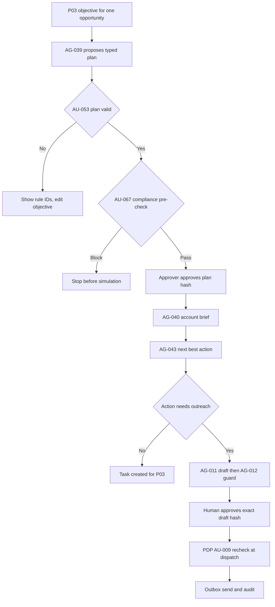
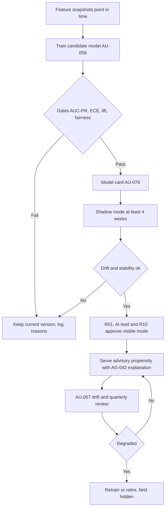
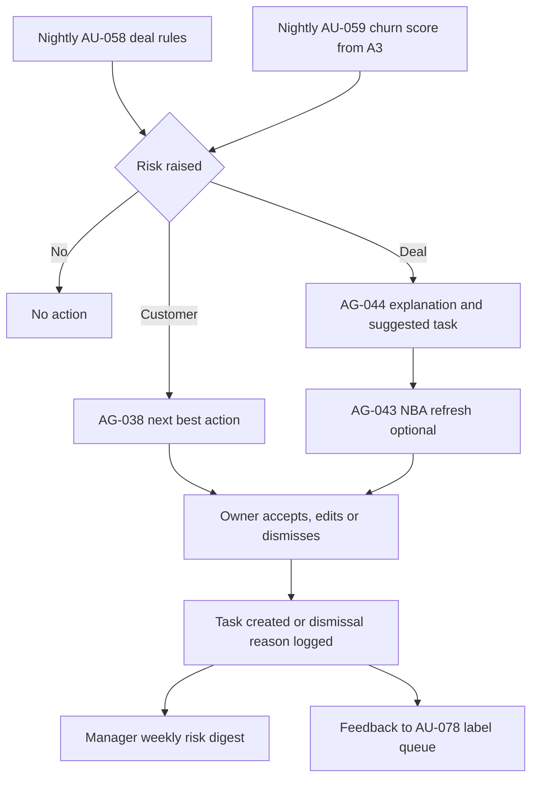
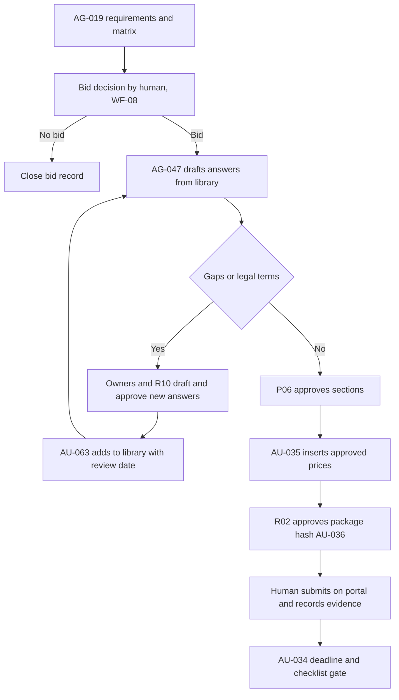
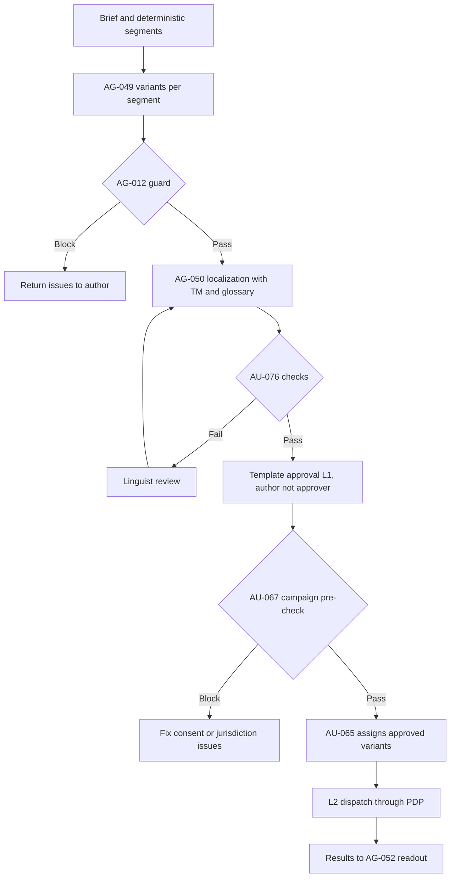
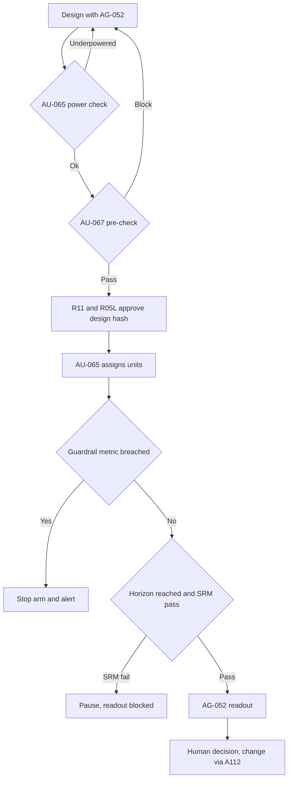
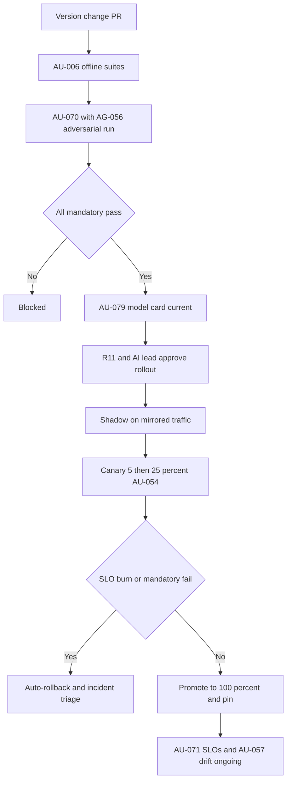
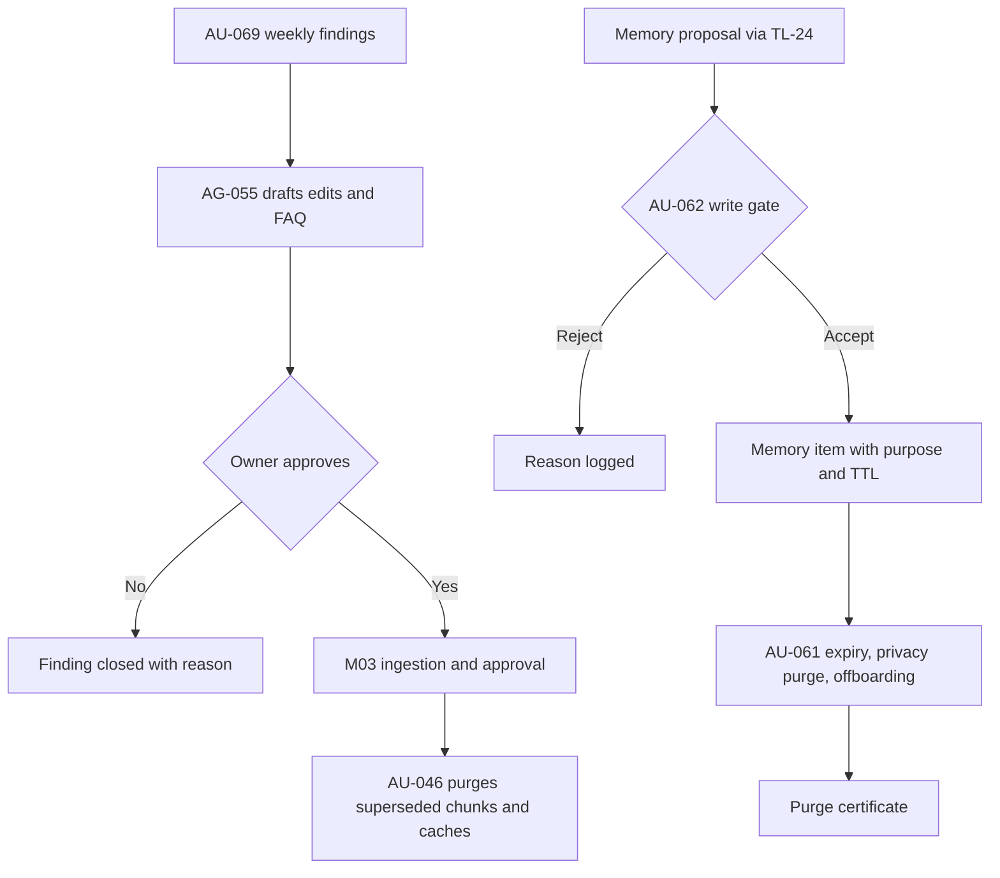
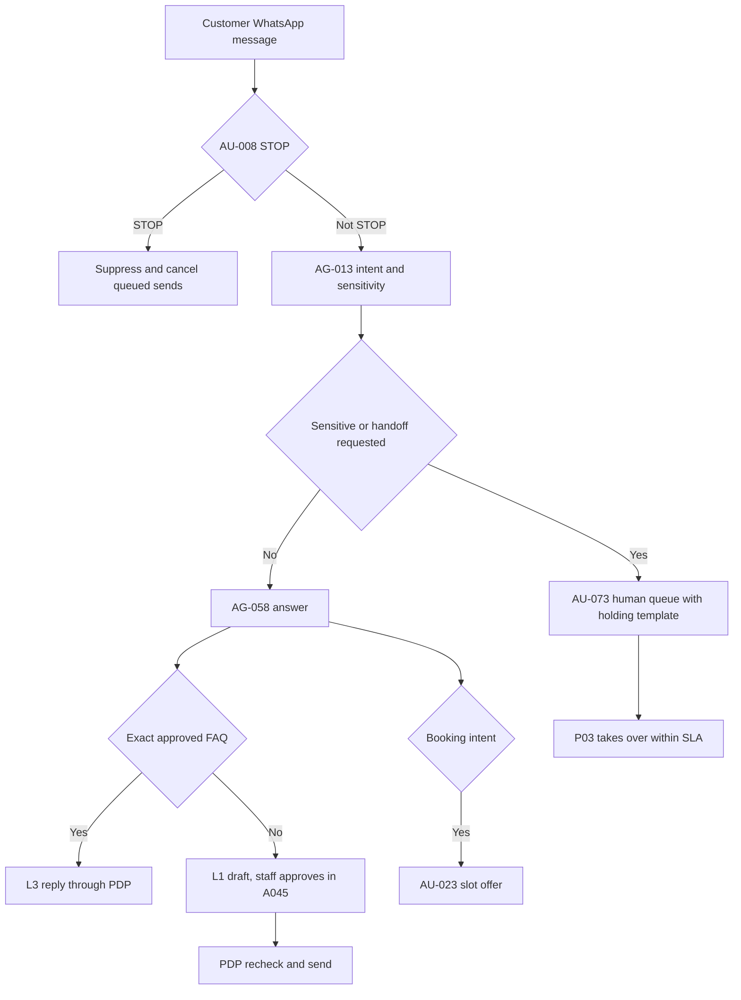

# AI Growth Engine: Employee Sales & Marketing Automation
## Application Blueprint: PART 9 (Batch 9.7b), Advanced AI Agents and Intelligence

| Field | Value |
|---|---|
| Document | Part 9, Batch 9.7b of 9.7a–9.7b (workstream X1). Batch 9.7a holds the expert panel, opportunity inventory, improvement plan, architecture uplift and the 22 agent cards |
| Version | 1.0 · 28 Nov 2026 |
| Baseline | As Batch 9.7a; plus Part 2.2 (workflow format, WF-01…14), Part 2.5 (screen patterns LP-*), Part 3.2 (API catalogue conventions), Part 3.3 (data conventions: UUID PK, tenant_id/startup_id, RLS, revision), Part 6.1/6.4 (test types T03/T08/T14/T17/T19/T20), Part 8.4 (rates and ledgers) |
| Roles applied | Expert panel X1-P1…P5 (§9.7.1), with Product Owner, Data Architect, QA Lead, Security Lead, FinOps Lead |
| Authority | Expert-panel recommendation, Founder instruction 28 Nov 2026. **Separately approvable proposal**; outside DEC-230/231 |
| New IDs in this batch | AU-053…AU-079 · WF-15…WF-23 · FR-ADV-X1-001…064 · US-02-V101, US-03-V101, US-04-V101…V109, US-05-V101…V102, US-06-V101…V102, US-08-V101…V102, US-09-V101, US-10-V101, US-11-V101, US-12-V101…V104, US-13-V101…V102, US-14-V101, US-16-V101, US-17-V101…V104, US-18-V101…V102 (34 stories) · TC-ADV-X1-001…090 · A114–A129 · API-ADV-X1-01…40 · DEC-380…389 · RSK-ADV-X1-01…14 |

**Verification convention.** As Batch 9.7a: every model, price, provider term, open-source licence and regulatory date is "verify at time of implementation (as of 27 Nov 2026)". Costs are estimates with formulas.

---

## 9.7.6 Automations table (AU-053…AU-079)

Automations are deterministic (no LLM). AU-056, AU-059, AU-066 and AU-077 run **classical statistical models** whose outputs are deterministic for a pinned model version and input snapshot (ADR-113); they are registered here, with model cards (AU-079), because they make no LLM call. Control automations (AU-053, AU-054, AU-061, AU-062, AU-072, AU-073) must be running before the agents that depend on them can be enabled (same rule as Part 7.2 §7.2.3).

| ID | Name | Wave / Release | Linked BR / FR / rule | Trigger | Deterministic logic | Outputs | Autonomy | Guardrail | Failure / fallback | KPI | Cost |
|---|---|---|---|---|---|---|---|---|---|---|---|
| AU-053 | Supervisor plan validator and step guard | W6 · A1 | BR-AUTO, BRL-AUT-06; FR-ADV-X1-002, 003; ADR-110 | Plan revision proposed by AG-039 or AG-051; before each step of a supervised run | Rules PV-01…PV-10 (§9.7.4.2): registry enabled and pinned, DAG acyclic, ≤ 12 agent steps, Σ step cost ≤ reservation and ≤ ₹25 default, monotonic data class, guard + checkpoint after customer-facing drafts, minors/clinical exclusion, no W1 tool for untrusted readers, autonomy ≤ approved mode, re-plan ≤ 2; issues per-step capability tokens (ADR-114) | Validation report with rule IDs; capability tokens; plan status `valid`/`rejected` | L3 (deterministic, within policy) | Any rule failure rejects the whole plan; tokens cannot be widened by a step | Validator unavailable → no supervised runs (fail closed); manual templates remain | 0 plans executed without a `valid` report; ≥ 80% first-pass validity | ₹0 model; CPU in existing workers |
| AU-054 | Agent version canary controller and auto-rollback | W6 · A1 | BR-M08, BR-M54; FR-ADV-X1-043, 044; ADR-111; ADR-084 | New agent or prompt version approved for rollout; hourly SLO evaluation | Hash `(tenant_id, object_id)` into buckets; route 5% → 25% → 100% with minimum dwell 48 h / 72 h; compare SLOs (AU-071) of canary vs control; rollback if any SLO burn rate > 2× over 1 h, any mandatory check fails once, or cost per task > 1.5× control | Routing table per agent version; rollout events; rollback record | L3 (deterministic, within policy) | Never canaries a version without a passing AU-006 run; canary share never exceeds the approved stage | Controller failure → freeze at current pin (no promotion) | Regressions contained ≤ 5% traffic; rollback ≤ 5 min | ₹0 |
| AU-055 | Intent fusion score | W6 · A2 | BR-M14, BR-M27; FR-ADV-X1-006 | Signal, inbound intent, engagement or attendance event for an account | intent = Σ wₖ × sₖ × e^(−Δt/τₖ) over component types k (signal, inbound, web, event) with versioned weights and half-lives (default τ: signal 30 d, inbound 14 d, web 7 d, event 21 d); band High/Medium/Low/Unknown; Unknown if < 2 component types present; consented web aggregates only | Intent snapshot with components; `intent_band.changed` event | L3 (deterministic, within policy) | Never grants contact permission (as DEC-011); numeric validation FR-ENH-F-008 | Missing component → recompute without it and mark partial | 100% recompute on trigger; band precision tracked vs owner labels | ₹0 |
| AU-056 | Propensity model training, scoring and calibration (advisory) | W6 · A1 shadow / A2 visible | BR-M17, BR-M60; DEC-011, DEC-211, DEC-383; FR-ADV-X1-008, 010 | Monthly retrain (Batch window); nightly scoring of open opportunities | Point-in-time features from `ml_feature_snapshot` (stage age, activity counts, AU-017 components, intent band, offering, sector, region, source type); LightGBM or regularized logistic regression; isotonic calibration; SHAP contributions stored; gates: AUC-PR > base rate × 1.5, ECE ≤ 0.08, lift@top-decile ≥ 2×, no fairness slice > 10 pp below overall; modes candidate → shadow → visible (R01 + AI lead approval) | Prediction (probability band, interval, contributions, model version) | L2 (scores stored; humans decide) | Never modifies DEC-011 score, band, eligibility or PDP input; Admin-only display; no natural-person features | Gate fails → stays shadow; training failure → previous version continues | ECE ≤ 0.08; lift@decile ≥ 2×; monthly model review 100% | Training ≈ ₹100–300/month compute (CPU, Batch window; verify) |
| AU-057 | Model and agent drift monitor | W6 · A1 | BR-M54, NFR-033; FR-ADV-X1-042; ADR-117 | Daily | PSI per ML feature and score distribution (alert > 0.2); KS test on agent confidence distributions; 7-day trends in abstention, schema-repair, escalation share, accept/edit/reject; fairness slices per §7.6.6 | Drift report; alerts NT-030; A128 tiles | L3 (deterministic, within policy) | Read-only; alerts never auto-disable except via AU-054 rules | Missing data → "insufficient data", not "no drift" | Drift detected ≤ 7 days after onset in replay tests | ₹0 |
| AU-058 | Deal-risk rule pack | W6 · A2 | BR-M21, BR-M60; FR-ADV-X1-013 | Nightly | Rules DR-01 stage age > p75 of won deals for that stage and startup; DR-02 close date moved ≥ 2 times; DR-03 single contact role engaged for > 30 days in proposal stage; DR-04 negative or objection intent unanswered > 5 days; DR-05 proposal sent, no reply 10 days; DR-06 propensity drop ≥ 20 pp (if visible); band = count-weighted | Risk flags with rule IDs; `deal_risk.raised` | L3 (deterministic, within policy) | Flags never change stage or forecast; no individual blame fields | Recompute next night | ≥ 60% flagged deals actioned in 3 days | ₹0 |
| AU-059 | Churn-risk model | Year 2 · A3 | BR-M50, BR-M48; FR-ADV-X1-015 | Monthly retrain; nightly scoring of active customers | Survival or logistic model on usage, ticket categories and severity, payment timeliness, engagement, milestone delays — **no medical data** (BR-M50), institution-level for EduVerse; calibrated; SHAP stored; feeds AG-038 and AU-039 health band as an extra advisory field | Churn probability band with contributions | L2 (scores stored; humans decide) | Gate G-A3 data condition (≥ 12 months, ≥ 100 renewal events); fairness slices | Gate fails → AU-039 rules only | Renewal rate of flagged vs unflagged (KPI-15) | ≈ ₹50–150/month compute |
| AU-060 | Action catalogue eligibility filter | W6 · A2 | BR-M16, BR-M24, BR-M51, BR-M66; FR-ADV-X1-012 | Before every AG-043 call | Candidate actions from the registered catalogue filtered by stage, open tasks, caps, quiet hours, PDP dry-run eligibility (TL-10), relationship state, loss policy (no auto-recontact, CI-086), offering readiness Approved and Available, startup scope | Candidate set (≤ 8 actions, ≤ 3 offerings) with reasons | L3 (deterministic, within policy) | Planned offerings excluded (DEC-060); EduVerse institutions only; MedMaarg no clinical actions | Empty set → AG-043 not called; "no eligible action" | 0 ineligible suggestions | ₹0 |
| AU-061 | Memory consent, retention and purge controller | W6 · A1 | BR-M56, DEC-028, DEC-385; FR-ADV-X1-055, 057; ADR-112 | Daily; privacy request; account deletion; policy change | Enforce `ai_memory_policy` (enabled, fact types, TTL); expire items past `expires_at`; purge on privacy request via AU-011 locator incl. `memory_refs[]` in envelopes; purge on tenant offboarding (WF-14); write purge certificate | Purge certificates; expiry events | L3 (deterministic, within policy) | Policy disabled → reads return empty; legal hold respected | Partial purge → items non-retrievable immediately, retry, alert R10 after 3 failures | 100% items with purpose and TTL; purge ≤ 15 min | ₹0 |
| AU-062 | Memory write gate | W6 · A1 | DEC-385; FR-ADV-X1-056 | Memory proposal from TL-24 | Rules §9.7.4.4: allowlisted fact types, evidence required, special-category lexicon + Presidio + regex block, ≤ 280 chars, natural persons as `contact_id` + role only, minors/clinical block, dedupe by value hash, contradiction → review finding | Accepted item or rejection reason | L3 (deterministic, within policy) | Fails closed; never accepts free-text personal profiles | Gate error → reject | 0 special-category items stored (sampled audit) | ₹0 |
| AU-063 | RFP answer library freshness and expiry | W6 · A1 | BR-S001, BR-S034; FR-ADV-X1-022 | Daily; answer approved or edited; claim expiry (AU-029) | Each answer has owner, evidence, claim IDs, `review_by` (default 180 days); expire on claim expiry or `review_by`; notify owner at 30/7/1 days; block retrieval of expired answers; usage counter per bid | Answer status; NT notifications | L3 (deterministic, within policy) | Expired answers never retrieved (TL-26 filter) | Scan failure → all answers past `review_by` treated as expired | 0 expired answers used | ₹0 |
| AU-064 | Budget pacing calculator | W6 · A2 | BR-M38, BR-M39; FR-ADV-X1-030 | Hourly from spend events | pacing index = actual spend ÷ planned spend to date; projected end-of-flight spend = actual + daily run-rate × days left; alert at index < 0.8 or > 1.2; never changes bids or budgets | Pacing snapshot; alert | L3 (deterministic, within policy) | Read-only; AU-032 cap and anomaly pause unchanged | Missing spend data → "unknown" | Pacing visible ≤ 1 h lag | ₹0 |
| AU-065 | Experiment allocator and statistics engine | W6 · A2 | BR-M54, BR-S090; FR-ADV-X1-032, 033; ADR-118 | Experiment start; each eligible exposure; daily analysis | Deterministic assignment hash(experiment_id, unit_id); sample size for two-proportion test (α 0.05, power 0.8, MDE set by owner); SRM χ² check (p < 0.001 → invalid); fixed-horizon analysis with 95% CI; optional Thompson sampling over **pre-approved** variants with 10% floor per arm; guardrail metrics (complaint rate, unsubscribe rate, KPI-18) stop the arm at threshold | Assignments; results; stop events | L3 (deterministic, within policy) | Arms never change eligibility, consent or caps; holdouts respected; only approved variants | SRM or data gap → experiment paused, readout blocked | 100% readouts SRM-checked; 0 guardrail breaches beyond threshold | ₹0 |
| AU-066 | Marketing-mix model run | Year 2 · A3 | BR-M52; FR-ADV-X1-035 | Quarterly | Bayesian regression of weekly outcomes on channel spend with adstock and saturation, seasonality and controls; priors versioned; posterior predictive checks; results as credible intervals | MMM run record with intervals | L3 (deterministic, within policy) | Estimates labelled and never mixed with verified revenue (BR-M52) | Diagnostics fail → result withheld | Runs quarterly with diagnostics pass | ≈ ₹50–200 per run compute |
| AU-067 | Compliance pre-check for plans and campaigns | W6 · A1 | BR-M04, BR-M24, BR-M57; DEC-029, DEC-030; FR-ADV-X1-053 | Before simulation of any plan, campaign, experiment or supervised run with outreach | Checks: purpose and privacy-notice revision cover the processing; consent basis per recipient class and channel; jurisdiction rule pack (DEC-029) for target countries; minors and clinical exclusions; claims cited are approved and unexpired; quiet hours and caps feasible; sender identity verified | Pre-check report (pass, warn, block) with rule IDs | L3 (deterministic, within policy) | Block stops simulation; PDP still rechecks at dispatch (defence in depth) | Rule pack missing for a jurisdiction → block (fail closed) | PDP denials at dispatch −50% vs baseline (fewer late surprises) | ₹0 |
| AU-068 | Gateway cost optimizer | W6 · A1 | BR-M53, DEC-008; OKPI-21; FR-ADV-X1-054 | Weekly | From the cost ledger and eval results: cache-miss hot spots (same prefix, low hit rate), prompts > p95 size for their agent, sync calls eligible for Batch, Sonnet-routed tasks where the Haiku eval meets thresholds, Tier 0 candidates (repeated identical answers); estimate ₹ saving with formula | Change proposals (never applied) to A112 / prompt registry | L3 (deterministic, within policy) | Proposals require AU-006 eval and R11 approval; never lowers a guardrail | Missing data → no proposal | ≥ 10% saving identified per quarter at equal quality [ASSUMPTION-604] | ₹0 |
| AU-069 | RAG freshness and coverage monitor | W6 · A1 | BR-M03, BR-M54; FR-ADV-X1-039 | Weekly; on document version change | Stale: chunk age > source freshness SLA or referencing superseded price/offering versions; conflict: same entity attribute with different values across approved chunks; duplicate: cosine ≥ 0.97 within namespace; gap: abstention/retrieval-miss clusters (HDBSCAN on redacted query embeddings) with ≥ 5 members; embedding-version skew | Findings for AG-055; KB health score per startup | L3 (deterministic, within policy) | Read-only; queries redacted (AU-004) before clustering | Job failure → previous report with age badge | Weekly report 100%; findings resolved trend | ≈ ₹0–100 compute |
| AU-070 | Golden-set and red-team scheduler | W6 · A1 | BR-M54, NFR-033; FR-ADV-X1-041 | Nightly (changed agents), weekly (all), on incident | Schedules AU-006 suites, AG-056 mutation runs and Tier 2 model resistance runs in the eval sandbox; compares with baseline (dataset hash pinned) | Eval runs; regression alerts | L3 (deterministic, within policy) | Sandbox credentials only; no production side effects | Scheduler failure → alert; next run catches up once (AU-028 pattern) | Weekly coverage 100% of enabled agents | Token cost in AG-056 (B23) |
| AU-071 | Agent observability and AI SLO tracker | W6 · A1 | BR-M58; OKPI-13, OKPI-14, KPI-21; FR-ADV-X1-059, 060; ADR-115 | Continuous from spans and metrics | Per agent version SLOs (schema-valid ≥ 99.5%, groundedness ≥ 95% on sample, p95 latency, cost per task); 28-day error budget; multi-window burn-rate alerts (1 h and 6 h) | SLO status; burn alerts; inputs to AU-054 | L3 (deterministic, within policy) | Read-only | Telemetry gap → "unknown" status and alert | 100% enabled agents with SLOs | Within B22 Langfuse hosting |
| AU-072 | Command registry and RBAC resolver | W6 · A2 | BR-M01, BR-S124; DEC-035, DEC-055; FR-ADV-X1-046 | Each AG-057 output | Command ID → required permission set, scope rule (single startup for mutations), object-level check via existing permission classes; deny returns reason | Allow/deny; prefilled form or navigation target | L3 (deterministic, within policy) | Approvals, sends, configuration and role changes are not registered commands | Resolver error → deny | 0 unauthorized commands (penetration test) | ₹0 |
| AU-073 | WhatsApp service-window and handoff router | W6 · A2 | BR-M31, BR-M41; FR-ADV-X1-048 | Each concierge inbound and outbound | Service-window timer from last customer message (24 h, verify Meta policy); outside window only approved templates; handoff triggers (keywords, AG-013 labels urgent/clinical/complaint/legal/minor, user request, 2 consecutive low-confidence turns) → human queue with SLA; holding message template | Routing decision; handoff task; SLA timer | L3 (deterministic, within policy) | STOP (AU-008) always first; no free-form outside window | Router error → human queue | Handoff SLA ≥ 95%; 0 out-of-window free-form sends | ₹0 (conversation charges in §9.7.14) |
| AU-074 | Data-quality rules and dedupe blocking | W6 · A1 | BR-M13; OPT-11-02, OPT-11-03; FR-ADV-X1-052 | Nightly; on organization create/update | Normalize names (legal suffixes, case, punctuation), domains, phone/address formats; blocking keys (domain root, normalized name trigram, city); Jaro-Winkler and token-set similarity; candidate pair if score ≥ 0.85 and same tenant and startup; mandatory-field completeness score | Candidate pairs; completeness report | L3 (deterministic, within policy) | Never merges; cross-startup pairs never created | Job failure → retry next night | Duplicate rate ≤ 2%; completeness trend | ₹0 |
| AU-075 | Meeting-prep scheduler | W6 · A2 | BR-M29; FR-ADV-X1-050 | Hourly | Select meetings 24–36 h ahead linked to an in-scope account with opportunity band ≥ 50 or an open bid; skip if brief exists and evidence unchanged; respect B24 ladder | AG-059 jobs | L3 (deterministic, within policy) | EduVerse institution meetings only; no minors | Skip and log | 100% eligible meetings briefed on time | ₹0 |
| AU-076 | Translation memory and glossary enforcer | W6 · A2 | DEC-026; FR-ADV-X1-028 | Each AG-050 output; TM update on approval | Exact TM match → Tier 0 reuse; glossary term enforcement (source term → required target term); placeholder count and order equality; length limits per channel; script check (Devanagari, Tamil, Odia, etc.); back-translation similarity threshold | Pass/fail with reasons; TM units on approval | L3 (deterministic, within policy) | Failed checks block approval | Enforcer error → block | Glossary adherence ≥ 98%; 0 broken placeholders | ₹0 |
| AU-077 | Send-time window optimizer (statistical) | Year 2 · A3 | BR-M28; Part 7.1 CI-035; FR-ADV-X1-064 | Weekly recompute | Per segment and channel, empirical reply-time histogram with Bayesian smoothing toward the startup mean; choose the best 2-hour window **inside** quiet-hour policy; validated by AU-065 holdout | Recommended send windows per segment | L3 (deterministic, within policy) | Never outside quiet hours or caps; segment-level only, no individual profiling | Data condition not met (≥ 6 months, ≥ 2,000 replies) → default windows | Reply-rate lift vs holdout (measured) | ₹0 |
| AU-078 | Human feedback capture and label queue | W6 · A1 | BR-M54; FR-A084; API-149; FR-ADV-X1-063 | Each accept/edit/reject on an AI output | Store diff and reason; sample stratified items into a labelling queue (A128) with redaction; reviewer labels → candidate eval items; promotion to an eval set only with R10 + AI lead approval and new dataset hash | Label candidates; dataset change records | L3 (deterministic, within policy) | No cross-tenant use (FR-ENH-F-006); redacted only | Queue overflow → sampling rate reduced | Eval sets grow ≥ 50 reviewed items per agent per quarter | ₹0 |
| AU-079 | AI system inventory and model-card sync | W6 · A1 | BR-M08; EU AI Act, NIST AI RMF mapping; FR-ADV-X1-062 | On any agent, prompt, model or ML version change; monthly review reminder | Maintain one inventory row per agent/automation-with-model and version: intended purpose, risk class (§9.7.12.1), data classes, autonomy cap, model tier, eval run IDs, fairness results, known limitations, oversight design, owner, kill-switch scope; block enablement if the model card is incomplete | Inventory rows; model cards (A129); export for auditors (R15) | L3 (deterministic, within policy) | Enablement blocked without a complete card | Sync failure → enablement blocked | 100% enabled items with current card | ₹0 |

---

## 9.7.7 Workflows (WF-15…WF-23)

All workflows run on the universal execution engine (Part 2.2 §2.6): plan-time check, simulation, transactional outbox, dispatch-time PDP recheck, emergency stop and reconciliation. None introduces a new external side effect type.

### WF-15 Supervised multi-agent account pursuit

**Purpose:** Pursue a qualified account through research, brief, next action and first-touch draft as one supervised plan, with every approval of the baseline preserved (ADR-110; BR-AUTO; DEC-064).

**Actors:** P03 Growth manager (requester), R02/R03L approver, AG-039, AU-053, AG-040, AG-043, AG-011, AG-012, AU-067, PDP AU-009.

**Screens:** A114, A116, A119, A034, A035, A110.

| Step | Actor | Action | Control |
|---|---|---|---|
| 1 | P03 | Submits objective "pursue account" for one opportunity (band ≥ 50) | Single startup scope; R0/W1 only |
| 2 | AG-039 | Proposes plan: AG-040 brief → AG-043 NBA → (if action = outreach) AG-011 draft → AG-012 guard → checkpoint | PC-19 |
| 3 | AU-053 | Validates PV-01…10; issues capability tokens | Reject → user edits objective |
| 4 | AU-067 | Compliance pre-check for any outreach step | Block → plan stops before simulation |
| 5 | Approver | Approves exact plan hash (L1) | CFG-27 |
| 6 | Engine | Runs steps; envelopes v3 on blackboard; caps enforced | BRL-AUT-06; kill switch |
| 7 | P03 / approver | Approves the draft's exact hash | DEC-064 L1 |
| 8 | Engine + PDP | Dispatch with recheck of consent, scope, budget, hash | AU-009 |
| 9 | AU-071 | Records spans, cost, SLOs; outcome to AU-078 | Audit |

### WF-16 Predictive model lifecycle

**Purpose:** Train, validate, shadow, approve, serve, monitor and retire advisory ML models (AU-056, AU-059, AU-066) without ever changing DEC-011 scoring or any eligibility decision (ADR-113; DEC-383).

**Actors:** AI lead, Data steward (P04 research lead), R01 Founder (visible-mode approval), R10 (fairness sign-off), AU-056, AU-057, AU-079, AG-042.

**Screens:** A118, A128, A129, A022.

| Step | Actor | Action | Control |
|---|---|---|---|
| 1 | AU-056 | Builds point-in-time feature snapshots; trains candidate monthly | No natural-person features; RLS |
| 2 | AU-056 | Computes AUC-PR, ECE, lift, slices; backtest by quarter | Gates §9.7.6 |
| 3 | AU-079 | Generates model card draft | Enablement blocked until complete |
| 4 | AI lead | Promotes to shadow | Predictions stored, not shown |
| 5 | AU-057 | Monitors shadow drift and stability ≥ 4 weeks | PSI ≤ 0.2 |
| 6 | R01 + AI lead + R10 | Approve visible mode | DEC-383 |
| 7 | AG-042 | Explanations shown in A022/A119 | L0 |
| 8 | AU-057 | Ongoing drift; retrain or retire | Retire → AG-042 off, field hidden |

### WF-17 Deal-risk and churn early warning

**Purpose:** Nightly detect at-risk open deals (AU-058, AG-044) and, from A3, at-risk customers (AU-059 feeding AG-038), and turn each into an owner task with reasons, so intervention happens before the forecast or renewal date (BR-M21, BR-M50, BR-M60).

**Actors:** AU-058, AU-059, AG-044, AG-038, AG-043, P03 owner, P02 manager.

**Screens:** A120, A119, A087, A079.

| Step | Actor | Action | Control |
|---|---|---|---|
| 1 | AU-058 / AU-059 | Nightly rules and churn scoring | No medical data; institution-level EduVerse |
| 2 | AG-044 / AG-038 | Explain and suggest one task | L0; VP-01 |
| 3 | AG-043 | Optional NBA refresh for the flagged deal | AU-060 candidates only |
| 4 | P03 | Accepts, edits or dismisses (reason) | Feedback to AU-078 |
| 5 | P02 | Weekly risk digest | Team scope only |

### WF-18 RFP response co-pilot (AppNAI)

**Purpose:** Answer RFP requirements from the approved answer library with citations and gaps, inside WF-08, keeping bid/no-bid, pricing and submission human (BR-S001, DEC-053, DEC-064).

**Actors:** P06 Bid manager, answer owners (subject experts), R02 Startup head, R10 (legal terms), AG-019, AG-047, AU-063, AU-034, AU-035.

**Screens:** A104, A123, A065, A066.

| Step | Actor | Action | Control |
|---|---|---|---|
| 1 | AG-019 | Extracts requirements and compliance matrix (existing) | L1 checklist |
| 2 | P06 | Bid decision recorded (existing WF-08) | L0 brief, human decision |
| 3 | AG-047 | Drafts answers per requirement with answer IDs, confidence, gaps | Expired answers excluded (AU-063) |
| 4 | Owners | Fill gaps; approve new answers into the library | Owner + R10 for legal |
| 5 | P06 | Approves each response section | L1 |
| 6 | AU-035 | Inserts prices from approved price versions | DEC-038 thresholds |
| 7 | R02 | Approves final package hash | AU-036 hash |
| 8 | P06 | Submits on the portal **manually** and records evidence | DEC-053; AU-034 deadline guard |

### WF-19 Localized personalization at scale

**Purpose:** From a campaign brief and deterministic segments, generate guarded variants, localize them with TM and glossary, approve them as templates and test them, so personalized multilingual outreach scales under DEC-064 (BR-M25, BR-M34, BR-M38; DEC-026).

**Actors:** P05 Marketing specialist, R05L Marketing lead, R10, linguist reviewer, AG-049, AG-050, AG-012, AU-076, AU-065, AU-067.

**Screens:** A056, A124, A035, A125.

| Step | Actor | Action | Control |
|---|---|---|---|
| 1 | P05 | Brief + segments (M38 deterministic) | No LLM audience selection (CI-063) |
| 2 | AG-049 | Variants per segment | AG-012 guard |
| 3 | AG-050 | Localized versions | AU-076 checks |
| 4 | R05L, R10, linguist | Approve templates (author ≠ approver) | L1 |
| 5 | AU-067 | Campaign pre-check | Block stops |
| 6 | AU-065 | Assigns variants (A/B or bandit across approved variants) | Guardrail metrics |
| 7 | Engine + PDP | L2 dispatch of approved templates | DEC-064 |

### WF-20 Experiment lifecycle

**Purpose:** Pre-register, approve, run, monitor and read out experiments on messages, sequences, content, agent versions and NBA policies, so lift claims rest on valid statistics (ADR-118; BR-S090).

**Actors:** P05 / P10 / AI lead (designer), R11 + R05L (approvers), R10 (pre-check owner), AG-052, AU-065, AU-067.

**Screens:** A125, A110, A084.

| Step | Actor | Action | Control |
|---|---|---|---|
| 1 | Designer + AG-052 | Hypothesis, metrics, MDE, unit | PC-32 |
| 2 | AU-065 | Sample size and duration | Underpowered → redesign |
| 3 | AU-067 | Consent, eligibility and claims pre-check | Arms never alter eligibility |
| 4 | R11 + R05L | Approve design hash | L1 |
| 5 | AU-065 | Assign, monitor guardrails, SRM | Auto-stop on guardrail breach |
| 6 | AG-052 | Readout at horizon | L0 |
| 7 | Owner | Decide adopt / reject / iterate | Human decision; change goes through A112 |

### WF-21 Agent release, canary and red-team

**Purpose:** Release any new agent, prompt, model or ML version through offline evals, red-team, shadow and staged canary with automatic rollback, and keep it under continuous adversarial and drift monitoring (ADR-111, ADR-117; BR-M54; OKPI-16).

**Actors:** AI lead, R11, R10, D04 QA, AU-006, AU-070, AG-056, AU-054, AU-071, AU-057, AU-079.

**Screens:** A115, A128, A129, A011, A084.

| Step | Actor | Action | Control |
|---|---|---|---|
| 1 | Developer | PR with version change | AU-013, AU-047 |
| 2 | AU-006 + AU-070 + AG-056 | Offline + adversarial suites | OKPI-16 mandatory 100% |
| 3 | AU-079 | Model card updated | Block if incomplete |
| 4 | R11 + AI lead | Approve rollout | A115 |
| 5 | AU-054 | Shadow, then 5% → 25% → 100% | SLO burn rollback |
| 6 | AU-071 / AU-057 | SLO and drift monitoring | Alerts NT-030 |
| 7 | AI lead | Incident triage if needed | §9.7.12.4 |

### WF-22 Knowledge freshness and memory governance

**Purpose:** Keep RAG knowledge current, consistent and complete (AU-069, AG-055) and keep long-term memory lawful (AU-061, AU-062), with all edits through the M03 approval pipeline and all memory under purpose, TTL and erasure (BR-M03, BR-M56; DEC-385).

**Actors:** AU-069, AG-055, knowledge owners (P05, P09), R10, AU-061, AU-062, AU-046, AU-011.

**Screens:** A127, A006, A013.

| Step | Actor | Action | Control |
|---|---|---|---|
| 1 | AU-069 | Weekly stale/conflict/duplicate/gap findings | Redacted queries |
| 2 | AG-055 | Draft edits or FAQ entries | L1 |
| 3 | Owners / R10 | Approve; M03 ingestion; AU-046 purges superseded chunks | Approved only |
| 4 | AU-062 | Gate memory proposals | Allowlist and evidence |
| 5 | AU-061 | Expire, purge on request, certificates | ≤ 15 min |

### WF-23 WhatsApp concierge with human handoff

**Purpose:** Answer customer-initiated WhatsApp conversations within the service window from approved knowledge, offer meeting slots, and hand off to a human for sensitive topics or on request (BR-M31, BR-M41; DEC-030, DEC-064).

**Actors:** P14/P15 customer, AU-008, AG-013, AU-073, AG-058, AU-023, P03 owner (handoff).

**Screens:** A045, A044, A046, A037.

| Step | Actor | Action | Control |
|---|---|---|---|
| 1 | AU-008 | STOP handling first | Ambiguous = STOP |
| 2 | AG-013 | Intent and sensitivity labels | Urgent/clinical/minor → handoff |
| 3 | AU-073 | Window and handoff routing | 24 h window (verify) |
| 4 | AG-058 | Answer from FAQ (L3) or draft (L1) | VP-01/03/04 |
| 5 | AU-023 | Slot offer if booking intent | No invented availability |
| 6 | P03 | Takes over on handoff within SLA | Holding template |
| 7 | PDP | Recheck at every send | AU-009 |

