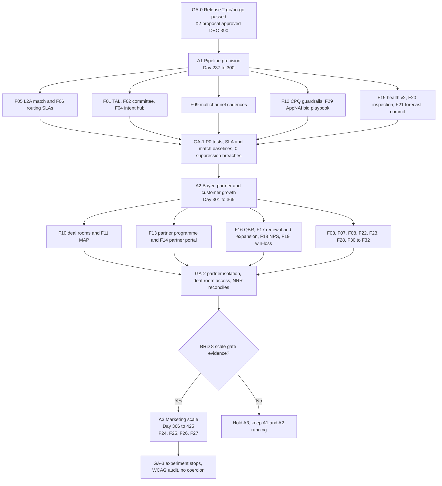
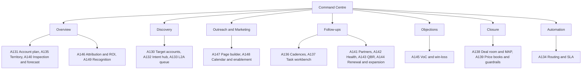
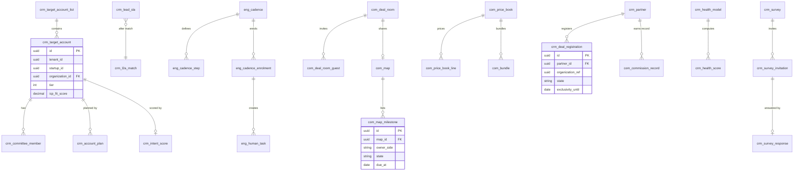

# AI Growth Engine: Employee Sales & Marketing Automation
## Application Blueprint: PART 9 (Batch 9.8), Advanced Revenue Growth Capabilities

> **Erratum v1.2 (E-V-02, E-V-21):** superseded by payments and bid submission allowed only under a bounded mandate; AI still never signs contracts or sets prices autonomously (DEC-779/780/781); automatic bid submission allowed under a per-tender bounded mandate (DEC-781). See Part 11.23c.

| Field | Value |
|---|---|
| Document | Part 9, Batch 8, file **a of b** (§9.8.1–§9.8.4: expert panel, opportunity inventory, improvement plan, feature specifications). File b (`Part-09-8b_Advanced_Revenue_Growth_Capabilities.md`) holds §9.8.5–§9.8.17: agent cards, automations, workflows, FRs, stories, tests, KPIs, effort, cost, decisions, risks, tags and quality gate |
| Version | 1.0 · 27 Nov 2026 |
| Baseline | Parts 0–9.5 (61 part files), Part 8.4 (Ledgers A and B, DEC-229…231), Part 9.4 catalogue (AG-001…038, AU-001…052, WF-01…14), Part 2.6 (FR-ENH-A, BRL-ENH-A, AOP, SPB, experiment registry), source-pack documents 11, 12, 13, 14 and 37 (cited as SP-11…SP-37, as in Part 2.6) |
| Workstream | **X2 advanced revenue growth** (V11 brief). ID ranges used: DEC-390…399 · tags 650…699 · ADR-120…129 · AG-061…070 · AU-080…099 · WF-25…32 · FR-ADV-X2-### · US-&lt;EP&gt;-V2&lt;nn&gt; · TC-ADV-X2-### · BRL-ADV-X2-## · screens A130–A149 and W35–W44. Local families (not in any other range): KPI-ADV-X2-## · RP-ADV-X2-## · NT-ADV-X2-## · NX-ADV-X2-## · CFG-ADV-X2-## · RSK-ADV-X2-## · TL-X2-## · ADV-X2-F## (features) · ADV-X2-O## (opportunities) |
| Roles applied | Expert panel (§9.8.1): Chief Revenue Officer, Revenue Operations leader, Growth/Demand-Generation marketer, Sales Engineering and proposal lead, Customer Success and expansion leader, Partnerships/channel lead. Supporting: Product Owner, Business Systems Analyst, Solutions Architect, Data Architect, Lead UX Designer, QA Lead, Security/Compliance/AI Governance Lead, FinOps Lead |
| Status of the content | **Separately approvable proposal.** Nothing here changes the approved Release 1/Release 2 scope, the approved budgets (Ledger A DEC-230, Ledger B DEC-231), the Phase-2 envelope (₹25.8–38.7 lakh) or any binding decision. Cost is in §9.8.13 (file b), outside the approved figures |

**How to read this part.** §9.8.1 names the six expert personas and the specific gaps each found in the current functional design, with FR, module and screen IDs. §9.8.2 turns the gaps into an opportunity inventory (ADV-X2-O01…O32) with MoSCoW and the reason each is not already covered. §9.8.3 is the improvement plan (releases A1, A2, A3 inside and after W6). §9.8.4 specifies the 32 features (ADV-X2-F01…F32) at build depth, with a consolidated rule register BRL-ADV-X2-01…44. File b specifies the 10 agents (AG-061…070), 20 automations (AU-080…099), 8 workflows (WF-25…32), 96 functional requirements, 32 user stories, 104 test cases, 20 KPIs, effort, cost, decisions, risks and the tag register.

**Acronyms used in this part.** ABM account-based marketing · ARR annual recurring revenue · CPQ configure, price, quote · CSAT customer satisfaction score · GRR gross revenue retention · ICP ideal customer profile · L2A lead-to-account · MAP mutual action plan · NPS Net Promoter Score (a 0–10 "likelihood to recommend" survey) · NRR net revenue retention · QBR quarterly business review · RevOps revenue operations · SLA service-level agreement · TAL target account list · VoC voice of the customer.

**Safety invariants carried into every capability (V11 brief; DEC-007, DEC-030, DEC-053, DEC-055, DEC-064).** AI drafts, classifies, extracts, matches and summarizes only. It never signs, pays, submits bids, sets prices or sends a consequential external action without a human. Consequential actions stay at autonomy **L1**. The deterministic Policy Decision Point (PDP, AU-009) rechecks scope, consent, jurisdiction, budget and approval hash at dispatch. Model gateway Tiers 0/1a/1b/2/3 apply, and **no personal or restricted data reaches Tier 2**. Tenant and startup isolation (RLS), Website/Admin separation, open-source first, fail-closed, evidence-based acceptance, **no outreach to minors (EduVerse)** and **no patient data (MedMaarg)** hold for every feature below. The portfolio scope is read-only (DEC-055).

---

## 9.8.1 Expert panel

The panel reviewed the baseline (Parts 1, 2.1, 2.2, 2.5, 2.6, 7.2, 7.4, 8.4, 9.4) and the source pack (SP-11, SP-12, SP-13, SP-14, SP-37). Each persona below lists expertise, the lens used for the review and the specific gaps found. A gap is something a revenue team of this kind would normally need that the current functional design does not specify, or specifies only partly. Gaps are not defects in earlier parts: the earlier parts were scoped to the BRD; this part proposes advanced extensions.

### 9.8.1.1 EXP-1 Chief Revenue Officer (CRO)

| Item | Detail |
|---|---|
| Expertise | Owns the number across sales, marketing, success and partners; forecast calls with the board; pipeline generation and conversion economics; go-to-market (GTM) segmentation by vertical |
| Lens | "Can the Founder (P01) and each Startup Head (P02) commit a forecast with evidence, see where pipeline will come from, and know which accounts matter most?" |
| Baseline strengths | Verified closure (DEC-054, KPI-31); stage-weighted forecast labelled as estimate (FR-A087, FR-A088, AU-041, KPI-29); growth and management dashboards (FR-A042, FR-A043); acquisition operating plan and weekly acquisition review (FR-ENH-A-010, FR-ENH-A-012) |

| Gap ID | Gap found in the current design | Evidence (IDs) |
|---|---|---|
| G-CRO-1 | Forecast is a single stage-weighted number. There are **no commit categories** (pipeline, best case, commit), no owner and manager call, no week-over-week snapshot of the call, and no record of who changed what | FR-A087, FR-A088, AU-041 (M60); screen A087 |
| G-CRO-2 | **No pipeline inspection** workflow: the board (A029) shows stages, but there are no deterministic risk flags (no next step, close date in the past, stage age, single-threaded deal) and no inspection checklist for the weekly review | FR-A029, FR-A030; A029, A043 |
| G-CRO-3 | **No account-based view.** Organizations are discovered and scored one opportunity at a time (A018, A022). There is no target account list, no tiering by strategic value and no account plan that groups opportunities, contacts and plays | FR-A018, FR-A022, FR-A027 (M13, M17); A018, A022 |
| G-CRO-4 | Win/loss is captured as a reason code and a monthly theme report; there is **no structured win/loss programme** (interviews, competitor mentions, actions closed) | FR-A081, AG-026 (M51); A081 |
| G-CRO-5 | Management dashboard has a "capacity" field but **no territory or quota model**, so pipeline coverage cannot be computed per owner | FR-A043 (M30); A043 |

### 9.8.1.2 EXP-2 Revenue Operations leader

| Item | Detail |
|---|---|
| Expertise | Funnel definitions, routing and assignment, speed-to-lead, data hygiene, territory and capacity design, attribution, systems of record |
| Lens | "Does every lead reach the right owner fast, attached to the right account, and does every number have one definition?" |
| Baseline strengths | Versioned KPI definitions (FR-A083); pipeline and assignment rules (FR-A030); lead dedupe and form routing (AU-020); organization canonical upsert (AU-015); relationship ID and derived stage (FR-ENH-A-016, DEC-214); stage-pair conversion (KPI-ENH-A-02) |

| Gap ID | Gap found | Evidence (IDs) |
|---|---|---|
| G-OPS-1 | **No lead-to-account matching** for inbound leads. AU-020 dedupes submissions and AU-015 merges discovered organizations, but an inbound lead from `name@hospital.example` is not matched to an existing account with confidence bands and a review queue | AU-015, AU-020 (M13, M22); A018, A031 |
| G-OPS-2 | **No speed-to-lead SLA** for inbound demo/quote requests. AU-019 has SLA timers for research review only; NT-012 covers meeting outcomes; there is no per-lead response clock, breach escalation or SLA report | AU-019, AU-027 (M20, M22); A031, A106 |
| G-OPS-3 | Assignment rules are round-robin or owner-based (AU-019, FR-A030). There is **no territory model** (geography × segment × vertical), no capacity weighting and no versioned rebalancing with simulation | FR-A030; A030 |
| G-OPS-4 | Attribution is **last non-direct touch** with "alternative models with caveat" not specified (AU-040); SP-12 asks for first- and last-touch with window and an unknown bucket; there is no position-based or time-decay option and no campaign ROI | AU-040, FR-A082 (M52); A082; SP-12 §Inbound marketing acquisition |
| G-OPS-5 | **No pipeline hygiene automation** (stale stages, missing amount or close date, owner without grant) beyond invalid-transition rejection | FR-A029, BRL state machines (Part 2.3) |

### 9.8.1.3 EXP-3 Growth / Demand-Generation marketer (ABM, lifecycle, SEO/content)

| Item | Detail |
|---|---|
| Expertise | Account-based marketing, lifecycle nurture, landing-page conversion, experimentation, SEO and editorial calendars, events and webinars |
| Lens | "Can marketing target the right accounts, run safe experiments on pages and messages, and prove which programmes produce verified revenue?" |
| Baseline strengths | Content studio and claims approval (FR-A050, FR-A051); landing pages with approvals (FR-A056, FR-A057); campaigns with budgets (FR-A058, FR-A059); experiment registry with stop triggers (FR-ENH-A-011, BRL-ENH-A-13); SEO dashboard and backlog (FR-A054, FR-A055); events with reminders (FR-A062, FR-A063, AU-051) |

| Gap ID | Gap found | Evidence (IDs) |
|---|---|---|
| G-GRO-1 | **No intent and signal hub.** Buying signals (A019) are evidence-based public signals; first-party engagement (consented site visits, content downloads, event attendance, portal activity) is not fused per account, decayed or surfaced as "why now" | FR-A019, AG-005 (M14); FR-A108 analytics; A019 |
| G-GRO-2 | Landing page builder creates a draft page with fields (FR-A056) but has **no reusable approved block library, no form builder with progressive profiling and no variant hosting** wired to the experiment registry | FR-A056, FR-A057, FR-ENH-A-011; A056, A057, W10 |
| G-GRO-3 | SEO is an audit and a backlog; there is **no editorial/SEO content calendar** that links keyword themes, briefs, claims approval and publication dates | FR-A054, FR-A055, AU-033 (M36); A054, A055 |
| G-GRO-4 | Events cover registration, capacity and reminders; there is **no event programme view** (series, on-demand content, post-event follow-up plays, sourced pipeline) | FR-A062, FR-A063, AU-051 (M40); A062, W19 |
| G-GRO-5 | Campaigns have budgets and caps but **no ROI**: campaign cost is not joined to attributed verified revenue and margin | FR-A058–A061, AU-032, AU-040; A058, A082 |
| G-GRO-6 | Sequences are single-channel follow-ups (FR-A038, AU-022). There is **no multichannel cadence** that mixes email, approved WhatsApp templates, LinkedIn research or message tasks done by a human, and call tasks, under one consent and frequency budget | FR-A038, FR-A039, AU-022 (M28); A038, A039 |

### 9.8.1.4 EXP-4 Sales Engineering and proposal lead (RFP/bids)

| Item | Detail |
|---|---|
| Expertise | Solution design, RFP and tender response, pricing configuration, buyer enablement, demos |
| Lens | "Can a seller build a correct quote inside approved price books in minutes, and can the buyer's committee see one shared plan to a decision?" |
| Baseline strengths | Bid desk with deadline guard and human submission (FR-A104, AU-034, AU-052, DEC-053); RFP analyzer and response drafter (AG-019, AG-020); proposal and quote builders with Decimal totals and approval routing (FR-A065–A068, AU-035, DEC-038); portal quote and agreement review (W23, W24) |

| Gap ID | Gap found | Evidence (IDs) |
|---|---|---|
| G-SE-1 | Quotes reference a price-list revision (FR-A067) but there is **no price book and bundle configuration** (product rules, required/excluded options, quantity breaks, regional price books) and no guided selling; guardrails are only the DEC-038 discount bands | FR-A067, FR-A068, AU-035 (M44); A067, A068 |
| G-SE-2 | **No deal room or mutual action plan.** The buyer sees individual documents (W23, W24) but no shared space with agenda, approved collateral, stakeholders, milestones and owners on both sides | W22–W24; FR-A065, FR-A071 (M43, M46) |
| G-SE-3 | **No enablement content hub.** Approved content exists (FR-A050, FR-A051) but sellers have no stage- and persona-indexed library, battle cards from approved claims, or usage-to-outcome analytics | FR-A050, FR-A051 (M34) |
| G-SE-4 | AppNAI bid route (WF-08) has bid/no-bid but **no weighted bid qualification matrix, reusable answer library or capacity check** across concurrent bids | WF-08, FR-A104, AG-019 |

### 9.8.1.5 EXP-5 Customer Success and expansion leader (health, churn, NRR)

| Item | Detail |
|---|---|
| Expertise | Onboarding to value, health scoring, QBRs, renewals, expansion, churn prevention, NPS/CSAT programmes |
| Lens | "Do we know which customers are healthy, can we prove value at each review, and do we grow revenue from existing institutions without breaking privacy rules?" |
| Baseline strengths | Onboarding checklist and handoff (FR-A075, FR-A076, AG-025); renewal calendar and policies (FR-A079, FR-A080); rule-based health band with no medical data (AU-039); next-best-action advisor (AG-038); no renewal after cancellation (BRL-ENH-A-12); persona variant P03c Customer Success Manager (Part 2.6) |

| Gap ID | Gap found | Evidence (IDs) |
|---|---|---|
| G-CS-1 | Health is one rule-based band (AU-039). There is **no component model** with weights, decay, Unknown handling, explanation and back-testing against renewal outcomes | AU-039, FR-A079 (M50); A079 |
| G-CS-2 | **No QBR pack**: success reviews are proposed by AG-038 but there is no assembled pack of verified outcomes, milestones, usage and next-period plan | AG-038, FR-A075–A080 |
| G-CS-3 | **No NPS/CSAT programme.** W28 collects free-form feedback; there is no survey scheduling, fatigue control, closed-loop detractor follow-up or score reporting | W28, FR-A081 (M51) |
| G-CS-4 | **No expansion playbook** or GRR/NRR KPIs; KPI-15 measures renewal count only | KPI-15; FR-A079 |

### 9.8.1.6 EXP-6 Partnerships / channel lead

| Item | Detail |
|---|---|
| Expertise | Referral and reseller programmes, deal registration, co-selling, partner tiers, partner enablement and channel conflict |
| Lens | "Can partners bring us qualified institutions under clear rules, can we co-sell without leaking customer data, and can we see partner-sourced revenue?" |
| Baseline strengths | Referral form (W20) and approvals (FR-A064, M42); commission **record only** (DEC-046); partner deployment pipeline for delivery partners (FR-A077, FR-A078, M49); partner due-diligence brief (AG-032); referral playbook SPB-11 |

| Gap ID | Gap found | Evidence (IDs) |
|---|---|---|
| G-PRT-1 | **No partner portal**: partners submit a public referral form (W20) and cannot track status, register deals or download approved co-marketing assets | W20, FR-A064 |
| G-PRT-2 | **No deal registration** with exclusivity window and channel-conflict rules | FR-A064, FR-A029 |
| G-PRT-3 | **No partner tiers or programme terms** (eligibility, benefits, review cadence) and no partner-sourced or partner-influenced revenue KPI | DEC-046, FR-A082 |
| G-PRT-4 | **No co-sell brief**: when a partner and an internal owner work the same account, nothing defines what each may see | FR-A077, ABAC (Part 2.3) |

### 9.8.1.7 Cross-cutting findings from the panel

| Finding | Detail | Evidence |
|---|---|---|
| CF-1 | **Vertical playbooks exist as routes, not as revenue plays.** WF-08 (AppNAI), §2.21.1 (MedMaarg), §2.21.2 (EduVerse) and WF-10 (OrganicSpec) define how a deal closes, but not the plays that create and grow pipeline per vertical (who to target, which signals, which cadence, which proof) | Part 2.2 §2.14, §2.16, §2.21; SPB-14…24 |
| CF-2 | **Employee motivation is unaddressed.** There is no recognition mechanism; the panel recommends a healthy, non-coercive one that rewards verified outcomes and quality, never activity volume (PP-01) | PP-01 (Part 1 §1.2.3) |
| CF-3 | Nothing in the gaps requires weakening a safety invariant. Every proposed capability fits the existing PDP, outbox, approval-hash and model-gateway patterns | Part 2.2 §2.6; DEC-064 |

---

## 9.8.2 Opportunity inventory

MoSCoW in this table is **within the X2 proposal** (Must = needed for the A1 release to deliver value safely). It does not change the binding triage of the approved scope (DEC-224). "Why not already covered" states the delta against the baseline.

| ID | Opportunity | Problem | Value | Persona (panel) | MoSCoW | Why not already covered | Feature |
|---|---|---|---|---|---|---|---|
| ADV-X2-O01 | Target account lists and ABM tiers | Effort spread evenly across all scored opportunities | Focus on the 20–50 accounts per startup that matter; KPI-07 quality | EXP-1, EXP-3 | Must | A018/A022 are opportunity-centric; no TAL, tier or capacity cap (G-CRO-3) | F01 |
| ADV-X2-O02 | Buying-committee mapping | Single-threaded deals stall when one contact leaves | Multi-threading, fewer stalled deals | EXP-1, EXP-4 | Must | AG-008 extracts role hypotheses but there is no committee model with coverage and influence (G-CRO-3) | F02 |
| ADV-X2-O03 | Account plans | No shared plan per strategic account | Coordinated plays across sales, marketing, CS, partners | EXP-1 | Should | No plan object above opportunity (G-CRO-3) | F03 |
| ADV-X2-O04 | Intent and signal hub | First-party engagement invisible to sellers | "Why now" timing, faster follow-up on warm accounts | EXP-3 | Must | A019 covers evidence signals only (G-GRO-1) | F04 |
| ADV-X2-O05 | Lead-to-account matching | Inbound leads create duplicate accounts or wrong owners | Correct owner, one account history | EXP-2 | Must | AU-015/AU-020 do not match inbound leads to accounts (G-OPS-1) | F05 |
| ADV-X2-O06 | Routing with speed-to-lead SLAs | Hot enquiries wait | Faster response, higher meeting rate (KPI-06) | EXP-2 | Must | No per-lead SLA clock (G-OPS-2) | F06 |
| ADV-X2-O07 | Territory planning | Ownership by habit, not design | Balanced books, no orphan regions | EXP-2, EXP-1 | Should | FR-A030 has no territory model (G-OPS-3) | F07 |
| ADV-X2-O08 | Capacity and quota planning | Targets not tied to people | Pipeline coverage per owner | EXP-1, EXP-2 | Should | FR-A043 capacity field only (G-CRO-5) | F08 |
| ADV-X2-O09 | Multichannel cadences under consent | Single-channel follow-ups; manual LinkedIn/call work untracked | Coordinated touches within one frequency budget | EXP-3, EXP-1 | Must | AU-022 sequences are single channel (G-GRO-6) | F09 |
| ADV-X2-O10 | Deal rooms in the portal | Buyer committee sees scattered documents | Faster decisions; fewer lost-in-email documents | EXP-4 | Should | W23/W24 are per-document (G-SE-2) | F10 |
| ADV-X2-O11 | Mutual action plans | No shared path to decision | Predictable close dates; better commit evidence | EXP-4, EXP-1 | Should | No MAP object (G-SE-2) | F11 |
| ADV-X2-O12 | CPQ guardrails within approved price books | Manual line building; guardrails only on discount | Correct quotes faster; fewer exceptions | EXP-4 | Must | No price book/bundle rules (G-SE-1) | F12 |
| ADV-X2-O13 | Partner and referral programme | Referrals ad hoc | Partner-sourced pipeline with clear terms | EXP-6 | Should | FR-A064 approves single referrals only (G-PRT-3) | F13 |
| ADV-X2-O14 | Channel partner portal and deal registration | Partners blind to status; conflicts | Partner trust; conflict-free co-selling | EXP-6 | Should | No partner audience in portal (G-PRT-1, G-PRT-2) | F14 |
| ADV-X2-O15 | Customer health scoring v2 | One band, unexplained | Early churn warning with reasons | EXP-5 | Must | AU-039 is single-rule (G-CS-1) | F15 |
| ADV-X2-O16 | QBR packs | Reviews prepared by hand | Value proof at each review | EXP-5 | Should | No pack assembly (G-CS-2) | F16 |
| ADV-X2-O17 | Renewal and expansion playbooks | Renewals reactive; no expansion motion | GRR and NRR growth | EXP-5 | Should | No playbook or NRR KPI (G-CS-4) | F17 |
| ADV-X2-O18 | NPS/CSAT voice of customer | No structured feedback | Closed-loop fixes; reference candidates | EXP-5 | Should | W28 free-form only (G-CS-3) | F18 |
| ADV-X2-O19 | Win/loss analysis | Lessons not acted on | Better win rate (KPI-09) | EXP-1 | Should | AG-026 classifies; no programme (G-CRO-4) | F19 |
| ADV-X2-O20 | Pipeline inspection | Weekly reviews subjective | Risk found early | EXP-1 | Must | No inspection flags (G-CRO-2) | F20 |
| ADV-X2-O21 | Forecasting with commit categories | No accountable forecast call | Board-grade forecast, labelled estimate | EXP-1 | Must | AU-041 stage-weighted only (G-CRO-1) | F21 |
| ADV-X2-O22 | Revenue attribution (first, last, multi-touch) | Single model hides contribution | Balanced channel investment | EXP-2, EXP-3 | Should | AU-040 last non-direct default (G-OPS-4) | F22 |
| ADV-X2-O23 | Campaign ROI | Spend not tied to verified revenue | Cut waste; fund winners | EXP-3 | Should | No ROI join (G-GRO-5) | F23 |
| ADV-X2-O24 | Landing-page and form builder with experiments | Page changes need engineering | Faster safe tests | EXP-3 | Should | No block library or variants (G-GRO-2) | F24 |
| ADV-X2-O25 | SEO/content calendar | Content cadence unmanaged | Consistent, approved publishing | EXP-3 | Could | Audit and backlog only (G-GRO-3) | F25 |
| ADV-X2-O26 | Event and webinar programmes | Events isolated from pipeline | Event-sourced pipeline visible | EXP-3 | Could | FR-A062 basic (G-GRO-4) | F26 |
| ADV-X2-O27 | Healthy gamification and recognition | Effort unrecognised | Morale; reinforcement of good behaviour | EXP-1 | Could | Nothing exists (CF-2) | F27 |
| ADV-X2-O28 | Sales enablement content hub with usage analytics | Sellers cannot find approved material | Consistent messaging; content ROI | EXP-4 | Should | No hub (G-SE-3) | F28 |
| ADV-X2-O29 | AppNAI bid revenue playbook | Bid capacity and quality uneven | Higher award rate (KPI-11) | EXP-4 | Must | WF-08 lacks weighted bid/no-bid and answer library (G-SE-4, CF-1) | F29 |
| ADV-X2-O30 | MedMaarg institutional partnership playbook (no patient data) | Long institutional cycles | Pilot-to-partnership conversion | EXP-6, EXP-1 | Should | §2.21.1 route only (CF-1) | F30 |
| ADV-X2-O31 | EduVerse institutional playbook (no outreach to minors) | Institution MoUs slow | MoU and cohort growth via institutions | EXP-3, EXP-5 | Should | §2.21.2 route only (CF-1) | F31 |
| ADV-X2-O32 | OrganicSpec buy/sell order playbook | Repeat orders and supplier sourcing manual | Repeat-order revenue; supplier coverage | EXP-5, EXP-4 | Should | WF-10 route only (CF-1) | F32 |

**AI agents that power the inventory (specified in §9.8.5, file b).**

| Agent | Name | Powers | Autonomy |
|---|---|---|---|
| AG-061 | Account Plan and Buying-Committee Mapper | F01, F02, F03, F30, F31 | L1 |
| AG-062 | Signal Fusion "Why-Now" Brief Writer | F04, F06 | L0 |
| AG-063 | Multichannel Cadence Composer | F09, F17, F26 | L1 |
| AG-064 | Pipeline Inspection and Forecast Risk Analyst | F20, F21 | L0 |
| AG-065 | Deal Room and Mutual Action Plan Assistant | F10, F11, F29 | L1 |
| AG-066 | CPQ Bundle Advisor and Guardrail Explainer | F12, F32 | L0 |
| AG-067 | Customer Health and QBR Narrative Analyst | F15, F16, F17 | L1 |
| AG-068 | Win/Loss and Voice-of-Customer Insight Synthesizer | F18, F19 | L0 |
| AG-069 | Partner Match and Co-sell Brief Assistant | F13, F14 | L1 |
| AG-070 | Enablement and Playbook Coach | F28, F25, F27 (coaching tips only) | L0 |

Automations AU-080…099 (§9.8.6) and workflows WF-25…32 (§9.8.7) are listed in file b.

---

## 9.8.3 Improvement plan

### 9.8.3.1 Phasing

The plan uses three **Advanced releases**. A1 and A2 sit in **W6 / Phase 2** (Day ≈ 237–365, after the W5 exit on Fri 23 Jul 2027, Day 229). A3 is conditional and runs after Day 365 only if A1/A2 measures pass. Each release is separately approvable (DEC-390).

| Release | Window (plan of record dates, DEC-228) | Theme | Features | Entry gate | Exit gate |
|---|---|---|---|---|---|
| **A1 Pipeline precision** | Day 237–300 (≈ Mon 2 Aug 2027 → Mon 4 Oct 2027) | Know which accounts matter, reach them fast and correctly, forecast with evidence, quote inside guardrails | F01, F02, F04, F05, F06, F09, F12, F15, F20, F21, F29 | GA-0: Release 2 go/no-go passed; W5 30-day monitored pilot evidence (BR-M62); X2 proposal approved (DEC-390); DPIA delta for intent hub and cadences signed by R10 | GA-1: TC-ADV-X2 P0 tests pass; KPI-ADV-X2-03/-05 baselines captured; 0 suppression breaches (KPI-17); 0 cross-scope incidents (KPI-30) |
| **A2 Buyer, partner and customer growth** | Day 301–365 (≈ Tue 5 Oct 2027 → Fri 3 Dec 2027) | Collaborate with buyers and partners; grow and retain customers; prove attribution | F03, F07, F08, F10, F11, F13, F14, F16, F17, F18, F19, F22, F23, F28, F30, F31, F32 | GA-1 passed; external pen-test scope extended to partner audience and deal rooms booked; partner agreement template approved by R10 | GA-2: partner-audience isolation tests pass (TC-ADV-X2 ISO set); deal-room external access tests pass; NRR/GRR reconcile to finance 100% |
| **A3 Marketing scale (conditional)** | Day 366–425 (≈ Mon 6 Dec 2027 → Fri 4 Feb 2028) | Self-serve pages and experiments, editorial calendar, event programmes, recognition | F24, F25, F26, F27 | GA-2 passed **and** BRD §8 scale gate evidence (cost per qualified opportunity falling, consent compliance) | GA-3: experiment stop-trigger tests pass; WCAG 2.2 AA audit of builder output; gamification health survey shows no coercion complaints |

### 9.8.3.2 Dependencies

| Feature | Depends on (baseline) | Depends on (X2) |
|---|---|---|
| F01 TAL and tiers | M13 organizations, DEC-011 scoring (AU-017), FR-ENH-A-016 relationship ID | — |
| F02 Buying committee | M18 roles (AG-008), M19 verification (AU-018) | F01 |
| F03 Account plans | M21 pipeline, M23 Customer 360 | F01, F02 |
| F04 Intent hub | M14 signals, B-WEB analytics (FR-A108), M37 consent, M22 forms | F05 (account resolution) |
| F05 L2A matching | AU-015, AU-020, M22 | — |
| F06 Routing and SLAs | FR-A030, AU-027 notifications, M01 working calendars | F05, F07 (territory, optional in A1) |
| F07 Territory | FR-A030, M13 geography triple (FR-ENH-A-002) | F06 |
| F08 Capacity and quota | FR-A043 | F07, F21 |
| F09 Cadences | M24 eligibility, M26/M31 channels, M28 sequences (AU-022), DEC-029 jurisdiction pack, FR-ENH-A-014 | — |
| F10 Deal rooms | B-WEB portal (W21, W22), M43 proposals, M46 contracts, FR-A108 publishing | F11 |
| F11 MAP | M21, M29 meetings | F10 |
| F12 CPQ guardrails | M44 quotes (AU-035), DEC-038, M02 price versions | — |
| F13 Partner programme | M42 referrals, M46 contracts, AG-032 due diligence | — |
| F14 Partner portal | B-WEB portal identity, F13 | F13 |
| F15 Health v2 | AU-039, M48, M50, A101 usage metering | — |
| F16 QBR packs | M52 verified revenue, M48 onboarding | F15 |
| F17 Renewal and expansion | FR-A079, FR-A080, BRL-ENH-A-12 | F12, F15 |
| F18 NPS/CSAT | M04 consent, M26 email, W28 | — |
| F19 Win/loss | FR-A081, AG-026 | F18 (shared VoC store) |
| F20 Inspection | FR-A029 | F11 (MAP evidence, optional) |
| F21 Forecast commit | FR-A087, AU-041 | F20 |
| F22 Attribution | AU-040, M37 attribution tokens | F04 (touch events) |
| F23 Campaign ROI | FR-A058–A061, AU-012 cost attribution | F22 |
| F24 LP builder | FR-A056, FR-A057, FR-A108, FR-ENH-A-011 | F22 |
| F25 SEO calendar | FR-A054, FR-A055, FR-A050 | F28 (content index) |
| F26 Events | FR-A062, FR-A063, AU-051 | F09, F22 |
| F27 Gamification | KPI snapshots (AU-041, AU-040) | F21, F15, F18 |
| F28 Enablement hub | FR-A050, FR-A051 | — |
| F29–F32 Vertical playbooks | WF-08, §2.21.1, §2.21.2, WF-10, SPB-14…24, AOP-01…04 | F01, F09, F12, F15 |

### 9.8.3.3 Gates and controls applied to every release

| Gate item | Rule |
|---|---|
| Safety invariants | Every agent ≤ L1 for consequential actions; TL-13 `dispatch.request` never granted (Part 7.2) |
| Privacy | DPIA delta per release signed by R10; Tier 2 off for every X2 agent (all handle personal or confidential data) |
| Consent | Cadence, survey and event dispatch through AU-009 PDP with consent, jurisdiction and cumulative cap checks |
| Isolation | Partner audience (R16P) and deal-room guests tested in the two-tenant fixture (RECOMMENDATION-017) |
| Evidence | Each FR has a passing TC with recorded evidence (SP-14 §Acceptance and evidence record) |
| Budget | Release funding approved separately (DEC-390); AI usage of AG-061…070 stays inside the DEC-008 ceiling (DEC-399) |

### 9.8.3.4 Roadmap

### 9.8.3.5 Staffing assumption for the plan

The baseline Option 2b contract engineers end at the Release 2 build gate (Day 208, DEC-228). The Phase-2 envelope (₹25.8–38.7 lakh) funds the core team for ≈ 100 pd of deferred Should/Could scope and expansion pilots (Part 8.4 §8.4.2.4). **X2 is additional work** and assumes an **incremental X2 squad of 4.0 FTE**: 2 full-stack engineers (re-engaging the Option 2b contractors where possible), 1 frontend/portal engineer, 0.5 QA and 0.5 RevOps/growth analyst [ASSUMPTION-650]. Central effort 376 pd (§9.8.12) over ≈ 136 working days at a 0.7 focus factor gives ≈ 95 pd per FTE, so ≈ 4.0 FTE. If the squad is not funded, A1 alone fits ≈ 1.5 FTE for the Phase-2 window, and A2/A3 move after Day 365 [RECOMMENDATION-651].

---

## 9.8.4 Feature specifications

### 9.8.4.1 Conventions

| Convention | Rule |
|---|---|
| Screens | New Admin screens **A130–A149** and Website/Portal screens **W35–W44** (§9.8.4.3). Every new Admin screen has one home view in the seven-view IA (Part 2.5 §2.40) |
| Entities | Logical tables use the baseline domain prefixes (`crm_`, `mkt_`, `com_`, `eng_`, `gov_`, `ai_`, `ops_`). Every table carries `tenant_id`, `startup_id` (except tenant-level config), `created_at`, `created_by`, `revision`, RLS policy on `(tenant_id, startup_id)` (Part 3.3) |
| APIs | REST under `/api/v1/` (Admin) and `/api/v1/portal/` (portal audience). Mutations carry `Idempotency-Key`; approvals carry the approved hash; list endpoints use cursor pagination and FR-FLT filters (Part 3.2) |
| Permissions | Roles R01–R20 (Part 2.3) and sub-roles R03L, R05L. New sub-roles proposed: **R03C** Customer Success Manager (persona P03c), **R03P** Partner Manager (persona variant P03d), **R16P** External Partner User (persona variant P14f) [RECOMMENDATION-652; DEC-393]. "C" = create/edit draft, "A" = approve, "R" = read, "X" = execute/trigger, "—" = no access |
| Notifications | Internal NT-ADV-X2-## through A106 and digest (DEC-036); external NX-ADV-X2-## through the outbox with PDP recheck |
| Reports | RP-ADV-X2-## extend RP-01…30 and RP-ENH-A-01…04; every metric shows numerator, denominator, as-of time and currency; Unknown ≠ 0 (Part 1 §1.4) |
| Configuration | CFG-ADV-X2-## extend CFG-01…32; versioned through A112 (Business Configuration Change Centre) |

### 9.8.4.2 Business rule register (BRL-ADV-X2-01…44)

Enforcement points follow Part 2.3: **PDP** (Policy Decision Point at dispatch), **SVC** (service-layer validation), **WRK** (worker/automation), **DB** (constraint/RLS). "Fixed" rules cannot be loosened by configuration; "Policy" rules are configurable within the stated bound, tightening needs no approval and loosening needs R01 (DEC-038 pattern).

| Rule | Statement | Feature | Enforced | Type | Source |
|---|---|---|---|---|---|
| BRL-ADV-X2-01 | An organization may join a target account list only if it has permitted provenance (OPT-11-01) in the selected startup scope; TAL membership never grants contact permission | F01 | SVC | Fixed | DEC-011; SP-14 §Source scoring ("score not authority to send") |
| BRL-ADV-X2-02 | Tier is computed from the DEC-011 opportunity score band and the ICP fit rules; a manual tier override requires a reason and expires after 90 days; tier-1 accounts per owner ≤ the owner's capacity (default 15) | F01, F08 | SVC | Policy | DEC-011; [ASSUMPTION-653] |
| BRL-ADV-X2-03 | Buying-committee members are role hypotheses or verified contacts from published professional sources only (M18, M19). No private profiles, no guessed emails. MedMaarg committees contain institutional roles only (administration, procurement, clinical-operations leadership acting for the institution), never patients. EduVerse committees contain institution staff and verified adult guardians only | F02, F30, F31 | SVC | Fixed | BR-M18, BR-M19; DEC-030; X-02, X-04 |
| BRL-ADV-X2-04 | Account plans and committee maps are Internal-Confidential; any customer-facing text derived from them goes through the normal approval (FR-A034, FR-A051) | F03 | SVC | Fixed | PP-06 |
| BRL-ADV-X2-05 | First-party engagement events are captured only when the visitor's analytics consent is recorded (M37); organization resolution uses only declared identity (form submission, portal login, event registration). **No reverse-IP or fingerprint de-anonymization of individuals.** Health-related pages emit no third-party events (BRL-MKT-06) | F04 | SVC | Fixed | BR-M37; BRL-MKT-06; SP-14 §Startup website ("Consent; no clinical event tracking") |
| BRL-ADV-X2-06 | Signal weights decay with a half-life (default 14 days, bounds 7–60); signals whose evidence expired (BRL-ENH-A-02) are removed from the intent score | F04 | WRK | Policy | FR-ENH-A-001 freshness |
| BRL-ADV-X2-07 | The intent score never authorizes outreach, never changes consent state and never moves an opportunity stage | F04 | PDP | Fixed | DEC-011 |
| BRL-ADV-X2-08 | L2A match: auto-link when confidence ≥ 0.95 within the same startup scope; 0.75–0.95 → review queue (A133); < 0.75 → new account candidate. Never match across startups or tenants. Free-mail and disposable domains are never matched by domain alone | F05 | SVC | Policy (thresholds) / Fixed (scope) | AU-015; BR-TENANT |
| BRL-ADV-X2-09 | Routing order is deterministic: (1) existing open-deal owner, (2) named account owner, (3) territory rule, (4) capacity-weighted round robin. Owners who are out of office, at capacity or without the startup grant are skipped; no eligible owner → queue owner R03L | F06, F07 | SVC | Policy (order fixed) | FR-A030 |
| BRL-ADV-X2-10 | Speed-to-lead SLA per lead class: hot (demo, quote, bid requirement) 1 business hour, standard 4 business hours, measured on the owner's working calendar; at 75% → reminder, at 100% → escalate to R03L, at 200% → R02 | F06 | WRK | Policy | [ASSUMPTION-654]; AU-027 |
| BRL-ADV-X2-11 | Territory revisions are simulated, approved by R02 (R01 for cross-startup templates) and effective on a future date; open deals keep their owner unless reassigned with a reason | F07 | SVC | Fixed | FR-A112 pattern |
| BRL-ADV-X2-12 | Quotas and capacity are planning targets labelled "target"; they are never shown as forecast or actuals and are visible only to the owner, their manager chain, R01 and R02 | F08 | SVC | Fixed | PP-01; OPT-12-03 |
| BRL-ADV-X2-13 | Every automated cadence step passes AU-009 at dispatch. **LinkedIn steps and call steps are human tasks only**; the platform never sends LinkedIn messages, never harvests profiles and never places, dials or records calls | F09 | PDP | Fixed | SP-14 §LinkedIn ("No automated profile harvesting or unsolicited DM"); BRL-MKT-07; DEC-392 |
| BRL-ADV-X2-14 | Any substantive reply, opt-out, complaint, meeting booked, deal closed or relationship hold stops **all remaining steps in all channels** of every cadence for that person, and pauses cadences for other committee members of the same account for 2 business days for owner review | F09 | WRK | Fixed (stop) / Policy (pause length) | BR-M28; AU-022; SP-12 §Channel and communication policies |
| BRL-ADV-X2-15 | A WhatsApp step is eligible only with recorded WhatsApp opt-in for the purpose and an approved template outside the 24-hour window; no WhatsApp cold outreach in EU/EEA/UK; outbound outside the jurisdiction allowlist is denied | F09 | PDP | Fixed | BR-M31; DEC-029; SPB-08 |
| BRL-ADV-X2-16 | A call task may be created only for (a) a callback the counterparty requested, or (b) a contact on an active deal or customer relationship who provided or publishes a business number. Cold-call tasks are disabled unless a jurisdiction activation record (FR-ENH-A-014) covers voice and, for India, NCPR/DND scrub evidence exists (TR-R1). No auto-dialler, no recording | F09 | PDP | Fixed | TR-R1 (Part 4.1); BRL-ENH-A-05; DEC-392 |
| BRL-ADV-X2-17 | The person-level cumulative contact cap (FR-A039 "max cumulative contacts") counts every channel and every cadence, including human-task steps marked done | F09 | PDP | Policy | FR-A039 |
| BRL-ADV-X2-18 | A deal room shows only approved content hashes (proposal, quote, agreement, collateral) and is accessible only to verified contacts the owner invited; links expire (default 30 days, renewable); access is revoked on Closed-Lost + 30 days, on opt-out from relationship communications or on owner revocation | F10 | SVC | Fixed / Policy (expiry) | BR-WEB; PP-06; DEC-394 |
| BRL-ADV-X2-19 | MAP milestones are non-binding plans. A milestone is "proposed" until both an internal owner and a buyer stakeholder confirm it; AI-drafted milestones need owner approval; prices, discounts and legal terms never appear in a MAP | F11 | SVC | Fixed | DEC-064; BR-M46 |
| BRL-ADV-X2-20 | Deal-room engagement analytics are first-party, disclosed in the room notice and aggregated per stakeholder role; no email open-pixel tracking of individuals | F10 | SVC | Fixed | BRL-MKT-06; SP-12 §Attribution ("with permission") |
| BRL-ADV-X2-21 | Quote lines come only from the active approved price-book revision for the startup, currency and region; bundles and option rules are part of that revision; manual unit-price override is not allowed; discounts route by DEC-038; AI may suggest a bundle but never sets a price | F12, F32 | SVC | Fixed | BR-M44; DEC-038; DEC-064; DEC-395 |
| BRL-ADV-X2-22 | A quote fails the guardrail when margin < startup floor (default 25%), validity > price-book maximum, a required option is missing, an excluded option is present or the price-book revision is stale; failure → recompute or approval route, never silent pass | F12 | SVC | Fixed | DEC-038; FR-A068 |
| BRL-ADV-X2-23 | A partner becomes Active only with a signed partner agreement (M46 hash), completed due-diligence checklist (AG-032 output reviewed by R02) and R10 approval; referrals require the referred organization's own initiation or consent (SPB-11); commission is record-only | F13 | SVC | Fixed | DEC-046; SPB-11; BR-M42 |
| BRL-ADV-X2-24 | Deal registration: the first valid registration for an organization × offering line wins an exclusivity window (default 90 days) **only if** no internal open opportunity exists; conflicts go to R02 with both records; a registration never moves money or sets price | F14 | SVC | Policy (window) | DEC-393 |
| BRL-ADV-X2-25 | Partner users see only their own registrations, their status, stage band (Early/Active/Won/Lost) and approved co-marketing assets; they never see internal notes, approvals, other partners' records, pricing approvals or end-customer contacts they did not submit | F14 | DB + SVC | Fixed | BR-WEB; ABAC; DEC-393 |
| BRL-ADV-X2-26 | Health components come only from commercial and service data (usage aggregates, support tickets, payment timeliness, engagement, milestone status, NPS/CSAT). Patient, clinical, minors' and sensitive personal data are prohibited inputs. Score = round(100 × Σ wᵢcᵢ ÷ Σ w_known); known weight < 0.60 → "Unknown – review" | F15 | SVC | Fixed | BR-M50 ("No medical data in scoring"); DEC-011 pattern; DEC-396 |
| BRL-ADV-X2-27 | A health band change to Red creates an owner task and an AG-038/AG-067 suggestion; it never triggers customer contact by itself | F15 | WRK | Fixed | DEC-064 |
| BRL-ADV-X2-28 | QBR metrics come only from verified ledgers and approved snapshots; AI narrative is labelled draft; a customer-facing pack needs owner and R02 approval of the exact pack hash | F16 | SVC | Fixed | OPT-12-03; BR-M52 |
| BRL-ADV-X2-29 | Renewal and expansion plays obey BRL-ENH-A-12 (no renewal after cancellation or suppression) and BRL-MKT-02 (only approved, available offerings); prices come from CPQ (F12) | F17 | PDP + SVC | Fixed | BRL-ENH-A-12; BRL-MKT-02 |
| BRL-ADV-X2-30 | Surveys go only to adult business contacts with an existing relationship; at most one relationship survey per contact per 90 days and one transactional survey per 30 days; **never to anyone under 18** (EduVerse surveys go to institution coordinators, verified guardians or adult learners only); MedMaarg surveys ask no health questions; free text is redacted (AU-004) before AI processing | F18 | PDP | Fixed (minors, health) / Policy (frequency) | DEC-030; X-02; BR-M04 |
| BRL-ADV-X2-31 | A detractor (0–6) or CSAT ≤ 2 creates a human follow-up task within 2 business days; incentives in exchange for a score are not allowed | F18 | WRK | Fixed | [RECOMMENDATION-655] |
| BRL-ADV-X2-32 | Win/loss interviews need the participant's consent; outcomes come from the verified deal state; no automatic recontact after loss (BR-M51) | F19 | SVC | Fixed | BR-M51 |
| BRL-ADV-X2-33 | Forecast categories: Omitted, Pipeline, Best case, Commit, Closed-Verified. "Commit" requires owner and manager attestation and the evidence criteria in CFG-ADV-X2-07 (e.g. decision-maker engaged, MAP decision milestone dated, approved quote issued). Forecasts are labelled estimate, never mixed with actuals; weekly snapshots are immutable | F21 | SVC | Fixed | BR-M60; OPT-12-03; DEC-391 |
| BRL-ADV-X2-34 | Inspection flags are deterministic (no next step, close date past, stage age > 75th percentile, single-threaded, no MAP for deals above threshold, amount changed > 20% in a week); AI risk notes are advisory and cannot change a category or stage | F20 | WRK | Policy (thresholds) | DEC-064 |
| BRL-ADV-X2-35 | Attribution uses verified revenue only; every model's credits sum to the verified amount; an Unknown bucket is always shown; touches captured without consent are excluded; the default model remains AU-040 last non-direct touch | F22 | SVC | Fixed | BR-M52; SP-12 §Inbound marketing acquisition; DEC-397 |
| BRL-ADV-X2-36 | Campaign ROI = (attributed verified gross margin − campaign cost) ÷ campaign cost, labelled estimate; zero cost or zero attributed revenue → "not assessed"; cohort and attribution windows must match (BRL-ENH-A-14) | F23 | SVC | Fixed | BRL-ENH-A-14; KPI-ENH-A-03 |
| BRL-ADV-X2-37 | Builder pages use only approved blocks, approved claims and approved forms; publication goes through A108 (approval hash, approver ≠ author); experiments follow FR-ENH-A-011 and BRL-ENH-A-13; accessibility check (WCAG 2.2 AA automated rules) must pass before approval | F24 | SVC | Fixed | BR-M37; FR-A057; DEC-202 pattern |
| BRL-ADV-X2-38 | SEO calendar items move to "Scheduled" only after content and claims approval; ranking and traffic metrics come only from authorized sources and are never edited | F25 | SVC | Fixed | BRL-MKT-08; BRL-MKT-01 |
| BRL-ADV-X2-39 | Event registrations under 18 follow the DEC-030 guardian/institution path; recordings require the recording-consent flag (BRL-ENH-A-05); post-event follow-up goes only to registrants with eligible consent | F26 | PDP | Fixed | DEC-030; BRL-ENH-A-05 |
| BRL-ADV-X2-40 | Recognition points are awarded only for verified outcomes and quality behaviours (meeting held, verified closure, accepted-signal precision, SLA met, CSAT ≥ 4, approved content reused in a won deal); **never for message volume, calls dialled or hours**; no negative points; individual display is opt-in (team view by default); leaderboards are not used for pay or discipline without a separate HR policy decision | F27 | SVC | Fixed | PP-01; DEC-398 |
| BRL-ADV-X2-41 | The enablement hub lists only approved, unexpired content versions; external share links exist only for assets approved for public use; usage analytics are aggregate per asset and stage | F28 | SVC | Fixed | BRL-MKT-01; PP-06 |
| BRL-ADV-X2-42 | Vertical playbooks inherit their route rules: AppNAI bid submission is human only (DEC-053); MedMaarg has no patient data and clinical questions go to humans (BR-M32); EduVerse has no outreach to minors and no external AI project acquisition (DEC-030, SP-14); OrganicSpec keeps buy and sell directions and separate receivable and payable ledgers with validated units (WF-10, FR-DM-03) | F29–F32 | PDP + SVC | Fixed | Part 2.2 §2.14, §2.16, §2.21 |
| BRL-ADV-X2-43 | Every X2 dashboard in portfolio scope is read-only; any mutation requires exactly one startup selected | All | SVC | Fixed | DEC-055 |
| BRL-ADV-X2-44 | X2 agents run at L0 or L1, Tier 2 ineligible, with TL-13 not granted; their outputs are drafts or advisory labels | All agents | Gateway | Fixed | DEC-007; DEC-064 |

### 9.8.4.3 New screens

| Screen | Name | Home view (Part 2.5 §2.40) | Pattern | Features | Main roles |
|---|---|---|---|---|---|
| A130 | Target account lists and ABM tiers | Discovery | LP-LIST + LP-DETAIL | F01 | R02, R03, R03L, R05 |
| A131 | Account plan and buying-committee workspace | Overview | LP-DETAIL (tabs: plan, committee map, plays, risks) | F02, F03 | R03, R03L, R02 |
| A132 | Intent and signal hub | Discovery | LP-DASH + LP-LIST | F04 | R03, R04, R05 |
| A133 | Lead-to-account match review queue | Discovery | LP-QUEUE | F05 | R04, R03L |
| A134 | Routing rules and speed-to-lead SLA monitor | Automation | LP-CONFIG + LP-MONITOR | F06 | R11, R03L, R02 |
| A135 | Territory and capacity planner | Overview | LP-CONFIG (map/table, simulation) | F07, F08 | R02, R11, R01 |
| A136 | Multichannel cadence designer and enrolments | Follow-ups | LP-GRAPH (linear step editor) + LP-LIST | F09, F26 | R03, R05, R11, R03L |
| A137 | Seller task workbench (manual LinkedIn and call steps) | Follow-ups | LP-LIST (focus mode) | F09 | R03 |
| A138 | Deal room and mutual action plan manager | Closure | LP-DETAIL (tabs: room content, guests, MAP, engagement) | F10, F11 | R03, R06, R02 |
| A139 | Price books, bundles and CPQ guardrails | Closure | LP-CONFIG | F12 | R02, R08, R11 |
| A140 | Pipeline inspection and forecast call | Overview | LP-BOARD + LP-DASH | F20, F21 | R03, R03L, R02, R01 |
| A141 | Partner programme and deal registrations | Follow-ups | LP-LIST + LP-QUEUE | F13, F14 | R03P, R02, R10 |
| A142 | Customer health and success cockpit | Follow-ups | LP-DASH + LP-LIST | F15 | R03C, R02 |
| A143 | QBR pack builder | Follow-ups | LP-EDITOR | F16 | R03C, R02 |
| A144 | Renewal and expansion playbook board | Follow-ups | LP-BOARD | F17, F32 | R03C, R03, R02 |
| A145 | Voice of customer and win/loss studio | Objections | LP-DASH + LP-LIST | F18, F19 | R03C, R03L, R02, R05 |
| A146 | Attribution and campaign ROI explorer | Overview | LP-DASH | F22, F23 | R05L, R02, R08 |
| A147 | Landing page and form builder with experiments | Outreach & Marketing | LP-EDITOR (block canvas) | F24 | R05, R05L |
| A148 | Content calendar and enablement hub | Outreach & Marketing | LP-CAL + LP-LIST | F25, F28 | R05, R03 |
| A149 | Recognition and team leaderboards | Overview | LP-DASH | F27 | All internal (opt-in display) |
| W35 | Deal room (buyer view) | Portal | PT-DASH + PT-DOC | F10 | R16 (invited guest) |
| W36 | Mutual action plan (buyer view) | Portal | PT-DASH (timeline) | F11 | R16 |
| W37 | Partner portal home | Portal (partner audience) | PT-DASH | F14 | R16P |
| W38 | Partner deal registration and referral submission | Portal (partner audience) | PP-FORM + PT-DASH | F13, F14 | R16P |
| W39 | Partner enablement and co-marketing library | Portal (partner audience) | PT-DASH (library) | F14, F28 | R16P |
| W40 | Survey response page (NPS/CSAT, signed link) | Portal / public signed link | PP-FORM | F18 | R16 or signed-link respondent |
| W41 | Customer success review (QBR) page | Portal | PT-DOC | F16 | R16 |
| W42 | Experiment-variant landing page with dynamic form | Startup site | PP-HOME + PP-FORM | F24 | R18 |
| W43 | Events and on-demand webinar hub | Startup site | PP-CATALOG | F26 | R18, R16 |
| W44 | Renewal and expansion offer review | Portal | PT-DOC (reuses W23 acceptance flow) | F17 | R16 |

**Count check:** 20 Admin (A130–A149) + 10 Website/Portal (W35–W44) = **30 new screens**; design total becomes 147 + 30 = 177 if all three releases are approved (A3 adds only W42, W43 and A147, A149 and part of A148).

**IA placement (Admin).**

### 9.8.4.4 Feature specifications ADV-X2-F01…F32

Each feature lists: functional description; business rules; screens; entities and key fields; APIs; permissions; notifications; reports and KPIs; and the agents (AG) and automations (AU) that power it.

#### ADV-X2-F01 Target account lists and ABM tiers

| Aspect | Specification |
|---|---|
| Functional description | R02/R03L build a **target account list (TAL)** per startup and objective (AOP-01…05) from scored organizations (A022), inbound accounts and partner registrations. Each account gets a tier (1 strategic 1:1, 2 cluster 1:few, 3 programmatic 1:many) computed by AU-084 inputs and DEC-011 band plus ICP rules; owners may override with reason. The list shows coverage (committee roles engaged, intent, open pipeline) and feeds plays: cadences (F09), events (F26), ads audiences (only aggregate, M39) and account plans (F03). TAL import from CSV uses the existing import mapping (AG-010) and provenance check |
| Business rules | BRL-ADV-X2-01, -02, -07, -43 |
| Screens | **A130** (list with tier chips, coverage bars, filters FR-FLT by country, segment, tier, owner; drawer with evidence and score components); links to A131, A022, A032 |
| Entities and fields | `crm_target_account_list` (id, name, objective_id, aop_id, status Draft/Active/Retired, revision, owner_id) · `crm_target_account` (list_id, organization_id, relationship_id, tier 1/2/3, tier_source computed/override, override_reason, override_expires_at, icp_fit_score, intent_score_ref, coverage_pct, owner_id, added_reason, provenance_check_id) |
| APIs | `GET/POST /api/v1/abm/target-lists` · `GET/PATCH /api/v1/abm/target-lists/{id}` · `POST /api/v1/abm/target-lists/{id}/accounts` (bulk add with FR-ENH-A-019 preview hash) · `PATCH /api/v1/abm/target-accounts/{id}` (tier override) · `POST /api/v1/abm/target-lists/{id}/activate` |
| Permissions | R01 R (portfolio) · R02 C/A · R03L C · R03 R (own accounts C on notes) · R04 R · R05/R05L R · R10 R · R15 R · others — |
| Notifications | NT-ADV-X2-01 Tier override expiring (owner, 7 days before) · NT-ADV-X2-02 Tier-1 account without owner (R03L) |
| Reports and KPIs | RP-ADV-X2-01 TAL coverage and engagement · KPI-ADV-X2-01, KPI-ADV-X2-02 |
| Agents / automations | AG-061 (tier rationale draft, L1), AU-084 (signal fusion input), AU-085 (coverage calculator) |

#### ADV-X2-F02 Buying-committee map

| Aspect | Specification |
|---|---|
| Functional description | For each target account, A131 shows a committee map: role slots defined per vertical template (e.g. AppNAI: CTO, procurement, programme sponsor, IT security; MedMaarg: hospital administrator, procurement head, medical director acting for the institution, finance; EduVerse: principal/dean, academic coordinator, finance officer; OrganicSpec: purchase head, quality, logistics). Slots are filled from verified contacts (A025) or left as role hypotheses (AG-008). Each member has influence (decision maker, influencer, user, gatekeeper), stance (unknown, supportive, neutral, sceptical) set by the owner, last engagement and consent state. Coverage = filled and engaged slots ÷ required slots |
| Business rules | BRL-ADV-X2-03, -04 |
| Screens | **A131** committee tab (org-chart style cards, colour plus text labels for stance, keyboard navigable); A025 for verification |
| Entities and fields | `crm_committee_template` (vertical, role_slots[] with required flag) · `crm_committee_member` (target_account_id, contact_id nullable, role_hypothesis_id nullable, slot_code, influence, stance, stance_set_by, last_engagement_at, consent_state_ref, source_evidence_id) |
| APIs | `GET /api/v1/abm/target-accounts/{id}/committee` · `PUT /api/v1/abm/target-accounts/{id}/committee/members/{mid}` · `GET /api/v1/abm/committee-templates` · `POST /api/v1/abm/committee-templates` (R11, A112 change) |
| Permissions | R02 C/A · R03, R03L C (own accounts) · R04 C (hypotheses only) · R11 C templates (approval R02) · R10, R15 R |
| Notifications | NT-ADV-X2-03 Single-threaded strategic deal (one engaged member only) to owner |
| Reports and KPIs | RP-ADV-X2-01 (committee coverage column) · KPI-ADV-X2-02 |
| Agents / automations | AG-061 (slot suggestions from evidence, L1), AU-085 |

#### ADV-X2-F03 Account plans

| Aspect | Specification |
|---|---|
| Functional description | A versioned plan per tier-1 account: objectives, whitespace (approved offerings not yet sold, BRL-MKT-02), relationship map summary, plays with owners and dates (cadence, event, executive meeting, partner introduction), risks, and success measures. AG-061 drafts the plan from evidence, Customer 360 and committee map; the owner edits; R02 approves for tier-1. Plays create tasks or cadence enrolments through normal eligibility |
| Business rules | BRL-ADV-X2-04, -29 (whitespace only approved offerings), -43 |
| Screens | **A131** plan tab (LP-EDITOR inside detail) with version diff |
| Entities and fields | `crm_account_plan` (target_account_id, revision, status Draft/Approved/Superseded, objectives[], whitespace_offering_ids[], risks[], success_measures[], approved_by, approved_hash, review_due_at) · `crm_account_play` (plan_id, play_type, owner_id, due_at, status, linked_object_ref) |
| APIs | `GET/POST /api/v1/abm/target-accounts/{id}/plans` · `POST /api/v1/abm/plans/{id}/submit` · `POST /api/v1/abm/plans/{id}/approve` (hash) · `POST /api/v1/abm/plans/{id}/plays` |
| Permissions | R02 A · R03/R03L C · R03C C (customer accounts) · R03P R (co-sell plays only) · R01, R15 R |
| Notifications | NT-ADV-X2-04 Plan review due (quarterly) · NT-010 approval decided (reuse) |
| Reports and KPIs | RP-ADV-X2-01 · KPI-ADV-X2-01 |
| Agents / automations | AG-061 (draft, L1) |

#### ADV-X2-F04 Intent and signal hub

| Aspect | Specification |
|---|---|
| Functional description | Fuses, per account and startup: (1) evidence-based buying signals (A019), (2) **first-party engagement** from consented analytics (page topics visited by identified contacts, content downloads, pricing-page views on W06, webinar attendance, portal activity), (3) inbound replies and meeting outcomes, (4) partner registrations, (5) optional licensed third-party account-level intent (OFF by default, DEC-399). AU-084 computes a decayed intent score 0–100 with components shown. A132 lists surging accounts with an AG-062 "why now" brief citing the signals. Sellers can create a task or enrol in a cadence from the hub (eligibility checked) |
| Business rules | BRL-ADV-X2-05, -06, -07, -43 |
| Screens | **A132** (surge list, signal timeline per account, topic heatmap with text values, filters by tier/segment/topic); links to A130, A019, A136 |
| Entities and fields | `mkt_engagement_event` (id, tenant_id, startup_id, contact_id nullable, organization_id nullable, relationship_id, event_type page_topic/download/pricing_view/webinar_attend/portal_action, topic_code, page_ref, consent_record_id, occurred_at, source first_party/partner/licensed) · `crm_intent_score` (organization_id, startup_id, score, components jsonb, half_life_days, computed_at, version) · `crm_intent_topic` (code, name, offering_ids[]) |
| APIs | `POST /api/v1/web/events` (Website, consent token required; batch; rate-limited) · `GET /api/v1/intent/accounts?surging=true` · `GET /api/v1/intent/accounts/{org_id}` · `GET/POST /api/v1/intent/topics` (R05L config) |
| Permissions | R03, R03L, R04, R05 R · R05L C topics · R02 R · R10 R (audit) · R18 (anonymous) may only emit consented events through the website SDK |
| Notifications | NT-ADV-X2-05 Account surge (owner; digest unless tier 1) |
| Reports and KPIs | RP-ADV-X2-02 Intent-to-pipeline conversion · KPI-ADV-X2-01 |
| Agents / automations | AG-062 (L0 brief), AU-084 (fusion and decay), AU-080 (account resolution) |

#### ADV-X2-F05 Lead-to-account matching

| Aspect | Specification |
|---|---|
| Functional description | Every inbound lead (W12–W20, chat W11, WhatsApp, email reply, partner registration W38) is matched by AU-080 to an existing organization in the same startup scope using normalized domain, organization name similarity, registered identifiers, address and existing contact links. Confidence ≥ 0.95 → auto-link and attach to relationship ID; 0.75–0.95 → A133 review queue with side-by-side evidence; < 0.75 → new account candidate. Reviewer decisions train nothing automatically; they are stored as labelled examples for threshold tuning in the benchmark (FR-ENH-A-005 pattern) |
| Business rules | BRL-ADV-X2-08 |
| Screens | **A133** (queue with SLA timer, candidate list with confidence and matched features, accept/reject/new) |
| Entities and fields | `crm_l2a_match` (lead_id, candidate_organization_id, confidence decimal(4,3), features jsonb, decision auto/accepted/rejected/new, decided_by, decided_at, rule_version) · `crm_freemail_domain` (domain, source) |
| APIs | `GET /api/v1/l2a/queue` · `POST /api/v1/l2a/matches/{id}/decide` · `GET/PUT /api/v1/l2a/settings` (thresholds, R11 with R02 approval via A112) |
| Permissions | R04, R03L X decide · R03 R · R11 C settings · R02 A settings · R15 R |
| Notifications | NT-ADV-X2-06 Match queue item older than 4 business hours (R03L) |
| Reports and KPIs | RP-ADV-X2-03 Routing and SLA · KPI-ADV-X2-05 |
| Agents / automations | AU-080 (deterministic) |

#### ADV-X2-F06 Routing with speed-to-lead SLAs

| Aspect | Specification |
|---|---|
| Functional description | After matching, AU-081 assigns the owner by the deterministic order in BRL-ADV-X2-09 and starts the SLA clock for the lead class. A134 configures routing rules (versioned, simulated with last 30 days of leads before activation) and shows a live SLA monitor (open, at risk, breached) with escalation status. "First response" counts an approved reply sent, a booked meeting or a logged call task done; an automated acknowledgement (NX-01) does not stop the clock |
| Business rules | BRL-ADV-X2-09, -10 |
| Screens | **A134** (rules tab LP-CONFIG with simulation; monitor tab LP-MONITOR); A031, A106 |
| Entities and fields | `crm_routing_rule` (revision, order_steps[], class_rules jsonb, active_from, approved_hash) · `crm_lead_sla` (lead_id, class hot/standard, owner_id, started_at, due_at, first_response_at, first_response_type, state open/at_risk/met/breached, escalation_level) · `crm_owner_availability` (user_id, out_of_office_from/to, capacity_points) |
| APIs | `GET/POST /api/v1/routing/rules` · `POST /api/v1/routing/rules/{id}/simulate` · `POST /api/v1/routing/rules/{id}/approve` · `GET /api/v1/routing/sla?state=at_risk` · `PUT /api/v1/users/{id}/availability` |
| Permissions | R11 C rules · R02 A · R03L R monitor, X reassign · R03 R own · R12 — (not a business approver) · R15 R |
| Notifications | NT-ADV-X2-07 SLA at 75% (owner) · NT-ADV-X2-08 SLA breached (R03L; R02 at 200%) |
| Reports and KPIs | RP-ADV-X2-03 · KPI-ADV-X2-03, KPI-ADV-X2-04 |
| Agents / automations | AU-081 (routing and SLA), AG-062 (brief attached to the assignment, L0) |

#### ADV-X2-F07 Territory planning

| Aspect | Specification |
|---|---|
| Functional description | Territories are rules over the geography triple (FR-ENH-A-002), segment, vertical capability and account tier. A135 shows each territory's account count, potential (sum of ICP fit for TAL accounts, labelled estimate), open pipeline and owner capacity, with a balance index. Rebalancing creates a candidate revision that AU-082 simulates (moved accounts, moved open deals, capacity impact); R02 approves with a future effective date |
| Business rules | BRL-ADV-X2-09, -11, -43 |
| Screens | **A135** territory tab (table plus region list; no map dependency in A2 [ASSUMPTION-656]) |
| Entities and fields | `crm_territory` (revision, name, rules jsonb, owner_ids[], effective_from, status) · `crm_territory_assignment` (territory_id, organization_id, reason, effective_from) · `crm_territory_simulation` (candidate_revision, moved_accounts, moved_deals, balance_index_before/after) |
| APIs | `GET/POST /api/v1/territories` · `POST /api/v1/territories/{rev}/simulate` · `POST /api/v1/territories/{rev}/approve` |
| Permissions | R02 C/A · R11 C · R01 A (templates across startups) · R03L R · R03 R own |
| Notifications | NT-ADV-X2-09 Territory change effective in 7 days (affected owners) |
| Reports and KPIs | RP-ADV-X2-04 Territory and capacity · KPI-ADV-X2-20 |
| Agents / automations | AU-082 |

#### ADV-X2-F08 Capacity and quota planning

| Aspect | Specification |
|---|---|
| Functional description | Per owner and period: capacity points (accounts, active deals), ramp percentage for new joiners, quota target in the startup currency (planning only). Coverage = open weighted pipeline (AU-041) ÷ remaining target, labelled estimate. A135 capacity tab shows over- and under-loaded owners and feeds routing capacity weights |
| Business rules | BRL-ADV-X2-02, -12 |
| Screens | **A135** capacity tab |
| Entities and fields | `crm_capacity_plan` (period, owner_id, capacity_points, ramp_pct, quota_target decimal, currency, approved_by) |
| APIs | `GET/POST /api/v1/capacity-plans` · `POST /api/v1/capacity-plans/{id}/approve` |
| Permissions | R02 C/A · R01 A (portfolio template) · R03L R team · R03 R own only · R08 R |
| Notifications | NT-ADV-X2-10 Owner over capacity for 5 business days (R03L) |
| Reports and KPIs | RP-ADV-X2-04 · KPI-ADV-X2-20 |
| Agents / automations | AU-082 (capacity calculation) |

#### ADV-X2-F09 Multichannel cadences under consent

| Aspect | Specification |
|---|---|
| Functional description | Extends the sequence engine (AU-022, ADR-120) to cadences of ordered steps across **email** (approved template), **WhatsApp** (approved template, opted-in only), **LinkedIn task** (human: view the organization page, connect or send a personal note through the person's own account), **call task** (human-dialled, BRL-ADV-X2-16), **meeting proposal** (AU-023) and **wait/condition** steps. Each automated step is drafted from approved templates (AG-063 personalizes within variables), approved per template revision, and dispatched through the outbox with AU-009. Human-task steps appear in **A137** with a script/brief, a "done / skipped / not reachable" outcome and notes. Stop rules are global per person (BRL-ADV-X2-14). Committee-aware: one cadence per account can coordinate members so no two members get a step on the same day (CFG-ADV-X2-03) |
| Business rules | BRL-ADV-X2-13, -14, -15, -16, -17, -42 |
| Screens | **A136** (designer: step list, channel icons with text, wait conditions, eligibility preview per step; enrolments list), **A137** (task workbench: due today, one-click outcome, keyboard shortcuts) |
| Entities and fields | `eng_cadence` (revision, startup_id, objective_id, steps jsonb, status Draft/Approved/Active/Retired, approved_hash, max_steps, jurisdiction_scope) · `eng_cadence_step` (cadence_id, seq, channel email/whatsapp/linkedin_task/call_task/meeting/wait, template_revision_id, wait_rule, condition) · `eng_cadence_enrolment` (cadence_id, contact_id, account_id, state, current_step, stop_reason, enrolled_by, preview_hash) · `eng_human_task` (enrolment_id, step_id, type, due_at, outcome done/skipped/not_reachable, outcome_note, completed_by) |
| APIs | `GET/POST /api/v1/cadences` · `POST /api/v1/cadences/{id}/approve` · `POST /api/v1/cadences/{id}/enrolments` (preview hash) · `POST /api/v1/enrolments/{id}/stop` · `GET /api/v1/tasks/human?due=today` · `POST /api/v1/tasks/human/{id}/complete` |
| Permissions | R03 C enrol (own contacts) · R03L A cadences (sales) · R05 C, R05L A (marketing nurture cadences) · R11 C structure · R10 R and veto (compliance hold) · R20 (AI) draft only |
| Notifications | NT-013 sequence stopped (reuse) · NT-ADV-X2-11 Human task overdue 1 business day (owner) · NT-ADV-X2-12 Cadence auto-paused by stop rule on a committee (owner) |
| Reports and KPIs | RP-ADV-X2-05 Cadence performance by channel (meaningful replies, meetings, opt-outs, complaints) · KPI-ADV-X2-06; guardrails KPI-17, KPI-18 |
| Agents / automations | AG-063 (step drafts, L1), AU-086 (orchestrator), AU-008, AU-009, AU-022, AU-024 (baseline) |

#### ADV-X2-F10 Deal rooms in the portal

| Aspect | Specification |
|---|---|
| Functional description | A per-opportunity buyer space in the customer portal (**W35**) managed from **A138**. The owner publishes approved items (proposal, quote, agreement links to W23/W24, approved collateral from F28, recorded demo only with consent), invites verified stakeholders (committee members with a verified business email), and posts approved updates. Guests can comment, ask questions (routed to the owner's inbox A037, AG-014 may draft answers for approval) and see the MAP (W36). Engagement (items opened, questions asked) is shown per stakeholder role, with notice to guests |
| Business rules | BRL-ADV-X2-18, -20, -19 |
| Screens | **A138** (room content, guests, engagement tabs), **W35** (buyer view, mobile-first, WCAG 2.2 AA) |
| Entities and fields | `com_deal_room` (opportunity_id, relationship_id, status Draft/Open/Closed, created_by, closes_at) · `com_deal_room_item` (room_id, object_type, object_id, approved_hash, published_at, unpublished_at) · `com_deal_room_guest` (room_id, contact_id, verified_at, invited_by, access_expires_at, revoked_at, revoke_reason) · `com_deal_room_event` (room_id, guest_role, event_type opened/downloaded/commented, item_id, occurred_at) |
| APIs | Admin: `POST /api/v1/deal-rooms` · `POST /api/v1/deal-rooms/{id}/items` (approved hash required) · `POST /api/v1/deal-rooms/{id}/guests` · `DELETE /api/v1/deal-rooms/{id}/guests/{gid}` · Portal: `GET /api/v1/portal/deal-rooms/{id}` · `POST /api/v1/portal/deal-rooms/{id}/comments` |
| Permissions | R03, R06 C (own opportunity) · R03L, R02 R/C · R16 guest R (granted room only), C comments · R18 — · R16P — (partners see only via co-sell grant, F14) |
| Notifications | NX-ADV-X2-01 Deal room invitation (guest; transactional, PDP checked) · NT-ADV-X2-13 Guest question received (owner) · NT-ADV-X2-14 Guest access expiring (owner) |
| Reports and KPIs | RP-ADV-X2-06 Deal room and MAP · KPI-ADV-X2-09 |
| Agents / automations | AG-065 (room summary and update drafts, L1), AU-090 (access grant, expiry, revocation) |

#### ADV-X2-F11 Mutual action plans

| Aspect | Specification |
|---|---|
| Functional description | A shared timeline of milestones to a decision (e.g. technical validation, security review, pilot success criteria agreed, procurement steps, legal review, signature target, go-live). AG-065 drafts milestones from the proposal, RFP checklist (AG-019) or meeting notes (AG-037 output), the owner approves, and the buyer confirms or proposes dates in W36. Overdue milestones raise inspection flags (F20) and inform the commit evidence (F21) |
| Business rules | BRL-ADV-X2-19, -33 (evidence use) |
| Screens | **A138** MAP tab, **W36** |
| Entities and fields | `com_map` (opportunity_id, revision, status) · `com_map_milestone` (map_id, title, owner_side internal/buyer, owner_ref, due_at, state proposed/confirmed/done/slipped, confirmed_by_internal, confirmed_by_buyer, evidence_ref) |
| APIs | `GET/POST /api/v1/deal-rooms/{id}/map` · `PATCH /api/v1/map-milestones/{id}` · Portal: `POST /api/v1/portal/map-milestones/{id}/confirm` · `POST /api/v1/portal/map-milestones/{id}/propose-date` |
| Permissions | R03, R06 C · R02 R · R16 guest confirm/propose on own room |
| Notifications | NX-ADV-X2-02 Milestone due in 3 days (guest owner of buyer-side milestone; transactional; eligibility checked) · NT-ADV-X2-15 Milestone slipped (owner) |
| Reports and KPIs | RP-ADV-X2-06 · KPI-ADV-X2-09 |
| Agents / automations | AG-065 (L1), AU-090 |

#### ADV-X2-F12 CPQ guardrails within approved price books

| Aspect | Specification |
|---|---|
| Functional description | **A139** configures price books per startup × currency × region × channel (direct/partner): SKUs and service lines from approved offerings, list prices from the approved price version (M02), bundles, required/excluded option rules, quantity breaks, maximum validity and partner discount schedules. The quote builder (A067) becomes guided: the seller picks needs/offering, AG-066 suggests an approved bundle with reasons, AU-089 evaluates guardrails live (green/amber/red with rule IDs), and AU-035 computes Decimal totals and tax. Any amber/red routes by DEC-038; a red cannot be issued |
| Business rules | BRL-ADV-X2-21, -22 |
| Screens | **A139** (LP-CONFIG with revision diff and simulation against last 50 quotes); A067/A068 (guardrail panel added) |
| Entities and fields | `com_price_book` (startup_id, currency, region, channel, revision, status, approved_hash, valid_from/to, max_quote_validity_days) · `com_price_book_line` (price_book_id, sku_or_service_id, list_price decimal(18,4), unit, min_qty, max_qty, quantity_breaks jsonb) · `com_bundle` (price_book_id, code, lines[], required_options[], excluded_options[]) · `com_guardrail_result` (quote_id, quote_revision, rule_id, outcome pass/amber/red, detail, evaluated_at) |
| APIs | `GET/POST /api/v1/price-books` · `POST /api/v1/price-books/{id}/simulate` · `POST /api/v1/price-books/{id}/approve` · `POST /api/v1/quotes/{id}/guardrails/evaluate` · `GET /api/v1/quotes/{id}/bundle-suggestions` |
| Permissions | R02 C/A price books (R01 + R08 for floor changes, DEC-038) · R08 R/A margin floor co-approval · R11 C structure · R03, R06, R07 X evaluate, R view · R20 suggestions only |
| Notifications | NT-ADV-X2-16 Price book revision approved (sellers of startup) · NT-ADV-X2-17 Quote blocked red guardrail (owner, R03L) |
| Reports and KPIs | RP-ADV-X2-07 Quote guardrails and time-to-quote · KPI-ADV-X2-10 |
| Agents / automations | AG-066 (L0), AU-089, AU-035 (baseline) |

#### ADV-X2-F13 Partner and referral programme

| Aspect | Specification |
|---|---|
| Functional description | **A141** manages partners: type (referral, reseller, implementation/deployment, institutional channel such as an FPO network or university consortium), tier (Registered, Silver, Gold by verified sourced revenue and certification), agreement link (M46), due diligence (AG-032), programme terms version, assigned partner manager (R03P), contacts and status. Referral and registration reviews reuse FR-A064 decisions. Commission is recorded as proposed percentage and approval only (DEC-046); AU-092 computes the **record** of earned commission on verified revenue for finance, without any payout |
| Business rules | BRL-ADV-X2-23, -24, -25 |
| Screens | **A141** (partners list, partner detail, registrations queue, programme terms) |
| Entities and fields | `crm_partner` (organization_id, type, tier, tier_reviewed_at, agreement_id, dd_checklist_id, terms_revision, partner_manager_id, status Applicant/Active/Suspended/Exited) · `crm_partner_terms` (revision, tiers jsonb, exclusivity_days, commission_schedule jsonb, approved_hash) · `com_commission_record` (partner_id, opportunity_id, verified_revenue_ref, rate, amount decimal, currency, state proposed/approved/rejected, approved_by) |
| APIs | `GET/POST /api/v1/partners` · `POST /api/v1/partners/{id}/activate` · `GET/POST /api/v1/partner-terms` · `GET /api/v1/commission-records` · `POST /api/v1/commission-records/{id}/decide` |
| Permissions | R03P C · R02 A activation and terms · R10 A agreement/terms · R08 R/A commission records · R01 R portfolio · R16P — on Admin |
| Notifications | NT-ADV-X2-18 Partner tier review due · NT-ADV-X2-19 Commission record awaiting finance approval (R08) |
| Reports and KPIs | RP-ADV-X2-08 Partner-sourced and influenced revenue · KPI-ADV-X2-11 |
| Agents / automations | AG-069 (partner match and co-sell briefs, L1), AG-032 (baseline due diligence), AU-091, AU-092 |

#### ADV-X2-F14 Channel partner portal and deal registration

| Aspect | Specification |
|---|---|
| Functional description | A partner audience in the Website/Portal app (ADR-121): **W37** home (registrations, status, tier progress, notices), **W38** register a deal or submit a referral (organization, offering line, need summary, customer-initiated contact or consent declaration, no personal data beyond the business contact the customer authorized), **W39** enablement and co-marketing library (approved assets only). AU-091 checks duplicates and internal opportunities and opens the exclusivity window on approval. Co-sell: when approved, the internal owner can share a **co-sell brief** (AG-069 draft, approved) and selected deal-room items with the partner |
| Business rules | BRL-ADV-X2-23, -24, -25, -41 |
| Screens | **W37, W38, W39**; A141 registrations queue |
| Entities and fields | `crm_deal_registration` (partner_id, organization_ref, offering_line_id, need_summary, customer_consent_evidence_id, state submitted/approved/rejected/expired/converted, exclusivity_until, conflict_with_ref, decided_by) · `crm_partner_user` (identity_id, partner_id, role partner_admin/partner_seller, mfa_required) · `crm_cosell_grant` (opportunity_id, partner_id, items[], brief_hash, expires_at) |
| APIs | Portal: `GET /api/v1/portal/partner/home` · `POST /api/v1/portal/partner/registrations` · `GET /api/v1/portal/partner/registrations` · `GET /api/v1/portal/partner/assets` · Admin: `POST /api/v1/deal-registrations/{id}/decide` · `POST /api/v1/opportunities/{id}/cosell-grants` |
| Permissions | R16P C own registrations, R own records and granted items only · R03P X decide (R02 for conflicts) · R03 C co-sell grant on own opportunity · R10 R · all other external roles — |
| Notifications | NX-ADV-X2-03 Registration decision (partner) · NX-ADV-X2-04 Exclusivity expiring in 14 days (partner) · NT-ADV-X2-20 Registration conflict (R02) |
| Reports and KPIs | RP-ADV-X2-08 · KPI-ADV-X2-11 |
| Agents / automations | AG-069 (L1), AU-091 |

#### ADV-X2-F15 Customer health scoring v2

| Aspect | Specification |
|---|---|
| Functional description | AU-093 replaces the single AU-039 band with a component model per offering type: product usage aggregate (A101 meters or delivery milestones), support load and severity (W28), payment timeliness (verified ledger), engagement (meetings, QBR attendance, portal activity), milestone status (A075, A105 acceptance), NPS/CSAT (F18). Weights per template (sum 100%), component decay, Unknown handling (BRL-ADV-X2-26), trend arrows and an explanation panel. AG-067 explains drivers in plain words. Back-test each quarter: health band vs renewal outcome (KPI-ADV-X2-13) |
| Business rules | BRL-ADV-X2-26, -27, -43 |
| Screens | **A142** (portfolio of customers by band, filters by offering/renewal window, component bars with values, explanation drawer) |
| Entities and fields | `crm_health_model` (revision, offering_type, components jsonb, weights, thresholds, approved_hash) · `crm_health_score` (customer_relationship_id, model_revision, score nullable, band Green/Amber/Red/Unknown, components jsonb, computed_at, explanation_ref) |
| APIs | `GET /api/v1/health/customers` · `GET /api/v1/health/customers/{rel_id}` · `GET/POST /api/v1/health/models` · `POST /api/v1/health/models/{id}/backtest` · `POST /api/v1/health/models/{id}/approve` |
| Permissions | R03C R/C notes · R02 A models · R11 C models · R03 R own · R08 R (payment component) · R10 R |
| Notifications | NT-ADV-X2-21 Customer moved to Red (owner, R02 digest) |
| Reports and KPIs | RP-ADV-X2-09 Health and retention · KPI-ADV-X2-12, KPI-ADV-X2-13 |
| Agents / automations | AU-093, AG-067 (L1 explanation and plan), AG-038 (baseline next best action) |

#### ADV-X2-F16 QBR packs

| Aspect | Specification |
|---|---|
| Functional description | **A143** assembles a quarterly business review pack per customer from AU-094: verified outcomes delivered (milestones, accepted deliveries, cohorts completed), usage trends, support summary, invoices and payments (status only), NPS/CSAT, open risks, proposed next-period plan and approved expansion options. AG-067 drafts the narrative with citations; the CSM edits; R02 approves the exact hash; the customer sees it in **W41** and can comment or accept the next-period plan (non-binding) |
| Business rules | BRL-ADV-X2-28, -29 |
| Screens | **A143**, **W41** |
| Entities and fields | `crm_qbr_pack` (customer_relationship_id, period, revision, sections jsonb, metrics_snapshot_id, narrative_draft_ref, status Draft/Approved/Shared/Acknowledged, approved_hash) |
| APIs | `POST /api/v1/qbr-packs` (assemble) · `PATCH /api/v1/qbr-packs/{id}` · `POST /api/v1/qbr-packs/{id}/approve` · `POST /api/v1/qbr-packs/{id}/share` · Portal: `GET /api/v1/portal/qbr/{id}` · `POST /api/v1/portal/qbr/{id}/acknowledge` |
| Permissions | R03C C · R02 A · R16 R shared pack · R08 R |
| Notifications | NX-ADV-X2-05 QBR pack ready (customer contact; transactional) · NT-ADV-X2-22 QBR due in 14 days (CSM) |
| Reports and KPIs | RP-ADV-X2-09 · KPI-ADV-X2-12 |
| Agents / automations | AU-094, AG-067 (L1) |

#### ADV-X2-F17 Renewal and expansion playbooks

| Aspect | Specification |
|---|---|
| Functional description | **A144** board of renewal and expansion cases by stage (Identified, Qualified, Proposed, Committed, Closed-Verified, Lost). Renewal cases come from FR-A079 windows (90/60/30 days); expansion cases come from whitespace (F03), health Green with usage near entitlement, or customer request (W28, W44). Each case uses a playbook template per vertical (e.g. MedMaarg: add a second department or site after a successful pilot; EduVerse: next cohort or institution-wide programme; OrganicSpec: repeat-order schedule or new SKU line; AppNAI: change request or phase 2). Offers are priced only through CPQ (F12) and shown to the customer in **W44**, accepted through the W23 acceptance flow |
| Business rules | BRL-ADV-X2-29, -21, -42 |
| Screens | **A144**, **W44** |
| Entities and fields | `crm_growth_case` (customer_relationship_id, type renewal/expansion, source, playbook_template_id, stage, amount_estimate decimal, currency, quote_id nullable, owner_id, closed_verified_ref) · `crm_playbook_template` (vertical, type, steps jsonb, revision, approved_hash) |
| APIs | `GET/POST /api/v1/growth-cases` · `PATCH /api/v1/growth-cases/{id}/stage` · `GET/POST /api/v1/playbook-templates` · Portal: `GET /api/v1/portal/offers/{id}` |
| Permissions | R03C, R03 C · R02 A templates · R16 R own offers |
| Notifications | NT-ADV-X2-23 Renewal case without owner action 7 days before window (owner, R02) |
| Reports and KPIs | RP-ADV-X2-09 · KPI-ADV-X2-12 (GRR/NRR) |
| Agents / automations | AG-063 (renewal cadence drafts, L1), AG-067 (expansion hypotheses, L1), AU-093, AU-039 (baseline renewal calendar) |

#### ADV-X2-F18 NPS/CSAT voice of customer

| Aspect | Specification |
|---|---|
| Functional description | AU-095 schedules relationship NPS (every 90 days max) and transactional CSAT (after onboarding complete, delivery accepted, support case closed) to eligible adult business contacts by email or portal banner (WhatsApp only if opted in for service messages). **W40** is a short accessible form (0–10 or 1–5, one optional comment, language per contact locale) opened by a signed link. Responses feed health (F15), VoC themes (AG-068) and closed-loop tasks (BRL-ADV-X2-31). Promoters (9–10) may be asked, by a human, for a testimonial with documented consent (BRL-MKT-09) |
| Business rules | BRL-ADV-X2-30, -31; BRL-MKT-09 |
| Screens | **A145** (scores, trends, verbatims redacted, follow-up tasks), **W40** |
| Entities and fields | `crm_survey` (type nps/csat, trigger, template_revision, locale_variants, status) · `crm_survey_invitation` (survey_id, contact_id, relationship_id, sent_at, channel, signed_token_hash, expires_at, eligibility_decision_ref) · `crm_survey_response` (invitation_id, score, comment_redacted, theme_codes[], received_at, follow_up_task_id) |
| APIs | `GET/POST /api/v1/surveys` · `POST /api/v1/surveys/{id}/approve` · Public: `GET /api/v1/public/surveys/{token}` · `POST /api/v1/public/surveys/{token}/responses` (rate-limited, single use) · `GET /api/v1/surveys/{id}/results` |
| Permissions | R03C C/X · R05L A templates (customer-facing text) · R02 R · R10 R and veto · signed-link respondent: submit once · R18 — otherwise |
| Notifications | NX-ADV-X2-06 Survey invitation (contact; PDP checked) · NT-ADV-X2-24 Detractor follow-up due (owner) |
| Reports and KPIs | RP-ADV-X2-10 Voice of customer · KPI-ADV-X2-14 |
| Agents / automations | AU-095, AG-068 (themes, L0), AU-004 (redaction, baseline) |

#### ADV-X2-F19 Win/loss analysis

| Aspect | Specification |
|---|---|
| Functional description | For closed deals above a threshold (CFG-ADV-X2-09) and a random 20% sample of others, the system creates a win/loss review task; the owner records structured factors (need fit, price, timing, competitor, relationship, delivery confidence) and, with the buyer's consent, a human-led interview using a guide; AG-068 synthesizes themes across reviews, loss reasons (AG-026) and VoC, including competitor mentions sourced only from these records (no unverified comparative claims, BR-M59). Insights become action items with owners; closure of actions is tracked |
| Business rules | BRL-ADV-X2-32; BR-M59 |
| Screens | **A145** win/loss tab (review form, theme board, action tracker) |
| Entities and fields | `crm_winloss_review` (opportunity_id, outcome_ref, factors jsonb, interview_consent_id nullable, interview_notes_redacted, reviewer_id, completed_at) · `crm_insight` (theme_code, evidence_refs[], period, status Open/Actioned/Closed, action_owner_id, due_at) |
| APIs | `GET/POST /api/v1/winloss/reviews` · `GET /api/v1/winloss/themes?period=` · `POST /api/v1/insights` · `PATCH /api/v1/insights/{id}` |
| Permissions | R03, R06 C own · R03L, R02 C insights · R05L R (messaging themes) · R01 R portfolio aggregates |
| Notifications | NT-ADV-X2-25 Win/loss review due 10 days after close (owner) |
| Reports and KPIs | RP-ADV-X2-10 · KPI-ADV-X2-15; KPI-09 (baseline) |
| Agents / automations | AG-068 (L0), AG-026 (baseline) |

#### ADV-X2-F20 Pipeline inspection

| Aspect | Specification |
|---|---|
| Functional description | **A140** inspection board: each open deal shows deterministic flags from AU-088 (BRL-ADV-X2-34) and an AG-064 risk note with cited facts and suggested inspection questions. The weekly inspection mode lets R03L walk deals by flag severity, record a decision (keep, push date, change category with reason, close-lost) and assign actions; every change is audited and pushes to the forecast snapshot |
| Business rules | BRL-ADV-X2-34, -43 |
| Screens | **A140** inspection tab |
| Entities and fields | `crm_inspection_flag` (opportunity_id, flag_code, severity, detected_at, cleared_at, rule_version) · `crm_inspection_record` (opportunity_id, week, reviewer_id, decision, reason, actions[]) |
| APIs | `GET /api/v1/inspection/deals?flags=` · `POST /api/v1/inspection/records` · `GET /api/v1/inspection/deals/{id}/risk-note` |
| Permissions | R03L, R02 C · R03 R own and respond · R01 R |
| Notifications | NT-ADV-X2-26 New high-severity flag on a commit deal (owner, R03L) |
| Reports and KPIs | RP-ADV-X2-11 Pipeline inspection · KPI-ADV-X2-08 |
| Agents / automations | AU-088, AG-064 (L0) |

#### ADV-X2-F21 Forecasting with commit categories

| Aspect | Specification |
|---|---|
| Functional description | Each open deal has a forecast category (BRL-ADV-X2-33). Owners submit a weekly call (commit, best case) per period and currency; managers adjust with reason; R02 and R01 see roll-ups. AU-087 takes immutable weekly snapshots, computes category attainment, slippage and accuracy (KPI-ADV-X2-07) and shows the AU-041 stage-weighted estimate side by side. Closed-Verified comes only from DEC-054 route evidence. Everything is labelled "estimate" except Closed-Verified actuals, which are shown separately |
| Business rules | BRL-ADV-X2-33, -43 |
| Screens | **A140** forecast tab (call grid, roll-up, waterfall of changes since last week); A087 (link) |
| Entities and fields | `crm_forecast_category` (opportunity_id, category, set_by, set_at, reason, evidence_check jsonb) · `crm_forecast_call` (owner_id, period, currency, commit_amount, best_case_amount, submitted_at, manager_adjusted_amount, adjust_reason) · `crm_forecast_snapshot` (scope, period, taken_at, payload_hash, payload jsonb, immutable) |
| APIs | `PATCH /api/v1/opportunities/{id}/forecast-category` · `POST /api/v1/forecast/calls` · `POST /api/v1/forecast/calls/{id}/adjust` · `GET /api/v1/forecast/rollup?period=&scope=` · `GET /api/v1/forecast/snapshots` |
| Permissions | R03 C own category and call · R03L C adjust team · R02 C/A startup · R01 R portfolio (read-only, DEC-055) · R08 R · R20 none |
| Notifications | NT-ADV-X2-27 Forecast call due (Friday 12:00 local, owners) · NT-ADV-X2-28 Commit deal lacks evidence criteria (owner) |
| Reports and KPIs | RP-ADV-X2-12 Forecast accuracy by category · KPI-ADV-X2-07; KPI-29 (baseline) |
| Agents / automations | AU-087, AU-041 (baseline), AG-064 (L0 commentary) |

#### ADV-X2-F22 Revenue attribution (first, last, multi-touch)

| Aspect | Specification |
|---|---|
| Functional description | AU-096 computes credits for each verified revenue event across consented touches in the attribution window (default 180 days, CFG-ADV-X2-11) for models: first touch, last touch, last non-direct (default, AU-040), linear, position-based (40/20/40) and time-decay (half-life 30 days). **A146** compares models side by side with an Unknown bucket and a caveat banner; model choice for reporting is a versioned KPI setting (FR-A083) |
| Business rules | BRL-ADV-X2-35 |
| Screens | **A146** attribution tab |
| Entities and fields | `mkt_touch` (relationship_id, channel, campaign_id, event_ref, occurred_at, consent_record_id) · `mkt_attribution_credit` (revenue_event_id, model, touch_id nullable (Unknown), credit_amount decimal(18,4), currency, computed_version) |
| APIs | `GET /api/v1/attribution?model=&period=` · `GET /api/v1/attribution/compare?period=` · `POST /api/v1/attribution/recompute` (R11) |
| Permissions | R05L, R02, R08 R · R11 X recompute · R01 R portfolio |
| Notifications | NT-ADV-X2-29 Attribution unknown share > 40% for the period (R05L) |
| Reports and KPIs | RP-ADV-X2-13 Attribution comparison · KPI-ADV-X2-16 |
| Agents / automations | AU-096 |

#### ADV-X2-F23 Campaign ROI

| Aspect | Specification |
|---|---|
| Functional description | Joins campaign cost (ads spend actuals, provider costs, AI cost from AU-012, allocated content effort if recorded) to attributed verified gross margin per model; shows ROI, cost per qualified opportunity and cost per verified outcome (KPI-ENH-A-03) by campaign, channel and cohort; flags campaigns below threshold for the WAR (FR-ENH-A-012) |
| Business rules | BRL-ADV-X2-36 |
| Screens | **A146** ROI tab |
| Entities and fields | `mkt_campaign_cost` (campaign_id, cost_class, amount decimal, currency, period, source_ref) · `mkt_campaign_roi_snapshot` (campaign_id, model, period, margin_attributed, cost, roi nullable, status assessed/not_assessed) |
| APIs | `GET /api/v1/campaigns/{id}/roi?model=` · `GET /api/v1/campaign-roi?period=` · `POST /api/v1/campaigns/{id}/costs` (R08/R05L manual cost lines with evidence) |
| Permissions | R05L, R02, R08 R · R05 R own · R08 C cost lines · R01 R portfolio |
| Notifications | NT-ADV-X2-30 Campaign ROI below threshold for 2 periods (R05L) |
| Reports and KPIs | RP-ADV-X2-14 Campaign ROI · KPI-ADV-X2-16 |
| Agents / automations | AU-097 |

#### ADV-X2-F24 Landing-page and form builder with experiments

| Aspect | Specification |
|---|---|
| Functional description | **A147** block-based editor (open-source GrapesJS-style canvas, ADR-122) restricted to an approved block library (hero, offering card from W05 data, proof block with approved claims, form, FAQ from approved FAQ, CTA) and the brand tokens of the startup. A form builder defines fields from the typed schema with progressive profiling (do not re-ask known fields for identified contacts) and consent text versions. Variants are linked to an experiment in the registry (FR-ENH-A-011): one changed variable, holdout, deterministic hash assignment (AU-098), stop triggers. Publication uses A108 (approved hash, approver ≠ author) and renders as **W42** |
| Business rules | BRL-ADV-X2-37, -05; BRL-ENH-A-13 |
| Screens | **A147**, **W42** |
| Entities and fields | `web_block` (code, schema, revision, approved_hash) · `web_page_build` (page_id, revision, blocks jsonb, form_id, experiment_id nullable, a11y_report_ref, status) · `web_form_definition` (revision, fields jsonb, consent_text_revision, progressive_rules jsonb) · `mkt_experiment_assignment` (experiment_id, visitor_key_hash, arm, assigned_at) |
| APIs | `GET/POST /api/v1/web/builds` · `POST /api/v1/web/builds/{id}/check` (a11y, claims) · `POST /api/v1/web/builds/{id}/submit` · `GET/POST /api/v1/web/forms` · Public: `GET /api/v1/public/pages/{slug}` (variant served server-side) |
| Permissions | R05 C · R05L A (A108) · R10 A claims · R12 R config · R18 view |
| Notifications | NT-ENH-A-01 experiment stop (reuse) · NT-ADV-X2-31 Accessibility check failed (author) |
| Reports and KPIs | RP-ENH-A-04 (experiments, reuse) · KPI-ADV-X2-17 |
| Agents / automations | AG-018 (baseline copy drafts), AU-098 |

#### ADV-X2-F25 SEO and content calendar

| Aspect | Specification |
|---|---|
| Functional description | **A148** calendar tab: editorial items (article, case study, landing page, social series, webinar) linked to keyword themes from authorized Search Console data (A054), target personas and stages, briefs, draft (AG-018), claims approval (A051) and publication (A052/A108). Shows capacity per author and gaps per theme. AU-033 audit results feed refresh items. AG-070 may suggest a brief outline from the enablement gaps |
| Business rules | BRL-ADV-X2-38 |
| Screens | **A148** calendar tab |
| Entities and fields | `mkt_editorial_item` (type, title, theme_code, persona, stage, brief_ref, content_id nullable, author_id, due_at, publish_at, status Idea/Brief/Draft/In approval/Scheduled/Published/Refresh) · `mkt_keyword_theme` (code, keywords[], source_property_id, metrics_snapshot_ref) |
| APIs | `GET/POST /api/v1/editorial-items` · `PATCH /api/v1/editorial-items/{id}` · `GET /api/v1/keyword-themes` |
| Permissions | R05 C · R05L A · R10 A claims · R03 R |
| Notifications | NT-ADV-X2-32 Editorial item overdue (author, R05L) |
| Reports and KPIs | RP-ADV-X2-15 Content performance and usage · KPI-ADV-X2-18 |
| Agents / automations | AG-018 (baseline), AG-070 (L0 briefs), AU-033 (baseline) |

#### ADV-X2-F26 Event and webinar programmes

| Aspect | Specification |
|---|---|
| Functional description | Extends A062 with **programmes** (series of events per objective), on-demand content in the public hub **W43** (recordings only with consent), registration questions from the form builder, post-event cadences (attended / no-show branches via F09), and event-sourced pipeline in attribution (F22). Capacity, dedupe and reminders stay in AU-051 |
| Business rules | BRL-ADV-X2-39, -13, -14 |
| Screens | A062 (programme tab added), **A136** (post-event cadence), **W43** |
| Entities and fields | `mkt_event_programme` (objective_id, name, events[], status) · `mkt_event_asset` (event_id, content_id, recording_consent_ref nullable, public bool, approved_hash) |
| APIs | `GET/POST /api/v1/event-programmes` · `POST /api/v1/events/{id}/assets` · Public: `GET /api/v1/public/events?startup=` |
| Permissions | R05 C · R05L A · R03 R · R18 R public hub |
| Notifications | NT-ADV-X2-33 Post-event cadence ready for approval (R05L) |
| Reports and KPIs | RP-ADV-X2-14 (event-sourced pipeline) · KPI-ADV-X2-16 |
| Agents / automations | AG-063 (post-event drafts, L1), AU-051 (baseline), AU-086 |

#### ADV-X2-F27 Healthy gamification and team recognition

| Aspect | Specification |
|---|---|
| Functional description | **A149** shows team goals and recognition built on verified outcomes and quality behaviours (BRL-ADV-X2-40): badges (first verified closure, 10 accepted signals at ≥ 80% precision, SLA champion, customer-loved for CSAT ≥ 4.5 average with ≥ 10 responses), team progress toward AOP goals, and peer kudos (free text, moderated by the same claims and conduct policy). Individual ranks are hidden by default; users opt in to show their name; a "focus mode" hides all game elements. No points for message volume; no negative points; a quarterly anonymous pulse question checks for pressure |
| Business rules | BRL-ADV-X2-40, -43 |
| Screens | **A149** |
| Entities and fields | `ops_recognition_rule` (code, criteria jsonb from KPI snapshots, points, revision, approved_by) · `ops_recognition_award` (user_id, rule_code, evidence_ref, awarded_at) · `ops_recognition_preference` (user_id, show_name bool, focus_mode bool) · `ops_kudos` (from_user, to_user, message, moderated_state) |
| APIs | `GET /api/v1/recognition/board?scope=team` · `PUT /api/v1/recognition/preferences` · `POST /api/v1/recognition/kudos` · `GET/POST /api/v1/recognition/rules` (R02 approval) |
| Permissions | All internal users R (own and opted-in names) · R02 A rules · R12 C configuration toggles · R15 R |
| Notifications | NT-ADV-X2-34 Badge earned (user; opt-out per user) |
| Reports and KPIs | RP-ADV-X2-16 Recognition health (participation, opt-outs, pulse results) · KPI-ADV-X2-19 |
| Agents / automations | AU-099, AG-070 (coaching tips only, L0) |

#### ADV-X2-F28 Sales enablement content hub with usage analytics

| Aspect | Specification |
|---|---|
| Functional description | **A148** enablement tab indexes approved content (FR-A050/A051), battle cards built only from approved claims (no unverified competitor claims), proposal and bid answer snippets (F29), call scripts for F09 call tasks, and demo guides, tagged by vertical, persona, stage and offering. Sellers search or get AG-070 recommendations in context (A131, A138, A137). AU-083 tracks usage (opened, shared to deal room, used in a won/lost deal) and freshness (claims expiry) |
| Business rules | BRL-ADV-X2-41 |
| Screens | **A148** enablement tab; side panel in A131, A137, A138; **W39** partner subset |
| Entities and fields | `mkt_enablement_asset` (content_id, approved_hash, tags jsonb, audience internal/partner/public, expires_at) · `mkt_enablement_usage` (asset_id, user_id, context_object_ref, action opened/shared/attached, occurred_at) |
| APIs | `GET /api/v1/enablement/assets?vertical=&stage=` · `POST /api/v1/enablement/assets` (from approved content) · `GET /api/v1/enablement/recommendations?context=` · `GET /api/v1/enablement/analytics` |
| Permissions | R05 C · R05L A · R03, R06, R07, R03C R · R16P R partner audience only |
| Notifications | NT-ADV-X2-35 Asset expiring in 14 days (author) |
| Reports and KPIs | RP-ADV-X2-15 · KPI-ADV-X2-18 |
| Agents / automations | AG-070 (L0), AU-083 |

#### ADV-X2-F29 AppNAI global bid revenue playbook

| Aspect | Specification |
|---|---|
| Functional description | Adds to WF-08: (1) a **weighted bid/no-bid matrix** (strategic fit, eligibility certainty, technical fit, delivery capacity, competition, margin estimate, deadline feasibility) with a recommendation that a human decides; (2) a **reusable answer library** (approved bid answers with expiry, reused by AG-020); (3) a **bid capacity check** across concurrent bids (team hours vs deadline); (4) TAL and committee mapping for enterprise buyers outside tenders; (5) a deal room for direct enterprise requirements (W15 submissions). Submission remains human only with recorded evidence (DEC-053) |
| Business rules | BRL-ADV-X2-42, -21, -18 |
| Screens | A104 (bid/no-bid tab added), **A148** (answer library), **A138** |
| Entities and fields | `com_bid_decision_matrix` (bid_id, criteria jsonb, weights, score, recommendation, decided_by, decision bid/no_bid, reason) · `com_bid_answer` (question_pattern, answer_content_id, approved_hash, expires_at, usage_count) · `com_bid_capacity` (bid_id, estimated_hours, team_ids[], available_hours) |
| APIs | `POST /api/v1/bids/{id}/decision-matrix` · `POST /api/v1/bids/{id}/decide` · `GET /api/v1/bid-answers?q=` |
| Permissions | R06 C · R02 A bid decision (DEC-038) · R03 R |
| Notifications | NT-ADV-X2-36 Bid capacity conflict (R06, R02) |
| Reports and KPIs | RP-ADV-X2-17 Vertical playbook performance · KPI-11 (baseline), KPI-ADV-X2-10 |
| Agents / automations | AG-065 (bid deal-room and MAP drafts, L1), AG-019, AG-020 (baseline), AU-034, AU-052 (baseline) |

#### ADV-X2-F30 MedMaarg institutional partnership playbook (no patient data)

| Aspect | Specification |
|---|---|
| Functional description | Plays per MedMaarg segment (SPB-14…24): hospital and clinic groups, diagnostic labs, corporate wellness (HR), insurers (organization-level benefits, M63), universities. Each play defines TAL criteria, committee template (institutional roles), signals (accreditation news, expansion, tenders), cadence (email plus human tasks), proof assets (approved AI Hospital claims only), pilot MAP template (success criteria, data agreement showing **no patient data** flows through the platform) and expansion path (department → site → network). Clinical questions route to humans (BR-M32) |
| Business rules | BRL-ADV-X2-42, -03, -30 |
| Screens | A130, A131, A136, A138, A144 (vertical template selected) |
| Entities and fields | Uses `crm_playbook_template` (vertical = MedMaarg) and `crm_committee_template`; adds `crm_play_guardrail` (template_id, prohibited_fields[], prohibited_topics[], escalation_rule) |
| APIs | Template APIs of F02, F09, F11, F17 |
| Permissions | R02 (MedMaarg) A templates · R10 A guardrails · R03 (P03a) C plays |
| Notifications | Reuse of F09/F11 notifications |
| Reports and KPIs | RP-ADV-X2-17 · KPI-ADV-X2-09, KPI-ADV-X2-12 |
| Agents / automations | AG-061, AG-063, AG-065 (all with MedMaarg guardrail prompts) |

#### ADV-X2-F31 EduVerse institutional playbook (no outreach to minors)

| Aspect | Specification |
|---|---|
| Functional description | Institution-first plays: schools and colleges (MoU for AI education programmes), universities (credit-linked courses), employers (upskilling cohorts), with committee templates for institutional staff; guardian engagement only through the DEC-030 verified path and only in response to guardian or institution initiation. Cadences target institution staff only; age-band data never used for targeting or scoring. Expansion path: pilot class → grade band → institution-wide → district/network. No external AI project acquisition (that belongs to AppNAI, SP-14) |
| Business rules | BRL-ADV-X2-42, -03, -30, -39 |
| Screens | A130, A131, A136, A144 |
| Entities and fields | `crm_playbook_template` (vertical = EduVerse) with `crm_play_guardrail` prohibiting minor contact fields and direct-to-student steps |
| APIs | Template APIs of F02, F09, F17 |
| Permissions | R02 (EduVerse) A · R10 A guardrails · R03 (P03b) C |
| Notifications | Reuse |
| Reports and KPIs | RP-ADV-X2-17 · KPI-ADV-X2-12 |
| Agents / automations | AG-061, AG-063 (with EduVerse guardrail prompts) |

#### ADV-X2-F32 OrganicSpec buy/sell order playbook

| Aspect | Specification |
|---|---|
| Functional description | Sell side: distributor and institutional buyer TAL, repeat-order schedules from order history (AU-093 usage = order cadence), seasonal demand plays, CPQ quantity breaks and freight lines in price books (F12). Buy side: supplier coverage per SKU and region, supplier RFQ cadence (F09 to supplier contacts), certification-expiry reminders, quote comparison. Direction stays explicit on every case and order; receivable and payable ledgers stay separate (WF-10); units and quantities validated |
| Business rules | BRL-ADV-X2-42, -21 |
| Screens | A130, A136, A139, A144; A105 (link) |
| Entities and fields | `com_reorder_schedule` (customer_relationship_id, sku_id, cadence_days, next_due_at, last_order_ref) · `com_supplier_coverage` (sku_id, region, supplier_ids[], certification_expiry_min) |
| APIs | `GET/POST /api/v1/reorder-schedules` · `GET /api/v1/supplier-coverage?sku=` |
| Permissions | R07, R07a C · R02 A · R08 R |
| Notifications | NT-ADV-X2-37 Re-order due in 7 days (owner) · NT-ADV-X2-38 Supplier certification expiring (R07a) |
| Reports and KPIs | RP-ADV-X2-17 · KPI-12 (baseline), KPI-ADV-X2-12 |
| Agents / automations | AG-066 (bundle/quantity advice, L0), AG-063 (L1), AU-093 |

### 9.8.4.5 Configuration items (CFG-ADV-X2-01…12)

| CFG | Item | Default | Bounds | Approver to loosen |
|---|---|---|---|---|
| CFG-ADV-X2-01 | Tier-1 accounts per owner | 15 | 5–40 | R02 |
| CFG-ADV-X2-02 | Intent half-life (days) | 14 | 7–60 | R05L |
| CFG-ADV-X2-03 | Committee same-day step limit per account | 1 | 1–3 | R03L |
| CFG-ADV-X2-04 | L2A auto-link threshold | 0.95 | 0.90–0.99 | R02 |
| CFG-ADV-X2-05 | Speed-to-lead SLA hot / standard (business hours) | 1 / 4 | 0.5–8 / 2–24 | R02 |
| CFG-ADV-X2-06 | Deal-room guest link expiry (days) | 30 | 7–90 | R02 |
| CFG-ADV-X2-07 | Commit evidence criteria | decision-maker engaged + MAP decision milestone dated + approved quote issued | Add criteria freely; remove needs R01 | R01 |
| CFG-ADV-X2-08 | Deal-registration exclusivity (days) | 90 | 30–180 | R02 + R10 |
| CFG-ADV-X2-09 | Win/loss review threshold (deal value) | ₹5 lakh or any tier-1 deal | any | R02 |
| CFG-ADV-X2-10 | Survey frequency (relationship / transactional days) | 90 / 30 | ≥ 60 / ≥ 14 | R10 |
| CFG-ADV-X2-11 | Attribution window (days) | 180 | 30–365 | R05L + R08 |
| CFG-ADV-X2-12 | Recognition: individual names shown by default | Off | Off only (fixed) | n/a (fixed, DEC-398) |

### 9.8.4.6 Notifications register (NT-ADV-X2 / NX-ADV-X2)

| ID | Event | Recipient | Severity | Dedup key | Escalation |
|---|---|---|---|---|---|
| NT-ADV-X2-01 | Tier override expiring | Owner | Low | target_account_id + expiry | none |
| NT-ADV-X2-02 | Tier-1 account without owner | R03L | Normal | target_account_id | R02 after 3 business days |
| NT-ADV-X2-03 | Single-threaded strategic deal | Owner | Normal | opportunity_id + week | R03L at inspection |
| NT-ADV-X2-04 | Account plan review due | Owner, R02 | Low | plan_id + quarter | none |
| NT-ADV-X2-05 | Account surge | Owner | Normal (digest unless tier 1) | org_id + day | none |
| NT-ADV-X2-06 | L2A queue item older than 4 business hours | R03L | Normal | match_id | R02 at 1 business day |
| NT-ADV-X2-07 | Speed-to-lead SLA at 75% | Owner | High | lead_id + level | NT-ADV-X2-08 |
| NT-ADV-X2-08 | Speed-to-lead SLA breached | R03L (R02 at 200%) | High | lead_id + level | R02 |
| NT-ADV-X2-09 | Territory change effective in 7 days | Affected owners | Normal | territory_rev | none |
| NT-ADV-X2-10 | Owner over capacity for 5 business days | R03L | Normal | owner_id + week | R02 |
| NT-ADV-X2-11 | Human cadence task overdue | Owner | Normal | task_id | R03L at 3 days |
| NT-ADV-X2-12 | Committee cadences auto-paused by stop rule | Owner | Normal | account_id + event | none |
| NT-ADV-X2-13 | Deal-room guest question | Owner | Normal | comment_id | R03L at 1 business day |
| NT-ADV-X2-14 | Guest access expiring | Owner | Low | guest_id | none |
| NT-ADV-X2-15 | MAP milestone slipped | Owner | Normal | milestone_id | Inspection flag |
| NT-ADV-X2-16 | Price-book revision approved | Sellers of startup | Low | price_book_rev | none |
| NT-ADV-X2-17 | Quote blocked by red guardrail | Owner, R03L | Normal | quote_rev | none |
| NT-ADV-X2-18 | Partner tier review due | R03P | Low | partner_id + quarter | none |
| NT-ADV-X2-19 | Commission record awaiting finance | R08 | Normal | record_id | R09 view only |
| NT-ADV-X2-20 | Deal-registration conflict | R02 | High | registration_id | R01 after 3 business days |
| NT-ADV-X2-21 | Customer moved to Red | Owner, R02 digest | High | rel_id + band | R02 |
| NT-ADV-X2-22 | QBR due in 14 days | CSM | Normal | rel_id + period | none |
| NT-ADV-X2-23 | Renewal case without action before window | Owner, R02 | High | case_id | R02 |
| NT-ADV-X2-24 | Detractor follow-up due | Owner | High | response_id | R02 at 2 business days |
| NT-ADV-X2-25 | Win/loss review due | Owner | Low | opportunity_id | R03L |
| NT-ADV-X2-26 | High-severity flag on commit deal | Owner, R03L | High | opportunity_id + flag | R02 at forecast lock |
| NT-ADV-X2-27 | Forecast call due | Owners | Normal | owner_id + week | R03L |
| NT-ADV-X2-28 | Commit lacks evidence criteria | Owner | High | opportunity_id | R03L |
| NT-ADV-X2-29 | Attribution unknown share > 40% | R05L | Normal | period | none |
| NT-ADV-X2-30 | Campaign ROI below threshold for 2 periods | R05L | Normal | campaign_id | WAR agenda |
| NT-ADV-X2-31 | Builder accessibility check failed | Author | Normal | build_rev | none |
| NT-ADV-X2-32 | Editorial item overdue | Author, R05L | Low | item_id | none |
| NT-ADV-X2-33 | Post-event cadence ready for approval | R05L | Normal | event_id | none |
| NT-ADV-X2-34 | Badge earned | User (opt-out) | Low | award_id | none |
| NT-ADV-X2-35 | Enablement asset expiring | Author | Low | asset_id | none |
| NT-ADV-X2-36 | Bid capacity conflict | R06, R02 | High | bid_id | R02 |
| NT-ADV-X2-37 | Re-order due in 7 days | Owner | Normal | schedule_id | none |
| NT-ADV-X2-38 | Supplier certification expiring | R07a | Normal | supplier_id + cert | R02 at expiry |
| NX-ADV-X2-01 | Deal-room invitation | Guest | Transactional | room_id + guest | n/a |
| NX-ADV-X2-02 | MAP milestone due in 3 days | Buyer-side milestone owner | Transactional | milestone_id | n/a |
| NX-ADV-X2-03 | Deal-registration decision | Partner | Transactional | registration_id | n/a |
| NX-ADV-X2-04 | Exclusivity expiring | Partner | Transactional | registration_id | n/a |
| NX-ADV-X2-05 | QBR pack ready | Customer contact | Transactional | pack_hash | n/a |
| NX-ADV-X2-06 | Survey invitation | Eligible adult contact | Relationship (eligibility checked) | invitation_id | n/a |

Every NX item goes through the outbox and AU-009 with consent, suppression, jurisdiction and quiet hours; transactional class still respects global opt-out where the jurisdiction pack requires it (DEC-029).

### 9.8.4.7 Reports register (RP-ADV-X2-01…17)

| RP | Report | Audience | Grain | Key measures | Source entities |
|---|---|---|---|---|---|
| RP-ADV-X2-01 | TAL coverage and engagement | R02, R03L, R05L | Account × week | Tier, committee coverage, intent, open pipeline | crm_target_account, crm_committee_member |
| RP-ADV-X2-02 | Intent-to-pipeline conversion | R05L, R02 | Account cohort × month | Surge accounts → meetings → qualified → verified | crm_intent_score, deals |
| RP-ADV-X2-03 | Routing and speed-to-lead | R03L, R02, R11 | Lead | SLA met %, median first response, L2A decisions | crm_lead_sla, crm_l2a_match |
| RP-ADV-X2-04 | Territory and capacity | R02 | Territory × owner | Balance index, coverage ratio (estimate) | crm_territory, crm_capacity_plan |
| RP-ADV-X2-05 | Cadence performance by channel | R03L, R05L | Cadence × step × channel | Meaningful replies, meetings, opt-outs, complaints, task completion | eng_cadence_enrolment, eng_human_task |
| RP-ADV-X2-06 | Deal room and MAP | R03L, R02 | Opportunity | Milestones on time, guest engagement by role | com_map_milestone, com_deal_room_event |
| RP-ADV-X2-07 | Quote guardrails and time-to-quote | R02, R08 | Quote | Pass/amber/red, approval time, time-to-quote | com_guardrail_result |
| RP-ADV-X2-08 | Partner-sourced and influenced revenue | R02, R03P, R08 | Partner × period | Registrations, conversion, verified revenue, commission records | crm_deal_registration, com_commission_record |
| RP-ADV-X2-09 | Health and retention | R02, R03C | Customer × month | Band, GRR, NRR, renewal outcomes | crm_health_score, crm_growth_case |
| RP-ADV-X2-10 | Voice of customer and win/loss | R02, R03C, R05L | Period | NPS, CSAT, themes, insights actioned | crm_survey_response, crm_insight |
| RP-ADV-X2-11 | Pipeline inspection | R03L, R02 | Deal × week | Flags open/cleared, decisions | crm_inspection_flag |
| RP-ADV-X2-12 | Forecast accuracy by category | R02, R01 | Owner × period | Commit attainment, slippage, accuracy | crm_forecast_snapshot |
| RP-ADV-X2-13 | Attribution comparison | R05L, R08 | Channel × model | Credits by model, Unknown share | mkt_attribution_credit |
| RP-ADV-X2-14 | Campaign ROI and event-sourced pipeline | R05L, R02 | Campaign × model | ROI (estimate), cost per verified outcome | mkt_campaign_roi_snapshot |
| RP-ADV-X2-15 | Content performance and usage | R05L | Asset × stage | Opens, shares, win association (not causal) | mkt_enablement_usage |
| RP-ADV-X2-16 | Recognition health | R02, R12 | Team × quarter | Participation, opt-outs, pulse score, complaints | ops_recognition_* |
| RP-ADV-X2-17 | Vertical playbook performance | R02, R01 | Startup × play | Stage-pair conversion per play | crm_playbook_template, deals |

### 9.8.4.8 Logical data model (core X2 entities)

### 9.8.4.9 Permission summary (role × new screen)

| Screen | R01 | R02 | R03 | R03L | R03C | R03P | R04 | R05 | R05L | R06 | R07 | R08 | R10 | R11 | R12 | R15 | R16 | R16P | R18 | R20 |
|---|---|---|---|---|---|---|---|---|---|---|---|---|---|---|---|---|---|---|---|---|
| A130 | R | C/A | R | C | R | R | R | R | R | R | R | — | R | — | — | R | — | — | — | — |
| A131 | R | A | C | C | C | R | C | R | R | C | C | — | R | — | — | R | — | — | — | — |
| A132 | R | R | R | R | R | — | R | R | C | R | R | — | R | — | — | R | — | — | — | — |
| A133 | — | A | R | X | — | — | X | — | — | — | — | — | R | C | — | R | — | — | — | — |
| A134 | R | A | R | X | — | — | — | — | — | — | — | — | R | C | — | R | — | — | — | — |
| A135 | A | C/A | R | R | — | — | — | — | — | — | — | R | — | C | — | R | — | — | — | — |
| A136 | R | R | C | A | C | — | — | C | A | C | C | — | R | C | — | R | — | — | — | — |
| A137 | — | R | C | R | C | C | — | — | — | C | C | — | — | — | — | R | — | — | — | — |
| A138 | R | R | C | R | C | R | — | — | — | C | C | — | R | — | — | R | — | — | — | — |
| A139 | A | C/A | R | R | — | — | — | — | — | R | R | A | R | C | — | R | — | — | — | — |
| A140 | R | C/A | C | C | — | — | — | — | — | C | C | R | — | — | — | R | — | — | — | — |
| A141 | R | A | R | R | — | C | — | — | — | — | — | A | A | — | — | R | — | — | — | — |
| A142 | R | A | R | R | C | — | — | — | — | — | R | R | R | C | — | R | — | — | — | — |
| A143 | R | A | R | — | C | — | — | — | — | — | — | R | R | — | — | R | — | — | — | — |
| A144 | R | A | C | C | C | — | — | — | — | — | C | R | R | — | — | R | — | — | — | — |
| A145 | R | R | C | C | C | — | — | R | A | C | — | — | R | — | — | R | — | — | — | — |
| A146 | R | R | — | — | — | — | — | R | R | — | — | C | R | X | — | R | — | — | — | — |
| A147 | — | R | — | — | — | — | — | C | A | — | — | — | A | — | R | R | — | — | — | — |
| A148 | R | R | R | R | R | R | — | C | A | R | R | — | A | — | — | R | — | — | — | — |
| A149 | R | A | R | R | R | R | R | R | R | R | R | R | R | R | C | R | — | — | — | — |
| W35, W36, W41, W44 | — | — | — | — | — | — | — | — | — | — | — | — | — | — | — | — | R/C (granted objects) | — | — | — |
| W37–W39 | — | — | — | — | — | — | — | — | — | — | — | — | — | — | — | — | — | R/C (own partner) | — | — |
| W40 | — | — | — | — | — | — | — | — | — | — | — | — | — | — | — | — | Submit (signed link) | — | — | — |
| W42, W43 | — | — | — | — | — | — | — | — | — | — | — | — | — | — | — | — | R | R | R | — |

R09, R13, R14, R17 and R19 have no access to the new screens except R13 through a time-bound support grant (metadata only) and R19 for automation execution. R20 (AI agent identity) has tool scopes only (§9.8.5) and never holds an approval permission (Part 2.3).

---

## 9.8.4.10 Quality gate: Batch 9.8, file a

| # | Check | Result | Notes and fixes applied |
|---|---|---|---|
| 1 | Every requirement traced to a source | Pass | Each gap cites FR/module/screen IDs; each rule cites a BR, BRL, DEC, SP section or a tag |
| 2 | Assumptions/gaps/conflicts tagged and logged | Pass | Tags 650–656 used here; full register in file b §9.8.16 |
| 3 | IDs unique and consistent with earlier parts | Pass | Screens A130–A149 and W35–W44 checked against all parts (A130–A159 appear only as SIT operation IDs `SM-SIT-A13x`, not screens); sub-roles R03C/R03P/R16P and variants P03d/P14f are new (P14e already exists) |
| 4 | No story lacks AC and no requirement lacks a test | N/A in file a | Stories, FRs and tests are in file b; traceability table in §9.8.8 |
| 5 | Negative, edge, security and accessibility cases covered | Pass (by reference) | File b §9.8.10 |
| 6 | No agent lacks guardrail, fallback, KPI and cost | N/A in file a | Agent cards in file b §9.8.5 |
| 7 | Time-sensitive facts flagged | Pass | No prices in file a; dates derive from DEC-228 plan of record |
| 8 | No restricted data to free-tier models | Pass | BRL-ADV-X2-44: all X2 agents Tier 2 ineligible |
| 9 | Consistent with earlier parts | Pass | Builds on AU-022, AU-039, AU-040, AU-041, FR-ENH-A-011/-012/-016; no source-pack requirement contradicted (LinkedIn and calls are human tasks; attribution default unchanged; minors and patient data excluded) |

**Status: Part 9 Batch 9.8 file a complete. Continue in `Part-09-8b_Advanced_Revenue_Growth_Capabilities.md`.**
