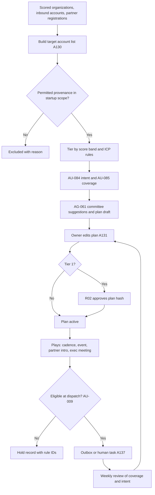
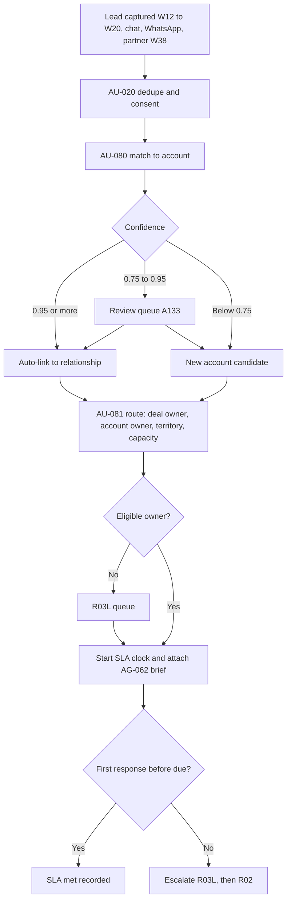
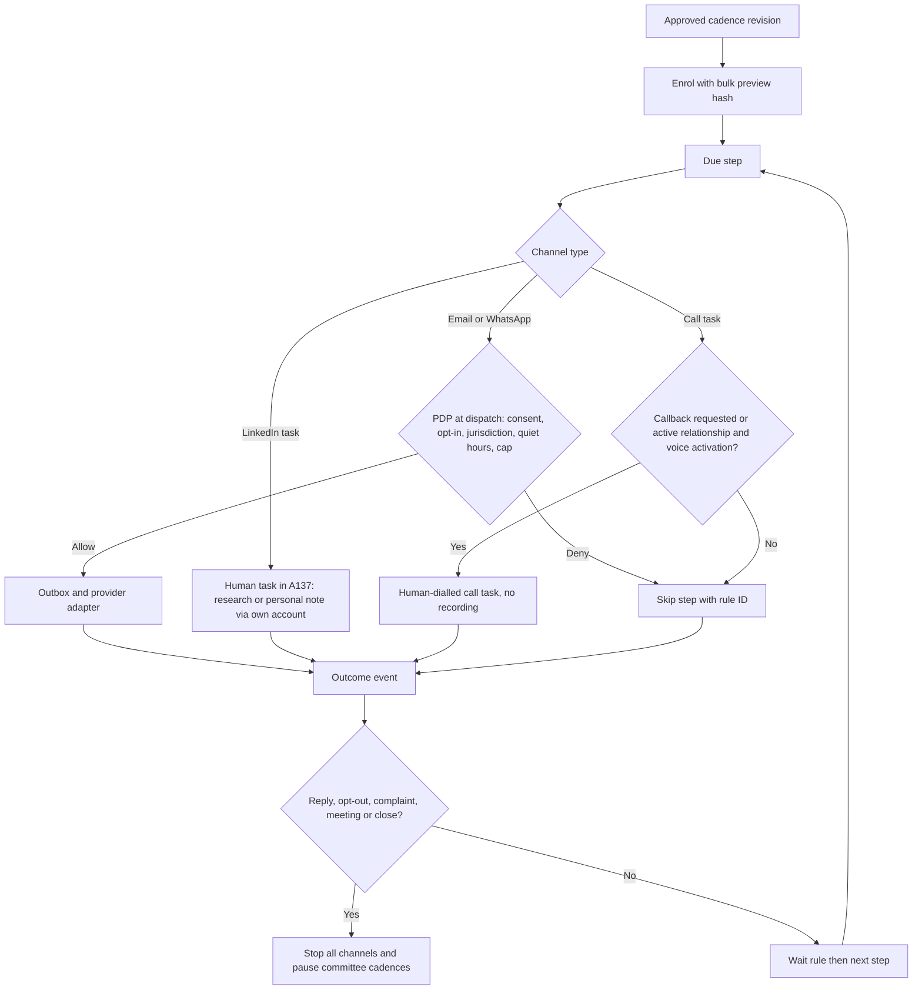
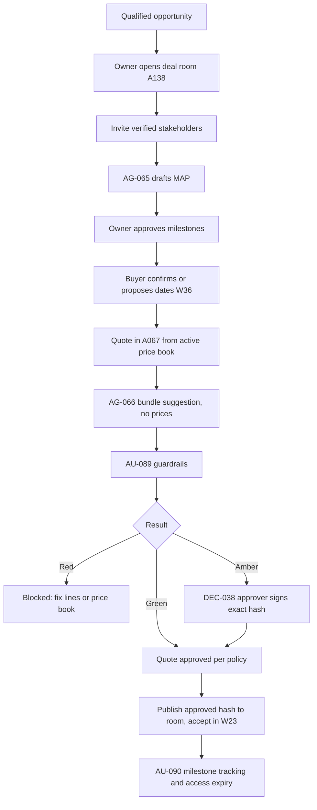
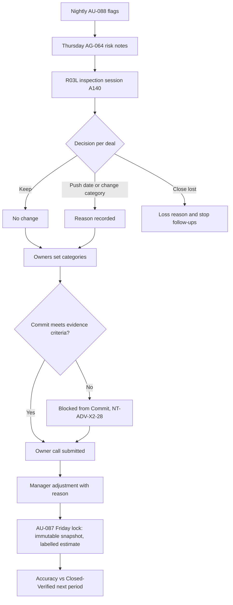
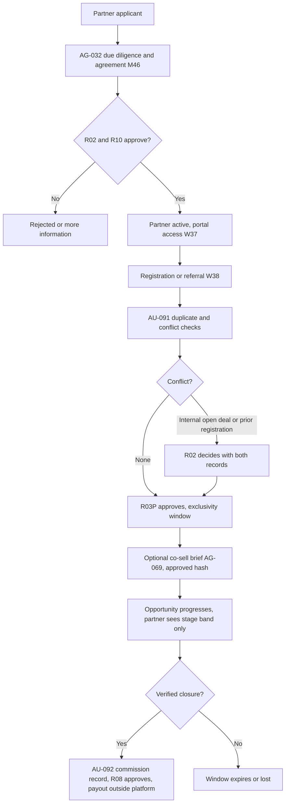
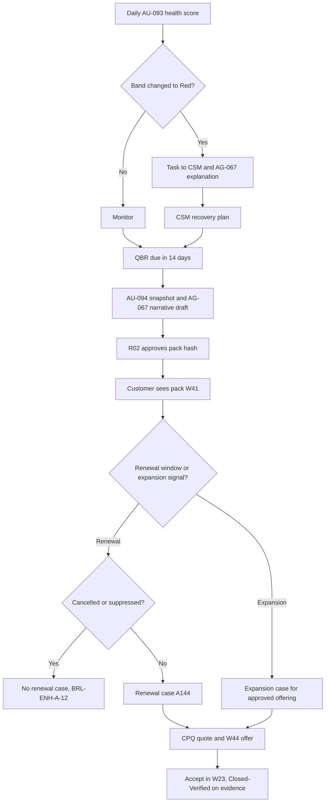
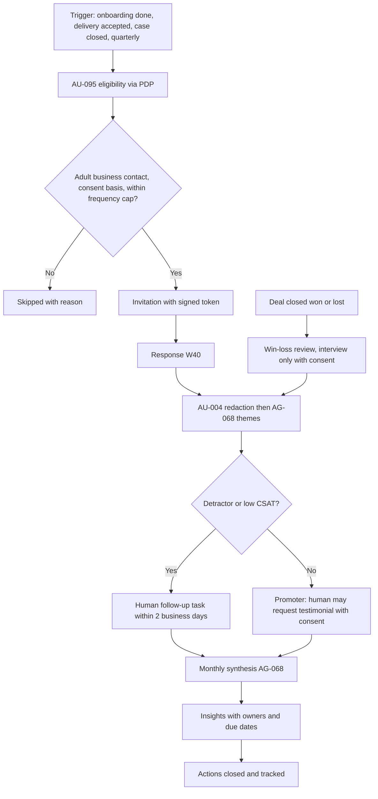

# AI Growth Engine: Employee Sales & Marketing Automation
## Application Blueprint: PART 9 (Batch 9.8), Advanced Revenue Growth Capabilities

| Field | Value |
|---|---|
| Document | Part 9, Batch 8, file **b of b** (§9.8.5–§9.8.17). File a (`Part-09-8a_Advanced_Revenue_Growth_Capabilities.md`) holds the expert panel, opportunity inventory, improvement plan and the 32 feature specifications with rules BRL-ADV-X2-01…44 |
| Version | 1.0 · 27 Nov 2026 |
| Baseline | Parts 0–9.5; Part 7.2 tool registry TL-01…20 and autonomy scale; Part 7.3 cost formula (FX ₹90/USD, BRD §6); Part 8.4 Ledgers A/B (DEC-229…231); Part 9.4 catalogue |
| Roles applied | Expert panel of file a, plus AI Governance Lead (agent cards), QA Lead (tests), FinOps Lead (effort and cost), Security/Compliance Lead (risks, decisions) |
| Status | Separately approvable proposal (DEC-390). Costs in §9.8.13 are **outside** Ledger A (DEC-230), Ledger B (DEC-231) and the Phase-2 envelope |

**Counts in this file.** 10 agents (AG-061…070) · 20 automations (AU-080…099) · 8 workflows (WF-25…32) · 96 functional requirements (FR-ADV-X2-001…096) · 32 user stories · 104 test cases (TC-ADV-X2-001…104) · 20 KPIs (KPI-ADV-X2-01…20) · 10 decisions (DEC-390…399) · 6 ADRs (ADR-120…125) · 12 risks · tags 650–669.

---

## 9.8.5 Agent specification cards (AG-061…AG-070)

**Common to all ten agents.** Pattern per Part 7.2: deterministic code computes every number, eligibility and state; the agent only drafts text, classifies, extracts or explains. All are **Tier 2 ineligible** because they read personal or confidential business data (DEC-007, BRL-ADV-X2-44). TL-13 `dispatch.request` is never granted. Untrusted inputs (notes, verbatims, partner submissions, web content) pass AU-004 redaction and AU-005 sanitization first. Model names: Tier 1a = Claude Haiku-class (currently "Haiku 5.5"), Tier 1b = Claude Sonnet-class (currently "Sonnet 5.5"); **verify model names and prices at time of implementation (as of 27 Nov 2026)**. Cost formula (Part 7.3): per call = FX × b × [(I − S)·p_in + S·(h·p_cr + (1 − h)·p_cw) + O·p_out] ÷ 10⁶ with FX ₹90/USD, b = 0.5 for Batch API runs; Haiku p_in 0.10, p_cr 0.01, p_cw 0.125, p_out 0.50; Sonnet p_in 2, p_cr 0.10, p_cw 2.50, p_out 10 (USD per MTok, the Part 7.4b reference set; verify). Monthly low = 0.3 × base, high = 3 × base, before the 25% overhead allowance [ASSUMPTION-666].

**New tool scopes (extend the Part 7.2 registry; read-only).**

| Tool | Name | Class | Scope rule | Used by |
|---|---|---|---|---|
| TL-X2-01 | `pricebook.read` | R0 | Active approved price-book revision for the caller's startup, currency and region only | AG-066 |
| TL-X2-02 | `health.components.read` | R0 | Health score components and explanation inputs for customers in the caller's scope; prohibited fields never present (BRL-ADV-X2-26) | AG-067 |
| TL-X2-03 | `pipeline.facts.read` | R0 | Deal facts, flags, MAP milestones, activity counts, forecast category history for deals in the caller's scope | AG-064, AG-065 |
| TL-X2-04 | `partner.records.read` | R0 | Partner profile, capability tags, approved registrations; never another partner's records | AG-069 |

#### AG-061 Account Plan and Buying-Committee Mapper

| Field | Specification |
|---|---|
| Type | Agent · Generator (planner/drafter) · scope: Startup |
| Purpose and business outcome | For a target account, drafts the account plan (objectives, whitespace among approved offerings, plays, risks) and proposes buying-committee slots and role hypotheses from permitted evidence, so tier-1 accounts get a reviewed plan within one day instead of a week, and deals become multi-threaded (KPI-ADV-X2-02) |
| Linked BR / FR / US | BR-M13, BR-M18, BR-M21, BR-M23; FR-ADV-X2-001…009; FR-A018, FR-A032; WF-25; US-06-V201, US-06-V202, US-07-V203 |
| Persona | P03 Growth Manager, P03a, P03b (authors); P02 Startup Head (approver of tier-1 plans) |
| Trigger | User action "Draft plan" or "Suggest committee" on A131; event `target_account.tier_set(1)` creates a queued draft request (no auto-run for tiers 2–3) |
| Inputs and data sources | Organization record and evidence (permitted sources only), DEC-011 score components, intent score components, Customer 360 timeline summary, committee template for the vertical, approved offering list with readiness, existing contacts with verification state (no contact details beyond role and verification flag) |
| Tools / APIs (registry §7.2.4) | TL-02 `records.read` (organization, opportunity, committee; caller scope), TL-03 `evidence.read`, TL-20 `offering.match_rank`, TL-01 `knowledge.search` (approved offerings), TL-06 `draft.create` (plan draft, committee suggestions) |
| Outputs | JSON `{objectives[], whitespace[{offering_id, reason, evidence_ids[]}], plays[{type, owner_role, due_in_days}], risks[], committee_suggestions[{slot_code, role_hypothesis, evidence_id, confidence}], open_questions[]}` |
| Autonomy and HITL | **L1.** Owner edits and saves; tier-1 plans need R02 approval of the exact hash; committee suggestions become members only when the owner accepts each one |
| Model tier | 1a with 30% escalation to 1b for tier-1 accounts with > 20 evidence items |
| Tier 2 eligibility · data class | No · Confidential (business strategy; names of roles) |
| Prompt / context strategy | Static system prompt, schema and vertical rules (≈ 1,500 tokens, cached); evidence top-k 8 summaries; Customer 360 pre-summarized; synchronous with streaming |
| Guardrails | Whitespace only from offerings with readiness Approved and Available (BRL-MKT-02); every objective and suggestion cites an evidence ID or record (deterministic citation check); MedMaarg prompts forbid patient or clinical-person roles; EduVerse prompts forbid students and under-18 roles (BRL-ADV-X2-03); no contact details invented; no claims beyond approved claims |
| Failure modes and fallback | Schema failure → 2 repairs → Tier 3: blank plan template with evidence list. Missing citations → suggestion dropped. Budget stop → queued with notice |
| Success KPIs | ≥ 80% of plans approved with ≤ 3 edits; 0 suggestions without citations (sampled weekly); tier-1 plan lead time < 1 business day |
| Eval dimensions | Groundedness, offering-readiness compliance, role-policy compliance (vertical), schema, cost, fallback |
| Tokens, calls, cost | 6,000 in (1,500 cacheable, hit 60%), 1,200 out; 60 calls/month. Haiku per call = 90 × [4,500×0.10 + 1,500×(0.6×0.01 + 0.4×0.125) + 1,200×0.50] ÷ 10⁶ = **₹0.102**; Sonnet per call = 90 × [4,500×2 + 1,500×(0.6×0.10 + 0.4×2.50) + 1,200×10] ÷ 10⁶ = **₹2.033**; blended at e = 30% = **₹0.681**. **Monthly (pilot): low ₹12 · base ₹41 · high ₹123** (before 25% overhead) |
| Dependencies | AU-001, AU-003, AU-004, AU-005, AU-084, AU-085; F01, F02 |
| Release | Release A1 (W6) for committee suggestions; plan drafting Release A2 |

#### AG-062 Signal Fusion "Why-Now" Brief Writer

| Field | Specification |
|---|---|
| Type | Agent · Generator (summarizer) · scope: Startup |
| Purpose and business outcome | Writes a three-sentence "why now" brief for each surging account and for each newly routed hot lead, citing the deterministic intent components (AU-084) and evidence, so sellers act on timing within the SLA (KPI-ADV-X2-03) |
| Linked BR / FR / US | BR-M14, BR-M22; FR-ADV-X2-010…018; WF-25, WF-26; US-05-V204, US-07-V206 |
| Persona | P03 Growth Manager, P05 Marketing Specialist (readers) |
| Trigger | Schedule: nightly batch for accounts whose intent score rose ≥ 15 points in 7 days; event `lead.routed(class=hot)` (synchronous, Haiku only) |
| Inputs and data sources | Intent score components (topic codes, counts, dates, sources), evidence-signal summaries, lead form fields (redacted: no free-text personal data beyond the stated business need), offering topic map |
| Tools / APIs (registry §7.2.4) | TL-12 `metrics.query` (intent components), TL-03 `evidence.read`, TL-06 `draft.create` (brief) |
| Outputs | JSON `{brief, cited_components[], suggested_topic_offering_ids[], confidence_label}` |
| Autonomy and HITL | **L0.** Advisory text shown on A132 and on the routed lead; no task, enrolment or message is created by the agent |
| Model tier | 1a; 10% escalation to 1b when components conflict |
| Tier 2 eligibility · data class | No · Confidential (account engagement linked to identified contacts) |
| Prompt / context strategy | Cached system prompt and examples (≈ 1,000 tokens); input ≤ 2,000 tokens of structured components; nightly via Batch API (b = 0.5) |
| Guardrails | Must not state intent as fact ("visited pricing page 3 times" allowed; "is ready to buy" forbidden); no individual browsing narrative beyond topic level; health-related pages never present (BRL-ADV-X2-05); deterministic check that every number in the brief appears in the inputs |
| Failure modes and fallback | Number mismatch → brief replaced by the component table (Tier 0 template). Schema failure → Tier 3 template |
| Success KPIs | ≥ 90% of sampled briefs rated accurate by sellers; 0 briefs with numbers absent from inputs; surge-to-meeting conversion tracked (RP-ADV-X2-02) |
| Eval dimensions | Numeric faithfulness, overclaim detection, privacy (no individual narrative), schema, cost |
| Tokens, calls, cost | 3,000 in (1,000 cacheable, hit 70%), 400 out; 600 calls/month, batch. Haiku per call = 90 × 0.5 × [2,000×0.10 + 1,000×(0.7×0.01 + 0.3×0.125) + 400×0.50] ÷ 10⁶ = **₹0.020**; Sonnet per call = 90 × 0.5 × [2,000×2 + 1,000×(0.7×0.10 + 0.3×2.50) + 400×10] ÷ 10⁶ = **₹0.397**; blended at e = 10% = **₹0.058**. **Monthly (pilot): low ₹10 · base ₹35 · high ₹104** |
| Dependencies | AU-084, AU-080, AU-001, AU-004 |
| Release | Release A1 (W6) |

#### AG-063 Multichannel Cadence Composer

| Field | Specification |
|---|---|
| Type | Agent · Generator (drafter) · scope: Startup |
| Purpose and business outcome | Proposes cadence structures from approved step templates for an objective and segment, and drafts per-recipient variants of approved templates (email, WhatsApp template variables) plus human-task briefs (LinkedIn research note, call opener from approved talk tracks), so sellers run coordinated, compliant, personalized cadences without writing each step (KPI-ADV-X2-06) |
| Linked BR / FR / US | BR-M25, BR-M28, BR-M31; FR-ADV-X2-025…027, FR-ADV-X2-049…051, FR-ADV-X2-076…078; WF-27, WF-31; US-08-V209, US-16-V217, US-09-V226 |
| Persona | P03, P05 (authors); P03L/P05L (approvers of cadence revisions) |
| Trigger | User action on A136 ("Suggest cadence", "Personalize step"); event `event.attendance_imported` creates post-event drafts for approval |
| Inputs and data sources | Approved templates and talk tracks with claim IDs, recipient role, organization evidence summary, prior conversation summary (redacted), eligibility pre-check result (TL-10), jurisdiction rule summary, locale |
| Tools / APIs (registry §7.2.4) | TL-01 `knowledge.search` (approved templates and talk tracks), TL-09 `claims.lookup`, TL-10 `pdp.check_eligibility` (dry-run), TL-02 `records.read`, TL-06 `draft.create` |
| Outputs | JSON `{cadence_proposal{steps[{channel, template_id, wait_rule}]}, step_drafts[{step_id, variables{}, citations[]}], human_task_briefs[{step_id, brief, talk_track_id}], excluded_channels[{channel, reason_rule_id}]}` |
| Autonomy and HITL | **L1.** Cadence structures need R03L or R05L approval of the revision hash; step drafts are queued for owner approval unless the template is pre-approved and only variables change, in which case the dispatch is the baseline L2 path for approved items (DEC-064) |
| Model tier | 1a; 15% escalation to 1b for multi-language or committee-wide drafts |
| Tier 2 eligibility · data class | No · Confidential (contact names, conversation context) |
| Prompt / context strategy | Cached system prompt with channel rules and examples (≈ 1,200 tokens); retrieval of top-4 approved templates; ≤ 2,300 tokens variable context |
| Guardrails | Never proposes a channel the PDP dry-run excluded; never drafts a LinkedIn message for automated sending (human brief only); call briefs only for eligible call tasks (BRL-ADV-X2-16); no new claims (claims lookup mandatory); MedMaarg: no clinical content, EduVerse: no student-directed content (BRL-ADV-X2-42); AG-012 Claims and Policy Guard checks every customer-facing draft |
| Failure modes and fallback | Claims guard failure → draft held with reasons. Schema failure → Tier 3: template without personalization. Budget stop → human writes variables |
| Success KPIs | ≥ 85% of step drafts approved with ≤ 2 edits; 0 drafts proposing excluded channels; meaningful reply rate per eligible enrolment vs baseline (KPI-ADV-X2-06) |
| Eval dimensions | Claim compliance, channel-rule compliance, personalization accuracy (citations), tone, multilingual quality, schema, cost |
| Tokens, calls, cost | 3,500 in (1,200 cacheable, hit 60%), 700 out; 200 calls/month. Haiku per call = 90 × [2,300×0.10 + 1,200×(0.6×0.01 + 0.4×0.125) + 700×0.50] ÷ 10⁶ = **₹0.058**; Sonnet per call = 90 × [2,300×2 + 1,200×(0.6×0.10 + 0.4×2.50) + 700×10] ÷ 10⁶ = **₹1.158**; blended at e = 15% = **₹0.223**. **Monthly (pilot): low ₹13 · base ₹45 · high ₹134** |
| Dependencies | AU-086, AU-009, AG-012, AU-004, AU-005 |
| Release | Release A1 (W6); post-event drafts Release A3 |

#### AG-064 Pipeline Inspection and Forecast Risk Analyst

| Field | Specification |
|---|---|
| Type | Agent · Classifier and explainer · scope: Startup |
| Purpose and business outcome | For each open deal, turns deterministic facts and AU-088 flags into a short risk note with cited facts and three inspection questions; for the forecast roll-up, explains week-over-week changes. Managers inspect more deals in less time and commit categories carry evidence (KPI-ADV-X2-07, KPI-ADV-X2-08) |
| Linked BR / FR / US | BR-M21, BR-M60; FR-ADV-X2-058…063; WF-29; US-17-V220, US-17-V221 |
| Persona | P03L Sales Lead, P02 Startup Head (readers); P03 owner (responds) |
| Trigger | Schedule: Thursday 18:00 local (before the Friday forecast call), batch; user action "Explain change" on A140 |
| Inputs and data sources | Deal facts (stage, age, amount history, close-date history), flags, MAP milestone states, committee coverage, activity counts, forecast category history; no free-text email bodies |
| Tools / APIs (registry §7.2.4) | TL-X2-03 `pipeline.facts.read`, TL-12 `metrics.query`, TL-06 `draft.create` (risk note) |
| Outputs | JSON `{risk_level_label, drivers[{fact_ref, statement}], inspection_questions[3], change_explanations[]}` |
| Autonomy and HITL | **L0.** Advisory only; cannot change category, stage, amount or date (BRL-ADV-X2-34) |
| Model tier | 1a; 20% escalation to 1b for deals with > 30 history events |
| Tier 2 eligibility · data class | No · Confidential (deal values, names) |
| Prompt / context strategy | Cached system prompt and examples (≈ 1,200 tokens); structured facts ≤ 3,800 tokens; Batch API (b = 0.5) |
| Guardrails | Every driver cites a fact reference (deterministic check); the agent's `risk_level_label` is displayed next to, never instead of, deterministic flags; no prediction stated as fact; no personal judgement about the owner |
| Failure modes and fallback | Citation failure → note suppressed, flags still shown. Schema failure → Tier 3: flags only |
| Success KPIs | ≥ 75% of inspection questions rated useful by R03L (monthly sample); 0 notes without fact citations; forecast accuracy trend (KPI-ADV-X2-07) |
| Eval dimensions | Fact faithfulness, flag consistency, neutrality of language, schema, cost |
| Tokens, calls, cost | 5,000 in (1,200 cacheable, hit 60%), 600 out; 300 calls/month, batch. Haiku per call = 90 × 0.5 × [3,800×0.10 + 1,200×(0.6×0.01 + 0.4×0.125) + 600×0.50] ÷ 10⁶ = **₹0.034**; Sonnet per call = 90 × 0.5 × [3,800×2 + 1,200×(0.6×0.10 + 0.4×2.50) + 600×10] ÷ 10⁶ = **₹0.669**; blended at e = 20% = **₹0.161**. **Monthly (pilot): low ₹14 · base ₹48 · high ₹145** |
| Dependencies | AU-087, AU-088, AU-041 |
| Release | Release A1 (W6) |

#### AG-065 Deal Room and Mutual Action Plan Assistant

| Field | Specification |
|---|---|
| Type | Agent · Generator (drafter) · scope: Startup |
| Purpose and business outcome | Drafts MAP milestones from the proposal scope, RFP checklist (AG-019 output), approved meeting summaries (AG-037) and the vertical MAP template; drafts deal-room welcome text and weekly room updates from approved items, so buyers see one clear path to a decision (KPI-ADV-X2-09) |
| Linked BR / FR / US | BR-M43, BR-M46, BR-WEB; FR-ADV-X2-028…033, FR-ADV-X2-085…087; WF-28; US-19-V210, US-13-V211, US-14-V229 |
| Persona | P03, P06 (authors); P14 buyer stakeholders (see only approved output) |
| Trigger | User action on A138 ("Draft MAP", "Draft update") |
| Inputs and data sources | Opportunity facts, approved proposal sections (hashes), RFP checklist items, approved meeting summaries, MAP template for the vertical, list of approved room items |
| Tools / APIs (registry §7.2.4) | TL-X2-03 `pipeline.facts.read`, TL-14 `document.parse` (approved proposal only), TL-01 `knowledge.search`, TL-06 `draft.create` |
| Outputs | JSON `{milestones[{title, owner_side, suggested_due, source_ref}], room_update_draft, citations[]}` |
| Autonomy and HITL | **L1.** Owner approves each milestone and each update; nothing is visible to guests until approved; buyer confirmation is a separate human step (BRL-ADV-X2-19) |
| Model tier | 1a; 30% escalation to 1b for multi-workstream bids |
| Tier 2 eligibility · data class | No · Confidential |
| Prompt / context strategy | Cached system prompt, schema, MAP templates (≈ 1,200 tokens); ≤ 3,800 tokens context; synchronous |
| Guardrails | No price, discount or legal term in milestones or updates (pattern and number check); all dates proposed, never "agreed"; only approved items referenced; AG-012 checks updates; AppNAI: "submission" milestones always owned by the human bid manager (DEC-053) |
| Failure modes and fallback | Guard failure → draft held with reasons. Schema failure → Tier 3: template milestones |
| Success KPIs | ≥ 80% of MAP drafts approved with ≤ 3 edits; 0 price or legal terms in approved MAPs; MAP on-time milestone rate (KPI-ADV-X2-09) |
| Eval dimensions | Groundedness to approved sources, term-leak detection, date logic, schema, cost |
| Tokens, calls, cost | 5,000 in (1,200 cacheable, hit 60%), 1,000 out; 40 calls/month. Haiku per call = 90 × [3,800×0.10 + 1,200×(0.6×0.01 + 0.4×0.125) + 1,000×0.50] ÷ 10⁶ = **₹0.085**; Sonnet per call = 90 × [3,800×2 + 1,200×(0.6×0.10 + 0.4×2.50) + 1,000×10] ÷ 10⁶ = **₹1.698**; blended at e = 30% = **₹0.569**. **Monthly (pilot): low ₹7 · base ₹23 · high ₹68** |
| Dependencies | AU-090, AU-036, AG-012, AG-019, AG-037 |
| Release | Release A2 (W6); AppNAI bid MAP Release A1 |

#### AG-066 CPQ Bundle Advisor and Guardrail Explainer

| Field | Specification |
|---|---|
| Type | Agent · Matcher and explainer · scope: Startup |
| Purpose and business outcome | Given the stated need and the active price book, suggests up to three approved bundles or line sets with reasons, and explains guardrail results (AU-089) in plain language with the next allowed action, so time-to-quote falls and fewer quotes hit red (KPI-ADV-X2-10). **It never sets, changes or negotiates a price** |
| Linked BR / FR / US | BR-M44; FR-ADV-X2-034…036, FR-ADV-X2-094…096; WF-28; US-13-V212, US-14-V232 |
| Persona | P03, P06, P07 (sellers) |
| Trigger | User action "Suggest bundle" or "Why blocked?" on A067 |
| Inputs and data sources | Need summary (structured), active price-book lines, bundles and option rules, guardrail results with rule IDs; OrganicSpec quantity and unit fields |
| Tools / APIs (registry §7.2.4) | TL-X2-01 `pricebook.read`, TL-20 `offering.match_rank`, TL-06 `draft.create` (suggestion only) |
| Outputs | JSON `{suggestions[{bundle_code or lines[{sku, qty, unit}], reason, rule_checks_expected}], guardrail_explanations[{rule_id, plain_text, allowed_next_action}]}`; **no price fields in the schema** |
| Autonomy and HITL | **L0.** Seller chooses; AU-089 and AU-035 compute prices and totals; approvals per DEC-038 |
| Model tier | 1a; 10% escalation to 1b |
| Tier 2 eligibility · data class | No · Confidential (commercial terms) |
| Prompt / context strategy | Cached system prompt (≈ 1,000 tokens); price-book subset top-20 lines by match (no price values are sent to the model, only SKU, description, units and rules) [RECOMMENDATION-670] |
| Guardrails | Output schema has no price, discount or total fields (structural guardrail); suggestions validated against price-book rules before display; invalid suggestions dropped |
| Failure modes and fallback | Validation failure → suggestion dropped with reason. Schema failure → Tier 3: manual line picker |
| Success KPIs | ≥ 60% of suggestions accepted; median time-to-quote −30% vs baseline; 0 suggestions violating option rules shown to users |
| Eval dimensions | Rule compliance, need fit, explanation accuracy, schema, cost |
| Tokens, calls, cost | 2,500 in (1,000 cacheable, hit 70%), 400 out; 150 calls/month. Haiku per call = 90 × [1,500×0.10 + 1,000×(0.7×0.01 + 0.3×0.125) + 400×0.50] ÷ 10⁶ = **₹0.036**; Sonnet per call = 90 × [1,500×2 + 1,000×(0.7×0.10 + 0.3×2.50) + 400×10] ÷ 10⁶ = **₹0.704**; blended at e = 10% = **₹0.102**. **Monthly (pilot): low ₹5 · base ₹15 · high ₹46** |
| Dependencies | AU-089, AU-035 |
| Release | Release A1 (W6) |

#### AG-067 Customer Health and QBR Narrative Analyst

| Field | Specification |
|---|---|
| Type | Agent · Generator (explainer/drafter) · scope: Startup |
| Purpose and business outcome | Explains deterministic health-score drivers (AU-093) in plain words, drafts the QBR narrative over the AU-094 metric snapshot, and proposes expansion hypotheses limited to approved offerings, so CSMs prepare reviews in an hour instead of a day and catch churn risk early (KPI-ADV-X2-12, KPI-ADV-X2-13) |
| Linked BR / FR / US | BR-M48, BR-M50, BR-M52; FR-ADV-X2-043…051; WF-31; US-16-V215, US-16-V216, US-16-V217 |
| Persona | P03c Customer Success Manager (author); P02 (approver); P14 customer (sees approved pack only) |
| Trigger | Event `health.band_changed` (explanation only); user action "Draft QBR" on A143; schedule: 14 days before QBR due |
| Inputs and data sources | Health components and trend (no prohibited fields), metric snapshot (verified ledgers), milestones, support summary (redacted), NPS/CSAT themes, approved offerings and readiness |
| Tools / APIs (registry §7.2.4) | TL-X2-02 `health.components.read`, TL-12 `metrics.query`, TL-01 `knowledge.search`, TL-09 `claims.lookup`, TL-06 `draft.create` |
| Outputs | JSON `{driver_explanations[], qbr_sections[{section, text, metric_refs[]}], expansion_hypotheses[{offering_id, rationale, evidence_refs[]}], risks[]}` |
| Autonomy and HITL | **L1.** CSM edits; R02 approves the exact pack hash before sharing (BRL-ADV-X2-28); hypotheses become growth cases only by CSM action |
| Model tier | 1a; 30% escalation to 1b for QBR narratives |
| Tier 2 eligibility · data class | No · Confidential (customer commercial data) |
| Prompt / context strategy | Cached system prompt and pack schema (≈ 1,200 tokens); metric snapshot as compact table; synchronous with streaming |
| Guardrails | Every number must match the snapshot (deterministic numeric check); no medical, patient or minors' data in inputs (TL-X2-02 scope) or outputs (AU-004 output scan); expansion only for approved and available offerings; no promises of outcomes; AG-012 checks customer-facing sections |
| Failure modes and fallback | Numeric mismatch → section replaced by metric table. Schema failure → Tier 3: pack with metrics and empty narrative |
| Success KPIs | ≥ 80% of narratives approved with ≤ 3 edits; 0 numeric mismatches in shared packs; QBR preparation time −50% (survey) |
| Eval dimensions | Numeric faithfulness, prohibited-data leakage, claim compliance, usefulness, schema, cost |
| Tokens, calls, cost | 6,000 in (1,200 cacheable, hit 60%), 1,200 out; 40 calls/month. Haiku per call = 90 × [4,800×0.10 + 1,200×(0.6×0.01 + 0.4×0.125) + 1,200×0.50] ÷ 10⁶ = **₹0.103**; Sonnet per call = 90 × [4,800×2 + 1,200×(0.6×0.10 + 0.4×2.50) + 1,200×10] ÷ 10⁶ = **₹2.058**; blended at e = 30% = **₹0.690**. **Monthly (pilot): low ₹8 · base ₹28 · high ₹83** |
| Dependencies | AU-093, AU-094, AG-012, AG-038 |
| Release | Release A1 (explanations) · Release A2 (QBR, expansion) |

#### AG-068 Win/Loss and Voice-of-Customer Insight Synthesizer

| Field | Specification |
|---|---|
| Type | Agent · Classifier and summarizer · scope: Startup |
| Purpose and business outcome | Classifies redacted survey verbatims and win/loss review notes into the theme taxonomy, extracts competitor mentions present in the text, and produces a monthly theme synthesis with counts and example quotes, so product, marketing and sales act on evidence (KPI-ADV-X2-15). Builds on AG-026 loss-reason classification rather than replacing it |
| Linked BR / FR / US | BR-M51, BR-M59; FR-ADV-X2-052…057; WF-32; US-16-V218, US-16-V219 |
| Persona | P03c, P03L, P05L, P02 (readers) |
| Trigger | Event `survey.response_received` and `winloss.review_completed` (batched hourly); schedule: monthly synthesis on the 2nd business day |
| Inputs and data sources | Redacted verbatims (AU-004), structured factors, loss reason (AG-026), theme taxonomy, offering list |
| Tools / APIs (registry §7.2.4) | TL-08 `classification.write` (theme labels with confidence), TL-02 `records.read`, TL-06 `draft.create` (synthesis) |
| Outputs | Per item: `{themes[{code, confidence}], sentiment_label, competitor_mentions[]}`; monthly: `{themes[{code, count, trend, quotes[]}], suggested_actions[]}` |
| Autonomy and HITL | **L0** for labels (reviewable, previous label kept); synthesis is a draft for R02/R05L; actions become insights only by a human |
| Model tier | 1a; 10% escalation to 1b for the monthly synthesis |
| Tier 2 eligibility · data class | No · Confidential (customer opinions; redacted but contextual) |
| Prompt / context strategy | Cached taxonomy and examples (≈ 800 tokens); per-item ≤ 1,200 tokens; Batch API (b = 0.5) |
| Guardrails | Competitor statements are quoted as customer opinion, never as verified comparative claims (BR-M59); quotes only from consented, redacted text; MedMaarg verbatims with any health content are blocked from synthesis by AU-004 and flagged for human review; no theme about individual employees |
| Failure modes and fallback | Low confidence (< 0.6) → "Unclassified" for human labelling. Schema failure → Tier 3 unlabelled |
| Success KPIs | Theme labelling accuracy ≥ 85% on a monthly 50-item sample; 0 health-content quotes in synthesis; insight closure rate (KPI-ADV-X2-15) |
| Eval dimensions | Classification accuracy, competitor-claim handling, privacy leakage, schema, cost |
| Tokens, calls, cost | 2,000 in (800 cacheable, hit 70%), 250 out; 300 calls/month, batch. Haiku per call = 90 × 0.5 × [1,200×0.10 + 800×(0.7×0.01 + 0.3×0.125) + 250×0.50] ÷ 10⁶ = **₹0.013**; Sonnet per call = 90 × 0.5 × [1,200×2 + 800×(0.7×0.10 + 0.3×2.50) + 250×10] ÷ 10⁶ = **₹0.250**; blended at e = 10% = **₹0.036**. **Monthly (pilot): low ₹3 · base ₹11 · high ₹33** |
| Dependencies | AU-004, AU-095, AG-026 |
| Release | Release A2 (W6) |

#### AG-069 Partner Match and Co-sell Brief Assistant

| Field | Specification |
|---|---|
| Type | Agent · Matcher and generator · scope: Startup |
| Purpose and business outcome | Explains the deterministic partner-to-opportunity ranking (capability tags, region, tier, past verified outcomes), and drafts the co-sell brief that an owner may share with an approved partner, containing only fields allowed by BRL-ADV-X2-25. Grows partner-sourced revenue without data leakage (KPI-ADV-X2-11) |
| Linked BR / FR / US | BR-M42, BR-M49; FR-ADV-X2-037…042; WF-30; US-12-V213, US-19-V214 |
| Persona | P03d Partner Manager (R03P), P03 owner |
| Trigger | User action on A141 or A138 ("Find partner", "Draft co-sell brief") |
| Inputs and data sources | Partner profiles (TL-X2-04), opportunity facts (organization, offering line, region, stage band), deterministic ranking scores, approved co-sell field list |
| Tools / APIs (registry §7.2.4) | TL-X2-04 `partner.records.read`, TL-X2-03 `pipeline.facts.read`, TL-06 `draft.create` |
| Outputs | JSON `{ranked_explanations[{partner_id, reasons[]}], cosell_brief{fields{}, narrative}, withheld_fields[]}` |
| Autonomy and HITL | **L1.** Owner and R03P approve the brief hash before a co-sell grant; the agent never contacts partners |
| Model tier | 1a; 20% escalation to 1b |
| Tier 2 eligibility · data class | No · Confidential |
| Prompt / context strategy | Cached system prompt and allowed-field schema (≈ 1,000 tokens); ≤ 2,500 tokens context |
| Guardrails | Output limited to an allowlisted field schema; deterministic diff strips any non-allowlisted value (contact details, internal notes, prices); no partner sees another partner's existence; no ranking based on personal attributes |
| Failure modes and fallback | Allowlist violation → brief rejected. Schema failure → Tier 3: manual brief template |
| Success KPIs | 0 non-allowlisted fields in approved briefs; ≥ 70% of briefs approved with ≤ 2 edits; partner-sourced verified revenue share (KPI-ADV-X2-11) |
| Eval dimensions | Data-minimization compliance, explanation faithfulness, schema, cost |
| Tokens, calls, cost | 3,500 in (1,000 cacheable, hit 60%), 600 out; 60 calls/month. Haiku per call = 90 × [2,500×0.10 + 1,000×(0.6×0.01 + 0.4×0.125) + 600×0.50] ÷ 10⁶ = **₹0.055**; Sonnet per call = 90 × [2,500×2 + 1,000×(0.6×0.10 + 0.4×2.50) + 600×10] ÷ 10⁶ = **₹1.085**; blended at e = 20% = **₹0.261**. **Monthly (pilot): low ₹5 · base ₹16 · high ₹47** |
| Dependencies | AU-091, AU-092, AG-032 |
| Release | Release A2 (W6) |

#### AG-070 Enablement and Playbook Coach

| Field | Specification |
|---|---|
| Type | Agent · Retriever and generator · scope: Startup |
| Purpose and business outcome | In context (account plan, deal room, task workbench, editorial calendar), recommends approved enablement assets, the next play step from the vertical playbook, and short coaching tips derived from approved talk tracks and won-deal patterns, so sellers use approved material consistently (KPI-ADV-X2-18) |
| Linked BR / FR / US | BR-M34; FR-ADV-X2-073…075, FR-ADV-X2-082…084; WF-25, WF-27; US-11-V225, US-11-V228, US-17-V227 |
| Persona | P03, P06, P07, P03c (readers); P05 (editorial briefs) |
| Trigger | Side-panel open on A131, A137, A138, A148; user question in the panel (≤ 20 turns/user/day shared with the Copilot quota) |
| Inputs and data sources | Enablement index (approved, unexpired), playbook template, context object facts (stage, vertical, persona), aggregate usage analytics |
| Tools / APIs (registry §7.2.4) | TL-01 `knowledge.search` (enablement namespace), TL-02 `records.read`, TL-12 `metrics.query` (usage aggregates), TL-06 `draft.create` (brief outline) |
| Outputs | JSON `{recommended_assets[{asset_id, why}], next_play_step, tips[], brief_outline?}` |
| Autonomy and HITL | **L0.** Recommendations only; sharing an asset is a user action subject to BRL-ADV-X2-41 |
| Model tier | 1a; 10% escalation to 1b |
| Tier 2 eligibility · data class | No · Internal-Confidential (deal context) |
| Prompt / context strategy | Cached system prompt (≈ 1,200 tokens); retrieval top-6 assets; semantic cache for repeated questions per startup (cosine ≥ 0.92, AU-001) |
| Guardrails | Recommends only approved, unexpired assets (filter before retrieval); tips cite a talk track or asset; no performance judgement of individuals; no gamification nudges toward activity volume (BRL-ADV-X2-40) |
| Failure modes and fallback | Retrieval empty → "No approved asset found; request content" action. Schema failure → Tier 3 list of top assets by stage |
| Success KPIs | Asset click-through ≥ 30% of recommendations; 0 expired or unapproved assets recommended; usage-to-win association reported (KPI-ADV-X2-18) |
| Eval dimensions | Retrieval relevance, approval-filter compliance, groundedness, schema, cost |
| Tokens, calls, cost | 3,000 in (1,200 cacheable, hit 60%), 500 out; 400 calls/month. Haiku per call = 90 × [1,800×0.10 + 1,200×(0.6×0.01 + 0.4×0.125) + 500×0.50] ÷ 10⁶ = **₹0.045**; Sonnet per call = 90 × [1,800×2 + 1,200×(0.6×0.10 + 0.4×2.50) + 500×10] ÷ 10⁶ = **₹0.888**; blended at e = 10% = **₹0.129**. **Monthly (pilot): low ₹15 · base ₹52 · high ₹155** |
| Dependencies | AU-083, AU-001 |
| Release | Release A2 (W6) |

**AI cost summary (pilot).** Σ base = ₹41 + 35 + 45 + 48 + 23 + 15 + 28 + 11 + 16 + 52 = **₹314** before overhead (low ₹94, high ₹938; component rounding), **≈ ₹390/month with the 25% overhead** (low ₹118, high ₹1,171). This fits inside the DEC-008 pilot AI ceiling of ₹3,000/month alongside the expected baseline spend of ≈ ₹1,150 (Part 8.4), so no ceiling change is requested (DEC-399).

---

## 9.8.6 Automations table (AU-080…AU-099)

Automations are deterministic and use no AI model. Costs are worker CPU and storage inside the X2 cloud line (§9.8.13.2); "₹0 incremental" means no provider charge.

| ID | Name | Wave / Release | Linked BR / FR / rule | Trigger | Deterministic logic | Outputs | Autonomy | Guardrail | Failure / fallback | KPI | Cost |
|---|---|---|---|---|---|---|---|---|---|---|---|
| AU-080 | Lead-to-account matcher | W6 · Release A1 | BR-M22; FR-ADV-X2-013…015; BRL-ADV-X2-08 | Lead created (any intake channel, partner registration) | Normalize email domain (public-suffix list), strip free-mail; organization name similarity (token-set ratio, RapidFuzz-class library), registered ID exact match, address match (libpostal-class normalizer), existing contact link; weighted confidence = Σ wᵢ·mᵢ; thresholds 0.95 / 0.75 (CFG-ADV-X2-04) | Auto-link, review item (A133) or new-account candidate | L3 (deterministic, within policy) | Same tenant and startup only (RLS); free-mail never domain-matched | Matcher error → review queue item; never auto-create a duplicate | KPI-ADV-X2-05 | Worker CPU; ₹0 incremental |
| AU-081 | Owner routing and speed-to-lead SLA clock | W6 · Release A1 | BR-M22, BR-M21; FR-ADV-X2-016…018; BRL-ADV-X2-09, -10 | Lead matched; owner availability change; SLA tick (1 min) | Routing order existing owner → account owner → territory → capacity-weighted round robin; skip ineligible; SLA due = start + class SLA on owner's business calendar; 75/100/200% escalation ladder | Owner assignment, SLA record, NT-ADV-X2-07/-08 | L3 (deterministic, within policy) | Owner must hold startup grant; no assignment to external or AI identities | No eligible owner → R03L queue; clock never paused silently | KPI-ADV-X2-03, KPI-ADV-X2-04 | ₹0 incremental |
| AU-082 | Territory and capacity simulator | W6 · Release A2 | FR-ADV-X2-019…024; BRL-ADV-X2-11, -12 | Candidate territory or capacity revision saved | Apply rules to all accounts; compute moved accounts and deals, capacity load per owner, balance index (1 − Gini of potential); compare before/after | Simulation report for approval | L0 (simulation only) | Simulation has zero live effects (BRL-AUT-04 pattern) | Timeout → partial report flagged incomplete; approval blocked | KPI-ADV-X2-20 | ₹0 incremental |
| AU-083 | Enablement usage and freshness tracker | W6 · Release A2 | BR-M34; FR-ADV-X2-082…084; BRL-ADV-X2-41 | Asset opened, shared or attached; daily expiry scan | Count usage per asset × stage × outcome (won/lost via relationship ID); flag assets whose claims expire in ≤ 14 days; unlist expired | Usage aggregates; expiry notices; unlisting | L3 (deterministic, within policy) | Aggregates only; no per-person ranking | Missed scan → next run catches up; expired assets never shown | KPI-ADV-X2-18 | ₹0 incremental |
| AU-084 | Signal fusion and intent decay scorer | W6 · Release A1 | BR-M14, BR-M37; FR-ADV-X2-010…012; BRL-ADV-X2-05…07 | Engagement event, signal reviewed, nightly recompute | Intent = min(100, Σ type_weight × topic_fit × 0.5^(age/half-life)); components stored; expired evidence removed; surge = +15 points in 7 days | Intent score and components; surge events | L3 (deterministic, within policy) | Only consented events; health pages excluded at capture | Bad event → quarantined, not scored | KPI-ADV-X2-01 | Storage ≈ 1 GB/yr events; within X2 cloud line |
| AU-085 | Buying-committee coverage calculator | W6 · Release A1 | BR-M18; FR-ADV-X2-004…006; BRL-ADV-X2-03 | Member added/changed; engagement event | Coverage = filled and engaged required slots ÷ required slots; single-threaded = 1 engaged member on a deal above threshold | Coverage %, single-threaded flag, NT-ADV-X2-03 | L3 (deterministic, within policy) | No member without verified or hypothesis source | Missing template → coverage "Unknown" | KPI-ADV-X2-02 | ₹0 incremental |
| AU-086 | Multichannel cadence orchestrator | W6 · Release A1 | BR-M24, BR-M28, BR-M31; FR-ADV-X2-025…027; BRL-ADV-X2-13…17 | Schedule tick; reply, opt-out, meeting, stage and complaint events | For each due step: PDP dry-run; automated channels → outbox with dispatch recheck (AU-009); human steps → task (A137); global stop on any stop event for the person across all cadences; committee pause; cumulative cap across channels | Outbox items, human tasks, stop records | L3 for scheduling (deterministic); dispatch of approved items L2 (DEC-064) | Never sends LinkedIn messages or places calls; WhatsApp only with opt-in and approved template; jurisdiction allowlist | Ineligible → step skipped with rule ID; uncertain provider outcome → AU-026 | KPI-ADV-X2-06; KPI-17 = 0 | Channel costs in X2-B05/B06 |
| AU-087 | Forecast roll-up and weekly snapshot | W6 · Release A1 | BR-M60; FR-ADV-X2-061…063; BRL-ADV-X2-33 | Friday 17:00 local lock; on-demand roll-up | Sum by category and owner chain; manager adjustments with reason; immutable snapshot (payload hash); attainment = Closed-Verified ÷ prior Commit; slippage = deals leaving Commit | Roll-up, snapshot, accuracy metrics | L3 (deterministic, within policy) | Closed-Verified only from DEC-054 evidence; estimate label enforced in API | Lock failure → retry once, alert R11; snapshot never overwritten | KPI-ADV-X2-07 | ₹0 incremental |
| AU-088 | Pipeline hygiene and inspection flags | W6 · Release A1 | BR-M21; FR-ADV-X2-058…060; BRL-ADV-X2-34 | Nightly; deal change | Rules: no next step; close date past; stage age > p75 of won deals; single-threaded; no MAP above threshold; amount change > 20% in a week; owner lacks grant | Flags with severity, NT-ADV-X2-26 | L3 (deterministic, within policy) | Flags never change deal data | Rule error → flag "check failed" visible | KPI-ADV-X2-08 | ₹0 incremental |
| AU-089 | CPQ guardrail evaluator | W6 · Release A1 | BR-M44; FR-ADV-X2-034…036; BRL-ADV-X2-21, -22; DEC-038 | Quote line change; submit for approval | Validate lines against active price-book revision; required/excluded options; quantity bounds and breaks; validity ≤ max; margin ≥ floor (Decimal); discount band → approver per DEC-038 | Guardrail results pass/amber/red with rule IDs; approval tasks | L3 (deterministic, within policy) | Red cannot be issued; server recompute only | Stale price book → recompute required; evaluator error → red | KPI-ADV-X2-10 | ₹0 incremental |
| AU-090 | Deal-room access and MAP tracker | W6 · Release A2 | BR-WEB, BR-M43; FR-ADV-X2-028…033; BRL-ADV-X2-18, -19 | Guest invited; daily expiry scan; deal closed; opt-out; milestone due | Grant scoped object access to verified contact; expiry and revocation; milestone due/overdue states; slipped flag to AU-088 | Grants, revocations, NX-ADV-X2-01/-02, NT-ADV-X2-14/-15 | L3 (deterministic, within policy) | Only approved hashes visible; revocation within 5 min of trigger | Revocation failure → deny-by-default at read (grant check every request) | KPI-ADV-X2-09 | ₹0 incremental |
| AU-091 | Partner registration and channel-conflict checker | W6 · Release A2 | BR-M42; FR-ADV-X2-037…042; BRL-ADV-X2-23…25 | Registration or referral submitted | Duplicate check (AU-080 matcher), internal open opportunity check, existing registration check; first-valid-wins window; conflict case to R02 | Decision proposal, conflict case, exclusivity window | L3 for checks; decision L1 (human R03P/R02) | Partner sees only own records; no auto-approval | Matcher error → manual review | KPI-ADV-X2-11 | ₹0 incremental |
| AU-092 | Partner tier and commission record calculator | W6 · Release A2 | DEC-046; FR-ADV-X2-037…039 | Verified revenue event with partner attribution; quarterly tier review | Commission record = verified revenue × approved rate (Decimal, ROUND_HALF_UP); tier = thresholds on trailing 12-month verified partner-sourced revenue and certifications | Commission records (proposed), tier review tasks | L3 (deterministic, within policy) | Record only, no payout, no money movement (DEC-046, X-06) | Missing rate → record "needs terms" | KPI-ADV-X2-11 | ₹0 incremental |
| AU-093 | Customer health score v2 | W6 · Release A1 | BR-M50; FR-ADV-X2-043…045; BRL-ADV-X2-26, -27 | Daily; component source change | Score = round(100 × Σ wᵢcᵢ ÷ Σ w_known); Unknown if known weight < 0.60; bands by template; trend over 30/90 days; quarterly back-test vs renewal outcome | Health score, band change events | L3 (deterministic, within policy) | Prohibited fields rejected by schema; no outreach triggered | Component missing → Unknown, not 0 | KPI-ADV-X2-12, KPI-ADV-X2-13 | ₹0 incremental |
| AU-094 | QBR pack assembler | W6 · Release A2 | BR-M52; FR-ADV-X2-046…048; BRL-ADV-X2-28 | QBR due −14 days; user "Assemble" | Snapshot verified metrics for the period (milestones, deliveries, usage, support, invoices and payment status, NPS); freeze snapshot hash | Pack draft with metric snapshot | L3 (deterministic, within policy) | Verified ledgers only; no forecast in actuals section | Missing data → section marked "not available" | KPI-ADV-X2-12 | ₹0 incremental |
| AU-095 | Survey scheduler with fatigue and eligibility rules | W6 · Release A2 | BR-M04; FR-ADV-X2-052…054; BRL-ADV-X2-30, -31 | Trigger events (onboarding done, delivery accepted, case closed); quarterly relationship schedule | Eligibility via PDP (adult business contact, consent basis, jurisdiction); frequency caps 90/30 days; signed single-use token (expiry 14 days); detractor → task | Invitations, tasks | L3 for scheduling; invitation dispatch L2 of approved template (DEC-064) | Never to under-18 or patients; health questions absent from templates (template lint) | Ineligible → skipped with reason; token reuse → rejected | KPI-ADV-X2-14 | Email/WhatsApp in X2-B05/B06 |
| AU-096 | Multi-model attribution calculator | W6 · Release A2 | BR-M52; FR-ADV-X2-064…066; BRL-ADV-X2-35 | Verified revenue event; nightly recompute | For touches in window: first, last, last non-direct, linear, position-based 40/20/40, time-decay (half-life 30 days); credits sum to verified amount (Decimal, residual to largest credit); Unknown bucket when no consented touch | Attribution credits per model | L3 (deterministic, within policy) | Verified revenue only; excluded unconsented touches | Recompute idempotent by version | KPI-ADV-X2-16 | ₹0 incremental |
| AU-097 | Campaign ROI and cost allocation calculator | W6 · Release A2 | BR-M38, BR-M52; FR-ADV-X2-067…069; BRL-ADV-X2-36 | Monthly close; cost line added | Join campaign costs (ads actuals, provider, AI from AU-012, manual lines with evidence) to attributed verified gross margin; ROI or "not assessed" | ROI snapshots | L3 (deterministic, within policy) | Matching windows and currency (BRL-ENH-A-14) | Missing cost → "not assessed" | KPI-ADV-X2-16 | ₹0 incremental |
| AU-098 | Experiment assignment and stop monitor | W6 · Release A3 | BR-M37; FR-ADV-X2-070…072; FR-ENH-A-011; BRL-ENH-A-13 | Page request with experiment; hourly monitor | Arm = hash(visitor_key, experiment_id) mod 100 vs allocation; holdout respected; stop triggers (complaint/opt-out, bounce, claims, cap) pause arm | Assignments; pause events | L3 (deterministic, within policy) | No personal data in visitor key (random first-party ID with consent); one variable per experiment | Monitor failure → pause all arms (fail closed) | KPI-ADV-X2-17 | ₹0 incremental |
| AU-099 | Recognition points ledger and team board | W6 · Release A3 | PP-01; FR-ADV-X2-079…081; BRL-ADV-X2-40 | KPI snapshot published; award rule change | Evaluate approved rules on verified outcome snapshots; append award; team aggregates; individual names only if opted in | Awards, boards | L3 (deterministic, within policy) | No volume-based rules accepted (rule validator rejects message/call counts); no negative points | Snapshot missing → no award, no penalty | KPI-ADV-X2-19 | ₹0 incremental |

---

## 9.8.7 Workflows (WF-25…WF-32)

Every workflow runs on the universal execution engine (Part 2.2 §2.6): plan-time check, transactional outbox, dispatch-time recheck by AU-009 (scope, consent, jurisdiction, budget, approved hash), simulation mode, emergency stop (AU-025) and reconciliation of uncertain provider outcomes (AU-026).

### WF-25 Account-based engagement

**Purpose:** Select and tier target accounts, map the buying committee, approve an account plan and run coordinated plays across sales, marketing, success and partners, without any automatic outreach beyond approved, eligible steps (F01–F04).

**Actors:** P02 Startup Head (approves tier-1 plans), P03 Growth Manager (owner), P04 Research Analyst, P05 Marketing Specialist, P16 service identities (AU-084, AU-085, AU-086), AG-061, AG-062.

**Screens:** A130, A131, A132, A136, A137, A022, A032.

| Step | Actor | Action | Control |
|---|---|---|---|
| 1 | R02/R03L | Build TAL from scored organizations, inbound accounts and registrations | BRL-ADV-X2-01 provenance; bulk preview hash (FR-ENH-A-019) |
| 2 | AU-084, AU-085 | Compute intent and committee coverage | Consented events only |
| 3 | AG-061 | Suggest committee slots and draft plan (tier 1) | L1; citations required |
| 4 | Owner, R02 | Edit and approve plan hash | SoD: approver ≠ author |
| 5 | Owner | Launch plays: cadence enrolment, event invitation, partner introduction, executive meeting task | Each play passes eligibility; cadence revision approved |
| 6 | AU-086 | Orchestrate steps; human tasks to A137 | Global stop rules (BRL-ADV-X2-14) |
| 7 | Owner | Review coverage and intent weekly; update plan | WAR (FR-ENH-A-012) records decisions |

### WF-26 Lead-to-account match, route and speed-to-lead SLA

**Purpose:** Attach every inbound lead to the right account, assign the right owner deterministically and measure response against the SLA, with escalation (F05, F06, F07).

**Actors:** P15/P14 submitter, P04 reviewer, P03 owner, P03L Sales Lead, P16 (AU-080, AU-081), AG-062.

**Screens:** W12–W20, W38, A133, A134, A031, A106, A037.

| Step | Actor | Action | Control |
|---|---|---|---|
| 1 | Submitter | Submits enquiry (consent captured, AU-020 dedupe) | Minors path DEC-030 |
| 2 | AU-080 | Match to account with confidence | Same scope only |
| 3 | R04/R03L | Review 0.75–0.95 matches in A133 | Queue SLA 4 business hours |
| 4 | AU-081 | Route owner and start SLA | Ineligible owners skipped |
| 5 | AG-062 | Attach why-now brief (hot leads) | L0 |
| 6 | Owner | First response: approved reply, booked meeting or logged call task | Acknowledgement does not stop clock |
| 7 | AU-081 | Escalate at 75/100/200% | NT-ADV-X2-07/-08 |

### WF-27 Multichannel cadence under consent

**Purpose:** Run approved cadences across email, WhatsApp, human LinkedIn tasks, human call tasks and meetings with one consent check, one frequency budget and global stop rules (F09, F26).

**Actors:** P03 owner, P05 marketer, P03L/P05L approvers, P10 Automation Lead, P16 (AU-086, AU-009, AU-008, AU-022), AG-063, AG-012.

**Screens:** A136, A137, A034, A035, A037, A038, A039, A110.

| Step | Actor | Action | Control |
|---|---|---|---|
| 1 | R03/R05 | Design cadence from approved step templates (AG-063 may propose) | Channels limited by jurisdiction pack |
| 2 | R03L/R05L | Approve cadence revision hash | SoD |
| 3 | Owner | Enrol contacts (bulk preview hash) | PDP dry-run per contact |
| 4 | AU-086 | Each due step: automated → outbox; human → A137 task | Dispatch recheck AU-009 |
| 5 | Owner | Complete human task (done, skipped, not reachable) | Counts toward cumulative cap |
| 6 | AU-086 | On reply, opt-out, complaint, meeting or close → stop all; pause committee | BRL-ADV-X2-14 |

### WF-28 Deal room, mutual action plan and guarded quote

**Purpose:** Give the buyer committee one portal space with approved materials and a confirmed mutual action plan, and build quotes inside approved price books with live guardrails (F10, F11, F12, F29).

**Actors:** P03/P06 owner, P02 approver, P08 finance (margin floor), P14 buyer stakeholders (R16 guests), P16 (AU-089, AU-090, AU-035), AG-065, AG-066.

**Screens:** A138, A139, A067, A068, W35, W36, W23, W24.

| Step | Actor | Action | Control |
|---|---|---|---|
| 1 | Owner | Open deal room; invite verified committee members | BRL-ADV-X2-18 |
| 2 | AG-065 | Draft MAP milestones | L1, no terms |
| 3 | Owner | Approve milestones; buyer confirms in W36 | Two-sided confirmation |
| 4 | Owner | Build quote: AG-066 suggests bundle; AU-089 evaluates guardrails | Red blocks issue |
| 5 | Approvers | DEC-038 routing for amber | Exact hash |
| 6 | Owner | Publish approved quote hash to the room (W23 acceptance) | Only approved hashes |
| 7 | AU-090 | Track milestones; revoke access on close + 30 days | Deny by default |

### WF-29 Pipeline inspection and forecast call

**Purpose:** Inspect open deals every week with deterministic flags and advisory risk notes, set commit categories with evidence and lock an immutable forecast snapshot labelled as estimate (F20, F21, F08).

**Actors:** P03 owners, P03L Sales Lead, P02 Startup Head, P01 Founder (read-only portfolio), P16 (AU-087, AU-088, AU-041), AG-064.

**Screens:** A140, A087, A029, A135.

| Step | Actor | Action | Control |
|---|---|---|---|
| 1 | AU-088 | Nightly flags | Deterministic |
| 2 | AG-064 | Thursday risk notes and questions (batch) | L0 |
| 3 | R03L | Inspection session: decide per flagged deal | Reason required for changes |
| 4 | Owners | Set categories; submit call by Friday 12:00 | Commit evidence criteria |
| 5 | R03L/R02 | Adjust with reason | Audit |
| 6 | AU-087 | Friday 17:00 lock and snapshot | Immutable, labelled estimate |

### WF-30 Partner referral, deal registration and co-sell

**Purpose:** Onboard partners under approved terms, accept registrations and referrals with conflict checks, co-sell with data minimization and record commission only (F13, F14).

**Actors:** P14f partner users (R16P), P03d Partner Manager (R03P), P02 Startup Head, P09 Legal (R10), P08 Finance, P16 (AU-091, AU-092), AG-069, AG-032.

**Screens:** W37, W38, W39, A141, A138, A064.

| Step | Actor | Action | Control |
|---|---|---|---|
| 1 | R03P | Create partner; AG-032 due diligence; agreement via M46 | BRL-ADV-X2-23 |
| 2 | R02, R10 | Activate partner and terms | Signed agreement hash |
| 3 | Partner | Register deal or submit referral (W38) | Customer initiation/consent evidence |
| 4 | AU-091 | Duplicate, internal and registration checks | Conflict → R02 |
| 5 | R03P | Approve or reject; exclusivity window starts | NX-ADV-X2-03 |
| 6 | Owner, R03P | Co-sell brief (AG-069) approved; co-sell grant | Allowlisted fields |
| 7 | AU-092 | Commission record on verified revenue | Record only, finance approves |

### WF-31 Customer health, QBR, renewal and expansion

**Purpose:** Score customer health daily, explain drivers, prepare approved QBR packs and run renewal and expansion cases priced only through CPQ (F15, F16, F17, F30–F32).

**Actors:** P03c CSM (R03C), P02 approver, P14 customer contact (R16), P08 finance (read), P16 (AU-093, AU-094, AU-039, AU-089), AG-067, AG-038, AG-063.

**Screens:** A142, A143, A144, A079, A067, W41, W44, W23.

| Step | Actor | Action | Control |
|---|---|---|---|
| 1 | AU-093 | Daily score; band change event | No prohibited data |
| 2 | AG-067 | Explain drivers; draft plan for Red | L1 |
| 3 | AU-094 | Assemble QBR snapshot 14 days before due | Verified ledgers |
| 4 | CSM, R02 | Edit narrative; approve pack hash; share to W41 | BRL-ADV-X2-28 |
| 5 | CSM | Open renewal or expansion case from window, whitespace or request | BRL-ENH-A-12, BRL-MKT-02 |
| 6 | Owner | Quote through CPQ; offer in W44; accept via W23 | DEC-038 |
| 7 | Finance | Closed-Verified on DEC-054 evidence | Maker-checker |

### WF-32 Voice of customer and win/loss learning loop

**Purpose:** Collect NPS/CSAT from eligible adult business contacts, run win/loss reviews with consent, synthesize themes and close the loop with owned actions (F18, F19).

**Actors:** P14 respondents (signed link), P03c CSM, P03 owners, P03L, P05L, P02, P16 (AU-095, AU-004), AG-068, AG-026.

**Screens:** W40, A145, A081, A106.

| Step | Actor | Action | Control |
|---|---|---|---|
| 1 | AU-095 | Schedule eligible invitations | Adults only; fatigue caps |
| 2 | Respondent | Answer W40 once | Signed single-use token |
| 3 | AU-004, AG-068 | Redact and classify themes | L0 |
| 4 | AU-095 | Detractor → task within 2 business days | No incentives |
| 5 | Owner | Win/loss review after close; interview only with consent | BRL-ADV-X2-32 |
| 6 | AG-068 | Monthly synthesis draft | Quotes as opinions |
| 7 | R02/R05L | Create insights and actions; track closure | KPI-ADV-X2-15 |

