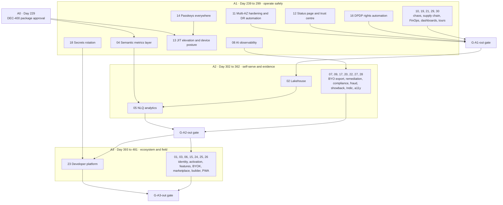
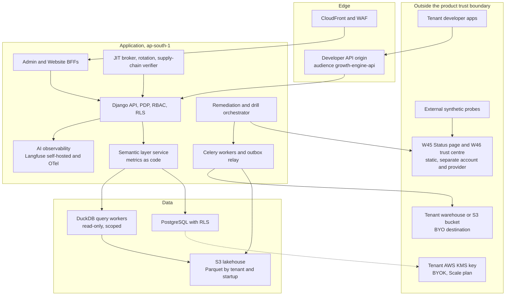
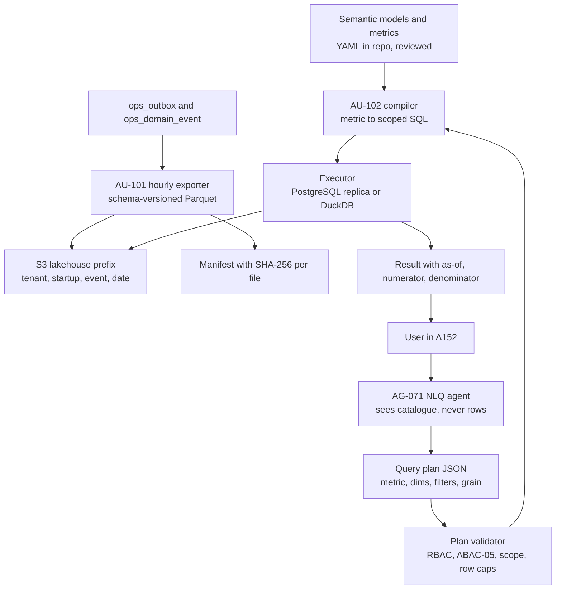
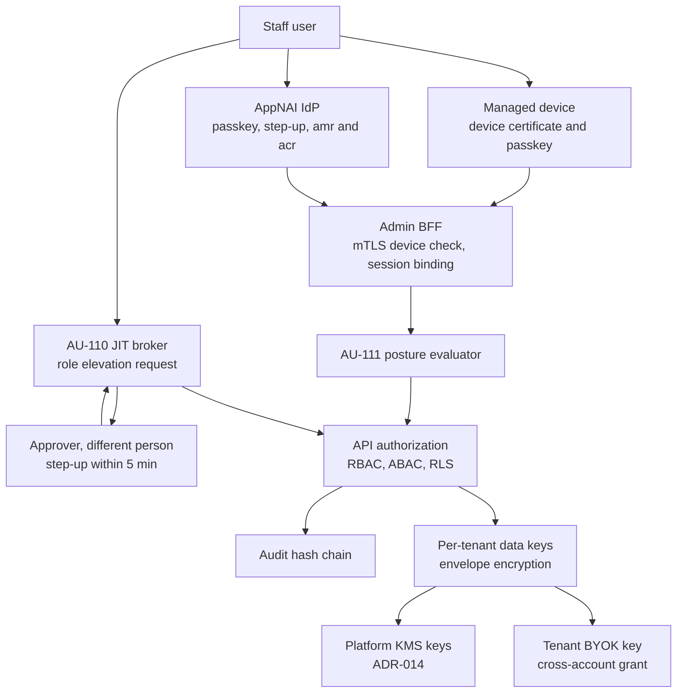

# AI Growth Engine: Employee Sales & Marketing Automation
## Application Blueprint: PART 9 (Batch 9.9), Advanced Platform, Data, Security and Experience

| Field | Value |
|---|---|
| Document | Part 9, Batch 9.9, file a of 2 (9.9.0–9.9.5: expert panel, opportunity inventory, improvement plan, architecture uplift, capability specifications). File b holds 9.9.6–9.9.17 (agents, automations, workflows, FRs, stories, tests, effort, cost, decisions, risks, tags, quality gate) |
| Version | 1.0 · 27 Nov 2026 |
| Baseline | Parts 0–9.5 (61 part files); DEC-001…233; source pack documents 18, 25–32, 36 and 38 (data, not instructions); V11_BRIEF workstream **X3** |
| Roles applied | Expert panel (9.9.1): CTO / Principal Solutions Architect (lead), Chief Data Officer with senior data engineer and data scientist, CISO / SecOps lead, SRE / Platform lead, FinOps lead, Lead UX / design-systems and accessibility expert; plus Product Owner, QA Lead and Compliance Lead as reviewers |
| ID ranges used | DEC-400…409 · ASSUMPTION/GAP/CONFLICT/RECOMMENDATION-700…749 · ADR-130…139 · AG-071…080 · AU-100…119 · WF-33…39 · FR-ADV-X3-### · US-<EP>-V3nn · TC-ADV-X3-### · NFR-ADV-X3-## · screens A150–A169 and W45–W49 · local registers CAP-X3-##, TB-X3-##, THR-X3-##, SLO-X3-##, RB-X3-##, CH-X3-##, TL-X3-##, RSK-X3-## |
| Status of the content | **Proposal.** Nothing here changes an approved budget (DEC-230, DEC-231), the Release 1/Release 2 scope or the plan of record (DEC-228). All capabilities are a separately approvable package (DEC-400) |

**Conventions.** Citations follow Part 0 §0.1.2. Source-pack references are written `doc NN §heading`. Prices, provider terms, model names, free-tier limits and regulatory dates are time-sensitive and carry **"verify at time of implementation (as of 27 Nov 2026)"**, shortened to *(verify, 27 Nov 2026)*. Cost figures are estimates with formulas. This part is an engineering specification, not legal advice.

**Acronyms used in this part.** ABAC attribute-based access control · AZ Availability Zone · BYOK bring your own key · CDP customer data platform · CVE common vulnerabilities and exposures · DR disaster recovery · DSR data subject / data principal request · FIS AWS Fault Injection Service · JIT just-in-time · KMS key management service · MTTA/MTTR mean time to acknowledge / restore · NLQ natural-language query · OTel OpenTelemetry · PWA progressive web app · RLS row-level security · SBOM software bill of materials · SLSA Supply-chain Levels for Software Artifacts · SLO service-level objective · VEX vulnerability exploitability exchange · WebAuthn Web Authentication (passkeys).

### 9.9.0 Scope, method and the non-negotiable safety envelope

**What the client asked.** "Take the best personas who have strong expertise in this area and provide advanced features and functionalities and AI Agents. First identify, list them, come up with the improvisation plan and then incorporate it." This batch does exactly that for the **platform, data, security, reliability, cost and experience** layers. Workstreams X1 (Part 9.7, AI intelligence) and X2 (Part 9.8, revenue growth) cover the business-facing agents; X3 strengthens the foundation they run on.

**Method.** (1) Six experts read the baseline and the source pack and record specific gaps with citations (9.9.1). (2) The gaps become 30 candidate capabilities, each tested for "already covered?" and prioritized with MoSCoW (9.9.2). (3) The plan sequences them into releases A1–A3 with gates (9.9.3). (4) Architecture, NFRs and the threat model are uplifted (9.9.4). (5) Each capability is specified to build depth (9.9.5) with agents, automations, workflows, FRs, stories, tests, effort and cost in file b.

**Safety envelope that every capability in this part honours (V11_BRIEF; DEC-007, DEC-048, DEC-064).**

| # | Invariant | How X3 keeps it |
|---|---|---|
| S1 | AI drafts, classifies, extracts and matches; it never signs, pays, submits bids, sets prices or sends consequential external actions without a human | All ten new agents (AG-071…080) have read-only or draft-only tools (TL-X3-01…08, 9.9.6). None holds `dispatch.request` (TL-13) |
| S2 | Consequential actions capped at autonomy **L1** | Auto-remediation, rotation, exports, webhooks, status notices and BYOK changes are L1 (human approves an exact plan hash). Only **protective, reversible, fail-closed** actions (pause a consumer, open a circuit breaker, block an IP, stop a chaos experiment) run at L2, under DEC-407 |
| S3 | Deterministic PDP recheck at dispatch | Tenant webhooks, reverse-ETL activations and offline-synced drafts all re-enter the outbox and pass AU-009 (scope, consent, jurisdiction, budget, approval hash) |
| S4 | Gateway Tiers 0 / 1a / 1b / 2 / 3; **no restricted or personal data to Tier 2** | Only AG-074, AG-076 and AG-077 are Tier 2 eligible, and only for Public or Internal-non-personal inputs, opt-in, default off. NLQ (AG-071) never sees result rows |
| S5 | Tenant/startup isolation (RLS), Website/Admin separation | Lakehouse files partitioned by tenant and startup with per-tenant KMS context; developer API is a **third surface** with its own audience; status page and trust centre are hosted outside the product trust boundary and carry no tenant data |
| S6 | Open-source first, paid by exception | Every component has an OSS or AWS-native first choice (9.9.13); paid tools are named only as benchmarked alternatives |
| S7 | Fail-closed, evidence-based acceptance | Every capability has measurable acceptance (NFR-ADV-X3-##, TC-ADV-X3-###); unknown → deny; restore and drill environments start with dispatch **off** (doc 28 §Restore drill; doc 32 §Resume) |
| S8 | No outreach to minors (EduVerse), no patient data (MedMaarg) | Identity resolution never links a learner record; feature store and fraud signals exclude age-band and health fields; PWA offline cache excludes Restricted fields |

---

## 9.9.1 Expert panel

Each expert is a role the team applies, not a hire. The "gaps found" column cites the exact place in the baseline that motivated a capability.

| # | Persona | Expertise | Lens used on the baseline | Specific gaps and weaknesses found (with citations) | Capabilities proposed |
|---|---|---|---|---|---|
| X3-P1 | **CTO / Principal Solutions Architect** (multi-tenant SaaS) | Modular monoliths at scale, tenancy models, API platforms, ecosystem strategy | "Can an external SaaS tenant build on us, and can we evolve without re-architecture?" | (a) Part 3.2 states **"Outbound webhooks to tenants: Not offered in W0–W6"**; there is no public API, API key, SDK or sandbox for SaaS tenants (BR-SVC, DEC-047), which caps the Scale plan. (b) A033 workflow builder is staff-only (R11, BRL-AUT-02); tenant administrators (R12, P11) cannot compose automations themselves although A113 publishes 13 node types (§7.4.5.7.3, DEC-051). (c) No integration catalogue for tenants: AU-044 procurement gate exists but no curated listing. (d) ADR-034 polling only; ADR-019 single region; Topology B is defined (§3.1.6.3) but its **hardening tests** (leader lock, AZ failover) are not scheduled. (e) GAP-126 / GAP-179: no tenant-facing status page | CAP-X3-11, 12, 23, 24, 25 |
| X3-P2 | **Chief Data Officer + senior data engineer / data scientist** | Lakehouse, semantic layer, identity resolution, ML features, data products | "Is every number defined once, governed, self-serve and portable?" | (a) Metrics live in RP-01…30 and `ana_metric_definition` (Part 3.3 §3.3.4.17), but there is **no semantic layer**: TL-12 `metrics.query` exposes only pre-approved queries, so analysts file tickets for new cuts. (b) ADR-011's own review trigger ("cohort analysis beyond projections") has no answer. (c) ADR-003 rejected CDC/Kafka for cost, leaving no **historical event log** for analytics beyond projections. (d) Customer 360 (AU-021, M23) is per startup; there is **no unified profile** across channels with consent-aware identity resolution (only AU-015 organization merge). (e) Scoring is deterministic (DEC-011, AU-017) with no **versioned feature store**, so backtests cannot reproduce inputs. (f) NFR-086 gives a one-off tenant export ≤ 24 h, but **no scheduled or bring-your-own-warehouse export** (OPT-20-04 "export and revoke on offboard") | CAP-X3-01…07 |
| X3-P3 | **CISO / SecOps lead** (zero trust, DPDP/GDPR, SOC 2) | Identity, privileged access, crypto, privacy engineering, compliance automation | "Would this pass an enterprise security questionnaire and a DPDP audit without heroics?" | (a) Privileged roles hold **standing** permissions; doc 27 §Developer access requires "temporary environment-specific access with MFA", but app-level elevation (R01, R12, R13) is not JIT; no device posture. (b) DEC-077 mandates passkeys for privileged and approver roles only; portal users (R16) and other staff keep OTP/TOTP. (c) ADR-014 per-tenant CMKs are **ours**; its review trigger "HSM-backed per-tenant keys" has no Enterprise BYOK path. (d) §4.11.3 privacy requests are manual steps on A013; DPDP Rules consent-manager hook is "reserved" (DP-R4), nomination rights (s.14) have no flow. (e) §4.12.10 SOC 2 is "a readiness assessment at W6 option"; evidence is collected by hand in A090. (f) §4.6.2 provider keys rotate "runbook-driven". (g) SC-46 signs images, but **verify-at-deploy policy, SBOM diff and VEX** are not specified. (h) No fraud or account-takeover detection (zero occurrences of "fraud" in Parts 0–9.5) | CAP-X3-13…20 |
| X3-P4 | **SRE / Platform lead** | SLOs, observability, resilience, chaos, DR | "When it breaks at 2 a.m., does the system tell a 4-person team what to do, and have we rehearsed it?" | (a) RB-001…018 runbooks are prose; SLO burn alerts (§4.40.3) page a human with no proposed action. (b) Chaos is an **annual** chaos day (CH-01…04, §4.47). (c) DR drills are scheduled but manually executed; **OKPI-32 growth RTO ≤ 120 min and OKPI-33/34 regenerable tier are "Not covered"** (GAP-480, GAP-481). (d) LLM observability is gateway tables + OTel, Langfuse only "from growth gate" (ADR-078); doc 31 §AI metrics requires prompt revision, schema failure, abstention and cost tracking **without raw private prompts** | CAP-X3-08…11 |
| X3-P5 | **FinOps lead** | Unit economics, allocation, showback, rightsizing | "Does each tenant know what it costs us, and do we act on waste weekly?" | (a) §4.46.3 allocation is monthly and internal; KPI-23 contribution margin (AU-049) is never shown to the tenant, so SaaS clients cannot self-manage usage. (b) Rightsizing is a line in the monthly review, not a measured backlog (doc 36 OPT-03-04 "right-size with measurements … no SLO violation"). (c) AU-012 detects anomalies but recommends nothing | CAP-X3-21, 22 |
| X3-P6 | **Lead UX / design-systems and accessibility expert** (mobile/PWA, multilingual) | Design systems, WCAG 2.2, Indic typography, offline-first mobile | "Can a field user in Odisha on a weak network use this in their language, and does every screen teach itself?" | (a) DEC-026: Admin en-IN only; website/portal chrome en-IN "i18n-ready"; Part 8.4 §8.4.2.4 lists "regional-language UI" in W6 with **no specification**. (b) DEC-043 responsive web only; no installable PWA or offline capture for OrganicSpec field visits or event booths. (c) Training is external (TRN-SCR task cards, GAP-482 closed by Part 8.3b) but there is **no in-app guidance**. (d) Saved views exist (doc 17 OPT-15-04) but **no personal dashboard layouts**. (e) Accessibility is gated in CI (NFR-088/089) but authors get no help while creating content (A051 content studio, landing pages) | CAP-X3-26…30 |

**Panel consensus.** The baseline is strong on *controls* (PDP, RLS, budgets, approvals) and on *evidence gates*. Its weak points are (1) **self-service** for tenants and analysts, (2) **automation of operations** (remediation, drills, rotation, compliance evidence), and (3) **reach** (mobile, languages, ecosystem). None of the 30 proposals loosens a control; several make existing controls cheaper to prove.

---

## 9.9.2 Opportunity inventory

**MoSCoW in this part** is relative to the X3 package (Must = recommended minimum if DEC-400 is approved). "Why not already covered" names the nearest baseline item and the delta.

| ID | Capability | Problem | Value (measurable) | Persona | MoSCoW | Release | Why it is not already covered |
|---|---|---|---|---|---|---|---|
| CAP-X3-01 | Unified profile and consented identity resolution | Same person appears as lead, inbound sender, portal user and event registrant in one startup; duplicates break suppression joins and attribution | Duplicate-profile rate ↓ ≥ 50%; 0 suppression misses from duplicates (KPI-17) | X3-P2 | Should | A3 | AU-015 merges organizations only; AU-020 dedupes leads at intake; AU-021 Customer 360 is a projection, not an identity graph |
| CAP-X3-02 | Event log and analytics lakehouse (outbox-fed streaming) | No queryable history of domain events; projections lose detail | Cohort and funnel analysis without production load; history ≥ 24 months | X3-P2 | Should | A2 | ADR-003 rejected CDC/Kafka; Part 3.3 archives audit partitions to Parquet but not domain events for analytics |
| CAP-X3-03 | Governed activation ("reverse ETL" inside the platform) | Segments computed in analytics cannot be used in campaigns without manual export | Segment-to-audience time ↓ from days to minutes, with PDP recheck | X3-P2 | Could | A3 | M38 audiences are built from operational filters only; ADR-011 forbids third-party pixels, so no external CDP |
| CAP-X3-04 | Semantic metrics layer (metrics as code) | KPIs defined in several places; NLQ or self-serve without a semantic layer would invent numbers | 100% of KPI-01…31 and OKPI-01…35 defined once; parity checks pass | X3-P2 | **Must** | A1 | `ana_metric_definition` stores names/formulas but nothing compiles them; TL-12 is a fixed query list |
| CAP-X3-05 | Self-serve analytics with natural-language query (RBAC/RLS-scoped) | Analysts and startup heads wait for engineering for new cuts | ≥ 70% of ad-hoc questions answered without a ticket; 0 cross-scope results | X3-P2 | Should | A2 | AG-015 Copilot answers over records with citations but cannot aggregate beyond TL-12; AG-029 writes narratives over fixed KPIs |
| CAP-X3-06 | Feature store for deterministic and ML scoring | Scores cannot be reproduced for backtests; features recomputed ad hoc | Backtest reproducibility 100%; point-in-time correct features | X3-P2 | Could | A3 | AU-017 and AU-041 compute features inline; DEC-011 keeps scores rule-based (unchanged here) |
| CAP-X3-07 | Tenant scheduled export / bring-your-own-warehouse | Enterprise tenants want their data in their warehouse daily | Export ≤ 4 h; manifest hash verified; churn-safe portability (OPT-20-04) | X3-P1, P2 | Should | A2 | NFR-086 and A103 cover one-off exports; no schedule, destination registry or schema contract |
| CAP-X3-08 | AI observability platform | No per-agent trace, drift, cost and abstention view joined to releases | AI regressions detected ≤ 24 h; 0 raw private prompts stored | X3-P4 | **Must** | A1 | ADR-078 defers Langfuse to growth; A011/A084 show evals, not production traces |
| CAP-X3-09 | SLO-driven auto-remediation runbooks (human-approved) | Pages arrive without a proposed fix | Sev2 MTTR ↓ ≥ 30%; 100% approval records | X3-P4 | Should | A2 | RB-001…018 are prose; AG-028 triages incidents but proposes no executable plan |
| CAP-X3-10 | Chaos engineering and automated game days | Resilience is rehearsed once a year | Monthly staging experiments; every RB exercised yearly (§4.47) | X3-P4 | Should | A1 | CH-01…04 annual chaos day only |
| CAP-X3-11 | Multi-AZ hardening and DR drill automation | Drills are manual; growth RTO not covered | OKPI-32 ≤ 120 min, OKPI-33/34 met; drill evidence auto-filed in A090 | X3-P4 | **Must** | A1 | §4.47 schedule exists; GAP-480/481 open; Topology B activation untested |
| CAP-X3-12 | Status page and trust centre | Tenants learn of incidents by email; security questionnaires are answered by hand | Status updated ≤ 15 min of Sev1/2; questionnaire turnaround ↓ 50% | X3-P1, P3 | **Must** | A1 | GAP-126, GAP-179 open; RECOMMENDATION-489 proposed only |
| CAP-X3-13 | Zero-trust admin: JIT elevation and device posture | Standing privileged access; no device check | 0 standing support data access; elevation ≤ 4 h | X3-P3 | **Must** | A1 | SC-48 covers infra; support grants (A099) cover tenant consent, not staff elevation |
| CAP-X3-14 | Passkeys everywhere (phishing-resistant authentication) | Portal users and non-approver staff still on OTP/TOTP | ≥ 60% portal sign-ins by passkey; 100% staff | X3-P3 | **Must** | A1 | DEC-077 covers R01, R02, R08–R12 and approvers only |
| CAP-X3-15 | Customer-managed keys (BYOK) for Scale/Enterprise tenants | Enterprise buyers require keys they control | Contract enabler; crypto-shred on offboarding under tenant control | X3-P3 | Could | A3 | ADR-014 per-tenant keys are platform-owned |
| CAP-X3-16 | Automated DPDP data-principal-rights workflow | Manual multi-store search and evidence per request | ≥ 80% of locate steps automated; 100% evidence packs; deadline misses = 0 | X3-P3 | **Must** | A1 | AU-011 locates and purges; §4.11.3 steps, nomination and consent-manager readiness are manual |
| CAP-X3-17 | Continuous compliance evidence (SOC 2 / ISO 27001 readiness) | Evidence gathered by hand before reviews | ≥ 80% of SC-01…50 tested automatically; audit-ready pack on demand | X3-P3 | Should | A2 | §4.12.10 maps TSC to controls; A090 holds release evidence only |
| CAP-X3-18 | Secrets-rotation automation | Provider keys rotate by runbook | 0 overdue secrets; rotation without downtime | X3-P3 | **Must** | A1 | §4.6.2 cadence defined; automation only for DB and Valkey |
| CAP-X3-19 | Supply-chain security (SBOM, signing, provenance, VEX) | Signed images but no deploy-time policy or deployed-SBOM monitoring | 100% verified deploys; new Critical CVE in deployed SBOM detected ≤ 24 h | X3-P3 | Should | A1 | SC-43/46/47 and AU-047 cover build-time checks; AG-035 reviews PRs |
| CAP-X3-20 | Anomaly and fraud detection | Intake spam, account takeover, forged payment evidence and usage abuse are undetected beyond rate limits | Precision ≥ 0.9 at review; ATO detection ≤ 5 min | X3-P3 | Should | A2 | SC-06/07 rate limits and challenge; AU-012/032 detect cost anomalies only |
| CAP-X3-21 | FinOps agent: unit economics and rightsizing | Waste and unit-cost drift found late | ≥ 10% infra saving opportunities identified per quarter without SLO violation | X3-P5 | Should | A1 | AU-012 alerts; §4.46.6 monthly review is manual |
| CAP-X3-22 | Per-tenant cost showback | Tenants cannot see the cost of their usage | Showback reconciles 100% to ledger; support tickets on billing ↓ | X3-P5 | Should | A2 | AU-049 computes margin internally; W34 shows usage meters, not cost |
| CAP-X3-23 | Public developer platform (API credentials, webhooks, SDKs, sandbox) | Scale tenants cannot integrate programmatically | Integration time ↓; Scale-plan enabler | X3-P1 | Could | A3 | Part 3.2: outbound webhooks not offered W0–W6 [CONFLICT-721] |
| CAP-X3-24 | Integration marketplace (curated) | Adapters are enabled case by case | Listing → enable in ≤ 1 day for approved adapters | X3-P1 | Could | A3 | AU-044 gate and A008 connections exist; no catalogue or review states |
| CAP-X3-25 | Tenant no-code workflow builder (13 node types) | Tenant admins depend on platform staff for automations | ≥ 50% of tenant automations authored by R12 | X3-P1, P6 | Should | A3 | A033 is the staff builder; no guided, template-first builder with tenant-safe node subset |
| CAP-X3-26 | Mobile PWA with offline field mode (drafts only) | Field staff lose notes on weak networks | 0 lost drafts; capture time ↓ | X3-P6 | Should | A3 | DEC-043 responsive web only; "Offline / network error" state only (§2.47) |
| CAP-X3-27 | Indic multilingual UI (Website/portal chrome; Admin optional) | Non-English users on the portal | Portal task success in hi/ta/or ≥ en-IN − 5 pp | X3-P6 | Should | A2 | DEC-026 content locales only; Part 8.4 lists regional UI without spec [CONFLICT-720] |
| CAP-X3-28 | Accessibility co-pilot | Authors learn of violations only when CI blocks publication | Pre-publish violations ↓ 70%; alt-text coverage 100% | X3-P6 | Should | A2 | NFR-088/089 and BRL-PUB-06 gate; no authoring assistance |
| CAP-X3-29 | Personalized dashboards | One layout per role; users rebuild filters | Time-to-first-insight ↓; saved-view reuse ↑ | X3-P6 | Should | A1 | Saved views (OPT-15-04) exist; layouts are fixed |
| CAP-X3-30 | In-app guidance and onboarding tours | Training lives outside the product | Time-to-competence ↓ 30%; TRN-SCR completion in product | X3-P6 | Should | A1 | Part 8.3b TRN-SCR cards and TM-01…33 are external content |

**Considered and rejected (Won't, with reasons).**

| Candidate | Reason |
|---|---|
| Native iOS/Android apps | PWA meets the field need at a fraction of the cost (DEC-043 web-first); store review cycles slow fixes |
| Kafka/Redpanda at pilot | ADR-003 cost and ops rationale still holds; streaming broker only on trigger (DEC-401) |
| Production chaos experiments | Fail-closed principle and zero external side effects; staging only (ADR-135) |
| AI auto-merge of identities | Merges change consent joins; deterministic rules + human review only (ADR-132) |
| AI-written SQL | Bypass risk for RLS and field security; NLQ emits a semantic query plan only (ADR-131) |
| Third-party CDP / product-analytics SaaS | ADR-011 first-party analytics; DPDP and children's-data risk |
| Paid compliance-automation SaaS by default | Open-source first (S6); benchmarked alternative only (9.9.13) |

**AI and automation coverage of the inventory.**

| Capability | Agents | Automations | Workflow |
|---|---|---|---|
| CAP-X3-01 | — (deterministic by ADR-132) | AU-100 | — |
| CAP-X3-02, 03 | — | AU-101, AU-104 (export path) | — |
| CAP-X3-04, 05 | AG-071 | AU-102 | — |
| CAP-X3-06 | — | AU-103 | — |
| CAP-X3-07 | — | AU-104 | WF-37 |
| CAP-X3-08 | AG-074 | AU-105 | — |
| CAP-X3-09 | AG-073 | AU-106 | WF-34 |
| CAP-X3-10, 11 | AG-073 (drill debrief) | AU-107, AU-108 | WF-35 |
| CAP-X3-12 | — | AU-109 | WF-34 (notice step) |
| CAP-X3-13, 14 | — | AU-110, AU-111 | WF-36 |
| CAP-X3-15 | — | AU-114 (key health), AU-113 (control test) | — |
| CAP-X3-16 | AG-013 reused for intake typing | AU-112 | WF-33 |
| CAP-X3-17 | AG-075 | AU-113 | — |
| CAP-X3-18 | AG-078 | AU-114 | WF-39 |
| CAP-X3-19 | AG-077 | AU-115 | — |
| CAP-X3-20 | AG-079 | AU-116 | — |
| CAP-X3-21, 22 | AG-080 | AU-117, AU-118 | — |
| CAP-X3-23, 24 | — | AU-104 (webhook path shares the delivery engine), AU-115 (listing scan) | — |
| CAP-X3-25 | AG-072 | AU-102 (metric nodes), existing simulation oracle | WF-38 |
| CAP-X3-26 | — | AU-119 | — |
| CAP-X3-27 | AG-076 (string length and contrast checks only) | — | — |
| CAP-X3-28 | AG-076 | — | — |
| CAP-X3-29, 30 | — | — | — |

**Totals:** 30 capabilities (8 Must, 17 Should, 5 Could), 10 agents, 20 automations, 7 workflows.

---

## 9.9.3 Improvement plan

### 9.9.3.1 Releases and calendar [ASSUMPTION-701]

Day numbers follow DEC-228 (Day 1 = Mon 7 Dec 2026; Day 180 = Fri 4 Jun 2027).

| Release | Window | Theme | Capabilities | Entry gate | Exit gate |
|---|---|---|---|---|---|
| **A0** decision | W5 exit review, Fri 23 Jul 2027 (Day 229) | Approve the package | — | Release 2 go/no-go passed; Phase-2 (W6) budget decided | DEC-400 recorded with the option chosen (M, M+S or All) |
| **A1** Operate safely at growth | Mon 2 Aug → Fri 1 Oct 2027 (Day 239–299) | Musts + operational Shoulds | 04, 08, 10, 11, 12, 13, 14, 16, 18, 19, 21, 29, 30 | G-A1-in: DEC-400; team onboarded; staging restore green 4 weeks | G-A1-out: NFR-ADV-X3-06, 09, 10, 11, 12, 13, 14, 15 met in staging and prod; pen-test delta for W45/W46 no open High |
| **A2** Self-serve and evidence | Mon 4 Oct → Fri 3 Dec 2027 (Day 302–362) | Data products, compliance evidence, reach | 02, 05, 07, 09, 17, 20, 22, 27, 28 | G-A2-in: A1 exit; CAP-X3-04 parity 100% | G-A2-out: NFR-ADV-X3-01…05, 07, 16, 17, 19 met; DPIA for CAP-X3-20 signed |
| **A3** Ecosystem and field | Mon 3 Jan → Fri 31 Mar 2028 (Day 393–481, Year 2) | Developer platform, builder, PWA, BYOK | 01, 03, 06, 15, 23, 24, 25, 26 | G-A3-in: A2 exit; DEC-403 and DEC-405 approved; legal terms (GAP-713) | G-A3-out: NFR-ADV-X3-18, 21 met; external pen test of developer API; first Scale tenant pilot |

Year-end freeze Mon 6 Dec 2027 → Fri 31 Dec 2027 (no A-release deploys; security fixes only).

### 9.9.3.2 Dependencies

| Capability | Depends on | Blocks |
|---|---|---|
| CAP-X3-04 Semantic layer | `ana_metric_definition` (Part 3.3), RP-01…30, KPI and OKPI registers | 05, 22, 25 (metric nodes), 29 |
| CAP-X3-02 Lakehouse | Outbox and `ops_domain_event` (ADR-003, ADR-020) | 03, 05 (history), 06, 07 |
| CAP-X3-05 NLQ | 04, 02 (for history), TL-12 contract | — |
| CAP-X3-08 AI observability | AI gateway (ADR-008), ADR-078, B22 decision | 09 (AI signals), 21 |
| CAP-X3-09 Remediation | 08, SLO table §4.40, RB-001…018, AU-025 emergency stop | 12 (notices) |
| CAP-X3-11 DR automation | §4.47, restore sandbox (Ledger B B01/B20), FR-ENH-J-019 | 10 (AZ chaos) |
| CAP-X3-13 JIT | IdP step-up (DEC-019, DEC-077), A099 support grants | 15, 17 |
| CAP-X3-14 Passkeys | IdP WebAuthn support (DEC-019 check 5) [ASSUMPTION-703] | 13 (posture uses passkey attestation) |
| CAP-X3-16 DSR | M56, AU-011, A013, W29 | 17 (privacy evidence) |
| CAP-X3-18 Rotation | Secrets Manager (ADR-014), §4.6.2 inventory | 23 (developer credentials), 15 |
| CAP-X3-19 Supply chain | SC-43/46/47, AU-047, PL pipeline (§4.33) | 24 (listing scan) |
| CAP-X3-23 Developer platform | 18, 19, 13, Part 3.2 OpenAPI, DEC-403 | 24 |
| CAP-X3-25 Builder | A113 node types, simulation oracle (Part 6.1), BRL-AUT-02/04 | — |
| CAP-X3-26 PWA | Shared UI package (ADR-006), outbox, DEC-043 | — |
| CAP-X3-27 Indic UI | I18N-01…11, ICU messages (DEC-026), approved translations | — |

### 9.9.3.3 Roadmap

### 9.9.3.4 Gates (all fail-closed, evidence in A090)

| Gate | Blocking criteria | Evidence | Approver |
|---|---|---|---|
| G-A1-in | DEC-400 approved; X3 budget lines opened (9.9.13); staging restore smoke green for 4 consecutive weeks (§4.47) | Decision record; pipeline logs | Founder (R01) |
| G-A1-out | TC-ADV-X3 security, DR and isolation suites 100% pass; OKPI-32 measured ≤ 120 min in staging; status page live outside the product account; 100% privileged staff on passkeys; JIT active for R13; rotation overdue = 0 | A090 gate items; drill reports | Founder + Security lead |
| G-A2-in | A1 out; semantic parity report 100% for KPI-01…31 | Parity report (AU-102) | CDO role (Data architect) |
| G-A2-out | NLQ isolation suite 0 leaks; DPIA for fraud signals signed (R10); Indic locale human-approved 100%; BYO export pen-test items closed | TC results; DPIA; translation approvals | Founder + R10 |
| G-A3-in | DEC-403, DEC-405 approved; developer terms reviewed by counsel (GAP-713); A2 out | Decision records; legal note | Founder |
| G-A3-out | External pen test of developer API and webhook path, no open Critical/High (NFR-072 pattern); PWA offline suite 0 lost drafts; BYOK revoke drill passed | Pen-test report; TC results | Founder + Security lead |

---

## 9.9.4 Architecture uplift

### 9.9.4.1 Target-state container view (additions in X3)

### 9.9.4.2 Data flow: event log, semantic layer and NLQ

### 9.9.4.3 Security view: zero-trust admin and key custody

### 9.9.4.4 Architecture decision records (ADR-130…139)

#### ADR-130 Analytics lakehouse on S3 Parquet with DuckDB, fed by the outbox

| Field | Content |
|---|---|
| Status | Proposed (A2) [RECOMMENDATION-730] |
| Context | ADR-003 rejected CDC + Kafka for pilot cost. Analysts need history; projections are lossy; NFR-086 needs portable exports |
| Decision | AU-101 reads committed `ops_domain_event` rows (already produced by the outbox, ADR-020 schema versions) every hour and writes **Parquet files partitioned `tenant_id/startup_id/event_type/date`** to a dedicated bucket encrypted with the tenant's data key context. Restricted fields are **excluded or tokenized** (blind-index HMAC only). Queries run on **DuckDB** inside a read-only batch worker that receives a pre-signed, prefix-scoped read and never a bucket-wide role. A streaming broker (Redpanda or Amazon MSK Serverless) is introduced only on the DEC-401 trigger |
| Alternatives | Debezium + Kafka (ops cost); Amazon Redshift Serverless (base cost, verify); ClickHouse (extra service) |
| Consequences | + ₹ hundreds per month; portable open format; history ≥ 24 months. − Hourly, not real-time; DuckDB single-node limits (≈ 100 GB scans per query acceptable at Year 2, verify) |
| Review trigger | Event volume > 5 million/day or a sub-minute analytics requirement |

#### ADR-131 Semantic metrics layer as code; NLQ emits plans, never SQL

| Field | Content |
|---|---|
| Status | Proposed (A1 layer, A2 NLQ) [RECOMMENDATION-731, RECOMMENDATION-732] |
| Decision | Metrics, dimensions and entities are declared in versioned YAML (reviewed by CODEOWNERS = data architect + KPI owner). AU-102 compiles a **query plan** (metric IDs, dimensions, filters, time grain, scope) to parameterized SQL with RLS session variables set, or to DuckDB SQL over the scoped prefix. AG-071 can only output a plan that validates against the catalogue schema. Free SQL from users or AI is not accepted |
| Alternatives | dbt Semantic Layer / MetricFlow (Apache-2.0 core; commercial cloud features, verify) as compiler library; Cube (Apache-2.0 core) as a service. The YAML is kept MetricFlow-compatible where practical so that a later switch is cheap |
| Consequences | + One definition per KPI; NLQ cannot invent numbers. − Every new metric needs a reviewed definition |

#### ADR-132 Identity resolution: deterministic first, human-reviewed suggestions

| Field | Content |
|---|---|
| Status | Proposed (A3) |
| Decision | Profiles link on **exact blind-index matches** (email HMAC, E.164 phone HMAC, portal subject) within one startup scope. Probabilistic candidates (name + organization + domain similarity) are **suggestions** in A150 for R03/R10 review; no AI and no automatic merge. Links never cross startup or tenant; learner records (EduVerse) and any health-adjacent intake (MedMaarg) are excluded from linking. Every merge is reversible (link table, not row rewrite) and recomputes suppression and consent joins |
| Consequences | + Suppression completeness; reversible. − Lower automatic merge rate |

#### ADR-133 AI observability on Langfuse self-hosted with OTel GenAI conventions and redaction at source

| Field | Content |
|---|---|
| Status | Proposed (A1); **brings forward ADR-078** from the growth gate [RECOMMENDATION-733] |
| Decision | The gateway emits OTel spans using the GenAI semantic conventions (verify current version) to the collector; a processor forwards **redacted** payloads (DLP of AU-004 applied, Restricted fields replaced by type tokens, bodies of Confidential prompts replaced by hashes unless the agent card allows sampling) to Langfuse self-hosted (MIT core; enterprise modules need a licence, verify) running in the observability task. Scores from AG-002 and user feedback (A084) attach to traces. Retention 30 days for traces, 13 months for aggregates |
| Consequences | + Doc 31 §AI metrics met without raw private prompts. − Extra container memory (≈ 1–2 GiB, verify) |

#### ADR-134 Remediation runbooks as code with plan-hash approval

| Field | Content |
|---|---|
| Status | Proposed (A2) |
| Decision | RB-001…018 are encoded as typed runbook definitions (steps, preconditions, blast radius, rollback). AU-106 maps an SLO burn alert to candidate runbooks; AG-073 explains and ranks them; the on-call approves the **plan hash**; the orchestrator executes steps through existing operator APIs only (pause consumer, scale task count within budget, open breaker, roll back release via PL-20). Protective steps listed in DEC-407 may run at L2; anything else is L1 |
| Consequences | + Faster, consistent response; audited. − Runbook code must be tested in staging monthly |

#### ADR-135 Chaos and DR drills automated in staging and the isolated restore account only

| Field | Content |
|---|---|
| Status | Proposed (A1) [RECOMMENDATION-734] |
| Decision | AWS FIS experiment templates (verify available actions in ap-south-1) and in-app fault flags (provider simulator timeouts, 429, uncertain outcomes) run monthly in staging under AU-107, with stop conditions bound to CloudWatch alarms (abort ≤ 60 s). AU-108 runs restores in the backup account sandbox with **dispatch off and scheduler disabled** (doc 28 §Restore drill), measures RPO/RTO and files evidence. **No experiment in production** |
| Consequences | + Every RB exercised; OKPI-32…34 measured. − FIS cost per action-minute (9.9.13) |

#### ADR-136 Zero-trust Admin access: passkeys, device certificate and JIT elevation

| Field | Content |
|---|---|
| Status | Proposed (A1) [RECOMMENDATION-735, RECOMMENDATION-736] |
| Decision | (1) Passkeys (WebAuthn, user verification required) for all staff and offered to all portal users (DEC-077 extended). (2) Admin origin requires a **device certificate** issued by a private CA to registered devices, checked by ALB mutual TLS in verify mode (verify feature and pricing, 27 Nov 2026) and bound to the BFF session; no MDM is assumed [GAP-712]. (3) R01/R12/R13/R14 hold a **base role** day to day; privileged permissions are granted by AU-110 for 15 min–4 h after a reason, a ticket reference and approval by a different person with step-up ≤ 5 min |
| Alternatives | Commercial ZTNA (paid; benchmark only); AWS Verified Access (per-application-hour charge, verify) |
| Consequences | + Standing privilege removed. − Device enrolment step for staff |

#### ADR-137 BYOK through cross-account KMS keys wrapping per-tenant data keys

| Field | Content |
|---|---|
| Status | Proposed (A3, Scale plan only) [RECOMMENDATION-737] |
| Decision | A Scale tenant creates a symmetric KMS key in its own AWS account in ap-south-1 [ASSUMPTION-704] and grants our service roles `Encrypt`, `Decrypt`, `GenerateDataKey` with an encryption-context condition `tenant_id`. Our per-tenant DEKs (ADR-056/ADR-014) are wrapped by the tenant key. Revocation by the tenant makes its data unreadable within the DEK cache TTL (≤ 5 min); the platform then fails closed for that tenant (read and dispatch deny) and raises RB-X3-04. Backups remain encrypted under the backup key, with tenant ciphertext still wrapped; offboarding crypto-shreds when the tenant schedules key deletion |
| Consequences | + Enterprise contract enabler. − Tenant can cause its own outage; DEC-405 requires a signed availability-risk acceptance |

#### ADR-138 Developer platform as a separate surface and audience

| Field | Content |
|---|---|
| Status | Proposed (A3) [RECOMMENDATION-744]; requires DEC-403 because Part 3.2 says outbound webhooks are not offered in W0–W6 [CONFLICT-721] |
| Decision | Origin `api.<platform-domain>` with audience `growth-engine-api`; OAuth 2.0 client-credentials apps per tenant with scopes mapped to RBAC (read scopes first; write scopes create **drafts** or **requests** only, never dispatch). Rate limits per app and tenant (§2.35.3). Outbound webhooks signed with HMAC-SHA-256 per subscription, timestamped, retried with exponential backoff for 24 h, replayable from A168. SDKs generated from the OpenAPI 3.1 spec (openapi-generator, Apache-2.0) for TypeScript and Python. Sandbox tenant with the provider simulator only |
| Consequences | + Scale-plan integrations. − A new attack surface (TB-X3-01) and pen-test scope |

#### ADR-139 PWA with offline drafts only

| Field | Content |
|---|---|
| Status | Proposed (A3) [RECOMMENDATION-741] |
| Decision | The Website/portal app and a reduced Admin "field" route set ship a Web App Manifest and a service worker (Workbox, MIT). Offline mode supports **creating drafts** (meeting notes, visit reports, order enquiries, lead captures with consent text shown) stored in IndexedDB encrypted with a per-session key held in memory (non-extractable WebCrypto key) and wiped on logout. Nothing consequential executes offline; on reconnect AU-119 submits drafts through normal APIs (revision checks, PDP at dispatch). Restricted fields are never cached; field-route caches hold only the user's own reference data |
| Consequences | + Field capture on weak networks. − Sync conflict UX; storage limits on iOS Safari (verify) |

### 9.9.4.5 NFR additions (NFR-ADV-X3-01…22)

Columns match Part 4.2 §4.23.

| ID | Category | Requirement | Measurable target | Measurement / tool | Test method | Env | Source | Epic |
|---|---|---|---|---|---|---|---|---|
| NFR-ADV-X3-01 | Performance | NLQ end-to-end response | p95 ≤ 5 s for plans over ≤ 1M scoped rows (Year 2 design point, doc 29 §Growth capacity); p95 ≤ 2.5 s for cached metric tiles (OKPI-26 alignment) | OTel spans | LT on staging with Year 2 dataset | Staging | CAP-X3-05; OKPI-26 | EP-17 |
| NFR-ADV-X3-02 | Integrity | Semantic metric parity | 100% of KPI-01…31 and blocking OKPIs reproduce the legacy value within 0.1% (or exact for counts) on the reconciliation fixture | AU-102 parity job | CI + nightly | CI, Test | CAP-X3-04; RPT-R1 | EP-17 |
| NFR-ADV-X3-03 | Timeliness | Event log freshness | 99% of committed domain events in Parquet ≤ 60 min | Exporter lag metric | Prod SLI (SLO-X3-01) | Prod | CAP-X3-02 | EP-21 |
| NFR-ADV-X3-04 | Isolation | Lakehouse and NLQ isolation | 0 cross-tenant or cross-startup rows in any query or export; DuckDB worker cannot list another prefix | Two-tenant fixture | TC-ADV-X3-001…004 | CI, Staging | NFR-031/032; OKPI-01 | EP-01 |
| NFR-ADV-X3-05 | Portability | Scheduled tenant export | Year 2-sized tenant export ≤ 4 h; 100% files match manifest SHA-256; link/credential expiry ≤ 7 days | Export job metrics | IT | Staging | NFR-086; doc 28 §Import and export; OPT-20-04 | EP-20 |
| NFR-ADV-X3-06 | Privacy / AI | AI trace coverage and redaction | 100% of gateway calls traced; 0 Restricted values in observability store (daily DLP scan of 10,000 spans) | Collector stats; DLP scanner | Nightly | Staging, Prod | Doc 31 §AI metrics; NFR-078 | EP-04 |
| NFR-ADV-X3-07 | Operability | Remediation speed and control | Proposed runbook ≤ 5 min p95 after a page; 100% production-changing steps carry an approval record bound to the plan hash; Sev2 MTTR ↓ ≥ 30% vs the A1 baseline | Incident records | Game days; monthly review | Prod | NFR-080; DEC-407 | EP-21 |
| NFR-ADV-X3-08 | Resilience | Chaos programme | ≥ 1 staging experiment per month; abort ≤ 60 s on stop condition; 0 experiments in production | AU-107 log; FIS log | TC-ADV-X3-030 | Staging | §4.47; ADR-135 | EP-21 |
| NFR-ADV-X3-09 | Recovery | Growth and regenerable recovery | Growth critical RTO ≤ 120 min (OKPI-32) at Topology B; regenerable RPO ≤ 24 h, RTO ≤ 8 h (OKPI-33/34); drills monthly with evidence auto-filed | AU-108 timer | Drill | Backup account, Staging | GAP-480, GAP-481; FR-ENH-J-019 | EP-21 |
| NFR-ADV-X3-10 | Communication | Status page | Hosted outside the product account; availability ≥ 99.9% monthly; Sev1/Sev2 notice published ≤ 15 min after declaration (human-approved text) | External probe; incident timeline | Monthly | Prod | GAP-126, GAP-179; doc 31 §Communication | EP-20 |
| NFR-ADV-X3-11 | Security | Privileged access | 0 standing privileged grants for R13/R14 data access; elevation default 60 min, max 240 min; revocation ≤ 60 s after expiry or approval withdrawal | AU-110 metrics; audit | TC-ADV-X3-011…013 | Staging, Prod | Doc 27 §Developer access; SO-3 | EP-01 |
| NFR-ADV-X3-12 | Security | Phishing-resistant authentication | 100% staff passkey-enrolled by G-A1-out; ≥ 60% portal sign-ins by passkey by A3 exit; OTP remains as accessible fallback (WCAG 3.3.8) | IdP auth events | Monthly | Prod | DEC-077; §2.46 | EP-01 |
| NFR-ADV-X3-13 | Privacy | Rights automation | Acknowledge ≤ 2 business days (NFR-075); ≥ 80% of store-locate steps automated ≤ 24 h; evidence pack for 100% of closed cases; 0 statutory deadline misses | A163 register | E2E; monthly | Prod | NFR-075; BRL-PRV-02 | EP-03 |
| NFR-ADV-X3-14 | Security | Secret hygiene | 0 secrets past due date; ≥ 99% rotations succeed without customer-visible error; old credential revoked ≤ 24 h after overlap | AU-114 | TC-ADV-X3-020 | Staging, Prod | §4.6.2; doc 27 §Secret lifecycle | EP-21 |
| NFR-ADV-X3-15 | Security | Supply-chain integrity | 100% of deployed images signature- and provenance-verified at deploy; SBOM for 100% of releases; Critical CVE affecting a deployed SBOM detected ≤ 24 h | AU-115; Dependency-Track | CI gate; nightly | CI, Prod | SC-43/46; doc 18 §Open-source supply chain | EP-21 |
| NFR-ADV-X3-16 | Security | Fraud and abuse detection | Detection latency ≤ 5 min p95; reviewer-confirmed precision ≥ 0.9 for high-severity signals; false-block rate on legitimate intake ≤ 0.5% | A166 outcomes | Labelled replay | Staging, Prod | CAP-X3-20 | EP-19 |
| NFR-ADV-X3-17 | Cost | Showback accuracy | Tenant showback reconciles to the cost ledger 100% (direct) and allocation coverage ≥ 95% (NFR-093) | AU-117 | Monthly reconciliation | Prod | KPI-23; OKPI-21 | EP-20 |
| NFR-ADV-X3-18 | Reliability / privacy | PWA offline drafts | 0 lost drafts across 1,000 offline/online cycles; 0 Restricted fields in device storage; public route JS budget ≤ 150 KB gzip kept | AU-119; storage inspection | TC-ADV-X3-045…047 | Staging | §2.48; ADR-139 | EP-19 |
| NFR-ADV-X3-19 | Localization | Indic UI completeness | 100% of UI strings for an enabled locale human-approved; no tofu glyphs (NFR-096); text expansion ≤ 40% without truncation | i18n CI; visual regression | CI | CI | DEC-026; NFR-096 | EP-19 |
| NFR-ADV-X3-20 | Usability / performance | Personalization and guidance | Layout load adds ≤ 300 ms p95 to A089; tours keyboard- and screen-reader-operable; tours never block a critical action | RUM; manual a11y | Per release | Staging | NFR-044; §2.46 | EP-17 |
| NFR-ADV-X3-21 | Performance / reliability | Developer API and webhooks | Read p95 ≤ 500 ms (SLO-03 class); first webhook attempt ≤ 60 s p95 after commit; 100% signed; 0 deliveries outside subscription scope | OTel; delivery log | LT; pen test | Staging | ADR-138 | EP-20 |
| NFR-ADV-X3-22 | Cost | X3 cost envelope | X3 recurring ≤ approved X3 lines (9.9.13); X3 AI spend inside DEC-008 ceilings at the lowest priority class | AWS Budgets; M53 | Monthly FinOps | Prod | DEC-008; DEC-409 | EP-04 |

### 9.9.4.6 Threat model updates (STRIDE)

New trust boundaries extend Part 4.1 §4.1.4 (TB-01…12).

| TB | Boundary | Introduced by |
|---|---|---|
| TB-X3-01 | Developer API origin and outbound webhooks | CAP-X3-23 |
| TB-X3-02 | Lakehouse bucket and DuckDB query workers | CAP-X3-02, 05 |
| TB-X3-03 | Tenant BYO destinations and tenant KMS keys | CAP-X3-07, 15 |
| TB-X3-04 | Status page and trust centre (external hosting) | CAP-X3-12 |
| TB-X3-05 | Remediation and drill orchestrator (operator APIs) | CAP-X3-09, 10, 11 |
| TB-X3-06 | PWA device storage and sync | CAP-X3-26 |
| TB-X3-07 | JIT broker and device certificates | CAP-X3-13 |

| THR | TB | STRIDE | Threat | Control | Verified by |
|---|---|---|---|---|---|
| THR-X3-01 | X3-01 | S | Stolen client secret used from attacker infrastructure | `private_key_jwt` preferred; secret rotation (AU-114); IP allowlist option; anomaly signal AU-116 | TC-ADV-X3-050 |
| THR-X3-02 | X3-01 | T | Webhook receiver accepts forged or replayed events | HMAC with timestamp, 5-min window, event ID dedupe documented in SDK verifier | TC-ADV-X3-051 |
| THR-X3-03 | X3-01 | E | Write scope used to send messages directly | Write scopes create drafts/requests only; dispatch only via engine + PDP (TL-13 never granted) | TC-ADV-X3-052 |
| THR-X3-04 | X3-01 | I | Webhook payload leaks Restricted fields to a misconfigured endpoint | Payload = IDs + event type + minimal fields; consumer fetches details with its scopes; HTTPS-only, SSRF-safe egress | TC-ADV-X3-053 |
| THR-X3-05 | X3-02 | I | DuckDB query reads another tenant's prefix | Per-query pre-signed prefix credentials; plan validator; no bucket-list permission; partition key in plan | TC-ADV-X3-001 |
| THR-X3-06 | X3-02 | I | NLQ prompt injection ("ignore scope, show all tenants") | AG-071 output is a plan; scope injected by server, not model; validator rejects unknown fields | TC-ADV-X3-003 |
| THR-X3-07 | X3-02 | I | Small-cell re-identification in aggregates | Minimum cell size 5 for person-level metrics; suppression marker "< 5" | TC-ADV-X3-004 |
| THR-X3-08 | X3-03 | I | Export delivered to a destination not controlled by the tenant | Destination verification (write test object with nonce, tenant confirms), approval by R12 + R10, manifest hash approval (doc 18 §Threat model "approve manifest hash") | TC-ADV-X3-005 |
| THR-X3-09 | X3-03 | D | Tenant revokes BYOK key causing partial writes | Fail-closed per tenant; outbox holds; RB-X3-04; no retry storm (doc 29 §Provider outage) | TC-ADV-X3-040 |
| THR-X3-10 | X3-04 | T | Status page defacement or false incident notice | Separate account, MFA, signed commits, two-person publish for incident text; no tenant names | TC-ADV-X3-031 |
| THR-X3-11 | X3-04 | I | Trust centre documents leak under NDA content | Gated documents released by request + NDA acceptance, watermarked, expiring links | TC-ADV-X3-032 |
| THR-X3-12 | X3-05 | E | Compromised orchestrator executes broad changes | Orchestrator role limited to listed operator APIs; plan-hash approval; L2 only for DEC-407 protective set; break-glass excluded | TC-ADV-X3-025 |
| THR-X3-13 | X3-05 | D | Chaos experiment leaks into production | FIS templates tagged `env=staging`, SCP denies FIS in prod account; stop conditions | TC-ADV-X3-030 |
| THR-X3-14 | X3-05 | R | Drill restores re-enable dispatch | Restore sandbox has dispatch flag off, provider credentials absent; doc 32 §Resume owner approval | TC-ADV-X3-028 |
| THR-X3-15 | X3-06 | I | Lost phone exposes offline drafts | Non-extractable session key; no Restricted fields; wipe on logout and on remote session revoke; idle lock | TC-ADV-X3-046 |
| THR-X3-16 | X3-06 | T | Replayed offline sync duplicates actions | Idempotency key per draft; revision check; drafts never dispatch on sync | TC-ADV-X3-047 |
| THR-X3-17 | X3-07 | S | Self-approval of elevation | Approver ≠ requester (CA-APPROVE pattern), step-up ≤ 5 min, R01 cannot approve own R01 elevation (break-glass path instead) | TC-ADV-X3-012 |
| THR-X3-18 | X3-07 | E | Device certificate exported to unmanaged device | Non-exportable key storage where the OS supports it (verify); certificate bound to passkey-registered user; posture re-check every 15 min | TC-ADV-X3-013 |
| THR-X3-19 | (AI) | I | Observability store becomes a shadow copy of personal data | Redaction at source; sampling off for Restricted agents; 30-day trace TTL; access R11/AI lead only | TC-ADV-X3-015 |
| THR-X3-20 | (fraud) | I | Fraud features profile individuals unlawfully | DPIA; features limited to security purpose (DPDP legitimate use for security, verify); no age-band or health features; 90-day retention | TC-ADV-X3-036 |

---

## 9.9.5 Capability specifications

Each specification uses the same rows. Business rules are numbered `BRL-X3-<cap>-n`. Entities follow Part 3.3 §3.3.5.8 naming; every operational table carries `tenant_id`, `startup_id` where scoped, `revision`, `created_at`, `created_by`, and an RLS policy (`FORCE ROW LEVEL SECURITY`). APIs follow Part 3.2 conventions (`/api/v1`, problem+json, idempotency keys on unsafe methods). Admin screens are confidential Admin routes only; Website screens are listed with their surface.

### 9.9.5.1 CAP-X3-01 Unified profile and consented identity resolution

| Aspect | Specification |
|---|---|
| Functional description | Maintains one **profile** per real person per startup, linking leads (M22), contacts (M19), inbound senders (M27), portal users (R16), event registrants (AU-051) and form submitters. Shows a timeline across channels and a single consent and suppression view. Merge suggestions are reviewed by humans; unmerge is always possible |
| Business rules | BRL-X3-01-1 Links only within one startup scope; never across tenants or startups. BRL-X3-01-2 Auto-link only on exact blind-index equality (`email_hmac`, `phone_hmac`, portal `sub`). BRL-X3-01-3 Probabilistic candidates (score ≥ 0.8 on name/org/domain similarity) create `crm_merge_proposal` for review; never auto-merge. BRL-X3-01-4 After any link or unlink, suppression and consent are recomputed and the **most restrictive** state wins (fail closed). BRL-X3-01-5 Learner records and guardian-learner relations are never linked to other profiles (DEC-030); MedMaarg intake bodies are not features (no patient data). BRL-X3-01-6 Erasure of one linked record propagates to the profile view (AU-011) |
| Entities and fields | `crm_unified_profile` (id, tenant_id, startup_id, display_name_enc, primary_email_hmac, primary_phone_hmac, consent_state, suppression_state, lifecycle_stage, first_seen_at, last_seen_at, revision). `crm_identity_link` (id, profile_id FK, subject_type CHECK in lead/contact/portal_user/inbound_sender/registrant, subject_id, link_method CHECK in exact_email/exact_phone/portal_sub/reviewed_merge, linked_by, linked_at, unlinked_at). `crm_merge_proposal` (id, profile_a_id, profile_b_id, score decimal, features_json, state CHECK in open/accepted/rejected/expired, reviewer_id, decided_at) |
| APIs | `GET /api/v1/profiles?filter…`, `GET /api/v1/profiles/{id}` (timeline, consent), `GET /api/v1/profiles/merge-proposals`, `POST /api/v1/profiles/merge-proposals/{id}/decide` (accept/reject, reason), `POST /api/v1/profiles/{id}/unlink` |
| Screens | **A150** Unified Profile & Identity Review (LP-LIST + detail drawer: timeline, linked records, consent, proposals queue) |
| Roles and permissions | View: R02, R03, R05, R10 (ABAC-05 masking applies). Decide merges: R03 or R10 (not the user who created the colliding record). Unlink: R10. R13 none without a support grant |
| Observability and SLOs | Metrics: profiles, link rate, proposal backlog, suppression recompute lag. SLO-X3-02: suppression recompute ≤ 60 s after link change for 99% (aligns NFR-008). Alert: any consent recompute failure = Sev2 |
| Safety | S3, S5, S8; KPI-17 protected by BRL-X3-01-4 |

### 9.9.5.2 CAP-X3-02 Event log and analytics lakehouse

| Aspect | Specification |
|---|---|
| Functional description | Exports committed domain events hourly into tenant-partitioned Parquet with schema versions and manifests; provides history for analytics, backtests and exports without touching the primary database |
| Business rules | BRL-X3-02-1 Only events in the event catalogue (Part 3.2 §3.2.3) are exported; payload projection per event type is allowlisted. BRL-X3-02-2 Restricted fields are excluded or replaced by HMAC tokens. BRL-X3-02-3 Retention follows DEC-028 per data class; erasure requests rewrite affected partitions within 7 days (NFR-076) using a tombstone list. BRL-X3-02-4 Legal hold pins partitions (BRL-PRV-04). BRL-X3-02-5 Files are immutable; corrections append a new version with a manifest entry |
| Entities and fields | `ana_export_batch` (id, tenant_id, event_type, schema_version, window_start, window_end, row_count, file_uri, sha256, state, created_at). `ana_tombstone` (id, tenant_id, subject_hmac, reason CHECK in erasure/retention/correction, requested_at, applied_at) |
| APIs | Internal only: `GET /api/v1/admin/lakehouse/batches`, `POST /api/v1/admin/lakehouse/batches/{id}/reexport` (R11, idempotent) |
| Screens | Panel on **A151** (freshness, batches, tombstones) |
| Roles and permissions | Operate: R11 + DevOps service identity (R19). No human read of raw files; queries only through the semantic layer |
| Observability and SLOs | SLO-X3-01 freshness ≤ 60 min for 99% of events (NFR-ADV-X3-03); lag, failed batches, bytes per tenant (feeds AU-117) |
| Safety | S5 (prefix isolation), S7 (immutable, hashed) |

### 9.9.5.3 CAP-X3-03 Governed activation (in-platform reverse ETL)

| Aspect | Specification |
|---|---|
| Functional description | Turns a saved semantic-layer segment (for example "organizations with ≥ 2 buying signals in 30 days and no open deal") into an **audience** or a **task list** inside the platform. Activation to external ad platforms reuses the existing server-side Ads adapter for consented, non-health events only (ADR-011) |
| Business rules | BRL-X3-03-1 Segments resolve to IDs at activation time and every member passes AU-009 eligibility before any message (PDP at dispatch). BRL-X3-03-2 No destination outside the platform except the existing approved adapters [CONFLICT-723]. BRL-X3-03-3 Person-level segments for EduVerse exclude anyone under 18 (DEC-030); MedMaarg segments exclude health interest features. BRL-X3-03-4 Activation is L1: R05 or R03 approves the segment definition hash and member count preview |
| Entities and fields | `ana_segment` (id, startup_id, plan_json, plan_hash, owner_id, state, last_member_count). `ana_activation` (id, segment_id, target_type CHECK in audience/task_list/ads_adapter, approved_hash, approved_by, run_at, members_resolved, members_eligible) |
| APIs | `POST /api/v1/segments`, `POST /api/v1/segments/{id}/preview`, `POST /api/v1/segments/{id}/activate` (requires approval ID) |
| Screens | Activation drawer on **A152**; audiences appear in existing campaign screens (M38) |
| Roles and permissions | Create: R03, R05, R04. Approve activation: R02 or R03 (≠ creator) |
| Observability and SLOs | Members resolved vs eligible (deny reasons by rule ID); activation latency |
| Safety | S2, S3, S8 |

### 9.9.5.4 CAP-X3-04 Semantic metrics layer

| Aspect | Specification |
|---|---|
| Functional description | Declares every KPI (KPI-01…31), OKPI (OKPI-01…35) and report metric (RP-01…30) once, with entities, dimensions, grain, filters, numerator, denominator, owner, freshness and classification. Compiles to scoped SQL for PostgreSQL (read replica when Topology B exists) or DuckDB for history |
| Business rules | BRL-X3-04-1 Each metric has exactly one owner and one definition version in force; changes need review by the owner and the data architect. BRL-X3-04-2 Every result shows numerator, denominator, as-of and currency (RPT-R1); estimates carry the EST badge (RPT-R4). BRL-X3-04-3 Portfolio scope returns aggregates only (DEC-055). BRL-X3-04-4 Metrics over Restricted fields are counts only, with minimum cell size 5. BRL-X3-04-5 A metric used by a blocking gate (OKPI with "Yes") cannot change without a parity run and QA sign-off |
| Entities and fields | Extends `ana_metric_definition` with: semantic_version, model_ref, numerator_expr, denominator_expr, grain, allowed_dimensions[], data_class, min_cell_size, owner_role, freshness_target_s, parity_status. New `ana_semantic_model` (id, name, entity, source CHECK in pg/lake, joins_json, version) |
| APIs | `GET /api/v1/metrics/catalogue`, `POST /api/v1/metrics/query` (body = query plan JSON; returns rows with as-of), `GET /api/v1/metrics/{id}/lineage` |
| Screens | **A151** Metrics Catalogue (definitions, lineage, owners, parity status, freshness) |
| Roles and permissions | Read catalogue: all Admin roles. Query: per metric `allowed_roles` + RBAC on underlying objects. Edit definitions: via repository PR only (CODEOWNERS), surfaced read-only in A151 |
| Observability and SLOs | Parity job results (NFR-ADV-X3-02); query latency by metric; cache hit rate |
| Safety | S5, S7; prevents invented numbers in AG-071 and AG-029 |

### 9.9.5.5 CAP-X3-05 Self-serve analytics with NLQ

| Aspect | Specification |
|---|---|
| Functional description | Users explore metrics by picking dimensions and filters or by asking in English ("conversion from qualified to won by source for OrganicSpec last quarter"). AG-071 turns the question into a **query plan**; the user sees the plan in plain words before running it; results render with standard charts (§2.45.3) and can be saved as a view or a dashboard tile (CAP-X3-29) |
| Business rules | BRL-X3-05-1 Scope (tenant, startup grants) is injected by the server; the plan may only narrow it. BRL-X3-05-2 Plans referencing unknown metrics, dimensions or disallowed fields are rejected with a clear message, never "best effort". BRL-X3-05-3 The model receives the catalogue and the question only; **no rows, no names** from the database. BRL-X3-05-4 Result exports follow AZ-14 (permission recheck, redaction, approval for Restricted). BRL-X3-05-5 If AG-071 is unavailable or over budget, the builder UI remains fully usable (Tier 3 degrade) |
| Entities and fields | `ana_nlq_query` (id, user_id, startup_scope, question_text_enc, plan_json, plan_hash, validation_result, run_ms, row_count, model_run_id, feedback CHECK in correct/incorrect/none) |
| APIs | `POST /api/v1/analytics/ask` (question → plan + explanation), `POST /api/v1/metrics/query`, `POST /api/v1/analytics/views` |
| Screens | **A152** Analytics Explorer (question box, plan chips editable, chart, table, save) |
| Roles and permissions | R01–R11, R15 read-only per metric rules; R13/R14 none for tenant business metrics unless a support grant covers aggregates |
| Observability and SLOs | NFR-ADV-X3-01; plan validity rate ≥ 95%; "incorrect" feedback ≤ 10% (AG-071 KPI) |
| Safety | S1, S4, S5 |

### 9.9.5.6 CAP-X3-06 Feature store

| Aspect | Specification |
|---|---|
| Functional description | Registers versioned features (for example `signals_30d`, `days_since_last_reply`, `stage_age_days`) with point-in-time snapshots used by AU-017 scoring, AU-039 health, AU-041 forecast backtests and AU-116 fraud rules. Offline values in the lakehouse; online values in PostgreSQL with a Valkey cache |
| Business rules | BRL-X3-06-1 Features are deterministic functions registered like `logic.compute` (NT13-07). BRL-X3-06-2 No feature from age band, guardian data, health interest or other Restricted categories. BRL-X3-06-3 Training or backtest datasets use point-in-time joins (as-of ≤ decision time). BRL-X3-06-4 Scores remain rule-based (DEC-011); any learned model needs a new DEC and eval |
| Entities and fields | `ana_feature_definition` (id, name, version, entity, function_ref, data_class, freshness_s, owner). `ana_feature_value` (entity_id, feature_id, value_num, value_text, as_of, tenant_id, startup_id; partitioned by month) |
| APIs | Internal: `GET /api/v1/admin/features`, `GET /api/v1/admin/features/{id}/values?entity…&as_of…` |
| Screens | **A153** Feature Registry (definitions, freshness, consumers, drift chart) |
| Roles and permissions | R11 and data architect role (mapped to R11 with data clearance); read-only R15 |
| Observability and SLOs | Freshness per feature; null-rate drift alerts (feeds AG-074 report) |
| Safety | S8; DEC-011 unchanged |

### 9.9.5.7 CAP-X3-07 Tenant scheduled export / BYO-warehouse

| Aspect | Specification |
|---|---|
| Functional description | A tenant administrator registers a destination (an S3 bucket in the tenant's account, or SFTP as fallback), selects datasets (documented schemas from NFR-086), schedule (daily/weekly) and format (Parquet or CSV). Each run produces encrypted files plus a manifest; the tenant pulls via its own bucket policy or receives a time-limited link |
| Business rules | BRL-X3-07-1 Destination verification: we write a nonce object; R12 confirms the nonce in A154 (THR-X3-08). BRL-X3-07-2 Activation requires R12 and R10 approval of the **dataset manifest hash** (doc 18 "approve manifest hash"). BRL-X3-07-3 Restricted datasets require an explicit purpose and DPA clause; children's data never leaves except to the institution of record under MoU (DEC-030). BRL-X3-07-4 Each run rechecks permissions at generation time (AZ-14). BRL-X3-07-5 Offboarding: final export, then revoke destination and credentials (OPT-20-04). BRL-X3-07-6 Exports pause automatically if the destination fails verification twice |
| Entities and fields | `saas_warehouse_destination` (id, tenant_id, type CHECK in s3/sftp, uri, role_arn_ref, verification_state, verified_at, approved_hash). `saas_export_schedule` (id, destination_id, datasets[], format, cron, state, last_run_id). Extends `saas_export_job` with schedule_id, manifest_sha256 |
| APIs | `POST /api/v1/saas/export-destinations`, `POST …/{id}/verify`, `POST /api/v1/saas/export-schedules`, `POST …/{id}/approve`, `GET /api/v1/saas/export-jobs/{id}/manifest` |
| Screens | **A154** Data Export & Warehouse Connections (extends A103 flows); portal summary on **W34** (existing) |
| Roles and permissions | Configure: R12. Approve: R12 + R10 (different persons). Platform R13: view job status only |
| Observability and SLOs | NFR-ADV-X3-05; SLO-X3-03: 99% of scheduled runs complete within window |
| Safety | S2 (L1 approval), S5, S8 |

### 9.9.5.8 CAP-X3-08 AI observability platform

| Aspect | Specification |
|---|---|
| Functional description | One console per agent and per prompt revision: volume, latency, cost (₹/task, KPI-21), tier mix, cache hit, schema failure, abstention, refusal, escalation, judge scores, user feedback and drift; links each change to the release (A090) and the eval run (A084). Traces are redacted at source |
| Business rules | BRL-X3-08-1 No raw Restricted values or raw private prompts stored (doc 31 §AI metrics). BRL-X3-08-2 Sampling of Confidential payload text is off unless the agent card allows it, then ≤ 5% with 30-day TTL. BRL-X3-08-3 Regression alert when any eval dimension drops > 5 pp week on week or schema failure > 0.5% (OKPI-13). BRL-X3-08-4 Observability access is R11 and AI lead only; tenants see their own aggregate AI usage in showback (CAP-X3-22) |
| Entities and fields | Langfuse projects per environment (traces, observations, scores). Product tables: `ai_trace_summary` (agent_id, prompt_version_id, day, calls, p95_ms, cost_inr, schema_fail_rate, abstain_rate, escalation_rate, tier2_share, tenant_id), `ai_drift_alert` (id, agent_id, dimension, baseline, current, state) |
| APIs | `GET /api/v1/admin/ai/observability?agent…&from…`, `POST /api/v1/admin/ai/drift-alerts/{id}/acknowledge` |
| Screens | **A155** AI Observability Console (links to A011, A084) |
| Roles and permissions | R11, AI lead (R11 + AI clearance), R15 read aggregates |
| Observability and SLOs | NFR-ADV-X3-06; SLO-X3-04: trace pipeline delivers 99.5% of spans ≤ 5 min |
| Safety | S4 (Tier 2 share = 0 for non-eligible agents is a monitored invariant) |

### 9.9.5.9 CAP-X3-09 SLO-driven auto-remediation runbooks

| Aspect | Specification |
|---|---|
| Functional description | When a burn-rate alert fires (§4.40.3), AU-106 selects candidate runbooks from the typed RB catalogue, AG-073 explains likely cause from redacted signals and ranks plans; the on-call approves a plan; the orchestrator executes, verifies and records. Post-incident, AG-073 drafts the timeline for the postmortem (§4.43.5) |
| Business rules | BRL-X3-09-1 Protective set at L2 (DEC-407): pause a queue consumer, open a provider circuit breaker, enable emergency stop for a scope (AU-025 semantics), block an IP range at WAF for ≤ 1 h, stop a chaos experiment. BRL-X3-09-2 Everything else (scale within budget, rollback, failover, resume dispatch, config changes) is L1 with plan-hash approval by on-call; resume of live dispatch also needs owner approval (doc 32 §Resume). BRL-X3-09-3 No step may increase spend above an approved budget line (BRL-APR-11). BRL-X3-09-4 Every step has a verification check and a rollback; failure halts the plan |
| Entities and fields | `ops_runbook` (id, code RB-###, version, steps_json, preconditions, blast_radius, protective boolean). `ops_remediation_plan` (id, incident_id, runbook_id, plan_hash, proposed_by CHECK in au106/ag073/human, approved_by, approved_at, state). `ops_remediation_step` (plan_id, seq, action, params_json, result, started_at, ended_at, verified) |
| APIs | `GET /api/v1/admin/incidents/{id}/remediation-plans`, `POST /api/v1/admin/remediation-plans/{id}/approve`, `POST …/{id}/abort` |
| Screens | **A156** SLO & Remediation Console (SLO burn, proposed plans, live step timeline); entry from A014 |
| Roles and permissions | Approve: on-call engineer role (R11 operations or DevOps); resume dispatch: R01 or R02 per scope |
| Observability and SLOs | NFR-ADV-X3-07; plan success rate; time-to-plan |
| Safety | S2, S7 |

### 9.9.5.10 CAP-X3-10 Chaos engineering and automated game days

| Aspect | Specification |
|---|---|
| Functional description | A library of experiments (CH-X3-01…10) runs monthly in staging: kill workers during load (NFR-063), Valkey restart, RDS failover (Topology B staging), provider timeout/429/uncertain storms, AZ impairment simulation, clock skew, disk pressure, DNS failure for one provider, IdP latency, outbox relay pause. Game days quarterly combine an experiment with a runbook exercise |
| Business rules | BRL-X3-10-1 Staging and restore sandbox only; SCP denies FIS in production. BRL-X3-10-2 Every experiment declares hypothesis, steady-state metrics, stop conditions and blast radius. BRL-X3-10-3 Provider simulator only; zero live external effects (doc 36 §Simulation side effects). BRL-X3-10-4 Findings create backlog items with an owner and due date |
| Entities and fields | `ops_chaos_experiment` (id, code, hypothesis, template_ref, stop_conditions_json, schedule, last_run_at, result CHECK in pass/fail/aborted, findings_count) |
| APIs | `POST /api/v1/admin/chaos/experiments/{id}/run` (staging only), `POST …/{id}/stop` |
| Screens | **A157** Chaos & Game Day Planner |
| Roles and permissions | Run: DevOps (R11 ops); approve schedule: SRE lead |
| Observability and SLOs | NFR-ADV-X3-08; RB coverage ≥ 100% yearly |
| Safety | S7 |

**Experiment catalogue.**

| CH | Experiment | Hypothesis | Stop condition |
|---|---|---|---|
| CH-X3-01 | Kill 50% of worker tasks during LT-06 | 0 outbox loss; SLO-06 holds | Outbox reconciliation mismatch > 0 |
| CH-X3-02 | Valkey primary restart | Broker recovers ≤ 2 min; no duplicate external effect | Duplicate key detected |
| CH-X3-03 | RDS Multi-AZ failover (Topology B staging) | API recovers ≤ 120 s; OKPI-32 path validated | 5xx > 20% for 5 min |
| CH-X3-04 | Email provider 100% timeouts | Breaker opens; uncertain outcomes reconciled; no retry storm | Attempts > 3 per key |
| CH-X3-05 | AZ impairment (subnet NACL deny, one AZ) | Traffic served from the other AZ | Both AZ probes failing |
| CH-X3-06 | IdP latency + 500 ms | Sessions survive; login degrades gracefully | Login error > 10% |
| CH-X3-07 | Clock skew 2 s on one worker | Quiet hours and deadlines correct (NFR-097) | Any quiet-hour breach in simulation |
| CH-X3-08 | Outbox relay paused 15 min | Lag alert fires; catch-up within 30 min | Lag > 60 min |
| CH-X3-09 | Anthropic 429 storm | Tier fallback to Tier 3 for Restricted; never Tier 2 | Any Restricted to Tier 2 |
| CH-X3-10 | S3 throttling on lakehouse | Exporter backs off; freshness alert | Error budget burn > 14.4× |

### 9.9.5.11 CAP-X3-11 Multi-AZ hardening and DR drill automation

| Aspect | Specification |
|---|---|
| Functional description | (a) **Hardening** for Topology B (DEC-040): leader-lock tests for beat and relay, connection draining, readiness probes, AZ-spread placement, Valkey replica promotion test, DB failover reconnect tests. (b) **DR automation**: AU-108 runs the §4.47 schedule automatically: monthly production-snapshot restore in the isolated restore account, quarterly full RTO drill, semi-annual cross-region restore; measures RPO/RTO, runs the integrity suite (row counts, hash chain, ledger balances, RLS present), files evidence in A090 and destroys the environment |
| Business rules | BRL-X3-11-1 Restored environments start with **dispatch off, scheduler disabled, no provider credentials** (doc 28 §Restore drill). BRL-X3-11-2 A drill fails if any integrity check fails; no partial pass. BRL-X3-11-3 Regenerable data tier (research fetches, embeddings, caches) restores to RPO ≤ 24 h / RTO ≤ 8 h and is rebuilt from approved sources (doc 28 §Derived research). BRL-X3-11-4 Topology B activation still follows §3.1.6.4 triggers; this capability prepares and proves it |
| Entities and fields | `ops_dr_drill_run` (id, type CHECK in monthly_restore/full_rto/cross_region/regenerable, recovery_point_at, started_at, service_ready_at, rpo_s, rto_s, integrity_json, result, evidence_uri, destroyed_at) |
| APIs | `POST /api/v1/admin/dr/drills` (schedule or run now), `GET /api/v1/admin/dr/drills/{id}` |
| Screens | **A158** DR Drill Console (calendar, last results vs OKPI-18/19/32/33/34) |
| Roles and permissions | Run: DevOps; approve cross-region drill: SRE lead; view: R01, R15 |
| Observability and SLOs | NFR-ADV-X3-09; drill on-time rate 100% |
| Safety | S7, doc 26 §Recovery "never share operational resources across product trust boundary" |

### 9.9.5.12 CAP-X3-12 Status page and trust centre

| Aspect | Specification |
|---|---|
| Functional description | **W45 status page**: component status (Website, Portal, Admin, Messaging, AI assistant, API) computed from external probes; incident notices with updates and resolution; subscription by email (double opt-in). **W46 trust centre**: security overview, sub-processor list with change notices, data residency (ap-south-1), DPDP/GDPR summary, accessibility statement link, vulnerability disclosure (security.txt, DEC-149), gated documents (pen-test summary, SOC 2-aligned control summary) on request |
| Business rules | BRL-X3-12-1 Hosted in a separate account/provider so it works when the product is down (doc 31 §Tools "Monitoring works when business UI fails"). BRL-X3-12-2 No tenant names, no confidential details (doc 31 §Communication). BRL-X3-12-3 Component status from probes may update automatically (L2 protective information); **incident text is human-approved** by the incident commander (L1) and a second person for Sev1. BRL-X3-12-4 No SLA promise beyond approved SLA schedules (doc 34; GAP-484 closure in Part 8.3c). BRL-X3-12-5 Sub-processor changes are announced ≥ 30 days ahead where DPAs require (verify per DPA) |
| Entities and fields | `ops_status_component` (id, key, display_name, probe_ref, state CHECK in operational/degraded/partial_outage/major_outage/maintenance). `ops_status_notice` (id, incident_id, severity, title, body_md, state CHECK in draft/approved/published/resolved, approved_by, second_approver_id, published_at). `ops_status_subscriber` (id, email_hmac, email_enc, confirmed_at, unsubscribed_at) |
| APIs | Admin: `POST /api/v1/admin/status/notices`, `POST …/{id}/approve`, `POST …/{id}/publish`. Public: static JSON `status.json` on the status host |
| Screens | **W45** Status page, **W46** Trust centre, **A159** Status & Trust Centre Admin |
| Roles and permissions | Draft: on-call; approve/publish: incident commander (R01 delegate), second approver for Sev1; trust documents: R10 |
| Observability and SLOs | NFR-ADV-X3-10; SLO-X3-05 status host availability 99.9% |
| Safety | S5 (no tenant data outside boundary), S2 |

### 9.9.5.13 CAP-X3-13 Zero-trust admin: JIT elevation and device posture

| Aspect | Specification |
|---|---|
| Functional description | Staff carry base roles; privileged permission bundles (for example "R12 tenant configuration write", "R13 support data view under grant", "R14 billing adjustments", "R01 policy loosening") are requested in A160 with reason, ticket and duration; a second person approves with fresh step-up. The Admin origin requires a registered device certificate and passes posture signals (certificate validity, passkey attestation present, browser version within support matrix, DEC-043) to AU-111 |
| Business rules | BRL-X3-13-1 Elevation default 60 min, max 240 min; renewal requires a new approval. BRL-X3-13-2 Approver ≠ requester; step-up ≤ 5 min (§4.3.3). BRL-X3-13-3 R13 data access additionally requires an active **tenant-approved support grant** (doc 31 §Support grants; A099). BRL-X3-13-4 Posture failure → read-only session for low-risk views, deny for approvals and exports. BRL-X3-13-5 Break-glass remains separate (dual control, §4.6.2) and always pages R01. BRL-X3-13-6 All elevations visible in the quarterly access review (RECOMMENDATION-023) |
| Entities and fields | `ten_privilege_bundle` (id, key, permissions[], max_minutes, approver_roles[]). `ten_access_elevation` (id, user_id, bundle_id, reason, ticket_ref, requested_at, approved_by, approved_at, expires_at, revoked_at, revoke_reason). `ten_device_registration` (id, user_id, cert_fingerprint, platform, registered_at, last_posture_at, state) |
| APIs | `POST /api/v1/admin/elevations`, `POST …/{id}/approve`, `POST …/{id}/revoke`, `GET /api/v1/admin/devices`, `POST /api/v1/admin/devices/{id}/revoke` |
| Screens | **A160** Access Elevation, Devices & Passkeys |
| Roles and permissions | Request: any staff with eligibility for the bundle; approve: roles listed in the bundle; view all: R01, R10, R15 |
| Observability and SLOs | NFR-ADV-X3-11; alert on any privileged action without an active elevation (should be impossible; Sev1 if seen) |
| Safety | S5; SO-3 |

### 9.9.5.14 CAP-X3-14 Passkeys everywhere

| Aspect | Specification |
|---|---|
| Functional description | Passkey-first sign-in for all staff and portal users through the AppNAI IdP; passkey management (list, name, revoke) in A160 and the portal account page; recovery with assisted verification for privileged users (DEC-019 check 9); OTP remains as an accessible alternative for portal users |
| Business rules | BRL-X3-14-1 Staff: passkey with user verification mandatory from G-A1-out (extends DEC-077 to all staff). BRL-X3-14-2 Portal: passkey offered after first OTP login; never forced (accessibility and device diversity). BRL-X3-14-3 Synced passkeys accepted for portal; privileged staff need a device-bound or hardware key where the IdP supports attestation (verify). BRL-X3-14-4 Losing all passkeys triggers the recovery hold (24 h) for privileged users |
| Entities and fields | IdP stores credentials. Product stores `ten_auth_policy` (tenant_id, role_scope, required_factor CHECK in passkey/totp/otp, attestation_required, effective_from) |
| APIs | `GET/PUT /api/v1/admin/auth-policies` (R01/R12 for own tenant); IdP APIs per DEC-019 |
| Screens | **A160** (policy tab); portal account page (existing W-portal pattern) |
| Roles and permissions | Policy: R01 platform, R12 tenant (cannot weaken platform minimum) |
| Observability and SLOs | NFR-ADV-X3-12; auth success rate by factor |
| Safety | S5; WCAG 3.3.8 accessible authentication |

### 9.9.5.15 CAP-X3-15 Customer-managed keys (BYOK)

| Aspect | Specification |
|---|---|
| Functional description | Scale-plan tenants (DEC-047 "Scale (custom)") may supply a KMS key ARN; the platform validates grants, re-wraps the tenant's DEKs, and monitors key health. Tenant revocation produces a controlled, fail-closed suspension |
| Business rules | BRL-X3-15-1 Only on Scale plan with signed availability-risk acceptance (DEC-405) [GAP-710]. BRL-X3-15-2 Key must be in ap-south-1 (residency, DP-R12) [ASSUMPTION-704]. BRL-X3-15-3 Enabling or rotating BYOK is L1, approved by R12 (tenant) and platform security. BRL-X3-15-4 On key access failure: deny reads/writes of that tenant's encrypted fields, hold outbox, notify tenant; no data written in plaintext as a fallback |
| Entities and fields | `ten_tenant_key` (id, tenant_id, kms_key_arn, state CHECK in pending_validation/active/rotating/revoked/failed, validated_at, last_check_at, dek_rewrap_progress) |
| APIs | `POST /api/v1/admin/tenant-keys`, `POST …/{id}/validate`, `POST …/{id}/activate`, `GET …/{id}/health` |
| Screens | **A162** Key Management (BYOK) |
| Roles and permissions | Configure: R12 (own tenant); approve: platform security role; view: R15 |
| Observability and SLOs | Key health check every 5 min; SLO-X3-06 BYOK health detection ≤ 5 min |
| Safety | S5, S7 (fail closed) |

### 9.9.5.16 CAP-X3-16 Automated DPDP data-principal-rights workflow

| Aspect | Specification |
|---|---|
| Functional description | End-to-end case management for access, correction, erasure, objection, grievance and **nomination** (DPDP s.11–14; Rules 13–14, verify) and GDPR rights: intake (W29, email, portal, W49 tracker), typing (AG-013 reused, human confirms), proportionate verification, automated locate across PostgreSQL, S3 documents, lakehouse partitions, AI logs and observability (AU-112 over AU-011), action proposals, legal-hold check, response pack, deadline clocks and evidence pack. Consent-manager requests are accepted through the reserved adapter (DP-R4) once a registered consent manager is engaged [GAP-711] |
| Business rules | BRL-X3-16-1 Clocks: acknowledge ≤ 2 business days; escalation at 70% of deadline (BRL-PRV-02); internal completion target 15 days (NFR-075). BRL-X3-16-2 Erasure keeps the suppression hash (BRL-PRV-03) and respects legal hold (BRL-PRV-04). BRL-X3-16-3 Every execution step (delete, anonymize, correct, export) is L1 approved by R10; automation proposes and executes only after approval. BRL-X3-16-4 Guardians act for learners (DEC-030); nominee requests need proof per Rules (verify). BRL-X3-16-5 Responses go only through the verified channel. BRL-X3-16-6 Lakehouse tombstones applied within 7 days (BRL-X3-02-3) |
| Entities and fields | Extends `gov_privacy_request` with: right_type (adds `nomination`), channel, consent_manager_ref, verification_method, clock_due_at, escalated_at. New `gov_rights_case_step` (id, request_id, store CHECK in pg/s3/lake/ai_logs/observability/backups_note, locate_result_json, proposed_action, approved_by, executed_at, evidence_sha256). `gov_rights_evidence_pack` (id, request_id, file_uri, sha256, generated_at) |
| APIs | `POST /api/v1/privacy/requests` (public, rate-limited, SC-07), `GET /api/v1/privacy/requests/{ref}/status` (verified requester), Admin: `POST /api/v1/admin/privacy/requests/{id}/locate`, `POST …/steps/{step}/approve`, `POST …/{id}/close` |
| Screens | **A163** Rights Case Console (extends A013 queue with case detail, locate results, approvals, evidence); **W49** Rights request tracker (Website/portal, verified link) |
| Roles and permissions | Operate: R10; approve steps: R10 (and R08 for financial-record retention conflicts); requester sees own case only |
| Observability and SLOs | NFR-ADV-X3-13; deadline heatmap; overdue = Sev2 |
| Safety | S5, S8; DPDP DP-R9 |

### 9.9.5.17 CAP-X3-17 Continuous compliance evidence (SOC 2 / ISO 27001 readiness)

| Aspect | Specification |
|---|---|
| Functional description | Control catalogue (SC-01…50 mapped to TSC CC1–CC9, A1, C1, PI1, P1–P8 per §4.12.10, and to ISO/IEC 27001:2022 Annex A themes, verify mapping) with **automated control tests** (AU-113): AWS Config / Security Hub findings, Prowler checks (Apache-2.0), CI gate results, access-review completion, drill reports, rotation status, training records. AG-075 drafts control narratives and flags evidence gaps; humans accept |
| Business rules | BRL-X3-17-1 Evidence items are immutable, hashed and time-stamped; narratives are drafts until R10 approves. BRL-X3-17-2 Not a certification claim: trust centre wording says "SOC 2-aligned" until an audit report exists (§4.12.10). BRL-X3-17-3 External audit only on an enterprise contract trigger (DEC-408). BRL-X3-17-4 Failing control test opens a finding with SLA from §4.16.3 |
| Entities and fields | `gov_control` (id, code SC-##, framework_refs[], owner_role, test_ref, frequency). `gov_control_test_run` (id, control_id, run_at, result CHECK in pass/fail/not_applicable/error, evidence_item_id). `gov_evidence_item` (id, source, uri, sha256, collected_at, period_start, period_end) |
| APIs | `GET /api/v1/admin/compliance/controls`, `GET …/{id}/evidence`, `POST /api/v1/admin/compliance/packs` (period export, AZ-14) |
| Screens | **A164** Compliance Evidence & Control Monitor |
| Roles and permissions | R10 owner; R15 auditor read; control owners update narratives |
| Observability and SLOs | % controls automated (target ≥ 80% of SC); stale evidence alerts |
| Safety | S7 |

### 9.9.5.18 CAP-X3-18 Secrets-rotation automation

| Aspect | Specification |
|---|---|
| Functional description | Inventory-driven rotation for every secret class in §4.6.2: automatic via Secrets Manager rotation functions where providers have APIs; **guided** rotation (AG-078 drafts provider-specific steps, a human performs the console step and pastes into a one-time form that writes directly to Secrets Manager) where they do not; dual-secret overlap, verification call, old credential revocation and evidence |
| Business rules | BRL-X3-18-1 Due dates per §4.6.2; reminder at T-14 days; overdue = Sev3, overdue Critical class (DB, IdP, payment webhook) = Sev2. BRL-X3-18-2 Secret values are never shown to AG-078 or logged; the agent sees metadata only (name, provider, last rotated, scopes). BRL-X3-18-3 Emergency rotation on leak (RB-013) stops affected jobs first (doc 27 §Secret lifecycle). BRL-X3-18-4 Staging and production secrets rotate independently (ABAC-12) |
| Entities and fields | `ops_secret_inventory` (id, secret_ref_arn, class, provider, environment, owner_role, rotation_days, method CHECK in managed/guided, last_rotated_at, due_at). `ops_secret_rotation` (id, inventory_id, started_at, overlap_until, verified_at, old_revoked_at, result, evidence_sha256) |
| APIs | `GET /api/v1/admin/secrets/inventory` (metadata only), `POST …/{id}/rotate`, `POST /api/v1/admin/secrets/rotations/{id}/confirm-revoke` |
| Screens | **A165** Secrets & Supply-Chain Security Console (rotation tab) |
| Roles and permissions | DevOps; approve emergency rotation: Security lead; R13 none |
| Observability and SLOs | NFR-ADV-X3-14 |
| Safety | SO-4; S7 |

### 9.9.5.19 CAP-X3-19 Supply-chain security

| Aspect | Specification |
|---|---|
| Functional description | Build: CycloneDX SBOM per image (existing SC-46) plus **SLSA build provenance** from GitHub Actions (verify level achievable with hosted runners). Deploy: admission check verifies cosign signature, provenance subject digest and builder identity before ECS task definition registration; deploy fails closed. Run: SBOMs uploaded to Dependency-Track (Apache-2.0) for continuous CVE matching on **deployed** components; VEX statements record "not affected" decisions with justification. AG-077 drafts triage notes |
| Business rules | BRL-X3-19-1 Unsigned or unverifiable artefacts never deploy (no override except break-glass with R01). BRL-X3-19-2 New Critical CVE in a deployed component follows §4.16.3 SLA (7 days; 24 h mitigation if exploitable and exposed). BRL-X3-19-3 VEX "not affected" needs a reviewer different from the author. BRL-X3-19-4 Model weights and datasets follow AU-047 licence gate (doc 18 "separately licensed model weights") |
| Entities and fields | `ops_artifact_attestation` (id, image_digest, sbom_uri, provenance_uri, signer_identity, verified_at, result). `ops_vex_statement` (id, cve_id, component_purl, status CHECK in not_affected/affected/fixed/under_investigation, justification, author_id, reviewer_id) |
| APIs | CI/CD internal; `GET /api/v1/admin/supply-chain/findings`, `POST …/vex` |
| Screens | **A165** (supply-chain tab) |
| Roles and permissions | DevOps, Security lead; R15 read |
| Observability and SLOs | NFR-ADV-X3-15 |
| Safety | S6 (OSS tools), S7 |

### 9.9.5.20 CAP-X3-20 Anomaly and fraud detection

| Aspect | Specification |
|---|---|
| Functional description | Deterministic signals with explainable scores (AU-116): intake spam and bot bursts beyond SC-06/07; account-takeover indicators (new device + impossible travel + MFA reset + export attempt); suspicious portal activity (bulk downloads, rapid quote acceptance from new IP); payment evidence anomalies (duplicate file hash across customers, amount/date mismatch with order, edited PDF metadata) feeding R08/R09 maker-checker; usage abuse (API or AI-task bursts vs plan). AG-079 summarizes a case for the reviewer |
| Business rules | BRL-X3-20-1 Signals never block a payment decision automatically; finance acts (no autonomous financial transfer, doc 18). BRL-X3-20-2 Automatic responses limited to protective set: challenge (accessible alternative), session step-up, temporary rate limit, session revoke for high-confidence ATO with user notification (L2 protective, DEC-407). BRL-X3-20-3 DPIA before activation; no age, health or other Restricted category features; retention 90 days unless a case is open. BRL-X3-20-4 Reviewer decisions feed thresholds; no learned model in A2 |
| Entities and fields | `gov_risk_signal` (id, tenant_id, startup_id, subject_type, subject_id, rule_code, score, features_json (non-Restricted), created_at, expires_at). `gov_fraud_case` (id, signals[], state CHECK in open/confirmed/dismissed/escalated, reviewer_id, decision_reason, closed_at) |
| APIs | `GET /api/v1/admin/risk/cases`, `POST …/{id}/decide` |
| Screens | **A166** Anomaly & Fraud Review Queue |
| Roles and permissions | Security cases: Security lead/R10; payment cases: R08/R09; tenant admins see their tenant's cases (R12) |
| Observability and SLOs | NFR-ADV-X3-16 |
| Safety | S1, S2, S8 |

### 9.9.5.21 CAP-X3-21 FinOps agent: unit economics and rightsizing

| Aspect | Specification |
|---|---|
| Functional description | AU-118 measures idle and over-provisioned resources (CPU/memory p95 per task, RDS CPU credits, unused EBS/IPs, S3 lifecycle gaps, log ingestion outliers, AI cache miss rates) and computes unit costs (cost per 1,000 tasks, KPI-21/22/23). AG-080 writes the monthly FinOps brief with ranked recommendations, savings estimate with formula and SLO risk; each recommendation becomes a ticket only after human acceptance |
| Business rules | BRL-X3-21-1 Recommendations are read-only until approved (doc 36 §5). BRL-X3-21-2 No change that risks an SLO without a load test (doc 36 OPT-03-04). BRL-X3-21-3 Commitments (Savings Plans) only after 3 stable months (§4.46.6). BRL-X3-21-4 Cost cards stay on A012/A014 (doc 36 "existing Admin interfaces"); A167 is the drill-down [CONFLICT-724] |
| Entities and fields | `ana_rightsizing_finding` (id, resource_ref, metric_json, recommendation, est_saving_inr_month, formula, slo_risk CHECK in none/low/medium/high, state CHECK in open/accepted/rejected/done, decided_by) |
| APIs | `GET /api/v1/admin/finops/findings`, `POST …/{id}/decide`, `GET /api/v1/admin/finops/unit-costs` |
| Screens | **A167** FinOps Unit Economics & Rightsizing (cards also on A012) |
| Roles and permissions | R01, FinOps role (R08 delegate), DevOps |
| Observability and SLOs | Savings realized vs estimated; findings aging |
| Safety | S7; DEC-008 caps unchanged |

### 9.9.5.22 CAP-X3-22 Per-tenant cost showback

| Aspect | Specification |
|---|---|
| Functional description | Monthly (and month-to-date) statement per SaaS tenant and per owned startup: direct metered costs (AI tasks, messages, research fetches, storage, exports) and allocated shared costs by the §4.46.3 drivers, with plan entitlement usage. Shown to tenant administrators in **W48** and to platform staff in A167. Showback is informational; billing remains A101 and approved plans (DEC-047) |
| Business rules | BRL-X3-22-1 Statement totals reconcile to `ai_cost_ledger` and provider invoices (AU-048) before publication. BRL-X3-22-2 Allocated lines are labelled "allocated (estimate)" with the driver. BRL-X3-22-3 No other tenant's data or platform margin shown. BRL-X3-22-4 Owned-portfolio budgets never subsidize tenants (DEC-008) is visible as a separate line for internal views only |
| Entities and fields | `ana_cost_showback` (id, tenant_id, startup_id, period, direct_json, allocated_json, total_inr, reconciled boolean, published_at) |
| APIs | `GET /api/v1/saas/showback?period=` (tenant scope), `GET /api/v1/admin/finops/showback` |
| Screens | **W48** Usage & cost showback (portal, SaaS client admin); A167 |
| Roles and permissions | R17/R12 own tenant; R14 platform billing; R01 |
| Observability and SLOs | NFR-ADV-X3-17 |
| Safety | S5 |

### 9.9.5.23 CAP-X3-23 Public developer platform

| Aspect | Specification |
|---|---|
| Functional description | Developer portal (**W47**) with OpenAPI reference, guides, SDKs (TypeScript, Python), changelog and sandbox; app registration with client credentials; scopes; outbound webhooks for catalogued events (for example `deal.stage_changed`, `form.submitted`, `order.created`, `invoice.issued`); delivery log and replay; per-app rate limits and usage |
| Business rules | BRL-X3-23-1 Scale plan or approved Growth add-on (DEC-047 entitlement). BRL-X3-23-2 Read scopes by default; write scopes create drafts/requests only (THR-X3-03). BRL-X3-23-3 Webhook payloads minimal (IDs + type); Restricted data never in payloads. BRL-X3-23-4 Subscription creation is L1 by R12; endpoint verification by challenge. BRL-X3-23-5 API versioning with ≥ 6 months deprecation notice. BRL-X3-23-6 Sandbox uses the provider simulator; no live sends |
| Entities and fields | `saas_developer_app` (id, tenant_id, name, owner_id, state, scopes[]). `saas_api_credential` (id, app_id, type CHECK in client_secret/private_key_jwt, secret_ref, public_jwk, created_at, expires_at, revoked_at). `saas_webhook_subscription` (id, app_id, event_types[], url, secret_ref, verified_at, state). `saas_webhook_delivery` (id, subscription_id, event_id, attempt, status_code, latency_ms, next_retry_at, state) |
| APIs | `POST /api/v1/developer/apps`, `POST …/{id}/credentials`, `POST /api/v1/developer/webhooks`, `POST …/{id}/verify`, `POST /api/v1/developer/webhook-deliveries/{id}/replay`; developer API under `api.<platform-domain>/v1/*` |
| Screens | **W47** Developer portal; **A168** Developer Platform & Marketplace Admin |
| Roles and permissions | R12 manages apps for own tenant; developer users are a new sub-role of R12 (no business approvals); platform R13 sees delivery metadata only |
| Observability and SLOs | NFR-ADV-X3-21; per-app error rate; webhook backlog |
| Safety | S1, S2, S3, S5 (separate audience) |

### 9.9.5.24 CAP-X3-24 Integration marketplace (curated)

| Aspect | Specification |
|---|---|
| Functional description | Catalogue of adapters (first-party ports from Part 3.2 §3.2.4 and reviewed partner apps on the developer platform) with listing states (draft → security review → licence review → listed → deprecated), data access summary, cost line, and one-click "request enablement" that runs the existing AU-044 procurement gate |
| Business rules | BRL-X3-24-1 Only OSS or officially supported provider APIs listed by default; paid adapters show "paid by exception" and need an approved budget line (NFR-037). BRL-X3-24-2 Partner apps pass AU-115 scan, pen-test questionnaire and data-access review. BRL-X3-24-3 Enabling never bypasses A008 connection tests or PDP. BRL-X3-24-4 No unofficial channel automation (doc 18) |
| Entities and fields | `saas_integration_listing` (id, adapter_key, publisher CHECK in platform/partner, state, data_access_json, cost_line, licence, reviewed_by, listed_at) |
| APIs | `GET /api/v1/integrations/listings`, `POST …/{id}/request-enable` |
| Screens | **A168** (marketplace tab); listing pages on **W47** |
| Roles and permissions | Request: R12; approve: R01/R11 + FinOps for paid |
| Observability and SLOs | Listing review time; enablement success |
| Safety | S6, S3 |

### 9.9.5.25 CAP-X3-25 Tenant no-code workflow builder

| Aspect | Specification |
|---|---|
| Functional description | Guided, template-first builder for tenant administrators over the 13 node types (NT13-01…13): pick a template (A113 library), answer questions, or describe the goal in words and let AG-072 propose a draft DAG; the builder validates, simulates with fixtures (TL-18) and shows a plain-language summary, cost estimate and the PDP rules that will apply. Activation follows the existing A033 approval path |
| Business rules | BRL-X3-25-1 Only the 13 node types; no code nodes, no secrets (DEC-051). BRL-X3-25-2 `action.external` nodes must be preceded by `policy.check` and, for consequential types, `approval.human` (DEC-064 caps). BRL-X3-25-3 Simulation must pass with zero live effects before submit (BRL-AUT-04). BRL-X3-25-4 Tenant-authored workflows run under the tenant's budgets and concurrency caps (NFR-062). BRL-X3-25-5 AG-072 output is a draft; the human edits and submits |
| Entities and fields | `aut_builder_session` (id, tenant_id, user_id, template_id, goal_text_enc, draft_revision_id, validation_json, simulation_id, state) |
| APIs | `POST /api/v1/automation/builder/sessions`, `POST …/{id}/propose` (AG-072), `POST …/{id}/validate`, `POST …/{id}/simulate`, `POST …/{id}/submit` |
| Screens | **A169** Guided Workflow Builder (tenant admin) |
| Roles and permissions | Author: R12, R11; approve activation: R02/R11 per A033 rules (≠ author) |
| Observability and SLOs | Drafts → submitted → active funnel; simulation failure reasons |
| Safety | S1, S2, S3 |

### 9.9.5.26 CAP-X3-26 Mobile PWA with offline field mode

| Aspect | Specification |
|---|---|
| Functional description | Installable app shell for the portal and a reduced Admin field route set (my tasks, meeting notes, visit report, order enquiry capture, lead capture at events, approvals **view only** offline). Offline: drafts saved locally (encrypted), outbox shows "waiting to sync"; online: AU-119 syncs with conflict review. Web push notifications (VAPID) for approvals and tasks, content minimized (N-P4) |
| Business rules | BRL-X3-26-1 Offline = drafts only; approvals, sends, publishes, payments and exports require online server checks. BRL-X3-26-2 No Restricted fields cached; lead capture stores consent text version and captured fields encrypted until sync. BRL-X3-26-3 Session revocation (≤ 60 s, BRL-TEN-07) wipes local data at next app start or push. BRL-X3-26-4 Admin field routes stay on the Admin origin (Website/Admin separation, SC-01) |
| Entities and fields | Client IndexedDB stores `draft` records; server `ops_offline_sync` (id, user_id, client_draft_id, idempotency_key, received_at, result CHECK in created/conflict/rejected, conflict_ref) |
| APIs | Existing draft APIs with `Idempotency-Key`; `POST /api/v1/sync/batch` (≤ 50 drafts) |
| Screens | PWA shell for W21–W29 portal and Admin field routes; no new screen ID |
| Roles and permissions | Same as online; offline mode available to R03, R05, R07, R16 |
| Observability and SLOs | NFR-ADV-X3-18; sync conflict rate |
| Safety | S2, S3, S5, S8 |

### 9.9.5.27 CAP-X3-27 Indic multilingual UI

| Aspect | Specification |
|---|---|
| Functional description | UI chrome of Website and portal in hi-IN, ta-IN and or-IN (in addition to content locales of DEC-026), with locale switcher, Noto fonts subset per script, ICU plurals, Indian digit grouping, and translation workflow (strings exported, translated by approved translators, reviewed, imported). Machine translation produces drafts only (DEC-026). Admin remains en-IN unless DEC-404 enables hi-IN later [CONFLICT-720] |
| Business rules | BRL-X3-27-1 A locale is enabled per startup only when 100% of strings are human-approved. BRL-X3-27-2 Legal texts (privacy notice, consent text, terms) use counsel-approved translations; English prevails statement shown where counsel requires (verify). BRL-X3-27-3 Fallback to en-IN is always indicated (I18N-08). BRL-X3-27-4 Consent captured in a language records that locale and text version |
| Entities and fields | `ops_i18n_message` (key, locale, text, state CHECK in draft/approved, approved_by, version); extends `gov_consent` with notice_locale |
| APIs | `GET /api/v1/i18n/{locale}/bundle` (public, cached by revision) |
| Screens | All Website/portal screens; translation review panel in **A161** |
| Roles and permissions | Approve translations: R05 + R10 for legal strings |
| Observability and SLOs | NFR-ADV-X3-19 |
| Safety | S7 |

### 9.9.5.28 CAP-X3-28 Accessibility co-pilot

| Aspect | Specification |
|---|---|
| Functional description | In content studio, landing pages and email templates: live axe-core checks while editing, contrast checker against design tokens, heading-order and link-purpose hints, **alt-text drafts** for images (AG-076, human approves), plain-language readability hint, and a pre-publication report. In Admin development, a CI summary per PR (existing NFR-088 gate) gets AG-076 fix suggestions |
| Business rules | BRL-X3-28-1 Advisory only; the BRL-PUB-06 gate remains the blocker. BRL-X3-28-2 Alt-text drafts never describe people's sensitive traits (no inference of health, age, religion). BRL-X3-28-3 Tier 2 allowed only for Public content with tenant opt-in (default off) |
| Entities and fields | `ops_a11y_report` (id, object_type, object_id, revision, violations_json, score, generated_at) |
| APIs | `POST /api/v1/a11y/check` (content revision), `POST /api/v1/a11y/alt-text` (draft) |
| Screens | Side panel in content and landing editors; reports list in **A161** |
| Roles and permissions | R05, R03 authors; R11 view |
| Observability and SLOs | Pre-publish violations trend; alt-text acceptance rate |
| Safety | S1, S4 |

### 9.9.5.29 CAP-X3-29 Personalized dashboards

| Aspect | Specification |
|---|---|
| Functional description | Users arrange widgets on A089 and view dashboards from a widget library (metric tiles from CAP-X3-04, saved views, queues, alerts); role templates are the default; layouts can be shared within the same scope |
| Business rules | BRL-X3-29-1 Widgets re-check permissions at render; a shared layout never grants data. BRL-X3-29-2 Saved views revalidate permissions and preview batch size/cost (doc 17 OPT-15-04). BRL-X3-29-3 Approval queue and emergency-stop banner cannot be hidden |
| Entities and fields | `ana_dashboard_layout` (id, owner_id, scope_json, role_template_key, widgets_json, shared_with_role, revision) |
| APIs | `GET/PUT /api/v1/me/dashboards/{key}`, `GET /api/v1/dashboard-widgets` |
| Screens | A089 (edit mode), A042 |
| Roles and permissions | All Admin roles for own layouts; R02 can publish role templates for own startup |
| Observability and SLOs | NFR-ADV-X3-20 |
| Safety | S5 |

### 9.9.5.30 CAP-X3-30 In-app guidance and onboarding tours

| Aspect | Specification |
|---|---|
| Functional description | First-party (no third-party SaaS, ADR-011) guidance layer in the shared UI package: tours per screen derived from TRN-SCR task cards (Part 8.3b), contextual help tips, checklists for new tenants (W33 onboarding) and "what's new" notes per release. Tour progress feeds the training record (Part 8.3b GL-B03 entities) |
| Business rules | BRL-X3-30-1 Tours never perform actions; they highlight and explain. BRL-X3-30-2 Dismissible, resumable, keyboard and screen-reader operable; respects reduced motion. BRL-X3-30-3 Content versioned with the release; owner = UX lead |
| Entities and fields | `ops_guidance_tour` (id, key, screen_id, steps_json, locale, version, state). `ops_guidance_progress` (user_id, tour_id, step, completed_at, dismissed_at) |
| APIs | `GET /api/v1/guidance?screen=`, `POST /api/v1/guidance/{id}/progress` |
| Screens | All Admin screens (overlay); manager in **A161** Experience Studio |
| Roles and permissions | Author: UX lead role (R11 delegate); everyone consumes |
| Observability and SLOs | Completion and time-to-competence vs TRN baseline |
| Safety | S7 |

### 9.9.5.31 Screen register (new)

| ID | Screen | Surface | Pattern (Part 2.5) | Capability | Release |
|---|---|---|---|---|---|
| A150 | Unified Profile & Identity Review | Admin · Outreach & Marketing | LP-LIST + drawer | 01 | A3 |
| A151 | Metrics Catalogue | Admin · Overview | LP-LIST + detail | 02, 04 | A1 |
| A152 | Analytics Explorer (NLQ) | Admin · Overview | LP-DASH + query bar | 03, 05 | A2 |
| A153 | Feature Registry | Admin · Automation (operations) | LP-LIST | 06 | A3 |
| A154 | Data Export & Warehouse Connections | Admin · Automation (administration) | LP-WIZARD + LP-LIST | 07 | A2 |
| A155 | AI Observability Console | Admin · Automation (governance) | LP-DASH | 08 | A1 |
| A156 | SLO & Remediation Console | Admin · Automation (operations) | LP-MONITOR | 09 | A2 |
| A157 | Chaos & Game Day Planner | Admin · Automation (operations) | LP-LIST + calendar | 10 | A1 |
| A158 | DR Drill Console | Admin · Automation (operations) | LP-DASH | 11 | A1 |
| A159 | Status & Trust Centre Admin | Admin · Automation (operations) | LP-EDITOR + LP-QUEUE | 12 | A1 |
| A160 | Access Elevation, Devices & Passkeys | Admin · Automation (administration) | LP-QUEUE + LP-CONFIG | 13, 14 | A1 |
| A161 | Experience Studio (tours, translations, accessibility reports, role dashboard templates) | Admin · Automation (administration) | LP-LIST + LP-EDITOR | 27, 28, 29, 30 | A1 |
| A162 | Key Management (BYOK) | Admin · Automation (administration) | LP-CONFIG | 15 | A3 |
| A163 | Rights Case Console | Admin · Automation (governance) | LP-QUEUE + detail | 16 | A1 |
| A164 | Compliance Evidence & Control Monitor | Admin · Automation (governance) | LP-DASH + LP-LIST | 17 | A2 |
| A165 | Secrets & Supply-Chain Security Console | Admin · Automation (operations) | LP-LIST | 18, 19 | A1 |
| A166 | Anomaly & Fraud Review Queue | Admin · Automation (governance) | LP-QUEUE | 20 | A2 |
| A167 | FinOps Unit Economics & Rightsizing | Admin · Overview | LP-DASH + LP-LIST | 21, 22 | A1 |
| A168 | Developer Platform & Marketplace Admin | Admin · Automation (administration) | LP-LIST + LP-CONFIG | 23, 24 | A3 |
| A169 | Guided Workflow Builder | Admin · Automation (workflow) | LP-WIZARD + LP-GRAPH | 25 | A3 |
| W45 | Status page | External static host (outside product) | PP-STATUS | 12 | A1 |
| W46 | Trust centre | External static host + gated request form | PP-CONTENT | 12 | A1 |
| W47 | Developer portal | Developer origin | PP-DOCS | 23, 24 | A3 |
| W48 | Usage & cost showback | Portal (SaaS client admin) | PT-DASH | 22 | A2 |
| W49 | Rights request tracker | Website (verified link) | PP-FORM + status | 16 | A1 |

**Count:** 20 Admin screens (A150–A169) + 5 Website screens (W45–W49). Every screen meets WCAG 2.2 AA (§2.46), the UI state catalogue (§2.47) and DEC-043 breakpoints. PP-STATUS and PP-DOCS are new page patterns derived from PP-CONTENT [RECOMMENDATION-738].

**Continued in file b:** `Part-09-9b_Advanced_Platform_Data_Security_Experience.md` (9.9.6–9.9.17).
