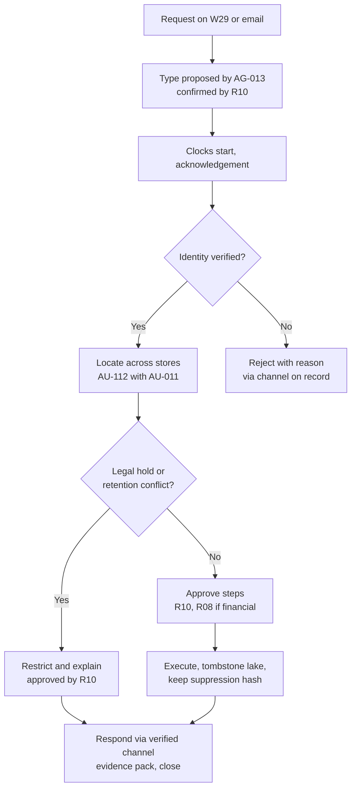
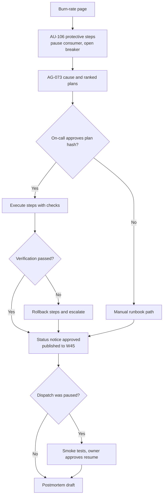
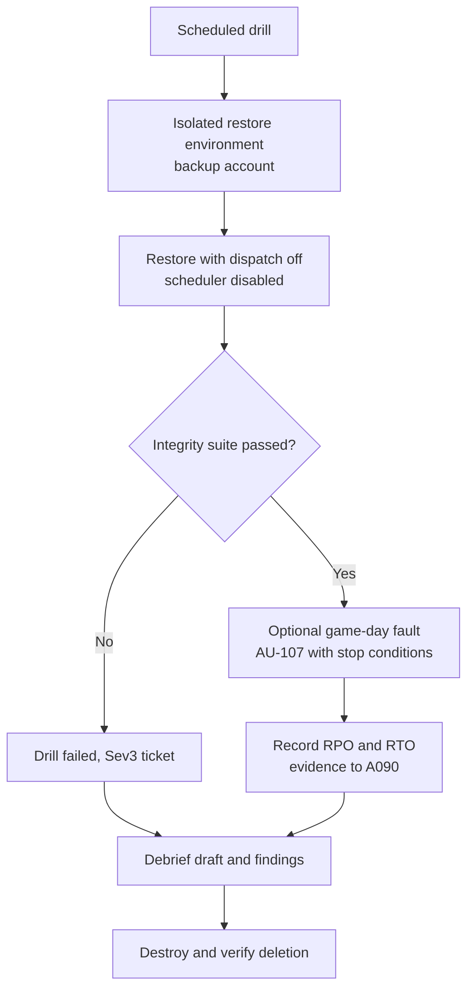
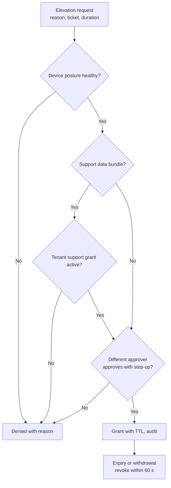
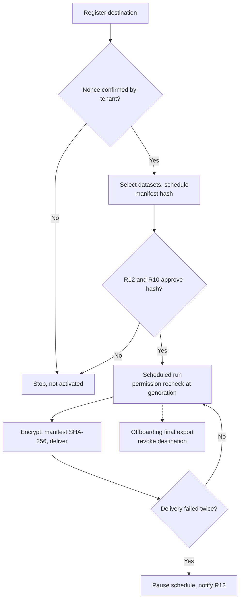
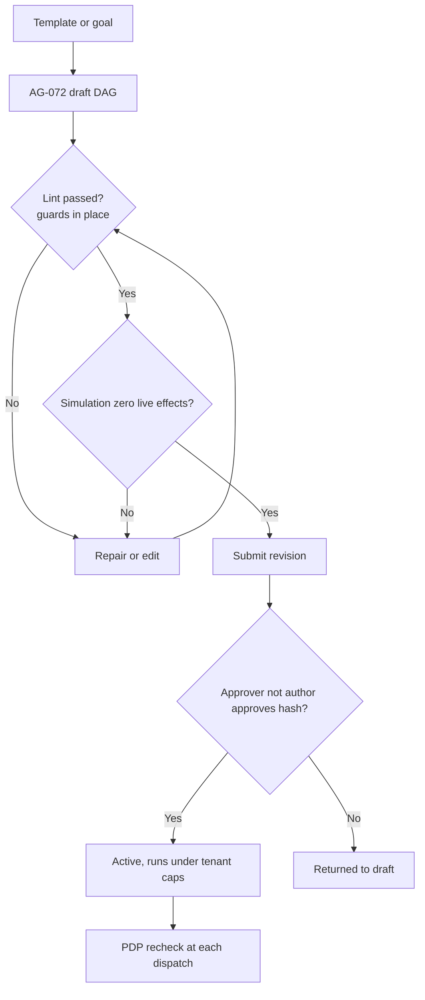
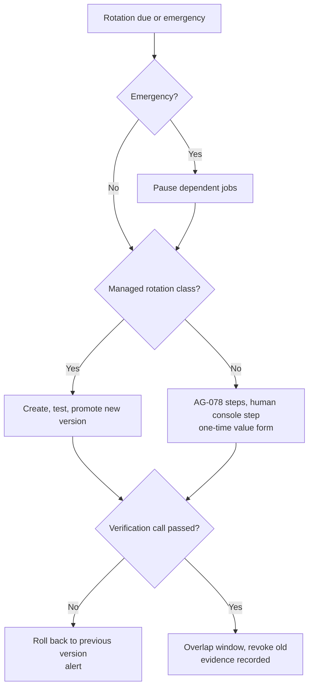

# AI Growth Engine: Employee Sales & Marketing Automation
## Application Blueprint: PART 9 (Batch 9.9), Advanced Platform, Data, Security and Experience (continued)

| Field | Value |
|---|---|
| Document | Part 9, Batch 9.9, file b of 2 (9.9.6–9.9.17: agents, automations, workflows, functional requirements, user stories, test cases, effort, cost, decisions, risks, tags register, quality gate). File a holds 9.9.0–9.9.5 |
| Version | 1.0 · 27 Nov 2026 |
| Baseline | As file a: Parts 0–9.5; DEC-001…233; source pack documents 18, 25–32, 36 and 38 |
| Roles applied | Expert panel X3-P1…P6 (9.9.1), Product Owner, QA Lead, Security / Compliance / AI Governance Lead, FinOps Lead |
| ID ranges used | As file a |

**Conventions** are those of file a. *(verify, 27 Nov 2026)* = verify at time of implementation (as of 27 Nov 2026).

---

## 9.9.6 Agent specification cards (AG-071…080)

**New tools for the registry (extend Part 7.2 §7.2.4; side-effect classes as defined there).** None has an external side effect. TL-13 `dispatch.request` stays ungranted to every agent.

| TL | Tool | Class | Scope rule | Limit per run | Used by |
|---|---|---|---|---|---|
| TL-X3-01 | `semantic.catalogue.read` | R0 | Metrics, dimensions and descriptions the caller may query (BRL-X3-04-1); no data rows | 2 calls | AG-071, AG-072, AG-080 |
| TL-X3-02 | `semantic.plan.validate` | R0 | Validates a plan against catalogue, RBAC, ABAC-05 and scope; returns errors | 3 calls | AG-071 |
| TL-X3-03 | `workflow.draft.create` | W1 | Creates a *draft* workflow revision from the 13 node types only; never submits or enables | 1 draft | AG-072 |
| TL-X3-04 | `telemetry.read_redacted` | R0 | SLO series, alert context, redacted logs and traces for the incident scope; no payload bodies | 10 calls | AG-073, AG-074 |
| TL-X3-05 | `runbook.propose` | W1 | Creates a *proposed* remediation plan from catalogued runbooks; execution needs human approval | 3 plans | AG-073 |
| TL-X3-06 | `compliance.evidence.read` | R0 | Control definitions, test results and evidence metadata (hash, period) | 20 calls | AG-075 |
| TL-X3-07 | `security.findings.read` | R0 | SBOM components, CVE matches, VEX, secret inventory **metadata** (never values) | 20 calls | AG-077, AG-078 |
| TL-X3-08 | `risk.signal.read` | R0 | Signals and case context with non-Restricted features only | 10 calls | AG-079 |
| TL-X3-09 | `finops.read` | R0 | Aggregated cost ledger, utilization and rightsizing findings | 10 calls | AG-080 |
| TL-X3-10 | `a11y.check` | R0 | axe-core results and design-token contrast for the object revision | 3 calls | AG-076 |

**Cost formula (as Part 7.4b).** ₹ per call = 90 × [uncached input × in-rate + cached input × (hit × read-rate + (1 − hit) × write-rate) + output × out-rate] ÷ 10⁶, with Tier 1a Haiku 5.5 at $0.10 in / $0.01 cache read / $0.125 cache write / $0.50 out and Tier 1b Sonnet 5.5 at $2.00 / $0.10 / $2.50 / $10.00 per million tokens and ₹90 per US$ (Part 7.3 §7.5; *verify, 27 Nov 2026*). Blended = (1 − e) × Haiku + e × Sonnet, where e is the escalation share. Monthly low = 0.4 × base, high = 3 × base, before the 25% overhead allowance [ASSUMPTION-705].

#### AG-071 Analytics NL Query Agent

| Field | Specification |
|---|---|
| Type | Agent · Planner (natural language → semantic query plan) · scope: Startup or Portfolio (aggregates only) |
| Purpose and business outcome | Lets startup heads, growth managers and analysts ask questions in English and get governed numbers from the semantic layer without engineering tickets, so ≥ 70% of ad-hoc questions are self-served and no number is invented (every metric comes from CAP-X3-04) |
| Linked BR / FR / US | BR-M30, BR-M60, BR-M61; FR-ADV-X3-008…011; US-17-V305 |
| Persona | P01 Owner, P02 Management, P03 Growth manager, P04 Research analyst |
| Trigger | User submits a question in A152 |
| Inputs and data sources | Question text (untrusted), user's scope summary (startup names and allowed metrics), semantic catalogue (TL-X3-01). **No database rows, contact names or values** |
| Tools / APIs (registry §7.2.4) | TL-X3-01 `semantic.catalogue.read`, TL-X3-02 `semantic.plan.validate` |
| Outputs | JSON `{plan:{metrics[], dimensions[], filters[], time_range, grain, sort, limit}, explanation, assumptions[], clarifying_question|null, confidence}` |
| Autonomy and HITL | **L1-read.** The user sees the plan in plain words and runs it; no write; saving a view or tile is a user action |
| Model tier | 1a Haiku 5.5; 25% escalation to 1b for multi-metric or ambiguous questions (verify model availability, 27 Nov 2026) |
| Tier 2 eligibility · data class | No · Confidential (questions may name customers or prices) |
| Prompt / context strategy | Static rules + plan schema + 8 worked examples + catalogue slice for the user's scope, cached (≈ 3,000 tokens); question ≤ 300 tokens; synchronous, structured output |
| Guardrails | Plan must validate (TL-X3-02) or the agent asks one clarifying question; scope injected server-side (BRL-X3-05-1); injection text such as "all tenants" ignored (THR-X3-06); metrics over Restricted fields count-only with min cell 5; refuses forecasting beyond defined forecast metrics |
| Failure modes and fallback | Invalid plan after 2 repairs → show builder pre-filled with recognized chips (Tier 3). Budget stop → builder only. Model outage → builder only |
| Success KPIs | Plan validity ≥ 95%; "incorrect" feedback ≤ 10%; 0 cross-scope plans accepted (validator log); p95 plan time ≤ 2 s |
| Eval dimensions | Plan exact-match vs gold set (200 questions per startup type), clarification appropriateness, injection resistance, scope adherence, schema, cost |
| Tokens, calls, cost | 4,000 in (3,000 cacheable, hit 70%), 400 out; 300 calls/month. Haiku = 90 × [1,000×0.10 + 3,000×(0.7×0.01 + 0.3×0.125) + 400×0.50] ÷ 10⁶ = **₹0.039**; Sonnet = 90 × [1,000×2 + 3,000×(0.7×0.10 + 0.3×2.50) + 400×10] ÷ 10⁶ = **₹0.761**; blended at e = 25% = **₹0.220**; line B02. **Monthly (pilot): low ₹26 · base ₹66 · high ₹198** |
| Dependencies | CAP-X3-04 (AU-102 compiler), AU-001, AU-003, AU-005 |
| Release | A2 (W6, Day 302–362) |

#### AG-072 Workflow Draft Composer

| Field | Specification |
|---|---|
| Type | Agent · Generator (goal → draft DAG on 13 node types) · scope: Tenant / Startup |
| Purpose and business outcome | Helps tenant administrators turn a described goal ("when a website form arrives for OrganicSpec, check eligibility, draft a reply and ask the order coordinator to approve") into a **draft** workflow that passes validation and simulation, so ≥ 50% of tenant automations are authored by tenant admins (CAP-X3-25) |
| Linked BR / FR / US | BR-M55, BR-AUTO; FR-ADV-X3-058…061; US-18-V325 |
| Persona | P11 Tenant administrator, P10 Automation lead |
| Trigger | User clicks "Propose from goal" in A169 |
| Inputs and data sources | Goal text (untrusted), chosen template (optional), node-type schemas (NT13-01…13), the tenant's enabled adapters and approval policies, metric IDs for conditions (TL-X3-01) |
| Tools / APIs (registry §7.2.4) | TL-X3-01, TL-18 `workflow.validate_simulate`, TL-X3-03 `workflow.draft.create` |
| Outputs | Draft workflow revision + JSON `{nodes[], edges[], rationale_per_node[], assumptions[], required_approvals[], est_cost_per_run}` |
| Autonomy and HITL | **L1.** Draft only; human edits, simulates and submits; activation follows A033 approval (approver ≠ author) |
| Model tier | 1b Sonnet 5.5 (graph reasoning); no Tier 1a |
| Tier 2 eligibility · data class | No · Confidential (tenant configuration) |
| Prompt / context strategy | Node schemas + DEC-064 cap matrix + 6 templates cached (≈ 4,500 tokens); goal ≤ 500 tokens; structured output with schema |
| Guardrails | Deterministic linter after generation: every `action.external` preceded by `policy.check`; consequential types require `approval.human` (BRL-X3-25-2); no unknown node keys; no secrets or code; simulation must show zero live effects (BRL-AUT-04); cost estimate shown before submit |
| Failure modes and fallback | Linter failure → 2 repairs → show template picker with partial draft. Simulation failure → reasons shown, draft kept. Budget stop → template-only mode |
| Success KPIs | ≥ 80% of proposed drafts pass lint first time; ≥ 60% submitted after ≤ 5 edits; 0 activated workflows missing a required guard (by construction) |
| Eval dimensions | Structural validity, guard placement, goal coverage (judge AG-002 with rubric), cost, injection resistance |
| Tokens, calls, cost | 6,000 in (4,500 cacheable, hit 60%), 1,500 out; 30 calls/month. Sonnet = 90 × [1,500×2 + 4,500×(0.6×0.10 + 0.4×2.50) + 1,500×10] ÷ 10⁶ = **₹2.049**; line B02. **Monthly (pilot): low ₹25 · base ₹61 · high ₹184** |
| Dependencies | A113 library, simulation oracle (Part 6.1), AU-001, AU-003 |
| Release | A3 (Year 2, Day 393–481) |

#### AG-073 SRE Remediation Advisor

| Field | Specification |
|---|---|
| Type | Agent · Analyst and planner (alert → ranked runbook plans; drill and incident debrief drafts) · scope: Platform |
| Purpose and business outcome | Cuts time from page to a safe, approved action by explaining the likely cause and ranking catalogued runbooks with evidence, and drafts postmortem timelines; target Sev2 MTTR ↓ ≥ 30% (NFR-ADV-X3-07) |
| Linked BR / FR / US | BR-M58, BR-QA; FR-ADV-X3-026…029; US-21-V309, US-21-V311 |
| Persona | On-call engineer (P10/DevOps), SRE lead |
| Trigger | AU-106 opens a remediation context on a burn-rate page; or a drill ends (AU-108) |
| Inputs and data sources | Alert, SLO series, recent deploys (A090), redacted logs and traces (TL-X3-04), RB catalogue, open incidents (TL-19) |
| Tools / APIs (registry §7.2.4) | TL-X3-04, TL-19 `incident.read`, TL-X3-05 `runbook.propose`, TL-06 `draft.create` (postmortem draft) |
| Outputs | JSON `{hypotheses[{cause, evidence_refs[], confidence}], plans[{runbook_code, steps_preview, blast_radius, protective, rollback}], recommended_plan, open_questions[]}`; postmortem draft |
| Autonomy and HITL | **L1** for execution (on-call approves plan hash). The agent never executes; protective L2 steps are executed only by AU-106 rules, not by the agent (DEC-407) |
| Model tier | 1a Haiku 5.5; 20% escalation to 1b for multi-signal incidents |
| Tier 2 eligibility · data class | No · Confidential (incident context may name tenants) |
| Prompt / context strategy | RB catalogue summaries + rules cached (≈ 2,000 tokens); incident context ≤ 1,500 tokens; synchronous |
| Guardrails | Must cite evidence references for every hypothesis; may only propose catalogued runbooks; never proposes resuming dispatch without the owner-approval step; never suggests disabling PDP, RLS, audit or budgets |
| Failure modes and fallback | No evidence → "insufficient evidence" with manual RB list (Tier 3). Model outage → AU-106 deterministic mapping only |
| Success KPIs | Recommended plan accepted ≥ 60%; time-to-plan ≤ 5 min p95; 0 proposals outside the catalogue |
| Eval dimensions | Root-cause accuracy on replayed incidents (CH-X3 drills), plan appropriateness, groundedness, refusal of unsafe suggestions, cost |
| Tokens, calls, cost | 3,500 in (2,000 cacheable, hit 60%), 500 out; 40 calls/month. Haiku = 90 × [1,500×0.10 + 2,000×(0.6×0.01 + 0.4×0.125) + 500×0.50] ÷ 10⁶ = **₹0.046**; Sonnet = 90 × [1,500×2 + 2,000×(0.6×0.10 + 0.4×2.50) + 500×10] ÷ 10⁶ = **₹0.911**; blended at e = 20% = **₹0.219**; line B02. **Monthly (pilot): low ₹4 · base ₹9 · high ₹26** |
| Dependencies | CAP-X3-08, CAP-X3-09, AU-106, AG-028 (triage hand-off) |
| Release | A2 (drill debrief part in A1) |

#### AG-074 AI Observability Drift Analyst

| Field | Specification |
|---|---|
| Type | Agent · Summarizer (weekly AI health and drift report) · scope: Platform |
| Purpose and business outcome | Turns trace aggregates, eval scores and feedback into a weekly per-agent health note with regressions linked to prompt or model revisions, so AI quality regressions are found ≤ 24 h after the alert and fixed before users notice (doc 31 "Quality regressions alert owner") |
| Linked BR / FR / US | BR-M08, BR-M54; FR-ADV-X3-022…025; US-04-V308 |
| Persona | AI lead, P10 Automation lead |
| Trigger | Weekly schedule; or an `ai_drift_alert` |
| Inputs and data sources | `ai_trace_summary` aggregates, eval run results (A084), drift alerts, release list. No prompts or completions |
| Tools / APIs (registry §7.2.4) | TL-X3-04 `telemetry.read_redacted` (aggregates only), TL-16 `eval.read_cases` (IDs and scores), TL-06 `draft.create` |
| Outputs | Report draft `{agents[{id, status, changes[], regressions[{dimension, delta, likely_cause_ref}], actions[]}]}` |
| Autonomy and HITL | **L1.** Report reviewed by AI lead; actions become tickets after acceptance |
| Model tier | 1a Haiku 5.5; 10% escalation |
| Tier 2 eligibility · data class | **Yes, opt-in, default off** · Internal-non-personal (aggregate numbers, agent IDs) |
| Prompt / context strategy | Report schema + rules cached (≈ 1,500 tokens); aggregates ≤ 1,500 tokens; batch |
| Guardrails | Numbers copied from inputs are checked deterministically after generation; any mismatch → regenerate; no causal claim without a referenced revision change |
| Failure modes and fallback | Mismatch after 2 repairs → table-only report (Tier 3) |
| Success KPIs | 100% numeric fidelity; regressions flagged ≤ 24 h; AI lead rates report useful ≥ 80% |
| Eval dimensions | Numeric fidelity, causal-claim grounding, completeness, cost |
| Tokens, calls, cost | 3,000 in (1,500 cacheable, hit 60%), 600 out; 30 calls/month. Haiku = **₹0.048**; Sonnet = **₹0.953**; blended at e = 10% = **₹0.139**; line B02. **Monthly (pilot): low ₹2 · base ₹4 · high ₹12** |
| Dependencies | CAP-X3-08 (AU-105), AG-002 |
| Release | A1 |

#### AG-075 Compliance Evidence Assessor

| Field | Specification |
|---|---|
| Type | Agent · Classifier and drafter (evidence → control mapping, narrative drafts, gap list) · scope: Platform |
| Purpose and business outcome | Keeps SOC 2-aligned and ISO 27001-mapped control narratives current and lists missing or stale evidence, so an audit-ready pack exists on demand and preparation effort falls by ≥ 50% |
| Linked BR / FR / US | BR-M57, BR-QA; FR-ADV-X3-042…045; US-03-V317 |
| Persona | P09 Legal/compliance (R10), Security lead |
| Trigger | Monthly per control; or a control test failure |
| Inputs and data sources | Control definitions, test results, evidence metadata (TL-X3-06); policies in the repository |
| Tools / APIs (registry §7.2.4) | TL-X3-06, TL-06 `draft.create`, TL-07 `task.create` (evidence requests) |
| Outputs | JSON `{control_code, status_suggestion, narrative_draft, evidence_refs[], gaps[{type, owner_role, due}]}` |
| Autonomy and HITL | **L1.** R10 approves narratives and status; the agent never marks a control "effective" |
| Model tier | 1a Haiku 5.5; 20% escalation to 1b for narrative drafting |
| Tier 2 eligibility · data class | No · Confidential |
| Prompt / context strategy | Framework mapping + style guide cached (≈ 2,500 tokens); control context ≤ 1,500 tokens; batch (Batch API discount not assumed in the estimate) |
| Guardrails | Narrative may only reference evidence IDs supplied; deterministic check that each referenced evidence item exists and covers the period; wording never claims certification (BRL-X3-17-2) |
| Failure modes and fallback | Missing evidence → gap list only. Budget stop → evidence table without narrative |
| Success KPIs | ≥ 80% narratives approved with ≤ 2 edits; 0 narratives citing non-existent evidence |
| Eval dimensions | Evidence grounding, framework mapping accuracy, wording compliance, cost |
| Tokens, calls, cost | 4,000 in (2,500 cacheable, hit 60%), 700 out; 120 calls/month. Haiku = **₹0.058**; Sonnet = **₹1.139**; blended at e = 20% = **₹0.274**; line B02. **Monthly (pilot): low ₹13 · base ₹33 · high ₹99** |
| Dependencies | CAP-X3-17 (AU-113) |
| Release | A2 |

#### AG-076 Accessibility Co-pilot

| Field | Specification |
|---|---|
| Type | Agent · Generator and explainer (alt-text drafts, fix suggestions for axe violations, Indic string length hints) · scope: Startup |
| Purpose and business outcome | Helps authors fix accessibility issues before publication and drafts alt text, so pre-publication violations fall ≥ 70% and alt-text coverage reaches 100% on public pages (NFR-088, BRL-PUB-06 unchanged) |
| Linked BR / FR / US | BR-WEB, BR-M34, BR-M37; FR-ADV-X3-070…072; US-11-V328, US-19-V327 |
| Persona | P05 Marketing specialist, P03 Growth manager |
| Trigger | Author opens the accessibility panel or uploads an image in the content/landing editor; translation review in A161 |
| Inputs and data sources | axe-core results and token contrast (TL-X3-10), image (public content only, after malware scan), surrounding text, locale strings with length limits |
| Tools / APIs (registry §7.2.4) | TL-X3-10 `a11y.check`, TL-14 `document.parse` (image metadata), TL-06 `draft.create` |
| Outputs | JSON `{violations[{rule, element_ref, fix_suggestion}], alt_text_draft, decorative_suggestion, readability_note}` |
| Autonomy and HITL | **L1.** Author accepts or edits; publication gate remains deterministic |
| Model tier | 1a Haiku 5.5 (vision input, verify support and pricing); 10% escalation |
| Tier 2 eligibility · data class | **Yes, opt-in, default off, Public content only** · Public |
| Prompt / context strategy | WCAG 2.2 rule summaries + style guide cached (≈ 1,500 tokens); element context ≤ 1,000 tokens |
| Guardrails | Alt text never infers sensitive traits (health, age, religion, ethnicity) (BRL-X3-28-2); people described by role in context only; MedMaarg images no clinical claims (BRL-AI-05); EduVerse images of minors are not described beyond "students" |
| Failure modes and fallback | Model outage → deterministic axe messages only |
| Success KPIs | Alt-text acceptance ≥ 70%; violations fixed before publish ≥ 70%; 0 sensitive-trait descriptions in sampled audit |
| Eval dimensions | Alt-text usefulness (human rubric), sensitive-trait leakage, fix correctness, cost |
| Tokens, calls, cost | 2,500 in (1,500 cacheable, hit 70%), 400 out; 200 calls/month. Haiku = **₹0.033**; Sonnet = **₹0.651**; blended at e = 10% = **₹0.095**; line B02. **Monthly (pilot): low ₹8 · base ₹19 · high ₹57** (image tokens counted in input; verify) |
| Dependencies | CAP-X3-28, AU-005 |
| Release | A2 |

#### AG-077 Supply-Chain Risk Analyst

| Field | Specification |
|---|---|
| Type | Agent · Analyst (CVE/SBOM triage notes, VEX drafts, upgrade plans) · scope: Platform |
| Purpose and business outcome | Shortens triage of new CVEs in deployed components by drafting exploitability notes and VEX candidates with evidence, so Critical findings are triaged ≤ 24 h and remediated within §4.16.3 SLAs |
| Linked BR / FR / US | BR-M09, BR-M62; FR-ADV-X3-049…051; US-21-V319 |
| Persona | DevOps, Security lead |
| Trigger | AU-115 / Dependency-Track raises a new finding on a deployed SBOM |
| Inputs and data sources | Component PURL, CVE record (public), reachable-code hints from static analysis (Semgrep reachability where available, verify), deployment exposure (internet-facing or not) |
| Tools / APIs (registry §7.2.4) | TL-X3-07 `security.findings.read`, TL-17 `repo.read` (read-only), TL-06 `draft.create` |
| Outputs | JSON `{cve_id, component, exposure, exploitability_note, vex_candidate{status, justification}, upgrade_plan, evidence_refs[]}` |
| Autonomy and HITL | **L1.** A reviewer ≠ author accepts VEX (BRL-X3-19-3); upgrades go through normal PRs and AG-035 review |
| Model tier | 1a Haiku 5.5; 15% escalation |
| Tier 2 eligibility · data class | **Yes, opt-in, default off** · Internal-non-personal (public CVE data, component lists) |
| Prompt / context strategy | VEX justification vocabulary + rules cached (≈ 1,500 tokens); finding ≤ 1,500 tokens |
| Guardrails | "Not affected" requires a cited justification code and code reference; never downgrades severity of CISA KEV-listed CVEs (verify list); no repository write |
| Failure modes and fallback | Insufficient evidence → `under_investigation` with manual task |
| Success KPIs | Triage ≤ 24 h for 100% Critical; VEX drafts accepted ≥ 60%; 0 accepted "not affected" later found exploitable |
| Eval dimensions | Justification accuracy vs labelled set, grounding, cost |
| Tokens, calls, cost | 3,000 in (1,500 cacheable, hit 60%), 500 out; 60 calls/month. Haiku = **₹0.044**; Sonnet = **₹0.863**; blended at e = 15% = **₹0.166**; line B23 (delivery-team AI). **Monthly (pilot): low ₹4 · base ₹10 · high ₹30** |
| Dependencies | CAP-X3-19 (AU-115), AU-047, AG-035 |
| Release | A1 |

#### AG-078 Secrets Rotation Coordinator

| Field | Specification |
|---|---|
| Type | Agent · Planner (provider-specific guided rotation steps from metadata) · scope: Platform |
| Purpose and business outcome | For providers without a rotation API, drafts the exact console steps, overlap window and verification call, so guided rotations finish on time with no downtime (NFR-ADV-X3-14) |
| Linked BR / FR / US | BR-M05, BR-M09; FR-ADV-X3-046…048; US-21-V318 |
| Persona | DevOps engineer |
| Trigger | AU-114 marks a guided rotation due (T-14 days) or emergency rotation (RB-013) |
| Inputs and data sources | Secret inventory **metadata** (TL-X3-07): provider, class, scopes, dependent services, last rotation notes; provider documentation snippets in approved knowledge (TL-01) |
| Tools / APIs (registry §7.2.4) | TL-X3-07, TL-01 `knowledge.search`, TL-07 `task.create` |
| Outputs | JSON `{steps[], overlap_hours, verification_call, rollback, dependent_jobs_to_pause[]}` |
| Autonomy and HITL | **L1.** Human performs provider console steps and enters the new value in a one-time form that writes to Secrets Manager directly; the agent never receives values |
| Model tier | 1a Haiku 5.5; no escalation |
| Tier 2 eligibility · data class | No · Confidential (metadata about credentials) |
| Prompt / context strategy | Rotation checklist template cached (≈ 1,200 tokens); metadata ≤ 800 tokens |
| Guardrails | Canary test: inventory records contain a fake value field that must never appear in prompts (AU-004 blocks; test TC-ADV-X3-021); steps must include revoke-old and verification |
| Failure modes and fallback | Outage → static checklist per provider (RB-013 appendix) |
| Success KPIs | 0 overdue guided rotations; 0 incidents caused by rotation |
| Eval dimensions | Step completeness vs checklist, secret-leak canary, cost |
| Tokens, calls, cost | 2,000 in (1,200 cacheable, hit 60%), 400 out; 20 calls/month. Haiku = 90 × [800×0.10 + 1,200×(0.6×0.01 + 0.4×0.125) + 400×0.50] ÷ 10⁶ = **₹0.031**; line B02. **Monthly (pilot): low ₹0.4 · base ₹1 · high ₹2** |
| Dependencies | CAP-X3-18 (AU-114) |
| Release | A1 |

#### AG-079 Anomaly & Fraud Triage Agent

| Field | Specification |
|---|---|
| Type | Agent · Summarizer (signal bundle → case brief for a reviewer) · scope: Tenant / Startup |
| Purpose and business outcome | Gives reviewers a concise, evidence-linked brief of why a case was raised and what to check, so precision at review reaches ≥ 0.9 and review time per case falls ≥ 40% |
| Linked BR / FR / US | BR-M47, BR-M57, BR-WEB; FR-ADV-X3-052…054; US-19-V320 |
| Persona | Security lead, P08 Finance (payment evidence cases), P11 Tenant admin |
| Trigger | AU-116 opens a `gov_fraud_case` |
| Inputs and data sources | Signals with non-Restricted features (TL-X3-08), rule descriptions, related object IDs |
| Tools / APIs (registry §7.2.4) | TL-X3-08 `risk.signal.read`, TL-02 `records.read` (object status only) |
| Outputs | JSON `{summary, signals_explained[], checks_to_perform[], suggested_disposition, confidence}` |
| Autonomy and HITL | **L1.** Reviewer decides. No automatic payment, refund, account closure or customer contact. Protective L2 responses are AU-116 rules only |
| Model tier | 1a Haiku 5.5; 15% escalation |
| Tier 2 eligibility · data class | No · Restricted-adjacent (case about a person) |
| Prompt / context strategy | Rules and disposition vocabulary cached (≈ 1,500 tokens); case ≤ 1,000 tokens |
| Guardrails | No inference of protected traits; no statement of guilt ("indicators", not "fraud committed"); EduVerse minors and MedMaarg health data excluded at signal level |
| Failure modes and fallback | Outage → raw signal table |
| Success KPIs | Reviewer agreement with suggested disposition ≥ 80%; 0 protected-trait mentions in audit sample |
| Eval dimensions | Faithfulness to signals, neutrality, usefulness, cost |
| Tokens, calls, cost | 2,500 in (1,500 cacheable, hit 70%), 400 out; 150 calls/month. Haiku = **₹0.033**; Sonnet = **₹0.651**; blended at e = 15% = **₹0.126**; line B02. **Monthly (pilot): low ₹8 · base ₹19 · high ₹57** |
| Dependencies | CAP-X3-20 (AU-116), DPIA |
| Release | A2 |

#### AG-080 FinOps Optimization Agent

| Field | Specification |
|---|---|
| Type | Agent · Analyst (monthly unit-economics brief and ranked savings recommendations) · scope: Platform and Tenant aggregates |
| Purpose and business outcome | Turns measured utilization and cost ledgers into a ranked list of savings with formulas and SLO risk, so ≥ 10% of infrastructure spend is identified as addressable per quarter without SLO violation (doc 36 OPT-03-04) and KPI-21/22/23 trends are explained |
| Linked BR / FR / US | BR-M53; FR-ADV-X3-055…057; US-04-V321 |
| Persona | FinOps lead (R08 delegate), P01 Owner |
| Trigger | Monthly FinOps review (§4.46.6) or AU-012 anomaly |
| Inputs and data sources | AU-118 findings, cost ledger aggregates, unit costs, budgets (TL-X3-09), semantic metrics (TL-X3-01) |
| Tools / APIs (registry §7.2.4) | TL-X3-09 `finops.read`, TL-X3-01, TL-06 `draft.create` |
| Outputs | Brief draft `{top_movers[], unit_costs[], recommendations[{finding_id, action, saving_formula, est_saving_inr, slo_risk}], commitments_view}` |
| Autonomy and HITL | **L1.** Recommendations read-only until approved (doc 36 §5); no infrastructure change by the agent |
| Model tier | 1a Haiku 5.5; 20% escalation |
| Tier 2 eligibility · data class | No · Confidential (cost ledgers, §4.1.2) |
| Prompt / context strategy | Brief schema and FinOps rules cached (≈ 2,500 tokens); aggregates ≤ 1,500 tokens; batch |
| Guardrails | Every saving must carry a formula recomputed deterministically; no commitment advice before 3 stable months (BRL-X3-21-3); never recommends exceeding DEC-008 ceilings or disabling budgets |
| Failure modes and fallback | Mismatch → table-only brief |
| Success KPIs | Realized/estimated savings ≥ 0.7; 0 SLO incidents caused by accepted recommendations |
| Eval dimensions | Numeric fidelity, recommendation soundness (FinOps rubric), cost |
| Tokens, calls, cost | 4,000 in (2,500 cacheable, hit 60%), 800 out; 30 calls/month. Haiku = **₹0.062**; Sonnet = **₹1.228**; blended at e = 20% = **₹0.295**; line B02. **Monthly (pilot): low ₹4 · base ₹9 · high ₹27** |
| Dependencies | CAP-X3-21, CAP-X3-22, AU-012, AU-117, AU-118 |
| Release | A1 |

**Agent cost roll-up (pilot, ₹/month, estimates):** base ₹231 (low ₹94, high ₹692) before the 25% overhead allowance; **₹289 base with overhead (high ₹865)**. All within the existing B02/B23 lines and the DEC-008 ceilings (₹3,000 pilot, expected B02 use ≈ ₹1,150, Part 8.4 §8.4.3.1); X3 agents run in the **lowest priority class** so production agents are never starved (DEC-409).

---

## 9.9.7 Automations (AU-100…119)

| ID | Name | Wave / Release | Linked BR / FR / rule | Trigger | Deterministic logic | Outputs | Autonomy | Guardrail | Failure / fallback | KPI | Cost |
|---|---|---|---|---|---|---|---|---|---|---|---|
| AU-100 | Identity resolution matcher & merge proposal | W6 · A3 | BR-M23; FR-ADV-X3-001…003; BRL-X3-01-1…6 | New or changed lead/contact/portal user/registrant | Exact blind-index match → link; similarity score (Jaro-Winkler name + org + domain) ≥ 0.8 → proposal; recompute consent/suppression, most restrictive wins | `crm_identity_link`, `crm_merge_proposal` | L2 for exact links (internal, reversible); L1 for merges | Same startup only; learner records excluded; no AI | Recompute failure → profile marked "consent unknown" → PDP denies | Duplicate rate ↓ 50%; suppression misses 0 | Compute in X3-R02 |
| AU-101 | Event log exporter | W6 · A2 | FR-ADV-X3-004…005; ADR-130 | Hourly; manual re-export | Read committed events since watermark; project allowlisted fields; drop/tokenize Restricted; write Parquet + manifest; advance watermark atomically | `ana_export_batch`, Parquet files | L2 (internal) | Prefix per tenant/startup; KMS context; immutable files | Failure → retry ×3 → alert; watermark unchanged (no gaps) | Freshness ≤ 60 min 99% | X3-R01, X3-R02 |
| AU-102 | Semantic metric compiler & parity check | W6 · A1 | FR-ADV-X3-006…007; ADR-131 | On metric PR; nightly | Compile YAML → SQL templates; run parity fixture vs legacy RP outputs; mark parity status | Compiled plans; parity report | L2 (internal) | Blocking-gate metrics cannot change without parity pass (BRL-X3-04-5) | Parity fail → metric flagged "under review", previous version stays | Parity 100% | ₹0 (CI) |
| AU-103 | Feature materialization | W6 · A3 | FR-ADV-X3-012…013 | Schedule per feature freshness | Compute registered functions; write offline (lake) and online values with as-of | `ana_feature_value` | L2 (internal) | Restricted categories rejected at registration | Stale feature → consumers use last good value with stale flag | Freshness met 99% | X3-R02 |
| AU-104 | Tenant export & webhook delivery engine | W6 · A2 (exports), A3 (webhooks) | FR-ADV-X3-014…017, 064…066; BRL-X3-07-*, BRL-X3-23-* | Export schedule; committed catalogued event with subscription | Permission recheck; dataset build; encrypt; manifest SHA-256; deliver; for webhooks sign HMAC with timestamp, exponential backoff 24 h | Export files and manifests; deliveries | L1 to enable (approved hash); L2 per run of an approved schedule/subscription | Destination verified; minimal payloads; SSRF-safe egress | Destination failure ×2 → pause + notify; webhook DLQ after 24 h with replay | Export ≤ 4 h; webhook first attempt ≤ 60 s | X3-R02; X3-R11 |
| AU-105 | AI trace redaction & telemetry shipper | W6 · A1 | FR-ADV-X3-022…023; ADR-133 | Every gateway call | Apply AU-004 DLP; replace Restricted by type tokens; hash Confidential bodies unless sampling allowed; emit OTel GenAI spans; aggregate daily | Langfuse traces; `ai_trace_summary` | L2 (internal) | No raw private prompts (doc 31); 30-day trace TTL | Collector down → spans buffered ≤ 1 h then dropped with counter (never stored unredacted) | Coverage 100%; DLP hits 0 | X3-R03 |
| AU-106 | SLO burn → runbook router | W6 · A2 | FR-ADV-X3-026…028; DEC-407 | Burn-rate alert (§4.40.3) | Map alert signature → candidate runbooks; execute protective steps of approved runbook classes at L2; open plan for L1 approval otherwise | `ops_remediation_plan`; step results | L2 protective only; L1 others | Never resumes dispatch; budget lines respected | Mapping miss → page with RB list | Time-to-plan ≤ 5 min | ₹0 |
| AU-107 | Chaos scheduler & abort guard | W6 · A1 | FR-ADV-X3-030…031; ADR-135 | Monthly schedule; manual run (staging) | Check environment = staging; start FIS template; watch stop conditions; abort ≤ 60 s; record result | `ops_chaos_experiment` results | L2 (staging only) | SCP denies FIS in production; provider simulator only | Abort failure → page SRE | Monthly cadence 100% | X3-R04 |
| AU-108 | DR drill orchestrator | W6 · A1 | FR-ADV-X3-032…034; OKPI-18/19/32/33/34 | §4.47 schedule | Restore snapshot/PITR in backup sandbox with dispatch off; run integrity suite; time RPO/RTO; file evidence; destroy | `ops_dr_drill_run`; A090 evidence | L2 (isolated account) | No provider credentials in sandbox; destroy verified | Integrity fail → drill failed, Sev3 ticket | Drill on time 100%; targets met | X3-R05 |
| AU-109 | Status page publisher | W6 · A1 | FR-ADV-X3-035…037; BRL-X3-12-* | Probe state change; approved notice | Compute component state from external probes; publish approved notices; email subscribers | Static status JSON/HTML | L2 for component state; **L1** for incident text | No tenant names; two-person approval for Sev1 text | Publish failure → retry; manual fallback runbook | Notice ≤ 15 min | X3-R06 |
| AU-110 | JIT privileged access broker | W6 · A1 | FR-ADV-X3-038…039; BRL-X3-13-* | Elevation approved; expiry; revoke | Grant bundle permissions with TTL; revoke on expiry/withdrawal; propagate session revocation ≤ 60 s | `ten_access_elevation` state; audit | L1 (approval by another person) | Approver ≠ requester; step-up ≤ 5 min; R13 needs tenant grant | Revocation failure → force session kill + Sev2 | Standing grants 0 | ₹0 |
| AU-111 | Device posture & session risk evaluator | W6 · A1 | FR-ADV-X3-040; ADR-136 | Admin request (cached 15 min) | Check device cert validity and binding, browser in matrix, passkey `amr`; compute posture level | Posture claim on session | L2 (protective: read-only downgrade) | Fail closed for approvals/exports | Evaluator error → read-only | Posture coverage 100% staff | X3-R09, X3-R10 |
| AU-112 | Rights request orchestrator | W6 · A1 | FR-ADV-X3-018…021; BRL-X3-16-* | New request; clock ticks; approvals | Start clocks; call AU-011 locators per store; build step proposals; apply approved steps; tombstones to lake; generate evidence pack | `gov_rights_case_step`, evidence pack | L1 per execution step | Legal hold; suppression hash kept; verified channel only | Locator error → manual step task; escalate at 70% | Deadline misses 0 | ₹0 (+ AG-013 reuse) |
| AU-113 | Continuous control test runner | W6 · A2 | FR-ADV-X3-042…045 | Per-control frequency | Run Config/Security Hub/Prowler/CI queries; record result; hash and store evidence; open finding on fail | `gov_control_test_run`, `gov_evidence_item` | L2 (read-only checks) | Read-only roles; evidence immutable | Check error → "error" result, not "pass" | ≥ 80% controls automated | X3-R08 |
| AU-114 | Secrets rotation executor | W6 · A1 | FR-ADV-X3-046…048; §4.6.2 | Due date; emergency | Managed: create new version, test, promote, revoke old after overlap. Guided: open task with AG-078 steps, one-time value form, verify, revoke | `ops_secret_rotation` evidence | L1 for guided and emergency; L2 for managed rotations of approved classes | Values never logged or shown; staging and prod separate | Verification fail → roll back to previous version | Overdue 0 | X3-R07 |
| AU-115 | Supply-chain verification gate | W6 · A1 | FR-ADV-X3-049…051 | Build; deploy; nightly | Generate SBOM + provenance; verify cosign signature and builder identity at deploy; upload SBOM; nightly CVE match on deployed set; scan marketplace partner artefacts | Attestations; findings | L2 (block-only, protective) | Fail closed; break-glass by R01 only | Verifier outage → deploys blocked (never bypassed) | Verified deploys 100% | X3-R09 |
| AU-116 | Anomaly & fraud rule engine | W6 · A2 | FR-ADV-X3-052…054 | Intake, auth, portal, payment-evidence and usage events | Velocity, novelty, duplicate-hash and mismatch rules with scores; thresholds per tenant; protective responses | `gov_risk_signal`, `gov_fraud_case` | L2 protective (challenge, step-up, temporary limit, session revoke with notice); L1 everything else | No financial decision; no Restricted-category features; DPIA | Engine error → signals not raised, never blocks traffic by error | Precision ≥ 0.9 | X3-R02 |
| AU-117 | Cost showback calculator | W6 · A2 | FR-ADV-X3-055…056; NFR-093 | Daily (MTD), monthly close | Direct costs from ledger; allocate shared by drivers; reconcile; publish | `ana_cost_showback` | L2 (internal); publication to W48 after reconciliation pass | Tenant sees own data only; allocated lines labelled estimate | Reconciliation fail → hold publication | Reconciled 100% | ₹0 |
| AU-118 | Rightsizing & idle-resource detector | W6 · A1 | FR-ADV-X3-057; OPT-03-04 | Weekly | p95 utilization vs allocation; idle EIPs/volumes; S3 lifecycle gaps; log outliers; AI cache misses | `ana_rightsizing_finding` | L1 (read-only recommendations) | No auto-change | Missing metrics → finding "insufficient data" | ≥ 10% addressable found per quarter | ₹0 |
| AU-119 | PWA offline sync & conflict check | W6 · A3 | FR-ADV-X3-067…069; ADR-139 | Device back online | Submit drafts in order with idempotency keys; revision check; conflicts to review list; wipe synced items | `ops_offline_sync` | L2 (drafts only) | Never dispatch on sync; no Restricted caching | Server reject → draft kept with reason | Lost drafts 0 | ₹0 |

**Totals:** 20 automations; none performs a consequential external action without L1 approval or the PDP recheck.

---

## 9.9.8 Workflows (WF-33…39)

### WF-33 DPDP data-principal-rights request

**Purpose:** Handle access, correction, erasure, objection, grievance and nomination requests end to end within statutory and internal deadlines, with evidence (CAP-X3-16; DP-R9; BRL-PRV-01…05).
**Actors:** Data principal or guardian/nominee (R16/R18), Legal/Compliance/DPO (R10), Finance maker (R08) for retention conflicts, AU-112, AU-011, AG-013 (typing).
**Screens:** W29, W49, A163 (extends A013).

| Step | Actor | Action | Rule |
|---|---|---|---|
| 1 | Principal | Submits on W29 or email; receives reference and W49 link | SC-07 abuse protection |
| 2 | AG-013 + R10 | Request typed; R10 confirms type | Human confirms |
| 3 | AU-112 | Clocks start; acknowledgement sent ≤ 2 business days | NFR-075 |
| 4 | R10 | Proportionate verification (OTP to channel on record; guardian or nominee proof) | BRL-PRV-01; DEC-030 |
| 5 | AU-112 | Locates data in all stores; proposes steps | AU-011 |
| 6 | R10 (R08 if financial) | Approves each step; legal hold check | BRL-PRV-04 |
| 7 | AU-112 | Executes; lake tombstones; keeps suppression hash | BRL-PRV-03 |
| 8 | AU-112 + R10 | Response via verified channel; evidence pack; close | BRL-X3-16-5 |

### WF-34 SLO breach auto-remediation with human approval

**Purpose:** Move from a burn-rate page to a verified, approved fix with consistent steps and a postmortem draft (CAP-X3-09, CAP-X3-12; DEC-407).
**Actors:** AU-106, AG-073, on-call engineer, incident commander, R01/R02 for dispatch resume, AU-109.
**Screens:** A014, A156, A159, W45.

| Step | Actor | Action | Rule |
|---|---|---|---|
| 1 | AU-106 | Receives page; executes protective steps of the matching runbook class (L2) | DEC-407 protective set |
| 2 | AG-073 | Explains likely cause; ranks plans | Catalogued runbooks only |
| 3 | On-call | Approves plan hash (L1) or edits | Step-up ≤ 5 min |
| 4 | Orchestrator | Executes steps with verification; halts on failure | BRL-X3-09-4 |
| 5 | Incident commander | Approves status notice text; AU-109 publishes | BRL-X3-12-3 |
| 6 | R01/R02 | Approves resume of live dispatch after smoke tests | Doc 32 §Resume |
| 7 | AG-073 | Drafts postmortem timeline | §4.43.5 |

### WF-35 Automated DR drill and game day

**Purpose:** Prove RPO/RTO targets (OKPI-18, 19, 32, 33, 34) and runbook readiness on a schedule without touching production dispatch (CAP-X3-10, CAP-X3-11).
**Actors:** AU-108, AU-107, DevOps, SRE lead, AG-073 (debrief), R15 (read evidence).
**Screens:** A157, A158, A090.

| Step | Actor | Action | Rule |
|---|---|---|---|
| 1 | AU-108 | Selects recovery point; creates isolated restore environment | Backup account only |
| 2 | AU-108 | Restores with dispatch off, scheduler disabled, no provider credentials | Doc 28 §Restore drill |
| 3 | AU-108 | Integrity suite: schema, row counts, hash chain, ledger balances, RLS present | BRL-X3-11-2 |
| 4 | AU-107 | Optional game-day fault on the restored stack (staging) | ADR-135 |
| 5 | AU-108 | Records RPO/RTO; files evidence in A090 | NFR-ADV-X3-09 |
| 6 | AG-073 + SRE lead | Debrief draft; findings to backlog | BRL-X3-10-4 |
| 7 | AU-108 | Destroys the environment and verifies deletion | Doc 26 §Recovery |

### WF-36 Just-in-time privileged access elevation

**Purpose:** Replace standing privileged permissions with time-boxed, approved elevation on a healthy device (CAP-X3-13, CAP-X3-14).
**Actors:** Requesting staff member, approver (different person), tenant administrator (for R13 support grants), AU-110, AU-111.
**Screens:** A160, A099.

| Step | Actor | Action | Rule |
|---|---|---|---|
| 1 | Staff | Requests bundle with reason, ticket, duration | Max 240 min |
| 2 | AU-111 | Checks posture (device certificate, passkey) | Fail closed |
| 3 | Tenant admin | For R13 data access: tenant support grant active? | Doc 31 §Support grants |
| 4 | Approver | Approves with step-up ≤ 5 min | Approver ≠ requester |
| 5 | AU-110 | Grants permissions with TTL; audit | BRL-X3-13-1 |
| 6 | AU-110 | Expiry or withdrawal → revoke ≤ 60 s | NFR-ADV-X3-11 |

### WF-37 Tenant bring-your-own-warehouse export

**Purpose:** Deliver scheduled, verified exports of a tenant's own data to a destination it controls (CAP-X3-07; OPT-20-04; doc 28 §Import and export).
**Actors:** Tenant administrator (R12), Legal/Compliance (R10), AU-104, platform support (R13, status only).
**Screens:** A154, A103, W34.

| Step | Actor | Action | Rule |
|---|---|---|---|
| 1 | R12 | Registers destination | — |
| 2 | AU-104 | Writes nonce object; R12 confirms nonce | THR-X3-08 |
| 3 | R12 | Chooses datasets, format, schedule; manifest hash computed | BRL-X3-07-2 |
| 4 | R12 + R10 | Approve manifest hash (different persons) | L1 |
| 5 | AU-104 | Runs: permission recheck, build, encrypt, manifest, deliver | AZ-14 |
| 6 | AU-104 | Two consecutive destination failures → pause and notify | BRL-X3-07-6 |
| 7 | R12 | Offboarding: final export, revoke destination | BRL-X3-07-5 |

### WF-38 Tenant no-code workflow authoring to activation

**Purpose:** Let tenant administrators author safe automations from templates or a described goal, prove them in simulation and activate them through existing approvals (CAP-X3-25; DEC-051; DEC-064).
**Actors:** Tenant administrator (R12), AG-072, approver (R02/R11, ≠ author), engine and PDP.
**Screens:** A169, A033, A113, A110.

| Step | Actor | Action | Rule |
|---|---|---|---|
| 1 | R12 | Picks template or describes goal | — |
| 2 | AG-072 | Proposes draft DAG | 13 node types only |
| 3 | Linter | Guard placement and schema checks | BRL-X3-25-2 |
| 4 | Simulator | Fixture run, zero live effects; cost estimate | BRL-AUT-04 |
| 5 | R12 | Submits revision | — |
| 6 | Approver | Approves exact revision hash | Approver ≠ author |
| 7 | Engine | Runs; every external action rechecked by PDP | AU-009 |

### WF-39 Secrets rotation with overlap

**Purpose:** Rotate every secret on time without downtime, including providers without a rotation API (CAP-X3-18; §4.6.2; doc 27 §Secret lifecycle).
**Actors:** AU-114, AG-078, DevOps engineer, Security lead (emergency).
**Screens:** A165, A008.

| Step | Actor | Action | Rule |
|---|---|---|---|
| 1 | AU-114 | Due date at T-14 days or emergency (RB-013) | Emergency pauses dependent jobs first |
| 2 | AU-114 | Managed class: new version, test, promote | L2 for approved classes |
| 3 | AG-078 + DevOps | Guided class: steps drafted; human performs console step; one-time value form | Agent never sees values |
| 4 | AU-114 | Verification call with new secret | — |
| 5 | AU-114 | Overlap window, then revoke old; evidence | NFR-ADV-X3-14 |

---
