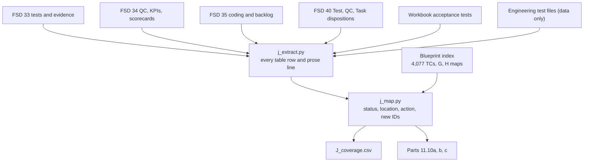

# AI Growth Engine: Employee Sales & Marketing Automation
## Application Blueprint: PART 11 (Batch 11.10a), V12 Tests (Unit/SIT/UAT/AI), Quality Control and Acceptance Evidence, Coding Standards and Development Backlog: Material, Coverage Summary and Detailed Register

| Field | Value |
|---|---|
| Document | Application Blueprint · Part 11.10a. Group R9 (letter J) of the customer revision V12 review. Reconciles FSD V12 chapters 33 (Unit, SIT, UAT and AI test specifications), 34 (Quality control and acceptance evidence) and 35 (Coding standards and development backlog), the Test/QC/Task disposition sections of chapter 40, the chapter 16 evaluation suites that gate AI steps, the workbook acceptance tests (39 services / 156 workflows) and the engineering test and closure files against the blueprint. This file: §11.10.1 material, §11.10.2 coverage summary, §11.10.3 detailed register. Part 11.10b holds the catalogue reconciliation (§11.10.4); Part 11.10c holds the enhancements, effort, conflicts, decisions, panel review, tags and quality gate (§11.10.5–§11.10.10) |
| Version | 1.2 · 28 Nov 2026 |
| Baseline | Parts 0–9.10 and 0B; 4,156 test cases (Parts 6.1–6.10, 9.6–9.10); 245 QCs and 162 work items (Parts 6.9a/b); coding standards CS-* (Part 4.4a §4.4.5.1); stories (Part 5.x); plan and sprints (Part 8.1); OKPI-01…35 (Part 4.4a); DEC-001…422; approved budgets DEC-230 (Ledger A) and DEC-231/DEC-422 (Ledger B); staffing DEC-228 |
| Roles applied | Head of Quality Engineering (lead), Test Architect (unit, SIT, UAT, AI evaluation), Principal Engineer (coding standards and code review), Agile Delivery Lead (backlog and estimation); consulted: Security/Compliance Lead, FinOps Lead, Product Owner |
| ID ranges used | DEC-680…691 · ASSUMPTION/GAP/CONFLICT/RECOMMENDATION-922…939 · TC-V12-J-### · QC-V12-J-### · CS-V12-J-## · FR-V12-J-### · US-21-YJ01…05 · TASK-V12-J-### (register in Part 11.10c §11.10.9) |

**Acronyms used in this part.** AT acceptance test · AIX AI-execution control family (V12) · CJ compliance-and-jurisdiction control family (V12) · DTO data transfer object · E2E end-to-end · ENT entitlement · EVAL evaluation suite · EVR evidence record · MOB mobile requirement family · MT multi-tenant requirement family · OKPI optimization KPI (blueprint name for the source KPI-01…35) · OPT-TC optimization acceptance test · pd person-day · PDP Policy Decision Point · QC quality control · RCTCFE the V12 eight-criterion evaluation rubric (business correctness, cross-artifact traceability, UI/UX, multi-tenant architecture, AI quality and cost, security, reliability, test evidence) · SIT system integration testing · SKU stock-keeping unit (a purchasable automation service SM-SVC-##) · TC test case · UAT user acceptance testing · UT unit test · XS cross-system release scenario.

**How to read Part 11.10.** Every row of the assigned material has exactly one row in `final/coverage_v12/J_coverage.csv` (5,429 aspects). **V12 test IDs become canonical** (DEC-680): a V12 test keeps its own ID and is executed through a parameterized blueprint class (TC-V12-J-001…019) or a canonical test row (§11.10.5). Earlier blueprint TCs that already assert the same thing are listed as the blueprint mapping. "Partially covered" means the blueprint asserts the behaviour generically (for example idempotency for every operation, TC-ENH-G-003) but not for the V12 workflow, step or fixture. "Not covered" means no blueprint test or control asserts it. Prototype checks are recorded as evidence and converted into production parity regression classes; they never count as production acceptance (DEC-682).

**Time-sensitive facts.** Tool names and versions (Playwright, Chromium, axe-core 4.10, pytest, PostgreSQL 16), provider sandbox behaviour, model names, prices and regulatory references are design intent: verify at time of implementation (as of 27 Nov 2026). All rupee figures are estimates.

---

## 11.10.1 Material reviewed

### 11.10.1.1 Files, sizes, purpose and pattern

| Material | File | Bytes | Lines | Tables | What it is trying to tell | Pattern | Aspects |
|---|---|---|---|---|---|---|---|
| FSD 33 | 33_Unit_SIT_UAT_AI_Test_Specifications.txt | 344,598 | 13,634 | 17 | Executable test design and verification evidence: V12/V11/V9/V8 prototype checks, V10/V9 lifecycle E2E, release scenarios XS, AI and compliance acceptance (AIX-TC, CJ-TC), 517 step tests, MT-38, V5 OPT-TC rule and 1,342 workflow scenarios | Version-layered (V12 → V5); every specified test "Not run"; prototype evidence separated | 2314 |
| FSD 34 | 34_Quality_Control_Acceptance_Evidence.txt | 94,691 | 5,065 | 21 | Quality evidence and evaluation: RCTCFE criteria and artifact scores (V12, V11, V9, V8), 20-dimension scorecard, release gates, V9 release KPIs KPI-01…35, 233-row requirement status register, V7 430 checks, V6/V5/V4/V3 prototype checks | Version-layered; scores never override open gates; 12/10 not awarded | 1200 |
| FSD 35 | 35_Coding_Standards_Development_Backlog.txt | 8,771 | 208 | 3 | Coding and backlog: REC-20, six coding and review controls (D25 table 2), prototype-is-not-production rule, 39 SKU build tasks SM-SVC-##-BUILD | Version-layered (V10, V8) | 51 |
| FSD 40 (Test, QC, Task dispositions only) | 40_Master_Traceability_Decision_Register_S.txt | 569,001 (whole chapter) | 12,287 | 20 | Source-row disposition candidates for the archived D22 tests (1,029 rows, 589 IDs), D23 QCs (245) and D20 work items (162) | Index rows; "pending semantic mapping / evidence pending / not approved" | 1436 |
| FSD 16 (16.4 EVAL suites only) | 16_AI_Models_Prompts_Evaluation.txt | 29,419 (whole chapter) | 1,230 | 8 | 111 workflow evaluation suites EVAL-SM-SVC-##-WF## and 6 task-type gates that gate the AI-inference step tests | Register | 111 |
| Workbook 39/156 | Acceptance_Tests.csv | 154,670 | 199 | CSV | 156 workflow acceptance tests (AT01) and 39 single-SKU entitlement tests (ENT-AT01) | One row per test / SKU | 195 |
| Workbook 39/156 | Service_Index.csv | 6,894 | 43 | CSV | 39 SKUs: name, family, bundle, meter unit (used for SKU classification) | One row per test / SKU | (classification input) |
| src/engineering (read as data; not executed) | 18 files: closure/test_acceptance.py, closure/test_closure.py, closure/acceptance_preflight.py, closure/benchmark_review.py, closure/closure_tests.txt, closure/starter_regression.txt, closure/optimization_regression.txt, closure/closure_effort_review.csv, closure/acceptance_required_ids.json, closure/closure_summary.json, starter/test_completeness_gate.py, starter/test_reference_extended.py, starter/test_contract_fixtures.py, starter/ai_eval_seed.jsonl, starter/release_gate.py, optimization/test_optimization_reference.py, optimization/test_completeness_optimizer.py, optimization/optimization_acceptance_scenarios.csv | 87,721 | — | — | Offline reference tests (78 test functions), completeness preflight, KPI numeric validator, benchmark validator, regression reports (529/34/237 runs), review-effort model, required-ID inventory (6 groups, 1,188 IDs), AI eval seed (4), optimization scenarios OPT-TEST-01…24 | Reference code; "no utility authorizes deployment" | 122 |

### 11.10.1.2 Programmatic parsing (every row)

The scripts are in `assembly/v12/` and read the material as data. Nothing in `src/engineering` was executed.

| Script | What it does |
|---|---|
| `j_parse_tables.py` | Parses every `[TABLE]` / `---row` / `[/TABLE]` block with its Heading1–3 context into rows |
| `j_prose.py` | Lists every non-table line with its line number, so every prose rule was read |
| `j_extract.py` | Extracts all families: 36 V12-ENT, 77 V12-QA, 8 localisation, 77 V11-QA, 50 V10 checks, 7 + 7 lifecycle events, 7 EXC, 10 XS, 75 V9-QA, 4 + 5 V8 evidence, 40 AIX/CJ tests, 71 V8-QA, 517 step tests, 1,342 workflow scenarios, the 233-row register with 193 acceptance texts found across chapters 05–36, 35 KPIs, all scorecards and gates, 430 V7-QA, 25 V6, 60 V5, 10 V3, 21 V4 checks, 6 coding controls, 39 build tasks, 1,029 + 245 + 162 chapter 40 dispositions, 111 EVAL suites, 195 workbook acceptance tests, 78 engineering test functions, 24 optimization scenarios, 7 review-effort packages and 6 preflight groups |
| `j_bp_index.py`, `j_sim.py` | Index 4,077 blueprint TC rows from `Part-*.md` and rank candidate equivalents by TF-IDF cosine (no external library). Candidates were reviewed; the 40 AI and compliance tests were curated individually |
| `j_map.py` | Assigns status before, blueprint location, action, new IDs and status after to every aspect; classifies the 39 SKUs; computes the build-task effort; writes `J_coverage.csv` |
| `j_render_a.py`, `j_render_b.py`, `j_render_c.py` | Generate the tables of Parts 11.10a/b/c from the same data |

**Integrity checks passed by the scripts.** 156 workflows × 8 scenarios = 1,248, plus 47 workflows × 2 (APPROVAL, EFFECT) = 94 → 1,342. 517 step tests across 156 workflows (1 to 4 steps each). 111 workflows have at least one AI-inference step and each has exactly one EVAL suite (159 AI steps). Chapter 40 test rows: 1,029 rows, 589 distinct IDs (302 SM-SIT-A, 138 SM-UAT-S, 66 SM-UT, 66 SM-SIT-M, 17 SM-UAT-F), all present in `final/coverage/G_test_mapping.csv`. QC rows: 245 (235 QC + 10 UX-QC), all in `H_qc_map.csv`. Task rows: 162, all in `H_workitem_story_map.csv`, with **0 differences** in predecessors and estimates; estimate totals 287 / 385 / 483 pd equal Part 6.9a. The 233 register rows resolve to 233 acceptance tests (135 OPT-TC, 40 MT-TC, 18 MOB-AT, 20 AIX-TC, 20 CJ-TC). The V9 KPI-01…35 are identical in metric, target and gate to OKPI-01…35.

---

## 11.10.2 Coverage summary

### 11.10.2.1 Aspects by family, status before and status after

| Aspect family | Aspects | Covered | Partially covered | Not covered | Conflict | Not applicable | After: Matched | After: Pending Founder | After: Not applicable |
|---|---|---|---|---|---|---|---|---|---|
| Workflow scenario tests (SM-SVC-##-WF##-TC-*) | 1342 | 0 | 850 | 492 | 0 | 0 | 1342 | 0 | 0 |
| Step-level tests (…-STEP-##-TC) | 517 | 0 | 357 | 160 | 0 | 0 | 517 | 0 | 0 |
| EVAL suites gating AI steps | 111 | 0 | 77 | 34 | 0 | 0 | 111 | 0 | 0 |
| Workflow AT01 and SKU ENT-AT01 acceptance | 195 | 0 | 139 | 56 | 0 | 0 | 195 | 0 | 0 |
| V12 acceptance register tests (AIX/CJ/MT/MOB/OPT-TC) | 233 | 12 | 180 | 40 | 1 | 0 | 232 | 1 | 0 |
| Register status columns (233) | 233 | 0 | 0 | 233 | 0 | 0 | 233 | 0 | 0 |
| Release scenarios, UAT-E2E-01, EXC, REC | 35 | 11 | 4 | 20 | 0 | 0 | 35 | 0 | 0 |
| Release KPIs KPI-01…35 | 35 | 34 | 0 | 0 | 1 | 0 | 34 | 1 | 0 |
| Scorecards, weights and gates | 126 | 0 | 0 | 126 | 0 | 0 | 126 | 0 | 0 |
| Legacy test dispositions (ch40) | 1029 | 1029 | 0 | 0 | 0 | 0 | 1029 | 0 | 0 |
| Legacy QC dispositions (ch40) | 245 | 245 | 0 | 0 | 0 | 0 | 245 | 0 | 0 |
| Legacy task dispositions (ch40) | 162 | 162 | 0 | 0 | 0 | 0 | 162 | 0 | 0 |
| Coding and review controls | 6 | 6 | 0 | 0 | 0 | 0 | 6 | 0 | 0 |
| SKU build tasks (SM-SVC-##-BUILD) | 39 | 0 | 25 | 14 | 0 | 0 | 0 | 39 | 0 |
| Engineering test files and registers | 122 | 101 | 18 | 0 | 0 | 3 | 119 | 0 | 3 |
| Prose rules (ch33/34/35) | 36 | 16 | 12 | 5 | 0 | 3 | 33 | 0 | 3 |
| Panel findings (approval gaps) | 9 | 0 | 0 | 9 | 0 | 0 | 9 | 0 | 0 |
| Prototype verification evidence (V3–V12) | 954 | 0 | 712 | 242 | 0 | 0 | 954 | 0 | 0 |
| **Total** | 5429 | 1616 | 2374 | 1431 | 2 | 6 | 5382 | 41 | 6 |

"Not applicable" (6) covers three offline regression reports of the reference code and three prose statements that only describe prototype runs; each has a reason in the CSV. The 41 "Pending Founder decision" aspects are the 39 SKU build tasks (funding, CONFLICT-922), KPI-32 (growth RTO, CONFLICT-923) and CJ-TC-09 (EU/IN region pinning, CONFLICT-924).

### 11.10.2.2 Headline results

| # | Result | Where |
|---|---|---|
| 1 | The legacy registers are intact: 589 archived test IDs (1,029 rows), 245 QCs and 162 work items in chapter 40 all match the blueprint mappings of Parts 6.8/6.9; work-item estimates and predecessors have 0 differences | §11.10.4.1 |
| 2 | **2,316 new executable tests** are added: 1,342 workflow scenarios, 517 step tests, 156 workflow AT01, 39 SKU entitlement tests, 221 canonical V12 acceptance rows (the 12 already covered become aliases), UAT-E2E-01 and its 7 exceptions, 9 approval-gap instances, 14 prototype-parity regression classes and 10 gap tests | §11.10.4.5 |
| 3 | The blueprint test count rises from **4,156 to 6,472**. The 10 XS release scenarios are aliases of TC-ENH-J-025…034 (UX-QC-01…10); no new rows | §11.10.4.5 |
| 4 | **17 new quality controls** QC-V12-J-001…017 (RCTCFE rubric, 20-dimension scorecard, five-gate status, workflow test completeness, SKU entitlement sign-off, prototype-evidence boundary and others): 245 → 262 | §11.10.5.7 |
| 5 | V12 KPI-01…35 = OKPI-01…35 (alias). The V9 reconciliation column is adopted, except KPI-32 (growth RTO ≤ 120 min blocking), which stays staged per DEC-158 pending the Founder | CONFLICT-923 |
| 6 | 9 workflows route approval or legal review in their steps but V12 defines no APPROVAL scenario for them; the panel adds approval-binding tests TC-V12-J-201…209 | GAP-924 |
| 7 | Coding controls of chapter 35 are already covered by Part 4.4a; four standards are added (no prototype layering or demo identity in production, model calls only from AI-inference steps, step-class annotation, evidence fields) | §11.10.5.9 |
| 8 | The backlog grows by 39 SKU build tasks (adopted IDs SM-SVC-##-BUILD) and 14 QA and quality tasks (TASK-V12-J-001…014): 162 → 215 work items | §11.10.5.11 |
| 9 | **Effort of the new backlog: 371 / 606 / 979 pd** (low / central / high): SKU build tasks 289 / 472 / 759 pd and QA/QC infrastructure 82 / 134 / 220 pd; ≈ ₹16.9 / 34.4 / 66.7 lakh one-time. Outside the approved Ledger A (DEC-230); split into CR-V12-J-01 (Release 2 candidate) and CR-V12-J-02 (W6) | Part 11.10c §11.10.5.12; CONFLICT-922 |

### 11.10.2.3 Status rules used

| Status before | Rule applied |
|---|---|
| Covered | A blueprint TC, QC, control or standard asserts the same condition and outcome (for the 233 register tests: curated for AIX/CJ; similarity ≥ 0.45 and reviewed for the others) |
| Partially covered | The blueprint asserts the behaviour generically or for another object, but not for the V12 workflow, step, fixture or threshold (for SKUs with a Release 1/2 capability: all workflow, step and AT tests) |
| Not covered | No blueprint test, control or standard (all tests of SKUs classed Partial overlap or New domain; prototype checks without a blueprint equivalent; scorecards) |
| Conflict | V12 asks for something that a Founder decision or binding blueprint decision sets differently |
| Not applicable | Offline reference-code results and prototype-run statements, which V12 itself says are not product evidence |

---

## 11.10.3 Detailed register

Covered items are grouped; every partial, not-covered and conflict aspect is listed individually here or, for the per-workflow catalogue, in Part 11.10b §11.10.4.2. The CSV holds one row per aspect.

### 11.10.3.1 V12 acceptance register: AI execution controls (AIX-01…20) and compliance and jurisdiction (CJ-R01…20)

Columns: V12 test · requirement · priority · title · V12 owner · V12 acceptance (expected result) · status before · blueprint mapping (existing TCs or controls) · status after. Canonical test rows with fixtures and steps are in Part 11.10c §11.10.5.3.

| Test | Req | Pri | Title | Owner | V12 acceptance | Before | Blueprint mapping | After |
|---|---|---|---|---|---|---|---|---|
| AIX-TC-01 | AIX-01 | P0 | Step classification | AI engineering | Static check: model call from non-inference step fails CI. | Partially covered | CS-AI-01 (gateway only); TC-ENH-B-036 | Matched |
| AIX-TC-02 | AIX-02 | P0 | Model registry | AI platform | Unregistered or unapproved model cannot be routed. | Partially covered | TC-ADV-X1-089; Part 7.3 model registry | Matched |
| AIX-TC-03 | AIX-03 | P0 | Routing policy | AI platform | Two eligible tiers → cheaper passing tier chosen; failing output escalates once. | Partially covered | TC-ADV-X2-016; DEC-418 tier order | Matched |
| AIX-TC-04 | AIX-04 | P0 | Prompt registry | AI engineering | Run records prompt version; unapproved prompt blocked. | Partially covered | TC-04-032; TC-AU-AU001-004 | Matched |
| AIX-TC-05 | AIX-05 | P0 | Evaluation suite per workflow | AI evaluation | Suite exists and passes before workflow AI step is enabled. | Partially covered | Part 6.4 agent eval gates (per agent, not per workflow) | Matched |
| AIX-TC-06 | AIX-06 | P0 | Regression on change | AI evaluation | Prompt change with lower accuracy cannot be promoted. | Covered | TC-04-032; TC-AU-AU006-003 | Matched |
| AIX-TC-07 | AIX-07 | P1 | AI grader calibration | AI evaluation | Uncalibrated grader results flagged as non-gating. | Partially covered | TC-ADV-X1-018; TC-AI-AG002-001 | Matched |
| AIX-TC-08 | AIX-08 | P0 | Untrusted content isolation | AI security | AI-INJ-01…12 pass with zero policy violations. | Partially covered | Part 6.4 injection cases (no AI-INJ-01…12 set) | Matched |
| AIX-TC-09 | AIX-09 | P0 | Reader/actor separation | AI security | Injected “send/forward” instruction cannot cause an effect. | Covered | TC-AI-AG013-009 | Matched |
| AIX-TC-10 | AIX-10 | P0 | Output handling | AI security | Image-link exfiltration and secret requests blocked. | Not covered | — | Matched |
| AIX-TC-11 | AIX-11 | P0 | Claims and citation control | AI / legal | Unapproved claim → REVIEW; uncited fact → flagged. | Covered | TC-04-038; TC-17-082 | Matched |
| AIX-TC-12 | AIX-12 | P0 | AI usage metering | AI FinOps | Tenant totals reconcile with provider invoices within tolerance. | Covered | TC-ENH-F-019; TC-AU-AU042-003 | Matched |
| AIX-TC-13 | AIX-13 | P0 | Tenant AI budgets | AI FinOps | Hard cap reached → AI step Held with reason; no provider call. | Covered | TC-AI-AG015-030; TC-NFR-014 | Matched |
| AIX-TC-14 | AIX-14 | P1 | Cost per accepted result | AI FinOps | Denominator and rejected outputs shown; no invented prices. | Partially covered | KPI-24 cost per accepted result (Part 7.3) | Matched |
| AIX-TC-15 | AIX-15 | P1 | Caching and batching | AI platform | Cache key includes tenant and policy version; no cross-tenant hit. | Covered | TC-ENH-I-010; TC-AU-AU030-003 | Matched |
| AIX-TC-16 | AIX-16 | P1 | Fair scheduling | Platform / SRE | Load test: noisy tenant does not raise others' p95 latency beyond target. | Partially covered | TC-ENH-A-044 (20 concurrent runs; no noisy-tenant p95 assertion) | Matched |
| AIX-TC-17 | AIX-17 | P0 | Data handling with providers | Legal / AI platform | Provider without DPA evidence cannot be approved. | Partially covered | AU-044 integration procurement gate | Matched |
| AIX-TC-18 | AIX-18 | P1 | Drift monitoring | AI evaluation | Simulated drift triggers alert and rollback option. | Partially covered | TC-04-050; TC-ADV-X1-064 (no rollback option assertion) | Matched |
| AIX-TC-19 | AIX-19 | P1 | Multilingual coverage | AI evaluation | Language slice below gate blocks that locale only. | Partially covered | TC-ADV-X1-020 (fairness slice, not locale slice) | Matched |
| AIX-TC-20 | AIX-20 | P0 | AI incident response | AI security / SRE | Kill switch stops new calls within one scheduler cycle. | Partially covered | TC-AI-AG015-030 kill switch (no one-cycle timing) | Matched |
| CJ-TC-01 | CJ-R01 | P0 | Jurisdiction pack entity | Compliance / data architecture | Pack without approved review cannot be activated; history immutable. | Covered | TC-ENH-A-030; TC-03-014 | Matched |
| CJ-TC-02 | CJ-R02 | P0 | Send preflight at effect time | Workflow engineering | All 13 decision-table cases return the expected verdict and reason codes. | Partially covered | TC-03-035 PDP decisions (not the 13-case table) | Matched |
| CJ-TC-03 | CJ-R03 | P0 | Policy precedence | Policy engineering | Conflicting tenant grant cannot override a jurisdiction HOLD. | Partially covered | TC-AU-AU030-002; TC-13-055 | Matched |
| CJ-TC-04 | CJ-R04 | P0 | Consent ledger | Data / privacy | Consent proof reproducible for any send; edits create new versions. | Partially covered | TC-ADV-X2-071; TC-NFR-095 | Matched |
| CJ-TC-05 | CJ-R05 | P0 | Withdrawal and suppression | Privacy engineering | Queued run after withdrawal moves to Held with reason; no dispatch. | Covered | TC-ENH-G-008; TC-14-037 | Matched |
| CJ-TC-06 | CJ-R06 | P0 | DLT and registry integration (IN) | Integrations | Unregistered template or unscrubbed list → HOLD. | Not covered | — (no India DLT registry check) | Matched |
| CJ-TC-07 | CJ-R07 | P0 | Data-subject request workflow | Privacy operations | Erasure under legal hold blocked with reason; due date computed per pack. | Partially covered | TC-03-073; TC-AU-AU011-004 (no per-pack due date) | Matched |
| CJ-TC-08 | CJ-R08 | P0 | Breach and incident clocks | Security / incident response | Clocks start at detection/awareness; overdue state visible. | Partially covered | TC-ADV-X3-018; Part 4.1 incident response | Matched |
| CJ-TC-09 | CJ-R09 | P0 | Data residency and region pinning | Cloud / data architecture | EU tenant data never written to IN region storage, and vice versa. | Conflict | TC-01-017 (single approved region, DEC-421) | Pending Founder decision |
| CJ-TC-10 | CJ-R10 | P0 | Children's data | Privacy engineering | Known-minor promotional send → HOLD. | Covered | TC-ENH-G-045; DEC-030 no outreach to minors | Matched |
| CJ-TC-11 | CJ-R11 | P1 | Retention schedule | Data governance | Expired records deleted or anonymised; deletion log retained. | Covered | TC-NFR-076; TC-ENH-E-019 | Matched |
| CJ-TC-12 | CJ-R12 | P1 | Cookie consent (website) | Web engineering | Analytics scripts absent until consent; choice persists and can be reopened. | Partially covered | TC-ALN-A-046 (DEC-263); W29/W30 | Matched |
| CJ-TC-13 | CJ-R13 | P0 | AI disclosure and content marking | AI engineering | Undisclosed AI content in EU → HOLD. | Partially covered | TC-ADV-X1-075 | Matched |
| CJ-TC-14 | CJ-R14 | P1 | Automated decision safeguards | AI / privacy | Score-only rejection impossible; reviewer path recorded. | Partially covered | TC-12-071; BRL-AI (AI never decides alone) | Matched |
| CJ-TC-15 | CJ-R15 | P1 | Transfer register | Legal / procurement | Provider without recorded transfer basis cannot be enabled. | Not covered | — | Matched |
| CJ-TC-16 | CJ-R16 | P1 | Tax configuration | Finance | Invoice cannot issue without approved tax configuration. | Covered | TC-15-022; TC-02-002 | Matched |
| CJ-TC-17 | CJ-R17 | P1 | Controller/processor role mapping | Legal | Tenant cannot activate outbound services without accepted DPA. | Not covered | — | Matched |
| CJ-TC-18 | CJ-R18 | P1 | Privacy notices | Legal / content | Notice version referenced by each consent record. | Partially covered | TC-ADV-X2-071 (consent version, not notice version) | Matched |
| CJ-TC-19 | CJ-R19 | P2 | Additional jurisdictions | Compliance | Draft pack never enforced as Approved; new pack loads by configuration. | Partially covered | TC-03-014; TC-ENH-A-030 | Matched |
| CJ-TC-20 | CJ-R20 | P0 | Unverified rule handling | Compliance | Unreviewed rule cannot produce ALLOW where the safe default is HOLD. | Partially covered | Fail-closed PDP default (NFR-016); no unreviewed-rule case | Matched |

### 11.10.3.2 V12 acceptance register: multi-tenant architecture (MT-01…40)

| Test | Req | Pri | Title | Owner | V12 acceptance | Before | Blueprint mapping (candidates) | After |
|---|---|---|---|---|---|---|---|---|
| MT-TC-MT-01 | MT-01 | P0 | Separate tenant, organization and company master entities | Identity / data architecture | Create two tenants with identical names; use different IDs; cross-parent insert/read denied. | Partially covered | — | Matched |
| MT-TC-MT-02 | MT-02 | P0 | Prominent startup and company selector | Product / frontend | Switch all four seeded companies; no independent client in portfolio grant view. | Partially covered | TC-19-074 | Matched |
| MT-TC-MT-03 | MT-03 | P0 | Configurable onboarding without fixed customer count | Provisioning | Create new tenants dynamically; no source edit; load-test approved scale envelope. | Partially covered | TC-ALN-B-032 | Matched |
| MT-TC-MT-04 | MT-04 | P0 | Individual and professional customer types | Commercial / onboarding | Onboard individual without corporate registration number; same entitlement flow. | Partially covered | TC-AI-AG004-005 | Matched |
| MT-TC-MT-05 | MT-05 | P0 | Multiple companies under an authorized tenant | Identity / provisioning | Add two companies under one tenant; neither receives automatic entitlement/membership. | Not covered | — | Matched |
| MT-TC-MT-06 | MT-06 | P0 | Tenant lifecycle management | Commercial / governance | Suspend tenant in staging; new executions denied; reconcile in-flight actions and retention. | Partially covered | TC-20-043, TC-ENH-D-169, TC-20-048 | Matched |
| MT-TC-MT-07 | MT-07 | P0 | Independent portfolio grants | Identity / governance | Grant/revoke owned company; verify unauthorized client and row drill-down blocked. | Partially covered | TC-ENH-J-026, TC-ENH-I-050, TC-17-012 | Matched |
| MT-TC-MT-08 | MT-08 | P0 | Eight-stage private configuration wizard | Onboarding / frontend | Complete fictional multi-company application; export/import graph, reject stale revision. | Not covered | — | Matched |
| MT-TC-MT-09 | MT-09 | P0 | Business division master | Data architecture | Create and rename division; linked offering remains valid; cross-company edit denied. | Not covered | — | Matched |
| MT-TC-MT-10 | MT-10 | P1 | Brand management | Business configuration | Two brands with same name in different divisions; no leakage across scope. | Partially covered | — | Matched |
| MT-TC-MT-11 | MT-11 | P0 | Unified subscriber offering master | Product / data architecture | One tenant selects one automation SKU for two offerings; no duplicated definition or auto-charge. | Partially covered | TC-ENH-E-029 | Matched |
| MT-TC-MT-12 | MT-12 | P0 | Offering claims and knowledge | Knowledge / governance | Revoke claim; draft regeneration excludes revoked data; wrong offering retrieval denied. | Partially covered | TC-20-080, TC-ENH-G-029, TC-19-049 | Matched |
| MT-TC-MT-13 | MT-13 | P1 | Offering-specific audiences | Marketing / analytics | Configure two audiences; results use selected offering and evidence. | Partially covered | — | Matched |
| MT-TC-MT-14 | MT-14 | P0 | Independent offering pricing and terms | Finance | Change offering price; historical quote unchanged; no SaaS invoice modification. | Partially covered | TC-20-002, TC-AI-AG020-003, TC-15-061 | Matched |
| MT-TC-MT-15 | MT-15 | P0 | Offering lifecycle and launch approvals | Governance | Suspend offering; new effect denied and previous event retained. | Partially covered | TC-20-080, TC-20-049, TC-02-004 | Matched |
| MT-TC-MT-16 | MT-16 | P0 | Purchased automation mapped to offerings | Entitlements / orchestration | Use one SKU across two eligible offerings; unknown or unentitled SKU rejected. | Partially covered | TC-ENH-E-029, TC-12-002, TC-13-030 | Matched |
| MT-TC-MT-17 | MT-17 | P0 | Separate registration, operating and target countries | Business configuration | India registration and US target; filter target US independently. | Partially covered | — | Matched |
| MT-TC-MT-18 | MT-18 | P0 | Multiple countries per offering | Data architecture | One offering mapped to two markets; cross-company market link denied. | Not covered | — | Matched |
| MT-TC-MT-19 | MT-19 | P1 | Region, language and timezone configuration | Localization | Validate IANA zones; schedule across DST test fixture. | Partially covered | TC-AU-AU023-002, TC-05-020 | Matched |
| MT-TC-MT-20 | MT-20 | P0 | Jurisdiction-specific policy profiles | Governance / privacy | Test missing, expired and conflicting policy; fail closed. | Partially covered | TC-AU-AU020-002 | Matched |
| MT-TC-MT-21 | MT-21 | P0 | Multi-currency transaction and reporting | Finance / analytics | Mixed INR/USD totals separated; explicit scenario conversion; missing rate visible. | Partially covered | TC-15-073, TC-19-057, TC-13-024 | Matched |
| MT-TC-MT-22 | MT-22 | P0 | Multiple independent channel configurations | Integrations | Create Email and WhatsApp accounts for two markets; both preserved in handoff. | Partially covered | — | Matched |
| MT-TC-MT-23 | MT-23 | P0 | Multiple accounts and sender identities | Provider security | Two senders under one channel; wrong-company account denied. | Partially covered | TC-08-036 | Matched |
| MT-TC-MT-24 | MT-24 | P0 | Unified consent, suppression and frequency | Governance | Opt out then attempt across equivalent channels; suppression checked and held. | Partially covered | TC-08-089, TC-AU-AU020-002 | Matched |
| MT-TC-MT-25 | MT-25 | P0 | Restore business, offering and opportunity filters | Frontend / analytics | Filter business then brand/offer and opportunity type; scoped counts change consistently. | Partially covered | TC-FLT-011 | Matched |
| MT-TC-MT-26 | MT-26 | P0 | Cascading context filters | Frontend / API | Change ancestor; stale child selection cleared; invalid query denied. | Partially covered | — | Matched |
| MT-TC-MT-27 | MT-27 | P0 | Business event attribution | Analytics | Service/workflow filter applies to attributed events; unknowns excluded and labeled. | Partially covered | TC-AU-AU040-001 | Matched |
| MT-TC-MT-28 | MT-28 | P0 | Simultaneous authorized business workflows | Orchestration | Run two authorized company jobs concurrently; check isolation and usage ledger. | Partially covered | TC-ENH-G-021 | Matched |
| MT-TC-MT-29 | MT-29 | P1 | Industry/business workflow templates | Product / automation | Apply template to two businesses; workflow definition count remains 156. | Partially covered | TC-20-099, TC-19-062, TC-19-059 | Matched |
| MT-TC-MT-30 | MT-30 | P0 | Scoped automation budgets and schedules | FinOps / orchestration | Exhaust local and parent budget; invalid schedule/currency held. | Partially covered | TC-AU-AU002-015, TC-AU-AU002-004, TC-20-037 | Matched |
| MT-TC-MT-31 | MT-31 | P1 | Tenant and offering-level performance | Analytics | Compare two offering ledgers, count only matching events. | Partially covered | — | Matched |
| MT-TC-MT-32 | MT-32 | P0 | Configuration change approval and rollback | Governance / frontend | Edit graph, stage review, publish local version, rollback draft; stale version blocked. | Partially covered | TC-ENH-J-033, TC-21-081, TC-02-050 | Matched |
| MT-TC-MT-33 | MT-33 | P0 | Canonical master data | Data architecture | Rename master; dependent lookup reflects name; duplicate scoped natural key rejected. | Not covered | — | Matched |
| MT-TC-MT-34 | MT-34 | P0 | Remove unnecessary duplicated workflow logic | Automation architecture | Add 25 customer configurations; no SKU/WF definition cloning; regression IDs stable. | Partially covered | — | Matched |
| MT-TC-MT-35 | MT-35 | P1 | Consolidate AI prompts and agents | AI engineering | Two tenant configs reference same approved role/version; outputs and memory isolated. | Partially covered | TC-04-032 | Matched |
| MT-TC-MT-36 | MT-36 | P0 | Canonical API and DB contracts | Backend / database | Detect conflicting path/entity names; contract tests against versioned schemas. | Partially covered | TC-ENH-C-003, TC-ENH-J-047 | Matched |
| MT-TC-MT-37 | MT-37 | P1 | Reduce version-specific UI overrides | Frontend | Shared V6 editor code identical in both HTML; production component ownership and no duplicate handlers verified. | Partially covered | — | Matched |
| MT-TC-MT-38 | MT-38 | P1 | Consolidate recurring documentation policies/tests | Requirements / QA | Verify workflow references common policy and 156 IDs; no lost test coverage. | Not covered | — | Matched |
| MT-TC-MT-39 | MT-39 | P0 | Provisioning and scalability tests | QA / SRE | Provision 25 and staged higher volumes; check isolation, p95, queues and restores. | Partially covered | — | Matched |
| MT-TC-MT-40 | MT-40 | P1 | Continuous redundancy, dependency and cost auditing | Architecture / FinOps | CI duplicate-ID scan, cost benchmark and dependency audit; approve justified redundancy. | Not covered | — | Matched |

### 11.10.3.3 V12 acceptance register: mobile and responsive (MOB-01…18)

| Test | Req | Pri | Title | Owner | V12 acceptance | Before | Blueprint mapping (candidates) | After |
|---|---|---|---|---|---|---|---|---|
| MOB-01-AT01 | MOB-01 | — | Device parity & inventory | Product + QA | All four builds: 39/156 parity; every 36 website route shell and 143 Admin screen shell renders in permitted demo scope. Production end-to-end parity pending. | Partially covered | TC-ADV-X3-006 | Matched |
| MOB-02-AT01 | MOB-02 | — | Device navigation | UX + frontend | Tap mobile Services, Business and More; active page indicator and menu open/close pass. Full keyboard and screen-reader verification pending. | Partially covered | — | Matched |
| MOB-03-AT01 | MOB-03 | — | Touch controls and layout | UX + frontend | Representative controls and home layout checked; formal target-size, zoom and assistive-technology audit pending. | Partially covered | — | Matched |
| MOB-04-AT01 | MOB-04 | — | Progressive onboarding | Customer success + frontend | Mobile identity and progress display checked. Two-market/two-channel seeded review and cross-device transfer checked. Full manual eight-stage regression remains release gate. | Not covered | — | Matched |
| MOB-05-AT01 | MOB-05 | — | Private mobile customer portal | Customer success + IAM | Anonymous route shells and private portal guard checked. Production session/authorization tests pending. | Partially covered | TC-ALN-A-022 | Matched |
| MOB-06-AT01 | MOB-06 | — | Mobile management Command Centre | Product + frontend | Four startup membership labels verified; role-dependent shortcuts checked. Real data and analytics authorization pending. | Partially covered | TC-BRS-011 | Matched |
| MOB-07-AT01 | MOB-07 | — | Contextual mobile filters | Frontend + data | Mobile disclosures expand and original Admin routes render. Exhaustive filter combinations and attribution reconciliation pending. | Partially covered | — | Matched |
| MOB-08-AT01 | MOB-08 | — | Responsive records and tables | UX + frontend | Home no horizontal overflow at eight widths. Complex tables require individual content and touch-scroll acceptance. | Partially covered | — | Matched |
| MOB-09-AT01 | MOB-09 | — | Sensitive approvals | Security + workflow | Modal aria and Escape closure checked; live identity, authorization and effect tests pending. | Partially covered | — | Matched |
| MOB-10-AT01 | MOB-10 | — | PWA and offline boundary | Security + frontend | Proposed: inspect service-worker cache and airplane-mode behavior; no private response persistence or external action. Not run. | Partially covered | TC-ADV-X3-045 | Matched |
| MOB-11-AT01 | MOB-11 | — | Session and draft recovery | IAM + customer success | Both website builds: logout graph cleared; initial identity save after sign-in with null application passes. Server session expiration/recovery pending. | Not covered | — | Matched |
| MOB-12-AT01 | MOB-12 | — | Accessibility | Accessibility + QA | Targeted nav marker and modal tests pass. Screen reader, contrast, zoom, focus order and full WCAG audit pending. | Partially covered | TC-ENH-J-015 | Matched |
| MOB-13-AT01 | MOB-13 | — | Mobile performance and cost | Frontend + FinOps | Static home width checks passed; proposed mobile performance budgets LCP ≤2.5s, INP ≤200ms, CLS ≤0.1 at p75 on eligible traffic; measure before commitment. | Partially covered | TC-NFR-042, TC-ENH-J-002 | Matched |
| MOB-14-AT01 | MOB-14 | — | Scoped mobile notifications | Product + security | Proposed: revoked membership and expired consent prevent delivery/deep-link access; no sensitive payload. Not run. | Not covered | — | Matched |
| MOB-15-AT01 | MOB-15 | — | Financial and currency integrity | Finance + data | Native reporting retained; actual currency/amount parity under all filter combinations and finance acceptance pending. | Partially covered | TC-19-057, TC-12-044 | Matched |
| MOB-16-AT01 | MOB-16 | — | Cross-device application handoff | Frontend + integration | Both directions passed seeded review, export, import, pending status, email and two markets/two accounts, 39 SKUs and duplicate rejection. Live cross-device sync pending. | Partially covered | TC-ENH-I-052 | Matched |
| MOB-17-AT01 | MOB-17 | — | Support, retention and feedback | Customer success | Routes render; actual support SLA and end-to-end notification/feedback tests pending. | Not covered | — | Matched |
| MOB-18-AT01 | MOB-18 | — | Release, regression and traceability | QA + release | 430 targeted checks passed, including 338 registered route-shell checks and 32 home width checks. Production full regression and security/load testing remain release gates. | Partially covered | — | Matched |

### 11.10.3.4 V12 acceptance register: V5 optimization requirements (135 OPT-TC)

Families: AI (AI FinOps), GC (growth-cost platform engineering), SEC (security), ST (stability/SRE), FL (workflow engineering), AT (attraction: website and acquisition), RT (retention and customer success), CV (conversion), CS (customer support and experience).

| Test | Req | Pri | Title | Owner | V12 acceptance | Before | Blueprint mapping (candidates) | After |
|---|---|---|---|---|---|---|---|---|
| OPT-TC-AI-01 | AI-01 | P0 | Deterministic-first execution | FinOps / AI engineering | Golden deterministic fixtures yield exact expected results with zero model calls. | Partially covered | — | Matched |
| OPT-TC-AI-02 | AI-02 | P0 | Multi-tier model router | FinOps / AI engineering | Given two eligible models select lowest accepted-result cost; reject model below quality floor. | Not covered | — | Matched |
| OPT-TC-AI-03 | AI-03 | P0 | Conditional model escalation | FinOps / AI engineering | Low-quality draft escalates once if budget permits; otherwise hold without external effect. | Partially covered | TC-AI-AG031-009, TC-AI-AG029-004, TC-AI-AG028-006 | Matched |
| OPT-TC-AI-04 | AI-04 | P1 | Prompt prefix caching | FinOps / AI engineering | Repeated identical approved prefix records measured cache hit or explicit unsupported state. | Partially covered | TC-AU-AU001-004, TC-AI-AG003-002 | Matched |
| OPT-TC-AI-05 | AI-05 | P1 | Tenant-scoped semantic caching | FinOps / AI engineering | Different tenant or revoked source yields miss; valid same-scope match passes output validation. | Partially covered | TC-AU-AU001-003 | Matched |
| OPT-TC-AI-06 | AI-06 | P0 | Dynamic context budgeting | FinOps / AI engineering | Oversized context is reduced or held; mandatory evidence retained and cap respected. | Partially covered | — | Matched |
| OPT-TC-AI-07 | AI-07 | P1 | Intelligent conversation summarization | FinOps / AI engineering | Long history yields bounded prompt; critical approval and opt-out facts retained. | Partially covered | TC-AI-AG015-010 | Matched |
| OPT-TC-AI-08 | AI-08 | P1 | Adaptive RAG retrieval | FinOps / AI engineering | Relevant fixture retrieved within token cap; unrelated or forbidden chunks excluded. | Partially covered | TC-AI-AG027-003, TC-ENH-G-029 | Matched |
| OPT-TC-AI-09 | AI-09 | P1 | Incremental embedding updates | FinOps / AI engineering | One changed chunk triggers one update; deleted evidence no longer retrievable. | Not covered | — | Matched |
| OPT-TC-AI-10 | AI-10 | P1 | Asynchronous AI batching | FinOps / AI engineering | Batch results correlate to each job; expired or incompatible jobs stay separate. | Not covered | — | Matched |
| OPT-TC-AI-11 | AI-11 | P1 | Shared research artifact reuse | FinOps / AI engineering | Two entitled workflows reuse current permitted evidence; stale evidence refreshed or held. | Partially covered | TC-ENH-H-007, TC-ENH-B-037 | Matched |
| OPT-TC-AI-12 | AI-12 | P0 | Agent-loop termination controls | FinOps / AI engineering | Loop fixture terminates at configured limit and records hold reason. | Partially covered | — | Matched |
| OPT-TC-AI-13 | AI-13 | P1 | Multimodal cost tiers | FinOps / AI engineering | Preview meets acceptance without full rendering; failure escalates within cap only. | Not covered | — | Matched |
| OPT-TC-AI-14 | AI-14 | P0 | AI cost anomaly detection | FinOps / AI engineering | Artificial spike triggers alert/hold without affecting unrelated tenants. | Partially covered | TC-AU-AU012-002, TC-AU-AU012-006 | Matched |
| OPT-TC-AI-15 | AI-15 | P1 | Quality-adjusted AI provider benchmarking | FinOps / AI engineering | Report denominator, rejected results, cost and quality; no promotion below approved floor. | Partially covered | TC-10-013 | Matched |
| OPT-TC-GC-01 | GC-01 | P0 | Modular monolith discipline | FinOps / platform engineering | Architecture review requires measured bottleneck and total-cost comparison before extraction. | Not covered | — | Matched |
| OPT-TC-GC-02 | GC-02 | P0 | Shared isolated infrastructure | FinOps / platform engineering | Isolation tests pass under shared load; dedicated cost estimate includes maintenance. | Not covered | — | Matched |
| OPT-TC-GC-03 | GC-03 | P1 | Demand-driven worker autoscaling | FinOps / platform engineering | Load fixture scales up and drains queue; scale-down does not lose acknowledged jobs. | Not covered | — | Matched |
| OPT-TC-GC-04 | GC-04 | P1 | Compute deployment benchmarking | FinOps / platform engineering | Decision register includes measured cost and p95 for both patterns. | Partially covered | — | Matched |
| OPT-TC-GC-05 | GC-05 | P0 | Database performance and pooling | FinOps / platform engineering | Explain plans improve target query; pool reuse cannot expose another tenant. | Partially covered | TC-ENH-E-002 | Matched |
| OPT-TC-GC-06 | GC-06 | P1 | Storage lifecycle tiers | FinOps / platform engineering | Aged fixture moves to approved tier; retained or held data not deleted. | Partially covered | TC-NFR-076, TC-03-073, TC-ENH-E-019 | Matched |
| OPT-TC-GC-07 | GC-07 | P1 | CDN and neutral asset caching | FinOps / platform engineering | Anonymous cache returns public data; authenticated response never shared. | Partially covered | TC-11-075, TC-19-094, TC-14-084 | Matched |
| OPT-TC-GC-08 | GC-08 | P1 | Incremental provider sync | FinOps / platform engineering | Unchanged source incurs no full fetch; missed event repaired without duplicate records. | Not covered | — | Matched |
| OPT-TC-GC-09 | GC-09 | P0 | Provider shortlist rationalization | FinOps / platform engineering | Each release connector has approved shortlist decision and owner; redundant candidates archived. | Not covered | — | Matched |
| OPT-TC-GC-10 | GC-10 | P1 | Bring-your-own-provider accounts | FinOps / platform engineering | BYO tenant charges separate from platform charges; revocation blocks calls. | Not covered | — | Matched |
| OPT-TC-GC-11 | GC-11 | P2 | Provider volume and tier planning | FinOps / platform engineering | Compare scenarios including unused commitments; purchasing approval required. | Partially covered | TC-AI-AG025-002, TC-20-034 | Matched |
| OPT-TC-GC-12 | GC-12 | P0 | Reusable components and modules | FinOps / platform engineering | Common component reused; commercial and investment scope tests remain independent. | Partially covered | — | Matched |
| OPT-TC-GC-13 | GC-13 | P1 | Self-service operations | FinOps / platform engineering | Representative setup succeeds without staff; unresolved cases route to support. | Partially covered | TC-ENH-J-016 | Matched |
| OPT-TC-GC-14 | GC-14 | P0 | Service and tenant cost allocation | FinOps / platform engineering | Ledger reconciles invoice totals; missing allocation shown as unallocated not zero. | Partially covered | TC-15-100, TC-15-055, TC-15-056 | Matched |
| OPT-TC-GC-15 | GC-15 | P1 | Idle resource detection | FinOps / platform engineering | Idle fixture flagged; active or retained resource not deleted automatically. | Not covered | — | Matched |
| OPT-TC-SEC-01 | SEC-01 | P0 | Central authorization decisions | Security / privacy engineering | Unauthorized action rejected at API, worker and adapter even if UI allows it. | Partially covered | — | Matched |
| OPT-TC-SEC-02 | SEC-02 | P0 | Enforced PostgreSQL isolation | Security / privacy engineering | Cross-tenant query and pooled connection reuse cannot return foreign records. | Partially covered | TC-AU-AU030-003, TC-ADV-X2-098, TC-AU-AU021-003 | Matched |
| OPT-TC-SEC-03 | SEC-03 | P0 | MFA and step-up authentication | Security / privacy engineering | Privileged action without fresh required factor rejected; recovery audited. | Partially covered | TC-01-034, TC-01-006, TC-11-011 | Matched |
| OPT-TC-SEC-04 | SEC-04 | P0 | Short-lived scoped credentials | Security / privacy engineering | Expired/revoked token fails; scan logs for seeded secret yields zero exposure. | Partially covered | TC-12-047, TC-13-094, TC-01-085 | Matched |
| OPT-TC-SEC-05 | SEC-05 | P0 | Authenticated application integrity | Security / privacy engineering | Tampered or replayed submission cannot create new workspace; digest alone not identity. | Partially covered | TC-AU-AU020-001 | Matched |
| OPT-TC-SEC-06 | SEC-06 | P0 | Tamper-evident audit records | Security / privacy engineering | Modification detectable; unauthorized audit deletion rejected. | Partially covered | TC-NFR-073 | Matched |
| OPT-TC-SEC-07 | SEC-07 | P0 | AI tool permission gateway | Security / privacy engineering | Agent request for disallowed resource/tool is denied despite prompt instruction. | Partially covered | TC-13-092, TC-14-036, TC-AI-AG015-016 | Matched |
| OPT-TC-SEC-08 | SEC-08 | P0 | Prompt-injection defenses | Security / privacy engineering | Adversarial document cannot override tool, approval or disclosure policy. | Partially covered | TC-AU-AU005-003, TC-AI-AG028-004 | Matched |
| OPT-TC-SEC-09 | SEC-09 | P0 | Data-loss prevention | Security / privacy engineering | Seeded sensitive fixture blocked or redacted; approved fields preserved. | Partially covered | TC-20-069, TC-AI-AG017-005, TC-03-062 | Matched |
| OPT-TC-SEC-10 | SEC-10 | P0 | Safe private file ingestion | Security / privacy engineering | Malicious or mismatched file quarantined; no agent access before clearance. | Partially covered | TC-16-017 | Matched |
| OPT-TC-SEC-11 | SEC-11 | P0 | Browser security controls | Security / privacy engineering | Security header check and XSS fixtures pass; private data not in public build. | Partially covered | TC-19-093 | Matched |
| OPT-TC-SEC-12 | SEC-12 | P0 | SSRF-safe egress | Security / privacy engineering | Blocked test destination cannot be fetched even through redirects. | Partially covered | TC-05-007, TC-05-006 | Matched |
| OPT-TC-SEC-13 | SEC-13 | P1 | Security behavior monitoring | Security / privacy engineering | Suspicious fixture emits scoped alert with owner and evidence. | Not covered | — | Matched |
| OPT-TC-SEC-14 | SEC-14 | P0 | Software supply-chain controls | Security / privacy engineering | Unapproved vulnerable dependency or unsigned artifact blocks release. | Not covered | — | Matched |
| OPT-TC-SEC-15 | SEC-15 | P0 | Continuous security regression | Security / privacy engineering | Required security suite passes; unresolved critical finding blocks release. | Partially covered | TC-ENH-E-001, TC-NFR-067 | Matched |
| OPT-TC-ST-01 | ST-01 | P0 | SLIs, SLOs and error budgets | Reliability / SRE | Measured SLI denominators and error-budget policy approved before release. | Partially covered | TC-ALN-B-031 | Matched |
| OPT-TC-ST-02 | ST-02 | P0 | Provider circuit breakers | Reliability / SRE | Failing fixture opens breaker; healthy provider remains available. | Partially covered | TC-AU-AU010-003, TC-AI-AG024-010, TC-AI-AG010-008 | Matched |
| OPT-TC-ST-03 | ST-03 | P0 | Workload bulkheads | Reliability / SRE | Noisy tenant cannot starve unrelated tenant in load fixture. | Not covered | — | Matched |
| OPT-TC-ST-04 | ST-04 | P0 | Durable workflow checkpoints | Reliability / SRE | Crash after checkpoint resumes without rerunning completed effect. | Partially covered | TC-ADV-X1-001 | Matched |
| OPT-TC-ST-05 | ST-05 | P0 | Authoritative idempotency and reconciliation | Reliability / SRE | Repeated key returns same result; uncertain write not duplicated. | Partially covered | TC-ENH-A-022, TC-04-004, TC-16-038 | Matched |
| OPT-TC-ST-06 | ST-06 | P0 | Intelligent retry policy | Reliability / SRE | Retryable read retries within limit; invalid request never retries. | Partially covered | TC-18-094, TC-08-146, TC-ENH-J-009 | Matched |
| OPT-TC-ST-07 | ST-07 | P0 | Dead-letter and controlled replay | Reliability / SRE | Poison event moves to DLQ; replay cannot bypass policy or duplicate effect. | Partially covered | TC-21-037, TC-21-041, TC-21-039 | Matched |
| OPT-TC-ST-08 | ST-08 | P0 | Adaptive backpressure | Reliability / SRE | Overload fixture returns controlled wait/429; accepted jobs durable. | Partially covered | TC-ENH-I-060 | Matched |
| OPT-TC-ST-09 | ST-09 | P1 | Dependency-aware degradation | Reliability / SRE | Connector outage blocks affected effect only; other routes remain usable. | Partially covered | — | Matched |
| OPT-TC-ST-10 | ST-10 | P1 | Synthetic critical-journey probes | Reliability / SRE | Injected failure detected within approved monitoring interval. | Partially covered | — | Matched |
| OPT-TC-ST-11 | ST-11 | P0 | Canary and rollback | Reliability / SRE | Regression fixture stops rollout and restores previous compatible version. | Partially covered | TC-ENH-E-017 | Matched |
| OPT-TC-ST-12 | ST-12 | P0 | Backward-compatible schema migration | Reliability / SRE | Mixed-version fixture handles supported events without lost data. | Partially covered | TC-ENH-E-007 | Matched |
| OPT-TC-ST-13 | ST-13 | P1 | Chaos and fault injection | Reliability / SRE | Evidence shows recovery or bounded hold, with no uncontrolled effects. | Not covered | — | Matched |
| OPT-TC-ST-14 | ST-14 | P0 | Backup and recovery verification | Reliability / SRE | Restore drill meets agreed RPO/RTO or raises release blocker. | Partially covered | TC-ENH-J-045, TC-ENH-K-040, TC-ENH-E-017 | Matched |
| OPT-TC-ST-15 | ST-15 | P1 | Frontend safe recovery | Reliability / SRE | Expired session reauthenticates and resumes authorized draft without duplicate submit. | Partially covered | — | Matched |
| OPT-TC-FL-01 | FL-01 | P0 | Machine-readable workflow registry | Workflow / AI engineering | Registry validates all 156 IDs and rejects unapproved versions. | Partially covered | — | Matched |
| OPT-TC-FL-02 | FL-02 | P0 | Canonical typed input contracts | Workflow / AI engineering | Invalid schema blocked with field errors; accepted fixture round-trips. | Partially covered | TC-ENH-K-060 | Matched |
| OPT-TC-FL-03 | FL-03 | P0 | Executable step handlers | Workflow / AI engineering | Each step has handler mapping; incomplete handler blocks release of workflow. | Partially covered | — | Matched |
| OPT-TC-FL-04 | FL-04 | P1 | Reusable child workflows | Workflow / AI engineering | Child called by two parents within scope; no duplicate charge or unauthorized SKU access. | Partially covered | — | Matched |
| OPT-TC-FL-05 | FL-05 | P1 | Event-driven orchestration | Workflow / AI engineering | Duplicate webhook deduped; committed event produces one eligible run. | Partially covered | TC-NFR-066 | Matched |
| OPT-TC-FL-06 | FL-06 | P1 | Dependency-aware parallel DAG | Workflow / AI engineering | Parallel fixture joins valid results; dependent step waits and cancellation propagates. | Partially covered | TC-ENH-B-040 | Matched |
| OPT-TC-FL-07 | FL-07 | P0 | Pre-execution simulation | Workflow / AI engineering | Dry-run returns hold or plan and creates zero external effects. | Partially covered | — | Matched |
| OPT-TC-FL-08 | FL-08 | P1 | Confidence-based routing | Workflow / AI engineering | Uncertain output goes to reviewer rather than dispatch. | Partially covered | TC-04-021, TC-AI-AG013-008, TC-05-046 | Matched |
| OPT-TC-FL-09 | FL-09 | P0 | Persistent approval mandates | Workflow / AI engineering | Changed payload or expired/revoked mandate blocks effect. | Partially covered | TC-08-053 | Matched |
| OPT-TC-FL-10 | FL-10 | P1 | Tenant-scoped cross-workflow events | Workflow / AI engineering | Unsubscribed child held; authorized event uses scoped input without cross-tenant leakage. | Not covered | — | Matched |
| OPT-TC-FL-11 | FL-11 | P0 | Cancellation and compensation | Workflow / AI engineering | Canceled run releases unused reservation; uncertain effect held for reconciliation. | Not covered | — | Matched |
| OPT-TC-FL-12 | FL-12 | P1 | Industry workflow templates | Workflow / AI engineering | Template applied with explicit review; no automatic entitlement or policy override. | Partially covered | — | Matched |
| OPT-TC-FL-13 | FL-13 | P0 | Step-level AI evaluation | Workflow / AI engineering | Low-quality fixture held; accepted result has evaluation and provenance. | Partially covered | — | Matched |
| OPT-TC-FL-14 | FL-14 | P1 | Workflow optimization recommendations | Workflow / AI engineering | Recommendation contains baseline, test result and expected impact; no automatic unsafe change. | Partially covered | TC-ENH-J-049 | Matched |
| OPT-TC-FL-15 | FL-15 | P2 | Guarded workflow configuration studio | Workflow / AI engineering | Forbidden tool or transition rejected; approved configuration version can roll back. | Partially covered | TC-AU-AU025-004 | Matched |
| OPT-TC-AT-01 | AT-01 | P1 | Crawlable service pages | Growth / marketing | Each public SKU route has unique title, description and indexable content; no tenant data. | Partially covered | TC-ENH-E-029 | Matched |
| OPT-TC-AT-02 | AT-02 | P1 | Industry solution pages | Growth / marketing | Industry selection shows relevant SKUs with rationale and no fictitious customer claim. | Partially covered | TC-19-062, TC-19-059, TC-20-099 | Matched |
| OPT-TC-AT-03 | AT-03 | P1 | Persona-based entry journeys | Growth / marketing | Persona choice changes suggestions without automatic selection. | Not covered | — | Matched |
| OPT-TC-AT-04 | AT-04 | P1 | Transparent solution comparisons | Growth / marketing | Comparison states limitations and evidence; no unsupported competitor claims. | Not covered | — | Matched |
| OPT-TC-AT-05 | AT-05 | P1 | Free automation maturity assessment | Growth / marketing | Score reproducible from responses; no mandatory personal data. | Partially covered | TC-ADV-X2-012 | Matched |
| OPT-TC-AT-06 | AT-06 | P1 | Personalized opportunity report | Growth / marketing | Report export contains inputs, recommendations and caveat. | Partially covered | — | Matched |
| OPT-TC-AT-07 | AT-07 | P1 | Controlled sandbox | Growth / marketing | Sample limit enforced and no provider/network action from demo. | Partially covered | — | Matched |
| OPT-TC-AT-08 | AT-08 | P1 | Downloadable sample outputs | Growth / marketing | Each SKU sample download contains all four workflow IDs and illustrative outputs. | Partially covered | — | Matched |
| OPT-TC-AT-09 | AT-09 | P1 | Educational resource centre | Growth / marketing | Resource search returns relevant service guide; unavailable event clearly marked. | Partially covered | — | Matched |
| OPT-TC-AT-10 | AT-10 | P2 | Referral and agency programmes | Growth / marketing | Referral fixture attributed once and awaits approved terms. | Partially covered | TC-12-068, TC-12-065, TC-12-062 | Matched |
| OPT-TC-AT-11 | AT-11 | P1 | Integration compatibility directory | Growth / marketing | Unknown connector marked unverified; approved connector shows version and conditions. | Partially covered | — | Matched |
| OPT-TC-AT-12 | AT-12 | P0 | Verified trust centre | Growth / marketing | No compliance or availability claim without verified evidence. | Partially covered | TC-11-004 | Matched |
| OPT-TC-AT-13 | AT-13 | P2 | Regional and multilingual content | Growth / marketing | Locale fixture preserves approved meaning, terms and currency. | Partially covered | TC-AI-AG018-003 | Matched |
| OPT-TC-AT-14 | AT-14 | P1 | Consent-aware acquisition analytics | Growth / marketing | Opt-out blocks optional analytics; denominators distinguish unknown source. | Partially covered | TC-19-031, TC-ADV-X2-010, TC-ADV-X1-017 | Matched |
| OPT-TC-AT-15 | AT-15 | P1 | Operator acquisition workspace | Growth / marketing | Operator campaigns cannot access customer private records by default. | Partially covered | TC-20-038 | Matched |
| OPT-TC-RT-01 | RT-01 | P1 | Customer health scoring | Customer success | Score reproducible and not used to restrict cancellation; missing inputs marked unknown. | Partially covered | TC-17-047, TC-AU-AU039-002 | Matched |
| OPT-TC-RT-02 | RT-02 | P0 | Service first-value milestones | Customer success | Every SKU has measurable first-value event and accountable owner. | Partially covered | TC-ENH-E-029 | Matched |
| OPT-TC-RT-03 | RT-03 | P1 | Personalized success plans | Customer success | Plan lists required steps and owner; unpurchased service not required. | Partially covered | TC-ENH-F-039, TC-AI-AG016-004 | Matched |
| OPT-TC-RT-04 | RT-04 | P1 | Underused-service detection | Customer success | Inactive sample flagged; paused and ineligible plans excluded. | Partially covered | TC-20-019, TC-12-066 | Matched |
| OPT-TC-RT-05 | RT-05 | P1 | Connector and expiry alerts | Customer success | Expiry fixture alerts once with corrective action; no secret exposed. | Partially covered | TC-AU-AU029-003 | Matched |
| OPT-TC-RT-06 | RT-06 | P1 | Periodic customer value reports | Customer success | Report separates observed outcomes from estimated value. | Partially covered | TC-17-036 | Matched |
| OPT-TC-RT-07 | RT-07 | P0 | Consumption forecasts and quota alerts | Customer success | Forecast and remaining reconcile; overage cannot occur without approved terms. | Partially covered | TC-ENH-I-032, TC-12-056, TC-17-037 | Matched |
| OPT-TC-RT-08 | RT-08 | P1 | Customer-controlled schedules | Customer success | Paused schedule prevents new runs; consent and safety gates remain enforced. | Partially covered | — | Matched |
| OPT-TC-RT-09 | RT-09 | P1 | Evidence-based complementary services | Customer success | Recommendation never activates or bills another SKU. | Partially covered | TC-ENH-E-029, TC-ADV-X2-083 | Matched |
| OPT-TC-RT-10 | RT-10 | P1 | Renewal readiness | Customer success | Renewal queue excludes opted-out messaging and shows unresolved terms. | Partially covered | TC-16-035, TC-ADV-X2-050, TC-ENH-J-043 | Matched |
| OPT-TC-RT-11 | RT-11 | P1 | Flexible plan changes | Customer success | Plan change preview shows effects; no silent loss or charge. | Partially covered | TC-20-040 | Matched |
| OPT-TC-RT-12 | RT-12 | P1 | Cancellation reason and ethical win-back | Customer success | Cancellation works without survey; opt-out blocks win-back. | Partially covered | — | Matched |
| OPT-TC-RT-13 | RT-13 | P1 | Adoption and training guidance | Customer success | Inactive feature guidance is relevant and can be dismissed. | Not covered | — | Matched |
| OPT-TC-RT-14 | RT-14 | P2 | Enterprise success reviews | Customer success | Review includes accepted evidence and customer-confirmed actions. | Partially covered | TC-ENH-F-039, TC-ENH-E-027 | Matched |
| OPT-TC-RT-15 | RT-15 | P1 | Private product-feedback tracker | Customer success | Feedback status persists in production and unrelated tenant cannot view. | Partially covered | TC-ALN-A-022 | Matched |
| OPT-TC-CV-01 | CV-01 | P1 | Progressive onboarding | Commercial / growth | Incomplete draft resumes without premature quote or entitlement. | Not covered | — | Matched |
| OPT-TC-CV-02 | CV-02 | P1 | Secure saved selections and drafts | Commercial / growth | Reopen authorized draft; stale revision rejected and no sensitive data stored in public cache. | Partially covered | TC-13-015 | Matched |
| OPT-TC-CV-03 | CV-03 | P1 | Explainable recommended bundles | Commercial / growth | Reasons visible; user confirms selected services independently. | Partially covered | TC-ENH-E-029, TC-ADV-X2-031 | Matched |
| OPT-TC-CV-04 | CV-04 | P1 | Side-by-side service comparison | Commercial / growth | Compare two SKUs without adding them to cart; no fabricated prices. | Partially covered | — | Matched |
| OPT-TC-CV-05 | CV-05 | P0 | Transparent pricing methodology | Commercial / growth | Quote displays itemized approved version or pending status. | Partially covered | TC-ENH-G-026, TC-20-034 | Matched |
| OPT-TC-CV-06 | CV-06 | P1 | Total cost of ownership estimator | Commercial / growth | Calculated total equals inputs; one-time cost distinguished; estimate not quote. | Partially covered | — | Matched |
| OPT-TC-CV-07 | CV-07 | P1 | Service-specific ROI sensitivity | Commercial / growth | Negative ROI remains visible; no guarantee or invented baseline. | Partially covered | TC-ADV-X2-068, TC-ADV-X2-069 | Matched |
| OPT-TC-CV-08 | CV-08 | P1 | Guided use-case demonstrations | Commercial / growth | Demo uses fictional data and no live effects; user can return to selection. | Not covered | — | Matched |
| OPT-TC-CV-09 | CV-09 | P1 | Consultation and onboarding booking | Commercial / growth | Demo does not confirm live slot; production conflict and timezone tests required. | Partially covered | TC-20-004 | Matched |
| OPT-TC-CV-10 | CV-10 | P1 | Private lead qualification and routing | Commercial / growth | Enquiry scoped to operator; customer business data not automatically exposed. | Partially covered | TC-07-023, TC-21-054 | Matched |
| OPT-TC-CV-11 | CV-11 | P1 | Consent-based quotation follow-up | Commercial / growth | Opt-out or accepted quote stops sequence; no duplicate reminder. | Partially covered | TC-09-042, TC-AI-AG008-003, TC-ADV-X2-025 | Matched |
| OPT-TC-CV-12 | CV-12 | P0 | Versioned quote and agreement acceptance | Commercial / growth | Material edit invalidates prior acceptance; no binding demo agreement. | Partially covered | TC-21-064 | Matched |
| OPT-TC-CV-13 | CV-13 | P0 | Verified checkout and provisioning | Commercial / growth | Duplicate receipt cannot activate twice; unpaid/mismatched order stays pending. | Partially covered | — | Matched |
| OPT-TC-CV-14 | CV-14 | P1 | Controlled conversion experiments | Commercial / growth | Variant fixture reports denominator and uncertainty; no auto winner without review. | Partially covered | — | Matched |
| OPT-TC-CV-15 | CV-15 | P1 | Operator conversion intelligence | Commercial / growth | Funnel stages reconcile to eligible event cohorts; no false attribution. | Partially covered | — | Matched |
| OPT-TC-CS-01 | CS-01 | P1 | Contextual guided tours | Customer experience / support | Tour points to valid screen and does not block workflow. | Not covered | — | Matched |
| OPT-TC-CS-02 | CS-02 | P1 | Searchable help and grounded AI support | Customer experience / support | Unsupported question escalates; no fabricated claims. | Partially covered | TC-ADV-X1-011, TC-AI-AG011-001, TC-AI-AG020-002 | Matched |
| OPT-TC-CS-03 | CS-03 | P0 | Human escalation | Customer experience / support | Escalation creates private case; no false resolution or guaranteed response. | Partially covered | — | Matched |
| OPT-TC-CS-04 | CS-04 | P1 | Workflow progress and hold visibility | Customer experience / support | Held run shows safe recovery and no misleading completed state. | Partially covered | — | Matched |
| OPT-TC-CS-05 | CS-05 | P1 | Explainable AI recommendations | Customer experience / support | Recommendation exposes supporting source and uncertainty. | Partially covered | — | Matched |
| OPT-TC-CS-06 | CS-06 | P1 | Output feedback and regeneration | Customer experience / support | Correction creates new version; rejection does not count as accepted result. | Partially covered | TC-ENH-J-046, TC-04-051 | Matched |
| OPT-TC-CS-07 | CS-07 | P1 | Scoped correction memory | Customer experience / support | Correction improves evaluated same-scope fixture; never crosses tenants. | Partially covered | — | Matched |
| OPT-TC-CS-08 | CS-08 | P1 | Actionable errors | Customer experience / support | Invalid input and provider hold show distinct recovery guidance. | Partially covered | TC-ENH-K-058 | Matched |
| OPT-TC-CS-09 | CS-09 | P1 | Unified notification preferences | Customer experience / support | Preference change affects optional alerts and preserves security notices. | Not covered | — | Matched |
| OPT-TC-CS-10 | CS-10 | P0 | Accessible responsive experience | Customer experience / support | Required accessibility checks pass or documented remediation blocks release. | Partially covered | TC-ENH-J-015, TC-20-029 | Matched |
| OPT-TC-CS-11 | CS-11 | P1 | Service status and incident history | Customer experience / support | Unknown status shown as unknown; private incident not public. | Partially covered | TC-ENH-J-041, TC-ALN-A-022 | Matched |
| OPT-TC-CS-12 | CS-12 | P1 | CSAT, CES and NPS measurement | Customer experience / support | Survey aggregates compute correctly; missing response not treated as satisfaction. | Not covered | — | Matched |
| OPT-TC-CS-13 | CS-13 | P1 | Closed-loop feedback | Customer experience / support | Case has traceable response and closure evidence; customer can reopen. | Partially covered | TC-16-043 | Matched |
| OPT-TC-CS-14 | CS-14 | P0 | Billing dispute management | Customer experience / support | Dispute submitted privately; no refund before authorization and reconciliation. | Partially covered | TC-15-033, TC-AU-AU042-003, TC-14-076 | Matched |
| OPT-TC-CS-15 | CS-15 | P0 | Data portability and offboarding | Customer experience / support | Export contains only authorized data; deletion honors retention and hold. | Covered | TC-ENH-E-019, TC-20-070, TC-ENH-D-044 | Matched |

### 11.10.3.5 Release scenarios, UAT-E2E-01, exceptions and reconciliation controls

**Release scenarios XS-01…10 (V9).** All ten are the same scenarios as UX-QC-01…10 of the source pack and are already written as TC-ENH-J-025…034 (Part 6.10). Status before: Covered; V12 IDs become aliases.

| XS | Scenario | Execution | Acceptance | Before | Blueprint TCs |
|---|---|---|---|---|---|
| XS-01 | Scope and onboarding | Create 26 owned startups and ten client tenants with two startups each; switch to a client role; reload. | Only authorized startup options; no cross-client data; 26+ owned profiles without code changes. | Covered | TC-ENH-J-025, TC-ENH-I-050, TC-ENH-G-030 |
| XS-02 | Capability-based routing | Enable external AI projects for an entitled independent software client; test owned EduVerse and AppNAI. | Owned EduVerse blocked from external commercial AI project acquisition; AppNAI permitted; independent clients follow entitlement. Investment excludes commercial activities. | Covered | TC-ENH-J-026, TC-ADV-X2-093, TC-ENH-D-141 |
| XS-03 | Concurrent workflows | Create 20 runs; change published config and workflow; tick one run and pause another. | Independent run state, immutable revision references and no unauthorized actions. | Covered | TC-ENH-J-027, TC-ENH-E-020 |
| XS-04 | Event replay and conflict | Replay event E1 twice; enqueue two identical actions for the same relationship. | Single logical event and one eligible action; competing action held or suppressed. | Covered | TC-ENH-J-028, TC-ENH-J-005, TC-20-035 |
| XS-05 | Omnichannel suppression | Receive permitted email and WhatsApp sample replies, then opt out. | Shared scoped timeline; ineligible pending follow-ups stopped; no new dispatch after suppression. | Covered | TC-ENH-J-029, TC-08-152, TC-08-089 |
| XS-06 | Budget and recovery | Set remaining budget below estimated charge; mark a provider outcome unknown. | No overspend; reconcile uncertain outcome before retry; bounded retries. | Covered | TC-ENH-J-030, TC-01-071, TC-ENH-D-029 |
| XS-07 | Shared closure state | Create an approved synthetic commercial quotation; inspect CRM pipeline and authorized customer portal projection. | Consistent opportunity, quotation and order IDs; calculated prices and verified payment status only from committed evidence. | Covered | TC-ENH-J-031, TC-ENH-I-051, TC-ENH-G-031 |
| XS-08 | Website and Admin handoff | Register SaaS client and export sample application; import into authorized Admin; publish approved snapshot. | Distinct identities; explicit synthetic handoff; no private Admin export to public website. | Covered | TC-ENH-J-032, TC-ENH-I-052, TC-21-063 |
| XS-09 | Configuration lifecycle | Approve configuration revision 2; suspend startup; rollback configuration. | New runs use approved revision; existing runs retain snapshot; suspended work blocked; rollback audited. | Covered | TC-ENH-J-033, TC-20-044, TC-04-034 |
| XS-10 | Accessibility and navigation | Visit every catalog route; keyboard navigate forms, errors, filters and detail links at desktop/mobile widths. | No broken route or JS error; correct focus and accessible labels; scoped fields and readable layout. | Covered | TC-ENH-J-034, TC-ENH-G-035, TC-ENH-I-053 |

**UAT-E2E-01: enquiry to verified payment for relationship REL-COM-001 (V9; V10 repeats the same seven events).** No blueprint test follows one relationship key across all seven stages and refuses revenue before a matching receipt. New: TC-V12-J-020 (Part 11.10c §11.10.5.4).

| Event | Trigger | Business state | Expected output | Before | Nearest blueprint TCs |
|---|---|---|---|---|---|
| E-001 | Website enquiry | New | Evidence and attribution captured; qualification queued | Not covered | TC-ALN-A-010 |
| E-002 | Offering matched | Qualified | Assign eligible owner; prepare response | Not covered | TC-06-036 |
| E-003 | Approved reply | Engaged | Dispatch only if consent, policy and budget pass | Not covered | TC-18-031, TC-ENH-A-041, TC-ENH-D-101 |
| E-004 | Inbound quote request | Quote requested | Cancel conflicting follow-up; calculate approved quote | Not covered | TC-18-089, TC-21-064, TC-ADV-X2-051 |
| E-005 | Quote approval | Negotiation | Freeze approved quote revision; negotiate terms | Not covered | TC-AI-AG017-012, TC-ALN-A-010, TC-15-020 |
| E-006 | Agreement and order | Contracted | Await invoice and verified receipt | Not covered | — |
| E-007 | Verified receipt | Paid / fulfillment | Reconcile; update order and onboarding | Not covered | TC-ALN-A-010, TC-ENH-J-024, TC-ENH-A-047 |

**Automation exceptions EXC-01…07.**

| EXC | Automation event | Automatic response | Required hold / exception | Before | Nearest blueprint TCs | New test |
|---|---|---|---|---|---|---|
| EXC-01 | New enquiry or research signal | Deduplicate event, classify, assign scoped relationship and trigger approved workflow. | Hold missing identity or unsupported source. | Not covered | — | TC-V12-J-021 |
| EXC-02 | Inbound reply | Merge authorized conversation history; pause competing follow-up; classify and prepare response. | Hold opt-out, ambiguous identity or risky claim. | Not covered | TC-AI-AG013-004 | TC-V12-J-022 |
| EXC-03 | 20 simulated runs | Separate run ID, queue, cost reservation, priority and step status. | Apply fairness, budget and concurrency limits. | Partially covered | TC-ENH-A-044 | TC-V12-J-023 |
| EXC-04 | Duplicate event or action | Suppress duplicate event ID and idempotency key. | Reconcile uncertain provider outcome before retry. | Partially covered | TC-16-038, TC-ENH-D-029, TC-ENH-E-033 | TC-V12-J-024 |
| EXC-05 | Budget exhausted | Block chargeable step, notify reviewer and preserve state. | No unapproved provider fallback or overspend. | Not covered | TC-ENH-A-045 | TC-V12-J-025 |
| EXC-06 | Startup suspension | Stop affected scheduled/event actions; revoke relevant access. | Audit exceptions; preserve retention obligations. | Not covered | TC-20-043, TC-ENH-D-249, TC-ENH-J-019 | TC-V12-J-026 |
| EXC-07 | Config change | Simulate new revision and apply to newly eligible runs after approval. | No silent rewrite of active execution graph. | Not covered | TC-20-078, TC-18-027 | TC-V12-J-027 |

**Reconciliation controls REC-16, REC-19, REC-20, REC-28 (V10).**

| REC | Required change | Acceptance / evidence | Before | Blueprint location | New IDs |
|---|---|---|---|---|---|
| REC-19 · P0 / QA lead / Source D19,22,23 | Index historical tests and QC, compare exact source references to active register, require fixture and expected-result equivalence review. | Skipped or unresolved mandatory tests block release. | Partially covered | Part 6.8 (799-test mapping); Part 6.10 closure | QC-V12-J-005; TASK-V12-J-009 |
| REC-28 · P1 / Product owner / Source D37 | Scoped E-001–E-007 relationship ledger simulation, sequence validation, duplicate replay, matched synthetic receipt. | One relationship key across stages; no revenue before matching receipt, no actual provider call. | Partially covered | TC-ENH-A-044; WF-02/WF-10 | TC-V12-J-020; QC-V12-J-006 |
| REC-16 · P1 / QA lead / Source D36 | Restore source 20-dimension weighted assessment, preserve raw weights and explain any normalization; missing evidence unscored. | Blocking failures override weighted score; no fabricated measurements. | Not covered | — | QC-V12-J-002 |
| REC-20 · P1 / Engineering lead / Source D20 | Retain task IDs, predecessor IDs and estimates; map dependency-ordered vertical slices and flag unmapped IDs. | No implied approved effort estimates; dependencies validated before implementation. | Covered | Part 6.9a §6.9.4.5 (162 items, PD L/B/H, predecessors; DAG valid) | — (confirmed) |

### 11.10.3.6 Release KPIs KPI-01…35 (V9) mapped to OKPI-01…35

The metric, target, unit and gate of every V12 KPI equal the blueprint OKPI of the same number (Part 4.4a §4.4.4). V12 KPI IDs collide with the blueprint business KPIs KPI-01…31 (Part 1), so the blueprint keeps the name OKPI and records the V12 IDs as aliases (DEC-681).

| V12 KPI | Metric | Target | Gate | Blueprint | Reconciliation (V9 column and blueprint decision) |
|---|---|---|---|---|---|
| KPI-01 | Successful unauthorized cross-tenant access | ≤ 0 count | Blocking | OKPI-01 | Same metric, target and gate |
| KPI-02 | Successful Website-to-Admin access | ≤ 0 count | Blocking | OKPI-02 | Same metric, target and gate |
| KPI-03 | Unresolved critical security findings | ≤ 0 count | Blocking | OKPI-03 | Same metric, target and gate |
| KPI-04 | Exposed live secrets | ≤ 0 count | Blocking | OKPI-04 | Same metric, target and gate |
| KPI-05 | Initial dashboard p95 | ≤ 2000 ms | Blocking | OKPI-05 | Same metric, target and gate |
| KPI-06 | Critical service availability | ≥ 0.999 ratio | Review target | OKPI-06 | DEC-157 (CONFLICT-460): 99.5% pilot; 99.9% non-blocking objective — V12 also marks it Review target: consistent |
| KPI-07 | Duplicate financial side effects | ≤ 0 count | Blocking | OKPI-07 | Same metric, target and gate |
| KPI-08 | Duplicate external message execution | ≤ 0 count | Blocking | OKPI-08 | Same metric, target and gate |
| KPI-09 | Eligible workflow completion | ≥ 0.99 ratio | Review target | OKPI-09 | Same metric, target and gate |
| KPI-10 | Eligible steps automated | ≥ 0.9 ratio | Review target | OKPI-10 | Same metric, target and gate |
| KPI-11 | Unapproved paid provider calls | ≤ 0 count | Blocking | OKPI-11 | Same metric, target and gate |
| KPI-12 | Unauthorized budget overspend | ≤ 0 count | Blocking | OKPI-12 | Same metric, target and gate |
| KPI-13 | Schema-valid AI outputs | ≥ 0.995 ratio | Review target | OKPI-13 | Runtime ≥ 99.5%; gold-set gate 100% schema-valid (AIX-05) adopted |
| KPI-14 | Evidence-grounded accuracy | ≥ 0.95 ratio | Review target | OKPI-14 | ≥ 95% (supersedes V7 90%); OKPI-14 already 95% |
| KPI-15 | Opportunity classification precision | ≥ 0.9 ratio | Review target | OKPI-15 | F1 ≥ 0.90 adopted with recall reported; OKPI-15 precision ≥ 90% kept |
| KPI-16 | Mandatory regression pass rate | ≥ 1 ratio | Blocking | OKPI-16 | Same metric, target and gate |
| KPI-17 | Mandatory QC completion | ≥ 1 ratio | Blocking | OKPI-17 | Same metric, target and gate |
| KPI-18 | Critical RPO | ≤ 15 minutes | Blocking | OKPI-18 | Matches NFR-056 |
| KPI-19 | Initial critical RTO | ≤ 240 minutes | Blocking | OKPI-19 | Matches NFR-057 (4 h) |
| KPI-20 | Approved traceability mappings | ≥ 1 ratio | Blocking | OKPI-20 | Same metric, target and gate |
| KPI-21 | Attributable consumption assigned | ≥ 1 ratio | Review target | OKPI-21 | Same metric, target and gate |
| KPI-22 | Verified transaction reconciliation | ≥ 1 ratio | Blocking | OKPI-22 | Same metric, target and gate |
| KPI-23 | Applicable accessibility criteria passed | ≥ 1 ratio | Blocking | OKPI-23 | Same metric, target and gate |
| KPI-24 | Acquisition cost improvement | ≥ 0 ratio | Review target | OKPI-24 | Same metric, target and gate |
| KPI-25 | Conversion improvement | ≥ 0 fraction | Review target | OKPI-25 | Same metric, target and gate |
| KPI-26 | Growth dashboard p95 | ≤ 2500 ms | Blocking | OKPI-26 | Same metric, target and gate |
| KPI-27 | Async acknowledgement p95 | ≤ 2000 ms | Blocking | OKPI-27 | Same metric, target and gate |
| KPI-28 | Projection refresh | ≤ 60 seconds | Blocking | OKPI-28 | DEC-160 freshness class F-1 (≤ 60 s) for projections |
| KPI-29 | LCP p75 | ≤ 2500 ms | Review target | OKPI-29 | Same metric, target and gate |
| KPI-30 | INP p75 | ≤ 200 ms | Review target | OKPI-30 | Same metric, target and gate |
| KPI-31 | CLS p75 | ≤ 0.1 score | Review target | OKPI-31 | Same metric, target and gate |
| KPI-32 | Growth critical RTO | ≤ 120 minutes | Blocking | OKPI-32 | V12 Blocking ≤ 120 min vs DEC-158 staged (4 h pilot; 2 h after Topology B) → CONFLICT-923 |
| KPI-33 | Regenerable data RPO | ≤ 1440 minutes | Review target | OKPI-33 | FR-ENH-I-020 |
| KPI-34 | Regenerable data RTO | ≤ 480 minutes | Review target | OKPI-34 | FR-ENH-I-020 |
| KPI-35 | Disallowed dispatch or formal offer | ≤ 0 count | Blocking | OKPI-35 | CJ preflight = blueprint PDP; DB constraint effect.preflight_verdict → TC-V12-J-121 |

### 11.10.3.7 Scorecards, weights and gates (RCTCFE, artifact scores, 20 dimensions, gates)

None of these instruments exists in the blueprint (Part 9.3 reports quality per part, without a weighted rubric). Every row is Not covered → adopted through QC-V12-J-001 (RCTCFE), -002 (20-dimension scorecard and weights), -003 (five gates) and -008 (artifact documentation score). The weights and V12 scores are reproduced in Part 11.10c §11.10.5.8.

| Row | Source table | Content (criterion · weight · score …) | Before | Adopted by |
|---|---|---|---|---|
| RCT-V12-01 | V12 RCTCFE evaluation | Business/domain correctness & catalogue parity · 15 · 9.0 | Not covered | QC-V12-J-001 |
| RCT-V12-02 | V12 RCTCFE evaluation | Cross-artifact traceability & document quality · 15 · 8.9 | Not covered | QC-V12-J-001 |
| RCT-V12-03 | V12 RCTCFE evaluation | UI/UX, accessibility & customer experience · 15 · 8.8 | Not covered | QC-V12-J-001 |
| RCT-V12-04 | V12 RCTCFE evaluation | Multi-tenant/issuer architecture & governance · 15 · 9.2 | Not covered | QC-V12-J-001 |
| RCT-V12-05 | V12 RCTCFE evaluation | AI workflow quality & cost optimization · 15 · 7.6 | Not covered | QC-V12-J-001 |
| RCT-V12-06 | V12 RCTCFE evaluation | Security & privacy · 10 · 8.6 | Not covered | QC-V12-J-001 |
| RCT-V12-07 | V12 RCTCFE evaluation | Reliability & performance · 10 · 7.2 | Not covered | QC-V12-J-001 |
| RCT-V12-08 | V12 RCTCFE evaluation | Test evidence & handoff usability · 5 · 8.7 | Not covered | QC-V12-J-001 |
| RCT-V12-09 | V12 RCTCFE evaluation | Weighted total · 100 · 8.54 | Not covered | QC-V12-J-001 |
| ART-V12-01 | V12 artifact scores | BRD V12 · 8.6 | Not covered | QC-V12-J-008 |
| ART-V12-02 | V12 artifact scores | FSD V12 · 8.8 | Not covered | QC-V12-J-008 |
| ART-V12-03 | V12 artifact scores | Website desktop V12 · 8.9 | Not covered | QC-V12-J-008 |
| ART-V12-04 | V12 artifact scores | Website mobile V12 · 8.8 | Not covered | QC-V12-J-008 |
| ART-V12-05 | V12 artifact scores | Admin desktop V12 · 8.8 | Not covered | QC-V12-J-008 |
| ART-V12-06 | V12 artifact scores | Admin mobile V12 · 8.7 | Not covered | QC-V12-J-008 |
| DIM-V12-01 | V12 20-dimension scorecard | Security · 14 · Security lead · 8.6 · Specification and prototype evidence | Not covered | QC-V12-J-002 |
| DIM-V12-02 | V12 20-dimension scorecard | Performance · 8 · Frontend and backend leads · Unscored · No production measurement | Not covered | QC-V12-J-002 |
| DIM-V12-03 | V12 20-dimension scorecard | Cost · 12 · FinOps lead · Unscored · No production measurement | Not covered | QC-V12-J-002 |
| DIM-V12-04 | V12 20-dimension scorecard | Automation · 12 · Automation lead · 8.5 · Specification and prototype evidence | Not covered | QC-V12-J-002 |
| DIM-V12-05 | V12 20-dimension scorecard | Stability · 10 · Reliability lead · 7.2 · Specification and prototype evidence | Not covered | QC-V12-J-002 |
| DIM-V12-06 | V12 20-dimension scorecard | Scalability · 5 · Architect · Unscored · No production measurement | Not covered | QC-V12-J-002 |
| DIM-V12-07 | V12 20-dimension scorecard | Architecture · 4 · Solution architect · 9.2 · Specification and prototype evidence | Not covered | QC-V12-J-002 |
| DIM-V12-08 | V12 20-dimension scorecard | Database · 3 · Database lead · 9.2 · Specification and prototype evidence | Not covered | QC-V12-J-002 |
| DIM-V12-09 | V12 20-dimension scorecard | API & Integration · 3 · Integration lead · 8.8 · Specification and prototype evidence | Not covered | QC-V12-J-002 |
| DIM-V12-10 | V12 20-dimension scorecard | AI Intelligence · 5 · AI lead · 7.5 · Specification and prototype evidence | Not covered | QC-V12-J-002 |
| DIM-V12-11 | V12 20-dimension scorecard | Data Quality · 3 · Data steward · 8.0 · Specification and prototype evidence | Not covered | QC-V12-J-002 |
| DIM-V12-12 | V12 20-dimension scorecard | Business Conversion · 5 · Product owner · Unscored · No production measurement | Not covered | QC-V12-J-002 |
| DIM-V12-13 | V12 20-dimension scorecard | Maintainability · 2 · Engineering lead · 7.0 · Specification and prototype evidence | Not covered | QC-V12-J-002 |
| DIM-V12-14 | V12 20-dimension scorecard | Reusability · 2 · Architect · 8.6 · Specification and prototype evidence | Not covered | QC-V12-J-002 |
| DIM-V12-15 | V12 20-dimension scorecard | UI/UX · 2 · Design lead · 8.9 · Specification and prototype evidence | Not covered | QC-V12-J-002 |
| DIM-V12-16 | V12 20-dimension scorecard | Development Productivity · 2 · CTO · 8.2 · Specification and prototype evidence | Not covered | QC-V12-J-002 |
| DIM-V12-17 | V12 20-dimension scorecard | Testing & QC · 3 · QA lead · 8.7 · Specification and prototype evidence | Not covered | QC-V12-J-002 |
| DIM-V12-18 | V12 20-dimension scorecard | Deployment & Recovery · 2 · DevOps lead · 7.2 · Specification and prototype evidence | Not covered | QC-V12-J-002 |
| DIM-V12-19 | V12 20-dimension scorecard | Privacy & Compliance · 2 · Privacy and legal lead · 8.5 · Specification and prototype evidence | Not covered | QC-V12-J-002 |
| DIM-V12-20 | V12 20-dimension scorecard | SaaS Profitability · 1 · Service owner · Unscored · No production measurement | Not covered | QC-V12-J-002 |
| DIM-V12-21 | V12 20-dimension scorecard | Normalised over scored dimensions · 69 ·  · 8.26 · 31 weight points unscored | Not covered | QC-V12-J-002 |
| RCT-V11-01 | V11 RCTCFE evaluation | Business/domain correctness & catalogue parity · 15 · 9.0 | Not covered | QC-V12-J-001 |
| RCT-V11-02 | V11 RCTCFE evaluation | Cross-artifact traceability & document quality · 15 · 8.8 | Not covered | QC-V12-J-001 |
| RCT-V11-03 | V11 RCTCFE evaluation | UI/UX, accessibility & customer experience · 15 · 8.6 | Not covered | QC-V12-J-001 |
| RCT-V11-04 | V11 RCTCFE evaluation | Multi-tenant/issuer architecture & governance · 15 · 9.0 | Not covered | QC-V12-J-001 |
| RCT-V11-05 | V11 RCTCFE evaluation | AI workflow quality & cost optimization · 15 · 7.6 | Not covered | QC-V12-J-001 |
| RCT-V11-06 | V11 RCTCFE evaluation | Security & privacy · 10 · 8.3 | Not covered | QC-V12-J-001 |
| RCT-V11-07 | V11 RCTCFE evaluation | Reliability & performance · 10 · 7.0 | Not covered | QC-V12-J-001 |
| RCT-V11-08 | V11 RCTCFE evaluation | Test evidence & handoff usability · 5 · 8.5 | Not covered | QC-V12-J-001 |
| RCT-V11-09 | V11 RCTCFE evaluation | Weighted total · 100 · 8.40 | Not covered | QC-V12-J-001 |
| ART-V11-01 | V11 artifact scores | BRD V11 · 8.5 | Not covered | QC-V12-J-008 |
| ART-V11-02 | V11 artifact scores | FSD V11 · 8.7 | Not covered | QC-V12-J-008 |
| ART-V11-03 | V11 artifact scores | Website desktop V11 · 8.7 | Not covered | QC-V12-J-008 |
| ART-V11-04 | V11 artifact scores | Website mobile V11 · 8.7 | Not covered | QC-V12-J-008 |
| ART-V11-05 | V11 artifact scores | Admin desktop V11 · 8.6 | Not covered | QC-V12-J-008 |
| ART-V11-06 | V11 artifact scores | Admin mobile V11 · 8.5 | Not covered | QC-V12-J-008 |
| DIM-V11-01 | V11 20-dimension scorecard | Security · 14 · Security lead · 8.3 · Specification and prototype evidence | Not covered | QC-V12-J-002 |
| DIM-V11-02 | V11 20-dimension scorecard | Performance · 8 · Frontend and backend leads · Unscored · No load or web-vitals measurement yet (PERF-01…07) | Not covered | QC-V12-J-002 |
| DIM-V11-03 | V11 20-dimension scorecard | Cost · 12 · FinOps lead · Unscored · No approved provider prices or measured usage | Not covered | QC-V12-J-002 |
| DIM-V11-04 | V11 20-dimension scorecard | Automation · 12 · Automation lead · 8.5 · Specification and prototype evidence | Not covered | QC-V12-J-002 |
| DIM-V11-05 | V11 20-dimension scorecard | Stability · 10 · Reliability lead · 7.0 · Specification and prototype evidence | Not covered | QC-V12-J-002 |
| DIM-V11-06 | V11 20-dimension scorecard | Scalability · 5 · Architect · Unscored · No growth-tier load test | Not covered | QC-V12-J-002 |
| DIM-V11-07 | V11 20-dimension scorecard | Architecture · 4 · Solution architect · 9.0 · Specification and prototype evidence | Not covered | QC-V12-J-002 |
| DIM-V11-08 | V11 20-dimension scorecard | Database · 3 · Database lead · 9.0 · Specification and prototype evidence | Not covered | QC-V12-J-002 |
| DIM-V11-09 | V11 20-dimension scorecard | API & Integration · 3 · Integration lead · 8.5 · Specification and prototype evidence | Not covered | QC-V12-J-002 |
| DIM-V11-10 | V11 20-dimension scorecard | AI Intelligence · 5 · AI lead · 7.5 · Specification and prototype evidence | Not covered | QC-V12-J-002 |
| DIM-V11-11 | V11 20-dimension scorecard | Data Quality · 3 · Data steward · 8.0 · Specification and prototype evidence | Not covered | QC-V12-J-002 |
| DIM-V11-12 | V11 20-dimension scorecard | Business Conversion · 5 · Product owner · Unscored · No pilot conversion data | Not covered | QC-V12-J-002 |
| DIM-V11-13 | V11 20-dimension scorecard | Maintainability · 2 · Engineering lead · 7.0 · Specification and prototype evidence | Not covered | QC-V12-J-002 |
| DIM-V11-14 | V11 20-dimension scorecard | Reusability · 2 · Architect · 8.5 · Specification and prototype evidence | Not covered | QC-V12-J-002 |
| DIM-V11-15 | V11 20-dimension scorecard | UI/UX · 2 · Design lead · 8.7 · Specification and prototype evidence | Not covered | QC-V12-J-002 |
| DIM-V11-16 | V11 20-dimension scorecard | Development Productivity · 2 · CTO · 8.0 · Specification and prototype evidence | Not covered | QC-V12-J-002 |
| DIM-V11-17 | V11 20-dimension scorecard | Testing & QC · 3 · QA lead · 8.5 · Specification and prototype evidence | Not covered | QC-V12-J-002 |
| DIM-V11-18 | V11 20-dimension scorecard | Deployment & Recovery · 2 · DevOps lead · 7.0 · Specification and prototype evidence | Not covered | QC-V12-J-002 |
| DIM-V11-19 | V11 20-dimension scorecard | Privacy & Compliance · 2 · Privacy and legal lead · 8.3 · Specification and prototype evidence | Not covered | QC-V12-J-002 |
| DIM-V11-20 | V11 20-dimension scorecard | SaaS Profitability · 1 · Service owner · Unscored · Prices quotation-pending | Not covered | QC-V12-J-002 |
| DIM-V11-21 | V11 20-dimension scorecard | Normalised over scored dimensions · 69 ·  · 8.10 · 31 weight points unscored until production measurement | Not covered | QC-V12-J-002 |
| GATE-V11-01 | V11 gates | Source · Pass · IDs identical across six artifacts; V10 content fully retained | Not covered | QC-V12-J-003 |
| GATE-V11-02 | V11 gates | Prototype · Pass · 77/77 checks; 0 automated accessibility violations; physical devices and manual screen reader not run | Not covered | QC-V12-J-003 |
| GATE-V11-03 | V11 gates | Documentation · Pass · Integrity, TOC, links, hashes, appendices round-trip | Not covered | QC-V12-J-003 |
| GATE-V11-04 | V11 gates | Production · Not satisfied · Legal, providers, load/DR drills, penetration test, UAT, prices | Not covered | QC-V12-J-003 |
| GATE-V11-05 | V11 gates | Optimization · Not measurable · No production baselines | Not covered | QC-V12-J-003 |
| WGT-V10-01 | V10 historical engineering weights | Security · 14 · Security lead | Not covered | QC-V12-J-002 |
| WGT-V10-02 | V10 historical engineering weights | Performance · 8 · Frontend and backend leads | Not covered | QC-V12-J-002 |
| WGT-V10-03 | V10 historical engineering weights | Cost · 12 · FinOps lead | Not covered | QC-V12-J-002 |
| WGT-V10-04 | V10 historical engineering weights | Automation · 12 · Automation lead | Not covered | QC-V12-J-002 |
| WGT-V10-05 | V10 historical engineering weights | Stability · 10 · Reliability lead | Not covered | QC-V12-J-002 |
| WGT-V10-06 | V10 historical engineering weights | Scalability · 5 · Architect | Not covered | QC-V12-J-002 |
| WGT-V10-07 | V10 historical engineering weights | Architecture · 4 · Solution architect | Not covered | QC-V12-J-002 |
| WGT-V10-08 | V10 historical engineering weights | Database · 3 · Database lead | Not covered | QC-V12-J-002 |
| WGT-V10-09 | V10 historical engineering weights | API & Integration · 3 · Integration lead | Not covered | QC-V12-J-002 |
| WGT-V10-10 | V10 historical engineering weights | AI Intelligence · 5 · AI lead | Not covered | QC-V12-J-002 |
| WGT-V10-11 | V10 historical engineering weights | Data Quality · 3 · Data steward | Not covered | QC-V12-J-002 |
| WGT-V10-12 | V10 historical engineering weights | Business Conversion · 5 · Product owner | Not covered | QC-V12-J-002 |
| WGT-V10-13 | V10 historical engineering weights | Maintainability · 2 · Engineering lead | Not covered | QC-V12-J-002 |
| WGT-V10-14 | V10 historical engineering weights | Reusability · 2 · Architect | Not covered | QC-V12-J-002 |
| WGT-V10-15 | V10 historical engineering weights | UI/UX · 2 · Design lead | Not covered | QC-V12-J-002 |
| WGT-V10-16 | V10 historical engineering weights | Development Productivity · 2 · CTO | Not covered | QC-V12-J-002 |
| WGT-V10-17 | V10 historical engineering weights | Testing & QC · 3 · QA lead | Not covered | QC-V12-J-002 |
| WGT-V10-18 | V10 historical engineering weights | Deployment & Recovery · 2 · DevOps lead | Not covered | QC-V12-J-002 |
| WGT-V10-19 | V10 historical engineering weights | Privacy & Compliance · 2 · Privacy and legal lead | Not covered | QC-V12-J-002 |
| WGT-V10-20 | V10 historical engineering weights | SaaS Profitability · 1 · Service owner | Not covered | QC-V12-J-002 |
| RCT-V9-01 | V9 RCTCFE evaluation | Business/domain correctness & catalogue parity · 15 · 9.0 | Not covered | QC-V12-J-001 |
| RCT-V9-02 | V9 RCTCFE evaluation | Cross-artifact traceability & document quality · 15 · 8.7 | Not covered | QC-V12-J-001 |
| RCT-V9-03 | V9 RCTCFE evaluation | UI/UX, accessibility & customer experience · 15 · 8.5 | Not covered | QC-V12-J-001 |
| RCT-V9-04 | V9 RCTCFE evaluation | Multi-tenant/issuer architecture & governance · 15 · 9.0 | Not covered | QC-V12-J-001 |
| RCT-V9-05 | V9 RCTCFE evaluation | AI workflow quality & cost optimization · 15 · 7.6 | Not covered | QC-V12-J-001 |
| RCT-V9-06 | V9 RCTCFE evaluation | Security & privacy · 10 · 8.3 | Not covered | QC-V12-J-001 |
| RCT-V9-07 | V9 RCTCFE evaluation | Reliability & performance · 10 · 7.0 | Not covered | QC-V12-J-001 |
| RCT-V9-08 | V9 RCTCFE evaluation | Test evidence & handoff usability · 5 · 8.2 | Not covered | QC-V12-J-001 |
| RCT-V9-09 | V9 RCTCFE evaluation | Weighted total · 100 · 8.36 | Not covered | QC-V12-J-001 |
| RCT-V8-01 | V8 RCTCFE evaluation | Business/domain correctness & catalogue parity · 15 · 9.0 · 39/156/517 parity across 6 artifacts; prices quotation-pending by design | Not covered | QC-V12-J-001 |
| RCT-V8-02 | V8 RCTCFE evaluation | Cross-artifact traceability & document quality · 15 · 8.5 · Full registers, validated appendices; 180 inherited decisions still open; very large documents | Not covered | QC-V12-J-001 |
| RCT-V8-03 | V8 RCTCFE evaluation | UI/UX, accessibility & customer experience · 15 · 8.5 · 0 automated WCAG violations on 358 representations; keyboard checks pass; no manual screen-reader or real-device study | Not covered | QC-V12-J-001 |
| RCT-V8-04 | V8 RCTCFE evaluation | Multi-tenant/issuer architecture & governance · 15 · 9.0 · RLS, composite FKs and separation of duties enforced in PostgreSQL 16 tests | Not covered | QC-V12-J-001 |
| RCT-V8-05 | V8 RCTCFE evaluation | AI workflow quality & cost optimization · 15 · 7.5 · Complete specification; no real model benchmarks possible until providers are approved | Not covered | QC-V12-J-001 |
| RCT-V8-06 | V8 RCTCFE evaluation | Security & privacy · 10 · 8.0 · Jurisdiction packs specified; legal review, penetration test and DPAs pending | Not covered | QC-V12-J-001 |
| RCT-V8-07 | V8 RCTCFE evaluation | Reliability & performance · 10 · 6.5 · Runbooks specified; no load, failover or restore drill evidence | Not covered | QC-V12-J-001 |
| RCT-V8-08 | V8 RCTCFE evaluation | Test evidence & handoff usability · 5 · 8.0 · 71/71 V8 checks + 430 inherited V7 checks; production tests not run | Not covered | QC-V12-J-001 |
| RCT-V8-09 | V8 RCTCFE evaluation | Weighted total · 100 · 8.22 · Combined package | Not covered | QC-V12-J-001 |
| ART-V8-01 | V8 artifact scores | BRD V8 · 8.4 · Complete business scope incl. AI, compliance, mobile; legal and commercial approvals pending | Not covered | QC-V12-J-008 |
| ART-V8-02 | V8 artifact scores | FSD V8 · 8.6 · Executable contracts validated (OpenAPI, JSON Schema, DDL); real-model and load evidence pending | Not covered | QC-V12-J-008 |
| ART-V8-03 | V8 artifact scores | Website desktop V8 · 8.7 · All routes pass; 0 axe violations; synthetic only | Not covered | QC-V12-J-008 |
| ART-V8-04 | V8 artifact scores | Website mobile V8 · 8.7 · All routes pass at 390 px; 0 axe violations; not tested on physical devices | Not covered | QC-V12-J-008 |
| ART-V8-05 | V8 artifact scores | Admin desktop V8 · 8.4 · 143 screens × 4 personas pass; layered prototype code (D12) | Not covered | QC-V12-J-008 |
| ART-V8-06 | V8 artifact scores | Admin mobile V8 · 8.3 · Same as desktop at 390 px; dense operator screens remain long on small screens | Not covered | QC-V12-J-008 |
| GATE-V8-01 | V8 gates | Source · Pass · 39 SKU and 156 workflow IDs identical across six artifacts; sources reconciled (ch01) | Not covered | QC-V12-J-003 |
| GATE-V8-02 | V8 gates | Prototype · Pass with disclosed gaps · 71/71 checks; 0 axe violations; physical devices and manual screen reader not run | Not covered | QC-V12-J-003 |
| GATE-V8-03 | V8 gates | Documentation · Pass · DOCX integrity, TOC field, 0 broken internal links, hashes match, appendices round-trip | Not covered | QC-V12-J-003 |
| GATE-V8-04 | V8 gates | Production · Not satisfied · Approved schemas/contracts, real identity and isolation tests, provider authorisation, prices, legal review, load/DR, UAT | Not covered | QC-V12-J-003 |
| GATE-V8-05 | V8 gates | Optimization · Not measurable yet · No production baselines; targets require owner approval and measurement | Not covered | QC-V12-J-003 |

### 11.10.3.8 Prose rules of chapters 33, 34 and 35

| ID | Ch | Rule | Before | Blueprint location | New IDs |
|---|---|---|---|---|---|
| P33-01 | 33 | V12 checks executed with Playwright + Chromium; axe-core 4.10; PostgreSQL 16 for Appendix C2 | Partially covered | Part 6.1 tooling (Playwright, axe-core) | QC-V12-J-007 |
| P33-02 | 33 | REC-10 scoped withdrawal and REC-12 candidate-specific promotion supersede V9 checks; full compliant run "Load compliant example" → Completed (A-E2E) | Partially covered | TC-ENH-G-008; TC-04-032 | TC-V12-J-107 |
| P33-03 | 33 | Targeted tests limited to listed paths; observed page errors 0; production, real-device, exhaustive route, accessibility and load tests remain required | Covered | Part 6.1 levels; NFR-088; LT-01… | — (confirmed) |
| P33-04 | 33 | Status of all specified tests is "Not run" until staging execution; prototype evidence listed separately, not production acceptance | Partially covered | Part 6.1 §6.1.5.5 certification levels | QC-V12-J-007 |
| P33-05 | 33 | MT-38 consolidate recurring documentation policies/tests: common precheck/DTO policy IDs reused; no lost coverage | Partially covered | Part 6.10 closure | MT-TC-MT-38 |
| P33-06 | 33 | OPT-TC-{ID} per 135 V5 requirements; staging with scoped fictional fixtures and real sandboxes where authorized; negative, boundary, concurrency, cost, quality, security and recovery evidence | Not covered | — | OPT-TC-* (135) |
| P33-07 | 33 | Each executed test records build, tenant fixture, input, expected, actual, status, evidence link, reviewer and date | Partially covered | Part 6.9b evidence manifest (no tenant-fixture/input fields) | QC-V12-J-007 |
| P33-08 | 33 | Never mark production tests passed based on local HTML checks | Covered | Part 6.1 §6.1.5.5 (L-P only from prod) | DEC-682 |
| P33-09 | 33 | 1,342 proposed workflow scenarios plus 39 independent entitlement tests; implementation code and real sandboxes pending | Not covered | — | TC-V12-J-001…010, -019 |
| P33-10 | 33 | Historic 624 Unit/SIT/UAT and 175 expansion scenarios archived; deduplicate with current IDs before executing | Covered | Part 6.8 (799 tests mapped) | QC-V12-J-005 |
| P34-01 | 34 | Score basis: production evidence unchanged, so 12/10 not awarded | Not covered | — | QC-V12-J-001 |
| P34-02 | 34 | 20-dimension weights (doc 36, total 100); unscored dimensions not estimated; normalised over scored weight (69/100) | Not covered | — | QC-V12-J-002 |
| P34-03 | 34 | Weights sum to 100; unknown evidence unscored; blocking gates cannot be waived by weighted averages | Partially covered | Part 4.4a CS precedence (security overrides score) | QC-V12-J-002 |
| P34-04 | 34 | Blocking KPIs need production evidence before release; review targets need owner approval and measurement; V9 reconciliation column controls | Covered | Part 4.4a OKPI table; Part 6.9b G-6 | DEC-681 |
| P34-05 | 34 | RCTCFE 100-point rubric on actual evidence; 12/10 aspirational; high score never overrides an open gate; 100 independent agents not executed | Not covered | — | QC-V12-J-001 |
| P34-06 | 34 | MOB-18 release/regression/traceability: SHA-256 of four HTMLs; 179 logical routes mapped to both device presentations | Partially covered | Part 2.7 responsive rules | QC-V12-J-010 |
| P34-07 | 34 | 430/430 targeted checks; route-shell rendering only; no real services or provider effects | Not applicable | — | — |
| P34-08 | 34 | RCTCFE specialist perspectives; no 100 agents executed; no production certification or outcome claims | Covered | Part 9.3 quality report wording | — (confirmed) |
| P34-09 | 34 | Outstanding: production React/TS with one route/DTO/state definition per application | Covered | Part 3.1; CS-RE; DEC-270 | — (confirmed) |
| P34-10 | 34 | Outstanding: approve API/physical schema, role/tenant/portfolio policies, provider and commercial contracts | Covered | Part 6.9b SPDEC queue; Part 3.5/3.6 | — (confirmed) |
| P34-11 | 34 | Outstanding: server-authenticated cross-device session/draft storage and signed idempotent application handoff | Partially covered | DEC-270; Part 4.1 sessions | TC-V12-J-114 |
| P34-12 | 34 | Outstanding: PWA, notification permission and cache policy only after privacy/security review | Covered | CS-RE-07; Part 4.4a | — (confirmed) |
| P34-13 | 34 | Outstanding: mobile accessibility, real-device performance, security, concurrency, integration, load, recovery and operational UAT | Covered | Part 6.1; NFR-088; LT-ENH | — (confirmed) |
| P34-14 | 34 | Outstanding: reconcile inherited candidate decisions; V6 simulations and 430 checks are not implementation evidence | Covered | Part 6.9b SPDEC; DEC-682 | DEC-682 |
| P34-15 | 34 | V6 boundaries: targeted tests do not prove tenant isolation, financial accuracy, provider access, concurrency; 40 MT production tests pending | Covered | Part 6.1 certification levels | MT-TC-MT-01…40 |
| P34-16 | 34 | V5 browser regression: 34 route shells, inventory counts, 9 scenario calculations, sample cap, negative fixtures, loop cap, demo persona; not exhaustive | Not applicable | — | — |
| P34-17 | 34 | Release evidence matrix requirement→SKU→workflow→step→engine→UI/API/DB→test→task→release | Partially covered | Part 6.6 RTM (no SKU/workflow/step levels) | FR-V12-J-006 |
| P34-18 | 34 | QA independent of implementer; all critical positive/negative/security, consent, financial and tenant tests pass | Covered | Part 6.9b V-06; BLK-1…10 | — (confirmed) |
| P34-19 | 34 | Evidence includes build hash, fixture version, environment, actual outputs, timestamp, reviewer | Partially covered | Part 6.9b manifest (no fixture version) | QC-V12-J-007 |
| P34-20 | 34 | No release on unresolved critical/high risk without approved remediation; legal/security gates cannot be waived by AI | Covered | Part 8.2 go/no-go; DEC safety invariants | — (confirmed) |
| P34-21 | 34 | V4: local Chromium rendering; no live systems, formal accessibility or production security evidence | Not applicable | — | — |
| P35-01 | 35 | Prototype keeps layered V3–V8 functions; production implements each behaviour once from Appendices A–C; must not port layering, demo identity switching or localStorage | Partially covered | DEC-270; CS-RE-07 (no layering/demo-identity rule) | CS-V12-J-01; CS-V12-J-02 |
| P35-02 | 35 | Coding: typed DTOs, domain services, narrow serializers, scoped managers, parameterized SQL, migration review, no secret in repo, structured errors and audit | Covered | CS-DJ, CS-API, CS-SQL, CS-SEC (Part 4.4a) | — (confirmed) |
| P35-03 | 35 | PR requires tests, schema changes, authorization checks, performance impact and rollback plan | Covered | CR-CHK-01…40; Part 4.3 §4.32.2 item 11 | — (confirmed) |
| P35-04 | 35 | Backlog grouped by foundation and SKU; each task has owner, estimate after contract, acceptance ID and dependency | Partially covered | Part 6.9b work-item layer (no SKU grouping) | SM-SVC-01…39-BUILD |
| P35-05 | 35 | Historical source D25 table 2 controls are candidate controls, not execution evidence; superseded public exposure and provider prices excluded from runtime | Covered | Part 4.4a §4.4.5.1 | — (confirmed) |

### 11.10.3.9 Coding and review controls (chapter 35, V10, source D25 table 2)

All six are covered by the binding coding standard of Part 4.4a §4.4.5.1; V12 wording is kept as alias. Additions for the V8 prose rule are CS-V12-J-01…04 (Part 11.10c §11.10.5.9).

| ID | Control | Before | Blueprint standard |
|---|---|---|---|
| CODE-01 | Repository structure: Per product: website-react/, admin-react/, backend/ (domain apps, API, services, workers, migrations), tests/, infra/, docs/. Shared libraries have controlled dependency and no shared private data. (owner Architect) | Covered | CS-GEN-02 (Part 4.4a §4.4.5.1.2) |
| CODE-02 | Frontend: Strict TypeScript, accessible components, scoped query keys, abort stale fetch, no browser credentials or internal data exposure. (owner Frontend lead) | Covered | CS-TS-01…, CS-RE-01…, CS-A11Y (Part 4.4a) |
| CODE-03 | Python/Django: Type hints, small domain services, serializer validation, authorization in service, transaction/outbox, deterministic errors. (owner Backend lead) | Covered | CS-PY, CS-DJ-01…, CS-API (Part 4.4a) |
| CODE-04 | SQL: Explicit tenant ownership, composite FKs, fixed precision, uniqueness and measured query plans. (owner Database lead) | Covered | CS-SQL-01…, CS-MIG-01… (Part 4.4a) |
| CODE-05 | Review: Reviewer checks scope, security, failure modes, data migrations, unit/SIT and maintainability. AI-generated code never merges without human review. (owner Tech lead) | Covered | CS-AIC-01; CR-CHK-01…40; Part 4.3 §4.32.2 |
| CODE-06 | CI: Lint/type check, tests, secret/dependency scans, artifact digest, approved migration and review evidence. (owner DevOps) | Covered | Part 4.3 PL-01…17; §4.4.5.1.25 |

### 11.10.3.10 Prototype verification evidence (V3–V12)

V12 states that these checks ran on the delivered HTML prototypes and are not production acceptance. Each check is kept as evidence and adopted as a production **parity regression check** in one of 14 classes TC-V12-J-101…114 (Part 11.10c §11.10.5.5). Recent evidence (V12, V11 and V10) is listed per distinct behaviour with every ID that checked it; the device build prefix is dropped because the class runs on all four builds.

| IDs | Source | Behaviour checked | Parity class | Before | Nearest blueprint TCs |
|---|---|---|---|---|---|
| V12-ENT-001, V12-ENT-007 | V12 Verification evidence | W37–W41 render with headings and no page overflow | TC-V12-J-102 | Not covered | — |
| V12-ENT-002, V12-ENT-008 | V12 Verification evidence | Trust centre claims no certification (all programmes Planned) and status page reports no fabricated availability | TC-V12-J-111 | Not covered | — |
| V12-ENT-003, V12-ENT-009 | V12 Verification evidence | Arabic switches to RTL, translates navigation and hero, shows partial-translation notice, no overflow | TC-V12-J-104 | Not covered | — |
| V12-ENT-004, V12-ENT-010 | V12 Verification evidence | Hindi LTR translation, choice persists across reload, English restores original text | TC-V12-J-104 | Partially covered | TC-05-034 |
| V12-ENT-005, V12-ENT-011 | V12 Verification evidence | Status page labels values synthetic and availability “Not measured” | TC-V12-J-111 | Partially covered | TC-AI-AG001-001 |
| V12-ENT-006, V12-ENT-012, V12-ENT-024, V12-ENT-036 | V12 Verification evidence | No runtime errors | TC-V12-J-105 | Partially covered | TC-AU-AU010-002 |
| V12-ENT-013, V12-ENT-025 | V12 Verification evidence | SSO: http URL rejected; enforcement blocked until domain verified; enforcement then succeeds; session >24h rejected | TC-V12-J-108 | Partially covered | TC-AU-AU021-003, TC-AU-AU007-004 |
| V12-ENT-014, V12-ENT-026 | V12 Verification evidence | Custom role with conflicting duties blocked; valid role created | TC-V12-J-112 | Not covered | — |
| V12-ENT-015, V12-ENT-027 | V12 Verification evidence | Audit CSV export downloads; SIEM endpoint must be https/syslog-tls/bucket; valid test event delivered | TC-V12-J-108 | Not covered | — |
| V12-ENT-016, V12-ENT-028 | V12 Verification evidence | API key: expiry >365 rejected; key shown once only, stored as prefix/last4 (no full value); revoke works; webhook test delivery signed | TC-V12-J-108 | Not covered | — |
| V12-ENT-017, V12-ENT-029 | V12 Verification evidence | Export needs a different approver; BYOK reference format validated | TC-V12-J-108 | Partially covered | TC-ADV-X3-040 |
| V12-ENT-018, V12-ENT-030 | V12 Verification evidence | Sandbox promotion blocked for requester, approved by second reviewer | TC-V12-J-107 | Partially covered | TC-AU-AU043-001, TC-ENH-I-062, TC-ENH-K-076 |
| V12-ENT-019, V12-ENT-031 | V12 Verification evidence | CRM connector connects in sandbox; contact-data connector blocked pending legal | TC-V12-J-101 | Partially covered | TC-11-037, TC-10-006 |
| V12-ENT-020, V12-ENT-032 | V12 Verification evidence | Critical finding due in 7 days; incident declared → Identified with status-page message | TC-V12-J-101 | Not covered | — |
| V12-ENT-021, V12-ENT-033 | V12 Verification evidence | US invoice requires tax rate input; India intra-state applies 18% GST with exact arithmetic | TC-V12-J-110 | Partially covered | TC-15-017 |
| V12-ENT-022, V12-ENT-034 | V12 Verification evidence | Portfolio oversight cannot open tenant enterprise settings (7 screens denied) | TC-V12-J-112 | Partially covered | TC-BRS-009 |
| V12-ENT-023, V12-ENT-035 | V12 Verification evidence | Read-only auditor cannot change enterprise settings | TC-V12-J-101 | Partially covered | TC-21-088, TC-17-049, TC-05-056 |
| V12-QA-001, V12-QA-014, V12-QA-029 | V12 Verification evidence | Cookie banner shown on first visit | TC-V12-J-106 | Partially covered | TC-ENH-J-060 |
| V12-QA-002, V12-QA-016, V12-QA-031 | V12 Verification evidence | Cookie choice persists after reload | TC-V12-J-106 | Not covered | — |
| V12-QA-003, V12-QA-017, V12-QA-032 | V12 Verification evidence | All 41 routes render a heading with no page-level horizontal overflow | TC-V12-J-102 | Not covered | — |
| V12-QA-004, V12-QA-018, V12-QA-033 | V12 Verification evidence | Unknown route shows not-found view | TC-V12-J-102 | Partially covered | TC-07-055, TC-03-097 |
| V12-QA-005, V12-QA-019, V12-QA-034 | V12 Verification evidence | Empty registration marks fields aria-invalid with linked inline messages | TC-V12-J-103 | Not covered | — |
| V12-QA-006, V12-QA-020, V12-QA-035 | V12 Verification evidence | Invalid email and javascript: URL rejected inline | TC-V12-J-113 | Partially covered | TC-07-024, TC-12-021 |
| V12-QA-007, V12-QA-021, V12-QA-036 | V12 Verification evidence | Valid registration proceeds to W33 wizard | TC-V12-J-113 | Partially covered | TC-ENH-C-133, TC-20-022 |
| V12-QA-008, V12-QA-022, V12-QA-037 | V12 Verification evidence | HTML in business name rendered as text | TC-V12-J-108 | Not covered | — |
| V12-QA-009, V12-QA-023, V12-QA-038 | V12 Verification evidence | W35 request: inline errors when empty; valid EU erasure gets reference and one-month due date | TC-V12-J-106 | Not covered | — |
| V12-QA-010, V12-QA-024, V12-QA-039 | V12 Verification evidence | W36 AI transparency renders | TC-V12-J-111 | Not covered | — |
| V12-QA-011, V12-QA-025, V12-QA-040 | V12 Verification evidence | Sample output carries AI-generated disclosure | TC-V12-J-111 | Partially covered | TC-AI-AG018-006, TC-ADV-X1-075 |
| V12-QA-012, V12-QA-027, V12-QA-042 | V12 Verification evidence | First Tab reaches skip link; Enter moves focus to main | TC-V12-J-103 | Partially covered | TC-17-067, TC-08-155, TC-10-052 |
| V12-QA-013, V12-QA-028, V12-QA-043, V12-QA-060, V12-QA-077 | V12 Verification evidence | No runtime errors during the run | TC-V12-J-105 | Partially covered | TC-AU-AU010-002 |
| V12-QA-015, V12-QA-030 | V12 Verification evidence | Cookie banner sits above mobile bottom navigation | TC-V12-J-106 | Partially covered | TC-19-077 |
| V12-QA-026, V12-QA-041 | V12 Verification evidence | Mobile menu lists W35 and W36 | TC-V12-J-102 | Not covered | — |
| V12-QA-044, V12-QA-061 | V12 Verification evidence | 153 registered screens visited under 4 personas; access counts per persona | TC-V12-J-109 | Partially covered | TC-18-136, TC-05-008, TC-ADV-X1-059 |
| V12-QA-045, V12-QA-062 | V12 Verification evidence | No page-level horizontal overflow on any permitted screen | TC-V12-J-102 | Not covered | — |
| V12-QA-046, V12-QA-063 | V12 Verification evidence | Unknown screen shows not-found view | TC-V12-J-101 | Partially covered | TC-07-055 |
| V12-QA-047, V12-QA-064 | V12 Verification evidence | Preflight: compliant IN SMS ALLOW; non-compliant IN SMS 4 HOLDs; EU undisclosed AI HOLD; IN WhatsApp without opt-in HOLD | TC-V12-J-106 | Partially covered | TC-17-028 |
| V12-QA-048, V12-QA-065 | V12 Verification evidence | Data-ethics preflight: compliant baseline ALLOW; guessed/private contact, verification-only, erased contact, planned offering, STOP and health targeting HOLD; clinical enquiry REVIEW; planned offering allowed for service messages | TC-V12-J-107 | Partially covered | TC-AU-AU043-002, TC-ADV-X1-026, TC-08-006 |
| V12-QA-049, V12-QA-066 | V12 Verification evidence | Rule register lists 13 active inherited data-ethics rules under Global filter | TC-V12-J-101 | Not covered | — |
| V12-QA-050, V12-QA-067 | V12 Verification evidence | Injection screen flags override, exfiltration and invisible characters | TC-V12-J-104 | Not covered | — |
| V12-QA-051, V12-QA-068 | V12 Verification evidence | Scoped consent withdrawal (REC-10) holds the matching compliant seeded run; unrelated runs untouched | TC-V12-J-106 | Not covered | — |
| V12-QA-052, V12-QA-069 | V12 Verification evidence | Requester cannot self-approve; second reviewer approves → Running; dispatch of a legacy run without recipient evidence is HELD by the gateway (REC-11) | TC-V12-J-107 | Partially covered | TC-01-063 |
| V12-QA-053, V12-QA-070 | V12 Verification evidence | “Load compliant example” → new run → second reviewer approves → gateway passes → Reconciling → Completed | TC-V12-J-107 | Not covered | — |
| V12-QA-054, V12-QA-071 | V12 Verification evidence | Keyboard: Enter opens run drawer with focus inside; Escape closes and returns focus to opener | TC-V12-J-103 | Partially covered | TC-10-052, TC-ENH-K-032, TC-ENH-C-010 |
| V12-QA-055, V12-QA-072 | V12 Verification evidence | Usage units: 0 and 100001 rejected; units above remaining allowance create a Held run (no effect) | TC-V12-J-107 | Partially covered | TC-ADV-X2-094, TC-AI-AG023-002 |
| V12-QA-056, V12-QA-073 | V12 Verification evidence | Mixed currency: records without a rate are excluded and counted; negative rate rejected; valid rate converts | TC-V12-J-110 | Partially covered | TC-FLT-008, TC-15-040 |
| V12-QA-057, V12-QA-074 | V12 Verification evidence | Promotion requires candidate-specific evidence (REC-12): A114 request routes to A115 and nothing is promoted | TC-V12-J-101 | Not covered | — |
| V12-QA-058, V12-QA-075 | V12 Verification evidence | DSAR erasure under legal hold blocked with reason | TC-V12-J-106 | Partially covered | TC-AU-AU011-004, TC-NFR-036, TC-AU-AU011-003 |
| V12-QA-059, V12-QA-076 | V12 Verification evidence | Template screen shows seeded searchable records | TC-V12-J-101 | Not covered | — |
| V12-LOC-01 | V12 Localisation audit | Localisation audit desktop_V12.ht ar: violations 0, overflow No, direction rtl | TC-V12-J-104 | Not covered | — |
| V12-LOC-02 | V12 Localisation audit | Localisation audit desktop_V12.ht hi: violations 0, overflow No, direction ltr | TC-V12-J-104 | Not covered | — |
| V12-LOC-03 | V12 Localisation audit | Localisation audit desktop_V12.ht de: violations 0, overflow No, direction ltr | TC-V12-J-104 | Not covered | — |
| V12-LOC-04 | V12 Localisation audit | Localisation audit desktop_V12.ht fr: violations 0, overflow No, direction ltr | TC-V12-J-104 | Not covered | — |
| V12-LOC-05 | V12 Localisation audit | Localisation audit mobile_V12.htm ar: violations 0, overflow No, direction rtl | TC-V12-J-104 | Not covered | — |
| V12-LOC-06 | V12 Localisation audit | Localisation audit mobile_V12.htm hi: violations 0, overflow No, direction ltr | TC-V12-J-104 | Not covered | — |
| V12-LOC-07 | V12 Localisation audit | Localisation audit mobile_V12.htm de: violations 0, overflow No, direction ltr | TC-V12-J-104 | Not covered | — |
| V12-LOC-08 | V12 Localisation audit | Localisation audit mobile_V12.htm fr: violations 0, overflow No, direction ltr | TC-V12-J-104 | Not covered | — |
| V11-QA-001, V11-QA-014, V11-QA-029 | V11 Verification evidence | Cookie banner shown on first visit | TC-V12-J-106 | Partially covered | TC-ENH-J-060 |
| V11-QA-002, V11-QA-016, V11-QA-031 | V11 Verification evidence | Cookie choice persists after reload | TC-V12-J-106 | Not covered | — |
| V11-QA-003, V11-QA-017, V11-QA-032 | V11 Verification evidence | All 36 routes render a heading with no page-level horizontal overflow | TC-V12-J-102 | Not covered | — |
| V11-QA-004, V11-QA-018, V11-QA-033 | V11 Verification evidence | Unknown route shows not-found view | TC-V12-J-102 | Partially covered | TC-07-055, TC-03-097 |
| V11-QA-005, V11-QA-019, V11-QA-034 | V11 Verification evidence | Empty registration marks fields aria-invalid with linked inline messages | TC-V12-J-103 | Not covered | — |
| V11-QA-006, V11-QA-020, V11-QA-035 | V11 Verification evidence | Invalid email and javascript: URL rejected inline | TC-V12-J-113 | Partially covered | TC-07-024, TC-12-021 |
| V11-QA-007, V11-QA-021, V11-QA-036 | V11 Verification evidence | Valid registration proceeds to W33 wizard | TC-V12-J-113 | Partially covered | TC-ENH-C-133, TC-20-022 |
| V11-QA-008, V11-QA-022, V11-QA-037 | V11 Verification evidence | HTML in business name rendered as text | TC-V12-J-108 | Not covered | — |
| V11-QA-009, V11-QA-023, V11-QA-038 | V11 Verification evidence | W35 request: inline errors when empty; valid EU erasure gets reference and one-month due date | TC-V12-J-106 | Not covered | — |
| V11-QA-010, V11-QA-024, V11-QA-039 | V11 Verification evidence | W36 AI transparency renders | TC-V12-J-111 | Not covered | — |
| V11-QA-011, V11-QA-025, V11-QA-040 | V11 Verification evidence | Sample output carries AI-generated disclosure | TC-V12-J-111 | Partially covered | TC-AI-AG018-006, TC-ADV-X1-075 |
| V11-QA-012, V11-QA-027, V11-QA-042 | V11 Verification evidence | First Tab reaches skip link; Enter moves focus to main | TC-V12-J-103 | Partially covered | TC-17-067, TC-08-155, TC-10-052 |
| V11-QA-013, V11-QA-028, V11-QA-043, V11-QA-060, V11-QA-077 | V11 Verification evidence | No runtime errors during the run | TC-V12-J-105 | Partially covered | TC-AU-AU010-002 |
| V11-QA-015, V11-QA-030 | V11 Verification evidence | Cookie banner sits above mobile bottom navigation | TC-V12-J-106 | Partially covered | TC-19-077 |
| V11-QA-026, V11-QA-041 | V11 Verification evidence | Mobile menu lists W35 and W36 | TC-V12-J-102 | Not covered | — |
| V11-QA-044, V11-QA-061 | V11 Verification evidence | 143 registered screens visited under 4 personas; access counts per persona | TC-V12-J-109 | Partially covered | TC-18-136, TC-05-008, TC-ADV-X1-059 |
| V11-QA-045, V11-QA-062 | V11 Verification evidence | No page-level horizontal overflow on any permitted screen | TC-V12-J-102 | Not covered | — |
| V11-QA-046, V11-QA-063 | V11 Verification evidence | Unknown screen shows not-found view | TC-V12-J-101 | Partially covered | TC-07-055 |
| V11-QA-047, V11-QA-064 | V11 Verification evidence | Preflight: compliant IN SMS ALLOW; non-compliant IN SMS 4 HOLDs; EU undisclosed AI HOLD; IN WhatsApp without opt-in HOLD | TC-V12-J-106 | Partially covered | TC-17-028 |
| V11-QA-048, V11-QA-065 | V11 Verification evidence | Data-ethics preflight: compliant baseline ALLOW; guessed/private contact, verification-only, erased contact, planned offering, STOP and health targeting HOLD; clinical enquiry REVIEW; planned offering allowed for service messages | TC-V12-J-107 | Partially covered | TC-AU-AU043-002, TC-ADV-X1-026, TC-08-006 |
| V11-QA-049, V11-QA-066 | V11 Verification evidence | Rule register lists 13 active inherited data-ethics rules under Global filter | TC-V12-J-101 | Not covered | — |
| V11-QA-050, V11-QA-067 | V11 Verification evidence | Injection screen flags override, exfiltration and invisible characters | TC-V12-J-104 | Not covered | — |
| V11-QA-051, V11-QA-068 | V11 Verification evidence | Scoped consent withdrawal (REC-10) holds the matching compliant seeded run; unrelated runs untouched | TC-V12-J-106 | Not covered | — |
| V11-QA-052, V11-QA-069 | V11 Verification evidence | Requester cannot self-approve; second reviewer approves → Running; dispatch of a legacy run without recipient evidence is HELD by the gateway (REC-11) | TC-V12-J-107 | Partially covered | TC-01-063 |
| V11-QA-053, V11-QA-070 | V11 Verification evidence | “Load compliant example” → new run → second reviewer approves → gateway passes → Reconciling → Completed | TC-V12-J-107 | Not covered | — |
| V11-QA-054, V11-QA-071 | V11 Verification evidence | Keyboard: Enter opens run drawer with focus inside; Escape closes and returns focus to opener | TC-V12-J-103 | Partially covered | TC-10-052, TC-ENH-K-032, TC-ENH-C-010 |
| V11-QA-055, V11-QA-072 | V11 Verification evidence | Usage units: 0 and 100001 rejected; units above remaining allowance create a Held run (no effect) | TC-V12-J-107 | Partially covered | TC-ADV-X2-094, TC-AI-AG023-002 |
| V11-QA-056, V11-QA-073 | V11 Verification evidence | Mixed currency: records without a rate are excluded and counted; negative rate rejected; valid rate converts | TC-V12-J-110 | Partially covered | TC-FLT-008, TC-15-040 |
| V11-QA-057, V11-QA-074 | V11 Verification evidence | Promotion requires candidate-specific evidence (REC-12): A114 request routes to A115 and nothing is promoted | TC-V12-J-101 | Not covered | — |
| V11-QA-058, V11-QA-075 | V11 Verification evidence | DSAR erasure under legal hold blocked with reason | TC-V12-J-106 | Partially covered | TC-AU-AU011-004, TC-NFR-036, TC-AU-AU011-003 |
| V11-QA-059, V11-QA-076 | V11 Verification evidence | Template screen shows seeded searchable records | TC-V12-J-101 | Not covered | — |
| V10-TPE-01, V10-TPE-18 | V10 Targeted prototype test evidence | 36 routes and neutral storefront | TC-V12-J-101 | Partially covered | TC-ENH-C-015 |
| V10-TPE-02, V10-TPE-19 | V10 Targeted prototype test evidence | W07 | TC-V12-J-101 | Partially covered | TC-ENH-C-105, TC-ENH-C-015 |
| V10-TPE-03, V10-TPE-20 | V10 Targeted prototype test evidence | W08 | TC-V12-J-101 | Partially covered | TC-ENH-C-105, TC-ENH-C-015 |
| V10-TPE-04, V10-TPE-21 | V10 Targeted prototype test evidence | W09 | TC-V12-J-101 | Partially covered | TC-ENH-C-109, TC-ENH-C-015 |
| V10-TPE-05, V10-TPE-22 | V10 Targeted prototype test evidence | inventory | TC-V12-J-109 | Partially covered | TC-ENH-H-030, TC-01-126, TC-01-125 |
| V10-TPE-06, V10-TPE-23 | V10 Targeted prototype test evidence | A106 | TC-V12-J-101 | Partially covered | TC-ENH-C-137, TC-01-126, TC-19-006 |
| V10-TPE-07, V10-TPE-24 | V10 Targeted prototype test evidence | A109 | TC-V12-J-101 | Partially covered | TC-ENH-C-241, TC-01-126, TC-BRS-008 |
| V10-TPE-08, V10-TPE-25 | V10 Targeted prototype test evidence | A110 | TC-V12-J-101 | Partially covered | TC-18-077, TC-01-126, TC-01-028 |
| V10-TPE-09, V10-TPE-26 | V10 Targeted prototype test evidence | A111 | TC-V12-J-101 | Partially covered | TC-ENH-C-245, TC-01-126, TC-01-028 |
| V10-TPE-10, V10-TPE-27 | V10 Targeted prototype test evidence | A112 | TC-V12-J-101 | Partially covered | TC-ENH-C-245, TC-01-126, TC-01-028 |
| V10-TPE-11, V10-TPE-28 | V10 Targeted prototype test evidence | A113 | TC-V12-J-101 | Partially covered | TC-ENH-C-245, TC-01-126, TC-01-028 |
| V10-TPE-12, V10-TPE-29 | V10 Targeted prototype test evidence | A089 | TC-V12-J-101 | Partially covered | TC-ENH-C-149, TC-01-126, TC-18-053 |
| V10-TPE-13, V10-TPE-30 | V10 Targeted prototype test evidence | scope-specific withdrawal | TC-V12-J-106 | Partially covered | TC-14-037, TC-19-052, TC-02-004 |
| V10-TPE-14, V10-TPE-31 | V10 Targeted prototype test evidence | missing evidence dispatch denied | TC-V12-J-107 | Partially covered | TC-01-126, TC-AI-AG009-004, TC-14-032 |
| V10-TPE-15, V10-TPE-32 | V10 Targeted prototype test evidence | full evaluation selector | TC-V12-J-101 | Partially covered | TC-07-053, TC-07-010, TC-01-126 |
| V10-TPE-16, V10-TPE-33 | V10 Targeted prototype test evidence | model evidence isolation | TC-V12-J-101 | Partially covered | TC-ADV-X2-040, TC-ENH-H-035, TC-ADV-X1-060 |
| V10-TPE-17, V10-TPE-34 | V10 Targeted prototype test evidence | weights total 100 | TC-V12-J-101 | Partially covered | TC-06-013, TC-17-050, TC-17-047 |
| V10-TPE-35, V10-TPE-43 | V10 Targeted prototype test evidence | trigger draft create / test | TC-V12-J-101 | Partially covered | TC-03-087, TC-07-053, TC-06-012 |
| V10-TPE-36, V10-TPE-44 | V10 Targeted prototype test evidence | trigger independent approval | TC-V12-J-107 | Partially covered | TC-21-086, TC-21-101, TC-21-044 |
| V10-TPE-37, V10-TPE-45 | V10 Targeted prototype test evidence | template draft create / test | TC-V12-J-101 | Partially covered | TC-ENH-D-256, TC-01-126, TC-17-052 |
| V10-TPE-38, V10-TPE-46 | V10 Targeted prototype test evidence | template independent publish | TC-V12-J-101 | Partially covered | TC-01-126, TC-18-057, TC-18-017 |
| V10-TPE-39, V10-TPE-47 | V10 Targeted prototype test evidence | saved view local create/apply | TC-V12-J-101 | Partially covered | TC-17-007, TC-FLT-021, TC-07-053 |
| V10-TPE-40, V10-TPE-48 | V10 Targeted prototype test evidence | saved view hidden from other demo identity | TC-V12-J-101 | Partially covered | TC-17-007, TC-FLT-021, TC-07-053 |
| V10-TPE-41, V10-TPE-49 | V10 Targeted prototype test evidence | seven event journey and duplicate rejection | TC-V12-J-113 | Partially covered | TC-12-071, TC-11-017 |
| V10-TPE-42, V10-TPE-50 | V10 Targeted prototype test evidence | exact model evidence and red-team local fixture | TC-V12-J-101 | Partially covered | TC-01-126, TC-ADV-X1-060 |

**Older prototype evidence (V9, V8, V7, V6, V5, V4, V3)** grouped by source, parity class and status before. The full text of every check is in the CSV.

| Source | Parity class | Before | Checks | IDs |
|---|---|---|---|---|
| 33.2 V8 prototype verification | TC-V12-J-101 | Not covered | 2 | V8-QA-056, V8-QA-070 |
| 33.2 V8 prototype verification | TC-V12-J-101 | Partially covered | 6 | V8-QA-004, V8-QA-018, V8-QA-046, V8-QA-054, V8-QA-060, V8-QA-068 |
| 33.2 V8 prototype verification | TC-V12-J-102 | Not covered | 4 | V8-QA-026, V8-QA-041, V8-QA-045, V8-QA-059 |
| 33.2 V8 prototype verification | TC-V12-J-102 | Partially covered | 4 | V8-QA-003, V8-QA-017, V8-QA-032…033 |
| 33.2 V8 prototype verification | TC-V12-J-103 | Partially covered | 8 | V8-QA-005, V8-QA-012, V8-QA-019, V8-QA-027, V8-QA-034, V8-QA-042, V8-QA-051, V8-QA-065 |
| 33.2 V8 prototype verification | TC-V12-J-104 | Not covered | 2 | V8-QA-048, V8-QA-062 |
| 33.2 V8 prototype verification | TC-V12-J-105 | Partially covered | 5 | V8-QA-013, V8-QA-028, V8-QA-043, V8-QA-057, V8-QA-071 |
| 33.2 V8 prototype verification | TC-V12-J-106 | Not covered | 6 | V8-QA-002, V8-QA-009, V8-QA-016, V8-QA-023, V8-QA-031, V8-QA-038 |
| 33.2 V8 prototype verification | TC-V12-J-106 | Partially covered | 11 | V8-QA-001, V8-QA-014…015, V8-QA-029…030, V8-QA-047, V8-QA-049, V8-QA-055, V8-QA-061, V8-QA-063, V8-QA-069 |
| 33.2 V8 prototype verification | TC-V12-J-107 | Not covered | 2 | V8-QA-052, V8-QA-066 |
| 33.2 V8 prototype verification | TC-V12-J-107 | Partially covered | 2 | V8-QA-050, V8-QA-064 |
| 33.2 V8 prototype verification | TC-V12-J-108 | Not covered | 3 | V8-QA-008, V8-QA-022, V8-QA-037 |
| 33.2 V8 prototype verification | TC-V12-J-108 | Partially covered | 3 | V8-QA-006, V8-QA-020, V8-QA-035 |
| 33.2 V8 prototype verification | TC-V12-J-109 | Partially covered | 2 | V8-QA-044, V8-QA-058 |
| 33.2 V8 prototype verification | TC-V12-J-110 | Partially covered | 2 | V8-QA-053, V8-QA-067 |
| 33.2 V8 prototype verification | TC-V12-J-111 | Not covered | 3 | V8-QA-010, V8-QA-024, V8-QA-039 |
| 33.2 V8 prototype verification | TC-V12-J-111 | Partially covered | 3 | V8-QA-011, V8-QA-025, V8-QA-040 |
| 33.2 V8 prototype verification | TC-V12-J-113 | Partially covered | 3 | V8-QA-007, V8-QA-021, V8-QA-036 |
| Historical V3 QA results | TC-V12-J-101 | Not covered | 1 | V3-QA-06 |
| Historical V3 QA results | TC-V12-J-102 | Not covered | 1 | V3-QA-09 |
| Historical V3 QA results | TC-V12-J-103 | Partially covered | 1 | V3-QA-10 |
| Historical V3 QA results | TC-V12-J-107 | Partially covered | 2 | V3-QA-07…08 |
| Historical V3 QA results | TC-V12-J-109 | Not covered | 1 | V3-QA-03 |
| Historical V3 QA results | TC-V12-J-109 | Partially covered | 2 | V3-QA-02, V3-QA-04 |
| Historical V3 QA results | TC-V12-J-110 | Not covered | 2 | V3-QA-01, V3-QA-05 |
| V4 targeted browser acceptance record | TC-V12-J-101 | Partially covered | 12 | V4-CHK-01…03, V4-CHK-05, V4-CHK-08, V4-CHK-10…13, V4-CHK-16, V4-CHK-20…21 |
| V4 targeted browser acceptance record | TC-V12-J-102 | Partially covered | 1 | V4-CHK-15 |
| V4 targeted browser acceptance record | TC-V12-J-107 | Partially covered | 1 | V4-CHK-14 |
| V4 targeted browser acceptance record | TC-V12-J-109 | Partially covered | 4 | V4-CHK-06, V4-CHK-17…19 |
| V4 targeted browser acceptance record | TC-V12-J-113 | Partially covered | 2 | V4-CHK-04, V4-CHK-09 |
| V4 targeted browser acceptance record | TC-V12-J-114 | Partially covered | 1 | V4-CHK-07 |
| V5 browser regression evidence | TC-V12-J-101 | Not covered | 10 | V5-CHK-06, V5-CHK-19, V5-CHK-23, V5-CHK-27, V5-CHK-29, V5-CHK-37…39, V5-CHK-46, V5-CHK-49 |
| V5 browser regression evidence | TC-V12-J-101 | Partially covered | 43 | V5-CHK-02…05, V5-CHK-07…18, V5-CHK-20…22, V5-CHK-24…26, V5-CHK-28, V5-CHK-30…36, V5-CHK-40…41, V5-CHK-44, V5-CHK-47…48, V5-CHK-50…56, V5-CHK-58 |
| V5 browser regression evidence | TC-V12-J-105 | Partially covered | 1 | V5-CHK-60 |
| V5 browser regression evidence | TC-V12-J-107 | Partially covered | 1 | V5-CHK-57 |
| V5 browser regression evidence | TC-V12-J-109 | Partially covered | 2 | V5-CHK-01, V5-CHK-43 |
| V5 browser regression evidence | TC-V12-J-112 | Not covered | 2 | V5-CHK-45, V5-CHK-59 |
| V5 browser regression evidence | TC-V12-J-114 | Partially covered | 1 | V5-CHK-42 |
| V6 browser verification | TC-V12-J-101 | Not covered | 2 | V6-CHK-13, V6-CHK-20 |
| V6 browser verification | TC-V12-J-101 | Partially covered | 5 | V6-CHK-03, V6-CHK-10…11, V6-CHK-14, V6-CHK-21 |
| V6 browser verification | TC-V12-J-105 | Partially covered | 1 | V6-CHK-25 |
| V6 browser verification | TC-V12-J-109 | Partially covered | 2 | V6-CHK-01…02 |
| V6 browser verification | TC-V12-J-110 | Partially covered | 1 | V6-CHK-17 |
| V6 browser verification | TC-V12-J-112 | Not covered | 2 | V6-CHK-08…09 |
| V6 browser verification | TC-V12-J-112 | Partially covered | 8 | V6-CHK-04…07, V6-CHK-12, V6-CHK-15…16, V6-CHK-19 |
| V6 browser verification | TC-V12-J-113 | Partially covered | 1 | V6-CHK-18 |
| V6 browser verification | TC-V12-J-114 | Not covered | 1 | V6-CHK-23 |
| V6 browser verification | TC-V12-J-114 | Partially covered | 2 | V6-CHK-22, V6-CHK-24 |
| V7 Verification test groups | TC-V12-J-101 | Partially covered | 3 | V7-GRP-01…02, V7-GRP-05 |
| V7 Verification test groups | TC-V12-J-102 | Not covered | 1 | V7-GRP-03 |
| V7 Verification test groups | TC-V12-J-114 | Partially covered | 1 | V7-GRP-04 |
| V7 targeted browser check register | TC-V12-J-101 | Not covered | 47 | V7-QA-042…043, V7-QA-094, V7-QA-223…244, V7-QA-249, V7-QA-377…391, V7-QA-393…395, V7-QA-397…398, V7-QA-401 |
| V7 targeted browser check register | TC-V12-J-101 | Partially covered | 320 | V7-QA-001, V7-QA-004…039, V7-QA-041, V7-QA-053, V7-QA-056…091, V7-QA-093, V7-QA-095, V7-QA-107, V7-QA-110…222, V7-QA-245, V7-QA-251, V7-QA-261, V7-QA-264…376, V7-QA-392, V7-QA-396, V7-QA-399, V7-QA-407, V7-QA-409, V7-QA-419…420, V7-QA-423…426, V7-QA-429…430 |
| V7 targeted browser check register | TC-V12-J-102 | Not covered | 28 | V7-QA-002, V7-QA-044…051, V7-QA-054, V7-QA-097…105, V7-QA-108, V7-QA-252…259 |
| V7 targeted browser check register | TC-V12-J-102 | Partially covered | 15 | V7-QA-096, V7-QA-248, V7-QA-262, V7-QA-402…404, V7-QA-406, V7-QA-410…417 |
| V7 targeted browser check register | TC-V12-J-103 | Not covered | 2 | V7-QA-250, V7-QA-408 |
| V7 targeted browser check register | TC-V12-J-105 | Partially covered | 4 | V7-QA-052, V7-QA-106, V7-QA-260, V7-QA-418 |
| V7 targeted browser check register | TC-V12-J-109 | Partially covered | 4 | V7-QA-003, V7-QA-055, V7-QA-109, V7-QA-263 |
| V7 targeted browser check register | TC-V12-J-111 | Partially covered | 2 | V7-QA-246, V7-QA-400 |
| V7 targeted browser check register | TC-V12-J-112 | Partially covered | 2 | V7-QA-247, V7-QA-405 |
| V7 targeted browser check register | TC-V12-J-113 | Partially covered | 2 | V7-QA-040, V7-QA-092 |
| V7 targeted browser check register | TC-V12-J-114 | Partially covered | 4 | V7-QA-421…422, V7-QA-427…428 |
| V8 Verification evidence (axe-core) | TC-V12-J-103 | Partially covered | 4 | V8-AXE-01…04 |
| V8 Verification evidence summary | TC-V12-J-101 | Partially covered | 4 | V8-EVD-01…04 |
| V8 Verification evidence summary | TC-V12-J-107 | Partially covered | 1 | V8-EVD-05 |
| V9 prototype verification (75 checks) | TC-V12-J-101 | Not covered | 4 | V9-QA-049, V9-QA-058, V9-QA-065, V9-QA-074 |
| V9 prototype verification (75 checks) | TC-V12-J-101 | Partially covered | 6 | V9-QA-004, V9-QA-018, V9-QA-046, V9-QA-056, V9-QA-062, V9-QA-072 |
| V9 prototype verification (75 checks) | TC-V12-J-102 | Not covered | 7 | V9-QA-003, V9-QA-017, V9-QA-026, V9-QA-032, V9-QA-041, V9-QA-045, V9-QA-061 |
| V9 prototype verification (75 checks) | TC-V12-J-102 | Partially covered | 1 | V9-QA-033 |
| V9 prototype verification (75 checks) | TC-V12-J-103 | Not covered | 3 | V9-QA-005, V9-QA-019, V9-QA-034 |
| V9 prototype verification (75 checks) | TC-V12-J-103 | Partially covered | 5 | V9-QA-012, V9-QA-027, V9-QA-042, V9-QA-053, V9-QA-069 |
| V9 prototype verification (75 checks) | TC-V12-J-104 | Not covered | 2 | V9-QA-050, V9-QA-066 |
| V9 prototype verification (75 checks) | TC-V12-J-105 | Partially covered | 5 | V9-QA-013, V9-QA-028, V9-QA-043, V9-QA-059, V9-QA-075 |
| V9 prototype verification (75 checks) | TC-V12-J-106 | Not covered | 6 | V9-QA-002, V9-QA-009, V9-QA-016, V9-QA-023, V9-QA-031, V9-QA-038 |
| V9 prototype verification (75 checks) | TC-V12-J-106 | Partially covered | 11 | V9-QA-001, V9-QA-014…015, V9-QA-029…030, V9-QA-047, V9-QA-051, V9-QA-057, V9-QA-063, V9-QA-067, V9-QA-073 |
| V9 prototype verification (75 checks) | TC-V12-J-107 | Partially covered | 6 | V9-QA-048, V9-QA-052, V9-QA-054, V9-QA-064, V9-QA-068, V9-QA-070 |
| V9 prototype verification (75 checks) | TC-V12-J-108 | Not covered | 3 | V9-QA-008, V9-QA-022, V9-QA-037 |
| V9 prototype verification (75 checks) | TC-V12-J-109 | Partially covered | 2 | V9-QA-044, V9-QA-060 |
| V9 prototype verification (75 checks) | TC-V12-J-110 | Partially covered | 2 | V9-QA-055, V9-QA-071 |
| V9 prototype verification (75 checks) | TC-V12-J-111 | Not covered | 3 | V9-QA-010, V9-QA-024, V9-QA-039 |
| V9 prototype verification (75 checks) | TC-V12-J-111 | Partially covered | 3 | V9-QA-011, V9-QA-025, V9-QA-040 |
| V9 prototype verification (75 checks) | TC-V12-J-113 | Partially covered | 6 | V9-QA-006…007, V9-QA-020…021, V9-QA-035…036 |

### 11.10.3.11 Engineering test and closure files (read as data)

The engineering folder carries the same reference artefacts that the source pack described and the blueprint already reconciled (same 1,188-record combined preflight, OPT-TEST-01…24 scenarios and 32.55 / 62.85 / 123.70 pd review-effort model; Parts 6.9a/b and 8.3), so most items are confirmations. Two partial items add numeric-domain and benchmark validation tests.

| File / item | Tests or rows | Before | Blueprint location | New IDs | After |
|---|---|---|---|---|---|
| closure/test_acceptance.py | test_pending_release | Covered | Part 6.9b V-01…V-14; exit code 2; FR-ENH-H-005 | — (confirmed) | Matched |
| closure/test_acceptance.py | test_zero_valid, test_negative_invalid, test_nonfinite, test_fractional_count, test_zero_denom, test_ratio_mismatch, test_ratio_correct, test_invalid_operator | Partially covered | Part 6.9b G-6 "recomputed from measured values" (no numeric-domain rules) | TC-V12-J-121 | Matched |
| closure/test_acceptance.py | test_benchmark, test_benchmark_empty, test_benchmark_duplicate, test_benchmark_negative_cost | Partially covered | Part 7.3 W1 benchmark; RECOMMENDATION-441 | TC-V12-J-122 | Matched |
| closure/test_closure.py | test_catalog_preserved, test_provider_and_identity_unmodified, test_all_reviews_pending, test_traceability, test_decision_inventory | Covered | Part 3.5a/b candidate contracts; Part 6.9b FR-ENH-H-006 semantic approval; additionalProperties false | — (confirmed) | Matched |
| closure/test_closure.py | test_gate_valid_fixture, test_gate_whitespace_evidence, test_gate_whitespace_approver, test_gate_same_actor_case, test_gate_nonstring | Covered | Part 6.9b V-05, V-06; TC-ENH-H-006 | — (confirmed) | Matched |
| starter/test_completeness_gate.py | test_missing_required, test_required_na, test_untrusted_inventory, test_optional_na, test_duplicate, test_invalid_manifest_type | Covered | Parts 6.8c/6.9b/8.3 (source-pack engineering reference, already reconciled) | — (confirmed) | Matched |
| starter/test_reference_extended.py | test_exact_partial_receipt, test_wrong_currency_and_account, test_quote_calculation, test_public_immutable_and_https, test_simulation_rejects_negative_cost, test_distinct_issuer_idempotency, test_owned_business_routing, test_release_gate_pending_rejected, test_release_gate_hash_and_review, test_release_gate_no_path_escape | Covered | Parts 6.8c/6.9b/8.3 (source-pack engineering reference, already reconciled) | — (confirmed) | Matched |
| starter/test_contract_fixtures.py | test_operation_coverage, test_no_live_execution_status, test_all_path_parameters_defined, test_investment_purpose_exclusion, test | Covered | Parts 6.8c/6.9b/8.3 (source-pack engineering reference, already reconciled) | — (confirmed) | Matched |
| optimization/test_optimization_reference.py | test_scope, test_scope_missing, test_scope_canonical, test_ratio_zero, test_ratio_valid, test_missing_metric, test_zero_gate, test_threshold, test_score_unapproved, test_score_missing_evidence, test_score_partial, test_score_weights, test_guardrail, test_quality, test_simulation, test_routing, test_budget, test_ineligible, test_unknown, test_bounded_retry, test_paused, test_fairness, test_benchmark | Covered | Parts 6.8c/6.9b/8.3 (source-pack engineering reference, already reconciled) | — (confirmed) | Matched |
| optimization/test_completeness_optimizer.py | test_principal_scope, test_weight, test_duplicate_dimension, test_blank_evidence, test_unknown_label | Covered | Parts 6.8c/6.9b/8.3 (source-pack engineering reference, already reconciled) | — (confirmed) | Matched |
| optimization/test_completeness_optimizer.py | test_ratio_negative, test_ratio_excess, test_nan, test_bool_score, test_candidate_nan, test_retry_negative | Partially covered | Part 8.3 OKPI scoring (no numeric-domain rules) | TC-V12-J-121 | Matched |
| OPT-TEST-01 | OPT-TEST-01 | Covered | Part 8.3 (OPT-TEST-01…24 reconciled); Part 6.9b preflight group "Optimization scenarios" | — (confirmed) | Matched |
| OPT-TEST-02 | OPT-TEST-02 | Covered | Part 8.3 (OPT-TEST-01…24 reconciled); Part 6.9b preflight group "Optimization scenarios" | — (confirmed) | Matched |
| OPT-TEST-03 | OPT-TEST-03 | Covered | Part 8.3 (OPT-TEST-01…24 reconciled); Part 6.9b preflight group "Optimization scenarios" | — (confirmed) | Matched |
| OPT-TEST-04 | OPT-TEST-04 | Covered | Part 8.3 (OPT-TEST-01…24 reconciled); Part 6.9b preflight group "Optimization scenarios" | — (confirmed) | Matched |
| OPT-TEST-05 | OPT-TEST-05 | Covered | Part 8.3 (OPT-TEST-01…24 reconciled); Part 6.9b preflight group "Optimization scenarios" | — (confirmed) | Matched |
| OPT-TEST-06 | OPT-TEST-06 | Covered | Part 8.3 (OPT-TEST-01…24 reconciled); Part 6.9b preflight group "Optimization scenarios" | — (confirmed) | Matched |
| OPT-TEST-07 | OPT-TEST-07 | Covered | Part 8.3 (OPT-TEST-01…24 reconciled); Part 6.9b preflight group "Optimization scenarios" | — (confirmed) | Matched |
| OPT-TEST-08 | OPT-TEST-08 | Covered | Part 8.3 (OPT-TEST-01…24 reconciled); Part 6.9b preflight group "Optimization scenarios" | — (confirmed) | Matched |
| OPT-TEST-09 | OPT-TEST-09 | Covered | Part 8.3 (OPT-TEST-01…24 reconciled); Part 6.9b preflight group "Optimization scenarios" | — (confirmed) | Matched |
| OPT-TEST-10 | OPT-TEST-10 | Covered | Part 8.3 (OPT-TEST-01…24 reconciled); Part 6.9b preflight group "Optimization scenarios" | — (confirmed) | Matched |
| OPT-TEST-11 | OPT-TEST-11 | Covered | Part 8.3 (OPT-TEST-01…24 reconciled); Part 6.9b preflight group "Optimization scenarios" | — (confirmed) | Matched |
| OPT-TEST-12 | OPT-TEST-12 | Covered | Part 8.3 (OPT-TEST-01…24 reconciled); Part 6.9b preflight group "Optimization scenarios" | — (confirmed) | Matched |
| OPT-TEST-13 | OPT-TEST-13 | Covered | Part 8.3 (OPT-TEST-01…24 reconciled); Part 6.9b preflight group "Optimization scenarios" | — (confirmed) | Matched |
| OPT-TEST-14 | OPT-TEST-14 | Covered | Part 8.3 (OPT-TEST-01…24 reconciled); Part 6.9b preflight group "Optimization scenarios" | — (confirmed) | Matched |
| OPT-TEST-15 | OPT-TEST-15 | Covered | Part 8.3 (OPT-TEST-01…24 reconciled); Part 6.9b preflight group "Optimization scenarios" | — (confirmed) | Matched |
| OPT-TEST-16 | OPT-TEST-16 | Covered | Part 8.3 (OPT-TEST-01…24 reconciled); Part 6.9b preflight group "Optimization scenarios" | — (confirmed) | Matched |
| OPT-TEST-17 | OPT-TEST-17 | Covered | Part 8.3 (OPT-TEST-01…24 reconciled); Part 6.9b preflight group "Optimization scenarios" | — (confirmed) | Matched |
| OPT-TEST-18 | OPT-TEST-18 | Covered | Part 8.3 (OPT-TEST-01…24 reconciled); Part 6.9b preflight group "Optimization scenarios" | — (confirmed) | Matched |
| OPT-TEST-19 | OPT-TEST-19 | Covered | Part 8.3 (OPT-TEST-01…24 reconciled); Part 6.9b preflight group "Optimization scenarios" | — (confirmed) | Matched |
| OPT-TEST-20 | OPT-TEST-20 | Covered | Part 8.3 (OPT-TEST-01…24 reconciled); Part 6.9b preflight group "Optimization scenarios" | — (confirmed) | Matched |
| OPT-TEST-21 | OPT-TEST-21 | Covered | Part 8.3 (OPT-TEST-01…24 reconciled); Part 6.9b preflight group "Optimization scenarios" | — (confirmed) | Matched |
| OPT-TEST-22 | OPT-TEST-22 | Covered | Part 8.3 (OPT-TEST-01…24 reconciled); Part 6.9b preflight group "Optimization scenarios" | — (confirmed) | Matched |
| OPT-TEST-23 | OPT-TEST-23 | Covered | Part 8.3 (OPT-TEST-01…24 reconciled); Part 6.9b preflight group "Optimization scenarios" | — (confirmed) | Matched |
| OPT-TEST-24 | OPT-TEST-24 | Covered | Part 8.3 (OPT-TEST-01…24 reconciled); Part 6.9b preflight group "Optimization scenarios" | — (confirmed) | Matched |
| EFF-Business_DTO_contract_re | EFF-Business_DTO_contract_re | Covered | Part 6.9b §6.9.5.4.2 [GAP-450] 32.55 / 62.85 / 123.70 PD | — (confirmed) | Matched |
| EFF-Provider_binding_review | EFF-Provider_binding_review | Covered | Part 6.9b §6.9.5.4.2 [GAP-450] 32.55 / 62.85 / 123.70 PD | — (confirmed) | Matched |
| EFF-Existing_identity_contra | EFF-Existing_identity_contra | Covered | Part 6.9b §6.9.5.4.2 [GAP-450] 32.55 / 62.85 / 123.70 PD | — (confirmed) | Matched |
| EFF-Existing_schema_confirma | EFF-Existing_schema_confirma | Covered | Part 6.9b §6.9.5.4.2 [GAP-450] 32.55 / 62.85 / 123.70 PD | — (confirmed) | Matched |
| EFF-Traceability_semantic_re | EFF-Traceability_semantic_re | Covered | Part 6.9b §6.9.5.4.2 [GAP-450] 32.55 / 62.85 / 123.70 PD | — (confirmed) | Matched |
| EFF-Optimization_control_evi | EFF-Optimization_control_evi | Covered | Part 6.9b §6.9.5.4.2 [GAP-450] 32.55 / 62.85 / 123.70 PD | — (confirmed) | Matched |
| EFF-Deployment_and_recovery_ | EFF-Deployment_and_recovery_ | Covered | Part 6.9b §6.9.5.4.2 [GAP-450] 32.55 / 62.85 / 123.70 PD | — (confirmed) | Matched |
| ACCGRP-Decision_approvals | ACCGRP-Decision_approvals | Covered | FR-ENH-H-005 combined preflight (Part 6.9b §6.9.5.6) | FR-V12-J-005 | Matched |
| ACCGRP-Product_test_execution | ACCGRP-Product_test_execution | Covered | FR-ENH-H-005 combined preflight (Part 6.9b §6.9.5.6) | FR-V12-J-005 | Matched |
| ACCGRP-Quality_controls | ACCGRP-Quality_controls | Covered | FR-ENH-H-005 combined preflight (Part 6.9b §6.9.5.6) | FR-V12-J-005 | Matched |
| ACCGRP-Optimization_controls | ACCGRP-Optimization_controls | Covered | FR-ENH-H-005 combined preflight (Part 6.9b §6.9.5.6) | FR-V12-J-005 | Matched |
| ACCGRP-Optimization_scenarios | ACCGRP-Optimization_scenarios | Covered | FR-ENH-H-005 combined preflight (Part 6.9b §6.9.5.6) | FR-V12-J-005 | Matched |
| ACCGRP-Mandatory_KPI_verification | ACCGRP-Mandatory_KPI_verification | Covered | FR-ENH-H-005 combined preflight (Part 6.9b §6.9.5.6) | FR-V12-J-005 | Matched |
| EVAL-001 (seed) | EVAL-001 (seed) | Covered | Part 6.4 AI evaluation (grounding, cross-tenant, abstain, injection) | — (confirmed) | Matched |
| EVAL-002 (seed) | EVAL-002 (seed) | Covered | Part 6.4 AI evaluation (grounding, cross-tenant, abstain, injection) | — (confirmed) | Matched |
| EVAL-003 (seed) | EVAL-003 (seed) | Covered | Part 6.4 AI evaluation (grounding, cross-tenant, abstain, injection) | — (confirmed) | Matched |
| EVAL-004 (seed) | EVAL-004 (seed) | Covered | Part 6.4 AI evaluation (grounding, cross-tenant, abstain, injection) | — (confirmed) | Matched |
| REG-starter_regression | REG-starter_regression | Not applicable | — | — | Not applicable (reference-code result, not product evidence) |
| REG-optimization_regression | REG-optimization_regression | Not applicable | — | — | Not applicable (reference-code result, not product evidence) |
| REG-closure_tests | REG-closure_tests | Not applicable | — | — | Not applicable (reference-code result, not product evidence) |

### Quality gate: Part 11.10a

| # | Item | Result | Notes and fixes applied |
|---|---|---|---|
| 1 | Every requirement traced to a source | Pass | Every row cites the FSD chapter, workbook or engineering file and the blueprint location |
| 2 | Assumptions, gaps, conflicts tagged and logged | Pass | Tags 922…939 used; register in Part 11.10c §11.10.9 |
| 3 | IDs unique and consistent with earlier parts | Pass | 5,429 aspect IDs unique (checked by `j_map.py`); V12 KPI IDs aliased to OKPI to avoid the Part 1 KPI collision |
| 4 | No story lacks AC and no requirement lacks a test | Pass | Every V12 test is adopted; stories and ACs are in Part 11.10c |
| 5 | Negative, edge, security, accessibility cases covered | Pass | Scenario classes INPUT, SCOPE, ENT, DUP, BUDGET, RECOVERY, APPROVAL, EFFECT; parity classes 103 (accessibility) and 108 (security) |
| 6 | Agents have guardrail, fallback, KPI, cost | N/A | No agent added in this part |
| 7 | Time-sensitive facts flagged | Pass | Tool versions and prices flagged "verify (as of 27 Nov 2026)" |
| 8 | No restricted data to free-tier models | Pass | Tests assert Tier 2 off for personal data (scenario QUALITY/AI step class) |
| 9 | Consistent with earlier parts | Pass | Legacy mappings reused unchanged; inconsistencies are reported, not edited |

**Status: Part 11 Batch 11.10a complete. 5,429 aspects registered; detailed register listed; catalogue in Part 11.10b; enhancements in Part 11.10c.**
