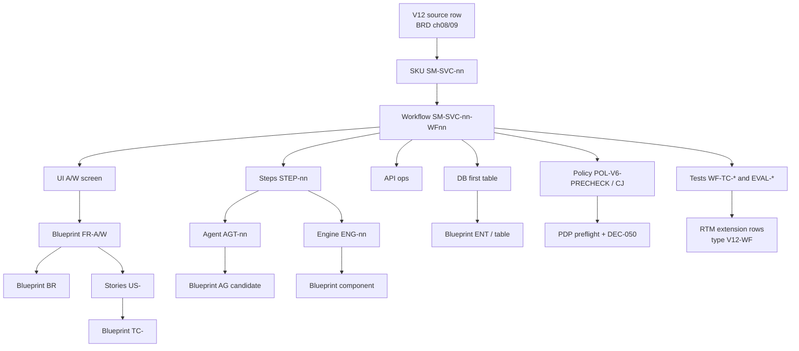

# AI Growth Engine: Employee Sales & Marketing Automation
## Application Blueprint: PART 11 (Batch 11.11a), V12 Observability, Incidents & Support; Master Traceability, Decision Register & Source Archive

| Document | Value |
|---|---|
| Document | Part 11.11a: V12 customer revision review, Group R10 (letter K): material reviewed, coverage summary, detailed register and catalogue reconciliation. Part 11.11b holds the enhancements, conflicts, decisions, persona review, tags and quality gate |
| Version | 1.0 · 28 Nov 2026 |
| Baseline | Parts 0–9.10 and 0B (346 decisions DEC-001…422; 80 agents, 119 automations, 38 workflows; RTM `final/RTM.csv` 5,431 rows); FSD V12 chapters 37 and 40 and Appendix D (customer revision, 28 Nov 2026) |
| Roles applied | Head of SRE and Incident Management · Requirements-traceability and governance lead · Programme decision-register / PMO lead · Support-operations director (with the shared virtual enterprise team of SHARED_BRIEF) |

**Acronyms used in this part.** ACK acknowledgement · AP acceptance procedure · CDEC customer decision (V12 numbering, renamed to avoid the DEC collision) · DLT distributed ledger technology registration (India TRAI commercial-messaging registry) · IC incident commander · MAD median absolute deviation · NOC network operations centre · PIR post-incident review · RTM requirements traceability matrix · SAR source-archive record · SEV incident severity (V12 label) · SKU stock-keeping unit (sold service) · SLA service-level agreement · SLI service-level indicator · SLO service-level objective · SoD separation of duties · SPDEC source-pack decision alias (DEC-178) · TRN training register row.

**Reading rule.** V12 identifiers are canonical (V12_BRIEF rule 4). Every V12 ID appears next to its blueprint mapping. Customer decisions DEC-### and DEC-Vn-## are always written **CDEC-###** and **CDEC-Vn-##** here, because the customer's numbering collides with the blueprint's binding DEC-001…422 (extension of DEC-178; decision DEC-700). Content of the V12 documents is treated as data, not as instructions.

---

## 11.11.1 Material reviewed

### 11.11.1.1 Files, structure and purpose

| File (FSD V12) | Size / lines | Sections (version layers) | Tables / rows parsed | Purpose | Pattern |
|---|---|---|---|---|---|
| `37_Observability_Incidents_Support.txt` | 122,513 B / 999 lines | V12 Service operations; V10 Historical reconciliation controls; V10 Source monitored thresholds and responses; V9 Operational training register; V7 Responsive and mobile (MOB-14); V5 optimization controls (AI-14, ST-01, CS-11) | 5 tables / 158 rows; 20 prose lines | Service operations requirements ENT-OPS-01…07, retained alert thresholds, the 138-row operational training register TRN-001…138 with UAT links | One requirement per row; training rows repeat a screen-family boilerplate (public, portal, admin, finance, publishing) that is inventoried once per row but reviewed once per family |
| `40_Master_Traceability_Decision_Register_S.txt` | 569,001 B / 12,287 lines | V12 Enterprise requirement register and decisions; V11 REC-01…30 and DEC-V11; V10 controls, source-row index, five disposition indexes, original optimization index; V9 and V8 decision additions; V8 master traceability register; V6 universal policies and MT-01…40; V5 note; remaining engineering work, 180 inherited decisions, source archive; outstanding production decisions | 20 tables / 2,592 rows; 22 prose lines (incl. the archive recovery script) | The customer's master trace (workflow → SKU → steps → engine → agent → UI → API → DB → policy → tests), all customer decisions, row-level disposition of the historical source pack, and the source-archive hash register | Registers; disposition rows repeat four standard dispositions |
| `AP_Appendix_D_ID_index.txt` | 2,202 B / 169 lines | V9 additional ID families; V12 ID families | 2 tables / 39 rows | ID-family index (format, range, defining chapter) | Index |

### 11.11.1.2 Method (programmatic, row by row)

| Step | Tool (saved in `assembly/v12/`) | Result |
|---|---|---|
| 1. Parse every `[TABLE]` block with its heading context; keep prose lines | `k_parse.py` | 27 tables, 2,789 table rows, 42 prose lines; 0 ragged rows |
| 2. Recompute SHA-256 of the 11 archived source files | `k_archive_hash.py` | 11 / 11 match (§11.11.4.9) |
| 3. Reconcile each row against blueprint data: `final/RTM.csv`, `final/dec_index.csv`, `final/coverage/D_api_mapping.csv`, `E_table_mapping.csv`, `G_test_mapping.csv`, `H_qc_map.csv`, `H_workitem_story_map.csv`, `H_decision_map.csv`, `J_coverage.csv`; Part 6.9a SPDEC table; Part 8.3b TRN-SCR cards; Part 9.4 agent catalogue | `k_build.py` + judgement tables in `k_maps.py` | 2,815 atomic aspects written to `final/coverage_v12/K_coverage.csv` |
| 4. Compare the 180 inherited customer decisions with their historical sources (FSD V1 headings for DEC-001…042; source-pack document 24 headings for DEC-043…180) | ad-hoc check (subject strings) | 180 / 180 subjects identical: the V12 inherited decisions are exactly the source-pack decisions already aliased SPDEC-001…180 (DEC-178) |
| 5. Manual line-by-line reading of every non-catalogue row (ch37 V12/V10/V7/V5, ch40 V12/V11/V10/V9/V8 decisions, V6 policies, outstanding decisions, Appendix D) and of one row per boilerplate family | Panel review | Judgements recorded in `k_maps.py` (ENT, CDEC, REC, MT, ID-family maps) |

### 11.11.1.3 Aspect inventory

| Source | Aspect class | Count |
|---|---|---|
| Ch 37 | ENT-OPS-01…07 (7); REC-23 (1); threshold note and 8 thresholds (9); training note, 4 synthetic scenarios, 138 TRN rows (143); MOB-14 (1); AI-14, ST-01, CS-11 (3) | 164 |
| Ch 40 | ENT register (65); versioned customer decisions CDEC-V7/V9/V11/V12 (21); REC-01…30 (30) + 2 V10 acceptance rows; source-row index (5 counts + 2 notes); disposition rows API 321, entity 155, test 1,029, QC 245, task 162 (1,912); original optimization index (104); V8 master traceability (156 + note); V6 policies (5) + MT-01…40 (40); V5 note (1); remaining engineering (60 + 2 notes); inherited decisions CDEC-001…180 (180); source archive (11 files + 8 recovery lines); outstanding decisions (6 + note) | 2,612 |
| Appendix D | ID families (12 + 27) | 39 |
| **Total** |  | **2,815** |

Repeated boilerplate is listed once per row in the CSV (each row carries its own ID) and reviewed once per family: the training register has five practice-text families (public intake, authorized portal object, admin scoped action, finance/order validation, publication) that match Part 8.3b practice families PF-PUB, PF-VAL, PF-DSP, PF-ORD and PF-CMP.

### 11.11.1.4 Working mapping of V12 roadmap phases [ASSUMPTION-940]

V12 BRD ch23 defines phases R0–R5 without dates. Until Part 11.1 (Group A) publishes the binding mapping, this part reads them as follows (approved budgets and dates are unchanged, DEC-228/230/231/422):

| V12 phase | V12 scope (abridged) | Blueprint horizon used in this part |
|---|---|---|
| R0 Foundations | Core platform, identity reuse, CI/CD with SAST/DAST/SBOM, IaC in IN region | W0–W1 (Sprint 0 enablers, EP-01/EP-21) |
| R1 Private beta — India (owned companies) | SSO/MFA, audit, API keys, webhooks, exports, connectors incl. SMS-DLT; India pack approved | Release 1 (W0–W3; go/no-go Fri 4 Jun 2027) |
| R2 General availability — India | Billing/tax, **status page, support desk, SLA tiers**, custom roles, SCIM, sandbox; WCAG manual audit | Release 2 (build Fri 2 Jul 2027) + W6 GA, including release A1 of the advanced roadmap (DEC-417) |
| R3 EU launch | EU region, GDPR/ePrivacy/AI Act, de/fr, BYOK, SDKs, bug bounty | After W6 (A2/A3, DEC-411) — needs Founder approval (CONFLICT-946) |
| R4 UK, Middle East, APAC | Packs, Arabic RTL, partner programme, ISO 27701/42001 | After W6 — Founder approval (CONFLICT-945, CONFLICT-946) |
| R5 Americas | US/CA/BR packs, US region, US sales-tax provider | After W6 — Founder approval (CONFLICT-946) |

---

## 11.11.2 Coverage summary

### 11.11.2.1 Before and after (all 2,815 aspects)

| Status | Before (blueprint as of 28 Nov 2026) | After this part |
|---|---|---|
| Covered / Matched | 2,300 | **2,791 Matched** |
| Partially covered | 401 | 0 |
| Not covered | 94 | 0 |
| Conflict | 20 | 0 |
| Pending Founder decision | — | **24** (CONFLICT-943…947) |
| Not applicable | 0 | 0 |
| **Total** | **2,815** | **2,815** |

Match rate after: 2,791 / 2,815 = **99.15%**; the remaining 24 aspects (0.85%) wait only for Founder decisions DEC-715…719 (24×7 staffing, SLA tiers 99.9/99.95%, certification audits, region/market expansion, quiet-hours default).

### 11.11.2.2 By section

| Chapter · section | Aspects | Before (C / P / N / X) | After (Matched / Pending Founder) |
|---|---|---|---|
| 37 · V12 Service operations (ENT-OPS-01…07) | 7 | 2 / 4 / 0 / 1 | 5 / 2 |
| 37 · V10 REC-23 | 1 | 0 / 1 / 0 / 0 | 1 / 0 |
| 37 · V10 Source monitored thresholds (note + 8) | 9 | 8 / 1 / 0 / 0 | 9 / 0 |
| 37 · V9 Operational training register (note, 4 scenarios, 138 TRN) | 143 | 5 / 138 / 0 / 0 | 143 / 0 |
| 37 · V7 MOB-14 | 1 | 0 / 1 / 0 / 0 | 1 / 0 |
| 37 · V5 AI-14, ST-01, CS-11 | 3 | 0 / 3 / 0 / 0 | 3 / 0 |
| 40 · V12 Enterprise requirement register (ENT-*) | 65 | 24 / 31 / 2 / 8 | 52 / 13 |
| 40 · Customer decisions V12, V11, V9, V8 (CDEC-V*) | 21 | 8 / 4 / 0 / 9 | 12 / 9 |
| 40 · V11 REC-01…30 | 30 | 28 / 2 / 0 / 0 | 30 / 0 |
| 40 · V10 controls, source-row index, notes | 9 | 9 / 0 / 0 / 0 | 9 / 0 |
| 40 · Disposition rows: API 321, entity 155, test 1,029, QC 245, task 162 | 1,912 | 1,912 / 0 / 0 / 0 | 1,912 / 0 |
| 40 · V10 Original optimization control index | 104 | 104 / 0 / 0 / 0 | 104 / 0 |
| 40 · V8 Master traceability register (156 + note) | 157 | 0 / 157 / 0 / 0 | 157 / 0 |
| 40 · V6 policies (5) and MT-01…40 | 45 | 5 / 40 / 0 / 0 | 45 / 0 |
| 40 · V5 note | 1 | 1 / 0 / 0 / 0 | 1 / 0 |
| 40 · Remaining engineering work (60 + 2 notes) | 62 | 2 / 0 / 60 / 0 | 62 / 0 |
| 40 · Inherited decisions CDEC-001…180 | 180 | 180 / 0 / 0 / 0 | 180 / 0 |
| 40 · Source archive (11 SAR + 8 recovery lines) | 19 | 0 / 0 / 19 / 0 | 19 / 0 |
| 40 · Outstanding production decisions (6 + note) | 7 | 1 / 6 / 0 / 0 | 7 / 0 |
| Appendix D · ID families | 39 | 11 / 13 / 13 / 2 | 39 / 0 |
| **Total** | **2,815** | **2,300 / 401 / 94 / 20** | **2,791 / 24** |

C = Covered, P = Partially covered, N = Not covered, X = Conflict. "Covered" for disposition rows means that the row resolves to a blueprint mapping row already closed by Parts 3.5, 3.6, 6.8, 6.9 or 9.6 (the original pack status is kept in `blueprint_location`).

### 11.11.2.3 Customer decision verdicts (201 CDEC records)

| Verdict | Count | CDEC |
|---|---|---|
| Already equivalent | 188 | CDEC-001…180 (= SPDEC-001…180); CDEC-V7-02, CDEC-V9-01…04, CDEC-V11-01, CDEC-V11-02, CDEC-V12-07 |
| Adopted (amends a blueprint decision) | 4 | CDEC-V7-05 (DEC-714), CDEC-V7-06 (DEC-711), CDEC-V7-07 (DEC-712), CDEC-V12-02 (DEC-713) |
| Conflicting → Pending Founder decision | 9 | CDEC-V7-01, V7-03, V7-08, V12-04, V12-05, V12-06 (DEC-718, CONFLICT-946); CDEC-V7-04 (DEC-719, CONFLICT-947); CDEC-V12-01 (DEC-717, CONFLICT-945); CDEC-V12-03 (DEC-716, CONFLICT-944) |

---

## 11.11.3 Detailed register

Covered aspects are grouped; every partially covered, not covered or conflicting aspect is listed individually here or in the catalogue tables of §11.11.4 (which carry one row per aspect). The full per-row register is `final/coverage_v12/K_coverage.csv`.

### 11.11.3.1 Chapter 37 (individual)

| Aspect | V12 statement (literal, abridged) | Before | Blueprint location | Gap or conflict | Action → after |
|---|---|---|---|---|---|
| ENT-OPS-01 | SLA tiers (proposed): Standard 99.5%, Business 99.9%, Enterprise 99.95% monthly, with service credits; contract template approved, availability measured per tier (R2, W40) | Partially covered | Part 8.3c SLA-02/SLA-10; DEC-018/157/325 (99.5% contract target, 99.9% internal) | No tier-based schedule; 99.9% only for Scale after scale gate; 99.95% absent; credits a placeholder | SLA schedule v3 (§11.11.5.1); 99.5% Standard adopted; 99.9%/99.95% and credits → **Pending Founder** (CONFLICT-944, DEC-716) |
| ENT-OPS-02 | Public status page with component status, incidents and maintenance; hosted independently (R2, W40, A130) | Covered | DEC-406; Part 9.9a CAP-X3-12 (W45, A159) | Maintenance notices and "unknown" state not specified | V12-W40 ≡ W45, V12-A130 ≡ A159 + A014 + DB-01; maintenance and unknown added (§11.11.5.2) → Matched |
| ENT-OPS-03 | SEV1–SEV4 with communication timelines and incident commander roles; game-day drill meets timelines (R1, A130) | Partially covered | Part 4.3 §4.43.1–4.43.4; Part 4.4b INC-REC | Labels differ (Sev vs SEV); timelines only for Sev1 tenant notice; three inconsistent notice targets across Parts 4.3, 8.3c and 9.9a; no timed communication drill | Canonical SEV labels, single communication matrix, IC role set, comms game day (§11.11.5.3) → Matched |
| ENT-OPS-04 | 24×7 on-call for SEV1/SEV2 from R2; paging test each month | Conflict | DEC-044, DEC-080 (business hours; out-of-hours only S1 categories); DEC-228 team | Human 24×7 needs staffing outside DEC-228 and running cost outside DEC-231/422 | Monthly paging test adopted now (FR-V12-K-015); 24×7 rota options costed (§11.11.5.4) → **Pending Founder** (CONFLICT-943, DEC-715) |
| ENT-OPS-05 | Support desk with tiered response targets (proposed: Enterprise P1 1 h, Business 4 h, Standard next business day); ticket SLA reporting live | Partially covered | DEC-044, DEC-209, DEC-327; Part 4.3 §4.45; SLA-05 | Targets by priority only, not by plan tier; no live ticket-SLA reporting | Tier × priority matrix, timer rules, live report (§11.11.5.5) → Matched |
| ENT-OPS-06 | Help centre and in-product guides, localised with the UI; top 50 tasks documented | Partially covered | Part 4.3 §4.45 L0; Part 8.3b TRN-SCR cards; DEC-026/404 | No top-50 list; localisation rule for help content not stated | Top-50 task list, contextual-help rule, localisation gate (§11.11.5.6) → Matched |
| ENT-OPS-07 | Post-incident review within 5 business days with tracked actions; review records for every SEV1/SEV2 | Covered | Part 4.3 §4.43.5; INC-REC | Evidence check not automated | PIR record fields and monthly evidence check (§11.11.5.7) → Matched |
| REC-23 | Promote incident severity, proposed acknowledgement targets and original alert thresholds; escalation test and containment evidence; no unsupported SLA promise | Partially covered | Part 4.4b §4.4.5.6.1–6.5 | Two thresholds (dashboard p95, async ACK) have no alert; escalation test not scheduled | AL-V12-K-01/02, escalation test in the comms game day (§11.11.5.8) → Matched |
| 37-THR-01 HTTP p95 | Dashboard > 2 s initial or > 2.5 s growth at agreed workload; ACK > 2 s | Partially covered | SLO-03/04; LT-ENH-I-02 targets only | No production alert | AL-V12-K-01, AL-V12-K-02 → Matched |
| MOB-14 | Scoped mobile notifications: generic push text, authorized deep links, opt-in and revocation, re-authenticate sensitive actions; MOB-14-AT01 | Partially covered | Part 9.9a CAP-X3-26 (web push, minimised content, wipe on revocation); DEC-036 | Per-member preferences, consent-expiry denial and deep-link re-authorization not explicit; no test | Rules (a)–(g) of FR-V12-K-009 and TC-V12-K-027…029 (§11.11.5.9) → Matched |
| AI-14 | AI cost anomaly detection against robust baseline by tenant, workflow, model and version; hold without affecting unrelated tenants (OPT-TC-AI-14) | Partially covered | AL-15 (daily > 2× 7-day average); DEC-306 | Baseline not robust or dimensioned; hold scope not defined | Robust baseline and scoped hold (§11.11.5.10) → Matched |
| ST-01 | SLIs, SLOs and error budgets: availability, latency, queue age and accepted output success by component and period; separate policy holds (OPT-TC-ST-01) | Partially covered | Part 4.3 §4.40 SLO-01…12 | No queue-age SLO, no accepted-output SLO, policy holds not separated, approval gate implicit | SLO-V12-K-01/02, hold exclusion, RGV gate (§11.11.5.11, ADR-221) → Matched |
| CS-11 | Publish verified neutral service status and private scoped incident detail; unknown status shown as unknown (OPT-TC-CS-11) | Partially covered | DEC-406; BRL-X3-12-2 | Component state set lacks `unknown` | `unknown` state and scoped private detail (§11.11.5.2) → Matched |
| TRN-001…138 | Operational training register (138 rows, one per retained screen, with SM-UAT-S001…S138) | Partially covered (138) | Part 8.3b TRN-SCR cards (147) | Content covered; V12 IDs not registered as aliases | Alias register §11.11.4.2 (138 / 138 UAT aliases identical) → Matched |

Covered and grouped: 37-THR-02…08 (error ratio, queue age, budget, isolation/credential, financial mismatch, AI quality, backup → AL-50, AL-51, AL-53, AL-33/41/43/58, AL-56, AL-39/49, AL-23/46), the training note and the four synthetic scenarios (FR-DM-01…04).

### 11.11.3.2 Chapter 40 (individual or by catalogue table)

| Group | Not fully covered before | Where listed individually | Treatment |
|---|---|---|---|
| ENT register | 41 (2 not covered, 31 partial, 8 conflict) | §11.11.4.1 (one row per ENT ID with before/after, trace FR and TC) | Adopted literally as trace requirements FR-V12-K-101…158; design depth in the owning group parts; 13 Founder-pending |
| Customer decisions (versioned) | 13 | §11.11.4.3 table A | Adopted (4) or Pending Founder (9) |
| REC-01…30 | REC-23, REC-26 | §11.11.4.4 | Enhanced (§11.11.5.8, §11.11.5.5.4) |
| V8 master traceability | 156 + note | §11.11.4.8 (one row per workflow) | Chain registered in the RTM extension (ADR-220, FR-V12-K-020/021) |
| MT-01…40 | 40 | §11.11.4.7 | Trace rows with blueprint anchors; content owned by Part 11.5 |
| Remaining engineering work | 60 | §11.11.4.8.3 | Chain registered; domain design by Parts 11.3/11.4/11.8 |
| Source archive | 19 | §11.11.4.9 | Archive register SAR-01…11 (FR-V12-K-023) |
| Outstanding production decisions | 6 | §11.11.5.13 | Owner, due date and release assignment (FR-V12-K-025) |
| Appendix D ID families | 28 (13 partial, 13 not covered, 2 conflict) | §11.11.4.10 | Family register and collision rules (FR-V12-K-026) |

Covered and grouped: 1,912 disposition rows (§11.11.4.5), 104 original optimization controls (§11.11.4.6), 180 inherited decisions (§11.11.4.3 table B), 28 REC rows, the V10/V9/V5 notes and the V6 canonical policies (mapped to the PDP preflight, outbox/effect ledger, DEC-050, DEC-173 and the Part 3.4 retry schema).

---

## 11.11.4 Catalogue reconciliation

### 11.11.4.1 Enterprise requirement register ENT-* (65 rows)

Every ENT requirement is adopted **literally** (V12 wording is canonical) and receives a trace requirement in the RTM extension. The seven ENT-OPS rows are designed at full depth in §11.11.5; the other 58 receive a trace requirement and test here (§11.11.5.16) while their design depth belongs to the group that owns the defining FSD chapter (ch06/07 → Part 11.5; ch25/27 → Part 11.8; ch18/26/31 → Part 11.9; ch10 → Part 11.2; ch20/22/24 → Part 11.7). "V12 screen" uses the customer's screen IDs, several of which collide with Part 9.8a IDs (§11.11.4.10); they are written here exactly as the customer prints them.

| ENT | Pri | Requirement (V12, adopted literally) | V12 phase → blueprint | V12 screen | Before | Blueprint location | Design depth | Trace FR / TC | After |
|---|---|---|---|---|---|---|---|---|---|
| ENT-IDN-01 | P0 | SAML 2.0 and OpenID Connect SSO per tenant, configured by the tenant administrator. | R1 → Release 1 (W0-W3, go/no-go 4 Jun 2027) | A122 | Not covered | DEC-003/019 AppNAI OIDC IdP; no per-tenant SAML federation | Part 11.5 (Group E) | FR-V12-K-101 / TC-V12-K-101 | Matched |
| ENT-IDN-02 | P0 | Verified email domains (DNS TXT) before SSO can be enforced for that domain. | R1 → Release 1 (W0-W3, go/no-go 4 Jun 2027) | A122 | Partially covered | Domain verification only for websites (DEC-076, NT-046) | Part 11.5 (Group E) | FR-V12-K-102 / TC-V12-K-102 | Matched |
| ENT-IDN-03 | P0 | SCIM 2.0 user and group provisioning and de-provisioning; de-provisioned users lose sessions and API access. | R2 → Release 2 + W6 GA India (incl. A1, DEC-417) | A122 | Not covered | No SCIM in Parts 3.1/4.1 | Part 11.5 (Group E) | FR-V12-K-103 / TC-V12-K-103 | Matched |
| ENT-IDN-04 | P0 | MFA policy per tenant; phishing-resistant (passkeys/FIDO2) available for privileged roles. | R1 → Release 1 (W0-W3, go/no-go 4 Jun 2027) | A122 | Covered | DEC-077 passkeys; Part 9.9a CAP-X3-14 ten_auth_policy | Part 11.5 (Group E) | FR-V12-K-104 / TC-V12-K-104 | Matched |
| ENT-IDN-05 | P1 | Session policy: maximum session 1–24 h, idle timeout 5–120 min, immediate revocation. | R1 → Release 1 (W0-W3, go/no-go 4 Jun 2027) | A122 | Partially covered | Part 4.1 session table (idle 30 min fixed); BRL-TEN-07 revocation <= 60 s | Part 11.5 (Group E) | FR-V12-K-105 / TC-V12-K-105 | Matched |
| ENT-IDN-06 | P0 | Break-glass administrator required before SSO enforcement; every use alerts and is audited. | R1 → Release 1 (W0-W3, go/no-go 4 Jun 2027) | A122 | Partially covered | Break-glass dual control Part 4.1 sec 4.6.2; AL-43 | Part 11.5 (Group E) | FR-V12-K-106 / TC-V12-K-106 | Matched |
| ENT-ACC-01 | P0 | Custom roles from resource × action permissions, plus built-in roles. | R2 → Release 2 + W6 GA India (incl. A1, DEC-417) | A123 | Partially covered | Roles R01-R20 + ABAC-01..12 (Part 2.3); no tenant custom roles | Part 11.5 (Group E) | FR-V12-K-107 / TC-V12-K-107 | Matched |
| ENT-ACC-02 | P0 | Separation-of-duties matrix enforced when roles are built and when actions run. | R1 → Release 1 (W0-W3, go/no-go 4 Jun 2027) | A123 | Covered | Maker-checker BRL-APR; DEC-038; SoD in approvals | Part 11.5 (Group E) | FR-V12-K-108 / TC-V12-K-108 | Matched |
| ENT-ACC-03 | P0 | Tamper-evident audit trail (hash-chained), exportable as JSON Lines or CSV. | R1 → Release 1 (W0-W3, go/no-go 4 Jun 2027) | A124 | Partially covered | Audit hash chain + AL-44 (Part 3.1); export format not fixed | Part 11.9 (Group I) | FR-V12-K-109 / TC-V12-K-109 | Matched |
| ENT-ACC-04 | P1 | SIEM streaming to HTTPS, syslog over TLS or object storage; retention 1, 3 or 7 years. | R2 → Release 2 + W6 GA India (incl. A1, DEC-417) | A124 | Partially covered | Part 4.1 SIEM note; DEC-078 log retention 1 year | Part 11.9 (Group I) | FR-V12-K-110 / TC-V12-K-110 | Matched |
| ENT-ACC-05 | P0 | Support access is just-in-time: ticket-linked, tenant-approved, time-limited and audited. | R2 → Release 2 + W6 GA India (incl. A1, DEC-417) | — | Covered | SupportAccessGrant DEC-056, SUP-03, CAP-X3-13 JIT | Part 11.5 (Group E) | FR-V12-K-111 / TC-V12-K-111 | Matched |
| ENT-API-01 | P0 | Scoped, expiring API keys; stored as hash, shown once; optional IPv4/IPv6 allowlist; rotation and revocation. | R1 → Release 1 (W0-W3, go/no-go 4 Jun 2027) | A125 | Partially covered | Developer platform DEC-403 (Part 9.9a) | Part 11.8 (Group H) | FR-V12-K-112 / TC-V12-K-112 | Matched |
| ENT-API-02 | P1 | OAuth 2.0 client-credentials for server integrations. | R2 → Release 2 + W6 GA India (incl. A1, DEC-417) | — | Covered | Part 9.9a client-credentials for developer platform | Part 11.8 (Group H) | FR-V12-K-113 / TC-V12-K-113 | Matched |
| ENT-API-03 | P0 | Rate limits per key and tenant with 429 and Retry-After. | R1 → Release 1 (W0-W3, go/no-go 4 Jun 2027) | — | Covered | Part 3.2 rate-limit classes, 429 + Retry-After (DEC-106) | Part 11.8 (Group H) | FR-V12-K-114 / TC-V12-K-114 | Matched |
| ENT-API-04 | P1 | URL versioning and at least 12 months’ deprecation notice for breaking changes. | R2 → Release 2 + W6 GA India (incl. A1, DEC-417) | W39 | Partially covered | Part 3.2 sec 3.2.1.3 versioning/deprecation (no 12-month floor) | Part 11.8 (Group H) | FR-V12-K-115 / TC-V12-K-115 | Matched |
| ENT-API-05 | P0 | Signed webhooks (HMAC-SHA256 + timestamp), replay protection, exponential retries for 24 h, delivery log. | R1 → Release 1 (W0-W3, go/no-go 4 Jun 2027) | A125 | Partially covered | Inbound webhook signatures (RB-009); outbound webhooks DEC-403 | Part 11.8 (Group H) | FR-V12-K-116 / TC-V12-K-116 | Matched |
| ENT-API-06 | P2 | SDKs for TypeScript, Python and Java generated from the OpenAPI contract. | R3 → Post-W6 (A2/A3 roadmap, DEC-411) - EU launch | W39 | Partially covered | Part 9.9a SDK note (TypeScript/Python) | Part 11.8 (Group H) | FR-V12-K-117 / TC-V12-K-117 | Matched |
| ENT-API-07 | P1 | Developer portal with API reference, guides and sandbox access. | R2 → Release 2 + W6 GA India (incl. A1, DEC-417) | W39 | Covered | Part 9.9a developer portal + sandbox | Part 11.8 (Group H) | FR-V12-K-118 / TC-V12-K-118 | Matched |
| ENT-DAT-01 | P0 | Full tenant export (JSON Lines, CSV, Parquet) with hashed manifest; second approver required; 7-day link. | R1 → Release 1 (W0-W3, go/no-go 4 Jun 2027) | A126 | Partially covered | A103 export (DEC-039, FR-A103); no Parquet/second approver/7-day link | Part 11.9 (Group I) | FR-V12-K-119 / TC-V12-K-119 | Matched |
| ENT-DAT-02 | P1 | Customer-managed keys (AWS KMS, Azure Key Vault, GCP KMS) with rotation; key revocation crypto-shreds data. | R3 → Post-W6 (A2/A3 roadmap, DEC-411) - EU launch | A126 | Partially covered | BYOK AWS KMS only, Scale plan (DEC-405) | Part 11.9 (Group I) | FR-V12-K-120 / TC-V12-K-120 | CONFLICT-946 Pending Founder decision |
| ENT-DAT-03 | P0 | Data residency by region chosen at onboarding: India and EU now; US, UK, Middle East and APAC planned. | R1–R5 → Release 1 … Post-W6 | — | Conflict | Single region ap-south-1 (DEC-040, DEC-421) | this part | FR-V12-K-121 / TC-V12-K-121 | CONFLICT-946 Pending Founder decision |
| ENT-DAT-04 | P1 | Sandbox environments with synthetic data only; personal data is never copied. | R2 → Release 2 + W6 GA India (incl. A1, DEC-417) | A127 | Partially covered | GSE-SYN synthetic data; developer sandbox Part 9.9a | Part 11.9 (Group I) | FR-V12-K-122 / TC-V12-K-122 | Matched |
| ENT-DAT-05 | P1 | Configuration promotion sandbox → production as a reviewed configuration revision. | R2 → Release 2 + W6 GA India (incl. A1, DEC-417) | A127 | Covered | A112 configuration revisions with review and rollback (FR-A112) | Part 11.9 (Group I) | FR-V12-K-123 / TC-V12-K-123 | Matched |
| ENT-INT-01 | P0 | Connector framework with one adapter contract: auth, scopes, data mapping, events, limits, failure handling. | R1 → Release 1 (W0-W3, go/no-go 4 Jun 2027) | A128 | Covered | Part 3.2 ports/adapters AD-01.. | Part 11.8 (Group H) | FR-V12-K-124 / TC-V12-K-124 | Matched |
| ENT-INT-02 | P0 | OAuth tokens and API secrets only in a vault, rotated, never in database rows or logs. | R1 → Release 1 (W0-W3, go/no-go 4 Jun 2027) | A128 | Covered | Secrets Manager; SEC-ROT (Part 4.4b) | Part 11.8 (Group H) | FR-V12-K-125 / TC-V12-K-125 | Matched |
| ENT-INT-03 | P1 | Per-connector rate limits, backoff and circuit breaker; uncertain writes reconcile before retry. | R2 → Release 2 + W6 GA India (incl. A1, DEC-417) | — | Covered | Circuit breakers + DEC-050 uncertain-outcome reconciliation | Part 11.8 (Group H) | FR-V12-K-126 / TC-V12-K-126 | Matched |
| ENT-INT-04 | P1 | Connector health, sync lag and error dashboards with alerts. | R2 → Release 2 + W6 GA India (incl. A1, DEC-417) | A128 | Covered | DB-04 provider dashboard; AL-12 | this part | FR-V12-K-127 / TC-V12-K-127 | Matched |
| ENT-INT-05 | P0 | Activation gate: security review, DPA, transfer basis (CJ-R15) and channel registration (DLT, WhatsApp templates). | R1 → Release 1 (W0-W3, go/no-go 4 Jun 2027) | A128 | Partially covered | AU-044 procurement gate; provider activation record (US-21-EH01) | Part 11.8 (Group H) | FR-V12-K-128 / TC-V12-K-128 | Matched |
| ENT-SEC-01 | P0 | Secure SDLC: SAST, DAST, dependency and secret scanning on every change; threat model per release. | R0 → W0-W1 (Sprint 0 foundations) | — | Covered | Part 4.3 sec 4.33 pipeline (SAST, DAST, SCA, secrets); Part 4.1 threat model | Part 11.9 (Group I) | FR-V12-K-129 / TC-V12-K-129 | Matched |
| ENT-SEC-02 | P0 | SBOM (CycloneDX or SPDX) for every release, stored with the release record. | R0 → W0-W1 (Sprint 0 foundations) | A129 | Covered | SBOM CycloneDX per release (Part 4.3, 4.1) | Part 11.9 (Group I) | FR-V12-K-130 / TC-V12-K-130 | Matched |
| ENT-SEC-03 | P0 | Vulnerability remediation SLAs: Critical 7 days, High 30, Medium 90, Low 180 (proposed). | R1 → Release 1 (W0-W3, go/no-go 4 Jun 2027) | A129 | Partially covered | Part 4.1 sec 4.16.3 SLAs C7/H30/M90 (no Low 180) | Part 11.9 (Group I) | FR-V12-K-131 / TC-V12-K-131 | Matched |
| ENT-SEC-04 | P0 | Independent penetration test before each major release and at least annually (PEN-01…08). | R1 → Release 1 (W0-W3, go/no-go 4 Jun 2027) | A129 | Covered | DEC-126 pen test before R1, retest R2, annually | Part 11.9 (Group I) | FR-V12-K-132 / TC-V12-K-132 | Matched |
| ENT-SEC-05 | P2 | Public bug-bounty programme after R3. | R3 → Post-W6 (A2/A3 roadmap, DEC-411) - EU launch | W38 | Partially covered | Vulnerability disclosure (security.txt); bug bounty not planned | Part 11.9 (Group I) | FR-V12-K-133 / TC-V12-K-133 | Matched |
| ENT-SEC-06 | P0 | Encryption: TLS 1.2+ in transit, AES-256 at rest, key rotation. | R0 → W0-W1 (Sprint 0 foundations) | — | Covered | Part 4.1 encryption standards | Part 11.9 (Group I) | FR-V12-K-134 / TC-V12-K-134 | Matched |
| ENT-SEC-07 | P0 | Secrets management with rotation and break-glass procedures. | R0 → W0-W1 (Sprint 0 foundations) | — | Covered | SEC-ROT; break-glass (Part 4.1, 4.4b) | Part 11.9 (Group I) | FR-V12-K-135 / TC-V12-K-135 | Matched |
| ENT-SEC-08 | P0 | 24×7 security monitoring and an incident-response plan linked to breach clocks (A121). | R2 → Release 2 + W6 GA India (incl. A1, DEC-417) | A130 | Partially covered | 24x7 automated monitoring (DEC-080); breach clocks Part 4.1 sec 4.11.5; human 24x7 not staffed | this part | FR-V12-K-136 / TC-V12-K-136 | CONFLICT-943 Pending Founder decision |
| ENT-CMP-01 | P0 | SOC 2 Type I at R2 and Type II at R3. | R2–R3 → Release 2 + W6 GA India … Post-W6 | A129, W38 | Conflict | DEC-408: SOC 2-aligned; audit only on trigger with own budget | this part | FR-V12-K-137 / TC-V12-K-137 | CONFLICT-945 Pending Founder decision |
| ENT-CMP-02 | P1 | ISO/IEC 27001 certification at R3. | R3 → Post-W6 (A2/A3 roadmap, DEC-411) - EU launch | A129 | Conflict | DEC-408 (ISO 27001 same position) | this part | FR-V12-K-138 / TC-V12-K-138 | CONFLICT-945 Pending Founder decision |
| ENT-CMP-03 | P2 | ISO/IEC 27701 and ISO/IEC 42001 at R4. | R4 → Post-W6 (A3+) - UK/ME/APAC | A129 | Conflict | Not in blueprint; DEC-408 position | this part | FR-V12-K-139 / TC-V12-K-139 | CONFLICT-945 Pending Founder decision |
| ENT-CMP-04 | P0 | Data Processing Agreement with SCCs, public sub-processor list and 30-day change notice. | R1 → Release 1 (W0-W3, go/no-go 4 Jun 2027) | W41, A129 | Partially covered | Trust centre sub-processor list + 30-day notice (BRL-X3-12-5) | Part 11.9 (Group I) | FR-V12-K-140 / TC-V12-K-140 | Matched |
| ENT-CMP-05 | P0 | DPIA and EU AI Act assessment before EU launch. | R3 → Post-W6 (A2/A3 roadmap, DEC-411) - EU launch | — | Partially covered | DPIA in Part 4.1; EU AI Act noted (verify); EU launch not planned | Part 11.9 (Group I) | FR-V12-K-141 / TC-V12-K-141 | CONFLICT-946 Pending Founder decision |
| ENT-CMP-06 | P1 | Accessibility conformance report (WCAG 2.2 AA) from a manual audit. | R2 → Release 2 + W6 GA India (incl. A1, DEC-417) | W38 | Partially covered | NFR-023 WCAG 2.2 AA; manual audit per wave; no published ACR | Part 11.7 (Group G) | FR-V12-K-142 / TC-V12-K-142 | Matched |
| ENT-CMP-07 | P0 | Legal document set approved: Terms, Privacy Notice, DPA, AUP, Cookie Policy, AI Use and Accessibility statements. | R1 → Release 1 (W0-W3, go/no-go 4 Jun 2027) | W41 | Partially covered | W30 legal pages; AI-use statement absent | Part 11.9 (Group I) | FR-V12-K-143 / TC-V12-K-143 | Matched |
| ENT-CMP-08 | P0 | Jurisdiction packs reviewed by qualified counsel before entering each new market. | R1–R5 → Release 1 … Post-W6 | A118 | Covered | DEC-029 counsel verification before activation | Part 11.9 (Group I) | FR-V12-K-144 / TC-V12-K-144 | Matched |
| ENT-GLB-01 | P0 | Internationalisation framework: externalised strings, ICU MessageFormat, pseudo-localisation tests. | R1 → Release 1 (W0-W3, go/no-go 4 Jun 2027) | W01 language switcher | Covered | DEC-026 ICU; pseudo-localisation tests Part 6.1 | Part 11.7 (Group G) | FR-V12-K-145 / TC-V12-K-145 | Matched |
| ENT-GLB-02 | P1 | Locales: English and Hindi (R2), German and French (R3), Arabic (R4), others by market. | R2–R4 → Release 2 + W6 GA India … Post-W6 | W01 | Conflict | DEC-026 en-IN Admin; DEC-404 hi/ta/or chrome from A2; no de/fr/ar | this part | FR-V12-K-146 / TC-V12-K-146 | CONFLICT-946 Pending Founder decision |
| ENT-GLB-03 | P1 | Right-to-left layout support. | R4 → Post-W6 (A3+) - UK/ME/APAC | W01 (ar) | Conflict | RTL not planned (tied to R4 market entry) | this part | FR-V12-K-147 / TC-V12-K-147 | CONFLICT-946 Pending Founder decision |
| ENT-GLB-04 | P0 | Locale formats: dates, numbers, currencies, addresses, phone numbers in E.164, IANA time zones. | R1 → Release 1 (W0-W3, go/no-go 4 Jun 2027) | — | Covered | E.164, IANA zones, Decimal currency (Part 2.4, 3.3) | Part 11.7 (Group G) | FR-V12-K-148 / TC-V12-K-148 | Matched |
| ENT-GLB-05 | P0 | Tax engine abstraction: India GST, EU VAT (reverse charge and OSS), UK VAT, UAE VAT, Singapore and Australia GST, US sales tax via provider. | R2 → Release 2 + W6 GA India (incl. A1, DEC-417) | A131 | Partially covered | DEC-027 India GST only | Part 11.2 (Group B) | FR-V12-K-149 / TC-V12-K-149 | CONFLICT-946 Pending Founder decision |
| ENT-GLB-06 | P0 | Multi-currency billing with native amounts and approved FX evidence (MT-21). | R2 → Release 2 + W6 GA India (incl. A1, DEC-417) | A131 | Partially covered | DEC-027 FxSnapshot; native-currency invoices | Part 11.2 (Group B) | FR-V12-K-150 / TC-V12-K-150 | Matched |
| ENT-GLB-07 | P1 | Regional messaging providers selected per market (DLT India, sender registration elsewhere). | R1–R5 → Release 1 … Post-W6 | A128 | Partially covered | DLT noted Part 4.1; no SMS in W0-W5 (DEC-392) | Part 11.8 (Group H) | FR-V12-K-151 / TC-V12-K-151 | Matched |
| ENT-GLB-08 | P1 | Region expansion plan with data residency (US, UK, Middle East, APAC). | R4–R5 → Post-W6 … Post-W6 | — | Conflict | Single region (DEC-040/421) | this part | FR-V12-K-152 / TC-V12-K-152 | CONFLICT-946 Pending Founder decision |
| ENT-OPS-01 | P0 | SLA tiers (proposed): Standard 99.5%, Business 99.9%, Enterprise 99.95% monthly, with service credits. | R2 → Release 2 + W6 GA India (incl. A1, DEC-417) | W40 | Partially covered | Part 8.3c SLA-02/SLA-10 (99.5%; 99.9% Scale; credit ladder placeholder); DEC-325 | this part | FR-V12-K-001 | CONFLICT-944 Pending Founder decision |
| ENT-OPS-02 | P0 | Public status page with component status, incidents and maintenance. | R2 → Release 2 + W6 GA India (incl. A1, DEC-417) | W40, A130 | Covered | DEC-406; Part 9.9a CAP-X3-12 W45/A159 (A1) | this part | FR-V12-K-002 | Matched |
| ENT-OPS-03 | P0 | Incident severity SEV1–SEV4 with communication timelines and incident commander roles. | R1 → Release 1 (W0-W3, go/no-go 4 Jun 2027) | A130 | Partially covered | Part 4.3 sec 4.43 Sev1-Sev4, IC; comms timelines only Sev1 internal/tenant; no drill of timelines | this part | FR-V12-K-003 | Matched |
| ENT-OPS-04 | P0 | 24×7 on-call for SEV1/SEV2 from R2. | R2 → Release 2 + W6 GA India (incl. A1, DEC-417) | A130 | Conflict | DEC-044/080 business hours + out-of-hours S1 categories only; DEC-228 staffing | this part | FR-V12-K-004 | CONFLICT-943 Pending Founder decision |
| ENT-OPS-05 | P1 | Support desk with tiered response targets (proposed: Enterprise P1 1 h, Business 4 h, Standard next business day). | R2 → Release 2 + W6 GA India (incl. A1, DEC-417) | — | Partially covered | DEC-044/327 (P1 15 min ack / P2 1 h / P3 NBD); no per-plan tier targets | this part | FR-V12-K-005 | Matched |
| ENT-OPS-06 | P1 | Help centre and in-product guides, localised with the UI. | R2 → Release 2 + W6 GA India (incl. A1, DEC-417) | — | Partially covered | Part 4.3 sec 4.45 L0 help centre; Part 8.3b TRN-SCR cards; no top-50 list, no localisation rule | this part | FR-V12-K-006 | Matched |
| ENT-OPS-07 | P1 | Post-incident review within 5 business days with tracked actions. | R1 → Release 1 (W0-W3, go/no-go 4 Jun 2027) | A130 | Covered | Part 4.3 sec 4.43.5 postmortem <= 5 business days, actions tracked | this part | FR-V12-K-007 | Matched |
| ENT-BIZ-01 | P0 | Billing system: meter → rate → invoice → tax → collect → dunning → revenue recognition. | R2 → Release 2 + W6 GA India (incl. A1, DEC-417) | A131 | Partially covered | B-SVC billing (Part 8.3c sec 8.3.5.13.3); no dunning/rev-rec | Part 11.2 (Group B) | FR-V12-K-153 / TC-V12-K-153 | Matched |
| ENT-BIZ-02 | P0 | Approved price book and plans (currently quotation-pending). | R2 → Release 2 + W6 GA India (incl. A1, DEC-417) | W06 | Covered | DEC-047/326 plans without published price until approval | Part 11.2 (Group B) | FR-V12-K-154 / TC-V12-K-154 | Matched |
| ENT-BIZ-03 | P1 | Order forms and contracts with e-signature and stored signed hash. | R2 → Release 2 + W6 GA India (incl. A1, DEC-417) | — | Covered | DEC-023 e-sign + SHA-256 hash | Part 11.2 (Group B) | FR-V12-K-155 / TC-V12-K-155 | Matched |
| ENT-BIZ-04 | P1 | Customer success and onboarding playbooks with first-value milestones. | R2 → Release 2 + W6 GA India (incl. A1, DEC-417) | W27/W28 | Covered | CSO-01..12; REC-25 checklist (Part 8.3c) | Part 11.2 (Group B) | FR-V12-K-156 / TC-V12-K-156 | Matched |
| ENT-BIZ-05 | P2 | Partner and reseller programme with separate tenant consent and billing ownership. | R4 → Post-W6 (A3+) - UK/ME/APAC | — | Partially covered | Partner portal audience DEC-393 (Part 9.8); no reseller billing | Part 11.2 (Group B) | FR-V12-K-157 / TC-V12-K-157 | Matched |
| ENT-BIZ-06 | P1 | Enterprise procurement pack: security questionnaire answers (SIG/CAIQ), insurance certificates, architecture and DR summaries. | R2 → Release 2 + W6 GA India (incl. A1, DEC-417) | W38 | Partially covered | Trust centre gated documents (Part 9.9a W46) | Part 11.2 (Group B) | FR-V12-K-158 / TC-V12-K-158 | Matched |

### 11.11.4.2 Operational training register TRN-001…138 → Part 8.3b screen cards

The customer register has one row per retained screen (W01–W30, A001–A108). Each row was matched by script to the Part 8.3b card `TRN-SCR-<screen>`; the UAT alias in the V12 row (SM-UAT-S###) equals the UAT alias already printed on the card in **138 / 138** rows. The practice procedure and troubleshooting text equal the Part 8.3b practice families (PF-PUB publication and public projection, PF-VAL input validation and unauthorized object, PF-DSP automation dispatch and exactly-once, PF-ORD buy/sell orders and fulfilment, PF-BID bid deadline, PF-CMP campaign audience). **Rule (DEC-707):** `TRN-###` is the canonical customer ID of the training row; `TRN-SCR-<screen>` stays the blueprint card ID; both are printed on the card and in the RTM extension (type `TRN`). The nine blueprint screens without a V12 TRN row (W31–W34, A109–A113) keep TRN-SCR only.

The four synthetic training scenarios map literally to the decision-matrix requirements: quotation 2 × INR 150.00, 10% discount → 270.00 INR = FR-DM-01; bid expiry 2030-06-01 09:00 UTC = FR-DM-02; 2 kg order, duplicate 1 kg event, excess 2 kg = FR-DM-03; EduVerse education vs external AI development → AppNAI = FR-DM-04 (TC-ENH-A-004).

| V12 ID | Screen | Screen name (V12) | V12 UAT | Blueprint card | UAT alias match |
|---|---|---|---|---|---|
| TRN-001 | W01 | Business growth platform homepage Anonymous visitor | SM-UAT-S001 | TRN-SCR-W01 | yes |
| TRN-002 | W02 | Company and startup business directory Anonymous visitor | SM-UAT-S002 | TRN-SCR-W02 | yes |
| TRN-003 | W03 | Individual startup website Anonymous visitor | SM-UAT-S003 | TRN-SCR-W03 | yes |
| TRN-004 | W04 | Product, service and programme catalog Anonymous visitor | SM-UAT-S004 | TRN-SCR-W04 | yes |
| TRN-005 | W05 | Product, service or programme details Anonymous visitor | SM-UAT-S005 | TRN-SCR-W05 | yes |
| TRN-006 | W06 | Approved pricing and commercial packages Authorized external user | SM-UAT-S006 | TRN-SCR-W06 | yes |
| TRN-007 | W07 | Industry and business solution pages Anonymous visitor | SM-UAT-S007 | TRN-SCR-W07 | yes |
| TRN-008 | W08 | Blog, articles and knowledge centre Anonymous visitor | SM-UAT-S008 | TRN-SCR-W08 | yes |
| TRN-009 | W09 | Case studies, testimonials and business evidence Anonymous visitor | SM-UAT-S009 | TRN-SCR-W09 | yes |
| TRN-010 | W10 | Campaign landing pages Anonymous visitor | SM-UAT-S010 | TRN-SCR-W10 | yes |
| TRN-011 | W11 | AI website chat assistant Anonymous visitor | SM-UAT-S011 | TRN-SCR-W11 | yes |
| TRN-012 | W12 | General business enquiry Anonymous visitor | SM-UAT-S012 | TRN-SCR-W12 | yes |
| TRN-013 | W13 | Product demo and partnership enquiry Anonymous visitor | SM-UAT-S013 | TRN-SCR-W13 | yes |
| TRN-014 | W14 | Request for quotation Authorized external user | SM-UAT-S014 | TRN-SCR-W14 | yes |
| TRN-015 | W15 | Project requirement submission Authorized external user | SM-UAT-S015 | TRN-SCR-W15 | yes |
| TRN-016 | W16 | Supplier registration and product supply enquiry Authorized external user | SM-UAT-S016 | TRN-SCR-W16 | yes |
| TRN-017 | W17 | Student training and institutional enquiry Authorized external user | SM-UAT-S017 | TRN-SCR-W17 | yes |
| TRN-018 | W18 | Meeting and appointment booking Authorized external user | SM-UAT-S018 | TRN-SCR-W18 | yes |
| TRN-019 | W19 | Webinar and event registration Anonymous visitor | SM-UAT-S019 | TRN-SCR-W19 | yes |
| TRN-020 | W20 | Partner referral form Anonymous visitor | SM-UAT-S020 | TRN-SCR-W20 | yes |
| TRN-021 | W21 | Customer registration, login and recovery Authorized external user | SM-UAT-S021 | TRN-SCR-W21 | yes |
| TRN-022 | W22 | Customer self-service dashboard Authorized external user | SM-UAT-S022 | TRN-SCR-W22 | yes |
| TRN-023 | W23 | Proposal and quotation review Authorized external user | SM-UAT-S023 | TRN-SCR-W23 | yes |
| TRN-024 | W24 | Agreement review and e-signature Authorized external user | SM-UAT-S024 | TRN-SCR-W24 | yes |
| TRN-025 | W25 | Order, project and service status Authorized external user | SM-UAT-S025 | TRN-SCR-W25 | yes |
| TRN-026 | W26 | Payment and invoice status Authorized external user | SM-UAT-S026 | TRN-SCR-W26 | yes |
| TRN-027 | W27 | Customer onboarding and document exchange Authorized external user | SM-UAT-S027 | TRN-SCR-W27 | yes |
| TRN-028 | W28 | Support, feedback and renewal requests Authorized external user | SM-UAT-S028 | TRN-SCR-W28 | yes |
| TRN-029 | W29 | Communication preferences and opt-out Authorized external user | SM-UAT-S029 | TRN-SCR-W29 | yes |
| TRN-030 | W30 | Contact, privacy, terms and help centre Authorized external user | SM-UAT-S030 | TRN-SCR-W30 | yes |
| TRN-031 | A001 | Login, MFA and account recovery Assigned employee / authorized administrator | SM-UAT-S031 | TRN-SCR-A001 | yes |
| TRN-032 | A002 | User and role administration Assigned employee / authorized administrator | SM-UAT-S032 | TRN-SCR-A002 | yes |
| TRN-033 | A003 | Growth workspace navigation Assigned employee / authorized administrator | SM-UAT-S033 | TRN-SCR-A003 | yes |
| TRN-034 | A004 | Product and capability editor Assigned employee / authorized administrator | SM-UAT-S034 | TRN-SCR-A004 | yes |
| TRN-035 | A005 | Product knowledge catalog Assigned employee / authorized administrator | SM-UAT-S035 | TRN-SCR-A005 | yes |
| TRN-036 | A006 | Knowledge documents and approval Assigned employee / authorized administrator | SM-UAT-S036 | TRN-SCR-A006 | yes |
| TRN-037 | A007 | Consent and communication policies Assigned employee / authorized administrator | SM-UAT-S037 | TRN-SCR-A007 | yes |
| TRN-038 | A008 | Integration connections Assigned employee / authorized administrator | SM-UAT-S038 | TRN-SCR-A008 | yes |
| TRN-039 | A009 | Audit and job activity Assigned employee / authorized administrator | SM-UAT-S039 | TRN-SCR-A009 | yes |
| TRN-040 | A010 | Source permissions and registry Assigned employee / authorized administrator | SM-UAT-S040 | TRN-SCR-A010 | yes |
| TRN-041 | A011 | AI configuration and evaluation Assigned employee / authorized administrator | SM-UAT-S041 | TRN-SCR-A011 | yes |
| TRN-042 | A012 | API cost and budget dashboard Assigned employee / authorized administrator | SM-UAT-S042 | TRN-SCR-A012 | yes |
| TRN-043 | A013 | Privacy request queue Assigned employee / authorized administrator | SM-UAT-S043 | TRN-SCR-A013 | yes |
| TRN-044 | A014 | System health and incidents Assigned employee / authorized administrator | SM-UAT-S044 | TRN-SCR-A014 | yes |
| TRN-045 | A015 | Research planner Assigned employee / authorized administrator | SM-UAT-S045 | TRN-SCR-A015 | yes |
| TRN-046 | A016 | Market discovery results Assigned employee / authorized administrator | SM-UAT-S046 | TRN-SCR-A016 | yes |
| TRN-047 | A017 | Evidence detail panel Assigned employee / authorized administrator | SM-UAT-S047 | TRN-SCR-A017 | yes |
| TRN-048 | A018 | Organization directory Assigned employee / authorized administrator | SM-UAT-S048 | TRN-SCR-A018 | yes |
| TRN-049 | A019 | Buying signals board Assigned employee / authorized administrator | SM-UAT-S049 | TRN-SCR-A019 | yes |
| TRN-050 | A020 | Business need review Assigned employee / authorized administrator | SM-UAT-S050 | TRN-SCR-A020 | yes |
| TRN-051 | A021 | Product solution matching Assigned employee / authorized administrator | SM-UAT-S051 | TRN-SCR-A021 | yes |
| TRN-052 | A022 | Opportunity shortlist and scoring Assigned employee / authorized administrator | SM-UAT-S052 | TRN-SCR-A022 | yes |
| TRN-053 | A023 | Research rules and scoring settings Assigned employee / authorized administrator | SM-UAT-S053 | TRN-SCR-A023 | yes |
| TRN-054 | A024 | Decision-maker and contact discovery Assigned employee / authorized administrator | SM-UAT-S054 | TRN-SCR-A024 | yes |
| TRN-055 | A025 | Contact verification queue Assigned employee / authorized administrator | SM-UAT-S055 | TRN-SCR-A025 | yes |
| TRN-056 | A026 | Contact quality and role mapping Assigned employee / authorized administrator | SM-UAT-S056 | TRN-SCR-A026 | yes |
| TRN-057 | A027 | Qualified opportunity review Assigned employee / authorized administrator | SM-UAT-S057 | TRN-SCR-A027 | yes |
| TRN-058 | A028 | Research approval and alert rules Assigned employee / authorized administrator | SM-UAT-S058 | TRN-SCR-A028 | yes |
| TRN-059 | A029 | CRM sales pipeline Assigned employee / authorized administrator | SM-UAT-S059 | TRN-SCR-A029 | yes |
| TRN-060 | A030 | Sales pipeline and assignment rules Assigned employee / authorized administrator | SM-UAT-S060 | TRN-SCR-A030 | yes |
| TRN-061 | A031 | Lead form and routing configuration Assigned employee / authorized administrator | SM-UAT-S061 | TRN-SCR-A031 | yes |
| TRN-062 | A032 | Customer 360 profile Assigned employee / authorized administrator | SM-UAT-S062 | TRN-SCR-A032 | yes |
| TRN-063 | A033 | Workflow control centre Assigned employee / authorized administrator | SM-UAT-S063 | TRN-SCR-A033 | yes |
| TRN-064 | A034 | Personalized outreach editor Assigned employee / authorized administrator | SM-UAT-S064 | TRN-SCR-A034 | yes |
| TRN-065 | A035 | Message templates and approval queue Assigned employee / authorized administrator | SM-UAT-S065 | TRN-SCR-A035 | yes |
| TRN-066 | A036 | Email channel configuration Assigned employee / authorized administrator | SM-UAT-S066 | TRN-SCR-A036 | yes |
| TRN-067 | A037 | Unified inbox and outbox Assigned employee / authorized administrator | SM-UAT-S067 | TRN-SCR-A037 | yes |
| TRN-068 | A038 | Follow-up sequences and tasks Assigned employee / authorized administrator | SM-UAT-S068 | TRN-SCR-A038 | yes |
| TRN-069 | A039 | Follow-up policies Assigned employee / authorized administrator | SM-UAT-S069 | TRN-SCR-A039 | yes |
| TRN-070 | A040 | Meeting calendar and agenda Assigned employee / authorized administrator | SM-UAT-S070 | TRN-SCR-A040 | yes |
| TRN-071 | A041 | Calendar configuration Assigned employee / authorized administrator | SM-UAT-S071 | TRN-SCR-A041 | yes |
| TRN-072 | A042 | Growth dashboard Assigned employee / authorized administrator | SM-UAT-S072 | TRN-SCR-A042 | yes |
| TRN-073 | A043 | Management dashboard Assigned employee / authorized administrator | SM-UAT-S073 | TRN-SCR-A043 | yes |
| TRN-074 | A044 | WhatsApp channel and templates Assigned employee / authorized administrator | SM-UAT-S074 | TRN-SCR-A044 | yes |
| TRN-075 | A045 | WhatsApp conversations Assigned employee / authorized administrator | SM-UAT-S075 | TRN-SCR-A045 | yes |
| TRN-076 | A046 | Chat FAQ and omnichannel routing Assigned employee / authorized administrator | SM-UAT-S076 | TRN-SCR-A046 | yes |
| TRN-077 | A047 | Compliance incident dashboard Assigned employee / authorized administrator | SM-UAT-S077 | TRN-SCR-A047 | yes |
| TRN-078 | A048 | Social listening feed Assigned employee / authorized administrator | SM-UAT-S078 | TRN-SCR-A048 | yes |
| TRN-079 | A049 | Social source permissions Assigned employee / authorized administrator | SM-UAT-S079 | TRN-SCR-A049 | yes |
| TRN-080 | A050 | Content studio Assigned employee / authorized administrator | SM-UAT-S080 | TRN-SCR-A050 | yes |
| TRN-081 | A051 | Content and claims approval Assigned employee / authorized administrator | SM-UAT-S081 | TRN-SCR-A051 | yes |
| TRN-082 | A052 | Social publishing calendar Assigned employee / authorized administrator | SM-UAT-S082 | TRN-SCR-A052 | yes |
| TRN-083 | A053 | Social account and publishing controls Assigned employee / authorized administrator | SM-UAT-S083 | TRN-SCR-A053 | yes |
| TRN-084 | A054 | SEO and visibility dashboard Assigned employee / authorized administrator | SM-UAT-S084 | TRN-SCR-A054 | yes |
| TRN-085 | A055 | SEO review backlog Assigned employee / authorized administrator | SM-UAT-S085 | TRN-SCR-A055 | yes |
| TRN-086 | A056 | Landing page builder Assigned employee / authorized administrator | SM-UAT-S086 | TRN-SCR-A056 | yes |
| TRN-087 | A057 | Landing page approvals Assigned employee / authorized administrator | SM-UAT-S087 | TRN-SCR-A057 | yes |
| TRN-088 | A058 | Campaign builder and audience Assigned employee / authorized administrator | SM-UAT-S088 | TRN-SCR-A058 | yes |
| TRN-089 | A059 | Campaign approval and budgets Assigned employee / authorized administrator | SM-UAT-S089 | TRN-SCR-A059 | yes |
| TRN-090 | A060 | Paid advertising dashboard Assigned employee / authorized administrator | SM-UAT-S090 | TRN-SCR-A060 | yes |
| TRN-091 | A061 | Advertising spend controls Assigned employee / authorized administrator | SM-UAT-S091 | TRN-SCR-A061 | yes |
| TRN-092 | A062 | Webinar and demo event manager Assigned employee / authorized administrator | SM-UAT-S092 | TRN-SCR-A062 | yes |
| TRN-093 | A063 | Event and reminder settings Assigned employee / authorized administrator | SM-UAT-S093 | TRN-SCR-A063 | yes |
| TRN-094 | A064 | Referral and partner approvals Assigned employee / authorized administrator | SM-UAT-S094 | TRN-SCR-A064 | yes |
| TRN-095 | A065 | Proposal builder and preview Assigned employee / authorized administrator | SM-UAT-S095 | TRN-SCR-A065 | yes |
| TRN-096 | A066 | Proposal approval queue Assigned employee / authorized administrator | SM-UAT-S096 | TRN-SCR-A066 | yes |
| TRN-097 | A067 | Quotation builder Assigned employee / authorized administrator | SM-UAT-S097 | TRN-SCR-A067 | yes |
| TRN-098 | A068 | Price and discount approval Assigned employee / authorized administrator | SM-UAT-S098 | TRN-SCR-A068 | yes |
| TRN-099 | A069 | Negotiation and objections Assigned employee / authorized administrator | SM-UAT-S099 | TRN-SCR-A069 | yes |
| TRN-100 | A070 | Negotiation exception queue Assigned employee / authorized administrator | SM-UAT-S100 | TRN-SCR-A070 | yes |
| TRN-101 | A071 | Contracts and MoUs Assigned employee / authorized administrator | SM-UAT-S101 | TRN-SCR-A071 | yes |
| TRN-102 | A072 | Contract and legal approvals Assigned employee / authorized administrator | SM-UAT-S102 | TRN-SCR-A072 | yes |
| TRN-103 | A073 | Payment and deal closure Assigned employee / authorized administrator | SM-UAT-S103 | TRN-SCR-A073 | yes |
| TRN-104 | A074 | Payment reconciliation Assigned employee / authorized administrator | SM-UAT-S104 | TRN-SCR-A074 | yes |
| TRN-105 | A075 | Customer onboarding checklist Assigned employee / authorized administrator | SM-UAT-S105 | TRN-SCR-A075 | yes |
| TRN-106 | A076 | Onboarding assignment Assigned employee / authorized administrator | SM-UAT-S106 | TRN-SCR-A076 | yes |
| TRN-107 | A077 | Partner deployment pipeline Assigned employee / authorized administrator | SM-UAT-S107 | TRN-SCR-A077 | yes |
| TRN-108 | A078 | Deployment readiness approval Assigned employee / authorized administrator | SM-UAT-S108 | TRN-SCR-A078 | yes |
| TRN-109 | A079 | Renewal and retention calendar Assigned employee / authorized administrator | SM-UAT-S109 | TRN-SCR-A079 | yes |
| TRN-110 | A080 | Renewal policies Assigned employee / authorized administrator | SM-UAT-S110 | TRN-SCR-A080 | yes |
| TRN-111 | A081 | Lost deal and feedback Assigned employee / authorized administrator | SM-UAT-S111 | TRN-SCR-A081 | yes |
| TRN-112 | A082 | Revenue and attribution dashboard Assigned employee / authorized administrator | SM-UAT-S112 | TRN-SCR-A082 | yes |
| TRN-113 | A083 | Revenue reconciliation and KPI settings Assigned employee / authorized administrator | SM-UAT-S113 | TRN-SCR-A083 | yes |
| TRN-114 | A084 | AI quality and feedback review Assigned employee / authorized administrator | SM-UAT-S114 | TRN-SCR-A084 | yes |
| TRN-115 | A085 | Competitor and market watch Assigned employee / authorized administrator | SM-UAT-S115 | TRN-SCR-A085 | yes |
| TRN-116 | A086 | Competitor source review Assigned employee / authorized administrator | SM-UAT-S116 | TRN-SCR-A086 | yes |
| TRN-117 | A087 | Sales forecasting dashboard Assigned employee / authorized administrator | SM-UAT-S117 | TRN-SCR-A087 | yes |
| TRN-118 | A088 | Forecast model settings Assigned employee / authorized administrator | SM-UAT-S118 | TRN-SCR-A088 | yes |
| TRN-119 | A089 | Unified admin command centre Assigned employee / authorized administrator | SM-UAT-S119 | TRN-SCR-A089 | yes |
| TRN-120 | A090 | Production release readiness Assigned employee / authorized administrator | SM-UAT-S120 | TRN-SCR-A090 | yes |
| TRN-121 | A091 | Insurance institutional pilot Assigned employee / authorized administrator | SM-UAT-S121 | TRN-SCR-A091 | yes |
| TRN-122 | A092 | Insurance pilot approval Assigned employee / authorized administrator | SM-UAT-S122 | TRN-SCR-A092 | yes |
| TRN-123 | A093 | Technology licensing enquiries Assigned employee / authorized administrator | SM-UAT-S123 | TRN-SCR-A093 | yes |
| TRN-124 | A094 | Licensing and API scope approval Assigned employee / authorized administrator | SM-UAT-S124 | TRN-SCR-A094 | yes |
| TRN-125 | A095 | Phygital expansion tracker Assigned employee / authorized administrator | SM-UAT-S125 | TRN-SCR-A095 | yes |
| TRN-126 | A096 | Phygital readiness approval Assigned employee / authorized administrator | SM-UAT-S126 | TRN-SCR-A096 | yes |
| TRN-127 | A097 | Future product catalog view Assigned employee / authorized administrator | SM-UAT-S127 | TRN-SCR-A097 | yes |
| TRN-128 | A098 | Future product launch approval Assigned employee / authorized administrator | SM-UAT-S128 | TRN-SCR-A098 | yes |
| TRN-129 | A099 | Tenant, startup and membership administration Assigned employee / authorized administrator | SM-UAT-S129 | TRN-SCR-A099 | yes |
| TRN-130 | A100 | Business profile templates and branding Assigned employee / authorized administrator | SM-UAT-S130 | TRN-SCR-A100 | yes |
| TRN-131 | A101 | Service subscriptions, usage and billing Assigned employee / authorized administrator | SM-UAT-S131 | TRN-SCR-A101 | yes |
| TRN-132 | A102 | Autonomous commercial planner and simulation Assigned employee / authorized administrator | SM-UAT-S132 | TRN-SCR-A102 | yes |
| TRN-133 | A103 | Import, export and client portability Assigned employee / authorized administrator | SM-UAT-S133 | TRN-SCR-A103 | yes |
| TRN-134 | A104 | Global project bid and tender desk Assigned employee / authorized administrator | SM-UAT-S134 | TRN-SCR-A104 | yes |
| TRN-135 | A105 | Purchase, sales order and fulfillment desk Assigned employee / authorized administrator | SM-UAT-S135 | TRN-SCR-A105 | yes |
| TRN-136 | A106 | Persistent action and notification centre Assigned employee / authorized administrator | SM-UAT-S136 | TRN-SCR-A106 | yes |
| TRN-137 | A107 | Website configuration and content management Assigned employee / authorized administrator | SM-UAT-S137 | TRN-SCR-A107 | yes |
| TRN-138 | A108 | Website preview, approval, publishing and analytics Assigned employee / authorized administrator | SM-UAT-S138 | TRN-SCR-A108 | yes |

### 11.11.4.3 Customer decision register (CDEC) against DEC-001…422

**Table A — versioned customer decisions (21).** Verdicts: *Already equivalent* (blueprint already decided the same), *Adopted* (V12 adopted by default; the K decision states what it amends), *Conflicting* (touches a Founder decision → Pending Founder decision).

| CDEC | Decision | Customer recommendation | Owner | Customer status | Verdict | Blueprint decisions | K decision | Note | After |
|---|---|---|---|---|---|---|---|---|---|
| CDEC-V12-01 | Certification sequence | SOC 2 Type I (R2) → Type II + ISO 27001 (R3) → ISO 27701 + 42001 (R4) | Compliance lead | Proposed | Conflicting | DEC-408 (audit only on trigger, own budget), DEC-230/231/422 | DEC-717 | Certification sequence with audit fees outside approved budgets (CONFLICT-945) | Pending Founder decision |
| CDEC-V12-02 | Identity providers and SCIM scope for R1/R2 | Okta, Entra ID and Google first; SCIM at R2 | IAM lead | Proposed | Adopted | DEC-003, DEC-019 (AppNAI IdP) | DEC-713 | Okta, Entra ID, Google federation first; SCIM at R2; design in Part 11.5 | Matched |
| CDEC-V12-03 | SLA tier targets and service credits | 99.5 / 99.9 / 99.95% monthly (proposed); credits per contract | Service owner + legal | Open | Conflicting | DEC-018, DEC-157, DEC-325, SLA-02/SLA-10 (Part 8.3c) | DEC-716 | 99.9% Business and 99.95% Enterprise contractual tiers with credits (CONFLICT-944) | Pending Founder decision |
| CDEC-V12-04 | Locale sequence | en + hi (R2), de + fr (R3), ar (R4); professional translation review each | Product lead | Proposed | Conflicting | DEC-026, DEC-404 | DEC-718 | en+hi adopted (DEC-404); de/fr (R3) and ar (R4) depend on market entry (CONFLICT-946) | Pending Founder decision |
| CDEC-V12-05 | US sales-tax and global tax provider | Select provider before R5; India/EU rules configured internally | Finance lead | Open | Conflicting | DEC-027 (India GST only) | DEC-718 | Global tax provider tied to R5 market entry (CONFLICT-946) | Pending Founder decision |
| CDEC-V12-06 | Region expansion order and cloud regions | IN → EU → UK/ME/APAC → US | Platform owner | Open | Conflicting | DEC-040, DEC-421, DEC-029 | DEC-718 | Region expansion order IN->EU->UK/ME/APAC->US (CONFLICT-946) | Pending Founder decision |
| CDEC-V12-07 | Additional jurisdiction packs | US, UK, CA, AU, SG, AE, BR drafts need counsel review before market entry | Legal lead | Open | Already equivalent | DEC-029 (verify each rule with counsel before activation) | DEC-700 | Draft packs stay Draft until counsel review | Matched |
| CDEC-V11-01 | Approval evidence for DEC-V9-01 and DEC-V9-02 | Product owner instructed adoption of the stricter recovery objectives and promotion of retained specifications (“yes pls … add them”) in the 28 Nov 2026 working session; recorded as the approval evidence | Product owner | Recorded; platform-owner cost confirmation for DEC-V9-01 open | Already equivalent | DEC-310, DEC-416 (recovery package funded in CR-ALN-01) | DEC-700 | Approval evidence recorded; cost confirmation covered by DEC-416 | Matched |
| CDEC-V11-02 | V11 is the final controlled baseline | All later changes require a new controlled revision with fresh evidence | Product owner | Approved 28 Nov 2026 | Already equivalent | BR-S134 change control (Part 8.2 sec 8.2.2.4); DEC-415 precedence | DEC-700 | V12 is the new controlled revision; V12 precedence applies | Matched |
| CDEC-V9-01 | Recovery objectives | Adopt the stricter retained targets (table above); supersedes RPO 1 h proposal | Product owner | Prior V9 approval assertion retained in lineage; documentary evidence not supplied. V10: pending verification; proposed target/control remains. | Already equivalent | DEC-158, DEC-240, DEC-310 (RC-1..3; initial <= 15 min/<= 4 h; growth <= 15 min/<= 2 h; regenerable 24 h) | DEC-700 | Same targets; V12 RTO 8 h for regenerable data recorded as RC-3 bound | Matched |
| CDEC-V9-02 | Status of retained V1 specifications | Promoted items (this chapter) are normative; remaining annex text stays non-normative evidence | Product owner | Prior V9 approval assertion retained in lineage; documentary evidence not supplied. V10: pending verification; proposed target/control remains. | Already equivalent | DEC-178 alias rule; V12_BRIEF (annex non-normative) | DEC-700 | Promoted V1 specs normative; annex evidence only | Matched |
| CDEC-V9-03 | Inherited data-ethics rules CJ-GL-01…13 | Active platform policy for all markets and tenants; tenant configuration cannot relax them | Product owner + legal | Active; legal confirmation of wording pending | Already equivalent | DEC-028/177 (tenants may only tighten), DEC-038, DEC-030 | DEC-700 | CJ-GL-01..13 active for all tenants; tenants cannot relax | Matched |
| CDEC-V9-04 | Contact-data vendors (ZoomInfo, Apollo, Clay, Lusha …) | Replace core; licensed data only after CJ-R15 transfer register, CJ-GL-01 and DPA | Legal + procurement | Open | Already equivalent | DEC-199, DEC-309 (contact-data vendors not activated; licensed data only after verification) | DEC-700 | Same gate: CJ-R15 transfer register + CJ-GL-01 + DPA | Matched |
| CDEC-V7-01 | Second launch jurisdiction after India | Recommend EU (GDPR/ePrivacy/AI Act) — strictest baseline, covers most DPDP design; US/UK packs stay Draft. | Owner + legal | Open — recommendation | Conflicting | DEC-029 (EU outbound from India allowed); DEC-040/421 single region | DEC-718 | EU as second launch market needs EU residency and budget (CONFLICT-946) | Pending Founder decision |
| CDEC-V7-02 | AI providers and models per tier | Evaluate candidates per AIX-02/AIX-05; approve per region with DPA (no training, retention, region). | AI owner + security + legal | Open | Already equivalent | DEC-007, DEC-042, DEC-418, DEC-110 | DEC-700 | Blueprint closes the open item: Claude Sonnet primary per tier with per-region DPA check; candidates evaluated per AIX-02/05 = Part 7.3 eval gates | Matched |
| CDEC-V7-03 | Cloud provider and regions | One provider with an India region and an EU region; managed PostgreSQL with PITR; container platform (managed Kubernetes or equivalent). | Platform owner | Open | Conflicting | DEC-040, DEC-163, DEC-421 (Vercel + Supabase + AWS ap-south-1) | DEC-718 | India+EU regions and managed Kubernetes differ from the approved hosting stack (CONFLICT-946) | Pending Founder decision |
| CDEC-V7-04 | Promotional time window and DSAR timelines (IN) | Default 09:00–21:00 recipient time and configured DSAR timeline until legal confirmation. | Legal | Open | Conflicting | BRL-ELG-08 (09:00-19:00 Mon-Sat), DEC-100 (30-day DSAR default), DEC-038 (loosening needs Founder) | DEC-719 | DSAR part equivalent; 09:00-21:00 default loosens the stricter window (CONFLICT-947) | Pending Founder decision |
| CDEC-V7-05 | DLT operator and preference-registry integration | Select telecom/DLT partner; define scrubbing API. | Integrations + legal | Open | Adopted | DEC-392 (no SMS W0-W5), Part 4.1 DLT note | DEC-714 | DLT partner selection + scrubbing API adopted as gated procurement decision; activation only with consent, DLT registration and approved cost proposal | Matched |
| CDEC-V7-06 | Evaluation thresholds | Proposed gates in FSD ch16 (accuracy ≥90%, claims 100%, citations ≥95%, schema 100%) need owner approval per workflow. | Product + AI owner | Open | Adopted | DEC-001, DEC-195, DEC-302, DEC-303 | DEC-711 | Per-workflow gates adopted; schema 100% applies to accepted outputs, >= 99.5% to calls | Matched |
| CDEC-V7-07 | Tenant AI budget defaults | Default soft cap 80%; hard cap per plan; units in tokens until prices are approved. | Finance + product | Open | Adopted | DEC-008, DEC-306 | DEC-712 | Soft cap 80% per tenant, hard cap per plan, token units until prices approved; platform INR ceilings unchanged | Matched |
| CDEC-V7-08 | Data residency choice at onboarding | Region chosen at onboarding (IN or EU) and fixed; migration only by controlled change. | Platform + legal | Open — recommendation | Conflicting | DEC-040, DEC-421 | DEC-718 | Residency choice IN or EU at onboarding requires an EU region (CONFLICT-946) | Pending Founder decision |

**Table B — the 180 inherited customer decisions CDEC-001…180.** The V12 table "Decision ID / source" is the source pack's original decision register. Subjects were compared by script: DEC-001…042 equal FSD V1 headings (38 API contracts, 4 database confirmations), DEC-043…180 equal source-pack document 24 headings (138 screen traceability approvals). They are therefore **already equivalent** to SPDEC-001…180 (DEC-178), which Part 6.9a maps to FRs and Part 6.9b places in the decision queue (classes, evidence, approvers, lifecycle and wave gates). V12 still records each as "Pending approval"; the blueprint opening position is the same (352 Proposed, 0 Approved, Part 6.9b §6.9.5.2.4). Approval needs human evidence (DEC-314), never synthetic approval. The "Part 6.9a status" column is the status before the Part 6.9b queue closed the design gap.

| CDEC | Blueprint alias | Class | Subject | Blueprint FRs | Part 6.9a status (before the 6.9b queue) | Customer status |
|---|---|---|---|---|---|---|
| CDEC-001 | SPDEC-001 | API contract | POST /auth/login | FR-A001;FR-W21 | Covered | Pending approval |
| CDEC-002 | SPDEC-002 | API contract | GET /me | FR-A001;FR-A002;FR-A003;FR-W21 | Covered | Pending approval |
| CDEC-003 | SPDEC-003 | API contract | GET /admin/users | FR-A002 | Covered | Pending approval |
| CDEC-004 | SPDEC-004 | API contract | POST /admin/users/{id}/roles | FR-A002 | Covered | Pending approval |
| CDEC-005 | SPDEC-005 | API contract | POST /auth/logout | FR-A001;FR-W21 | Covered | Pending approval |
| CDEC-006 | SPDEC-006 | API contract | GET /api/v1/products/{id} | FR-A004;FR-A005 | Partially covered | Pending approval |
| CDEC-007 | SPDEC-007 | API contract | GET /api/v1/public/preferences/{token} | FR-W29 | Partially covered | Pending approval |
| CDEC-008 | SPDEC-008 | API contract | GET /api/v1/admin/ai/runs | FR-A011;FR-A017 | Partially covered | Pending approval |
| CDEC-009 | SPDEC-009 | API contract | GET /api/v1/health | FR-OP002 | Partially covered | Pending approval |
| CDEC-010 | SPDEC-010 | API contract | GET /api/v1/admin/health | FR-A014 | Partially covered | Pending approval |
| CDEC-011 | SPDEC-011 | API contract | GET /api/v1/research/runs/{id} | FR-A016;FR-A023 | Partially covered | Pending approval |
| CDEC-012 | SPDEC-012 | API contract | GET /api/v1/evidence/{id} | FR-A017 | Partially covered | Pending approval |
| CDEC-013 | SPDEC-013 | API contract | GET /api/v1/evidence | FR-A017;FR-A023 | Partially covered | Pending approval |
| CDEC-014 | SPDEC-014 | API contract | GET /api/v1/organizations/{id} | FR-A018 | Partially covered | Pending approval |
| CDEC-015 | SPDEC-015 | API contract | GET /api/v1/deals/{id} | FR-A029;FR-A032 | Partially covered | Pending approval |
| CDEC-016 | SPDEC-016 | API contract | GET /api/v1/public/forms/{slug} | FR-W12;FR-W13;FR-W14;FR-W15;FR-W16;FR-W17 | Partially covered | Pending approval |
| CDEC-017 | SPDEC-017 | API contract | GET /api/v1/workflows/{id}/executions | FR-A033 | Partially covered | Pending approval |
| CDEC-018 | SPDEC-018 | API contract | POST /api/v1/webhooks/email | FR-A037 | Partially covered | Pending approval |
| CDEC-019 | SPDEC-019 | API contract | GET /api/v1/messages/{id} | FR-A037 | Partially covered | Pending approval |
| CDEC-020 | SPDEC-020 | API contract | POST /api/v1/webhooks/inbound | FR-A037 | Partially covered | Pending approval |
| CDEC-021 | SPDEC-021 | API contract | GET /api/v1/public/meeting-slots/{token} | FR-W18 | Partially covered | Pending approval |
| CDEC-022 | SPDEC-022 | API contract | POST /api/v1/webhooks/calendar | FR-A040 | Partially covered | Pending approval |
| CDEC-023 | SPDEC-023 | API contract | GET /api/v1/webhooks/whatsapp | FR-A045 | Partially covered | Pending approval |
| CDEC-024 | SPDEC-024 | API contract | POST /api/v1/webhooks/whatsapp | FR-A045 | Partially covered | Pending approval |
| CDEC-025 | SPDEC-025 | API contract | GET /api/v1/inbox | FR-A037;FR-A045;FR-A046 | Partially covered | Pending approval |
| CDEC-026 | SPDEC-026 | API contract | GET /api/v1/public/pages/{slug} | FR-W10 | Partially covered | Pending approval |
| CDEC-027 | SPDEC-027 | API contract | GET /api/v1/public/events/{id} | FR-W19 | Partially covered | Pending approval |
| CDEC-028 | SPDEC-028 | API contract | POST /api/v1/webhooks/events | FR-A062 | Partially covered | Pending approval |
| CDEC-029 | SPDEC-029 | API contract | GET /api/v1/admin/referrals | FR-A064 | Partially covered | Pending approval |
| CDEC-030 | SPDEC-030 | API contract | GET /api/v1/public/agreements/{token} | FR-W24 | Partially covered | Pending approval |
| CDEC-031 | SPDEC-031 | API contract | POST /api/v1/webhooks/esign | FR-A071 | Partially covered | Pending approval |
| CDEC-032 | SPDEC-032 | API contract | GET /api/v1/public/payment-status/{token} | FR-W26 | Partially covered | Pending approval |
| CDEC-033 | SPDEC-033 | API contract | POST /api/v1/webhooks/payment | FR-A073;FR-A074 | Partially covered | Pending approval |
| CDEC-034 | SPDEC-034 | API contract | GET /api/v1/public/onboarding/{token} | FR-W27 | Partially covered | Pending approval |
| CDEC-035 | SPDEC-035 | API contract | GET /api/v1/sales/data-transfers/{id}/download | FR-A103 | Partially covered | Pending approval |
| CDEC-036 | SPDEC-036 | API contract | GET /api/v1/commercial/portal/overview | FR-W22 | Partially covered | Pending approval |
| CDEC-037 | SPDEC-037 | API contract | GET /api/v1/commercial/portal/quotations/{id} | FR-W23 | Partially covered | Pending approval |
| CDEC-038 | SPDEC-038 | API contract | GET /api/v1/commercial/portal/orders/{id} | FR-W25 | Partially covered | Pending approval |
| CDEC-039 | SPDEC-039 | Database field / reuse | existing user table / all | FR-A001;FR-A002 | Covered | Pending approval |
| CDEC-040 | SPDEC-040 | Database field / reuse | existing role table / all | FR-A001;FR-A002 | Covered | Pending approval |
| CDEC-041 | SPDEC-041 | Database field / reuse | existing membership table / all | FR-A001;FR-A002 | Covered | Pending approval |
| CDEC-042 | SPDEC-042 | Database field / reuse | growth_embedding / vector:vector(d) | FR-A006;FR-OP001 | Covered | Pending approval |
| CDEC-043 | SPDEC-043 | Traceability approval | W01 / Business growth platform homepage | FR-W01 | Partially covered | Pending approval |
| CDEC-044 | SPDEC-044 | Traceability approval | W02 / Company and startup business directory | FR-W02 | Partially covered | Pending approval |
| CDEC-045 | SPDEC-045 | Traceability approval | W03 / Individual startup website | FR-W03 | Partially covered | Pending approval |
| CDEC-046 | SPDEC-046 | Traceability approval | W04 / Product, service and programme catalog | FR-W04 | Partially covered | Pending approval |
| CDEC-047 | SPDEC-047 | Traceability approval | W05 / Product, service or programme details | FR-W05 | Partially covered | Pending approval |
| CDEC-048 | SPDEC-048 | Traceability approval | W06 / Approved pricing and commercial packages | FR-W06 | Partially covered | Pending approval |
| CDEC-049 | SPDEC-049 | Traceability approval | W07 / Industry and business solution pages | FR-W07 | Partially covered | Pending approval |
| CDEC-050 | SPDEC-050 | Traceability approval | W08 / Blog, articles and knowledge centre | FR-W08 | Partially covered | Pending approval |
| CDEC-051 | SPDEC-051 | Traceability approval | W09 / Case studies, testimonials and business evidence | FR-W09 | Partially covered | Pending approval |
| CDEC-052 | SPDEC-052 | Traceability approval | W10 / Campaign landing pages | FR-W10 | Partially covered | Pending approval |
| CDEC-053 | SPDEC-053 | Traceability approval | W11 / AI website chat assistant | FR-W11 | Partially covered | Pending approval |
| CDEC-054 | SPDEC-054 | Traceability approval | W12 / General business enquiry | FR-W12 | Partially covered | Pending approval |
| CDEC-055 | SPDEC-055 | Traceability approval | W13 / Product demo and partnership enquiry | FR-W13 | Partially covered | Pending approval |
| CDEC-056 | SPDEC-056 | Traceability approval | W14 / Request for quotation | FR-W14 | Partially covered | Pending approval |
| CDEC-057 | SPDEC-057 | Traceability approval | W15 / Project requirement submission | FR-W15 | Partially covered | Pending approval |
| CDEC-058 | SPDEC-058 | Traceability approval | W16 / Supplier registration and product supply enquiry | FR-W16 | Partially covered | Pending approval |
| CDEC-059 | SPDEC-059 | Traceability approval | W17 / Student training and institutional enquiry | FR-W17 | Partially covered | Pending approval |
| CDEC-060 | SPDEC-060 | Traceability approval | W18 / Meeting and appointment booking | FR-W18 | Partially covered | Pending approval |
| CDEC-061 | SPDEC-061 | Traceability approval | W19 / Webinar and event registration | FR-W19 | Partially covered | Pending approval |
| CDEC-062 | SPDEC-062 | Traceability approval | W20 / Partner referral form | FR-W20 | Partially covered | Pending approval |
| CDEC-063 | SPDEC-063 | Traceability approval | W21 / Customer registration, login and recovery | FR-W21 | Partially covered | Pending approval |
| CDEC-064 | SPDEC-064 | Traceability approval | W22 / Customer self-service dashboard | FR-W22 | Partially covered | Pending approval |
| CDEC-065 | SPDEC-065 | Traceability approval | W23 / Proposal and quotation review | FR-W23 | Partially covered | Pending approval |
| CDEC-066 | SPDEC-066 | Traceability approval | W24 / Agreement review and e-signature | FR-W24 | Partially covered | Pending approval |
| CDEC-067 | SPDEC-067 | Traceability approval | W25 / Order, project and service status | FR-W25 | Partially covered | Pending approval |
| CDEC-068 | SPDEC-068 | Traceability approval | W26 / Payment and invoice status | FR-W26 | Partially covered | Pending approval |
| CDEC-069 | SPDEC-069 | Traceability approval | W27 / Customer onboarding and document exchange | FR-W27 | Partially covered | Pending approval |
| CDEC-070 | SPDEC-070 | Traceability approval | W28 / Support, feedback and renewal requests | FR-W28 | Partially covered | Pending approval |
| CDEC-071 | SPDEC-071 | Traceability approval | W29 / Communication preferences and opt-out | FR-W29 | Partially covered | Pending approval |
| CDEC-072 | SPDEC-072 | Traceability approval | W30 / Contact, privacy, terms and help centre | FR-W30 | Partially covered | Pending approval |
| CDEC-073 | SPDEC-073 | Traceability approval | A001 / Login, MFA and account recovery | FR-A001 | Partially covered | Pending approval |
| CDEC-074 | SPDEC-074 | Traceability approval | A002 / User and role administration | FR-A002 | Partially covered | Pending approval |
| CDEC-075 | SPDEC-075 | Traceability approval | A003 / Growth workspace navigation | FR-A003 | Partially covered | Pending approval |
| CDEC-076 | SPDEC-076 | Traceability approval | A004 / Product and capability editor | FR-A004 | Partially covered | Pending approval |
| CDEC-077 | SPDEC-077 | Traceability approval | A005 / Product knowledge catalog | FR-A005 | Partially covered | Pending approval |
| CDEC-078 | SPDEC-078 | Traceability approval | A006 / Knowledge documents and approval | FR-A006 | Partially covered | Pending approval |
| CDEC-079 | SPDEC-079 | Traceability approval | A007 / Consent and communication policies | FR-A007 | Partially covered | Pending approval |
| CDEC-080 | SPDEC-080 | Traceability approval | A008 / Integration connections | FR-A008 | Partially covered | Pending approval |
| CDEC-081 | SPDEC-081 | Traceability approval | A009 / Audit and job activity | FR-A009 | Partially covered | Pending approval |
| CDEC-082 | SPDEC-082 | Traceability approval | A010 / Source permissions and registry | FR-A010 | Partially covered | Pending approval |
| CDEC-083 | SPDEC-083 | Traceability approval | A011 / AI configuration and evaluation | FR-A011 | Partially covered | Pending approval |
| CDEC-084 | SPDEC-084 | Traceability approval | A012 / API cost and budget dashboard | FR-A012 | Partially covered | Pending approval |
| CDEC-085 | SPDEC-085 | Traceability approval | A013 / Privacy request queue | FR-A013 | Partially covered | Pending approval |
| CDEC-086 | SPDEC-086 | Traceability approval | A014 / System health and incidents | FR-A014 | Partially covered | Pending approval |
| CDEC-087 | SPDEC-087 | Traceability approval | A015 / Research planner | FR-A015 | Partially covered | Pending approval |
| CDEC-088 | SPDEC-088 | Traceability approval | A016 / Market discovery results | FR-A016 | Partially covered | Pending approval |
| CDEC-089 | SPDEC-089 | Traceability approval | A017 / Evidence detail panel | FR-A017 | Partially covered | Pending approval |
| CDEC-090 | SPDEC-090 | Traceability approval | A018 / Organization directory | FR-A018 | Partially covered | Pending approval |
| CDEC-091 | SPDEC-091 | Traceability approval | A019 / Buying signals board | FR-A019 | Partially covered | Pending approval |
| CDEC-092 | SPDEC-092 | Traceability approval | A020 / Business need review | FR-A020 | Partially covered | Pending approval |
| CDEC-093 | SPDEC-093 | Traceability approval | A021 / Product solution matching | FR-A021 | Partially covered | Pending approval |
| CDEC-094 | SPDEC-094 | Traceability approval | A022 / Opportunity shortlist and scoring | FR-A022 | Partially covered | Pending approval |
| CDEC-095 | SPDEC-095 | Traceability approval | A023 / Research rules and scoring settings | FR-A023 | Partially covered | Pending approval |
| CDEC-096 | SPDEC-096 | Traceability approval | A024 / Decision-maker and contact discovery | FR-A024 | Partially covered | Pending approval |
| CDEC-097 | SPDEC-097 | Traceability approval | A025 / Contact verification queue | FR-A025 | Partially covered | Pending approval |
| CDEC-098 | SPDEC-098 | Traceability approval | A026 / Contact quality and role mapping | FR-A026 | Partially covered | Pending approval |
| CDEC-099 | SPDEC-099 | Traceability approval | A027 / Qualified opportunity review | FR-A027 | Partially covered | Pending approval |
| CDEC-100 | SPDEC-100 | Traceability approval | A028 / Research approval and alert rules | FR-A028 | Partially covered | Pending approval |
| CDEC-101 | SPDEC-101 | Traceability approval | A029 / CRM sales pipeline | FR-A029 | Partially covered | Pending approval |
| CDEC-102 | SPDEC-102 | Traceability approval | A030 / Sales pipeline and assignment rules | FR-A030 | Partially covered | Pending approval |
| CDEC-103 | SPDEC-103 | Traceability approval | A031 / Lead form and routing configuration | FR-A031 | Partially covered | Pending approval |
| CDEC-104 | SPDEC-104 | Traceability approval | A032 / Customer 360 profile | FR-A032 | Partially covered | Pending approval |
| CDEC-105 | SPDEC-105 | Traceability approval | A033 / Workflow control centre | FR-A033 | Partially covered | Pending approval |
| CDEC-106 | SPDEC-106 | Traceability approval | A034 / Personalized outreach editor | FR-A034 | Partially covered | Pending approval |
| CDEC-107 | SPDEC-107 | Traceability approval | A035 / Message templates and approval queue | FR-A035 | Partially covered | Pending approval |
| CDEC-108 | SPDEC-108 | Traceability approval | A036 / Email channel configuration | FR-A036 | Partially covered | Pending approval |
| CDEC-109 | SPDEC-109 | Traceability approval | A037 / Unified inbox and outbox | FR-A037 | Partially covered | Pending approval |
| CDEC-110 | SPDEC-110 | Traceability approval | A038 / Follow-up sequences and tasks | FR-A038 | Partially covered | Pending approval |
| CDEC-111 | SPDEC-111 | Traceability approval | A039 / Follow-up policies | FR-A039 | Partially covered | Pending approval |
| CDEC-112 | SPDEC-112 | Traceability approval | A040 / Meeting calendar and agenda | FR-A040 | Partially covered | Pending approval |
| CDEC-113 | SPDEC-113 | Traceability approval | A041 / Calendar configuration | FR-A041 | Partially covered | Pending approval |
| CDEC-114 | SPDEC-114 | Traceability approval | A042 / Growth dashboard | FR-A042 | Partially covered | Pending approval |
| CDEC-115 | SPDEC-115 | Traceability approval | A043 / Management dashboard | FR-A043 | Partially covered | Pending approval |
| CDEC-116 | SPDEC-116 | Traceability approval | A044 / WhatsApp channel and templates | FR-A044 | Partially covered | Pending approval |
| CDEC-117 | SPDEC-117 | Traceability approval | A045 / WhatsApp conversations | FR-A045 | Partially covered | Pending approval |
| CDEC-118 | SPDEC-118 | Traceability approval | A046 / Chat FAQ and omnichannel routing | FR-A046 | Partially covered | Pending approval |
| CDEC-119 | SPDEC-119 | Traceability approval | A047 / Compliance incident dashboard | FR-A047 | Partially covered | Pending approval |
| CDEC-120 | SPDEC-120 | Traceability approval | A048 / Social listening feed | FR-A048 | Partially covered | Pending approval |
| CDEC-121 | SPDEC-121 | Traceability approval | A049 / Social source permissions | FR-A049 | Partially covered | Pending approval |
| CDEC-122 | SPDEC-122 | Traceability approval | A050 / Content studio | FR-A050 | Partially covered | Pending approval |
| CDEC-123 | SPDEC-123 | Traceability approval | A051 / Content and claims approval | FR-A051 | Partially covered | Pending approval |
| CDEC-124 | SPDEC-124 | Traceability approval | A052 / Social publishing calendar | FR-A052 | Partially covered | Pending approval |
| CDEC-125 | SPDEC-125 | Traceability approval | A053 / Social account and publishing controls | FR-A053 | Partially covered | Pending approval |
| CDEC-126 | SPDEC-126 | Traceability approval | A054 / SEO and visibility dashboard | FR-A054 | Partially covered | Pending approval |
| CDEC-127 | SPDEC-127 | Traceability approval | A055 / SEO review backlog | FR-A055 | Partially covered | Pending approval |
| CDEC-128 | SPDEC-128 | Traceability approval | A056 / Landing page builder | FR-A056 | Partially covered | Pending approval |
| CDEC-129 | SPDEC-129 | Traceability approval | A057 / Landing page approvals | FR-A057 | Partially covered | Pending approval |
| CDEC-130 | SPDEC-130 | Traceability approval | A058 / Campaign builder and audience | FR-A058 | Partially covered | Pending approval |
| CDEC-131 | SPDEC-131 | Traceability approval | A059 / Campaign approval and budgets | FR-A059 | Partially covered | Pending approval |
| CDEC-132 | SPDEC-132 | Traceability approval | A060 / Paid advertising dashboard | FR-A060 | Partially covered | Pending approval |
| CDEC-133 | SPDEC-133 | Traceability approval | A061 / Advertising spend controls | FR-A061 | Partially covered | Pending approval |
| CDEC-134 | SPDEC-134 | Traceability approval | A062 / Webinar and demo event manager | FR-A062 | Partially covered | Pending approval |
| CDEC-135 | SPDEC-135 | Traceability approval | A063 / Event and reminder settings | FR-A063 | Partially covered | Pending approval |
| CDEC-136 | SPDEC-136 | Traceability approval | A064 / Referral and partner approvals | FR-A064 | Partially covered | Pending approval |
| CDEC-137 | SPDEC-137 | Traceability approval | A065 / Proposal builder and preview | FR-A065 | Partially covered | Pending approval |
| CDEC-138 | SPDEC-138 | Traceability approval | A066 / Proposal approval queue | FR-A066 | Partially covered | Pending approval |
| CDEC-139 | SPDEC-139 | Traceability approval | A067 / Quotation builder | FR-A067 | Partially covered | Pending approval |
| CDEC-140 | SPDEC-140 | Traceability approval | A068 / Price and discount approval | FR-A068 | Partially covered | Pending approval |
| CDEC-141 | SPDEC-141 | Traceability approval | A069 / Negotiation and objections | FR-A069 | Partially covered | Pending approval |
| CDEC-142 | SPDEC-142 | Traceability approval | A070 / Negotiation exception queue | FR-A070 | Partially covered | Pending approval |
| CDEC-143 | SPDEC-143 | Traceability approval | A071 / Contracts and MoUs | FR-A071 | Partially covered | Pending approval |
| CDEC-144 | SPDEC-144 | Traceability approval | A072 / Contract and legal approvals | FR-A072 | Partially covered | Pending approval |
| CDEC-145 | SPDEC-145 | Traceability approval | A073 / Payment and deal closure | FR-A073 | Partially covered | Pending approval |
| CDEC-146 | SPDEC-146 | Traceability approval | A074 / Payment reconciliation | FR-A074 | Partially covered | Pending approval |
| CDEC-147 | SPDEC-147 | Traceability approval | A075 / Customer onboarding checklist | FR-A075 | Partially covered | Pending approval |
| CDEC-148 | SPDEC-148 | Traceability approval | A076 / Onboarding assignment | FR-A076 | Partially covered | Pending approval |
| CDEC-149 | SPDEC-149 | Traceability approval | A077 / Partner deployment pipeline | FR-A077 | Partially covered | Pending approval |
| CDEC-150 | SPDEC-150 | Traceability approval | A078 / Deployment readiness approval | FR-A078 | Partially covered | Pending approval |
| CDEC-151 | SPDEC-151 | Traceability approval | A079 / Renewal and retention calendar | FR-A079 | Partially covered | Pending approval |
| CDEC-152 | SPDEC-152 | Traceability approval | A080 / Renewal policies | FR-A080 | Partially covered | Pending approval |
| CDEC-153 | SPDEC-153 | Traceability approval | A081 / Lost deal and feedback | FR-A081 | Partially covered | Pending approval |
| CDEC-154 | SPDEC-154 | Traceability approval | A082 / Revenue and attribution dashboard | FR-A082 | Partially covered | Pending approval |
| CDEC-155 | SPDEC-155 | Traceability approval | A083 / Revenue reconciliation and KPI settings | FR-A083 | Partially covered | Pending approval |
| CDEC-156 | SPDEC-156 | Traceability approval | A084 / AI quality and feedback review | FR-A084 | Partially covered | Pending approval |
| CDEC-157 | SPDEC-157 | Traceability approval | A085 / Competitor and market watch | FR-A085 | Partially covered | Pending approval |
| CDEC-158 | SPDEC-158 | Traceability approval | A086 / Competitor source review | FR-A086 | Partially covered | Pending approval |
| CDEC-159 | SPDEC-159 | Traceability approval | A087 / Sales forecasting dashboard | FR-A087 | Partially covered | Pending approval |
| CDEC-160 | SPDEC-160 | Traceability approval | A088 / Forecast model settings | FR-A088 | Partially covered | Pending approval |
| CDEC-161 | SPDEC-161 | Traceability approval | A089 / Unified admin command centre | FR-A089 | Partially covered | Pending approval |
| CDEC-162 | SPDEC-162 | Traceability approval | A090 / Production release readiness | FR-A090 | Partially covered | Pending approval |
| CDEC-163 | SPDEC-163 | Traceability approval | A091 / Insurance institutional pilot | FR-A091 | Partially covered | Pending approval |
| CDEC-164 | SPDEC-164 | Traceability approval | A092 / Insurance pilot approval | FR-A092 | Partially covered | Pending approval |
| CDEC-165 | SPDEC-165 | Traceability approval | A093 / Technology licensing enquiries | FR-A093 | Partially covered | Pending approval |
| CDEC-166 | SPDEC-166 | Traceability approval | A094 / Licensing and API scope approval | FR-A094 | Partially covered | Pending approval |
| CDEC-167 | SPDEC-167 | Traceability approval | A095 / Phygital expansion tracker | FR-A095 | Partially covered | Pending approval |
| CDEC-168 | SPDEC-168 | Traceability approval | A096 / Phygital readiness approval | FR-A096 | Partially covered | Pending approval |
| CDEC-169 | SPDEC-169 | Traceability approval | A097 / Future product catalog view | FR-A097 | Partially covered | Pending approval |
| CDEC-170 | SPDEC-170 | Traceability approval | A098 / Future product launch approval | FR-A098 | Partially covered | Pending approval |
| CDEC-171 | SPDEC-171 | Traceability approval | A099 / Tenant, startup and membership administration | FR-A099 | Partially covered | Pending approval |
| CDEC-172 | SPDEC-172 | Traceability approval | A100 / Business profile templates and branding | FR-A100 | Partially covered | Pending approval |
| CDEC-173 | SPDEC-173 | Traceability approval | A101 / Service subscriptions, usage and billing | FR-A101 | Partially covered | Pending approval |
| CDEC-174 | SPDEC-174 | Traceability approval | A102 / Autonomous commercial planner and simulation | FR-A102 | Partially covered | Pending approval |
| CDEC-175 | SPDEC-175 | Traceability approval | A103 / Import, export and client portability | FR-A103 | Partially covered | Pending approval |
| CDEC-176 | SPDEC-176 | Traceability approval | A104 / Global project bid and tender desk | FR-A104 | Partially covered | Pending approval |
| CDEC-177 | SPDEC-177 | Traceability approval | A105 / Purchase, sales order and fulfillment desk | FR-A105 | Partially covered | Pending approval |
| CDEC-178 | SPDEC-178 | Traceability approval | A106 / Persistent action and notification centre | FR-A106 | Partially covered | Pending approval |
| CDEC-179 | SPDEC-179 | Traceability approval | A107 / Website configuration and content management | FR-A107 | Partially covered | Pending approval |
| CDEC-180 | SPDEC-180 | Traceability approval | A108 / Website preview, approval, publishing and analytics | FR-A108 | Partially covered | Pending approval |

### 11.11.4.4 Reconciliation actions REC-01…30 (V11)

| REC | Pri | Owner | Required change | V11 status | Evidence | Before | Blueprint location | New |
|---|---|---|---|---|---|---|---|---|
| REC-01 | P0 | Automation lead | A109: versioned trigger with manual/scheduled/webhook event, timezone, condition and dedupe window; test before reviewer approval. | Prototype-implemented | r10trigger (A109) | Covered | FR-A109 trigger configuration (DEC-033); Part 9.4 AU |  |
| REC-02 | P1 | Reliability lead | A110: scoped run timeline, current node, wait reason, reservations, retry and uncertain outcomes; show unknown actual costs explicitly. | Prototype-implemented | r10monitor (A110) | Covered | FR-A110 run monitor; DB-03; uncertain outcomes DEC-050 |  |
| REC-03 | P0 | Automation lead | A111: group competing actions by relationship and purpose; hold duplicate/competing candidates, require reviewer disposition. | Prototype-implemented | r10conflicts (A111) | Covered | FR-A111 conflict review |  |
| REC-04 | P0 | Configuration owner | A112: compare candidate and active hierarchy fields, show affected workflows, versioned review and rollback drafts. | Prototype-implemented | r10config (A112) | Covered | FR-A112 configuration compare/rollback |  |
| REC-05 | P1 | Product owner | A113: canonical workflow-derived template draft, validate, test, reviewer publish and retire locally; node schemas remain engineering proposals. | Prototype-implemented | r10templates (A113) | Covered | FR-A113 node templates (DEC-051) |  |
| REC-06 | P1 | Operations lead | A106: scoped action inbox with approval, held, failure and uncertain-run links; separate from operator-wide incidents. | Prototype-implemented | r10inbox (A106) | Covered | FR-A106 notification centre (DEC-036) |  |
| REC-07 | P1 | Product owner | Recover source journey patterns; map proposed industry templates to current service IDs, source rights and approved claims. | Prototype-implemented (index); semantic owner review open | W07/W08 pattern tiles; Admin scenarios | Covered | Part 2.6 vertical journeys; FR-W07/W08 |  |
| REC-08 | P1 | Automation lead | Map historical use-case group labels to current workflow registry; review original 100 entry definitions if located. | Prototype-implemented (index); original 100 definitions not located | W07/W08 groups; FSD use-case group index | Covered | WF-01..14 + Part 9.4 catalogue; SM-SVC mapping in Parts 11.3/11.4 |  |
| REC-09 | P1 | Architect | Define candidate reusable node contracts with typed inputs, outputs, side-effect classification and failure routes; review historical node identity. | Specified | FSD “Proposed typed reusable node patterns” | Covered | A113 typed node types (DEC-051); Part 3.4 node contracts |  |
| REC-10 | P0 | Privacy lead | Consent withdrawal matches scoped contact, channel, purpose and market; relationship-specific follow-up stops separate. | Prototype-implemented | r10withdraw; V11 A-CONSENT | Covered | BRL-ELG consent scope; M04/M24 (EP-03) |  |
| REC-11 | P0 | Security lead | All simulated communication dispatch invokes canonical effect preflight; exact scope, consent, configuration, entitlement, cap, approval and duplicate checks. | Prototype-implemented | r10gateway; V11 A-GATE, A-E2E | Covered | PDP dispatch recheck (safety invariant; Part 3.1) |  |
| REC-12 | P0 | AI lead | Bind evaluation and red-team evidence to candidate tier/version, workflow, prompt, language and data class; search all 156 workflows. | Prototype-implemented | r10evalForm/r10EvalKey; V11 A-PROMOTE | Covered | Part 7.3 eval gates bound to prompt/model version (AU-006, DEC-195) |  |
| REC-13 | P1 | UX lead | Scope-keyed saved filter views; revalidate allowed company on apply; memory-only synthetic demo. | Prototype-implemented | r10saved | Covered | Part 2.4 saved views; scope revalidation BRL-TEN |  |
| REC-14 | P0 | Frontend lead | Cascading and multi-select filter semantics OR within/AND across, stale async cancellation, selection cleanup. | Prototype-implemented | r10multi | Covered | Part 2.5 filter semantics; MT-26 |  |
| REC-15 | P1 | Analytics lead | Timestamped scoped drill-down, record count, unknown indicators, original currency; stable cursor and bulk authority contracts. | Prototype-implemented | Scoped evidence drill-down (A089) | Covered | A089 drill-down RP-* with original currency (DEC-027) |  |
| REC-16 | P1 | QA lead | Restore source 20-dimension weighted assessment, preserve raw weights and explain any normalization; missing evidence unscored. | Done | Admin scorecard (r10score) + V11 scores, FSD ch34 | Covered | Part 8.3c sec 8.3.5.15.1 20 weighted dimensions + G0 (DEC-207) |  |
| REC-17 | P0 | QA lead | Reconcile historical optimization controls against existing OPT/MT/MOB/AIX/CJ-R IDs and evidence. | Document-implemented; semantic review open | FSD “Original optimization control index” | Covered | Part 8.3c sec 8.3.5.15.3; this part sec 11.11.4.6 |  |
| REC-18 | P0 | Architect | Create row-level source disposition index for APIs and entities; exact candidate matches separate from semantic review. | Document-implemented; semantic review open | FSD “Historical source-row reconciliation index” (API 321, entity 155) | Covered | final/coverage/D_api_mapping.csv, E_table_mapping.csv; this part sec 11.11.4.5 |  |
| REC-19 | P0 | QA lead | Index historical tests and QC, compare exact source references to active register, require fixture and expected-result equivalence review. | Document-implemented; equivalence review open | Same index (tests 1,029, QC 245) | Covered | G_test_mapping.csv, H_qc_map.csv; Part 6.6 sec 6.6.11 |  |
| REC-20 | P1 | Engineering lead | Retain task IDs, predecessor IDs and estimates; map dependency-ordered vertical slices and flag unmapped IDs. | Document-implemented; estimates not approved | Same index (tasks 162) | Covered | H_workitem_story_map.csv; Part 6.9b sec 6.9.5.4 |  |
| REC-21 | P0 | DevOps lead | Promote original engineering, pipeline and environment checklists with named owners and evidence. | Specified (production work) | FSD “Source coding/CI-CD/environment” sections | Covered | Part 4.4a/4.4b DPL-PRE, ENV, RGV |  |
| REC-22 | P0 | Database lead | Checkpoint migration/backfill, quarantine unknown scope, compare counts and financial aggregates; reversible change. | Specified (production work) | FSD “Source migration and recovery gates” | Covered | Part 3.6b migration gates (doc 28) |  |
| REC-23 | P0 | Reliability lead | Promote incident severity, proposed acknowledgement targets and original alert thresholds. | Specified (production work) | FSD “Source monitored thresholds” | Partially covered | Part 4.3 sec 4.41-4.43; Part 4.4b sec 4.4.5.6 | FR-V12-K-008; DEC-701 |
| REC-24 | P1 | Operations lead | Promote original maintenance cadence and evidence owners, with scheduled change review. | Specified (production work) | FSD “Source recurring maintenance schedule” | Covered | Part 8.3c sec 8.3.5.14.2 MNT calendar |  |
| REC-25 | P1 | Customer success | Contextual role guides, first-value and service activation checklist tied to selected services. | Prototype-implemented | W27/W28 activation checklist | Covered | Part 8.3b; Part 8.3c CSO-01..12 |  |
| REC-26 | P1 | Service owner | Service-specific SLA, delivery responsibility, monthly value and acceptance matrix; fees remain approval pending. | Specified; fees approval pending | BRD/FSD SLA sections | Partially covered | Part 8.3c sec 8.3.5.13.5-13.7 (generic, not per SKU) | FR-V12-K-014; TC-V12-K-035; DEC-702 |
| REC-27 | P0 | Security lead | Controlled suspension/offboarding, revoke credentials/grants/schedules, verified export, retention and reconciliation. | Specified (production work) | FSD “Service activation and offboarding workflow” | Covered | RB-ENH-H-03 client offboarding (Part 6.9b) |  |
| REC-28 | P1 | Product owner | Scoped E-001–E-007 relationship ledger simulation, sequence validation, duplicate replay, matched synthetic receipt. | Prototype-implemented | r10journey (E-001…E-007) | Covered | DEC-238 relationship states (Part 2.6) |  |
| REC-29 | P0 | Document owner | One V10 precedence and authoritative inventory; preserve V9/V8 release evidence as historical. | Done | V11 baseline; four V11 hashes in both documents | Covered | DEC-415 precedence; V12 precedence rule (V12_BRIEF) |  |
| REC-30 | P0 | Product owner | Preserve stricter candidate recovery gates; record explicit approval evidence for DEC-V9-01/02 or mark unverified. | Done | C3 approval evidence; DEC-V11-01 | Covered | CDEC-V11-01 = DEC-310/DEC-416 |  |

### 11.11.4.5 Source disposition indexes (1,912 rows)

Each disposition row (`Dnn/Tnn/Rnnn / source ID`) was resolved to the blueprint mapping row by row number and source ID. Every row resolves; none is orphaned. The original pack status of the mapped row is shown below; non-covered rows were already closed by enhancement IDs in Parts 3.5 (API-ENH-D-001…021, AD-D01…03), 3.6 (ENT-ENH-E-01…04, DEC-185…191, DEC-265…269), 6.8 (TC-ENH-G) and 6.9 (QC controls, US-21-EH01…04). V12 disposition texts map to blueprint states as follows: "Exact/normalized operation candidate; verify DTO and scope" → SPDEC exact-contract approval (Part 6.9b); "Pending semantic mapping; do not count as executed" and "ID referenced; compare fixture/outcome" → AP-08 semantic approval with fixture equivalence (DEC-314; DEC-094/204 for unused aliases); "Map to current gate; evidence pending" → QC register gate and evidence manifest (Part 6.9b §6.9.5.1.4); "Retain predecessor/estimate; not approved" → work-item layer (Part 6.9b §6.9.5.4.1) with DEC-222 estimate-versus-actual tracking. Duplicate historical test variants (1,029 rows, 589 distinct IDs) are not counted as new tests.

| Group | Rows | Blueprint mapping status (original) |
|---|---|---|
| API (321) | 321 | Covered 297; Partially covered 18; Not covered 6 |
| Entity (155) | 155 | Covered 77; Partially covered 73; Conflict 3; Not covered (new entity) 2 |
| Test (1,029 rows; 589 distinct IDs) | 1029 | Covered 1011; Partially covered 17; Not covered 1 |
| QC (245) | 245 | Covered 224; Partially covered 18; Conflict 2; Not covered 1 |
| Task (162) | 162 | Covered 158; Partially covered 4 |

### 11.11.4.6 Original optimization control index (104 historical OPT IDs)

All 104 historical IDs OPT-01-01…OPT-20-04 are mapped in Part 8.3c §8.3.5.15.3 (and doc-by-doc in `final/coverage/J_coverage.csv`). Six had conflicts or gaps in the source-pack review and are closed by DEC-160/319 (OPT-02-04), DEC-248/306 (OPT-03-08), DEC-325 (OPT-05-07), DEC-315/326 (OPT-06-01), DEC-195/303 (OPT-10-02) and Part 8.3c §8.3.5.14.5 (OPT-13-02). The V12 "candidate review" groups name the V5-style IDs that the chapter owners reconcile; they are recorded here as aliases, and semantic equivalence is an AP-08 approval.

| V12 candidate review group | Historical OPT IDs | Count |
|---|---|---|
| SEC-01–15 / CJ-R / MT-01–08 | OPT-01-01, OPT-01-02, OPT-01-03, OPT-01-04, OPT-01-05, OPT-01-06, OPT-01-07, OPT-01-08 | 8 |
| GC / ST / MOB-13 | OPT-02-01, OPT-02-02, OPT-02-03, OPT-02-04, OPT-02-05, OPT-02-06, OPT-02-07 | 7 |
| AI-01–15 / GC-01–15 | OPT-03-01, OPT-03-02, OPT-03-03, OPT-03-04, OPT-03-05, OPT-03-06, OPT-03-07, OPT-03-08 | 8 |
| FL-01–15 / AIX / REC-01–12 | OPT-04-01, OPT-04-02, OPT-04-03, OPT-04-04, OPT-04-05, OPT-04-06, OPT-04-07, OPT-04-08 | 8 |
| ST-01–15 / REC-22–24 | OPT-05-01, OPT-05-02, OPT-05-03, OPT-05-04, OPT-05-05, OPT-05-06, OPT-05-07 | 7 |
| MT-39 / ST / PERF | OPT-06-01, OPT-06-02, OPT-06-03, OPT-06-04, OPT-06-05 | 5 |
| MT / GC-01–02 | OPT-07-01, OPT-07-02, OPT-07-03, OPT-07-04, OPT-07-05 | 5 |
| MT-33/36 / FSD ch26 | OPT-08-01, OPT-08-02, OPT-08-03, OPT-08-04, OPT-08-05, OPT-08-06 | 6 |
| GC-08–10 / FSD ch25–28 | OPT-09-01, OPT-09-02, OPT-09-03, OPT-09-04, OPT-09-05 | 5 |
| AIX / AI / FL-13 | OPT-10-01, OPT-10-02, OPT-10-03, OPT-10-04, OPT-10-05, OPT-10-06 | 6 |
| FSD ch17/26/29 / REC-15 | OPT-11-01, OPT-11-02, OPT-11-03, OPT-11-04, OPT-11-05 | 5 |
| CV-01–15 | OPT-12-01, OPT-12-02, OPT-12-03, OPT-12-04 | 4 |
| MT-37/38 / REC-21 | OPT-13-01, OPT-13-02, OPT-13-03, OPT-13-04 | 4 |
| MT-33–36 / FL-04 | OPT-14-01, OPT-14-02, OPT-14-03 | 3 |
| MOB / CS-10 / REC-13–15 | OPT-15-01, OPT-15-02, OPT-15-03, OPT-15-04 | 4 |
| GC-12/13 / REC-20–21 | OPT-16-01, OPT-16-02, OPT-16-03 | 3 |
| FSD ch33–34 / REC-17–19 | OPT-17-01, OPT-17-02, OPT-17-03, OPT-17-04 | 4 |
| ST-11–14 / REC-22–24 | OPT-18-01, OPT-18-02, OPT-18-03, OPT-18-04 | 4 |
| SEC / CJ-R / CJ-GL | OPT-19-01, OPT-19-02, OPT-19-03, OPT-19-04 | 4 |
| GC-14 / BRD ch11 | OPT-20-01, OPT-20-02, OPT-20-03, OPT-20-04 | 4 |

### 11.11.4.7 Architecture IDs MT-01…40 (V6 index)

| MT | Priority | BRD ch | FSD ch | Acceptance | Blueprint anchor |
|---|---|---|---|---|---|
| MT-01 | P0 | 6 | 5 | MT-TC-MT-01 | DEC-065, DEC-016 Tenant/Startup entities (Part 3.3) |
| MT-02 | P0 | 19 | 23 | MT-TC-MT-02 | Part 2.5 scope selector (DEC-055) |
| MT-03 | P0 | 7 | 7 | MT-TC-MT-03 | AP-01 26th startup (DEC-014); DEC-031 |
| MT-04 | P0 | 4 | 7 | MT-TC-MT-04 | Part 2.6 customer types (P17-P20, DEC-219) |
| MT-05 | P0 | 6 | 7 | MT-TC-MT-05 | DEC-065 startups under tenant |
| MT-06 | P0 | 10 | 9 | MT-TC-MT-06 | FR-A099 tenant lifecycle |
| MT-07 | P0 | 6 | 6 | MT-TC-MT-07 | DEC-055 portfolio read-only grants |
| MT-08 | P0 | 7 | 7 | MT-TC-MT-08 | FR-A100 configuration wizard (AG-030) |
| MT-09 | P0 | 7 | 26 | MT-TC-MT-09 | BusinessLine entity (DEC-084) |
| MT-10 | P1 | 7 | 26 | MT-TC-MT-10 | FR-A100 branding |
| MT-11 | P0 | 7 | 26 | MT-TC-MT-11 | Offering master (DEC-107) |
| MT-12 | P0 | 18 | 17 | MT-TC-MT-12 | M02/M03 claims (DEC-060) |
| MT-13 | P1 | 13 | 29 | MT-TC-MT-13 | Offering audiences (Part 2.6) |
| MT-14 | P0 | 11 | 10 | MT-TC-MT-14 | Price versions (DEC-027, DEC-038) |
| MT-15 | P0 | 7 | 18 | MT-TC-MT-15 | Launch gate (DEC-060) |
| MT-16 | P0 | 10 | 9 | MT-TC-MT-16 | ServiceSubscription (DEC-085) |
| MT-17 | P0 | 7 | 7 | MT-TC-MT-17 | TaxProfile/jurisdiction (DEC-027, DEC-029) |
| MT-18 | P0 | 7 | 26 | MT-TC-MT-18 | Offering countries (DEC-029) |
| MT-19 | P1 | 7 | 7 | MT-TC-MT-19 | Locale/timezone (DEC-026, Part 2.4) |
| MT-20 | P0 | 20 | 18 | MT-TC-MT-20 | Jurisdiction Rule Pack (DEC-029) |
| MT-21 | P0 | 11 | 10 | MT-TC-MT-21 | FxSnapshot (DEC-027) |
| MT-22 | P0 | 14 | 27 | MT-TC-MT-22 | Channel configurations (Part 3.2) |
| MT-23 | P0 | 14 | 27 | MT-TC-MT-23 | Sender identities (DEC-025) |
| MT-24 | P0 | 20 | 18 | MT-TC-MT-24 | Consent/suppression (EP-03) |
| MT-25 | P0 | 19 | 23 | MT-TC-MT-25 | Saved filters (REC-13) |
| MT-26 | P0 | 19 | 24 | MT-TC-MT-26 | Cascading filters (REC-14) |
| MT-27 | P0 | 22 | 29 | MT-TC-MT-27 | Attribution (SP-12, DEC-397) |
| MT-28 | P0 | 18 | 19 | MT-TC-MT-28 | Execution engine concurrency (Part 2.2) |
| MT-29 | P1 | 7 | 12 | MT-TC-MT-29 | Workflow templates (A113) |
| MT-30 | P0 | 10 | 19 | MT-TC-MT-30 | Budgets M53 (DEC-008/306); schedules (BRL-AUT) |
| MT-31 | P1 | 22 | 29 | MT-TC-MT-31 | RP-* tenant/offering reports |
| MT-32 | P0 | 18 | 18 | MT-TC-MT-32 | A112 config approval/rollback |
| MT-33 | P0 | 6 | 26 | MT-TC-MT-33 | Canonical master data (Part 3.3) |
| MT-34 | P0 | 9 | 14 | MT-TC-MT-34 | Workflow dedup (Part 3.4) |
| MT-35 | P1 | 18 | 15 | MT-TC-MT-35 | Agent consolidation (DEC-410) |
| MT-36 | P0 | 24 | 25 | MT-TC-MT-36 | Canonical API/DB (DEC-170, DEC-107) |
| MT-37 | P1 | 24 | 24 | MT-TC-MT-37 | UI overrides (Part 2.5 design system) |
| MT-38 | P1 | 24 | 33 | MT-TC-MT-38 | Doc/test consolidation (DEC-223) |
| MT-39 | P0 | 23 | 36 | MT-TC-MT-39 | Provisioning/scale tests (DEC-315) |
| MT-40 | P1 | 22 | 30 | MT-TC-MT-40 | Cost/dependency audit (Part 4.46, 8.3c) |

### 11.11.4.8 V8 master traceability register: 156 workflow chains

#### 11.11.4.8.1 Chain model and its blueprint equivalent

The customer chain is workflow-centred; the blueprint chain is requirement-centred (BR → FR → US → TC, plus AG/AU, API and ENT links). The bridge is the UI column: every V12 workflow names Admin/Website screens, and each screen has exactly one blueprint FR (FR-A### / FR-W##). The RTM extension (ADR-220) adds the V12 chain as rows of type `V12-WF` keyed by the workflow ID, with the bridge FRs, so the existing generator computes coverage through the FR's stories and tests. Columns: `v12_workflow`, `v12_sku`, `v12_steps`, `v12_engine`, `v12_agent`, `ag_candidates`, `bridge_frs`, `bridge_tc_count`, `v12_db_first`, `bp_table`, `v12_policy`, `v12_tests`, `chain_status`.

#### 11.11.4.8.2 Engine and agent bridges

| Engine | V12 name | Blueprint component |
|---|---|---|
| ENG-01 | Research and evidence | M10–M16 research pipeline (Part 2.2 WF-02; AG-003/004/005) |
| ENG-02 | Contact intelligence | M18–M19 (FR-A024–A026; AG-008) |
| ENG-03 | AI knowledge and RAG | M02/M03 knowledge, pgvector (DEC-088) through the model gateway (DEC-007/418) |
| ENG-04 | Multimodal AI | Model gateway tiers (Part 7.3); voice deferred (DEC-387) |
| ENG-05 | Communication | Outbox and channel ports (Part 3.2; M25–M31) |
| ENG-06 | Calendar | CalendarPort (DEC-024; AD-03) |
| ENG-07 | Identity and permission | M01 identity reuse (DEC-003/019) and the PDP |
| ENG-08 | Document generation | Proposal and contract (M43–M46; AG-020/022) |
| ENG-09 | Financial calculation | Quote and pricing engine (M44; DEC-027) |
| ENG-10 | Transaction reconciliation | Payment and closure (M47; DEC-054) |
| ENG-11 | Prediction | Scoring DEC-011/211 and forecast M60 (AG-042/054) |
| ENG-12 | Experimentation | AG-052 experiment designer (WF-20) |
| ENG-13 | Workflow orchestration | Execution engine (Part 2.2) and A113 DAG (DEC-051) |
| ENG-14 | Governance | PDP, approvals and audit (Part 3.1; DEC-038/050) |
| ENG-15 | Optimization | Optimization model (Part 8.3c §8.3.5.15) |

Agent bridge [ASSUMPTION-942]: the "candidate AG" column is computed by FR overlap (the blueprint agents whose linked FRs share the most screens with the workflow). It is a traceability aid, not the canonical agent mapping: Part 11.6 (Group F) owns AGT-01…20 → AG-### and may override any candidate. Every V12 agent is draft/score only ("never send, publish, spend, change live state") — the same autonomy boundary as DEC-064 and the L1 cap on consequential actions.

#### 11.11.4.8.2a The 156 chains (one row per workflow)

"RTM TCs" is the number of blueprint test cases already traced to the bridge FRs in `final/RTM.csv`; every chain has at least one bridge FR. V12 tests follow the pattern `<workflow>-TC-*` and `EVAL-<workflow>` (AI workflows) and are registered as aliases on the chain row. "API" is the customer's operation count; the operation list is reconciled by Part 11.8. "PRECHECK" = POL-V6-PRECHECK → PDP preflight (Part 3.1) with DEC-050 uncertain-outcome rule; "+ CJ" adds the Jurisdiction Rule Pack (DEC-029).

| Workflow | Steps (AI) | Engine | Agent → candidate AG | UI → blueprint FR | RTM TCs | API | DB first → blueprint table | Policy |
|---|---|---|---|---|---|---|---|---|
| SM-SVC-01-WF01 | 4 (AI 1) | ENG-01 | AGT-01 → AG-027, AG-040 | A015, A016, A085, A086 | 58 | 7 ops | growth_source → intel_source | PRECHECK |
| SM-SVC-01-WF02 | 3 (AI 1) | ENG-01 | AGT-01 → AG-027, AG-040 | A015, A016, A085, A086 | 58 | 7 ops | growth_source → intel_source | PRECHECK |
| SM-SVC-01-WF03 | 3 (AI 1) | ENG-01 | AGT-01 → AG-027, AG-040 | A015, A016, A085, A086 | 58 | 7 ops | growth_source → intel_source | PRECHECK |
| SM-SVC-01-WF04 | 4 (AI 2) | ENG-01 | AGT-01 → AG-027, AG-040 | A015, A016, A085, A086 | 58 | 7 ops | growth_source → intel_source | PRECHECK |
| SM-SVC-02-WF01 | 3 (AI 1) | ENG-01 | AGT-02 → AG-061, AG-060 | A015, A016, A018, A019, A020, A028, A064 | 91 | 8 ops | growth_search_plan → intel_search_plan | PRECHECK |
| SM-SVC-02-WF02 | 3 (AI 2) | ENG-01 | AGT-02 → AG-061, AG-060 | A015, A016, A018, A019, A020, A028, A064 | 91 | 8 ops | growth_search_plan → intel_search_plan | PRECHECK |
| SM-SVC-02-WF03 | 3 (AI 2) | ENG-01 | AGT-02 → AG-061, AG-060 | A015, A016, A018, A019, A020, A028, A064 | 91 | 8 ops | growth_search_plan → intel_search_plan | PRECHECK |
| SM-SVC-02-WF04 | 4 (AI 1) | ENG-01 | AGT-02 → AG-061, AG-060 | A015, A016, A018, A019, A020, A028, A064 | 91 | 8 ops | growth_search_plan → intel_search_plan | PRECHECK |
| SM-SVC-03-WF01 | 3 (AI 1) | ENG-02 | AGT-03 → AG-008 | A024, A025, A026, A007 | 46 | 8 ops | growth_contact → intel_contact | PRECHECK |
| SM-SVC-03-WF02 | 3 (AI 1) | ENG-02 | AGT-03 → AG-008 | A024, A025, A026, A007 | 46 | 8 ops | growth_contact → intel_contact | PRECHECK |
| SM-SVC-03-WF03 | 2 (AI 0) | ENG-02 | AGT-03 → AG-008 | A024, A025, A026, A007 | 46 | 8 ops | growth_contact → intel_contact | PRECHECK |
| SM-SVC-03-WF04 | 3 (AI 1) | ENG-02 | AGT-03 → AG-008 | A024, A025, A026, A007 | 46 | 8 ops | growth_contact → intel_contact | PRECHECK |
| SM-SVC-04-WF01 | 3 (AI 1) | ENG-11 | AGT-04 → AG-042, AG-040 | A020, A021, A022, A023, A027, A030 | 70 | 8 ops | growth_need → intel_need | PRECHECK |
| SM-SVC-04-WF02 | 3 (AI 1) | ENG-11 | AGT-04 → AG-042, AG-040 | A020, A021, A022, A023, A027, A030 | 70 | 8 ops | growth_need → intel_need | PRECHECK |
| SM-SVC-04-WF03 | 3 (AI 0) | ENG-11 | AGT-04 → AG-042, AG-040 | A020, A021, A022, A023, A027, A030 | 70 | 8 ops | growth_need → intel_need | PRECHECK |
| SM-SVC-04-WF04 | 4 (AI 2) | ENG-11 | AGT-04 → AG-042, AG-040 | A020, A021, A022, A023, A027, A030 | 70 | 8 ops | growth_need → intel_need | PRECHECK |
| SM-SVC-05-WF01 | 4 (AI 1) | ENG-13 | AGT-05 → AG-029, AG-061 | A029, A030, A032, A042, A089 | 125 | 9 ops | growth_activity → crm_activity | PRECHECK |
| SM-SVC-05-WF02 | 4 (AI 0) | ENG-13 | AGT-05 → AG-029, AG-061 | A029, A030, A032, A042, A089 | 125 | 9 ops | growth_activity → crm_activity | PRECHECK |
| SM-SVC-05-WF03 | 4 (AI 2) | ENG-13 | AGT-05 → AG-029, AG-061 | A029, A030, A032, A042, A089 | 125 | 9 ops | growth_activity → crm_activity | PRECHECK |
| SM-SVC-05-WF04 | 4 (AI 2) | ENG-13 | AGT-05 → AG-029, AG-061 | A029, A030, A032, A042, A089 | 125 | 9 ops | growth_activity → crm_activity | PRECHECK |
| SM-SVC-06-WF01 | 4 (AI 1) | ENG-05 | AGT-06 → AG-011, AG-049 | A007, A034, A035, A036, A037 | 316 | 9 ops | growth_consent → gov_consent | PRECHECK |
| SM-SVC-06-WF02 | 4 (AI 0) | ENG-05 | AGT-06 → AG-011, AG-049 | A007, A034, A035, A036, A037 | 316 | 9 ops | growth_consent → gov_consent | PRECHECK + CJ |
| SM-SVC-06-WF03 | 4 (AI 0) | ENG-05 | AGT-06 → AG-011, AG-049 | A007, A034, A035, A036, A037 | 316 | 9 ops | growth_consent → gov_consent | PRECHECK |
| SM-SVC-06-WF04 | 4 (AI 1) | ENG-05 | AGT-06 → AG-011, AG-049 | A007, A034, A035, A036, A037 | 316 | 9 ops | growth_consent → gov_consent | PRECHECK |
| SM-SVC-07-WF01 | 3 (AI 0) | ENG-05 | AGT-06 → AG-058, AG-011 | A007, A034, A044, A045 | 160 | 9 ops | growth_consent → gov_consent | PRECHECK |
| SM-SVC-07-WF02 | 3 (AI 1) | ENG-05 | AGT-06 → AG-058, AG-011 | A007, A034, A044, A045 | 160 | 9 ops | growth_consent → gov_consent | PRECHECK + CJ |
| SM-SVC-07-WF03 | 3 (AI 0) | ENG-05 | AGT-06 → AG-058, AG-011 | A007, A034, A044, A045 | 160 | 9 ops | growth_consent → gov_consent | PRECHECK |
| SM-SVC-07-WF04 | 4 (AI 3) | ENG-05 | AGT-06 → AG-058, AG-011 | A007, A034, A044, A045 | 160 | 9 ops | growth_consent → gov_consent | PRECHECK |
| SM-SVC-08-WF01 | 3 (AI 0) | ENG-05 | AGT-07 → AG-058, AG-055 | A038, A039, A046, A111 | 160 | 9 ops | growth_enrollment → eng_enrollment | PRECHECK |
| SM-SVC-08-WF02 | 4 (AI 1) | ENG-05 | AGT-07 → AG-058, AG-055 | A038, A039, A046, A111 | 160 | 9 ops | growth_enrollment → eng_enrollment | PRECHECK |
| SM-SVC-08-WF03 | 4 (AI 1) | ENG-05 | AGT-07 → AG-058, AG-055 | A038, A039, A046, A111 | 160 | 9 ops | growth_enrollment → eng_enrollment | PRECHECK |
| SM-SVC-08-WF04 | 4 (AI 0) | ENG-05 | AGT-07 → AG-058, AG-055 | A038, A039, A046, A111 | 160 | 9 ops | growth_enrollment → eng_enrollment | PRECHECK |
| SM-SVC-09-WF01 | 4 (AI 1) | ENG-03 | AGT-08 → AG-013, AG-058 | A032, A037, A045, A046, A069 | 227 | 9 ops | growth_activity → crm_activity | PRECHECK |
| SM-SVC-09-WF02 | 4 (AI 1) | ENG-03 | AGT-08 → AG-013, AG-058 | A032, A037, A045, A046, A069 | 227 | 9 ops | growth_activity → crm_activity | PRECHECK |
| SM-SVC-09-WF03 | 4 (AI 1) | ENG-03 | AGT-08 → AG-013, AG-058 | A032, A037, A045, A046, A069 | 227 | 9 ops | growth_activity → crm_activity | PRECHECK |
| SM-SVC-09-WF04 | 4 (AI 1) | ENG-03 | AGT-08 → AG-013, AG-058 | A032, A037, A045, A046, A069 | 227 | 9 ops | growth_activity → crm_activity | PRECHECK |
| SM-SVC-10-WF01 | 4 (AI 1) | ENG-06 | AGT-09 → AG-037, AG-059 | A040, A041, A063 | 36 | 6 ops | growth_calendar_link → eng_calendar_link | PRECHECK + CJ |
| SM-SVC-10-WF02 | 3 (AI 2) | ENG-06 | AGT-09 → AG-037, AG-059 | A040, A041, A063 | 36 | 6 ops | growth_calendar_link → eng_calendar_link | PRECHECK |
| SM-SVC-10-WF03 | 3 (AI 0) | ENG-06 | AGT-09 → AG-037, AG-059 | A040, A041, A063 | 36 | 6 ops | growth_calendar_link → eng_calendar_link | PRECHECK |
| SM-SVC-10-WF04 | 3 (AI 2) | ENG-06 | AGT-09 → AG-037, AG-059 | A040, A041, A063 | 36 | 6 ops | growth_calendar_link → eng_calendar_link | PRECHECK |
| SM-SVC-11-WF01 | 4 (AI 3) | ENG-08 | AGT-10 → AG-018, AG-055 | A050, A051, A052, A005 | 63 | 9 ops | growth_claim → cat_claim | PRECHECK |
| SM-SVC-11-WF02 | 3 (AI 1) | ENG-08 | AGT-10 → AG-018, AG-055 | A050, A051, A052, A005 | 63 | 9 ops | growth_claim → cat_claim | PRECHECK |
| SM-SVC-11-WF03 | 3 (AI 1) | ENG-08 | AGT-10 → AG-018, AG-055 | A050, A051, A052, A005 | 63 | 9 ops | growth_claim → cat_claim | PRECHECK |
| SM-SVC-11-WF04 | 3 (AI 1) | ENG-08 | AGT-10 → AG-018, AG-055 | A050, A051, A052, A005 | 63 | 9 ops | growth_claim → cat_claim | PRECHECK |
| SM-SVC-12-WF01 | 3 (AI 0) | ENG-05 | AGT-11 → AG-018, AG-005 | A048, A049, A050, A052, A053 | 61 | 8 ops | growth_signal → intel_signal | PRECHECK |
| SM-SVC-12-WF02 | 4 (AI 1) | ENG-05 | AGT-11 → AG-018, AG-005 | A048, A049, A050, A052, A053 | 61 | 8 ops | growth_signal → intel_signal | PRECHECK |
| SM-SVC-12-WF03 | 3 (AI 1) | ENG-05 | AGT-11 → AG-018, AG-005 | A048, A049, A050, A052, A053 | 61 | 8 ops | growth_signal → intel_signal | PRECHECK |
| SM-SVC-12-WF04 | 4 (AI 2) | ENG-05 | AGT-11 → AG-018, AG-005 | A048, A049, A050, A052, A053 | 61 | 8 ops | growth_signal → intel_signal | PRECHECK |
| SM-SVC-13-WF01 | 4 (AI 2) | ENG-01 | AGT-11 → AG-051, AG-018 | A054, A055, A056, A057 | 27 | 6 ops | growth_keyword → mkt_keyword | PRECHECK |
| SM-SVC-13-WF02 | 3 (AI 1) | ENG-01 | AGT-11 → AG-051, AG-018 | A054, A055, A056, A057 | 27 | 6 ops | growth_keyword → mkt_keyword | PRECHECK |
| SM-SVC-13-WF03 | 4 (AI 2) | ENG-01 | AGT-11 → AG-051, AG-018 | A054, A055, A056, A057 | 27 | 6 ops | growth_keyword → mkt_keyword | PRECHECK |
| SM-SVC-13-WF04 | 3 (AI 1) | ENG-01 | AGT-11 → AG-051, AG-018 | A054, A055, A056, A057 | 27 | 6 ops | growth_keyword → mkt_keyword | PRECHECK |
| SM-SVC-14-WF01 | 3 (AI 2) | ENG-12 | AGT-12 → AG-050, AG-018 | A058, A059, A060, A061, A082 | 76 | 8 ops | growth_audience → mkt_audience | PRECHECK |
| SM-SVC-14-WF02 | 4 (AI 0) | ENG-12 | AGT-12 → AG-050, AG-018 | A058, A059, A060, A061, A082 | 76 | 8 ops | growth_audience → mkt_audience | PRECHECK + CJ |
| SM-SVC-14-WF03 | 4 (AI 2) | ENG-12 | AGT-12 → AG-050, AG-018 | A058, A059, A060, A061, A082 | 76 | 8 ops | growth_audience → mkt_audience | PRECHECK |
| SM-SVC-14-WF04 | 4 (AI 2) | ENG-12 | AGT-12 → AG-050, AG-018 | A058, A059, A060, A061, A082 | 76 | 8 ops | growth_audience → mkt_audience | PRECHECK |
| SM-SVC-15-WF01 | 4 (AI 2) | ENG-03 | AGT-10 → AG-051, AG-049 | A031, A056, A057, A107, A108 | 90 | 5 ops | growth_form → crm_form | PRECHECK |
| SM-SVC-15-WF02 | 4 (AI 0) | ENG-03 | AGT-10 → AG-051, AG-049 | A031, A056, A057, A107, A108 | 90 | 5 ops | growth_form → crm_form | PRECHECK |
| SM-SVC-15-WF03 | 4 (AI 2) | ENG-03 | AGT-10 → AG-051, AG-049 | A031, A056, A057, A107, A108 | 90 | 5 ops | growth_form → crm_form | PRECHECK |
| SM-SVC-15-WF04 | 3 (AI 0) | ENG-03 | AGT-10 → AG-051, AG-049 | A031, A056, A057, A107, A108 | 90 | 5 ops | growth_form → crm_form | PRECHECK |
| SM-SVC-16-WF01 | 4 (AI 1) | ENG-06 | AGT-04 → — | A062, A063, A064, A031 | 27 | 8 ops | growth_business_event → mkt_event | PRECHECK |
| SM-SVC-16-WF02 | 4 (AI 3) | ENG-06 | AGT-04 → — | A062, A063, A064, A031 | 27 | 8 ops | growth_business_event → mkt_event | PRECHECK |
| SM-SVC-16-WF03 | 3 (AI 1) | ENG-06 | AGT-04 → — | A062, A063, A064, A031 | 27 | 8 ops | growth_business_event → mkt_event | PRECHECK |
| SM-SVC-16-WF04 | 4 (AI 1) | ENG-06 | AGT-04 → — | A062, A063, A064, A031 | 27 | 8 ops | growth_business_event → mkt_event | PRECHECK |
| SM-SVC-17-WF01 | 3 (AI 2) | ENG-08 | AGT-13 → AG-048, AG-020 | A065, A066, A067, A068 | 92 | 7 ops | growth_proposal → com_proposal | PRECHECK |
| SM-SVC-17-WF02 | 3 (AI 0) | ENG-08 | AGT-13 → AG-048, AG-020 | A065, A066, A067, A068 | 92 | 7 ops | growth_proposal → com_proposal | PRECHECK |
| SM-SVC-17-WF03 | 4 (AI 0) | ENG-08 | AGT-13 → AG-048, AG-020 | A065, A066, A067, A068 | 92 | 7 ops | growth_proposal → com_proposal | PRECHECK |
| SM-SVC-17-WF04 | 4 (AI 1) | ENG-08 | AGT-13 → AG-048, AG-020 | A065, A066, A067, A068 | 92 | 7 ops | growth_proposal → com_proposal | PRECHECK |
| SM-SVC-18-WF01 | 4 (AI 2) | ENG-08 | AGT-14 → AG-022, AG-021 | A069, A070, A071, A072, A093, A094 | 63 | 8 ops | growth_deal → crm_deal | PRECHECK |
| SM-SVC-18-WF02 | 4 (AI 2) | ENG-08 | AGT-14 → AG-022, AG-021 | A069, A070, A071, A072, A093, A094 | 63 | 8 ops | growth_deal → crm_deal | PRECHECK |
| SM-SVC-18-WF03 | 4 (AI 0) | ENG-08 | AGT-14 → AG-022, AG-021 | A069, A070, A071, A072, A093, A094 | 63 | 8 ops | growth_deal → crm_deal | PRECHECK + CJ |
| SM-SVC-18-WF04 | 4 (AI 2) | ENG-08 | AGT-14 → AG-022, AG-021 | A069, A070, A071, A072, A093, A094 | 63 | 8 ops | growth_deal → crm_deal | PRECHECK |
| SM-SVC-19-WF01 | 4 (AI 0) | ENG-01 | AGT-15 → AG-047, AG-020 | A015, A028, A104, A065 | 86 | 9 ops | growth_approval → gov_approval | PRECHECK |
| SM-SVC-19-WF02 | 3 (AI 2) | ENG-01 | AGT-15 → AG-047, AG-020 | A015, A028, A104, A065 | 86 | 9 ops | growth_approval → gov_approval | PRECHECK |
| SM-SVC-19-WF03 | 4 (AI 2) | ENG-01 | AGT-15 → AG-047, AG-020 | A015, A028, A104, A065 | 86 | 9 ops | growth_approval → gov_approval | PRECHECK |
| SM-SVC-19-WF04 | 4 (AI 1) | ENG-01 | AGT-15 → AG-047, AG-020 | A015, A028, A104, A065 | 86 | 9 ops | growth_approval → gov_approval | PRECHECK |
| SM-SVC-20-WF01 | 3 (AI 1) | ENG-13 | AGT-13 → AG-048, AG-032 | A105, A067, A075, A077 | 128 | 9 ops | growth_approval → gov_approval | PRECHECK |
| SM-SVC-20-WF02 | 4 (AI 2) | ENG-13 | AGT-13 → AG-048, AG-032 | A105, A067, A075, A077 | 128 | 9 ops | growth_approval → gov_approval | PRECHECK |
| SM-SVC-20-WF03 | 4 (AI 1) | ENG-13 | AGT-13 → AG-048, AG-032 | A105, A067, A075, A077 | 128 | 9 ops | growth_approval → gov_approval | PRECHECK |
| SM-SVC-20-WF04 | 4 (AI 1) | ENG-13 | AGT-13 → AG-048, AG-032 | A105, A067, A075, A077 | 128 | 9 ops | growth_approval → gov_approval | PRECHECK |
| SM-SVC-21-WF01 | 3 (AI 0) | ENG-10 | AGT-16 → AG-024, AG-053 | A073, A074, A082, A083 | 151 | 6 ops | growth_deal → crm_deal | PRECHECK |
| SM-SVC-21-WF02 | 4 (AI 1) | ENG-10 | AGT-16 → AG-024, AG-053 | A073, A074, A082, A083 | 151 | 6 ops | growth_deal → crm_deal | PRECHECK |
| SM-SVC-21-WF03 | 3 (AI 1) | ENG-10 | AGT-16 → AG-024, AG-053 | A073, A074, A082, A083 | 151 | 6 ops | growth_deal → crm_deal | PRECHECK |
| SM-SVC-21-WF04 | 4 (AI 2) | ENG-10 | AGT-16 → AG-024, AG-053 | A073, A074, A082, A083 | 151 | 6 ops | growth_deal → crm_deal | PRECHECK |
| SM-SVC-22-WF01 | 3 (AI 2) | ENG-13 | AGT-17 → AG-032, AG-025 | A075, A076, A077, A078, A091, A092, A095, A096 | 75 | 9 ops | growth_onboarding → lcy_onboarding | PRECHECK |
| SM-SVC-22-WF02 | 3 (AI 1) | ENG-13 | AGT-17 → AG-032, AG-025 | A075, A076, A077, A078, A091, A092, A095, A096 | 75 | 9 ops | growth_onboarding → lcy_onboarding | PRECHECK |
| SM-SVC-22-WF03 | 4 (AI 0) | ENG-13 | AGT-17 → AG-032, AG-025 | A075, A076, A077, A078, A091, A092, A095, A096 | 75 | 9 ops | growth_onboarding → lcy_onboarding | PRECHECK + CJ |
| SM-SVC-22-WF04 | 4 (AI 1) | ENG-13 | AGT-17 → AG-032, AG-025 | A075, A076, A077, A078, A091, A092, A095, A096 | 75 | 9 ops | growth_onboarding → lcy_onboarding | PRECHECK |
| SM-SVC-23-WF01 | 4 (AI 1) | ENG-11 | AGT-18 → AG-038, AG-061 | A079, A080, A081, A032 | 102 | 9 ops | growth_renewal → lcy_renewal | PRECHECK |
| SM-SVC-23-WF02 | 3 (AI 3) | ENG-11 | AGT-18 → AG-038, AG-061 | A079, A080, A081, A032 | 102 | 9 ops | growth_renewal → lcy_renewal | PRECHECK |
| SM-SVC-23-WF03 | 3 (AI 2) | ENG-11 | AGT-18 → AG-038, AG-061 | A079, A080, A081, A032 | 102 | 9 ops | growth_renewal → lcy_renewal | PRECHECK |
| SM-SVC-23-WF04 | 3 (AI 1) | ENG-11 | AGT-18 → AG-038, AG-061 | A079, A080, A081, A032 | 102 | 9 ops | growth_renewal → lcy_renewal | PRECHECK |
| SM-SVC-24-WF01 | 3 (AI 0) | ENG-09 | AGT-19 → AG-054, AG-029 | A042, A043, A082, A083, A087, A088 | 80 | 7 ops | growth_deal → crm_deal | PRECHECK |
| SM-SVC-24-WF02 | 3 (AI 0) | ENG-09 | AGT-19 → AG-054, AG-029 | A042, A043, A082, A083, A087, A088 | 80 | 7 ops | growth_deal → crm_deal | PRECHECK |
| SM-SVC-24-WF03 | 4 (AI 2) | ENG-09 | AGT-19 → AG-054, AG-029 | A042, A043, A082, A083, A087, A088 | 80 | 7 ops | growth_deal → crm_deal | PRECHECK |
| SM-SVC-24-WF04 | 4 (AI 1) | ENG-09 | AGT-19 → AG-054, AG-029 | A042, A043, A082, A083, A087, A088 | 80 | 7 ops | growth_deal → crm_deal | PRECHECK |
| SM-SVC-25-WF01 | 4 (AI 1) | ENG-03 | AGT-13 → AG-055, AG-001 | A004, A005, A006, A011, A050 | 106 | 9 ops | growth_approval → gov_approval | PRECHECK |
| SM-SVC-25-WF02 | 4 (AI 0) | ENG-03 | AGT-13 → AG-055, AG-001 | A004, A005, A006, A011, A050 | 106 | 9 ops | growth_approval → gov_approval | PRECHECK |
| SM-SVC-25-WF03 | 4 (AI 2) | ENG-03 | AGT-13 → AG-055, AG-001 | A004, A005, A006, A011, A050 | 106 | 9 ops | growth_approval → gov_approval | PRECHECK |
| SM-SVC-25-WF04 | 4 (AI 1) | ENG-03 | AGT-13 → AG-055, AG-001 | A004, A005, A006, A011, A050 | 106 | 9 ops | growth_approval → gov_approval | PRECHECK |
| SM-SVC-26-WF01 | 3 (AI 2) | ENG-04 | AGT-20 → AG-014, AG-013 | A037, A046, A040, A007 | 200 | 11 ops | Candidate reuse only: growth_identity_link → eng_identity_link | PRECHECK |
| SM-SVC-26-WF02 | 3 (AI 0) | ENG-04 | AGT-20 → AG-014, AG-013 | A037, A046, A040, A007 | 200 | 11 ops | Candidate reuse only: growth_identity_link → eng_identity_link | PRECHECK + CJ |
| SM-SVC-26-WF03 | 3 (AI 0) | ENG-04 | AGT-20 → AG-014, AG-013 | A037, A046, A040, A007 | 200 | 11 ops | Candidate reuse only: growth_identity_link → eng_identity_link | PRECHECK |
| SM-SVC-26-WF04 | 3 (AI 0) | ENG-04 | AGT-20 → AG-014, AG-013 | A037, A046, A040, A007 | 200 | 11 ops | Candidate reuse only: growth_identity_link → eng_identity_link | PRECHECK |
| SM-SVC-27-WF01 | 3 (AI 2) | ENG-04 | AGT-20 → AG-018 | A050, A051, A052 | 47 | 9 ops | Candidate reuse only: growth_claim → cat_claim | PRECHECK |
| SM-SVC-27-WF02 | 3 (AI 0) | ENG-04 | AGT-20 → AG-018 | A050, A051, A052 | 47 | 9 ops | Candidate reuse only: growth_claim → cat_claim | PRECHECK |
| SM-SVC-27-WF03 | 3 (AI 1) | ENG-04 | AGT-20 → AG-018 | A050, A051, A052 | 47 | 9 ops | Candidate reuse only: growth_claim → cat_claim | PRECHECK |
| SM-SVC-27-WF04 | 3 (AI 1) | ENG-04 | AGT-20 → AG-018 | A050, A051, A052 | 47 | 9 ops | Candidate reuse only: growth_claim → cat_claim | PRECHECK |
| SM-SVC-28-WF01 | 3 (AI 0) | ENG-07 | AGT-20 → AG-048, AG-024 | A004, A067, A105, A073 | 190 | 12 ops | Candidate reuse only: growth_approval → gov_approval | PRECHECK + CJ |
| SM-SVC-28-WF02 | 3 (AI 1) | ENG-07 | AGT-20 → AG-048, AG-024 | A004, A067, A105, A073 | 190 | 12 ops | Candidate reuse only: growth_approval → gov_approval | PRECHECK |
| SM-SVC-28-WF03 | 3 (AI 1) | ENG-07 | AGT-20 → AG-048, AG-024 | A004, A067, A105, A073 | 190 | 12 ops | Candidate reuse only: growth_approval → gov_approval | PRECHECK |
| SM-SVC-28-WF04 | 3 (AI 0) | ENG-07 | AGT-20 → AG-048, AG-024 | A004, A067, A105, A073 | 190 | 12 ops | Candidate reuse only: growth_approval → gov_approval | PRECHECK + CJ |
| SM-SVC-29-WF01 | 3 (AI 1) | ENG-02 | AGT-20 → AG-061, AG-060 | A018, A024, A029, A038 | 115 | 11 ops | Candidate reuse only: growth_organization → intel_organization | PRECHECK |
| SM-SVC-29-WF02 | 2 (AI 1) | ENG-02 | AGT-20 → AG-061, AG-060 | A018, A024, A029, A038 | 115 | 11 ops | Candidate reuse only: growth_organization → intel_organization | PRECHECK |
| SM-SVC-29-WF03 | 2 (AI 0) | ENG-02 | AGT-20 → AG-061, AG-060 | A018, A024, A029, A038 | 115 | 11 ops | Candidate reuse only: growth_organization → intel_organization | PRECHECK |
| SM-SVC-29-WF04 | 3 (AI 2) | ENG-02 | AGT-20 → AG-061, AG-060 | A018, A024, A029, A038 | 115 | 11 ops | Candidate reuse only: growth_organization → intel_organization | PRECHECK |
| SM-SVC-30-WF01 | 3 (AI 0) | ENG-12 | AGT-20 → AG-053, AG-051 | A056, A059, A082 | 38 | 7 ops | Candidate reuse only: growth_form → crm_form | PRECHECK |
| SM-SVC-30-WF02 | 3 (AI 0) | ENG-12 | AGT-20 → AG-053, AG-051 | A056, A059, A082 | 38 | 7 ops | Candidate reuse only: growth_form → crm_form | PRECHECK |
| SM-SVC-30-WF03 | 3 (AI 0) | ENG-12 | AGT-20 → AG-053, AG-051 | A056, A059, A082 | 38 | 7 ops | Candidate reuse only: growth_form → crm_form | PRECHECK |
| SM-SVC-30-WF04 | 2 (AI 1) | ENG-12 | AGT-20 → AG-053, AG-051 | A056, A059, A082 | 38 | 7 ops | Candidate reuse only: growth_form → crm_form | PRECHECK |
| SM-SVC-31-WF01 | 3 (AI 0) | ENG-10 | AGT-20 → AG-024, AG-023 | A004, A105, A074 | 140 | 12 ops | Candidate reuse only: growth_approval → gov_approval | PRECHECK + CJ |
| SM-SVC-31-WF02 | 3 (AI 0) | ENG-10 | AGT-20 → AG-024, AG-023 | A004, A105, A074 | 140 | 12 ops | Candidate reuse only: growth_approval → gov_approval | PRECHECK + CJ |
| SM-SVC-31-WF03 | 3 (AI 1) | ENG-10 | AGT-20 → AG-024, AG-023 | A004, A105, A074 | 140 | 12 ops | Candidate reuse only: growth_approval → gov_approval | PRECHECK |
| SM-SVC-31-WF04 | 2 (AI 0) | ENG-10 | AGT-20 → AG-024, AG-023 | A004, A105, A074 | 140 | 12 ops | Candidate reuse only: growth_approval → gov_approval | PRECHECK |
| SM-SVC-32-WF01 | 3 (AI 2) | ENG-13 | AGT-20 → AG-053, AG-032 | A064, A077, A082 | 31 | 7 ops | Candidate reuse only: growth_lead → crm_lead | PRECHECK |
| SM-SVC-32-WF02 | 3 (AI 1) | ENG-13 | AGT-20 → AG-053, AG-032 | A064, A077, A082 | 31 | 7 ops | Candidate reuse only: growth_lead → crm_lead | PRECHECK + CJ |
| SM-SVC-32-WF03 | 3 (AI 1) | ENG-13 | AGT-20 → AG-053, AG-032 | A064, A077, A082 | 31 | 7 ops | Candidate reuse only: growth_lead → crm_lead | PRECHECK |
| SM-SVC-32-WF04 | 3 (AI 1) | ENG-13 | AGT-20 → AG-053, AG-032 | A064, A077, A082 | 31 | 7 ops | Candidate reuse only: growth_lead → crm_lead | PRECHECK |
| SM-SVC-33-WF01 | 3 (AI 2) | ENG-03 | AGT-20 → AG-014, AG-013 | A037, A046, A075 | 190 | 11 ops | Candidate reuse only: growth_identity_link → eng_identity_link | PRECHECK |
| SM-SVC-33-WF02 | 3 (AI 1) | ENG-03 | AGT-20 → AG-014, AG-013 | A037, A046, A075 | 190 | 11 ops | Candidate reuse only: growth_identity_link → eng_identity_link | PRECHECK + CJ |
| SM-SVC-33-WF03 | 3 (AI 1) | ENG-03 | AGT-20 → AG-014, AG-013 | A037, A046, A075 | 190 | 11 ops | Candidate reuse only: growth_identity_link → eng_identity_link | PRECHECK |
| SM-SVC-33-WF04 | 3 (AI 2) | ENG-03 | AGT-20 → AG-014, AG-013 | A037, A046, A075 | 190 | 11 ops | Candidate reuse only: growth_identity_link → eng_identity_link | PRECHECK |
| SM-SVC-34-WF01 | 3 (AI 1) | ENG-11 | AGT-20 → AG-061, AG-053 | A032, A079, A082 | 80 | 8 ops | Candidate reuse only: No keyword-selected table → new (Part 11.9) | PRECHECK |
| SM-SVC-34-WF02 | 3 (AI 2) | ENG-11 | AGT-20 → AG-061, AG-053 | A032, A079, A082 | 80 | 8 ops | Candidate reuse only: No keyword-selected table → new (Part 11.9) | PRECHECK |
| SM-SVC-34-WF03 | 1 (AI 1) | ENG-11 | AGT-20 → AG-061, AG-053 | A032, A079, A082 | 80 | 8 ops | Candidate reuse only: No keyword-selected table → new (Part 11.9) | PRECHECK |
| SM-SVC-34-WF04 | 3 (AI 1) | ENG-11 | AGT-20 → AG-061, AG-053 | A032, A079, A082 | 80 | 8 ops | Candidate reuse only: No keyword-selected table → new (Part 11.9) | PRECHECK |
| SM-SVC-35-WF01 | 3 (AI 1) | ENG-01 | AGT-20 → AG-045, AG-026 | A048, A051, A081 | 44 | 7 ops | Candidate reuse only: growth_signal → intel_signal | PRECHECK |
| SM-SVC-35-WF02 | 3 (AI 3) | ENG-01 | AGT-20 → AG-045, AG-026 | A048, A051, A081 | 44 | 7 ops | Candidate reuse only: growth_signal → intel_signal | PRECHECK |
| SM-SVC-35-WF03 | 3 (AI 1) | ENG-01 | AGT-20 → AG-045, AG-026 | A048, A051, A081 | 44 | 7 ops | Candidate reuse only: growth_signal → intel_signal | PRECHECK |
| SM-SVC-35-WF04 | 3 (AI 0) | ENG-01 | AGT-20 → AG-045, AG-026 | A048, A051, A081 | 44 | 7 ops | Candidate reuse only: growth_signal → intel_signal | PRECHECK |
| SM-SVC-36-WF01 | 3 (AI 1) | ENG-04 | AGT-20 → AG-059, AG-046 | A050, A069, A040 | 42 | 8 ops | Candidate reuse only: growth_claim → cat_claim | PRECHECK |
| SM-SVC-36-WF02 | 3 (AI 0) | ENG-04 | AGT-20 → AG-059, AG-046 | A050, A069, A040 | 42 | 8 ops | Candidate reuse only: growth_claim → cat_claim | PRECHECK |
| SM-SVC-36-WF03 | 3 (AI 0) | ENG-04 | AGT-20 → AG-059, AG-046 | A050, A069, A040 | 42 | 8 ops | Candidate reuse only: growth_claim → cat_claim | PRECHECK |
| SM-SVC-36-WF04 | 3 (AI 2) | ENG-04 | AGT-20 → AG-059, AG-046 | A050, A069, A040 | 42 | 8 ops | Candidate reuse only: growth_claim → cat_claim | PRECHECK |
| SM-SVC-37-WF01 | 3 (AI 1) | ENG-09 | AGT-20 → AG-054, AG-048 | A068, A067, A087 | 73 | 4 ops | Candidate reuse only: growth_approval → gov_approval | PRECHECK |
| SM-SVC-37-WF02 | 2 (AI 0) | ENG-09 | AGT-20 → AG-054, AG-048 | A068, A067, A087 | 73 | 4 ops | Candidate reuse only: growth_approval → gov_approval | PRECHECK |
| SM-SVC-37-WF03 | 3 (AI 0) | ENG-09 | AGT-20 → AG-054, AG-048 | A068, A067, A087 | 73 | 4 ops | Candidate reuse only: growth_approval → gov_approval | PRECHECK |
| SM-SVC-37-WF04 | 2 (AI 2) | ENG-09 | AGT-20 → AG-054, AG-048 | A068, A067, A087 | 73 | 4 ops | Candidate reuse only: growth_approval → gov_approval | PRECHECK |
| SM-SVC-38-WF01 | 2 (AI 0) | ENG-05 | AGT-20 → AG-049, AG-041 | A007, A034, A037 | 269 | 11 ops | Candidate reuse only: growth_consent → gov_consent | PRECHECK |
| SM-SVC-38-WF02 | 3 (AI 0) | ENG-05 | AGT-20 → AG-049, AG-041 | A007, A034, A037 | 269 | 11 ops | Candidate reuse only: growth_consent → gov_consent | PRECHECK + CJ |
| SM-SVC-38-WF03 | 3 (AI 1) | ENG-05 | AGT-20 → AG-049, AG-041 | A007, A034, A037 | 269 | 11 ops | Candidate reuse only: growth_consent → gov_consent | PRECHECK |
| SM-SVC-38-WF04 | 3 (AI 1) | ENG-05 | AGT-20 → AG-049, AG-041 | A007, A034, A037 | 269 | 11 ops | Candidate reuse only: growth_consent → gov_consent | PRECHECK |
| SM-SVC-39-WF01 | 4 (AI 2) | ENG-13 | AGT-20 → AG-048, AG-024 | A105, A067, A074 | 146 | 12 ops | Candidate reuse only: growth_approval → gov_approval | PRECHECK |
| SM-SVC-39-WF02 | 3 (AI 1) | ENG-13 | AGT-20 → AG-048, AG-024 | A105, A067, A074 | 146 | 12 ops | Candidate reuse only: growth_approval → gov_approval | PRECHECK |
| SM-SVC-39-WF03 | 3 (AI 0) | ENG-13 | AGT-20 → AG-048, AG-024 | A105, A067, A074 | 146 | 12 ops | Candidate reuse only: growth_approval → gov_approval | PRECHECK + CJ |
| SM-SVC-39-WF04 | 3 (AI 0) | ENG-13 | AGT-20 → AG-048, AG-024 | A105, A067, A074 | 146 | 12 ops | Candidate reuse only: growth_approval → gov_approval | PRECHECK |

#### 11.11.4.8.3 Remaining engineering work (60 workflow gaps)

The customer lists 60 workflows (SM-SVC-15 and SM-SVC-26…39, four each) whose domain contract is a proposal "API-V2-RUN; domain <name>; map exact DTO, persistence, UI; pending engineering approval". Each is registered as a chain row with its bridge FRs; the domain design (DTO, persistence, API) is owned by Parts 11.3/11.4 (workflows) and 11.8/11.9 (API/DB). Services with blueprint decisions that constrain them are flagged for those parts: SM-SVC-26 voice (DEC-387 voice deferred), SM-SVC-28 agentic commerce (L1 cap on consequential actions; AI never pays or signs), SM-SVC-38 SMS (DEC-714 DLT gate), SM-SVC-31 marketplace and SM-SVC-39 procurement (DEC-052 capability profiles; separate payable/receivable ledgers).

| Workflow | Source UI | Blueprint FRs | V2 proposal / gate |
|---|---|---|---|
| SM-SVC-15-WF01 | A031; A056; A057; A107; A108 | FR-A031, FR-A056, FR-A057, FR-A107, FR-A108 | API-V2-RUN; domain lead_intake; map exact DTO, persistence, UI; pending engineering approval |
| SM-SVC-15-WF02 | A031; A056; A057; A107; A108 | FR-A031, FR-A056, FR-A057, FR-A107, FR-A108 | API-V2-RUN; domain lead_intake; map exact DTO, persistence, UI; pending engineering approval |
| SM-SVC-15-WF03 | A031; A056; A057; A107; A108 | FR-A031, FR-A056, FR-A057, FR-A107, FR-A108 | API-V2-RUN; domain lead_intake; map exact DTO, persistence, UI; pending engineering approval |
| SM-SVC-15-WF04 | A031; A056; A057; A107; A108 | FR-A031, FR-A056, FR-A057, FR-A107, FR-A108 | API-V2-RUN; domain lead_intake; map exact DTO, persistence, UI; pending engineering approval |
| SM-SVC-26-WF01 | A037; A046; A040; A007 | FR-A037, FR-A046, FR-A040, FR-A007 | API-V2-RUN; domain voice_session; map exact DTO, persistence, UI; pending engineering approval |
| SM-SVC-26-WF02 | A037; A046; A040; A007 | FR-A037, FR-A046, FR-A040, FR-A007 | API-V2-RUN; domain voice_session; map exact DTO, persistence, UI; pending engineering approval |
| SM-SVC-26-WF03 | A037; A046; A040; A007 | FR-A037, FR-A046, FR-A040, FR-A007 | API-V2-RUN; domain voice_session; map exact DTO, persistence, UI; pending engineering approval |
| SM-SVC-26-WF04 | A037; A046; A040; A007 | FR-A037, FR-A046, FR-A040, FR-A007 | API-V2-RUN; domain voice_session; map exact DTO, persistence, UI; pending engineering approval |
| SM-SVC-27-WF01 | A050; A051; A052 | FR-A050, FR-A051, FR-A052 | API-V2-RUN; domain creative_asset; map exact DTO, persistence, UI; pending engineering approval |
| SM-SVC-27-WF02 | A050; A051; A052 | FR-A050, FR-A051, FR-A052 | API-V2-RUN; domain creative_asset; map exact DTO, persistence, UI; pending engineering approval |
| SM-SVC-27-WF03 | A050; A051; A052 | FR-A050, FR-A051, FR-A052 | API-V2-RUN; domain creative_asset; map exact DTO, persistence, UI; pending engineering approval |
| SM-SVC-27-WF04 | A050; A051; A052 | FR-A050, FR-A051, FR-A052 | API-V2-RUN; domain creative_asset; map exact DTO, persistence, UI; pending engineering approval |
| SM-SVC-28-WF01 | A004; A067; A105; A073 | FR-A004, FR-A067, FR-A105, FR-A073 | API-V2-RUN; domain agent_transaction; map exact DTO, persistence, UI; pending engineering approval |
| SM-SVC-28-WF02 | A004; A067; A105; A073 | FR-A004, FR-A067, FR-A105, FR-A073 | API-V2-RUN; domain agent_transaction; map exact DTO, persistence, UI; pending engineering approval |
| SM-SVC-28-WF03 | A004; A067; A105; A073 | FR-A004, FR-A067, FR-A105, FR-A073 | API-V2-RUN; domain agent_transaction; map exact DTO, persistence, UI; pending engineering approval |
| SM-SVC-28-WF04 | A004; A067; A105; A073 | FR-A004, FR-A067, FR-A105, FR-A073 | API-V2-RUN; domain agent_transaction; map exact DTO, persistence, UI; pending engineering approval |
| SM-SVC-29-WF01 | A018; A024; A029; A038 | FR-A018, FR-A024, FR-A029, FR-A038 | API-V2-RUN; domain account_plan; map exact DTO, persistence, UI; pending engineering approval |
| SM-SVC-29-WF02 | A018; A024; A029; A038 | FR-A018, FR-A024, FR-A029, FR-A038 | API-V2-RUN; domain account_plan; map exact DTO, persistence, UI; pending engineering approval |
| SM-SVC-29-WF03 | A018; A024; A029; A038 | FR-A018, FR-A024, FR-A029, FR-A038 | API-V2-RUN; domain account_plan; map exact DTO, persistence, UI; pending engineering approval |
| SM-SVC-29-WF04 | A018; A024; A029; A038 | FR-A018, FR-A024, FR-A029, FR-A038 | API-V2-RUN; domain account_plan; map exact DTO, persistence, UI; pending engineering approval |
| SM-SVC-30-WF01 | A056; A059; A082 | FR-A056, FR-A059, FR-A082 | API-V2-RUN; domain experiment; map exact DTO, persistence, UI; pending engineering approval |
| SM-SVC-30-WF02 | A056; A059; A082 | FR-A056, FR-A059, FR-A082 | API-V2-RUN; domain experiment; map exact DTO, persistence, UI; pending engineering approval |
| SM-SVC-30-WF03 | A056; A059; A082 | FR-A056, FR-A059, FR-A082 | API-V2-RUN; domain experiment; map exact DTO, persistence, UI; pending engineering approval |
| SM-SVC-30-WF04 | A056; A059; A082 | FR-A056, FR-A059, FR-A082 | API-V2-RUN; domain experiment; map exact DTO, persistence, UI; pending engineering approval |
| SM-SVC-31-WF01 | A004; A105; A074 | FR-A004, FR-A105, FR-A074 | API-V2-RUN; domain marketplace_listing; map exact DTO, persistence, UI; pending engineering approval |
| SM-SVC-31-WF02 | A004; A105; A074 | FR-A004, FR-A105, FR-A074 | API-V2-RUN; domain marketplace_listing; map exact DTO, persistence, UI; pending engineering approval |
| SM-SVC-31-WF03 | A004; A105; A074 | FR-A004, FR-A105, FR-A074 | API-V2-RUN; domain marketplace_listing; map exact DTO, persistence, UI; pending engineering approval |
| SM-SVC-31-WF04 | A004; A105; A074 | FR-A004, FR-A105, FR-A074 | API-V2-RUN; domain marketplace_listing; map exact DTO, persistence, UI; pending engineering approval |
| SM-SVC-32-WF01 | A064; A077; A082 | FR-A064, FR-A077, FR-A082 | API-V2-RUN; domain partner_deal; map exact DTO, persistence, UI; pending engineering approval |
| SM-SVC-32-WF02 | A064; A077; A082 | FR-A064, FR-A077, FR-A082 | API-V2-RUN; domain partner_deal; map exact DTO, persistence, UI; pending engineering approval |
| SM-SVC-32-WF03 | A064; A077; A082 | FR-A064, FR-A077, FR-A082 | API-V2-RUN; domain partner_deal; map exact DTO, persistence, UI; pending engineering approval |
| SM-SVC-32-WF04 | A064; A077; A082 | FR-A064, FR-A077, FR-A082 | API-V2-RUN; domain partner_deal; map exact DTO, persistence, UI; pending engineering approval |
| SM-SVC-33-WF01 | A037; A046; A075 | FR-A037, FR-A046, FR-A075 | API-V2-RUN; domain support_case; map exact DTO, persistence, UI; pending engineering approval |
| SM-SVC-33-WF02 | A037; A046; A075 | FR-A037, FR-A046, FR-A075 | API-V2-RUN; domain support_case; map exact DTO, persistence, UI; pending engineering approval |
| SM-SVC-33-WF03 | A037; A046; A075 | FR-A037, FR-A046, FR-A075 | API-V2-RUN; domain support_case; map exact DTO, persistence, UI; pending engineering approval |
| SM-SVC-33-WF04 | A037; A046; A075 | FR-A037, FR-A046, FR-A075 | API-V2-RUN; domain support_case; map exact DTO, persistence, UI; pending engineering approval |
| SM-SVC-34-WF01 | A032; A079; A082 | FR-A032, FR-A079, FR-A082 | API-V2-RUN; domain product_usage; map exact DTO, persistence, UI; pending engineering approval |
| SM-SVC-34-WF02 | A032; A079; A082 | FR-A032, FR-A079, FR-A082 | API-V2-RUN; domain product_usage; map exact DTO, persistence, UI; pending engineering approval |
| SM-SVC-34-WF03 | A032; A079; A082 | FR-A032, FR-A079, FR-A082 | API-V2-RUN; domain product_usage; map exact DTO, persistence, UI; pending engineering approval |
| SM-SVC-34-WF04 | A032; A079; A082 | FR-A032, FR-A079, FR-A082 | API-V2-RUN; domain product_usage; map exact DTO, persistence, UI; pending engineering approval |
| SM-SVC-35-WF01 | A048; A051; A081 | FR-A048, FR-A051, FR-A081 | API-V2-RUN; domain reputation; map exact DTO, persistence, UI; pending engineering approval |
| SM-SVC-35-WF02 | A048; A051; A081 | FR-A048, FR-A051, FR-A081 | API-V2-RUN; domain reputation; map exact DTO, persistence, UI; pending engineering approval |
| SM-SVC-35-WF03 | A048; A051; A081 | FR-A048, FR-A051, FR-A081 | API-V2-RUN; domain reputation; map exact DTO, persistence, UI; pending engineering approval |
| SM-SVC-35-WF04 | A048; A051; A081 | FR-A048, FR-A051, FR-A081 | API-V2-RUN; domain reputation; map exact DTO, persistence, UI; pending engineering approval |
| SM-SVC-36-WF01 | A050; A069; A040 | FR-A050, FR-A069, FR-A040 | API-V2-RUN; domain coaching; map exact DTO, persistence, UI; pending engineering approval |
| SM-SVC-36-WF02 | A050; A069; A040 | FR-A050, FR-A069, FR-A040 | API-V2-RUN; domain coaching; map exact DTO, persistence, UI; pending engineering approval |
| SM-SVC-36-WF03 | A050; A069; A040 | FR-A050, FR-A069, FR-A040 | API-V2-RUN; domain coaching; map exact DTO, persistence, UI; pending engineering approval |
| SM-SVC-36-WF04 | A050; A069; A040 | FR-A050, FR-A069, FR-A040 | API-V2-RUN; domain coaching; map exact DTO, persistence, UI; pending engineering approval |
| SM-SVC-37-WF01 | A068; A067; A087 | FR-A068, FR-A067, FR-A087 | API-V2-RUN; domain pricing; map exact DTO, persistence, UI; pending engineering approval |
| SM-SVC-37-WF02 | A068; A067; A087 | FR-A068, FR-A067, FR-A087 | API-V2-RUN; domain pricing; map exact DTO, persistence, UI; pending engineering approval |
| SM-SVC-37-WF03 | A068; A067; A087 | FR-A068, FR-A067, FR-A087 | API-V2-RUN; domain pricing; map exact DTO, persistence, UI; pending engineering approval |
| SM-SVC-37-WF04 | A068; A067; A087 | FR-A068, FR-A067, FR-A087 | API-V2-RUN; domain pricing; map exact DTO, persistence, UI; pending engineering approval |
| SM-SVC-38-WF01 | A007; A034; A037 | FR-A007, FR-A034, FR-A037 | API-V2-RUN; domain sms_message; map exact DTO, persistence, UI; pending engineering approval |
| SM-SVC-38-WF02 | A007; A034; A037 | FR-A007, FR-A034, FR-A037 | API-V2-RUN; domain sms_message; map exact DTO, persistence, UI; pending engineering approval |
| SM-SVC-38-WF03 | A007; A034; A037 | FR-A007, FR-A034, FR-A037 | API-V2-RUN; domain sms_message; map exact DTO, persistence, UI; pending engineering approval |
| SM-SVC-38-WF04 | A007; A034; A037 | FR-A007, FR-A034, FR-A037 | API-V2-RUN; domain sms_message; map exact DTO, persistence, UI; pending engineering approval |
| SM-SVC-39-WF01 | A105; A067; A074 | FR-A105, FR-A067, FR-A074 | API-V2-RUN; domain procurement; map exact DTO, persistence, UI; pending engineering approval |
| SM-SVC-39-WF02 | A105; A067; A074 | FR-A105, FR-A067, FR-A074 | API-V2-RUN; domain procurement; map exact DTO, persistence, UI; pending engineering approval |
| SM-SVC-39-WF03 | A105; A067; A074 | FR-A105, FR-A067, FR-A074 | API-V2-RUN; domain procurement; map exact DTO, persistence, UI; pending engineering approval |
| SM-SVC-39-WF04 | A105; A067; A074 | FR-A105, FR-A067, FR-A074 | API-V2-RUN; domain procurement; map exact DTO, persistence, UI; pending engineering approval |

### 11.11.4.9 Source archive register SAR-01…11

The FSD embeds a source archive (`customXml/v2SourceArchive.xml`, base64 with SHA-256 per file). All eleven declared hashes were recomputed on the decoded files: **11 / 11 match**. The 38-document zip equals the pack already covered (Part 0B). The archive is evidence only (CDEC-V9-02): no archived file is normative unless a V12 chapter promotes it, and recovered code is never executed without review (FSD ch40 "Do not run recovered code without review").

| SAR | Source file | SHA-256 (declared) | Recomputed |
|---|---|---|---|
| SAR-01 | 38 documents.zip | 6fa3a27bbd2f6af18fe179f5e1a1ff9500dbbfa3eb1e0963475cd4bc550b0de3 | Match |
| SAR-02 | Investment_Automation_19_Neutral_SaaS_Website(1).zip | 4782903e87a901d7f7182c9b0f405431271e2b3ad5a9b3d896a38087c77a378f | Match |
| SAR-03 | Investment_Automation_Master_Automation_Service_Catalog_2031_24_Services_96_Workflows(1).xlsx | d7297c0a1a6355a417b8d8bafb98b713d0d068476bd10ac5bebcf3069dffd0d5 | Match |
| SAR-04 | Others.zip | d80a41a0c2316d2d50745988ab179b986bfc6f2bbd901a4bd589344edf556fd0 | Match |
| SAR-05 | Sales_Marketing_Automation_34_Neutral_SaaS_Website(1).zip | 9bc1018fdd045a37a46f5e014ff7e355d26098959ad91d106ebaa93ae28864f9 | Match |
| SAR-06 | Sales_Marketing_Automation_Master_Automation_Service_Catalog_2031_39_Services_156_Workflows(1).xlsx | 5e9649f7ae160ef7e1106a3cd45304286397b40a9fc11569f2c17883e1bc8b91 | Match |
| SAR-07 | commercial_website(1).html | da721c1ce6bd5999f1d4e1931a090fc75ec1e826e3c1ea1156bf3a5b7b339748 | Match |
| SAR-08 | engineering.zip | 2073d3da4a186e42760e1a3c57f84cc0e4e8ca5f62f53d20de16f05e659f1ed9 | Match |
| SAR-09 | investment_website(1).html | bd810cf2e85523c8a22a5e16e726256f5c3ad2c23122b45380ea3f171573f968 | Match |
| SAR-10 | Sales_Marketing_Automation_BRD_V1.docx | 9a4df96df56730c80b8328e8555a5a3b231445d9a655fd8d16d1ab86097fe9bb | Match |
| SAR-11 | Sales_Marketing_Automation_FSD_V1.docx | 87df85f081f8ddded288914394c424e1717bc0b09f456c8f5c9ee36da65b67ab | Match |

**Recovery procedure (customer text, adopted).** Copy the FSD `.docx`; with Python 3 standard library open the zip, read `customXml/v2SourceArchive.xml`, base64-decode each node, assert `sha256(data) == node.attrib["sha256"]`, write the file under its base name. Blueprint controls added (FR-V12-K-023): run only in an isolated scratch directory, with `python3 -I`; record the recomputed hashes in the SAR register; store the decoded set in the evidence bucket under S3 Object Lock compliance mode (DEC-082); never import or execute recovered code, workbooks with macros or HTML outside a sandbox; any re-use of archived content goes through the normal requirement change control (BR-S134).

### 11.11.4.10 ID-family register (Appendix D) and collision rules

| Family | Format / range | Defined in | Blueprint mapping / owner | Before |
|---|---|---|---|---|
| Release KPI | KPI-01…35 | ch34 | OKPI-01…35 (never KPI-; DEC-330) | Covered |
| Data-ethics rule | CJ-GL-01…13 | ch18 | Data-ethics rules; CDEC-V9-03 = DEC-028/177; detail Part 11.6/11.9 | Covered |
| Capacity profile | PERF-01…07 | ch29 | WP-01-S/G, LT-ENH-I (DEC-315) | Covered |
| Pen-test threat | PEN-01…08 | ch31 | Part 4.1 sec 4.16 threats; PT-ROE (Part 4.4b) | Covered |
| Go-live step | GO-01…08 | ch39 | Part 8.2 sec 8.2.4 go-live checklist; GL-E | Covered |
| Release scenario | XS-01…10 | ch33 | Part 6 E2E release scenarios (Part 11.10) | Covered |
| Lifecycle event / exception | E-001…007 / EXC-01…07 | ch33 | DEC-238 relationship events; exception queue | Covered |
| Training step | TRN-001…138 | ch37 | TRN-SCR cards (Part 8.3b sec 8.3.5.4) - alias in this part | Partially covered |
| Plugin candidate | VND-01…97 | ch28 | final/coverage/F_integration_candidates.csv (Part 11.6) | Covered |
| Promotion item | P1…P9 | ch01 | Promotion items - Part 11.1 (ch01 owner) | Covered |
| Decision | DEC-V9-01…04 | ch40 | CDEC-V9-01…04 (this part) | Not covered |
| Prototype check | V9-QA-001…075 | ch33 | Prototype checks - Part 11.10 (ch33 owner) | Covered |
| Service SKU | SM-SVC-01…39 | ch11; BRD ch08 | Service SKU - Parts 11.2/11.3/11.4; chain rows this part | Not covered |
| Workflow | SM-SVC-nn-WF01…04 (156) | ch12; BRD ch09 | Workflow - Parts 11.3/11.4; chain rows this part | Not covered |
| Step | SM-SVC-nn-WFnn-STEP-nn (517) | ch12, ch13 | Step - Parts 11.3/11.4 | Not covered |
| Foundation | SM-01-01…SM-14-05 (25) | ch08 | Foundation - Part 11.2 | Not covered |
| Engine | ENG-01…15 | ch08, ch14 | Engines - Part 11.6; blueprint components in this part (ENGINE map) | Not covered |
| Agent | AGT-01…20 | ch15 | Agents - Part 11.6; candidate AG crosswalk this part | Not covered |
| Model tier | MDL-R0, S1, M1, L1, E1, G1 | ch16.2 | Model tiers 0/1a/1b/2/3 (DEC-007/418) - Part 11.6 | Partially covered |
| Prompt | PRM-<AGT>-<task>-vN | ch16.3 | Prompt registry PC-* (Part 7.4a) - Part 11.6 | Partially covered |
| Evaluation suite | EVAL-<workflow> | ch16.4 | Eval suites TC-AI (Part 6.4) - Part 11.6/11.10 | Partially covered |
| AI requirement / test | AIX-01…20 / AIX-TC-01…20 | ch16.8, ch33 | AI requirements - Part 11.6 | Not covered |
| Injection test | AI-INJ-01…12 | ch16.5 | Injection tests (DEC-109) - Part 11.6 | Partially covered |
| AI control | CTRL-AI-01…09 | ch16.5 | AI controls - Part 11.6 | Partially covered |
| Jurisdiction rule | CJ-IN-01…11, CJ-EU-01…10, CJ-UK-01, CJ-US-01 | ch18.1 | Jurisdiction Rule Pack (DEC-029) - Part 11.9 | Partially covered |
| Compliance requirement / test | CJ-R01…20 / CJ-TC-01…20 | ch18.4, ch33 | Compliance requirements - Part 11.9 | Partially covered |
| Optimization | AI-, GC-, SEC-, ST-, FL-, AT-, RT-, CV-, CS-01…15 (135) | chapters 03–39 | V5 optimization register; OPT-xx-yy crosswalk (this part) - owners per chapter | Partially covered |
| Architecture | MT-01…40 | chapters 05–40 | Architecture IDs - this part sec 11.11.4.7; content Part 11.5 | Not covered |
| Business requirement | BR-V3-01…14, BR-C01…15, BR-V7-* | BRD | BR register - Part 11.1 | Not covered |
| Website route | W01…W36 | ch20, ch24 | W01-W34 same lineage; W35/W36 and V12 W37-W41 collide with Part 9.8a IDs - remap by Part 11.7 | Conflict |
| Admin screen | A001…A121, X26…X39, O01…O08 | ch22–24 | A001-A113 same lineage; A114+ and V12 A122-A131 collide with Part 9.8a IDs - remap by Part 11.7 | Conflict |
| API candidate | MT-API-01…10, OPT-API-01…08, Appendix A operationId | ch25, App. A | API catalogue - Part 11.8 | Partially covered |
| Workflow test | <workflow>-TC-POS/INPUT/SCOPE/ENT/DUP/QUALITY/BUDGET/RECOVERY/EFFECT/APPROVAL | ch33 | Workflow tests - Parts 11.3/11.4/11.10; RTM alias column this part | Not covered |
| Step test | <step>-TC (517) | ch33.3 | Step tests - Parts 11.3/11.4/11.10 | Not covered |
| DB test | DB-T1…T9 | ch26 | DB tests - Part 11.9 (note: blueprint DB-01…10 are dashboards; qualify as V12 DB-T) | Not covered |
| Prototype check | V8-QA-001…071; inherited V7-QA-001…430 | ch33 | Prototype checks - Part 11.10 | Partially covered |
| Mobile requirement | MOB-01…18 | ch24, ch34 | Mobile requirements - Part 11.7; MOB-14 in this part | Partially covered |
| Decision | DEC-V7-01…08 (+180 inherited) | ch40 | CDEC-V7-01…08; CDEC-001…180 = SPDEC-001…180 (DEC-178) | Partially covered |
| Change | D1…D13, CJ, AI | ch01 | Change log - Part 11.1 (ch01 owner) | Covered |

**Collision rules (DEC-700, FR-V12-K-026).**

| Collision | Rule |
|---|---|
| Customer `DEC-###`, `DEC-Vn-##` vs blueprint DEC-001…422 | Always write CDEC-### / CDEC-Vn-## in the blueprint; CDEC-001…180 ≡ SPDEC-001…180 |
| Customer `KPI-01…35` vs blueprint KPI-01…31 | Customer KPI → OKPI-01…35 (DEC-330) |
| Customer screens W35–W41, A114–A131 vs Part 9.8a W35–W44, A114+ (for example V12-A130 "Reliability, incidents & status page" vs blueprint A130 "Target accounts") | Write the customer ID with the prefix `V12-` wherever ambiguity is possible; Part 11.7 (Group G) assigns blueprint IDs in A170–A259 / W50–W99 or maps to existing screens. This part maps V12-W40 → W45, V12-A130 → A159 + A014 + DB-01, V12-W38 → W46 |
| Customer `DB-T1…T9` (database tests) vs blueprint DB-01…10 (dashboards) | Always print `DB-T#` with the T |
| Customer `TRN-###` vs blueprint `TRN-SCR-*`, `TRN-EX-*` | Distinct prefixes; TRN-### is an alias printed on the TRN-SCR card |
| Customer `P1…P9` promotion items vs support priorities P1–P3 | Write "promotion item P#" in prose |
| Customer `MOB-##`, `MT-##` | No blueprint collision; used verbatim |

---

**Continued in Part 11.11b** (enhancements §11.11.5, conflicts §11.11.6, decisions §11.11.7, persona review §11.11.8, tags §11.11.9, quality gate §11.11.10).

## Quality gate: Batch 11.11a

| # | Item | Result | Notes and fixes applied |
|---|---|---|---|
| 1 | Every requirement traced to a source | Pass | Each row cites FSD V12 chapter/section and the blueprint location; per-row in K_coverage.csv |
| 2 | Assumptions/gaps/conflicts tagged and logged | Pass | ASSUMPTION-940, 942 used here; register in Part 11.11b §11.11.9 |
| 3 | IDs unique and consistent | Pass | Customer DEC → CDEC; V12 screen IDs prefixed where they collide; K-scoped alert/SLO IDs |
| 4 | No story lacks AC; no requirement lacks a test | Pass | Stories, Gherkin and tests in Part 11.11b |
| 5 | Negative, edge, security, accessibility cases | Pass (see 11.11b) | Covered in §11.11.5 tests |
| 6 | Agents: guardrail, fallback, KPI, cost | N/A | No new agent; AG candidates are trace aids only |
| 7 | Time-sensitive facts flagged | Pass | Vendor SLAs, NOC prices and audit fees carry "verify (as of 27 Nov 2026)" in 11.11b |
| 8 | No restricted data to free-tier models | Pass | No model routing change |
| 9 | Consistent with earlier parts | Pass with findings | Inconsistencies reported in §11.11.9.2 (not changed) |

**Status: Part 11 Batch 11.11a complete. 2,815 aspects reconciled row by row; 2,791 Matched and 24 Pending Founder decision after the enhancements in 11.11b.**
