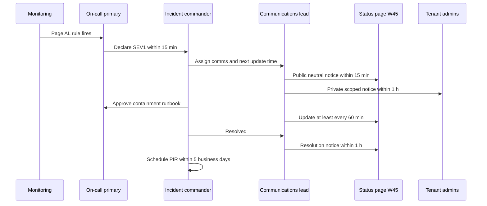
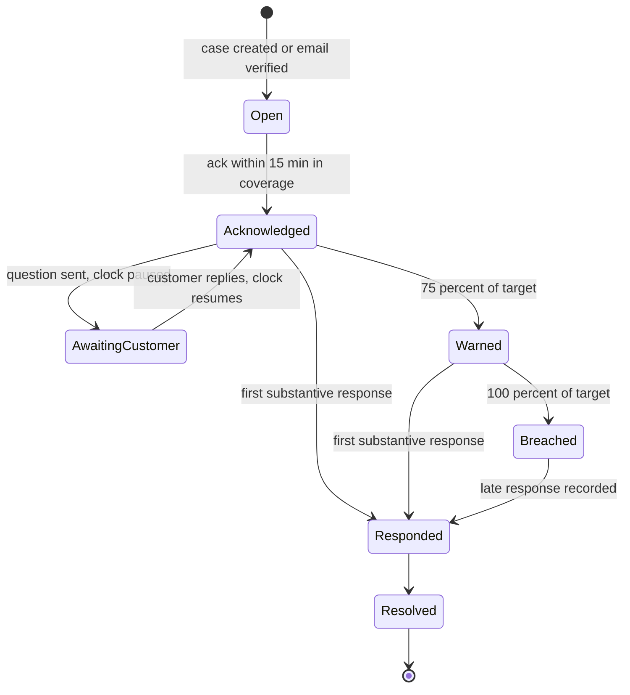

# AI Growth Engine: Employee Sales & Marketing Automation
## Application Blueprint: PART 11 (Batch 11.11b), V12 Observability, Incidents & Support; Master Traceability, Decision Register & Source Archive (Enhancements, Conflicts, Decisions)

| Document | Value |
|---|---|
| Document | Part 11.11b: enhancements to full depth (§11.11.5), conflicts (§11.11.6), decisions DEC-700…719 (§11.11.7), expert persona review (§11.11.8), tags (§11.11.9) and quality gate (§11.11.10). Read Part 11.11a first |
| Version | 1.0 · 28 Nov 2026 |
| Baseline | Parts 0–9.10; Part 4.3 §4.39–4.45; Part 4.4b §4.4.5.6; Part 8.2 §8.2.3; Part 8.3b/8.3c; Part 9.9a CAP-X3-12, CAP-X3-26; Part 6.6, 6.9a/b; FSD V12 ch37, ch40, Appendix D |
| Roles applied | Head of SRE and Incident Management · Requirements-traceability and governance lead · Programme decision-register / PMO lead · Support-operations director |

**Budget rule (V11_BRIEF).** Nothing here changes Ledger A (DEC-230), Ledger B (DEC-231/422), staffing (DEC-228) or hosting (DEC-421). Every addition is costed in §11.11.5.19 as a separately approvable proposal **CR-V12-K-01**, with one-time development and recurring running cost in separate tables. Items that would change a Founder decision are raised as conflicts (§11.11.6) and marked "Pending Founder decision". No safety invariant is weakened: incident and status communications never contain tenant names or personal data; automation stays at autonomy L1 for any consequential external action; support staff reach tenant data only through a SupportAccessGrant.

---

## 11.11.5 Enhancements

### 11.11.5.1 SLA tier schedule v3 (ENT-OPS-01; CDEC-V12-03) — FR-V12-K-001

**Plan-tier mapping [ASSUMPTION-941].** V12 names SLA tiers Standard / Business / Enterprise. The blueprint plan catalogue (DEC-326) is Self-service / Managed / Enterprise. Until Part 11.2 (Group B) fixes the commercial mapping, this part reads **Standard ≡ Self-service, Business ≡ Managed, Enterprise ≡ Enterprise**. Owned-portfolio startups (Owner Portfolio Tenant, DEC-065) carry no contractual SLA; the internal targets of Part 4.3 §4.40 apply.

| Tier | Monthly availability (V12) | Error budget per 30-day month | Blueprint position today | Status after this part |
|---|---|---|---|---|
| Standard (Self-service) | **99.5%** | 216.0 min | Equals the 99.5% contract-negotiation target (DEC-325; SLA-02) | **Adopted** (Matched): becomes the contractual default once SLA validation (Part 8.3c §8.3.5.13.6) passes |
| Business (Managed) | **99.9%** | 43.2 min | 99.9% is an internal target from Release 1 (DEC-325), contractual only for Scale after the scale gate (SLA-02) | **Pending Founder decision** (CONFLICT-944): contractual exposure with credits |
| Enterprise | **99.95%** | 21.6 min | Not in the blueprint | **Pending Founder decision** (CONFLICT-944): architecture and budget beyond DEC-421/422 |

**SLI and measurement ("availability measured per tier").**

| Item | Rule |
|---|---|
| Good minute | A minute in which the tenant's eligible requests to the covered services (Website/Portal, Admin, public API, workflow engine acceptance; SLA-01) succeed at ≥ 99% with no synthetic-probe failure, per Part 4.2 §4.21 |
| Per-tenant availability | A(t) = (eligible − bad) ÷ eligible minutes, where eligible = calendar minutes − excluded minutes (SLA-03: announced maintenance ≤ 4 h/month at 22:00–06:00 IST, client-caused, documented provider outage with fallback, force majeure, beta features) |
| Per-tier availability | Minute-weighted mean of A(t) over the tier's tenants in the month; reported beside the distribution (min, p10, median) so that one tenant's breach is never hidden by the average |
| Policy holds | Requests or runs refused by the PDP (consent, jurisdiction, budget, approval, entitlement) are **correct behaviour, not unavailability**, and are excluded from bad minutes (ADR-221) |
| Sources | Request logs (RED metrics, §4.39.2), synthetic probes (AL-29), status-page component history (§11.11.5.2) |
| Reporting | Monthly service report (Part 8.3c §8.3.5.13.7) gains a per-tier and per-tenant availability table; tenants see only their own statement on W34 |

**Service-credit ladder (placeholders, require Legal and Finance approval before any contract) [RECOMMENDATION-957].**

| Tier | Credit if monthly A(t) is below | Credit % of that month's subscription fee | Cap |
|---|---|---|---|
| Standard | 99.5% / 99.0% / 98.0% | 5% / 10% / 20% | 20% (equals the SLA-10 placeholder) |
| Business | 99.9% / 99.5% / 99.0% | 5% / 10% / 20% | 20% |
| Enterprise | 99.95% / 99.9% / 99.5% | 10% / 15% / 25% | 25% |

Formula: credit = fee(t, month) × ladder(tier, A(t)), capped; credits are issued only on the tenant's claim within 30 days of the monthly report (contract option) or automatically (Enterprise option), never paid out in cash (offset on the next invoice). Worked example (illustrative fee only, no price is approved, DEC-047): Business tenant, fee F, A(t) = 99.82% → below 99.9% but not below 99.5% → credit = 5% × F. If F were ₹10,000 the credit would be ₹500.

**Feasibility check for 99.95% (why it is a Founder item).** Serial dependencies multiply: A(total) ≈ A(edge/hosting) × A(database) × A(application) × A(identity). With four dependencies each at 99.95%, A(total) ≈ 99.80%, below the Enterprise target. The DEC-421 stack (Vercel + Supabase + AWS ap-south-1) must therefore show provider SLAs and an architecture (multi-AZ database with automated failover, two or more application instances, zero-downtime deploys, IdP redundancy) whose composite reaches 99.95%; provider SLA levels and the plan tiers that carry them must be verified at time of implementation (as of 27 Nov 2026). The status page and the monthly report must be able to evidence 21.6 minutes of error budget per month.

**Data and interfaces.**

| Element | Specification |
|---|---|
| `svc_sla_schedule` | id, version_no, tier CHECK in (standard, business, enterprise), availability_target numeric(6,3), credit_ladder jsonb (thresholds and %), credit_cap_pct, exclusions_ref (SLA-03 version), measurement_rule_ref, coverage_calendar_id, approved_by_service_owner, approved_by_legal, approved_by_finance, effective_from, state CHECK in (draft, approved, retired); UQ (tier, version_no) |
| `svc_sla_period_result` | id, tenant_id, period (month), tier, eligible_min, bad_min, excluded_min, availability numeric(7,4), credit_pct, credit_amount numeric(14,2), currency, state CHECK in (computed, reviewed, published, disputed, settled), computed_at, evidence_ref; RLS by tenant |
| Admin APIs | `GET /api/v1/admin/sla/schedules`, `POST /api/v1/admin/sla/schedules` (draft), `POST /api/v1/admin/sla/schedules/{id}/approve` (three approvers, Idempotency-Key, If-Match), `GET /api/v1/admin/sla/results?period=` (R01, R08, R14) |
| Portal API | `GET /api/v1/portal/sla/statement?period=` (own tenant only; R12/R16) |
| Screens | A101 (schedule tab; Admin), W34 (tenant monthly statement), DB-09 (unit economics: credits as revenue reduction) |
| Job | Monthly at 02:00 IST on day 1: compute results, hold in `computed` until R08 review; publish to W34 after review |

### 11.11.5.2 Status page: components, incidents, maintenance, unknown state (ENT-OPS-02, CS-11) — FR-V12-K-002, FR-V12-K-012

**Mapping.** V12-W40 "System status" ≡ **W45** status page; V12-A130 "Reliability, incidents & status page" ≡ **A159** Status & Trust Centre Admin (publishing), **A014** System health and incidents (incident records) and **DB-01** SLO overview. V12-W38 "Trust centre" ≡ **W46**. The status page is part of release A1 (approved, DEC-417) which starts after the W5 exit, i.e. within W6 = V12 R2 GA India (ASSUMPTION-940). Hosting independent of the product (DEC-406, BRL-X3-12-1) satisfies "hosted independently of the platform".

**Additions to CAP-X3-12 (Part 9.9a §9.9.5.12).**

| Clause | Rule |
|---|---|
| (a) Components | Website (public sites), Portal, Admin, Public API, Messaging (email, WhatsApp), AI assistant, Billing and invoices (from R2 billing), Integrations (aggregate) — one row per component in `ops_status_component` |
| (b) Unknown state | `ops_status_component.state` CHECK gains **`unknown`**. A component shows *Unknown* when its probe has produced no result for 3 consecutive intervals (60-second probes → 3 minutes) or when the probe runner itself is failing. Missing data never displays *Operational* (OPT-TC-CS-11) |
| (c) Maintenance | New `ops_status_maintenance` (id, components text[], title, body_md, starts_at, ends_at, notice_published_at, state CHECK in (draft, approved, published, in_progress, completed, cancelled), approved_by). Planned maintenance is published **≥ 72 h** ahead, ≤ 4 h per month, inside 22:00–06:00 IST (SLA-03); emergency maintenance is published as an incident |
| (d) Incidents | Public notices stay neutral: component, impact, start time, next update time; no tenant names, no confidential detail (BRL-X3-12-2); human-approved text, two persons for SEV1 (DEC-406) |
| (e) Private scoped detail | Affected tenants see a private incident record in their Admin notification centre (A106) and on W34: tenant-specific impact, paused automations, uncertain outcomes in their scope, workaround, next update. Data comes only from the tenant's own scope (RLS); another tenant's impact is never shown (OPT-TC-CS-11 "private incident not public") |
| (f) History | 90 days of incidents and maintenance on the public page; full history in A014 |
| (g) Subscriptions | Email subscription with double opt-in (existing); tenant admins are subscribed to their private notices automatically |

### 11.11.5.3 Incident severity SEV1–SEV4, communication timelines and incident-commander roles (ENT-OPS-03) — FR-V12-K-003

**Labels.** SEV1, SEV2, SEV3, SEV4 are the canonical labels (V12); they are identical in meaning to Sev1–Sev4 of Part 4.3 §4.43.1 (definitions, examples and response targets unchanged). Support ticket priorities P1/P2/P3 (DEC-327) map after triage to SEV1–SEV2 / SEV2–SEV3 / SEV3–SEV4.

**Single communication matrix [RECOMMENDATION-953].** Three earlier texts set different SEV1 notice targets (Part 4.3 §4.43.1: affected tenants ≤ 2 h then every 4 h; Part 8.3c SLA-09: status notice ≤ 1 h, update every 2 h; Part 9.9a NFR-ADV-X3-10: status notice ≤ 15 min after declaration). This matrix replaces them (DEC-701); the stricter value is kept in every cell.

| Audience / channel | SEV1 | SEV2 | SEV3 | SEV4 |
|---|---|---|---|---|
| Declaration and internal channel + A014 record | ≤ 15 min after detection; updates every 30 min | ≤ 30 min; hourly | Ticket ≤ 4 business hours; daily | Backlog |
| Status page (W45) public notice (from A1) / portal + Admin banner (before A1) | Initial ≤ 15 min after declaration; update ≤ 60 min | ≤ 30 min if customer-visible; update ≤ 2 h | Only if customer-visible: ≤ 4 business hours; daily | None |
| Affected tenant administrators (R12): private notice (§11.11.5.2 e) + email | ≤ 1 h; every 2 h until resolved | ≤ 4 business hours; daily | Via the ticket | None |
| Business users (R01, R02, R10, R11): A106 Critical + email (DEC-036) | ≤ 15 min | ≤ 30 min | Digest | Digest |
| External customers / recipients | Only when affected, after compliance review (Part 4.3 §4.43.4) | Same | — | — |
| Regulators | Statutory clocks per Part 4.1 §4.11.5 (verify current CERT-In and DPDP timelines as of 27 Nov 2026) | If a statutory trigger applies | — | — |
| Resolution notice | ≤ 1 h after resolution | ≤ 4 business hours | In ticket | — |
| Post-incident review (PIR) | Published ≤ 5 business days (§11.11.5.7) | ≤ 5 business days | Optional lightweight | No |

Outside support hours, the human targets above apply to SEV1 categories that page out of hours (DEC-080) until CONFLICT-943 is decided; automated containment (§4.43.2) runs 24×7.

**Incident-commander role set.**

| Role | Responsibilities | Who fills it (team of DEC-228) | Rule |
|---|---|---|---|
| Incident Commander (IC) | Declares SEV, owns decisions, sets update times, approves containment, hands over explicitly | On-call primary for SEV2–SEV4; for SEV1 the Founder/CTO (secondary) takes IC within 30 min | IC does not do hands-on fixing in a SEV1 when two or more responders are present |
| Operations lead | Diagnosis and mitigation, runbook execution (RB-001…018) | On-call primary or the most relevant engineer | Never disables PDP, RLS or audit (Part 4.3 §4.44) |
| Communications lead | Drafts every notice in the matrix; tracks next-update clocks | Growth/compliance lead in support hours; IC outside | Text approved by IC; second approver for SEV1 public text (DEC-406) |
| Scribe | Timeline in A014 (UTC and IST), decisions, evidence links (INC-REC) | Any second responder; QA lead when available | Timestamps from the incident tool, not memory |
| Subject-matter experts | Provider, database, AI or finance expertise | Named per runbook | Join on IC request |
| Compliance liaison | Statutory assessment, regulator and customer notices | Growth/compliance lead + counsel | Mandatory for data, consent, suppression or financial incidents |
| Executive sponsor | Customer escalations, cost or contract decisions | Founder (R01) | Informed for every SEV1 ≤ 15 min |

**Communication drill (game day) — "game-day drill meets timelines".** Quarterly, inside the §4.47 game-day slot, plus one drill before the Release 1 go/no-go (ENT-OPS-03 is R1): a scripted SEV1 (for example a provider outage stopping dispatch) and a SEV2 run on staging with synthetic tenants (GSE-SYN). The scribe records the timestamps of each matrix cell; pass = every SEV1 and SEV2 cell met, roles assigned within 15 min, escalation path to the secondary exercised, containment evidence captured (REC-23 "escalation test and containment evidence"). Misses become PIR actions.



### 11.11.5.4 On-call for SEV1/SEV2 and the monthly paging test (ENT-OPS-04) — FR-V12-K-004, FR-V12-K-015

**Adopted now (no Founder decision needed): monthly paging test (FR-V12-K-015).** On the first working Tuesday of each month at a random time between 10:00 and 17:00 IST, the alerting pipeline sends a synthetic SEV1 page through the production path (alarm → SNS → paging tool → phone/SMS/voice) to the primary, then lets it escalate to the secondary if not acknowledged within 5 minutes. Recorded: send time, delivery time, ack time, escalation time. Pass: ack ≤ 5 min; escalation fires at 5 min. A failed test opens a SEV3 ticket fixed within 5 business days; two consecutive failures are a SEV2. Out-of-hours paging tests run quarterly once 24×7 coverage exists.

**Pending Founder decision: human 24×7 on-call for SEV1/SEV2 from R2 (CONFLICT-943).** Today (DEC-044, DEC-080) monitoring and automated containment are 24×7, and humans respond out of hours only to the S1 categories (cross-tenant exposure, emergency stop, suppression breach, payment discrepancy > ₹1 lakh, production outage), best effort 30 min. A sustainable 24×7 rota for SEV1 *and* SEV2 needs at least five trained people (one on-call week in five) or a first-response partner; after the Release 2 build gate the team of record (DEC-228/232) has four engineers plus QA, so a four-person rota would put each engineer on call one week in four with SEV2 night pages, above the Part 4.3 load target (≤ 2 out-of-hours pages per week).

| Option | Description | Running cost (estimate, recurring) [ASSUMPTION-950] | Risk |
|---|---|---|---|
| A. Internal 24×7 rota | Hire 2 SRE engineers (5–6 person rota); standby allowance | 2 FTE × 22 d × ₹4,545–6,818 = ₹2.0–3.0 L/month + allowance ₹0.5–1.0 L/month = **₹2.5–4.0 L/month** | Hiring lead time; changes DEC-228 and Ledger B |
| B. Hybrid: outsourced first-response NOC + engineer escalation | NOC acknowledges, follows runbooks limited to containment (no tenant-data access; SupportAccessGrant still required), pages the engineer for SEV1 and for SEV2 not contained in 30 min | NOC ₹0.8–2.0 L/month (verify quotes as of 27 Nov 2026) + escalation allowance ₹0.3–0.6 L/month = **₹1.1–2.6 L/month** | Vendor access to runbooks; DPA needed |
| C. Contract-triggered | Keep DEC-080 for the pilot and Self-service/Managed; offer 24×7 SEV1/SEV2 only on Enterprise contracts whose premium funds option B from the first signed contract | **₹0 until trigger**, then option B | Enterprise sales wait for the first contract |

Recommendation [RECOMMENDATION-951]: **option C now, option B on the first Enterprise contract**, reviewed at the W6 GA gate. One-time set-up for any option (escalation policies, rota tool, runbook hardening for a partner): 4–8 pd (§11.11.5.19).

### 11.11.5.5 Support desk with tiered response targets and live ticket-SLA reporting (ENT-OPS-05, REC-26) — FR-V12-K-005, FR-V12-K-014

**Tier × priority matrix (contract schedule SLA-05 v3, amends DEC-327; DEC-702).** Acknowledgement (DEC-327) and first substantive response are separate clocks. V12 fixes the P1 first-response targets per tier; V12 gives no P2/P3 targets or coverage hours [GAP-948], so the remaining cells are a proposal [RECOMMENDATION-952] that the Service Owner approves with the schedule.

| Tier | Coverage hours | P1 ack | P1 first response (V12) | P2 first response | P3 first response | Update cadence (P1/P2) |
|---|---|---|---|---|---|---|
| Standard (Self-service) | 10:00–18:00 IST Mon–Sat, excl. holidays (DEC-044, DEC-119) | 15 min in coverage | **Next business day** | 2 business days | 3 business days | Daily / every 2 business days |
| Business (Managed) | Same | 15 min in coverage | **4 h** (coverage hours) | 1 business day | 2 business days | Every 4 h / daily |
| Enterprise | Same today; 24×7 for P1 only after CONFLICT-943 | 15 min in coverage | **1 h** | 4 business hours | 1 business day | Hourly / every 4 h |
| Owned portfolio (internal) | Same | — | S1 2 h (DEC-044 internal) | S2 8 business hours | S3 3 business days | — |

Priority definitions: P1 = production unusable for the tenant, or a legal/compliance exposure; P2 = major function impaired with a hard workaround; P3 = minor issue or question (Part 4.3 §4.45). A P1 that is also a platform incident is declared SEV1/SEV2 and follows §11.11.5.3.

**Timer rules.**

| Rule | Statement |
|---|---|
| Start | Case created on W28/W34 (API-440) or verified email intake (SUP-02); for email the clock starts at verification |
| Pause | Only while the case is "Awaiting customer" after a support question; never paused by internal hand-offs |
| Calendar | Business hours per the tier's coverage calendar (IST; DEC-119 business days; listed holidays) |
| Stop | First substantive response = a human reply with diagnosis, workaround or plan (not an auto-acknowledgement) |
| Warning | At 75% of the target: A106 notice to the assignee and the support lead |
| Breach | At 100%: escalate to the on-call engineer (P1) or support lead (P2/P3); breach recorded for reporting |
| Re-prioritization | Allowed with reason; the clock re-bases from the time of the change, both values kept |
| Data hygiene | No passwords, OTPs or full payment data; tenant data only through a SupportAccessGrant (DEC-056, SUP-03) |



**Data.** `ops_support_sla_policy` (id, version_no, tier, priority CHECK in (P1, P2, P3), ack_minutes, first_response_minutes, update_cadence_minutes, coverage_calendar_id, approved_by, effective_from); `ops_support_case_timer` (id, case_ref, tenant_id, policy_id, started_at, paused_seconds, ack_at, first_response_at, warned_at, breached_at, state CHECK in (open, acknowledged, awaiting_customer, warned, breached, responded, resolved)). RLS by tenant; support staff see case metadata only.

**Live ticket-SLA reporting.** Metrics `support_ack_attainment_ratio`, `support_first_response_attainment_ratio`, `support_breach_total`, `support_open_age_seconds` by tier × priority; dashboard **DB-V12-K-01 Support SLA** (support lead, Service Owner): attainment against target per tier and priority (rolling 30 days and month to date), open cases by age, breaches with reason, reopen rate, top categories; tenants see their own attainment on W34. Alert **AL-V12-K-03**: P1 first-response breach → page in coverage hours (SEV3 ticket outside).

**Per-SKU service schedule (REC-26).** Every sold SKU (SM-SVC-01…39) carries a service schedule record: SKU, delivery responsibility (platform / managed-service team / tenant), service hours, response matrix version (above), monthly value statement (outcomes reported in the monthly service report, never promised revenue), acceptance matrix (what the client signs off and when), pass-through costs, fees status ("approval pending" until the Service Owner approves; no invented commercial commitment). Stored as a versioned attribute set of the SKU in the service catalogue (Part 11.2 owns the SKU entity); displayed on W34 and A101.

### 11.11.5.6 Help centre and in-product guides; top 50 tasks (ENT-OPS-06) — FR-V12-K-006

**Rules.** (a) One help article per task below, written from the TRN-SCR card procedure (Part 8.3b) with screenshots from synthetic data only. (b) **Localised with the UI**: an article is published in a locale only when that locale is enabled for the UI chrome of the same surface (DEC-026, DEC-404) and the translation is human-approved; otherwise the en-IN article is shown with a visible fallback note (I18N-08). (c) In-product guides: a "?" link on every screen opens the article for that screen; first-run guided tours on W21, W22, W27, W34, A003 and A106. (d) Articles are versioned with the release; a UI change that alters a step fails the release checklist until the article is updated (RGV). (e) Every S1/S2 resolution updates an article or runbook (Part 4.3 §4.45). (f) Owner: support lead; reviewer: product owner; accessibility checked like any page (WCAG 2.2 AA).

| # | Task | Persona / role | Screen | Training alias |
|---|---|---|---|---|
| 1 | Find a business and open its startup site | Visitor R18 | W01, W02 | TRN-001, TRN-002 |
| 2 | Request a quote or demo for an offering | Visitor | W05 | TRN-005 |
| 3 | Submit a general business enquiry | Visitor | W12 | TRN-012 |
| 4 | Submit a request for quotation with line items | Visitor/customer | W14 | TRN-014 |
| 5 | Submit a project requirement and upload documents | Customer R16 | W15 | TRN-015 |
| 6 | Register as a supplier | Supplier | W16 | TRN-016 |
| 7 | Book a meeting slot | Visitor/customer | W18 | TRN-018 |
| 8 | Register for a webinar | Visitor | W19 | TRN-019 |
| 9 | Use the website assistant and ask for a human | Visitor | W11 | TRN-011 |
| 10 | Register, sign in and recover access | Customer | W21 | TRN-021 |
| 11 | Review and accept a quotation | Customer | W23 | TRN-023 |
| 12 | Sign or decline an agreement | Customer | W24 | TRN-024 |
| 13 | Accept a delivery or raise a discrepancy | Customer | W25 | TRN-025 |
| 14 | Download an invoice and upload payment proof | Customer | W26 | TRN-026 |
| 15 | Complete onboarding tasks | Customer | W27 | TRN-027 |
| 16 | Open and follow a support case | Customer / tenant admin | W28 | TRN-028 |
| 17 | Change communication preferences or unsubscribe | Recipient | W29 | TRN-029 |
| 18 | Make a privacy request | Data principal | W30 | TRN-030 |
| 19 | Apply as a SaaS client and verify email | Prospective tenant | W31, W32 | TRN-SCR-W31/W32 |
| 20 | Request a plan change or data export | Tenant admin R12 | W34 | TRN-SCR-W34 |
| 21 | Sign in to Admin with MFA | Staff | A001 | TRN-031 |
| 22 | Switch startup scope and use STOP | Staff | A003 | TRN-033 |
| 23 | Work the action and notification centre | Staff | A106 | TRN-136 |
| 24 | Invite a user and change grants | R01/R12 | A002 | TRN-032 |
| 25 | Upload and approve a knowledge document | R05/R10 | A006 | TRN-036 |
| 26 | Connect and test an integration | R11 | A008 | TRN-038 |
| 27 | Set budget caps and use emergency pause | R01/R08 | A012 | TRN-042 |
| 28 | Fulfil a privacy request | R10 | A013 | TRN-043 |
| 29 | Acknowledge and resolve an incident | On-call/R11 | A014 | TRN-044 |
| 30 | Create a research plan and run it | R04 | A015 | TRN-045 |
| 31 | Confirm or reject buying signals | R04 | A019 | TRN-049 |
| 32 | Verify a contact | R04 | A025 | TRN-055 |
| 33 | Accept a qualified opportunity and assign an owner | R02 | A027 | TRN-057 |
| 34 | Move a deal through the pipeline | R03 | A029 | TRN-059 |
| 35 | Draft and submit an outreach message | R03 | A034 | TRN-064 |
| 36 | Approve or reject a message template | R02/R10 | A035 | TRN-065 |
| 37 | Reply from the unified inbox and stop a sequence | R03 | A037 | TRN-067 |
| 38 | Enrol a contact in a follow-up sequence | R03 | A038 | TRN-068 |
| 39 | Book and record a meeting | R03 | A040 | TRN-070 |
| 40 | Approve content and claims | R10 | A051 | TRN-081 |
| 41 | Build and submit a campaign | R05 | A058 | TRN-088 |
| 42 | Build a proposal and submit it for approval | R03 | A065 | TRN-095 |
| 43 | Build a quotation | R07 | A067 | TRN-097 |
| 44 | Approve a price or discount | R08 | A068 | TRN-098 |
| 45 | Record a payment and close a deal | R08 | A073 | TRN-103 |
| 46 | Reconcile a payment | R08 | A074 | TRN-104 |
| 47 | Record a bid decision and submission | R06 | A104 | TRN-134 |
| 48 | Create, approve and fulfil an order | R07 | A105 | TRN-135 |
| 49 | Publish and roll back a website revision | R05/R02 | A108 | TRN-138 |
| 50 | Approve a production release | R01/QA | A090 | TRN-120 |

Training aliases follow the customer register numbering (W01–W30 → TRN-001…030; A001–A108 → TRN-031…138), verified row by row in Part 11.11a §11.11.4.2.

### 11.11.5.7 Post-incident review with tracked actions (ENT-OPS-07) — FR-V12-K-007

| Item | Rule |
|---|---|
| Trigger | Every SEV1 and SEV2; SEV3 when a control failed or a customer was affected |
| Due date | `pir_due_at` = declaration date + 5 business days (DEC-119 calendar), computed and shown on the A014 record |
| Content | Blameless format of Part 4.3 §4.43.5 plus: matrix timestamps from §11.11.5.3 (met / missed), detection-to-ack, ack-to-containment, SLO and error-budget impact, credit exposure per tier (§11.11.5.1), affected SKUs |
| Action items | `ops_pir_action` (id, incident_id, title, owner_id, due_at, ticket_ref, kind CHECK in (fix, detection, process, documentation, test), state CHECK in (open, in_progress, done, wont_do), closed_evidence_ref); every action has an owner and due date; `wont_do` needs IC + Founder approval |
| Evidence check | Monthly operations review: report "SEV1/SEV2 incidents without a published PIR" must be 0; overdue actions listed by owner |
| KPIs | PIR on time = 100% for SEV1/SEV2; actions closed by due date ≥ 90%; repeat incidents with the same root cause = 0 per quarter |

### 11.11.5.8 Alert thresholds aligned with the retained source table (REC-23; V10 thresholds) — FR-V12-K-008

| V12 metric / alert | V12 threshold (literal) | Blueprint alert(s) | Severity / route | Response and runbook |
|---|---|---|---|---|
| HTTP p95 | Dashboard > 2 s initial or > 2.5 s growth at agreed workload | **AL-V12-K-01** (new): dashboard endpoint class p95 > 2 s (initial profile WP-01-S) or > 2.5 s (growth profile WP-02-G, DEC-315) for 15 min | SEV3 / T | Check scoped query plans, CPU, DB pool, dependency latency (V12 response verbatim); Part 4.2 tuning |
| HTTP ACK | ACK > 2 s | **AL-V12-K-02** (new): async command acknowledgement p95 > 2 s for 10 min | SEV3 / T (SEV2 if > 5 s) | Same; outbox and worker checks (RB-002) |
| Error ratio | 5xx > 1% for 10 minutes | AL-50 (> 1% / 10 min, ≥ 200 requests) and AL-06 (> 2% / 5 min) (DEC-324) | SEV3 T / SEV2 P | Correlation logs, recent deploy, dependency; rollback if causal (RB-012) |
| Queue age | Oldest eligible ready job > 5 min for 5 min | AL-51 | SEV2 P / SEV3 T | Worker heartbeat, provider rate limit, scope errors; pause affected workflow (RB-002) |
| Budget | Hard limit breached or negative remaining | AL-53; DEC-306 100% hard stop | SEV2 P + N | Immediate dispatch stop; reconcile reservations and actual charges (RB-005) |
| Isolation / credential | Unauthorized success, suspicious token or secret exposure | AL-33, AL-41, AL-43, AL-58 | SEV1 | Stop affected surface, revoke/rotate, preserve evidence (RB-008, RB-013) |
| Financial mismatch | Duplicate/unmatched/incorrect issuer/currency or unreconciled callback | AL-56 | SEV1/SEV2 | Freeze affected closing/payment processing; finance review (RB-016) |
| AI quality | Critical leakage or unsupported action detected | AL-39 (canary leak SEV1), AL-49 | SEV1 / SEV3 | RB-015 gains the literal step "disable the affected model **or workflow**", then re-pin the approved prompt and run the regression suite |
| Backup | Backup missing or restore not verified by approved cadence | AL-23, AL-46 | SEV2 / SEV4 | Investigate, verify recovery and block unsafe deployment (RGV blocks release while AL-23 is open) |

"Agreed workload" [GAP-949] is not defined in V12; this part binds it to the canonical capacity profiles of DEC-315 (initial and growth), so the alert uses the profile that matches the current tenant count. Thresholds are proposals tuned after W3 telemetry (Part 4.3 §4.41); no threshold is presented to customers as an SLA ("no unsupported SLA promise").

### 11.11.5.9 Scoped mobile notifications (MOB-14) — FR-V12-K-009

Applies to web push (Part 9.9a CAP-X3-26, VAPID) and to email/A106 notifications on mobile.

| Clause | Rule |
|---|---|
| (a) Preferences | Per tenant and per member: channel (in-app, email, push), categories (approvals, follow-ups, reviews, incidents), quiet hours; tenant admin sets the allowed set, members choose within it |
| (b) Opt-in | Push is off by default; enabling needs an explicit browser permission plus an in-product opt-in recorded with time and text version |
| (c) Generic text | Lock-screen text is generic: "You have 1 approval waiting in <startup short name>" — no contact names, amounts, message bodies, personal or Restricted data (N-P4) |
| (d) Authorized deep links | The link carries only an opaque notification ID; opening it requires an authenticated session, re-checks membership, scope and object permission, and shows a uniform "not available" for anything out of scope (BRL-TEN-04) |
| (e) Re-authentication | Sensitive actions opened from a notification (approve, send, publish, payment, export) require step-up re-authentication (≤ 5 min, Part 4.1 §4.3.3) |
| (f) Revocation | Revoked membership, removed grant or **expired consent** stops delivery at dispatch (PDP recheck) and invalidates queued deep links; the device subscription is deleted at revocation (≤ 60 s, BRL-TEN-07) |
| (g) Prototype | The offline prototype keeps local notices only; production delivery uses the notification service (DEC-036) |

Acceptance **MOB-14-AT01** (V12, adopted): revoked membership and expired consent prevent delivery and deep-link access; no sensitive payload. Tests TC-V12-K-027…029.

### 11.11.5.10 AI cost anomaly detection with a robust baseline (AI-14) — FR-V12-K-010

| Item | Specification [RECOMMENDATION-955] |
|---|---|
| Unit of analysis | Daily and hourly spend and tokens per (tenant, startup, workflow, agent, model tier, model version) from the CostLedger (M53, DEC-086) |
| Baseline | Rolling 14-day median *m* and median absolute deviation *MAD* per unit, by hour-of-week for hourly checks; units with < 7 days of history use the tenant's plan default |
| Anomaly rule | spend > m + max(5 × 1.4826 × MAD, 0.5 × m) **and** spend > minimum ₹50 per day (or 50,000 tokens while prices are unapproved, DEC-712) |
| Action | Alert **AL-15 v2** (replaces "> 2× 7-day average"): T + N (R01, R08, AI lead). If the unit's projected daily spend would cross the tenant hard cap, place a **scoped hold** on that (tenant, workflow) only: new AI calls of that workflow queue as Tier 3 human tasks; other workflows and other tenants are untouched |
| Hard caps | Unchanged: DEC-008 ceilings and DEC-306 ladder (70/80/90/100%); the anomaly rule acts before the cap |
| Release of hold | AI lead or R08 after review, with reason; automatic release at midnight IST if spend returns within the baseline band |
| Acceptance OPT-TC-AI-14 (V12) | Artificial spike triggers alert/hold without affecting unrelated tenants |

### 11.11.5.11 SLIs, SLOs and error budgets by component and period; policy holds separated (ST-01) — FR-V12-K-011, ADR-221

**New SLOs** (IDs scoped to this part to avoid collisions with parallel V12 groups):

| SLO | Component | SLI (good ÷ valid) | Objective (28-day rolling) | Source |
|---|---|---|---|---|
| SLO-V12-K-01 Queue age | Workflow engine, per queue class | Ready jobs started while their age ≤ class target (transactional, finance and control 5 min; batch 2 h; AL-51) ÷ ready jobs | 99% | ST-01; AL-51 |
| SLO-V12-K-02 Accepted output success | AI-assisted workflow steps | Steps whose output passed schema, policy and evaluation gates and was accepted (by rule or human) or cleanly routed to a human task ÷ steps attempted, **excluding policy holds** | 98% (per workflow; reviewed monthly) | ST-01; DEC-195/303 |

**Policy-hold rule (ADR-221).** A PDP refusal (consent missing, jurisdiction denied, budget cap, approval missing, entitlement missing, quiet hours) is a correct outcome. It is removed from the *valid* denominator of availability, latency, timeliness and output SLOs and reported separately as `policy_hold_ratio` per workflow and reason. A sudden rise of holds raises a business notice (N), not an error-budget burn. Conversely, an action that should have been held but was not is a SEV1 compliance incident (zero-tolerance SLOs, §4.40.1).

**Component × period table.** SLO-01…12 and SLO-V12-K-01/02 are reported per component (Website/Portal, Admin, API, workflow engine, outbox, webhooks, AI gateway, projections) for the 28-day rolling window and for the calendar month (the SLA view of §11.11.5.1).

**Approval before release (OPT-TC-ST-01).** The release-gate validator (RGV, Part 4.4b) gains check RGV-V12-K-01: SLI denominators (valid-event definitions, exclusions) and the error-budget policy are approved by the SRE lead and the product owner and hashed; a release whose SLO definitions changed without approval is blocked.

### 11.11.5.12 V12 master traceability in the RTM (ADR-220) — FR-V12-K-020, FR-V12-K-021

**RTM extension.** The RTM generator (Part 6.6 §6.6.1) gains V12 row types; existing rows and IDs are unchanged.

| Row type | Key | Rows | Links |
|---|---|---|---|
| `V12-WF` | SM-SVC-nn-WFnn | 156 | SKU, steps, engine, agent, AG candidates, bridge FRs (→ US → TC), DB first → ENT, policy, V12 test aliases (`<workflow>-TC-*`, `EVAL-<workflow>`), design part (11.3/11.4) |
| `ENT` | ENT-* | 65 | FR-V12-K-001…007 and 101…158, TC-V12-K, design part |
| `CDEC` | CDEC-* | 201 | Blueprint DEC or SPDEC alias, K decision, verdict, owner, due date, release |
| `TRN` | TRN-001…138 | 138 | TRN-SCR card, SM-UAT-S### |
| `MT` | MT-01…40 | 40 | Blueprint anchor, design part |
| `REC` | REC-01…30 | 30 | Blueprint location |
| `SAR` | SAR-01…11 | 11 | SHA-256, verification date |

**Chain validator (FR-V12-K-021) [RECOMMENDATION-954].** Runs in CI on every change to the blueprint registers and on every RTM build; fails the build when any clause fails.

| Clause | Check |
|---|---|
| (a) | Every V12 workflow has exactly one SKU, ≥ 1 step, an engine and an agent or "no AI" marker |
| (b) | Every workflow has ≥ 1 bridge FR that exists in the FR register and ≥ 1 TC traced to it |
| (c) | Every workflow's policy column contains POL-V6-PRECHECK; any external-effect step also has the effect preflight (REC-11) |
| (d) | Every ENT, CDEC, TRN, MT, REC and SAR row has a status and, unless Pending Founder decision, a blueprint location |
| (e) | No CDEC marked Approved without an approval record and evidence hash (DEC-314) |
| (f) | No orphan: every FR-V12-K has ≥ 1 TC-V12-K; every TC-V12-K points to an FR-V12-K or ENT |
| (g) | No ID collision: CDEC never printed as DEC; V12 screen IDs that collide are printed with `V12-` |
| (h) | Counts reproduced: 39 SKUs, 156 workflows, 65 ENT, 201 CDEC, 138 TRN, 40 MT, 30 REC, 11 SAR |
| (i) | Each Pending Founder row names its CONFLICT tag and K decision |
| (j) | The coverage CSV status_after has no value other than Matched, Pending Founder decision or Not applicable |

**V6 canonical policies.** FSD-POL-V6-PRECHECK is the PDP preflight plus quota reservation (Part 3.1); finalize = persist accepted output reference, provenance, step states, effect receipt, usage actuals, release reservation and audit (outbox/effect ledger). Step idempotency key = tenant/company/run/version/step/target digest (DEC-173); "max 3 safe retries with jitter" equals the Part 3.4 retry schema (`max_attempts` ≤ 3); the proposed timeouts **30 s read / 90 s AI** are adopted as defaults, provider timeouts per verified adapter; uncertain external effects are reconciled before replay (DEC-050). FSD-POL-V6-ARTIFACT equals DEC-107/191: typed artefacts, no generic JSON for ledgers, accounting or identity.

### 11.11.5.13 Customer decision register operations and the 180 inherited decisions — FR-V12-K-022, FR-V12-K-025

| Item | Rule |
|---|---|
| Storage | CDEC records live in the decision-record entity of Part 6.9b (ENT-ENH-H-04) with `source_family` CHECK in (V12-INH, V12-V7, V12-V9, V12-V11, V12-V12), `source_id` exactly as printed (for example "DEC-V12-03"), `alias` (CDEC-…), `blueprint_refs`, `verdict` CHECK in (equivalent, adopted, conflicting), `k_decision`, `conflict_tag` |
| States | Proposed → InReview → Approved / ApprovedWithChange / Rejected → Reopened / Superseded (Part 6.9b §6.9.5.2.3); "Pending Founder decision" is InReview with approver = Founder |
| Owner assignment (outstanding production decisions, V12 ch40) | Each of the 180 inherited decisions gets a **named owner, due date and affected release** within 10 working days of Sprint 0 start, using the six responsibility categories of the customer table: product owner/finance (39 service release states, pricing, meters, SLA, refunds, billing); backend/database leads (OpenAPI/DTO, schema, RLS, atomic usage, outbox/effect ledger); security/privacy/legal (role matrix, policies, source rights, channel/jurisdiction, isolation, privacy, recovery); integrations/FinOps (provider permissions, limits, prices, failover, cost, rotation); AI/QA (model and prompt evaluation, constraints, fixtures, independent acceptance); delivery owner (assignment itself). No silent approval [GAP-956] |
| Gates | Customer gates map to blueprint gates: "blocking before commercial launch" → W6 GA gate; "before applicable implementation" → story DoR; "before release" → G4 of the release; "for provider-enabled SKU" → provider activation record (US-21-EH01) |
| Views | A090 "Open decisions" lists CDEC and SPDEC with owner, due date, release and blocking gate; Founder-pending items appear at the top |
| Reporting | Weekly PMO report: open, overdue, approved this week, blocked releases |

### 11.11.5.14 Source-archive register (SAR) — FR-V12-K-023

Fields per SAR row: SAR ID, file name, declared SHA-256, recomputed SHA-256, verification date, verifier, storage location (evidence bucket, Object Lock compliance mode, DEC-082), normative status (normative only if promoted by a V12 chapter; otherwise evidence, CDEC-V9-02), linked coverage part (Part 0B for the 38-document pack; Parts 11.12 (Group L) for V1 and archive content). A re-verification job recomputes the hashes monthly and on any restore; a mismatch is a SEV3 (evidence integrity) and blocks use of the file.

### 11.11.5.15 ID-family register — FR-V12-K-026

The blueprint ID registry (`final/id_registry.csv`, generated) gains one row per V12 family of Appendix D with: V12 format, range, defining chapter, blueprint alias family, owner part, collision rule (§11.11.4.10). The registry generator fails when a V12 ID appears in a part without its family row or when a colliding ID appears without its qualifier.

### 11.11.5.16 Requirements

**Operational and traceability requirements (designed in this part).**

| FR | Requirement | Source | Release / epic | Tests |
|---|---|---|---|---|
| FR-V12-K-001 | Maintain versioned SLA schedules per tier (Standard 99.5%, Business 99.9%, Enterprise 99.95%), measure availability per tenant and per tier monthly, compute service credits by ladder and cap, publish the tenant statement after finance review; Business/Enterprise contractual targets and all credits activate only after DEC-716 | ENT-OPS-01; CDEC-V12-03 | R2 → Release 2 + W6 · EP-20 | TC-V12-K-001…004 |
| FR-V12-K-002 | Public status page with component status, incidents and planned maintenance, hosted independently, neutral text, ≥ 72 h maintenance notice | ENT-OPS-02 | R2 → W6 (A1) · EP-20 | TC-V12-K-005…006 |
| FR-V12-K-003 | SEV1–SEV4 with the single communication matrix, IC role set, quarterly communication game day and one drill before Release 1 go/no-go | ENT-OPS-03; REC-23 | R1 → Release 1 · EP-21 | TC-V12-K-009…013 |
| FR-V12-K-004 | 24×7 human on-call for SEV1/SEV2 per the option chosen in DEC-715 (Pending Founder decision) | ENT-OPS-04 | R2 · EP-21 | TC-V12-K-014 |
| FR-V12-K-005 | Support desk with tier × priority acknowledgement and first-response timers, breach escalation and live reporting (DB-V12-K-01, W34) | ENT-OPS-05 | R2 → Release 2 · EP-20 | TC-V12-K-016…018 |
| FR-V12-K-006 | Help centre and in-product guides for the top 50 tasks, localised with the UI, versioned with releases | ENT-OPS-06 | R2 → Release 2 · EP-20 | TC-V12-K-019…020 |
| FR-V12-K-007 | PIR within 5 business days for every SEV1/SEV2 with owned, dated actions and a monthly evidence check | ENT-OPS-07 | R1 → Release 1 · EP-21 | TC-V12-K-021…022 |
| FR-V12-K-008 | Alert set aligned with the retained thresholds incl. AL-V12-K-01/02 and RB-015 wording | REC-23; ch37 V10 table | R1 · EP-21 | TC-V12-K-023…025 |
| FR-V12-K-009 | Scoped mobile notifications, clauses (a)–(g) | MOB-14 | A1 (with CAP-X3-26) · EP-19 | TC-V12-K-027…029 |
| FR-V12-K-010 | Robust AI cost anomaly detection and scoped hold | AI-14 | R1 · EP-04 | TC-V12-K-030…031 |
| FR-V12-K-011 | SLO-V12-K-01/02, policy-hold exclusion, component × period reporting, approval before release | ST-01 | R1 · EP-21 | TC-V12-K-032…034 |
| FR-V12-K-012 | `unknown` component state and private scoped incident detail | CS-11 | W6 (A1) · EP-20 | TC-V12-K-007…008 |
| FR-V12-K-013 | TRN-### registered as aliases on TRN-SCR cards and in the RTM | ch37 V9 register | R1 · EP-21 | TC-V12-K-026 |
| FR-V12-K-014 | Per-SKU service schedule (responsibility, hours, response matrix, value statement, acceptance matrix, fee status) | REC-26 | R2 · EP-20 | TC-V12-K-035 |
| FR-V12-K-015 | Monthly paging test with escalation measurement | ENT-OPS-04 acceptance | R1 · EP-21 | TC-V12-K-015 |
| FR-V12-K-020 | RTM extension with the V12 row types and the 156 workflow chains | ch40 V8 register | R0 → W0–W1 · EP-21 | TC-V12-K-040…041 |
| FR-V12-K-021 | Chain validator clauses (a)–(j) in CI | ch40; REC-17…20 | R0 · EP-21 | TC-V12-K-042 |
| FR-V12-K-022 | CDEC register with verdicts, aliases and conflict tags | ch40 decisions | R0 · EP-21 | TC-V12-K-044 |
| FR-V12-K-023 | Source-archive register with hash re-verification | ch40 archive | R0 · EP-21 | TC-V12-K-043 |
| FR-V12-K-025 | Owner, due date and release for every inherited decision | ch40 outstanding decisions | R0 · EP-21 | TC-V12-K-045 |
| FR-V12-K-026 | ID-family register and collision rules enforced by the registry generator | Appendix D | R0 · EP-21 | TC-V12-K-046 |

**Trace requirements for the other 58 ENT rows (adopted literally; design depth in the owning part).**

| FR | ENT | Pri | Requirement (V12 literal) | Test intent | TC | Design depth | Release (ASSUMPTION-940) | After |
|---|---|---|---|---|---|---|---|---|
| FR-V12-K-101 | ENT-IDN-01 | P0 | SAML 2.0 and OpenID Connect SSO per tenant, configured by the tenant administrator. | Positive sign-in/provisioning path plus negatives: unverified domain, de-provisioned or revoked user, expired or idle session, missing break-glass all denied and audited | TC-V12-K-101 | Part 11.5 (Group E) | Release 1 (W0-W3, go/no-go 4 Jun 2027) | Matched |
| FR-V12-K-102 | ENT-IDN-02 | P0 | Verified email domains (DNS TXT) before SSO can be enforced for that domain. | Positive sign-in/provisioning path plus negatives: unverified domain, de-provisioned or revoked user, expired or idle session, missing break-glass all denied and audited | TC-V12-K-102 | Part 11.5 (Group E) | Release 1 (W0-W3, go/no-go 4 Jun 2027) | Matched |
| FR-V12-K-103 | ENT-IDN-03 | P0 | SCIM 2.0 user and group provisioning and de-provisioning; de-provisioned users lose sessions and API access. | Positive sign-in/provisioning path plus negatives: unverified domain, de-provisioned or revoked user, expired or idle session, missing break-glass all denied and audited | TC-V12-K-103 | Part 11.5 (Group E) | Release 2 + W6 GA India (incl. A1, DEC-417) | Matched |
| FR-V12-K-104 | ENT-IDN-04 | P0 | MFA policy per tenant; phishing-resistant (passkeys/FIDO2) available for privileged roles. | Positive sign-in/provisioning path plus negatives: unverified domain, de-provisioned or revoked user, expired or idle session, missing break-glass all denied and audited | TC-V12-K-104 | Part 11.5 (Group E) | Release 1 (W0-W3, go/no-go 4 Jun 2027) | Matched |
| FR-V12-K-105 | ENT-IDN-05 | P1 | Session policy: maximum session 1–24 h, idle timeout 5–120 min, immediate revocation. | Positive sign-in/provisioning path plus negatives: unverified domain, de-provisioned or revoked user, expired or idle session, missing break-glass all denied and audited | TC-V12-K-105 | Part 11.5 (Group E) | Release 1 (W0-W3, go/no-go 4 Jun 2027) | Matched |
| FR-V12-K-106 | ENT-IDN-06 | P0 | Break-glass administrator required before SSO enforcement; every use alerts and is audited. | Positive sign-in/provisioning path plus negatives: unverified domain, de-provisioned or revoked user, expired or idle session, missing break-glass all denied and audited | TC-V12-K-106 | Part 11.5 (Group E) | Release 1 (W0-W3, go/no-go 4 Jun 2027) | Matched |
| FR-V12-K-107 | ENT-ACC-01 | P0 | Custom roles from resource × action permissions, plus built-in roles. | Role/permission matrix test incl. SoD violation at build and at run time, tamper detection on the audit chain, export format check, support access without tenant approval denied | TC-V12-K-107 | Part 11.5 (Group E) | Release 2 + W6 GA India (incl. A1, DEC-417) | Matched |
| FR-V12-K-108 | ENT-ACC-02 | P0 | Separation-of-duties matrix enforced when roles are built and when actions run. | Role/permission matrix test incl. SoD violation at build and at run time, tamper detection on the audit chain, export format check, support access without tenant approval denied | TC-V12-K-108 | Part 11.5 (Group E) | Release 1 (W0-W3, go/no-go 4 Jun 2027) | Matched |
| FR-V12-K-109 | ENT-ACC-03 | P0 | Tamper-evident audit trail (hash-chained), exportable as JSON Lines or CSV. | Role/permission matrix test incl. SoD violation at build and at run time, tamper detection on the audit chain, export format check, support access without tenant approval denied | TC-V12-K-109 | Part 11.9 (Group I) | Release 1 (W0-W3, go/no-go 4 Jun 2027) | Matched |
| FR-V12-K-110 | ENT-ACC-04 | P1 | SIEM streaming to HTTPS, syslog over TLS or object storage; retention 1, 3 or 7 years. | Role/permission matrix test incl. SoD violation at build and at run time, tamper detection on the audit chain, export format check, support access without tenant approval denied | TC-V12-K-110 | Part 11.9 (Group I) | Release 2 + W6 GA India (incl. A1, DEC-417) | Matched |
| FR-V12-K-111 | ENT-ACC-05 | P0 | Support access is just-in-time: ticket-linked, tenant-approved, time-limited and audited. | Role/permission matrix test incl. SoD violation at build and at run time, tamper detection on the audit chain, export format check, support access without tenant approval denied | TC-V12-K-111 | Part 11.5 (Group E) | Release 2 + W6 GA India (incl. A1, DEC-417) | Matched |
| FR-V12-K-112 | ENT-API-01 | P0 | Scoped, expiring API keys; stored as hash, shown once; optional IPv4/IPv6 allowlist; rotation and revocation. | Contract test: scope, expiry, hash-at-rest, rotation/revocation, 429 + Retry-After, signature and replay rejection, deprecation headers | TC-V12-K-112 | Part 11.8 (Group H) | Release 1 (W0-W3, go/no-go 4 Jun 2027) | Matched |
| FR-V12-K-113 | ENT-API-02 | P1 | OAuth 2.0 client-credentials for server integrations. | Contract test: scope, expiry, hash-at-rest, rotation/revocation, 429 + Retry-After, signature and replay rejection, deprecation headers | TC-V12-K-113 | Part 11.8 (Group H) | Release 2 + W6 GA India (incl. A1, DEC-417) | Matched |
| FR-V12-K-114 | ENT-API-03 | P0 | Rate limits per key and tenant with 429 and Retry-After. | Contract test: scope, expiry, hash-at-rest, rotation/revocation, 429 + Retry-After, signature and replay rejection, deprecation headers | TC-V12-K-114 | Part 11.8 (Group H) | Release 1 (W0-W3, go/no-go 4 Jun 2027) | Matched |
| FR-V12-K-115 | ENT-API-04 | P1 | URL versioning and at least 12 months’ deprecation notice for breaking changes. | Contract test: scope, expiry, hash-at-rest, rotation/revocation, 429 + Retry-After, signature and replay rejection, deprecation headers | TC-V12-K-115 | Part 11.8 (Group H) | Release 2 + W6 GA India (incl. A1, DEC-417) | Matched |
| FR-V12-K-116 | ENT-API-05 | P0 | Signed webhooks (HMAC-SHA256 + timestamp), replay protection, exponential retries for 24 h, delivery log. | Contract test: scope, expiry, hash-at-rest, rotation/revocation, 429 + Retry-After, signature and replay rejection, deprecation headers | TC-V12-K-116 | Part 11.8 (Group H) | Release 1 (W0-W3, go/no-go 4 Jun 2027) | Matched |
| FR-V12-K-117 | ENT-API-06 | P2 | SDKs for TypeScript, Python and Java generated from the OpenAPI contract. | Contract test: scope, expiry, hash-at-rest, rotation/revocation, 429 + Retry-After, signature and replay rejection, deprecation headers | TC-V12-K-117 | Part 11.8 (Group H) | Post-W6 (A2/A3 roadmap, DEC-411) - EU launch | Matched |
| FR-V12-K-118 | ENT-API-07 | P1 | Developer portal with API reference, guides and sandbox access. | Contract test: scope, expiry, hash-at-rest, rotation/revocation, 429 + Retry-After, signature and replay rejection, deprecation headers | TC-V12-K-118 | Part 11.8 (Group H) | Release 2 + W6 GA India (incl. A1, DEC-417) | Matched |
| FR-V12-K-119 | ENT-DAT-01 | P0 | Full tenant export (JSON Lines, CSV, Parquet) with hashed manifest; second approver required; 7-day link. | Export/sandbox/promotion test: manifest hash, second approver, link expiry, no personal data in sandbox, reviewed revision only; residency/key items gated by Founder decision | TC-V12-K-119 | Part 11.9 (Group I) | Release 1 (W0-W3, go/no-go 4 Jun 2027) | Matched |
| FR-V12-K-120 | ENT-DAT-02 | P1 | Customer-managed keys (AWS KMS, Azure Key Vault, GCP KMS) with rotation; key revocation crypto-shreds data. | Export/sandbox/promotion test: manifest hash, second approver, link expiry, no personal data in sandbox, reviewed revision only; residency/key items gated by Founder decision | TC-V12-K-120 | Part 11.9 (Group I) | Post-W6 (A2/A3 roadmap, DEC-411) - EU launch | CONFLICT-946 Pending Founder decision |
| FR-V12-K-121 | ENT-DAT-03 | P0 | Data residency by region chosen at onboarding: India and EU now; US, UK, Middle East and APAC planned. | Export/sandbox/promotion test: manifest hash, second approver, link expiry, no personal data in sandbox, reviewed revision only; residency/key items gated by Founder decision | TC-V12-K-121 | this part | Release 1 … Post-W6 | CONFLICT-946 Pending Founder decision |
| FR-V12-K-122 | ENT-DAT-04 | P1 | Sandbox environments with synthetic data only; personal data is never copied. | Export/sandbox/promotion test: manifest hash, second approver, link expiry, no personal data in sandbox, reviewed revision only; residency/key items gated by Founder decision | TC-V12-K-122 | Part 11.9 (Group I) | Release 2 + W6 GA India (incl. A1, DEC-417) | Matched |
| FR-V12-K-123 | ENT-DAT-05 | P1 | Configuration promotion sandbox → production as a reviewed configuration revision. | Export/sandbox/promotion test: manifest hash, second approver, link expiry, no personal data in sandbox, reviewed revision only; residency/key items gated by Founder decision | TC-V12-K-123 | Part 11.9 (Group I) | Release 2 + W6 GA India (incl. A1, DEC-417) | Matched |
| FR-V12-K-124 | ENT-INT-01 | P0 | Connector framework with one adapter contract: auth, scopes, data mapping, events, limits, failure handling. | Adapter contract test: vault-only secrets, backoff and circuit breaker, uncertain write reconciled before retry, health alert, activation blocked without review/DPA/transfer basis/registration | TC-V12-K-124 | Part 11.8 (Group H) | Release 1 (W0-W3, go/no-go 4 Jun 2027) | Matched |
| FR-V12-K-125 | ENT-INT-02 | P0 | OAuth tokens and API secrets only in a vault, rotated, never in database rows or logs. | Adapter contract test: vault-only secrets, backoff and circuit breaker, uncertain write reconciled before retry, health alert, activation blocked without review/DPA/transfer basis/registration | TC-V12-K-125 | Part 11.8 (Group H) | Release 1 (W0-W3, go/no-go 4 Jun 2027) | Matched |
| FR-V12-K-126 | ENT-INT-03 | P1 | Per-connector rate limits, backoff and circuit breaker; uncertain writes reconcile before retry. | Adapter contract test: vault-only secrets, backoff and circuit breaker, uncertain write reconciled before retry, health alert, activation blocked without review/DPA/transfer basis/registration | TC-V12-K-126 | Part 11.8 (Group H) | Release 2 + W6 GA India (incl. A1, DEC-417) | Matched |
| FR-V12-K-127 | ENT-INT-04 | P1 | Connector health, sync lag and error dashboards with alerts. | Adapter contract test: vault-only secrets, backoff and circuit breaker, uncertain write reconciled before retry, health alert, activation blocked without review/DPA/transfer basis/registration | TC-V12-K-127 | this part | Release 2 + W6 GA India (incl. A1, DEC-417) | Matched |
| FR-V12-K-128 | ENT-INT-05 | P0 | Activation gate: security review, DPA, transfer basis (CJ-R15) and channel registration (DLT, WhatsApp templates). | Adapter contract test: vault-only secrets, backoff and circuit breaker, uncertain write reconciled before retry, health alert, activation blocked without review/DPA/transfer basis/registration | TC-V12-K-128 | Part 11.8 (Group H) | Release 1 (W0-W3, go/no-go 4 Jun 2027) | Matched |
| FR-V12-K-129 | ENT-SEC-01 | P0 | Secure SDLC: SAST, DAST, dependency and secret scanning on every change; threat model per release. | Pipeline evidence test: SAST/DAST/SCA/secret scan per change, SBOM stored per release, remediation SLA clock, pen-test before major release, TLS 1.2+ and AES-256 checks | TC-V12-K-129 | Part 11.9 (Group I) | W0-W1 (Sprint 0 foundations) | Matched |
| FR-V12-K-130 | ENT-SEC-02 | P0 | SBOM (CycloneDX or SPDX) for every release, stored with the release record. | Pipeline evidence test: SAST/DAST/SCA/secret scan per change, SBOM stored per release, remediation SLA clock, pen-test before major release, TLS 1.2+ and AES-256 checks | TC-V12-K-130 | Part 11.9 (Group I) | W0-W1 (Sprint 0 foundations) | Matched |
| FR-V12-K-131 | ENT-SEC-03 | P0 | Vulnerability remediation SLAs: Critical 7 days, High 30, Medium 90, Low 180 (proposed). | Pipeline evidence test: SAST/DAST/SCA/secret scan per change, SBOM stored per release, remediation SLA clock, pen-test before major release, TLS 1.2+ and AES-256 checks | TC-V12-K-131 | Part 11.9 (Group I) | Release 1 (W0-W3, go/no-go 4 Jun 2027) | Matched |
| FR-V12-K-132 | ENT-SEC-04 | P0 | Independent penetration test before each major release and at least annually (PEN-01…08). | Pipeline evidence test: SAST/DAST/SCA/secret scan per change, SBOM stored per release, remediation SLA clock, pen-test before major release, TLS 1.2+ and AES-256 checks | TC-V12-K-132 | Part 11.9 (Group I) | Release 1 (W0-W3, go/no-go 4 Jun 2027) | Matched |
| FR-V12-K-133 | ENT-SEC-05 | P2 | Public bug-bounty programme after R3. | Pipeline evidence test: SAST/DAST/SCA/secret scan per change, SBOM stored per release, remediation SLA clock, pen-test before major release, TLS 1.2+ and AES-256 checks | TC-V12-K-133 | Part 11.9 (Group I) | Post-W6 (A2/A3 roadmap, DEC-411) - EU launch | Matched |
| FR-V12-K-134 | ENT-SEC-06 | P0 | Encryption: TLS 1.2+ in transit, AES-256 at rest, key rotation. | Pipeline evidence test: SAST/DAST/SCA/secret scan per change, SBOM stored per release, remediation SLA clock, pen-test before major release, TLS 1.2+ and AES-256 checks | TC-V12-K-134 | Part 11.9 (Group I) | W0-W1 (Sprint 0 foundations) | Matched |
| FR-V12-K-135 | ENT-SEC-07 | P0 | Secrets management with rotation and break-glass procedures. | Pipeline evidence test: SAST/DAST/SCA/secret scan per change, SBOM stored per release, remediation SLA clock, pen-test before major release, TLS 1.2+ and AES-256 checks | TC-V12-K-135 | Part 11.9 (Group I) | W0-W1 (Sprint 0 foundations) | Matched |
| FR-V12-K-136 | ENT-SEC-08 | P0 | 24×7 security monitoring and an incident-response plan linked to breach clocks (A121). | Pipeline evidence test: SAST/DAST/SCA/secret scan per change, SBOM stored per release, remediation SLA clock, pen-test before major release, TLS 1.2+ and AES-256 checks | TC-V12-K-136 | this part | Release 2 + W6 GA India (incl. A1, DEC-417) | CONFLICT-943 Pending Founder decision |
| FR-V12-K-137 | ENT-CMP-01 | P0 | SOC 2 Type I at R2 and Type II at R3. | Evidence test: approved legal set published, sub-processor change notice, counsel sign-off recorded per pack, accessibility conformance report attached | TC-V12-K-137 | this part | Release 2 + W6 GA India … Post-W6 | CONFLICT-945 Pending Founder decision |
| FR-V12-K-138 | ENT-CMP-02 | P1 | ISO/IEC 27001 certification at R3. | Evidence test: approved legal set published, sub-processor change notice, counsel sign-off recorded per pack, accessibility conformance report attached | TC-V12-K-138 | this part | Post-W6 (A2/A3 roadmap, DEC-411) - EU launch | CONFLICT-945 Pending Founder decision |
| FR-V12-K-139 | ENT-CMP-03 | P2 | ISO/IEC 27701 and ISO/IEC 42001 at R4. | Evidence test: approved legal set published, sub-processor change notice, counsel sign-off recorded per pack, accessibility conformance report attached | TC-V12-K-139 | this part | Post-W6 (A3+) - UK/ME/APAC | CONFLICT-945 Pending Founder decision |
| FR-V12-K-140 | ENT-CMP-04 | P0 | Data Processing Agreement with SCCs, public sub-processor list and 30-day change notice. | Evidence test: approved legal set published, sub-processor change notice, counsel sign-off recorded per pack, accessibility conformance report attached | TC-V12-K-140 | Part 11.9 (Group I) | Release 1 (W0-W3, go/no-go 4 Jun 2027) | Matched |
| FR-V12-K-141 | ENT-CMP-05 | P0 | DPIA and EU AI Act assessment before EU launch. | Evidence test: approved legal set published, sub-processor change notice, counsel sign-off recorded per pack, accessibility conformance report attached | TC-V12-K-141 | Part 11.9 (Group I) | Post-W6 (A2/A3 roadmap, DEC-411) - EU launch | CONFLICT-946 Pending Founder decision |
| FR-V12-K-142 | ENT-CMP-06 | P1 | Accessibility conformance report (WCAG 2.2 AA) from a manual audit. | Evidence test: approved legal set published, sub-processor change notice, counsel sign-off recorded per pack, accessibility conformance report attached | TC-V12-K-142 | Part 11.7 (Group G) | Release 2 + W6 GA India (incl. A1, DEC-417) | Matched |
| FR-V12-K-143 | ENT-CMP-07 | P0 | Legal document set approved: Terms, Privacy Notice, DPA, AUP, Cookie Policy, AI Use and Accessibility statements. | Evidence test: approved legal set published, sub-processor change notice, counsel sign-off recorded per pack, accessibility conformance report attached | TC-V12-K-143 | Part 11.9 (Group I) | Release 1 (W0-W3, go/no-go 4 Jun 2027) | Matched |
| FR-V12-K-144 | ENT-CMP-08 | P0 | Jurisdiction packs reviewed by qualified counsel before entering each new market. | Evidence test: approved legal set published, sub-processor change notice, counsel sign-off recorded per pack, accessibility conformance report attached | TC-V12-K-144 | Part 11.9 (Group I) | Release 1 … Post-W6 | Matched |
| FR-V12-K-145 | ENT-GLB-01 | P0 | Internationalisation framework: externalised strings, ICU MessageFormat, pseudo-localisation tests. | i18n test: externalised strings, ICU plurals, pseudo-localisation, E.164/IANA/currency formats; locale/tax/region items gated by Founder decision | TC-V12-K-145 | Part 11.7 (Group G) | Release 1 (W0-W3, go/no-go 4 Jun 2027) | Matched |
| FR-V12-K-146 | ENT-GLB-02 | P1 | Locales: English and Hindi (R2), German and French (R3), Arabic (R4), others by market. | i18n test: externalised strings, ICU plurals, pseudo-localisation, E.164/IANA/currency formats; locale/tax/region items gated by Founder decision | TC-V12-K-146 | this part | Release 2 + W6 GA India … Post-W6 | CONFLICT-946 Pending Founder decision |
| FR-V12-K-147 | ENT-GLB-03 | P1 | Right-to-left layout support. | i18n test: externalised strings, ICU plurals, pseudo-localisation, E.164/IANA/currency formats; locale/tax/region items gated by Founder decision | TC-V12-K-147 | this part | Post-W6 (A3+) - UK/ME/APAC | CONFLICT-946 Pending Founder decision |
| FR-V12-K-148 | ENT-GLB-04 | P0 | Locale formats: dates, numbers, currencies, addresses, phone numbers in E.164, IANA time zones. | i18n test: externalised strings, ICU plurals, pseudo-localisation, E.164/IANA/currency formats; locale/tax/region items gated by Founder decision | TC-V12-K-148 | Part 11.7 (Group G) | Release 1 (W0-W3, go/no-go 4 Jun 2027) | Matched |
| FR-V12-K-149 | ENT-GLB-05 | P0 | Tax engine abstraction: India GST, EU VAT (reverse charge and OSS), UK VAT, UAE VAT, Singapore and Australia GST, US sales tax via provider. | i18n test: externalised strings, ICU plurals, pseudo-localisation, E.164/IANA/currency formats; locale/tax/region items gated by Founder decision | TC-V12-K-149 | Part 11.2 (Group B) | Release 2 + W6 GA India (incl. A1, DEC-417) | CONFLICT-946 Pending Founder decision |
| FR-V12-K-150 | ENT-GLB-06 | P0 | Multi-currency billing with native amounts and approved FX evidence (MT-21). | i18n test: externalised strings, ICU plurals, pseudo-localisation, E.164/IANA/currency formats; locale/tax/region items gated by Founder decision | TC-V12-K-150 | Part 11.2 (Group B) | Release 2 + W6 GA India (incl. A1, DEC-417) | Matched |
| FR-V12-K-151 | ENT-GLB-07 | P1 | Regional messaging providers selected per market (DLT India, sender registration elsewhere). | i18n test: externalised strings, ICU plurals, pseudo-localisation, E.164/IANA/currency formats; locale/tax/region items gated by Founder decision | TC-V12-K-151 | Part 11.8 (Group H) | Release 1 … Post-W6 | Matched |
| FR-V12-K-152 | ENT-GLB-08 | P1 | Region expansion plan with data residency (US, UK, Middle East, APAC). | i18n test: externalised strings, ICU plurals, pseudo-localisation, E.164/IANA/currency formats; locale/tax/region items gated by Founder decision | TC-V12-K-152 | this part | Post-W6 … Post-W6 | CONFLICT-946 Pending Founder decision |
| FR-V12-K-153 | ENT-BIZ-01 | P0 | Billing system: meter → rate → invoice → tax → collect → dunning → revenue recognition. | Billing/commercial test: meter-rate-invoice-tax-collect sequence, approved price book only, signed-hash order form, first-value checklist, procurement pack versioned | TC-V12-K-153 | Part 11.2 (Group B) | Release 2 + W6 GA India (incl. A1, DEC-417) | Matched |
| FR-V12-K-154 | ENT-BIZ-02 | P0 | Approved price book and plans (currently quotation-pending). | Billing/commercial test: meter-rate-invoice-tax-collect sequence, approved price book only, signed-hash order form, first-value checklist, procurement pack versioned | TC-V12-K-154 | Part 11.2 (Group B) | Release 2 + W6 GA India (incl. A1, DEC-417) | Matched |
| FR-V12-K-155 | ENT-BIZ-03 | P1 | Order forms and contracts with e-signature and stored signed hash. | Billing/commercial test: meter-rate-invoice-tax-collect sequence, approved price book only, signed-hash order form, first-value checklist, procurement pack versioned | TC-V12-K-155 | Part 11.2 (Group B) | Release 2 + W6 GA India (incl. A1, DEC-417) | Matched |
| FR-V12-K-156 | ENT-BIZ-04 | P1 | Customer success and onboarding playbooks with first-value milestones. | Billing/commercial test: meter-rate-invoice-tax-collect sequence, approved price book only, signed-hash order form, first-value checklist, procurement pack versioned | TC-V12-K-156 | Part 11.2 (Group B) | Release 2 + W6 GA India (incl. A1, DEC-417) | Matched |
| FR-V12-K-157 | ENT-BIZ-05 | P2 | Partner and reseller programme with separate tenant consent and billing ownership. | Billing/commercial test: meter-rate-invoice-tax-collect sequence, approved price book only, signed-hash order form, first-value checklist, procurement pack versioned | TC-V12-K-157 | Part 11.2 (Group B) | Post-W6 (A3+) - UK/ME/APAC | Matched |
| FR-V12-K-158 | ENT-BIZ-06 | P1 | Enterprise procurement pack: security questionnaire answers (SIG/CAIQ), insurance certificates, architecture and DR summaries. | Billing/commercial test: meter-rate-invoice-tax-collect sequence, approved price book only, signed-hash order form, first-value checklist, procurement pack versioned | TC-V12-K-158 | Part 11.2 (Group B) | Release 2 + W6 GA India (incl. A1, DEC-417) | Matched |

### 11.11.5.17 User stories with acceptance criteria

#### US-21-YK01 Declare and communicate incidents by SEV

*As an incident commander (on-call R11), I want SEV1–SEV4 with timed communication clocks, so that every audience is informed within the matrix targets.* Points 5 · EP-21 · FR-V12-K-003.

```gherkin
Feature: SEV communication matrix
  Scenario: SEV1 notices are timed
    Given an A014 incident declared SEV1 at 10:00 IST
    When the communications lead publishes notices
    Then the status page notice is due by 10:15 and the tenant-admin notice by 11:00
    And the A014 record shows each clock as met or missed with timestamps

  Scenario: Public notice never names a tenant
    Given a SEV1 affecting tenant "T2 External-A"
    When the public notice text contains the tenant name
    Then publication is blocked with error STATUS_TEXT_CONFIDENTIAL
    And the private notice for T2 External-A is still allowed
```

#### US-21-YK02 Paging test and communication game day

*As the SRE lead, I want a monthly paging test and a quarterly communication drill, so that I know pages arrive and the timelines are achievable.* Points 3 · EP-21 · FR-V12-K-003, FR-V12-K-015.

```gherkin
Feature: Paging test
  Scenario: Unacknowledged page escalates
    Given the monthly synthetic SEV1 page is sent to the primary
    When no acknowledgement arrives within 5 minutes
    Then the secondary is paged
    And the test record shows result "escalated" and opens a SEV3 ticket

  Scenario: Drill fails on a missed clock
    Given a scripted SEV2 drill on staging
    When the tenant notice is sent after 4 business hours
    Then the drill result is "fail" and a PIR action with owner and due date is created
```

#### US-20-YK03 Tiered support response targets

*As a support lead, I want timers per tier and priority, so that P1 cases of Enterprise tenants receive a first response within 1 hour.* Points 8 · EP-20 · FR-V12-K-005.

```gherkin
Feature: Support SLA timers
  Scenario Outline: First-response target by tier
    Given a P1 case opened at 11:00 IST on a business day by a <tier> tenant
    Then the first-response target is <target>
    Examples:
      | tier       | target                     |
      | enterprise | 12:00 IST same day         |
      | business   | 15:00 IST same day         |
      | standard   | next business day 18:00 IST |

  Scenario: Waiting for the customer pauses the clock
    Given a P2 case with 3 business hours elapsed
    When support asks a question and the case is "Awaiting customer" for 2 days
    Then elapsed time stays 3 business hours until the customer replies

  Scenario: Auto-acknowledgement is not a response
    Given an automatic acknowledgement email was sent
    Then the first-response clock keeps running
```

#### US-20-YK04 Status page with maintenance and unknown state

*As a tenant administrator, I want an independent status page with maintenance notices and honest unknown states, so that I can plan around outages.* Points 5 · EP-20 · FR-V12-K-002, FR-V12-K-012.

```gherkin
Feature: Status page states
  Scenario: Missing probe data shows unknown
    Given the Portal probe has no result for 3 consecutive minutes
    Then the Portal component shows "Unknown" and never "Operational"

  Scenario: Maintenance needs 72 hours notice
    Given a maintenance window starting in 48 hours
    When an operator publishes it as planned maintenance
    Then publication is refused with error MAINTENANCE_NOTICE_TOO_SHORT

  Scenario: Private incident detail stays private
    Given a SEV2 affecting tenant A only
    When a user of tenant B opens W34
    Then no detail of tenant A's impact is visible
```

#### US-20-YK05 SLA schedule and monthly statement

*As a service owner, I want approved SLA schedules per tier and a monthly per-tenant statement with credits, so that contracts are measurable.* Points 8 · EP-20 · FR-V12-K-001.

```gherkin
Feature: SLA statement
  Scenario: Credit computed from the ladder
    Given an approved Standard schedule with credit 5 percent below 99.5 percent
    And tenant availability of 99.40 percent in October
    Then the statement shows credit 5 percent of the October fee after finance review

  Scenario: Unapproved tier cannot be attached
    Given the Enterprise 99.95 percent schedule is in state draft
    When a sales user attaches it to a subscription
    Then the request is refused with error SLA_SCHEDULE_NOT_APPROVED

  Scenario: Policy holds do not count as downtime
    Given 30 minutes in which all dispatches were held by the PDP for missing consent
    Then those minutes are not bad minutes
```

#### US-20-YK06 Help centre top 50 tasks

*As a customer or staff user, I want task articles in my UI language, so that I can complete common tasks without a ticket.* Points 5 · EP-20 · FR-V12-K-006.

```gherkin
Feature: Localised help
  Scenario: Fallback is visible
    Given the UI is set to hi-IN and the article for task 14 is not approved in hi-IN
    When the user opens help on W26
    Then the en-IN article is shown with a visible language fallback note

  Scenario: Release blocked by outdated article
    Given a release changes the steps of task 11 on W23
    When the article version predates the change
    Then the release checklist item "help articles current" fails
```

#### US-21-YK07 Post-incident review evidence

*As the head of SRE, I want every SEV1/SEV2 to have a PIR within 5 business days with owned actions, so that lessons are acted on.* Points 3 · EP-21 · FR-V12-K-007.

```gherkin
Feature: PIR due date
  Scenario: Due date uses the business calendar
    Given a SEV1 declared on Friday 4 June 2027
    Then pir_due_at is Thursday 10 June 2027 (Monday to Saturday business days, DEC-119)

  Scenario: Missing PIR appears in the monthly check
    Given a SEV2 closed without a published PIR
    Then the monthly evidence report lists it and the count is not zero
```

#### US-04-YK08 Robust AI cost anomaly hold

*As the FinOps lead, I want anomalies detected per tenant and workflow with a scoped hold, so that a spike cannot exhaust budgets or affect other tenants.* Points 5 · EP-04 · FR-V12-K-010.

```gherkin
Feature: AI cost anomaly
  Scenario: Spike holds only the affected workflow
    Given tenant A workflow W1 has a 14-day median of 100 rupees per day
    When today's projected spend for W1 is 900 rupees
    Then AL-15 v2 fires and W1 calls of tenant A queue as human tasks
    And tenant A workflow W2 and tenant B are unaffected
```

#### US-21-YK09 SLOs with policy-hold separation

*As an SRE, I want queue-age and accepted-output SLOs that exclude policy holds, so that correct refusals do not burn the error budget.* Points 5 · EP-21 · FR-V12-K-011.

```gherkin
Feature: Policy holds excluded
  Scenario: PDP refusal is not an error
    Given 100 AI steps of which 10 were held for missing approval and 2 failed schema after repair
    Then SLO-V12-K-02 is computed as 88 good out of 90 valid
    And policy_hold_ratio is reported as 10 percent

  Scenario: SLO definition change needs approval
    Given the valid-event definition of SLO-03 changed in this release
    When the approval hash is missing
    Then RGV-V12-K-01 blocks the release
```

#### US-19-YK10 Scoped mobile notifications

*As a member using the portal or Admin on a phone, I want generic notifications with safe deep links, so that nothing confidential shows on my lock screen.* Points 5 · EP-19 · FR-V12-K-009.

```gherkin
Feature: MOB-14-AT01
  Scenario: Revoked membership stops delivery
    Given member M of tenant A has push enabled
    When M's membership is revoked
    Then no further push is delivered and queued deep links return "not available"

  Scenario: Expired consent stops delivery
    Given a portal user whose notification consent expired yesterday
    Then the PDP blocks the push at dispatch

  Scenario: Lock-screen payload is generic
    Then the push payload contains no contact name, amount or message body
```

#### US-21-YK11 V12 traceability chains in the RTM

*As the traceability lead, I want the 156 V12 workflow chains and the ENT, CDEC, TRN, MT, REC and SAR rows in the RTM with a CI validator, so that no V12 item is orphaned.* Points 8 · EP-21 · FR-V12-K-020, FR-V12-K-021, FR-V12-K-026.

```gherkin
Feature: Chain validator
  Scenario: Broken chain fails the build
    Given workflow SM-SVC-07-WF02 has no bridge FR
    When the RTM is built in CI
    Then clause (b) fails and the build is red

  Scenario: Colliding screen ID without prefix
    Given a part mentions "A130 Reliability, incidents and status page" without the V12- prefix
    Then clause (g) fails
```

#### US-21-YK12 Customer decision queue with owners

*As the PMO lead, I want every CDEC with a verdict and every inherited decision with an owner, due date and release, so that no release passes with an unowned decision.* Points 5 · EP-21 · FR-V12-K-022, FR-V12-K-025.

```gherkin
Feature: CDEC ownership
  Scenario: Unowned decision blocks G4
    Given CDEC-061 has no owner and blocks release 1
    When the release 1 G4 gate is evaluated
    Then the gate fails with reason "open decision without owner"

  Scenario: No synthetic approval
    When a CDEC is set to Approved without an approval record and evidence hash
    Then the change is refused (DEC-314)
```

### 11.11.5.18 Test cases

| TC | Title | Requirement | Type | Steps (abridged) | Expected result | Pri |
|---|---|---|---|---|---|---|
| TC-V12-K-001 | Per-tenant availability with exclusions | FR-V12-K-001 | Unit | Feed 43,200 eligible minutes, 50 bad, 120 excluded maintenance | A = (43,080 − 50) ÷ 43,080 = 99.884% | P0 |
| TC-V12-K-002 | Credit ladder and cap | FR-V12-K-001 | Unit (BVA) | Business tier at 99.90%, 99.89%, 99.49%, 98.0% | 0%, 5%, 10%, 20%; never above cap | P0 |
| TC-V12-K-003 | Unapproved schedule cannot attach | FR-V12-K-001 | API negative | Attach draft Enterprise schedule | 409 SLA_SCHEDULE_NOT_APPROVED; audit row | P0 |
| TC-V12-K-004 | Tenant sees own statement only | FR-V12-K-001 | Security | Tenant B requests tenant A statement | Uniform 404; no existence hint | P0 |
| TC-V12-K-005 | Status page survives product outage | FR-V12-K-002 | Resilience | Stop product origin | W45 still served from separate account; notices publishable | P0 |
| TC-V12-K-006 | Maintenance notice lead time | FR-V12-K-002 | Negative | Publish window starting in 48 h | Refused MAINTENANCE_NOTICE_TOO_SHORT | P1 |
| TC-V12-K-007 | Unknown on missing probe | FR-V12-K-012 | Negative | Stop probe runner 3 min | Component shows Unknown (OPT-TC-CS-11) | P0 |
| TC-V12-K-008 | Private incident not public | FR-V12-K-012 | Security | Publish SEV2 with tenant detail | Public page neutral; tenant detail only in tenant's A106/W34 | P0 |
| TC-V12-K-009 | SEV1 clocks computed | FR-V12-K-003 | Unit | Declare SEV1 | Due times per matrix stored on A014 | P0 |
| TC-V12-K-010 | Tenant name blocked in public text | FR-V12-K-003 | Negative | Draft notice naming a tenant | Publication blocked | P0 |
| TC-V12-K-011 | Second approver for SEV1 public text | FR-V12-K-003 | Security | IC publishes alone | Refused; needs second approver (DEC-406) | P0 |
| TC-V12-K-012 | Communication game day | FR-V12-K-003 | Drill | Scripted SEV1 + SEV2 on staging | All SEV1/SEV2 matrix cells met; roles ≤ 15 min | P0 |
| TC-V12-K-013 | Accessibility of status page | FR-V12-K-002/003 | A11y | Screen reader, keyboard, contrast, 200% zoom on W45 | WCAG 2.2 AA pass; states not by colour alone | P1 |
| TC-V12-K-014 | 24×7 rota coverage (after DEC-715) | FR-V12-K-004 | Operational | Night SEV2 synthetic page | Ack within the chosen option's target | P1 |
| TC-V12-K-015 | Monthly paging test escalation | FR-V12-K-015 | Operational | Do not ack for 5 min | Secondary paged; SEV3 ticket opened | P0 |
| TC-V12-K-016 | Tier × priority targets | FR-V12-K-005 | Unit (outline) | Enterprise/Business/Standard P1 at 11:00 | 12:00 / 15:00 / next business day | P0 |
| TC-V12-K-017 | Pause and holiday calendar | FR-V12-K-005 | Unit (edge) | Awaiting customer over a public holiday | Clock paused; holiday not counted | P1 |
| TC-V12-K-018 | Breach escalation and report | FR-V12-K-005 | Integration | Let a P1 breach | Escalation sent; DB-V12-K-01 shows breach with reason | P0 |
| TC-V12-K-019 | Help fallback visible | FR-V12-K-006 | UI | hi-IN UI, article not approved | en-IN article with fallback note | P1 |
| TC-V12-K-020 | Article currency gate | FR-V12-K-006 | Release | Change W23 steps without article update | Release checklist fails | P1 |
| TC-V12-K-021 | PIR due date | FR-V12-K-007 | Unit | SEV1 on a Friday | Due +5 business days (Mon–Sat) | P1 |
| TC-V12-K-022 | Monthly PIR evidence report | FR-V12-K-007 | Report | SEV2 without PIR | Listed; count ≠ 0 | P1 |
| TC-V12-K-023 | AL-V12-K-01 dashboard p95 | FR-V12-K-008 | Alert unit | Synthetic p95 2.1 s for 15 min on initial profile | SEV3 ticket | P1 |
| TC-V12-K-024 | AL-V12-K-02 async ACK | FR-V12-K-008 | Alert unit | ACK p95 2.5 s for 10 min | SEV3; 5.5 s → SEV2 | P1 |
| TC-V12-K-025 | RB-015 disables the workflow | FR-V12-K-008 | Runbook drill | Canary leak in workflow W | Workflow disabled, prompt re-pinned, regression run | P0 |
| TC-V12-K-026 | TRN alias integrity | FR-V12-K-013 | Data | Compare 138 TRN rows to cards | 138/138 screen and SM-UAT matches | P1 |
| TC-V12-K-027 | Revoked membership stops push | FR-V12-K-009 | Security | Revoke, then dispatch | No delivery; deep link not available | P0 |
| TC-V12-K-028 | Expired consent stops push | FR-V12-K-009 | Security | Consent expired | PDP blocks at dispatch | P0 |
| TC-V12-K-029 | Generic payload | FR-V12-K-009 | Privacy | Inspect push payload | No personal or Restricted data | P0 |
| TC-V12-K-030 | Spike holds one workflow | FR-V12-K-010 | Integration | 9× spend for tenant A W1 | Alert + scoped hold; W2 and tenant B unaffected (OPT-TC-AI-14) | P0 |
| TC-V12-K-031 | Short history uses plan default | FR-V12-K-010 | Edge | 3 days of history | Plan default baseline; no false hold | P2 |
| TC-V12-K-032 | Policy holds excluded | FR-V12-K-011 | Unit | 100 steps, 10 holds, 2 failures | 88/90 good | P0 |
| TC-V12-K-033 | Queue-age SLO per class | FR-V12-K-011 | Unit | Batch job aged 90 min | Good (target 2 h); transactional 6 min → bad | P1 |
| TC-V12-K-034 | SLO change needs approval | FR-V12-K-011 | Release | Change SLI definition without hash | RGV-V12-K-01 blocks (OPT-TC-ST-01) | P0 |
| TC-V12-K-035 | Per-SKU service schedule | FR-V12-K-014 | Data | SKU without fee approval | Fee shown "approval pending"; no price displayed | P1 |
| TC-V12-K-040 | 156 chains present | FR-V12-K-020 | Data | Build RTM | 156 V12-WF rows, each with ≥ 1 bridge FR and ≥ 1 TC | P0 |
| TC-V12-K-041 | Counts reproduced | FR-V12-K-020 | Data | Build RTM | 39 / 156 / 65 / 201 / 138 / 40 / 30 / 11 | P1 |
| TC-V12-K-042 | Validator fails on broken chain | FR-V12-K-021 | CI negative | Remove a bridge FR | Clause (b) fails | P0 |
| TC-V12-K-043 | Archive hash re-verification | FR-V12-K-023 | Integrity | Alter one archived byte | Mismatch → SEV3; file blocked | P1 |
| TC-V12-K-044 | No CDEC printed as DEC | FR-V12-K-022 | Lint | Insert "DEC-V12-03" in a part | Clause (g) fails | P1 |
| TC-V12-K-045 | Unowned decision blocks G4 | FR-V12-K-025 | Gate | CDEC without owner on release 1 | G4 fails | P0 |
| TC-V12-K-046 | ID-family registry check | FR-V12-K-026 | Lint | Use DB-T3 as "DB-3" | Registry generator fails | P2 |

Trace tests TC-V12-K-101…158 are listed with their FRs in §11.11.5.16; each verifies the V12 acceptance of its ENT row with a positive and a negative case in the owning part's suite and attaches the evidence to the RTM `ENT` row.

### 11.11.5.19 Effort and cost (estimates; proposal CR-V12-K-01, outside approved budgets)

Basis: Part 8.4 rate ₹4,545–6,818 per person-day (22 working days per month); ranges low / high; central = midpoint. AI-built delivery (DEC-420) may reduce effort after the Sprint 2 calibration; no reduction is assumed here. Prices of tools and services: verify at time of implementation (as of 27 Nov 2026).

**Table 1 — One-time development (Ledger A is unchanged; separate approval).**

| Work package | Low pd | High pd | Cost low (₹) | Cost high (₹) |
|---|---|---|---|---|
| SLA schedules, monthly computation, W34 statement (FR-V12-K-001) | 6 | 10 | 27,270 | 68,180 |
| Status page deltas: unknown, maintenance, private detail (002, 012) | 3 | 5 | 13,635 | 34,090 |
| SEV matrix clocks on A014, IC roles, notice templates (003) | 4 | 7 | 18,180 | 47,726 |
| First communication drill before Release 1 (003) | 2 | 3 | 9,090 | 20,454 |
| Paging test automation (015) and on-call set-up for any option (004) | 5 | 10 | 22,725 | 68,180 |
| Support timers, policies, DB-V12-K-01, AL-V12-K-03 (005) | 6 | 10 | 27,270 | 68,180 |
| Top-50 help articles and contextual links (006) | 14.5 | 28 | 65,903 | 1,90,904 |
| PIR fields and evidence report (007) | 1 | 2 | 4,545 | 13,636 |
| Alerts AL-V12-K-01/02, RB-015 text (008) | 1 | 2 | 4,545 | 13,636 |
| Mobile notification rules and tests (009; with CAP-X3-26) | 2 | 4 | 9,090 | 27,272 |
| Robust AI anomaly baseline and scoped hold (010) | 3 | 5 | 13,635 | 34,090 |
| SLO-V12-K-01/02, hold exclusion, RGV check (011) | 3 | 5 | 13,635 | 34,090 |
| Per-SKU service schedule attributes (014) | 1 | 2 | 4,545 | 13,636 |
| RTM extension and chain validator (020, 021) | 4 | 7 | 18,180 | 47,726 |
| CDEC register, owner assignment, A090 view (022, 025) | 2 | 3 | 9,090 | 20,454 |
| Archive register and re-verification job (023) | 1 | 2 | 4,545 | 13,636 |
| ID-family register check (026) | 1 | 2 | 4,545 | 13,636 |
| **Total** | **59.5** | **107** | **₹2,70,428** | **₹7,29,526** |

Central ≈ 83 pd × ₹5,682 ≈ ₹4.7 L. The trace requirements FR-V12-K-101…158 are costed by the parts that design them, not here.

**Table 2 — Recurring running cost (Ledger B is unchanged; separate approval).**

| Item | Monthly (₹, estimate) | Note |
|---|---|---|
| Status page hosting | 0 additional | Inside the approved A1 budget (DEC-417); verify provider free tier |
| Paging tool (OSS or free tier) | 0–2,000 | Verify limits (as of 27 Nov 2026) |
| Communication game day (2–3 pd per quarter) | 3,030–6,818 | People time from the existing team |
| Help-centre maintenance and hi-IN review | 2,000–6,000 | Only when hi-IN chrome is enabled (DEC-404) |
| **Subtotal (adopted items)** | **5,030–14,818** |  |
| 24×7 on-call option A / B / C | 2.5–4.0 L / 1.1–2.6 L / 0 until trigger | Pending Founder decision (DEC-715) |
| Enterprise and Business SLA credits | Contingent: up to the ladder cap × affected fees | Pending Founder decision (DEC-716); not a cost line until contracts exist |
| Certification audits (SOC 2 readiness ₹3–8 L, Type I ₹8–20 L one-time per Part 9.9b GAP-714; Type II, ISO 27001/27701/42001 quotes needed) | — | Pending Founder decision (DEC-717) |

---

## 11.11.6 Conflicts and proposed resolutions

| Tag | Conflict | V12 position | Blueprint position (Founder decisions) | Options | Recommended resolution | Status |
|---|---|---|---|---|---|---|
| CONFLICT-943 | Human 24×7 on-call for SEV1/SEV2 from R2; 24×7 security monitoring with human response (ENT-OPS-04, ENT-SEC-08) | Required from R2 (GA) | DEC-044/080 business-hours support with out-of-hours response only for S1 categories; staffing DEC-228/232; running budget DEC-231/422 | A internal rota (₹2.5–4.0 L/month); B hybrid NOC (₹1.1–2.6 L/month); C contract-triggered (₹0 until the first Enterprise contract) | Option C now, option B on the first Enterprise contract; monthly paging test adopted immediately (RECOMMENDATION-951) | **Pending Founder decision** (DEC-715) |
| CONFLICT-944 | SLA tiers 99.9% (Business) and 99.95% (Enterprise) contractual with service credits (ENT-OPS-01; CDEC-V12-03) | Proposed tiers with credits | DEC-325 (99.9% internal target, 99.5% contract target), SLA-02/SLA-10; hosting DEC-421; budgets DEC-422 | (1) Adopt all tiers now; (2) adopt Standard 99.5% now, Business 99.9% after three months of measured ≥ 99.9% attainment, Enterprise 99.95% only with an architecture ADR and provider SLAs that compose to ≥ 99.95%; (3) defer all | Option 2, with the credit ladder of §11.11.5.1 approved by Legal and Finance | **Pending Founder decision** (DEC-716) |
| CONFLICT-945 | Certification sequence SOC 2 Type I (R2) → Type II + ISO 27001 (R3) → ISO 27701 + 42001 (R4) (ENT-CMP-01…03; CDEC-V12-01) | Committed sequence | DEC-408: continuous evidence; external audit only when an enterprise contract requires it, with its own budget; Ledger A/B unchanged | (1) Commit to the sequence and budget audits; (2) keep DEC-408 trigger but pre-schedule SOC 2 readiness in W6 so Type I can follow within 6 months of a trigger; (3) keep DEC-408 unchanged | Option 2; quotes for audits obtained at the W6 gate (verify as of 27 Nov 2026) | **Pending Founder decision** (DEC-717) |
| CONFLICT-946 | Region expansion and data residency (IN → EU → UK/ME/APAC → US), EU as second jurisdiction, managed Kubernetes, residency choice at onboarding, de/fr/ar locales and RTL, global tax provider, multi-cloud customer-managed keys, EU DPIA/AI Act (ENT-DAT-02/03, ENT-GLB-02/03/05/08, ENT-CMP-05; CDEC-V7-01/03/08, CDEC-V12-04/05/06) | Planned from R1 (residency choice) and R3–R5 | DEC-040/421 single region ap-south-1 on Vercel + Supabase + AWS; DEC-029 allows EU B2B email from India; DEC-026/404 locales; DEC-027 India GST; DEC-405 BYOK AWS KMS only; budgets DEC-230/231/422 | (1) Approve the roadmap and fund an EU region; (2) keep India-only through W6, record the residency field now (value fixed to IN) and prepare an EU-region ADR and cost case for A2; (3) reject | Option 2: the schema carries `data_region` from Release 1 so later expansion needs no migration; hi-IN as per DEC-404; de/fr/ar, EU VAT/US tax provider, Azure/GCP keys and EU DPIA move with the EU decision | **Pending Founder decision** (DEC-718) |
| CONFLICT-947 | Promotional time window default 09:00–21:00 recipient time (CDEC-V7-04) | Default until legal confirmation | BRL-ELG-08 default 09:00–19:00 Mon–Sat (stricter); DEC-038/BRL-APR-11: loosening a policy needs Founder approval | (1) Adopt 09:00–21:00 platform default; (2) keep 09:00–19:00 default and let a tenant widen up to 09:00–21:00 per jurisdiction after counsel confirmation (Founder approves the loosening once); (3) keep as is | Option 2 (DSAR part is already equivalent: DEC-100 30-day default) | **Pending Founder decision** (DEC-719) |

No conflict with a safety invariant was found: V12 agents are draft/score only, the status page and support never expose tenant data, and SMS/DLT adoption keeps consent and PDP checks.

---

## 11.11.7 Decisions

| DEC | Decision | Authority | Effect |
|---|---|---|---|
| DEC-700 | Customer decisions are written CDEC-### / CDEC-Vn-##; CDEC-001…180 ≡ SPDEC-001…180 (extends DEC-178). Eight versioned customer decisions are already equivalent (CDEC-V7-02, V9-01…04, V11-01/02, V12-07). V12 ID families are registered with the collision rules of §11.11.4.10 | Customer revision V12 (28 Nov 2026) | 188 CDEC Matched as equivalent; no DEC collision |
| DEC-701 | SEV1–SEV4 canonical labels; the single communication matrix of §11.11.5.3 supersedes the differing notice targets of Part 4.3 §4.43.1/4.43.4, Part 8.3c SLA-09 and Part 9.9a NFR-ADV-X3-10 where they differ (stricter value kept); IC role set; quarterly communication game day and a drill before Release 1; PIR evidence rules | Customer revision V12 (28 Nov 2026) | ENT-OPS-03, ENT-OPS-07, REC-23 Matched |
| DEC-702 | Support schedule SLA-05 v3: acknowledgement per DEC-327 plus first-response targets per tier (Enterprise P1 1 h, Business P1 4 h, Standard P1 next business day; P2/P3 per §11.11.5.5 for Service Owner approval); timers and live reporting; per-SKU service schedule (REC-26). Amends DEC-327 and DEC-209 for contracted tiers; DEC-044 stays for the owned portfolio | Customer revision V12 (28 Nov 2026) | ENT-OPS-05, REC-26 Matched |
| DEC-703 | V12-W40 ≡ W45, V12-A130 ≡ A159 + A014 + DB-01, V12-W38 ≡ W46; status page adds maintenance notices (≥ 72 h), `unknown` state and private scoped incident detail; live in W6 within A1 (DEC-417) = V12 R2 | Customer revision V12 (28 Nov 2026) | ENT-OPS-02, CS-11 Matched |
| DEC-704 | SLO-V12-K-01 (queue age) and SLO-V12-K-02 (accepted output success) added; policy holds excluded from SLO denominators and reported separately (ADR-221); RGV-V12-K-01 approval gate; alerts AL-V12-K-01/02 added; "agreed workload" = DEC-315 profiles | Customer revision V12 (28 Nov 2026) | ST-01, 37-THR-01 Matched |
| DEC-705 | AL-15 v2: robust median/MAD baseline per tenant, startup, workflow, agent, model tier and version, with scoped hold; amends AL-15 (Part 4.3 §4.41) | Customer revision V12 (28 Nov 2026) | AI-14 Matched |
| DEC-706 | Scoped mobile notification rules (a)–(g) and acceptance MOB-14-AT01 apply to CAP-X3-26 and all mobile notifications | Customer revision V12 (28 Nov 2026) | MOB-14 Matched |
| DEC-707 | TRN-001…138 are canonical customer aliases of the TRN-SCR cards; help centre covers the top 50 tasks of §11.11.5.6, localised with the UI chrome | Customer revision V12 (28 Nov 2026) | 138 TRN rows and ENT-OPS-06 Matched |
| DEC-708 | RTM extension with V12 row types and the 156 workflow chains (ADR-220); chain validator in CI; inherited-decision owner assignment within 10 working days of Sprint 0; V6 policy timeouts 30 s read / 90 s AI as defaults | Customer revision V12 (28 Nov 2026) | 157 chain rows, 45 V6/MT rows, 7 ownership rows Matched |
| DEC-709 | The five disposition indexes (1,912 rows), the original optimization index (104), REC-01…30 and MT-01…40 are accepted as row-level crosswalks to the blueprint mapping registers; semantic equivalence is confirmed only by AP-08 human approval (DEC-314) | Customer revision V12 (28 Nov 2026) | 2,016 rows Matched |
| DEC-710 | Source-archive register SAR-01…11 with recomputed hashes (11/11 match), Object Lock storage and monthly re-verification; recovered code never executed without review | Customer revision V12 (28 Nov 2026) | 19 archive aspects Matched |
| DEC-711 | CDEC-V7-06 adopted: evaluation gates per workflow need owner approval; accuracy ≥ 90%, claims 100%, citations ≥ 95%; "schema 100%" applies to every **accepted** output (an invalid output is never accepted), while ≥ 99.5% of calls must yield a valid output (DEC-195/303 unchanged) | Customer revision V12 (28 Nov 2026) | Clarifies DEC-303 wording |
| DEC-712 | CDEC-V7-07 adopted: tenant AI budgets default soft cap 80% (notification) and hard cap per plan; budgets may be expressed in tokens until prices are approved, converted to INR in the CostLedger; platform ceilings DEC-008 and ladder DEC-306 unchanged | Customer revision V12 (28 Nov 2026) | Amends DEC-306 for tenant-level defaults |
| DEC-713 | CDEC-V12-02 adopted: enterprise federation with Okta, Microsoft Entra ID and Google first, SCIM at R2, on top of the AppNAI IdP (DEC-003/019); any paid IdP add-on is costed as a separate proposal; design in Part 11.5 | Customer revision V12 (28 Nov 2026) | Amends DEC-003 scope |
| DEC-714 | CDEC-V7-05 adopted: select the DLT operator/telecom partner and define the scrubbing API as a gated procurement decision; SMS activation (SM-SVC-38) only after DLT registration, consent and PDP checks and an approved cost proposal; amends the DEC-392 "no SMS in W0–W5" note only for that gated path | Customer revision V12 (28 Nov 2026) | ENT-GLB-07 Matched |
| DEC-715 | Human 24×7 on-call for SEV1/SEV2 (options A/B/C, recommendation C then B) | **Pending Founder decision** | CONFLICT-943; ENT-OPS-04, ENT-SEC-08 |
| DEC-716 | SLA tiers Business 99.9% and Enterprise 99.95% with service credits (recommended option 2) | **Pending Founder decision** | CONFLICT-944; ENT-OPS-01, CDEC-V12-03 |
| DEC-717 | Certification sequence SOC 2 / ISO 27001 / 27701 / 42001 (recommended option 2) | **Pending Founder decision** | CONFLICT-945; ENT-CMP-01…03, CDEC-V12-01 |
| DEC-718 | Region, residency, market, locale, tax-provider and multi-cloud key expansion (recommended option 2, `data_region` field from Release 1) | **Pending Founder decision** | CONFLICT-946; 13 aspects |
| DEC-719 | Promotional window default (recommended: keep 09:00–19:00 default; tenant may widen to 09:00–21:00 per jurisdiction after counsel confirmation) | **Pending Founder decision** | CONFLICT-947; CDEC-V7-04 |

**Architecture decisions.** **ADR-220** RTM V12 row types and chain validator: the RTM stays generated from the registers; V12 rows are additional typed rows bridged through FRs, never a second RTM (alternatives rejected: a separate V12 matrix, which would split coverage reporting; rewriting FR IDs to V12 IDs, which would break 4,156 test links). **ADR-221** SLO accounting: PDP policy holds are excluded from SLI denominators and reported as `policy_hold_ratio`; accepted-output success is an SLI (alternative rejected: counting holds as errors, which would push teams to loosen policy to protect error budgets).

---

## 11.11.8 Expert persona review

| Persona | Review question | Finding | Change made |
|---|---|---|---|
| Head of SRE and Incident Management | Can the team meet the V12 timelines with today's staffing? | SEV1 in hours yes; 24×7 SEV2 no (four engineers after Day 208). Three different SEV1 notice targets existed across parts | Single communication matrix (DEC-701); paging test now; 24×7 raised as CONFLICT-943 with costed options |
| Head of SRE | Are SLOs honest about policy refusals? | Holds were implicitly counted as failures in run-timeliness SLOs | ADR-221 and SLO-V12-K-02 |
| Requirements-traceability and governance lead | Does every V12 row resolve to a blueprint artefact? | All 2,815 rows resolve; 156 workflow chains bridge through screen FRs; V12 screen IDs collide with Part 9.8a IDs | RTM row types and chain validator (ADR-220); `V12-` prefix rule |
| Traceability lead | Are counts reproducible? | Yes: 1,912 disposition rows, 589 distinct test IDs, 180 inherited decisions identical to SPDEC subjects, 11/11 hashes | Validator clause (h) |
| Programme decision-register / PMO lead | Is every customer decision dispositioned and owned? | 201 CDEC: 188 equivalent, 4 adopted, 9 Founder-pending; the 180 inherited decisions had no owners or due dates | Verdict register; owner assignment rule (FR-V12-K-025); G4 blocks unowned decisions |
| PMO lead | Is any approved budget silently changed? | No; all additions in CR-V12-K-01 (₹2.70–7.30 L one-time; ₹5,030–14,818/month) | Separate tables (§11.11.5.19) |
| Support-operations director | Are tier targets operable and measurable? | V12 fixes only P1; no coverage hours; auto-acks could be gamed | P2/P3 proposal, timer rules, auto-ack excluded, DB-V12-K-01 |
| Support-operations director | Can customers help themselves? | No top-50 list; no localisation gate | Top-50 tasks, contextual help, release gate on stale articles |
| Security and compliance lead (shared team) | Any leakage through status, notifications or support? | Public text could name tenants; lock-screen text could leak | Tenant-name block, second approver, generic push payload, SupportAccessGrant kept |
| FinOps lead (shared team) | Is AI-14 effective without collateral holds? | 2× average rule is noisy and tenant-wide | Robust baseline and scoped hold (DEC-705) |

---

## 11.11.9 Tags register

### 11.11.9.1 Tags issued in Part 11.11 (range 940–957)

| Tag | Statement | Where | Status |
|---|---|---|---|
| ASSUMPTION-940 | V12 phases R0–R5 map to W0–W1, Release 1, Release 2 + W6 (incl. A1), and post-W6 for R3–R5 | §11.11.1.4 | Open until Part 11.1 confirms |
| ASSUMPTION-941 | SLA tier names Standard/Business/Enterprise ≡ plans Self-service/Managed/Enterprise (DEC-326) | §11.11.5.1 | Open until Part 11.2 confirms |
| ASSUMPTION-942 | AGT → AG candidates computed by FR overlap are trace aids; Part 11.6 owns the canonical mapping | §11.11.4.8.2 | Open |
| CONFLICT-943 | 24×7 human on-call vs DEC-044/080/228/231/422 | §11.11.6 | Pending Founder decision (DEC-715) |
| CONFLICT-944 | SLA tiers 99.9/99.95% with credits vs DEC-325/421/422 | §11.11.6 | Pending Founder decision (DEC-716) |
| CONFLICT-945 | Certification sequence vs DEC-408 and budgets | §11.11.6 | Pending Founder decision (DEC-717) |
| CONFLICT-946 | Region/residency/market/locale/tax/key expansion vs DEC-040/421/026/027/405 and budgets | §11.11.6 | Pending Founder decision (DEC-718) |
| CONFLICT-947 | Promotional window 09:00–21:00 vs BRL-ELG-08 and DEC-038 | §11.11.6 | Pending Founder decision (DEC-719) |
| GAP-948 | V12 sets only P1 first-response targets and no coverage hours per tier | §11.11.5.5 | Closed by proposal (RECOMMENDATION-952), Service Owner approval pending |
| GAP-949 | "Agreed workload" for the HTTP p95 threshold undefined | §11.11.5.8 | Closed: DEC-315 profiles |
| ASSUMPTION-950 | On-call option costs (allowance, NOC quotes) are planning ranges; verify quotes (as of 27 Nov 2026) | §11.11.5.4 | Open |
| RECOMMENDATION-951 | Option C now, option B on the first Enterprise contract | §11.11.5.4 | Proposed (DEC-715) |
| RECOMMENDATION-952 | P2/P3 targets per tier | §11.11.5.5 | Proposed (DEC-702) |
| RECOMMENDATION-953 | Single SEV communication matrix replacing three differing targets | §11.11.5.3 | Accepted (DEC-701) |
| RECOMMENDATION-954 | Chain validator in CI | §11.11.5.12 | Accepted (DEC-708) |
| RECOMMENDATION-955 | Median/MAD baseline parameters for AI-14 | §11.11.5.10 | Accepted (DEC-705) |
| GAP-956 | The 180 inherited decisions have no named owners or due dates | §11.11.5.13 | Closed by rule FR-V12-K-025; names need the actual team |
| RECOMMENDATION-957 | Credit ladders per tier (placeholders) | §11.11.5.1 | Proposed; Legal/Finance approval (DEC-716) |

ADRs issued: ADR-220, ADR-221 (ADR-222…224 unused). DEC issued: DEC-700…719.

### 11.11.9.2 Inconsistencies found in earlier parts (reported, not changed)

| # | Part / location | Inconsistency | Handling |
|---|---|---|---|
| 1 | Part 4.3 §4.43.1/§4.43.4, Part 8.3c SLA-09, Part 9.9a NFR-ADV-X3-10 | Three different SEV1 notice targets (tenants ≤ 2 h then 4 h; status ≤ 1 h then 2 h; status ≤ 15 min) | Superseded by the matrix of DEC-701 |
| 2 | Part 8.3c SLA-05 | Still states the "three months of measured attainment ≥ 95%" pre-condition that DEC-327 replaced | DEC-702 restates SLA-05 v3 |
| 3 | Part 4.3 §4.43.4 | "Status page: Not defined [GAP-126]" although DEC-406 closed GAP-126 | Read with DEC-406/DEC-703 |
| 4 | Part 9.8a | Screen IDs W35–W44 and A114+ (e.g. A130 Target accounts, A131 Account plan) collide with V12 W37–W41 and A122–A131 | Collision rule (DEC-700); remap by Part 11.7 |
| 5 | Part 9.9a CAP-X3-12 | `ops_status_component.state` lacks `unknown` | Added by DEC-703 |
| 6 | Part 6.9a SPDEC table | Shows 171 SPDEC as "Partially covered" though Part 6.9b closed the design gap through the decision queue | Read as "pending approval" (same as V12) |
| 7 | Part 4.3 AL-15 | "> 2× 7-day average" is not robust and has no scope for holds | AL-15 v2 (DEC-705) |
| 8 | `final/coverage/J_coverage.csv` | Keeps doc-36 pre-enhancement statuses for six OPT controls already closed by DEC-160/195/248/303/306/315/319/325/326 | Read with §11.11.4.6 |

---

## 11.11.10 Quality gate

| # | Item | Result | Notes and fixes applied |
|---|---|---|---|
| 1 | Every requirement traced to a source | Pass | Every FR-V12-K cites its V12 row; 2,815 aspects in K_coverage.csv with blueprint location |
| 2 | Assumptions/gaps/conflicts tagged and logged | Pass | Tags 940–957 only; register §11.11.9.1 |
| 3 | IDs unique and consistent with earlier parts | Pass | CDEC alias; `V12-` screen prefix; K-scoped AL, SLO, DB, RGV IDs avoid parallel collisions; DEC-700…719, ADR-220/221 inside the allocation |
| 4 | No story lacks AC; no requirement lacks a test | Pass | 12 stories with Gherkin; FR-V12-K-001…026 → TC-V12-K-001…046; FR-V12-K-101…158 → TC-V12-K-101…158 |
| 5 | Negative, edge, security, accessibility cases | Pass | Tenant-name block, cross-tenant statement, revoked/expired consent push, missing probe, holiday pause, W45 accessibility |
| 6 | No agent lacks guardrail, fallback, KPI, cost | N/A | No new agent; AGT candidates are trace aids; V12 agents stay draft/score only |
| 7 | Time-sensitive facts flagged "verify" | Pass | Provider SLAs, NOC quotes, audit fees, statutory clocks, paging tool limits: "verify (as of 27 Nov 2026)" |
| 8 | No restricted data routed to free-tier models | Pass | No routing change; AI-14 hold routes to human tasks |
| 9 | Consistent with earlier parts | Pass with findings | 8 inconsistencies reported (§11.11.9.2); Founder decisions untouched; budgets unchanged (CR-V12-K-01 separate) |

**Status: Part 11 Batch 11.11b complete. 2,815 aspects: 2,791 Matched, 24 Pending Founder decision (CONFLICT-943…947; DEC-715…719); 201 customer decisions dispositioned (188 equivalent, 4 adopted, 9 Founder-pending); 156 workflow chains registered; 11/11 archive hashes verified.**
