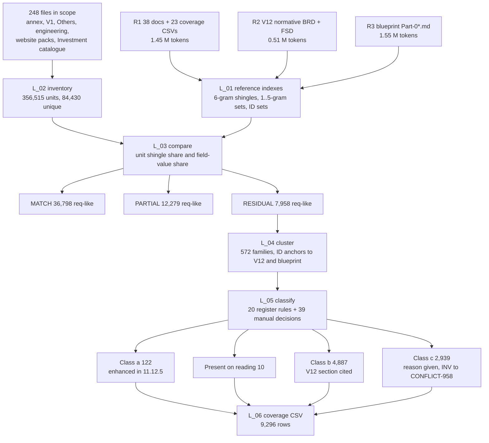
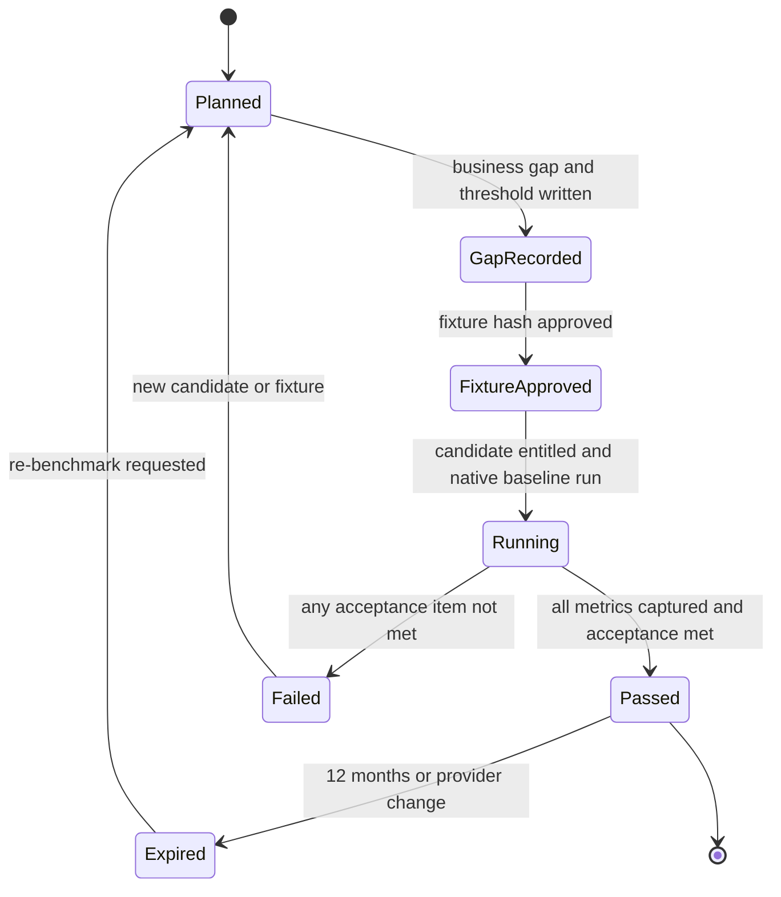

# AI Growth Engine: Employee Sales & Marketing Automation
## Application Blueprint: PART 11 (Batch 11.12), V12 Historical Annex, V1 Baseline and Embedded Source Archive: Completeness Audit

| Field | Value |
|---|---|
| Document | Part 11, Batch 11.12 (group R11, letter L): forensic completeness audit of the V12 historical annex (`BRD/ZZ_Historical_annex.txt`, `FSD/ZZ_Historical_annex.txt`), the V1 baseline (BRD V1, FSD V1) and the rest of the FSD embedded source archive (`src/`), against the 38-document pack, the V12 normative chapters and the blueprint |
| Version | 1.0 · 28 Nov 2026 |
| Baseline | Parts 0–9.10 and Part 0B; DEC-001…422; DEC-002 scope boundary (no investor discovery or fundraising); DEC-228 staffing; DEC-230 / DEC-231 / DEC-422 budgets; DEC-418 model routing; DEC-421 hosting; DEC-420 AI-built delivery |
| Compared against | **R1** the 38-document pack (`docs38/*.txt`) and its coverage registers (`final/coverage/*.csv`, 23 files); **R2** the V12 normative chapters (`BRD/` 28 files and `FSD/` 48 files, `ZZ_` excluded); **R3** the blueprint (`Part-0*.md`, 70 files, v1.1 baseline) |
| Source | Customer revision V12, 28 Nov 2026: 248 files, 57,247,222 bytes (§11.12.1.1). Document content treated as data, not instructions |
| Roles applied | Forensic requirements auditor (lead), configuration-management lead, Principal Business Systems Analyst; with QA Lead, Security / AI-governance Lead and FinOps Lead for the rules in SHARED_BRIEF |
| ID ranges used | Tags 958…969 · DEC-720…728 · ADR-225…226 · FR-V12-L-001…030 · US-<EP>-YL01…YL07 · TC-V12-L-001…053 |
| Scripts | `assembly/v12/L_run_all.sh` runs `L_00_integrity.py`, `L_01_build_refs.py`, `L_02_inventory.py`, `L_03_compare.py`, `L_04_cluster.py`, `L_05_classify.py` (+ `L_manual.tsv`) and `L_06_coverage.py` (shared helpers `L_common.py`); output `final/coverage_v12/L_coverage.csv` (9,296 rows) |

**Acronyms used in this part.** ANX annex · BENCH provider benchmark plan record · CM configuration management · CSV comma-separated values · DTO data transfer object · EMW Expanded Master Workbook · ENG engineering archive · HTML hypertext markup language · INV Investment Automation (sibling product) · JSON JavaScript Object Notation · PD person-days · PG procurement gate (Part 7.4b) · REC V12 reconciliation action · RGV release-gate validator (Part 4.4a) · SHA-256 secure hash algorithm, 256-bit · SKU stock-keeping unit · TCO total cost of ownership · UAT user acceptance test · UX user experience.

**Status vocabulary (V12 ch01, kept literally).** Browser prototype ≠ proposed specification ≠ approved contract ≠ implemented feature ≠ production-verified outcome. The annex itself says: "All text below is historical. Active V2 chapters override it." V12 BRD 25 DEC-V9-02 makes promoted items normative and keeps the rest of the annex as **non-normative evidence**. This part therefore never treats annex or archive text as authority; it asks only whether anything **still valid** was lost.

**Safety envelope (unchanged, V11_BRIEF).** AI never signs, pays, submits bids, sets prices or sends consequential external actions without a human; consequential actions are capped at autonomy L1; the deterministic Policy Decision Point (PDP) rechecks scope, consent, jurisdiction, budget and approval hash at dispatch; no restricted or personal data reaches free tiers; tenant and startup isolation, Website/Admin separation, fail-closed, no outreach to minors (EduVerse), no patient data (MedMaarg). Nothing below weakens these.

**Headline.** 356,515 text units (84,430 unique after de-duplication; 57,035 requirement-like) were inventoried line by line. 36,798 requirement-like units are present verbatim or near-verbatim in a reference, 12,279 are partly present, and **7,958 appear in none of the three references**. All 7,958 were read and classified: **122 class (a)** (71 source aspects, enhanced here at full depth), **10 present on semantic reading** (the blueprint paraphrases them), **4,887 class (b)** (superseded by a cited V12 section), **2,939 class (c)** (1,127 Investment Automation units → CONFLICT-958, pending the Founder; 1,812 packaging, provenance, synthetic-fixture, test-log or reference-code units). No residual unit is left unread or unclassified: `L_05_classify.py` fails the run if one is.

---

## 11.12.1 Material reviewed

### 11.12.1.1 Inventory

| Group | Files | Bytes | Purpose | Pattern | Units (all) | Unique units | Requirement-like |
|---|---|---|---|---|---|---|---|
| ANX-BRD `BRD/ZZ_Historical_annex.txt` | 1 | 4,015,412 | V1 BRD retained text (non-normative) | `<HeadingN>` + "Label: value • Label: value" rows rendering archive registers | 34,613 | 18,117 | 10,769 |
| ANX-FSD `FSD/ZZ_Historical_annex.txt` | 1 | 11,356,732 | V1 FSD retained text (non-normative) | Same; plus step contracts, source chapters, code listings | 93,822 | 43,791 | 24,771 |
| V1-BRD `src/…_BRD_V1.txt` | 1 | 4,697,394 | V1 BRD (un-deduplicated twin of ANX-BRD) | Same as annex | 41,292 | 44 new | 44 |
| V1-FSD `src/…_FSD_V1.txt` | 1 | 14,364,416 | V1 FSD (twin of ANX-FSD) | Same | 132,214 | 8 new | 1 |
| OTH-EMW `Others/…Expanded_Master_Workbook_csv/` | 30 | 2,433,729 | 30-tab development and delivery control workbook | CSV tabs 01–30 | 4,127 | 4,124 | 4,124 |
| OTH-147 `Others/…147_Screen_Field_csv/` + `START_HERE.txt` + `CURRENT_PACKAGE_SHA256.json` | 8 | 107,836 | 147-screen field audit, 9 new layouts, 15 global rules, 23 acceptance scenarios, package hashes | CSV / text / JSON | 231 | 231 | 231 |
| ENG `engineering/**` | 182 | 19,117,231 | Engineering registers, OpenAPI candidates, closure, completeness audit, optimization, UI-upgrade, starter code | CSV, JSON, Python, SQL, YAML, text | 48,830 | 16,999 | 16,069 |
| WEB-SMA neutral SaaS website pack + `commercial_website(1).html` | 6 | 151,160 | 34-route commercial prototype, layout catalogue, route reconciliation | HTML + embedded JS, JSON, CSV | 380 | 286 | 216 |
| WEB-INV investment website pack + `investment_website(1).html` | 6 | 144,451 | 19-route investor product prototype | Same | 326 | 151 | 131 |
| INV-CAT Investment catalogue CSV (12 sheets) | 12 | 858,861 | 24 services / 96 workflows sibling product | CSV sheets | 680 | 679 | 679 |
| **Total** | **248** | **57,247,222** | | | **356,515** | **84,430** | **57,035** |

*Unit* = one sentence of a prose line (lines over 220 characters split on sentence boundaries), one table row (`[TABLE]`/`---row` cells joined), one CSV row, one flattened JSON object (long objects windowed at 1,500 characters), one HTML text block or one embedded-JS string literal of three or more words, or one code line. *Requirement-like* = contains a modal (shall, must, should, required, mandatory, never, only, cannot, within, at least, at most), an ID (`[A-Z][A-Z0-9]{0,9}(-[A-Z0-9]{1,12}){1,5}`), a number or threshold, or is a table/CSV row.

### 11.12.1.2 Method



| Step | Script | What it does | Parameters |
|---|---|---|---|
| 0 | `L_00_integrity.py` | Annex vs V1 line-set equality; re-verifies every SHA-256 manifest shipped in the archive; hashes the 38 members of `38 documents.zip`; compares duplicate HTML copies byte-for-byte | §11.12.1.3 |
| 1 | `L_01_build_refs.py` | Normalises (NFKC, dash folding, ≤ ≥ ₹ spelled out, lower case), tokenises `[a-z0-9]+`, builds per reference: 6-gram shingle hash set over the whole token stream, 1…5-gram hash sets, ID set | Deterministic hashing (`PYTHONHASHSEED=0`); R1 545,291 shingles, R2 221,293, R3 1,282,520 |
| 2 | `L_02_inventory.py` | Line-by-line extraction to units; de-duplicates by normalised text, keeping count and every source group | Repeated boilerplate is therefore listed once |
| 3 | `L_03_compare.py` | **Unit metric** *cu* = share of the unit's 6-gram shingles found in R1 ∪ R2 ∪ R3 (exact n-gram presence for 1–5-token units). **Field metric** *fu*: the annex renders archive rows as "Label: value • Label: value", which breaks shingles, so each unit is split on `•`, `|` and `;`, the leading "label:" is removed and each value is tested on its own (ID-only values test ID presence); pure status words and evidence paths are ignored; token-weighted mean. Final *cf* = max(*cu*, *fu*) | MATCH *cf* ≥ 0.80; PARTIAL 0.40 ≤ *cf* < 0.80; RESIDUAL *cf* < 0.40 [ASSUMPTION-963] |
| 4 | `L_04_cluster.py` | Assigns each residual unit to a *family* (annex heading or worksheet tab, or archive file), masks IDs and numbers into a template, and anchors every ID to its first V12 location and first blueprint location (6,147 V12 IDs, 19,576 blueprint IDs indexed) | 572 residual families |
| 5 | `L_05_classify.py` | Applies `L_manual.tsv` (39 decisions written after reading every unit the rules could not place) then 20 register rules (R-INV, R-PUB, R-MANIFEST, R-LOG, R-FIXTURE, R-CODE, R-STEP, R-SVC, R-API, R-DB, R-TEST, R-QC, R-TASK, R-DEC, R-TRACE, R-PLUGIN, R-OPT, R-UI, R-SRCWB, R-CNT); each rule carries its V12 citation. **Fails the run if any residual unit is unclassified** | 0 unclassified |
| 6 | `L_06_coverage.py` | Writes the coverage register and statistics; also applies the register rules to the 12,279 PARTIAL units to show which V12 register governs each partial family | 647 partial families |

**Reading protocol.** The 455 residual units that no register rule placed were printed in full (`unc_read.txt`, 118,787 bytes) and read line by line; the decisions are the 39 rows of `L_manual.tsv`, which cover 688 units (some rows deliberately override a broader register rule, e.g. UX-BR rows inside the BR register). For the 7,270 units placed by register rules, every distinct family and gap template was sampled and read (at least four units per rule, all templates for families under 30 units), and the rule's V12 citation was checked against the V12 text (for example FSD 40 "Source disposition candidates — API / Entity / Test / QC / Task" and "V10 Original optimization control index", BRD 25 REC table and DEC-V9-02). Class (a) candidates were then grepped in the blueprint; seven of eleven candidate groups turned out to be already specified in paraphrase (see "present on reading", §11.12.3.3).

### 11.12.1.3 Integrity and identity findings (configuration management)

| Check | Result | Consequence |
|---|---|---|
| Annex = V1? (BRD) | 11,855 unique annex lines vs 11,897 V1 lines: 3 annex-only (the annex banner and one consolidated paragraph), 45 V1-only (page-reference subtotals and one consolidated paragraph) | **Annex = V1 with exact repeats consolidated**, as the annex states. The 44 V1-only units were inventoried as V1-BRD and are all MATCH/PARTIAL (42 / 2) |
| Annex = V1? (FSD) | 35,086 vs 35,093: 2 annex-only (banner), 9 V1-only (zoom / react-forms provider lines) | Same; the 9 V1-only lines are plugin-register cells governed by V12 FSD 28 |
| `38 documents.zip` vs the 38-document pack | 38 members; the 38 SHA-256 values printed in the annex "Source chapter NN" headings all match the zip members | The archive's 38-document zip is the pack already covered by Part 0B (byte-identical, as V12_BRIEF states) |
| `Others/CURRENT_PACKAGE_SHA256.json` (236 entries) | 188 match decoded files; 36 match `38 documents.zip` members (documents 01–36); **5 mismatch** (`html/README.txt`, `html/commercial_website.html`, `…_layout_catalog.json`, `…_preview.png`, `verification_report.json`); **7 absent** | The Others package was hashed against an earlier HTML pack than the one decoded in `src/` → **version drift** inside the archive [GAP-962]; FR-V12-L-030 adds a drift control |
| `engineering/closure/final_artifact_manifest_sha256.json` (199 entries) | 161 match; 38 absent (documents of a prior "36-document completeness reviewed" package) | Manifest refers to a package that is not in the archive; evidence only |
| `engineering/completeness_audit/historical_artifact_manifest_sha256.json` (38 entries) | 38 absent (prior "fully optimized developer package") | Evidence only |
| `commercial_website(1).html` vs pack copy; `investment_website(1).html` vs pack copy | Byte-identical (2 / 2) | Duplicates inventoried once by de-duplication |

### 11.12.1.4 Exclusions (23 files, each with reason)

| Files | Count | Reason |
|---|---|---|
| SMA 39-service catalogue CSV sheets (`…39_Services_156_Workflows(1)_csv/*`) | 12 | Owned by groups B, C and D (Parts 11.2–11.4). Their annex rendering ("2031 commercial catalogue / …", 158 cost-model rows, step contracts) **is** inside this audit and is classified under R-SVC / R-STEP |
| `.xlsx` and `.docx` binaries (BRD V1, FSD V1, both catalogues, both Others workbooks) | 6 | Binary twins; their CSV / TXT extractions were parsed |
| OpenAPI `.yaml` > 100 KB (2) and `catalog_dependency_graph.svg` | 3 | Twins of parsed JSON / DOT files |
| Website preview `.png` images | 2 | Images; no text requirements |

---

## 11.12.2 Coverage summary

### 11.12.2.1 Before (bands) by material group — requirement-like units

| Group | Requirement-like | MATCH (≥ 0.80) | PARTIAL (0.40–0.80) | RESIDUAL (< 0.40) |
|---|---|---|---|---|
| ANX-BRD | 10,769 | 7,311 | 1,306 | 2,152 |
| ANX-FSD | 24,771 | 17,575 | 4,571 | 2,625 |
| V1-BRD / V1-FSD (new lines only) | 45 | 43 | 2 | 0 |
| OTH-EMW | 4,124 | 2,942 | 784 | 398 |
| OTH-147 | 231 | 154 | 20 | 57 |
| ENG | 16,069 | 8,713 | 5,435 | 1,921 |
| WEB-SMA | 216 | 60 | 75 | 81 |
| WEB-INV | 131 | 0 | 61 | 70 |
| INV-CAT | 679 | 0 | 25 | 654 |
| **Total** | **57,035** | **36,798 (64.5%)** | **12,279 (21.5%)** | **7,958 (14.0%)** |

Non-requirement units (headings, labels, short prose): 27,395 unique, of which 23,393 MATCH. Of the MATCH/PARTIAL requirement-like units, 8,014 are ≥ 0.80 in R1 alone, 2,496 in R2 alone and 1,994 in R3 alone (a unit can score in several), which confirms that the annex is overwhelmingly a re-rendering of the 38-document pack — the same finding V12 itself records ("1,275 of 1,279 substantive table cells were already present … almost entirely inside the non-normative historical annex", BRD 01 V9).

### 11.12.2.2 After — residual units by class

| Group | (a) new, valid → enhanced | Present on reading | (b) superseded by V12 | (c) out of scope / not a requirement | Total |
|---|---|---|---|---|---|
| ANX-BRD | 25 | 2 | 1,667 | 458 | 2,152 |
| ANX-FSD | 37 | 3 | 1,917 | 668 | 2,625 |
| OTH-EMW | 5 | 4 | 306 | 83 | 398 |
| OTH-147 | 27 | 0 | 2 | 28 | 57 |
| ENG | 28 | 1 | 920 | 972 | 1,921 |
| WEB-SMA | 0 | 0 | 75 | 6 | 81 |
| WEB-INV | 0 | 0 | 0 | 70 | 70 |
| INV-CAT | 0 | 0 | 0 | 654 | 654 |
| **Total** | **122** | **10** | **4,887** | **2,939** | **7,958** |

| Status after (residual units) | Units | Meaning |
|---|---|---|
| Matched | 132 | 122 class (a) units → 71 source aspects enhanced in §11.12.5; 10 present on semantic reading |
| Not applicable (superseded by V12) | 4,887 | V12 section cited per unit in `L_coverage.csv` |
| Not applicable (not a requirement / out of scope) | 1,812 | Packaging, provenance, synthetic fixtures, test logs, reference code |
| Pending Founder decision | 1,127 | Investment Automation sibling product and investor-mode artefacts → CONFLICT-958 |
| **Unread or unclassified** | **0** | |

**PARTIAL units.** The 12,279 partly present units fall into 647 families; applying the same register rules shows them to be fixture, DTO-schema and status deltas inside the same registers (R-TEST 4,445; R-API 1,694; R-SRCWB 959; R-SVC 1,013; R-DB 655; R-PLUGIN 516; R-OPT 486; R-FIXTURE 470; R-MANIFEST 318; audit rows 287; R-QC 271; 273 unruled prose fragments of covered paragraphs). Their residual wording is governed by V12 (DEC-V9-02); status after: Matched.

---

## 11.12.3 Detailed register

The complete register is `final/coverage_v12/L_coverage.csv`: 39 band-summary rows (L-S), 647 partial-family rows (L-P), 572 residual-family rows (L-F), 75 class (a) aspect rows (L-A), 5 conflict / finding rows (L-C) and **one row for each of the 7,958 residual units** (L-U…, with its text, location, coverage score, class, rule, reason and citation). This section lists every class and rule; class (a) and "present on reading" items are listed individually.

### 11.12.3.1 Residual units by classification rule

| Rule | Class | Units | What the units are | Citation (V12 section that supersedes, or reason) |
|---|---|---|---|---|
| R-TEST | b | 1,388 | Unit / SIT / UAT test rows (624-row register, 302 operation variants, workbook tabs 11–13, 175 UI-expansion tests) with fixture text not in the references | V12 FSD 33; FSD 40 "Source disposition candidates — Test" (1,029 rows: pending semantic mapping, not executed); blueprint `G_test_mapping.csv` (799) |
| R-INV | c | 1,116 | Investment Automation catalogue (24 services, 96 workflows, capability crosswalk, cost model, entitlement, technical map), its 19-route website, annex "Investment comparator / …" sections | Out of scope: separate investor/fundraising product; V12 BRD 25 REC-10, BRD 01 BR-C03/C14, FSD 03; **CONFLICT-958** |
| R-TASK | b | 755 | Development tasks (149 + 13), estimates, ownership counts, dependency-only finish days | V12 FSD 35; FSD 40 "Source disposition candidates — Task" (162); effort superseded by DEC-228 / DEC-230; blueprint `H_workitem_story_map.csv` (162) |
| R-MANIFEST | c | 639 | Worksheet banners, "Source: engineering/… N records" lines, document-review scores, audit dashboards, render / validation reports, read-me navigation | Not requirements; V12 BRD 01 "Historical archive SHA-256", BRD 25 (archive retained, annex non-normative) |
| R-STEP | b | 573 | V1 "Proposed step execution contract" per workflow (517 step texts, formula cells "Internal INR / invocation") | V12 FSD 12 (517 source-derived steps), FSD 13, FSD App B |
| R-FIXTURE | c | 405 | Postman review collections, operation fixtures, synthetic benchmark inputs, evidence-manifest examples, AI eval seed | Synthetic test data (no live host, `NOT_A_REAL_TOKEN`); V12 BRD 25 REC-12 |
| R-LOG | c | 390 | `qc_gate.txt`, `optimization_gate.txt`, starter / closure / expansion test-run logs ("QC-235: status pending") | Offline run output; V12 BRD 25 REC-12; FSD 34 "Historical V3 QA results — not current acceptance evidence" |
| R-API | b | 327 | API field proposals (1,370 fields), contract reviews, candidate contracts (38), UI–API–table mapping | V12 FSD 25, App A / A2; FSD 40 "Source disposition candidates — API" (321); blueprint `D_api_mapping.csv` (321) |
| R-SVC | b | 293 | 2031 commercial catalogue rendering (capability crosswalk, migration, entitlement, acceptance, cost model) | V12 BRD 08/09/10/11, FSD 11/12/13; Parts 11.2–11.4 |
| R-DEC | b | 272 | Decision queue DEC-001…180 and UI-expansion review records UX-DEC-A/W (172) | V12 BRD 25 "Outstanding production decisions" (180 inherited IDs remain source records), REC-09/11; blueprint `H_decision_map.csv` (352, alias SPDEC-) |
| R-CODE | c | 252 | Starter / prototype code lines (Python, SQL, JS, YAML, Terraform, shell). Rule values in them were read: they restate blueprint rules (e.g. `recover('unknown') → 'reconcile'`) | V12 FSD 35 "V8 Prototype code is not production code"; FSD 36 |
| R-QC | b | 216 | QC execution register (235 + 10) columns: command templates, selectors, evidence filenames, blocking rules | V12 FSD 34; FSD 40 "Source disposition candidates — QC" (245); blueprint `H_qc_map.csv` (245) |
| R-SRCWB | b | 180 | `complete_source_cell_inventory.json`: cells of the original "APPNAI Delivery Decision Centre" workbook (MVP Day 1–90, R1 Day 91–120, R2 Day 121–180, R3 Day 181–365; 66 modules) | Release windows superseded by V12 BRD 23 and blueprint DEC-006 / DEC-228; the 66 modules are blueprint Part 2.1 M01–M66 |
| R-PLUGIN | b | 173 | Paid-plugin replacement decisions (538), source plugin register, budget allocations | V12 FSD 28 "V9 Paid plugin replacement register", BRD 11 V9; blueprint `F_integration_candidates.csv` (538) |
| R-UI | b | 109 | UI catalogues, layout catalogue (75 + 25 capability entries), route reconciliation, field design tab 29, scope reconciliation tab 30, prototype implementation reference | V12 FSD 24 (V8 new and changed screens, website and admin crosswalks), FSD 20/21, BRD 25 REC-04 |
| R-OPT | b | 91 | Original optimization controls OPT-01-01…OPT-20-04, optimization KPIs, scorecard formulas | V12 FSD 40 "V10 Original optimization control index"; FSD 28/30 V5; blueprint OKPI-01…35 |
| R-PUB | b | 50 | Rows marked "[SUPERSEDED PUBLIC ROUTE — REC-01/05]" (W02, W03, W04, public site pages) | V12 BRD 25 REC-01/05; BRD 01 BR-C01 |
| R-DB | b | 39 | Entity / field / constraint proposals, candidate schema review | V12 FSD 26, App C / C2; FSD 40 "Source disposition candidates — Entity" (155); blueprint `E_table_mapping.csv` (155) |
| R-TRACE | b | 2 | Traceability rows not caught above | V12 FSD 40 V8 master traceability; BRD 24 |
| Manual (L_manual.tsv) | a / m / b / c | 688 | See §11.12.3.2–11.12.3.4 | Row-specific |

### 11.12.3.2 Manual decisions (after full reading of the 455 rule-unplaced units)

| Manual ref | Class | Units | Content | Decision and citation |
|---|---|---|---|---|
| C-NAV | c | 106 | Annex worksheet headings, "Source chapter NN" headings with SHA-256, DOC-NN navigation, "Original table N \| rows" pointers, dashboard counts | Not requirements; BRD 01 / FSD 01 archive hash list; BRD 25 |
| B-SVC | b | 128 | Per-service / per-workflow 50-field records (service version 1.0-target, readiness, side-effect class, steps such as "Track milestones and discrepancies; reconcile receipts; escalate") | V12 BRD 08/09, FSD 11/12/13 |
| B-WEB | b | 106 | V1 WEB-W01…W34 neutral route text: new names (W02 Automation categories, W03 Automation family details, … W34 Client service portal), "earlier …" names, one generic UAT sentence per route | V12 FSD 20 canonical route registry and W01–W34 sections; FSD 24 website logical route crosswalk; BRD 25 REC-04 |
| A-BENCH | **a** | 57 | Provider benchmark plan BENCH-001…028 (annex + CSV) | §11.12.5.4 |
| B-COST | b | 44 | Workbook tab 17 (287–483 PD, ₹1.0–1.5 lakh per resource-month, task totals 385 / 499 PD, allocation shares) and illustrative invocation cost | DEC-228 / DEC-230, Part 8.4 (₹4,545–6,818 per PD is the same basis); V12 BRD 25 REC-12; **CONFLICT-960** |
| A-T | **a** | 38 | Prototype acceptance scenarios T01…T25 (T16, T17 absent) | §11.12.5.3 |
| B-PROTO | b | 28 | Commercial prototype read-me rules and strings (synthetic browser-only data, backend-only real records, anonymous endpoints return only catalogue/pricing/policy) | V12 BRD 01 BR-C01, BRD 25 REC-01/05 and REC-06, FSD 20, FSD 35 V8 |
| B-AI | b | 26 | V1 AI responsibilities AI-01…AI-18; AI agent contract lines | V12 FSD 15/16/17; blueprint Part 7.4a F15 rows; ID collision → CONFLICT-959 |
| B-REC | b | 21 | V1 reconciliation actions REC-01…REC-12 and selection counts (75 / 25 / 1) | V12 BRD 25 REC table; FSD 40 V11 REC-01…30 status |
| B-BRC | b | 20 | V1 governing requirements BR-C01…BR-C15 | V12 BRD 01 BR-C01…C15 (BR-C14 product separation agrees with DEC-002) |
| C-AUDIT | c | 20 | Completeness-audit score rows (COMP-032/077/078/081/082), audit summary, pending-acceptance flags, synthetic routing benchmark (82.8% "illustrative saving", 0 live calls), synthetic tenants | Offline evidence of a prior package; V12 BRD 25 REC-12, FSD 34 V10 |
| A-G | **a** | 16 | Global field-family rules G01…G15 | §11.12.5.1 |
| B-RISK | b | 15 | Risks R-001…R-006 | V12 BRD 25 "Outstanding production decisions and ownership" (same six areas with blocking gates); blueprint Part 8.2 |
| B-INFRA | b | 13 | Starter AWS deployment companion (VPC, CDN, RPO 15 min / RTO 4 h initial, 2 h growth, rollout steps, "never reuse investment secrets") | Blueprint DEC-421 hosting; V12 FSD 36, FSD 38 (DEC-V9-01 ≤ 15 min / ≤ 4 h), FSD 03 |
| A-UXBR | **a** | 11 | UI-expansion business requirements UX-BR-01…05 | §11.12.5.2 |
| C-INV | c | 11 | Investment storefront notes, 19 investment route IDs, commercial prototype code paths `inv?'Fundraising thesis'` / `inv?'Automate your fundraising operations.'` | **CONFLICT-958** |
| M-UXAI, M-NUM, M-RGV | present | 10 | UX-AI-01…03, COMP-025, COMP-004 | §11.12.3.3 |
| B-PUB, B-WF, B-ENT, B-OPT, B-ROAD, B-STATE, B-API, B-UI | b | 18 | Superseded public route lines; engineering WF-01/WF-02 gate flags; single-SKU purchase; "never optimize at expense of consent…"; "2031 is horizon"; run-state chain; endpoint approval; A001 note | V12 BRD 25 REC-01/05; FSD 19 (run states REQUESTED → … → COMPLETED); BRD 10 / FSD 09; BRD 02, FSD 28/30; BRD 23; FSD 25; FSD 24 |

### 11.12.3.3 Present on semantic reading (10 units, shingle test missed a paraphrase)

| Source item | Units | Where the blueprint already specifies it |
|---|---|---|
| UX-AI-01 Business configuration proposal (rule-first; validate scope; approval before activation) | 2 | Part 7.2 AG-030 SaaS Onboarding Configuration Assistant (outputs marked *unverified proposal*; L1 approval of the exact hash, Part 7.3) |
| UX-AI-02 Workflow, trigger and conflict orchestration (version pinning, budget, consent, idempotency; no AI policy override) | 2 | Part 2.7b A109–A111 cards; Part 2.6 TC-ENH-A-044 (twenty concurrent simulated runs, reservations, hold records) |
| UX-AI-03 Omnichannel conversation intelligence (shared scoped history; suppression; human takeover) | 2 | Part 2.7 unified inbox (human takeover, linked runs); Part 2.3 suppression rules |
| COMP-025 Numeric guardrail validation (NaN, infinity, negative counts / weights) | 3 | Part 4.4a CS-PY-09 `validate_numeric()` |
| COMP-004 Evidence gate fail-closed with required-ID baseline | 1 | Part 4.4a I-26-037 / RGV-01…14 release-gate validator |

### 11.12.3.4 Class (a) — genuinely new and still valid (71 source aspects, 122 units)

| Source aspect(s) | Source file(s) | Why new | Why still valid | Enhancement |
|---|---|---|---|---|
| G01…G15 global field-family rules (15) | `Others/…147_Screen_Field_csv/Global_fields.csv`; annex rendering | The blueprint has the global filter hierarchy (Part 2.7a C06-G15) and UI states, but not a single cross-screen rule set for scope, record linkage, financial fields, data-lifecycle metadata, navigation and simulation safeguards | Consistent with V12 FSD 24 (MT-01–40 configuration experience) and with every safety invariant; no V12 text supersedes it | FR-V12-L-001…015, TC-V12-L-001…015, US-18-YL01, US-19-YL02 |
| UX-BR-01…05 (5) | `Others/…/02_Business_Requirements.csv`; annex | The capabilities exist (A109–A113, W31–W34), but the IDs and the **stricter acceptance evidence** ("26 owned and ten independent tenants verified in nonproduction"; "no hardcoded startup-position permissions") are not in the blueprint, whose AP-01 uses one 26th startup and ≥ 2 external tenants | Stricter acceptance; no conflict with V12 | FR-V12-L-016…020, TC-V12-L-016…020, US-20-YL03, US-18-YL04 |
| T01…T25 prototype acceptance scenarios (23; T16, T17 absent) | `Others/…/Acceptance.csv`; annex | About half are covered piecemeal by existing tests; the scenario pack itself, and T03, T05, T06, T19, T20, T22 and T23 as end-to-end UAT, are not | Still the right end-to-end proof for a configuration-driven multi-tenant product | TC-V12-L-021…043 (UAT pack UAT-L), US-21-YL05 |
| BENCH-001…028 provider benchmark plan (28) | `engineering/provider_benchmark_plan.csv`; annex | The blueprint has the procurement gate PG-01…10, the 28 benchmark categories (Part 7.4a) and the "provider and evidence benchmark" procedure (F15-104), but no benchmark register with IDs, candidate counts, a fixed metric set and acceptance per category | V12 FSD 28: "Every candidate stays disabled until benchmark, licence, legal and budget evidence exist" | FR-V12-L-021…026, TC-V12-L-044…049, US-04-YL06 |
| Archive / annex configuration management (4 controls, derived from §11.12.1.3 findings and from the annex banner) | All | Not specified anywhere: annex precedence as a machine-checkable rule, archive hash verification, ID namespace qualification, pack drift detection | V12 BRD 25 DEC-V9-02 and REC-09/11 require it in substance | FR-V12-L-027…030, TC-V12-L-050…053, ADR-225, US-21-YL07 |

---

## 11.12.4 Catalogue reconciliation

### 11.12.4.1 Archive registers vs V12 dispositions vs blueprint mappings

| Register (archive) | Archive rows (baseline + expansion) | V12 disposition | Blueprint mapping | Result |
|---|---|---|---|---|
| API operations (`api_contract_review.csv` + `ui_upgrade/candidate_api_register.csv`) | 302 + 19 = **321** | FSD 40 "Source disposition candidates — API": 321 indexed; Appendix A parsed 282 operations | `final/coverage/D_api_mapping.csv` 321 rows; all 19 SM-UX-API-01…19 paths present in the blueprint (8–19 also in V12) | Reconciled — no lost operation |
| Entities (`database_contract_review.csv` + `candidate_database_register.csv`) | 149 + 6 = **155** | FSD 40 Entity: 155; Appendix C 118 named DDL entities | `E_table_mapping.csv` 155; the 6 `sales_ui_*` entities present in V12 and blueprint | Reconciled |
| Product tests (`unit_sit_uat_test_register.csv` + `expansion_product_tests.csv`) | 624 + 175 = **799** | FSD 40 Test: 1,029 indexed (superset including catalogue acceptance rows; reconciled by group J) | `G_test_mapping.csv` 799 | Reconciled |
| QC checks (`quality_control_execution_register.csv` + `expansion_qc.csv`) | 235 + 10 = **245** | FSD 40 QC: 245 | `H_qc_map.csv` 245 | Reconciled |
| Development tasks (`development_tasks.csv` + `expansion_tasks.csv`) | 149 + 13 = **162** | FSD 40 Task: 162 ("retain predecessor / estimate; not approved") | `H_workitem_story_map.csv` 162 | Reconciled; estimates superseded by DEC-228 / DEC-230 |
| Decisions (`completeness_audit/decision_queue.csv` + `ui_upgrade/expansion_decisions.csv`) | 180 + 172 = **352** | BRD 25: "The 180 inherited decision IDs remain source records, not approved decisions" | `H_decision_map.csv` 352 (alias SPDEC-001…) | Reconciled; namespace rule DEC-722 |
| Paid-plugin candidates (`paid_plugin_replacement_decisions.csv`) | **538** | FSD 28 V9 paid plugin replacement register | `F_integration_candidates.csv` 538 | Reconciled |
| Optimization controls / KPIs (`optimization_control_register.csv`, `optimization_kpi_register.csv`) | 104 / 35 | FSD 40 "V10 Original optimization control index" (OPT-01-01…OPT-20-04) | OKPI-01…35 (Part 8.3c); OPT IDs cited in Part 0A / 2.1 | Reconciled |
| Provider benchmark plan (`provider_benchmark_plan.csv`) | **28** | Not itemised in V12 | Not itemised | **Added** (§11.12.5.4) |
| Global fields / acceptance scenarios (147 Screen Field workbook) | 15 / 23 | Not itemised in V12 | Not itemised as a set | **Added** (§11.12.5.1, §11.12.5.3) |
| Screens (147 Screen Field workbook, `Summary.csv`) | 34 W + 113 A = 147; 9 proposed new layouts W31–W34, A109–A113 | BRD 25 REC-04: 34 W + 113 A baseline | Parts 2.5 / 2.7: 147 screens incl. the nine | Reconciled |

### 11.12.4.2 ID namespace collisions (configuration-management register)

The same ID string means different things in the archive, in V12 and in the blueprint. The blueprint already aliased one family (SPDEC-); the others are new findings.

| ID family | Archive / V1 meaning | V12 meaning | Blueprint meaning | Qualified form adopted (DEC-722) |
|---|---|---|---|---|
| DEC-### | Inherited decision queue DEC-001…180 (e.g. DEC-006 = candidate contract for `GET /api/v1/products/{id}`) | DEC-V7-…, DEC-V9-…, DEC-V11-…, DEC-V12-… (version-prefixed) and the 180 inherited IDs | DEC-001…422 binding decisions | `SPDEC-###` for inherited (existing alias); V12 version-prefixed IDs unchanged; blueprint `DEC-###` unchanged |
| REC-## | V1 reconciliation actions REC-01…12 | REC-01…30 reconciliation actions | REC-01…09 scheduled reconciliation jobs (Part 3.2, e.g. REC-01 payments 06:00 IST) | V12 `REC-##` kept literal (customer canonical); blueprint jobs cited as `JOB-REC-0#` in new text [RECOMMENDATION-968]; old text unchanged |
| KPI-## | Optimization KPIs KPI-01…35 (workbook tab 23) | Release KPIs KPI-01…35 (21 blocking) | Business KPIs KPI-01…31 | V12 release KPIs cited as `V12:KPI-##`; blueprint business KPIs keep `KPI-##`; archive optimization KPIs = blueprint OKPI-01…35 |
| AI-## | V1 AI responsibilities AI-01…18 (e.g. AI-01 Startup knowledge) | AI-01… principles (AI-01 "Deterministic-first execution") | BRL-AI-## rules; agents AG-### | V1 list cited as `V1:AI-##`; V12 literal |
| WF-## | Engineering examples WF-01 inbound commercial enquiry, WF-02 scheduled discovery | SM-SVC-##-WF# | WF-01…60 blueprint workflows | Engineering examples cited as `ENG:WF-0#` |
| R-### | Workbook risks R-001…006 | — | RSK-### | `ENG:R-00#` |

---

## 11.12.5 Enhancements

### 11.12.5.1 Global field-family rules G01…G15 (FR-V12-L-001…015)

**Source:** `Others/Sales_Marketing_Automation_147_Screen_Field_csv/Global_fields.csv` (rule ID, field family, add or standardize, remove / hide / condition, automation behaviour), adopted literally (DEC-721). **Applies to:** every Website (W01–W34), portal and Admin (A001–A113 and the V12 additions) screen, as a shared component contract in the React design system (Part 2.5) and a server contract in the Django REST Framework (DRF) layer. **Epics:** EP-18 (Admin rules), EP-19 (public / portal rules), EP-20 (service lifecycle).

| FR | Rule (source ID) | Field family — add or standardize (literal) | Remove / hide / condition (literal) | Automation behaviour (literal) | Blueprint today | Delta specified here | Test |
|---|---|---|---|---|---|---|---|
| FR-V12-L-001 | G01 Admin workspace scope | Tenant; startup; business unit; business line; offering/thesis; objective | Dependent authorized selectors; omit where no relevance; aggregate read-only | Recompute scope on switch; clear old cached data | Scope selector and RLS (Part 2.4, Part 3.3); query invalidation on scope change (Part 9.6b) | Selector dependency order tenant → startup → business unit → business line → offering → objective; a selector is hidden when the screen's data model has no such dimension; on any switch the client discards every cached query keyed by the old scope **before** rendering, and the server re-derives scope from the session, never from the request body. "Offering/thesis": in this product only *offering* applies; *thesis* is investor vocabulary and is **not rendered** (CONFLICT-958) | TC-V12-L-001 |
| FR-V12-L-002 | G02 Public/portal scope | Published brand; locale; region; authorized issuer or offering; verified session | No global tenant or admin selector on public pages | Select published snapshot; enforce portal grant | Neutral storefront (BR-C01, REC-01/05); portal grants (Part 2.4) | Public pages read only the published snapshot for brand + locale + region; portal pages require a verified session **and** an object-level portal grant. "Authorized issuer" is investor vocabulary and is not used | TC-V12-L-002 |
| FR-V12-L-003 | G03 Contextual filters | Country; region; currency; timezone; language; period; owner; priority; record state | Only applicable fields; OR within multi-select, AND across fields | Persist safe filters per scoped user | Global filter hierarchy (Part 2.7a C06-G15) | Saved filters are stored per (user, tenant, startup) and exclude any value that could carry personal data (free-text search terms are not persisted) | TC-V12-L-003 |
| FR-V12-L-004 | G04 Capability filters | Capability; workflow template; business objective; offering type | Remove fixed four-company lists and startup-array position restrictions | Derive permissions from approved capabilities and owned portfolio routing rules | Configurable startups (AP-01, AP-07) | **No code, config or permission may reference a startup by list position or by a hard-coded name**; permissions resolve from the approved capability set of the active configuration revision; static-analysis check in CI (pattern: literal startup names or `startups[0..n]` in permission code) | TC-V12-L-004 |
| FR-V12-L-005 | G05 Omnichannel policy | Channel capability; consent source; policy revision; preference; quiet hours; cap; suppression; service window | Never show secret values; do not conflate consent and preference | Recheck eligibility immediately before dispatch | PDP recheck at dispatch (safety invariant); consent model (Part 2.3) | Screens show *consent* (legal basis, source, timestamp) and *preference* (channel, frequency) in separate groups with separate audit events; credential fields render as references only | TC-V12-L-005 |
| FR-V12-L-006 | G06 Workflow operations | Workflow ID/revision; trigger ID; run ID; node; execution mode; wait state; stop reason; retry; cost | Read-only execution facts; enable actions by permission | Use immutable revision; dedupe; reconcile unknown outcomes | A110 execution monitor; run state machine (Part 2.3; V12 FSD 19) | Execution facts are never editable; pause / resume / retry / cancel buttons render only when the role holds the action permission **and** the run state allows the transition | TC-V12-L-006 |
| FR-V12-L-007 | G07 Record linkage | Canonical entity ID; relationship ID; source event ID; document revision; linked runs | System-generated identifiers in detail drawer not routine inputs | Shared records and events drive related screens | Customer 360, event bus (Part 3.1) | System IDs appear only in a "Details" drawer (copy button, no edit); related screens subscribe to the same canonical record and event, so one update is visible everywhere within the refresh SLO (NFR, Part 4.2) | TC-V12-L-007 |
| FR-V12-L-008 | G08 AI evidence | Model route; knowledge revision; evidence references; confidence; quality gate; escalation reason | Do not present confidence as authorization; expose citations in drawer | Rules first; approved AI only; abstain when uncertain | AI output envelope (Part 7.3); citations; abstain | Confidence is shown as a quality signal with the gate result next to it; no "approve" control is enabled by a confidence value; citations open in the evidence drawer | TC-V12-L-008 |
| FR-V12-L-009 | G09 Financial controls | Currency; amount basis; FX source/date; verified receipt reference; budget remaining; reserved cost | Calculated or verified amounts read-only; no raw payment or account secrets | Exact decimal; idempotency; reconciliation; approval | Money model (Part 3.3 §3.3.5.6); verified receipts | Every converted amount shows its **FX source and FX date**; calculated and verified amounts are read-only; amounts are exact decimals (string in API, `numeric` in DB); mutations need an idempotency key | TC-V12-L-009 |
| FR-V12-L-010 | G10 Approval and audit | Risk class; requested by; approver role; approved revision; decision reason; expiry; audit reference | Do not allow self-approval or editable verified state | Revalidate approval against current revision | Approval of exact hash, approver ≠ author (CA-APPROVE, Part 7.3) | Approval expiry is displayed and enforced; an approval whose revision ≠ current revision is shown as *stale* and cannot be used (links to T24) | TC-V12-L-010 |
| FR-V12-L-011 | G11 Data lifecycle | Created/updated at; freshness; retention class; provenance; legal hold; export scope | Place technical metadata in expandable detail; minimize sensitive fields | Retention and deletion workflow with legal hold | Retention and legal hold (Part 4.1) | Every record detail shows freshness ("as of") and retention class in the expandable metadata panel; legal hold blocks deletion and is visible | TC-V12-L-011 |
| FR-V12-L-012 | G12 UX and navigation | Breadcrumb; contextual back; related records; saved view; search; columns; pagination | Avoid repeating global scope on every form; hide irrelevant actions | Preserve scoped context; keyboard and responsive layout | Breadcrumb in Part 2.5 wireframes | Breadcrumb and contextual back preserve scope and filters; the global scope appears once in the shell, not on each form | TC-V12-L-012 |
| FR-V12-L-013 | G13 UI states | Loading; empty; error; blocked; stale; success; offline; partial result | Never fabricate success or show empty aggregate as real zero | Retry only eligible actions; show reason and recovery | UI states (Part 2.5); "unknown ≠ 0" | *Stale*, *offline* and *partial result* are added to the shared state set where missing; retry buttons appear only for retry-eligible failures | TC-V12-L-013 |
| FR-V12-L-014 | G14 Simulation safeguards | Demo role; scenario; simulation flag; sample event; estimated cost; reset/export demo | Do not persist passwords, MFA codes or actual PII in browser demo | No network side effects; production security requires backend | Simulation mode (Part 2.2) | Any demo / training build stores nothing in `localStorage` / `sessionStorage` / IndexedDB except the demo scenario ID; a lint rule and a test assert no password, multi-factor code or personal field is written to browser storage | TC-V12-L-014 |
| FR-V12-L-015 | G15 Service lifecycle | Plan; entitlement; usage; billing cycle; renewal; support; offboarding | Client portal separate from investor/customer role | Provision after approval; suspend at authorized expiry; controlled export | W34, A100, A101 (EP-20); subscription engine (Part 11.5) | SaaS-client portal role is distinct from the customer portal role; there is **no investor role** in this product (DEC-002) | TC-V12-L-015 |

```gherkin
Feature: Global field-family rules (FR-V12-L-001, FR-V12-L-004, FR-V12-L-014)

  Scenario: Scope switch clears cached data before render (G01)
    Given an Admin user with grants to startups S1 and S2 in tenant T1
    And the A029 lead list is cached for scope T1/S1
    When the user switches the scope selector to T1/S2
    Then no row from T1/S1 is rendered at any point, including the first paint
    And the server derives the scope from the session, ignoring any startup_id in the request body

  Scenario: No permission depends on startup position (G04)
    Given the CI static check for startup list positions and hard-coded startup names
    When a change adds a permission rule that references startups[3]
    Then the pipeline fails with rule FR-V12-L-004

  Scenario: Browser demo stores no secrets (G14)
    Given the website prototype in simulation mode
    When a user enters a password and a one-time code in the demo sign-in
    Then browser storage contains no password, no one-time code and no personal field
    And no network request leaves the browser for an external effect
```

### 11.12.5.2 UI-expansion business requirements UX-BR-01…05 (FR-V12-L-016…020)

| FR | Source ID | Business requirement (literal) | Acceptance evidence (literal) | Blueprint capability | Strengthening adopted (DEC-723) | Test |
|---|---|---|---|---|---|---|
| FR-V12-L-016 | UX-BR-01 | Configuration-driven onboarding and isolated SaaS service lifecycle | Independent authorized tenant/startup provision; **26 owned and ten independent tenants verified in nonproduction** | W31–W34, A100, A101, AP-01 | Non-production acceptance fixture = owner tenant with 26 owned startups **plus 10 independent tenants with 2 startups each** (supersedes "≥ 2 external tenants" in AP-01 for the UAT-L pack only; AP-01 itself unchanged) | TC-V12-L-016 |
| FR-V12-L-017 | UX-BR-02 | Adaptive screens and consistent shared business records | All retained and additional screen field decisions approved; **no hardcoded startup-position permissions** | Parts 2.7a/b screen cards | Enforced by FR-V12-L-004 CI check | TC-V12-L-017 |
| FR-V12-L-018 | UX-BR-03 | Omnichannel relationship coordination and suppression | Unified scoped conversations; approved consent and reply stop rules; **zero unauthorized dispatch** | Unified inbox, suppression, PDP | Zero is a release-blocking KPI for the UAT-L pack | TC-V12-L-018 |
| FR-V12-L-019 | UX-BR-04 | Concurrent event-driven workflows with controlled autonomy | Versioned workflow and trigger, independent run, conflict resolution and budget reservation; **no duplicate side effects** | A109–A111; L1 cap | Verified by T07, T08, T11 | TC-V12-L-019 |
| FR-V12-L-020 | UX-BR-05 | Versioned configuration and reusable automation templates | Approved configuration and template revision; **active runs unchanged; controlled rollback** | A112, A113 | Verified by T05, T06 | TC-V12-L-020 |

**Synthetic fixture specification (FX-L-36).** One owner tenant `T-OWN` with startups `S01…S26` (S01–S04 = AppNAI, MedMaarg, EduVerse, OrganicSpec profiles; S05–S26 generated from five industry templates, including one "unfamiliar" template for T03); ten independent tenants `T-EXT-01…10`, each with two startups; one portfolio grant on `T-OWN` only; every personal field synthetic (no real names, e-mails or phone numbers); EduVerse learner records flagged minor = true for negative tests; MedMaarg carries no patient data. Fixture generator runs in staging only and is rejected by the production build (environment guard).

### 11.12.5.3 Configuration-scale acceptance pack UAT-L (TC-V12-L-021…043, from T01…T25)

T16 and T17 do not exist in the source (numbering gap, GAP-961); nothing is invented for them. "Blueprint coverage" names the existing proof; TC-V12-L rows add the end-to-end scenario on fixture FX-L-36.

| TC | Source | Scenario (literal) | Expected result (literal) | Preconditions and steps | Blueprint coverage | Level |
|---|---|---|---|---|---|---|
| TC-V12-L-021 | T01 | Add fifth and 26th owned startup | Authorized selector includes new entities; no code change | Add S05 then S26 by template through A008/A099; no deployment between | AP-01 (Part 6.3b §6.3.12.6) | UAT |
| TC-V12-L-022 | T02 | Create ten clients with two startups each | Only authorized tenant/startups visible; verify direct route denial | Provision T-EXT-01…10; as a T-EXT-03 user, open A029 and a T-EXT-07 record URL | Tenant isolation tests (EP-01) | UAT + SEC |
| TC-V12-L-023 | T03 | Configure unfamiliar sector and capability | Offerings/fields/workflows adapt without hardcoded names | Onboard a startup with the "unfamiliar" template; grep UI and API payloads for any of the four reference startup names | New | UAT |
| TC-V12-L-024 | T04 | Onboard SaaS applicant | Separate identity and service journey from investor/customer | W31 → W32 → W33 → W34; check product audience and role | EP-20 stories; no investor journey exists (DEC-002) | UAT |
| TC-V12-L-025 | T05 | Approve configuration revision | Dependent views update; running workflow version unchanged | Start a run on revision r1; approve r2 in A112; inspect the run | New end-to-end (A112 card exists) | UAT |
| TC-V12-L-026 | T06 | Configure custom graph and publish | Invalid node/edge rejected; version immutable | In A113 / A033 add an orphan node and a cycle; publish; edit published | New end-to-end | UAT |
| TC-V12-L-027 | T07 | Run 20 independent simulations | Each run retains own scope, progress, budget, event history | 20 runs across S01, S02 | TC-ENH-A-044 | SYS |
| TC-V12-L-028 | T08 | Replay duplicate event | No duplicate action; show dedup decision | Replay the same webhook event ID twice | Replay tests (Part 6) | SIT |
| TC-V12-L-029 | T09 | Simulate inbound channel reply | Shared timeline and inappropriate follow-up stopped | Inbound reply on WhatsApp during an e-mail sequence | Stop-on-reply tests | SIT |
| TC-V12-L-030 | T10 | Withdraw consent | All applicable scheduled dispatches blocked | Withdraw consent with 3 scheduled sends pending | Consent tests (EP-03) | SIT |
| TC-V12-L-031 | T11 | Two runs compete for relationship | Single eligible action selected; conflicts auditable | Two runs target the same contact within the frequency window | A111 conflict cases | SYS |
| TC-V12-L-032 | T12 | Unknown provider outcome | Reconcile before retry | Provider stub returns timeout after acceptance | Run state RECONCILING (Part 2.3) | SIT |
| TC-V12-L-033 | T13 | Exhaust budget and revoke channel | No new chargeable or unauthorized action | Set budget to reserved amount; revoke WhatsApp channel | Budget cap tests | SIT |
| TC-V12-L-034 | T14 | Suspend startup and client | Applicable runs paused; authorization revoked | Suspend S02 and T-EXT-05 with active runs | Suspension tests (TC-20-048/049) | UAT |
| TC-V12-L-035 | T15 | Quote or invoice update | Commercial pipeline, order and portal state agree | Revise a quote; issue an invoice; compare A066, W23, W26 | EP-13/EP-15 tests | UAT |
| TC-V12-L-036 | T18 | Owned EduVerse AI project bid | Reject or route to AppNAI; third-party capability independent | Create an AI project bid under EduVerse | Vertical routing (TC-ENH-A-036) | UAT |
| TC-V12-L-037 | T19 | Reload prototype | Demo configuration and scoped state restored without secrets | Prototype only: reload; inspect browser storage (FR-V12-L-014) | New (prototype) | PROTO |
| TC-V12-L-038 | T20 | Visit all proposed 147 routes | No broken internal link or JS error; all screen states accessible | Crawler over W01–W34, A001–A113 with every state toggle | New (route crawl) | E2E |
| TC-V12-L-039 | T21 | Keyboard and mobile interaction | Focus, labels, error and navigation usable | WCAG 2.2 AA keyboard and 360 px checks on the 147 routes | TC-10-054, TC-ENH-K-036 | A11Y |
| TC-V12-L-040 | T22 | Role switch and direct record URL | No unauthorized UI state; backend verification required separately | Switch R05 → R12; open a record URL from the previous role | New end-to-end | SEC |
| TC-V12-L-041 | T23 | Publish approved website snapshot | Correct tenant and locale; draft content not public | Approve snapshot for locale hi-IN; request en-IN and a draft URL anonymously | TC-11-075 (portal content never public) | UAT |
| TC-V12-L-042 | T24 | Reject stale approval revision | No dispatch, close or publish using obsolete approval | Approve r1; edit to r2; attempt dispatch | Approval-hash tests | SIT |
| TC-V12-L-043 | T25 | Offboard a third-party tenant | Scoped export, entitlement revoke and retention workflow | Offboard T-EXT-10 | Offboarding tests (EP-20) | UAT |

```gherkin
Feature: UAT-L configuration-scale acceptance (TC-V12-L-023, TC-V12-L-025, TC-V12-L-040)

  Scenario: Unfamiliar sector adapts without hard-coded names (T03)
    Given fixture FX-L-36 and the "unfamiliar" industry template
    When the owner onboards startup S26 with that template and approves the configuration
    Then the offerings, fields and workflow templates shown come only from the approved configuration
    And no UI string or API payload for S26 contains AppNAI, MedMaarg, EduVerse or OrganicSpec

  Scenario: Configuration revision does not change a running workflow (T05)
    Given run R-100 started on configuration revision r1
    When an approver approves revision r2 in A112
    Then dependent views show r2 values
    And run R-100 continues on r1 until it completes

  Scenario: Direct record URL after a role switch is denied (T22)
    Given a user who viewed opportunity O-77 under role R05
    When the user switches to role R12 without access to O-77 and opens the O-77 URL
    Then the UI shows the not-found state with no field of O-77
    And the API returns 404 without an existence hint
```

### 11.12.5.4 Provider benchmark register BENCH-001…028 (FR-V12-L-021…026)

**Rules.**

| FR | Requirement | Source | Acceptance |
|---|---|---|---|
| FR-V12-L-021 | Maintain a benchmark register keyed **BENCH-###** (one record per candidate category), linked to the procurement decision of every candidate in that category (Part 7.4b `procurement_decision`, PG-01…PG-10). A candidate cannot leave state `licence_reviewed` for `benchmarked` without a BENCH record with result | `provider_benchmark_plan.csv`; V12 FSD 28 | TC-V12-L-044 |
| FR-V12-L-022 | **Workload:** "Approved representative synthetic then permitted production-like fixture; same input across native and paid comparator." Fixture is versioned and hashed; personal data only if the provider DPA, region and Tier rules allow it (never on free tiers) | Literal | TC-V12-L-045 |
| FR-V12-L-023 | **Baseline:** "Native/self-hosted first; compare only if provider entitled and business gap proven." The gap statement is recorded before the run | Literal | TC-V12-L-045 |
| FR-V12-L-024 | **Metrics (all mandatory):** task success rate; evidence precision / recall; coverage; p50 / p95 latency; failure / retry; **cost per verified usable result**; monthly TCO (licence + usage + maintenance PD × ₹4,545–6,818); licence / terms | Literal; Part 8.4 rate basis | TC-V12-L-046 |
| FR-V12-L-025 | **Acceptance:** "100% boundary/permission tests; no unsupported disclosure; business quality threshold agreed before pilot; no cost over approved cap." The quality threshold is written into the record **before** the first run; a threshold edited after a run invalidates the result | Literal | TC-V12-L-047, TC-V12-L-048 |
| FR-V12-L-026 | Result lifecycle and re-benchmark: states below; a passed result expires after 12 months or on a provider price, terms or model change, whichever is first [RECOMMENDATION-966] | New (CM) | TC-V12-L-049 |



**Register (28 rows, literal categories and candidate counts; status "Pending real benchmark" for all).**

| BENCH | Category | Candidates | BENCH | Category | Candidates |
|---|---|---|---|---|---|
| BENCH-001 | AI Development and Agents | 30 | BENCH-015 | Finance and Accounting | 36 |
| BENCH-002 | Browser Automation | 4 | BENCH-016 | Healthcare and Life Sciences | 19 |
| BENCH-003 | Business Operations | 13 | BENCH-017 | Human Resources | 8 |
| BENCH-004 | CRM and Sales | 20 | BENCH-018 | Language Servers | 15 |
| BENCH-005 | Cloud and Infrastructure | 27 | BENCH-019 | Legal | 16 |
| BENCH-006 | Code Quality and Review | 20 | BENCH-020 | Marketing and Web | 33 |
| BENCH-007 | Communication and Messaging | 15 | BENCH-021 | Observability and Monitoring | 37 |
| BENCH-008 | Customer Support | 3 | BENCH-022 | Output Styles | 2 |
| BENCH-009 | Data and Databases | 66 | BENCH-023 | Payments and Billing | 9 |
| BENCH-010 | Design and Creative | 24 | BENCH-024 | Platforms and SaaS | 15 |
| BENCH-011 | Developer Workflows | 50 | BENCH-025 | Productivity and Documents | 16 |
| BENCH-012 | Documentation | 7 | BENCH-026 | Project Management | 6 |
| BENCH-013 | Education and Learning | 5 | BENCH-027 | Security | 30 |
| BENCH-014 | Engineering and Product | 6 | BENCH-028 | Skills Authoring | 6 |

Candidate total 538 = `paid_plugin_replacement_decisions.csv` = `F_integration_candidates.csv`. **Sequencing [RECOMMENDATION-966]:** run only the categories whose candidates are needed by Release 1/2 scope and are not already replaced by a native or open-source adapter (Part 7.4a decisions); development-tool categories (BENCH-006, -011, -018, -022, -028) are internal tooling and need a benchmark only if a paid seat is requested. **Healthcare (BENCH-016):** MedMaarg carries no patient data; fixtures are institutional-partnership data only. **Education (BENCH-013):** no learner (minor) data in fixtures.

### 11.12.5.5 Archive and annex configuration management (FR-V12-L-027…030, ADR-225)

| FR | Control | Specification | Test |
|---|---|---|---|
| FR-V12-L-027 | Annex precedence | Annex and V1 text (`ZZ_Historical_annex.txt`, `src/*_V1.txt`) are **non-normative evidence** (V12 DEC-V9-02). Blueprint and backlog items must cite a V12 normative chapter or a blueprint ID, never the annex alone; a CI lint on new Part files rejects a requirement whose only citation is the annex | TC-V12-L-050 |
| FR-V12-L-028 | Archive integrity | A script re-computes SHA-256 for every file listed in archive manifests and for the 38 source chapters (as `L_00_integrity.py` does) at each customer revision; any mismatch is logged as a configuration item change, never silently accepted | TC-V12-L-051 |
| FR-V12-L-029 | ID namespace qualification | Colliding families are cited in qualified form (§11.12.4.2); the ID registry (`final/id_registry.csv`) gains a `namespace` column (BP, V12, V1, ENG, SP) for new rows [RECOMMENDATION-968] | TC-V12-L-052 |
| FR-V12-L-030 | Embedded pack drift | When two copies of a pack exist (e.g. `html/*` in `CURRENT_PACKAGE_SHA256.json` vs the decoded website pack) and hashes differ, the newest dated pack is the reference and the difference is reported to the customer for confirmation (GAP-962) | TC-V12-L-053 |

**ADR-225 — Source archive and annex are evidence, not specification.** *Context:* V12 embeds V1, the 38-document pack and engineering registers; 14% of their requirement-like units appear nowhere else, but 98% of those are superseded or are not requirements. *Decision:* treat archive and annex as an evidence store under CM control (FR-V12-L-027…030); promote content only through a cited V12 section or a blueprint decision. *Consequences:* no requirement can enter the backlog from the annex alone; the coverage register keeps the trace. *Alternatives rejected:* (1) promote everything residual (would re-introduce retired public directory routes, the Investment product and superseded estimates); (2) ignore the archive (would lose the 71 valid aspects added here).

**ADR-226 — Benchmark before enable.** *Context:* 538 candidates, 28 categories; V12 FSD 28 keeps all disabled until evidence exists. *Decision:* the BENCH register (FR-V12-L-021…026) is the only path to state `benchmarked`; result expiry 12 months. *Consequences:* +1 data entity (`benchmark_record`), no new screen (uses A-series integrations admin, Part 7.4b). *Alternative rejected:* per-candidate ad-hoc trials (no comparable metrics, no TCO).

**Data addition (`benchmark_record`, PostgreSQL, tenant = platform).** `uuid id PK` · `string bench_id UK` (BENCH-###) · `string category` · `int candidate_count` · `text gap_statement` · `jsonb acceptance_thresholds` (frozen before first run) · `string fixture_sha256` · `jsonb metrics` (task_success, precision, recall, coverage, p50_ms, p95_ms, failure_rate, retry_rate, cost_per_verified_result_inr, monthly_tco_inr, licence_ok) · `string state` (planned, gap_recorded, fixture_approved, running, passed, failed, expired) · `timestamptz expires_at` · `uuid approved_by` · `timestamptz created_at`. Rule: update of `acceptance_thresholds` when `state ≠ planned` is rejected (database trigger).

### 11.12.5.6 Stories

| Story | Epic | As a / I want / so that | Linked FR | Points |
|---|---|---|---|---|
| US-18-YL01 | EP-18 | As an Admin user, I want scope, filters, record linkage, financial and approval fields to behave the same on every screen, so that I never act on stale or out-of-scope data | FR-V12-L-001, 003, 004, 005, 006, 007, 008, 009, 010, 011, 013 | 8 |
| US-19-YL02 | EP-19 | As a public visitor or portal user, I want only published, locale-correct content and no admin selectors, so that the storefront stays neutral and safe | FR-V12-L-002, 012, 014 | 3 |
| US-20-YL03 | EP-20 | As a SaaS client administrator, I want a service portal separate from customer roles, with plan, entitlement, usage and offboarding, so that my lifecycle is self-contained | FR-V12-L-015, 016 | 3 |
| US-18-YL04 | EP-18 | As the product owner, I want UX-BR-02…05 verified on the 36-tenant fixture, so that adaptive screens and concurrent workflows are proven at scale | FR-V12-L-017…020 | 5 |
| US-21-YL05 | EP-21 | As the QA lead, I want the UAT-L pack automated on FX-L-36, so that configuration-scale behaviour is proven before each release gate | TC-V12-L-021…043 | 8 |
| US-04-YL06 | EP-04 | As the FinOps lead, I want every paid candidate benchmarked against the native baseline with fixed metrics and a frozen threshold, so that nothing paid is enabled without evidence | FR-V12-L-021…026 | 5 |
| US-21-YL07 | EP-21 | As the configuration manager, I want annex precedence, archive hashes, ID namespaces and pack drift checked automatically, so that historical text never becomes a requirement by accident | FR-V12-L-027…030 | 3 |

**Acceptance criteria added in release v1.2** (Part 11.25 §11.25.3.6; these stories had a statement only). Format as the Part 5.1a template: one feature per story, a happy-path and a negative or edge scenario, IDs `AC-<epic><story>-nn`.

```gherkin
Feature: US-18-YL01 Consistent scope, filters, linkage, financial and approval fields (FR-V12-L-001…011, FR-V12-L-013)
  @happy
  Scenario: AC-18YL01-01 Scope switch recomputes data
    Given an Admin user switches startup scope from AppNAI to MedMaarg
    Then cached AppNAI data is cleared, selectors depend on authorized scope and aggregates are read-only
  @neg
  Scenario: AC-18YL01-02 No self-approval and no fabricated zero
    When the requester tries to approve her own request
    Then the action is refused
    And an aggregate with unknown inputs shows "unknown", never a real zero

Feature: US-19-YL02 Published, locale-correct public content without admin selectors (FR-V12-L-002, FR-V12-L-012, FR-V12-L-014)
  @happy
  Scenario: AC-19YL02-01 Published snapshot in the visitor locale
    Given a visitor opens the storefront in de-DE
    Then only the published de-DE snapshot is shown and no tenant or admin selector exists on the page
  @neg
  Scenario: AC-19YL02-02 Demo mode has no side effects
    Given the storefront demo scenario is active
    Then no network side effect occurs and no password, MFA code or real personal data is persisted in the browser

Feature: US-20-YL03 Separate SaaS client service portal (FR-V12-L-015, FR-V12-L-016)
  @happy
  Scenario: AC-20YL03-01 Lifecycle in one portal
    Given a SaaS client administrator signs in to W34
    Then plan, entitlement, usage, billing cycle, renewal, support and offboarding are available in the client portal
  @neg
  Scenario: AC-20YL03-02 Customer and investor roles separate
    When a customer-role user opens W34
    Then access is denied, and the client portal never exposes investor or customer-role screens

Feature: US-18-YL04 UX-BR-02…05 verified on the 36-tenant fixture (FR-V12-L-017…020)
  @happy
  Scenario: AC-18YL04-01 Fixture run passes
    Given fixture FX-L-36 with 26 owned and 10 independent tenants in non-production
    When the UX-BR-02…05 checks run
    Then there are no hard-coded startup-position permissions, zero unauthorized dispatches and no duplicate side effects
  @neg
  Scenario: AC-18YL04-02 Configuration change during active runs
    Given active runs use template revision 4
    When revision 5 is approved
    Then active runs stay on revision 4 and a rollback to revision 4 is possible

Feature: US-21-YL05 UAT-L pack automated on FX-L-36 (TC-V12-L-021…043)
  @happy
  Scenario: AC-21YL05-01 Pack runs before each release gate
    Given the release candidate for a gate
    When the UAT-L pack TC-V12-L-021…043 runs on FX-L-36
    Then every case reports Pass with evidence linked in A090
  @neg
  Scenario: AC-21YL05-02 A failing case blocks the gate
    Given one UAT-L case fails
    Then the release gate is blocked until it passes or a signed waiver exists
```

```gherkin
Feature: Benchmark before enable (US-04-YL06)

  Scenario: Threshold edited after a run invalidates the result
    Given BENCH-020 in state running with acceptance thresholds frozen
    When a user edits the business quality threshold
    Then the database rejects the update
    And the record stays in state running

  Scenario: Candidate cannot be enabled without a passed benchmark
    Given candidate "Firecrawl" in category Marketing and Web with procurement state licence_reviewed
    And BENCH-020 has no passed result
    When an administrator requests activation
    Then activation is refused with reason "benchmark evidence missing (FR-V12-L-021)"

Feature: Annex precedence (US-21-YL07)

  Scenario: Requirement citing only the annex is rejected
    Given a new Part file with a requirement whose only citation is "FSD ZZ_Historical_annex"
    When the documentation lint runs
    Then it fails with rule FR-V12-L-027
```

**Test cases (TC-V12-L-001…020, 044…053; 021…043 are in §11.12.5.3).**

| TC | Covers | Type | Steps (summary) | Expected |
|---|---|---|---|---|
| TC-V12-L-001 | FR-V12-L-001 | E2E + SEC | Switch T1/S1 → T1/S2 with network throttled; tamper `startup_id` in body | No S1 row painted; server ignores body scope |
| TC-V12-L-002 | FR-V12-L-002 | E2E | Anonymous W01 in two locales; portal page without grant | Published snapshot only; 404 without grant |
| TC-V12-L-003 | FR-V12-L-003 | Unit + E2E | Save filter with free-text term | Term not persisted; OR within, AND across verified |
| TC-V12-L-004 | FR-V12-L-004 | CI static | Introduce `startups[3]` in a permission | Pipeline fails |
| TC-V12-L-005 | FR-V12-L-005 | E2E | Withdraw consent but keep preference | Separate audit events; dispatch blocked at PDP |
| TC-V12-L-006 | FR-V12-L-006 | E2E | Role without retry permission views failed run | No retry control; API 403 on forced call |
| TC-V12-L-007 | FR-V12-L-007 | E2E | Update contact in A030; open A031 | Same canonical record; IDs only in drawer |
| TC-V12-L-008 | FR-V12-L-008 | E2E | AI output with confidence 0.97 but gate failed | Approve disabled; citations in drawer |
| TC-V12-L-009 | FR-V12-L-009 | Unit + E2E | INR/USD quote line | FX source and date shown; amount read-only; repeat POST with same idempotency key → one record |
| TC-V12-L-010 | FR-V12-L-010 | SEC | Author approves own draft; use expired approval | Both refused |
| TC-V12-L-011 | FR-V12-L-011 | E2E | Record under legal hold; delete request | Hold shown; delete blocked |
| TC-V12-L-012 | FR-V12-L-012 | E2E + A11Y | Navigate via breadcrumb and back | Scope and filters preserved; keyboard-operable |
| TC-V12-L-013 | FR-V12-L-013 | E2E | Aggregate query returns unknown | Shows "unknown", never 0; retry only on eligible failure |
| TC-V12-L-014 | FR-V12-L-014 | E2E + lint | Demo sign-in with password and code | Nothing sensitive in browser storage; no external request |
| TC-V12-L-015 | FR-V12-L-015 | SEC | Customer-portal user opens W34 | Denied; no investor role exists |
| TC-V12-L-016…020 | FR-V12-L-016…020 | UAT | Run UX-BR acceptance on FX-L-36 | Literal acceptance evidence met; zero unauthorized dispatch |
| TC-V12-L-044 | FR-V12-L-021 | Integration | Activate candidate without BENCH result | Refused |
| TC-V12-L-045 | FR-V12-L-022/023 | Review | Start run with fixture not hashed or no gap statement | State change refused |
| TC-V12-L-046 | FR-V12-L-024 | Unit | Submit result missing p95 or TCO | Rejected |
| TC-V12-L-047 | FR-V12-L-025 | Integration | Boundary/permission tests at 99% | Result = Failed |
| TC-V12-L-048 | FR-V12-L-025 | DB | Edit thresholds after first run | Trigger rejects |
| TC-V12-L-049 | FR-V12-L-026 | Unit | Provider price change event | Passed → Expired |
| TC-V12-L-050 | FR-V12-L-027 | CI | Annex-only citation | Lint fails |
| TC-V12-L-051 | FR-V12-L-028 | CI | Alter one byte of an archived file | Mismatch logged as CI change |
| TC-V12-L-052 | FR-V12-L-029 | CI | New row `REC-01` without namespace | Registry check fails |
| TC-V12-L-053 | FR-V12-L-030 | CI | Two pack copies with different hashes | Drift report produced |

### 11.12.5.7 Effort and cost (separately approvable proposal, outside DEC-230 / DEC-231)

**Development (one-time).** Basis: blueprint rate ₹4,545–6,818 per PD (Part 8.4); AI-built delivery per DEC-420 applies the same review effort. Estimates [ASSUMPTION-967].

| Item | Low PD | High PD | Low ₹ | High ₹ |
|---|---|---|---|---|
| Global field rules G01–G15 in shared React components and DRF scope service (FR-V12-L-001…015) | 8 | 14 | 36,360 | 95,452 |
| FX-L-36 fixture generator and UX-BR verification (FR-V12-L-016…020) | 3 | 6 | 13,635 | 40,908 |
| UAT-L automation (TC-V12-L-021…043; route crawler for T20) | 8 | 15 | 36,360 | 102,270 |
| BENCH register entity, trigger, PG link, result form (FR-V12-L-021…026) | 4 | 7 | 18,180 | 47,726 |
| CM controls: annex lint, hash verifier, namespace column, drift report (FR-V12-L-027…030) | 2 | 4 | 9,090 | 27,272 |
| **Total** | **25** | **46** | **₹1,13,625** | **₹3,13,628** |

**Running (recurring).**

| Item | Monthly | Basis |
|---|---|---|
| CI minutes for lint, hash check, route crawler | ₹0 incremental | Inside existing CI allowance (Part 8.4); verify at time of implementation (as of 27 Nov 2026) |
| Benchmark execution | ₹0 by default | Free tiers / trials only with non-personal synthetic fixtures; any paid trial needs its own approval under PG-07 within the existing B-reserves (Part 7.4a), not additive |
| Fixture storage (staging) | < ₹100 | < 1 GB synthetic data; verify storage price at time of implementation (as of 27 Nov 2026) |

---

## 11.12.6 Conflicts and proposed resolutions

| Tag | Conflict | Evidence | Proposed resolution | Status |
|---|---|---|---|---|
| **CONFLICT-958** | The FSD embedded archive carries a complete **Investment Automation** sibling product (24 services INV-SVC-01…24, 96 workflows, 100 INV capability IDs, 19-route investor website, investor/fundraising cost, entitlement and technical maps), and the commercial prototype contains an investor objective mode (`inv` flag: "Automate your fundraising operations.", "Fundraising thesis", G01/G02 "thesis" and "issuer" vocabulary). DEC-002 and common core CC-01 exclude investor discovery, fundraising, cap table, data room and capital receipts | 1,127 residual units (R-INV 1,116; C-INV 11) plus 191 PARTIAL units; V12 itself agrees the product is separate (BRD 25 REC-10 "Investment comparator not commercial functionality"; BR-C14; FSD 03 separate deployments and audiences) | (1) Keep the Investment product **out of this blueprint**; no INV service, route, entity, role or field enters the backlog. (2) Remove the `inv` mode, "thesis" and "issuer" vocabulary from the commercial build (FR-V12-L-001, 002, 015 already exclude them). (3) If the Founder wants the Investment product, it needs its own BRD, scope approval, budget and deployment (shared libraries only; no shared data, credentials, tenants or audiences). (4) Founder to confirm (1)–(3) | **Adopted (DEC-783)** (DEC-727) |
| CONFLICT-959 | ID namespace collisions (§11.12.4.2): DEC, REC, KPI, AI, WF, R | ID index (`idx_v12.json`, `idx_bp.json`) | Qualification rule DEC-722 and FR-V12-L-029; no existing ID renamed | Resolved (DEC-722) |
| CONFLICT-960 | Archive effort / cost envelope (287–483 PD, ₹13.05–32.93 lakh, task register 385 PD, gross 499 PD) vs approved 532 / 722 / 921 PD and Ledger A (DEC-228, DEC-230) | Workbook tab 17; COMP-077 | Approved blueprint figures stand; archive figures are historical (V12 BRD 25 REC-12). No change | Resolved (DEC-728) |
| GAP-961 | Acceptance list skips T16 and T17 | `Acceptance.csv` | Recorded; nothing invented; customer may supply them | Open (customer) |
| GAP-962 | Package manifest drift (5 mismatched, 7 absent html/* files; two manifests describe prior packages) | §11.12.1.3 | FR-V12-L-030; ask the customer which website pack is current (the decoded pack is assumed current) | Open (customer) |

---

## 11.12.7 Decisions

| DEC | Decision | Authority | Effect |
|---|---|---|---|
| DEC-720 | Annex and V1 text are non-normative evidence; blueprint content may be promoted from them only through a cited V12 section or a blueprint decision | Customer revision V12 (28 Nov 2026) — V12 DEC-V9-02 | FR-V12-L-027; ADR-225 |
| DEC-721 | Adopt G01…G15 literally as the canonical cross-screen field-family rules (minus investor vocabulary) | Customer revision V12 (28 Nov 2026) | FR-V12-L-001…015 amend Part 2.5 / 2.7 shared component contracts |
| DEC-722 | ID namespace qualification for colliding families; no renaming of existing IDs | Customer revision V12 (28 Nov 2026) | §11.12.4.2; FR-V12-L-029 |
| DEC-723 | Adopt UX-BR-01…05 as IDs; UAT-L uses the 26 owned + 10 independent tenant fixture | Customer revision V12 (28 Nov 2026) | FR-V12-L-016…020; AP-01 unchanged |
| DEC-724 | Adopt BENCH-001…028 and the benchmark-before-enable lifecycle | Customer revision V12 (28 Nov 2026) | FR-V12-L-021…026; ADR-226; amends Part 7.4b PG flow (benchmarked state) |
| DEC-725 | Adopt T01…T25 (23 scenarios) as acceptance pack UAT-L | Customer revision V12 (28 Nov 2026) | TC-V12-L-021…043 added to Part 6 release gates |
| DEC-726 | Archive integrity and pack-drift checks at every customer revision | Customer revision V12 (28 Nov 2026) | FR-V12-L-028, FR-V12-L-030 |
| DEC-727 | Investment Automation stays out of scope; investor mode removed from the commercial build | **Adopted (DEC-783)** | CONFLICT-958 |
| DEC-728 | Archive effort and cost figures are historical; DEC-228 / DEC-230 stand | Customer revision V12 (28 Nov 2026) — V12 BRD 25 REC-12 | CONFLICT-960 |

---

## 11.12.8 Expert persona review

| Persona | Review question | Finding | Action |
|---|---|---|---|
| Forensic requirements auditor | Could a valid requirement hide in the 7,958 residual units? | All residual units are classified by a rule with a V12 citation or by a manual decision written after reading. Shingle tests miss paraphrase, so every class (a) candidate was also grepped in the blueprint: 10 units were already specified (§11.12.3.3). PARTIAL units were not read one by one; they were classified by register rule and found to be fixture / DTO / status deltas | Residual list kept unit-by-unit in `L_coverage.csv` for re-audit |
| Forensic requirements auditor | Are the thresholds safe? | A unit at *cf* = 0.79 is called PARTIAL and still governed by V12; a unit at 0.81 could hide a changed number inside an otherwise identical sentence [ASSUMPTION-963]. Mitigation: numeric thresholds of the annex are owned by V12 normative chapters, which other groups reconcile line by line | Accepted risk, recorded |
| Configuration-management lead | Is the archive itself trustworthy? | 38 / 38 source-chapter hashes match; 188 + 36 of 236 package entries match; 5 mismatches and 7 absences show an older website pack in one manifest | FR-V12-L-028, FR-V12-L-030; GAP-962 |
| Configuration-management lead | Do IDs stay unambiguous? | Six colliding families found, one already aliased | DEC-722; FR-V12-L-029 |
| Principal BSA | Is anything valid and missing from both V12 and the blueprint? | Yes, but little: cross-screen field rules, a stricter non-production acceptance fixture, the end-to-end scenario pack, and a benchmark register | 30 FRs, 53 TCs, 7 stories, ~25–46 PD, separately approvable |
| Principal BSA | Does any addition breach scope or safety? | Investor vocabulary in G01/G02/G15 removed; benchmarks use non-personal synthetic fixtures; no consequential action gains autonomy | CONFLICT-958 raised; invariants unchanged |

---

## 11.12.9 Tags register

| Tag | Type | Summary | Where |
|---|---|---|---|
| CONFLICT-958 | Conflict | Investment Automation sibling product and investor mode vs DEC-002 | §11.12.6 (Adopted (DEC-783)) |
| CONFLICT-959 | Conflict | ID namespace collisions DEC / REC / KPI / AI / WF / R | §11.12.4.2, DEC-722 |
| CONFLICT-960 | Conflict | Archive effort / cost envelope vs DEC-228 / DEC-230 | §11.12.6, DEC-728 |
| GAP-961 | Gap | T16, T17 missing in acceptance list | §11.12.5.3 |
| GAP-962 | Gap | Package manifest drift and prior-package manifests | §11.12.1.3 |
| ASSUMPTION-963 | Assumption | MATCH ≥ 0.80 / PARTIAL ≥ 0.40 thresholds on 6-gram and field-value coverage | §11.12.1.2 |
| ASSUMPTION-964 | Assumption | Stripping "label:" prefixes and ignoring pure status words and evidence paths does not hide requirements (labels and statuses are not requirements) | §11.12.1.2 |
| RECOMMENDATION-965 | Recommendation | Run `L_run_all.sh` on every future customer revision as the archive regression check | §11.12.5.5 |
| RECOMMENDATION-966 | Recommendation | Benchmark sequencing by release need; 12-month expiry | §11.12.5.4 |
| ASSUMPTION-967 | Assumption | Effort estimates for the additions (25–46 PD) | §11.12.5.7 |
| RECOMMENDATION-968 | Recommendation | Namespace column in the ID registry; `JOB-REC-0#` for blueprint reconciliation jobs in new text | §11.12.4.2 |
| GAP-969 | Gap | The 172 UX-DEC field-review records are pending owner decisions in the source; their field lists are reconciled at screen level by group G (Part 11.7), not field by field here | §11.12.3.1 R-DEC |

**Inconsistencies found in earlier parts (reported, not fixed).** (1) Blueprint REC-01…09 (Part 3.2 reconciliation jobs) collide with V12 REC-01…30 reconciliation actions. (2) Blueprint KPI-01…31 collide with V12 release KPIs KPI-01…35. (3) Part 0 SHARED_BRIEF effort (287–483 PD, ₹13.05–32.93 lakh) equals the archive envelope that DEC-228 / DEC-230 superseded; later parts are consistent with DEC-230. None changes a requirement.

---

## 11.12.10 Quality gate

| # | Check | Result | Notes |
|---|---|---|---|
| 1 | Every requirement traced to a source | Pass | Each class (a) item quotes its archive file and literal text; each class (b) unit cites the V12 section in `L_coverage.csv` |
| 2 | Assumptions, gaps, conflicts tagged and logged | Pass | 12 tags (958–969) in §11.12.9 |
| 3 | IDs unique and consistent with earlier parts | Pass | Only allocated ranges used: tags 958–969, DEC-720…728, ADR-225…226, FR-V12-L-001…030, TC-V12-L-001…053, US-…-YL01…07; namespace collisions reported, none created |
| 4 | No story lacks AC; no requirement lacks a test | Pass | 7 stories with Gherkin or table AC; every FR-V12-L maps to a TC-V12-L |
| 5 | Negative, edge, security and accessibility cases | Pass | Scope tampering, stale approval, role switch, threshold tampering, browser-storage secrets, keyboard / 360 px (T21) |
| 6 | Agents have guardrail, fallback, KPI and cost | N/A | No new agent; UX-AI-01…03 map to existing agents and screens |
| 7 | Time-sensitive facts flagged "verify" with date | Pass | CI and storage prices flagged (as of 27 Nov 2026); no model or provider price stated |
| 8 | No restricted data to free-tier models | Pass | Benchmarks use non-personal synthetic fixtures; no routing change (DEC-418) |
| 9 | Consistent with earlier parts | Pass with notes | Three inconsistencies reported in §11.12.9; budgets unchanged (additions costed separately) |

**Status: Part 11 Batch 11.12 complete. 356,515 units (84,430 unique; 57,035 requirement-like) audited; 7,958 residual units read and classified (122 a, 10 present, 4,887 b, 2,939 c); 71 source aspects enhanced (FR-V12-L-001…030, TC-V12-L-001…053); CONFLICT-958 pending the Founder.**
