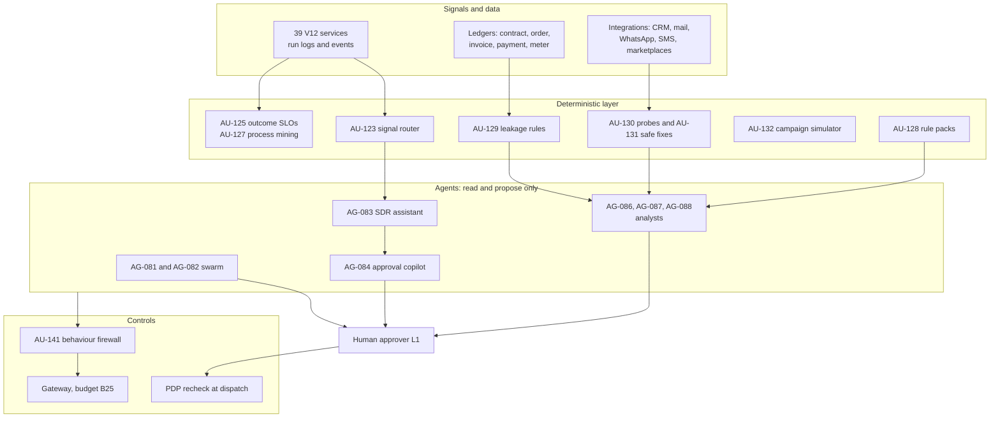

# AI Growth Engine: Employee Sales & Marketing Automation
## Application Blueprint: PART 11 (Batch 11.13a), AI Improvement: Agents, Automations and Workflows Unseen in V12 and in the Blueprint

| Field | Value |
|---|---|
| Document | Part 11, Batch 11.13a of 11.13a–11.13b (Group R12, letter M, AI improvement panel). Batch 11.13a holds §11.13.1 to §11.13.5.3: material reviewed, coverage summary, the ranked candidate register, catalogue reconciliation, the target architecture of the additions and the 16 new agent cards (AG-081 to AG-096). Batch 11.13b holds §11.13.5.4 to §11.13.10: automations (AU-120 to AU-143), workflows (WF-41 to WF-56), functional requirements, stories, tests, data and API additions, effort, cost, release placement, conflicts, decisions, expert review, tags and the quality gate |
| Version | 1.0 · 28 Nov 2026 |
| Baseline | Blueprint Parts 0 to 9.10 and Part 0B (346 decisions DEC-001 to DEC-422; 80 agents AG-001 to AG-080, 119 automations AU-001 to AU-119 and 38 workflows WF-01 to WF-14 and WF-15 to WF-39 in Part 9.4). Customer revision V12 of 28 Nov 2026: BRD V12 chapters 08, 09 and 18; FSD V12 chapters 11, 12 (156 workflow headers), 14, 15, 16 and 30. Binding decisions DEC-418 (Claude Sonnet primary), DEC-421 (Vercel + Supabase + AWS Mumbai), DEC-422 (running budget), DEC-417 (A1 approved; A2 and A3 at gates), DEC-411 (roadmap A1 to A3) |
| Roles applied | Chief AI Officer (agentic B2B products at scale) · Principal Agent Architect (multi-agent orchestration, tool use, memory, evaluation) · Revenue Operations innovator · Marketing-automation pioneer · AI safety and governance lead; supported by the shared-brief virtual team (Product Owner, Business Systems Analyst, Solutions Architect, QA Lead, Security/Compliance Lead, FinOps Lead) |
| ID ranges used | AG-081 to AG-096 (AG-097 to AG-099 and AG-140 to AG-159 reserved, unused) · AU-120 to AU-143 (AU-144 to AU-149 and AU-180 to AU-199 reserved, unused) · WF-41 to WF-56 (WF-57 to WF-60 reserved) · FR-V12-M-001 to FR-V12-M-100 · US-<EP>-YM01 to YM38 · TC-V12-M-001 to TC-V12-M-104 · DEC-740 to DEC-755 · ADR-170 to ADR-179 · ASSUMPTION/GAP/CONFLICT/RECOMMENDATION-976 to 993 |

**Verification convention.** Every model name, price, provider term, open-source licence, certificate price and regulatory date in this part is marked **"verify at time of implementation (as of 27 Nov 2026)"**. Model prices reuse Part 7.3 §7.3.2: Claude Sonnet 5.5 (`claude-sonnet-5-5`, Tier 1b, primary under DEC-418) at $2.00 input / $10.00 output per million tokens, cache read $0.10, cache write $2.50; Claude Haiku 5.5 (`claude-haiku-5-5`, Tier 1a) at $0.10 / $0.50, cache read $0.01, cache write $0.125; Batch API at 50%; ₹90 per US dollar. The cost formula is Part 7.3 §7.5.5 with a 70% cache-hit assumption. All prices: **verify at time of implementation (as of 27 Nov 2026).**

**Acronyms used in this part.** AEO answer-engine optimization · BATNA best alternative to a negotiated agreement · C2PA Coalition for Content Provenance and Authenticity · DLT distributed-ledger-technology sender and template registration (India commercial messaging) · DLQ dead-letter queue · HITL human in the loop · KG knowledge graph · MAP mutual action plan · PDP Policy Decision Point · SDR sales development representative · SLO service level objective · TTFV time to first value.

---

## 11.13.1 Material reviewed

| # | File (V12 pack or blueprint) | Size | Sections read | Purpose for this panel | Pattern found | Aspects extracted |
|---|---|---|---|---|---|---|
| 1 | BRD V12 `08_Master_Automation_Service_Catalogue_39.txt` | 115,756 B | All 39 service blocks (SM-SVC-01 to 39) | Which business capabilities exist per service | Each service: objective, 4 workflows, controls, KPIs, entitlement | 39 services |
| 2 | BRD V12 `09_Business_Workflow_Catalogue_156_Workflo.txt` | 41,668 B | All 156 workflow rows | Which workflows exist (to avoid duplicates) | 4 workflows per service; WF04 of each service is the "intelligent / predictive" variant | 156 workflows |
| 3 | BRD V12 `18_AI_Automation_Authority_Business_Govern.txt` | 11,682 B | V10 REC-01 to REC-12, V8 BR-V7-AI-01 to 06, V7 MOB-09, V6 MT-12/28/32/35, V5 FL-01 to 04 | AI authority rules any new item must obey | People control effects; evaluation before use; spend caps; no training on customer data | 27 rules |
| 4 | FSD V12 `11_Master_Functional_Specification_39_Serv.txt` | 99,442 B | Service functional blocks (skimmed for capability boundaries) | Functional boundary per service | Functional requirement per workflow; entitlement and policy hooks | 39 boundaries |
| 5 | FSD V12 `12_Executable_Workflow_Specification_156_W.txt` | 855,963 B | Headers `SM-SVC-##-WF##` (programmatic grep, 156 unique) | Executable workflow inventory | Step IDs STEP-01…, acceptance AT01… | 156 headers |
| 6 | FSD V12 `14_Shared_AI_Automation_Engines.txt` | 4,266 B | ENG-01 to ENG-15; MT-34; FL-04 | Shared engines a new item must reuse | 15 logical engines; ENG-14 Governance and ENG-15 Optimization unassigned | 15 engines |
| 7 | FSD V12 `15_AI_Agent_Registry_Orchestration.txt` | 6,428 B | AGT-01 to AGT-20; MT-35; AI-12 | V12 agent registry | One role per agent; readers never hold effect tools (AIX-09) | 20 roles |
| 8 | FSD V12 `16_AI_Models_Prompts_Evaluation.txt` | 29,419 B | AIX-01 to AIX-20 | Model, prompt and evaluation controls | Grader calibration (AIX-07), reader/actor separation (AIX-09), cost per accepted result (AIX-14) | 20 controls |
| 9 | FSD V12 `30_AI_Cost_Performance_Optimization.txt` | (grep) | AI-01 to AI-15 | Existing optimization scope | Multi-tier router (AI-02) already covers cost-aware routing | 9 controls |
| 10 | Blueprint `Part-09-4_AI_Agents_Automations_Workflows_Catalogue.md` | 123,088 B | Full agent, automation and workflow lists | Existing AI inventory | 80 agents, 119 automations, 38 workflows | 237 items |
| 11 | Blueprint Parts 9.7a/b, 9.8a/b, 9.9a/b, 9.10 | 0.88 MB | Agent cards, automation tables, workflows, effort, cost, decisions | Existing advanced items, card format, cost basis, releases A1 to A3 | Card format of AG-037; cost formula; ladder B24 | 46 cards |
| 12 | Blueprint Part 7.1, 7.2, 7.3 | — | Catalogue CI-001 to CI-135, autonomy levels, tool registry TL-01 to TL-32, model tiers | Tool IDs, autonomy semantics, prices | L0 to L3; consequential actions capped at L1 | 32 tools |

**Method.** The panel built a long list of 33 candidate capabilities: the 18 examples in the task plus 15 the panel raised. Each candidate was searched in the V12 BRD and FSD (all chapters, `grep -i` on 30 key phrases) and in all 61 blueprint part files. A candidate was kept only if neither V12 nor the blueprint already specified the capability. Partial overlaps were kept only where the **delta** is clear and is the part specified here. The searches are reproducible with the scripts in `assembly/v12/` (`m_ai_cost_model.py`, `m_effort_model.py`).

---

## 11.13.2 Coverage summary

| Measure | Before this part | After this part |
|---|---|---|
| Candidate capabilities assessed | 33 | 33 |
| Already covered by V12 or the blueprint (not added; mapped to the existing item) | 14 | 14 (Not applicable: already covered) |
| New capabilities kept (status "Not covered (new idea)") | 19 | 18 Matched + 1 Pending Founder decision (M18, CONFLICT-983) |
| New agents | 0 | 16 (AG-081 to AG-096) |
| New automations | 0 | 24 (AU-120 to AU-143) |
| New workflows | 0 | 16 (WF-41 to WF-56) |
| New functional requirements | 0 | 100 (FR-V12-M-001 to 100) |
| New user stories (with Gherkin acceptance criteria) | 0 | 38 (US-<EP>-YM01 to YM38) |
| New test cases | 0 | 104 (TC-V12-M-001 to 104) |
| New architecture decisions | 0 | 10 (ADR-170 to ADR-179) |
| New decisions | 0 | 16 (DEC-740 to DEC-755): 6 adopted under customer revision V12, 10 pending Founder decision |
| Coverage register rows (`final/coverage_v12/M_coverage.csv`) | — | 56 (one per new agent, automation and workflow): 55 Matched, 1 Pending Founder decision |

**Totals after this part (catalogue of record, Part 9.4 plus this part).** Agents 80 → 96. Automations 119 → 143. Workflows 38 → 54. These counts exclude the items that other V12 groups add in their own ranges (for example R5 adds AG-100 to AG-139 and AU-150 to AU-179).

---

## 11.13.3 Detailed register: candidates, ranking and decisions

### 11.13.3.1 Scoring method

| Factor | Scale | Meaning |
|---|---|---|
| Value (V) | 1 to 5 | Revenue protected or created, hours saved, risk removed, across the Owner Portfolio (AppNAI, MedMaarg, EduVerse, OrganicSpec) and external SaaS tenants |
| Risk (R) | 1 to 5 | Harm if wrong: consequential effect, personal data, regulatory exposure, cross-tenant exposure, reputational damage. Assessed **after** the controls specified here |
| Priority score | V × (6 − R) | 25 is best, 1 is worst |
| Placement rule | — | Score ≥ 15 and R ≤ 2 → **A2**. Score 9 to 14, or R = 3 to 4 with an A2 prerequisite → **A3**. Score ≤ 6, R = 5 or a Founder decision needed → **A4** (new release, Day ≈ 601–720, [ASSUMPTION-979]). Exception: the behaviour firewall (M16) is placed first in A2 as a precondition for every other new agent ([RECOMMENDATION-987]) |

### 11.13.3.2 Kept capabilities (status before: Not covered (new idea))

| Rank | Cap. | Capability | Why it is new (delta against V12 and the blueprint) | V | R | Score | New items | Release | Status after |
|---|---|---|---|---|---|---|---|---|---|
| 1 | M04 | Approval reviewer copilot and grouped approval | Keeping consequential actions at L1 creates thousands of approvals a month. Nothing in V12 (A033/A110, MOB-09) or the blueprint helps the human approve **well**: no risk explanation, no diff against the last approved version, no grouping of near-identical items, no approval-fatigue control. Deal-desk packets (candidate R-08) are merged here | 5 | 1 | 25 | AG-084, AU-122, AU-124, WF-44 | A2 | Matched |
| 2 | M16 | Agent tool-call behaviour firewall | V12 restricts **which** tools an agent may hold (AGT registry, AIX-09). The blueprint has user-level anomaly rules (AU-116) and an emergency stop (AU-025). Nothing detects an agent that misuses **allowed** tools: unusual read volume (exfiltration), a looping sequence, or out-of-profile targets | 5 | 2 | 20 | AU-141, WF-56 | A2 (first) | Matched |
| 3 | M07 | Revenue leakage detection | V12 has receivable anomalies (SVC-21-WF04) and margin anomalies (SVC-37-WF04); the blueprint reconciles payments (AU-037) and attribution (AU-040). No item joins **contract → quote → order → fulfilment → invoice → payment → commission** and the platform's own **meter → rate → invoice** chain to find value that was earned but not billed, billed but not collected, or discounted without approval | 5 | 2 | 20 | AG-087, AU-129, WF-47 | A2 | Matched |
| 4 | M06 | Regulatory rule-pack compliance review | AG-012 checks claims against the approved claims library; AU-067 pre-checks plans against consent and policy. Neither holds **versioned regulatory rule packs per jurisdiction and channel** (for example India advertising-standards disclosures, commercial-SMS sender and template registration, DPDP notice wording, EU AI-generated-content disclosure, platform advertising policies) with clause-level findings. Commitment and promise detection (R-09) is merged here | 5 | 2 | 20 | AG-086, AU-128, WF-46 | A2 | Matched |
| 5 | M13 | Tenant go-live copilot | AG-030 proposes a SaaS configuration; AG-010 maps imports. V12 SVC-22 covers onboarding of the **tenant's own customers**. Nothing guides a **new SaaS tenant** from signup to first accepted outcome across domain authentication, channel registration, consent import, entitlement, first workflow activation and evaluation evidence, or measures time to first value | 4 | 1 | 20 | AG-093, AU-137, WF-53 | A2 | Matched |
| 6 | M08 | Integration self-healing | WF-34 and AG-073 remediate **platform** SLO breaches. Integrations (CRM, mailbox, WhatsApp, SMS, marketplaces of SVC-31, partner portals) fail differently: token expiry, schema drift, rate limits, webhook backlog. No item probes them, classifies failures, applies safe fixes and proposes mapping patches | 4 | 2 | 16 | AG-088, AU-130, AU-131, WF-48 | A2 | Matched |
| 7 | M03 | Cross-service buying-signal orchestration | AU-055/AU-084 fuse intent; AG-041/AG-062 explain it. V12 adds 39 services, each of which can react to a signal. No item decides **which of the 39 services** a signal should start, in which order, and with which contact-pressure budget | 4 | 2 | 16 | AU-123, WF-43 | A2 | Matched |
| 8 | M12 | Executive decision briefing | AG-029 narrates dashboards and writes the founder's weekly digest. The delta is a **decision-first** brief for the V12 authorized portfolio command centre: decisions awaiting the reader, approvals ageing, exceptions only, each with a link to evidence, with read-only aggregates | 3 | 1 | 15 | AG-092, AU-136, WF-52 | A2 | Matched |
| 9 | M17 | AI content provenance (C2PA) | V12 BR-V7-AI-01 requires AI-generated messages and assets to be labelled. Neither V12 nor the blueprint specifies **how** generated images, video and audio (SVC-27) carry a verifiable provenance manifest | 3 | 1 | 15 | AU-142 | A2 | Matched |
| 10 | M01 | Supervised research swarm with cross-verification | AG-039/WF-15 plan an account pursuit as a sequential supervised plan; AG-040 researches one account. Nothing fans out **parallel read-only researchers** on competing hypotheses and requires an **independent verifier** to confirm each material claim from two or more sources before it reaches a human | 4 | 3 | 12 | AG-081, AG-082, AU-120, WF-41 | A3 | Matched |
| 11 | M05 | Service outcome SLOs and bounded tuning | V12 states that the website makes **no outcome guarantees** (W01/W04/W05). Internally, no item sets an outcome SLO per service (for example reply rate for SVC-06, first-contact resolution for SVC-33), mines the 156 workflows' run logs for bottlenecks, and tunes non-consequential parameters within approved bands with automatic revert | 4 | 3 | 12 | AG-085, AU-125, AU-126, AU-127, WF-45 | A3 | Matched (CONFLICT-984 resolved) |
| 12 | M11 | Tenant knowledge graph | The blueprint has Customer 360 (AU-021) and identity resolution (AU-100). No item holds **typed relations with provenance** (organization, subsidiary, person-in-role, offering, tender, partner, competitor, supplier) for path queries such as "warm path to this buying committee" | 4 | 3 | 12 | AG-091, AU-135, WF-51 | A3 | Matched |
| 13 | M15 | Prompt improvement loop | AG-056 clusters failures and AG-074 writes health notes; AU-054 canaries versions. No item **proposes** a revised prompt from failure clusters and proves it on an offline replay before a human promotes it | 3 | 2 | 12 | AG-095, AU-140, WF-55 | A3 | Matched |
| 14 | M09 | Campaign digital twin | V12 simulates revenue (SVC-24-WF04) and price scenarios (SVC-37-WF02); the blueprint simulates workflows (TL-18) and territory capacity (AU-082). No item simulates a **campaign before launch**: eligible audience after consent and suppression, send volume per day, deliverability risk, approval-queue load, AI and channel cost, and expected range of replies | 3 | 2 | 12 | AG-089, AU-132, WF-49 | A3 | Matched |
| 15 | M02 | Human-gated AI SDR assistant | AG-011 drafts, AG-014 replies, AG-063 composes cadences. No item assembles the **daily prospecting worklist** of a seller across channels with a capacity governor, mailbox-health gate and grouped approval. Every send remains L1 | 5 | 4 | 10 | AG-083, AU-121, WF-42 | A3 | Matched (CONFLICT-985 resolved) |
| 16 | M10 | Procurement negotiation preparation (buy side) | V12 SVC-39-WF02 compares supplier quotations; SVC-18 covers **sell-side** negotiation; SVC-28-WF03 covers agent mandates. No item prepares the **buyer's** negotiation: should-cost range, BATNA, concession plan and counter-offer drafts for a human to send | 3 | 3 | 9 | AG-090, AU-134, WF-50 | A3 | Matched |
| 17 | M14 | Agent and workflow template marketplace | A113 holds the tenant's own template and node library. No item lets a tenant **publish** a certified, data-free template for other tenants, or install one with simulation | 3 | 4 | 6 | AG-094, AU-138, AU-139, WF-54 | A4 | Matched |
| 18 | M09b | Synthetic buyer panel (directional pre-test) | AG-046 and SVC-36-WF02 use synthetic personas for **training**. No item pre-tests message variants against a calibrated synthetic panel before a real experiment | 2 | 3 | 6 | AG-096, AU-133 | A4 | Matched |
| 19 | M18 | Privacy-preserving cross-tenant benchmarks | No item offers tenants aggregate peer benchmarks (reply rate, cycle time) | 3 | 5 | 3 | AU-143 | A4 | **Pending Founder decision** (CONFLICT-983) |

### 11.13.3.3 Candidates already covered (not added; status: Not applicable, already covered)

| ID | Candidate | Where it is already covered | Disposition |
|---|---|---|---|
| R-01 | Cost-aware model routing per service | V12 FSD 30 AI-02 (multi-tier router choosing the cheapest eligible evaluated mode), AI-03 (conditional escalation), FSD 16 AIX-03 and AIX-14; blueprint AU-001, AU-068, DEC-418 | Not added [RECOMMENDATION-989]. The per-service outcome SLOs of M05 feed AU-068 |
| R-02 | AI QA of AI outputs | Blueprint AG-002 production-sampling mode (CI-111), AU-006, AU-070, AG-074; V12 AIX-05 to AIX-07 (grader calibration) | Not added. AG-082 (verifier) and AG-095 (proposer) consume AG-002 verdicts |
| R-03 | Multilingual Indic voice (consented) | V12 SVC-26-WF01 to WF04 (inbound/outbound voice, multilingual voice, consented transcription); blueprint AG-050 Indic localization; voice deferral DEC-387 | Not added. Belongs to the R2/R5 groups that own SVC-26 |
| R-04 | Partner co-sell matching | Blueprint AG-069, WF-30, AU-091; V12 SVC-32-WF03 | Not added |
| R-05 | Churn rescue playbooks | Blueprint AG-038, WF-17, WF-31, AU-093; V12 SVC-23-WF03/WF04, RT-12 ethical win-back | Not added |
| R-06 | Answer-engine optimization | V12 SVC-13-WF04 | Not added |
| R-07 | Competitive battlecards | V12 SVC-36-WF01; blueprint AG-027, AG-070 | Not added |
| R-08 | Deal-desk copilot | Blueprint AG-066 explains CPQ guardrails; packet assembly merged into AG-084 (M04) | Merged into M04 |
| R-09 | Commitment and promise detector | Merged into AG-086 rule pack RP-COMMIT (M06) | Merged into M06 |
| R-10 | Collections reminder drafting | V12 SVC-21-WF04; blueprint AG-011 at L1 | Not added |
| R-11 | AI-set renewal prices | **Rejected:** AI never sets prices (safety invariant, V11 brief) | Rejected |
| R-12 | Cloned employee voice for outbound calls | **Rejected:** impersonation and consent risk; V12 SVC-26 consent controls; safety invariant | Rejected |
| R-13 | Autonomous agent-to-agent offer sending | **Rejected:** consequential action above L1; V12 SVC-28 mandate controls; external agent interoperability is off until a validated signed mandate exists (FSD 15) | Rejected |
| R-14 | Buying-committee mapping | Blueprint AG-061, AU-085; V12 SVC-29-WF02 | Not added; M11 graph supplies paths to AG-061 |

---

## 11.13.4 Catalogue reconciliation

| Catalogue | Part 9.4 count | Added here | New total | V12 mapping |
|---|---|---|---|---|
| Agents (AG) | 80 | 16 | 96 | Each new agent is registered as a V12 AGT role. The FSD 15 rule "one registered role per agent" applies: AGT-M01 to AGT-M16 map one-to-one to AG-081 to AG-096 (§11.13.5.2). Prompts use `PRM-<AGT>-<task>-vN` (FSD 15) |
| Automations (AU) | 119 | 24 | 143 | Deterministic; mapped to V12 shared engines ENG-01 to ENG-15 (§11.13.5.2) |
| Workflows (WF) | 38 | 16 | 54 | Each new WF is a **platform child workflow** under FSD 14 FL-04 (reusable child workflows), called by the V12 service workflows named in its Purpose. None changes a V12 `SM-SVC-##-WF##` definition (MT-34: one definition per stable workflow) |
| Tools (TL) | 32 | 8 (TL-33 to TL-40) | 40 | Read and propose tools only; no new effect tool is granted to any agent (AIX-09) |

**New tools added to the registry (Part 7.2 §7.2.4).** All are read or propose tools; effects stay with deterministic handlers behind the PDP.

| Tool | Name | Class | Used by |
|---|---|---|---|
| TL-33 | `swarm.spawn_reader` | Propose (the supervisor proposes; AU-120 spawns) | AG-081 |
| TL-34 | `approval.packet.read` | Read | AG-084 |
| TL-35 | `ledger.join.read` | Read (scoped ledger joins produced by AU-129) | AG-087 |
| TL-36 | `integration.health.read` | Read | AG-088 |
| TL-37 | `rulepack.lookup` | Read | AG-086 |
| TL-38 | `graph.query` / `graph.propose_edge` | Read / propose | AG-091, AG-081, AG-061 |
| TL-39 | `simulation.read` | Read | AG-089, AG-085 |
| TL-40 | `template.inspect` | Read (sanitized package only) | AG-094 |

---

## 11.13.5 Enhancements

### 11.13.5.1 Design principles and target architecture

The panel applied seven design principles. Each is traced to a binding source.

| # | Principle | Source | How it shows in the additions |
|---|---|---|---|
| D1 | Consequential actions stay at L1; AI never signs, pays, submits bids, sets prices or sends consequential external messages without a human | V11 brief safety invariants; BR-V7-AI-02; DEC-064 | Every new agent is L0 or L1. Only internal, non-consequential automations reach L2/L3 (AU-126 parameter bands, AU-131 safe remediation classes) |
| D2 | Readers never hold effect tools | V12 AIX-09; FSD 15 | Swarm readers, verifier, SDR drafter and all analysts get read/propose tools only |
| D3 | Claude Sonnet is primary; Tier 2 free models only for Public or Internal non-personal data, opt-in, default off | DEC-418; DEC-008 | 15 of 16 agents are Tier 2 ineligible; AG-096 (synthetic panel, no personal data) is eligible but default off |
| D4 | Deterministic first | V12 FSD 30 AI-01 | 24 automations do the counting, joining, simulation and policy checks; agents explain and draft |
| D5 | Tenant and startup isolation | V12 MT-10, MT-28; RLS (Part 3.3) | Graph, behaviour profiles, outcome SLOs, leakage findings and templates are scoped by `tenant_id` and `startup_id`; templates are sanitized before any cross-tenant listing; cross-tenant benchmarks are pending a Founder decision |
| D6 | Evaluation before use and after change | BR-V7-AI-03; AIX-05/06 | Every new agent has an eval set and thresholds (§11.13.5.10); AU-054 canary applies |
| D7 | Spend control with a hard cap | BR-V7-AI-04; AIX-12/13; DEC-422 | New Ledger B line B25 with a hard cap of ₹5,000 per month and its own degradation ladder [RECOMMENDATION-993] |

**Data classes.** Confidential data (identified business contacts, deal terms, ledgers) flows only through Tier 1a/1b under Anthropic commercial terms (verify the DPA, GAP-141 in Part 7.3). Restricted data (credentials, payment instrument details) never enters any prompt; AU-004 redaction runs before every call. MedMaarg patient data never exists in the platform; EduVerse minors are excluded from every outreach-producing item (AG-083, AU-123, AU-132) by the existing eligibility rules (DEC-030).

### 11.13.5.2 Mapping to the V12 registry and shared engines

| New item | V12 AGT role (FSD 15 extension) | V12 shared engine (FSD 14) | Calling V12 service workflows |
|---|---|---|---|
| AG-081 Research Swarm Coordinator | AGT-M01 Research swarm supervision | ENG-01 Research and evidence | SM-SVC-01-WF01…04, SM-SVC-02-WF01/04, SM-SVC-19-WF01/02, SM-SVC-29-WF01 |
| AG-082 Evidence Cross-Verifier | AGT-M02 Evidence verification | ENG-01; ENG-14 Governance | Same as AG-081; SM-SVC-35-WF01 |
| AG-083 Human-Gated AI SDR Assistant | AGT-M03 Prospecting assistance | ENG-05 Communication | SM-SVC-06-WF01, SM-SVC-07-WF02, SM-SVC-08-WF01/02, SM-SVC-38-WF02 |
| AG-084 Approval Reviewer Copilot | AGT-M04 Approval review support | ENG-14 Governance | Every workflow step with an approval gate (A033, A035, A066, A068, A072, A059) |
| AG-085 Service Outcome Tuning Advisor | AGT-M05 Outcome optimization | ENG-15 Optimization | All 39 services (read-only) |
| AG-086 Regulatory Rule-Pack Compliance Reviewer | AGT-M06 Regulatory compliance review | ENG-14 Governance | SM-SVC-06/07/08/11/12/14/15/27/38 drafting steps |
| AG-087 Revenue Leakage Analyst | AGT-M07 Leakage analysis | ENG-09 Financial calculation; ENG-10 Transaction reconciliation | SM-SVC-17, 18, 20, 21, 24, 31, 32, 37 |
| AG-088 Integration Self-Healing Advisor | AGT-M08 Integration health | ENG-13 Workflow orchestration | All connector-using services |
| AG-089 Campaign Digital-Twin Analyst | AGT-M09 Campaign simulation | ENG-12 Experimentation | SM-SVC-14-WF01/02, SM-SVC-08-WF01, SM-SVC-38-WF02, SM-SVC-29-WF03 |
| AG-090 Procurement Negotiation Prep Assistant | AGT-M10 Procurement negotiation preparation | ENG-09; ENG-08 Document generation | SM-SVC-39-WF01…03 |
| AG-091 Knowledge Graph Relation Extractor | AGT-M11 Relation extraction | ENG-03 AI knowledge and RAG; ENG-02 Contact intelligence | SM-SVC-02, 03, 25, 29, 32 |
| AG-092 Executive Decision Briefing Agent | AGT-M12 Executive briefing | ENG-15 Optimization | Portfolio command centre (FSD 23) |
| AG-093 Tenant Go-Live Copilot | AGT-M13 Tenant onboarding guidance | ENG-13 | Tenant provisioning (FSD 07), subscription and entitlement (FSD 09) |
| AG-094 Template Certification Assistant | AGT-M14 Template certification | ENG-14 | Automation template library (A113) |
| AG-095 Prompt Improvement Proposer | AGT-M15 Prompt improvement | ENG-15 | Prompt registry (AIX-04) |
| AG-096 Synthetic Buyer Panel | AGT-M16 Synthetic pre-test | ENG-12 | SM-SVC-11-WF02, SM-SVC-14-WF01, SM-SVC-30-WF02 |

### 11.13.5.3 Agent cards (AG-081 to AG-096)

#### AG-081 Research Swarm Coordinator

| Field | Specification |
|---|---|
| Type | Agent · Orchestrator (supervisor of read-only workers) · scope: Startup |
| Purpose and business outcome | For a research question that needs breadth (for example "Which state health departments in South India issued wellness-partnership tenders in the last 18 months, and who evaluates them?" for MedMaarg, or "Which global AI tenders close in the next 30 days and match AppNAI capabilities?"), decomposes the question into 3 to 8 competing or complementary hypotheses, asks AU-120 to spawn bounded parallel read-only researchers (each an AG-040 or AG-004 run with a narrowed brief), reconciles their evidence sets, routes every material claim to AG-082 for independent verification and returns a synthesis with confidence and open questions. Outcome: research cycle time down ≥ 40% against a single sequential run, with no rise in unsupported claims |
| Linked BR / FR / US | BR-M10…M13 (research and discovery); V12 SM-SVC-01, SM-SVC-02, SM-SVC-19, SM-SVC-29; FR-V12-M-001…006; US-05-YM01, US-05-YM02; WF-41 |
| Persona | P04 Research Analyst (R04), P06 Bid Manager (R06), P03 Growth Manager (R03) |
| Trigger | User action "Run as swarm" on A015 Research planner or A116 Account Research Workspace; or a scheduled research plan approved by R04 |
| Inputs and data sources | Research question; approved source registry (A010) and its permissions; offering catalogue; prior verified evidence (V12 AI-11 shared research artifact reuse); swarm budget from AU-120 |
| Tools / APIs (registry §7.2.4) | TL-21 `plan.propose` (hypotheses), TL-33 `swarm.spawn_reader` (propose only), TL-03 `evidence.read`, TL-01 `knowledge.search`, TL-38 `graph.query`, TL-06 `draft.create` (synthesis) |
| Outputs | JSON `{hypotheses[], worker_briefs[], reconciled_claims[{claim, evidence_ids[], verifier_verdict, confidence}], contradictions[], open_questions[], cost_used}` |
| Autonomy and HITL | **L1.** The swarm reads public and licensed sources only and writes nothing outside its run workspace. The synthesis is a draft; R04 accepts it before any claim enters the evidence store or a qualification brief |
| Model tier | 1b Sonnet for decomposition and synthesis; workers use their own card tiers (AG-004 Haiku via Batch, AG-040 per its card) |
| Tier 2 eligibility · data class | No · Confidential (startup strategy, identified decision-makers) |
| Prompt / context strategy | Cached system prompt with hypothesis and reconciliation rubric (≈ 2,000 tokens); input ≤ 4,000 tokens of worker summaries (each worker returns ≤ 500 tokens of structured claims, never raw pages); adaptive thinking at effort `medium` for decomposition |
| Guardrails | At most 8 workers and 2 re-plans (AU-120); each worker inherits the source allowlist and cannot widen it; worker outputs are treated as untrusted content (AU-005) before the coordinator reads them; no claim without an evidence ID; any claim marked `contradicted` by AG-082 is excluded from the synthesis and listed under contradictions; AU-141 profile check on every tool call |
| Failure modes and fallback | Budget reached → stop spawning and synthesize what is verified, labelled partial. Coordinator schema failure after 2 repairs → Tier 3: present the worker claim table without synthesis. Source outage → worker marked `unavailable`, never imputed |
| Success KPIs | Cycle time −40% against the WF-15 baseline; ≥ 95% of claims in accepted syntheses carry ≥ 2 independent evidence IDs; 0 contradicted claims in accepted syntheses; cost per accepted synthesis ≤ ₹12 |
| Eval dimensions | Decomposition coverage (gold hypotheses recalled), claim faithfulness, contradiction handling, citation completeness, injection resistance via worker outputs, cost |
| Tokens, calls, cost | 6,000 in (2,000 cacheable, hit 70%), 1,500 out; 120 calls/month (40 swarm runs × plan, reconcile, synthesize). Sonnet per call = 90 × [4,000×2 + 2,000×(0.7×0.10 + 0.3×2.50) + 1,500×10] ÷ 10⁶ = **₹2.218**. Worker costs are booked to AG-004/AG-040 lines. **Monthly (pilot): low ₹80 · base ₹266 · high ₹798** |
| Dependencies | AU-120, AG-082, AG-040, AG-004, AU-005, AU-141, AU-001, AU-002 |
| Release | Release A3 |

#### AG-082 Evidence Cross-Verifier

| Field | Specification |
|---|---|
| Type | Agent · Validator (adversarial verifier) · scope: Startup |
| Purpose and business outcome | Independently checks each material claim produced by a swarm worker, by AG-040 or by SM-SVC-35 monitoring. It reads the cited evidence and at least one **other** source the worker did not use, then returns `supported`, `weak`, `contradicted` or `unverifiable`. Separation of duties between the finder and the verifier cuts unsupported claims reaching humans |
| Linked BR / FR / US | BR-M12 (evidence extraction); BR-V7-AI-03; V12 AIX-11 (claims and citation control); FR-V12-M-003, 004; US-05-YM02; WF-41 |
| Persona | P04 Research Analyst (reader of verdicts) |
| Trigger | Event `swarm.claim.proposed` from AU-120; event `evidence.claim.material` from AG-040 |
| Inputs and data sources | Claim text; cited evidence excerpts (≤ 1,500 tokens); one or two alternative sources fetched by a read-only worker through the source registry |
| Tools / APIs (registry §7.2.4) | TL-03 `evidence.read`, TL-01 `knowledge.search`, TL-08 `classification.write` (verdict only) |
| Outputs | JSON `{claim_id, verdict, supporting_evidence_ids[], contradicting_evidence_ids[], reason, confidence_label}` |
| Autonomy and HITL | **L2 for the verdict label** (internal classification; it gates nothing external). Humans see the verdict and may override it with a reason |
| Model tier | 1a Haiku via Batch; 10% escalation to 1b Sonnet when the evidence is in conflict or longer than 3,000 tokens |
| Tier 2 eligibility · data class | No · Confidential |
| Prompt / context strategy | Cached rubric with 12 worked examples (≈ 1,000 tokens); the claim and evidence are placed in delimited untrusted blocks; the verifier never sees the worker's reasoning, only claim and evidence (independence) |
| Guardrails | Must cite at least one source different from the worker's for `supported`; numbers must match the source exactly (deterministic check); dates older than the freshness window are `weak`; never upgrades a claim to `supported` on the worker's citation alone |
| Failure modes and fallback | No alternative source found → `unverifiable` (never `supported`). Schema failure → `unverifiable` with reason `verifier_error` |
| Success KPIs | Agreement with human gold labels ≥ 90% (Cohen's kappa ≥ 0.75); `supported` precision ≥ 97%; median latency ≤ 4 h in batch |
| Eval dimensions | Verdict accuracy, false-support rate, numeric faithfulness, independence (no reuse of the worker's source), cost |
| Tokens, calls, cost | 4,000 in (1,000 cacheable), 400 out; 1,600 calls/month, batch. Haiku per call = 90 × 0.5 × [3,000×0.10 + 1,000×(0.7×0.01 + 0.3×0.125) + 400×0.50] ÷ 10⁶ = **₹0.025**; Sonnet per call = **₹0.487**; blended at e = 10% = **₹0.071**. **Monthly (pilot): low ₹34 · base ₹113 · high ₹340** |
| Dependencies | AU-120, AU-005, AU-007 (source permission and expiry), AG-002 (calibration) |
| Release | Release A3 |

#### AG-083 Human-Gated AI SDR Assistant

| Field | Specification |
|---|---|
| Type | Agent · Generator and planner (prospecting assistant) · scope: Startup, per seller |
| Purpose and business outcome | Prepares each seller's **daily prospecting worklist**: which eligible prospects to contact today (from AU-123 routing, AU-084 intent, SVC-04 lead scores), the channel each may lawfully receive, a personalised first-touch or follow-up draft per prospect grounded in approved claims, and suggested call tasks. It groups near-identical drafts for review in AU-122 packets. Every send is approved by the seller (L1) and rechecked by the PDP at dispatch. Outcome: seller prospecting time −30% with reply rate ≥ the seller's own manual baseline and complaint rate ≤ 0.1% |
| Linked BR / FR / US | BR-M24 (engagement eligibility), BR-M25, BR-M26, BR-M28, BR-M31 (drafting, email, sequences, WhatsApp), BR-M04 (consent and suppression), BR-V7-AI-02; V12 SM-SVC-06-WF01, SM-SVC-07-WF02, SM-SVC-08-WF01/02, SM-SVC-38-WF02; FR-V12-M-007…013; US-08-YM03, US-08-YM04; WF-42 |
| Persona | P03 Growth Manager / seller (R03), P03L Sales Lead (R03L) |
| Trigger | Schedule: 06:30 local time each working day per enabled seller (Batch API overnight); user action "Refresh worklist" |
| Inputs and data sources | Eligible prospect list from AU-121 (already filtered for consent, suppression, quiet hours, minors exclusion, contact-pressure budget); prospect context (role, organization, buying signal, last interaction) redacted to business fields; approved claims (TL-09); seller tone profile (memory, AU-062 write gate); channel templates |
| Tools / APIs (registry §7.2.4) | TL-02 `records.read`, TL-09 `claims.lookup`, TL-10 `pdp.check_eligibility` (read), TL-23 `memory.read`, TL-06 `draft.create`, TL-07 `task.create` (call tasks only, owned by the seller) |
| Outputs | Worklist JSON `{prospects[{id, channel, reason, draft_id, claim_ids[], risk_flags[]}], call_tasks[], packets[]}`; drafts in A034; packets in A035 |
| Autonomy and HITL | **L1 for every external message.** The agent cannot call `dispatch.request` (TL-13). Approval binds the exact draft hash (DEC-064, ADR-171). Call tasks are internal (L2) |
| Model tier | 1b Sonnet (customer-facing drafts) via Batch overnight; Tier 0 templates when the B25 ladder is at step 3 or higher |
| Tier 2 eligibility · data class | No · Confidential (identified business contacts) |
| Prompt / context strategy | Cached system prompt, claim rules and channel style guides (≈ 2,000 tokens); per-prospect context ≤ 3,000 tokens; one call per prospect; variants share a prefix to maximise cache hits |
| Guardrails | AG-086 rule-pack check and AG-012 claims guard run before a draft reaches the seller; no draft for a prospect that AU-121 has not marked eligible; daily caps per seller and per mailbox (AU-121); no fabricated familiarity ("as we discussed") without an interaction record; no urgency or scarcity claims unless an approved claim says so; EduVerse: no draft to anyone flagged minor or student under 18 (DEC-030); MedMaarg: institutional contacts only, no health conditions mentioned |
| Failure modes and fallback | Eligibility service unavailable → empty worklist (fail closed). Draft fails a guard twice → the prospect stays on the worklist with "write manually". Mailbox health red → worklist offers call tasks only |
| Success KPIs | Seller time per 20 touches −30% (time-and-motion sample); reply rate ≥ seller baseline; spam-complaint rate ≤ 0.1%; 100% of sends with an approval hash; edit distance between draft and sent message trending down (quality signal) |
| Eval dimensions | Personalisation accuracy (facts present in inputs), claim compliance, tone fit, rule-pack compliance, refusal on ineligible prospects, injection resistance (prospect web content), cost |
| Tokens, calls, cost | 5,000 in (2,000 cacheable), 700 out; 1,500 calls/month (≈ 3 sellers × 25 prospects × 20 days), batch. Sonnet per call = 90 × 0.5 × [3,000×2 + 2,000×(0.7×0.10 + 0.3×2.50) + 700×10] ÷ 10⁶ = **₹0.659**. **Monthly (pilot): low ₹296 · base ₹988 · high ₹2,965** |
| Dependencies | AU-121, AU-122, AU-123, AG-086, AG-012, AU-009 (PDP), AU-008 (STOP), AU-024 (bounce suppression), AU-141 |
| Release | Release A3 (after G-A2 shows AU-141 and AU-122 in production for ≥ 30 days) |

#### AG-084 Approval Reviewer Copilot

| Field | Specification |
|---|---|
| Type | Agent · Assistant (explainer for human approvers) · scope: Startup / Tenant |
| Purpose and business outcome | For every pending approval (message, campaign, quote, discount, contract clause, payment match, workflow publish, bid submission checklist), writes a short review note: what will happen if approved, what changed against the last approved version (from AU-122 diffs), the risk flags from AU-124, the evidence behind each claim, and the questions the approver should ask. For grouped packets it explains what the items share and which outliers need individual attention. Deal-desk packets for A068 include margin impact from SVC-37 deterministic calculations. Outcome: approval time −35% with **no** fall in rejection of defective items (no rubber-stamping) |
| Linked BR / FR / US | BR-V7-AI-02; V12 MOB-09 (same controls on mobile), REC-03 (competing actions); BRL-AUT-01; FR-V12-M-014…019; US-18-YM05, US-18-YM06; WF-44 |
| Persona | All approvers: R02 Startup Head, R03L, R05, R06, R08/R09 Finance maker/checker, R10 Legal/Compliance, R11 Automation Lead |
| Trigger | Event `approval.requested`; user opens an approval drawer in A033, A035, A059, A066, A068, A072 or A074 |
| Inputs and data sources | Approval packet from AU-122 (items, hashes, diffs); AU-124 risk score and reasons; linked evidence and claims; policy results from AU-009 dry run; approval history for this object |
| Tools / APIs (registry §7.2.4) | TL-34 `approval.packet.read`, TL-03 `evidence.read`, TL-09 `claims.lookup`, TL-10 `pdp.check_eligibility` (dry run, read), TL-06 `draft.create` (the note only) |
| Outputs | JSON `{summary, effect_statement, diffs_explained[], risk_flags[{code, reason}], outliers[], questions_for_approver[], confidence_label}` shown in the drawer |
| Autonomy and HITL | **L0.** The copilot never approves, never pre-selects "approve", and the approve button is enabled only after the approver has opened every outlier item (ADR-171). It cannot change the packet |
| Model tier | 1a Haiku; 15% escalation to 1b Sonnet for contracts, bids and packets with more than 20 items |
| Tier 2 eligibility · data class | No · Confidential (may include Restricted references such as bank-detail changes, which AU-004 masks before the call) |
| Prompt / context strategy | Cached rubric per approval type (≈ 1,500 tokens); packet summary ≤ 2,000 tokens; deterministic fields (amounts, dates, counts) are passed as structured data and rendered by the UI, never re-typed by the model |
| Guardrails | Must not express a recommendation to approve or reject; every risk flag must map to an AU-124 reason code; numbers in the note are checked against the packet; bank-detail or payee changes always produce the flag `PAYEE_CHANGE` and force individual review (AU-124 rule AR-07) |
| Failure modes and fallback | Copilot failure → drawer shows the deterministic diff and risk table only (Tier 3); approval is never blocked by copilot failure |
| Success KPIs | Median approval time −35%; defect-catch rate on seeded defective items ≥ baseline (monthly seeded-defect test, TC-V12-M-022); approver satisfaction ≥ 4/5; 0 approvals without outlier review |
| Eval dimensions | Diff explanation accuracy, risk-flag completeness, neutrality (no approve/reject advice), numeric faithfulness, cost |
| Tokens, calls, cost | 3,500 in (1,500 cacheable), 350 out; 2,000 calls/month. Haiku per call = 90 × [2,000×0.10 + 1,500×(0.7×0.01 + 0.3×0.125) + 350×0.50] ÷ 10⁶ = **₹0.040**; Sonnet per call = **₹0.786**; blended at e = 15% = **₹0.152**. **Monthly (pilot): low ₹91 · base ₹303 · high ₹910** |
| Dependencies | AU-122, AU-124, AU-009, AU-027 (approval SLA escalation), AU-004 |
| Release | Release A2 |

#### AG-085 Service Outcome Tuning Advisor

| Field | Specification |
|---|---|
| Type | Agent · Analyst and planner · scope: Startup / Tenant |
| Purpose and business outcome | Each week, for each enabled V12 service, reads the outcome SLO status (AU-125), the bottlenecks found by process mining (AU-127) and the effect of earlier tuning (AU-126), then proposes ranked changes: parameter changes inside approved bands (applied by AU-126 at L2), parameter changes outside the bands, workflow changes, prompt changes (handed to AG-095) and experiments (handed to AU-065). Each proposal states the expected effect with a range and the evidence. Outcome: ≥ 60% of services meet their outcome SLO within two quarters of enablement. **These are internal objectives, never customer-facing guarantees** (V12 W01/W04/W05; DEC-744) |
| Linked BR / FR / US | V12 FSD 30 (optimization), FL-01 (workflow registry), BR-V7-AI-04; KPI framework (BRD 22); FR-V12-M-020…026; US-18-YM07, US-21-YM08; WF-45 |
| Persona | P10 Automation Lead (R11), R02 Startup Head |
| Trigger | Weekly schedule (Monday 05:00); event `outcome_slo.breach` from AU-125 |
| Inputs and data sources | Outcome SLO table per service; AU-127 bottleneck report (step latency, rework loops, approval waits); tuning history; experiment results (TL-29) |
| Tools / APIs (registry §7.2.4) | TL-12 `metrics.query`, TL-39 `simulation.read`, TL-29 `experiment.stats.read`, TL-18 `workflow.validate_simulate`, TL-21 `plan.propose` |
| Outputs | JSON `{service_id, slo_status, proposals[{type, change, band_check, expected_effect_range, evidence[], risk}], experiments_suggested[]}` |
| Autonomy and HITL | **L1** for every proposal outside the approved bands and for every workflow or prompt change (R11 approves; configuration change approval MT-32). In-band parameter changes are executed by AU-126, not by the agent |
| Model tier | 1b Sonnet via Batch |
| Tier 2 eligibility · data class | No · Internal (aggregates) with Confidential references |
| Prompt / context strategy | Cached method prompt (≈ 2,000 tokens); ≤ 10,000 tokens of aggregates; no row-level personal data (aggregates only, k ≥ 10 per cell) |
| Guardrails | Never proposes to relax consent, suppression, quiet hours, caps, approval levels or eligibility rules (blocked list BL-01…BL-09 in AU-126); expected effects must cite the data window; proposals must pass TL-18 simulation before they are shown |
| Failure modes and fallback | Missing data → "insufficient data" for that service, no proposal. Failure → weekly AU-125 table without narrative |
| Success KPIs | Services meeting outcome SLO ≥ 60% at two quarters; ≥ 50% of accepted proposals show the predicted direction of effect within 4 weeks; 0 proposals touching blocked parameters |
| Eval dimensions | Causal caution (no overclaiming), band compliance, evidence citation, usefulness rating by R11, cost |
| Tokens, calls, cost | 12,000 in (2,000 cacheable), 2,000 out; 40 calls/month, batch. Sonnet per call = 90 × 0.5 × [10,000×2 + 2,000×(0.7×0.10 + 0.3×2.50) + 2,000×10] ÷ 10⁶ = **₹1.874**. **Monthly (pilot): low ₹22 · base ₹75 · high ₹225** |
| Dependencies | AU-125, AU-126, AU-127, AU-065, AG-095 |
| Release | Release A3 |

#### AG-086 Regulatory Rule-Pack Compliance Reviewer

| Field | Specification |
|---|---|
| Type | Agent · Validator (policy-aware content review) · scope: Startup / Tenant |
| Purpose and business outcome | Reviews every outbound draft and creative (email, WhatsApp, SMS/RCS, social post, ad, landing page, image/video caption) against the **versioned rule packs** that apply to its jurisdiction, channel and audience (AU-128). It returns clause-level findings: what rule, which words, why, and a compliant rewrite suggestion. It also detects **commitments and promises** (delivery dates, discounts, SLAs, guarantees, refunds) that are not backed by an approved term (rule pack RP-COMMIT). Outcome: compliance defects found after approval −70%; 0 regulator or platform enforcement actions caused by AI drafts |
| Linked BR / FR / US | BR-M04, BR-M57 (consent, compliance monitoring), BR-V7-AI-01 (labelling), BR-V7-AI-02; V12 REC-11 (canonical effect preflight), MT-12 (claims and knowledge); DEC-030 (minors); FR-V12-M-027…033; US-03-YM09, US-03-YM10; WF-46 |
| Persona | P09 Legal/Compliance (R10), P05 Marketing Specialist (R05), P03 (R03) |
| Trigger | Event `draft.ready_for_review` (after AG-012); event `rulepack.version.published` (re-check of queued drafts) |
| Inputs and data sources | Draft text and metadata (channel, jurisdiction, audience segment, offering); deterministic findings from AU-128 (sender ID, template ID, quiet hours, mandatory disclosures present); rule-pack clauses (TL-37); approved terms (TL-27 `pricebook.lookup`, TL-09) |
| Tools / APIs (registry §7.2.4) | TL-37 `rulepack.lookup`, TL-09 `claims.lookup`, TL-27 `pricebook.lookup`, TL-08 `classification.write` (findings) |
| Outputs | JSON `{draft_id, rulepack_versions[], findings[{rule_id, severity, span, reason, suggested_rewrite}], commitments[{span, type, backed_by_term_id or null}], verdict: pass / fix / block}` |
| Autonomy and HITL | **L1.** `block` findings stop the draft from reaching the approval queue until fixed; `fix` findings are shown to the approver; R10 can override a finding with a reason (audited). The agent cannot edit the draft |
| Model tier | 1a Haiku; 20% escalation to 1b Sonnet for ads, landing pages and cross-border content |
| Tier 2 eligibility · data class | No · Confidential |
| Prompt / context strategy | Cached rule-pack clauses for the applicable packs (≈ 2,500 tokens, stable per version → high cache hit); draft ≤ 1,500 tokens |
| Guardrails | Only rules in a published rule-pack version may be cited (no invented law); each finding carries the rule ID and version; deterministic checks (AU-128) run first and cannot be overridden by the model; when unsure the agent returns `fix` with reason `needs_counsel`, never `pass` |
| Failure modes and fallback | Agent unavailable → deterministic AU-128 checks only and the draft is marked "manual compliance review required" for R10 (fail closed for ads and SMS; fail to manual for email) |
| Success KPIs | Recall on seeded violations ≥ 95%; false-block rate ≤ 5%; post-approval compliance defects −70%; R10 override rate ≤ 10% |
| Eval dimensions | Violation recall per rule pack, false-positive rate, citation correctness (rule ID and version), commitment detection recall, multilingual coverage (en, hi and the 9 Indic locales of AG-050), cost |
| Tokens, calls, cost | 4,000 in (2,500 cacheable), 400 out; 2,500 calls/month. Haiku per call = 90 × [1,500×0.10 + 2,500×(0.7×0.01 + 0.3×0.125) + 400×0.50] ÷ 10⁶ = **₹0.042**; Sonnet per call = **₹0.815**; blended at e = 20% = **₹0.196**. **Monthly (pilot): low ₹147 · base ₹490 · high ₹1,471** |
| Dependencies | AU-128 (rule packs, [GAP-980] legal authoring), AG-012, AU-067, AU-009 |
| Release | Release A2 |

#### AG-087 Revenue Leakage Analyst

| Field | Specification |
|---|---|
| Type | Agent · Analyst (explainer of deterministic findings) · scope: Startup / Tenant; platform billing scope for R14 |
| Purpose and business outcome | Explains and prioritises the leakage findings produced by AU-129 rules LK-01 to LK-14 (for example a delivered order milestone not invoiced, an invoice under the contracted rate, a discount above the approved band, an expired promotion still applied, a renewal past date without the contracted uplift, a commission recorded twice, a marketplace fee above the contracted rate, platform usage metered but not rated). For each it drafts a recovery note for the owner: evidence chain, amount range, who to contact, and the corrective step (raise invoice, credit note, contract amendment). Outcome: recovered value ≥ 30% of confirmed leakage within 60 days [ASSUMPTION-978] |
| Linked BR / FR / US | BR-M44, BR-M47, BR-M52 (quote, payment and closure, revenue); V12 SM-SVC-17, 18, 20, 21, 24, 31, 32, 37; FSD 10 (billing, metering, reconciliation); FR-V12-M-034…040; US-15-YM11, US-15-YM12; WF-47 |
| Persona | P08 Finance (R08 maker, R09 checker), R02 Startup Head, R14 Platform Billing |
| Trigger | Event `leakage.finding.created` (AU-129 nightly); weekly digest |
| Inputs and data sources | Finding with ledger join rows (TL-35): contract terms, quote lines, order milestones, fulfilment ledger (AU-038), invoices, payments (AU-037), commission records (AU-092), meter and rating records |
| Tools / APIs (registry §7.2.4) | TL-35 `ledger.join.read`, TL-02 `records.read`, TL-06 `draft.create` (recovery note), TL-07 `task.create` (to the owner) |
| Outputs | JSON `{finding_id, rule_id, explanation, amount_low, amount_high, currency, evidence_chain[], suggested_corrective_step, owner_role, draft_customer_message_id or null}` |
| Autonomy and HITL | **L1.** The agent never raises invoices, credit notes or payment requests. A customer-facing message about a billing correction is a draft for the R08 maker and R09 checker (maker-checker, BRL-PAY rules) |
| Model tier | 1b Sonnet via Batch |
| Tier 2 eligibility · data class | No · Confidential (commercial terms, amounts) |
| Prompt / context strategy | Cached rule glossary (≈ 1,500 tokens); finding and joins ≤ 4,500 tokens; amounts passed as structured data and rendered by the UI |
| Guardrails | The amount range comes from AU-129, never from the model; no message implies wrongdoing by the customer; OrganicSpec receivable and payable ledgers stay separate (no netting suggestions without R09); platform billing findings never reach tenant users |
| Failure modes and fallback | Agent failure → the finding is shown with the deterministic evidence table only |
| Success KPIs | Precision of confirmed findings ≥ 80%; recovered value ≥ 30% of confirmed within 60 days; median time from finding to owner action ≤ 3 business days |
| Eval dimensions | Explanation accuracy, numeric faithfulness, tone (neutral, non-accusatory), correct corrective step, cost |
| Tokens, calls, cost | 6,000 in (1,500 cacheable), 900 out; 60 calls/month, batch. Sonnet per call = 90 × 0.5 × [4,500×2 + 1,500×(0.7×0.10 + 0.3×2.50) + 900×10] ÷ 10⁶ = **₹0.865**. **Monthly (pilot): low ₹16 · base ₹52 · high ₹156** |
| Dependencies | AU-129, AU-037, AU-038, AU-040, AU-092, AU-042 (metering) |
| Release | Release A2 |

#### AG-088 Integration Self-Healing Advisor

| Field | Specification |
|---|---|
| Type | Agent · Analyst and planner (integration remediation) · scope: Tenant (connector), Platform |
| Purpose and business outcome | When AU-130 detects an integration failure it cannot fix through a safe class (AU-131), the advisor classifies the root cause (schema drift, permission change, deprecated endpoint, data-quality rejection, provider incident), explains it, and drafts the fix: a field-mapping patch, a re-authorisation request to the connection owner, a retry-policy change or a provider ticket. Outcome: integration MTTR −50%; ≥ 60% of incidents closed without engineering |
| Linked BR / FR / US | BR-M05 (integration registry), BR-M58 (operational observability); FSD 27 (external integrations, provider adapters); FSD 32 (error handling, retry, recovery); FR-V12-M-041…047; US-21-YM13, US-21-YM14; WF-48 |
| Persona | P11 Tenant Administrator (R12), P12 Platform Support (R13), R11 Automation Lead |
| Trigger | Event `integration.incident.opened` (AU-130) with class not in the safe list |
| Inputs and data sources | Probe results, error samples (payloads redacted by AU-004), current mapping, provider changelog excerpts (from approved sources), last successful schema snapshot |
| Tools / APIs (registry §7.2.4) | TL-36 `integration.health.read`, TL-19 `incident.read`, TL-18 `workflow.validate_simulate` (mapping patch dry run), TL-06 `draft.create` |
| Outputs | JSON `{incident_id, root_cause_class, explanation, proposed_fix{type, mapping_patch or request}, dry_run_result, rollback_plan}` |
| Autonomy and HITL | **L1.** Mapping patches, scope changes and re-authorisation requests are approved by R12 (tenant) or R13 (platform). The agent cannot hold credentials or call provider APIs |
| Model tier | 1a Haiku; 25% escalation to 1b Sonnet for schema drift |
| Tier 2 eligibility · data class | No · Confidential (payload samples after redaction) |
| Prompt / context strategy | Cached connector catalogue and failure taxonomy (≈ 1,500 tokens); ≤ 3,500 tokens of redacted samples and diffs |
| Guardrails | A mapping patch must pass a dry run on the last 100 failed events (TL-18) before it is shown; never proposes widening OAuth scopes beyond the connector's approved scope list; never suggests disabling signature verification or TLS |
| Failure modes and fallback | Advisor failure → incident routed to R13 with the AU-130 diagnostics |
| Success KPIs | Integration MTTR −50%; ≥ 60% closed without engineering; 0 approved patches causing data loss (DLQ replay verified) |
| Eval dimensions | Root-cause accuracy on a labelled incident set, patch correctness (dry-run pass), safety (no scope widening), cost |
| Tokens, calls, cost | 5,000 in (1,500 cacheable), 600 out; 150 calls/month. Haiku per call = **₹0.065**; Sonnet per call = **₹1.281**; blended at e = 25% = **₹0.369**. **Monthly (pilot): low ₹17 · base ₹55 · high ₹166** |
| Dependencies | AU-130, AU-131, AU-004, AU-010 |
| Release | Release A2 |

#### AG-089 Campaign Digital-Twin Analyst

| Field | Specification |
|---|---|
| Type | Agent · Analyst (simulation narrator) · scope: Startup |
| Purpose and business outcome | Before a campaign or sequence is submitted for approval, reads the AU-132 Monte Carlo pre-flight (eligible audience after consent and suppression, daily volume against caps, deliverability risk, approval-queue load, AI and channel cost, reply and meeting ranges) and explains the main risks and the cheapest changes that reduce them (for example "split the send over 3 days to keep the mailbox under its warm-up cap"). Outcome: campaigns paused after launch for cap, complaint or budget reasons −50% |
| Linked BR / FR / US | BR-M38 (campaign management); V12 SM-SVC-14-WF01/02, SM-SVC-08-WF01; FR-V12-M-048…053; US-12-YM15, US-12-YM16; WF-49 |
| Persona | P05 Marketing Specialist (R05), R02 |
| Trigger | User action "Pre-flight" in A058/A059; automatic before submission of any campaign with > 200 recipients |
| Inputs and data sources | AU-132 simulation output (distributions, not individual records); campaign configuration; caps and budgets |
| Tools / APIs (registry §7.2.4) | TL-39 `simulation.read`, TL-12 `metrics.query`, TL-06 `draft.create` |
| Outputs | JSON `{campaign_id, risks[{code, probability_band, impact}], suggested_changes[{change, simulated_effect}], summary}` |
| Autonomy and HITL | **L0.** Advisory; the marketer changes the configuration |
| Model tier | 1b Sonnet |
| Tier 2 eligibility · data class | No · Internal (aggregates) |
| Prompt / context strategy | Cached explanation rubric (≈ 1,500 tokens); simulation summary ≤ 5,500 tokens |
| Guardrails | Every number is quoted from the simulation (deterministic check); ranges are never presented as forecasts or promises; suggested changes must be re-simulated before display |
| Failure modes and fallback | Agent failure → simulation charts and the risk table only |
| Success KPIs | Post-launch pauses −50%; marketer rating of usefulness ≥ 4/5; simulated vs actual daily volume error ≤ 10% |
| Eval dimensions | Numeric faithfulness, prioritisation quality, no-forecast language, cost |
| Tokens, calls, cost | 7,000 in (1,500 cacheable), 1,200 out; 30 calls/month. Sonnet per call = 90 × [5,500×2 + 1,500×(0.7×0.10 + 0.3×2.50) + 1,200×10] ÷ 10⁶ = **₹2.181**. **Monthly (pilot): low ₹20 · base ₹65 · high ₹196** |
| Dependencies | AU-132, AU-064 (pacing), AU-121 (caps) |
| Release | Release A3 |

#### AG-090 Procurement Negotiation Prep Assistant

| Field | Specification |
|---|---|
| Type | Agent · Analyst and drafter (buy side) · scope: Startup (initially OrganicSpec payables and AppNAI subcontracting) |
| Purpose and business outcome | For an RFQ in SM-SVC-39-WF02, reads the normalised supplier quotes and should-cost range from AU-134, supplier performance (SM-SVC-39-WF04) and the requirement, and prepares the buyer's negotiation pack: the deterministic should-cost range, BATNA (best alternative supplier and its total landed cost), concessions to ask for in priority order, give-gets the buyer may offer, and a counter-offer email draft for the buyer to edit and send. Outcome: average negotiated saving ≥ 3% against first quote on negotiated RFQs, with no fall in supplier on-time delivery |
| Linked BR / FR / US | V12 SM-SVC-39-WF01…03; OrganicSpec payable ledger (Part 0A); DEC-754; FR-V12-M-054…058; US-14-YM17, US-14-YM18; WF-50 |
| Persona | P07 Order Coordinator / buyer (R07), P08 Finance (R08) |
| Trigger | User action "Prepare negotiation" on an RFQ in A105 |
| Inputs and data sources | Normalised quotes and should-cost range (AU-134); supplier scorecard; requirement and acceptance criteria; approved buying policy (budget authority, payment terms limits) |
| Tools / APIs (registry §7.2.4) | TL-02 `records.read`, TL-12 `metrics.query`, TL-27 `pricebook.lookup` (buy-side reference prices), TL-06 `draft.create` |
| Outputs | JSON `{rfq_id, should_cost_range, batna, asks[], give_gets[], walk_away_note, draft_message_id}` |
| Autonomy and HITL | **L1.** The agent **never** sets or proposes a single target price as a decision: it presents the deterministic range and the buyer decides the figure. The buyer sends the message; purchase orders follow SM-SVC-39-WF03 approval |
| Model tier | 1b Sonnet |
| Tier 2 eligibility · data class | No · Confidential (supplier commercial data) |
| Prompt / context strategy | Cached negotiation method prompt (≈ 1,500 tokens); quote table and scorecard ≤ 7,500 tokens |
| Guardrails | No deceptive tactics (no invented competing bids, no false deadlines); every figure comes from AU-134; supplier confidential data from one supplier never appears in a message to another supplier; respects any supplier code of conduct in the rule packs |
| Failure modes and fallback | Agent failure → AU-134 comparison table and a Tier 0 counter-offer template |
| Success KPIs | Saving ≥ 3% against first quote on negotiated RFQs; 0 messages with cross-supplier confidential data; buyer edit rate trending down |
| Eval dimensions | Numeric faithfulness, ethical tactics, confidentiality, usefulness, cost |
| Tokens, calls, cost | 9,000 in (1,500 cacheable), 1,500 out; 40 calls/month. Sonnet per call = 90 × [7,500×2 + 1,500×(0.7×0.10 + 0.3×2.50) + 1,500×10] ÷ 10⁶ = **₹2.811**. **Monthly (pilot): low ₹34 · base ₹112 · high ₹337** |
| Dependencies | AU-134, AG-086 (rule packs), AU-009 |
| Release | Release A3 |

#### AG-091 Knowledge Graph Relation Extractor

| Field | Specification |
|---|---|
| Type | Agent · Extractor · scope: Startup |
| Purpose and business outcome | Reads approved evidence, CRM notes, meeting summaries (AG-037 output), tender documents and partner records, and proposes typed relations with provenance: `ORG_SUBSIDIARY_OF`, `PERSON_HOLDS_ROLE_AT` (business role only), `ORG_ISSUED_TENDER`, `ORG_PARTNERS_WITH`, `ORG_COMPETES_WITH`, `ORG_SUPPLIES`, `OFFERING_FITS_NEED`, `PERSON_INTRODUCED_BY`. AU-135 gates writes. Outcome: warm-path discovery for target accounts in ≥ 30% of pursuits; duplicate-account rate −20% |
| Linked BR / FR / US | BR-M13, BR-M18, BR-M23 (account discovery, decision-maker roles, Customer 360); V12 SM-SVC-02, 03, 25, 29, 32; MT-10 (scope isolation); FR-V12-M-059…064; US-02-YM19, US-02-YM20; WF-51 |
| Persona | P04 (R04), P03 (R03), P06 (R06) |
| Trigger | Event `evidence.approved`, `meeting.summary.approved`, `tender.parsed`; nightly batch |
| Inputs and data sources | Approved text only (never unapproved web pages); existing nodes for entity linking (TL-15 `org.match_candidates`) |
| Tools / APIs (registry §7.2.4) | TL-03 `evidence.read`, TL-15 `org.match_candidates`, TL-38 `graph.propose_edge` |
| Outputs | Edge proposals `{type, source_node, target_node, evidence_id, span, confidence, valid_from}` |
| Autonomy and HITL | **L2 for edges with confidence ≥ 0.9 between existing organization nodes**; **L1** (R04 review in A116) for edges that create a person node, link a person to a role, or have confidence < 0.9. The graph never triggers outreach by itself |
| Model tier | 1a Haiku via Batch; 5% escalation to 1b Sonnet for long tender documents |
| Tier 2 eligibility · data class | No · Confidential (person-in-role nodes) |
| Prompt / context strategy | Cached ontology and examples (≈ 1,000 tokens); chunks ≤ 2,000 tokens |
| Guardrails | Only business-role facts about persons (name, title, organization, business contact channel); no sensitive personal data (health, religion, caste, political views, family), enforced by AU-135 deny list and AU-004; no edges across tenants or startups; every edge keeps its evidence ID and expires with its source (AU-007) |
| Failure modes and fallback | Extraction failure → no edge; source stays searchable through RAG |
| Success KPIs | Edge precision ≥ 92% on audited sample; warm path found in ≥ 30% of pursuits; 0 sensitive-attribute edges |
| Eval dimensions | Relation precision and recall, entity-linking accuracy, sensitive-attribute refusal, provenance completeness, cost |
| Tokens, calls, cost | 3,000 in (1,000 cacheable), 500 out; 4,000 calls/month, batch. Haiku per call = **₹0.022**; Sonnet per call = **₹0.442**; blended at e = 5% = **₹0.043**. **Monthly (pilot): low ₹52 · base ₹173 · high ₹519** |
| Dependencies | AU-135, AU-100 (identity resolution), AU-007, AU-061 (memory consent and retention) |
| Release | Release A3 |

#### AG-092 Executive Decision Briefing Agent

| Field | Specification |
|---|---|
| Type | Agent · Generator (briefing) · scope: Portfolio (read-only aggregates, DEC-055) / Startup |
| Purpose and business outcome | Writes a decision-first brief for the Founder (daily flash, weekly brief) and for each Startup Head (weekly): (1) decisions waiting for you, with deadline and consequence of delay; (2) approvals ageing beyond SLA; (3) exceptions only (SLO breaches, leakage findings, compliance blocks, budget alerts); (4) three numbers that moved most, with cause where known. Each line links to the evidence screen. Outcome: Founder decisions made within SLA ≥ 90%; time spent assembling updates −3 hours per week per head |
| Linked BR / FR / US | BR-M30, BR-M61 (dashboards, admin command center); V12 FSD 23 authorized portfolio command centre; AG-029 (narratives) delta; FR-V12-M-065…069; US-17-YM21, US-17-YM22; WF-52 |
| Persona | P01 Owner/Founder (R01), P02 Authorized management (R02) |
| Trigger | Schedule: 07:30 daily flash (Founder), Monday 07:00 weekly; event: S1 incident or budget hard stop (immediate flash) |
| Inputs and data sources | AU-136 snapshot (pending decisions, approvals, exceptions, metric deltas) built only from aggregates the reader is authorised to see |
| Tools / APIs (registry §7.2.4) | TL-12 `metrics.query` (through AU-136 snapshot), TL-06 `draft.create` |
| Outputs | Brief JSON `{decisions[], ageing_approvals[], exceptions[], movers[], links[]}` rendered on A089 and sent as an internal notification (NT digest) |
| Autonomy and HITL | **L3 for delivery of the internal brief** (internal, non-consequential, same as AG-029 digests). It cannot approve or decide anything |
| Model tier | 1b Sonnet via Batch (daily flash uses Haiku when B25 ladder ≥ step 2) |
| Tier 2 eligibility · data class | No · Confidential (portfolio aggregates) |
| Prompt / context strategy | Cached briefing template (≈ 2,000 tokens); snapshot ≤ 8,000 tokens |
| Guardrails | Only data in the AU-136 snapshot; portfolio briefs never show a startup's individual contact or deal details to other startups' heads; numbers checked against the snapshot; no speculation on causes without evidence ("cause unknown" allowed) |
| Failure modes and fallback | Failure → AU-136 snapshot rendered as a table |
| Success KPIs | Decisions within SLA ≥ 90%; open rate ≥ 80%; numeric faithfulness 100% on sample |
| Eval dimensions | Faithfulness, prioritisation, brevity (≤ 250 words flash), access-scope compliance, cost |
| Tokens, calls, cost | 10,000 in (2,000 cacheable), 1,500 out; 45 calls/month, batch. Sonnet per call = 90 × 0.5 × [8,000×2 + 2,000×(0.7×0.10 + 0.3×2.50) + 1,500×10] ÷ 10⁶ = **₹1.469**. **Monthly (pilot): low ₹20 · base ₹66 · high ₹198** |
| Dependencies | AU-136, AU-027, AU-125, AU-129 |
| Release | Release A2 |

#### AG-093 Tenant Go-Live Copilot

| Field | Specification |
|---|---|
| Type | Agent · Assistant (guided onboarding) · scope: Tenant |
| Purpose and business outcome | Guides a new SaaS tenant administrator from signup to the first accepted outcome. It reads the AU-137 readiness checklist (domain authentication SPF/DKIM/DMARC, WhatsApp/SMS sender and template registration, consent import evidence, entitlement and plan, first service enabled, evaluation evidence for enabled AI steps, first workflow published in simulation) and answers "what next and why", explains blockers in plain language and drafts the artefacts the tenant must supply (DNS records, consent-source description, template text for registration). Outcome: median time to first value (first accepted outcome) ≤ 7 days; onboarding tickets per tenant −40% |
| Linked BR / FR / US | BR-TENANT, BR-SVC; V12 FSD 07 (tenant provisioning), FSD 09 (entitlement); AG-030 (configuration proposal) delta; FR-V12-M-070…075; US-20-YM23, US-20-YM24; WF-53 |
| Persona | P13 External SaaS client admin (R17), P11 Tenant Administrator (R12) |
| Trigger | Tenant admin opens the go-live panel (A099/A101 or portal checklist); event `readiness.item.failed` |
| Inputs and data sources | Readiness checklist state; tenant configuration; plan entitlements; help-centre articles (approved knowledge) |
| Tools / APIs (registry §7.2.4) | TL-01 `knowledge.search`, TL-02 `records.read` (tenant configuration), TL-18 `workflow.validate_simulate`, TL-06 `draft.create` |
| Outputs | Chat answers with citations; drafted artefacts; next-step list ordered by AU-137 dependency graph |
| Autonomy and HITL | **L1.** The copilot changes no configuration; the tenant admin applies each change (configuration change approval MT-32). DNS and channel registrations are done by the tenant outside the platform |
| Model tier | 1a Haiku; 20% escalation to 1b Sonnet for configuration questions |
| Tier 2 eligibility · data class | No · Confidential (tenant configuration) |
| Prompt / context strategy | Cached onboarding guide (≈ 2,000 tokens); state summary ≤ 2,000 tokens |
| Guardrails | Never asks for or accepts secrets in chat (pattern block; directs to the secure connection form); never claims a check passed unless AU-137 says so; never advises bypassing consent evidence |
| Failure modes and fallback | Failure → checklist with static help links |
| Success KPIs | Median TTFV ≤ 7 days; onboarding tickets −40%; tenant CSAT ≥ 4.3/5 |
| Eval dimensions | Answer accuracy, citation, secret-refusal, consent-safety, cost |
| Tokens, calls, cost | 4,000 in (2,000 cacheable), 600 out; 600 calls/month. Haiku per call = **₹0.053**; Sonnet per call = **₹1.048**; blended at e = 20% = **₹0.252**. **Monthly (pilot): low ₹45 · base ₹151 · high ₹453**. SaaS tenants' usage beyond onboarding counts against their own AI quota (DEC-047, AU-042) |
| Dependencies | AU-137, AG-030, AG-010, AU-042 |
| Release | Release A2 |

#### AG-094 Template Certification Assistant

| Field | Specification |
|---|---|
| Type | Agent · Validator and writer · scope: Platform (marketplace) |
| Purpose and business outcome | For a template that a tenant submits to the marketplace (a workflow definition, agent role configuration referencing registry roles, prompt variables, rule-pack bindings, no data), reads the sanitized package from AU-138 and the certification results from AU-139, writes the listing (purpose, prerequisites, entitlements needed, risks, evaluation evidence summary) and flags anything the reviewer should inspect. Outcome: certified templates available to tenants, cutting time to first workflow −50% for installers |
| Linked BR / FR / US | BR-SVC, BR-AUTO; V12 MT-34/MT-35 (one definition, central registry); A113; FR-V12-M-076…080; US-20-YM25, US-18-YM26; WF-54 |
| Persona | R13 Platform Support (certifier), P13 (submitter and installer) |
| Trigger | Event `template.sanitized` (AU-138) and `template.cert.completed` (AU-139) |
| Inputs and data sources | Sanitized package manifest; certification report; simulation results |
| Tools / APIs (registry §7.2.4) | TL-40 `template.inspect`, TL-16 `eval.read_cases`, TL-06 `draft.create` |
| Outputs | Listing draft; reviewer flags `{code, location, reason}` |
| Autonomy and HITL | **L1.** R13 certifies and publishes; the submitting tenant approves the listing text and the licence terms |
| Model tier | 1b Sonnet via Batch |
| Tier 2 eligibility · data class | No (conservative; packages are sanitized but come from tenants) · Internal |
| Prompt / context strategy | Cached listing template (≈ 2,000 tokens); manifest ≤ 6,000 tokens |
| Guardrails | Treats package text as untrusted (AU-005); cannot pass a package that AU-138 or AU-139 failed; no claims of outcomes ("increases sales by X%") in listings |
| Failure modes and fallback | Failure → manual listing by R13 |
| Success KPIs | Certification cycle ≤ 5 business days; 0 certified templates later found to contain tenant data; installer time to first workflow −50% |
| Eval dimensions | Flag recall on seeded unsafe templates, listing accuracy, no-outcome-claims, cost |
| Tokens, calls, cost | 8,000 in (2,000 cacheable), 1,200 out; 20 calls/month, batch. Sonnet per call = **₹1.154**. **Monthly (pilot): low ₹7 · base ₹23 · high ₹69** |
| Dependencies | AU-138, AU-139, A113, [GAP-982] commercial terms |
| Release | Release A4 |

#### AG-095 Prompt Improvement Proposer

| Field | Specification |
|---|---|
| Type | Agent · Generator (prompt engineering assistant) · scope: Platform (AI engineering) |
| Purpose and business outcome | Takes failure clusters from AG-056 and AG-074, low-scoring AG-002 verdicts and human edit diffs for one agent, and proposes up to three revised prompt versions (system prompt, examples, schema descriptions) with a rationale per change. AU-140 replays each candidate on the agent's golden set and recent production cases (redacted) and reports quality, cost and latency deltas. The AI lead promotes a winner through the registry and canary (AU-054). Outcome: ≥ 1 accepted improvement per quarter for each of the 10 highest-volume agents; cost per accepted result −10% |
| Linked BR / FR / US | BR-M54, BR-V7-AI-03; V12 AIX-04 (prompt registry), AIX-06 (regression on change), MT-35; FR-V12-M-081…085; US-04-YM27, US-04-YM28; WF-55 |
| Persona | R11 Automation Lead / AI lead |
| Trigger | Event `agent.quality.regression` or monthly schedule for top-volume agents |
| Inputs and data sources | Current prompt version; failure clusters; edit diffs (redacted); eval rubric |
| Tools / APIs (registry §7.2.4) | TL-16 `eval.read_cases`, TL-31 `eval.write_candidate`, TL-22 `agent.catalog.read`, TL-06 `draft.create` |
| Outputs | Candidate prompt versions in draft state in A115; rationale; links to AU-140 replay reports |
| Autonomy and HITL | **L1.** Promotion requires R11 approval, a passing AU-006 gate and AU-054 canary. Candidates can never remove guardrail clauses marked `locked` in the registry |
| Model tier | 1b Sonnet via Batch |
| Tier 2 eligibility · data class | No · Confidential (redacted production cases) |
| Prompt / context strategy | Cached prompt-engineering guide (≈ 3,000 tokens); current prompt, clusters and 10 failing examples ≤ 12,000 tokens |
| Guardrails | Locked clauses (safety, scope, refusal, minors, clinical exclusion) are copied verbatim and verified by hash; candidate must keep the output schema; no new tools |
| Failure modes and fallback | No candidate beats baseline → report "no improvement found"; nothing changes |
| Success KPIs | Accepted improvements per quarter; quality ≥ baseline on all eval dimensions for promoted versions; cost per accepted result −10% |
| Eval dimensions | Replay win rate, locked-clause integrity, schema stability, cost |
| Tokens, calls, cost | 15,000 in (3,000 cacheable), 3,000 out; 30 calls/month, batch. Sonnet per call = 90 × 0.5 × [12,000×2 + 3,000×(0.7×0.10 + 0.3×2.50) + 3,000×10] ÷ 10⁶ = **₹2.541**. **Monthly (pilot): low ₹23 · base ₹76 · high ₹229**. Replay costs are on line M-R7 |
| Dependencies | AU-140, AU-006, AU-054, AG-056, AG-074, AG-002 |
| Release | Release A3 |

#### AG-096 Synthetic Buyer Panel

| Field | Specification |
|---|---|
| Type | Agent · Simulator (persona panel) · scope: Startup |
| Purpose and business outcome | Pre-tests 2 to 10 message, subject-line or landing-page variants against a panel of 20 to 50 **synthetic** buyer personas built from aggregate, non-personal segment descriptions (role, sector, size, stated priorities). Returns directional preference shares and objections so marketers can drop weak variants before a real experiment. It never replaces a real experiment (AU-065) and is auto-disabled when its predictions do not match real outcomes (AU-133). Outcome: real experiments start with stronger variants; median experiment duration −20% |
| Linked BR / FR / US | V12 SM-SVC-11-WF02, SM-SVC-14-WF01, SM-SVC-30-WF02; AG-046 delta (training personas); FR-V12-M-086…089; US-12-YM29, US-12-YM30 |
| Persona | P05 Marketing Specialist (R05) |
| Trigger | User action "Pre-test variants" in A125 Experimentation Lab or A050 Content studio |
| Inputs and data sources | Variants (draft text, no recipient data); persona cards (synthetic, aggregate); calibration status from AU-133 |
| Tools / APIs (registry §7.2.4) | TL-06 `draft.create` (panel output), TL-29 `experiment.stats.read` |
| Outputs | JSON `{variant_scores[{variant_id, preference_share, ci_band}], objections[], calibration_status, disclaimer}` |
| Autonomy and HITL | **L0.** Advisory only |
| Model tier | 1a Haiku via Batch |
| Tier 2 eligibility · data class | **Yes (opt-in, default off)** · Internal non-personal (synthetic personas and draft copy only; drafts that contain any recipient field are refused by AU-004) |
| Prompt / context strategy | Cached persona card (≈ 1,500 tokens) per persona; variant ≤ 1,000 tokens; temperature varied per run for spread |
| Guardrails | Output always carries the disclaimer "directional; not evidence of real response"; results cannot be attached to an approval packet as evidence; panel disabled for a startup when calibration rank correlation < 0.3 over the last 5 real experiments [RECOMMENDATION-988] |
| Failure modes and fallback | Disabled or failed → marketer proceeds to AU-065 experiment directly |
| Success KPIs | Calibration (Spearman) ≥ 0.5 with real experiment winners; experiment duration −20% |
| Eval dimensions | Calibration against real outcomes, persona diversity, stability across runs, cost |
| Tokens, calls, cost | 2,500 in (1,500 cacheable), 300 out; 3,000 calls/month (10 tests × 30 personas × 10 variants), batch. Haiku per call = 90 × 0.5 × [1,000×0.10 + 1,500×(0.7×0.01 + 0.3×0.125) + 300×0.50] ÷ 10⁶ = **₹0.014**. **Monthly (pilot): low ₹13 · base ₹43 · high ₹128** |
| Dependencies | AU-133, AU-065, AU-004 |
| Release | Release A4 |

**Summary of agent costs (base, pilot, before the 25% overhead allowance).** A2 agents ₹1,117 per month; A3 agents add ₹1,868; A4 agents add ₹66; total ₹3,051 per month (₹3,053 unrounded, script `m_ai_cost_model.py`). With the 25% overhead allowance: ₹3,817 per month. Volumes are pilot assumptions [ASSUMPTION-976].

**Status: Part 11 Batch 11.13a complete. Continued in Batch 11.13b (§11.13.5.4 onwards).**
