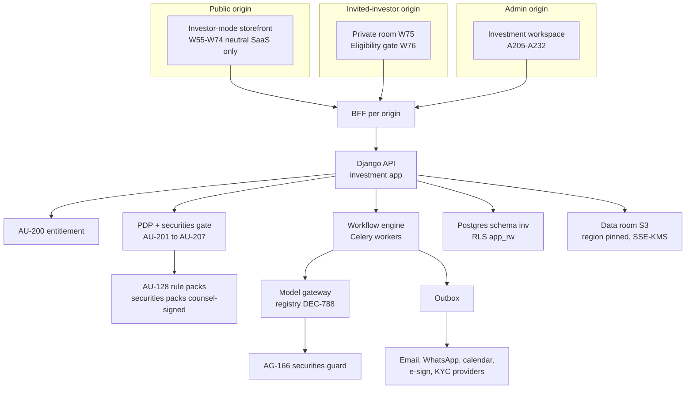
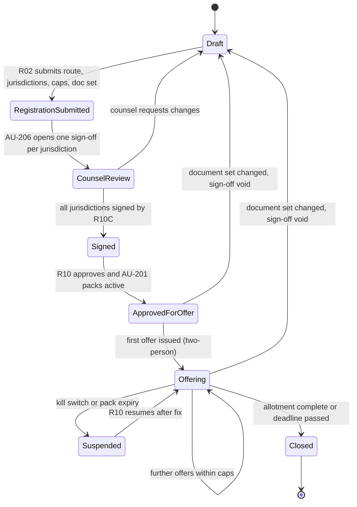
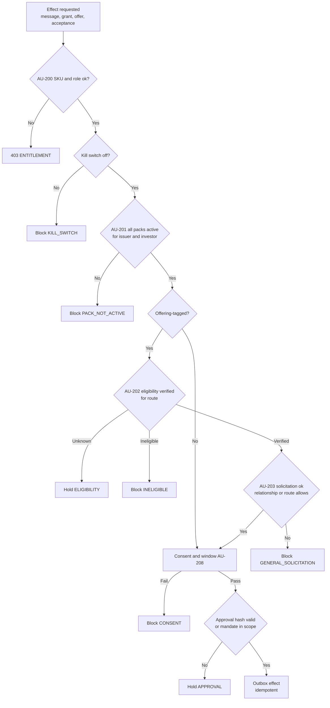
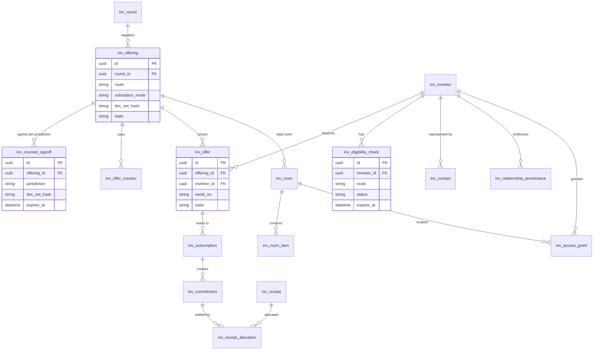

# AI Growth Engine: Employee Sales & Marketing Automation
## Application Blueprint: PART 11 (Batch 11.16a), Investment Automation I: Investor/Fundraising Mode and INV-SVC-01…12

| Field | Value |
|---|---|
| Document | Part 11, Batch 11.16, file **a** of Group N files a, b, e. This file holds §11.16.1 material reviewed, §11.16.2 coverage summary, §11.16.3 register summary, §11.16.4 catalogue reconciliation and §11.16.5.1–§11.16.5.11 (product boundary, securities controls, privacy, roles, investor-mode website, 12 service specifications, agents, automations, screens, data and API). Files: `Part-11-16a_…` (§11.16.1–§11.16.5.11), `Part-11-16b_…` (§11.16.5.12 workflow specifications), `Part-11-16e_…` (§11.16.5.13–§11.16.10 and Appendix A) |
| Version | 1.0 · 28 Nov 2026 |
| Baseline | Parts 0–9.10, 11.1–11.15 (DEC-001…422, DEC-500…791); Part 11.14 DEC-783 (investor/fundraising adopted), DEC-779 (bounded mandates), DEC-772 (EU/IN residency), DEC-777 (messaging window), DEC-788 (model registry), DEC-790 (funding); Part 11.15 rule-pack framework (AU-128, AG-086, CP-01…07); Part 11.2b/11.3b formats; Part 5.1a/5.1b story template; Part 6.2a test template; V12B brief |
| Source material | Investment Automation Master Automation Service Catalog 2031 (24 services / 96 workflows; 12 sheets, CSV export); Investment_Automation_19_Neutral_SaaS_Website (README, layout catalogue, route reconciliation, verification report, HTML); `investment_website(1).html`; investor/fundraising mode (`CFG.inv`) of `commercial_website_desktop_V12.html`; Investment lines of BRD/FSD `ZZ_Historical_annex.txt`; the CONFLICT-958 rows of `final/coverage_v12/L_coverage.csv` |
| Roles applied | Expert panel: former investment-banking and private-markets operating partner; securities-law and compliance specialist (SEBI ICDR, Companies Act s.42 private placement, US Regulation D 506(b)/(c) and Regulation CF, EU Prospectus Regulation exemptions, anti-solicitation, KYC/AML); Chief Product Officer (B2B SaaS); Principal Solutions Architect; Principal Business Systems Analyst. Reviewers: Product Owner, QA Lead, Security/Privacy/AI Governance Lead, DevOps/SRE, FinOps |
| Group and ID ranges | P1a, letter N: DEC-800…819 · tags 1000–1019 · ADR-230…234 · FR-V12-N-### · BRL-V12-N-## · US-<EP>-ZN<nn> · TC-V12-N-### · AG-160…179 · AU-200…229 · screens A205–A232, W55–W76 · epics EP-30, EP-31 · controls SEC-CTL-N-01…16 · parameter models PM-N-01…09 · API-V12-N-### |
| Legal status | **Draft for counsel review. Not legal advice.** Every statutory threshold, exemption and deadline in this part is the panel's reading for implementation design and must be verified by counsel admitted in the jurisdiction (verify at time of implementation, as of 27 Nov 2026) [ASSUMPTION-1000]. No capability activates in a jurisdiction until its rule pack is counsel-signed (DEC-783, SEC-CTL-N-01) |
| Budget status | Development and running estimates (§11.16.5.16) are **outside** Ledger A (DEC-230) and Ledger B (DEC-231), funded under DEC-790 as change request CR-V12-N-01 (development) and CR-V12-N-02 (running); shown in separate tables |

**Acronyms.** AML anti-money laundering · AT acceptance test · DSR data-subject request · DPDP Digital Personal Data Protection Act 2023 (India) · ECSP EU crowdfunding service provider · FEMA Foreign Exchange Management Act (India) · FPO Financial Promotion Order (UK) · FSMA Financial Services and Markets Act 2000 (UK) · HNI high-net-worth individual · ICDR SEBI (Issue of Capital and Disclosure Requirements) Regulations 2018 · IR investor relations · KYC know your customer · LIA legitimate-interest assessment · MNPI material non-public information · NDA non-disclosure agreement · PAS-3/4/5 Companies (Prospectus and Allotment of Securities) Rules forms · PDP Policy Decision Point · PEP politically exposed person · PM parameter model · PPM private placement memorandum · PR EU Prospectus Regulation (EU) 2017/1129 · QI qualified investor · QIB qualified institutional buyer · Reg CF Regulation Crowdfunding · Reg D Regulation D (Rules 504/506) · RLS row-level security · SEBI Securities and Exchange Board of India · SKU stock-keeping unit · SoD separation of duties.

## 11.16.1 Material reviewed

| Material | Rows / items | In Group N scope | Purpose | Pattern |
|---|---|---|---|---|
| Catalog CSV `Start_Here.csv` | 16 | 16 | Scope metrics 16→24 services, 48→96 workflows, 30→50 fields, 64→120 acceptance scenarios, 15 engines, 19/51 website/admin routes | metric table |
| Catalog CSV `Service_Index.csv` | 24 | 12 | One row per SKU: family, bundle, workflow count, meter, illustrative allowance, price status | register |
| Catalog CSV `Service_Catalog.csv` | 24 | 12 | 50-field service specification per SKU | 50 fields × SKU |
| Catalog CSV `Workflow_Catalog.csv` | 96 | 48 | 50-field workflow specification, four per SKU | 50 fields × workflow |
| Catalog CSV `Acceptance_Tests.csv` | 120 | 60 | One scenario per workflow plus one entitlement scenario per SKU; all Not run | 14 columns |
| Catalog CSV `Capability_Crosswalk.csv` | 100 | 83 | 100 legacy capabilities INV-01-01…INV-20-05 → primary SKU | 8 columns |
| Catalog CSV `Cost_Model.csv` | 96 | 48 | Illustrative INR per workflow invocation; rates and assumptions | 13 columns |
| Catalog CSV `Entitlement_Rules.csv` | 24 | 12 | Bundle, prerequisites, permissions, gate, meter, cap, missing-prerequisite and revocation behaviour | 15 columns |
| Catalog CSV `Technical_Map.csv` | 89 | 42 | Admin screen reuse, route inventory, entity candidates, UAT IDs | 8 columns |
| Catalog CSV `Migration.csv` | 24 | 12 | Retain + expand (01–16) / new (17–24); entitlement transitions | 8 columns |
| Catalog CSV `Shared_Engines.csv` | 15 | 15 | ENG-01…15 logical engines | 5 columns |
| Catalog CSV `Sources_Decisions.csv` | 19 | 19 | Source references, SHA-256 of packages, interpretation constraints | 4 columns |
| Website `investment_website_layout_catalog.json` | 100 | 100 (common catalogue) | 100 capability items in 20 families (25 core) | JSON items |
| Website `investment_website_route_reconciliation.csv` | 19 | 19 | W01–W19 previous → current names and access | CSV |
| Website `README.txt`, `verification_report.json` | 1 + 1 | all | Neutral storefront constraints; verification flags | prose / JSON |
| `investment_website(1).html` (= website pack HTML, byte-identical) | 1 SPA | CFG: 19 routes, 100 items, 20 groups | Neutral investment storefront prototype | embedded JS |
| `commercial_website_desktop_V12.html` investor mode | 11 `inv` branches | 11 | Objective mode "Automate your fundraising operations" | embedded JS |
| BRD/FSD `ZZ_Historical_annex.txt` Investment lines | 169 + 251 lines containing "invest" | via L rows | Investment comparator mirror of the catalogue sheets; REC-10 | text |
| `L_coverage.csv` rows with CONFLICT-958 | 1,176 | see §11.16.2 | Classified residual units (Group L) | CSV |

**Scope split with Group O (P1b).** Group N owns INV-SVC-01…12 (48 workflows), the investor-mode website, the common investment platform (product boundary, foundation capabilities INV-01/11/12/13/14, engines, entitlement, securities control framework consumer side). Group O (P1b) owns INV-SVC-13…24 and the content of the securities rule packs RP-IN-SEC, RP-US-REGD, RP-US-REGCF, RP-EU-PROSP, RP-UK-FINPROM, RP-AML-KYC and RP-INV-ADVICE (Group N uses the Group O pack IDs and route values) [ASSUMPTION-1001]. Rows of `L_coverage.csv` whose primary service is INV-SVC-13…24 are left to Group O; rows without a primary service are reconciled here.

**Parsing scripts (saved).** `assembly/v12b/n_extract_inv_mode.py` (investor-mode branches and website CFG), `n_common.py` (loaders, covering-array generator, coverage verifier), `n_ctx.py` (ID allocation), `n_spec.py` (hand-authored mapping), `n_comb.py` (parameter models and oracles), `n_build_a.py`, `n_build_b.py`, `n_build_c.py`, `n_build_cov.py`. Every source row is read programmatically; nothing is sampled.

## 11.16.2 Coverage summary

| Status before | Aspects |
|---|---|
| Not covered | 3820 |
| Partially covered | 20 |
| Conflict | 12 |
| **Total** | 3852 |

| Status after | Aspects |
|---|---|
| Matched | 3852 |

| Source family (doc column) | Aspects |
|---|---|
| INV-CAT | 3286 |
| WEB-INV | 244 |
| ANX-BRD | 162 |
| ANX-FSD | 120 |
| WEB-SMA | 17 |
| ANX | 16 |
| ENG | 4 |
| OTH-EMW | 2 |
| archive (all) | 1 |

Before this part the blueprint excluded investors and fundraising (DEC-002, CC-01, DEC-517), so every Investment aspect was Not covered or Conflict (CONFLICT-958, CONFLICT-868). DEC-783 adopted the product; this part specifies it, and every Group N aspect ends **Matched**. No aspect is left "Pending Founder decision".

## 11.16.3 Detailed register (summary; the individual list is Appendix A of Part 11.16e and `N_coverage.csv`)

| Doc | Chapter / sheet | Aspects | Status before | Main blueprint location | After |
|---|---|---|---|---|---|
| INV-CAT | Workflow_Catalog.csv | 1777 | Not covered | Part 11.16b §11.16.5.12 INV-SVC-01-WF01; Part 11.16b §11.16.5.12 INV-SVC-01-WF02 | Matched |
| INV-CAT | Service_Catalog.csv | 601 | Not covered | Part 11.16a §11.16.5.1 (common investment platform); Part 11.16a §11.16.5.6.1 field "Automation ID" | Matched |
| INV-CAT | Entitlement_Rules.csv | 182 | Not covered, Partially covered | Part 11.16a §11.16.5.6.1 Entitlements; Part 11.16a §11.16.5.6.2 Entitlements | Matched |
| WEB-INV | investment_website_layout_catalog.json | 122 | Not covered, Partially covered | Part 11.16a §11.16.5.5.2 W56/W57; Part 11.16a §11.16.5.5.2 | Matched |
| ANX-FSD | Investment comparator / Technical Map | 113 | Not covered | Part 11.16a §11.16.5.1 (common investment platform); Part 11.16a §11.16.4.5, §11.16.5.9–§11.16.5.11 | Matched |
| ANX-BRD | Investment comparator / Capability Crosswalk | 89 | Not covered | Part 11.16a §11.16.4.6 | Matched |
| INV-CAT | Capability_Crosswalk.csv | 85 | Not covered, Partially covered | Part 11.16a §11.16.4.6 | Matched |
| INV-CAT | Investment Automation / Legacy capability mapping /  /  /  / | 85 | Not covered | Part 11.16a §11.16.4.6; Part 11.16b §11.16.5.12 INV-SVC-10 | Matched |
| INV-CAT | Acceptance_Tests.csv | 62 | Not covered, Partially covered | Part 11.16b test tables; Part 11.16a §11.16.5.1 (common investment platform) | Matched |
| INV-CAT | Investment Automation / Service & workflow acceptance /  /   | 61 | Not covered | Part 11.16a §11.16.5.1 (common investment platform); Part 11.16b §11.16.5.12 INV-SVC-01-WF01 | Matched |
| INV-CAT | Cost_Model.csv | 50 | Not covered, Partially covered | Part 11.16a §11.16.4.4; Part 11.16a §11.16.5.1 (common investment platform) | Matched |
| INV-CAT | Investment Automation / Illustrative internal execution cost | 50 | Not covered | Part 11.16a §11.16.5.1 (common investment platform); Part 11.16b §11.16.5.12 INV-SVC-01-WF01 | Matched |
| INV-CAT | Investment Automation / 50-field workflow specification /  / | 50 | Not covered | Part 11.16a §11.16.5.1 (common investment platform); Part 11.16b §11.16.5.12 INV-SVC-01-WF01 | Matched |
| INV-CAT | Investment Automation / Technical reuse and design gaps /  / | 45 | Not covered | Part 11.16b §11.16.5.12 INV-SVC-11; Part 11.16b §11.16.5.12 INV-SVC-01 | Matched |
| INV-CAT | Technical_Map.csv | 43 | Not covered | Part 11.16a §11.16.4.5, §11.16.5.9; Part 11.16a §11.16.5.1 (common investment platform) | Matched |
| ANX-BRD | Investment comparator / Entitlement Rules | 34 | Not covered | Part 11.16a §11.16.5.1 (common investment platform); Part 11.16a §11.16.4.1, §11.16.5.6.10 Entitlements | Matched |
| WEB-INV | README.txt | 34 | Not covered | Part 11.16a §11.16.5.5 | Matched |
| INV-CAT | Investment Automation / Source traceability and decisions /  | 22 | Not covered | Part 11.16a §11.16.1, §11.16.5.1 | Matched |
| WEB-INV | investment_website_route_reconciliation.csv | 21 | Not covered, Partially covered | Part 11.16a §11.16.4.9, §11.16.5.5.2; Part 11.16a §11.16.5.5, §11.16.4.8–§11.16.4.9 | Matched |
| INV-CAT | Sources_Decisions.csv | 20 | Not covered | Part 11.16a §11.16.1, §11.16.5.1 | Matched |
| INV-CAT | Start_Here.csv | 18 | Not covered, Partially covered | Part 11.16a §11.16.1, §11.16.4.1; Part 11.16a §11.16.5.1 (common investment platform) | Matched |
| INV-CAT | Shared_Engines.csv | 17 | Not covered, Partially covered | Part 11.16a §11.16.4.7; Part 11.16a §11.16.4.7, §11.16.5.1 | Matched |
| INV-CAT | Investment Automation / 50-field service specification /  /  | 15 | Not covered | Part 11.16a §11.16.5.1 (common investment platform); Part 11.16b §11.16.5.12 INV-SVC-01-WF01 | Matched |
| INV-CAT | Investment Automation / 2031 master automation service catal | 15 | Not covered | Part 11.16a §11.16.5.1 (common investment platform) | Matched |
| INV-CAT | Service_Index.csv | 14 | Not covered, Partially covered | Part 11.16a §11.16.4.1; Part 11.16a §11.16.5.1 (common investment platform) | Matched |
| INV-CAT | Migration.csv | 14 | Not covered, Partially covered | Part 11.16a §11.16.4.1; Part 11.16a §11.16.5.1 (common investment platform) | Matched |
| WEB-INV | id / previous_name / previous_access / current_name / curren | 14 | Not covered | Part 11.16a §11.16.5.5, §11.16.4.8–§11.16.4.9 | Matched |
| INV-CAT | Investment Automation / Service-level entitlement rules /  / | 14 | Not covered | Part 11.16a §11.16.5.1 (common investment platform); Part 11.16b §11.16.5.12 INV-SVC-01 | Matched |
| INV-CAT | Investment Automation / Service and workflow migration /  /  | 14 | Not covered | Part 11.16a §11.16.5.1 (common investment platform); Part 11.16b §11.16.5.12 INV-SVC-01 | Matched |
| ANX-BRD | Investment comparator / Migration | 13 | Not covered | Part 11.16a §11.16.4.1; Part 11.16a §11.16.5.1 (common investment platform) | Matched |
| INV-CAT | Investment Automation / Independent purchasable services /   | 13 | Not covered | Part 11.16a §11.16.5.1 (common investment platform); Part 11.16b §11.16.5.12 INV-SVC-01 | Matched |
| INV-CAT | Workflow_Catalog.csv (boilerplate, listed once) | 13 | Not covered | Part 11.16b §11.16.5.12 (every workflow header) | Matched |
| ANX-BRD | Investment comparator / Service Index | 12 | Not covered | Part 11.16a §11.16.5.1 (common investment platform); Part 11.16a §11.16.5.6.1 | Matched |
| WEB-SMA | commercial_website_desktop_V12.html | 11 | Conflict | Part 11.16a §11.16.4.8, §11.16.5.5.1 | Matched |
| WEB-INV | verification_report.json | 11 | Not covered | Part 11.16a §11.16.5.5.2 | Matched |
| ANX-BRD | Investment comparator / Start Here | 5 | Not covered | Part 11.16a §11.16.5.1 (common investment platform) | Matched |
| ANX-BRD | Investment comparator / Sources & Decisions | 5 | Not covered | Part 11.16a §11.16.1, §11.16.5.1 | Matched |
| WEB-INV | html-js | 5 | Not covered | Part 11.16a §11.16.5.5, §11.16.4.8–§11.16.4.9 | Matched |
| ANX-FSD | Commercial prototype implementation reference | 4 | Not covered | Part 11.16a §11.16.5.1 (common investment platform) | Matched |
| INV-CAT | Cost_Model.csv (rates) | 4 | Not covered | Part 11.16a §11.16.4.4 | Matched |
| ANX-FSD | Commercial | 3 | Not covered | Part 11.16a §11.16.5.1 (common investment platform) | Matched |
| ANX | Investment comparator / Shared Engines | 2 | Not covered, Partially covered | Part 11.16a §11.16.4.7, §11.16.5.1 | Matched |
| ANX | Investment comparator / Service Index | 2 | Not covered, Partially covered | Part 11.16a §11.16.5.1 (common investment platform) | Matched |
| ANX-BRD | Investment reference — separate product, shared-platform com | 2 | Not covered | Part 11.16a §11.16.5.1 (common investment platform) | Matched |
| WEB-SMA | WEB-SMA::README.txt | 2 | Not covered | Part 11.16a §11.16.5.5, §11.16.4.8–§11.16.4.9 | Matched |
| INV-CAT | Investment Automation / Reusable execution engines /  /  /   | 2 | Not covered | Part 11.16a §11.16.4.7, §11.16.5.1 | Matched |
| ENG | operation_specific_test_variants.csv | 1 | Partially covered | Part 11.16a §11.16.5.1 (common investment platform) | Matched |
| ENG | unit_sit_uat_test_register.csv | 1 | Partially covered | Part 11.16a §11.16.5.1 (common investment platform) | Matched |
| ENG | unit_sit_uat_test_register.json | 1 | Partially covered | Part 11.16a §11.16.5.1 (common investment platform) | Matched |
| OTH-EMW | 12_SIT_Tests.csv | 1 | Partially covered | Part 11.16a §11.16.5.1 (common investment platform) | Matched |
| ANX | Sales_Marketing_Automation_Expanded_Master_Workbook.xlsx/12_ | 1 | Partially covered | Part 11.16a §11.16.5.1 (common investment platform) | Matched |
| ANX | Investment_Automation_19_Neutral_SaaS_Website(1).zip — membe | 1 | Partially covered | Part 11.16a §11.16.5.5, §11.16.4.8–§11.16.4.9 | Matched |
| ENG | operation_fixtures.json | 1 | Partially covered | Part 11.16a §11.16.5.1 (common investment platform) | Matched |
| ANX | unit_sit_uat_test_register.csv | 1 | Partially covered | Part 11.16a §11.16.5.1 (common investment platform) | Matched |
| ANX | Investment comparator / Technical Map | 1 | Not covered | Part 11.16a §11.16.5.1 (common investment platform) | Matched |
| ANX | Investment comparator / Capability Crosswalk | 1 | Not covered | Part 11.16a §11.16.4.6 | Matched |
| ANX | Investment comparator / Entitlement Rules | 1 | Not covered | Part 11.16a §11.16.5.1 (common investment platform) | Matched |
| ANX | Investment comparator / Migration | 1 | Not covered | Part 11.16a §11.16.5.1 (common investment platform) | Matched |
| WEB-SMA | commercial_website.html | 1 | Not covered | Part 11.16a §11.16.5.5, §11.16.4.8–§11.16.4.9 | Matched |
| ANX | Commercial | 1 | Not covered | Part 11.16a §11.16.5.1 (common investment platform) | Matched |

Conflicts raised and resolved in this part: CONFLICT-1008 (neutral storefront vs "investor website"), CONFLICT-1009 (V12 BR-C03/BR-C14/REC-10 separation vs DEC-783), CONFLICT-1019 (V12 side-effect labels weaker than the actual effect). See §11.16.6 (Part 11.16e).

## 11.16.4 Catalogue reconciliation

### 11.16.4.1 Service Index, Entitlement Rules and Migration (INV-SVC-01…12)

| Service | Name | Family | Bundle | WF | Selective | Meter | Allowance | Price | Optional producers | Migration | Spec |
|---|---|---|---|---|---|---|---|---|---|---|---|
| INV-SVC-01 | Global Funding & Investor Discovery Automation | Research & discovery | Discovery & Qualification | 4 | Yes, conditional | source batch | 100 | Quotation pending | None | Retain + expand; Preserve WF01–03; add WF04 | §11.16.5.6.1 |
| INV-SVC-02 | Investor Intelligence & Qualification Automation | Investor intelligence | Discovery & Qualification | 4 | Yes, conditional | investor assessment | 500 | Quotation pending | INV-SVC-01 | Retain + expand; Preserve WF01–03; add WF04 | §11.16.5.6.2 |
| INV-SVC-03 | Investor Contact Intelligence Automation | Contact intelligence | Discovery & Qualification | 4 | Yes, conditional | contact assessed | 500 | Quotation pending | INV-SVC-01 | Retain + expand; Preserve WF01–03; add WF04 | §11.16.5.6.3 |
| INV-SVC-04 | Investor Email Outreach Automation | Outreach | Investor Engagement | 4 | Yes, conditional | email attempt | 500 | Quotation pending | INV-SVC-03 | Retain + expand; Preserve WF01–03; add WF04 | §11.16.5.6.4 |
| INV-SVC-05 | Investor WhatsApp Engagement Automation | Outreach | Investor Engagement | 4 | Yes, conditional | message attempt | 200 | Quotation pending | INV-SVC-03 | Retain + expand; Preserve WF01–03; add WF04 | §11.16.5.6.5 |
| INV-SVC-06 | Investor Follow-up & Engagement Sequence Automation | Relationship engagement | Investor Engagement | 4 | Yes, conditional | follow-up decision | 500 | Quotation pending | INV-SVC-04; INV-SVC-05; INV-SVC-07; INV-SVC-15 | Retain + expand; Preserve WF01–03; add WF04 | §11.16.5.6.6 |
| INV-SVC-07 | Investor Conversation & Objection Resolution Automation | Conversation intelligence | Investor Engagement | 4 | Yes, conditional | conversation item | 500 | Quotation pending | INV-SVC-04; INV-SVC-05; INV-SVC-10 | Retain + expand; Preserve WF01–03; add WF04 | §11.16.5.6.7 |
| INV-SVC-08 | Investor Meeting & Briefing Automation | Meetings | Investor Engagement | 4 | Yes, conditional | meeting cycle | 100 | Quotation pending | INV-SVC-07; INV-SVC-15 | Retain + expand; Preserve WF01–03; add WF04 | §11.16.5.6.8 |
| INV-SVC-09 | Fundraising Pitch & Financial Scenario Automation | Investment conversion | Diligence & Conversion | 4 | Yes, conditional | pitch scenario | 50 | Quotation pending | INV-SVC-02 | Retain + expand; Preserve WF01–03; add WF04 | §11.16.5.6.9 |
| INV-SVC-10 | Due Diligence & Secure Data Room Automation | Due diligence | Diligence & Conversion | 4 | Yes, conditional | diligence item | 200 | Quotation pending | INV-SVC-09 | Retain + expand; Preserve WF01–03; add WF04 | §11.16.5.6.10 |
| INV-SVC-11 | Investment Terms, Offers & Agreement Automation | Investment conversion | Diligence & Conversion | 4 | Yes, conditional | offer or application case | 50 | Quotation pending | INV-SVC-02; INV-SVC-10; INV-SVC-09 | Retain + expand; Preserve WF01–03; add WF04 | §11.16.5.6.11 |
| INV-SVC-12 | Investment Receipt & Financial Reconciliation Automation | Financial controls | Closing & Investor Lifecycle | 4 | Yes, conditional | receipt record | 200 | Quotation pending | INV-SVC-11 | Retain + expand; Preserve WF01–03; add WF04 | §11.16.5.6.12 |

Bundles reconciled: **Discovery & Qualification** (01, 02, 03 here; 19 in Group O), **Investor Engagement** (04–08 here; 15, 16 in Group O), **Diligence & Conversion** (09, 10, 11), **Closing & Investor Lifecycle** (12 here; 13, 14 in Group O). Full suite = all approved SKUs; partial = a predefined or client-selected bundle; selective = one or more SKUs; the 25 foundation entries are non-removable (Sources & Decisions "Public procurement scope"). Prices stay "Quotation pending"; Group N does not set prices (BRL invariant: AI never sets prices).

### 11.16.4.2 Workflow catalogue (48 rows) → blueprint

| Workflow | Name | Trigger (V12) | Side effect (V12) | Blueprint risk class | Agent | Automations | FR | AT01 → TC | Spec |
|---|---|---|---|---|---|---|---|---|---|
| INV-SVC-01-WF01 | Funding opportunity discovery | Manual request or validated upstream business event | Internal analysis/draft | R0 internal analysis | AG-160 | AU-007, AU-014, AU-005, AU-209 | FR-V12-N-101 | TC-V12-N-006 | §11.16.5.12 (Part 11.16b) |
| INV-SVC-01-WF02 | Evidence refresh and change detection | Scheduled or manual; scoped event on change | Internal analysis/draft | R0 | AG-160 | AU-210 | FR-V12-N-102 | TC-V12-N-019 | §11.16.5.12 (Part 11.16b) |
| INV-SVC-01-WF03 | Deadline and funding alerts | Scheduled or manual; scoped event on change | Internal analysis/draft | R0 internal notification | — (deterministic) | AU-209 | FR-V12-N-103 | TC-V12-N-032 | §11.16.5.12 (Part 11.16b) |
| INV-SVC-01-WF04 | Continuous funding signal and emerging opportunity detection | Manual; scheduled or relevant validated business event; provider webhook only where authorized | Internal analysis/draft | R0 | AG-161 | AU-210, AU-209 | FR-V12-N-104 | TC-V12-N-045 | §11.16.5.12 (Part 11.16b) |
| INV-SVC-02-WF01 | Mandate and ticket-size matching | Manual request or validated upstream business event | Internal analysis/draft | R0 | AG-162 | AU-016 | FR-V12-N-105 | TC-V12-N-057 | §11.16.5.12 (Part 11.16b) |
| INV-SVC-02-WF02 | Jurisdiction and eligibility screening | Manual request or validated upstream business event | Internal analysis/draft | R1 regulated pre-check | AG-163 (evidence extraction only) | AU-202, AU-201 | FR-V12-N-106 | TC-V12-N-070 | §11.16.5.12 (Part 11.16b) |
| INV-SVC-02-WF03 | Prioritize and assign investor opportunities | Manual request or validated upstream business event | Internal analysis/draft | R0 | — (deterministic) | AU-016 | FR-V12-N-107 | TC-V12-N-083 | §11.16.5.12 (Part 11.16b) |
| INV-SVC-02-WF04 | Explainable investor propensity and strategic fit analysis | Manual; scheduled or relevant validated business event; provider webhook only where authorized | Internal analysis/draft | R0 | AG-162 | AU-056 | FR-V12-N-108 | TC-V12-N-096 | §11.16.5.12 (Part 11.16b) |
| INV-SVC-03-WF01 | Permitted representative discovery | Manual request or validated upstream business event | Internal analysis/draft | R0 | AG-164 | AU-211 | FR-V12-N-109 | TC-V12-N-109 | §11.16.5.12 (Part 11.16b) |
| INV-SVC-03-WF02 | Contact verification and deduplication | Manual request or validated upstream business event | Internal analysis/draft | R0 | AG-164 | AU-211 | FR-V12-N-110 | TC-V12-N-121 | §11.16.5.12 (Part 11.16b) |
| INV-SVC-03-WF03 | Engagement eligibility assessment | Manual request or validated upstream business event | Internal analysis/draft | R1 | — (deterministic PDP) | AU-208, AU-203 | FR-V12-N-111 | TC-V12-N-133 | §11.16.5.12 (Part 11.16b) |
| INV-SVC-03-WF04 | Investor representative and mandate change monitoring | Manual; scheduled or relevant validated business event; provider webhook only where authorized | Internal analysis/draft | R0 | AG-164 | AU-210 | FR-V12-N-112 | TC-V12-N-145 | §11.16.5.12 (Part 11.16b) |
| INV-SVC-04-WF01 | Personalized investor email drafting | Manual request or validated upstream business event | Internal analysis/draft | R1 draft | AG-165 + AG-166 | AU-005 | FR-V12-N-113 | TC-V12-N-157 | §11.16.5.12 (Part 11.16b) |
| INV-SVC-04-WF02 | Controlled email dispatch | Manual request or validated upstream business event | Potential external write/communication | R2 external communication | — (deterministic) | AU-212, AU-203, AU-201 | FR-V12-N-114 | TC-V12-N-170 | §11.16.5.12 (Part 11.16b) |
| INV-SVC-04-WF03 | Delivery and bounce processing | Authorized business event or manual import; signed webhook if applicable | Potential external write/communication | R1 | — (deterministic) | AU-213 | FR-V12-N-115 | TC-V12-N-185 | §11.16.5.12 (Part 11.16b) |
| INV-SVC-04-WF04 | Sender reputation and deliverability optimization | Manual; scheduled or relevant validated business event; provider webhook only where authorized | Internal analysis/draft | R0 + internal hold | AG-167 | AU-213 | FR-V12-N-116 | TC-V12-N-198 | §11.16.5.12 (Part 11.16b) |
| INV-SVC-05-WF01 | Consent and template validation | Manual request or validated upstream business event | Internal analysis/draft | R1 | — | AU-214, AU-201 | FR-V12-N-117 | TC-V12-N-209 | §11.16.5.12 (Part 11.16b) |
| INV-SVC-05-WF02 | Prepare and send direct message | Manual request or validated upstream business event | Internal analysis/draft | R2 external communication (V12 labels it internal; stricter applies, CONFLICT-1019) | AG-165 + AG-166 | AU-214, AU-203 | FR-V12-N-118 | TC-V12-N-222 | §11.16.5.12 (Part 11.16b) |
| INV-SVC-05-WF03 | Inbound and delivery synchronization | Authorized business event or manual import; signed webhook if applicable | Potential external write/communication | R1 | — | AU-215 | FR-V12-N-119 | TC-V12-N-237 | §11.16.5.12 (Part 11.16b) |
| INV-SVC-05-WF04 | Consent-aware conversational journey coordination | Manual; scheduled or relevant validated business event; provider webhook only where authorized | Internal analysis/draft | R2 external communication (stricter than the V12 label, CONFLICT-1019) | AG-168 | AU-214, AU-216 | FR-V12-N-120 | TC-V12-N-251 | §11.16.5.12 (Part 11.16b) |
| INV-SVC-06-WF01 | Sequence scheduling | Manual request or validated upstream business event | Potential external write/communication | R1 | — | AU-216 | FR-V12-N-121 | TC-V12-N-265 | §11.16.5.12 (Part 11.16b) |
| INV-SVC-06-WF02 | Adaptive follow-up preparation | Manual request or validated upstream business event | Internal analysis/draft | R1 | AG-169 | AU-216 | FR-V12-N-122 | TC-V12-N-278 | §11.16.5.12 (Part 11.16b) |
| INV-SVC-06-WF03 | Reply, suppression and overdue handling | Authorized business event or manual import; signed webhook if applicable | Internal analysis/draft | R1 | — | AU-215 | FR-V12-N-123 | TC-V12-N-290 | §11.16.5.12 (Part 11.16b) |
| INV-SVC-06-WF04 | Adaptive next-best engagement and sequence conflict resolution | Manual; scheduled or relevant validated business event; provider webhook only where authorized | Internal analysis/draft | R1 | AG-169 | AU-216 | FR-V12-N-124 | TC-V12-N-303 | §11.16.5.12 (Part 11.16b) |
| INV-SVC-07-WF01 | Intent and objection classification | Manual request or validated upstream business event | Internal analysis/draft | R0 | AG-170 + AG-166 | AU-217 | FR-V12-N-125 | TC-V12-N-316 | §11.16.5.12 (Part 11.16b) |
| INV-SVC-07-WF02 | Evidence-grounded response drafting | Manual request or validated upstream business event | Internal analysis/draft | R1 | AG-171 + AG-166 | AU-005 | FR-V12-N-126 | TC-V12-N-329 | §11.16.5.12 (Part 11.16b) |
| INV-SVC-07-WF03 | Human handover and continuity | Authorized business event or manual import; signed webhook if applicable | Internal analysis/draft | R0 | — | AU-217 | FR-V12-N-127 | TC-V12-N-342 | §11.16.5.12 (Part 11.16b) |
| INV-SVC-07-WF04 | Multilingual, multimodal investor enquiry handling | Manual; scheduled or relevant validated business event; provider webhook only where authorized | Internal analysis/draft | R1 | AG-172 | AU-217 | FR-V12-N-128 | TC-V12-N-355 | §11.16.5.12 (Part 11.16b) |
| INV-SVC-08-WF01 | Availability and meeting booking | Manual request or validated upstream business event | Potential external write/communication | R2 calendar invite | — | AU-218 | FR-V12-N-129 | TC-V12-N-369 | §11.16.5.12 (Part 11.16b) |
| INV-SVC-08-WF02 | Investor briefing preparation | Manual request or validated upstream business event | Internal analysis/draft | R0 | AG-173 | AU-005 | FR-V12-N-130 | TC-V12-N-383 | §11.16.5.12 (Part 11.16b) |
| INV-SVC-08-WF03 | Meeting action extraction and reminders | Scheduled or manual; scoped event on change | Internal analysis/draft | R0 | AG-173 | AU-218 | FR-V12-N-131 | TC-V12-N-395 | §11.16.5.12 (Part 11.16b) |
| INV-SVC-08-WF04 | Interactive pitch rehearsal and post-meeting intelligence | Manual; scheduled or relevant validated business event; provider webhook only where authorized | Internal analysis/draft | R0 | AG-174 | AU-218 | FR-V12-N-132 | TC-V12-N-408 | §11.16.5.12 (Part 11.16b) |
| INV-SVC-09-WF01 | Funding scenario calculation | Manual request or validated upstream business event | Internal analysis/draft | R0 | — (deterministic AU-219) | AU-219 | FR-V12-N-133 | TC-V12-N-421 | §11.16.5.12 (Part 11.16b) |
| INV-SVC-09-WF02 | Investor-specific pitch drafting | Manual request or validated upstream business event | Internal analysis/draft | R1 | AG-175 + AG-166 | AU-220 | FR-V12-N-134 | TC-V12-N-434 | §11.16.5.12 (Part 11.16b) |
| INV-SVC-09-WF03 | Pitch revision and review | Scheduled or manual; scoped event on change | Internal analysis/draft | R1 | — (AU-220) | AU-220 | FR-V12-N-135 | TC-V12-N-446 | §11.16.5.12 (Part 11.16b) |
| INV-SVC-09-WF04 | Evidence-linked investment narrative generation | Manual; scheduled or relevant validated business event; provider webhook only where authorized | Internal analysis/draft | R1 | AG-175 + AG-179 | AU-220 | FR-V12-N-136 | TC-V12-N-459 | §11.16.5.12 (Part 11.16b) |
| INV-SVC-10-WF01 | Document collection and classification | Manual request or validated upstream business event | Internal analysis/draft | R0 | AG-176 | AU-222 | FR-V12-N-137 | TC-V12-N-472 | §11.16.5.12 (Part 11.16b) |
| INV-SVC-10-WF02 | Scoped access and expiry workflow | Scheduled or manual; scoped event on change | Internal analysis/draft | R2 disclosure | — | AU-221, AU-204, AU-201 | FR-V12-N-138 | TC-V12-N-486 | §11.16.5.12 (Part 11.16b) |
| INV-SVC-10-WF03 | Question and answer tracking | Scheduled or manual; scoped event on change | Internal analysis/draft | R1 | AG-171 + AG-166 | AU-204 | FR-V12-N-139 | TC-V12-N-501 | §11.16.5.12 (Part 11.16b) |
| INV-SVC-10-WF04 | Continuous data room readiness and evidence-gap detection | Manual; scheduled or relevant validated business event; provider webhook only where authorized | Internal analysis/draft | R0 | AG-176 | AU-222 | FR-V12-N-140 | TC-V12-N-513 | §11.16.5.12 (Part 11.16b) |
| INV-SVC-11-WF01 | Terms and agreement preparation | Manual request or validated upstream business event | Internal analysis/draft | R1 | AG-177 | AU-206 | FR-V12-N-141 | TC-V12-N-526 | §11.16.5.12 (Part 11.16b) |
| INV-SVC-11-WF02 | Formal offer and expiry workflow | Scheduled or manual; scoped event on change | Consequential financial/legal or authority-bearing action | R3 consequential legal | — (deterministic) | AU-205, AU-206, AU-207, AU-223, AU-201 | FR-V12-N-142 | TC-V12-N-540 | §11.16.5.12 (Part 11.16b) |
| INV-SVC-11-WF03 | Application and signature coordination | Authorized business event or manual import; signed webhook if applicable | Potential external write/communication | R3 | — | AU-224, AU-202 | FR-V12-N-143 | TC-V12-N-556 | §11.16.5.12 (Part 11.16b) |
| INV-SVC-11-WF04 | Term-sheet comparison and negotiation scenario analysis | Manual; scheduled or relevant validated business event; provider webhook only where authorized | Internal analysis/draft | R0 | AG-177 | AU-219 | FR-V12-N-144 | TC-V12-N-571 | §11.16.5.12 (Part 11.16b) |
| INV-SVC-12-WF01 | Receipt evidence import and verification | Authorized business event or manual import; signed webhook if applicable | Internal analysis/draft | R0 | — | AU-225 | FR-V12-N-145 | TC-V12-N-583 | §11.16.5.12 (Part 11.16b) |
| INV-SVC-12-WF02 | Partial receipt allocation and matching | Manual request or validated upstream business event | Internal analysis/draft | R1 financial record | — | AU-226 | FR-V12-N-146 | TC-V12-N-596 | §11.16.5.12 (Part 11.16b) |
| INV-SVC-12-WF03 | Discrepancy report and escalation | Manual request or validated upstream business event | Internal analysis/draft | R1 | AG-178 | AU-227 | FR-V12-N-147 | TC-V12-N-608 | §11.16.5.12 (Part 11.16b) |
| INV-SVC-12-WF04 | Financial anomaly and unmatched transaction detection | Manual; scheduled or relevant validated business event; provider webhook only where authorized | Consequential financial/legal or authority-bearing action | R3 (prepare only) | AG-178 | AU-226, AU-227 | FR-V12-N-148 | TC-V12-N-622 | §11.16.5.12 (Part 11.16b) |

### 11.16.4.3 Acceptance tests (60 rows) → TC-V12-N

| V12 test | Scenario | Expected | Negative / boundary | UI UAT (source) | Status (V12) | Blueprint TC |
|---|---|---|---|---|---|---|
| INV-SVC-01-ENT-AT01 | Single-SKU purchase and entitlement isolation | Selected service eligible; unpurchased service blocked; no compulsory paid upstream SKU; r | Wrong tenant, stale entitlement, duplicate charge, unapproved provider and budge | New — service commerce reconciliation required | Not run | TC-V12-N-633 |
| INV-SVC-01-WF01-AT01 | Funding opportunity discovery | Candidate opportunities | Repeat event; attempt wrong tenant, revoked entitlement, invalid input or exhaus | UAT-A009; UAT-A010; UAT-A016; UAT-A027 | Not run | TC-V12-N-006 |
| INV-SVC-01-WF02-AT01 | Evidence refresh and change detection | Revised evidence and change event | Repeat event; attempt wrong tenant, revoked entitlement, invalid input or exhaus | UAT-A009; UAT-A010; UAT-A016; UAT-A027 | Not run | TC-V12-N-019 |
| INV-SVC-01-WF03-AT01 | Deadline and funding alerts | Prioritized deadline alerts | Repeat event; attempt wrong tenant, revoked entitlement, invalid input or exhaus | UAT-A009; UAT-A010; UAT-A016; UAT-A027 | Not run | TC-V12-N-032 |
| INV-SVC-01-WF04-AT01 | Continuous funding signal and emerging opportunity detection | Evidence-linked funding signal alert; no unapproved external side effects | Reject wrong tenant, revoked grant, invalid input, duplicate event, stale eviden | A009; A010; A016; A027 | Not run | TC-V12-N-045 |
| INV-SVC-02-ENT-AT01 | Single-SKU purchase and entitlement isolation | Selected service eligible; unpurchased service blocked; no compulsory paid upstream SKU; r | Wrong tenant, stale entitlement, duplicate charge, unapproved provider and budge | New — service commerce reconciliation required | Not run | TC-V12-N-634 |
| INV-SVC-02-WF01-AT01 | Mandate and ticket-size matching | Fit score and reason | Repeat event; attempt wrong tenant, revoked entitlement, invalid input or exhaus | UAT-A003; UAT-A011; UAT-A013; UAT-A035 | Not run | TC-V12-N-057 |
| INV-SVC-02-WF02-AT01 | Jurisdiction and eligibility screening | Eligible or held decision | Repeat event; attempt wrong tenant, revoked entitlement, invalid input or exhaus | UAT-A003; UAT-A011; UAT-A013; UAT-A035 | Not run | TC-V12-N-070 |
| INV-SVC-02-WF03-AT01 | Prioritize and assign investor opportunities | Ranked work queue | Repeat event; attempt wrong tenant, revoked entitlement, invalid input or exhaus | UAT-A003; UAT-A011; UAT-A013; UAT-A035 | Not run | TC-V12-N-083 |
| INV-SVC-02-WF04-AT01 | Explainable investor propensity and strategic fit analysis | Explainable fit score and evidence; no unapproved external side effects | Reject wrong tenant, revoked grant, invalid input, duplicate event, stale eviden | A003; A011; A013; A035 | Not run | TC-V12-N-096 |
| INV-SVC-03-ENT-AT01 | Single-SKU purchase and entitlement isolation | Selected service eligible; unpurchased service blocked; no compulsory paid upstream SKU; r | Wrong tenant, stale entitlement, duplicate charge, unapproved provider and budge | New — service commerce reconciliation required | Not run | TC-V12-N-635 |
| INV-SVC-03-WF01-AT01 | Permitted representative discovery | Contact candidates | Repeat event; attempt wrong tenant, revoked entitlement, invalid input or exhaus | UAT-A010; UAT-A012; UAT-A008 | Not run | TC-V12-N-109 |
| INV-SVC-03-WF02-AT01 | Contact verification and deduplication | Verified or held contact records | Repeat event; attempt wrong tenant, revoked entitlement, invalid input or exhaus | UAT-A010; UAT-A012; UAT-A008 | Not run | TC-V12-N-121 |
| INV-SVC-03-WF03-AT01 | Engagement eligibility assessment | Channel eligibility status | Repeat event; attempt wrong tenant, revoked entitlement, invalid input or exhaus | UAT-A010; UAT-A012; UAT-A008 | Not run | TC-V12-N-133 |
| INV-SVC-03-WF04-AT01 | Investor representative and mandate change monitoring | Change alert and revised evidence; no unapproved external side effects | Reject wrong tenant, revoked grant, invalid input, duplicate event, stale eviden | A010; A012; A008 | Not run | TC-V12-N-145 |
| INV-SVC-04-ENT-AT01 | Single-SKU purchase and entitlement isolation | Selected service eligible; unpurchased service blocked; no compulsory paid upstream SKU; r | Wrong tenant, stale entitlement, duplicate charge, unapproved provider and budge | New — service commerce reconciliation required | Not run | TC-V12-N-636 |
| INV-SVC-04-WF01-AT01 | Personalized investor email drafting | Grounded email draft | Repeat event; attempt wrong tenant, revoked entitlement, invalid input or exhaus | UAT-A012; UAT-A017; UAT-A019; UAT-A020 | Not run | TC-V12-N-157 |
| INV-SVC-04-WF02-AT01 | Controlled email dispatch | Accepted or blocked send record | Repeat event; attempt wrong tenant, revoked entitlement, invalid input or exhaus | UAT-A012; UAT-A017; UAT-A019; UAT-A020 | Not run | TC-V12-N-170 |
| INV-SVC-04-WF03-AT01 | Delivery and bounce processing | Delivery evidence | Repeat event; attempt wrong tenant, revoked entitlement, invalid input or exhaus | UAT-A012; UAT-A017; UAT-A019; UAT-A020 | Not run | TC-V12-N-185 |
| INV-SVC-04-WF04-AT01 | Sender reputation and deliverability optimization | Deliverability health report and hold decision; no unapproved external side effects | Reject wrong tenant, revoked grant, invalid input, duplicate event, stale eviden | A012; A017; A019; A020 | Not run | TC-V12-N-198 |
| INV-SVC-05-ENT-AT01 | Single-SKU purchase and entitlement isolation | Selected service eligible; unpurchased service blocked; no compulsory paid upstream SKU; r | Wrong tenant, stale entitlement, duplicate charge, unapproved provider and budge | New — service commerce reconciliation required | Not run | TC-V12-N-637 |
| INV-SVC-05-WF01-AT01 | Consent and template validation | Eligible template decision | Repeat event; attempt wrong tenant, revoked entitlement, invalid input or exhaus | UAT-A004; UAT-A012; UAT-A019; UAT-A020 | Not run | TC-V12-N-209 |
| INV-SVC-05-WF02-AT01 | Prepare and send direct message | Sent or blocked message | Repeat event; attempt wrong tenant, revoked entitlement, invalid input or exhaus | UAT-A004; UAT-A012; UAT-A019; UAT-A020 | Not run | TC-V12-N-222 |
| INV-SVC-05-WF03-AT01 | Inbound and delivery synchronization | Relationship event | Repeat event; attempt wrong tenant, revoked entitlement, invalid input or exhaus | UAT-A004; UAT-A012; UAT-A019; UAT-A020 | Not run | TC-V12-N-237 |
| INV-SVC-05-WF04-AT01 | Consent-aware conversational journey coordination | Journey decision and conversation event; no unapproved external side effects | Reject wrong tenant, revoked grant, invalid input, duplicate event, stale eviden | A004; A012; A019; A020 | Not run | TC-V12-N-251 |
| INV-SVC-06-ENT-AT01 | Single-SKU purchase and entitlement isolation | Selected service eligible; unpurchased service blocked; no compulsory paid upstream SKU; r | Wrong tenant, stale entitlement, duplicate charge, unapproved provider and budge | New — service commerce reconciliation required | Not run | TC-V12-N-638 |
| INV-SVC-06-WF01-AT01 | Sequence scheduling | Scheduled follow-up task | Repeat event; attempt wrong tenant, revoked entitlement, invalid input or exhaus | UAT-A016; UAT-A022; UAT-A049 | Not run | TC-V12-N-265 |
| INV-SVC-06-WF02-AT01 | Adaptive follow-up preparation | Follow-up draft or hold | Repeat event; attempt wrong tenant, revoked entitlement, invalid input or exhaus | UAT-A016; UAT-A022; UAT-A049 | Not run | TC-V12-N-278 |
| INV-SVC-06-WF03-AT01 | Reply, suppression and overdue handling | Stopped or escalated sequence | Repeat event; attempt wrong tenant, revoked entitlement, invalid input or exhaus | UAT-A016; UAT-A022; UAT-A049 | Not run | TC-V12-N-290 |
| INV-SVC-06-WF04-AT01 | Adaptive next-best engagement and sequence conflict resolution | Single next action with decision evidence; no unapproved external side effects | Reject wrong tenant, revoked grant, invalid input, duplicate event, stale eviden | A016; A022; A049 | Not run | TC-V12-N-303 |
| INV-SVC-07-ENT-AT01 | Single-SKU purchase and entitlement isolation | Selected service eligible; unpurchased service blocked; no compulsory paid upstream SKU; r | Wrong tenant, stale entitlement, duplicate charge, unapproved provider and budge | New — service commerce reconciliation required | Not run | TC-V12-N-639 |
| INV-SVC-07-WF01-AT01 | Intent and objection classification | Labeled conversation and task | Repeat event; attempt wrong tenant, revoked entitlement, invalid input or exhaus | UAT-A014; UAT-A020; UAT-A024; UAT-A028 | Not run | TC-V12-N-316 |
| INV-SVC-07-WF02-AT01 | Evidence-grounded response drafting | Response draft with sources | Repeat event; attempt wrong tenant, revoked entitlement, invalid input or exhaus | UAT-A014; UAT-A020; UAT-A024; UAT-A028 | Not run | TC-V12-N-329 |
| INV-SVC-07-WF03-AT01 | Human handover and continuity | Handover and audit event | Repeat event; attempt wrong tenant, revoked entitlement, invalid input or exhaus | UAT-A014; UAT-A020; UAT-A024; UAT-A028 | Not run | TC-V12-N-342 |
| INV-SVC-07-WF04-AT01 | Multilingual, multimodal investor enquiry handling | Grounded response draft and review task; no unapproved external side effects | Reject wrong tenant, revoked grant, invalid input, duplicate event, stale eviden | A014; A020; A024; A028 | Not run | TC-V12-N-355 |
| INV-SVC-08-ENT-AT01 | Single-SKU purchase and entitlement isolation | Selected service eligible; unpurchased service blocked; no compulsory paid upstream SKU; r | Wrong tenant, stale entitlement, duplicate charge, unapproved provider and budge | New — service commerce reconciliation required | Not run | TC-V12-N-640 |
| INV-SVC-08-WF01-AT01 | Availability and meeting booking | Booked or proposed meeting | Repeat event; attempt wrong tenant, revoked entitlement, invalid input or exhaus | UAT-A021; UAT-A023; UAT-A022 | Not run | TC-V12-N-369 |
| INV-SVC-08-WF02-AT01 | Investor briefing preparation | Meeting brief | Repeat event; attempt wrong tenant, revoked entitlement, invalid input or exhaus | UAT-A021; UAT-A023; UAT-A022 | Not run | TC-V12-N-383 |
| INV-SVC-08-WF03-AT01 | Meeting action extraction and reminders | Action list and next meeting tasks | Repeat event; attempt wrong tenant, revoked entitlement, invalid input or exhaus | UAT-A021; UAT-A023; UAT-A022 | Not run | TC-V12-N-395 |
| INV-SVC-08-WF04-AT01 | Interactive pitch rehearsal and post-meeting intelligence | Rehearsal feedback and action plan; no unapproved external side effects | Reject wrong tenant, revoked grant, invalid input, duplicate event, stale eviden | A021; A023; A022 | Not run | TC-V12-N-408 |
| INV-SVC-09-ENT-AT01 | Single-SKU purchase and entitlement isolation | Selected service eligible; unpurchased service blocked; no compulsory paid upstream SKU; r | Wrong tenant, stale entitlement, duplicate charge, unapproved provider and budge | New — service commerce reconciliation required | Not run | TC-V12-N-641 |
| INV-SVC-09-WF01-AT01 | Funding scenario calculation | Deterministic scenario table | Repeat event; attempt wrong tenant, revoked entitlement, invalid input or exhaus | UAT-A003; UAT-A028; UAT-A029 | Not run | TC-V12-N-421 |
| INV-SVC-09-WF02-AT01 | Investor-specific pitch drafting | Pitch draft and evidence references | Repeat event; attempt wrong tenant, revoked entitlement, invalid input or exhaus | UAT-A003; UAT-A028; UAT-A029 | Not run | TC-V12-N-434 |
| INV-SVC-09-WF03-AT01 | Pitch revision and review | Approved or held pitch revision | Repeat event; attempt wrong tenant, revoked entitlement, invalid input or exhaus | UAT-A003; UAT-A028; UAT-A029 | Not run | TC-V12-N-446 |
| INV-SVC-09-WF04-AT01 | Evidence-linked investment narrative generation | Evidence-linked pitch draft; no unapproved external side effects | Reject wrong tenant, revoked grant, invalid input, duplicate event, stale eviden | A003; A028; A029 | Not run | TC-V12-N-459 |
| INV-SVC-10-ENT-AT01 | Single-SKU purchase and entitlement isolation | Selected service eligible; unpurchased service blocked; no compulsory paid upstream SKU; r | Wrong tenant, stale entitlement, duplicate charge, unapproved provider and budge | New — service commerce reconciliation required | Not run | TC-V12-N-642 |
| INV-SVC-10-WF01-AT01 | Document collection and classification | Indexed diligence records | Repeat event; attempt wrong tenant, revoked entitlement, invalid input or exhaus | UAT-A025; UAT-A026; UAT-A027 | Not run | TC-V12-N-472 |
| INV-SVC-10-WF02-AT01 | Scoped access and expiry workflow | Access or denial audit | Repeat event; attempt wrong tenant, revoked entitlement, invalid input or exhaus | UAT-A025; UAT-A026; UAT-A027 | Not run | TC-V12-N-486 |
| INV-SVC-10-WF03-AT01 | Question and answer tracking | Diligence response and status | Repeat event; attempt wrong tenant, revoked entitlement, invalid input or exhaus | UAT-A025; UAT-A026; UAT-A027 | Not run | TC-V12-N-501 |
| INV-SVC-10-WF04-AT01 | Continuous data room readiness and evidence-gap detection | Readiness report and tasks; no unapproved external side effects | Reject wrong tenant, revoked grant, invalid input, duplicate event, stale eviden | A025; A026; A027 | Not run | TC-V12-N-513 |
| INV-SVC-11-ENT-AT01 | Single-SKU purchase and entitlement isolation | Selected service eligible; unpurchased service blocked; no compulsory paid upstream SKU; r | Wrong tenant, stale entitlement, duplicate charge, unapproved provider and budge | New — service commerce reconciliation required | Not run | TC-V12-N-643 |
| INV-SVC-11-WF01-AT01 | Terms and agreement preparation | Agreement draft and approval record | Repeat event; attempt wrong tenant, revoked entitlement, invalid input or exhaus | UAT-A030; UAT-A031; UAT-A032; UAT-A035; UAT-A005 | Not run | TC-V12-N-526 |
| INV-SVC-11-WF02-AT01 | Formal offer and expiry workflow | Offer decision and expiry task | Repeat event; attempt wrong tenant, revoked entitlement, invalid input or exhaus | UAT-A030; UAT-A031; UAT-A032; UAT-A035; UAT-A005 | Not run | TC-V12-N-540 |
| INV-SVC-11-WF03-AT01 | Application and signature coordination | Verified or held application | Repeat event; attempt wrong tenant, revoked entitlement, invalid input or exhaus | UAT-A030; UAT-A031; UAT-A032; UAT-A035; UAT-A005 | Not run | TC-V12-N-556 |
| INV-SVC-11-WF04-AT01 | Term-sheet comparison and negotiation scenario analysis | Comparison and negotiation scenarios; no unapproved external side effects | Reject wrong tenant, revoked grant, invalid input, duplicate event, stale eviden | A030; A031; A032; A035; A005 | Not run | TC-V12-N-571 |
| INV-SVC-12-ENT-AT01 | Single-SKU purchase and entitlement isolation | Selected service eligible; unpurchased service blocked; no compulsory paid upstream SKU; r | Wrong tenant, stale entitlement, duplicate charge, unapproved provider and budge | New — service commerce reconciliation required | Not run | TC-V12-N-644 |
| INV-SVC-12-WF01-AT01 | Receipt evidence import and verification | Receipt evidence record | Repeat event; attempt wrong tenant, revoked entitlement, invalid input or exhaus | UAT-A029; UAT-A033 | Not run | TC-V12-N-583 |
| INV-SVC-12-WF02-AT01 | Partial receipt allocation and matching | Allocation ledger and balance | Repeat event; attempt wrong tenant, revoked entitlement, invalid input or exhaus | UAT-A029; UAT-A033 | Not run | TC-V12-N-596 |
| INV-SVC-12-WF03-AT01 | Discrepancy report and escalation | Exception report and audit | Repeat event; attempt wrong tenant, revoked entitlement, invalid input or exhaus | UAT-A029; UAT-A033 | Not run | TC-V12-N-608 |
| INV-SVC-12-WF04-AT01 | Financial anomaly and unmatched transaction detection | Exception register and reconciliation evidence; no unapproved external side effects | Reject wrong tenant, revoked grant, invalid input, duplicate event, stale eviden | A029; A033 | Not run | TC-V12-N-622 |

All V12 scenarios are "Not run"; they become executable TCs with the full negative set (INPUT, SCOPE, ENT, DUP, QUALITY, BUDGET, RECOVERY, SEC and, for R2/R3, APPROVAL and EFFECT) in Part 11.16b, plus the combinatorial suites of Part 11.16e. The source UAT IDs INV-UX-UAT-A0nn map to screen acceptance of A205–A232 (§11.16.5.9).

### 11.16.4.4 Cost model (48 rows)

| Workflow | Unit | Input tokens | Output tokens | Compute | INR / invocation (V12 illustrative) | External fees | Blueprint cost |
|---|---|---|---|---|---|---|---|
| INV-SVC-01-WF01 | 1 workflow invocation; not a full service cycle | 4000 | 600 | 1 | 1.43 | Excluded (quoted separately) | §11.16.5.16 |
| INV-SVC-01-WF02 | 1 workflow invocation; not a full service cycle | 2500 | 350 | 1 | 0.93 | Excluded (quoted separately) | §11.16.5.16 |
| INV-SVC-01-WF03 | 1 workflow invocation; not a full service cycle | 0 | 0 | 1 | 0.15 | Excluded (quoted separately) | §11.16.5.16 |
| INV-SVC-01-WF04 | 1 invocation; text component only | 1200 | 200 | 1 | 0.55 | Excluded (quoted separately) | §11.16.5.16 |
| INV-SVC-02-WF01 | 1 workflow invocation; not a full service cycle | 2200 | 350 | 1 | 0.87 | Excluded (quoted separately) | §11.16.5.16 |
| INV-SVC-02-WF02 | 1 workflow invocation; not a full service cycle | 1000 | 200 | 1 | 0.51 | Excluded (quoted separately) | §11.16.5.16 |
| INV-SVC-02-WF03 | 1 workflow invocation; not a full service cycle | 0 | 0 | 1 | 0.15 | Excluded (quoted separately) | §11.16.5.16 |
| INV-SVC-02-WF04 | 1 invocation; text component only | 2500 | 500 | 1 | 1.05 | Excluded (quoted separately) | §11.16.5.16 |
| INV-SVC-03-WF01 | 1 workflow invocation; not a full service cycle | 1800 | 300 | 1 | 0.7500000000000001 | Excluded (quoted separately) | §11.16.5.16 |
| INV-SVC-03-WF02 | 1 workflow invocation; not a full service cycle | 1000 | 150 | 1 | 0.47 | Excluded (quoted separately) | §11.16.5.16 |
| INV-SVC-03-WF03 | 1 workflow invocation; not a full service cycle | 0 | 0 | 1 | 0.15 | Excluded (quoted separately) | §11.16.5.16 |
| INV-SVC-03-WF04 | 1 invocation; text component only | 1200 | 200 | 1 | 0.55 | Excluded (quoted separately) | §11.16.5.16 |
| INV-SVC-04-WF01 | 1 workflow invocation; not a full service cycle | 1500 | 300 | 1 | 0.6900000000000001 | Excluded (quoted separately) | §11.16.5.16 |
| INV-SVC-04-WF02 | 1 workflow invocation; not a full service cycle | 0 | 0 | 1 | 0.15 | Excluded (quoted separately) | §11.16.5.16 |
| INV-SVC-04-WF03 | 1 workflow invocation; not a full service cycle | 0 | 0 | 1 | 0.15 | Excluded (quoted separately) | §11.16.5.16 |
| INV-SVC-04-WF04 | 1 invocation; text component only | 1200 | 200 | 1 | 0.55 | Excluded (quoted separately) | §11.16.5.16 |
| INV-SVC-05-WF01 | 1 workflow invocation; not a full service cycle | 0 | 0 | 1 | 0.15 | Excluded (quoted separately) | §11.16.5.16 |
| INV-SVC-05-WF02 | 1 workflow invocation; not a full service cycle | 1200 | 200 | 1 | 0.55 | Excluded (quoted separately) | §11.16.5.16 |
| INV-SVC-05-WF03 | 1 workflow invocation; not a full service cycle | 0 | 0 | 1 | 0.15 | Excluded (quoted separately) | §11.16.5.16 |
| INV-SVC-05-WF04 | 1 invocation; text component only | 1200 | 200 | 1 | 0.55 | Excluded (quoted separately) | §11.16.5.16 |
| INV-SVC-06-WF01 | 1 workflow invocation; not a full service cycle | 0 | 0 | 1 | 0.15 | Excluded (quoted separately) | §11.16.5.16 |
| INV-SVC-06-WF02 | 1 workflow invocation; not a full service cycle | 1200 | 220 | 1 | 0.5660000000000001 | Excluded (quoted separately) | §11.16.5.16 |
| INV-SVC-06-WF03 | 1 workflow invocation; not a full service cycle | 0 | 0 | 1 | 0.15 | Excluded (quoted separately) | §11.16.5.16 |
| INV-SVC-06-WF04 | 1 invocation; text component only | 1200 | 200 | 1 | 0.55 | Excluded (quoted separately) | §11.16.5.16 |
| INV-SVC-07-WF01 | 1 workflow invocation; not a full service cycle | 1800 | 250 | 1 | 0.7100000000000001 | Excluded (quoted separately) | §11.16.5.16 |
| INV-SVC-07-WF02 | 1 workflow invocation; not a full service cycle | 3000 | 450 | 1 | 1.11 | Excluded (quoted separately) | §11.16.5.16 |
| INV-SVC-07-WF03 | 1 workflow invocation; not a full service cycle | 0 | 0 | 1 | 0.15 | Excluded (quoted separately) | §11.16.5.16 |
| INV-SVC-07-WF04 | 1 invocation; text component only | 1200 | 200 | 1 | 0.55 | Excluded (quoted separately) | §11.16.5.16 |
| INV-SVC-08-WF01 | 1 workflow invocation; not a full service cycle | 0 | 0 | 1 | 0.15 | Excluded (quoted separately) | §11.16.5.16 |
| INV-SVC-08-WF02 | 1 workflow invocation; not a full service cycle | 3500 | 600 | 1 | 1.33 | Excluded (quoted separately) | §11.16.5.16 |
| INV-SVC-08-WF03 | 1 workflow invocation; not a full service cycle | 4500 | 500 | 1 | 1.45 | Excluded (quoted separately) | §11.16.5.16 |
| INV-SVC-08-WF04 | 1 invocation; text component only | 2500 | 500 | 1 | 1.05 | Excluded (quoted separately) | §11.16.5.16 |
| INV-SVC-09-WF01 | 1 workflow invocation; not a full service cycle | 0 | 0 | 1 | 0.15 | Excluded (quoted separately) | §11.16.5.16 |
| INV-SVC-09-WF02 | 1 workflow invocation; not a full service cycle | 6000 | 1400 | 1 | 2.47 | Excluded (quoted separately) | §11.16.5.16 |
| INV-SVC-09-WF03 | 1 workflow invocation; not a full service cycle | 2200 | 450 | 1 | 0.9500000000000001 | Excluded (quoted separately) | §11.16.5.16 |
| INV-SVC-09-WF04 | 1 invocation; text component only | 2500 | 500 | 1 | 1.05 | Excluded (quoted separately) | §11.16.5.16 |
| INV-SVC-10-WF01 | 1 workflow invocation; not a full service cycle | 3500 | 350 | 1 | 1.13 | Excluded (quoted separately) | §11.16.5.16 |
| INV-SVC-10-WF02 | 1 workflow invocation; not a full service cycle | 0 | 0 | 1 | 0.15 | Excluded (quoted separately) | §11.16.5.16 |
| INV-SVC-10-WF03 | 1 workflow invocation; not a full service cycle | 4000 | 700 | 1 | 1.5099999999999998 | Excluded (quoted separately) | §11.16.5.16 |
| INV-SVC-10-WF04 | 1 invocation; text component only | 1200 | 200 | 1 | 0.55 | Excluded (quoted separately) | §11.16.5.16 |
| INV-SVC-11-WF01 | 1 workflow invocation; not a full service cycle | 5000 | 1000 | 1 | 1.95 | Excluded (quoted separately) | §11.16.5.16 |
| INV-SVC-11-WF02 | 1 workflow invocation; not a full service cycle | 1000 | 200 | 1 | 0.51 | Excluded (quoted separately) | §11.16.5.16 |
| INV-SVC-11-WF03 | 1 workflow invocation; not a full service cycle | 500 | 100 | 1 | 0.33 | Excluded (quoted separately) | §11.16.5.16 |
| INV-SVC-11-WF04 | 1 invocation; text component only | 2500 | 500 | 1 | 1.05 | Excluded (quoted separately) | §11.16.5.16 |
| INV-SVC-12-WF01 | 1 workflow invocation; not a full service cycle | 0 | 0 | 1 | 0.15 | Excluded (quoted separately) | §11.16.5.16 |
| INV-SVC-12-WF02 | 1 workflow invocation; not a full service cycle | 0 | 0 | 1 | 0.15 | Excluded (quoted separately) | §11.16.5.16 |
| INV-SVC-12-WF03 | 1 workflow invocation; not a full service cycle | 1000 | 200 | 1 | 0.51 | Excluded (quoted separately) | §11.16.5.16 |
| INV-SVC-12-WF04 | 1 invocation; text component only | 1200 | 200 | 1 | 0.55 | Excluded (quoted separately) | §11.16.5.16 |

Workbook planning rates (retained as illustrative, not vendor prices): Input tokens per 1,000 = 0.2; Output tokens per 1,000 = 0.8; Compute / orchestration per invocation = 0.15; Tokens per pricing unit = 1000. The blueprint re-costs every agent with the gateway formula and the model registry (DEC-788) in §11.16.5.7 and §11.16.5.16 [GAP-1010].

### 11.16.4.5 Technical Map (42 rows): admin screens, routes and entities

| Service | INV screen | Blueprint screen | Title | Routes | Entities | UAT | Action |
|---|---|---|---|---|---|---|---|
| INV-SVC-01 | A009 | A209 | Coverage and research planner | 9 | 11 | INV-UX-UAT-A009 | Specified (§11.16.5.9–11) |
| INV-SVC-01 | A010 | A210 | Investor directory and evidence review | 6 | 11 | INV-UX-UAT-A010 | Specified (§11.16.5.9–11) |
| INV-SVC-01 | A016 | A215 | Funding routes and investor engagement sequences | 8 | 11 | INV-UX-UAT-A016 | Specified (§11.16.5.9–11) |
| INV-SVC-01 | A027 | A225 | Impact evidence and adviser referrals | 4 | 11 | INV-UX-UAT-A027 | Specified (§11.16.5.9–11) |
| INV-SVC-02 | A003 | A205 | Fundraising round, thesis and knowledge library | 9 | 7 | INV-UX-UAT-A003 | Specified (§11.16.5.9–11) |
| INV-SVC-02 | A011 | A211 | Mandate, fit and cross-startup matching | 6 | 7 | INV-UX-UAT-A011 | Specified (§11.16.5.9–11) |
| INV-SVC-02 | A013 | A213 | Investor pipeline and relationship coordination | 8 | 7 | INV-UX-UAT-A013 | Specified (§11.16.5.9–11) |
| INV-SVC-02 | A035 | A232 | Jurisdiction and cross-border assessment | 4 | 7 | INV-UX-UAT-A035 | Specified (§11.16.5.9–11) |
| INV-SVC-03 | A010 | A210 | Investor directory and evidence review | 6 | 7 | INV-UX-UAT-A010 | Specified (§11.16.5.9–11) |
| INV-SVC-03 | A012 | A212 | Professional contacts and engagement eligibility | 5 | 7 | INV-UX-UAT-A012 | Specified (§11.16.5.9–11) |
| INV-SVC-03 | A008 | A208 | Privacy, consent and retention requests | 4 | 7 | INV-UX-UAT-A008 | Specified (§11.16.5.9–11) |
| INV-SVC-04 | A012 | A212 | Professional contacts and engagement eligibility | 5 | 7 | INV-UX-UAT-A012 | Specified (§11.16.5.9–11) |
| INV-SVC-04 | A017 | A216 | Message templates and localization | 4 | 7 | INV-UX-UAT-A017 | Specified (§11.16.5.9–11) |
| INV-SVC-04 | A019 | A217 | Personalized outreach composer | 3 | 7 | INV-UX-UAT-A019 | Specified (§11.16.5.9–11) |
| INV-SVC-04 | A020 | A218 | Unified inbox and channel conversations | 8 | 7 | INV-UX-UAT-A020 | Specified (§11.16.5.9–11) |
| INV-SVC-05 | A004 | A206 | Source policy and integration settings | 8 | 8 | INV-UX-UAT-A004 | Specified (§11.16.5.9–11) |
| INV-SVC-05 | A012 | A212 | Professional contacts and engagement eligibility | 5 | 8 | INV-UX-UAT-A012 | Specified (§11.16.5.9–11) |
| INV-SVC-05 | A019 | A217 | Personalized outreach composer | 3 | 8 | INV-UX-UAT-A019 | Specified (§11.16.5.9–11) |
| INV-SVC-05 | A020 | A218 | Unified inbox and channel conversations | 8 | 8 | INV-UX-UAT-A020 | Specified (§11.16.5.9–11) |
| INV-SVC-06 | A016 | A215 | Funding routes and investor engagement sequences | 8 | 9 | INV-UX-UAT-A016 | Specified (§11.16.5.9–11) |
| INV-SVC-06 | A022 | A220 | Next action, task and sequence workspace | 7 | 9 | INV-UX-UAT-A022 | Specified (§11.16.5.9–11) |
| INV-SVC-06 | A049 | A194 | Automation Coordination & Conflict Resolution | 2 | 1 | INV-UX-UAT-A049 | Specified (§11.16.5.9–11) |
| INV-SVC-07 | A014 | A214 | Investor 360 contextual drawer | 5 | 11 | INV-UX-UAT-A014 | Specified (§11.16.5.9–11) |
| INV-SVC-07 | A020 | A218 | Unified inbox and channel conversations | 8 | 11 | INV-UX-UAT-A020 | Specified (§11.16.5.9–11) |
| INV-SVC-07 | A024 | A222 | Objection resolution and approved playbooks | 8 | 11 | INV-UX-UAT-A024 | Specified (§11.16.5.9–11) |
| INV-SVC-07 | A028 | A226 | AI fundraising copilot | 4 | 11 | INV-UX-UAT-A028 | Specified (§11.16.5.9–11) |
| INV-SVC-08 | A021 | A219 | Investor briefings, referrals and enquiries | 3 | 12 | INV-UX-UAT-A021 | Specified (§11.16.5.9–11) |
| INV-SVC-08 | A023 | A221 | Meeting calendar and intelligence | 5 | 12 | INV-UX-UAT-A023 | Specified (§11.16.5.9–11) |
| INV-SVC-08 | A022 | A220 | Next action, task and sequence workspace | 7 | 12 | INV-UX-UAT-A022 | Specified (§11.16.5.9–11) |
| INV-SVC-09 | A003 | A205 | Fundraising round, thesis and knowledge library | 9 | 9 | INV-UX-UAT-A003 | Specified (§11.16.5.9–11) |
| INV-SVC-09 | A028 | A226 | AI fundraising copilot | 4 | 9 | INV-UX-UAT-A028 | Specified (§11.16.5.9–11) |
| INV-SVC-09 | A029 | A227 | Financial scenario and personalized pitch | 8 | 9 | INV-UX-UAT-A029 | Specified (§11.16.5.9–11) |
| INV-SVC-10 | A025 | A223 | Secure data room and access administration | 9 | 11 | INV-UX-UAT-A025 | Specified (§11.16.5.9–11) |
| INV-SVC-10 | A026 | A224 | Due diligence questions and answers | 3 | 11 | INV-UX-UAT-A026 | Specified (§11.16.5.9–11) |
| INV-SVC-10 | A027 | A225 | Impact evidence and adviser referrals | 4 | 11 | INV-UX-UAT-A027 | Specified (§11.16.5.9–11) |
| INV-SVC-11 | A030 | A228 | Terms, agreements and e-signature | 6 | 8 | INV-UX-UAT-A030 | Specified (§11.16.5.9–11) |
| INV-SVC-11 | A031 | A229 | Formal offers and recipient batches | 8 | 8 | INV-UX-UAT-A031 | Specified (§11.16.5.9–11) |
| INV-SVC-11 | A032 | A230 | Investment applications and verification | 7 | 8 | INV-UX-UAT-A032 | Specified (§11.16.5.9–11) |
| INV-SVC-11 | A035 | A232 | Jurisdiction and cross-border assessment | 4 | 8 | INV-UX-UAT-A035 | Specified (§11.16.5.9–11) |
| INV-SVC-11 | A005 | A207 | Central approval queue | 3 | 8 | INV-UX-UAT-A005 | Specified (§11.16.5.9–11) |
| INV-SVC-12 | A029 | A227 | Financial scenario and personalized pitch | 8 | 7 | INV-UX-UAT-A029 | Specified (§11.16.5.9–11) |
| INV-SVC-12 | A033 | A231 | Bank accounts, receipts, reconciliation and refunds | 10 | 7 | INV-UX-UAT-A033 | Specified (§11.16.5.9–11) |

**Screen ID rule (DEC-801).** Investment admin IDs collide with the Sales & Marketing A001–A113; they are re-identified A205–A232 and keep the INV ID as alias (as DEC-620 for V12 SM screens). INV A049 "Automation Coordination & Conflict Resolution" is served by the existing A194 workflow registry and conflict view (Part 11.7a) with an investment filter. The source "Expanded engineering catalog" (70-screen package) is not in the material; screen content is specified from the Technical Map titles, routes and entities [GAP-1002].

### 11.16.4.6 Capability crosswalk (100 legacy capabilities)

| Capability | Name | Family | Class | Primary | Related / foundation role | Group |
|---|---|---|---|---|---|---|
| INV-01-01 | Business analysis | Business onboarding | Foundation | ALL | Included onboarding, readiness and activation cont | N (foundation) |
| INV-01-02 | Template recommendation | Business onboarding | Foundation | ALL | Included onboarding, readiness and activation cont | N (foundation) |
| INV-01-03 | Configuration generation | Business onboarding | Foundation | ALL | Included onboarding, readiness and activation cont | N (foundation) |
| INV-01-04 | Workspace readiness | Business onboarding | Foundation | ALL | Included onboarding, readiness and activation cont | N (foundation) |
| INV-01-05 | Activation review | Business onboarding | Foundation | ALL | Included onboarding, readiness and activation cont | N (foundation) |
| INV-02-01 | Scheduled discovery | Research | Selectable capability | INV-SVC-01 | None at family level | N |
| INV-02-02 | Evidence refresh | Research | Selectable capability | INV-SVC-01 | None at family level | N |
| INV-02-03 | Evidence extraction | Research | Selectable capability | INV-SVC-01 | None at family level | N |
| INV-02-04 | Change detection | Research | Selectable capability | INV-SVC-01 | None at family level | N |
| INV-02-05 | Opportunity alerts | Research | Selectable capability | INV-SVC-01 | None at family level | N |
| INV-03-01 | Permitted contact discovery | Contact intelligence | Selectable capability | INV-SVC-03 | None at family level | N |
| INV-03-02 | Contact verification | Contact intelligence | Selectable capability | INV-SVC-03 | None at family level | N |
| INV-03-03 | Deduplication | Contact intelligence | Selectable capability | INV-SVC-03 | None at family level | N |
| INV-03-04 | Role classification | Contact intelligence | Selectable capability | INV-SVC-03 | None at family level | N |
| INV-03-05 | Eligibility assessment | Contact intelligence | Selectable capability | INV-SVC-03 | None at family level | N |
| INV-04-01 | Relevance scoring | Qualification | Selectable capability | INV-SVC-02 | INV-SVC-15 | N |
| INV-04-02 | Opportunity matching | Qualification | Selectable capability | INV-SVC-02 | INV-SVC-15 | N |
| INV-04-03 | Confidence evaluation | Qualification | Selectable capability | INV-SVC-02 | INV-SVC-15 | N |
| INV-04-04 | Prioritization | Qualification | Selectable capability | INV-SVC-15 | INV-SVC-02 | O |
| INV-04-05 | Assignment | Qualification | Selectable capability | INV-SVC-15 | INV-SVC-02 | O |
| INV-05-01 | Message drafting | Outreach | Selectable capability | INV-SVC-04 | INV-SVC-05; INV-SVC-06 | N |
| INV-05-02 | Personalization | Outreach | Selectable capability | INV-SVC-04 | INV-SVC-05; INV-SVC-06 | N |
| INV-05-03 | Localization | Outreach | Selectable capability | INV-SVC-04 | INV-SVC-05; INV-SVC-06 | N |
| INV-05-04 | Eligible channel selection | Outreach | Selectable capability | INV-SVC-04 | INV-SVC-05; INV-SVC-06 | N |
| INV-05-05 | Controlled dispatch | Outreach | Selectable capability | INV-SVC-04 | INV-SVC-05; INV-SVC-06 | N |
| INV-06-01 | Follow-up scheduling | Follow-up | Selectable capability | INV-SVC-06 | INV-SVC-15 | N |
| INV-06-02 | Reply detection | Follow-up | Selectable capability | INV-SVC-06 | INV-SVC-15 | N |
| INV-06-03 | Interval adjustment | Follow-up | Selectable capability | INV-SVC-06 | INV-SVC-15 | N |
| INV-06-04 | Stop-condition enforcement | Follow-up | Selectable capability | INV-SVC-06 | INV-SVC-15 | N |
| INV-06-05 | Overdue escalation | Follow-up | Selectable capability | INV-SVC-06 | INV-SVC-15 | N |
| INV-07-01 | Intent detection | Conversation | Selectable capability | INV-SVC-07 | INV-SVC-05 | N |
| INV-07-02 | Sentiment classification | Conversation | Selectable capability | INV-SVC-07 | INV-SVC-05 | N |
| INV-07-03 | Objection classification | Conversation | Selectable capability | INV-SVC-07 | INV-SVC-05 | N |
| INV-07-04 | Evidence retrieval | Conversation | Selectable capability | INV-SVC-07 | INV-SVC-05 | N |
| INV-07-05 | Human handover | Conversation | Selectable capability | INV-SVC-07 | INV-SVC-05 | N |
| INV-08-01 | Availability checks | Meetings | Selectable capability | INV-SVC-08 | None at family level | N |
| INV-08-02 | Meeting scheduling | Meetings | Selectable capability | INV-SVC-08 | None at family level | N |
| INV-08-03 | Reminders | Meetings | Selectable capability | INV-SVC-08 | None at family level | N |
| INV-08-04 | Meeting preparation | Meetings | Selectable capability | INV-SVC-08 | None at family level | N |
| INV-08-05 | Action-item extraction | Meetings | Selectable capability | INV-SVC-08 | None at family level | N |
| INV-09-01 | Document drafting | Documents | Selectable capability | INV-SVC-09 | INV-SVC-10 | N |
| INV-09-02 | Document extraction | Documents | Selectable capability | INV-SVC-10 | INV-SVC-09 | N |
| INV-09-03 | Classification | Documents | Selectable capability | INV-SVC-10 | INV-SVC-09 | N |
| INV-09-04 | Version tracking | Documents | Selectable capability | INV-SVC-10 | INV-SVC-09 | N |
| INV-09-05 | Expiry reminders | Documents | Selectable capability | INV-SVC-10 | INV-SVC-09 | N |
| INV-10-01 | Amount validation | Financial controls | Selectable capability | INV-SVC-12 | INV-SVC-14 | N |
| INV-10-02 | Receipt matching | Financial controls | Selectable capability | INV-SVC-12 | INV-SVC-14 | N |
| INV-10-03 | Duplicate prevention | Financial controls | Selectable capability | INV-SVC-12 | INV-SVC-14 | N |
| INV-10-04 | Discrepancy detection | Financial controls | Selectable capability | INV-SVC-12 | INV-SVC-14 | N |
| INV-10-05 | Financial reporting | Financial controls | Selectable capability | INV-SVC-12 | INV-SVC-14 | N |
| INV-11-01 | Trial provisioning | SaaS operations | Foundation | ALL | Included entitlement, subscription and lifecycle c | N (foundation) |
| INV-11-02 | Subscription monitoring | SaaS operations | Foundation | ALL | Included entitlement, subscription and lifecycle c | N (foundation) |
| INV-11-03 | Usage metering | SaaS operations | Foundation | ALL | Included entitlement, subscription and lifecycle c | N (foundation) |
| INV-11-04 | Entitlement enforcement | SaaS operations | Foundation | ALL | Included entitlement, subscription and lifecycle c | N (foundation) |
| INV-11-05 | Offboarding | SaaS operations | Foundation | ALL | Included entitlement, subscription and lifecycle c | N (foundation) |
| INV-12-01 | Model routing | AI operations | Foundation | ALL | Included model routing, validation and knowledge c | N (foundation) |
| INV-12-02 | Token optimization | AI operations | Foundation | ALL | Included model routing, validation and knowledge c | N (foundation) |
| INV-12-03 | Knowledge refresh | AI operations | Foundation | ALL | Included model routing, validation and knowledge c | N (foundation) |
| INV-12-04 | Output validation | AI operations | Foundation | ALL | Included model routing, validation and knowledge c | N (foundation) |
| INV-12-05 | Quality evaluation | AI operations | Foundation | ALL | Included model routing, validation and knowledge c | N (foundation) |
| INV-13-01 | Failure detection | Reliability | Foundation | ALL | Included retry, reconciliation and incident contro | N (foundation) |
| INV-13-02 | Eligible retry | Reliability | Foundation | ALL | Included retry, reconciliation and incident contro | N (foundation) |
| INV-13-03 | Approved fallback | Reliability | Foundation | ALL | Included retry, reconciliation and incident contro | N (foundation) |
| INV-13-04 | Reconciliation | Reliability | Foundation | ALL | Included retry, reconciliation and incident contro | N (foundation) |
| INV-13-05 | Incident escalation | Reliability | Foundation | ALL | Included retry, reconciliation and incident contro | N (foundation) |
| INV-14-01 | KPI measurement | Optimization | Foundation | ALL | Included platform quality and optimization control | N (foundation) |
| INV-14-02 | Bottleneck identification | Optimization | Foundation | ALL | Included platform quality and optimization control | N (foundation) |
| INV-14-03 | Recommendations | Optimization | Foundation | ALL | Included platform quality and optimization control | N (foundation) |
| INV-14-04 | Controlled simulation | Optimization | Foundation | ALL | Included platform quality and optimization control | N (foundation) |
| INV-14-05 | Improvement verification | Optimization | Foundation | ALL | Included platform quality and optimization control | N (foundation) |
| INV-15-01 | Enquiry form integration | Website intake & integration | Selectable capability | INV-SVC-16 | None at family level | O |
| INV-15-02 | Form schema configuration | Website intake & integration | Selectable capability | INV-SVC-16 | None at family level | O |
| INV-15-03 | Language routing | Website intake & integration | Selectable capability | INV-SVC-16 | None at family level | O |
| INV-15-04 | Approved connector review | Website intake & integration | Selectable capability | INV-SVC-16 | None at family level | O |
| INV-15-05 | Intake monitoring | Website intake & integration | Selectable capability | INV-SVC-16 | None at family level | O |
| INV-16-01 | Mandate review | Investor intelligence | Selectable capability | INV-SVC-02 | INV-SVC-01; INV-SVC-15 | N |
| INV-16-02 | Investor fit analysis | Investor intelligence | Selectable capability | INV-SVC-02 | INV-SVC-01; INV-SVC-15 | N |
| INV-16-03 | Jurisdiction screening | Investor intelligence | Selectable capability | INV-SVC-02 | INV-SVC-01; INV-SVC-15 | N |
| INV-16-04 | Issuer evidence refresh | Investor intelligence | Selectable capability | INV-SVC-01 | INV-SVC-02; INV-SVC-15 | N |
| INV-16-05 | Round monitoring | Investor intelligence | Selectable capability | INV-SVC-15 | INV-SVC-01; INV-SVC-02 | O |
| INV-17-01 | Document collection | Due diligence | Selectable capability | INV-SVC-10 | INV-SVC-11 | N |
| INV-17-02 | Question classification | Due diligence | Selectable capability | INV-SVC-10 | INV-SVC-11 | N |
| INV-17-03 | Answer drafting | Due diligence | Selectable capability | INV-SVC-10 | INV-SVC-11 | N |
| INV-17-04 | Access checks | Due diligence | Selectable capability | INV-SVC-10 | INV-SVC-11 | N |
| INV-17-05 | Diligence tracking | Due diligence | Selectable capability | INV-SVC-10 | INV-SVC-11 | N |
| INV-18-01 | Readiness assessment | Investment conversion | Selectable capability | INV-SVC-13 | INV-SVC-07; INV-SVC-09; INV-SVC-11 | O |
| INV-18-02 | Pitch preparation | Investment conversion | Selectable capability | INV-SVC-09 | INV-SVC-07; INV-SVC-11; INV-SVC-13 | N |
| INV-18-03 | Objection resolution | Investment conversion | Selectable capability | INV-SVC-07 | INV-SVC-09; INV-SVC-11; INV-SVC-13 | N |
| INV-18-04 | Offer approval routing | Investment conversion | Selectable capability | INV-SVC-11 | INV-SVC-07; INV-SVC-09; INV-SVC-13 | N |
| INV-18-05 | Offer expiry tracking | Investment conversion | Selectable capability | INV-SVC-11 | INV-SVC-07; INV-SVC-09; INV-SVC-13 | N |
| INV-19-01 | Investor onboarding | Investor lifecycle | Selectable capability | INV-SVC-14 | None at family level | O |
| INV-19-02 | Obligation reminders | Investor lifecycle | Selectable capability | INV-SVC-14 | None at family level | O |
| INV-19-03 | Milestone tracking | Investor lifecycle | Selectable capability | INV-SVC-14 | None at family level | O |
| INV-19-04 | Update drafting | Investor lifecycle | Selectable capability | INV-SVC-14 | None at family level | O |
| INV-19-05 | Feedback collection | Investor lifecycle | Selectable capability | INV-SVC-14 | None at family level | O |
| INV-20-01 | Receipt verification | Verified closing | Selectable capability | INV-SVC-12 | INV-SVC-13 | N |
| INV-20-02 | Issuer validation | Verified closing | Selectable capability | INV-SVC-13 | INV-SVC-12 | O |
| INV-20-03 | Currency validation | Verified closing | Selectable capability | INV-SVC-12 | INV-SVC-13 | N |
| INV-20-04 | Legal checklist review | Verified closing | Selectable capability | INV-SVC-13 | INV-SVC-12 | O |
| INV-20-05 | Closing report drafting | Verified closing | Selectable capability | INV-SVC-13 | INV-SVC-12 | O |

All 25 foundation entries (INV-01, -11, -12, -13, -14 families) are implemented by the shared platform (§11.16.5.1) and are non-removable; 49 selectable capabilities map to INV-SVC-01…12; 26 map to Group O services. No capability is billed twice (Sources & Decisions "Legacy selection mapping").

### 11.16.4.7 Shared engines ENG-01…15 → blueprint

| Engine | Logical engine | Mapped services | Blueprint component | Constraint kept |
|---|---|---|---|---|
| ENG-01 | Research and evidence | INV-SVC-01; INV-SVC-21 | Research ingestion M10–M12, AG-160 | Private tenant/startup scope; entitlement; audit; policy; portability; acceptance |
| ENG-02 | Contact intelligence | INV-SVC-03 | Contact intelligence M18/M19, AG-164 | Private tenant/startup scope; entitlement; audit; policy; portability; acceptance |
| ENG-03 | AI knowledge and RAG | INV-SVC-07; INV-SVC-10 | RAG engine (Part 11.6), AG-171 | Private tenant/startup scope; entitlement; audit; policy; portability; acceptance |
| ENG-04 | Multimodal AI | Shared infrastructure; no exclusive service assignment | Multimodal (DEC-788 registry), AG-172 | Private tenant/startup scope; entitlement; audit; policy; portability; acceptance |
| ENG-05 | Communication | INV-SVC-04; INV-SVC-05; INV-SVC-06 | Messaging M24–M31 + outbox | Private tenant/startup scope; entitlement; audit; policy; portability; acceptance |
| ENG-06 | Calendar | INV-SVC-08 | Calendar M29 | Private tenant/startup scope; entitlement; audit; policy; portability; acceptance |
| ENG-07 | Identity and permission | INV-SVC-16; INV-SVC-24 | Identity/permission (IdP, PDP, R21) | Private tenant/startup scope; entitlement; audit; policy; portability; acceptance |
| ENG-08 | Document generation | INV-SVC-09; INV-SVC-11; INV-SVC-17 | Document generation M44/M46 | Private tenant/startup scope; entitlement; audit; policy; portability; acceptance |
| ENG-09 | Financial calculation | INV-SVC-14; INV-SVC-18; INV-SVC-19; INV-SVC-20 | Financial calculation AU-219 | Private tenant/startup scope; entitlement; audit; policy; portability; acceptance |
| ENG-10 | Transaction reconciliation | INV-SVC-12 | Transaction reconciliation AU-225/226 (billing reconciliation pattern, Part 11.5) | Private tenant/startup scope; entitlement; audit; policy; portability; acceptance |
| ENG-11 | Prediction | INV-SVC-02; INV-SVC-15 | Prediction AG-162 | Private tenant/startup scope; entitlement; audit; policy; portability; acceptance |
| ENG-12 | Experimentation | Shared infrastructure; no exclusive service assignment | Experimentation engine (SM-SVC-35 pattern) | Private tenant/startup scope; entitlement; audit; policy; portability; acceptance |
| ENG-13 | Workflow orchestration | Shared infrastructure; no exclusive service assignment | Workflow engine (Part 11.3a universal engine) | Private tenant/startup scope; entitlement; audit; policy; portability; acceptance |
| ENG-14 | Governance | INV-SVC-13; INV-SVC-22; INV-SVC-23 | Governance (AU-128, AU-201, AG-086) | Private tenant/startup scope; entitlement; audit; policy; portability; acceptance |
| ENG-15 | Optimization | Shared infrastructure; no exclusive service assignment | Optimization (OKPI) | Private tenant/startup scope; entitlement; audit; policy; portability; acceptance |

### 11.16.4.8 Investor-mode branches of the V12 commercial website

| Branch | Expression | Investor-mode strings (first, in order) | Blueprint |
|---|---|---|---|
| B01 | inv? | Investment automation SaaS · Sales & marketing automation SaaS · ){return `
<h3>${H(a)}</h3>
${H(b)}
${c}
`} function select(n,values,val){return `<label>${H(n)}<select name="${H(n)}">${values.map(x=>`<option ${x===val? · }>${H(x)}</ | W74 / W55–W73 (§11.16.5.5) |
| B02 | inv? | Automate your fundraising operations. · Automate your sales & marketing operations. · Discover eligible investors, coordinate outreach, manage due diligence and support verified closing — in your own private workspace. · Discover qualified opportunities, engag | W74 / W55–W73 (§11.16.5.5) |
| B03 | inv? | Discover eligible investors, coordinate outreach, manage due diligence and support verified closing — in your own private workspace. · Discover qualified opportunities, engage across eligible channels, automate follow-ups and convert business — in your own pri | W74 / W55–W73 (§11.16.5.5) |
| B04 | inv? | Configure fundraising objectives · Research & qualify eligible investors · Coordinate compliant engagement · Manage diligence & approvals · Monitor verified closing & reporting · Configure business objectives | W74 / W55–W73 (§11.16.5.5) |
| B05 | inv? | Fundraising thesis · Offerings · text · Separate with commas · )+input( · text | W74 / W55–W73 (§11.16.5.5) |
| B06 | inv? | Eligible investor engagement · Qualified commercial acquisition · )+text( · Segments, account types and territories · )+text( · Fictional approved facts | W74 / W55–W73 (§11.16.5.5) |
| B07 | !inv? | agreement · Review service terms · ack · Acknowledge the sample terms are non-binding. · order · Request demo subscription | W74 / W55–W73 (§11.16.5.5) |
| B08 | inv&& | item · plans · compare · auth · register · wizard | W74 / W55–W73 (§11.16.5.5) |
| B09 | inv? | Fundraising · Service sales · Business growth · Email · English · UTC | W74 / W55–W73 (§11.16.5.5) |
| B10 | inv? | detail · item · family-add · selective · mode · modego | W74 / W55–W73 (§11.16.5.5) |
| B11 | inv? | Fundraising thesis · Offerings · Ideal customer profile · Approved claims · Monthly budget (quote currency) · Budget must be nonnegative. | W74 / W55–W73 (§11.16.5.5) |

### 11.16.4.9 Website routes (19) → W55–W73

| INV route | Previous name (access) | Current name (access) | Decision (V12) | Blueprint screen |
|---|---|---|---|---|
| W01 | Investment platform homepage (Public) | Home (Public) | Repurposed / retained ID; neutral SaaS service only | W55 |
| W02 | Our startup portfolio (Public) | Automation service catalog (Public) | Repurposed / retained ID; neutral SaaS service only | W56 |
| W03 | Individual startup business and issuer profile (Public) | Automation family & service details (Public) | Repurposed / retained ID; neutral SaaS service only | W57 |
| W04 | Approved investment opportunity overview (Portal) | Compare bundles & service coverage (Public) | Repurposed / retained ID; neutral SaaS service only | W58 |
| W05 | Investor registration, login and recovery (Authentication) | Client sign-in & recovery (Demo entry) | Repurposed / retained ID; neutral SaaS service only | W59 |
| W06 | Investor profile, preferences and investment interests (Portal) | Account preferences (Private demo) | Repurposed / retained ID; neutral SaaS service only | W60 |
| W07 | Investor enquiry and expression of interest (Public) | Service enquiry (Public) | Repurposed / retained ID; neutral SaaS service only | W61 |
| W08 | Investor meeting and appointment booking (Public / Portal) | Consultation & demo booking (Public) | Repurposed / retained ID; neutral SaaS service only | W62 |
| W09 | Investor self-service dashboard (Portal) | Client service dashboard (Private demo) | Repurposed / retained ID; neutral SaaS service only | W63 |
| W10 | Approved investment materials and data room (Portal) | Private onboarding checklist (Private demo) | Repurposed / retained ID; neutral SaaS service only | W64 |
| W11 | Investor questions and document exchange (Portal) | Support & document requirements (Private demo) | Repurposed / retained ID; neutral SaaS service only | W65 |
| W12 | Investment application, agreements and e-signature (Portal) | Subscription quotation & agreement (Private demo) | Repurposed / retained ID; neutral SaaS service only | W66 |
| W13 | Investment payment and transaction status (Portal) | Subscription order & billing status (Private demo) | Repurposed / retained ID; neutral SaaS service only | W67 |
| W14 | Investor updates, obligations and investment history (Portal) | Usage, renewals & service history (Private demo) | Repurposed / retained ID; neutral SaaS service only | W68 |
| W15 | Contact, privacy, preferences and support (Public / Portal) | Contact, privacy & help (Public) | Repurposed / retained ID; neutral SaaS service only | W69 |
| W16 | SaaS introduction, plans & demo (Public) | Plans & automation selection (Public) | Repurposed / retained ID; neutral SaaS service only | W70 |
| W17 | Startup & third-party client registration (Public / identity verification) | Private client registration (Public entry) | Repurposed / retained ID; neutral SaaS service only | W71 |
| W18 | AI business onboarding & configuration wizard (Authenticated SaaS applicant) | Private configuration wizard (Private demo) | Repurposed / retained ID; neutral SaaS service only | W72 |
| W19 | SaaS client service portal (Authenticated SaaS client) | Client service portal (Private demo) | Repurposed / retained ID; neutral SaaS service only | W73 |

## 11.16.5 Enhancements

### 11.16.5.1 Product boundary and platform reuse

**Decision (DEC-800, ADR-230).** Investment Automation is a **separate product** on the shared platform: its own product code `investment`, SKU namespace INV-SVC-01…24, audience and entitlement set, admin navigation and operational data; it reuses the platform code, engines and controls. This honours both V12 statements at once: BR-C03/BR-C14 and REC-10 ("Investment is separate … no implicit cross-product access"; "Do not implement investment services as part of commercial product") and DEC-783 (product adopted). Sales & Marketing users never see investor data and vice versa unless a tenant holds both products and a user holds both grants (CONFLICT-1009 resolved).

| Platform capability | Reused as is | Investment-specific extension | Source / decision |
|---|---|---|---|
| Tenancy and RLS | tenant → startup (issuer) hierarchy; `app_rw` least-privilege role sets `app.tenant_id`, `app.company_ids` per transaction (DEC-778) | Postgres schema `inv`; every `inv_*` table carries tenant_id and startup_id with RLS policies; `app.product = investment` session variable; cross-product joins forbidden by policy | BRL-TEN-01…12; DEC-778; ADR-230 |
| Identity and roles | IdP, BFF sessions, MFA step-up, SSO/SCIM (DEC-784) | Roles R02/R03/R04/R08/R09/R10 re-scoped to the investment product; new sub-role R10C external counsel; new portal role R21 invited investor (extends R16, object grants only) | DEC-811; Part 2.3 §2.26 |
| Entitlements and SKUs | Subscription, bundle and entitlement engine (V12 SM-SVC framework, Part 11.2a) | AU-200 checks product + INV SKU + foundation + role + channel/provider + budget at every action; selective/partial/full; missing prerequisite → draft/task/hold; revocation pauses safely and keeps audit | Entitlement Rules sheet; FR-V12-N-005 |
| Policy Decision Point | scope, consent, jurisdiction, budget, approval hash recheck at dispatch | Securities gate plug-in (ADR-231): AU-201 pack activation, AU-202 eligibility, AU-203 solicitation, AU-204 document gating, AU-205 caps, AU-206 sign-off, AU-207 two-person/mandate | SEC-CTL-N-01…10 |
| Transactional outbox | outbox row in the same transaction; idempotent consumers; uncertain → reconcile | `inv_outbox`; idempotency key = scoped event + workflow revision + action target (V12 field 44) | NFR-005/006; M06 |
| Workflow engine | Universal engine of Part 11.3a (StepRun, states, retries, simulation zero-effect) | INV workflows registered with event envelope `event_id, tenant_id, startup_id, service_id, workflow_revision, input_ref, occurred_at, correlation_id` (V12 field 42) | Part 11.3a; FR-V12-N-006 |
| Model gateway and registry | Tiers 0/1a/1b/2/3; provider-neutral registry; Claude Sonnet primary (DEC-788) | Investor data class Confidential-Financial: never Tier 2; masked where task allows; registry entries must pass the no-advice evaluation suite EVAL-N-ADV before use by any investor-facing agent | DEC-788; SEC-CTL-N-05/16 |
| Rule-pack registry | AU-128, AG-086, CP-01…07 (Part 11.15) | Securities packs Group O securities packs (RP-IN-SEC, RP-US-REGD, RP-US-REGCF, RP-EU-PROSP, RP-UK-FINPROM, RP-AML-KYC, RP-INV-ADVICE) (content by Group O) loaded through the same schema; investment channel packs reuse RP-IN-WA, RP-IN-DPDP, RP-EU-MKT, RP-US-EMAIL | DEC-803 |
| Mandates and kill switch | Part 11.17 mandate engine (two approvers, scope, caps, revocation) | Offer re-send mandate type `inv_offer_resend`; per-offering kill switch | DEC-779; SEC-CTL-N-10/15 |
| Residency | IN (Mumbai) and EU stacks (DEC-772) | Data room objects pinned to tenant region; investors from other regions read from the tenant region (data never copied) | SEC-CTL-N-16 |
| Audit and evidence | append-only audit, evidence store | Offer register and data-room access log retained 8–10 years (verify) | SEC-CTL-N-12 |
| Billing and metering | meter events, billing reconciliation (Part 11.5) | Meter units per Service Index (source batch, investor assessment, …); no success fee or capital-based charge [RECOMMENDATION-1005] | DEC-816 |

**Foundation capabilities (25, non-removable).** INV-01-01…05 onboarding, readiness and activation (reuse SaaS onboarding W71–W73 and A185); INV-11-01…05 trial, subscription monitoring, metering, entitlement enforcement, offboarding (AU-200 and billing engine); INV-12-01…05 model routing, token optimisation, knowledge refresh, output validation, quality evaluation (gateway, AU-001/003/006); INV-13-01…05 failure detection, eligible retry, approved fallback, reconciliation, incident escalation (engine, Part 11.11); INV-14-01…05 KPI measurement, bottleneck identification, recommendations, controlled simulation, improvement verification (OKPI framework). Requirement **FR-V12-N-001…010** below.

| FR | Requirement | Acceptance (positive) | Negative / boundary |
|---|---|---|---|
| FR-V12-N-001 | The investment product is provisioned as a separate product code with its own SKU namespace; a tenant may subscribe to Investment Automation, Sales & Marketing, or both | Tenant with only SM sees no INV navigation, API returns 404 for /investor/* | cross-product join attempt returns zero rows (RLS) |
| FR-V12-N-002 | Every `inv_*` table is RLS-protected by tenant and startup and accessed only through `app_rw` (DEC-778) | issuer S1 user reads S1 investors only | S2 investor id returns uniform 404 |
| FR-V12-N-003 | The 25 foundation capabilities are included with any INV SKU and cannot be disabled | foundation flags present on every subscription | attempt to remove a foundation entry → 422 FOUNDATION_REQUIRED |
| FR-V12-N-004 | Full, partial and selective subscriptions are supported; no upstream SKU is compulsory when an authorized equivalent input is supplied | selective INV-SVC-04 with client-supplied contacts runs | missing input → draft/task-only or hold (V12) |
| FR-V12-N-005 | AU-200 checks tenant, startup, capability, role, channel/provider and budget at every action | active SKU → run | revoked SKU after enqueue → next step blocked, reservation released |
| FR-V12-N-006 | Workflow events use the V12 envelope and reject mismatched scope | valid envelope accepted | envelope with other tenant_id → 422 SCOPE_MISMATCH |
| FR-V12-N-007 | Simulation mode has zero external effects for every INV workflow | simulation run produces drafts only | provider simulator call log empty |
| FR-V12-N-008 | Migration honours purchased scope; no silent removal; active runs keep their snapshot | WF04 added without changing WF01–03 entitlements | downgrade attempt without notice blocked |
| FR-V12-N-009 | Meters per Service Index are emitted per action and reconciled with billing | one meter event per accepted action | duplicate event → one charge |
| FR-V12-N-010 | Agent identities are scoped service principals with short-lived grants; external agent access disabled unless granted | agent call carries R20 scope | agent attempting approval → 403 |

### 11.16.5.2 Securities-compliance control framework

The panel reads DEC-783 as: the capability is built in full, and **activates per jurisdiction only when the counsel-signed rule pack is active**. The controls below are mandatory; none is optional or tenant-configurable downwards (CP-04).

| Control | Name | Specification | Legal basis / decision (verify) | Implemented by | Override |
|---|---|---|---|---|---|
| SEC-CTL-N-01 | Jurisdiction rule-pack activation gate | An external effect (message, offer, data-room grant, application acceptance) in a jurisdiction is allowed only if every applicable securities pack (Group O securities packs (RP-IN-SEC, RP-US-REGD, RP-US-REGCF, RP-EU-PROSP, RP-UK-FINPROM, RP-AML-KYC, RP-INV-ADVICE)) and channel/privacy pack is in state `active`, not past `expires_at`, and counsel-signed (AU-128 CP-01…CP-05; AU-201). Unknown jurisdiction or inactive pack → Block `PACK_NOT_ACTIVE` (fail closed). | DEC-783; DEC-776; Part 11.15 §11.15.3.3; ADR-184 | AU-201, AU-128 | Deterministic; never overridable |
| SEC-CTL-N-02 | Investor eligibility and accreditation verification | Each investor record carries `investor_class` (retail, HNI/sophisticated, accredited, QIB/qualified investor, institutional, unknown) and `eligibility_status` per jurisdiction and offering route, resolved only from evidence: a licensed verification provider result, a counsel-approved self-certification where the route permits it, or a regulated intermediary attestation (AU-202; INV-SVC-24 / Group O). AI may extract evidence fields; it never decides eligibility. `unknown` or `expired` → Hold. | DEC-783; Reg D Rule 506(c) "reasonable steps"; EU PR Art. 2(e) qualified investors; Companies Act s.42 identified persons (verify) | AU-202, AG-163 | Deterministic decision; AI extraction only |
| SEC-CTL-N-03 | No general solicitation where prohibited | Outbound investor communication about a specific offering is allowed only to recipients with (a) a recorded pre-existing substantive relationship or (b) verified eligibility under a route that permits it (Reg D 506(c) with all purchasers verified accredited). Under s.42 private placement and 506(b): no public advertisement, no public website/social/ad promotion of the offering, no mass mailing to unvetted lists. The public website (W55–W76) never names an issuer, offering, terms or investor (README; AU-228). Bulk campaigns about an offering are blocked; awareness content about the issuer that is not an offer goes through RP-IN-ADV/RP-EU-MKT and counsel classification. | DEC-783; s.42(8) Companies Act 2013 (verify no.); Rule 502(c) Reg D; EU PR Art. 1(4) (verify) | AU-203, AU-228, AG-166 | Deterministic relationship check + AI classifier; Block not overridable for 506(b)/s.42 |
| SEC-CTL-N-04 | Offering-document gating | Offering documents (private placement offer letter PAS-4, PPM, term sheet, subscription agreement, financial model) are stored only in the data room (INV-SVC-10) and released only when: eligibility verified (CTL-02), NDA signed and unexpired, access grant active and scoped to the named investor, offering registration counsel-signed (CTL-08), and the jurisdiction pack active (CTL-01). India PAS-4 letters are serially numbered and addressed to the named person (AU-223). Every view/download is watermarked and logged (AU-222). | DEC-783; Rule 14 Companies (Prospectus and Allotment of Securities) Rules 2014 (verify) | AU-204, AU-221, AU-222, AU-223 | Deterministic |
| SEC-CTL-N-05 | No AI investment advice | No agent recommends buying, selling or holding a security, assesses suitability, predicts or guarantees returns, values the company as an opinion, or gives tax/legal advice to an investor. Agents draft issuer-approved factual content only, with forward-looking statements labelled and sourced. AG-166 classifies every investor-facing draft and every inbound answer; categories ADVICE, RETURN_PROMISE, SUITABILITY, TAX_LEGAL_ADVICE → Block and route to human; investor questions of that kind receive the approved refusal template TPL-N-01 and a human handover. | DEC-783 ("no investment advice by AI"); SEBI Investment Advisers Regulations 2013; MiFID II Art. 4(1)(4); US Advisers Act (verify) | AG-166, AU-217 | Deterministic phrase lists first, AI second; uncertain → human; AG-166 evaluates against Group O pack RP-INV-ADVICE, whose enforcer is AG-199 (Group O); offer content is also reviewed by AG-198 |
| SEC-CTL-N-06 | Consent, lawful basis and contact rules | Per channel and region: email requires lawful basis (DPDP consent or GDPR legitimate interest with LIA for B2B professional contacts) and one-click opt-out; WhatsApp requires recorded opt-in and approved template outside the 24-hour window (RP-IN-WA); messaging window 09:00–21:00 recipient local time unless a pack is stricter (DEC-777). Withdrawal stops all automation within 1 minute (AU-208). | DEC-777; RP-IN-DPDP; RP-IN-WA; RP-US-EMAIL; RP-EU-MKT | AU-208, AU-214, PDP | Deterministic |
| SEC-CTL-N-07 | KYC/AML hand-off | The platform does not perform the AML determination. It hands the investor to the issuer's licensed KYC/AML provider or regulated intermediary (bank, registrar, broker-dealer, funding portal), stores only the result reference, status, expiry and screening outcome (sanctions/PEP hit = Hold and R10 review), and blocks application acceptance (INV-SVC-11-WF03) and receipt allocation (INV-SVC-12-WF02) without a `cleared` result. | DEC-783; PMLA 2002 (India); FATF R.10 (verify) | AU-202, AU-224, AU-225 | Deterministic |
| SEC-CTL-N-08 | Counsel sign-off per jurisdiction and offering | An `inv_offering` cannot move to `approved_for_offer` until counsel admitted in each target jurisdiction signs the offering registration (route, caps, document set hashes, investor classes, solicitation mode) and R10 approves it; the sign-off carries an expiry and a document-set hash; any document change voids it (AU-206). | DEC-783; DEC-776; Part 11.15 sign-off block | AU-206 | Deterministic; two signatures (counsel + R10) |
| SEC-CTL-N-09 | Offer count and investor caps | AU-205 counts offerees and purchasers per route: India s.42 ≤ 200 persons per financial year excluding QIBs and ESOP (verify); Reg D 506(b) ≤ 35 non-accredited purchasers who must be sophisticated (verify); EU PR exemption < 150 non-qualified natural or legal persons per member state (verify); Reg CF only through a registered funding portal or broker-dealer, never this platform (verify). Reservation is atomic; at cap → Block. | DEC-783 (panel reading, verify with counsel) | AU-205 | Deterministic, atomic counter |
| SEC-CTL-N-10 | Two-person approval; no mandate for securities-governed actions | Formal offer issue, offering-tagged (promotion) dispatch, recipient batch dispatch and application acceptance require two distinct authorized approvers (R02 issuer authority + R10 legal) bound to the content hash for each action. Aligned with Group O rule CP-O-04 (DEC-822): **no DEC-779 mandate can authorise an action governed by the securities packs** (offer issue, promotion dispatch, allotment, filing, KYC decision). A bounded mandate (DEC-779, Part 11.17) may automate only non-offering investor-relations communications (route `none`: relationship updates, meeting logistics) within its caps, window and jurisdictions, revocable instantly. | DEC-779; DEC-783; BRL-APR-* | AU-207, PDP | Deterministic |
| SEC-CTL-N-11 | No custody of investor money | The platform never holds, moves or instructs investor money. Payment instructions show only the issuer's verified designated bank account; receipts are evidence only; refunds and allocation corrections are human-approved finance actions executed outside the platform. India s.42: subscription money from the subscriber's own bank account, separate bank account, allotment within 60 days or refund within 15 days (verify) → AU-227 timers. | DEC-783; DEC-780 (payments only through licensed provider); s.42(6) (verify) | AU-225, AU-226, AU-227 | Deterministic |
| SEC-CTL-N-12 | Offering records and regulator filings register | Every offer letter, recipient, view, application, receipt and allotment event is recorded immutably (append-only audit, 8 years for India company records, verify) so counsel can prepare PAS-5 record / PAS-3 return / FC-GPR / Form D / EU notifications; the platform prepares checklists only and never files (filings are INV-SVC-13, Group O). | DEC-783; Group O Group O (P1b) | AU-223, audit | Deterministic |
| SEC-CTL-N-13 | Material-claim grounding and fair presentation | Every financial or factual claim in investor-facing material cites an approved `inv_claim` with evidence; projections carry the approved forward-looking-statement label; contradictions between pitch, data room and offer documents block release (AG-179, AU-220). | BRL-AI-03; BRL-SRC-10; DEC-783 | AG-179, AU-220 | Deterministic first; AI consistency check second |
| SEC-CTL-N-14 | Cross-border and foreign-investment flags | If issuer jurisdiction ≠ investor jurisdiction, the case is held for counsel review (cross-border case INV-SVC-22, Group O): India inbound FDI pricing and reporting (FEMA NDI Rules, verify), US person offers outside the US route, EU marketing passports. No auto-dispatch for cross-border cases. | DEC-783; DEC-776 | AU-201, AU-203 | Deterministic Hold |
| SEC-CTL-N-15 | Kill switch, revocation and incident | Per tenant, per offering and per jurisdiction kill switches stop all queued investor communications, grants and mandates within 60 s; revocation of a counsel sign-off or pack immediately holds all dependent work. | DEC-779; Part 11.17 | AU-201, AU-207 | Deterministic |
| SEC-CTL-N-16 | Investor data privacy, residency and minimisation | Investor personal and financial data is class `Confidential-Financial` (new data class label, Part 11.9c mapping): never sent to Tier 2 free models; processed only in the tenant residency region (DEC-772); masked for model calls where the task allows; retention per purpose (§11.16.5.3); no resale or cross-tenant use (BRL-TEN-*, DEC-789 benchmarks exclude it). | DEC-772; DEC-786; DEC-788; RP-IN-DPDP; GDPR | AU-229, model gateway | Deterministic |

#### 11.16.5.2.1 Rule packs consumed (content owned by Group O)

| Group O pack (rules) | Scope | Jurisdiction | Route value in PM-N-01/03 | Activation order (DEC-803) |
|---|---|---|---|---|
| RP-IN-SEC (rules 001…015, 019, 021, 022) | India private placement (Companies Act 2013 s.42, PAS rules) | IN | s42_PP | 1 (owner portfolio issuers are Indian) |
| RP-IN-SEC (rule 020) | India SEBI ICDR preferential issue / QIP (listed issuers; Block until a dedicated pack is approved) | IN | ICDR_pref_listed | 1 (owner portfolio issuers are Indian) |
| RP-IN-SEC (rules 016…018) | India inbound foreign investment (FEMA NDI) flags | IN | cross-border flag | 1 (owner portfolio issuers are Indian) |
| RP-US-REGD (route 506b) | US Regulation D Rule 506(b) | US | 506b | 2 |
| RP-US-REGD (route 506c) | US Regulation D Rule 506(c) | US | 506c | 2 |
| RP-US-REGCF | US Regulation Crowdfunding (hand-off only, CP-O-05) | US | RegCF | 2 |
| RP-EU-PROSP | EU Prospectus Regulation exemptions; ECSP hand-off | EU | PR_QI_only, PR_lt150 | 3 (with EU stack, DEC-772) |
| RP-UK-FINPROM | UK FSMA s.21 financial promotion exemptions | UK | FPO_exempt | 4 |
| RP-AML-KYC | KYC/AML hand-off rules (all jurisdictions) | all | all routes | with the first jurisdiction |
| RP-INV-ADVICE | No investment advice (all jurisdictions) | all | all investor-facing content | with the first jurisdiction |

Panel reading of the route rules the packs must encode (verify with counsel, as of 27 Nov 2026) [ASSUMPTION-1000]:

| Route | Who may be approached | Solicitation | Caps and documents | Money and filings (platform role) |
|---|---|---|---|---|
| India s.42 private placement (unlisted) | Identified persons named in a board/shareholder-approved list | No public advertisement or media/marketing channels; offer letter PAS-4 addressed to the named person, serially numbered | ≤ 200 persons per financial year excluding QIBs and ESOP; minimum investment size per rule (verify) | Subscription only from the subscriber's own bank account; separate bank account; allot within 60 days else refund within 15 days (verify); PAS-5 record, PAS-3 return — platform prepares checklists, counsel files (Group O INV-SVC-13) |
| India SEBI ICDR preferential / QIP | Listed issuers only; identified allottees / QIBs | Insider-trading and UPSI controls dominate | Pricing formula, lock-in (verify) | Platform: hold for counsel; no automated outreach (PM-N-01 → COUNSEL_REVIEW_LISTED) |
| US Reg D 506(b) | Accredited investors; ≤ 35 non-accredited who are sophisticated (with disclosure) | No general solicitation; pre-existing substantive relationship | Form D within 15 days of first sale (verify); bad-actor checks 506(d) | Platform: relationship provenance mandatory (AU-203) |
| US Reg D 506(c) | Accredited investors only, verified with reasonable steps | General solicitation permitted | Verification evidence retained | Platform: AU-202 needs verification evidence; solicitation content still pack-reviewed |
| US Reg CF | Any investor within limits | Only through a registered funding portal or broker-dealer | Issuer cap per 12 months; investor limits (verify) | Platform is **not** a funding portal: hand-off link only (PM-N-01 → REG_CF_PORTAL_ONLY, DEC-807) |
| EU PR exemption | Qualified investors only, or < 150 non-QI persons per member state, or high minimum denomination (verify) | National private-placement and marketing rules | Counts per member state | Platform: AU-205 counts per member state; hold when relationship absent |
| UK FSMA s.21 exemptions | Certified high-net-worth / sophisticated investors, investment professionals | Financial promotion restriction | Certification statements (verify) | Platform: certification evidence via W76 |

#### 11.16.5.2.2 Control-to-service matrix

| Service | 01 | 02 | 03 | 04 | 05 | 06 | 07 | 08 | 09 | 10 | 11 | 12 | 13 | 14 | 15 | 16 |
|---|---|---|---|---|---|---|---|---|---|---|---|---|---|---|---|---|
| INV-SVC-01 | ● |  |  |  |  |  |  |  |  |  |  |  |  | ● |  | ● |
| INV-SVC-02 | ● | ● |  |  |  |  |  |  |  |  |  |  |  | ● |  | ● |
| INV-SVC-03 |  |  | ● |  |  | ● |  |  |  |  |  |  |  |  |  | ● |
| INV-SVC-04 | ● | ● | ● |  | ● | ● |  |  |  | ● |  |  | ● |  | ● |  |
| INV-SVC-05 | ● |  | ● |  | ● | ● |  |  |  |  |  |  |  |  | ● |  |
| INV-SVC-06 | ● |  | ● |  | ● | ● |  |  |  |  |  |  |  |  | ● |  |
| INV-SVC-07 |  |  |  |  | ● | ● |  |  |  |  |  |  | ● |  |  | ● |
| INV-SVC-08 |  |  |  |  | ● | ● |  |  |  |  |  |  | ● |  |  | ● |
| INV-SVC-09 |  |  |  | ● | ● |  |  |  |  |  |  |  | ● |  |  | ● |
| INV-SVC-10 | ● | ● |  | ● | ● |  | ● |  |  |  |  |  |  |  | ● | ● |
| INV-SVC-11 | ● | ● | ● | ● | ● |  | ● | ● | ● | ● |  | ● | ● | ● | ● |  |
| INV-SVC-12 |  |  |  |  |  |  | ● |  |  |  | ● | ● |  |  |  | ● |

Step-level placement of every control is in each workflow's step table (Part 11.16b, column "Controls in this step").

#### 11.16.5.2.3 Offering lifecycle state machine

#### 11.16.5.2.4 Dispatch-time securities gate

#### 11.16.5.2.5 Eligibility decision table (AU-202, ADR-233)

| Route | retail | sophisticated / HNI | accredited / QI | QIB / institutional | unknown | Evidence required |
|---|---|---|---|---|---|---|
| s42_PP | Hold (counsel) | Eligible if named in approved list | Eligible if named | Eligible (not counted in 200) | Hold | KYC cleared before application; named-person list |
| 506b | Ineligible | Hold (≤ 35, disclosure) | Eligible | Eligible | Hold | Self-certification acceptable for 506(b) (verify); relationship provenance |
| 506c | Ineligible | Ineligible | Eligible only with verification evidence | Eligible with evidence | Hold | Third-party verification letter / income or net-worth documents (AG-163 extracts) |
| RegCF | Portal only | Portal only | Portal only | Portal only | Portal only | Handled by registered portal |
| PR_QI_only | Ineligible | Ineligible unless opted-up professional (verify) | Eligible | Eligible | Hold | QI classification evidence |
| PR_lt150 | Eligible (counted) | Eligible (counted) | Eligible (not counted) | Eligible (not counted) | Hold | Member-state residence |
| FPO_exempt | Ineligible | Hold until certified | Eligible with certificate | Eligible (professional) | Hold | Signed certification statement (W76) |

Expiry: evidence valid 12 months unless the pack sets less (BRL-V12-N-02). KYC `screening_hit` always → Hold and R10 alert (SEC-CTL-N-07).

### 11.16.5.3 Investor-data privacy

| Data | Class | Lawful basis (IN / EU-UK / US) | Retention [ASSUMPTION-1004] | Model use | Residency |
|---|---|---|---|---|---|
| Investor organisation profile, mandate | Confidential | Legitimate business purpose / legitimate interest (LIA) / n.a. | Relationship + 5 years | Tier 1a/1b; no Tier 2 | Tenant region |
| Representative contact (name, role, business email, phone) | Personal | Consent (DPDP) / LI with Art. 14 notice / opt-out | Relationship + 2 years or withdrawal | Tier 1a; masked in analytics | Tenant region |
| Investor class, eligibility evidence, accreditation letters | Confidential-Financial | Consent + legal obligation / legal obligation / n.a. | 8 years after relationship (verify) | AG-163 only, Tier 1b, masked identifiers | Tenant region |
| KYC/AML results (references only) | Confidential-Financial | Legal obligation (PMLA) / legal obligation | Per PMLA / AMLD (verify; often 5–10 years) | Never sent to models | Tenant region |
| Communications, transcripts, recordings | Personal | Consent / consent or LI / notice | 3 years; recordings 1 year unless legal hold | Consent-gated | Tenant region |
| Data-room documents and access logs | Confidential-Financial | Contract / contract | Offering + 8 years (verify) | Grant-filtered retrieval only | Tenant region; S3 SSE-KMS |
| Receipts, commitments, bank references | Confidential-Financial | Contract + legal obligation | 10 years (verify) | Masked; AG-178 explanation only | Tenant region |

Rules: (1) no investor data in public payloads (AU-228); (2) DSR access/erasure/objection handled in A208 within 30 days (GDPR) / DPDP timelines (verify), erasure leaves a hashed suppression entry; (3) legal hold overrides erasure for offer records with R10 reason; (4) cross-tenant benchmarks exclude investor data entirely (DEC-789 carve-out, DEC-808); (5) DPIA required before first EU tenant (DEC-776). Combinatorial suite PM-N-07 (Part 11.16e).

### 11.16.5.4 Roles, personas and RBAC for the investment product

| Role | Definition in this product | Key permissions |
|---|---|---|
| R02 | Startup Head → **Issuer authority** (fundraising lead) | Approves funding routes, materials, offer content (first of two) |
| R03 | Growth Manager → **Investor-relations manager** | Runs discovery, outreach, follow-ups, meetings |
| R04 | Research Analyst → **Fundraising analyst** | Discovery, qualification review |
| R08/R09 | Finance Maker / Checker | Receipt verification, allocation, exceptions, refunds (SoD) |
| R10 | Legal / Compliance / DPO → **securities compliance officer** | Second approver; counsel liaison; pack approval; eligibility exceptions |
| R10C | **External counsel** (new sub-role of R10, read + sign-off only) | Signs offering registration and rule packs per jurisdiction |
| R21 | **Invited investor** (new portal role, extends R16) | Sees only own grants in W75/W76; never other investors |
| R20 | AI Agent Identity | Never holds approval permissions |

| Permission | R02 | R03 | R04 | R08 | R09 | R10 | R10C | R21 | R20 |
|---|---|---|---|---|---|---|---|---|---|
| Approve funding route / materials | ✓ |  |  |  |  | ✓ (legal items) |  |  | ✗ |
| Approve outreach template (non-offer) | ✓ |  |  |  |  |  |  |  | ✗ |
| Approve offering-tagged content / offer | ✓ (1st) |  |  |  |  | ✓ (2nd) |  |  | ✗ |
| Sign offering registration |  |  |  |  |  |  | ✓ |  | ✗ |
| Approve offering for offer |  |  |  |  |  | ✓ |  |  | ✗ |
| Grant data-room access | ✓ |  |  |  |  | ✓ restricted |  |  | ✗ |
| Accept application | ✓ |  |  |  |  | ✓ |  |  | ✗ |
| Verify receipt / allocate |  |  |  | ✓ | ✓ (2nd) |  |  |  | ✗ |
| View own room, ask, apply |  |  |  |  |  |  |  | ✓ own grants | ✗ |
| Kill switch | ✓ |  |  |  |  | ✓ |  |  | ✗ |

### 11.16.5.5 Investor-mode website (W55–W76)

**Principle (DEC-813, CONFLICT-1008).** V12 adopts an "investor website" (DEC-783) and its source pack fixes it as a neutral SaaS storefront: "Investment storefront sells fundraising workflow software only; it is not a securities marketplace or offer. All investment offers, diligence, issuer data, and closing records belong to authorized private operations" (README). The blueprint implements both: the public storefront W55–W74 is neutral (no issuer, offering, investor or tenant data, enforced by AU-228 as a blocking CI gate and a runtime response guard), and the investor-facing functions live **only** behind invitation in W75/W76 on a separate origin.

#### 11.16.5.5.1 W74 objective switch on the commercial website (investor mode)

The V12 renderer is one SPA with `CFG.inv`. The blueprint renders the same component library with a product flag; the investor-mode strings below are adopted literally (from the 11 branches):

| Element | Investor-mode value (V12, literal) | Branch |
|---|---|---|
| Eyebrow on every page title | 'Investment automation SaaS' | B01 |
| Hero headline | 'Automate your fundraising operations.' | B02 |
| Hero text | 'Discover eligible investors, coordinate outreach, manage due diligence and support verified closing — in your own private workspace.' | B03 |
| Journey steps 01–05 | 'Configure fundraising objectives' · 'Research & qualify eligible investors' · 'Coordinate compliant engagement' · 'Manage diligence & approvals' · 'Monitor verified closing & reporting' | B04 |
| Wizard step 2 field label | 'Fundraising thesis' (instead of 'Offerings') | B05, B11 |
| Wizard objective placeholder | 'Eligible investor engagement' | B06 |
| Quote route | investor mode shows the inline demo-terms acknowledgement form ("Acknowledge the sample terms are non-binding.") and "Request demo subscription" instead of a link to the agreement route | B07 |
| Detail route | service detail opens in the detail view (`detail(inv && state.detailSelected)`) | B08, B10 |
| Export capability tag | caps: ['Fundraising'] | B09 |

W74 requirements: FR-V12-N-011 the mode is selected by product (investment storefront domain) or by an explicit objective switch on the commercial site that navigates to the investment storefront origin — it never mixes catalogues; FR-V12-N-012 the demo strip text "Interactive SaaS prototype · Synthetic inputs only · No live billing, messaging or investment execution" is replaced in production by the approved neutral notice TPL-N-03; FR-V12-N-013 no investment-related CTA collects investor money, investor identity or offering interest on the public origin.

#### 11.16.5.5.2 Screen specifications W55–W76

| Screen | INV ID | Name | Access | Content and fields | API | Rules |
|---|---|---|---|---|---|---|
| W55 | W01 | Home (investor mode) | Public | Hero (investor-mode strings), journey 01–05, CTA Explore automations / Build your subscription | GET /api/v1/public/investment/catalog | Neutral only; region privacy banner |
| W56 | W02 | Automation service catalog | Public | 100 capability entries in 20 families; filters Search, Family; badges core/optional; select | GET /api/v1/public/investment/catalog | Selection held in memory until registration |
| W57 | W03 | Automation family & service details | Public | Family/service detail: description, workflows (4), controls, availability (full/partial/selective) | GET /api/v1/public/investment/catalog | No issuer examples |
| W58 | W04 | Compare bundles & service coverage | Public | Bundles: Discovery & Qualification, Investor Engagement, Diligence & Conversion, Closing & Investor Lifecycle, Specialized Funding, Ownership & Governance, International & Risk | GET /api/v1/public/investment/catalog | Counts: full 75 optional, partial 25 (5 families), selective ≥ 1 (verification report) |
| W59 | W05 | Client sign-in & recovery | Demo entry / authenticated | Client sign-in & recovery (BFF OIDC); demo entry separated and labelled | BFF | No investor sign-in here |
| W60 | W06 | Account preferences | Private | Private client area (account, onboarding, support, usage) | tenant APIs | Authenticated client only |
| W61 | W07 | Service enquiry | Public | Service enquiry form: name, business email, company, country, message, consent | POST /api/v1/public/investment/quote-requests | Rate-limited; no investment interest fields |
| W62 | W08 | Consultation & demo booking | Public | Consultation & demo booking (calendar slots) | public booking API (Part 11.7) | Not an investor meeting |
| W63 | W09 | Client service dashboard | Private | Client service dashboard: subscribed SKUs, usage vs allowance, approvals pending | tenant APIs | Private |
| W64 | W10 | Private onboarding checklist | Private | Private client area (account, onboarding, support, usage) | tenant APIs | Authenticated client only |
| W65 | W11 | Support & document requirements | Private | Private client area (account, onboarding, support, usage) | tenant APIs | Authenticated client only |
| W66 | W12 | Subscription quotation & agreement | Private | Subscription quotation & agreement: selection, billing cycle, currency, demo terms acknowledgement (B07) | SaaS quote API | Quote only; no live checkout |
| W67 | W13 | Subscription order & billing status | Private | Subscription order & billing status: service request, quotation, invoice, payment, entitlement | SaaS billing API | "Only service-subscription records belong here, not the subscribing business's customers, investors, payments or financial records" (V12 text, adopted) |
| W68 | W14 | Usage, renewals & service history | Private | Private client area (account, onboarding, support, usage) | tenant APIs | Authenticated client only |
| W69 | W15 | Contact, privacy & help | Public | Contact, privacy & help; DSR entry | public help API | DPDP/GDPR notices |
| W70 | W16 | Plans & automation selection | Public | Plans & automation selection: full / partial / selective, billing cycle, quote currency | GET catalog | Indicative scope, not production claim |
| W71 | W17 | Private client registration | Public entry | Private client registration: business identity fields, verification step | SaaS applicant API (W32–W34 pattern) | Synthetic in demo; real only server-side after verification |
| W72 | W18 | Private configuration wizard | Private | Private configuration wizard steps 1–4 (business, fundraising thesis, channels/budget, review) | tenant onboarding API | Fields: Business name, Industry, Website, Country, Model, Region / Description, Lines, Fundraising thesis, Objective, ICP, Approved claims / Preferred channel, Language, Timezone, Monthly budget, Target volume |
| W73 | W19 | Client service portal | Private | Private client area (account, onboarding, support, usage) | tenant APIs | Authenticated client only |
| W74 | — | Commercial website objective switch: fundraising mode | Public | Objective switch "Sales & marketing" ↔ "Fundraising"; navigates to the investment storefront origin | — | No shared session state between catalogues |
| W75 | — | Invited-investor private room (data room viewer, Q&A, application) | Invited investor (R21) | Invited investor: rooms granted to me, documents (watermarked viewer), Q&A, application with e-sign, status; never other investors | /api/v1/investor-portal/me/* | R21; MFA; AU-204 per request; region-pinned |
| W76 | — | Investor eligibility, jurisdiction and self-certification gate | Invited investor (R21) | Jurisdiction of residence, investor class self-certification (route-specific statements), evidence upload, KYC hand-off link, consent to processing | POST /api/v1/investor-portal/me/eligibility | AU-202 decides; AG-163 extracts; status shown as Verified / Pending / Action needed |

States for every W screen: loading skeleton, empty, error with reference ID, offline notice, rate-limited (429 with Retry-After), and WCAG 2.2 AA (keyboard, 360 px reflow, contrast 4.5:1, labelled inputs) per Part 2.5. Layout catalogue: all 100 items render in W56 with core items locked on (25); the full/partial/selective counts 75/25/1 of the verification report are acceptance checks (TC in PM-N-06 and US-30-ZN03).

| FR | Requirement | Acceptance (positive) | Negative / boundary |
|---|---|---|---|
| FR-V12-N-011 | Investor mode selectable only as the investment storefront origin; catalogues never mixed | switch navigates to investment origin | commercial items absent from W56 |
| FR-V12-N-012 | Production notice TPL-N-03 replaces the demo strip | notice visible on all W55–W73 | demo strip text absent in prod build |
| FR-V12-N-013 | No public route collects investment interest, investor identity or money | enquiry has only SaaS fields | AU-228 fails build on field "investment amount" |
| FR-V12-N-014 | AU-228 scans build artefacts and anonymous responses for issuer names, offering terms, investor records, tenant IDs | neutral payload served | seeded issuer name blocks deploy |
| FR-V12-N-015 | W75 shows only rooms granted to the signed-in R21; every item request passes AU-204 | granted document opens watermarked | un-granted id → uniform 404 |
| FR-V12-N-016 | W76 collects route-specific self-certification and evidence; AU-202 decides | evidence → Pending → Verified | AI extraction alone never sets Verified |
| FR-V12-N-017 | Full/partial/selective counts 75/25/≥1 and 25 locked core items | counts match | core item cannot be deselected |
| FR-V12-N-018 | Synthetic export JSON keeps selectedAutomationIds, selectionMode, billingCycle; import validated server-side against entitlements (README gap closed) | import creates draft subscription | unknown automation id → 422 |

### 11.16.5.6 Service specifications INV-SVC-01…12

Each specification follows Part 11.2b: all 50 workbook fields, the blueprint mapping, controls and the new FRs. Workflows are listed by ID; steps, DTOs, rules, SLA, KPIs and tests are in Part 11.16b. Costs are illustrative workbook scenarios, not prices.

#### 11.16.5.6.1 INV-SVC-01 Global Funding & Investor Discovery Automation

| Field | Specification |
|---|---|
| Identity and source | INV-SVC-01 · family Research & discovery · bundle Discovery & Qualification · service version 2.0-target · Retain + expand. Sources: workbook Service Catalog row 5, Workflow Catalog, Service Index, Entitlement Rules, Migration, Technical Map, Cost Model, Acceptance Tests rows for INV-SVC-01; BRD/FSD historical annex "Investment comparator" mirror; L rows (CONFLICT-958) |
| Blueprint home | Epic EP-30 · modules M10–M12, M42 (reused); INV-M01 new · analogue SM-SVC-02 (and SM-SVC-01) · status before: **Not covered (CONFLICT-958, DEC-002 exclusion)** → after: **Matched** (DEC-783) |
| Purpose and value | Find eligible funding routes, angels, VC, PE, family offices, grants, CSR and debt opportunities. Functionality: Funding opportunity discovery; Evidence refresh and change detection; Deadline and funding alerts; Continuous funding signal and emerging opportunity detection; shared evidence and exception handling. Industries: Fundraising issuers across eligible sectors; grant/debt/CSR route requires eligibility. Capability: Funding discovery. Independent purchase: Standalone outcome: Global Funding & Investor Discovery Automation; client may supply equivalent authorized inputs rather than buy upstream services. Outcome: Evidence-linked funding opportunities and alerts; accepted against KPI and evidence, not a guaranteed business outcome. |
| First-value milestone | First reviewed and accepted "Evidence-linked funding opportunities and alerts" with activation and acceptance timestamps; owner validates evidence and quality (FR-V12-N-009 meters) |
| Entitlements | Required: INV-SVC-01 + foundation; tenant/startup, capability, role, channel/provider and budget checks at every action. Availability: Full suite / Discovery & Qualification bundle / selective (1 SKU); entitlement and usage approval required. Order separately: Yes — order one independently. Foundation: Included 25 foundation entries; guardrails mandatory. Optional input producers: None; complementary: None. Required supplied input: Issuer profile; funding route; sector; geography; approved sources. Provider/permission: Authorized public or licensed funding sources; no private scraping. Missing prerequisite: Draft-only/task-only or hold when required authorization/data unavailable. Revocation: Revoke new executions; pause/resolve active runs safely; retain audit and lawful export. Approval status (V12): Pending product owner, legal, provider and technical approval → blueprint: approved by DEC-783 subject to jurisdiction activation. Entitlement acceptance: INV-SVC-01-ENT-AT01 → TC-V12-N-633 |
| Commercial and metering | Meter: source batch · illustrative pilot cap 100/month (not approved) · price status Quotation pending. Pricing model: Proposed monthly base entitlement + metered excess per source batch; annual option; provider charges/managed service separately quoted. Price TBD. Usage limits: Illustrative pilot: 100 source batch(s)/month; 1 concurrent run; configurable hard budget, provider quota and frequency limits. Not approved. Illustrative internal AI cost (workbook scenario): ₹3.06 for one run of each workflow, mean ₹0.77 per invocation; at the pilot cap ≈ ₹76 per month (cap × mean). External fees excluded. No success fee or capital-raised-based charge (DEC-816) |
| Inputs | Issuer profile; funding route; sector; geography; approved sources |
| Outputs | Evidence-linked funding opportunities and alerts |
| Workflows (detail in Part 11.16b) | **INV-SVC-01-WF01** Funding opportunity discovery (retained; acceptance INV-SVC-01-WF01-AT01 → TC-V12-N-006; FR-V12-N-101) **INV-SVC-01-WF02** Evidence refresh and change detection (retained; acceptance INV-SVC-01-WF02-AT01 → TC-V12-N-019; FR-V12-N-102) **INV-SVC-01-WF03** Deadline and funding alerts (retained; acceptance INV-SVC-01-WF03-AT01 → TC-V12-N-032; FR-V12-N-103) **INV-SVC-01-WF04** Continuous funding signal and emerging opportunity detection (new in V12; acceptance INV-SVC-01-WF04-AT01 → TC-V12-N-045; FR-V12-N-104) Migration: Preserve WF01–03; add WF04 (3 → 4) |
| Workflow steps (summary) | 1. Plan search; retrieve permitted records; extract mandate and deadline; deduplicate; save evidence 2. Fetch authorized update; compare fields; record change and freshness; flag stale record 3. Check deadline and freshness; suppress duplicate alert; notify assigned owner; log delivery 4. Poll eligible sources; compare versioned signals; qualify novelty; deduplicate and notify |
| Triggers and events | Manual; scheduled or scoped business event where applicable; authorized webhook for provider events. Event envelope (V12): Proposed event envelope: event_id, tenant_id, startup_id, service_id, workflow_revision, input_ref, occurred_at, correlation_id; validate schema and reject mismatched scope. Idempotency: Idempotency key = scoped event + workflow revision + action target; check duplicate side effects, conflicts, active reply/suppression and budget reservation |
| Functional requirements | Framework FR-V12-N-001…018; securities controls FR-V12-N-019…030; service: FR-V12-N-031, FR-V12-N-032; workflows: FR-V12-N-101, FR-V12-N-102, FR-V12-N-103, FR-V12-N-104 |
| Business rules | Approval gate (V12): Approve source and funding route; reviewer confirms ambiguous findings. Baseline: BRL-SRC-01…10, BRL-AI-03, BRL-AI-04. New:  |
| Agents and automations | V12 AI responsibilities: Research planning; evidence extraction. Operating mode: AI-assisted / supervised; controlled autonomous only for preapproved eligible routine steps; simulation has zero external effects. New agents: AG-160, AG-161; reused: AG-003, AG-004, AG-041. New automations: AU-209, AU-210, AU-200, AU-201; reused: AU-007, AU-014, AU-005. Autonomy cap: L3 internal research and classification (no external effect); funding-route approval L1 by R02. Side-effect class (V12): Internal analysis/draft; no external action without separate authorization. Agent identity: Scoped service principal or authorized delegated user; deny privilege escalation; short-lived grants; no shared credentials. External agents: Optional authorized connector; external agent access disabled unless explicitly granted |
| Model tier and data class | Public / Internal (funding programmes, fund mandates published by investors); Personal when an angel is a natural person → no Tier 2. Tier 0 rules/cache → Tier 1a extraction → Tier 1b summary; Tier 2 only for public programme pages without personal data (opt-in, default off). Model portability (V12): Provider-neutral model adapter; rules-first; quality/cost gate; no vendor lock-in assumed; registry gate incl. EVAL-N-ADV for investor-facing agents (DEC-808) |
| Securities and privacy controls | SEC-CTL-N-01, SEC-CTL-N-14, SEC-CTL-N-16 (definitions §11.16.5.2; step placement Part 11.16b) |
| Integrations | Providers (V12): Authorized public or licensed funding sources; no private scraping (verify terms and prices at implementation, as of 27 Nov 2026). Open-source: Python; Django REST Framework; PostgreSQL; Celery / Beat; Valkey; pgvector if needed; approved extraction libraries. Shared engines: Research and evidence; Workflow orchestration; Governance. API operations: 9 V12 candidates adopted under /api/v1/investor/* (§11.16.5.11) |
| KPIs | Service KPIs (V12): Accepted candidates with source evidence ≥95%; freshness SLA met ≥95%. Workflow KPI formulas: Part 11.16b. Blueprint: KPI-30 (cross-tenant disclosure = 0), securities KPIs SKPI-N-01 unauthorized external effects = 0, SKPI-N-02 advice-class content reaching investors = 0, SKPI-N-03 solicitation violations = 0 |
| Data | Entities (V12 candidates): inv_contact_evidence; inv_evidence; inv_funding_route; inv_guarantee_evidence; inv_investor; inv_investor_alias; inv_opportunity; inv_search_plan; inv_search_run; inv_source; inv_source_policy. Modalities: Text; structured records. Provenance: Authorized source ID, owner, scope, observed_at, evidence hash/version, permitted use, freshness; hold stale/conflicting evidence |
| Screens | Workbook: A009; A010; A016; A027 → blueprint A209, A210, A215, A225 |
| Security and compliance (V12) | Tenant + startup scope; capability and entitlement checks per action; minimum data access; audit; budget reservation; idempotency; suppression where applicable. Private issuer fundraising only; verify recipient and legal route; no public solicitation or financial execution without authority. |
| Risks and controls | Licence-restricted investor database scraped → AU-007 source policy; "no private scraping" (V12); source approval in A209 Grant/debt/CSR route shown as eligible without criteria evidence → route eligibility criteria cited; R02 approves route (V12 gate) Escalation: Bounded retry for safe failures; reconcile uncertain external outcome before retry; pause, route reviewer and log; emergency stop Readiness: Proposed; test and validate customer demand, provider access and economics; activation per jurisdiction pack |
| Migration and versioning | Stable IDs; version and review material changes; immutable active-run snapshot; no silent downgrade; notify subscribers and map entitlements before migration. Entitlement transition: Honor purchased scope until approved transition; no silent removal |
| Simulation and benchmark | INV-SVC-01-ENT-AT01 and INV-SVC-01-WF01..04-AT01; synthetic dry run and measured benchmark pending |
| Unit economics | Unit economics pending actual provider/labor/retry costs; quote subscription + usage; margin target TBD by owner (§11.16.5.16) |
| Release placement | WF01–03 Release 2 (W4, EP-30 Sprint I-2); WF04 W6 |

**New functional requirements for INV-SVC-01**

| FR | Requirement | Acceptance (positive) | Negative / boundary |
|---|---|---|---|
| FR-V12-N-031 | WF01 discovers funding routes (angel, VC, PE, family office, grant, CSR, debt) only from approved sources and stores each candidate with evidence; routes need R02 approval | candidate with ≥1 evidence and deadline parsed | unapproved route cannot feed outreach |
| FR-V12-N-032 | WF04 compares versioned signals and alerts only on novel, material changes | new fund mandate → one alert | same signal twice → no second alert |

#### 11.16.5.6.2 INV-SVC-02 Investor Intelligence & Qualification Automation

| Field | Specification |
|---|---|
| Identity and source | INV-SVC-02 · family Investor intelligence · bundle Discovery & Qualification · service version 2.0-target · Retain + expand. Sources: workbook Service Catalog row 6, Workflow Catalog, Service Index, Entitlement Rules, Migration, Technical Map, Cost Model, Acceptance Tests rows for INV-SVC-02; BRD/FSD historical annex "Investment comparator" mirror; L rows (CONFLICT-958) |
| Blueprint home | Epic EP-30 · modules M15–M17 (reused); INV-M02 new · analogue SM-SVC-04 · status before: **Not covered (CONFLICT-958, DEC-002 exclusion)** → after: **Matched** (DEC-783) |
| Purpose and value | Match investors to issuer thesis, stage, ticket size and permitted jurisdiction. Functionality: Mandate and ticket-size matching; Jurisdiction and eligibility screening; Prioritize and assign investor opportunities; Explainable investor propensity and strategic fit analysis; shared evidence and exception handling. Industries: Fundraising issuers across eligible sectors; grant/debt/CSR route requires eligibility. Capability: Issuer / investor matching. Independent purchase: Standalone outcome: Investor Intelligence & Qualification Automation; client may supply equivalent authorized inputs rather than buy upstream services. Outcome: Ranked fit decisions with evidence and exclusions; accepted against KPI and evidence, not a guaranteed business outcome. |
| First-value milestone | First reviewed and accepted "Ranked fit decisions with evidence and exclusions" with activation and acceptance timestamps; owner validates evidence and quality (FR-V12-N-009 meters) |
| Entitlements | Required: INV-SVC-02 + foundation; tenant/startup, capability, role, channel/provider and budget checks at every action. Availability: Full suite / Discovery & Qualification bundle / selective (1 SKU); entitlement and usage approval required. Order separately: Yes — order one independently. Foundation: Included 25 foundation entries; guardrails mandatory. Optional input producers: INV-SVC-01; complementary: INV-SVC-01. Required supplied input: Issuer thesis; supplied or discovered investor mandates; policy; scoring rubric. Provider/permission: Authorized investor research inputs; jurisdiction review. Missing prerequisite: Draft-only/task-only or hold when required authorization/data unavailable. Revocation: Revoke new executions; pause/resolve active runs safely; retain audit and lawful export. Approval status (V12): Pending product owner, legal, provider and technical approval → blueprint: approved by DEC-783 subject to jurisdiction activation. Entitlement acceptance: INV-SVC-02-ENT-AT01 → TC-V12-N-634 |
| Commercial and metering | Meter: investor assessment · illustrative pilot cap 500/month (not approved) · price status Quotation pending. Pricing model: Proposed monthly base entitlement + metered excess per investor assessment; annual option; provider charges/managed service separately quoted. Price TBD. Usage limits: Illustrative pilot: 500 investor assessment(s)/month; 1 concurrent run; configurable hard budget, provider quota and frequency limits. Not approved. Illustrative internal AI cost (workbook scenario): ₹2.58 for one run of each workflow, mean ₹0.65 per invocation; at the pilot cap ≈ ₹322 per month (cap × mean). External fees excluded. No success fee or capital-raised-based charge (DEC-816) |
| Inputs | Issuer thesis; supplied or discovered investor mandates; policy; scoring rubric |
| Outputs | Ranked fit decisions with evidence and exclusions |
| Workflows (detail in Part 11.16b) | **INV-SVC-02-WF01** Mandate and ticket-size matching (retained; acceptance INV-SVC-02-WF01-AT01 → TC-V12-N-057; FR-V12-N-105) **INV-SVC-02-WF02** Jurisdiction and eligibility screening (retained; acceptance INV-SVC-02-WF02-AT01 → TC-V12-N-070; FR-V12-N-106) **INV-SVC-02-WF03** Prioritize and assign investor opportunities (retained; acceptance INV-SVC-02-WF03-AT01 → TC-V12-N-083; FR-V12-N-107) **INV-SVC-02-WF04** Explainable investor propensity and strategic fit analysis (new in V12; acceptance INV-SVC-02-WF04-AT01 → TC-V12-N-096; FR-V12-N-108) Migration: Preserve WF01–03; add WF04 (3 → 4) |
| Workflow steps (summary) | 1. Normalize sector stage and ticket range; score against rubric; attach evidence 2. Apply route policy; flag cross-border cases; hold unknown eligibility; route review 3. Rank valid records; check scope and duplicates; assign reviewer; create next action 4. Score fit using transparent features; calibrate on reviewed outcomes; flag uncertainty; route review |
| Triggers and events | Manual; scheduled or scoped business event where applicable; authorized webhook for provider events. Event envelope (V12): Proposed event envelope: event_id, tenant_id, startup_id, service_id, workflow_revision, input_ref, occurred_at, correlation_id; validate schema and reject mismatched scope. Idempotency: Idempotency key = scoped event + workflow revision + action target; check duplicate side effects, conflicts, active reply/suppression and budget reservation |
| Functional requirements | Framework FR-V12-N-001…018; securities controls FR-V12-N-019…030; service: FR-V12-N-033, FR-V12-N-034, FR-V12-N-035; workflows: FR-V12-N-105, FR-V12-N-106, FR-V12-N-107, FR-V12-N-108 |
| Business rules | Approval gate (V12): Jurisdiction and eligibility reviewer for uncertain or restricted cases. Baseline: BRL-SCR-01…09, BRL-V12-N-01, BRL-V12-N-02. New: BRL-V12-N-01, BRL-V12-N-02 |
| Agents and automations | V12 AI responsibilities: Matching; qualification; policy review. Operating mode: AI-assisted / supervised; controlled autonomous only for preapproved eligible routine steps; simulation has zero external effects. New agents: AG-162, AG-163; reused: AG-006, AG-042. New automations: AU-202, AU-201, AU-200; reused: AU-016, AU-056. Autonomy cap: L3 deterministic scoring; eligibility decision is never AI (deterministic AU-202); uncertain/restricted → R10 review (L1). Side-effect class (V12): Internal analysis/draft; no external action without separate authorization. Agent identity: Scoped service principal or authorized delegated user; deny privilege escalation; short-lived grants; no shared credentials. External agents: Optional authorized connector; external agent access disabled unless explicitly granted |
| Model tier and data class | Confidential (mandates, fit scores); Personal for individual angels; investor class = Confidential-Financial. Tier 0 deterministic rubric first; Tier 1a explanation; no Tier 2. Model portability (V12): Provider-neutral model adapter; rules-first; quality/cost gate; no vendor lock-in assumed; registry gate incl. EVAL-N-ADV for investor-facing agents (DEC-808) |
| Securities and privacy controls | SEC-CTL-N-01, SEC-CTL-N-02, SEC-CTL-N-14, SEC-CTL-N-16 (definitions §11.16.5.2; step placement Part 11.16b) |
| Integrations | Providers (V12): Authorized investor research inputs; jurisdiction review (verify terms and prices at implementation, as of 27 Nov 2026). Open-source: Python; Django REST Framework; PostgreSQL; Celery / Beat; Valkey; pgvector if needed; approved extraction libraries. Shared engines: Prediction; Workflow orchestration; Governance. API operations: 9 V12 candidates adopted under /api/v1/investor/* (§11.16.5.11) |
| KPIs | Service KPIs (V12): Reviewed fit precision ≥90%; ineligible cases dispatched = 0. Workflow KPI formulas: Part 11.16b. Blueprint: KPI-30 (cross-tenant disclosure = 0), securities KPIs SKPI-N-01 unauthorized external effects = 0, SKPI-N-02 advice-class content reaching investors = 0, SKPI-N-03 solicitation violations = 0 |
| Data | Entities (V12 candidates): inv_crossborder_case; inv_fit_score; inv_jurisdiction_policy; inv_mandate; inv_match_candidate; inv_opportunity; inv_round. Modalities: Text; structured records. Provenance: Authorized source ID, owner, scope, observed_at, evidence hash/version, permitted use, freshness; hold stale/conflicting evidence |
| Screens | Workbook: A003; A011; A013; A035 → blueprint A205, A211, A213, A232 |
| Security and compliance (V12) | Tenant + startup scope; capability and entitlement checks per action; minimum data access; audit; budget reservation; idempotency; suppression where applicable. Private issuer fundraising only; verify recipient and legal route; no public solicitation or financial execution without authority. |
| Risks and controls | Ineligible investor dispatched (KPI = 0) → AU-202 status required by AU-212/AU-214 at dispatch Proxy discrimination in propensity model → transparent features only; protected attributes excluded; calibration report Escalation: Bounded retry for safe failures; reconcile uncertain external outcome before retry; pause, route reviewer and log; emergency stop Readiness: Proposed; test and validate customer demand, provider access and economics; activation per jurisdiction pack |
| Migration and versioning | Stable IDs; version and review material changes; immutable active-run snapshot; no silent downgrade; notify subscribers and map entitlements before migration. Entitlement transition: Honor purchased scope until approved transition; no silent removal |
| Simulation and benchmark | INV-SVC-02-ENT-AT01 and INV-SVC-02-WF01..04-AT01; synthetic dry run and measured benchmark pending |
| Unit economics | Unit economics pending actual provider/labor/retry costs; quote subscription + usage; margin target TBD by owner (§11.16.5.16) |
| Release placement | WF01–03 Release 2 (W4); WF04 W6 |

**New functional requirements for INV-SVC-02**

| FR | Requirement | Acceptance (positive) | Negative / boundary |
|---|---|---|---|
| FR-V12-N-033 | WF01 normalises sector, stage and ticket range and scores against a versioned rubric with ≥3 reason codes | score + reasons | missing ticket range → held, not invented |
| FR-V12-N-034 | WF02 eligibility decision is deterministic per route and jurisdiction; cross-border cases held | accredited + 506(c) + evidence → eligible | unknown → held; AI output never decisive |
| FR-V12-N-035 | WF04 propensity uses transparent features, calibration ECE ≤ 0.05, uncertain → review | calibration report | protected attribute feature rejected at config |

#### 11.16.5.6.3 INV-SVC-03 Investor Contact Intelligence Automation

| Field | Specification |
|---|---|
| Identity and source | INV-SVC-03 · family Contact intelligence · bundle Discovery & Qualification · service version 2.0-target · Retain + expand. Sources: workbook Service Catalog row 7, Workflow Catalog, Service Index, Entitlement Rules, Migration, Technical Map, Cost Model, Acceptance Tests rows for INV-SVC-03; BRD/FSD historical annex "Investment comparator" mirror; L rows (CONFLICT-958) |
| Blueprint home | Epic EP-30 · modules M18, M19, M04 (reused) · analogue SM-SVC-03 · status before: **Not covered (CONFLICT-958, DEC-002 exclusion)** → after: **Matched** (DEC-783) |
| Purpose and value | Identify and verify appropriate investor representatives using permitted information. Functionality: Permitted representative discovery; Contact verification and deduplication; Engagement eligibility assessment; Investor representative and mandate change monitoring; shared evidence and exception handling. Industries: Fundraising issuers across eligible sectors; grant/debt/CSR route requires eligibility. Capability: Professional contact intelligence. Independent purchase: Standalone outcome: Investor Contact Intelligence Automation; client may supply equivalent authorized inputs rather than buy upstream services. Outcome: Verified contact candidates, role evidence and eligibility flags; accepted against KPI and evidence, not a guaranteed business outcome. |
| First-value milestone | First reviewed and accepted "Verified contact candidates, role evidence and eligibility flags" with activation and acceptance timestamps; owner validates evidence and quality (FR-V12-N-009 meters) |
| Entitlements | Required: INV-SVC-03 + foundation; tenant/startup, capability, role, channel/provider and budget checks at every action. Availability: Full suite / Discovery & Qualification bundle / selective (1 SKU); entitlement and usage approval required. Order separately: Yes — order one independently. Foundation: Included 25 foundation entries; guardrails mandatory. Optional input producers: INV-SVC-01; complementary: INV-SVC-01. Required supplied input: Investor organization; permitted source or client contact list; purpose and channel permissions. Provider/permission: Licensed or approved professional sources; optional verification API. Missing prerequisite: Draft-only/task-only or hold when required authorization/data unavailable. Revocation: Revoke new executions; pause/resolve active runs safely; retain audit and lawful export. Approval status (V12): Pending product owner, legal, provider and technical approval → blueprint: approved by DEC-783 subject to jurisdiction activation. Entitlement acceptance: INV-SVC-03-ENT-AT01 → TC-V12-N-635 |
| Commercial and metering | Meter: contact assessed · illustrative pilot cap 500/month (not approved) · price status Quotation pending. Pricing model: Proposed monthly base entitlement + metered excess per contact assessed; annual option; provider charges/managed service separately quoted. Price TBD. Usage limits: Illustrative pilot: 500 contact assessed(s)/month; 1 concurrent run; configurable hard budget, provider quota and frequency limits. Not approved. Illustrative internal AI cost (workbook scenario): ₹1.92 for one run of each workflow, mean ₹0.48 per invocation; at the pilot cap ≈ ₹240 per month (cap × mean). External fees excluded. No success fee or capital-raised-based charge (DEC-816) |
| Inputs | Investor organization; permitted source or client contact list; purpose and channel permissions |
| Outputs | Verified contact candidates, role evidence and eligibility flags |
| Workflows (detail in Part 11.16b) | **INV-SVC-03-WF01** Permitted representative discovery (retained; acceptance INV-SVC-03-WF01-AT01 → TC-V12-N-109; FR-V12-N-109) **INV-SVC-03-WF02** Contact verification and deduplication (retained; acceptance INV-SVC-03-WF02-AT01 → TC-V12-N-121; FR-V12-N-110) **INV-SVC-03-WF03** Engagement eligibility assessment (retained; acceptance INV-SVC-03-WF03-AT01 → TC-V12-N-133; FR-V12-N-111) **INV-SVC-03-WF04** Investor representative and mandate change monitoring (new in V12; acceptance INV-SVC-03-WF04-AT01 → TC-V12-N-145; FR-V12-N-112) Migration: Preserve WF01–03; add WF04 (3 → 4) |
| Workflow steps (summary) | 1. Retrieve permitted business contacts; classify role; save provenance; mark unverified fields 2. Validate format and evidence; detect aliases; review uncertain merges 3. Check consent and suppression; apply issuer route restriction; store decision 4. Compare new source evidence; invalidate stale mandate/contact links; request verification |
| Triggers and events | Manual; scheduled or scoped business event where applicable; authorized webhook for provider events. Event envelope (V12): Proposed event envelope: event_id, tenant_id, startup_id, service_id, workflow_revision, input_ref, occurred_at, correlation_id; validate schema and reject mismatched scope. Idempotency: Idempotency key = scoped event + workflow revision + action target; check duplicate side effects, conflicts, active reply/suppression and budget reservation |
| Functional requirements | Framework FR-V12-N-001…018; securities controls FR-V12-N-019…030; service: FR-V12-N-036, FR-V12-N-037; workflows: FR-V12-N-109, FR-V12-N-110, FR-V12-N-111, FR-V12-N-112 |
| Business rules | Approval gate (V12): Resolve uncertain identity and permission before outreach; no personal-data resale. Baseline: BRL-SRC-03, BRL-SRC-05, BRL-ELG-03. New: BRL-V12-N-03 |
| Agents and automations | V12 AI responsibilities: Contact intelligence; entity matching. Operating mode: AI-assisted / supervised; controlled autonomous only for preapproved eligible routine steps; simulation has zero external effects. New agents: AG-164; reused: AG-008, AG-060. New automations: AU-211, AU-208, AU-210; reused: AU-018, AU-074. Autonomy cap: L3 format checks; L1 for uncertain identity merges and channel eligibility. Side-effect class (V12): Internal analysis/draft; no external action without separate authorization. Agent identity: Scoped service principal or authorized delegated user; deny privilege escalation; short-lived grants; no shared credentials. External agents: Optional authorized connector; external agent access disabled unless explicitly granted |
| Model tier and data class | Personal (professional contact data); no Tier 2. Tier 1a role extraction; deterministic verification. Model portability (V12): Provider-neutral model adapter; rules-first; quality/cost gate; no vendor lock-in assumed; registry gate incl. EVAL-N-ADV for investor-facing agents (DEC-808) |
| Securities and privacy controls | SEC-CTL-N-06, SEC-CTL-N-16, SEC-CTL-N-03 (definitions §11.16.5.2; step placement Part 11.16b) |
| Integrations | Providers (V12): Licensed or approved professional sources; optional verification API (verify terms and prices at implementation, as of 27 Nov 2026). Open-source: Python; Django REST Framework; PostgreSQL; Celery / Beat; Valkey; pgvector if needed; approved extraction libraries. Shared engines: Contact intelligence; Workflow orchestration; Governance. API operations: 8 V12 candidates adopted under /api/v1/investor/* (§11.16.5.11) |
| KPIs | Service KPIs (V12): Reviewed contact accuracy ≥90%; unsupported merges = 0. Workflow KPI formulas: Part 11.16b. Blueprint: KPI-30 (cross-tenant disclosure = 0), securities KPIs SKPI-N-01 unauthorized external effects = 0, SKPI-N-02 advice-class content reaching investors = 0, SKPI-N-03 solicitation violations = 0 |
| Data | Entities (V12 candidates): inv_contact; inv_contact_evidence; inv_evidence; inv_guarantee_evidence; inv_investor_alias; inv_permission; inv_suppression. Modalities: Text; structured records. Provenance: Authorized source ID, owner, scope, observed_at, evidence hash/version, permitted use, freshness; hold stale/conflicting evidence |
| Screens | Workbook: A010; A012; A008 → blueprint A208, A210, A212 |
| Security and compliance (V12) | Tenant + startup scope; capability and entitlement checks per action; minimum data access; audit; budget reservation; idempotency; suppression where applicable. Private issuer fundraising only; verify recipient and legal route; no public solicitation or financial execution without authority. |
| Risks and controls | Personal-data resale or reuse across tenants → BRL-TEN-*; no export of contacts outside tenant; DEC-789 excludes Stale representative still contacted after mandate change → WF04 invalidates links; AU-210 Escalation: Bounded retry for safe failures; reconcile uncertain external outcome before retry; pause, route reviewer and log; emergency stop Readiness: Proposed; test and validate customer demand, provider access and economics; activation per jurisdiction pack |
| Migration and versioning | Stable IDs; version and review material changes; immutable active-run snapshot; no silent downgrade; notify subscribers and map entitlements before migration. Entitlement transition: Honor purchased scope until approved transition; no silent removal |
| Simulation and benchmark | INV-SVC-03-ENT-AT01 and INV-SVC-03-WF01..04-AT01; synthetic dry run and measured benchmark pending |
| Unit economics | Unit economics pending actual provider/labor/retry costs; quote subscription + usage; margin target TBD by owner (§11.16.5.16) |
| Release placement | WF01–03 Release 2 (W4); WF04 W6 |

**New functional requirements for INV-SVC-03**

| FR | Requirement | Acceptance (positive) | Negative / boundary |
|---|---|---|---|
| FR-V12-N-036 | WF01–02 collect business contacts with provenance; uncertain merges reviewed; no resale | provenance complete | personal email from scraped page rejected |
| FR-V12-N-037 | WF03 stores a per-channel eligibility decision with reasons; WF04 invalidates stale links | decision per channel | invalidated contact removed from sequences |

#### 11.16.5.6.4 INV-SVC-04 Investor Email Outreach Automation

| Field | Specification |
|---|---|
| Identity and source | INV-SVC-04 · family Outreach · bundle Investor Engagement · service version 2.0-target · Retain + expand. Sources: workbook Service Catalog row 8, Workflow Catalog, Service Index, Entitlement Rules, Migration, Technical Map, Cost Model, Acceptance Tests rows for INV-SVC-04; BRD/FSD historical annex "Investment comparator" mirror; L rows (CONFLICT-958) |
| Blueprint home | Epic EP-30 · modules M24–M27, M04 (reused) · analogue SM-SVC-06 · status before: **Not covered (CONFLICT-958, DEC-002 exclusion)** → after: **Matched** (DEC-783) |
| Purpose and value | Prepare and send eligible individualized investor emails. Functionality: Personalized investor email drafting; Controlled email dispatch; Delivery and bounce processing; Sender reputation and deliverability optimization; shared evidence and exception handling. Industries: Fundraising issuers across eligible sectors; grant/debt/CSR route requires eligibility. Capability: Eligible direct email. Independent purchase: Standalone outcome: Investor Email Outreach Automation; client may supply equivalent authorized inputs rather than buy upstream services. Outcome: Reviewed email drafts, dispatch and delivery record; accepted against KPI and evidence, not a guaranteed business outcome. |
| First-value milestone | First reviewed and accepted "Reviewed email drafts, dispatch and delivery record" with activation and acceptance timestamps; owner validates evidence and quality (FR-V12-N-009 meters) |
| Entitlements | Required: INV-SVC-04 + foundation; tenant/startup, capability, role, channel/provider and budget checks at every action. Availability: Full suite / Investor Engagement bundle / selective (1 SKU); entitlement and usage approval required. Order separately: Yes — order one independently. Foundation: Included 25 foundation entries; guardrails mandatory. Optional input producers: INV-SVC-03; complementary: INV-SVC-03. Required supplied input: Client-supplied authorized contacts; issuer facts; approved template; connected email account. Provider/permission: Authorized mail provider; verified sender; permitted outreach; opt-out handling. Missing prerequisite: Draft-only/task-only or hold when required authorization/data unavailable. Revocation: Revoke new executions; pause/resolve active runs safely; retain audit and lawful export. Approval status (V12): Pending product owner, legal, provider and technical approval → blueprint: approved by DEC-783 subject to jurisdiction activation. Entitlement acceptance: INV-SVC-04-ENT-AT01 → TC-V12-N-636 |
| Commercial and metering | Meter: email attempt · illustrative pilot cap 500/month (not approved) · price status Quotation pending. Pricing model: Proposed monthly base entitlement + metered excess per email attempt; annual option; provider charges/managed service separately quoted. Price TBD. Usage limits: Illustrative pilot: 500 email attempt(s)/month; 1 concurrent run; configurable hard budget, provider quota and frequency limits. Not approved. Illustrative internal AI cost (workbook scenario): ₹1.54 for one run of each workflow, mean ₹0.39 per invocation; at the pilot cap ≈ ₹192 per month (cap × mean). External fees excluded. No success fee or capital-raised-based charge (DEC-816) |
| Inputs | Client-supplied authorized contacts; issuer facts; approved template; connected email account |
| Outputs | Reviewed email drafts, dispatch and delivery record |
| Workflows (detail in Part 11.16b) | **INV-SVC-04-WF01** Personalized investor email drafting (retained; acceptance INV-SVC-04-WF01-AT01 → TC-V12-N-157; FR-V12-N-113) **INV-SVC-04-WF02** Controlled email dispatch (retained; acceptance INV-SVC-04-WF02-AT01 → TC-V12-N-170; FR-V12-N-114) **INV-SVC-04-WF03** Delivery and bounce processing (retained; acceptance INV-SVC-04-WF03-AT01 → TC-V12-N-185; FR-V12-N-115) **INV-SVC-04-WF04** Sender reputation and deliverability optimization (new in V12; acceptance INV-SVC-04-WF04-AT01 → TC-V12-N-198; FR-V12-N-116) Migration: Preserve WF01–03; add WF04 (3 → 4) |
| Workflow steps (summary) | 1. Retrieve approved facts; localize draft; validate claims and template 2. Check consent, jurisdiction, budget and suppression; reserve idempotency key; queue approved send 3. Verify callback; deduplicate; update delivery status and suppression; reconcile uncertainty 4. Check authentication and rates; detect deterioration; throttle or pause; recommend remediation |
| Triggers and events | Manual; scheduled or scoped business event where applicable; authorized webhook for provider events. Event envelope (V12): Proposed event envelope: event_id, tenant_id, startup_id, service_id, workflow_revision, input_ref, occurred_at, correlation_id; validate schema and reject mismatched scope. Idempotency: Idempotency key = scoped event + workflow revision + action target; check duplicate side effects, conflicts, active reply/suppression and budget reservation |
| Functional requirements | Framework FR-V12-N-001…018; securities controls FR-V12-N-019…030; service: FR-V12-N-038, FR-V12-N-039, FR-V12-N-040; workflows: FR-V12-N-113, FR-V12-N-114, FR-V12-N-115, FR-V12-N-116 |
| Business rules | Approval gate (V12): Approve facts and template; formal offers and restricted recipients routed separately; recheck before send. Baseline: BRL-ELG-01…12, BRL-ELG-18, BRL-MKT-01. New: BRL-V12-N-04, BRL-V12-N-05 |
| Agents and automations | V12 AI responsibilities: Outreach; localization; policy review. Operating mode: AI-assisted / supervised; controlled autonomous only for preapproved eligible routine steps; simulation has zero external effects. New agents: AG-165, AG-166, AG-167; reused: AG-011, AG-012. New automations: AU-212, AU-213, AU-203, AU-208; reused: AU-008, AU-009, AU-024. Autonomy cap: Template and content L1 (hash-bound approval) then L2 dispatch; offering-tagged content needs R02 + R10 per message (two-person); a DEC-779 mandate may automate only non-offering IR messages (CP-O-04). Side-effect class (V12): Potential external write/communication; controlled only after applicable permission and policy approval. Agent identity: Scoped service principal or authorized delegated user; deny privilege escalation; short-lived grants; no shared credentials. External agents: Optional authorized connector; external agent access disabled unless explicitly granted |
| Model tier and data class | Personal + Confidential (issuer facts); no Tier 2. Tier 1b drafting; Tier 1a classification; Tier 0 phrase lists. Model portability (V12): Provider-neutral model adapter; rules-first; quality/cost gate; no vendor lock-in assumed; registry gate incl. EVAL-N-ADV for investor-facing agents (DEC-808) |
| Securities and privacy controls | SEC-CTL-N-01, SEC-CTL-N-02, SEC-CTL-N-03, SEC-CTL-N-05, SEC-CTL-N-06, SEC-CTL-N-13, SEC-CTL-N-15 (definitions §11.16.5.2; step placement Part 11.16b) |
| Integrations | Providers (V12): Authorized mail provider; verified sender; permitted outreach; opt-out handling (verify terms and prices at implementation, as of 27 Nov 2026). Open-source: Python; Django REST Framework; PostgreSQL; Celery / Beat; Valkey. Shared engines: Communication; Workflow orchestration; Governance. API operations: 9 V12 candidates adopted under /api/v1/investor/* (§11.16.5.11) |
| KPIs | Service KPIs (V12): Unauthorized sends = 0; duplicate dispatch = 0; delivery status reconciled ≥99%. Workflow KPI formulas: Part 11.16b. Blueprint: KPI-30 (cross-tenant disclosure = 0), securities KPIs SKPI-N-01 unauthorized external effects = 0, SKPI-N-02 advice-class content reaching investors = 0, SKPI-N-03 solicitation violations = 0 |
| Data | Entities (V12 candidates): inv_delivery_event; inv_locale_template; inv_message; inv_outbox; inv_outreach_reservation; inv_permission; inv_suppression. Modalities: Text; structured records. Provenance: Authorized source ID, owner, scope, observed_at, evidence hash/version, permitted use, freshness; hold stale/conflicting evidence |
| Screens | Workbook: A012; A017; A019; A020 → blueprint A212, A216, A217, A218 |
| Security and compliance (V12) | Tenant + startup scope; capability and entitlement checks per action; minimum data access; audit; budget reservation; idempotency; suppression where applicable. Private issuer fundraising only; verify recipient and legal route; no public solicitation or financial execution without authority. |
| Risks and controls | Email to unvetted list constitutes general solicitation → AU-203 relationship provenance; bulk to non-relationship recipients blocked Draft contains return promise or advice → AG-166 + phrase list PL-N-01; Block Escalation: Bounded retry for safe failures; reconcile uncertain external outcome before retry; pause, route reviewer and log; emergency stop Readiness: Proposed; test and validate customer demand, provider access and economics; activation per jurisdiction pack |
| Migration and versioning | Stable IDs; version and review material changes; immutable active-run snapshot; no silent downgrade; notify subscribers and map entitlements before migration. Entitlement transition: Honor purchased scope until approved transition; no silent removal |
| Simulation and benchmark | INV-SVC-04-ENT-AT01 and INV-SVC-04-WF01..04-AT01; synthetic dry run and measured benchmark pending |
| Unit economics | Unit economics pending actual provider/labor/retry costs; quote subscription + usage; margin target TBD by owner (§11.16.5.16) |
| Release placement | WF01–03 Release 2 (W4); WF04 W5 |

**New functional requirements for INV-SVC-04**

| FR | Requirement | Acceptance (positive) | Negative / boundary |
|---|---|---|---|
| FR-V12-N-038 | WF01 drafts from approved facts only; AG-166 guard mandatory | draft with citations, guard pass | return promise → Block |
| FR-V12-N-039 | WF02 dispatch rechecks scope, consent, pack, eligibility, solicitation, window, cap, budget and approval hash | one send per key | pack expired after approval → Block |
| FR-V12-N-040 | WF03/04 reconcile delivery and pause senders on threshold | bounce → suppression | replayed webhook → no second effect |

#### 11.16.5.6.5 INV-SVC-05 Investor WhatsApp Engagement Automation

| Field | Specification |
|---|---|
| Identity and source | INV-SVC-05 · family Outreach · bundle Investor Engagement · service version 2.0-target · Retain + expand. Sources: workbook Service Catalog row 9, Workflow Catalog, Service Index, Entitlement Rules, Migration, Technical Map, Cost Model, Acceptance Tests rows for INV-SVC-05; BRD/FSD historical annex "Investment comparator" mirror; L rows (CONFLICT-958) |
| Blueprint home | Epic EP-30 · modules M31, M24, M04 (reused) · analogue SM-SVC-07 · status before: **Not covered (CONFLICT-958, DEC-002 exclusion)** → after: **Matched** (DEC-783) |
| Purpose and value | Conduct eligible consented direct investor communication by WhatsApp. Functionality: Consent and template validation; Prepare and send direct message; Inbound and delivery synchronization; Consent-aware conversational journey coordination; shared evidence and exception handling. Industries: Fundraising issuers across eligible sectors; grant/debt/CSR route requires eligibility. Capability: Eligible WhatsApp engagement. Independent purchase: Standalone outcome: Investor WhatsApp Engagement Automation; client may supply equivalent authorized inputs rather than buy upstream services. Outcome: Eligible messages and delivery or inbound events; accepted against KPI and evidence, not a guaranteed business outcome. |
| First-value milestone | First reviewed and accepted "Eligible messages and delivery or inbound events" with activation and acceptance timestamps; owner validates evidence and quality (FR-V12-N-009 meters) |
| Entitlements | Required: INV-SVC-05 + foundation; tenant/startup, capability, role, channel/provider and budget checks at every action. Availability: Full suite / Investor Engagement bundle / selective (1 SKU); entitlement and usage approval required. Order separately: Yes — order one independently. Foundation: Included 25 foundation entries; guardrails mandatory. Optional input producers: INV-SVC-03; complementary: INV-SVC-03. Required supplied input: Opted-in contact; approved content/template; business account; allowed jurisdiction. Provider/permission: Official business account and applicable approved templates; eligible use and provider approval required. Missing prerequisite: Draft-only/task-only or hold when required authorization/data unavailable. Revocation: Revoke new executions; pause/resolve active runs safely; retain audit and lawful export. Approval status (V12): Pending product owner, legal, provider and technical approval → blueprint: approved by DEC-783 subject to jurisdiction activation. Entitlement acceptance: INV-SVC-05-ENT-AT01 → TC-V12-N-637 |
| Commercial and metering | Meter: message attempt · illustrative pilot cap 200/month (not approved) · price status Quotation pending. Pricing model: Proposed monthly base entitlement + metered excess per message attempt; annual option; provider charges/managed service separately quoted. Price TBD. Usage limits: Illustrative pilot: 200 message attempt(s)/month; 1 concurrent run; configurable hard budget, provider quota and frequency limits. Not approved. Illustrative internal AI cost (workbook scenario): ₹1.40 for one run of each workflow, mean ₹0.35 per invocation; at the pilot cap ≈ ₹70 per month (cap × mean). External fees excluded. No success fee or capital-raised-based charge (DEC-816) |
| Inputs | Opted-in contact; approved content/template; business account; allowed jurisdiction |
| Outputs | Eligible messages and delivery or inbound events |
| Workflows (detail in Part 11.16b) | **INV-SVC-05-WF01** Consent and template validation (retained; acceptance INV-SVC-05-WF01-AT01 → TC-V12-N-209; FR-V12-N-117) **INV-SVC-05-WF02** Prepare and send direct message (retained; acceptance INV-SVC-05-WF02-AT01 → TC-V12-N-222; FR-V12-N-118) **INV-SVC-05-WF03** Inbound and delivery synchronization (retained; acceptance INV-SVC-05-WF03-AT01 → TC-V12-N-237; FR-V12-N-119) **INV-SVC-05-WF04** Consent-aware conversational journey coordination (new in V12; acceptance INV-SVC-05-WF04-AT01 → TC-V12-N-251; FR-V12-N-120) Migration: Preserve WF01–03; add WF04 (3 → 4) |
| Workflow steps (summary) | 1. Check opted-in scope, allowed message type and account status; hold noneligible cases 2. Draft approved content; recheck template, budget and consent; queue via authorized provider 3. Verify signature and event ID; link scoped thread; update status; stop relevant follow-up 4. Check window and consent; coordinate with active sequences; prepare eligible next action; hold or dispatch under policy |
| Triggers and events | Manual; scheduled or scoped business event where applicable; authorized webhook for provider events. Event envelope (V12): Proposed event envelope: event_id, tenant_id, startup_id, service_id, workflow_revision, input_ref, occurred_at, correlation_id; validate schema and reject mismatched scope. Idempotency: Idempotency key = scoped event + workflow revision + action target; check duplicate side effects, conflicts, active reply/suppression and budget reservation |
| Functional requirements | Framework FR-V12-N-001…018; securities controls FR-V12-N-019…030; service: FR-V12-N-041, FR-V12-N-042; workflows: FR-V12-N-117, FR-V12-N-118, FR-V12-N-119, FR-V12-N-120 |
| Business rules | Approval gate (V12): No general solicitation; opt-in and applicable policy verified; unapproved offer blocked. Baseline: BRL-ELG-07, BRL-ELG-02, BRL-AI-07. New: BRL-V12-N-06 |
| Agents and automations | V12 AI responsibilities: Outreach; localization; conversation. Operating mode: AI-assisted / supervised; controlled autonomous only for preapproved eligible routine steps; simulation has zero external effects. New agents: AG-165, AG-166, AG-168; reused: AG-013. New automations: AU-214, AU-215, AU-203, AU-208; reused: AU-073. Autonomy cap: Templates L1; dispatch L2 after PDP; in-window approved factual FAQ replies (non-offer) up to L3; offer content never via WhatsApp broadcast. Side-effect class (V12): Internal analysis/draft; no external action without separate authorization. Agent identity: Scoped service principal or authorized delegated user; deny privilege escalation; short-lived grants; no shared credentials. External agents: Optional authorized connector; external agent access disabled unless explicitly granted |
| Model tier and data class | Personal; no Tier 2. Tier 1a intent; Tier 1b drafting. Model portability (V12): Provider-neutral model adapter; rules-first; quality/cost gate; no vendor lock-in assumed; registry gate incl. EVAL-N-ADV for investor-facing agents (DEC-808) |
| Securities and privacy controls | SEC-CTL-N-01, SEC-CTL-N-03, SEC-CTL-N-05, SEC-CTL-N-06, SEC-CTL-N-15 (definitions §11.16.5.2; step placement Part 11.16b) |
| Integrations | Providers (V12): Official business account and applicable approved templates; eligible use and provider approval required (verify terms and prices at implementation, as of 27 Nov 2026). Open-source: Python; Django REST Framework; PostgreSQL; Celery / Beat; Valkey. Shared engines: Communication; Workflow orchestration; Governance. API operations: 9 V12 candidates adopted under /api/v1/investor/* (§11.16.5.11) |
| KPIs | Service KPIs (V12): Ineligible template or recipient sends = 0; duplicate dispatch = 0. Workflow KPI formulas: Part 11.16b. Blueprint: KPI-30 (cross-tenant disclosure = 0), securities KPIs SKPI-N-01 unauthorized external effects = 0, SKPI-N-02 advice-class content reaching investors = 0, SKPI-N-03 solicitation violations = 0 |
| Data | Entities (V12 candidates): inv_channel; inv_delivery_event; inv_inbound_event; inv_integration_connection; inv_message; inv_permission; inv_suppression; inv_thread. Modalities: Text; structured records. Provenance: Authorized source ID, owner, scope, observed_at, evidence hash/version, permitted use, freshness; hold stale/conflicting evidence |
| Screens | Workbook: A004; A012; A019; A020 → blueprint A206, A212, A217, A218 |
| Security and compliance (V12) | Tenant + startup scope; capability and entitlement checks per action; minimum data access; audit; budget reservation; idempotency; suppression where applicable. Private issuer fundraising only; verify recipient and legal route; no public solicitation or financial execution without authority. |
| Risks and controls | WhatsApp used for public broadcast of an offering → broadcast lists disabled for offering-tagged content (BRL-V12-N-06) Template category misuse → AU-214 template category/opt-in validation (RP-IN-WA) Escalation: Bounded retry for safe failures; reconcile uncertain external outcome before retry; pause, route reviewer and log; emergency stop Readiness: Proposed; test and validate customer demand, provider access and economics; activation per jurisdiction pack |
| Migration and versioning | Stable IDs; version and review material changes; immutable active-run snapshot; no silent downgrade; notify subscribers and map entitlements before migration. Entitlement transition: Honor purchased scope until approved transition; no silent removal |
| Simulation and benchmark | INV-SVC-05-ENT-AT01 and INV-SVC-05-WF01..04-AT01; synthetic dry run and measured benchmark pending |
| Unit economics | Unit economics pending actual provider/labor/retry costs; quote subscription + usage; margin target TBD by owner (§11.16.5.16) |
| Release placement | WF01–03 Release 2 (W5); WF04 W6 |

**New functional requirements for INV-SVC-05**

| FR | Requirement | Acceptance (positive) | Negative / boundary |
|---|---|---|---|
| FR-V12-N-041 | WF01–02 WhatsApp only with opt-in, approved template, window; no offering broadcast | in-window approved reply | offering tag on broadcast → Block |
| FR-V12-N-042 | WF03–04 inbound sync stops sequences and coordinates one journey | STOP → stop ≤ 60 s | two journeys → one wins, other held |

#### 11.16.5.6.6 INV-SVC-06 Investor Follow-up & Engagement Sequence Automation

| Field | Specification |
|---|---|
| Identity and source | INV-SVC-06 · family Relationship engagement · bundle Investor Engagement · service version 2.0-target · Retain + expand. Sources: workbook Service Catalog row 10, Workflow Catalog, Service Index, Entitlement Rules, Migration, Technical Map, Cost Model, Acceptance Tests rows for INV-SVC-06; BRD/FSD historical annex "Investment comparator" mirror; L rows (CONFLICT-958) |
| Blueprint home | Epic EP-30 · modules M28, M41, M55 (reused) · analogue SM-SVC-08 · status before: **Not covered (CONFLICT-958, DEC-002 exclusion)** → after: **Matched** (DEC-783) |
| Purpose and value | Maintain eligible investor follow-ups without duplicates or excessive contact. Functionality: Sequence scheduling; Adaptive follow-up preparation; Reply, suppression and overdue handling; Adaptive next-best engagement and sequence conflict resolution; shared evidence and exception handling. Industries: Fundraising issuers across eligible sectors; grant/debt/CSR route requires eligibility. Capability: Investor follow-up. Independent purchase: Standalone outcome: Investor Follow-up & Engagement Sequence Automation; client may supply equivalent authorized inputs rather than buy upstream services. Outcome: Scheduled tasks, next action, stopped or sent follow-ups; accepted against KPI and evidence, not a guaranteed business outcome. |
| First-value milestone | First reviewed and accepted "Scheduled tasks, next action, stopped or sent follow-ups" with activation and acceptance timestamps; owner validates evidence and quality (FR-V12-N-009 meters) |
| Entitlements | Required: INV-SVC-06 + foundation; tenant/startup, capability, role, channel/provider and budget checks at every action. Availability: Full suite / Investor Engagement bundle / selective (1 SKU); entitlement and usage approval required. Order separately: Yes — order one independently. Foundation: Included 25 foundation entries; guardrails mandatory. Optional input producers: INV-SVC-04; INV-SVC-05; INV-SVC-07; INV-SVC-15; complementary: INV-SVC-04; INV-SVC-05; INV-SVC-07; INV-SVC-15. Required supplied input: Scoped relationship; last interaction; sequence rule; authorized channel or manual delivery. Provider/permission: At least one authorized transport for dispatch; draft/task mode otherwise. Missing prerequisite: Draft-only/task-only or hold when required authorization/data unavailable. Revocation: Revoke new executions; pause/resolve active runs safely; retain audit and lawful export. Approval status (V12): Pending product owner, legal, provider and technical approval → blueprint: approved by DEC-783 subject to jurisdiction activation. Entitlement acceptance: INV-SVC-06-ENT-AT01 → TC-V12-N-638 |
| Commercial and metering | Meter: follow-up decision · illustrative pilot cap 500/month (not approved) · price status Quotation pending. Pricing model: Proposed monthly base entitlement + metered excess per follow-up decision; annual option; provider charges/managed service separately quoted. Price TBD. Usage limits: Illustrative pilot: 500 follow-up decision(s)/month; 1 concurrent run; configurable hard budget, provider quota and frequency limits. Not approved. Illustrative internal AI cost (workbook scenario): ₹1.42 for one run of each workflow, mean ₹0.35 per invocation; at the pilot cap ≈ ₹177 per month (cap × mean). External fees excluded. No success fee or capital-raised-based charge (DEC-816) |
| Inputs | Scoped relationship; last interaction; sequence rule; authorized channel or manual delivery |
| Outputs | Scheduled tasks, next action, stopped or sent follow-ups |
| Workflows (detail in Part 11.16b) | **INV-SVC-06-WF01** Sequence scheduling (retained; acceptance INV-SVC-06-WF01-AT01 → TC-V12-N-265; FR-V12-N-121) **INV-SVC-06-WF02** Adaptive follow-up preparation (retained; acceptance INV-SVC-06-WF02-AT01 → TC-V12-N-278; FR-V12-N-122) **INV-SVC-06-WF03** Reply, suppression and overdue handling (retained; acceptance INV-SVC-06-WF03-AT01 → TC-V12-N-290; FR-V12-N-123) **INV-SVC-06-WF04** Adaptive next-best engagement and sequence conflict resolution (new in V12; acceptance INV-SVC-06-WF04-AT01 → TC-V12-N-303; FR-V12-N-124) Migration: Preserve WF01–03; add WF04 (3 → 4) |
| Workflow steps (summary) | 1. Create due step with timezone; check caps and waiting conditions; reserve next action 2. Classify response; select eligible next action; draft or pause; route uncertain case 3. Deduplicate event; pause applicable scheduled actions; escalate overdue eligible item 4. Rank eligible actions; resolve conflicts; suppress duplicates; schedule or escalate |
| Triggers and events | Manual; scheduled or scoped business event where applicable; authorized webhook for provider events. Event envelope (V12): Proposed event envelope: event_id, tenant_id, startup_id, service_id, workflow_revision, input_ref, occurred_at, correlation_id; validate schema and reject mismatched scope. Idempotency: Idempotency key = scoped event + workflow revision + action target; check duplicate side effects, conflicts, active reply/suppression and budget reservation |
| Functional requirements | Framework FR-V12-N-001…018; securities controls FR-V12-N-019…030; service: FR-V12-N-043, FR-V12-N-044; workflows: FR-V12-N-121, FR-V12-N-122, FR-V12-N-123, FR-V12-N-124 |
| Business rules | Approval gate (V12): Approve sequence and caps; stop on reply, opt-out or restricted offer. Baseline: BRL-SEQ-01…05, BRL-ELG-08…10, BRL-V12-N-07. New: BRL-V12-N-07 |
| Agents and automations | V12 AI responsibilities: Follow-up; orchestration; next-best action. Operating mode: AI-assisted / supervised; controlled autonomous only for preapproved eligible routine steps; simulation has zero external effects. New agents: AG-169; reused: AG-063. New automations: AU-216, AU-215, AU-208; reused: AU-022, AU-030. Autonomy cap: Sequence approval L1; eligible follow-ups up to L3 within caps and an approved sequence; stop on reply/opt-out/restricted offer is L3 deterministic. Side-effect class (V12): Internal analysis/draft; no external action without separate authorization. Agent identity: Scoped service principal or authorized delegated user; deny privilege escalation; short-lived grants; no shared credentials. External agents: Optional authorized connector; external agent access disabled unless explicitly granted |
| Model tier and data class | Personal; no Tier 2. Tier 0 rules; Tier 1a classification. Model portability (V12): Provider-neutral model adapter; rules-first; quality/cost gate; no vendor lock-in assumed; registry gate incl. EVAL-N-ADV for investor-facing agents (DEC-808) |
| Securities and privacy controls | SEC-CTL-N-01, SEC-CTL-N-03, SEC-CTL-N-06, SEC-CTL-N-15 (definitions §11.16.5.2; step placement Part 11.16b) |
| Integrations | Providers (V12): At least one authorized transport for dispatch; draft/task mode otherwise (verify terms and prices at implementation, as of 27 Nov 2026). Open-source: Python; Django REST Framework; PostgreSQL; Celery / Beat; Valkey. Shared engines: Communication; Workflow orchestration; Governance. API operations: 8 V12 candidates adopted under /api/v1/investor/* (§11.16.5.11) |
| KPIs | Service KPIs (V12): Applicable reply/opt-out stop enforcement 100%; overdue escalation 100%. Workflow KPI formulas: Part 11.16b. Blueprint: KPI-30 (cross-tenant disclosure = 0), securities KPIs SKPI-N-01 unauthorized external effects = 0, SKPI-N-02 advice-class content reaching investors = 0, SKPI-N-03 solicitation violations = 0 |
| Data | Entities (V12 candidates): inv_enrollment; inv_filing_task; inv_message; inv_relationship; inv_sequence; inv_stage_event; inv_suppression; inv_task; inv_workflow_run. Modalities: Text; structured records. Provenance: Authorized source ID, owner, scope, observed_at, evidence hash/version, permitted use, freshness; hold stale/conflicting evidence |
| Screens | Workbook: A016; A022; A049 → blueprint A194, A215, A220 |
| Security and compliance (V12) | Tenant + startup scope; capability and entitlement checks per action; minimum data access; audit; budget reservation; idempotency; suppression where applicable. Private issuer fundraising only; verify recipient and legal route; no public solicitation or financial execution without authority. |
| Risks and controls | Excessive contact of an investor → frequency cap 2 per 7 days default (BRL-ELG-09) tightened to 1 per 7 days for investor sequences [ASSUMPTION-1003] Follow-up after offer withdrawn or expired → AU-216 checks offer state at dispatch Escalation: Bounded retry for safe failures; reconcile uncertain external outcome before retry; pause, route reviewer and log; emergency stop Readiness: Proposed; test and validate customer demand, provider access and economics; activation per jurisdiction pack |
| Migration and versioning | Stable IDs; version and review material changes; immutable active-run snapshot; no silent downgrade; notify subscribers and map entitlements before migration. Entitlement transition: Honor purchased scope until approved transition; no silent removal |
| Simulation and benchmark | INV-SVC-06-ENT-AT01 and INV-SVC-06-WF01..04-AT01; synthetic dry run and measured benchmark pending |
| Unit economics | Unit economics pending actual provider/labor/retry costs; quote subscription + usage; margin target TBD by owner (§11.16.5.16) |
| Release placement | WF01–03 Release 2 (W5); WF04 W6 |

**New functional requirements for INV-SVC-06**

| FR | Requirement | Acceptance (positive) | Negative / boundary |
|---|---|---|---|
| FR-V12-N-043 | WF01 schedules within window, caps (1 per 7 days) and offer state | due task created | cap reached → next window |
| FR-V12-N-044 | WF02–04 stop on reply/opt-out/restricted offer and resolve conflicts to one next action | reply → paused | withdrawn offer → all steps stopped |

#### 11.16.5.6.7 INV-SVC-07 Investor Conversation & Objection Resolution Automation

| Field | Specification |
|---|---|
| Identity and source | INV-SVC-07 · family Conversation intelligence · bundle Investor Engagement · service version 2.0-target · Retain + expand. Sources: workbook Service Catalog row 11, Workflow Catalog, Service Index, Entitlement Rules, Migration, Technical Map, Cost Model, Acceptance Tests rows for INV-SVC-07; BRD/FSD historical annex "Investment comparator" mirror; L rows (CONFLICT-958) |
| Blueprint home | Epic EP-30 · modules M27, M32, M41, M45 (reused) · analogue SM-SVC-09 · status before: **Not covered (CONFLICT-958, DEC-002 exclusion)** → after: **Matched** (DEC-783) |
| Purpose and value | Consolidate investor conversations and prepare evidence-grounded answers. Functionality: Intent and objection classification; Evidence-grounded response drafting; Human handover and continuity; Multilingual, multimodal investor enquiry handling; shared evidence and exception handling. Industries: Fundraising issuers across eligible sectors; grant/debt/CSR route requires eligibility. Capability: Investor conversations and objections. Independent purchase: Standalone outcome: Investor Conversation & Objection Resolution Automation; client may supply equivalent authorized inputs rather than buy upstream services. Outcome: Intent, objections, suggested response and handover tasks; accepted against KPI and evidence, not a guaranteed business outcome. |
| First-value milestone | First reviewed and accepted "Intent, objections, suggested response and handover tasks" with activation and acceptance timestamps; owner validates evidence and quality (FR-V12-N-009 meters) |
| Entitlements | Required: INV-SVC-07 + foundation; tenant/startup, capability, role, channel/provider and budget checks at every action. Availability: Full suite / Investor Engagement bundle / selective (1 SKU); entitlement and usage approval required. Order separately: Yes — order one independently. Foundation: Included 25 foundation entries; guardrails mandatory. Optional input producers: INV-SVC-04; INV-SVC-05; INV-SVC-10; complementary: INV-SVC-04; INV-SVC-05; INV-SVC-10. Required supplied input: Authorized inbound messages or imported transcripts; approved knowledge; relationship ID. Provider/permission: Authorized inbox connectors or user import; provider permission. Missing prerequisite: Draft-only/task-only or hold when required authorization/data unavailable. Revocation: Revoke new executions; pause/resolve active runs safely; retain audit and lawful export. Approval status (V12): Pending product owner, legal, provider and technical approval → blueprint: approved by DEC-783 subject to jurisdiction activation. Entitlement acceptance: INV-SVC-07-ENT-AT01 → TC-V12-N-639 |
| Commercial and metering | Meter: conversation item · illustrative pilot cap 500/month (not approved) · price status Quotation pending. Pricing model: Proposed monthly base entitlement + metered excess per conversation item; annual option; provider charges/managed service separately quoted. Price TBD. Usage limits: Illustrative pilot: 500 conversation item(s)/month; 1 concurrent run; configurable hard budget, provider quota and frequency limits. Not approved. Illustrative internal AI cost (workbook scenario): ₹2.52 for one run of each workflow, mean ₹0.63 per invocation; at the pilot cap ≈ ₹315 per month (cap × mean). External fees excluded. No success fee or capital-raised-based charge (DEC-816) |
| Inputs | Authorized inbound messages or imported transcripts; approved knowledge; relationship ID |
| Outputs | Intent, objections, suggested response and handover tasks |
| Workflows (detail in Part 11.16b) | **INV-SVC-07-WF01** Intent and objection classification (retained; acceptance INV-SVC-07-WF01-AT01 → TC-V12-N-316; FR-V12-N-125) **INV-SVC-07-WF02** Evidence-grounded response drafting (retained; acceptance INV-SVC-07-WF02-AT01 → TC-V12-N-329; FR-V12-N-126) **INV-SVC-07-WF03** Human handover and continuity (retained; acceptance INV-SVC-07-WF03-AT01 → TC-V12-N-342; FR-V12-N-127) **INV-SVC-07-WF04** Multilingual, multimodal investor enquiry handling (new in V12; acceptance INV-SVC-07-WF04-AT01 → TC-V12-N-355; FR-V12-N-128) Migration: Preserve WF01–03; add WF04 (3 → 4) |
| Workflow steps (summary) | 1. Classify purpose and sentiment; link objection; assign priority; stop conflicting follow-up 2. Retrieve evidence; draft answer; highlight unsupported claims; hold for review when needed 3. Pause dispatch; route to responsible reviewer; record disposition; resume only if eligible 4. Transcribe or extract with permission; detect language and intent; ground answer; route uncertainty |
| Triggers and events | Manual; scheduled or scoped business event where applicable; authorized webhook for provider events. Event envelope (V12): Proposed event envelope: event_id, tenant_id, startup_id, service_id, workflow_revision, input_ref, occurred_at, correlation_id; validate schema and reject mismatched scope. Idempotency: Idempotency key = scoped event + workflow revision + action target; check duplicate side effects, conflicts, active reply/suppression and budget reservation |
| Functional requirements | Framework FR-V12-N-001…018; securities controls FR-V12-N-019…030; service: FR-V12-N-045, FR-V12-N-046, FR-V12-N-047; workflows: FR-V12-N-125, FR-V12-N-126, FR-V12-N-127, FR-V12-N-128 |
| Business rules | Approval gate (V12): Sensitive terms, disclosures and legal questions require review; human takeover supported. Baseline: BRL-AI-03, BRL-AI-04, BRL-AI-11. New: BRL-V12-N-08 |
| Agents and automations | V12 AI responsibilities: Conversation; objection resolution; evidence retrieval. Operating mode: AI-assisted / supervised; controlled autonomous only for preapproved eligible routine steps; simulation has zero external effects. New agents: AG-170, AG-171, AG-172, AG-166; reused: AG-013, AG-014. New automations: AU-217, AU-215; reused: AU-001, AU-005. Autonomy cap: Approved factual FAQ (non-offer, non-advice) up to L3; anything touching terms, valuation, advice, legal → human (L1). Side-effect class (V12): Internal analysis/draft; no external action without separate authorization. Agent identity: Scoped service principal or authorized delegated user; deny privilege escalation; short-lived grants; no shared credentials. External agents: Optional authorized connector; external agent access disabled unless explicitly granted |
| Model tier and data class | Personal + Confidential; audio is Personal-biometric-adjacent → no Tier 2; transcripts only with consent. Tier 1a intent; Tier 1b grounded answers. Model portability (V12): Provider-neutral model adapter; rules-first; quality/cost gate; no vendor lock-in assumed; registry gate incl. EVAL-N-ADV for investor-facing agents (DEC-808) |
| Securities and privacy controls | SEC-CTL-N-05, SEC-CTL-N-13, SEC-CTL-N-06, SEC-CTL-N-16 (definitions §11.16.5.2; step placement Part 11.16b) |
| Integrations | Providers (V12): Authorized inbox connectors or user import; provider permission (verify terms and prices at implementation, as of 27 Nov 2026). Open-source: Python; Django REST Framework; PostgreSQL; Celery / Beat; Valkey; pgvector if needed; approved extraction libraries. Shared engines: AI knowledge and RAG; Workflow orchestration; Governance. API operations: 9 V12 candidates adopted under /api/v1/investor/* (§11.16.5.11) |
| KPIs | Service KPIs (V12): Grounded answer accuracy ≥95%; handover SLA met ≥95%. Workflow KPI formulas: Part 11.16b. Blueprint: KPI-30 (cross-tenant disclosure = 0), securities KPIs SKPI-N-01 unauthorized external effects = 0, SKPI-N-02 advice-class content reaching investors = 0, SKPI-N-03 solicitation violations = 0 |
| Data | Entities (V12 candidates): inv_contact_evidence; inv_copilot_action; inv_evidence; inv_filing_task; inv_guarantee_evidence; inv_message; inv_objection; inv_objection_rule; inv_relationship; inv_task; inv_thread. Modalities: Text; structured records. Provenance: Authorized source ID, owner, scope, observed_at, evidence hash/version, permitted use, freshness; hold stale/conflicting evidence |
| Screens | Workbook: A014; A020; A024; A028 → blueprint A214, A218, A222, A226 |
| Security and compliance (V12) | Tenant + startup scope; capability and entitlement checks per action; minimum data access; audit; budget reservation; idempotency; suppression where applicable. Private issuer fundraising only; verify recipient and legal route; no public solicitation or financial execution without authority. |
| Risks and controls | Investor asks "should I invest?" and AI answers → AG-166 ADVICE class → TPL-N-01 refusal + handover (SEC-CTL-N-05) Selective disclosure of material non-public information → answers limited to the investor's granted documents; disclosure log Escalation: Bounded retry for safe failures; reconcile uncertain external outcome before retry; pause, route reviewer and log; emergency stop Readiness: Proposed; test and validate customer demand, provider access and economics; activation per jurisdiction pack |
| Migration and versioning | Stable IDs; version and review material changes; immutable active-run snapshot; no silent downgrade; notify subscribers and map entitlements before migration. Entitlement transition: Honor purchased scope until approved transition; no silent removal |
| Simulation and benchmark | INV-SVC-07-ENT-AT01 and INV-SVC-07-WF01..04-AT01; synthetic dry run and measured benchmark pending |
| Unit economics | Unit economics pending actual provider/labor/retry costs; quote subscription + usage; margin target TBD by owner (§11.16.5.16) |
| Release placement | WF01–03 Release 2 (W5); WF04 W6 |

**New functional requirements for INV-SVC-07**

| FR | Requirement | Acceptance (positive) | Negative / boundary |
|---|---|---|---|
| FR-V12-N-045 | WF01 classifies intent/objection and flags advice requests | advice request flagged | "should I invest" never answered by AI |
| FR-V12-N-046 | WF02 drafts grounded answers from granted documents with citations | cited answer | un-granted document never cited |
| FR-V12-N-047 | WF03–04 human handover and consented multimodal intake | handover ≤ 5 min | audio without consent rejected |

#### 11.16.5.6.8 INV-SVC-08 Investor Meeting & Briefing Automation

| Field | Specification |
|---|---|
| Identity and source | INV-SVC-08 · family Meetings · bundle Investor Engagement · service version 2.0-target · Retain + expand. Sources: workbook Service Catalog row 12, Workflow Catalog, Service Index, Entitlement Rules, Migration, Technical Map, Cost Model, Acceptance Tests rows for INV-SVC-08; BRD/FSD historical annex "Investment comparator" mirror; L rows (CONFLICT-958) |
| Blueprint home | Epic EP-30 · modules M29, M40 (reused) · analogue SM-SVC-10 · status before: **Not covered (CONFLICT-958, DEC-002 exclusion)** → after: **Matched** (DEC-783) |
| Purpose and value | Coordinate qualified investor meetings and prepare briefings. Functionality: Availability and meeting booking; Investor briefing preparation; Meeting action extraction and reminders; Interactive pitch rehearsal and post-meeting intelligence; shared evidence and exception handling. Industries: Fundraising issuers across eligible sectors; grant/debt/CSR route requires eligibility. Capability: Investor meetings. Independent purchase: Standalone outcome: Investor Meeting & Briefing Automation; client may supply equivalent authorized inputs rather than buy upstream services. Outcome: Meeting proposal, approved booking, briefing and actions; accepted against KPI and evidence, not a guaranteed business outcome. |
| First-value milestone | First reviewed and accepted "Meeting proposal, approved booking, briefing and actions" with activation and acceptance timestamps; owner validates evidence and quality (FR-V12-N-009 meters) |
| Entitlements | Required: INV-SVC-08 + foundation; tenant/startup, capability, role, channel/provider and budget checks at every action. Availability: Full suite / Investor Engagement bundle / selective (1 SKU); entitlement and usage approval required. Order separately: Yes — order one independently. Foundation: Included 25 foundation entries; guardrails mandatory. Optional input producers: INV-SVC-07; INV-SVC-15; complementary: INV-SVC-07; INV-SVC-15. Required supplied input: Relationship; participant availability or manual slots; meeting purpose; authorized calendar. Provider/permission: Authorized calendar/video provider or manual appointment; consent for recording. Missing prerequisite: Draft-only/task-only or hold when required authorization/data unavailable. Revocation: Revoke new executions; pause/resolve active runs safely; retain audit and lawful export. Approval status (V12): Pending product owner, legal, provider and technical approval → blueprint: approved by DEC-783 subject to jurisdiction activation. Entitlement acceptance: INV-SVC-08-ENT-AT01 → TC-V12-N-640 |
| Commercial and metering | Meter: meeting cycle · illustrative pilot cap 100/month (not approved) · price status Quotation pending. Pricing model: Proposed monthly base entitlement + metered excess per meeting cycle; annual option; provider charges/managed service separately quoted. Price TBD. Usage limits: Illustrative pilot: 100 meeting cycle(s)/month; 1 concurrent run; configurable hard budget, provider quota and frequency limits. Not approved. Illustrative internal AI cost (workbook scenario): ₹3.98 for one run of each workflow, mean ₹0.99 per invocation; at the pilot cap ≈ ₹100 per month (cap × mean). External fees excluded. No success fee or capital-raised-based charge (DEC-816) |
| Inputs | Relationship; participant availability or manual slots; meeting purpose; authorized calendar |
| Outputs | Meeting proposal, approved booking, briefing and actions |
| Workflows (detail in Part 11.16b) | **INV-SVC-08-WF01** Availability and meeting booking (retained; acceptance INV-SVC-08-WF01-AT01 → TC-V12-N-369; FR-V12-N-129) **INV-SVC-08-WF02** Investor briefing preparation (retained; acceptance INV-SVC-08-WF02-AT01 → TC-V12-N-383; FR-V12-N-130) **INV-SVC-08-WF03** Meeting action extraction and reminders (retained; acceptance INV-SVC-08-WF03-AT01 → TC-V12-N-395; FR-V12-N-131) **INV-SVC-08-WF04** Interactive pitch rehearsal and post-meeting intelligence (new in V12; acceptance INV-SVC-08-WF04-AT01 → TC-V12-N-408; FR-V12-N-132) Migration: Preserve WF01–03; add WF04 (3 → 4) |
| Workflow steps (summary) | 1. Query authorized availability; propose slot; confirm; create event and deduplicate invitation 2. Retrieve current evidence; summarize questions and agenda; flag open decisions 3. Extract decisions; reviewer confirms material items; create tasks and reminders 4. Simulate investor questions; evaluate factual answers; extract permitted actions; record review |
| Triggers and events | Manual; scheduled or scoped business event where applicable; authorized webhook for provider events. Event envelope (V12): Proposed event envelope: event_id, tenant_id, startup_id, service_id, workflow_revision, input_ref, occurred_at, correlation_id; validate schema and reject mismatched scope. Idempotency: Idempotency key = scoped event + workflow revision + action target; check duplicate side effects, conflicts, active reply/suppression and budget reservation |
| Functional requirements | Framework FR-V12-N-001…018; securities controls FR-V12-N-019…030; service: FR-V12-N-048, FR-V12-N-049; workflows: FR-V12-N-129, FR-V12-N-130, FR-V12-N-131, FR-V12-N-132 |
| Business rules | Approval gate (V12): Confirm participants and invitation permissions; consent for recording/transcription. Baseline: BRL-MTG-01…06, BRL-V12-N-09. New: BRL-V12-N-09 |
| Agents and automations | V12 AI responsibilities: Meeting intelligence; evidence summarization. Operating mode: AI-assisted / supervised; controlled autonomous only for preapproved eligible routine steps; simulation has zero external effects. New agents: AG-173, AG-174; reused: AG-037. New automations: AU-218; reused: AU-023, AU-075. Autonomy cap: Invitations L1 (L2 for pre-approved slot offers); reminders L3; recording only with consent per jurisdiction (all-party where required). Side-effect class (V12): Internal analysis/draft; no external action without separate authorization. Agent identity: Scoped service principal or authorized delegated user; deny privilege escalation; short-lived grants; no shared credentials. External agents: Optional authorized connector; external agent access disabled unless explicitly granted |
| Model tier and data class | Personal; recordings Personal (consent-gated, DEC-782). Tier 1a summaries; Tier 1b briefing. Model portability (V12): Provider-neutral model adapter; rules-first; quality/cost gate; no vendor lock-in assumed; registry gate incl. EVAL-N-ADV for investor-facing agents (DEC-808) |
| Securities and privacy controls | SEC-CTL-N-06, SEC-CTL-N-05, SEC-CTL-N-16 (definitions §11.16.5.2; step placement Part 11.16b) |
| Integrations | Providers (V12): Authorized calendar/video provider or manual appointment; consent for recording (verify terms and prices at implementation, as of 27 Nov 2026). Open-source: Python; Django REST Framework; PostgreSQL; Celery / Beat; Valkey; calendar adapter (provider-specific). Shared engines: Calendar; Workflow orchestration; Governance. API operations: 8 V12 candidates adopted under /api/v1/investor/* (§11.16.5.11) |
| KPIs | Service KPIs (V12): Duplicate bookings = 0; eligible reminders completed ≥99%. Workflow KPI formulas: Part 11.16b. Blueprint: KPI-30 (cross-tenant disclosure = 0), securities KPIs SKPI-N-01 unauthorized external effects = 0, SKPI-N-02 advice-class content reaching investors = 0, SKPI-N-03 solicitation violations = 0 |
| Data | Entities (V12 candidates): inv_adviser_referral; inv_cap_table_event; inv_delivery_event; inv_event; inv_filing_task; inv_inbound_event; inv_meeting; inv_message; inv_referral; inv_relationship; inv_stage_event; inv_task. Modalities: Text; structured records; audio/image/video where applicable and authorized. Provenance: Authorized source ID, owner, scope, observed_at, evidence hash/version, permitted use, freshness; hold stale/conflicting evidence |
| Screens | Workbook: A021; A023; A022 → blueprint A219, A220, A221 |
| Security and compliance (V12) | Tenant + startup scope; capability and entitlement checks per action; minimum data access; audit; budget reservation; idempotency; suppression where applicable. Private issuer fundraising only; verify recipient and legal route; no public solicitation or financial execution without authority. |
| Risks and controls | Recording without all-party consent → AU-218 consent gate; Part 11.18 voice controls Briefing leaks another investor's data → briefing scoped to the relationship; RLS Escalation: Bounded retry for safe failures; reconcile uncertain external outcome before retry; pause, route reviewer and log; emergency stop Readiness: Proposed; test and validate customer demand, provider access and economics; activation per jurisdiction pack |
| Migration and versioning | Stable IDs; version and review material changes; immutable active-run snapshot; no silent downgrade; notify subscribers and map entitlements before migration. Entitlement transition: Honor purchased scope until approved transition; no silent removal |
| Simulation and benchmark | INV-SVC-08-ENT-AT01 and INV-SVC-08-WF01..04-AT01; synthetic dry run and measured benchmark pending |
| Unit economics | Unit economics pending actual provider/labor/retry costs; quote subscription + usage; margin target TBD by owner (§11.16.5.16) |
| Release placement | WF01–03 Release 2 (W5); WF04 W6 |

**New functional requirements for INV-SVC-08**

| FR | Requirement | Acceptance (positive) | Negative / boundary |
|---|---|---|---|
| FR-V12-N-048 | WF01 books without duplicates; recording consent separate | one booking | all-party regime without consent → no recording |
| FR-V12-N-049 | WF02–04 internal briefs, action extraction and rehearsal; terms commitments unconfirmed until R02 | brief ≥ 24 h before | brief shows other investor data → test fails |

#### 11.16.5.6.9 INV-SVC-09 Fundraising Pitch & Financial Scenario Automation

| Field | Specification |
|---|---|
| Identity and source | INV-SVC-09 · family Investment conversion · bundle Diligence & Conversion · service version 2.0-target · Retain + expand. Sources: workbook Service Catalog row 13, Workflow Catalog, Service Index, Entitlement Rules, Migration, Technical Map, Cost Model, Acceptance Tests rows for INV-SVC-09; BRD/FSD historical annex "Investment comparator" mirror; L rows (CONFLICT-958) |
| Blueprint home | Epic EP-31 · modules M43, M44 (reused); INV-M09 scenario engine · analogue SM-SVC-17 · status before: **Not covered (CONFLICT-958, DEC-002 exclusion)** → after: **Matched** (DEC-783) |
| Purpose and value | Prepare issuer-specific investment materials and deterministic funding scenarios Basic funding scenarios only; advanced ownership/ESOP/instrument management in INV-SVC-20.. Functionality: Funding scenario calculation; Investor-specific pitch drafting; Pitch revision and review; Evidence-linked investment narrative generation; shared evidence and exception handling. Industries: Fundraising issuers across eligible sectors; grant/debt/CSR route requires eligibility. Capability: Pitch and financial scenario preparation. Independent purchase: Standalone outcome: Fundraising Pitch & Financial Scenario Automation; client may supply equivalent authorized inputs rather than buy upstream services. Outcome: Pitch draft, valuation and dilution scenario with assumptions; accepted against KPI and evidence, not a guaranteed business outcome. |
| First-value milestone | First reviewed and accepted "Pitch draft, valuation and dilution scenario with assumptions" with activation and acceptance timestamps; owner validates evidence and quality (FR-V12-N-009 meters) |
| Entitlements | Required: INV-SVC-09 + foundation; tenant/startup, capability, role, channel/provider and budget checks at every action. Availability: Full suite / Diligence & Conversion bundle / selective (1 SKU); entitlement and usage approval required. Order separately: Yes — order one independently. Foundation: Included 25 foundation entries; guardrails mandatory. Optional input producers: INV-SVC-02; complementary: INV-SVC-02. Required supplied input: Approved company facts; fundraising assumptions; cap table inputs; scenario currency. Provider/permission: Authorized data or spreadsheet import; optional document renderer; no investment advice execution. Missing prerequisite: Draft-only/task-only or hold when required authorization/data unavailable. Revocation: Revoke new executions; pause/resolve active runs safely; retain audit and lawful export. Approval status (V12): Pending product owner, legal, provider and technical approval → blueprint: approved by DEC-783 subject to jurisdiction activation. Entitlement acceptance: INV-SVC-09-ENT-AT01 → TC-V12-N-641 |
| Commercial and metering | Meter: pitch scenario · illustrative pilot cap 50/month (not approved) · price status Quotation pending. Pricing model: Proposed monthly base entitlement + metered excess per pitch scenario; annual option; provider charges/managed service separately quoted. Price TBD. Usage limits: Illustrative pilot: 50 pitch scenario(s)/month; 1 concurrent run; configurable hard budget, provider quota and frequency limits. Not approved. Illustrative internal AI cost (workbook scenario): ₹4.62 for one run of each workflow, mean ₹1.16 per invocation; at the pilot cap ≈ ₹58 per month (cap × mean). External fees excluded. No success fee or capital-raised-based charge (DEC-816) |
| Inputs | Approved company facts; fundraising assumptions; cap table inputs; scenario currency |
| Outputs | Pitch draft, valuation and dilution scenario with assumptions |
| Workflows (detail in Part 11.16b) | **INV-SVC-09-WF01** Funding scenario calculation (retained; acceptance INV-SVC-09-WF01-AT01 → TC-V12-N-421; FR-V12-N-133) **INV-SVC-09-WF02** Investor-specific pitch drafting (retained; acceptance INV-SVC-09-WF02-AT01 → TC-V12-N-434; FR-V12-N-134) **INV-SVC-09-WF03** Pitch revision and review (retained; acceptance INV-SVC-09-WF03-AT01 → TC-V12-N-446; FR-V12-N-135) **INV-SVC-09-WF04** Evidence-linked investment narrative generation (new in V12; acceptance INV-SVC-09-WF04-AT01 → TC-V12-N-459; FR-V12-N-136) Migration: Preserve WF01–03; add WF04 (3 → 4) |
| Workflow steps (summary) | 1. Validate numerical inputs; calculate post-money and dilution; show sensitivity; retain assumptions 2. Retrieve supporting claims; draft pitch narrative; disclose assumptions; flag missing facts 3. Compare revision; validate calculated figures against scenario; route approval and freeze accepted draft 4. Assemble claims with source links; check contradictions; generate narrative; require review |
| Triggers and events | Manual; scheduled or scoped business event where applicable; authorized webhook for provider events. Event envelope (V12): Proposed event envelope: event_id, tenant_id, startup_id, service_id, workflow_revision, input_ref, occurred_at, correlation_id; validate schema and reject mismatched scope. Idempotency: Idempotency key = scoped event + workflow revision + action target; check duplicate side effects, conflicts, active reply/suppression and budget reservation |
| Functional requirements | Framework FR-V12-N-001…018; securities controls FR-V12-N-019…030; service: FR-V12-N-050, FR-V12-N-051, FR-V12-N-052; workflows: FR-V12-N-133, FR-V12-N-134, FR-V12-N-135, FR-V12-N-136 |
| Business rules | Approval gate (V12): Owner and financial/legal review of assumptions and materials before use. Baseline: BRL-QTE-01…07, BRL-V12-N-10, BRL-V12-N-11. New: BRL-V12-N-10, BRL-V12-N-11 |
| Agents and automations | V12 AI responsibilities: Document intelligence; conversion; financial review. Operating mode: AI-assisted / supervised; controlled autonomous only for preapproved eligible routine steps; simulation has zero external effects. New agents: AG-175, AG-179; reused: AG-020. New automations: AU-219, AU-220; reused: AU-035. Autonomy cap: Calculations L3 deterministic; materials L1 (R02 + financial/legal review); AI never values the company as an opinion. Side-effect class (V12): Internal analysis/draft; no external action without separate authorization. Agent identity: Scoped service principal or authorized delegated user; deny privilege escalation; short-lived grants; no shared credentials. External agents: Optional authorized connector; external agent access disabled unless explicitly granted |
| Model tier and data class | Confidential-Financial; no Tier 2. Tier 0 deterministic calculation (zero model calls); Tier 1b narrative drafting. Model portability (V12): Provider-neutral model adapter; rules-first; quality/cost gate; no vendor lock-in assumed; registry gate incl. EVAL-N-ADV for investor-facing agents (DEC-808) |
| Securities and privacy controls | SEC-CTL-N-05, SEC-CTL-N-13, SEC-CTL-N-04, SEC-CTL-N-16 (definitions §11.16.5.2; step placement Part 11.16b) |
| Integrations | Providers (V12): Authorized data or spreadsheet import; optional document renderer; no investment advice execution (verify terms and prices at implementation, as of 27 Nov 2026). Open-source: Python; Django REST Framework; PostgreSQL; Celery / Beat; Valkey; pgvector if needed; approved extraction libraries. Shared engines: Document generation; Workflow orchestration; Governance. API operations: 9 V12 candidates adopted under /api/v1/investor/* (§11.16.5.11) |
| KPIs | Service KPIs (V12): Scenario arithmetic test pass 100%; unverified pitch claims blocked. Workflow KPI formulas: Part 11.16b. Blueprint: KPI-30 (cross-tenant disclosure = 0), securities KPIs SKPI-N-01 unauthorized external effects = 0, SKPI-N-02 advice-class content reaching investors = 0, SKPI-N-03 solicitation violations = 0 |
| Data | Entities (V12 candidates): inv_cap_table_event; inv_claim; inv_contact_evidence; inv_disclosure; inv_document; inv_evidence; inv_guarantee_evidence; inv_round; inv_scenario. Modalities: Text; structured records; documents. Provenance: Authorized source ID, owner, scope, observed_at, evidence hash/version, permitted use, freshness; hold stale/conflicting evidence |
| Screens | Workbook: A003; A028; A029 → blueprint A205, A226, A227 |
| Security and compliance (V12) | Tenant + startup scope; capability and entitlement checks per action; minimum data access; audit; budget reservation; idempotency; suppression where applicable. Private issuer fundraising only; verify recipient and legal route; no public solicitation or financial execution without authority. |
| Risks and controls | Arithmetic error in dilution table → Decimal arithmetic; golden fixtures; KPI 100% pass Pitch overstates traction → AG-179 consistency + claim registry Escalation: Bounded retry for safe failures; reconcile uncertain external outcome before retry; pause, route reviewer and log; emergency stop Readiness: Proposed; test and validate customer demand, provider access and economics; activation per jurisdiction pack |
| Migration and versioning | Stable IDs; version and review material changes; immutable active-run snapshot; no silent downgrade; notify subscribers and map entitlements before migration. Entitlement transition: Honor purchased scope until approved transition; no silent removal |
| Simulation and benchmark | INV-SVC-09-ENT-AT01 and INV-SVC-09-WF01..04-AT01; synthetic dry run and measured benchmark pending |
| Unit economics | Unit economics pending actual provider/labor/retry costs; quote subscription + usage; margin target TBD by owner (§11.16.5.16) |
| Release placement | WF01–03 Release 2 (W5); WF04 W6 |

**New functional requirements for INV-SVC-09**

| FR | Requirement | Acceptance (positive) | Negative / boundary |
|---|---|---|---|
| FR-V12-N-050 | WF01 deterministic scenario calculator with golden fixtures | post-money exact | negative pre-money → 422 |
| FR-V12-N-051 | WF02/04 narrative from approved claims; figures only from AU-219 | cited narrative | model-invented figure → Block |
| FR-V12-N-052 | WF03 figure consistency and frozen approved revision | frozen hash | edit after approval → new revision |

#### 11.16.5.6.10 INV-SVC-10 Due Diligence & Secure Data Room Automation

| Field | Specification |
|---|---|
| Identity and source | INV-SVC-10 · family Due diligence · bundle Diligence & Conversion · service version 2.0-target · Retain + expand. Sources: workbook Service Catalog row 14, Workflow Catalog, Service Index, Entitlement Rules, Migration, Technical Map, Cost Model, Acceptance Tests rows for INV-SVC-10; BRD/FSD historical annex "Investment comparator" mirror; L rows (CONFLICT-958) |
| Blueprint home | Epic EP-31 · modules M46 document store, ENG-03 RAG; INV-M10 data room new · analogue none (net new; reuses document store M46 and RAG engine) · status before: **Not covered (CONFLICT-958, DEC-002 exclusion)** → after: **Matched** (DEC-783) |
| Purpose and value | Organize fundraising evidence and control eligible diligence access. Functionality: Document collection and classification; Scoped access and expiry workflow; Question and answer tracking; Continuous data room readiness and evidence-gap detection; shared evidence and exception handling. Industries: Fundraising issuers across eligible sectors; grant/debt/CSR route requires eligibility. Capability: Due diligence and data-room access. Independent purchase: Standalone outcome: Due Diligence & Secure Data Room Automation; client may supply equivalent authorized inputs rather than buy upstream services. Outcome: Indexed data room, scoped grants, answered questions and audit trail; accepted against KPI and evidence, not a guaranteed business outcome. |
| First-value milestone | First reviewed and accepted "Indexed data room, scoped grants, answered questions and audit trail" with activation and acceptance timestamps; owner validates evidence and quality (FR-V12-N-009 meters) |
| Entitlements | Required: INV-SVC-10 + foundation; tenant/startup, capability, role, channel/provider and budget checks at every action. Availability: Full suite / Diligence & Conversion bundle / selective (1 SKU); entitlement and usage approval required. Order separately: Yes — order one independently. Foundation: Included 25 foundation entries; guardrails mandatory. Optional input producers: INV-SVC-09; complementary: INV-SVC-09. Required supplied input: Approved documents; investor identity; diligence questions; grant policy. Provider/permission: Secure object storage; optional OCR/e-sign; licensed access only. Missing prerequisite: Draft-only/task-only or hold when required authorization/data unavailable. Revocation: Revoke new executions; pause/resolve active runs safely; retain audit and lawful export. Approval status (V12): Pending product owner, legal, provider and technical approval → blueprint: approved by DEC-783 subject to jurisdiction activation. Entitlement acceptance: INV-SVC-10-ENT-AT01 → TC-V12-N-642 |
| Commercial and metering | Meter: diligence item · illustrative pilot cap 200/month (not approved) · price status Quotation pending. Pricing model: Proposed monthly base entitlement + metered excess per diligence item; annual option; provider charges/managed service separately quoted. Price TBD. Usage limits: Illustrative pilot: 200 diligence item(s)/month; 1 concurrent run; configurable hard budget, provider quota and frequency limits. Not approved. Illustrative internal AI cost (workbook scenario): ₹3.34 for one run of each workflow, mean ₹0.83 per invocation; at the pilot cap ≈ ₹167 per month (cap × mean). External fees excluded. No success fee or capital-raised-based charge (DEC-816) |
| Inputs | Approved documents; investor identity; diligence questions; grant policy |
| Outputs | Indexed data room, scoped grants, answered questions and audit trail |
| Workflows (detail in Part 11.16b) | **INV-SVC-10-WF01** Document collection and classification (retained; acceptance INV-SVC-10-WF01-AT01 → TC-V12-N-472; FR-V12-N-137) **INV-SVC-10-WF02** Scoped access and expiry workflow (retained; acceptance INV-SVC-10-WF02-AT01 → TC-V12-N-486; FR-V12-N-138) **INV-SVC-10-WF03** Question and answer tracking (retained; acceptance INV-SVC-10-WF03-AT01 → TC-V12-N-501; FR-V12-N-139) **INV-SVC-10-WF04** Continuous data room readiness and evidence-gap detection (new in V12; acceptance INV-SVC-10-WF04-AT01 → TC-V12-N-513; FR-V12-N-140) Migration: Preserve WF01–03; add WF04 (3 → 4) |
| Workflow steps (summary) | 1. Scan and classify files; extract metadata; record version and retention; stage for review 2. Validate grant and NDA; issue limited access; record expiry; revoke when due 3. Classify request; retrieve permitted documents; prepare grounded answer; route for approval 4. Compare required evidence and expiry; detect missing/stale documents; assign remediation |
| Triggers and events | Manual; scheduled or scoped business event where applicable; authorized webhook for provider events. Event envelope (V12): Proposed event envelope: event_id, tenant_id, startup_id, service_id, workflow_revision, input_ref, occurred_at, correlation_id; validate schema and reject mismatched scope. Idempotency: Idempotency key = scoped event + workflow revision + action target; check duplicate side effects, conflicts, active reply/suppression and budget reservation |
| Functional requirements | Framework FR-V12-N-001…018; securities controls FR-V12-N-019…030; service: FR-V12-N-053, FR-V12-N-054, FR-V12-N-055; workflows: FR-V12-N-137, FR-V12-N-138, FR-V12-N-139, FR-V12-N-140 |
| Business rules | Approval gate (V12): Reviewer approves sensitive disclosures and grants; revoke access on expiry. Baseline: BRL-V12-N-12, BRL-V12-N-13, BRL-V12-N-14. New: BRL-V12-N-12, BRL-V12-N-13, BRL-V12-N-14 |
| Agents and automations | V12 AI responsibilities: Document intelligence; evidence retrieval; objection resolution. Operating mode: AI-assisted / supervised; controlled autonomous only for preapproved eligible routine steps; simulation has zero external effects. New agents: AG-176, AG-171; reused: AG-004. New automations: AU-204, AU-221, AU-222; reused: AU-005. Autonomy cap: Indexing L3; grants L1 (R02 approves; R10 for restricted docs); expiry revocation L3 deterministic. Side-effect class (V12): Internal analysis/draft; no external action without separate authorization. Agent identity: Scoped service principal or authorized delegated user; deny privilege escalation; short-lived grants; no shared credentials. External agents: Optional authorized connector; external agent access disabled unless explicitly granted |
| Model tier and data class | Confidential-Financial / Legal; no Tier 2; residency enforced. Tier 1a classification; Tier 1b grounded answers. Model portability (V12): Provider-neutral model adapter; rules-first; quality/cost gate; no vendor lock-in assumed; registry gate incl. EVAL-N-ADV for investor-facing agents (DEC-808) |
| Securities and privacy controls | SEC-CTL-N-02, SEC-CTL-N-04, SEC-CTL-N-05, SEC-CTL-N-07, SEC-CTL-N-16 (definitions §11.16.5.2; step placement Part 11.16b) |
| Integrations | Providers (V12): Secure object storage; optional OCR/e-sign; licensed access only (verify terms and prices at implementation, as of 27 Nov 2026). Open-source: Python; Django REST Framework; PostgreSQL; Celery / Beat; Valkey. Shared engines: AI knowledge and RAG; Workflow orchestration; Governance. API operations: 8 V12 candidates adopted under /api/v1/investor/* (§11.16.5.11) |
| KPIs | Service KPIs (V12): Unauthorized room access = 0; expiry revocation checks 100%. Workflow KPI formulas: Part 11.16b. Blueprint: KPI-30 (cross-tenant disclosure = 0), securities KPIs SKPI-N-01 unauthorized external effects = 0, SKPI-N-02 advice-class content reaching investors = 0, SKPI-N-03 solicitation violations = 0 |
| Data | Entities (V12 candidates): inv_access_grant; inv_contact_evidence; inv_diligence_request; inv_disclosure; inv_document; inv_evidence; inv_guarantee_evidence; inv_mandate; inv_nda; inv_room; inv_room_item. Modalities: Text; structured records; documents. Provenance: Authorized source ID, owner, scope, observed_at, evidence hash/version, permitted use, freshness; hold stale/conflicting evidence |
| Screens | Workbook: A025; A026; A027 → blueprint A223, A224, A225 |
| Security and compliance (V12) | Tenant + startup scope; capability and entitlement checks per action; minimum data access; audit; budget reservation; idempotency; suppression where applicable. Private issuer fundraising only; verify recipient and legal route; no public solicitation or financial execution without authority. |
| Risks and controls | Unauthorized room access (KPI = 0) → AU-221 grant + NDA + eligibility at every request; signed short-lived URLs Answer reveals document the investor has no grant to → retrieval filtered by grant set before the model call Escalation: Bounded retry for safe failures; reconcile uncertain external outcome before retry; pause, route reviewer and log; emergency stop Readiness: Proposed; test and validate customer demand, provider access and economics; activation per jurisdiction pack |
| Migration and versioning | Stable IDs; version and review material changes; immutable active-run snapshot; no silent downgrade; notify subscribers and map entitlements before migration. Entitlement transition: Honor purchased scope until approved transition; no silent removal |
| Simulation and benchmark | INV-SVC-10-ENT-AT01 and INV-SVC-10-WF01..04-AT01; synthetic dry run and measured benchmark pending |
| Unit economics | Unit economics pending actual provider/labor/retry costs; quote subscription + usage; margin target TBD by owner (§11.16.5.16) |
| Release placement | WF01–03 Release 2 (W5); WF04 W6 |

**New functional requirements for INV-SVC-10**

| FR | Requirement | Acceptance (positive) | Negative / boundary |
|---|---|---|---|
| FR-V12-N-053 | WF01 scan, classify, version and retention for every file | indexed doc | malware → quarantine |
| FR-V12-N-054 | WF02 grants need eligibility, NDA, pack, sign-off (offering docs); expiry revocation ≤ 60 s | watermarked view | expired grant → 404 |
| FR-V12-N-055 | WF03–04 grounded Q&A with fair disclosure and readiness gaps | answer released to all granted investors | answer citing un-granted doc blocked |

#### 11.16.5.6.11 INV-SVC-11 Investment Terms, Offers & Agreement Automation

| Field | Specification |
|---|---|
| Identity and source | INV-SVC-11 · family Investment conversion · bundle Diligence & Conversion · service version 2.0-target · Retain + expand. Sources: workbook Service Catalog row 15, Workflow Catalog, Service Index, Entitlement Rules, Migration, Technical Map, Cost Model, Acceptance Tests rows for INV-SVC-11; BRD/FSD historical annex "Investment comparator" mirror; L rows (CONFLICT-958) |
| Blueprint home | Epic EP-31 · modules M45, M46, M64 (reused); INV-M11 offer register · analogue SM-SVC-18 · status before: **Not covered (CONFLICT-958, DEC-002 exclusion)** → after: **Matched** (DEC-783) |
| Purpose and value | Prepare and manage controlled formal fundraising offers and investor applications. Functionality: Terms and agreement preparation; Formal offer and expiry workflow; Application and signature coordination; Term-sheet comparison and negotiation scenario analysis; shared evidence and exception handling. Industries: Fundraising issuers across eligible sectors; grant/debt/CSR route requires eligibility. Capability: Private offers and agreements. Independent purchase: Standalone outcome: Investment Terms, Offers & Agreement Automation; client may supply equivalent authorized inputs rather than buy upstream services. Outcome: Versioned terms, offers, applications and agreement tasks; accepted against KPI and evidence, not a guaranteed business outcome. |
| First-value milestone | First reviewed and accepted "Versioned terms, offers, applications and agreement tasks" with activation and acceptance timestamps; owner validates evidence and quality (FR-V12-N-009 meters) |
| Entitlements | Required: INV-SVC-11 + foundation; tenant/startup, capability, role, channel/provider and budget checks at every action. Availability: Full suite / Diligence & Conversion bundle / selective (1 SKU); entitlement and usage approval required. Order separately: Yes — order one independently. Foundation: Included 25 foundation entries; guardrails mandatory. Optional input producers: INV-SVC-02; INV-SVC-10; INV-SVC-09; complementary: INV-SVC-02; INV-SVC-10; INV-SVC-09. Required supplied input: Issuer legal route; verified recipient; approved terms; application and identity evidence. Provider/permission: Authorized identity/e-sign provider; legal adviser; no public securities listing. Missing prerequisite: Draft-only/task-only or hold when required authorization/data unavailable. Revocation: Revoke new executions; pause/resolve active runs safely; retain audit and lawful export. Approval status (V12): Pending product owner, legal, provider and technical approval → blueprint: approved by DEC-783 subject to jurisdiction activation. Entitlement acceptance: INV-SVC-11-ENT-AT01 → TC-V12-N-643 |
| Commercial and metering | Meter: offer or application case · illustrative pilot cap 50/month (not approved) · price status Quotation pending. Pricing model: Proposed monthly base entitlement + metered excess per offer or application case; annual option; provider charges/managed service separately quoted. Price TBD. Usage limits: Illustrative pilot: 50 offer or application case(s)/month; 1 concurrent run; configurable hard budget, provider quota and frequency limits. Not approved. Illustrative internal AI cost (workbook scenario): ₹3.84 for one run of each workflow, mean ₹0.96 per invocation; at the pilot cap ≈ ₹48 per month (cap × mean). External fees excluded. No success fee or capital-raised-based charge (DEC-816) |
| Inputs | Issuer legal route; verified recipient; approved terms; application and identity evidence |
| Outputs | Versioned terms, offers, applications and agreement tasks |
| Workflows (detail in Part 11.16b) | **INV-SVC-11-WF01** Terms and agreement preparation (retained; acceptance INV-SVC-11-WF01-AT01 → TC-V12-N-526; FR-V12-N-141) **INV-SVC-11-WF02** Formal offer and expiry workflow (retained; acceptance INV-SVC-11-WF02-AT01 → TC-V12-N-540; FR-V12-N-142) **INV-SVC-11-WF03** Application and signature coordination (retained; acceptance INV-SVC-11-WF03-AT01 → TC-V12-N-556; FR-V12-N-143) **INV-SVC-11-WF04** Term-sheet comparison and negotiation scenario analysis (new in V12; acceptance INV-SVC-11-WF04-AT01 → TC-V12-N-571; FR-V12-N-144) Migration: Preserve WF01–03; add WF04 (3 → 4) |
| Workflow steps (summary) | 1. Validate terms version; draft agreement; route legal review; freeze approved revision 2. Check issuer and jurisdiction; require explicit approval; prepare controlled delivery; track expiry 3. Check required fields; route identity review; reconcile signature evidence; update state 4. Normalize terms; calculate comparable scenarios; flag deviations; route legal review |
| Triggers and events | Manual; scheduled or scoped business event where applicable; authorized webhook for provider events. Event envelope (V12): Proposed event envelope: event_id, tenant_id, startup_id, service_id, workflow_revision, input_ref, occurred_at, correlation_id; validate schema and reject mismatched scope. Idempotency: Idempotency key = scoped event + workflow revision + action target; check duplicate side effects, conflicts, active reply/suppression and budget reservation |
| Functional requirements | Framework FR-V12-N-001…018; securities controls FR-V12-N-019…030; service: FR-V12-N-056, FR-V12-N-057, FR-V12-N-058, FR-V12-N-059; workflows: FR-V12-N-141, FR-V12-N-142, FR-V12-N-143, FR-V12-N-144 |
| Business rules | Approval gate (V12): Explicit legal and issuer approval for offer, recipient batch, agreement and application acceptance. Baseline: BRL-CTR-01…05, BRL-APR-05, BRL-V12-N-15…19. New: BRL-V12-N-15…19 |
| Agents and automations | V12 AI responsibilities: Document intelligence; conversion; policy review. Operating mode: AI-assisted / supervised; controlled autonomous only for preapproved eligible routine steps; simulation has zero external effects. New agents: AG-177, AG-166, AG-179; reused: AG-022. New automations: AU-205, AU-206, AU-207, AU-223, AU-224, AU-201, AU-202; reused: AU-036. Autonomy cap: L1 maximum for offers, batches, agreements and acceptance (two-person, hash-bound, per action); AI never signs, issues or accepts; no mandate may authorise these actions (Group O CP-O-04, DEC-822). Side-effect class (V12): Internal analysis/draft; no external action without separate authorization. Agent identity: Scoped service principal or authorized delegated user; deny privilege escalation; short-lived grants; no shared credentials. External agents: Optional authorized connector; external agent access disabled unless explicitly granted |
| Model tier and data class | Confidential-Financial / Legal; identity evidence references only; no Tier 2. Tier 1b drafting assist; deterministic everything else. Model portability (V12): Provider-neutral model adapter; rules-first; quality/cost gate; no vendor lock-in assumed; registry gate incl. EVAL-N-ADV for investor-facing agents (DEC-808) |
| Securities and privacy controls | SEC-CTL-N-01, SEC-CTL-N-02, SEC-CTL-N-03, SEC-CTL-N-04, SEC-CTL-N-07, SEC-CTL-N-08, SEC-CTL-N-09, SEC-CTL-N-10, SEC-CTL-N-12, SEC-CTL-N-14, SEC-CTL-N-15 (definitions §11.16.5.2; step placement Part 11.16b) |
| Integrations | Providers (V12): Authorized identity/e-sign provider; legal adviser; no public securities listing (verify terms and prices at implementation, as of 27 Nov 2026). Open-source: Python; Django REST Framework; PostgreSQL; Celery / Beat; Valkey; pgvector if needed; approved extraction libraries. Shared engines: Document generation; Workflow orchestration; Governance. API operations: 9 V12 candidates adopted under /api/v1/investor/* (§11.16.5.11) |
| KPIs | Service KPIs (V12): Unapproved formal offers = 0; approved revision checks 100%. Workflow KPI formulas: Part 11.16b. Blueprint: KPI-30 (cross-tenant disclosure = 0), securities KPIs SKPI-N-01 unauthorized external effects = 0, SKPI-N-02 advice-class content reaching investors = 0, SKPI-N-03 solicitation violations = 0 |
| Data | Entities (V12 candidates): inv_agreement; inv_approval; inv_enrollment; inv_offer; inv_offer_batch; inv_offer_recipient; inv_term_version; inv_verification_case. Modalities: Text; structured records. Provenance: Authorized source ID, owner, scope, observed_at, evidence hash/version, permitted use, freshness; hold stale/conflicting evidence |
| Screens | Workbook: A030; A031; A032; A035; A005 → blueprint A207, A228, A229, A230, A232 |
| Security and compliance (V12) | Tenant + startup scope; capability and entitlement checks per action; minimum data access; audit; budget reservation; idempotency; suppression where applicable. Private issuer fundraising only; verify recipient and legal route; no public solicitation or financial execution without authority. |
| Risks and controls | Offer to more persons than the route cap → AU-205 atomic counter Offer issued without counsel sign-off → AU-206 + state machine Application accepted without KYC clearance → AU-224 requires KYC `cleared` Escalation: Bounded retry for safe failures; reconcile uncertain external outcome before retry; pause, route reviewer and log; emergency stop Readiness: Proposed; test and validate customer demand, provider access and economics; activation per jurisdiction pack |
| Migration and versioning | Stable IDs; version and review material changes; immutable active-run snapshot; no silent downgrade; notify subscribers and map entitlements before migration. Entitlement transition: Honor purchased scope until approved transition; no silent removal |
| Simulation and benchmark | INV-SVC-11-ENT-AT01 and INV-SVC-11-WF01..04-AT01; synthetic dry run and measured benchmark pending |
| Unit economics | Unit economics pending actual provider/labor/retry costs; quote subscription + usage; margin target TBD by owner (§11.16.5.16) |
| Release placement | Release 2 (W5) behind jurisdiction activation; WF04 W6 |

**New functional requirements for INV-SVC-11**

| FR | Requirement | Acceptance (positive) | Negative / boundary |
|---|---|---|---|
| FR-V12-N-056 | WF01 agreements from counsel-approved templates; frozen hash | draft + approval | template deviation flagged |
| FR-V12-N-057 | WF02 formal offers: signed offering, two-person approval, eligible named recipients, cap reservation, serial number, expiry | ISSUE with serial | any gate fails → Block/Hold (PM-N-03) |
| FR-V12-N-058 | WF03 application completeness, KYC cleared, e-sign reconciled; acceptance human | held → accepted by two | KYC pending → hold |
| FR-V12-N-059 | WF04 term-sheet comparison internal only | deviation list | shared to investor → blocked |

#### 11.16.5.6.12 INV-SVC-12 Investment Receipt & Financial Reconciliation Automation

| Field | Specification |
|---|---|
| Identity and source | INV-SVC-12 · family Financial controls · bundle Closing & Investor Lifecycle · service version 2.0-target · Retain + expand. Sources: workbook Service Catalog row 16, Workflow Catalog, Service Index, Entitlement Rules, Migration, Technical Map, Cost Model, Acceptance Tests rows for INV-SVC-12; BRD/FSD historical annex "Investment comparator" mirror; L rows (CONFLICT-958) |
| Blueprint home | Epic EP-31 · modules M47 (reused), ENG-10; INV-M12 receipts ledger · analogue SM-SVC-20 and the billing reconciliation engine (Part 11.5) · status before: **Not covered (CONFLICT-958, DEC-002 exclusion)** → after: **Matched** (DEC-783) |
| Purpose and value | Match verified receipts to issuer commitments and identify discrepancies. Functionality: Receipt evidence import and verification; Partial receipt allocation and matching; Discrepancy report and escalation; Financial anomaly and unmatched transaction detection; shared evidence and exception handling. Industries: Fundraising issuers across eligible sectors; grant/debt/CSR route requires eligibility. Capability: Receipt verification and reconciliation. Independent purchase: Standalone outcome: Investment Receipt & Financial Reconciliation Automation; client may supply equivalent authorized inputs rather than buy upstream services. Outcome: Receipt allocation, unmatched balances, discrepancy queue and report; accepted against KPI and evidence, not a guaranteed business outcome. |
| First-value milestone | First reviewed and accepted "Receipt allocation, unmatched balances, discrepancy queue and report" with activation and acceptance timestamps; owner validates evidence and quality (FR-V12-N-009 meters) |
| Entitlements | Required: INV-SVC-12 + foundation; tenant/startup, capability, role, channel/provider and budget checks at every action. Availability: Full suite / Closing & Investor Lifecycle bundle / selective (1 SKU); entitlement and usage approval required. Order separately: Yes — order one independently. Foundation: Included 25 foundation entries; guardrails mandatory. Optional input producers: INV-SVC-11; complementary: INV-SVC-11. Required supplied input: Authorized bank statement or payment evidence; commitment; currency and issuer bank account. Provider/permission: Authorized bank/payment provider or statement import; verified FX source if required. Missing prerequisite: Draft-only/task-only or hold when required authorization/data unavailable. Revocation: Revoke new executions; pause/resolve active runs safely; retain audit and lawful export. Approval status (V12): Pending product owner, legal, provider and technical approval → blueprint: approved by DEC-783 subject to jurisdiction activation. Entitlement acceptance: INV-SVC-12-ENT-AT01 → TC-V12-N-644 |
| Commercial and metering | Meter: receipt record · illustrative pilot cap 200/month (not approved) · price status Quotation pending. Pricing model: Proposed monthly base entitlement + metered excess per receipt record; annual option; provider charges/managed service separately quoted. Price TBD. Usage limits: Illustrative pilot: 200 receipt record(s)/month; 1 concurrent run; configurable hard budget, provider quota and frequency limits. Not approved. Illustrative internal AI cost (workbook scenario): ₹1.36 for one run of each workflow, mean ₹0.34 per invocation; at the pilot cap ≈ ₹68 per month (cap × mean). External fees excluded. No success fee or capital-raised-based charge (DEC-816) |
| Inputs | Authorized bank statement or payment evidence; commitment; currency and issuer bank account |
| Outputs | Receipt allocation, unmatched balances, discrepancy queue and report |
| Workflows (detail in Part 11.16b) | **INV-SVC-12-WF01** Receipt evidence import and verification (retained; acceptance INV-SVC-12-WF01-AT01 → TC-V12-N-583; FR-V12-N-145) **INV-SVC-12-WF02** Partial receipt allocation and matching (retained; acceptance INV-SVC-12-WF02-AT01 → TC-V12-N-596; FR-V12-N-146) **INV-SVC-12-WF03** Discrepancy report and escalation (retained; acceptance INV-SVC-12-WF03-AT01 → TC-V12-N-608; FR-V12-N-147) **INV-SVC-12-WF04** Financial anomaly and unmatched transaction detection (new in V12; acceptance INV-SVC-12-WF04-AT01 → TC-V12-N-622; FR-V12-N-148) Migration: Preserve WF01–03; add WF04 (3 → 4) |
| Workflow steps (summary) | 1. Validate origin, issuer, currency and reference; deduplicate; stage verified or unverified receipt 2. Match amount/reference; apply atomic allocation; preserve unmatched remainder; flag mismatch 3. Summarize mismatch; route finance reviewer; hold refund or manual correction 4. Match deterministically; flag duplicate or unusual allocation; hold ambiguous entries; assign review |
| Triggers and events | Manual; scheduled or scoped business event where applicable; authorized webhook for provider events. Event envelope (V12): Proposed event envelope: event_id, tenant_id, startup_id, service_id, workflow_revision, input_ref, occurred_at, correlation_id; validate schema and reject mismatched scope. Idempotency: Idempotency key = scoped event + workflow revision + action target; check duplicate side effects, conflicts, active reply/suppression and budget reservation |
| Functional requirements | Framework FR-V12-N-001…018; securities controls FR-V12-N-019…030; service: FR-V12-N-060, FR-V12-N-061, FR-V12-N-062; workflows: FR-V12-N-145, FR-V12-N-146, FR-V12-N-147, FR-V12-N-148 |
| Business rules | Approval gate (V12): Finance approves exceptions, refund or allocation correction; no autonomous money transfer. Baseline: BRL-FIN-*, BRL-V12-N-20…23. New: BRL-V12-N-20…23 |
| Agents and automations | V12 AI responsibilities: Financial review; anomaly explanation. Operating mode: AI-assisted / supervised; controlled autonomous only for preapproved eligible routine steps; simulation has zero external effects. New agents: AG-178; reused: —. New automations: AU-225, AU-226, AU-227; reused: AU-038. Autonomy cap: Matching L3 deterministic for exact matches; partial/over/unknown → R08 then R09 (SoD); refunds never automated; no money movement. Side-effect class (V12): Internal analysis/draft; no external action without separate authorization. Agent identity: Scoped service principal or authorized delegated user; deny privilege escalation; short-lived grants; no shared credentials. External agents: Optional authorized connector; external agent access disabled unless explicitly granted |
| Model tier and data class | Confidential-Financial (bank references masked); no Tier 2. Tier 0 deterministic matching; Tier 1a anomaly explanation only. Model portability (V12): Provider-neutral model adapter; rules-first; quality/cost gate; no vendor lock-in assumed; registry gate incl. EVAL-N-ADV for investor-facing agents (DEC-808) |
| Securities and privacy controls | SEC-CTL-N-07, SEC-CTL-N-11, SEC-CTL-N-12, SEC-CTL-N-16 (definitions §11.16.5.2; step placement Part 11.16b) |
| Integrations | Providers (V12): Authorized bank/payment provider or statement import; verified FX source if required (verify terms and prices at implementation, as of 27 Nov 2026). Open-source: Python; Django REST Framework; PostgreSQL; Celery / Beat; Valkey; decimal arithmetic and atomic PostgreSQL transactions. Shared engines: Transaction reconciliation; Workflow orchestration; Governance. API operations: 6 V12 candidates adopted under /api/v1/investor/* (§11.16.5.11) |
| KPIs | Service KPIs (V12): Duplicate allocation = 0; verified receipt reconciliation 100% or exception. Workflow KPI formulas: Part 11.16b. Blueprint: KPI-30 (cross-tenant disclosure = 0), securities KPIs SKPI-N-01 unauthorized external effects = 0, SKPI-N-02 advice-class content reaching investors = 0, SKPI-N-03 solicitation violations = 0 |
| Data | Entities (V12 candidates): inv_bank_account; inv_commitment; inv_fx_rate; inv_payment_instruction; inv_receipt; inv_receipt_allocation; inv_refund. Modalities: Text; structured records. Provenance: Authorized source ID, owner, scope, observed_at, evidence hash/version, permitted use, freshness; hold stale/conflicting evidence |
| Screens | Workbook: A029; A033 → blueprint A227, A231 |
| Security and compliance (V12) | Tenant + startup scope; capability and entitlement checks per action; minimum data access; audit; budget reservation; idempotency; suppression where applicable. Private issuer fundraising only; verify recipient and legal route; no public solicitation or financial execution without authority. |
| Risks and controls | Duplicate allocation (KPI = 0) → unique (receipt_id) allocation constraint; atomic transaction Third-party payment accepted (s.42 requires subscriber's own account) → payer-account match rule BRL-V12-N-21 Escalation: Bounded retry for safe failures; reconcile uncertain external outcome before retry; pause, route reviewer and log; emergency stop Readiness: Proposed; test and validate customer demand, provider access and economics; activation per jurisdiction pack |
| Migration and versioning | Stable IDs; version and review material changes; immutable active-run snapshot; no silent downgrade; notify subscribers and map entitlements before migration. Entitlement transition: Honor purchased scope until approved transition; no silent removal |
| Simulation and benchmark | INV-SVC-12-ENT-AT01 and INV-SVC-12-WF01..04-AT01; synthetic dry run and measured benchmark pending |
| Unit economics | Unit economics pending actual provider/labor/retry costs; quote subscription + usage; margin target TBD by owner (§11.16.5.16) |
| Release placement | Release 2 (W5); WF04 W6 |

**New functional requirements for INV-SVC-12**

| FR | Requirement | Acceptance (positive) | Negative / boundary |
|---|---|---|---|
| FR-V12-N-060 | WF01 receipt import, verification and dedupe | receipt verified | duplicate → reject |
| FR-V12-N-061 | WF02 atomic allocation with remainder; third-party payer exception for s.42 | exact → allocated | duplicate allocation impossible (unique constraint) |
| FR-V12-N-062 | WF03–04 exceptions, anomaly detection, allotment/refund timers; refunds human | timer escalation before deadline | refund action not available to AI |

#### 11.16.5.6.13 Securities-control requirements FR-V12-N-019…030

| FR | Requirement | Acceptance (positive) | Negative / boundary |
|---|---|---|---|
| FR-V12-N-019 | SEC-CTL-N-01 gate on every external effect | active packs → allow | draft/expired pack → Block PACK_NOT_ACTIVE |
| FR-V12-N-020 | SEC-CTL-N-02 eligibility per route and jurisdiction from evidence | verified → eligible | unknown → hold |
| FR-V12-N-021 | SEC-CTL-N-03 solicitation guard | relationship provenance → allow | s42/506(b) without relationship → Block |
| FR-V12-N-022 | SEC-CTL-N-04 document gating | all gates → watermarked view | missing NDA → 403 |
| FR-V12-N-023 | SEC-CTL-N-05 no AI investment advice | factual cited answer | advice class → refusal + handover |
| FR-V12-N-024 | SEC-CTL-N-07 KYC/AML hand-off results drive holds | cleared → proceed | screening hit → hold + R10 |
| FR-V12-N-025 | SEC-CTL-N-08 counsel sign-off per jurisdiction with doc-set hash | signed + R10 → approved | doc change → void |
| FR-V12-N-026 | SEC-CTL-N-09 caps per route | below cap → reserve | at cap → Block |
| FR-V12-N-027 | SEC-CTL-N-10 two-person approval and mandate scope | two distinct → issue | same person twice → reject |
| FR-V12-N-028 | SEC-CTL-N-11 no custody; timers | receipt evidence only | any money-movement API absent (static check) |
| FR-V12-N-029 | SEC-CTL-N-14 cross-border hold | same jurisdiction → continue | issuer IN, investor US → hold |
| FR-V12-N-030 | SEC-CTL-N-15 kill switch ≤ 60 s | kill → queue drained to held | effect after kill = 0 |

### 11.16.5.7 AI agents AG-160…179

Card format of Part 7.4b. Cost formula (blueprint convention, verify prices at implementation, as of 27 Nov 2026): Haiku-class per call = 90 × [(in − cache) × 0.10 + cache × (0.6 × 0.01 + 0.4 × 0.125) + out × 0.50] ÷ 10⁶; Sonnet per call = 90 × [(in − cache) × 2 + cache × (0.6 × 0.10 + 0.4 × 2.50) + out × 10] ÷ 10⁶; blended at Sonnet share e; monthly low = 0.3 × base, high = 3 × base, before the 25% overhead allowance; proposed line CR-V12-N-02 (not B02).

#### AG-160 Funding Route & Opportunity Research Agent

| Field | Specification |
|---|---|
| Type | Agent · Researcher (planner + extractor) · scope: Investment product |
| Purpose and business outcome | Plans searches over approved funding sources and extracts routes, mandates and deadlines with evidence |
| Linked BR / FR / US | DEC-783; INV-SVC-01-WF01/WF02; EP-30/EP-31 stories (Part 11.16e) |
| Persona | R02/R03/R04/R08/R10 reviewers (issuer staff); never R21 directly except AG-166/AG-171 outputs after approval |
| Trigger | R04 requests a discovery run in A209 |
| Inputs and data sources | AG-003/AG-004 patterns; source registry; inv_source_policy |
| Tools / APIs (registry §7.2.4) | TL-01 knowledge.search, TL-02 records.read, TL-10 web.fetch (approved hosts only), TL-06 draft.create |
| Outputs | Candidate opportunities `{route_type, mandate_summary, deadline_at, evidence_ids[], confidence}` |
| Autonomy and HITL | L3 internal (no external effect); routes become usable only after R02 approval |
| Model tier | 1a extraction; 1b for long PDFs (20%) (registry DEC-788; Claude Sonnet primary for 1b) |
| Tier 2 eligibility · data class | Only for public programme pages without personal data (opt-in, default off) · Public/Internal |
| Prompt / context strategy | Static system prompt + extraction schema + 6 examples cached; page text ≤ 6,000 tokens after cleaning |
| Guardrails | Approved hosts only (AU-014); content treated as data (AU-005); every field must cite a span; deadlines parsed deterministically after extraction; AG-166 runs on any investor-facing text; no investment advice (SEC-CTL-N-05) |
| Failure modes and fallback | Schema failure → 2 repairs → manual task; source denied → skip with reason; budget stop → queue; Tier 3 degrade → manual task |
| Success KPIs | candidate evidence rate ≥ 95%; route precision ≥ 80% |
| Eval dimensions | groundedness, extraction F1, deadline accuracy, injection resistance; EVAL-N-ADV no-advice suite (red-team set of 400 prompts in en/hi/de) must pass before registry approval |
| Tokens, calls, cost | 6,000 in (2,000 cacheable, hit 60%), 700 out; 300 calls/month at pilot design volume. Haiku per call = ₹0.078; Sonnet per call = ₹1.541; blended at e = 20% = **₹0.370**. **Monthly: low ₹33 · base ₹111 · high ₹333** (before overhead; verify prices at implementation, as of 27 Nov 2026) |
| Dependencies | AU-001, AU-003, AU-005, AU-128, AU-201; model registry; RLS scope |
| Release | W4 Release 2 (Release 2 unless W6) |

#### AG-161 Funding Signal Novelty Analyst

| Field | Specification |
|---|---|
| Type | Agent · Classifier · scope: Investment product |
| Purpose and business outcome | Decides whether a changed source signal is new and material for the issuer thesis |
| Linked BR / FR / US | DEC-783; INV-SVC-01-WF04; EP-30/EP-31 stories (Part 11.16e) |
| Persona | R02/R03/R04/R08/R10 reviewers (issuer staff); never R21 directly except AG-166/AG-171 outputs after approval |
| Trigger | AU-210 change event |
| Inputs and data sources | versioned signals, issuer thesis |
| Tools / APIs (registry §7.2.4) | TL-02 records.read, TL-06 draft.create |
| Outputs | `{novelty_score, materiality, reason_codes[], evidence_ids[]}` |
| Autonomy and HITL | L3 internal alert |
| Model tier | 1a (registry DEC-788; Claude Sonnet primary for 1b) |
| Tier 2 eligibility · data class | Public/Internal; Tier 2 only for public signals (opt-in) |
| Prompt / context strategy | Pairwise diff of versioned snapshot; 4 examples |
| Guardrails | Diff computed deterministically; model labels only; AG-166 runs on any investor-facing text; no investment advice (SEC-CTL-N-05) |
| Failure modes and fallback | Uncertain → low priority review; budget stop → queue; Tier 3 degrade → manual task |
| Success KPIs | signal precision ≥ 80% |
| Eval dimensions | precision, recall, calibration; EVAL-N-ADV no-advice suite (red-team set of 400 prompts in en/hi/de) must pass before registry approval |
| Tokens, calls, cost | 2,500 in (1,000 cacheable, hit 60%), 300 out; 600 calls/month at pilot design volume. Haiku per call = ₹0.032; Sonnet per call = ₹0.635; blended at e = 10% = **₹0.092**. **Monthly: low ₹17 · base ₹55 · high ₹166** (before overhead; verify prices at implementation, as of 27 Nov 2026) |
| Dependencies | AU-001, AU-003, AU-005, AU-128, AU-201; model registry; RLS scope |
| Release | W6 (Release 2 unless W6) |

#### AG-162 Investor Mandate Fit Scorer (explainable)

| Field | Specification |
|---|---|
| Type | Agent · Scorer · scope: Investment product |
| Purpose and business outcome | Explains deterministic rubric scores and extracts mandate attributes for transparent propensity features |
| Linked BR / FR / US | DEC-783; INV-SVC-02-WF01/WF04; EP-30/EP-31 stories (Part 11.16e) |
| Persona | R02/R03/R04/R08/R10 reviewers (issuer staff); never R21 directly except AG-166/AG-171 outputs after approval |
| Trigger | Batch scoring or analyst request in A211 |
| Inputs and data sources | mandates, issuer round, reviewed outcomes |
| Tools / APIs (registry §7.2.4) | TL-02 records.read, TL-06 draft.create |
| Outputs | `{fit_score (deterministic), reason_codes[], feature_contributions{}, uncertainty}` |
| Autonomy and HITL | L3 internal scoring; advisory to issuer staff only |
| Model tier | 1a (registry DEC-788; Claude Sonnet primary for 1b) |
| Tier 2 eligibility · data class | No · Confidential |
| Prompt / context strategy | Rubric and feature definitions cached |
| Guardrails | Model never changes the numeric score; protected attributes excluded; explanation must match feature contributions; AG-166 runs on any investor-facing text; no investment advice (SEC-CTL-N-05) |
| Failure modes and fallback | Fallback to rubric score without narrative; budget stop → queue; Tier 3 degrade → manual task |
| Success KPIs | reviewed fit precision ≥ 90%; ECE ≤ 0.05 |
| Eval dimensions | explanation faithfulness, calibration, fairness; EVAL-N-ADV no-advice suite (red-team set of 400 prompts in en/hi/de) must pass before registry approval |
| Tokens, calls, cost | 2,000 in (1,200 cacheable, hit 60%), 250 out; 1,500 calls/month at pilot design volume. Haiku per call = ₹0.024; Sonnet per call = ₹0.483; blended at e = 5% = **₹0.047**. **Monthly: low ₹21 · base ₹71 · high ₹214** (before overhead; verify prices at implementation, as of 27 Nov 2026) |
| Dependencies | AU-001, AU-003, AU-005, AU-128, AU-201; model registry; RLS scope |
| Release | W4 (WF01) / W6 (WF04) (Release 2 unless W6) |

#### AG-163 Investor Classification Evidence Extractor

| Field | Specification |
|---|---|
| Type | Agent · Extractor · scope: Investment product |
| Purpose and business outcome | Reads investor-provided documents (accreditation letters, QIB status, net-worth certificates) and extracts fields for the deterministic eligibility resolver |
| Linked BR / FR / US | DEC-783; INV-SVC-02-WF02; INV-SVC-11-WF03; EP-30/EP-31 stories (Part 11.16e) |
| Persona | R02/R03/R04/R08/R10 reviewers (issuer staff); never R21 directly except AG-166/AG-171 outputs after approval |
| Trigger | Upload in W76 or A230 |
| Inputs and data sources | evidence documents (Confidential-Financial) |
| Tools / APIs (registry §7.2.4) | TL-02 records.read, TL-06 draft.create |
| Outputs | `{doc_type, issuer_of_letter, issued_at, expires_at, investor_class_claimed, fields_spans[]}` |
| Autonomy and HITL | L1: output feeds AU-202 which decides; R10 reviews any mismatch |
| Model tier | 1b (documents) (registry DEC-788; Claude Sonnet primary for 1b) |
| Tier 2 eligibility · data class | No · Confidential-Financial; masked where possible |
| Prompt / context strategy | Schema + 3 examples; document ≤ 8 pages |
| Guardrails | Never outputs an eligibility decision; date and issuer checks deterministic; forged/altered doc indicators → review; AG-166 runs on any investor-facing text; no investment advice (SEC-CTL-N-05) |
| Failure modes and fallback | Low confidence → manual review task; budget stop → queue; Tier 3 degrade → manual task |
| Success KPIs | field extraction accuracy ≥ 97%; zero AI eligibility decisions |
| Eval dimensions | extraction F1, refusal to decide, injection resistance; EVAL-N-ADV no-advice suite (red-team set of 400 prompts in en/hi/de) must pass before registry approval |
| Tokens, calls, cost | 5,000 in (1,000 cacheable, hit 60%), 400 out; 200 calls/month at pilot design volume. Haiku per call = ₹0.059; Sonnet per call = ₹1.175; blended at e = 100% = **₹1.175**. **Monthly: low ₹71 · base ₹235 · high ₹705** (before overhead; verify prices at implementation, as of 27 Nov 2026) |
| Dependencies | AU-001, AU-003, AU-005, AU-128, AU-201; model registry; RLS scope |
| Release | W5 (Release 2 unless W6) |

#### AG-164 Investor Representative Contact Intelligence Agent

| Field | Specification |
|---|---|
| Type | Agent · Extractor/matcher · scope: Investment product |
| Purpose and business outcome | Finds and verifies investor-organisation representatives from permitted sources and proposes alias matches |
| Linked BR / FR / US | DEC-783; INV-SVC-03-WF01/02/04; EP-30/EP-31 stories (Part 11.16e) |
| Persona | R02/R03/R04/R08/R10 reviewers (issuer staff); never R21 directly except AG-166/AG-171 outputs after approval |
| Trigger | R04 action in A212 |
| Inputs and data sources | approved sources, client lists |
| Tools / APIs (registry §7.2.4) | TL-01, TL-02, TL-06 |
| Outputs | `{name, role, org, channels[], provenance[], match_candidates[]}` |
| Autonomy and HITL | L3 format checks; merges and eligibility L1 |
| Model tier | 1a (registry DEC-788; Claude Sonnet primary for 1b) |
| Tier 2 eligibility · data class | No · Personal |
| Prompt / context strategy | Schema + examples |
| Guardrails | Business contacts only; no inference of personal attributes; provenance mandatory; AG-166 runs on any investor-facing text; no investment advice (SEC-CTL-N-05) |
| Failure modes and fallback | Uncertain → review; budget stop → queue; Tier 3 degrade → manual task |
| Success KPIs | role accuracy ≥ 90%; unsupported merges = 0 |
| Eval dimensions | precision, provenance completeness; EVAL-N-ADV no-advice suite (red-team set of 400 prompts in en/hi/de) must pass before registry approval |
| Tokens, calls, cost | 2,000 in (800 cacheable, hit 60%), 300 out; 1,000 calls/month at pilot design volume. Haiku per call = ₹0.028; Sonnet per call = ₹0.562; blended at e = 10% = **₹0.082**. **Monthly: low ₹25 · base ₹82 · high ₹245** (before overhead; verify prices at implementation, as of 27 Nov 2026) |
| Dependencies | AU-001, AU-003, AU-005, AU-128, AU-201; model registry; RLS scope |
| Release | W4 (Release 2 unless W6) |

#### AG-165 Investor Outreach Drafter

| Field | Specification |
|---|---|
| Type | Agent · Generator · scope: Investment product |
| Purpose and business outcome | Drafts individual investor emails/WhatsApp messages from approved issuer facts and templates |
| Linked BR / FR / US | DEC-783; INV-SVC-04-WF01; INV-SVC-05-WF02; EP-30/EP-31 stories (Part 11.16e) |
| Persona | R02/R03/R04/R08/R10 reviewers (issuer staff); never R21 directly except AG-166/AG-171 outputs after approval |
| Trigger | R03 composes in A217 |
| Inputs and data sources | approved claims, template, contact role, relationship history |
| Tools / APIs (registry §7.2.4) | TL-01, TL-02, TL-06 |
| Outputs | `{subject, body_blocks[], citations[], claims_used[], abstained}` |
| Autonomy and HITL | L1 (hash-bound approval); offering-tagged drafts need R02 + R10 |
| Model tier | 1b (registry DEC-788; Claude Sonnet primary for 1b) |
| Tier 2 eligibility · data class | No · Personal + Confidential |
| Prompt / context strategy | Template + claim registry + 4 examples cached |
| Guardrails | Only approved claims; no advice, returns, suitability; AG-166 runs on every draft; AG-166 runs on any investor-facing text; no investment advice (SEC-CTL-N-05) |
| Failure modes and fallback | Abstain with template-only body when evidence stale; budget stop → queue; Tier 3 degrade → manual task |
| Success KPIs | grounded claim rate 100%; first-pass guard pass ≥ 80% |
| Eval dimensions | groundedness, compliance (AG-166), tone, locale; EVAL-N-ADV no-advice suite (red-team set of 400 prompts in en/hi/de) must pass before registry approval |
| Tokens, calls, cost | 3,500 in (1,500 cacheable, hit 60%), 600 out; 500 calls/month at pilot design volume. Haiku per call = ₹0.053; Sonnet per call = ₹1.043; blended at e = 30% = **₹0.350**. **Monthly: low ₹52 · base ₹175 · high ₹525** (before overhead; verify prices at implementation, as of 27 Nov 2026) |
| Dependencies | AU-001, AU-003, AU-005, AU-128, AU-201; model registry; RLS scope |
| Release | W4 (Release 2 unless W6) |

#### AG-166 Securities Communication Guard

| Field | Specification |
|---|---|
| Type | Agent · Classifier/guard · scope: Investment product (cross-service) |
| Purpose and business outcome | Classifies investor-facing content and inbound questions for ADVICE, RETURN_PROMISE, SUITABILITY, TAX_LEGAL_ADVICE, GENERAL_SOLICITATION, OFFER_TERMS, MNPI risk |
| Linked BR / FR / US | DEC-783; INV-SVC-04/05/07/09/10/11; W74; EP-30/EP-31 stories (Part 11.16e) |
| Persona | R02/R03/R04/R08/R10 reviewers (issuer staff); never R21 directly except AG-166/AG-171 outputs after approval |
| Trigger | Every investor-facing draft and every inbound question |
| Inputs and data sources | draft text, recipient eligibility, offering tag, applicable Group O securities packs |
| Tools / APIs (registry §7.2.4) | TL-02, TL-12 rulepack.evaluate (AU-128) |
| Outputs | `{labels[], spans[], verdict block/fix/pass, rule_ids[], pack_versions[]}` |
| Autonomy and HITL | Guard only; cannot approve; uncertain → fix/needs_counsel |
| Model tier | 1a; 1b on borderline (15%) (registry DEC-788; Claude Sonnet primary for 1b) |
| Tier 2 eligibility · data class | No · Personal + Confidential |
| Prompt / context strategy | Pack clause text + phrase lists PL-N-01..04 cached |
| Guardrails | Deterministic phrase lists run first and cannot be overridden; AI never downgrades a deterministic Block (CP-05); AG-166 runs on any investor-facing text; no investment advice (SEC-CTL-N-05) |
| Failure modes and fallback | Model unavailable → verdict fix (human review), never pass; budget stop → queue; Tier 3 degrade → manual task |
| Success KPIs | advice-class recall ≥ 98%, precision ≥ 90% |
| Eval dimensions | recall/precision per label, multilingual, injection; EVAL-N-ADV no-advice suite (red-team set of 400 prompts in en/hi/de) must pass before registry approval |
| Tokens, calls, cost | 2,500 in (1,800 cacheable, hit 60%), 150 out; 3,000 calls/month at pilot design volume. Haiku per call = ₹0.022; Sonnet per call = ₹0.433; blended at e = 15% = **₹0.084**. **Monthly: low ₹75 · base ₹251 · high ₹753** (before overhead; verify prices at implementation, as of 27 Nov 2026) |
| Dependencies | AU-001, AU-003, AU-005, AU-128, AU-201; model registry; RLS scope |
| Release | W4 (Release 2 unless W6) |

#### AG-167 Investor Sender Deliverability Analyst

| Field | Specification |
|---|---|
| Type | Agent · Analyst · scope: Investment product |
| Purpose and business outcome | Explains deliverability deterioration and recommends remediation |
| Linked BR / FR / US | DEC-783; INV-SVC-04-WF04; EP-30/EP-31 stories (Part 11.16e) |
| Persona | R02/R03/R04/R08/R10 reviewers (issuer staff); never R21 directly except AG-166/AG-171 outputs after approval |
| Trigger | AU-213 threshold breach |
| Inputs and data sources | bounce/complaint metrics, DNS auth results |
| Tools / APIs (registry §7.2.4) | TL-02, TL-06 |
| Outputs | `{diagnosis, recommendations[]}` |
| Autonomy and HITL | L1 recommendations; pause is deterministic |
| Model tier | 1a (registry DEC-788; Claude Sonnet primary for 1b) |
| Tier 2 eligibility · data class | No (metrics include addresses) · Internal |
| Prompt / context strategy | Metrics summary only |
| Guardrails | No addresses in prompt; aggregates only; AG-166 runs on any investor-facing text; no investment advice (SEC-CTL-N-05) |
| Failure modes and fallback | Template report; budget stop → queue; Tier 3 degrade → manual task |
| Success KPIs | recommendation acceptance ≥ 60% |
| Eval dimensions | usefulness, faithfulness; EVAL-N-ADV no-advice suite (red-team set of 400 prompts in en/hi/de) must pass before registry approval |
| Tokens, calls, cost | 1,500 in (600 cacheable, hit 60%), 300 out; 50 calls/month at pilot design volume. Haiku per call = ₹0.025; Sonnet per call = ₹0.489; blended at e = 10% = **₹0.071**. **Monthly: low ₹1 · base ₹4 · high ₹11** (before overhead; verify prices at implementation, as of 27 Nov 2026) |
| Dependencies | AU-001, AU-003, AU-005, AU-128, AU-201; model registry; RLS scope |
| Release | W5 (Release 2 unless W6) |

#### AG-168 WhatsApp Investor Journey Coordinator

| Field | Specification |
|---|---|
| Type | Agent · Orchestrator · scope: Investment product |
| Purpose and business outcome | Proposes the next consent-aware WhatsApp step and coordinates with active sequences |
| Linked BR / FR / US | DEC-783; INV-SVC-05-WF04; EP-30/EP-31 stories (Part 11.16e) |
| Persona | R02/R03/R04/R08/R10 reviewers (issuer staff); never R21 directly except AG-166/AG-171 outputs after approval |
| Trigger | Inbound message or window change |
| Inputs and data sources | conversation, template status, opt-in |
| Tools / APIs (registry §7.2.4) | TL-02, TL-06 |
| Outputs | `{journey_decision, next_action}` |
| Autonomy and HITL | L1; approved FAQ up to L3 in window |
| Model tier | 1a (registry DEC-788; Claude Sonnet primary for 1b) |
| Tier 2 eligibility · data class | No · Personal |
| Prompt / context strategy | Journey policy cached |
| Guardrails | Never sends offering content; respects window and opt-in; AG-166 runs on any investor-facing text; no investment advice (SEC-CTL-N-05) |
| Failure modes and fallback | Hold + human; budget stop → queue; Tier 3 degrade → manual task |
| Success KPIs | conflicting actions = 0 |
| Eval dimensions | policy adherence; EVAL-N-ADV no-advice suite (red-team set of 400 prompts in en/hi/de) must pass before registry approval |
| Tokens, calls, cost | 2,000 in (1,000 cacheable, hit 60%), 200 out; 400 calls/month at pilot design volume. Haiku per call = ₹0.023; Sonnet per call = ₹0.455; blended at e = 10% = **₹0.066**. **Monthly: low ₹8 · base ₹27 · high ₹80** (before overhead; verify prices at implementation, as of 27 Nov 2026) |
| Dependencies | AU-001, AU-003, AU-005, AU-128, AU-201; model registry; RLS scope |
| Release | W6 (Release 2 unless W6) |

#### AG-169 Investor Next-Best-Engagement Agent

| Field | Specification |
|---|---|
| Type | Agent · Recommender · scope: Investment product |
| Purpose and business outcome | Classifies replies and ranks eligible next actions without conflicts |
| Linked BR / FR / US | DEC-783; INV-SVC-06-WF02/WF04; EP-30/EP-31 stories (Part 11.16e) |
| Persona | R02/R03/R04/R08/R10 reviewers (issuer staff); never R21 directly except AG-166/AG-171 outputs after approval |
| Trigger | Reply or schedule tick |
| Inputs and data sources | timeline, sequences, consent, budget |
| Tools / APIs (registry §7.2.4) | TL-02, TL-06 |
| Outputs | `{next_action, rationale, draft_ref?}` |
| Autonomy and HITL | L1 for drafts; L3 for pause decisions |
| Model tier | 1a (registry DEC-788; Claude Sonnet primary for 1b) |
| Tier 2 eligibility · data class | No · Personal |
| Prompt / context strategy | Timeline summary ≤ 1,500 tokens |
| Guardrails | Eligibility filter deterministic before ranking; AG-166 runs on any investor-facing text; no investment advice (SEC-CTL-N-05) |
| Failure modes and fallback | Pause sequence; budget stop → queue; Tier 3 degrade → manual task |
| Success KPIs | owner acceptance ≥ 70% |
| Eval dimensions | ranking quality, conflict rate; EVAL-N-ADV no-advice suite (red-team set of 400 prompts in en/hi/de) must pass before registry approval |
| Tokens, calls, cost | 2,500 in (1,000 cacheable, hit 60%), 300 out; 800 calls/month at pilot design volume. Haiku per call = ₹0.032; Sonnet per call = ₹0.635; blended at e = 15% = **₹0.123**. **Monthly: low ₹29 · base ₹98 · high ₹294** (before overhead; verify prices at implementation, as of 27 Nov 2026) |
| Dependencies | AU-001, AU-003, AU-005, AU-128, AU-201; model registry; RLS scope |
| Release | W5 (Release 2 unless W6) |

#### AG-170 Investor Intent & Objection Classifier

| Field | Specification |
|---|---|
| Type | Agent · Classifier · scope: Investment product |
| Purpose and business outcome | Labels purpose, sentiment, objection type and advice requests in inbound messages |
| Linked BR / FR / US | DEC-783; INV-SVC-07-WF01; EP-30/EP-31 stories (Part 11.16e) |
| Persona | R02/R03/R04/R08/R10 reviewers (issuer staff); never R21 directly except AG-166/AG-171 outputs after approval |
| Trigger | Inbound message |
| Inputs and data sources | message, relationship |
| Tools / APIs (registry §7.2.4) | TL-02 |
| Outputs | `{intent, sentiment, objection, advice_request}` |
| Autonomy and HITL | L3 labelling |
| Model tier | 1a (registry DEC-788; Claude Sonnet primary for 1b) |
| Tier 2 eligibility · data class | No · Personal |
| Prompt / context strategy | Label taxonomy cached |
| Guardrails | Advice requests always routed via AU-217; AG-166 runs on any investor-facing text; no investment advice (SEC-CTL-N-05) |
| Failure modes and fallback | Unknown → human; budget stop → queue; Tier 3 degrade → manual task |
| Success KPIs | intent accuracy ≥ 90% |
| Eval dimensions | accuracy, recall advice; EVAL-N-ADV no-advice suite (red-team set of 400 prompts in en/hi/de) must pass before registry approval |
| Tokens, calls, cost | 1,500 in (800 cacheable, hit 60%), 100 out; 1,500 calls/month at pilot design volume. Haiku per call = ₹0.015; Sonnet per call = ₹0.292; blended at e = 5% = **₹0.029**. **Monthly: low ₹13 · base ₹43 · high ₹129** (before overhead; verify prices at implementation, as of 27 Nov 2026) |
| Dependencies | AU-001, AU-003, AU-005, AU-128, AU-201; model registry; RLS scope |
| Release | W5 (Release 2 unless W6) |

#### AG-171 Grounded Investor Answer Drafter

| Field | Specification |
|---|---|
| Type | Agent · RAG generator · scope: Investment product |
| Purpose and business outcome | Drafts answers to investor/diligence questions only from documents the investor may see |
| Linked BR / FR / US | DEC-783; INV-SVC-07-WF02; INV-SVC-10-WF03; EP-30/EP-31 stories (Part 11.16e) |
| Persona | R02/R03/R04/R08/R10 reviewers (issuer staff); never R21 directly except AG-166/AG-171 outputs after approval |
| Trigger | Question in A222/A224 or W75 |
| Inputs and data sources | granted documents, approved knowledge |
| Tools / APIs (registry §7.2.4) | TL-01 knowledge.search (grant-filtered), TL-06 |
| Outputs | `{answer_blocks[], citations[], unsupported[], review_required}` |
| Autonomy and HITL | L1 (human approval before release); L3 only for approved FAQ |
| Model tier | 1b (registry DEC-788; Claude Sonnet primary for 1b) |
| Tier 2 eligibility · data class | No · Confidential-Financial |
| Prompt / context strategy | Retrieval top-k 8 filtered by grant set |
| Guardrails | No advice; no figures not in a cited document; MNPI fairness log; AG-166 runs on any investor-facing text; no investment advice (SEC-CTL-N-05) |
| Failure modes and fallback | Abstain; budget stop → queue; Tier 3 degrade → manual task |
| Success KPIs | grounded accuracy ≥ 95% |
| Eval dimensions | groundedness, citation precision; EVAL-N-ADV no-advice suite (red-team set of 400 prompts in en/hi/de) must pass before registry approval |
| Tokens, calls, cost | 6,000 in (1,500 cacheable, hit 60%), 700 out; 700 calls/month at pilot design volume. Haiku per call = ₹0.080; Sonnet per call = ₹1.583; blended at e = 100% = **₹1.583**. **Monthly: low ₹332 · base ₹1,108 · high ₹3,325** (before overhead; verify prices at implementation, as of 27 Nov 2026) |
| Dependencies | AU-001, AU-003, AU-005, AU-128, AU-201; model registry; RLS scope |
| Release | W5 (Release 2 unless W6) |

#### AG-172 Multilingual Multimodal Enquiry Interpreter

| Field | Specification |
|---|---|
| Type | Agent · Interpreter · scope: Investment product |
| Purpose and business outcome | Transcribes/extracts consented audio, image or document enquiries and detects language and intent |
| Linked BR / FR / US | DEC-783; INV-SVC-07-WF04; EP-30/EP-31 stories (Part 11.16e) |
| Persona | R02/R03/R04/R08/R10 reviewers (issuer staff); never R21 directly except AG-166/AG-171 outputs after approval |
| Trigger | Consented enquiry |
| Inputs and data sources | audio/doc, consent |
| Tools / APIs (registry §7.2.4) | TL-14 speech.transcribe (Part 11.18), TL-02 |
| Outputs | `{language, transcript_ref, intent}` |
| Autonomy and HITL | L1 |
| Model tier | 1b multimodal (registry DEC-788; Claude Sonnet primary for 1b) |
| Tier 2 eligibility · data class | No · Personal |
| Prompt / context strategy | Short context |
| Guardrails | Consent required; transcripts retained per policy; AG-166 runs on any investor-facing text; no investment advice (SEC-CTL-N-05) |
| Failure modes and fallback | Human; budget stop → queue; Tier 3 degrade → manual task |
| Success KPIs | accuracy ≥ 90% |
| Eval dimensions | WER, intent accuracy; EVAL-N-ADV no-advice suite (red-team set of 400 prompts in en/hi/de) must pass before registry approval |
| Tokens, calls, cost | 4,000 in (1,000 cacheable, hit 60%), 400 out; 100 calls/month at pilot design volume. Haiku per call = ₹0.050; Sonnet per call = ₹0.995; blended at e = 100% = **₹0.995**. **Monthly: low ₹30 · base ₹100 · high ₹299** (before overhead; verify prices at implementation, as of 27 Nov 2026) |
| Dependencies | AU-001, AU-003, AU-005, AU-128, AU-201; model registry; RLS scope |
| Release | W6 (Release 2 unless W6) |

#### AG-173 Investor Briefing & Meeting Intelligence Agent

| Field | Specification |
|---|---|
| Type | Agent · Summarizer · scope: Investment product |
| Purpose and business outcome | Prepares internal briefs and extracts actions from consented notes |
| Linked BR / FR / US | DEC-783; INV-SVC-08-WF02/WF03; EP-30/EP-31 stories (Part 11.16e) |
| Persona | R02/R03/R04/R08/R10 reviewers (issuer staff); never R21 directly except AG-166/AG-171 outputs after approval |
| Trigger | Meeting scheduled/ended |
| Inputs and data sources | relationship, approved facts, notes |
| Tools / APIs (registry §7.2.4) | TL-02, TL-06 |
| Outputs | `{brief/summary, decisions[], actions[], citations[]}` |
| Autonomy and HITL | L1 |
| Model tier | 1a; 1b long (registry DEC-788; Claude Sonnet primary for 1b) |
| Tier 2 eligibility · data class | No · Personal + Confidential |
| Prompt / context strategy | Cached schema |
| Guardrails | Terms commitments marked unconfirmed (as AG-037); AG-166 runs on any investor-facing text; no investment advice (SEC-CTL-N-05) |
| Failure modes and fallback | Manual summary task; budget stop → queue; Tier 3 degrade → manual task |
| Success KPIs | ≥ 90% briefs need ≤ 2 edits |
| Eval dimensions | groundedness, commitment classification; EVAL-N-ADV no-advice suite (red-team set of 400 prompts in en/hi/de) must pass before registry approval |
| Tokens, calls, cost | 3,500 in (1,000 cacheable, hit 60%), 600 out; 200 calls/month at pilot design volume. Haiku per call = ₹0.055; Sonnet per call = ₹1.085; blended at e = 20% = **₹0.261**. **Monthly: low ₹16 · base ₹52 · high ₹156** (before overhead; verify prices at implementation, as of 27 Nov 2026) |
| Dependencies | AU-001, AU-003, AU-005, AU-128, AU-201; model registry; RLS scope |
| Release | W5 (Release 2 unless W6) |

#### AG-174 Pitch Rehearsal Coach

| Field | Specification |
|---|---|
| Type | Agent · Simulator · scope: Investment product |
| Purpose and business outcome | Simulates investor questions and checks factual answers in rehearsal |
| Linked BR / FR / US | DEC-783; INV-SVC-08-WF04; EP-30/EP-31 stories (Part 11.16e) |
| Persona | R02/R03/R04/R08/R10 reviewers (issuer staff); never R21 directly except AG-166/AG-171 outputs after approval |
| Trigger | R02 starts rehearsal |
| Inputs and data sources | approved pitch, recording with consent |
| Tools / APIs (registry §7.2.4) | TL-02, TL-14 |
| Outputs | `{questions[], factual_flags[], plan}` |
| Autonomy and HITL | L3 internal only |
| Model tier | 1b (registry DEC-788; Claude Sonnet primary for 1b) |
| Tier 2 eligibility · data class | No · Confidential |
| Prompt / context strategy | Pitch facts cached |
| Guardrails | Simulated investor never gives advice; rehearsal not shared; AG-166 runs on any investor-facing text; no investment advice (SEC-CTL-N-05) |
| Failure modes and fallback | Text-only mode; budget stop → queue; Tier 3 degrade → manual task |
| Success KPIs | error recall ≥ 90% |
| Eval dimensions | usefulness, factual check; EVAL-N-ADV no-advice suite (red-team set of 400 prompts in en/hi/de) must pass before registry approval |
| Tokens, calls, cost | 5,000 in (2,000 cacheable, hit 60%), 1,500 out; 30 calls/month at pilot design volume. Haiku per call = ₹0.105; Sonnet per call = ₹2.081; blended at e = 100% = **₹2.081**. **Monthly: low ₹19 · base ₹62 · high ₹187** (before overhead; verify prices at implementation, as of 27 Nov 2026) |
| Dependencies | AU-001, AU-003, AU-005, AU-128, AU-201; model registry; RLS scope |
| Release | W6 (Release 2 unless W6) |

#### AG-175 Pitch & Investment Narrative Drafter

| Field | Specification |
|---|---|
| Type | Agent · Generator · scope: Investment product |
| Purpose and business outcome | Drafts investor-specific pitch narrative from approved claims and deterministic scenarios |
| Linked BR / FR / US | DEC-783; INV-SVC-09-WF02/WF04; EP-30/EP-31 stories (Part 11.16e) |
| Persona | R02/R03/R04/R08/R10 reviewers (issuer staff); never R21 directly except AG-166/AG-171 outputs after approval |
| Trigger | R02 request in A227 |
| Inputs and data sources | claims, scenarios, mandate |
| Tools / APIs (registry §7.2.4) | TL-01, TL-02, TL-06 |
| Outputs | `{sections[], citations[], missing_facts[], assumptions[]}` |
| Autonomy and HITL | L1 (R02 + R10) |
| Model tier | 1b (registry DEC-788; Claude Sonnet primary for 1b) |
| Tier 2 eligibility · data class | No · Confidential-Financial |
| Prompt / context strategy | Claims ≤ 3,000 tokens |
| Guardrails | Figures copied from AU-219 outputs only; forward-looking labels; AG-166 + AG-179; AG-166 runs on any investor-facing text; no investment advice (SEC-CTL-N-05) |
| Failure modes and fallback | Abstain; budget stop → queue; Tier 3 degrade → manual task |
| Success KPIs | unverified claims blocked 100% |
| Eval dimensions | groundedness, consistency; EVAL-N-ADV no-advice suite (red-team set of 400 prompts in en/hi/de) must pass before registry approval |
| Tokens, calls, cost | 6,000 in (2,000 cacheable, hit 60%), 2,000 out; 60 calls/month at pilot design volume. Haiku per call = ₹0.136; Sonnet per call = ₹2.711; blended at e = 100% = **₹2.711**. **Monthly: low ₹49 · base ₹163 · high ₹488** (before overhead; verify prices at implementation, as of 27 Nov 2026) |
| Dependencies | AU-001, AU-003, AU-005, AU-128, AU-201; model registry; RLS scope |
| Release | W5 (Release 2 unless W6) |

#### AG-176 Data Room Classifier & Readiness Analyst

| Field | Specification |
|---|---|
| Type | Agent · Classifier · scope: Investment product |
| Purpose and business outcome | Classifies documents, extracts metadata and detects readiness gaps |
| Linked BR / FR / US | DEC-783; INV-SVC-10-WF01/WF04; EP-30/EP-31 stories (Part 11.16e) |
| Persona | R02/R03/R04/R08/R10 reviewers (issuer staff); never R21 directly except AG-166/AG-171 outputs after approval |
| Trigger | Upload or daily check |
| Inputs and data sources | documents (scanned), checklist |
| Tools / APIs (registry §7.2.4) | TL-02, TL-06 |
| Outputs | `{doc_class, sensitivity, metadata, gaps[]}` |
| Autonomy and HITL | L3 indexing; sensitivity L1 review for restricted |
| Model tier | 1a (registry DEC-788; Claude Sonnet primary for 1b) |
| Tier 2 eligibility · data class | No · Confidential-Financial |
| Prompt / context strategy | First 3 pages + metadata |
| Guardrails | Restricted class requires R10 confirmation; AG-166 runs on any investor-facing text; no investment advice (SEC-CTL-N-05) |
| Failure modes and fallback | Manual classification; budget stop → queue; Tier 3 degrade → manual task |
| Success KPIs | accuracy ≥ 95% |
| Eval dimensions | accuracy, sensitivity recall; EVAL-N-ADV no-advice suite (red-team set of 400 prompts in en/hi/de) must pass before registry approval |
| Tokens, calls, cost | 3,000 in (800 cacheable, hit 60%), 200 out; 400 calls/month at pilot design volume. Haiku per call = ₹0.033; Sonnet per call = ₹0.652; blended at e = 10% = **₹0.095**. **Monthly: low ₹11 · base ₹38 · high ₹114** (before overhead; verify prices at implementation, as of 27 Nov 2026) |
| Dependencies | AU-001, AU-003, AU-005, AU-128, AU-201; model registry; RLS scope |
| Release | W5 (Release 2 unless W6) |

#### AG-177 Term-Sheet Comparison Analyst

| Field | Specification |
|---|---|
| Type | Agent · Analyst · scope: Investment product |
| Purpose and business outcome | Normalises term sheets and flags deviations from approved templates for legal review |
| Linked BR / FR / US | DEC-783; INV-SVC-11-WF01/WF04; EP-30/EP-31 stories (Part 11.16e) |
| Persona | R02/R03/R04/R08/R10 reviewers (issuer staff); never R21 directly except AG-166/AG-171 outputs after approval |
| Trigger | R02 request in A228 |
| Inputs and data sources | term sheets, templates |
| Tools / APIs (registry §7.2.4) | TL-02, TL-06 |
| Outputs | `{normalised_terms{}, deviations[], scenario_refs[]}` |
| Autonomy and HITL | L1; issuer-internal |
| Model tier | 1b (registry DEC-788; Claude Sonnet primary for 1b) |
| Tier 2 eligibility · data class | No · Legal/Confidential |
| Prompt / context strategy | Template clauses cached |
| Guardrails | Calculations by AU-219; no advice; AG-166 runs on any investor-facing text; no investment advice (SEC-CTL-N-05) |
| Failure modes and fallback | Manual comparison; budget stop → queue; Tier 3 degrade → manual task |
| Success KPIs | deviations routed 100% |
| Eval dimensions | extraction accuracy; EVAL-N-ADV no-advice suite (red-team set of 400 prompts in en/hi/de) must pass before registry approval |
| Tokens, calls, cost | 7,000 in (2,500 cacheable, hit 60%), 1,200 out; 40 calls/month at pilot design volume. Haiku per call = ₹0.107; Sonnet per call = ₹2.128; blended at e = 100% = **₹2.128**. **Monthly: low ₹26 · base ₹85 · high ₹255** (before overhead; verify prices at implementation, as of 27 Nov 2026) |
| Dependencies | AU-001, AU-003, AU-005, AU-128, AU-201; model registry; RLS scope |
| Release | W6 (WF04) / W5 assist (Release 2 unless W6) |

#### AG-178 Receipt Anomaly Explainer

| Field | Specification |
|---|---|
| Type | Agent · Explainer · scope: Investment product |
| Purpose and business outcome | Explains why a receipt did not match (amount, reference, payer, FX) for finance reviewers |
| Linked BR / FR / US | DEC-783; INV-SVC-12-WF03/WF04; EP-30/EP-31 stories (Part 11.16e) |
| Persona | R02/R03/R04/R08/R10 reviewers (issuer staff); never R21 directly except AG-166/AG-171 outputs after approval |
| Trigger | Exception created |
| Inputs and data sources | masked receipt + commitment |
| Tools / APIs (registry §7.2.4) | TL-02, TL-06 |
| Outputs | `{explanation, likely_causes[], suggested_checks[]}` |
| Autonomy and HITL | L1 explanation only; matching deterministic |
| Model tier | 1a (registry DEC-788; Claude Sonnet primary for 1b) |
| Tier 2 eligibility · data class | No · Confidential-Financial (masked account numbers) |
| Prompt / context strategy | Masked fields only |
| Guardrails | Cannot propose refunds or allocations; text only; AG-166 runs on any investor-facing text; no investment advice (SEC-CTL-N-05) |
| Failure modes and fallback | Template explanation; budget stop → queue; Tier 3 degrade → manual task |
| Success KPIs | reviewer usefulness ≥ 70% |
| Eval dimensions | faithfulness; EVAL-N-ADV no-advice suite (red-team set of 400 prompts in en/hi/de) must pass before registry approval |
| Tokens, calls, cost | 1,500 in (600 cacheable, hit 60%), 300 out; 200 calls/month at pilot design volume. Haiku per call = ₹0.025; Sonnet per call = ₹0.489; blended at e = 5% = **₹0.048**. **Monthly: low ₹3 · base ₹10 · high ₹29** (before overhead; verify prices at implementation, as of 27 Nov 2026) |
| Dependencies | AU-001, AU-003, AU-005, AU-128, AU-201; model registry; RLS scope |
| Release | W5 (Release 2 unless W6) |

#### AG-179 Offering Disclosure Consistency Checker

| Field | Specification |
|---|---|
| Type | Agent · Verifier · scope: Investment product |
| Purpose and business outcome | Cross-checks figures and statements across pitch, data room and offer documents before release |
| Linked BR / FR / US | DEC-783; INV-SVC-09-WF04; INV-SVC-11-WF01/WF02; EP-30/EP-31 stories (Part 11.16e) |
| Persona | R02/R03/R04/R08/R10 reviewers (issuer staff); never R21 directly except AG-166/AG-171 outputs after approval |
| Trigger | Release request |
| Inputs and data sources | document set, claims registry |
| Tools / APIs (registry §7.2.4) | TL-02, TL-06 |
| Outputs | `{contradictions[], spans[], verdict}` |
| Autonomy and HITL | Guard; blocks release on contradiction |
| Model tier | 1b (registry DEC-788; Claude Sonnet primary for 1b) |
| Tier 2 eligibility · data class | No · Confidential-Financial |
| Prompt / context strategy | Chunked comparison |
| Guardrails | Numbers compared deterministically first; AG-166 runs on any investor-facing text; no investment advice (SEC-CTL-N-05) |
| Failure modes and fallback | Block pending human; budget stop → queue; Tier 3 degrade → manual task |
| Success KPIs | contradiction recall ≥ 90% |
| Eval dimensions | recall, precision; EVAL-N-ADV no-advice suite (red-team set of 400 prompts in en/hi/de) must pass before registry approval |
| Tokens, calls, cost | 8,000 in (2,000 cacheable, hit 60%), 500 out; 60 calls/month at pilot design volume. Haiku per call = ₹0.087; Sonnet per call = ₹1.721; blended at e = 100% = **₹1.721**. **Monthly: low ₹31 · base ₹103 · high ₹310** (before overhead; verify prices at implementation, as of 27 Nov 2026) |
| Dependencies | AU-001, AU-003, AU-005, AU-128, AU-201; model registry; RLS scope |
| Release | W5 (Release 2 unless W6) |

### 11.16.5.8 Automations AU-200…229

| ID | Name | Wave / Release | Linked BR / FR / rule | Trigger | Deterministic logic | Outputs | Autonomy | Guardrail | Failure / fallback | KPI | Cost |
|---|---|---|---|---|---|---|---|---|---|---|---|
| AU-200 | Investment product entitlement and SKU gate | W4 / R2 | INV Entitlement Rules; FR-V12-N-005 | Every action | Check tenant product = Investment Automation, SKU active (INV-SVC-nn), foundation, role, budget; revoked → no new execution | allow/deny + reason | L3 | Fail closed | Deny with 403 ENTITLEMENT_REQUIRED | denied actions logged 100% | ₹0 (compute only) |
| AU-201 | Securities rule-pack activation gate | W4 / R2 | SEC-CTL-N-01; DEC-783; Part 11.15 CP-01…05 | Any external effect | Resolve jurisdictions (issuer + investor); apply Group O CP-O-01…03 (issuer + every investor jurisdiction + RP-AML-KYC + RP-INV-ADVICE); require every applicable pack active and signed; else Block PACK_NOT_ACTIVE | verdict + pack versions | L3 | Not overridable | Registry unavailable → Block | external effects without active pack = 0 | ₹0 |
| AU-202 | Investor eligibility status resolver | W5 / R2 | SEC-CTL-N-02/07 | Evidence or provider result received | Decision table (investor_class × route × evidence type × expiry × KYC) → eligible/held/ineligible | eligibility record | L3 deterministic | AI output never decisive | Unknown → held | ineligible dispatched = 0 | ₹0 + provider fees |
| AU-203 | General-solicitation guard | W4 / R2 | SEC-CTL-N-03 | Draft approval and dispatch | For offering-tagged content: recipient must have relationship provenance (pre-existing, substantive) or verified eligibility under a route that allows solicitation; bulk/unvetted lists blocked | allow/block | L3 | Not overridable for s.42/506(b) | Block | solicitation violations = 0 | ₹0 |
| AU-204 | Offering-document access gate | W5 / R2 | SEC-CTL-N-04 | Room item request | eligibility verified ∧ NDA valid ∧ grant active ∧ offering signed ∧ pack active | signed URL (5 min) or 404 | L3 | Uniform 404 on deny | Deny | unauthorized access = 0 | ₹0 |
| AU-205 | Offer count and investor cap counter | W5 / R2 | SEC-CTL-N-09 | Offer issue | Atomic per-route counters (FY / member state / non-accredited) with reservation and release | reservation id | L3 | Cap → Block | Lock timeout → Block | cap breaches = 0 | ₹0 |
| AU-206 | Counsel sign-off validator | W5 / R2 | SEC-CTL-N-08 | Offering state change; document change | Sign-off exists per jurisdiction, unexpired, document-set hash matches; change voids it | valid/void | L3 | — | Void → hold offering | offers without valid sign-off = 0 | ₹0 |
| AU-207 | Two-person approval and mandate binder | W5 / R2 | SEC-CTL-N-10; DEC-779 | Approval decision | Two distinct approvers with required roles, MFA ≤ 1 h, bound to content hash; mandates rejected for securities-governed actions (CP-O-04); mandate scope check only for non-offering IR messages | approval set | L3 | Same person twice rejected | Reject | single-approver offers = 0 | ₹0 |
| AU-208 | Investor consent and suppression ledger | W4 / R2 | SEC-CTL-N-06 | Consent change, STOP, privacy request | Append-only consent ledger per purpose/channel; withdrawal propagates to sequences within 60 s | ledger rows | L3 | — | Queue pause | withdrawal honoured ≤ 60 s 100% | ₹0 |
| AU-209 | Funding deadline and freshness alerter | W4 / R2 | INV-SVC-01-WF03 | Schedule tick | Deadline windows (30/14/7/1 days), duplicate suppression by key | internal alerts | L3 | Internal only | Retry | duplicates = 0 | ₹0 |
| AU-210 | Evidence change detector | W4 / R2 | INV-SVC-01-WF02; 03-WF04 | Schedule/source event | Field-level diff of versioned snapshots; freshness windows | change events | L3 | — | Retry with backoff | freshness SLA ≥ 95% | ₹0 |
| AU-211 | Contact verification and de-duplication | W4 / R2 | INV-SVC-03-WF02 | Candidate created | Format, domain MX, alias keys; uncertain merge → review | contact state | L3 / L1 merges | — | Hold | unsupported merges = 0 | ₹0 + optional verifier fee |
| AU-212 | Investor email dispatch with PDP recheck | W4 / R2 | INV-SVC-04-WF02 | Approved draft | PDP: scope, consent, pack, eligibility, solicitation guard, window, cap, budget, approval hash; idempotent send via outbox | send record | L2 | Kill switch | Uncertain → reconcile | duplicate dispatch = 0 | provider fee |
| AU-213 | Delivery and bounce webhook processor | W4 / R2 | INV-SVC-04-WF03 | Webhook | Verify signature, dedupe event id, update state and suppression | delivery events | L3 | — | DLQ | reconciled ≥ 99% | ₹0 |
| AU-214 | WhatsApp template and window validator | W5 / R2 | INV-SVC-05-WF01 | Pre-send | Opt-in evidence, template category and approval, 24 h window, offering-tag block on broadcast | decision | L3 | — | Hold | ineligible sends = 0 | ₹0 |
| AU-215 | Inbound sync and sequence stop | W5 / R2 | INV-SVC-05-WF03; 06-WF03 | Inbound event | Link thread by scoped identity; STOP/reply/opt-out → stop sequences | stops | L3 | — | DLQ | stop ≤ 60 s | ₹0 |
| AU-216 | Investor sequence scheduler | W5 / R2 | INV-SVC-06-WF01 | Tick | Timezone, window, caps (1 per 7 days investor default), offer state, conflict lock | tasks | L3 | — | Skip to next window | cap violations = 0 | ₹0 |
| AU-217 | Human handover router | W5 / R2 | INV-SVC-07-WF03; SEC-CTL-N-05 | Advice request, legal question, low confidence | Pause thread automation; assign R03/R10 by reason; SLA timers | handover | L3 | — | Escalate | handover SLA ≥ 95% | ₹0 |
| AU-218 | Meeting booking dedupe and recording-consent gate | W5 / R2 | INV-SVC-08-WF01 | Booking | Dedupe by participants+window; recording allowed only with consent regime satisfied (Part 11.18) | meeting | L2 | — | Manual | duplicate bookings = 0 | calendar fee |
| AU-219 | Funding scenario calculator | W5 / R2 | INV-SVC-09-WF01; 11-WF04 | Request | Decimal post-money, price per share, dilution, pool top-up, sensitivity grid | scenario | L3 | Golden fixtures | Reject invalid input | arithmetic pass 100% | ₹0 |
| AU-220 | Pitch figure consistency validator | W5 / R2 | INV-SVC-09-WF03; SEC-CTL-N-13 | Revision submit | Every number in the draft must equal a scenario/claim value (tolerance 0) | verdict | L3 | — | Block | mismatches at approval = 0 | ₹0 |
| AU-221 | Data-room grant, NDA and expiry enforcer | W5 / R2 | INV-SVC-10-WF02 | Grant/expiry | Issue scoped grants; revoke at expiry within 60 s; re-check at each request | grants | L3 | — | Revoke | expiry revocation 100% | ₹0 |
| AU-222 | Document watermark and access log | W5 / R2 | SEC-CTL-N-04 | View/download | Per-viewer watermark; immutable access log | log | L3 | — | Deny if watermark fails | logged 100% | storage |
| AU-223 | Offer register, numbering and expiry tracker | W5 / R2 | SEC-CTL-N-04/12 | Offer issue | Serial number per recipient, register row, expiry task; withdrawal propagation | register | L3 | — | — | register completeness 100% | ₹0 |
| AU-224 | Application completeness and e-sign reconciler | W5 / R2 | INV-SVC-11-WF03 | Application/e-sign event | Required fields, KYC cleared, signature evidence hash; hold otherwise | application state | L3 (acceptance human) | — | Hold | accepted without KYC = 0 | e-sign fee |
| AU-225 | Receipt import, verification and de-duplication | W5 / R2 | INV-SVC-12-WF01 | Statement/webhook | Parse, validate issuer account, currency, reference; dedupe by bank ref + amount + date | receipts | L3 | — | Stage unverified | duplicates = 0 | ₹0 |
| AU-226 | Atomic allocation ledger | W5 / R2 | INV-SVC-12-WF02 | Verified receipt | Exact match auto; partial keeps remainder; over/third-party → exception; single transaction | allocations | L3 exact / L1 else | — | Rollback | duplicate allocation = 0 | ₹0 |
| AU-227 | Discrepancy escalation and allotment/refund timers | W5 / R2 | INV-SVC-12-WF03/04; SEC-CTL-N-11 | Exception / timer | Assign R08/R09; s.42 allotment 60-day and refund 15-day timers (verify); hold refunds for human | tasks | L3 | — | Escalate R01 | timer breaches = 0 | ₹0 |
| AU-228 | Investor-mode website payload guard | W4 / R2 | SEC-CTL-N-03; README | Build and every anonymous response | Scan public payloads for issuer names, offering terms, investor names, tenant IDs; block deploy/response on hit | scan report | L3 | Blocking CI gate | Block | public leaks = 0 | ₹0 |
| AU-229 | Investor data residency and retention enforcer | W4 / R2 | SEC-CTL-N-16; DEC-772 | Write / schedule | Region pin by tenant; retention purge jobs; legal hold | purge log | L3 | — | Hold purge | cross-region writes = 0 | ₹0 |

### 11.16.5.9 Admin screens A205–A232

| Screen | INV ID | Title | Services | Primary API operations (V12) | Entities | UAT |
|---|---|---|---|---|---|---|
| A205 | A003 (alias) | Fundraising round, thesis and knowledge library | 02, 09 | GET /api/v1/investor/rounds; PATCH /api/v1/investor/rounds/{id}; POST /api/v1/investor/claims; POST /api/v1/investor/claims/{id}/approve; POST /api/v1/investor/documents; POST /api/v1/investor/documents/{id}/complete; POST /api/v1/investor/expansion-plans; POST /api/v1/investor/rounds | inv_cap_table_event, inv_claim, inv_contact_evidence, inv_crossborder_case, inv_disclosure, inv_document, inv_evidence, inv_fit_score … | INV-UX-UAT-A003 → UAT-A205 |
| A206 | A004 (alias) | Source policy and integration settings | 05 | GET /api/v1/investor/integrations; GET /api/v1/investor/sources; PATCH /api/v1/investor/integrations/{id}; PATCH /api/v1/investor/sources/{id}; POST /api/v1/investor/integrations; POST /api/v1/investor/integrations/{id}/test; POST /api/v1/investor/sources | inv_channel, inv_delivery_event, inv_inbound_event, inv_integration_connection, inv_message, inv_permission, inv_suppression, inv_thread | INV-UX-UAT-A004 → UAT-A206 |
| A207 | A005 (alias) | Central investment approval queue (two-person) | 11 | GET /api/v1/investor/approvals; POST /api/v1/investor/approvals/{id}/decide | inv_agreement, inv_approval, inv_enrollment, inv_offer, inv_offer_batch, inv_offer_recipient, inv_term_version, inv_verification_case | INV-UX-UAT-A005 → UAT-A207 |
| A208 | A008 (alias) | Investor privacy, consent and retention requests | 03 | PATCH /api/v1/investor/privacy-requests/{id}; POST /api/v1/investor/preferences; POST /api/v1/investor/privacy-requests | inv_contact, inv_contact_evidence, inv_evidence, inv_guarantee_evidence, inv_investor_alias, inv_permission, inv_suppression | INV-UX-UAT-A008 → UAT-A208 |
| A209 | A009 (alias) | Funding coverage and research planner | 01 | GET /api/v1/growth/signals; GET /api/v1/investor/regions; GET /api/v1/investor/sources; PATCH /api/v1/investor/search-plans/{id}; POST /api/v1/growth/signals/monitor; POST /api/v1/growth/signals/{id}/review; POST /api/v1/investor/search-plans; POST /api/v1/investor/search-runs | inv_contact_evidence, inv_evidence, inv_funding_route, inv_guarantee_evidence, inv_investor, inv_investor_alias, inv_opportunity, inv_search_plan … | INV-UX-UAT-A009 → UAT-A209 |
| A210 | A010 (alias) | Investor directory and evidence review | 01, 03 | GET /api/v1/investor/investors; GET /api/v1/investor/investors/{id}; PATCH /api/v1/investor/investors/{id}; POST /api/v1/investor/investors; POST /api/v1/investor/investors/merge | inv_contact, inv_contact_evidence, inv_evidence, inv_funding_route, inv_guarantee_evidence, inv_investor, inv_investor_alias, inv_opportunity … | INV-UX-UAT-A010 → UAT-A210 |
| A211 | A011 (alias) | Mandate, fit and cross-startup matching | 02 | GET /api/v1/investor/matches; GET /api/v1/investor/opportunities/{id}/fit; PATCH /api/v1/investor/mandates/{id}; POST /api/v1/investor/matches/evaluate; POST /api/v1/investor/opportunities/score | inv_crossborder_case, inv_fit_score, inv_jurisdiction_policy, inv_mandate, inv_match_candidate, inv_opportunity, inv_round | INV-UX-UAT-A011 → UAT-A211 |
| A212 | A012 (alias) | Professional contacts and engagement eligibility | 03, 04, 05 | POST /api/v1/investor/contacts/{id}/verify; POST /api/v1/investor/investors/{id}/contacts/discover; POST /api/v1/investor/permissions/review; POST /api/v1/investor/preferences | inv_channel, inv_contact, inv_contact_evidence, inv_delivery_event, inv_evidence, inv_guarantee_evidence, inv_inbound_event, inv_integration_connection … | INV-UX-UAT-A012 → UAT-A212 |
| A213 | A013 (alias) | Investor pipeline and relationship coordination | 02 | GET /api/v1/investor/opportunities; GET /api/v1/investor/relationships; PATCH /api/v1/investor/opportunities/{id}; POST /api/v1/investor/opportunities; POST /api/v1/investor/opportunities/score; POST /api/v1/investor/opportunities/{id}/transition; POST /api/v1/investor/relationships | inv_crossborder_case, inv_fit_score, inv_jurisdiction_policy, inv_mandate, inv_match_candidate, inv_opportunity, inv_round | INV-UX-UAT-A013 → UAT-A213 |
| A214 | A014 (alias) | Investor 360 contextual drawer | 07 | GET /api/v1/investor/dashboard/investors/{id}; GET /api/v1/investor/opportunities/{id}/fit; PATCH /api/v1/investor/opportunities/{id}; POST /api/v1/investor/opportunities/{id}/transition | inv_contact_evidence, inv_copilot_action, inv_evidence, inv_filing_task, inv_guarantee_evidence, inv_message, inv_objection, inv_objection_rule … | INV-UX-UAT-A014 → UAT-A214 |
| A215 | A016 (alias) | Funding routes and investor engagement sequences | 01, 06 | GET /api/v1/investor/campaigns; GET /api/v1/investor/funding-routes; POST /api/v1/investor/campaigns; POST /api/v1/investor/campaigns/{id}/approve; POST /api/v1/investor/campaigns/{id}/control; POST /api/v1/investor/funding-routes; POST /api/v1/investor/funding-routes/{id}/approve | inv_contact_evidence, inv_enrollment, inv_evidence, inv_filing_task, inv_funding_route, inv_guarantee_evidence, inv_investor, inv_investor_alias … | INV-UX-UAT-A016 → UAT-A215 |
| A216 | A017 (alias) | Investor message templates and localization | 04 | GET /api/v1/investor/locale-templates; POST /api/v1/investor/locale-templates; POST /api/v1/investor/locale-templates/{id}/approve | inv_delivery_event, inv_locale_template, inv_message, inv_outbox, inv_outreach_reservation, inv_permission, inv_suppression | INV-UX-UAT-A017 → UAT-A216 |
| A217 | A019 (alias) | Personalized investor outreach composer | 04, 05 | POST /api/v1/investor/messages/draft; POST /api/v1/investor/messages/{id}/queue | inv_channel, inv_delivery_event, inv_inbound_event, inv_integration_connection, inv_locale_template, inv_message, inv_outbox, inv_outreach_reservation … | INV-UX-UAT-A019 → UAT-A217 |
| A218 | A020 (alias) | Investor unified inbox and channel conversations | 04, 05, 07 | GET /api/v1/investor/threads; GET /api/v1/investor/threads/{id}/messages; POST /api/v1/investor/messages/{id}/queue; POST /api/v1/investor/preferences; POST /api/v1/investor/webhooks/email; POST /api/v1/investor/webhooks/social; POST /api/v1/investor/webhooks/whatsapp | inv_channel, inv_contact_evidence, inv_copilot_action, inv_delivery_event, inv_evidence, inv_filing_task, inv_guarantee_evidence, inv_inbound_event … | INV-UX-UAT-A020 → UAT-A218 |
| A219 | A021 (alias) | Investor briefings, referrals and enquiries | 08 | POST /api/v1/investor/events; POST /api/v1/investor/referrals | inv_adviser_referral, inv_cap_table_event, inv_delivery_event, inv_event, inv_filing_task, inv_inbound_event, inv_meeting, inv_message … | INV-UX-UAT-A021 → UAT-A219 |
| A220 | A022 (alias) | Investor next action, task and sequence workspace | 06, 08 | GET /api/v1/investor/tasks; PATCH /api/v1/investor/sequences/{id}; PATCH /api/v1/investor/tasks/{id}; POST /api/v1/investor/enrollments/{id}/control; POST /api/v1/investor/sequences; POST /api/v1/investor/sequences/enroll | inv_adviser_referral, inv_cap_table_event, inv_delivery_event, inv_enrollment, inv_event, inv_filing_task, inv_inbound_event, inv_meeting … | INV-UX-UAT-A022 → UAT-A220 |
| A221 | A023 (alias) | Investor meeting calendar and intelligence | 08 | GET /api/v1/investor/meetings/availability; PATCH /api/v1/investor/meetings/{id}; POST /api/v1/investor/meetings/book; POST /api/v1/investor/webhooks/calendar | inv_adviser_referral, inv_cap_table_event, inv_delivery_event, inv_event, inv_filing_task, inv_inbound_event, inv_meeting, inv_message … | INV-UX-UAT-A023 → UAT-A221 |
| A222 | A024 (alias) | Investor objection resolution and approved playbooks | 07 | GET /api/v1/investor/objection-rules; GET /api/v1/investor/objections; POST /api/v1/investor/objection-rules; POST /api/v1/investor/objection-rules/{id}/approve; POST /api/v1/investor/objections; POST /api/v1/investor/objections/{id}/resolve; POST /api/v1/investor/objections/{id}/respond | inv_contact_evidence, inv_copilot_action, inv_evidence, inv_filing_task, inv_guarantee_evidence, inv_message, inv_objection, inv_objection_rule … | INV-UX-UAT-A024 → UAT-A222 |
| A223 | A025 (alias) | Secure data room and access administration | 10 | GET /api/v1/investor/room-items/{id}/download; GET /api/v1/investor/rooms/{id}/items; POST /api/v1/investor/access-grants; POST /api/v1/investor/access-grants/{id}/revoke; POST /api/v1/investor/documents; POST /api/v1/investor/documents/{id}/complete; POST /api/v1/investor/rooms; POST /api/v1/investor/rooms/{id}/items | inv_access_grant, inv_contact_evidence, inv_diligence_request, inv_disclosure, inv_document, inv_evidence, inv_guarantee_evidence, inv_mandate … | INV-UX-UAT-A025 → UAT-A223 |
| A224 | A026 (alias) | Due diligence questions and answers | 10 | POST /api/v1/investor/diligence-requests; POST /api/v1/investor/diligence-requests/{id}/answer | inv_access_grant, inv_contact_evidence, inv_diligence_request, inv_disclosure, inv_document, inv_evidence, inv_guarantee_evidence, inv_mandate … | INV-UX-UAT-A026 → UAT-A224 |
| A225 | A027 (alias) | Impact evidence and adviser referrals | 01, 10 | POST /api/v1/investor/adviser-referrals; POST /api/v1/investor/impact-metrics; POST /api/v1/investor/impact-metrics/{id}/approve | inv_access_grant, inv_contact_evidence, inv_diligence_request, inv_disclosure, inv_document, inv_evidence, inv_funding_route, inv_guarantee_evidence … | INV-UX-UAT-A027 → UAT-A225 |
| A226 | A028 (alias) | AI fundraising copilot (no-advice) | 07, 09 | POST /api/v1/investor/copilot/actions/{id}/execute; POST /api/v1/investor/copilot/sessions; POST /api/v1/investor/copilot/sessions/{id}/query | inv_cap_table_event, inv_claim, inv_contact_evidence, inv_copilot_action, inv_disclosure, inv_document, inv_evidence, inv_filing_task … | INV-UX-UAT-A028 → UAT-A226 |
| A227 | A029 (alias) | Financial scenario and personalized pitch | 09, 12 | GET /api/v1/investor/scenarios/{id}; POST /api/v1/investor/disclosures; POST /api/v1/investor/disclosures/{id}/approve; POST /api/v1/investor/guarantee-evidence; POST /api/v1/investor/materials/draft; POST /api/v1/investor/scenarios; POST /api/v1/investor/scenarios/calculate | inv_bank_account, inv_cap_table_event, inv_claim, inv_commitment, inv_contact_evidence, inv_disclosure, inv_document, inv_evidence … | INV-UX-UAT-A029 → UAT-A227 |
| A228 | A030 (alias) | Terms, agreements and e-signature | 11 | GET /api/v1/investor/agreements/{id}; POST /api/v1/investor/agreements; POST /api/v1/investor/agreements/{id}/send; POST /api/v1/investor/terms; POST /api/v1/investor/webhooks/esign | inv_agreement, inv_approval, inv_enrollment, inv_offer, inv_offer_batch, inv_offer_recipient, inv_term_version, inv_verification_case | INV-UX-UAT-A030 → UAT-A228 |
| A229 | A031 (alias) | Formal offers, offer register and recipient batches | 11 | POST /api/v1/investor/offer-batches; POST /api/v1/investor/offer-batches/{id}/approve; POST /api/v1/investor/offer-batches/{id}/dispatch; POST /api/v1/investor/offers; POST /api/v1/investor/offers/{id}/approve; POST /api/v1/investor/offers/{id}/issue; POST /api/v1/investor/offers/{id}/withdraw | inv_agreement, inv_approval, inv_enrollment, inv_offer, inv_offer_batch, inv_offer_recipient, inv_term_version, inv_verification_case | INV-UX-UAT-A031 → UAT-A229 |
| A230 | A032 (alias) | Investment applications, eligibility and KYC hand-off | 11 | GET /api/v1/investor/subscriptions/{id}; POST /api/v1/investor/commitments; POST /api/v1/investor/subscriptions; POST /api/v1/investor/verification-cases; POST /api/v1/investor/verification-cases/{id}/review; POST /api/v1/investor/webhooks/verification | inv_agreement, inv_approval, inv_enrollment, inv_offer, inv_offer_batch, inv_offer_recipient, inv_term_version, inv_verification_case | INV-UX-UAT-A032 → UAT-A230 |
| A231 | A033 (alias) | Bank accounts, receipts, reconciliation and refunds | 12 | GET /api/v1/investor/receipts; GET /api/v1/investor/receipts/{id}; POST /api/v1/investor/bank-accounts; POST /api/v1/investor/bank-accounts/{id}/verify; POST /api/v1/investor/receipts/import; POST /api/v1/investor/receipts/reconcile; POST /api/v1/investor/refunds; POST /api/v1/investor/subscriptions/{id}/payment-instructions … | inv_bank_account, inv_commitment, inv_fx_rate, inv_payment_instruction, inv_receipt, inv_receipt_allocation, inv_refund | INV-UX-UAT-A033 → UAT-A231 |
| A232 | A035 (alias) | Jurisdiction, offering registration and counsel sign-off | 02, 11 | POST /api/v1/investor/crossborder-cases; POST /api/v1/investor/crossborder-cases/{id}/review; POST /api/v1/investor/jurisdictions | inv_agreement, inv_approval, inv_crossborder_case, inv_enrollment, inv_fit_score, inv_jurisdiction_policy, inv_mandate, inv_match_candidate … | INV-UX-UAT-A035 → UAT-A232 |

Common screen behaviour (Part 2.5 design system): startup selector (BRL-TEN-05 409 SELECT_SINGLE_STARTUP on mutations), approval chips showing the content hash and the two approvers, securities status banner (pack active / inactive per jurisdiction, kill switch state), "AI draft — not advice" label on every AI output, evidence drawer with citations, audit tab, empty/error/loading states, keyboard and screen-reader support, 1280 px desktop and 360 px approvals view (DEC-043).

- **A207 Central investment approval queue (two-person).** Queue filters by type (offering content, offer, batch, acceptance, refund); each item shows diff vs last approved revision, hash, required roles, first approver; second approver must differ (AU-207); MFA ≤ 1 h; reject requires reason.
- **A212 Professional contacts and engagement eligibility.** Contact table with provenance, verification state, per-channel eligibility (WF03 decision), relationship provenance flag (AU-203), consent ledger link.
- **A217 Personalized investor outreach composer.** Composer: template, approved facts picker, AI draft, AG-166 findings inline (span highlights, rule IDs, pack versions), offering-tag toggle (forces two-person), preview per locale.
- **A223 Secure data room and access administration.** Rooms per offering; items with class/sensitivity/version/retention; grant panel (investor, scope, expiry default 30 days, NDA link); access log; revoke now; readiness score (WF04).
- **A226 AI fundraising copilot (no-advice).** Copilot for issuer staff; answers grounded and labelled; refuses valuation opinions, suitability and tax advice (offers scenarios via AU-219 instead); every action proposal needs explicit confirmation.
- **A229 Formal offers, offer register and recipient batches.** Offer register: serial no., recipient, route, issued/expiry, state; cap counters per route (AU-205) with remaining; withdraw; batch builder that refuses ineligible or unverified recipients.
- **A230 Investment applications, eligibility and KYC hand-off.** Applications list with completeness, KYC status (provider ref), e-sign evidence, eligibility; hold reasons; accept (two-person) / reject.
- **A231 Bank accounts, receipts, reconciliation and refunds.** Designated issuer accounts (masked, verified), receipt import, matching board (exact / partial / exception), allocation ledger, refund requests (record only), allotment/refund timers.
- **A232 Jurisdiction, offering registration and counsel sign-off.** Offering registration: route, jurisdictions, solicitation mode, caps, investor classes, document set (hashes); counsel sign-off per jurisdiction (R10C) with admission, firm, expiry; R10 approval; pack status per jurisdiction; kill switch.

### 11.16.5.10 Entities and data model

| Entity | Purpose | Key columns | Data class | Retention | Services | Origin |
|---|---|---|---|---|---|---|
| inv_source | Approved funding/investor source | id, tenant_id, startup_id, kind, host, licence_ref, policy_id | Internal | life of tenant | 01 | V12 |
| inv_source_policy | Permitted use per source | id, source_id, purpose, permitted_use, freshness_days, expires_at | Internal | life | 01 | V12 |
| inv_search_plan | Discovery plan | id, round_id, thesis, routes[], regions[], status | Internal | 3 y | 01 | V12 |
| inv_search_run | Discovery execution | id, plan_id, started_at, finished_at, counts, cost_minor | Internal | 3 y | 01 | V12 |
| inv_funding_route | Funding route (VC, angel, PE, FO, grant, CSR, debt) | id, type, criteria, status, approved_by, approved_at | Internal | life | 01 | V12 |
| inv_opportunity | Candidate funding opportunity | id, route_id, investor_id, deadline_at, confidence, state | Confidential | 5 y | 01, 02 | V12 |
| inv_evidence | Evidence with provenance | id, source_id, observed_at, hash, permitted_use, freshness_state | Internal | 5 y | all | V12 |
| inv_investor | Investor organisation or individual | id, kind, name, investor_class, jurisdiction, eligibility_status | Confidential-Financial / Personal | relationship + 5 y | 01–03 | V12 |
| inv_investor_alias | Alias for dedupe | id, investor_id, alias, source_id | Personal | as investor | 01, 03 | V12 |
| inv_mandate | Investor mandate | id, investor_id, sectors[], stages[], ticket_min, ticket_max, currency, regions[] | Confidential | relationship + 5 y | 02 | V12 |
| inv_round | Issuer fundraising round | id, startup_id, instrument, target_minor, currency, state | Confidential-Financial | 10 y | 02, 09 | V12 |
| inv_fit_score | Fit score | id, mandate_id, round_id, score, reasons[], rubric_version | Confidential | 3 y | 02 | V12 |
| inv_match_candidate | Match candidate | id, round_id, investor_id, status | Confidential | 3 y | 02 | V12 |
| inv_jurisdiction_policy | Jurisdiction policy binding to Group O securities packs | id, jurisdiction, pack_ids[], state | Internal | life | 02, 11 | V12 |
| inv_crossborder_case | Cross-border review case | id, investor_id, round_id, jurisdictions[], state | Confidential | 8 y | 02, 11 | V12 |
| inv_contact | Investor representative | id, investor_id, name, role, email, phone, verification_state | Personal | relationship + 2 y or withdrawal | 03 | V12 |
| inv_contact_evidence | Contact provenance | id, contact_id, source_id, observed_at, permitted_use | Personal | as contact | 03 | V12 |
| inv_permission | Consent / lawful basis per channel | id, contact_id, purpose, channel, basis, granted_at, withdrawn_at | Personal | 7 y after withdrawal | 03–06 | V12 |
| inv_suppression | Suppression list | id, tenant_id, channel, address_hash, reason | Personal (hashed) | indefinite (hash) | 03–06 | V12 |
| inv_locale_template | Approved template | id, channel, locale, body, approval_hash, offering_tag | Internal | life | 04, 05 | V12 |
| inv_message | Message draft/sent | id, thread_id, channel, body_ref, approval_hash, state, offering_tag | Personal | 3 y | 04–07 | V12 |
| inv_outbox | Transactional outbox | id, aggregate, event_type, payload_ref, dispatched_at | Internal | 90 d | all | V12 |
| inv_outreach_reservation | Budget/cap reservation | id, message_id, cost_minor, state | Internal | 1 y | 04–06 | V12 |
| inv_delivery_event | Delivery evidence | id, message_id, provider_event_id, state, at | Personal | 3 y | 04, 05 | V12 |
| inv_channel / inv_integration_connection | Channel accounts and connectors | id, kind, secret_ref, state | Internal (secret refs) | life | 05 | V12 |
| inv_inbound_event / inv_thread | Inbound events and threads | id, thread_id, channel, received_at, signature_ok | Personal | 3 y | 05, 07 | V12 |
| inv_sequence / inv_enrollment / inv_task / inv_stage_event / inv_relationship | Follow-up engine and relationship | id, relationship_id, sequence_id, step, due_at, state | Personal | 3 y | 06, 08 | V12 |
| inv_workflow_run | Run record | id, service_id, workflow_id, revision, state, correlation_id | Internal | 2 y | all | V12 |
| inv_objection / inv_objection_rule / inv_copilot_action | Objections, playbooks, copilot actions | id, thread_id, type, rule_id, state | Confidential | 3 y | 07 | V12 |
| inv_meeting / inv_event / inv_referral / inv_adviser_referral | Meetings, events, referrals | id, participants[], starts_at, consent_id, state | Personal | 3 y | 08 | V12 |
| inv_scenario | Funding scenario | id, round_id, inputs_json, outputs_json, assumptions[], hash | Confidential-Financial | 10 y | 09 | V12 |
| inv_claim / inv_disclosure / inv_guarantee_evidence | Approved claims and disclosures | id, text, evidence_ids[], approved_by, expires_at | Confidential | 10 y | 09–11 | V12 |
| inv_document / inv_room / inv_room_item | Data room | id, room_id, doc_class, sensitivity, version, hash, retention_until | Confidential-Financial | offering + 8 y | 10 | V12 |
| inv_access_grant / inv_nda | Grants and NDAs | id, investor_id, room_id, scope, expires_at, nda_id, revoked_at | Confidential | 8 y | 10 | V12 |
| inv_diligence_request | Q&A | id, room_id, investor_id, question, answer_ref, state | Confidential | 8 y | 10 | V12 |
| inv_term_version / inv_agreement / inv_approval | Terms, agreements, approvals | id, revision, hash, approvers[], state | Legal | 10 y | 11 | V12 |
| inv_offer / inv_offer_batch / inv_offer_recipient | Formal offers | id, offering_id, recipient_id, serial_no, issued_at, expires_at, state | Legal / Confidential-Financial | 10 y | 11 | V12 |
| inv_verification_case | Identity/KYC hand-off case | id, investor_id, provider, result, expires_at | Confidential-Financial (refs only) | 8 y after relationship (verify PMLA) | 11 | V12 |
| inv_bank_account / inv_payment_instruction | Issuer designated accounts and instructions | id, startup_id, masked_no, verified_at | Confidential-Financial | 10 y | 12 | V12 |
| inv_commitment / inv_receipt / inv_receipt_allocation / inv_refund / inv_fx_rate | Receipts ledger | id, commitment_id, amount_minor, currency, payer_ref_hash, state | Confidential-Financial | 10 y | 12 | V12 |
| inv_offering | Offering registration (new) | id, round_id, route, jurisdictions[], solicitation_mode, caps_json, doc_set_hash, state | Legal | 10 y | 11 (all) | New (N) |
| inv_counsel_signoff | Counsel sign-off per jurisdiction (new) | id, offering_id, jurisdiction, counsel_name, firm, admission, doc_set_hash, signed_at, expires_at, r10_approved_by | Legal | 10 y | 11 | New (N) |
| inv_eligibility_check | Eligibility decision record (new) | id, investor_id, route, investor_class, evidence_ids[], kyc_case_id, status, expires_at, decided_by=AU-202 | Confidential-Financial | 8 y | 02, 10, 11 | New (N) |
| inv_relationship_provenance | Pre-existing relationship evidence (new) | id, investor_id, issuer_id, kind, first_contact_at, evidence_ref, recorded_by | Confidential | 8 y | 03–06, 11 | New (N) |
| inv_offer_counter | Route cap counters (new) | id, offering_id, route, period, scope (FY / member state / non-accredited), used, cap | Legal | 10 y | 11 | New (N) |
| inv_guard_finding | AG-166/AU-203 findings (new; extends compliance_finding) | id, draft_ref, label, rule_id, pack_version, verdict, overridden_by | Internal | 7 y | 04–11 | New (N) |

All tables: `tenant_id uuid not null`, `startup_id uuid not null`, `created_at`, `updated_at`, `version int` (optimistic lock, NFR-025); RLS policy `using (tenant_id = current_setting('app.tenant_id')::uuid and startup_id = any(current_setting('app.company_ids')::uuid[]))`; R21 portal access through views filtered by `investor_id` from the session; money as `numeric(20,4)` + ISO 4217 code (DEC-027). The V12 API uses `/investor/subscriptions` whose entity is absent from the Technical Map candidates; it is added as `inv_subscription` (application/subscription case) [GAP-1016].

### 11.16.5.11 API catalogue (adopted V12 operations and additions)

V12 operations are adopted literally under `/api/v1/investor/*` (DEC-814); each gets an API-V12-N ID. All require the investment product audience, AU-200, RLS scope, idempotency key on POST, ETag/If-Match on PATCH (NFR-025), uniform 404 out of scope; effect-bearing operations pass the PDP securities gate.

| API | Operation | Services | Class / note | Origin |
|---|---|---|---|---|
| API-V12-N-001 | GET /api/v1/growth/signals | 01 | Read/Write | V12 Technical Map / Workflow Catalog |
| API-V12-N-002 | POST /api/v1/growth/signals/monitor | 01 | Read/Write | V12 Technical Map / Workflow Catalog |
| API-V12-N-003 | POST /api/v1/growth/signals/{id}/review | 01 | Read/Write | V12 Technical Map / Workflow Catalog |
| API-V12-N-004 | GET /api/v1/investment/workspace/admin/conflicts | 06 | Read/Write | V12 Technical Map / Workflow Catalog |
| API-V12-N-005 | POST /api/v1/investment/workspace/admin/conflicts/{id}/resolve | 06 | Read/Write | V12 Technical Map / Workflow Catalog |
| API-V12-N-006 | POST /api/v1/investor/access-grants | 10 | Effect (gate) | V12 Technical Map / Workflow Catalog |
| API-V12-N-007 | POST /api/v1/investor/access-grants/{id}/revoke | 10 | Effect (gate) | V12 Technical Map / Workflow Catalog |
| API-V12-N-008 | POST /api/v1/investor/adviser-referrals | 01, 10 | Read/Write | V12 Technical Map / Workflow Catalog |
| API-V12-N-009 | POST /api/v1/investor/agreements | 11 | Read/Write | V12 Technical Map / Workflow Catalog |
| API-V12-N-010 | GET /api/v1/investor/agreements/{id} | 11 | Read/Write | V12 Technical Map / Workflow Catalog |
| API-V12-N-011 | POST /api/v1/investor/agreements/{id}/send | 11 | Effect (gate) | V12 Technical Map / Workflow Catalog |
| API-V12-N-012 | GET /api/v1/investor/approvals | 11 | Read/Write | V12 Technical Map / Workflow Catalog |
| API-V12-N-013 | POST /api/v1/investor/approvals/{id}/decide | 11 | Effect (gate) | V12 Technical Map / Workflow Catalog |
| API-V12-N-014 | POST /api/v1/investor/bank-accounts | 12 | Read/Write | V12 Technical Map / Workflow Catalog |
| API-V12-N-015 | POST /api/v1/investor/bank-accounts/{id}/verify | 12 | Read/Write | V12 Technical Map / Workflow Catalog |
| API-V12-N-016 | GET /api/v1/investor/campaigns | 01, 06 | Read/Write | V12 Technical Map / Workflow Catalog |
| API-V12-N-017 | POST /api/v1/investor/campaigns | 01, 06 | Read/Write | V12 Technical Map / Workflow Catalog |
| API-V12-N-018 | POST /api/v1/investor/campaigns/{id}/approve | 01, 06 | Effect (gate) | V12 Technical Map / Workflow Catalog |
| API-V12-N-019 | POST /api/v1/investor/campaigns/{id}/control | 01, 06 | Read/Write | V12 Technical Map / Workflow Catalog |
| API-V12-N-020 | POST /api/v1/investor/claims | 02, 09 | Read/Write | V12 Technical Map / Workflow Catalog |
| API-V12-N-021 | POST /api/v1/investor/claims/{id}/approve | 02, 09 | Effect (gate) | V12 Technical Map / Workflow Catalog |
| API-V12-N-022 | POST /api/v1/investor/commitments | 11 | Read/Write | V12 Technical Map / Workflow Catalog |
| API-V12-N-023 | POST /api/v1/investor/contacts/{id}/verify | 03, 04, 05 | Read/Write | V12 Technical Map / Workflow Catalog |
| API-V12-N-024 | POST /api/v1/investor/copilot/actions/{id}/execute | 07, 09 | Effect (gate) | V12 Technical Map / Workflow Catalog |
| API-V12-N-025 | POST /api/v1/investor/copilot/sessions | 07, 09 | Read/Write | V12 Technical Map / Workflow Catalog |
| API-V12-N-026 | POST /api/v1/investor/copilot/sessions/{id}/query | 07, 09 | Read/Write | V12 Technical Map / Workflow Catalog |
| API-V12-N-027 | POST /api/v1/investor/crossborder-cases | 02, 11 | Read/Write | V12 Technical Map / Workflow Catalog |
| API-V12-N-028 | POST /api/v1/investor/crossborder-cases/{id}/review | 02, 11 | Read/Write | V12 Technical Map / Workflow Catalog |
| API-V12-N-029 | GET /api/v1/investor/dashboard/investors/{id} | 07 | Read/Write | V12 Technical Map / Workflow Catalog |
| API-V12-N-030 | POST /api/v1/investor/dashboard/query | 01, 02, 03, 04, 05, 06, 07, 08, 09, 10, 11, 12 | Read/Write | V12 Technical Map / Workflow Catalog |
| API-V12-N-031 | POST /api/v1/investor/diligence-requests | 10 | Read/Write | V12 Technical Map / Workflow Catalog |
| API-V12-N-032 | POST /api/v1/investor/diligence-requests/{id}/answer | 10 | Read/Write | V12 Technical Map / Workflow Catalog |
| API-V12-N-033 | POST /api/v1/investor/disclosures | 09, 12 | Read/Write | V12 Technical Map / Workflow Catalog |
| API-V12-N-034 | POST /api/v1/investor/disclosures/{id}/approve | 09, 12 | Effect (gate) | V12 Technical Map / Workflow Catalog |
| API-V12-N-035 | POST /api/v1/investor/documents | 02, 09, 10 | Read/Write | V12 Technical Map / Workflow Catalog |
| API-V12-N-036 | POST /api/v1/investor/documents/{id}/complete | 02, 09, 10 | Read/Write | V12 Technical Map / Workflow Catalog |
| API-V12-N-037 | POST /api/v1/investor/enrollments/{id}/control | 06, 08 | Read/Write | V12 Technical Map / Workflow Catalog |
| API-V12-N-038 | POST /api/v1/investor/events | 08 | Read/Write | V12 Technical Map / Workflow Catalog |
| API-V12-N-039 | POST /api/v1/investor/expansion-plans | 02, 09 | Read/Write | V12 Technical Map / Workflow Catalog |
| API-V12-N-040 | GET /api/v1/investor/funding-routes | 01, 06 | Read/Write | V12 Technical Map / Workflow Catalog |
| API-V12-N-041 | POST /api/v1/investor/funding-routes | 01, 06 | Read/Write | V12 Technical Map / Workflow Catalog |
| API-V12-N-042 | POST /api/v1/investor/funding-routes/{id}/approve | 01, 06 | Effect (gate) | V12 Technical Map / Workflow Catalog |
| API-V12-N-043 | POST /api/v1/investor/guarantee-evidence | 09, 12 | Read/Write | V12 Technical Map / Workflow Catalog |
| API-V12-N-044 | POST /api/v1/investor/impact-metrics | 01, 10 | Read/Write | V12 Technical Map / Workflow Catalog |
| API-V12-N-045 | POST /api/v1/investor/impact-metrics/{id}/approve | 01, 10 | Effect (gate) | V12 Technical Map / Workflow Catalog |
| API-V12-N-046 | GET /api/v1/investor/integrations | 05 | Read/Write | V12 Technical Map / Workflow Catalog |
| API-V12-N-047 | POST /api/v1/investor/integrations | 05 | Read/Write | V12 Technical Map / Workflow Catalog |
| API-V12-N-048 | PATCH /api/v1/investor/integrations/{id} | 05 | Read/Write | V12 Technical Map / Workflow Catalog |
| API-V12-N-049 | POST /api/v1/investor/integrations/{id}/test | 05 | Read/Write | V12 Technical Map / Workflow Catalog |
| API-V12-N-050 | GET /api/v1/investor/investors | 01, 03 | Read/Write | V12 Technical Map / Workflow Catalog |
| API-V12-N-051 | POST /api/v1/investor/investors | 01, 03 | Read/Write | V12 Technical Map / Workflow Catalog |
| API-V12-N-052 | POST /api/v1/investor/investors/merge | 01, 03 | Read/Write | V12 Technical Map / Workflow Catalog |
| API-V12-N-053 | GET /api/v1/investor/investors/{id} | 01, 03 | Read/Write | V12 Technical Map / Workflow Catalog |
| API-V12-N-054 | PATCH /api/v1/investor/investors/{id} | 01, 03 | Read/Write | V12 Technical Map / Workflow Catalog |
| API-V12-N-055 | POST /api/v1/investor/investors/{id}/contacts/discover | 03, 04, 05 | Read/Write | V12 Technical Map / Workflow Catalog |
| API-V12-N-056 | POST /api/v1/investor/jurisdictions | 02, 11 | Read/Write | V12 Technical Map / Workflow Catalog |
| API-V12-N-057 | GET /api/v1/investor/locale-templates | 04 | Read/Write | V12 Technical Map / Workflow Catalog |
| API-V12-N-058 | POST /api/v1/investor/locale-templates | 04 | Read/Write | V12 Technical Map / Workflow Catalog |
| API-V12-N-059 | POST /api/v1/investor/locale-templates/{id}/approve | 04 | Effect (gate) | V12 Technical Map / Workflow Catalog |
| API-V12-N-060 | PATCH /api/v1/investor/mandates/{id} | 02 | Read/Write | V12 Technical Map / Workflow Catalog |
| API-V12-N-061 | GET /api/v1/investor/matches | 02 | Read/Write | V12 Technical Map / Workflow Catalog |
| API-V12-N-062 | POST /api/v1/investor/matches/evaluate | 02 | Read/Write | V12 Technical Map / Workflow Catalog |
| API-V12-N-063 | POST /api/v1/investor/materials/draft | 09, 12 | Read/Write | V12 Technical Map / Workflow Catalog |
| API-V12-N-064 | GET /api/v1/investor/meetings/availability | 08 | Read/Write | V12 Technical Map / Workflow Catalog |
| API-V12-N-065 | POST /api/v1/investor/meetings/book | 08 | Effect (gate) | V12 Technical Map / Workflow Catalog |
| API-V12-N-066 | PATCH /api/v1/investor/meetings/{id} | 08 | Read/Write | V12 Technical Map / Workflow Catalog |
| API-V12-N-067 | POST /api/v1/investor/messages/draft | 04, 05 | Read/Write | V12 Technical Map / Workflow Catalog |
| API-V12-N-068 | POST /api/v1/investor/messages/{id}/queue | 04, 05, 07 | Effect (gate) | V12 Technical Map / Workflow Catalog |
| API-V12-N-069 | GET /api/v1/investor/objection-rules | 07 | Read/Write | V12 Technical Map / Workflow Catalog |
| API-V12-N-070 | POST /api/v1/investor/objection-rules | 07 | Read/Write | V12 Technical Map / Workflow Catalog |
| API-V12-N-071 | POST /api/v1/investor/objection-rules/{id}/approve | 07 | Effect (gate) | V12 Technical Map / Workflow Catalog |
| API-V12-N-072 | GET /api/v1/investor/objections | 07 | Read/Write | V12 Technical Map / Workflow Catalog |
| API-V12-N-073 | POST /api/v1/investor/objections | 07 | Read/Write | V12 Technical Map / Workflow Catalog |
| API-V12-N-074 | POST /api/v1/investor/objections/{id}/resolve | 07 | Read/Write | V12 Technical Map / Workflow Catalog |
| API-V12-N-075 | POST /api/v1/investor/objections/{id}/respond | 07 | Read/Write | V12 Technical Map / Workflow Catalog |
| API-V12-N-076 | POST /api/v1/investor/offer-batches | 11 | Read/Write | V12 Technical Map / Workflow Catalog |
| API-V12-N-077 | POST /api/v1/investor/offer-batches/{id}/approve | 11 | Effect (gate) | V12 Technical Map / Workflow Catalog |
| API-V12-N-078 | POST /api/v1/investor/offer-batches/{id}/dispatch | 11 | Effect (gate) | V12 Technical Map / Workflow Catalog |
| API-V12-N-079 | POST /api/v1/investor/offers | 11 | Read/Write | V12 Technical Map / Workflow Catalog |
| API-V12-N-080 | POST /api/v1/investor/offers/{id}/approve | 11 | Effect (gate) | V12 Technical Map / Workflow Catalog |
| API-V12-N-081 | POST /api/v1/investor/offers/{id}/issue | 11 | Effect (gate) | V12 Technical Map / Workflow Catalog |
| API-V12-N-082 | POST /api/v1/investor/offers/{id}/withdraw | 11 | Read/Write | V12 Technical Map / Workflow Catalog |
| API-V12-N-083 | GET /api/v1/investor/opportunities | 02 | Read/Write | V12 Technical Map / Workflow Catalog |
| API-V12-N-084 | POST /api/v1/investor/opportunities | 02 | Read/Write | V12 Technical Map / Workflow Catalog |
| API-V12-N-085 | POST /api/v1/investor/opportunities/score | 02 | Read/Write | V12 Technical Map / Workflow Catalog |
| API-V12-N-086 | PATCH /api/v1/investor/opportunities/{id} | 02, 07 | Read/Write | V12 Technical Map / Workflow Catalog |
| API-V12-N-087 | GET /api/v1/investor/opportunities/{id}/fit | 02, 07 | Read/Write | V12 Technical Map / Workflow Catalog |
| API-V12-N-088 | POST /api/v1/investor/opportunities/{id}/transition | 02, 07 | Read/Write | V12 Technical Map / Workflow Catalog |
| API-V12-N-089 | POST /api/v1/investor/permissions/review | 03, 04, 05 | Read/Write | V12 Technical Map / Workflow Catalog |
| API-V12-N-090 | POST /api/v1/investor/preferences | 03, 04, 05, 07 | Read/Write | V12 Technical Map / Workflow Catalog |
| API-V12-N-091 | POST /api/v1/investor/privacy-requests | 03 | Read/Write | V12 Technical Map / Workflow Catalog |
| API-V12-N-092 | PATCH /api/v1/investor/privacy-requests/{id} | 03 | Read/Write | V12 Technical Map / Workflow Catalog |
| API-V12-N-093 | GET /api/v1/investor/receipts | 12 | Read/Write | V12 Technical Map / Workflow Catalog |
| API-V12-N-094 | POST /api/v1/investor/receipts/import | 12 | Read/Write | V12 Technical Map / Workflow Catalog |
| API-V12-N-095 | POST /api/v1/investor/receipts/reconcile | 12 | Read/Write | V12 Technical Map / Workflow Catalog |
| API-V12-N-096 | GET /api/v1/investor/receipts/{id} | 12 | Read/Write | V12 Technical Map / Workflow Catalog |
| API-V12-N-097 | POST /api/v1/investor/referrals | 08 | Read/Write | V12 Technical Map / Workflow Catalog |
| API-V12-N-098 | POST /api/v1/investor/refunds | 12 | Read/Write | V12 Technical Map / Workflow Catalog |
| API-V12-N-099 | GET /api/v1/investor/regions | 01 | Read/Write | V12 Technical Map / Workflow Catalog |
| API-V12-N-100 | GET /api/v1/investor/relationships | 02 | Read/Write | V12 Technical Map / Workflow Catalog |
| API-V12-N-101 | POST /api/v1/investor/relationships | 02 | Read/Write | V12 Technical Map / Workflow Catalog |
| API-V12-N-102 | GET /api/v1/investor/room-items/{id}/download | 10 | Read/Write | V12 Technical Map / Workflow Catalog |
| API-V12-N-103 | POST /api/v1/investor/rooms | 10 | Read/Write | V12 Technical Map / Workflow Catalog |
| API-V12-N-104 | GET /api/v1/investor/rooms/{id}/items | 10 | Read/Write | V12 Technical Map / Workflow Catalog |
| API-V12-N-105 | POST /api/v1/investor/rooms/{id}/items | 10 | Read/Write | V12 Technical Map / Workflow Catalog |
| API-V12-N-106 | GET /api/v1/investor/rounds | 02, 09 | Read/Write | V12 Technical Map / Workflow Catalog |
| API-V12-N-107 | POST /api/v1/investor/rounds | 02, 09 | Read/Write | V12 Technical Map / Workflow Catalog |
| API-V12-N-108 | PATCH /api/v1/investor/rounds/{id} | 02, 09 | Read/Write | V12 Technical Map / Workflow Catalog |
| API-V12-N-109 | POST /api/v1/investor/scenarios | 09, 12 | Read/Write | V12 Technical Map / Workflow Catalog |
| API-V12-N-110 | POST /api/v1/investor/scenarios/calculate | 09, 12 | Read/Write | V12 Technical Map / Workflow Catalog |
| API-V12-N-111 | GET /api/v1/investor/scenarios/{id} | 09, 12 | Read/Write | V12 Technical Map / Workflow Catalog |
| API-V12-N-112 | POST /api/v1/investor/search-plans | 01 | Read/Write | V12 Technical Map / Workflow Catalog |
| API-V12-N-113 | PATCH /api/v1/investor/search-plans/{id} | 01 | Read/Write | V12 Technical Map / Workflow Catalog |
| API-V12-N-114 | POST /api/v1/investor/search-runs | 01 | Read/Write | V12 Technical Map / Workflow Catalog |
| API-V12-N-115 | POST /api/v1/investor/sequences | 06, 08 | Read/Write | V12 Technical Map / Workflow Catalog |
| API-V12-N-116 | POST /api/v1/investor/sequences/enroll | 06, 08 | Read/Write | V12 Technical Map / Workflow Catalog |
| API-V12-N-117 | PATCH /api/v1/investor/sequences/{id} | 06, 08 | Read/Write | V12 Technical Map / Workflow Catalog |
| API-V12-N-118 | GET /api/v1/investor/sources | 01, 05 | Read/Write | V12 Technical Map / Workflow Catalog |
| API-V12-N-119 | POST /api/v1/investor/sources | 05 | Read/Write | V12 Technical Map / Workflow Catalog |
| API-V12-N-120 | PATCH /api/v1/investor/sources/{id} | 05 | Read/Write | V12 Technical Map / Workflow Catalog |
| API-V12-N-121 | POST /api/v1/investor/subscriptions | 11 | Read/Write | V12 Technical Map / Workflow Catalog |
| API-V12-N-122 | GET /api/v1/investor/subscriptions/{id} | 11 | Read/Write | V12 Technical Map / Workflow Catalog |
| API-V12-N-123 | POST /api/v1/investor/subscriptions/{id}/payment-instructions | 12 | Read/Write | V12 Technical Map / Workflow Catalog |
| API-V12-N-124 | GET /api/v1/investor/tasks | 06, 08 | Read/Write | V12 Technical Map / Workflow Catalog |
| API-V12-N-125 | PATCH /api/v1/investor/tasks/{id} | 06, 08 | Read/Write | V12 Technical Map / Workflow Catalog |
| API-V12-N-126 | POST /api/v1/investor/terms | 11 | Read/Write | V12 Technical Map / Workflow Catalog |
| API-V12-N-127 | GET /api/v1/investor/threads | 04, 05, 07 | Read/Write | V12 Technical Map / Workflow Catalog |
| API-V12-N-128 | GET /api/v1/investor/threads/{id}/messages | 04, 05, 07 | Read/Write | V12 Technical Map / Workflow Catalog |
| API-V12-N-129 | POST /api/v1/investor/verification-cases | 11 | Read/Write | V12 Technical Map / Workflow Catalog |
| API-V12-N-130 | POST /api/v1/investor/verification-cases/{id}/review | 11 | Read/Write | V12 Technical Map / Workflow Catalog |
| API-V12-N-131 | POST /api/v1/investor/webhooks/calendar | 08 | Webhook (signed) | V12 Technical Map / Workflow Catalog |
| API-V12-N-132 | POST /api/v1/investor/webhooks/email | 04, 05, 07 | Webhook (signed) | V12 Technical Map / Workflow Catalog |
| API-V12-N-133 | POST /api/v1/investor/webhooks/esign | 11 | Webhook (signed) | V12 Technical Map / Workflow Catalog |
| API-V12-N-134 | POST /api/v1/investor/webhooks/payment | 12 | Webhook (signed) | V12 Technical Map / Workflow Catalog |
| API-V12-N-135 | POST /api/v1/investor/webhooks/social | 04, 05, 07 | Webhook (signed) | V12 Technical Map / Workflow Catalog |
| API-V12-N-136 | POST /api/v1/investor/webhooks/verification | 11 | Webhook (signed) | V12 Technical Map / Workflow Catalog |
| API-V12-N-137 | POST /api/v1/investor/webhooks/whatsapp | 04, 05, 07 | Webhook (signed) | V12 Technical Map / Workflow Catalog |
| API-V12-N-138 | POST /api/v1/investor/offerings | — | Create offering registration (route, jurisdictions, caps, solicitation mode) · role R02 · inv_offering | New (Group N) |
| API-V12-N-139 | POST /api/v1/investor/offerings/{id}/counsel-signoffs | — | Record counsel sign-off per jurisdiction (R10C) with doc-set hash · role R10C · inv_counsel_signoff | New (Group N) |
| API-V12-N-140 | POST /api/v1/investor/offerings/{id}/approve | — | R10 approval of a signed offering → approved_for_offer · role R10 · inv_offering | New (Group N) |
| API-V12-N-141 | POST /api/v1/investor/offerings/{id}/kill | — | Kill switch for an offering (SEC-CTL-N-15) · role R01/R10 · inv_offering | New (Group N) |
| API-V12-N-142 | POST /api/v1/investor/eligibility-checks | — | Submit evidence / provider result for AU-202 · role R04/R21 · inv_eligibility_check | New (Group N) |
| API-V12-N-143 | GET /api/v1/investor/eligibility-checks/{id} | — | Read decision with reason codes · role R04/R10 · inv_eligibility_check | New (Group N) |
| API-V12-N-144 | POST /api/v1/investor/relationship-provenance | — | Record pre-existing relationship evidence · role R03 · inv_relationship_provenance | New (Group N) |
| API-V12-N-145 | POST /api/v1/investor/guard/evaluate | — | Run AG-166 + AU-203 on a draft (dry-run) · role R03 · inv_guard_finding | New (Group N) |
| API-V12-N-146 | GET /api/v1/investor/offerings/{id}/counters | — | Read route cap counters · role R10 · inv_offer_counter | New (Group N) |
| API-V12-N-147 | GET /api/v1/investor-portal/me/rooms | — | Invited investor: own granted rooms (W75) · role R21 · inv_access_grant | New (Group N) |
| API-V12-N-148 | POST /api/v1/investor-portal/me/eligibility | — | Invited investor: self-certification and evidence upload (W76) · role R21 · inv_eligibility_check | New (Group N) |
| API-V12-N-149 | POST /api/v1/investor-portal/me/questions | — | Invited investor: diligence question (W75) · role R21 · inv_diligence_request | New (Group N) |
| API-V12-N-150 | POST /api/v1/investor-portal/me/applications | — | Invited investor: submit application (W75) · role R21 · inv_subscription | New (Group N) |
| API-V12-N-151 | GET /api/v1/public/investment/catalog | — | Public neutral service catalogue for W55–W58 (no issuer data) · role R18 · catalog | New (Group N) |
| API-V12-N-152 | POST /api/v1/public/investment/quote-requests | — | Public quote/demo request (W66/W70) · role R18 · saas quote request | New (Group N) |

### Decisions, tags and quality gate for this file

Decisions DEC-800…819, ADRs ADR-230…234 and the full tags register 1000–1019 are in Part 11.16e (§11.16.7, §11.16.9). Used in this file: DEC-800, 801, 802, 803, 804, 805, 806, 807, 808, 809, 811, 812, 813, 814, 816; ADR-230, 231, 233; ASSUMPTION-1000, 1001, 1003, 1004; GAP-1002, 1010, 1016; CONFLICT-1008, 1009, 1019; RECOMMENDATION-1005.

| # | Quality gate item | Result | Notes |
|---|---|---|---|
| 1 | Every requirement traced to a source | Pass | Workbook row, website file or DEC cited per field |
| 2 | Assumptions/gaps/conflicts tagged and logged | Pass | Register in Part 11.16e §11.16.9 |
| 3 | IDs unique and consistent | Pass | Only N ranges used; screen aliases per DEC-801 |
| 4 | No story lacks AC; no requirement lacks a test | Pass | Stories and TCs in Parts 11.16b/c |
| 5 | Negative, edge, security, accessibility cases | Pass | PM-N models and workflow test classes |
| 6 | No agent lacks guardrail, fallback, KPI, cost | Pass | 20 cards complete |
| 7 | Time-sensitive facts flagged verify | Pass | Legal thresholds and prices marked |
| 8 | No restricted data to free tier | Pass | Investor data never Tier 2 |
| 9 | Consistent with earlier parts | Pass | DEC-783/779/772/777/788 applied |

**Status: Part 11 Batch 11.16a complete. Product boundary, 16 securities controls, privacy, website W55–W76, 12 service specifications, 20 agents, 30 automations, 28 admin screens, entities and the API catalogue specified; workflows in 11.16b, stories/tests/cost/decisions in 11.16e.**
